# Page: Overview

# Overview

<details>
<summary>Relevant source files</summary>

The following files were used as context for generating this wiki page:

- [LICENSE](LICENSE)
- [README.md](README.md)
- [example.py](example.py)
- [gym_xarm/__init__.py](gym_xarm/__init__.py)
- [pyproject.toml](pyproject.toml)

</details>


This document provides a high-level introduction to the **gym-xarm** codebase, explaining its purpose, architecture, and organization. It serves as the entry point for understanding how the system is structured and how its components interact. For installation instructions and basic usage, see [Getting Started](#2). For detailed architecture documentation, see [Core Architecture](#3).

---

## What is gym-xarm?

**gym-xarm** is a Gymnasium-compatible reinforcement learning environment for robotic manipulation research using the xArm robot arm. The environment simulates the robot using the MuJoCo physics engine and provides a standardized interface for training and evaluating RL agents on manipulation tasks.

The package is registered on PyPI as `gym-xarm` and integrates seamlessly with the Gymnasium ecosystem, allowing researchers to use standard RL training frameworks. The primary use case is manipulation research, particularly for lifting tasks where the robot must grasp and elevate objects.

**Key Characteristics:**
- **Standard Gymnasium API**: Fully compatible with `gymnasium.Env` interface
- **MuJoCo-based simulation**: High-fidelity physics simulation with 20 substeps per action
- **Multiple observation modes**: Support for state vectors, pixel observations, or hybrid observations
- **Mocap control**: End-effector position control via motion capture system
- **Research-focused**: Derived from academic work on visual RL and robotics manipulation

**Sources:** [README.md:1-94](), [pyproject.toml:1-77](), [gym_xarm/__init__.py:1-9]()

---

## Repository Structure

The repository follows a standard Python package layout with clear separation between core implementation, assets, testing, and development configuration.

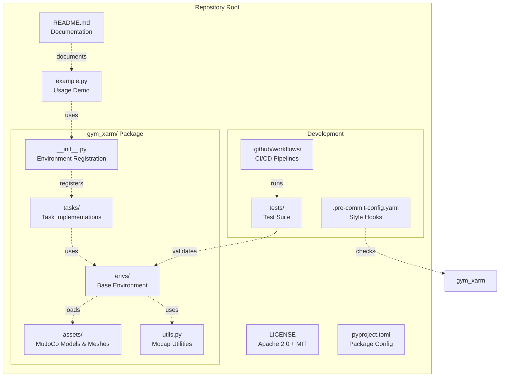

**Directory Purposes:**

| Path | Purpose |
|------|---------|
| `gym_xarm/` | Core package containing all implementation code |
| `gym_xarm/tasks/` | Task-specific implementations (Lift, deprecated tasks) |
| `gym_xarm/envs/` | Base environment class providing core RL infrastructure |
| `gym_xarm/assets/` | MuJoCo XML models and 3D mesh files (`.stl`) |
| `tests/` | Environment validation and compliance tests |
| `.github/workflows/` | Automated testing and quality assurance pipelines |

**Sources:** [README.md:1-94](), [gym_xarm/__init__.py:1-9]()

---

## Core Architecture

The system is built on a layered architecture where the `Base` environment class provides all core functionality, and task-specific classes inherit from it to implement domain logic.

```mermaid
graph TB
    subgraph "User Interface Layer"
        GymAPI["gymnasium.make()<br/>Standard RL API"]
        EnvID["gym_xarm/XarmLift-v0<br/>Registered Environment ID"]
    end
    
    subgraph "gym_xarm Package"
        Registration["gym_xarm.__init__<br/>register() call"]
        
        subgraph "Task Layer"
            LiftTask["gym_xarm.tasks.Lift<br/>entry_point class"]
            DeprecatedTasks["Reach, Push, PegInBox<br/>(deprecated)"]
        end
        
        subgraph "Core Environment Layer"
            BaseEnv["gym_xarm.envs.Base<br/>Core RL Environment"]
            MocapUtils["gym_xarm.utils<br/>apply_action(), reset_mocap2body_xpos()"]
        end
        
        subgraph "Assets"
            LiftXML["assets/xarm/lift.xml<br/>Scene Description"]
            XarmXML["assets/xarm/xarm.xml<br/>Robot Model"]
            Meshes["assets/xarm/*.stl<br/>3D Geometry"]
        end
    end
    
    subgraph "External Dependencies"
        Gymnasium["gymnasium >=0.29.1<br/>RL Framework"]
        GymnasiumRobotics["gymnasium-robotics >=1.2.4<br/>Robotics Base Classes"]
        MuJoCo["mujoco ^2.3.7<br/>Physics Engine"]
    end
    
    GymAPI -->|looks up| EnvID
    EnvID -->|configured in| Registration
    Registration -->|entry_point| LiftTask
    
    LiftTask --|inherits| BaseEnv
    DeprecatedTasks -.->|unused| BaseEnv
    
    BaseEnv -->|uses| MocapUtils
    BaseEnv -->|loads| LiftXML
    LiftXML -->|includes| XarmXML
    XarmXML -->|references| Meshes
    
    BaseEnv -->|implements| Gymnasium
    BaseEnv -->|extends| GymnasiumRobotics
    BaseEnv -->|simulates with| MuJoCo
```

**Architectural Layers:**

1. **User Interface**: Standard `gymnasium.make()` API for environment instantiation
2. **Registration**: Maps environment ID `"gym_xarm/XarmLift-v0"` to the `Lift` class
3. **Task Layer**: Task-specific implementations providing reward functions and goal sampling
4. **Core Environment**: `Base` class handles simulation, observation generation, action processing
5. **Utilities**: Mocap control functions for translating actions to physics commands
6. **Assets**: MuJoCo XML models defining robot kinematics and scene layout
7. **Dependencies**: External libraries providing RL framework and physics simulation

**Sources:** [gym_xarm/__init__.py:1-9](), [README.md:1-94](), [pyproject.toml:24-28]()

---

## Key Components Overview

### Base Environment Class
The `Base` class in `gym_xarm/envs/` is the architectural foundation, providing all core RL environment functionality. It handles MuJoCo simulation management, dual rendering systems (84×84 for observations, 680×680 for visualization), observation generation across three modes, and mocap-based action processing. For detailed documentation, see [Base Environment Class](#3.1).

### Task System
Tasks inherit from `Base` and implement task-specific logic through four abstract methods: `_get_obs()`, `_sample_goal()`, `get_reward()`, and `is_success()`. The `Lift` task is the only active implementation, while `Reach`, `Push`, and `PegInBox` are deprecated. For task details, see [Task System](#3.2) and [Tasks Reference](#4).

### MuJoCo Integration
The environment integrates with MuJoCo through XML model loading, 20-substep physics simulation, and mocap-based control. The mocap system allows high-level end-effector control by updating mocap body positions and orientations. For integration details, see [MuJoCo Integration](#3.3).

### Observation System
Three observation modes are supported:
- `"state"`: 28-dimensional state vectors (robot + object states)
- `"pixels"`: 84×84 RGB images from camera
- `"pixels_agent_pos"`: Hybrid combining pixels with robot state

For observation system documentation, see [Observation System](#3.4).

### Action Processing
Actions are 4-dimensional vectors `[x, y, z, w]` representing end-effector target position and gripper control. The system validates, scales, and applies actions through the mocap control system. For details, see [Action Processing and Mocap Control](#3.5).

**Sources:** [README.md:47-63](), [pyproject.toml:1-77]()

---

## Typical Usage Workflow

The following diagram illustrates a complete usage cycle, showing how user code interacts with the environment through the standard Gymnasium API and how data flows through the system components.

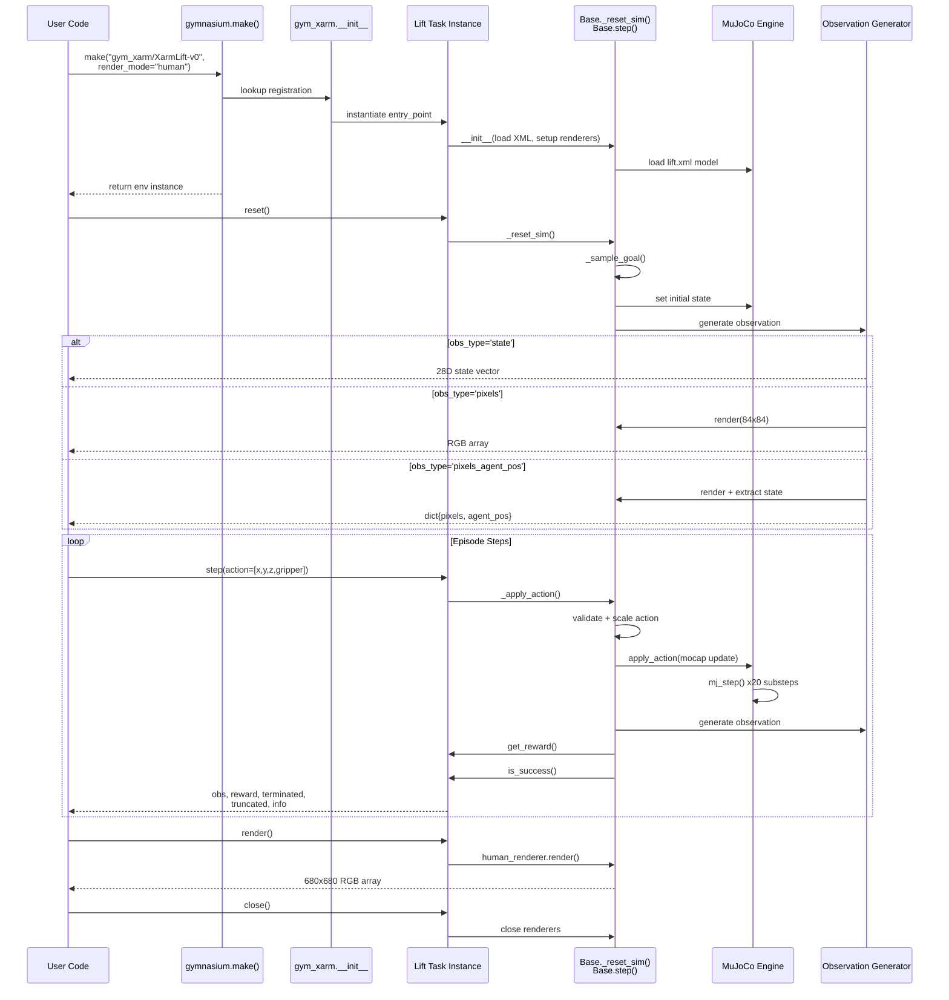

**Workflow Phases:**

1. **Instantiation**: `gymnasium.make()` looks up the registered ID and instantiates the `Lift` task
2. **Initialization**: `Base.__init__()` loads MuJoCo models and sets up dual renderers
3. **Reset**: Environment samples initial goal and object positions, returns first observation
4. **Stepping**: Actions are validated, applied via mocap, physics simulated, observations generated
5. **Rendering**: Optional human-viewable rendering at higher resolution (680×680)
6. **Cleanup**: Renderers are properly closed when environment is destroyed

**Sources:** [example.py:1-16](), [gym_xarm/__init__.py:1-9](), [README.md:21-45]()

---

## Technology Stack and Dependencies

The package is built on a carefully selected stack of dependencies that provide robotics RL infrastructure, physics simulation, and development tooling.

### Runtime Dependencies

| Package | Version Constraint | Purpose |
|---------|-------------------|---------|
| `python` | `^3.10` | Base interpreter (3.10+) |
| `gymnasium` | `>=0.29.1` | Standard RL environment API |
| `gymnasium-robotics` | `>=1.2.4` | Robotics-specific extensions and base classes |
| `mujoco` | `^2.3.7` | Physics engine for robot simulation |

### Development Dependencies

| Package | Version Constraint | Purpose |
|---------|-------------------|---------|
| `pre-commit` | `>=3.7.0` | Git hooks for style enforcement |
| `pytest` | `>=8.1.0` | Test framework |
| `pytest-cov` | `>=5.0.0` | Test coverage reporting |
| `debugpy` | `>=1.8.1` | Python debugger for development |

### Dependency Graph

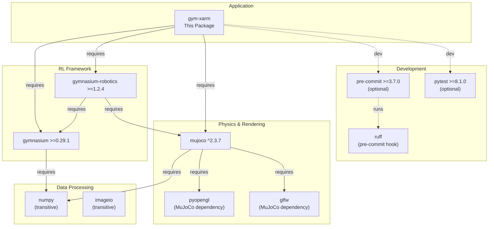

**Version Strategy:**
- **Caret constraints (`^`)**: Used for MuJoCo to allow patch updates but prevent breaking changes
- **Minimum version constraints (`>=`)**: Used for Gymnasium packages to ensure required features are available
- **Optional dependencies**: Development tools are grouped under `[dev]` and `[test]` extras

For comprehensive dependency documentation, see [Dependencies and Requirements](#6).

**Sources:** [pyproject.toml:24-37]()

---

## Development and Quality Assurance

The repository employs a multi-layered quality assurance strategy:

**Local Development:**
- **Poetry** for dependency management and reproducible builds
- **Pre-commit hooks** run Ruff linter/formatter before each commit
- **pyproject.toml** centralizes all tool configuration

**CI/CD Pipelines:**
- **test.yml workflow**: Runs pytest suite on pull requests, validates Gymnasium API compliance
- **quality.yml workflow**: Checks code style with Ruff and dependency integrity with Poetry

For development setup instructions, see [Development Setup](#5.1). For CI/CD details, see [CI/CD Workflows](#5.3).

**Sources:** [pyproject.toml:1-77](), [README.md:65-84]()

---

## Licensing and Attribution

The package is dual-licensed:
- **Apache License 2.0**: Primary license for the gym-xarm implementation
- **MIT License**: Applies to code derived from the simxarm project by Nicklas Hansen and Yanjie Ze

The environment is adapted from research on visual reinforcement learning and robotic manipulation, building on work from multiple academic publications. For complete licensing information and acknowledgments, see [Project Information](#10).

**Sources:** [LICENSE:1-229](), [README.md:86-94]()

---

## Next Steps

To get started with gym-xarm:
1. **Installation**: Follow the guide in [Installation](#2.1) to set up the package
2. **Quick Start**: Work through the [Quick Start Tutorial](#2.2) to create your first environment
3. **Configuration**: Learn about observation types and rendering modes in [Configuration Options](#2.3)
4. **Architecture Deep Dive**: Explore the [Core Architecture](#3) section to understand system internals
5. **Contributing**: Review the [Development Guide](#5) if you want to contribute or extend the package

For task-specific information, see [Tasks Reference](#4). For API documentation, see [API Reference](#8).

---

# Page: Getting Started

# Getting Started

<details>
<summary>Relevant source files</summary>

The following files were used as context for generating this wiki page:

- [README.md](README.md)
- [example.py](example.py)
- [pyproject.toml](pyproject.toml)

</details>


This page provides an overview of the essential steps to install and use gym-xarm. It covers the basic workflow from installation through creating and interacting with environments. For detailed installation instructions, see [Installation](#2.1). For a complete walkthrough with code examples, see [Quick Start Tutorial](#2.2). For detailed configuration parameters, see [Configuration Options](#2.3).

## Prerequisites

gym-xarm requires Python 3.10 or higher. The package depends on MuJoCo physics engine and Gymnasium framework, which will be installed automatically as dependencies.

**Sources:** [pyproject.toml:25](), [README.md:10-13]()

## Installation Overview

There are two installation paths depending on your use case:

| Installation Method | Use Case | Command |
|---------------------|----------|---------|
| **pip** | End users who want to use gym-xarm | `pip install gym-xarm` |
| **Poetry** | Developers contributing to gym-xarm | `poetry install --all-extras` |

The pip installation provides the core package and all runtime dependencies. The Poetry installation additionally includes development tools like pre-commit hooks, pytest, and debugpy for debugging.

**Sources:** [README.md:8-18](), [README.md:66-73](), [pyproject.toml:24-37]()

### Installation Workflow

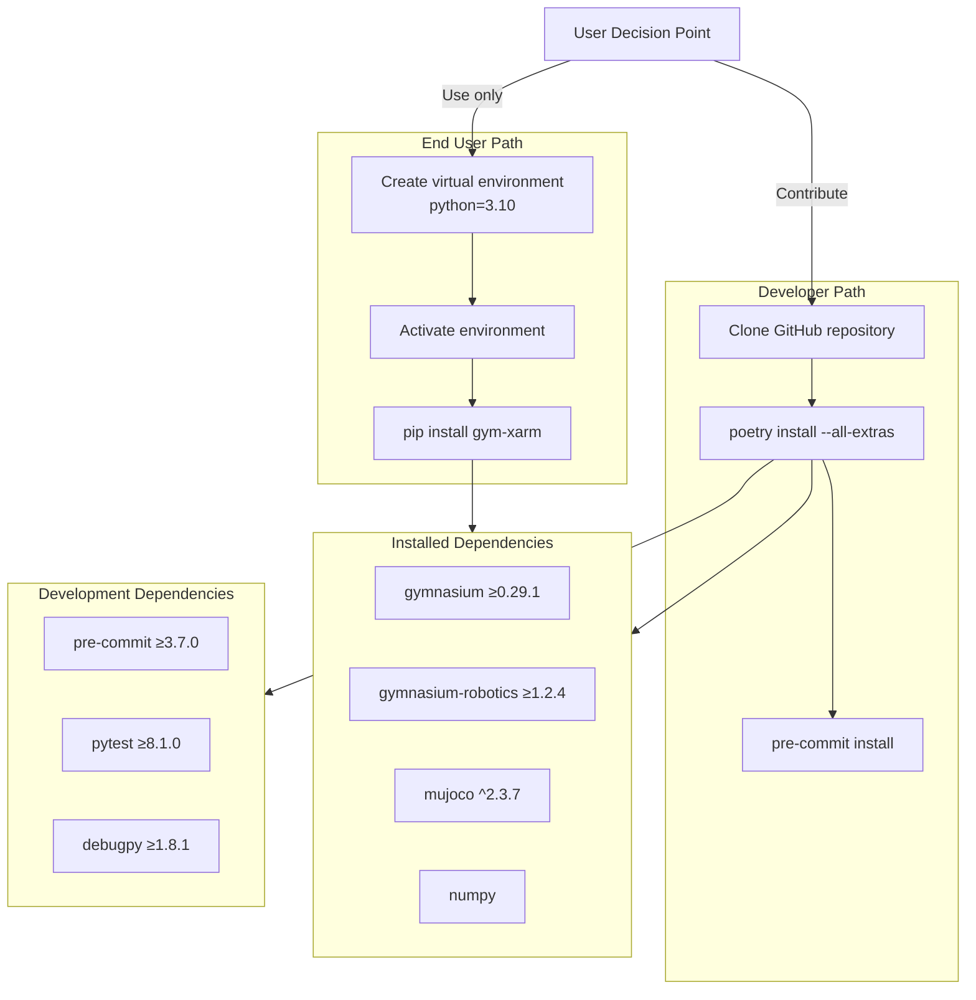

**Sources:** [README.md:10-18](), [README.md:66-73](), [pyproject.toml:24-37]()

## Basic Usage Pattern

All interaction with gym-xarm follows the standard Gymnasium API pattern. The core workflow involves three steps:

1. **Environment Creation**: Use `gymnasium.make()` with the environment ID `"gym_xarm/XarmLift-v0"`
2. **Episode Loop**: Call `reset()` to initialize, then repeatedly call `step(action)` until termination
3. **Cleanup**: Call `close()` when done

### Code Entity Mapping

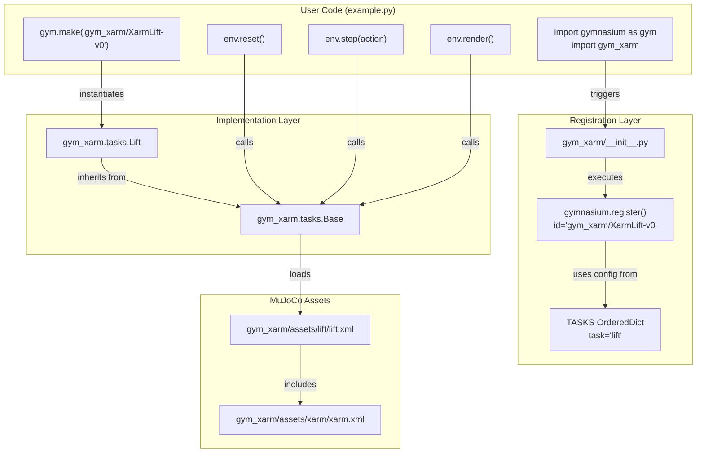

**Sources:** [README.md:23-40](), [example.py:1-15]()

## Minimal Working Example

The simplest way to verify your installation is to run a random policy for a few steps:

```python
import gymnasium as gym
import gym_xarm

env = gym.make("gym_xarm/XarmLift-v0")
observation, info = env.reset()

for _ in range(50):
    action = env.action_space.sample()
    observation, reward, terminated, truncated, info = env.step(action)
    
    if terminated or truncated:
        observation, info = env.reset()

env.close()
```

This code creates the Lift task environment, runs random actions, and properly handles episode termination. The environment automatically manages the MuJoCo simulation in the background.

**Sources:** [example.py:1-15](), [README.md:23-40]()

## Environment Configuration

The `gymnasium.make()` function accepts configuration parameters that control observation and rendering behavior:

| Parameter | Options | Default | Purpose |
|-----------|---------|---------|---------|
| `obs_type` | `"state"`, `"pixels"`, `"pixels_agent_pos"` | `"state"` | Determines observation space format |
| `render_mode` | `"rgb_array"`, `"human"` | `None` | Controls rendering output |

### Observation Type Details

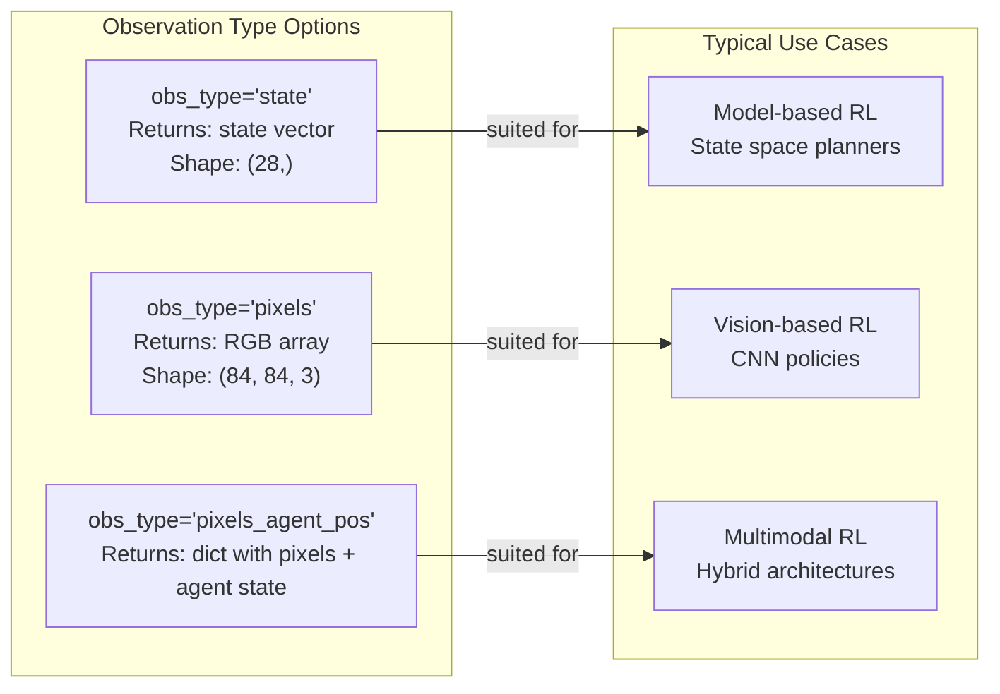

**Sources:** [README.md:57-63]()

### Rendering Configuration

When using `render_mode="human"` for visual debugging, the `MUJOCO_GL` environment variable must be set:

```bash
MUJOCO_GL=glfw python your_script.py
```

This configures MuJoCo to use the GLFW backend for OpenGL rendering. Without this setting, human rendering will fail. For programmatic rendering (`render_mode="rgb_array"`), this variable is not required.

**Sources:** [README.md:42-45]()

## Action Space Structure

The environment uses a 4-dimensional continuous action space:

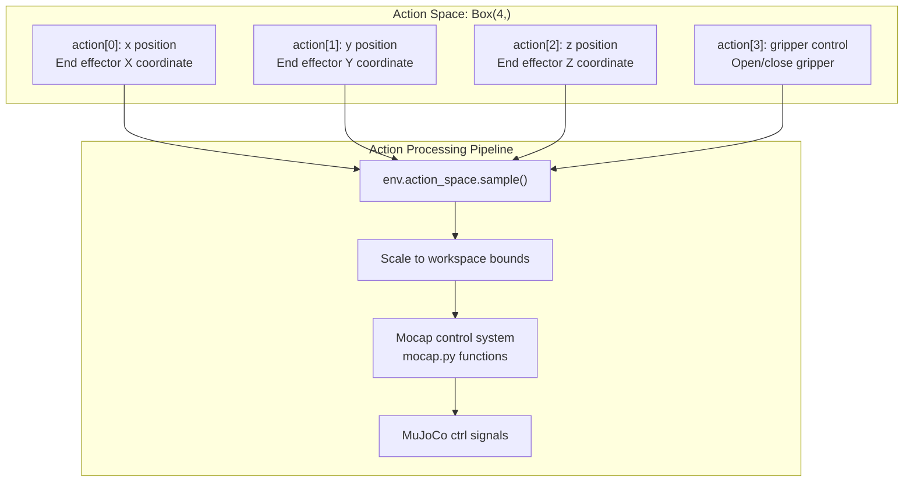

The action values are interpreted as target positions for the end effector and gripper state. The mocap control system translates these high-level commands into low-level physics control signals.

**Sources:** [README.md:51-55]()

## Next Steps

Now that you understand the basics, explore these pages for detailed information:

- **[Installation](#2.1)**: Detailed setup instructions including virtual environment configuration and troubleshooting
- **[Quick Start Tutorial](#2.2)**: Step-by-step tutorial with complete code examples and explanations
- **[Configuration Options](#2.3)**: Comprehensive reference for all environment parameters and settings
- **[Lift Task](#4.1)**: Detailed documentation of the lifting task including reward structure and success criteria
- **[Core Architecture](#3)**: Deep dive into the system's internal architecture and components

For development workflows including testing and contributing, see [Development Guide](#5).

**Sources:** [README.md:1-94](), [pyproject.toml:1-77]()

---

# Page: Installation

# Installation

<details>
<summary>Relevant source files</summary>

The following files were used as context for generating this wiki page:

- [README.md](README.md)
- [example.py](example.py)
- [poetry.lock](poetry.lock)
- [pyproject.toml](pyproject.toml)

</details>


This page covers system requirements and installation procedures for gym-xarm. For basic usage instructions after installation, see [Quick Start Tutorial](#2.2). For detailed development setup including pre-commit hooks and testing, see [Development Setup](#5.1).

## Overview

gym-xarm provides two installation paths:
- **User Installation**: Simple pip-based installation for end users who want to use the environment
- **Developer Installation**: Poetry-based installation for contributors who need development tools and testing infrastructure

Both installation methods require Python 3.10 or higher and will install the MuJoCo physics engine along with required dependencies.

## System Requirements

### Python Version

gym-xarm requires Python 3.10 or higher, as specified in [pyproject.toml:25]().

```toml
python = "^3.10"
```

### Core Runtime Dependencies

The following dependencies are automatically installed with gym-xarm:

| Dependency | Version Constraint | Purpose |
|------------|-------------------|---------|
| `mujoco` | ^2.3.7 | Physics simulation engine |
| `gymnasium` | >=0.29.1 | RL environment API framework |
| `gymnasium-robotics` | >=1.2.4 | Robotics-specific extensions |
| `numpy` | >=1.21.0 | Numerical computation (transitive) |
| `imageio` | * | Image and video I/O (transitive) |
| `glfw` | * | Window management for rendering (transitive) |
| `pyopengl` | * | OpenGL bindings (transitive) |

Sources: [pyproject.toml:24-28](), [poetry.lock:1-446]()

### Optional Development Dependencies

Additional dependencies required for development work:

| Dependency | Version | Extra Group | Purpose |
|------------|---------|-------------|---------|
| `pre-commit` | >=3.7.0 | dev | Code quality hooks |
| `debugpy` | >=1.8.1 | dev | Python debugging |
| `pytest` | >=8.1.0 | test | Testing framework |
| `pytest-cov` | >=5.0.0 | test | Coverage reporting |

Sources: [pyproject.toml:29-37]()

## User Installation

### Step 1: Create Virtual Environment

Create and activate a Python 3.10+ virtual environment. Using conda:

```bash
conda create -y -n xarm python=3.10 && conda activate xarm
```

Alternatively, using venv:

```bash
python3.10 -m venv xarm_env
source xarm_env/bin/activate  # On Linux/Mac
# or
xarm_env\Scripts\activate  # On Windows
```

Sources: [README.md:10-13]()

### Step 2: Install via pip

```bash
pip install gym-xarm
```

This command installs gym-xarm and all required runtime dependencies from PyPI.

Sources: [README.md:15-18]()

### Installation Flow Diagram

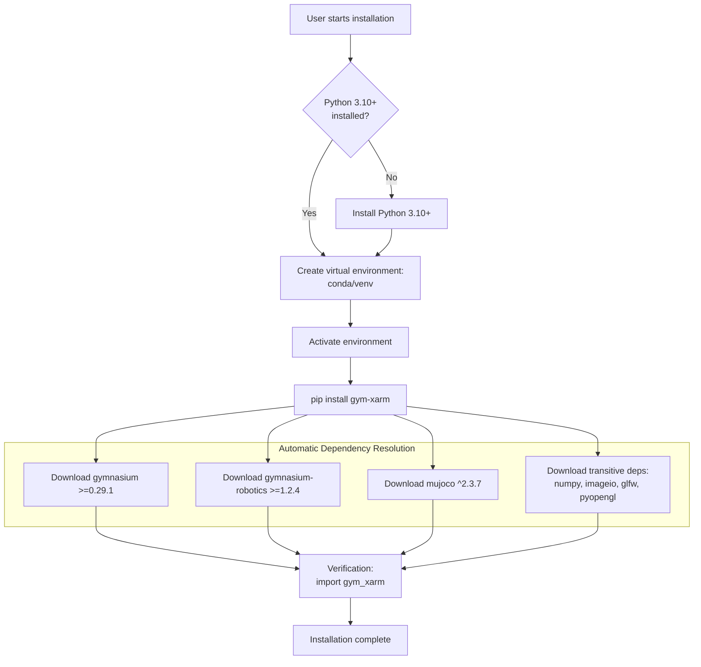

Sources: [README.md:8-18](), [pyproject.toml:24-28]()

## Developer Installation

### Step 1: Install Poetry

Poetry is required for development. Install it following the [official instructions](https://python-poetry.org/docs/#installation).

Sources: [README.md:67-68]()

### Step 2: Clone Repository

```bash
git clone https://github.com/huggingface/gym-xarm.git
cd gym-xarm
```

### Step 3: Install with Development Dependencies

```bash
poetry install --all-extras
```

This command:
- Creates a virtual environment automatically (if not already in one)
- Installs gym-xarm in editable mode
- Installs all optional dependency groups (`dev` and `test`)

The `--all-extras` flag installs dependencies from both extras groups defined in [pyproject.toml:35-37]():

```toml
[tool.poetry.extras]
dev = ["pre-commit", "debugpy"]
test = ["pytest", "pytest-cov"]
```

Sources: [README.md:70-73](), [pyproject.toml:35-37]()

### Developer Installation Workflow

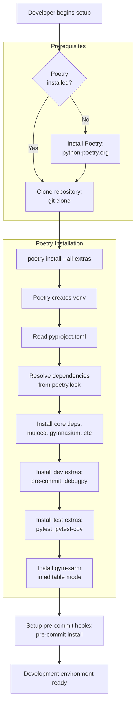

Sources: [README.md:65-83](), [pyproject.toml:24-37]()

## Dependency Resolution

### Dependency Tree Structure

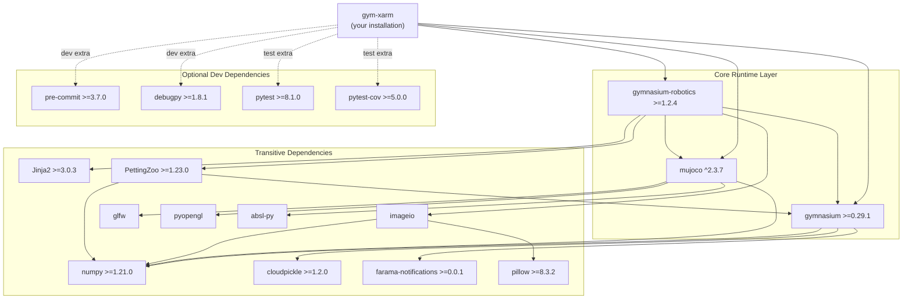

Sources: [pyproject.toml:24-37](), [poetry.lock:219-270](), [poetry.lock:415-453]()

### Version Constraint Notation

Poetry uses specific version constraint operators:

| Operator | Example | Meaning |
|----------|---------|---------|
| `^` | `^2.3.7` | Compatible release: `>=2.3.7, <3.0.0` |
| `>=` | `>=0.29.1` | Minimum version: `0.29.1` or higher |
| `*` | `*` | Any version (from transitive deps) |

The caret (`^`) operator allows patch and minor version updates but prevents breaking major version changes.

Sources: [pyproject.toml:24-28]()

## Verification

### Basic Import Test

After installation, verify that gym-xarm can be imported:

```python
import gymnasium as gym
import gym_xarm

# Verify environment registration
env = gym.make("gym_xarm/XarmLift-v0")
print("Installation successful!")
env.close()
```

### Full Verification Script

```python
# verify_installation.py
import sys

def verify_installation():
    """Verify all core components are properly installed."""
    errors = []
    
    # Check Python version
    if sys.version_info < (3, 10):
        errors.append(f"Python 3.10+ required, found {sys.version}")
    
    # Check core imports
    try:
        import gymnasium
        print(f"✓ gymnasium {gymnasium.__version__}")
    except ImportError as e:
        errors.append(f"✗ gymnasium: {e}")
    
    try:
        import gymnasium_robotics
        print(f"✓ gymnasium-robotics")
    except ImportError as e:
        errors.append(f"✗ gymnasium-robotics: {e}")
    
    try:
        import mujoco
        print(f"✓ mujoco {mujoco.__version__}")
    except ImportError as e:
        errors.append(f"✗ mujoco: {e}")
    
    try:
        import gym_xarm
        print(f"✓ gym-xarm")
    except ImportError as e:
        errors.append(f"✗ gym-xarm: {e}")
    
    # Test environment creation
    try:
        import gymnasium as gym
        env = gym.make("gym_xarm/XarmLift-v0")
        print(f"✓ Environment creation successful")
        env.close()
    except Exception as e:
        errors.append(f"✗ Environment creation: {e}")
    
    if errors:
        print("\nErrors found:")
        for error in errors:
            print(f"  {error}")
        return False
    
    print("\nAll verification checks passed!")
    return True

if __name__ == "__main__":
    success = verify_installation()
    sys.exit(0 if success else 1)
```

Sources: [example.py:1-15]()

## Environment Variables

### MUJOCO_GL Configuration

For human rendering mode (`render_mode="human"`), the `MUJOCO_GL` environment variable must be set:

```bash
export MUJOCO_GL=glfw  # Linux/Mac
# or
set MUJOCO_GL=glfw     # Windows
```

This can also be set inline when running scripts:

```bash
MUJOCO_GL=glfw python example.py
```

Without this setting, you may encounter OpenGL context errors when using `render_mode="human"`.

Sources: [README.md:42-45]()

## Troubleshooting

### Common Installation Issues

#### Issue: Python Version Mismatch

**Symptom**: `requires python ^3.10` error during installation

**Solution**: Ensure Python 3.10 or higher is installed and active:
```bash
python --version  # Should show 3.10.x or higher
```

#### Issue: MuJoCo Rendering Errors

**Symptom**: Errors mentioning "GL context" or "rendering" when using `render_mode="human"`

**Solution**: Set the `MUJOCO_GL` environment variable:
```bash
export MUJOCO_GL=glfw
```

#### Issue: Poetry Lock File Conflicts

**Symptom**: `poetry.lock` conflicts during `poetry install`

**Solution**: Update the lock file:
```bash
poetry lock --no-update
poetry install --all-extras
```

#### Issue: Missing Dependencies in Development

**Symptom**: Import errors for `pre-commit` or `pytest`

**Solution**: Ensure you installed with extras:
```bash
poetry install --all-extras
# or for pip
pip install gym-xarm[dev,test]
```

Sources: [README.md:42-45](), [pyproject.toml:24-37]()

## Platform-Specific Notes

### Linux

No special configuration required. Standard installation works on most distributions.

### macOS

- Apple Silicon (M1/M2): Both x86_64 and ARM64 wheels are available for MuJoCo
- OpenGL may require XQuartz for some rendering modes

### Windows

- Ensure Microsoft Visual C++ Redistributable is installed for MuJoCo
- Use `set` instead of `export` for environment variables

Sources: [poetry.lock:421-445]()

## Next Steps

After successful installation:

1. **For users**: See [Quick Start Tutorial](#2.2) to create your first environment
2. **For developers**: See [Development Setup](#5.1) to configure pre-commit hooks and testing
3. **For configuration**: See [Configuration Options](#2.3) to customize environment behavior

Sources: [README.md:8-94]()

---

# Page: Quick Start Tutorial

# Quick Start Tutorial

<details>
<summary>Relevant source files</summary>

The following files were used as context for generating this wiki page:

- [README.md](README.md)
- [example.py](example.py)
- [gym_xarm/__init__.py](gym_xarm/__init__.py)

</details>


## Purpose and Scope

This tutorial walks through creating and interacting with a gym-xarm environment. You will learn how to initialize the environment using Gymnasium's standard API, execute the reset-step-render loop, and understand the basic structure of observations, actions, and rewards. This guide assumes you have already completed the installation steps in [Installation](#2.1).

For detailed configuration options like observation types and render modes, see [Configuration Options](#2.3). For understanding the internal architecture, see [Core Architecture](#3).

**Sources:** [README.md:21-45]()

---

## Creating Your First Environment

The gym-xarm package registers environments with Gymnasium using the standard registration mechanism. The primary environment is `gym_xarm/XarmLift-v0`, which implements a cube-lifting manipulation task.

```python
import gymnasium as gym
import gym_xarm

env = gym.make("gym_xarm/XarmLift-v0", render_mode="human")
```

The `import gym_xarm` statement triggers environment registration by executing [gym_xarm/__init__.py:1-8](). The `gym.make()` call instantiates the `Lift` task class, which inherits from the `Base` environment class and implements the Gymnasium API.

### Environment Registration Flow

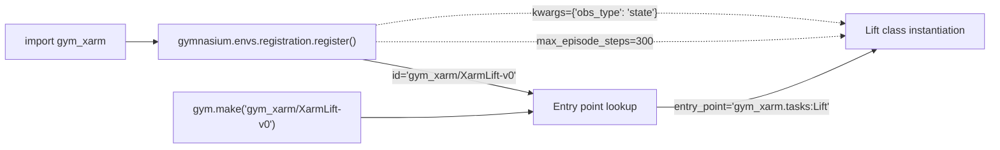

**Sources:** [gym_xarm/__init__.py:3-8](), [README.md:28]()

---

## The Environment Lifecycle

A typical reinforcement learning interaction follows the reset-step loop pattern. The environment must be reset before the first step, and should be reset whenever an episode terminates.

### Basic Interaction Loop

```python
observation, info = env.reset()

for _ in range(1000):
    action = env.action_space.sample()
    observation, reward, terminated, truncated, info = env.step(action)
    image = env.render()
    
    if terminated or truncated:
        observation, info = env.reset()

env.close()
```

**Sources:** [example.py:5-15](), [README.md:29-39]()

### Method Call Sequence Diagram

```mermaid
sequenceDiagram
    participant User as "User Code"
    participant Env as "gym.Env"
    participant Lift as "gym_xarm.tasks.Lift"
    participant Base as "gym_xarm.tasks.Base"
    participant MuJoCo as "mujoco.MjModel/MjData"
    
    User->>+Env: "gym.make('gym_xarm/XarmLift-v0')"
    Env->>+Lift: "__init__(obs_type='state')"
    Lift->>+Base: "super().__init__()"
    Base->>MuJoCo: "Load lift.xml model"
    Base-->>-Lift: "Environment initialized"
    Lift-->>-Env: "Lift instance"
    Env-->>-User: "env object"
    
    User->>+Env: "reset()"
    Env->>+Lift: "reset()"
    Lift->>Base: "_reset_sim()"
    Base->>Base: "_sample_goal()"
    Base->>MuJoCo: "Set initial state"
    Base->>Base: "get_obs()"
    Base-->>Lift: "observation dict"
    Lift-->>Env: "observation, info"
    Env-->>-User: "observation, info"
    
    loop "Episode steps"
        User->>+Env: "step(action)"
        Env->>+Lift: "step(action)"
        Lift->>Base: "_apply_action(action)"
        Base->>Base: "_limit_gripper()"
        Base->>Base: "apply_action() [mocap]"
        Base->>MuJoCo: "Update mocap_pos, ctrl"
        MuJoCo->>MuJoCo: "mj_step() × 20 substeps"
        Base->>Base: "get_obs()"
        Lift->>Lift: "get_reward()"
        Lift->>Lift: "is_success()"
        Lift-->>Env: "obs, reward, terminated, truncated, info"
        Env-->>-User: "obs, reward, terminated, truncated, info"
        
        User->>+Env: "render()"
        Env->>Base: "render()"
        Base->>MuJoCo: "Render with visualization_renderer"
        Base-->>Env: "rgb_array (680×680×3)"
        Env-->>-User: "image array"
    end
    
    User->>+Env: "close()"
    Env->>Base: "close()"
    Base->>MuJoCo: "Release resources"
    Base-->>-Env: ""
    Env-->>-User: ""
```

**Sources:** [example.py:1-16](), [README.md:23-40]()

---

## Understanding Actions

The action space for the Lift task is a 4-dimensional continuous space: `[x, y, z, gripper]`.

| Action Component | Index | Range | Description |
|-----------------|-------|-------|-------------|
| x-position | 0 | Continuous | End-effector target x-coordinate |
| y-position | 1 | Continuous | End-effector target y-coordinate |
| z-position | 2 | Continuous | End-effector target z-coordinate |
| Gripper control | 3 | Continuous | Gripper open/close command |

```python
# Sample a random action
action = env.action_space.sample()
# Returns array with shape (4,): [x, y, z, gripper]

# Or specify actions manually
import numpy as np
action = np.array([0.1, 0.2, 0.3, 1.0])
```

Actions are processed through the `Base._apply_action()` method, which scales and validates them before passing to the mocap control system. The gripper is constrained by `_limit_gripper()` to prevent invalid configurations.

**Sources:** [README.md:51-55](), [example.py:8]()

---

## Understanding Observations

The default observation type is `"state"`, which provides a state vector containing robot and object information. The observation structure returned by `reset()` and `step()` is a dictionary:

```python
observation, info = env.reset()
# observation is a dict with keys: 'observation', 'achieved_goal', 'desired_goal'
```

### Observation Dictionary Structure

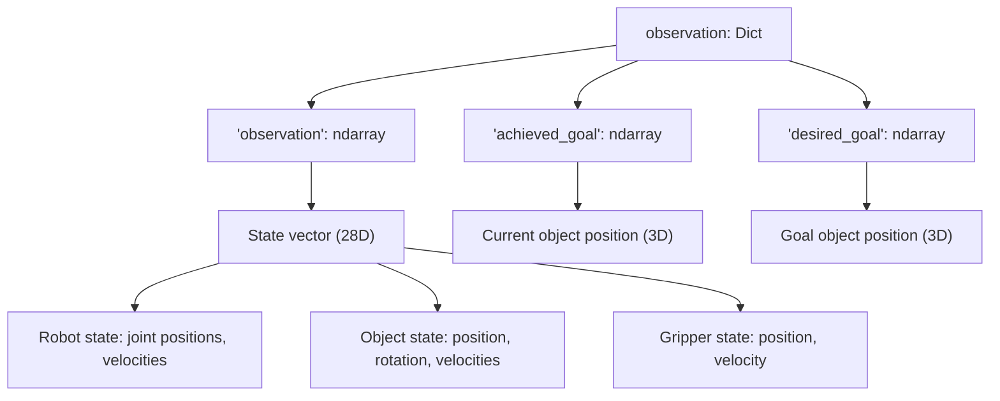

The observation type can be changed during environment creation:

```python
# State-based observations (default)
env = gym.make("gym_xarm/XarmLift-v0", obs_type="state")

# Pixel-based observations (84×84 RGB)
env = gym.make("gym_xarm/XarmLift-v0", obs_type="pixels")

# Hybrid observations (pixels + robot state)
env = gym.make("gym_xarm/XarmLift-v0", obs_type="pixels_agent_pos")
```

**Sources:** [README.md:57-63](), [gym_xarm/__init__.py:7]()

---

## Rendering Configuration

The `render_mode` parameter controls visualization behavior. Two primary modes are available:

- **`"rgb_array"`**: Programmatic rendering that returns image arrays without displaying a window
- **`"human"`**: Interactive visualization that displays a real-time window

```python
# Programmatic rendering (no window)
env = gym.make("gym_xarm/XarmLift-v0", render_mode="rgb_array")
image = env.render()  # Returns numpy array (680, 680, 3)

# Interactive visualization (requires MUJOCO_GL=glfw)
env = gym.make("gym_xarm/XarmLift-v0", render_mode="human")
env.render()  # Displays window, returns image array
```

### Important: MUJOCO_GL Environment Variable

When using `render_mode="human"`, you must set the `MUJOCO_GL` environment variable to specify the OpenGL backend:

```bash
export MUJOCO_GL=glfw
python example.py

# Or inline:
MUJOCO_GL=glfw python example.py
```

Without this configuration, MuJoCo will attempt to use an incompatible rendering backend and may fail with OpenGL-related errors.

**Sources:** [README.md:28](), [README.md:42-45](), [example.py:4](), [example.py:10]()

---

## Episode Termination and Truncation

Episodes terminate under two conditions:

1. **Termination (`terminated=True`)**: Task-specific success condition met. For the Lift task, this occurs when the cube is lifted above the height threshold and `is_success()` returns `True`.

2. **Truncation (`truncated=True`)**: Maximum episode length reached. The environment is registered with `max_episode_steps=300`, meaning episodes truncate after 300 steps if not terminated earlier.

```python
observation, reward, terminated, truncated, info = env.step(action)

if terminated:
    # Success condition met
    print(f"Task succeeded! Success: {info['is_success']}")
elif truncated:
    # Max steps reached without success
    print("Episode truncated at max length")

if terminated or truncated:
    observation, info = env.reset()
```

The `info` dictionary contains additional metadata including the `is_success` flag, which explicitly indicates whether the task goal was achieved.

**Sources:** [example.py:12-13](), [gym_xarm/__init__.py:6]()

---

## Complete Example Walkthrough

Here is the complete example from [example.py](example.py) with annotations:

```python
import gymnasium as gym
import gym_xarm  # Triggers environment registration

# Create environment with human rendering
env = gym.make("gym_xarm/XarmLift-v0", render_mode="human")

# Initialize episode
observation, info = env.reset()
# observation: Dict with 'observation', 'achieved_goal', 'desired_goal'
# info: Dict with episode initialization metadata

# Run 1000 steps (episodes will reset automatically)
for _ in range(1000):
    # Sample random action from action space
    action = env.action_space.sample()  # Shape: (4,)
    
    # Execute action in environment
    observation, reward, terminated, truncated, info = env.step(action)
    # observation: Updated state/image observation
    # reward: Scalar reward value
    # terminated: Bool indicating task success
    # truncated: Bool indicating max steps reached
    # info: Dict with 'is_success' and other metadata
    
    # Render visualization
    image = env.render()  # Returns RGB array (680, 680, 3)
    
    # Reset if episode ended
    if terminated or truncated:
        observation, info = env.reset()

# Clean up resources
env.close()
```

### Key Execution Notes

1. **Import Order**: `import gym_xarm` must occur before `gym.make()` to ensure registration
2. **Reset First**: `env.reset()` must be called before the first `env.step()`
3. **Episode Management**: Check both `terminated` and `truncated` flags for episode completion
4. **Resource Cleanup**: Call `env.close()` when finished to release MuJoCo and rendering resources

**Sources:** [example.py:1-16](), [README.md:23-40]()

---

## Next Steps

Now that you understand the basic interaction loop, you can:

- Explore **[Configuration Options](#2.3)** to customize observation types and rendering settings
- Review **[Lift Task](#4.1)** documentation to understand the reward function and success criteria
- Learn about **[Action Processing and Mocap Control](#3.5)** to understand how actions are translated to robot motion
- Examine **[Core Architecture](#3)** for deeper understanding of the environment implementation

**Sources:** [README.md:1-94]()

---

# Page: Configuration Options

# Configuration Options

<details>
<summary>Relevant source files</summary>

The following files were used as context for generating this wiki page:

- [README.md](README.md)
- [example.py](example.py)
- [gym_xarm/tasks/base.py](gym_xarm/tasks/base.py)
- [gym_xarm/tasks/mocap.py](gym_xarm/tasks/mocap.py)

</details>


This page documents all configuration parameters available when creating and using gym-xarm environments. These options control observation modality, rendering behavior, and simulation display settings. For information about the internal implementation of these systems, see [Observation System](#3.4) and [MuJoCo Integration](#3.3). For practical usage examples, see [Quick Start Tutorial](#2.2).

## Configuration Flow

The following diagram shows how configuration parameters flow from environment creation through to the Base class initialization:

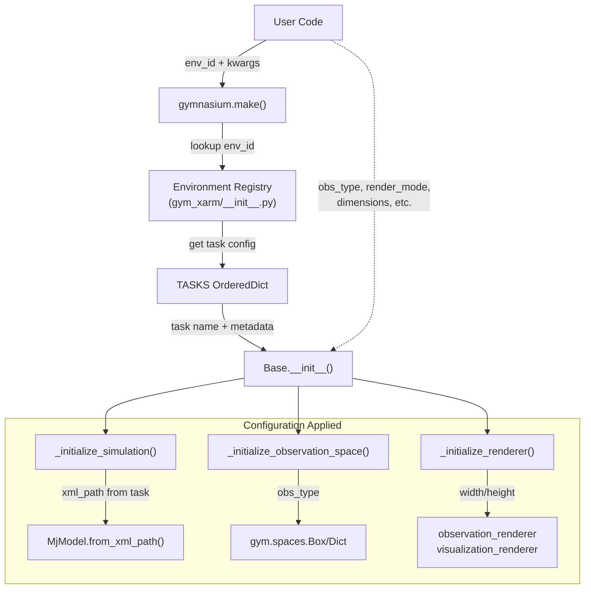

**Sources:** [gym_xarm/tasks/base.py:35-76](), [gym_xarm/__init__.py]()

## Environment Creation Parameters

When calling `gymnasium.make("gym_xarm/XarmLift-v0", **kwargs)`, the following parameters can be specified:

| Parameter | Type | Default | Valid Values | Purpose |
|-----------|------|---------|--------------|---------|
| `obs_type` | `str` | `"state"` | `"state"`, `"pixels"`, `"pixels_agent_pos"` | Determines observation structure returned by environment |
| `render_mode` | `str` | `"rgb_array"` | `"rgb_array"`, `"human"` | Controls rendering output mode |
| `observation_width` | `int` | `84` | Any positive integer | Width of observation renderer output in pixels |
| `observation_height` | `int` | `84` | Any positive integer | Height of observation renderer output in pixels |
| `visualization_width` | `int` | `680` | Any positive integer | Width of visualization renderer output in pixels |
| `visualization_height` | `int` | `680` | Any positive integer | Height of visualization renderer output in pixels |
| `gripper_rotation` | `list[float]` | `[0, 1, 0, 0]` | Quaternion (4 floats) | Initial rotation quaternion for gripper orientation |

**Example Usage:**

```python
import gymnasium as gym
import gym_xarm

# State-based observation with default rendering
env = gym.make("gym_xarm/XarmLift-v0", obs_type="state")

# Pixel observations with higher resolution
env = gym.make("gym_xarm/XarmLift-v0", 
               obs_type="pixels",
               observation_width=128,
               observation_height=128)

# Hybrid observation with human visualization
env = gym.make("gym_xarm/XarmLift-v0",
               obs_type="pixels_agent_pos",
               render_mode="human")
```

**Sources:** [gym_xarm/tasks/base.py:35-45](), [README.md:28-40]()

## Observation Type Configuration

The `obs_type` parameter determines the structure and content of observations returned by `env.reset()` and `env.step()`. This is one of the most critical configuration choices as it affects agent architecture requirements.

### Observation Type Mapping

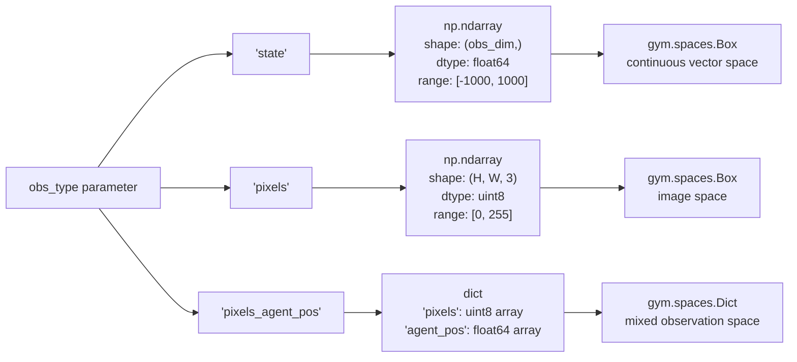

**Sources:** [gym_xarm/tasks/base.py:110-131](), [gym_xarm/tasks/base.py:245-259]()

### State Observations (`obs_type="state"`)

Returns a state vector containing robot and object information. The observation is generated by the task-specific `_get_obs()` method.

**Observation Space:**
- Type: `gym.spaces.Box`
- Shape: Task-dependent (Lift task returns 28-dimensional vector)
- Data type: `np.float64`
- Range: `[-1000.0, 1000.0]`

**Observation Generation:** Directly calls `_get_obs()` method without rendering [gym_xarm/tasks/base.py:245-247]()

### Pixel Observations (`obs_type="pixels"`)

Returns rendered RGB image from the observation renderer.

**Observation Space:**
- Type: `gym.spaces.Box`
- Shape: `(observation_height, observation_width, 3)`
- Data type: `np.uint8`
- Range: `[0, 255]`
- Default dimensions: `(84, 84, 3)`

**Observation Generation:** Renders scene using `observation_renderer` [gym_xarm/tasks/base.py:248-250]()

### Hybrid Observations (`obs_type="pixels_agent_pos"`)

Returns dictionary containing both rendered image and robot state vector.

**Observation Space:**
- Type: `gym.spaces.Dict`
- Keys:
  - `"pixels"`: RGB image array `(H, W, 3)`, dtype `uint8`
  - `"agent_pos"`: Robot state vector, dtype `float64`

**Observation Generation:** Combines rendering with `robot_state` property [gym_xarm/tasks/base.py:251-255]()

The `robot_state` property concatenates end-effector position and gripper angle [gym_xarm/tasks/base.py:170-171]().

**Sources:** [gym_xarm/tasks/base.py:110-131](), [gym_xarm/tasks/base.py:245-259](), [README.md:57-62]()

## Rendering Configuration

gym-xarm uses a dual-renderer architecture where observation rendering and visualization rendering are handled separately with potentially different resolutions.

### Render Mode

The `render_mode` parameter controls how `env.render()` behaves:

| Mode | Description | Output | Use Case |
|------|-------------|--------|----------|
| `"rgb_array"` | Returns numpy array | `np.ndarray` with shape `(H, W, 3)` | Programmatic access to frames |
| `"human"` | Opens display window | Visual display (returns frame copy) | Human observation and debugging |

**Important:** The `"human"` render mode requires the `MUJOCO_GL` environment variable to be set to `"glfw"`. See [Environment Variables](#environment-variables) below.

**Sources:** [gym_xarm/tasks/base.py:11-15](), [gym_xarm/tasks/base.py:315-321]()

### Renderer Dimensions

The dual-renderer system maintains two separate rendering pipelines:

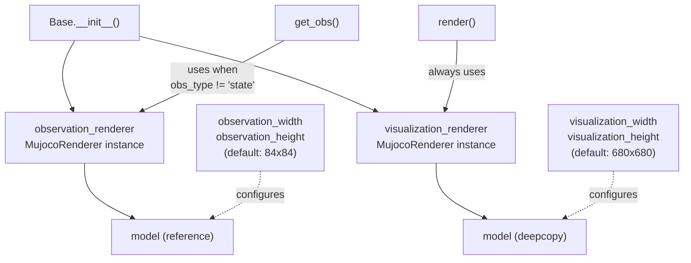

**Observation Renderer:**
- Used by: `get_obs()` when `obs_type` is `"pixels"` or `"pixels_agent_pos"`
- Dimensions: `observation_width` × `observation_height`
- Default: 84 × 84 pixels
- Configuration: [gym_xarm/tasks/base.py:90-91]()

**Visualization Renderer:**
- Used by: `render()` method
- Dimensions: `visualization_width` × `visualization_height`
- Default: 680 × 680 pixels
- Configuration: [gym_xarm/tasks/base.py:133-150]()

**Implementation Note:** The visualization renderer uses a deep copy of the MuJoCo model to allow different rendering dimensions, working around Gymnasium's limitation on dynamic rendering sizes [gym_xarm/tasks/base.py:137-144]().

**Sources:** [gym_xarm/tasks/base.py:71-72](), [gym_xarm/tasks/base.py:133-150](), [gym_xarm/tasks/base.py:90-91]()

## Environment Variables

### MUJOCO_GL

The `MUJOCO_GL` environment variable controls MuJoCo's OpenGL rendering backend. This must be configured before importing gym-xarm.

**Configuration Logic:**

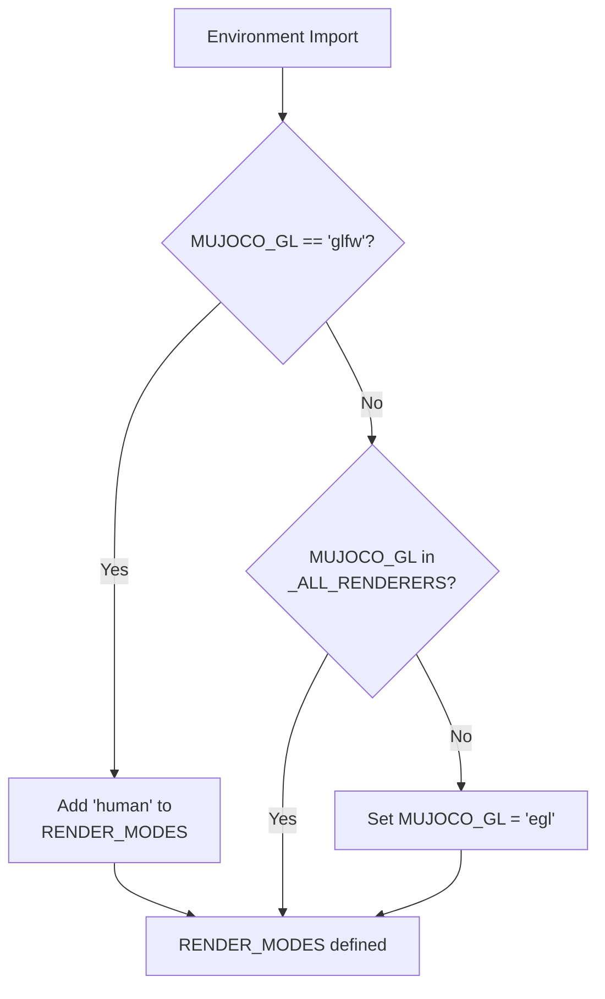

**Valid Values:**
- `"glfw"`: GLFW windowing (required for `render_mode="human"`)
- `"egl"`: EGL rendering (headless, default if not set)
- `"osmesa"`: OSMesa software rendering
- Other values in `gymnasium.envs.mujoco.mujoco_rendering._ALL_RENDERERS`

**Configuration Table:**

| MUJOCO_GL Value | Available Render Modes | Use Case |
|-----------------|------------------------|----------|
| `"glfw"` | `["rgb_array", "human"]` | Interactive visualization with GUI window |
| `"egl"` (default) | `["rgb_array"]` | Headless rendering (servers, clusters) |
| `"osmesa"` | `["rgb_array"]` | Software rendering without GPU |

**Setting the Variable:**

```bash
# Set for single script execution
MUJOCO_GL=glfw python example.py

# Set for entire shell session
export MUJOCO_GL=glfw
python example.py

# Set in Python (must be before import)
import os
os.environ["MUJOCO_GL"] = "glfw"
import gym_xarm
```

**Important:** The environment variable must be set before importing `gym_xarm`. Setting it after import has no effect because the `RENDER_MODES` list is determined at module load time [gym_xarm/tasks/base.py:11-15]().

**Sources:** [gym_xarm/tasks/base.py:11-15](), [README.md:42-45](), [example.py:1-15]()

## Configuration Validation

The Base class performs several validation checks during initialization to ensure configuration consistency:

### Timestep and FPS Validation

The environment validates that the simulation timestep matches the expected render FPS:

```python
assert (
    int(np.round(1.0 / self.dt)) == self.metadata["render_fps"]
), f'Expected value: {int(np.round(1.0 / self.dt))}, Actual value: {self.metadata["render_fps"]}'
```

**Sources:** [gym_xarm/tasks/base.py:77-79]()

### Action Space Validation

The action space dimensionality is validated during `step()`:

```python
assert action.shape == (4,)
assert self.action_space.contains(action)
```

The action space is always 4-dimensional, but the task configuration determines which dimensions are active via `metadata["action_space"]` [gym_xarm/tasks/base.py:74-75](), [gym_xarm/tasks/base.py:261-263]().

### Observation Type Validation

Invalid `obs_type` values raise a `ValueError` with descriptive message:

```python
raise ValueError(
    f"Unknown obs_type {self.obs_type}. Must be one of [pixels, state, pixels_agent_pos]"
)
```

**Sources:** [gym_xarm/tasks/base.py:127-129](), [gym_xarm/tasks/base.py:257-259]()

### XML Path Validation

The environment verifies that the task XML file exists:

```python
if not os.path.exists(self.xml_path):
    raise OSError(f"File {self.xml_path} does not exist")
```

**Sources:** [gym_xarm/tasks/base.py:65-67]()

## Configuration Properties

After initialization, several computed properties reflect the active configuration:

### Spatial and Temporal Properties

| Property | Type | Description | Source |
|----------|------|-------------|--------|
| `dt` | `float` | Gymnasium step timestep (`n_substeps * model.opt.timestep`) | [base.py:153-155]() |
| `center_of_table` | `np.ndarray` | Table center coordinates `[1.655, 0.3, 0.63625]` | [base.py:50]() |
| `max_z` | `float` | Maximum gripper Z coordinate (`1.2`) | [base.py:51]() |
| `min_z` | `float` | Minimum gripper Z coordinate (`0.2`) | [base.py:52]() |
| `gripper_rotation` | `np.ndarray` | Gripper orientation quaternion | [base.py:49]() |

### Metadata Properties

The `metadata` class attribute defines environment metadata:

```python
metadata = {
    "render_modes": RENDER_MODES,  # Dynamically set based on MUJOCO_GL
    "render_fps": 25,
}
```

Additional metadata is added from the task registry:
- `"action_space"`: String defining active action dimensions (e.g., `"xyzw"`)

**Sources:** [gym_xarm/tasks/base.py:26-29](), [gym_xarm/tasks/base.py:50-52](), [gym_xarm/tasks/base.py:153-155]()

## Complete Configuration Example

The following example demonstrates comprehensive environment configuration:

```python
import os
import gymnasium as gym

# Configure rendering backend BEFORE importing gym_xarm
os.environ["MUJOCO_GL"] = "glfw"

import gym_xarm

# Create environment with full configuration
env = gym.make(
    "gym_xarm/XarmLift-v0",
    obs_type="pixels_agent_pos",           # Hybrid observations
    render_mode="human",                    # Visual display window
    observation_width=128,                  # Higher resolution observations
    observation_height=128,
    visualization_width=1024,               # High quality visualization
    visualization_height=1024,
    gripper_rotation=[0.0, 1.0, 0.0, 0.0]  # Default orientation
)

# Verify configuration
print(f"Observation space: {env.observation_space}")
print(f"Action space: {env.action_space}")
print(f"Render modes: {env.metadata['render_modes']}")
print(f"Timestep: {env.dt} seconds")

obs, info = env.reset()
print(f"Observation keys: {obs.keys()}")
print(f"Pixels shape: {obs['pixels'].shape}")
print(f"Agent position shape: {obs['agent_pos'].shape}")
```

**Sources:** [gym_xarm/tasks/base.py:35-76](), [README.md:23-45](), [example.py:1-15]()

---

# Page: Core Architecture

# Core Architecture

<details>
<summary>Relevant source files</summary>

The following files were used as context for generating this wiki page:

- [gym_xarm/__init__.py](gym_xarm/__init__.py)
- [gym_xarm/tasks/__init__.py](gym_xarm/tasks/__init__.py)
- [gym_xarm/tasks/base.py](gym_xarm/tasks/base.py)
- [gym_xarm/tasks/mocap.py](gym_xarm/tasks/mocap.py)

</details>


## Purpose and Scope

This document provides a comprehensive overview of gym-xarm's core architecture, explaining how the major components integrate to provide a Gymnasium-compliant robotic manipulation environment. It covers the layered design, component interactions, and data flow patterns that enable reinforcement learning agents to interact with the simulated xArm robot through the MuJoCo physics engine.

For detailed documentation of specific components:
- Base class methods and lifecycle: see [Base Environment Class](#3.1)
- Task registration and configuration: see [Task System](#3.2)
- Physics simulation details: see [MuJoCo Integration](#3.3)
- Observation generation modes: see [Observation System](#3.4)
- Action processing pipeline: see [Action Processing and Mocap Control](#3.5)

---

## Architectural Overview

The gym-xarm package follows a layered architecture where the `Base` class serves as the central orchestrator, coordinating between the Gymnasium API contract, MuJoCo physics simulation, and task-specific logic. The architecture is designed around three core principles:

1. **Separation of Concerns**: Generic environment mechanics (simulation, rendering, observation generation) are separated from task-specific logic (rewards, goals, success criteria)
2. **Template Method Pattern**: The `Base` class provides the infrastructure while delegating task-specific decisions to subclasses
3. **Dual Rendering System**: Separate renderers handle low-resolution observations for agents and high-resolution visualization for humans

The system processes actions through a multi-stage pipeline: validation → scaling → gripper limiting → mocap translation → physics simulation. Observations are generated in three modes (`state`, `pixels`, `pixels_agent_pos`) to support different agent architectures.

**Sources**: [gym_xarm/tasks/base.py:18-335]()

---

## Component Relationship Diagram

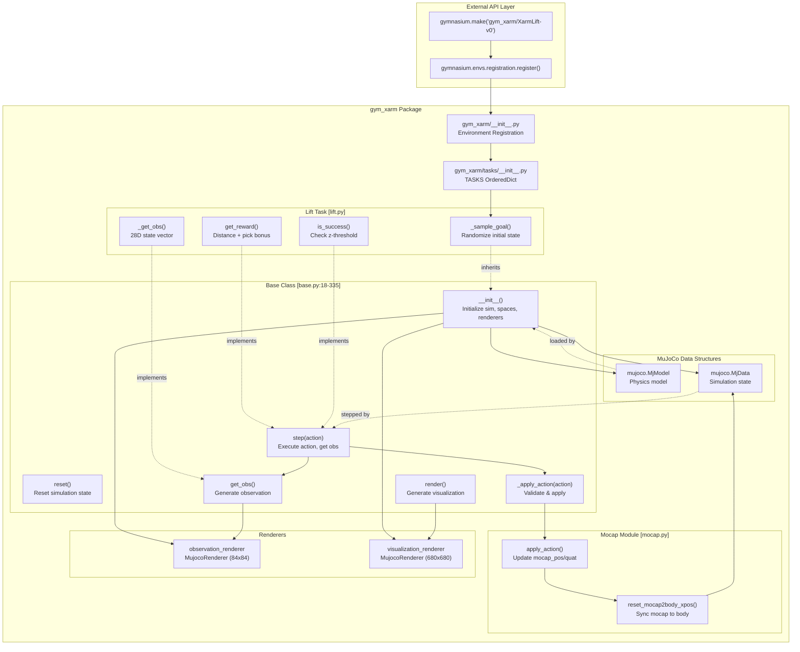

**Diagram: Class and Module Dependencies**

This diagram maps the architectural components to their concrete implementations in code. The `Base` class [gym_xarm/tasks/base.py:18]() inherits from `gym.Env` and implements the Gymnasium interface. The `Lift` task extends `Base` and implements four abstract methods. The `mocap` module [gym_xarm/tasks/mocap.py]() provides utilities for translating high-level actions into MuJoCo physics commands.

**Sources**: [gym_xarm/tasks/base.py:18-335](), [gym_xarm/tasks/mocap.py:1-51](), [gym_xarm/tasks/__init__.py:1-51](), [gym_xarm/__init__.py:1-9]()

---

## Execution Flow During step()

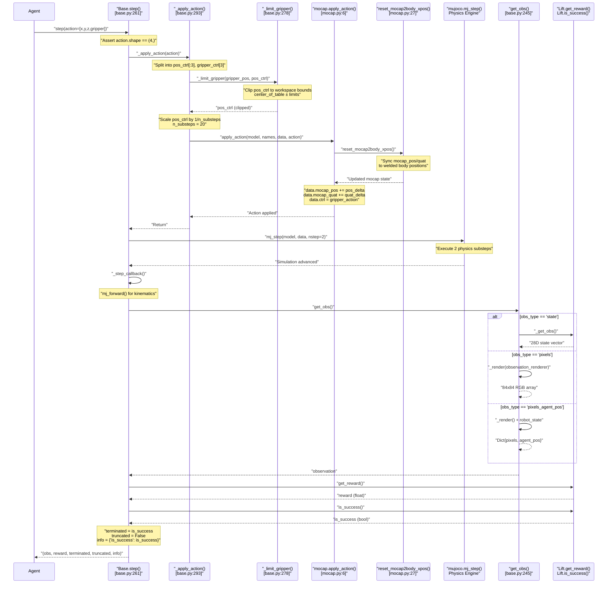

**Diagram: Action Execution Pipeline**

This sequence diagram illustrates the complete data flow during a single `step()` call. The action passes through validation [base.py:262-263](), workspace limiting [base.py:278-291](), scaling [base.py:299](), and mocap translation [mocap.py:6-16]() before reaching the physics engine. The `n_substeps=20` constant [base.py:30]() and `nstep=2` parameter [base.py:265]() mean each Gymnasium step executes 2 physics substeps, while each action is divided into 20 increments. The observation generation branches based on `obs_type` [base.py:246-259](), and task-specific reward/success logic is delegated to the `Lift` subclass.

**Sources**: [gym_xarm/tasks/base.py:261-273](), [gym_xarm/tasks/base.py:293-306](), [gym_xarm/tasks/mocap.py:6-16](), [gym_xarm/tasks/mocap.py:27-51]()

---

## Key Architectural Components

### Registration and Discovery

The environment registration follows a two-tier system:

1. **Task Registry** [gym_xarm/tasks/__init__.py:11-50](): The `TASKS` OrderedDict maps task names to configuration dictionaries containing the environment class, action space specification, episode length, and description.

2. **Gymnasium Registration** [gym_xarm/__init__.py:3-8](): The `gymnasium.register()` call creates the public environment ID `"gym_xarm/XarmLift-v0"` with `max_episode_steps=300` and default `obs_type="state"`.

| Component | File Location | Purpose |
|-----------|---------------|---------|
| `TASKS` | gym_xarm/tasks/__init__.py:11 | Task metadata registry |
| `register()` | gym_xarm/__init__.py:3 | Gymnasium environment ID |
| `Base` | gym_xarm/tasks/base.py:18 | Abstract environment class |
| `Lift` | gym_xarm/tasks/lift.py | Concrete task implementation |

**Sources**: [gym_xarm/tasks/__init__.py:11-50](), [gym_xarm/__init__.py:3-8]()

### Simulation Initialization

The `Base.__init__()` method [base.py:35-83]() orchestrates a multi-stage initialization:

1. **Configuration Storage** [base.py:46-62](): Store observation type, render mode, coordinate system parameters, and renderer dimensions
2. **Asset Loading** [base.py:64-67](): Validate XML file path in `assets/` directory
3. **Simulation Setup** [base.py:70](): Call `_initialize_simulation()` which loads the MuJoCo model and data structures
4. **Renderer Creation** [base.py:71-72](): Initialize both `observation_renderer` (84×84) and `visualization_renderer` (680×680)
5. **Space Definition** [base.py:73-75](): Create `observation_space` and `action_space` based on configuration

The `_initialize_simulation()` method [base.py:84-96]() performs:
- Load MuJoCo model from XML path
- Create MjData structure
- Configure offscreen rendering dimensions
- Call `_env_setup()` for initial configuration
- Store initial state snapshots

**Sources**: [gym_xarm/tasks/base.py:35-96]()

### Dual Renderer Architecture

The system maintains two separate `MujocoRenderer` instances [base.py:71-72]():

```
observation_renderer: 84×84 pixels → used by get_obs() for agent observations
visualization_renderer: 680×680 pixels → used by render() for human visualization
```

This design addresses a Gymnasium limitation where renderer resolution cannot be changed dynamically [base.py:137-144](). The `_initialize_renderer()` method [base.py:133-150]() creates a deep copy of the MuJoCo model for the visualization renderer with different offscreen buffer dimensions.

**Sources**: [gym_xarm/tasks/base.py:71-72](), [gym_xarm/tasks/base.py:133-150]()

### Observation Generation Modes

The `get_obs()` method [base.py:245-259]() supports three observation types:

| Mode | Data Type | Shape | Use Case |
|------|-----------|-------|----------|
| `"state"` | numpy.float64 | (28,) | Model-based RL algorithms |
| `"pixels"` | numpy.uint8 | (84, 84, 3) | Vision-based RL algorithms |
| `"pixels_agent_pos"` | Dict | {"pixels": (84,84,3), "agent_pos": (4,)} | Hybrid approaches |

The state vector includes robot state (end-effector position, gripper angle) and object state (position, rotation, velocities), as defined by the task's `_get_obs()` implementation. The observation space is initialized dynamically [base.py:110-131]() based on the selected mode.

**Sources**: [gym_xarm/tasks/base.py:245-259](), [gym_xarm/tasks/base.py:110-131]()

### Action Processing Pipeline

Actions flow through a four-stage pipeline:

1. **Validation** [base.py:262-263](): Assert action shape is (4,) and within action space bounds
2. **Workspace Limiting** [base.py:278-291](): The `_limit_gripper()` method clips position deltas to prevent the gripper from exceeding workspace boundaries defined relative to `center_of_table`
3. **Temporal Scaling** [base.py:299](): Divide position control by `n_substeps=20` to create smooth motion
4. **Mocap Translation** [base.py:301-306](): Call `mocap.apply_action()` to update mocap body positions and gripper control signals

The action space is defined as `Box(low=-1.0, high=1.0, shape=(4,))` [base.py:74]() where dimensions correspond to the task's action space specification from the registry.

**Sources**: [gym_xarm/tasks/base.py:261-306](), [gym_xarm/tasks/base.py:278-291]()

---

## Mocap Control System

The `mocap` module [gym_xarm/tasks/mocap.py]() implements motion capture-based control, where high-level actions are translated into physics updates through welded constraints.

### Key Functions

**`apply_action(model, model_names, data, action)`** [mocap.py:6-16]()
- Splits action into position/quaternion updates (7 DOF per mocap body) and gripper control signals
- Calls `reset_mocap2body_xpos()` to synchronize mocap with welded body positions
- Updates `data.mocap_pos` and `data.mocap_quat` with deltas
- Sets `data.ctrl` for gripper actuation

**`reset_mocap2body_xpos(model, model_names, data)`** [mocap.py:27-51]()
- Iterates through equality constraints to find weld constraints
- Identifies mocap-to-body pairings (excluding specific bodies: "B0", "B9", "B1")
- Copies body positions/quaternions to mocap positions/quaternions
- Ensures consistency before applying action deltas

**`reset(model, data)`** [mocap.py:19-24]()
- Resets weld constraint data to identity transformation
- Called during environment setup [base.py:105]()

**Sources**: [gym_xarm/tasks/mocap.py:6-51](), [gym_xarm/tasks/base.py:301-306]()

---

## Properties and State Access

The `Base` class exposes physics state through properties that abstract MuJoCo data structures:

| Property | Source | Description |
|----------|--------|-------------|
| `dt` | [base.py:152-155]() | Gymnasium timestep = n_substeps × model.opt.timestep |
| `eef` | [base.py:157-159]() | End-effector position relative to table center |
| `eef_velp` | [base.py:161-163]() | End-effector velocity scaled by dt |
| `gripper_angle` | [base.py:165-167]() | Right outer knuckle joint angle |
| `robot_state` | [base.py:169-171]() | Concatenation of eef and gripper_angle |
| `obj` | [base.py:173-175]() | Object position from "object_site" |
| `obj_rot` | [base.py:177-179]() | Object quaternion rotation |
| `obj_velp` | [base.py:181-183]() | Object linear velocity |
| `obj_velr` | [base.py:185-187]() | Object angular velocity |

These properties use `gymnasium_robotics.utils.mujoco_utils` functions [base.py:7]() to safely extract state from the MuJoCo data structures. All positions are normalized relative to `center_of_table = [1.655, 0.3, 0.63625]` [base.py:50]().

**Sources**: [gym_xarm/tasks/base.py:152-187]()

---

## Template Method Pattern

The `Base` class defines four abstract methods that subclasses must implement:

1. **`_sample_goal()`** [base.py:196-198](): Randomize goal state and initial object positions
2. **`_get_obs()`**: Return task-specific state vector observation
3. **`get_reward()`** [base.py:193-194](): Compute reward based on current state
4. **`is_success()`** [base.py:189-191](): Determine if task goal is achieved

The `Base` class provides all infrastructure (simulation, rendering, action processing) while delegating task-specific decisions to these methods. This enables easy creation of new tasks by inheriting from `Base` and implementing these four methods.

The `Lift` task [gym_xarm/tasks/__init__.py:40-48]() is currently the only active implementation, registered with:
- Action space: `"xyzw"` (3D position + gripper)
- Episode length: 50 steps
- Description: "Lift a cube above a height threshold"

**Sources**: [gym_xarm/tasks/base.py:189-198](), [gym_xarm/tasks/__init__.py:40-48]()

---

## Reset and Episode Management

The `reset()` method [base.py:200-229]() implements a robust reset loop:

1. Call `super().reset(seed=seed)` to initialize Gymnasium's random state
2. Repeatedly attempt `_reset_sim()` until successful
3. Generate initial observation via `get_obs()`
4. Return observation and empty info dict

The `_reset_sim()` method [base.py:231-243]() performs:
- Reset simulation time to `initial_time`
- Copy `initial_qpos` and `initial_qvel` to data structures
- Call `_sample_goal()` for task-specific randomization
- Execute 10 simulation steps to settle the state
- Return True if reset successful

This retry loop [base.py:224-226]() handles cases where randomization produces invalid states (penetration, gimbal lock), continuing to randomize until a valid initial configuration is achieved.

**Sources**: [gym_xarm/tasks/base.py:200-243]()

---

## Rendering System

The rendering system provides two modes configured via `render_mode` [base.py:58]():

- `"rgb_array"`: Returns numpy array, always supported [base.py:11]()
- `"human"`: Creates window viewer, requires `MUJOCO_GL="glfw"` [base.py:12-13]()

The public `render()` method [base.py:315-316]() uses `visualization_renderer`, while the internal `_render()` method [base.py:318-321]() accepts a renderer parameter and calls `_render_callback()` [base.py:323-324]() to ensure kinematics are up-to-date before rendering.

Both renderers target the `"camera0"` viewpoint defined in the MuJoCo XML model [base.py:320]().

The environment's `close()` method [base.py:326-334]() properly cleans up both renderer instances by calling their `close()` methods, terminating any window viewers.

**Sources**: [gym_xarm/tasks/base.py:11-16](), [gym_xarm/tasks/base.py:315-334]()

---

## Summary

The gym-xarm architecture demonstrates a well-factored design where the `Base` class serves as a comprehensive foundation, handling all Gymnasium API compliance, MuJoCo simulation management, observation generation, rendering, and action processing. Task implementations like `Lift` need only focus on defining goals, rewards, and success criteria. The mocap control system provides an intuitive high-level action interface while maintaining physics accuracy. The dual renderer architecture elegantly solves the problem of different resolution requirements for agent observations versus human visualization.

---

# Page: Base Environment Class

# Base Environment Class

<details>
<summary>Relevant source files</summary>

The following files were used as context for generating this wiki page:

- [gym_xarm/tasks/base.py](gym_xarm/tasks/base.py)
- [gym_xarm/tasks/mocap.py](gym_xarm/tasks/mocap.py)

</details>


## Purpose and Scope

The `Base` class ([gym_xarm/tasks/base.py:18-335]()) is the foundational environment class that provides all core Gymnasium environment functionality and MuJoCo simulation integration for gym-xarm. This document covers the Base class's architecture, lifecycle, properties, abstract methods, and internal systems.

For information about specific task implementations that inherit from Base, see [Task System](#3.2). For details on the observation generation system, see [Observation System](#3.4). For the mocap control mechanism used by Base, see [Action Processing and Mocap Control](#3.5).

**Sources:** [gym_xarm/tasks/base.py:18-335]()

---

## Class Responsibilities

The `Base` class serves as the template for all gym-xarm manipulation tasks. It orchestrates five major subsystems:

| Subsystem | Responsibility | Key Methods/Properties |
|-----------|---------------|----------------------|
| **Simulation Management** | Initialize and manage MuJoCo physics simulation | `_initialize_simulation()`, `model`, `data` |
| **Environment Interface** | Implement Gymnasium API contract | `reset()`, `step()`, `render()`, `close()` |
| **Observation Generation** | Produce observations in three modes (state/pixels/hybrid) | `get_obs()`, `_get_obs()`, `observation_space` |
| **Action Processing** | Validate, scale, and apply actions through mocap | `_apply_action()`, `_limit_gripper()`, `action_space` |
| **State Access** | Provide properties for robot and object state | `eef`, `obj`, `gripper_angle`, `robot_state` |

The Base class follows the **Template Method pattern**: it implements the complete environment machinery while delegating task-specific logic to three abstract methods that subclasses must implement: `is_success()`, `get_reward()`, and `_sample_goal()`.

**Sources:** [gym_xarm/tasks/base.py:18-335]()

---

## Class Structure and Inheritance

```mermaid
classDiagram
    class gym_Env {
        <<interface>>
        +reset()
        +step()
        +render()
        +close()
    }
    
    class Base {
        +metadata dict
        +n_substeps int
        +initial_qpos dict
        +model MjModel
        +data MjData
        +observation_space Space
        +action_space Box
        +__init__(task, obs_type, render_mode, ...)
        +reset() tuple
        +step(action) tuple
        +render() ndarray
        +close()
        +get_obs() ndarray|dict
        +eef property
        +obj property
        +gripper_angle property
        +robot_state property
        -_initialize_simulation()
        -_initialize_renderer(type) MujocoRenderer
        -_initialize_observation_space() Space
        -_reset_sim() bool
        -_apply_action(action)
        -_limit_gripper(pos, ctrl)
        -_render(renderer) ndarray
        -_env_setup(initial_qpos)
        -_step_callback()
        -_render_callback()
        #is_success()* bool
        #get_reward()* float
        #_sample_goal()*
        #_get_obs()* ndarray
    }
    
    class Lift {
        +is_success() bool
        +get_reward() float
        +_sample_goal()
        +_get_obs() ndarray
    }
    
    class MujocoRenderer {
        +render(mode, camera) ndarray
        +close()
    }
    
    gym_Env <|-- Base : implements
    Base <|-- Lift : extends
    Base "1" --> "1" MujocoRenderer : observation_renderer
    Base "1" --> "1" MujocoRenderer : visualization_renderer
    Base --> mujoco : uses
    Base --> mocap : uses
```

The `Base` class implements the `gym.Env` interface from Gymnasium while providing infrastructure for MuJoCo-based robotic manipulation. Methods marked with `*` are abstract and must be implemented by task subclasses. The dual renderer architecture supports different resolutions for observations versus visualization.

**Sources:** [gym_xarm/tasks/base.py:18-76](), [gym_xarm/tasks/base.py:189-199]()

---

## Initialization Flow

### Constructor Parameters

The `Base` class constructor ([gym_xarm/tasks/base.py:35-83]()) accepts the following parameters:

| Parameter | Type | Default | Description |
|-----------|------|---------|-------------|
| `task` | `str` | Required | Task name used to locate XML file (`{task}.xml`) |
| `obs_type` | `str` | `"state"` | Observation mode: `"state"`, `"pixels"`, or `"pixels_agent_pos"` |
| `render_mode` | `str` | `"rgb_array"` | Rendering mode: `"rgb_array"` or `"human"` (if `MUJOCO_GL=glfw`) |
| `gripper_rotation` | `list` | `[0, 1, 0, 0]` | Initial gripper rotation as quaternion |
| `observation_width` | `int` | `84` | Width of observation renderer output |
| `observation_height` | `int` | `84` | Height of observation renderer output |
| `visualization_width` | `int` | `680` | Width of visualization renderer output |
| `visualization_height` | `int` | `680` | Height of visualization renderer output |

### Initialization Sequence

```mermaid
sequenceDiagram
    participant User
    participant Base_init as "Base.__init__()"
    participant _initialize_simulation as "_initialize_simulation()"
    participant MuJoCo
    participant _initialize_renderer as "_initialize_renderer()"
    participant _env_setup as "_env_setup()"
    participant Task as "Task._sample_goal()"
    
    User->>Base_init: "gym.make(...)"
    Base_init->>Base_init: "Set coordinate systems"
    Note over Base_init: "center_of_table=[1.655, 0.3, 0.63625]"
    Note over Base_init: "max_z=1.2, min_z=0.2"
    
    Base_init->>Base_init: "Load XML path from task name"
    Base_init->>_initialize_simulation: "Initialize MuJoCo"
    
    _initialize_simulation->>MuJoCo: "MjModel.from_xml_path(xml_path)"
    MuJoCo-->>_initialize_simulation: "model, data"
    _initialize_simulation->>_initialize_simulation: "MujocoModelNames(model)"
    _initialize_simulation->>_initialize_simulation: "Set offwidth/offheight"
    _initialize_simulation->>_env_setup: "_env_setup(initial_qpos)"
    
    _env_setup->>_env_setup: "Apply initial_qpos to joints"
    _env_setup->>mocap: "mocap.reset(model, data)"
    _env_setup->>MuJoCo: "mj_forward()"
    _env_setup->>Task: "_sample_goal()"
    _env_setup->>MuJoCo: "mj_forward()"
    _env_setup-->>_initialize_simulation: "Done"
    
    _initialize_simulation->>_initialize_simulation: "Save initial_time, initial_qpos, initial_qvel"
    _initialize_simulation-->>Base_init: "Done"
    
    Base_init->>_initialize_renderer: "renderer_type='observation'"
    _initialize_renderer-->>Base_init: "observation_renderer"
    
    Base_init->>_initialize_renderer: "renderer_type='visualization'"
    _initialize_renderer-->>Base_init: "visualization_renderer"
    
    Base_init->>Base_init: "_initialize_observation_space()"
    Base_init->>Base_init: "Initialize action_space Box(-1, 1)"
    Base_init->>Base_init: "Validate render_fps matches dt"
    
    Base_init-->>User: "Initialized environment"
```

The initialization establishes three critical coordinate systems: the `center_of_table` origin ([gym_xarm/tasks/base.py:50]()), workspace bounds (`min_z`, `max_z` at [gym_xarm/tasks/base.py:51-52]()), and the `gripper_rotation` quaternion ([gym_xarm/tasks/base.py:49]()). These coordinates are used throughout the environment for state representation and action limiting.

**Sources:** [gym_xarm/tasks/base.py:35-83](), [gym_xarm/tasks/base.py:84-109]()

---

## Environment Lifecycle

### Reset Mechanism

The `reset()` method ([gym_xarm/tasks/base.py:200-229]()) implements a retry loop to handle numerical instabilities:

```mermaid
flowchart TD
    Start["reset(seed, options)"]
    SuperReset["super().reset(seed)"]
    ResetLoop{"did_reset_sim?"}
    CallResetSim["_reset_sim()"]
    GetObs["observation = get_obs()"]
    ReturnObs["return (observation, info)"]
    
    Start --> SuperReset
    SuperReset --> ResetLoop
    ResetLoop -->|"False"| CallResetSim
    CallResetSim --> ResetLoop
    ResetLoop -->|"True"| GetObs
    GetObs --> ReturnObs
```

The `_reset_sim()` method ([gym_xarm/tasks/base.py:231-243]()) performs the actual reset:

1. Restore `data.time` to `initial_time`
2. Copy `initial_qpos` and `initial_qvel` to `data.qpos` and `data.qvel`
3. Call task-specific `_sample_goal()` to randomize initial conditions
4. Execute 10 simulation steps (`mj_step(nstep=10)`) to settle physics
5. Return `True` to indicate successful reset

**Sources:** [gym_xarm/tasks/base.py:200-243]()

### Step Execution

The `step()` method ([gym_xarm/tasks/base.py:261-273]()) implements the standard Gymnasium step interface:

```mermaid
sequenceDiagram
    participant Agent
    participant step as "step(action)"
    participant _apply_action
    participant mocap
    participant MuJoCo
    participant get_obs
    participant Task
    
    Agent->>step: "action[4]"
    step->>step: "assert action.shape == (4,)"
    step->>step: "assert action_space.contains(action)"
    
    step->>_apply_action: "_apply_action(action)"
    _apply_action->>_apply_action: "pos_ctrl = action[:3]"
    _apply_action->>_apply_action: "gripper_ctrl = action[3]"
    _apply_action->>_apply_action: "_limit_gripper(pos, pos_ctrl)"
    _apply_action->>mocap: "apply_action(...)"
    mocap->>mocap: "reset_mocap2body_xpos()"
    mocap->>MuJoCo: "Update mocap_pos/mocap_quat"
    mocap->>MuJoCo: "Update data.ctrl"
    
    step->>MuJoCo: "mj_step(nstep=2)"
    step->>step: "_step_callback()"
    step->>get_obs: "get_obs()"
    get_obs-->>step: "observation"
    step->>Task: "get_reward()"
    Task-->>step: "reward"
    step->>Task: "is_success()"
    Task-->>step: "terminated"
    
    step-->>Agent: "(obs, reward, terminated, truncated, info)"
```

**Key Implementation Details:**

- Actions are always 4-dimensional vectors in range `[-1.0, 1.0]` ([gym_xarm/tasks/base.py:262-263]())
- Each step performs 2 MuJoCo substeps ([gym_xarm/tasks/base.py:265]()), which combined with `n_substeps=20` gives 40 total physics steps per Gymnasium step
- `terminated` is set to the result of `is_success()` ([gym_xarm/tasks/base.py:269]())
- `truncated` is always `False` - episode length is managed by Gymnasium's `TimeLimit` wrapper
- The `info` dictionary contains `"is_success"` for logging ([gym_xarm/tasks/base.py:271]())

**Sources:** [gym_xarm/tasks/base.py:261-273]()

---

## State Properties

The Base class provides properties that access various aspects of the simulation state. All positions are expressed relative to `center_of_table` for numerical stability.

### Robot State Properties

| Property | Return Type | Description | Implementation |
|----------|------------|-------------|----------------|
| `eef` | `ndarray[3]` | End-effector position relative to table center | [gym_xarm/tasks/base.py:158-159]() |
| `eef_velp` | `ndarray[3]` | End-effector linear velocity scaled by `dt` | [gym_xarm/tasks/base.py:162-163]() |
| `gripper_angle` | `float` | Right outer knuckle joint angle | [gym_xarm/tasks/base.py:166-167]() |
| `robot_state` | `ndarray[4]` | Concatenation of `eef` (3D) and `gripper_angle` (1D) | [gym_xarm/tasks/base.py:170-171]() |

### Object State Properties

| Property | Return Type | Description | Implementation |
|----------|------------|-------------|----------------|
| `obj` | `ndarray[3]` | Object position relative to table center | [gym_xarm/tasks/base.py:174-175]() |
| `obj_rot` | `ndarray[4]` | Object rotation as quaternion | [gym_xarm/tasks/base.py:178-179]() |
| `obj_velp` | `ndarray[3]` | Object linear velocity scaled by `dt` | [gym_xarm/tasks/base.py:182-183]() |
| `obj_velr` | `ndarray[3]` | Object angular velocity scaled by `dt` | [gym_xarm/tasks/base.py:186-187]() |

### Property Data Flow

```mermaid
graph TB
    MuJoCo_data["mujoco.MjData"]
    MuJoCo_model["mujoco.MjModel"]
    utils["mujoco_utils"]
    
    subgraph "State Extraction"
        get_site_xpos["get_site_xpos(model, data, site_name)"]
        get_site_xvelp["get_site_xvelp(model, data, site_name)"]
        get_site_xvelr["get_site_xvelr(model, data, site_name)"]
        get_joint_qpos["get_joint_qpos(model, data, joint_name)"]
    end
    
    subgraph "Properties"
        eef["eef: grasp site position - center_of_table"]
        eef_velp["eef_velp: grasp site velocity * dt"]
        obj["obj: object_site position - center_of_table"]
        obj_rot["obj_rot: object_joint0 quaternion"]
        obj_velp["obj_velp: object_site velocity * dt"]
        obj_velr["obj_velr: object_site angular_velocity * dt"]
        gripper_angle["gripper_angle: right_outer_knuckle_joint"]
        robot_state["robot_state: [eef, gripper_angle]"]
    end
    
    MuJoCo_data --> utils
    MuJoCo_model --> utils
    utils --> get_site_xpos
    utils --> get_site_xvelp
    utils --> get_site_xvelr
    utils --> get_joint_qpos
    
    get_site_xpos -->|"'grasp'"| eef
    get_site_xvelp -->|"'grasp'"| eef_velp
    get_site_xpos -->|"'object_site'"| obj
    get_joint_qpos -->|"'object_joint0'"| obj_rot
    get_site_xvelp -->|"'object_site'"| obj_velp
    get_site_xvelr -->|"'object_site'"| obj_velr
    get_joint_qpos -->|"'right_outer_knuckle_joint'"| gripper_angle
    
    eef --> robot_state
    gripper_angle --> robot_state
```

All properties access the current simulation state through `mujoco_utils` helper functions, which internally query `self.model` and `self.data`. The velocities are scaled by `dt` ([gym_xarm/tasks/base.py:153-155]()) to represent per-step displacement rather than per-second velocity.

**Sources:** [gym_xarm/tasks/base.py:152-187]()

---

## Abstract Methods Contract

Subclasses must implement four abstract methods to define task-specific behavior:

### Required Implementations

```mermaid
classDiagram
    class Base {
        <<abstract>>
        +is_success() bool
        +get_reward() float
        +_sample_goal() void
        +_get_obs() ndarray
    }
    
    class Lift {
        +is_success() bool
        +get_reward() float
        +_sample_goal() void
        +_get_obs() ndarray
    }
    
    Base <|-- Lift
    
    note for Base "Abstract methods that\ndefine task behavior"
    note for Lift "Concrete implementation\nfor lifting task"
```

#### `is_success()` → `bool`

**Location:** [gym_xarm/tasks/base.py:189-191]()

**Purpose:** Determines whether the task objective has been achieved.

**Contract:**
- Must return `True` if the task goal is satisfied, `False` otherwise
- Called during `step()` to set the `terminated` flag
- Result is also stored in `info["is_success"]` for logging

#### `get_reward()` → `float`

**Location:** [gym_xarm/tasks/base.py:193-194]()

**Purpose:** Computes the reward for the current state.

**Contract:**
- Must return a scalar reward value
- Called during every `step()` execution
- Can use any state properties provided by Base (e.g., `self.eef`, `self.obj`)
- May implement sparse or dense reward shaping

#### `_sample_goal()` → `None`

**Location:** [gym_xarm/tasks/base.py:196-198]()

**Purpose:** Randomizes initial conditions for the environment.

**Contract:**
- Called during `_env_setup()` and `_reset_sim()`
- Must modify `self.data` to set initial object positions, goal positions, etc.
- Should set any goal-related state that the task tracks
- No return value required

#### `_get_obs()` → `ndarray`

**Purpose:** Generates the state-based observation vector.

**Contract:**
- Called by `get_obs()` when `obs_type="state"`
- Must return a 1D numpy array containing task-relevant state information
- The returned shape defines the `observation_space` shape
- Typically concatenates robot state, object state, and goal information

**Sources:** [gym_xarm/tasks/base.py:189-198]()

---

## Observation System Integration

The `get_obs()` method ([gym_xarm/tasks/base.py:245-259]()) routes to different observation generators based on `obs_type`:

```mermaid
flowchart TD
    GetObs["get_obs()"]
    CheckType{"obs_type?"}
    GetState["_get_obs()"]
    Render["_render(observation_renderer)"]
    ReturnState["return state vector"]
    ReturnPixels["return pixels"]
    ReturnHybrid["return {pixels, agent_pos}"]
    
    GetObs --> CheckType
    CheckType -->|"'state'"| GetState
    CheckType -->|"'pixels'"| Render
    CheckType -->|"'pixels_agent_pos'"| Render
    
    GetState --> ReturnState
    Render --> ReturnPixels
    Render --> ReturnHybrid
    
    ReturnHybrid -.->|"agent_pos"| robot_state["self.robot_state"]
```

### Observation Space Initialization

The `_initialize_observation_space()` method ([gym_xarm/tasks/base.py:110-131]()) calls `get_obs()` once to determine the observation shape, then creates the appropriate `gym.spaces.Space`:

| `obs_type` | Observation Space | Description |
|------------|------------------|-------------|
| `"state"` | `Box(-1000, 1000, shape=obs.shape, dtype=float64)` | Task-specific state vector from `_get_obs()` |
| `"pixels"` | `Box(0, 255, shape=(H, W, 3), dtype=uint8)` | RGB image from observation renderer |
| `"pixels_agent_pos"` | `Dict{"pixels": Box(...), "agent_pos": Box(...)}` | Hybrid observation with image and robot state |

For `"pixels_agent_pos"`, the `"agent_pos"` key contains `self.robot_state` (4D: eef position + gripper angle).

**Sources:** [gym_xarm/tasks/base.py:110-131](), [gym_xarm/tasks/base.py:245-259]()

---

## Rendering Architecture

### Dual Renderer System

The Base class maintains two separate `MujocoRenderer` instances ([gym_xarm/tasks/base.py:71-72]()):

1. **`observation_renderer`**: Renders at `(observation_width, observation_height)` for agent observations
2. **`visualization_renderer`**: Renders at `(visualization_width, visualization_height)` for human viewing

```mermaid
graph TB
    Base["Base Class"]
    
    subgraph "Renderer Initialization"
        InitObs["_initialize_renderer('observation')"]
        InitViz["_initialize_renderer('visualization')"]
    end
    
    subgraph "Observation Renderer"
        ObsModel["model (84x84)"]
        ObsRenderer["MujocoRenderer"]
        ObsData["shared data"]
    end
    
    subgraph "Visualization Renderer"
        VizModel["model copy (680x680)"]
        VizRenderer["MujocoRenderer"]
        VizData["shared data"]
    end
    
    Base --> InitObs
    Base --> InitViz
    
    InitObs --> ObsModel
    ObsModel --> ObsRenderer
    ObsData --> ObsRenderer
    
    InitViz --> VizModel
    VizModel --> VizRenderer
    VizData --> VizRenderer
    
    ObsRenderer -->|"Used by"| get_obs["get_obs() for pixels"]
    VizRenderer -->|"Used by"| render["render() for display"]
```

**Rationale:** Gymnasium's rendering API does not support dynamic resolution changes. By maintaining two renderers with different model copies (where only `vis.global_.offwidth` and `vis.global_.offheight` differ), the Base class can generate low-resolution observations for training while providing high-resolution visualization for human viewing.

**Implementation:** [gym_xarm/tasks/base.py:133-150]()

### Rendering Methods

| Method | Renderer Used | Purpose | Implementation |
|--------|--------------|---------|----------------|
| `render()` | `visualization_renderer` | Public API for visualization | [gym_xarm/tasks/base.py:315-316]() |
| `_render(renderer)` | Parameter-specified | Internal rendering with callback | [gym_xarm/tasks/base.py:318-321]() |

Both methods call `_render_callback()` ([gym_xarm/tasks/base.py:323-324]()) before rendering, which executes `mj_forward()` to ensure the visualization reflects the current state.

**Sources:** [gym_xarm/tasks/base.py:133-150](), [gym_xarm/tasks/base.py:315-324]()

---

## Action Processing Pipeline

### Action Space Definition

The action space is a 4-dimensional continuous space: `Box(low=-1.0, high=1.0, shape=(4,))` ([gym_xarm/tasks/base.py:74]()).

**Action Components:**
- `action[0:3]`: Position control in x, y, z (relative to current end-effector position)
- `action[3]`: Gripper control (positive = close, negative = open)

The actual action space dimension is determined by `metadata["action_space"]` from the task configuration, but padding is applied ([gym_xarm/tasks/base.py:75-76]()) to always produce 4-dimensional actions.

### Action Processing Flow

```mermaid
sequenceDiagram
    participant Agent
    participant _apply_action
    participant _limit_gripper
    participant mocap_apply_action as "mocap.apply_action()"
    participant mocap_reset as "mocap.reset_mocap2body_xpos()"
    participant MuJoCo_data as "data.mocap_pos/mocap_quat/ctrl"
    
    Agent->>_apply_action: "action[4] ∈ [-1, 1]"
    _apply_action->>_apply_action: "pos_ctrl = action[:3]"
    _apply_action->>_apply_action: "gripper_ctrl = action[3]"
    
    _apply_action->>_limit_gripper: "_limit_gripper(grasp_pos, pos_ctrl)"
    Note over _limit_gripper: "Clip pos_ctrl to keep gripper\nwithin workspace bounds"
    _limit_gripper-->>_apply_action: "limited pos_ctrl"
    
    _apply_action->>_apply_action: "pos_ctrl *= (1 / n_substeps)"
    Note over _apply_action: "Scale by 1/20 to convert\nto per-substep displacement"
    
    _apply_action->>_apply_action: "gripper_ctrl = [gripper_ctrl, gripper_ctrl]"
    _apply_action->>_apply_action: "action = [pos_ctrl, gripper_rotation, gripper_ctrl]"
    
    _apply_action->>mocap_apply_action: "apply_action(model, names, data, action)"
    mocap_apply_action->>mocap_reset: "reset_mocap2body_xpos()"
    Note over mocap_reset: "Sync mocap bodies with welded bodies"
    mocap_apply_action->>MuJoCo_data: "data.mocap_pos += pos_delta"
    mocap_apply_action->>MuJoCo_data: "data.mocap_quat += quat_delta"
    mocap_apply_action->>MuJoCo_data: "data.ctrl[i] = gripper_ctrl[i]"
```

### Workspace Limits

The `_limit_gripper()` method ([gym_xarm/tasks/base.py:278-291]()) enforces workspace boundaries by clipping position control:

| Axis | Minimum | Maximum | Description |
|------|---------|---------|-------------|
| X | `center_of_table[0] - 0.105 - 0.3` | `center_of_table[0] - 0.105 + 0.15` | Forward/backward range |
| Y | `center_of_table[1] - 0.3` | `center_of_table[1] + 0.3` | Left/right range |
| Z | `self.min_z` (0.2) | `self.max_z` (1.2) | Vertical range |

When the gripper is at a boundary, the corresponding component of `pos_ctrl` is clipped to prevent further movement in that direction.

### Action Scaling

Position controls are scaled by `1 / n_substeps` ([gym_xarm/tasks/base.py:299]()), converting the action range from `[-1, 1]` per Gymnasium step to `[-0.05, 0.05]` per physics substep. This scaling ensures smooth motion over the 20 substeps executed per Gymnasium step.

**Sources:** [gym_xarm/tasks/base.py:278-307](), [gym_xarm/tasks/mocap.py:6-16]()

---

## Coordinate Systems and Reference Frames

### Primary Coordinate System

All positions in the Base class are expressed relative to `center_of_table` ([gym_xarm/tasks/base.py:50]()):

```python
center_of_table = [1.655, 0.3, 0.63625]  # meters in world frame
```

**Properties using relative coordinates:**
- `eef`: End-effector position = `get_site_xpos("grasp") - center_of_table`
- `obj`: Object position = `get_site_xpos("object_site") - center_of_table`
- `robot_state`: Concatenates relative `eef` with `gripper_angle`

**Rationale:** Using table-relative coordinates keeps values near zero, improving numerical stability and making it easier for agents to learn spatial relationships.

### Quaternion Convention

Gripper rotation is represented as a quaternion `[x, y, z, w]` ([gym_xarm/tasks/base.py:48-49]()):
- Default: `[0, 1, 0, 0]` (pointing downward)
- Applied to mocap control during action processing ([gym_xarm/tasks/base.py:305]())

### Workspace Bounds Summary

| Parameter | Value | Location |
|-----------|-------|----------|
| `center_of_table` | `[1.655, 0.3, 0.63625]` | [gym_xarm/tasks/base.py:50]() |
| `max_z` | `1.2` | [gym_xarm/tasks/base.py:51]() |
| `min_z` | `0.2` | [gym_xarm/tasks/base.py:52]() |
| X range | `[center[0] - 0.405, center[0] + 0.045]` | [gym_xarm/tasks/base.py:279-282]() |
| Y range | `[center[1] - 0.3, center[1] + 0.3]` | [gym_xarm/tasks/base.py:283-286]() |

**Sources:** [gym_xarm/tasks/base.py:46-52](), [gym_xarm/tasks/base.py:278-291]()

---

## Cleanup and Resource Management

The `close()` method ([gym_xarm/tasks/base.py:326-334]()) properly releases rendering resources:

```python
def close(self):
    if self.observation_renderer is not None:
        self.observation_renderer.close()
    if self.visualization_renderer is not None:
        self.visualization_renderer.close()
```

This terminates any `WindowViewer` instances created by the `MujocoRenderer` for `"human"` render mode, preventing resource leaks when environments are destroyed.

**Sources:** [gym_xarm/tasks/base.py:326-334]()

---

## Configuration Metadata

The Base class defines class-level metadata ([gym_xarm/tasks/base.py:26-33]()):

```python
metadata = {
    "render_modes": RENDER_MODES,  # ["rgb_array"] or ["rgb_array", "human"]
    "render_fps": 25,
}
n_substeps = 20
initial_qpos = {}
```

### Timestep Calculation

The environment timestep `dt` is computed as ([gym_xarm/tasks/base.py:153-155]()):

```
dt = n_substeps * model.opt.timestep = 20 * 0.002 = 0.04 seconds
```

This gives a control frequency of 25 Hz, which must match `metadata["render_fps"]` (validated at [gym_xarm/tasks/base.py:77-79]()).

### Render Modes

Available render modes depend on the `MUJOCO_GL` environment variable ([gym_xarm/tasks/base.py:11-15]()):
- If `MUJOCO_GL=glfw`: Both `"rgb_array"` and `"human"` modes available
- Otherwise: Only `"rgb_array"` mode available (defaults to `MUJOCO_GL=egl`)

**Sources:** [gym_xarm/tasks/base.py:11-33](), [gym_xarm/tasks/base.py:153-155]()

---

# Page: Task System

# Task System

<details>
<summary>Relevant source files</summary>

The following files were used as context for generating this wiki page:

- [gym_xarm/__init__.py](gym_xarm/__init__.py)
- [gym_xarm/tasks/__init__.py](gym_xarm/tasks/__init__.py)
- [gym_xarm/tasks/base.py](gym_xarm/tasks/base.py)
- [gym_xarm/tasks/mocap.py](gym_xarm/tasks/mocap.py)

</details>


## Purpose and Scope

This document describes the task abstraction and registration system in gym-xarm. The task system defines how manipulation tasks are structured, configured, and registered with the Gymnasium framework. It explains the template method pattern used to separate environment mechanics from task-specific logic, the task registry that stores task metadata, and how tasks integrate with Gymnasium's environment registration.

For details on the Base environment class implementation, see [Base Environment Class](#3.1). For a step-by-step guide on creating custom tasks, see [Creating Custom Tasks](#5.5). For documentation of the active Lift task, see [Lift Task](#4.1).

---

## Task Abstraction and Template Method Pattern

The task system uses the **template method pattern** to separate generic environment mechanics from task-specific behavior. The `Base` class [gym_xarm/tasks/base.py:18-335]() implements all Gymnasium environment infrastructure while delegating task-specific logic to abstract methods that subclasses must implement.

### Abstract Methods Required by Tasks

Each task subclass must implement four abstract methods:

| Method | Purpose | Return Type | Line Reference |
|--------|---------|-------------|----------------|
| `is_success()` | Determines if the task goal has been achieved | `bool` | [gym_xarm/tasks/base.py:189-191]() |
| `get_reward()` | Computes the reward for the current state | `float` | [gym_xarm/tasks/base.py:193-194]() |
| `_sample_goal()` | Samples initial object/goal positions | `None` | [gym_xarm/tasks/base.py:196-198]() |
| `_get_obs()` | Generates task-specific state observations | `np.ndarray` | [gym_xarm/tasks/base.py:247]() |

### Separation of Concerns

```mermaid
graph TB
    subgraph "Base Class (Template)"
        Init["__init__()<br/>Initialization"]
        Reset["reset()<br/>Episode Reset"]
        Step["step(action)<br/>Environment Step"]
        GetObs["get_obs()<br/>Observation Router"]
        ApplyAction["_apply_action(action)<br/>Action Processing"]
        Render["render()<br/>Rendering"]
    end
    
    subgraph "Task Subclass (Implementation)"
        SampleGoal["_sample_goal()<br/>ABSTRACT"]
        GetObsImpl["_get_obs()<br/>ABSTRACT"]
        GetReward["get_reward()<br/>ABSTRACT"]
        IsSuccess["is_success()<br/>ABSTRACT"]
    end
    
    Init -->|"calls"| SampleGoal
    Reset -->|"calls"| SampleGoal
    Step -->|"calls"| GetObs
    GetObs -->|"delegates to"| GetObsImpl
    Step -->|"calls"| GetReward
    Step -->|"calls"| IsSuccess
    Step -->|"calls"| ApplyAction
    
    style Init fill:#f9f9f9
    style Reset fill:#f9f9f9
    style Step fill:#f9f9f9
    style GetObs fill:#f9f9f9
    style ApplyAction fill:#f9f9f9
    style Render fill:#f9f9f9
    style SampleGoal fill:#e8e8e8
    style GetObsImpl fill:#e8e8e8
    style GetReward fill:#e8e8e8
    style IsSuccess fill:#e8e8e8
```

**Sources:** [gym_xarm/tasks/base.py:18-335]()

---

## Task Registry Structure

The task registry is defined as an `OrderedDict` named `TASKS` in [gym_xarm/tasks/__init__.py:11-50](). It maps task names to their configuration dictionaries.

### Registry Schema

Each task entry in the `TASKS` dictionary has the following structure:

```python
{
    "env": TaskClass,              # The task implementation class
    "action_space": str,           # Action dimensions ("xyz" or "xyzw")
    "episode_length": int,         # Maximum episode steps
    "description": str             # Human-readable description
}
```

### Current Registry Contents

```mermaid
graph LR
    subgraph "TASKS OrderedDict"
        Registry["TASKS<br/>(OrderedDict)"]
    end
    
    subgraph "Active Task"
        Lift["'lift'<br/>Key"]
        LiftConfig["env: Lift<br/>action_space: 'xyzw'<br/>episode_length: 50<br/>description: 'Lift a cube...'"]
    end
    
    subgraph "Deprecated Tasks (Commented Out)"
        Reach["'reach'<br/>COMMENTED"]
        Push["'push'<br/>COMMENTED"]
        PegInBox["'peg_in_box'<br/>COMMENTED"]
    end
    
    Registry -->|"contains"| Lift
    Lift --> LiftConfig
    Registry -.->|"historically had"| Reach
    Registry -.->|"historically had"| Push
    Registry -.->|"historically had"| PegInBox
    
    style Registry fill:#f9f9f9
    style LiftConfig fill:#e8e8e8
    style Reach fill:#d0d0d0
    style Push fill:#d0d0d0
    style PegInBox fill:#d0d0d0
```

**Active Task Configuration:**

| Field | Value | Purpose |
|-------|-------|---------|
| `env` | `Lift` | Class implementing lift task |
| `action_space` | `"xyzw"` | 4D actions: x, y, z position deltas + gripper control |
| `episode_length` | `50` | Maximum steps per episode |
| `description` | `"Lift a cube above a height threshold"` | Task description |

**Sources:** [gym_xarm/tasks/__init__.py:11-50]()

---

## Environment Registration

Tasks are registered with Gymnasium using the standard `gymnasium.register()` API. The registration connects task configurations to Gymnasium's environment creation system.

### Registration Flow

```mermaid
sequenceDiagram
    participant Import as "import gym_xarm"
    participant Init as "__init__.py"
    participant GymReg as "gymnasium.register()"
    participant TASKS as "TASKS Registry"
    participant GymMake as "gym.make()"
    participant TaskClass as "Lift Class"
    
    Import->>Init: "Import package"
    Init->>GymReg: "register(id='gym_xarm/XarmLift-v0',...)"
    Note over GymReg: "Stores registration in<br/>Gymnasium's env registry"
    
    GymMake->>GymReg: "gym.make('gym_xarm/XarmLift-v0')"
    GymReg->>TASKS: "Look up task metadata"
    TASKS-->>GymReg: "Return 'lift' config"
    GymReg->>TaskClass: "Instantiate Lift(**kwargs)"
    TaskClass-->>GymMake: "Return environment instance"
```

**Sources:** [gym_xarm/__init__.py:1-8](), [gym_xarm/tasks/__init__.py:11-50]()

### Registration Parameters

The registration in [gym_xarm/__init__.py:3-8]() specifies:

```python
register(
    id="gym_xarm/XarmLift-v0",           # Gymnasium environment ID
    entry_point="gym_xarm.tasks:Lift",   # Direct reference to Lift class
    max_episode_steps=300,                # Global step limit (6x task episode_length)
    kwargs={"obs_type": "state"}          # Default observation type
)
```

**Key Points:**
- `entry_point` references the `Lift` class directly, not via the `TASKS` registry
- `max_episode_steps=300` overrides task's `episode_length=50` with a higher limit
- Default `obs_type="state"` can be overridden when calling `gym.make()`

**Sources:** [gym_xarm/__init__.py:3-8]()

---

## Task Configuration System

### Task Metadata Structure

The `TASKS` registry stores task metadata that influences environment behavior, although the current implementation only uses it for documentation purposes. The metadata stored in [gym_xarm/tasks/__init__.py:40-48]() includes:

| Field | Type | Usage | Example |
|-------|------|-------|---------|
| `"env"` | `class` | Task implementation class | `Lift` |
| `"action_space"` | `str` | Action dimensions identifier | `"xyzw"` (4D actions) |
| `"episode_length"` | `int` | Suggested episode length | `50` |
| `"description"` | `str` | Human-readable task description | `"Lift a cube above..."` |

### Action Space Configuration

The `"action_space"` field specifies which action dimensions the task uses:

- `"xyz"`: 3D position control (deprecated tasks)
- `"xyzw"`: 3D position + 1D gripper control (active lift task)

The Base class reads this from task metadata via `self.metadata["action_space"]` [gym_xarm/tasks/base.py:74]() to:
1. Set the `action_space` bounds [gym_xarm/tasks/base.py:74]()
2. Calculate action padding for unused dimensions [gym_xarm/tasks/base.py:75-82]()

```mermaid
graph TB
    subgraph "Task Metadata"
        TaskMeta["metadata['action_space']<br/>'xyzw' for Lift"]
    end
    
    subgraph "Action Space Construction"
        GetLen["len(metadata['action_space'])<br/>= 4 for 'xyzw'"]
        CreateSpace["gym.spaces.Box<br/>low=-1.0, high=1.0<br/>shape=(4,)"]
        CalcPadding["action_padding<br/>np.zeros(4 - len)"]
    end
    
    subgraph "Action Processing"
        StepReceives["step(action)<br/>expects shape (4,)"]
        ApplyAction["_apply_action(action)<br/>splits to pos_ctrl, gripper_ctrl"]
    end
    
    TaskMeta --> GetLen
    GetLen --> CreateSpace
    GetLen --> CalcPadding
    CreateSpace --> StepReceives
    StepReceives --> ApplyAction
    
    style TaskMeta fill:#f9f9f9
    style CreateSpace fill:#e8e8e8
    style ApplyAction fill:#e8e8e8
```

**Sources:** [gym_xarm/tasks/base.py:74-82](), [gym_xarm/tasks/__init__.py:40-48]()

---

## Task Lifecycle and Instantiation

### Initialization Sequence

```mermaid
sequenceDiagram
    participant User as "User Code"
    participant GymMake as "gym.make()"
    participant LiftInit as "Lift.__init__()"
    participant BaseInit as "Base.__init__()"
    participant InitSim as "_initialize_simulation()"
    participant EnvSetup as "_env_setup()"
    participant SampleGoal as "_sample_goal()<br/>(task-specific)"
    
    User->>GymMake: "gym.make('gym_xarm/XarmLift-v0', obs_type='pixels')"
    GymMake->>LiftInit: "Lift(task='lift', obs_type='pixels', ...)"
    LiftInit->>BaseInit: "super().__init__(task, obs_type, ...)"
    
    BaseInit->>BaseInit: "Set gripper_rotation, center_of_table"
    BaseInit->>BaseInit: "Set obs_type, render_mode"
    BaseInit->>BaseInit: "Load XML path from task name"
    
    BaseInit->>InitSim: "_initialize_simulation()"
    InitSim->>InitSim: "Load MuJoCo model from XML"
    InitSim->>InitSim: "Create mjData"
    InitSim->>EnvSetup: "_env_setup(initial_qpos)"
    EnvSetup->>EnvSetup: "Set joint positions"
    EnvSetup->>EnvSetup: "mocap.reset()"
    EnvSetup->>SampleGoal: "_sample_goal()"
    SampleGoal-->>EnvSetup: "Set object/goal positions"
    EnvSetup->>EnvSetup: "mujoco.mj_forward()"
    
    BaseInit->>BaseInit: "Initialize renderers"
    BaseInit->>BaseInit: "Initialize observation_space"
    BaseInit->>BaseInit: "Initialize action_space"
    BaseInit-->>User: "Return configured environment"
```

**Sources:** [gym_xarm/tasks/base.py:35-83](), [gym_xarm/tasks/base.py:84-109]()

### Task Method Invocation During Episode

The Base class orchestrates task method calls during environment operation:

| Environment Method | Task Method Called | When Called | Purpose |
|-------------------|-------------------|-------------|---------|
| `__init__()` | `_sample_goal()` | During initialization | Set initial scene configuration |
| `reset()` | `_sample_goal()` | Every episode reset | Randomize object/goal positions |
| `get_obs()` | `_get_obs()` | Every step (if `obs_type="state"`) | Generate state observations |
| `step()` | `get_reward()` | Every step | Compute step reward |
| `step()` | `is_success()` | Every step | Check task completion |

**Sources:** [gym_xarm/tasks/base.py:107](), [gym_xarm/tasks/base.py:241](), [gym_xarm/tasks/base.py:247](), [gym_xarm/tasks/base.py:268-269]()

---

## Task Assets and XML Models

Each task requires a corresponding MuJoCo XML file that defines the simulation environment. The Base class constructs the XML path using the task name:

```python
# From Base.__init__()
self.xml_path = os.path.join(os.path.dirname(__file__), "assets", f"{task}.xml")
```

For the active "lift" task, this resolves to `gym_xarm/tasks/assets/lift.xml`. The XML file must exist or an `OSError` is raised [gym_xarm/tasks/base.py:65-67]().

**Sources:** [gym_xarm/tasks/base.py:65-67]()

---

## Extending the Task System

The task system is designed to be extensible. To add a new task:

1. **Create a task class** inheriting from `Base`
2. **Implement the four abstract methods** (`is_success`, `get_reward`, `_sample_goal`, `_get_obs`)
3. **Create an XML model** in `gym_xarm/tasks/assets/` named `{task_name}.xml`
4. **Add to TASKS registry** in [gym_xarm/tasks/__init__.py]()
5. **Register with Gymnasium** in [gym_xarm/__init__.py]()

For detailed instructions, see [Creating Custom Tasks](#5.5).

**Sources:** [gym_xarm/tasks/__init__.py:1-50](), [gym_xarm/__init__.py:1-8](), [gym_xarm/tasks/base.py:18-335]()

---

# Page: MuJoCo Integration

# MuJoCo Integration

<details>
<summary>Relevant source files</summary>

The following files were used as context for generating this wiki page:

- [gym_xarm/tasks/base.py](gym_xarm/tasks/base.py)
- [gym_xarm/tasks/mocap.py](gym_xarm/tasks/mocap.py)

</details>


## Purpose and Scope

This document explains how gym-xarm integrates with the MuJoCo physics engine to perform robotic manipulation simulation. It covers the MuJoCo data structures (`mjModel`, `mjData`), XML model loading, simulation stepping architecture, and the mocap (motion capture) control system that translates high-level actions into physics commands.

For action processing and validation logic, see [Action Processing and Mocap Control](#3.5). For observation generation and rendering, see [Observation System](#3.4). For XML model structure and assets, see [MuJoCo XML Models](#7.1).

---

## MuJoCo Data Structures

The Base class maintains two primary MuJoCo data structures that form the foundation of the physics simulation:

| Data Structure | Type | Purpose | Initialization |
|---------------|------|---------|----------------|
| `self.model` | `mujoco.MjModel` | Contains static model definition (geometry, masses, constraints) | [gym_xarm/tasks/base.py:86]() |
| `self.data` | `mujoco.MjData` | Contains dynamic simulation state (positions, velocities, forces) | [gym_xarm/tasks/base.py:87]() |
| `self._model_names` | `MujocoModelNames` | Name-to-ID lookup utility from gymnasium-robotics | [gym_xarm/tasks/base.py:88]() |

The `mjModel` is immutable after loading and defines the robot structure, while `mjData` is modified at each simulation step and contains the evolving state of the environment.

**MuJoCo Integration Architecture**

```mermaid
graph TB
    subgraph "Base Class [gym_xarm/tasks/base.py]"
        Model["self.model<br/>(mujoco.MjModel)<br/>Static model definition"]
        Data["self.data<br/>(mujoco.MjData)<br/>Dynamic simulation state"]
        ModelNames["self._model_names<br/>(MujocoModelNames)<br/>Name lookup utility"]
        MujocoRef["self._mujoco<br/>(module reference)<br/>Line 32"]
        UtilsRef["self._utils<br/>(mujoco_utils)<br/>Line 33"]
    end
    
    subgraph "MuJoCo Engine"
        MjStep["mujoco.mj_step()<br/>Advance physics"]
        MjForward["mujoco.mj_forward()<br/>Recompute kinematics"]
    end
    
    subgraph "Assets"
        XML["XML Model Files<br/>lift.xml, xarm.xml"]
    end
    
    subgraph "Mocap System [gym_xarm/tasks/mocap.py]"
        ApplyAction["apply_action()<br/>Lines 6-16"]
        ResetMocap["reset()<br/>Lines 19-24"]
        ResetMocap2Body["reset_mocap2body_xpos()<br/>Lines 27-50"]
    end
    
    XML -->|"from_xml_path()"| Model
    Model -->|"MjData(model)"| Data
    Model -->|"MujocoModelNames(model)"| ModelNames
    
    MujocoRef -->|"calls"| MjStep
    MujocoRef -->|"calls"| MjForward
    
    MjStep -->|"updates"| Data
    MjForward -->|"recomputes from"| Data
    
    ApplyAction -->|"modifies mocap_pos/quat"| Data
    ApplyAction -->|"uses"| ModelNames
    ResetMocap2Body -->|"synchronizes mocap"| Data
```

Sources: [gym_xarm/tasks/base.py:32-33](), [gym_xarm/tasks/base.py:84-88](), [gym_xarm/tasks/mocap.py:1-51]()

---

## Model Loading and Initialization

The MuJoCo model is loaded during environment initialization through the `_initialize_simulation()` method:

**Model Loading Flow**

```mermaid
sequenceDiagram
    participant Init as "__init__()<br/>[base.py:35-83]"
    participant InitSim as "_initialize_simulation()<br/>[base.py:84-97]"
    participant MuJoCo as "mujoco.MjModel"
    participant EnvSetup as "_env_setup()<br/>[base.py:98-108]"
    participant Mocap as "mocap.reset()<br/>[mocap.py:19-24]"
    
    Init->>Init: "Construct xml_path from task name"
    Init->>Init: "Verify XML file exists (Lines 65-67)"
    Init->>InitSim: "Call _initialize_simulation()"
    InitSim->>MuJoCo: "MjModel.from_xml_path(xml_path)"
    MuJoCo-->>InitSim: "Return model"
    InitSim->>InitSim: "self.data = MjData(model)"
    InitSim->>InitSim: "self._model_names = MujocoModelNames(model)"
    InitSim->>InitSim: "Set offwidth/offheight for rendering"
    InitSim->>EnvSetup: "Call _env_setup(initial_qpos)"
    EnvSetup->>EnvSetup: "Set initial joint positions"
    EnvSetup->>Mocap: "reset(model, data)"
    Mocap->>Mocap: "Reset weld constraints to identity"
    EnvSetup->>MuJoCo: "mj_forward(model, data)"
    EnvSetup->>EnvSetup: "_sample_goal() - task-specific"
    EnvSetup->>MuJoCo: "mj_forward(model, data)"
    InitSim->>InitSim: "Store initial state snapshots"
```

The initialization process follows this sequence:

1. **XML Path Construction** [base.py:65](): The task name (e.g., "lift") is used to construct the path to the XML file in the assets directory
2. **Model Loading** [base.py:86](): `MjModel.from_xml_path()` parses the XML and creates the immutable model
3. **Data Allocation** [base.py:87](): `MjData` is allocated based on the model's requirements
4. **Rendering Configuration** [base.py:90-91](): Offscreen rendering dimensions are set on the model
5. **Environment Setup** [base.py:93](): Initial joint positions are applied and mocap system is reset
6. **State Snapshot** [base.py:94-96](): Initial time, qpos, and qvel are stored for later reset operations

Sources: [gym_xarm/tasks/base.py:35-97](), [gym_xarm/tasks/mocap.py:19-24]()

---

## Simulation Stepping Architecture

gym-xarm uses a multi-substep simulation architecture where each Gymnasium `step()` call executes multiple MuJoCo physics steps:

| Configuration | Value | Purpose |
|--------------|-------|---------|
| `n_substeps` | 20 | Number of MuJoCo steps per Gymnasium step [base.py:30]() |
| `model.opt.timestep` | Defined in XML | MuJoCo physics timestep (typically 0.002s) |
| Gymnasium timestep (`dt`) | `n_substeps * model.opt.timestep` | Effective timestep per `step()` call |
| `render_fps` | 25 | Expected rendering frequency [base.py:28]() |

**Simulation Stepping Pipeline**

```mermaid
graph LR
    subgraph "Gymnasium step() [base.py:261-273]"
        StepEntry["step(action)"]
        ValidateAction["Assert action shape & bounds<br/>Line 262-263"]
        ApplyAction["_apply_action(action)<br/>Line 264"]
        
        subgraph "Physics Simulation Loop"
            MjStepInner["mujoco.mj_step(model, data, nstep=2)<br/>Line 265"]
            Note1["Executes 2 substeps<br/>per inner call"]
        end
        
        StepCallback["_step_callback()<br/>Calls mj_forward<br/>Line 266"]
        GetObs["get_obs()<br/>Line 267"]
        GetReward["get_reward()<br/>Task-specific<br/>Line 268"]
        CheckSuccess["is_success()<br/>Task-specific<br/>Line 269"]
        ReturnTuple["Return (obs, reward,<br/>terminated, truncated, info)"]
    end
    
    StepEntry --> ValidateAction
    ValidateAction --> ApplyAction
    ApplyAction --> MjStepInner
    MjStepInner --> StepCallback
    StepCallback --> GetObs
    GetObs --> GetReward
    GetReward --> CheckSuccess
    CheckSuccess --> ReturnTuple
```

The stepping architecture involves:

1. **Action Validation** [base.py:262-263](): Ensures action has shape (4,) and is within bounds
2. **Action Application** [base.py:264](): Translates action to mocap commands (see [Action Processing](#3.5))
3. **Physics Substeps** [base.py:265](): Executes 2 MuJoCo steps (not 20 as might be expected from `n_substeps`)
4. **Forward Kinematics** [base.py:266](): Recomputes derived quantities after physics step
5. **Observation Generation** [base.py:267](): Extracts current state (see [Observation System](#3.4))
6. **Reward Calculation** [base.py:268](): Task-specific reward function
7. **Termination Check** [base.py:269](): Task-specific success criterion

**Note on Substeps**: Despite `n_substeps=20`, the `step()` method only calls `mj_step()` with `nstep=2` [base.py:265](). The `n_substeps` value is primarily used for timestep calculation and action scaling [base.py:299]().

Sources: [gym_xarm/tasks/base.py:30](), [gym_xarm/tasks/base.py:152-155](), [gym_xarm/tasks/base.py:261-273]()

---

## Timestep Management

The environment's effective timestep is computed from the substep configuration:

```python
@property
def dt(self):
    """Return the timestep of each Gymnasium step."""
    return self.n_substeps * self.model.opt.timestep
```

[gym_xarm/tasks/base.py:152-155]()

This timestep is validated against the render FPS [base.py:77-79]():

```python
assert (
    int(np.round(1.0 / self.dt)) == self.metadata["render_fps"]
), f'Expected value: {int(np.round(1.0 / self.dt))}, Actual value: {self.metadata["render_fps"]}'
```

With typical values:
- `model.opt.timestep` = 0.002s (defined in XML)
- `n_substeps` = 20
- `dt` = 20 × 0.002 = 0.04s
- Expected `render_fps` = 1/0.04 = 25 Hz

The `dt` property is used for:
- Velocity scaling in `eef_velp`, `obj_velp`, `obj_velr` properties [base.py:163, 183, 187]()
- Action scaling in `_apply_action()` [base.py:299]()

Sources: [gym_xarm/tasks/base.py:152-155](), [gym_xarm/tasks/base.py:77-79]()

---

## Mocap Control System

The mocap (motion capture) control system is the bridge between high-level actions and MuJoCo physics updates. It uses MuJoCo's mocap bodies and weld constraints to control the robot's end-effector.

**Mocap Control Flow**

```mermaid
graph TB
    subgraph "Action Application [base.py:293-306]"
        ActionInput["action = [x, y, z, gripper]<br/>Shape: (4,)"]
        SplitAction["Split into pos_ctrl[0:3]<br/>and gripper_ctrl[3]"]
        LimitGripper["_limit_gripper()<br/>Enforce workspace bounds<br/>Lines 278-291"]
        ScaleAction["Scale by 1/n_substeps<br/>Line 299"]
        ConcatAction["Concatenate:<br/>[pos_ctrl, gripper_rotation,<br/>gripper_ctrl, gripper_ctrl]"]
        CallMocap["mocap.apply_action()<br/>Lines 301-306"]
    end
    
    subgraph "Mocap Module [mocap.py:6-16]"
        SplitMocap["Split action into<br/>pos_action and gripper_action"]
        SetCtrl["data.ctrl[i] = gripper_action[i]<br/>Direct actuator control"]
        ReshapePosAction["Reshape pos_action to<br/>(nmocap, 7)"]
        SplitPosQuat["Split into pos_delta[0:3]<br/>and quat_delta[3:7]"]
        ResetMocap2Body["reset_mocap2body_xpos()<br/>Sync mocap with body<br/>Lines 14, 27-50"]
        UpdateMocapPos["data.mocap_pos += pos_delta<br/>Line 15"]
        UpdateMocapQuat["data.mocap_quat += quat_delta<br/>Line 16"]
    end
    
    subgraph "MuJoCo Physics"
        WeldConstraint["Weld Constraint<br/>Connects mocap body to robot"]
        PhysicsStep["mj_step()<br/>Enforces constraints"]
    end
    
    ActionInput --> SplitAction
    SplitAction --> LimitGripper
    LimitGripper --> ScaleAction
    ScaleAction --> ConcatAction
    ConcatAction --> CallMocap
    
    CallMocap --> SplitMocap
    SplitMocap --> SetCtrl
    SplitMocap --> ReshapePosAction
    ReshapePosAction --> SplitPosQuat
    SplitPosQuat --> ResetMocap2Body
    ResetMocap2Body --> UpdateMocapPos
    ResetMocap2Body --> UpdateMocapQuat
    
    UpdateMocapPos --> WeldConstraint
    UpdateMocapQuat --> WeldConstraint
    SetCtrl --> PhysicsStep
    WeldConstraint --> PhysicsStep
```

### Mocap System Components

The mocap system consists of three key functions in [gym_xarm/tasks/mocap.py]():

| Function | Lines | Purpose |
|----------|-------|---------|
| `apply_action()` | 6-16 | Applies position and gripper commands to mocap bodies and actuators |
| `reset()` | 19-24 | Resets weld constraint data to identity transformation |
| `reset_mocap2body_xpos()` | 27-50 | Synchronizes mocap body positions with welded body positions |

### Mocap Body Synchronization

The `reset_mocap2body_xpos()` function ensures mocap bodies track their welded counterparts [mocap.py:27-50]():

1. Iterates through all weld constraints (`eq_type == mjEQ_WELD`)
2. Identifies the mocap body and welded body pair
3. Skips specific bodies ("B0", "B9", "B1") that should not be synchronized
4. Copies position (`xpos`) and orientation (`xquat`) from welded body to mocap body

This synchronization is crucial before applying new actions to prevent discontinuities in the control signal.

Sources: [gym_xarm/tasks/base.py:293-306](), [gym_xarm/tasks/mocap.py:6-50]()

---

## MuJoCo Utilities Integration

The Base class integrates utilities from `gymnasium_robotics.utils.mujoco_utils` for common MuJoCo operations:

**Utility Methods Used**

| Utility Method | Purpose | Usage Example |
|----------------|---------|---------------|
| `get_site_xpos()` | Get site position | `eef` property [base.py:159]() |
| `get_site_xvelp()` | Get site linear velocity | `eef_velp` property [base.py:163]() |
| `get_site_xvelr()` | Get site rotational velocity | `obj_velr` property [base.py:187]() |
| `get_joint_qpos()` | Get joint position | `gripper_angle` property [base.py:167]() |
| `set_mocap_pos()` | Set mocap body position | `_set_gripper()` [base.py:309]() |
| `set_mocap_quat()` | Set mocap body orientation | `_set_gripper()` [base.py:310]() |
| `set_joint_qpos()` | Set joint position | `_env_setup()` [base.py:104]() |

These utilities abstract low-level MuJoCo operations and provide a consistent interface for accessing simulation data through the `_model_names` lookup utility.

**Property Access Pattern**

```mermaid
graph LR
    subgraph "Base Class Properties"
        EefProp["eef property<br/>[base.py:158-159]"]
        ObjProp["obj property<br/>[base.py:174-175]"]
        GripperAngleProp["gripper_angle property<br/>[base.py:166-167]"]
    end
    
    subgraph "MuJoCo Utils [gymnasium_robotics]"
        GetSiteXpos["get_site_xpos(model, data, name)"]
        GetJointQpos["get_joint_qpos(model, data, name)"]
    end
    
    subgraph "MuJoCo Data Structures"
        ModelData["self.model, self.data"]
        SiteNames["Site names:<br/>'grasp', 'object_site'"]
        JointNames["Joint names:<br/>'right_outer_knuckle_joint'"]
    end
    
    EefProp --> GetSiteXpos
    ObjProp --> GetSiteXpos
    GripperAngleProp --> GetJointQpos
    
    GetSiteXpos --> ModelData
    GetSiteXpos --> SiteNames
    GetJointQpos --> ModelData
    GetJointQpos --> JointNames
```

Sources: [gym_xarm/tasks/base.py:158-188](), [gym_xarm/tasks/base.py:309-311]()

---

## Reset and State Management

The reset mechanism uses MuJoCo's state management to restore the environment to initial conditions:

**Reset Sequence**

```mermaid
sequenceDiagram
    participant Client as "User/Agent"
    participant Reset as "reset()<br/>[base.py:200-229]"
    participant ResetSim as "_reset_sim()<br/>[base.py:231-243]"
    participant SampleGoal as "_sample_goal()<br/>Task-specific"
    participant MjStep as "mujoco.mj_step()"
    
    Client->>Reset: "reset(seed, options)"
    Reset->>Reset: "super().reset(seed)<br/>Set PRNG seed"
    
    loop "Until successful reset"
        Reset->>ResetSim: "Call _reset_sim()"
        ResetSim->>ResetSim: "Restore initial time<br/>Line 238"
        ResetSim->>ResetSim: "Restore initial qpos<br/>Line 239"
        ResetSim->>ResetSim: "Restore initial qvel<br/>Line 240"
        ResetSim->>SampleGoal: "Call _sample_goal()"
        SampleGoal-->>ResetSim: "Set goal/object positions"
        ResetSim->>MjStep: "mj_step(model, data, nstep=10)<br/>Settle physics"
        ResetSim-->>Reset: "Return True (success)"
    end
    
    Reset->>Reset: "get_obs()<br/>Generate observation"
    Reset-->>Client: "Return (observation, info)"
```

Key aspects of the reset process:

1. **State Restoration** [base.py:238-240](): Copies initial snapshots of `time`, `qpos`, and `qvel` to current state
2. **Goal Sampling** [base.py:241](): Task-specific goal generation (object positions, target locations)
3. **Physics Settling** [base.py:242](): 10 MuJoCo steps allow the simulation to reach a stable configuration
4. **Retry Logic** [base.py:225-226](): Repeatedly attempts reset until successful (handles numerical instabilities)

The initial snapshots are created during `_initialize_simulation()` [base.py:94-96]() and remain constant throughout the environment's lifetime.

Sources: [gym_xarm/tasks/base.py:200-243]()

---

# Page: Observation System

# Observation System

<details>
<summary>Relevant source files</summary>

The following files were used as context for generating this wiki page:

- [gym_xarm/tasks/base.py](gym_xarm/tasks/base.py)
- [gym_xarm/tasks/lift.py](gym_xarm/tasks/lift.py)
- [gym_xarm/tasks/mocap.py](gym_xarm/tasks/mocap.py)

</details>


## Purpose and Scope

This document explains the observation generation system in gym-xarm, detailing how the environment produces three different observation modalities (state vectors, pixel observations, and hybrid observations) and how the dual renderer architecture supports both observation collection and visualization. For information about action processing and control, see [Action Processing and Mocap Control](#3.5). For task-specific details about the Lift task's observation composition, see [Lift Task](#4.1).

---

## Overview of Observation Modalities

The gym-xarm environment supports three distinct observation types, configured via the `obs_type` parameter during environment initialization. Each modality serves different agent architectures and learning approaches.

```mermaid
graph TB
    subgraph "Observation Type Selection"
        ObsType["obs_type parameter<br/>(constructor argument)"]
    end
    
    subgraph "Three Observation Modes"
        StateMode["state<br/>28D vector observation"]
        PixelsMode["pixels<br/>84×84 RGB image"]
        HybridMode["pixels_agent_pos<br/>Dict: pixels + robot state"]
    end
    
    subgraph "Use Cases"
        StateUse["Model-based RL<br/>State-based policies<br/>Low-dimensional control"]
        PixelsUse["Vision-based RL<br/>End-to-end learning<br/>Pixel-based policies"]
        HybridUse["Mixed policies<br/>Vision + proprioception<br/>Auxiliary tasks"]
    end
    
    ObsType -->|"obs_type='state'"| StateMode
    ObsType -->|"obs_type='pixels'"| PixelsMode
    ObsType -->|"obs_type='pixels_agent_pos'"| HybridMode
    
    StateMode --> StateUse
    PixelsMode --> PixelsUse
    HybridMode --> HybridUse
    
    style StateMode fill:#f9f9f9,stroke:#333,stroke-width:2px
    style PixelsMode fill:#f9f9f9,stroke:#333,stroke-width:2px
    style HybridMode fill:#f9f9f9,stroke:#333,stroke-width:2px
```

**Sources:** [gym_xarm/tasks/base.py:38](), [gym_xarm/tasks/base.py:110-131](), [gym_xarm/tasks/base.py:245-259]()

---

## Dual Renderer Architecture

The environment maintains two separate `MujocoRenderer` instances with different resolutions, enabling efficient observation collection at lower resolution while supporting high-quality visualization for human monitoring.

### Renderer Initialization

| Renderer Type | Purpose | Resolution | Configured By | Initialized At |
|--------------|---------|------------|---------------|----------------|
| `observation_renderer` | Generate observation pixels | 84×84 (default) | `observation_width`, `observation_height` | [base.py:71]() |
| `visualization_renderer` | Human rendering | 680×680 (default) | `visualization_width`, `visualization_height` | [base.py:72]() |

```mermaid
graph TB
    subgraph "Renderer Initialization"
        Constructor["Base.__init__()"]
        ObsParams["observation_width=84<br/>observation_height=84"]
        VizParams["visualization_width=680<br/>visualization_height=680"]
    end
    
    subgraph "Dual Renderers"
        ObsRenderer["observation_renderer<br/>MujocoRenderer instance"]
        VizRenderer["visualization_renderer<br/>MujocoRenderer instance"]
    end
    
    subgraph "Usage Context"
        GetObs["get_obs() method<br/>Agent observation"]
        Render["render() method<br/>Human visualization"]
    end
    
    Constructor --> ObsParams
    Constructor --> VizParams
    
    ObsParams -->|"_initialize_renderer('observation')"| ObsRenderer
    VizParams -->|"_initialize_renderer('visualization')"| VizRenderer
    
    ObsRenderer -->|"_render(observation_renderer)"| GetObs
    VizRenderer -->|"_render(visualization_renderer)"| Render
```

**Implementation Details:**

The dual renderer system uses a workaround to support different rendering resolutions. Gymnasium's standard renderer doesn't support on-the-fly resolution changes, so gym-xarm creates a deep copy of the MuJoCo model with different viewport dimensions for visualization [gym_xarm/tasks/base.py:133-150]().

```python
# Observation renderer uses the main model
if renderer_type == "observation":
    model = self.model
# Visualization renderer uses a deep-copied model with custom dimensions
elif renderer_type == "visualization":
    from copy import deepcopy
    model = deepcopy(self.model)
    model.vis.global_.offwidth = self.visualization_width
    model.vis.global_.offheight = self.visualization_height
```

Both renderers share the same `self.data` (MuJoCo's `mjData` structure), ensuring they render the same simulation state while producing different resolution outputs.

**Sources:** [gym_xarm/tasks/base.py:69-72](), [gym_xarm/tasks/base.py:133-150](), [gym_xarm/tasks/base.py:315-321]()

---

## State Observations

When `obs_type="state"`, the environment returns a 28-dimensional floating-point vector containing full state information about the robot and object.

### State Vector Composition (Lift Task)

```mermaid
graph LR
    subgraph "State Vector Components (28D)"
        EEF["eef[3]<br/>End-effector position"]
        EEFV["eef_velp[3]<br/>End-effector velocity"]
        OBJ["obj[3]<br/>Object position"]
        OBJR["obj_rot[4]<br/>Object rotation (quat)"]
        OBJV["obj_velp[3]<br/>Object velocity"]
        OBJVR["obj_velr[3]<br/>Object angular velocity"]
        REL["eef - obj[3]<br/>Relative position"]
        DIST["distances[5]<br/>Computed metrics"]
        GRIP["gripper_angle[1]<br/>Gripper state"]
    end
    
    EEF -->|"indices 0-2"| StateVec["28D state vector"]
    EEFV -->|"indices 3-5"| StateVec
    OBJ -->|"indices 6-8"| StateVec
    OBJR -->|"indices 9-12"| StateVec
    OBJV -->|"indices 13-15"| StateVec
    OBJVR -->|"indices 16-18"| StateVec
    REL -->|"indices 19-21"| StateVec
    DIST -->|"indices 22-26"| StateVec
    GRIP -->|"index 27"| StateVec
```

### Detailed Component Descriptions

**Position and Velocity Information:**

- **`eef` (3D)**: End-effector position relative to table center, obtained via `_utils.get_site_xpos(model, data, "grasp")` [gym_xarm/tasks/base.py:158-159]()
- **`eef_velp` (3D)**: End-effector linear velocity scaled by timestep `dt` [gym_xarm/tasks/base.py:162-163]()
- **`obj` (3D)**: Object position relative to table center, obtained via `_utils.get_site_xpos(model, data, "object_site")` [gym_xarm/tasks/base.py:174-175]()
- **`obj_rot` (4D)**: Object orientation as quaternion [gym_xarm/tasks/base.py:178-179]()
- **`obj_velp` (3D)**: Object linear velocity scaled by timestep [gym_xarm/tasks/base.py:182-183]()
- **`obj_velr` (3D)**: Object angular velocity scaled by timestep [gym_xarm/tasks/base.py:186-187]()

**Derived Geometric Features:**

The state vector includes pre-computed geometric relationships to facilitate learning:

- **`eef - obj` (3D)**: Relative position vector from object to end-effector [gym_xarm/tasks/lift.py:59]()
- **Distance metrics (5D)** [gym_xarm/tasks/lift.py:60-67]():
  - 3D Euclidean distance between end-effector and object
  - XY-plane distance (ignoring Z)
  - Target Z height (`z_target`)
  - Vertical gap: `z_target - obj_z`
  - End-effector vertical gap: `z_target - eef_z`

**Gripper State:**

- **`gripper_angle` (1D)**: Joint angle of `right_outer_knuckle_joint`, indicating gripper open/closed state [gym_xarm/tasks/base.py:166-167]()

**Sources:** [gym_xarm/tasks/lift.py:50-72](), [gym_xarm/tasks/base.py:158-187]()

---

## Pixel Observations

When `obs_type="pixels"`, the environment returns RGB images rendered from the simulation using the observation renderer.

```mermaid
sequenceDiagram
    participant Agent
    participant Base_get_obs as "Base.get_obs()"
    participant Base_render as "Base._render()"
    participant ObsRenderer as "observation_renderer"
    participant MuJoCo as "MuJoCo Physics"
    
    Agent->>Base_get_obs: "Request observation"
    Base_get_obs->>Base_get_obs: "Check obs_type == 'pixels'"
    Base_get_obs->>Base_render: "_render(observation_renderer)"
    Base_render->>Base_render: "_render_callback()<br/>(mj_forward)"
    Base_render->>ObsRenderer: "render(render_mode, camera='camera0')"
    ObsRenderer->>MuJoCo: "Query simulation state"
    MuJoCo-->>ObsRenderer: "Simulation data"
    ObsRenderer-->>Base_render: "RGB array (H, W, 3)"
    Base_render-->>Base_get_obs: "pixels.copy()"
    Base_get_obs-->>Agent: "np.ndarray[uint8]<br/>shape=(84, 84, 3)"
```

### Pixel Observation Characteristics

| Property | Value | Source |
|----------|-------|--------|
| Default shape | `(84, 84, 3)` | [base.py:42-43]() |
| Data type | `np.uint8` | [base.py:116]() |
| Value range | `[0, 255]` | [base.py:116]() |
| Color space | RGB | MujocoRenderer default |
| Camera | `"camera0"` | [base.py:320]() |

**Rendering Process:**

1. **Forward kinematics:** `mj_forward()` ensures all derived quantities are up-to-date [gym_xarm/tasks/base.py:323-324]()
2. **Renderer invocation:** `observation_renderer.render(render_mode, camera_name="camera0")` [gym_xarm/tasks/base.py:318-321]()
3. **Copy operation:** The rendered array is copied to prevent mutation [gym_xarm/tasks/base.py:321]()

**Sources:** [gym_xarm/tasks/base.py:245-259](), [gym_xarm/tasks/base.py:318-324]()

---

## Hybrid Observations (pixels_agent_pos)

The `pixels_agent_pos` observation mode combines pixel observations with low-dimensional robot state information, providing both visual context and precise proprioceptive feedback.

```mermaid
graph TB
    subgraph "Hybrid Observation Structure"
        Dict["Dict observation space"]
        Pixels["pixels key<br/>RGB array (84×84×3)"]
        AgentPos["agent_pos key<br/>robot_state (4D)"]
    end
    
    subgraph "robot_state Components"
        EEFPos["eef - center_of_table[3]<br/>Relative end-effector position"]
        GripAngle["gripper_angle[1]<br/>Gripper joint angle"]
    end
    
    Dict --> Pixels
    Dict --> AgentPos
    
    AgentPos --> EEFPos
    AgentPos --> GripAngle
    
    style Dict fill:#f9f9f9,stroke:#333,stroke-width:2px
```

### Observation Space Definition

```python
observation_space = gym.spaces.Dict({
    "pixels": gym.spaces.Box(
        low=0, 
        high=255, 
        shape=(observation_height, observation_width, 3), 
        dtype=np.uint8
    ),
    "agent_pos": gym.spaces.Box(
        low=-1000.0, 
        high=1000.0, 
        shape=(4,),  # [eef_x, eef_y, eef_z, gripper_angle]
        dtype=np.float64
    ),
})
```

The `robot_state` property provides the agent position component [gym_xarm/tasks/base.py:170-171]():

```python
@property
def robot_state(self):
    return np.concatenate([self.eef - self.center_of_table, self.gripper_angle])
```

**Use Cases:**

- **Auxiliary task learning:** Vision encoder can be regularized with proprioceptive prediction
- **Mixed policy architectures:** Pixel-based visual processing with direct state-based control
- **Debugging:** Compare pixel-based observations with ground truth state

**Sources:** [gym_xarm/tasks/base.py:117-125](), [gym_xarm/tasks/base.py:170-171](), [gym_xarm/tasks/base.py:251-255]()

---

## Observation Space Initialization

The `_initialize_observation_space()` method creates appropriate Gymnasium `Space` objects based on the selected observation type. This occurs during environment construction after the first observation is generated to infer shapes.

```mermaid
flowchart TD
    Start["_initialize_observation_space()"]
    
    GetObs["obs = get_obs()<br/>(Generate sample observation)"]
    
    CheckType{"Check obs_type"}
    
    StateSpace["gym.spaces.Box<br/>shape=obs.shape<br/>dtype=float64<br/>range=[-1000, 1000]"]
    
    PixelsSpace["gym.spaces.Box<br/>shape=(H, W, 3)<br/>dtype=uint8<br/>range=[0, 255]"]
    
    DictSpace["gym.spaces.Dict<br/>pixels: Box(uint8)<br/>agent_pos: Box(float64)"]
    
    Error["ValueError<br/>'Unknown obs_type'"]
    
    Return["Return observation_space"]
    
    Start --> GetObs
    GetObs --> CheckType
    
    CheckType -->|"'state'"| StateSpace
    CheckType -->|"'pixels'"| PixelsSpace
    CheckType -->|"'pixels_agent_pos'"| DictSpace
    CheckType -->|"other"| Error
    
    StateSpace --> Return
    PixelsSpace --> Return
    DictSpace --> Return
```

### Space Bounds and Types

| Observation Type | Gymnasium Space | Shape | Dtype | Bounds |
|-----------------|-----------------|-------|-------|--------|
| `state` | `Box` | `(28,)` for Lift | `np.float64` | `[-1000.0, 1000.0]` |
| `pixels` | `Box` | `(84, 84, 3)` | `np.uint8` | `[0, 255]` |
| `pixels_agent_pos` | `Dict` | `{"pixels": (84,84,3), "agent_pos": (4,)}` | Mixed | See above |

**Note:** The wide bounds `[-1000.0, 1000.0]` for state observations are conservative and don't reflect actual state ranges. The robot operates in a much smaller workspace around the table center.

**Sources:** [gym_xarm/tasks/base.py:110-131]()

---

## Observation Generation Flow

The `get_obs()` method coordinates observation generation, dispatching to different code paths based on `obs_type`.

```mermaid
sequenceDiagram
    participant Caller as "Environment Step/Reset"
    participant GetObs as "Base.get_obs()"
    participant TaskObs as "Task._get_obs()"
    participant Render as "Base._render()"
    participant RobotState as "Base.robot_state"
    
    Caller->>GetObs: "Request observation"
    
    alt obs_type == 'state'
        GetObs->>TaskObs: "Call task-specific _get_obs()"
        TaskObs->>TaskObs: "Access properties:<br/>eef, obj, velocities, etc."
        TaskObs-->>GetObs: "State vector (28D)"
        GetObs-->>Caller: "Return state vector"
    else obs_type == 'pixels'
        GetObs->>Render: "_render(observation_renderer)"
        Render-->>GetObs: "RGB array"
        GetObs-->>Caller: "Return pixels"
    else obs_type == 'pixels_agent_pos'
        GetObs->>Render: "_render(observation_renderer)"
        Render-->>GetObs: "RGB array"
        GetObs->>RobotState: "Access robot_state property"
        RobotState-->>GetObs: "4D state vector"
        GetObs->>GetObs: "Construct dict"
        GetObs-->>Caller: "Return {pixels, agent_pos}"
    end
```

### Code Flow Map

The observation generation flow maps directly to these code entities:

1. **Entry point:** `Base.get_obs()` [gym_xarm/tasks/base.py:245-259]()
2. **State branch:** Calls task-specific `_get_obs()` (abstract method implemented by tasks)
3. **Pixel branch:** Calls `_render(observation_renderer)` [gym_xarm/tasks/base.py:248]()
4. **Hybrid branch:** Combines pixel rendering with `robot_state` property access [gym_xarm/tasks/base.py:251-255]()

**Sources:** [gym_xarm/tasks/base.py:245-259](), [gym_xarm/tasks/lift.py:50-72]()

---

## Key Properties and Utilities

The Base class provides properties that abstract MuJoCo's low-level data access, simplifying observation construction in task implementations.

### Robot State Properties

| Property | Return Type | Description | Source Line |
|----------|-------------|-------------|-------------|
| `eef` | `np.ndarray (3,)` | End-effector position relative to table center | [base.py:158-159]() |
| `eef_velp` | `np.ndarray (3,)` | End-effector linear velocity (scaled by dt) | [base.py:162-163]() |
| `gripper_angle` | `np.ndarray (1,)` | Gripper joint angle | [base.py:166-167]() |
| `robot_state` | `np.ndarray (4,)` | Combined [eef, gripper_angle] | [base.py:170-171]() |

### Object State Properties

| Property | Return Type | Description | Source Line |
|----------|-------------|-------------|-------------|
| `obj` | `np.ndarray (3,)` | Object position relative to table center | [base.py:174-175]() |
| `obj_rot` | `np.ndarray (4,)` | Object rotation quaternion | [base.py:178-179]() |
| `obj_velp` | `np.ndarray (3,)` | Object linear velocity (scaled by dt) | [base.py:182-183]() |
| `obj_velr` | `np.ndarray (3,)` | Object angular velocity (scaled by dt) | [base.py:186-187]() |

All position properties use `self.center_of_table` as the reference frame [gym_xarm/tasks/base.py:50](), making observations invariant to absolute world coordinates.

**Sources:** [gym_xarm/tasks/base.py:152-187]()

---

## Coordinate System and Reference Frame

All spatial observations use a consistent reference frame centered at the table workspace.

```mermaid
graph TB
    subgraph "World Frame (MuJoCo)"
        Origin["Origin (0,0,0)"]
    end
    
    subgraph "Observation Frame"
        TableCenter["center_of_table<br/>[1.655, 0.3, 0.63625]"]
        EEFWorld["eef (world coords)"]
        ObjWorld["obj (world coords)"]
    end
    
    subgraph "Observation Values"
        EEFObs["eef - center_of_table<br/>(relative coords)"]
        ObjObs["obj - center_of_table<br/>(relative coords)"]
    end
    
    Origin -.->|"MuJoCo site query"| EEFWorld
    Origin -.->|"MuJoCo site query"| ObjWorld
    
    TableCenter -->|"subtract"| EEFWorld
    TableCenter -->|"subtract"| ObjWorld
    
    EEFWorld --> EEFObs
    ObjWorld --> ObjObs
```

This coordinate transformation ensures:
- Observations are workspace-relative, not absolute
- Learning is invariant to robot's world position
- Values stay within reasonable numerical ranges

**Sources:** [gym_xarm/tasks/base.py:50](), [gym_xarm/tasks/base.py:158-175]()

---

# Page: Action Processing and Mocap Control

# Action Processing and Mocap Control

<details>
<summary>Relevant source files</summary>

The following files were used as context for generating this wiki page:

- [gym_xarm/tasks/base.py](gym_xarm/tasks/base.py)
- [gym_xarm/tasks/mocap.py](gym_xarm/tasks/mocap.py)

</details>


This page documents how agent actions are processed, validated, and applied to the MuJoCo simulation through the motion capture (mocap) control system. It covers the action space definition, safety constraints, scaling mechanisms, and the integration with MuJoCo's mocap bodies for controlling the robot manipulator.

For information about the overall Base environment class architecture, see [Base Environment Class](#3.1). For details on MuJoCo simulation integration, see [MuJoCo Integration](#3.3).

---

## Action Space Definition

The action space is a 4-dimensional continuous space defined in the Box format with bounds [-1.0, 1.0] for each dimension:

| Dimension | Index | Description | Range |
|-----------|-------|-------------|-------|
| X position delta | 0 | End-effector position change along X-axis | [-1.0, 1.0] |
| Y position delta | 1 | End-effector position change along Y-axis | [-1.0, 1.0] |
| Z position delta | 2 | End-effector position change along Z-axis | [-1.0, 1.0] |
| Gripper control | 3 | Gripper opening/closing command | [-1.0, 1.0] |

The action space is initialized during environment construction at [gym_xarm/tasks/base.py:74](), where it uses the `metadata["action_space"]` to determine the dimensionality. The metadata is task-specific and defined in the task registry.

For tasks that do not include gripper rotation control (i.e., "w" is not in `metadata["action_space"]`), an action padding mechanism ensures compatibility with the mocap system that expects 4D actions. The padding is set to [0, 0, 0, 1] where the final 1.0 represents the default quaternion component [gym_xarm/tasks/base.py:75-82]().

**Sources:** [gym_xarm/tasks/base.py:74-83]()

---

## Action Processing Pipeline

The following diagram illustrates the complete action processing flow from agent input to MuJoCo physics update:

```mermaid
flowchart TD
    Agent["Agent"] -->|"action: np.array(4,)"| StepMethod["step(action)"]
    StepMethod -->|"validate shape & bounds"| Validation["Action Validation<br/>assert action.shape == (4,)<br/>assert action_space.contains(action)"]
    Validation -->|"valid action"| ApplyAction["_apply_action(action)"]
    
    ApplyAction -->|"copy & split"| Split["Split Action<br/>pos_ctrl = action[:3]<br/>gripper_ctrl = action[3]"]
    
    Split --> LimitGripper["_limit_gripper(gripper_pos, pos_ctrl)"]
    LimitGripper -->|"constrained pos_ctrl"| Scale["Scale by Substeps<br/>pos_ctrl *= (1 / n_substeps)"]
    
    Scale --> PrepareGripper["Prepare Gripper Control<br/>gripper_ctrl = [gripper_ctrl, gripper_ctrl]"]
    PrepareGripper --> Concatenate["Concatenate Components<br/>[pos_ctrl, gripper_rotation, gripper_ctrl]"]
    
    Concatenate -->|"7D action vector"| MocapApply["mocap.apply_action(model, model_names, data, action)"]
    
    MocapApply --> ResetMocap["reset_mocap2body_xpos()<br/>Sync mocap with body positions"]
    ResetMocap --> UpdateMocap["Update mocap_pos and mocap_quat<br/>data.mocap_pos += pos_delta<br/>data.mocap_quat += quat_delta"]
    UpdateMocap --> UpdateCtrl["Update gripper control<br/>data.ctrl[i] = gripper_action[i]"]
    
    UpdateCtrl --> MjStep["mj_step(model, data, nstep=2)"]
    MjStep --> StepCallback["_step_callback()<br/>mj_forward()"]
    StepCallback --> GetObs["get_obs()"]
```

**Sources:** [gym_xarm/tasks/base.py:261-273](), [gym_xarm/tasks/base.py:293-306](), [gym_xarm/tasks/mocap.py:6-16]()

---

## Action Validation and Step Method

The `step()` method is the entry point for action execution, performing validation before delegating to internal processing methods:

```python
# From gym_xarm/tasks/base.py:261-273
def step(self, action):
    assert action.shape == (4,)
    assert self.action_space.contains(action), f"{action!r} ({type(action)}) invalid"
    self._apply_action(action)
    self._mujoco.mj_step(self.model, self.data, nstep=2)
    self._step_callback()
    observation = self.get_obs()
    reward = self.get_reward()
    terminated = is_success = self.is_success()
    truncated = False
    info = {"is_success": is_success}
    return observation, reward, terminated, truncated, info
```

Key validation checks:
1. **Shape validation**: Ensures action is exactly 4-dimensional
2. **Bounds validation**: Confirms all action values are within [-1.0, 1.0] using Gymnasium's `contains()` method
3. **Type validation**: Implicit through the assertion error message

After applying the action and stepping the simulation with `nstep=2` substeps, the method calls `_step_callback()` which invokes `mj_forward()` to update derived quantities before generating observations and rewards.

**Sources:** [gym_xarm/tasks/base.py:261-273](), [gym_xarm/tasks/base.py:275-276]()

---

## Gripper Position Constraints

The `_limit_gripper()` method enforces safety boundaries on the end-effector position to prevent the robot from exceeding its workspace limits. This method operates on the position control component of the action before it is applied:

```mermaid
graph TB
    Input["gripper_pos (current position)<br/>pos_ctrl (desired delta)"]
    Input --> CheckX1["gripper_pos[0] > center_of_table[0] - 0.105 + 0.15"]
    CheckX1 -->|true| LimitX1["pos_ctrl[0] = min(pos_ctrl[0], 0)<br/>Block positive X movement"]
    
    Input --> CheckX2["gripper_pos[0] < center_of_table[0] - 0.105 - 0.3"]
    CheckX2 -->|true| LimitX2["pos_ctrl[0] = max(pos_ctrl[0], 0)<br/>Block negative X movement"]
    
    Input --> CheckY1["gripper_pos[1] > center_of_table[1] + 0.3"]
    CheckY1 -->|true| LimitY1["pos_ctrl[1] = min(pos_ctrl[1], 0)<br/>Block positive Y movement"]
    
    Input --> CheckY2["gripper_pos[1] < center_of_table[1] - 0.3"]
    CheckY2 -->|true| LimitY2["pos_ctrl[1] = max(pos_ctrl[1], 0)<br/>Block negative Y movement"]
    
    Input --> CheckZ1["gripper_pos[2] > max_z"]
    CheckZ1 -->|true| LimitZ1["pos_ctrl[2] = min(pos_ctrl[2], 0)<br/>Block upward movement"]
    
    Input --> CheckZ2["gripper_pos[2] < min_z"]
    CheckZ2 -->|true| LimitZ2["pos_ctrl[2] = max(pos_ctrl[2], 0)<br/>Block downward movement"]
    
    LimitX1 --> Output["Constrained pos_ctrl"]
    LimitX2 --> Output
    LimitY1 --> Output
    LimitY2 --> Output
    LimitZ1 --> Output
    LimitZ2 --> Output
```

The workspace boundaries are defined as:
- **X-axis**: `[center_of_table[0] - 0.405, center_of_table[0] + 0.045]`
- **Y-axis**: `[center_of_table[1] - 0.3, center_of_table[1] + 0.3]`
- **Z-axis**: `[min_z, max_z]` where `min_z = 0.2` and `max_z = 1.2`
- **center_of_table**: `[1.655, 0.3, 0.63625]` (defined at [gym_xarm/tasks/base.py:50]())

The constraint mechanism works by detecting when the gripper is at a boundary and zeroing out the action component that would move it further beyond the boundary. This creates a "soft wall" effect where the robot can still move parallel to boundaries but cannot penetrate them.

**Sources:** [gym_xarm/tasks/base.py:278-291](), [gym_xarm/tasks/base.py:46-52]()

---

## Action Application and Scaling

The `_apply_action()` method is responsible for transforming the validated 4D action into the format required by the mocap control system:

| Step | Operation | Code Location |
|------|-----------|---------------|
| 1. Copy action | `action = action.copy()` | [gym_xarm/tasks/base.py:295]() |
| 2. Split components | `pos_ctrl, gripper_ctrl = action[:3], action[3]` | [gym_xarm/tasks/base.py:296]() |
| 3. Apply constraints | `pos_ctrl = self._limit_gripper(...)` | [gym_xarm/tasks/base.py:297-299]() |
| 4. Scale by substeps | `pos_ctrl *= (1 / self.n_substeps)` | [gym_xarm/tasks/base.py:299]() |
| 5. Duplicate gripper | `gripper_ctrl = np.array([gripper_ctrl, gripper_ctrl])` | [gym_xarm/tasks/base.py:300]() |
| 6. Concatenate | `[pos_ctrl, gripper_rotation, gripper_ctrl]` | [gym_xarm/tasks/base.py:305]() |
| 7. Apply via mocap | `mocap.apply_action(...)` | [gym_xarm/tasks/base.py:301-306]() |

The scaling by `1 / n_substeps` where `n_substeps = 20` is critical for controlling the action magnitude. Since MuJoCo will simulate multiple physics substeps, the position delta must be divided to prevent overshooting the intended position. This scaling is applied at [gym_xarm/tasks/base.py:299]().

The gripper control value is duplicated because the gripper mechanism in the MuJoCo model has two symmetric actuators that must receive identical commands. The final concatenated action vector has 7 components: `[dx, dy, dz, qx, qy, qz, qw, gripper1, gripper2]` where the quaternion components come from `self.gripper_rotation`.

**Sources:** [gym_xarm/tasks/base.py:293-306](), [gym_xarm/tasks/base.py:30]()

---

## Mocap Control System

The mocap (motion capture) control system provides the interface between high-level position commands and MuJoCo's constraint-based control mechanism. The system consists of three functions in the `mocap` module:

### mocap.apply_action()

```mermaid
flowchart TD
    Input["action: 7D vector<br/>[pos_delta(3), quat_delta(4), gripper(2)]"]
    
    Input --> CheckMocap{"model.nmocap > 0?"}
    CheckMocap -->|false| Exit["Return (no mocap bodies)"]
    CheckMocap -->|true| Split["Split Action<br/>pos_action = action[:nmocap*7]<br/>gripper_action = action[nmocap*7:]"]
    
    Split --> UpdateCtrl["Update Gripper Control<br/>data.ctrl[i] = gripper_action[i]"]
    Split --> Reshape["Reshape Position Action<br/>shape: (nmocap, 7)"]
    
    Reshape --> ExtractComponents["Extract Components<br/>pos_delta = pos_action[:, :3]<br/>quat_delta = pos_action[:, 3:]"]
    
    ExtractComponents --> ResetFunc["reset_mocap2body_xpos(model, model_names, data)<br/>Synchronize mocap with welded bodies"]
    
    ResetFunc --> UpdatePos["Update Mocap Position<br/>data.mocap_pos[:] += pos_delta"]
    UpdatePos --> UpdateQuat["Update Mocap Quaternion<br/>data.mocap_quat[:] += quat_delta"]
    
    UpdateCtrl --> Exit2["Action Applied"]
    UpdateQuat --> Exit2
```

This function is the main entry point for applying actions to the mocap bodies. It handles both position/orientation updates for the mocap body and direct actuator control for the gripper. The function supports multiple mocap bodies (though gym-xarm uses only one), as indicated by the `model.nmocap` check and the reshaping operation.

**Sources:** [gym_xarm/tasks/mocap.py:6-16]()

### mocap.reset_mocap2body_xpos()

This function synchronizes mocap body positions and orientations with their welded counterparts before applying action deltas. This is essential for maintaining consistency in the constraint-based control system:

```mermaid
flowchart TD
    Start["reset_mocap2body_xpos(model, model_names, data)"]
    Start --> CheckNull{"eq_type, eq_obj1id,<br/>eq_obj2id exist?"}
    CheckNull -->|false| Return["Return (no constraints)"]
    CheckNull -->|true| IterateEq["Iterate over equality constraints"]
    
    IterateEq --> CheckWeld{"eq_type == mjEQ_WELD?"}
    CheckWeld -->|false| IterateEq
    CheckWeld -->|true| GetBody2["body2 = model_names.body_id2name[obj2_id]"]
    
    GetBody2 --> CheckSkip{"body2 in ['B0', 'B9', 'B1']?"}
    CheckSkip -->|true| IterateEq
    CheckSkip -->|false| FindMocap["Determine mocap_id and body_idx<br/>from obj1_id or obj2_id"]
    
    FindMocap --> SyncPos["data.mocap_pos[mocap_id][:] = data.xpos[body_idx]"]
    SyncPos --> SyncQuat["data.mocap_quat[mocap_id][:] = data.xquat[body_idx]"]
    SyncQuat --> IterateEq
```

The function iterates through all weld constraints (`mjEQ_WELD`) in the model, identifying which body is the mocap and which is the welded body. It then copies the position (`xpos`) and quaternion (`xquat`) from the welded body to the mocap body. This ensures that action deltas are applied relative to the current body position rather than accumulating from the initial mocap position.

Bodies "B0", "B9", and "B1" are explicitly skipped, likely because they represent fixed parts of the robot or environment that should not be synchronized.

**Sources:** [gym_xarm/tasks/mocap.py:27-50]()

### mocap.reset()

This function initializes mocap constraints during environment setup:

```python
# From gym_xarm/tasks/mocap.py:19-24
def reset(model, data):
    if model.nmocap > 0 and model.eq_data is not None:
        for i in range(model.eq_data.shape[0]):
            if model.eq_type[i] == mujoco.mjtEq.mjEQ_WELD:
                model.eq_data[i, :8] = np.array([0.0, 0.0, 0.0, 0.0, 0.0, 0.0, 1.0, 0])
    mujoco.mj_forward(model, data)
```

Called during `_env_setup()` at [gym_xarm/tasks/base.py:105](), this function resets all weld constraint data to identity (zero position offset, identity quaternion [0,0,0,1], zero torque). This establishes the initial constraint configuration before the simulation begins.

**Sources:** [gym_xarm/tasks/mocap.py:19-24](), [gym_xarm/tasks/base.py:105]()

---

## Physics Integration and Timestep Management

The action application process integrates with MuJoCo's physics engine through a multi-step simulation cycle:

```mermaid
sequenceDiagram
    participant Agent
    participant step as "step()"
    participant apply as "_apply_action()"
    participant mocap as "mocap.apply_action()"
    participant mujoco as "MuJoCo Physics"
    
    Agent->>step: action (4D)
    step->>apply: validated action
    apply->>apply: _limit_gripper()
    apply->>apply: scale by 1/n_substeps
    apply->>mocap: 7D action vector
    mocap->>mocap: reset_mocap2body_xpos()
    mocap->>mujoco: update mocap_pos, mocap_quat
    mocap->>mujoco: update ctrl (gripper)
    
    Note over step,mujoco: First MuJoCo step iteration
    step->>mujoco: mj_step(nstep=2)
    loop 2 iterations
        mujoco->>mujoco: 20 physics substeps each
        Note over mujoco: Total: 40 substeps per action
    end
    
    step->>step: _step_callback() -> mj_forward()
    step->>step: get_obs()
    step->>step: get_reward()
    step->>Agent: (obs, reward, terminated, truncated, info)
```

### Timestep Calculation

The effective timestep for each Gymnasium step is calculated as:

```
dt = n_substeps * model.opt.timestep
   = 20 * model.opt.timestep
```

This value is verified during initialization to match the metadata render FPS at [gym_xarm/tasks/base.py:77-79](). The `dt` property is used for velocity calculations throughout the Base class, such as `eef_velp` and `obj_velp` at [gym_xarm/tasks/base.py:162-187]().

### Simulation Steps

The simulation executes in two phases:
1. **Action application**: `mj_step(nstep=2)` at [gym_xarm/tasks/base.py:265]() performs 2 simulation iterations, each containing `n_substeps=20` physics substeps, totaling 40 substeps
2. **State update**: `_step_callback()` calls `mj_forward()` at [gym_xarm/tasks/base.py:275-276]() to update derived quantities (Jacobians, forward kinematics, etc.)

This multi-step approach provides smooth physics simulation while allowing the mocap control system to guide the end-effector through intermediate positions during each action.

**Sources:** [gym_xarm/tasks/base.py:152-155](), [gym_xarm/tasks/base.py:261-276](), [gym_xarm/tasks/base.py:77-79]()

---

## Code Entity Reference Map

The following table maps conceptual components to their code implementations:

| Component | File | Class/Function | Lines |
|-----------|------|----------------|-------|
| Action space definition | `gym_xarm/tasks/base.py` | `Base.__init__()` | 74-76 |
| Action validation | `gym_xarm/tasks/base.py` | `Base.step()` | 262-263 |
| Action processing | `gym_xarm/tasks/base.py` | `Base._apply_action()` | 293-306 |
| Position constraints | `gym_xarm/tasks/base.py` | `Base._limit_gripper()` | 278-291 |
| Mocap action application | `gym_xarm/tasks/mocap.py` | `apply_action()` | 6-16 |
| Mocap-body synchronization | `gym_xarm/tasks/mocap.py` | `reset_mocap2body_xpos()` | 27-50 |
| Mocap initialization | `gym_xarm/tasks/mocap.py` | `reset()` | 19-24 |
| Substep configuration | `gym_xarm/tasks/base.py` | `Base.n_substeps` | 30 |
| Timestep property | `gym_xarm/tasks/base.py` | `Base.dt` | 152-155 |
| Gripper rotation | `gym_xarm/tasks/base.py` | `Base.__init__()` | 47-49 |
| Table center coordinate | `gym_xarm/tasks/base.py` | `Base.__init__()` | 50 |
| Z-axis limits | `gym_xarm/tasks/base.py` | `Base.__init__()` | 51-52 |

**Sources:** [gym_xarm/tasks/base.py:1-335](), [gym_xarm/tasks/mocap.py:1-51]()

---

# Page: Tasks Reference

# Tasks Reference

<details>
<summary>Relevant source files</summary>

The following files were used as context for generating this wiki page:

- [gym_xarm/tasks/__init__.py](gym_xarm/tasks/__init__.py)
- [gym_xarm/tasks/lift.py](gym_xarm/tasks/lift.py)

</details>


This page provides reference documentation for all manipulation tasks in gym-xarm. Tasks define the specific manipulation objectives that the xArm robot must accomplish, including their action spaces, observation spaces, reward functions, and success criteria.

For architectural details on how tasks integrate into the environment system, see [Task System](#3.2). For guidance on implementing custom tasks, see [Creating Custom Tasks](#5.5).

## Task Registry

The gym-xarm package uses a task registry system to organize available manipulation tasks. Tasks are registered in the `TASKS` OrderedDict defined in [gym_xarm/tasks/__init__.py:11-50]().

```mermaid
graph TB
    Registry["TASKS OrderedDict<br/>[__init__.py:11]"]
    
    LiftEntry["'lift' entry<br/>[__init__.py:40-48]"]
    ReachEntry["'reach' (commented)<br/>[__init__.py:13-20]"]
    PushEntry["'push' (commented)<br/>[__init__.py:22-29]"]
    PegEntry["'peg_in_box' (commented)<br/>[__init__.py:32-39]"]
    
    LiftClass["Lift class<br/>[lift.py:6]"]
    
    Metadata["Task Metadata:<br/>- env: Task class<br/>- action_space: 'xyzw'<br/>- episode_length: 50<br/>- description: string"]
    
    Registry -->|active| LiftEntry
    Registry -.->|deprecated| ReachEntry
    Registry -.->|deprecated| PushEntry
    Registry -.->|deprecated| PegEntry
    
    LiftEntry -->|env| LiftClass
    LiftEntry -->|contains| Metadata
```

**Sources:** [gym_xarm/tasks/__init__.py:11-50]()

### Task Metadata Structure

Each task entry in the registry contains the following metadata:

| Field | Type | Description |
|-------|------|-------------|
| `env` | Class | The task class implementing the environment logic |
| `action_space` | str | Action space type: `"xyz"` (3D position) or `"xyzw"` (3D position + gripper) |
| `episode_length` | int | Maximum steps per episode |
| `description` | str | Human-readable task description |

### Currently Active Tasks

As of the current version, only the **Lift** task is active. All other tasks are commented out in the registry and considered deprecated.

**Sources:** [gym_xarm/tasks/__init__.py:1-50]()

## Lift Task

The Lift task is the primary manipulation task in gym-xarm. The robot must grasp a cube and lift it above a specified height threshold.

### Task Metadata

```python
# From Lift.metadata
{
    "action_space": "xyzw",        # 4D: xyz position + w gripper
    "episode_length": 50,           # 50 timesteps per episode
    "description": "Lift a cube above a height threshold"
}
```

**Sources:** [gym_xarm/tasks/lift.py:7-12]()

### Goal and Success Criteria

The task is considered successful when the cube's z-coordinate reaches or exceeds the target height:

```python
# From Lift.is_success()
return self.obj[2] >= self.z_target
```

The `z_target` is calculated as:
```python
z_target = initial_object_z + 0.15  # 15cm above initial position
```

**Sources:** [gym_xarm/tasks/lift.py:15-23]()

### Action Space

The Lift task uses a 4-dimensional action space `"xyzw"`:

| Dimension | Range | Description |
|-----------|-------|-------------|
| x | [-1, 1] | End-effector x-position delta |
| y | [-1, 1] | End-effector y-position delta |
| z | [-1, 1] | End-effector z-position delta |
| w | [-1, 1] | Gripper control (negative=close, positive=open) |

Actions are processed through the Base class mocap system (see [Action Processing and Mocap Control](#3.5)).

**Sources:** [gym_xarm/tasks/lift.py:7-12]()

### Observation Space

The Lift task provides a 28-dimensional state vector when using `obs_type="state"`. The observation components are assembled in [gym_xarm/tasks/lift.py:50-72]().

```mermaid
graph LR
    subgraph "28D State Vector"
        EEF["eef[3]<br/>End-effector position"]
        EEFVel["eef_velp[3]<br/>EEF linear velocity"]
        Obj["obj[3]<br/>Object position"]
        ObjRot["obj_rot[4]<br/>Object quaternion"]
        ObjVelP["obj_velp[3]<br/>Object linear velocity"]
        ObjVelR["obj_velr[3]<br/>Object angular velocity"]
        Rel["eef-obj[3]<br/>Relative position"]
        Dist["Distances[5]<br/>Computed metrics"]
        Gripper["gripper_angle[1]<br/>Gripper state"]
    end
    
    EEF -->|3D| Vector
    EEFVel -->|3D| Vector
    Obj -->|3D| Vector
    ObjRot -->|4D| Vector
    ObjVelP -->|3D| Vector
    ObjVelR -->|3D| Vector
    Rel -->|3D| Vector
    Dist -->|5D| Vector
    Gripper -->|1D| Vector
    
    Vector["Total: 28 dimensions"]
```

**Observation Breakdown:**

| Component | Dims | Description | Source Property |
|-----------|------|-------------|-----------------|
| End-effector position | 3 | xyz position in world frame | `self.eef` |
| End-effector velocity | 3 | Linear velocity | `self.eef_velp` |
| Object position | 3 | xyz position of cube | `self.obj` |
| Object rotation | 4 | Quaternion orientation | `self.obj_rot` |
| Object linear velocity | 3 | Cube linear velocity | `self.obj_velp` |
| Object angular velocity | 3 | Cube angular velocity | `self.obj_velr` |
| Relative position | 3 | `eef - obj` vector | Computed |
| Distance metrics | 5 | Computed distances (see below) | Computed |
| Gripper angle | 1 | Current gripper opening | `self.gripper_angle` |

**Distance Metrics (5D):**

1. `np.linalg.norm(eef - obj)` - 3D Euclidean distance
2. `np.linalg.norm(eef[:-1] - obj[:-1])` - 2D xy-plane distance
3. `z_target` - Target height
4. `z_target - obj[-1]` - Remaining height to lift
5. `z_target - eef[-1]` - End-effector distance to target height

**Sources:** [gym_xarm/tasks/lift.py:50-72]()

### Reward Function

The reward function combines two components: **reach reward** and **pick reward**. This two-stage design encourages the robot to first reach the object, then lift it.

```mermaid
graph TD
    Reward["get_reward()<br/>[lift.py:25-48]"]
    
    Reach["Reach Reward Component<br/>[lift.py:31-38]"]
    Pick["Pick Reward Component<br/>[lift.py:40-46]"]
    
    Reward -->|"reach_reward / 100"| Reach
    Reward -->|"+ pick_reward"| Pick
    
    Reach -->|"reach_dist < 0.05"| CloseReach["-reach_dist + gripper_bonus"]
    Reach -->|"reach_dist_xy < 0.05"| ModReach["-reach_dist"]
    Reach -->|"else"| FarReach["-reach_dist - 2*z_bonus"]
    
    Pick -->|"pick_completed AND<br/>NOT obj_dropped"| FullPick["z_target reward"]
    Pick -->|"reach_dist < 0.1 AND<br/>obj lifted slightly"| PartialPick["min(z_target, obj[2])"]
    Pick -->|"else"| NoPick["0"]
    
    Final["Total Reward =<br/>reach_reward/100 + pick_reward"]
    
    Reach --> Final
    Pick --> Final
```

**Reach Reward Logic:**

The reach reward uses distance-based shaping with three cases:

1. **Close range** (`reach_dist < 0.05`):
   ```python
   reach_reward = -reach_dist + max(action[-1], 0) / 50
   ```
   Penalizes distance and rewards gripper opening (preparing to grasp).

2. **Moderate range** (`reach_dist_xy < 0.05`):
   ```python
   reach_reward = -reach_dist
   ```
   Simple distance penalty when xy-aligned but z may differ.

3. **Far range** (else):
   ```python
   z_bonus = np.linalg.norm(obj[-1] - eef[-1])
   reach_reward = -reach_dist - 2 * z_bonus
   ```
   Additional penalty for z-axis misalignment.

**Pick Reward Logic:**

The pick reward provides bonus for lifting:

1. **Pick completed** (`obj[2] >= z_target - 0.01` and not dropped):
   ```python
   pick_reward = z_target  # 0.15
   ```

2. **Partial lift** (`reach_dist < 0.1` and `obj[2] > init_z + 0.005`):
   ```python
   pick_reward = min(z_target, obj[2])
   ```
   Rewards proportional to current height.

3. **No lift**:
   ```python
   pick_reward = 0
   ```

**Object Dropped Detection:**

An object is considered dropped if:
```python
obj_dropped = (obj[2] < init_z + 0.005) and (reach_dist > 0.02)
```

**Sources:** [gym_xarm/tasks/lift.py:25-48]()

### Initial Conditions

Each episode begins with randomized initial positions for both the gripper and the cube, sampled in `_sample_goal()`:

**Gripper Initialization:**
```python
# Base position with uniform noise
gripper_pos = [1.280, 0.295, 0.735] + uniform(-0.05, 0.05, size=3)
```

**Object Initialization:**
```python
# Offset from table center with xy randomization
object_pos = center_of_table - [0.15, 0.10, 0.07]
object_pos[0] += uniform(-0.05, 0.05)  # x variation
object_pos[1] += uniform(-0.05, 0.05)  # y variation
```

The initial object z-coordinate is stored as `self._init_z` and used to compute the lift target height.

**Sources:** [gym_xarm/tasks/lift.py:74-89]()

### Episode Lifecycle

The Lift task tracks the current action for reward computation:

```mermaid
sequenceDiagram
    participant Agent
    participant Lift as "Lift Task"
    participant Base as "Base Class"
    
    Agent->>Lift: reset()
    Lift->>Lift: _action = zeros(4)
    Lift->>Lift: _sample_goal()
    Lift->>Base: super().reset()
    Base-->>Agent: observation, info
    
    loop 50 timesteps
        Agent->>Lift: step(action)
        Lift->>Lift: _action = action.copy()
        Lift->>Base: super().step(action)
        Base->>Lift: get_reward()
        Note over Lift: Uses self._action for<br/>gripper bonus in reward
        Base->>Lift: is_success()
        Base-->>Agent: obs, reward, done, truncated, info
    end
```

The `_action` attribute is stored during each step and used in the reward calculation for the gripper opening bonus.

**Sources:** [gym_xarm/tasks/lift.py:91-101]()

## Deprecated Tasks

Three manipulation tasks are currently deprecated and commented out in the task registry. These tasks were part of earlier versions of gym-xarm but are no longer actively maintained.

```mermaid
graph TB
    Deprecated["Deprecated Tasks<br/>[__init__.py]"]
    
    Reach["Reach Task<br/>[__init__.py:13-20]"]
    Push["Push Task<br/>[__init__.py:22-29]"]
    Peg["PegInBox Task<br/>[__init__.py:32-39]"]
    
    Deprecated -.-> Reach
    Deprecated -.-> Push
    Deprecated -.-> Peg
    
    ReachDesc["Goal: Reach target location<br/>with end effector<br/>Action: xyz (3D)<br/>Episodes: 50 steps"]
    PushDesc["Goal: Push cube to<br/>target location<br/>Action: xyz (3D)<br/>Episodes: 50 steps"]
    PegDesc["Goal: Insert peg into box<br/>Action: xyz (3D)<br/>Episodes: 50 steps"]
    
    Reach -.-> ReachDesc
    Push -.-> PushDesc
    Peg -.-> PegDesc
```

### Reach Task

- **Goal:** Move the end-effector to a target location
- **Action Space:** `"xyz"` (3D position control only, no gripper)
- **Episode Length:** 50 timesteps
- **Description:** "Reach a target location with the end effector"
- **Status:** Commented out in [gym_xarm/tasks/__init__.py:13-20]()

### Push Task

- **Goal:** Push a cube to a target location on the table
- **Action Space:** `"xyz"` (3D position control only, no gripper)
- **Episode Length:** 50 timesteps
- **Description:** "Push a cube to a target location"
- **Status:** Commented out in [gym_xarm/tasks/__init__.py:22-29]()

### PegInBox Task

- **Goal:** Insert a peg into a box (precision manipulation)
- **Action Space:** `"xyz"` (3D position control only, no gripper)
- **Episode Length:** 50 timesteps
- **Description:** "Insert a peg into a box"
- **Status:** Commented out in [gym_xarm/tasks/__init__.py:32-39]()

### Deprecation Rationale

These tasks are deprecated because:

1. **Maintenance Focus:** Development effort is concentrated on the Lift task, which provides sufficient complexity for manipulation research
2. **Code Comments:** The task implementations remain commented in the codebase but are not registered or tested
3. **Import Statements:** Task class imports are commented out in [gym_xarm/tasks/__init__.py:6-8]()

The deprecated task classes may still exist in the repository but are not accessible through the standard environment registration system. Users requiring these tasks should use older versions of gym-xarm or implement custom tasks based on the Base class (see [Creating Custom Tasks](#5.5)).

**Sources:** [gym_xarm/tasks/__init__.py:6-8](), [gym_xarm/tasks/__init__.py:13-39]()

## Task Comparison Table

| Task | Status | Action Space | Gripper Control | Goal Type | Complexity |
|------|--------|--------------|-----------------|-----------|------------|
| **Lift** | Active | xyzw (4D) | Yes | Lift above threshold | Medium |
| Reach | Deprecated | xyz (3D) | No | Position reaching | Low |
| Push | Deprecated | xyz (3D) | No | Object positioning | Medium |
| PegInBox | Deprecated | xyz (3D) | No | Precision insertion | High |

**Sources:** [gym_xarm/tasks/__init__.py:11-50](), [gym_xarm/tasks/lift.py:7-12]()

---

# Page: Lift Task

# Lift Task

<details>
<summary>Relevant source files</summary>

The following files were used as context for generating this wiki page:

- [gym_xarm/tasks/base.py](gym_xarm/tasks/base.py)
- [gym_xarm/tasks/lift.py](gym_xarm/tasks/lift.py)
- [gym_xarm/tasks/mocap.py](gym_xarm/tasks/mocap.py)

</details>


## Purpose and Scope

This page documents the **Lift task**, the primary and only active manipulation task in the gym-xarm environment. The Lift task requires the robot to grasp a cube from the table surface and lift it above a specified height threshold. This page covers the task-specific implementation including the observation space, reward function, success criteria, and initialization logic.

For general environment mechanics, simulation integration, and action processing shared across all tasks, see [Base Environment Class](#3.1). For information about creating new custom tasks, see [Creating Custom Tasks](#5.5). For deprecated task implementations, see [Deprecated Tasks](#4.2).

---

## Task Overview

The `Lift` class ([gym_xarm/tasks/lift.py:6-102]()) implements a manipulation task where the xArm robot must pick up a cube and lift it to a target height. The task is registered as `gym_xarm/XarmLift-v0` and represents the only actively maintained task implementation in the codebase.

### Task Goal

Lift a cube from the table surface to a height of `initial_z + 0.15` meters, where `initial_z` is the object's starting z-coordinate. The task terminates successfully when the cube's z-position exceeds this threshold.

### Task Metadata

```python
metadata = {
    "action_space": "xyzw",      # 4D action: x, y, z deltas + gripper
    "episode_length": 50,         # Maximum steps per episode
    "description": "Lift a cube above a height threshold"
}
```

**Sources:** [gym_xarm/tasks/lift.py:7-12]()

---

## Class Hierarchy and Method Overrides

```mermaid
classDiagram
    class Base {
        <<abstract>>
        +step(action)
        +reset()
        +get_obs()
        +render()
        #_apply_action(action)
        #_reset_sim()
        #is_success()* abstract
        #get_reward()* abstract
        #_get_obs()* abstract
        #_sample_goal()* abstract
    }
    
    class Lift {
        -_z_threshold: float = 0.15
        -_action: ndarray
        -_init_z: float
        +z_target: property
        +is_success() bool
        +get_reward() float
        +step(action)
        +reset(seed, options)
        #_get_obs() ndarray
        #_sample_goal() ndarray
    }
    
    Base <|-- Lift : inherits
    
    note for Lift "Implements template methods\nfrom Base class"
    note for Base "Provides simulation\nand observation infrastructure"
```

The `Lift` class inherits from `Base` and implements the four abstract methods required by the template method pattern. The parent `Base` class handles all MuJoCo simulation, action processing via mocap, and observation rendering, while `Lift` provides task-specific logic.

**Sources:** [gym_xarm/tasks/lift.py:6-102](), [gym_xarm/tasks/base.py:18-335]()

---

## Action Space

The Lift task uses a 4-dimensional continuous action space defined as `"xyzw"`:

| Dimension | Range | Description |
|-----------|-------|-------------|
| 0 (x) | [-1.0, 1.0] | End-effector x-axis delta (relative to current position) |
| 1 (y) | [-1.0, 1.0] | End-effector y-axis delta (relative to current position) |
| 2 (z) | [-1.0, 1.0] | End-effector z-axis delta (relative to current position) |
| 3 (w) | [-1.0, 1.0] | Gripper control (-1 = open, +1 = close) |

Actions are processed by the `Base._apply_action()` method ([gym_xarm/tasks/base.py:293-306]()), which:
1. Limits gripper position to valid workspace bounds via `_limit_gripper()`
2. Scales position deltas by `1/n_substeps` (1/20)
3. Applies the action through the mocap control system

The `Lift` class overrides `step()` to track the current action in `self._action` for use in reward computation ([gym_xarm/tasks/lift.py:99-101]()).

**Sources:** [gym_xarm/tasks/lift.py:7-12,99-101](), [gym_xarm/tasks/base.py:74-75,293-306]()

---

## Observation Space

### State Vector Observation (28 dimensions)

When `obs_type="state"`, the `_get_obs()` method returns a 28-dimensional state vector composed of the following components:

```mermaid
graph LR
    subgraph "State Vector (28D)"
        A["eef (3)"] --> Concat["np.concatenate()"]
        B["eef_velp (3)"] --> Concat
        C["obj (3)"] --> Concat
        D["obj_rot (4)"] --> Concat
        E["obj_velp (3)"] --> Concat
        F["obj_velr (3)"] --> Concat
        G["eef - obj (3)"] --> Concat
        H["distances (5)"] --> Concat
        I["gripper_angle (1)"] --> Concat
    end
    
    Concat --> Output["28D observation"]
    
    H --> H1["norm(eef - obj)"]
    H --> H2["norm(eef_xy - obj_xy)"]
    H --> H3["z_target"]
    H --> H4["z_target - obj_z"]
    H --> H5["z_target - eef_z"]
```

#### State Vector Component Breakdown

| Components | Dimensions | Description | Source Property |
|------------|------------|-------------|-----------------|
| End-effector position | 3 | Gripper position relative to table center | `self.eef` |
| End-effector velocity | 3 | Gripper linear velocity (scaled by dt) | `self.eef_velp` |
| Object position | 3 | Cube position relative to table center | `self.obj` |
| Object rotation | 4 | Cube orientation (quaternion) | `self.obj_rot` |
| Object linear velocity | 3 | Cube linear velocity (scaled by dt) | `self.obj_velp` |
| Object angular velocity | 3 | Cube angular velocity (scaled by dt) | `self.obj_velr` |
| Relative position | 3 | Vector from object to end-effector | `self.eef - self.obj` |
| 3D distance | 1 | Euclidean distance between eef and object | `‖eef - obj‖` |
| XY distance | 1 | Horizontal distance (ignoring z) | `‖eef_xy - obj_xy‖` |
| Target height | 1 | Goal z-position for the object | `self.z_target` |
| Height deficit (object) | 1 | Remaining height for object to reach goal | `z_target - obj_z` |
| Height deficit (eef) | 1 | Remaining height for gripper to reach goal | `z_target - eef_z` |
| Gripper angle | 1 | Joint angle of right outer knuckle | `self.gripper_angle` |

All position and velocity measurements are relative to the `center_of_table` coordinate ([gym_xarm/tasks/base.py:50]()).

**Sources:** [gym_xarm/tasks/lift.py:50-72](), [gym_xarm/tasks/base.py:158-188]()

### Alternative Observation Types

The Lift task supports three observation modes inherited from the `Base` class:

- **`"state"`**: 28D state vector (described above)
- **`"pixels"`**: 84×84 RGB image from camera0
- **`"pixels_agent_pos"`**: Dictionary with `"pixels"` (84×84 RGB) and `"agent_pos"` (robot state: eef position + gripper angle)

See [Observation System](#3.4) for details on pixel-based observations.

**Sources:** [gym_xarm/tasks/base.py:245-259]()

---

## Reward Function

The reward function implements a composite approach that encourages both reaching the object and successfully picking it. The function is computed in `get_reward()` ([gym_xarm/tasks/lift.py:25-48]()).

```mermaid
flowchart TD
    Start["get_reward()"] --> ComputeDist["Compute distances:\n- reach_dist = ‖obj - eef‖\n- reach_dist_xy = ‖obj_xy - eef_xy‖"]
    ComputeDist --> CheckState["Check object state:\n- pick_completed = obj_z ≥ z_target - 0.01\n- obj_dropped = obj_z < init_z + 0.005 AND reach_dist > 0.02"]
    
    CheckState --> ReachReward{"Compute reach_reward"}
    
    ReachReward -->|"reach_dist < 0.05"| Close["-reach_dist + max(gripper, 0) / 50"]
    ReachReward -->|"reach_dist_xy < 0.05"| AlignedXY["-reach_dist"]
    ReachReward -->|"else"| Far["-reach_dist - 2 * z_bonus\nz_bonus = ‖obj_z - eef_z‖"]
    
    CheckState --> PickReward{"Compute pick_reward"}
    
    PickReward -->|"pick_completed AND NOT dropped"| Success["z_target"]
    PickReward -->|"reach_dist < 0.1 AND lifted"| Partial["min(z_target, obj_z)"]
    PickReward -->|"else"| None["0"]
    
    Close --> Combine
    AlignedXY --> Combine
    Far --> Combine
    Success --> Combine
    Partial --> Combine
    None --> Combine
    
    Combine["reward = reach_reward / 100 + pick_reward"] --> Return["return reward"]
```

### Reward Components

#### 1. Reach Reward (scaled by 1/100)

The reach component encourages the gripper to approach the object:

- **Close proximity** (`reach_dist < 0.05`): 
  - Base: `-reach_dist` (encourages closing distance)
  - Bonus: `+max(action[3], 0) / 50` (incentivizes closing gripper when near)
  
- **XY aligned** (`reach_dist_xy < 0.05` but `reach_dist ≥ 0.05`):
  - `-reach_dist` (gripper is horizontally aligned, encourage vertical approach)
  
- **Far from object** (otherwise):
  - `-reach_dist - 2 * ‖obj_z - eef_z‖` (penalize vertical misalignment more heavily)

#### 2. Pick Reward

The pick component rewards lifting the object:

- **Successful pick**: If `obj_z ≥ z_target - 0.01` and object hasn't dropped: `+z_target` (≈0.15)
  
- **Partial lift**: If `reach_dist < 0.1` and `obj_z > init_z + 0.005`: `+min(z_target, obj_z)` (proportional reward for partial lifting)
  
- **No lift**: Otherwise: `0`

#### Drop Detection

An object is considered "dropped" when:
- Object height drops below `init_z + 0.005`, AND
- Gripper is more than 0.02 away from object

When dropped, the pick reward becomes zero even if the object was previously at the target height.

**Sources:** [gym_xarm/tasks/lift.py:25-48]()

---

## Episode Initialization

### Reset Flow

```mermaid
sequenceDiagram
    participant Agent
    participant Lift as "Lift.reset()"
    participant Base as "Base.reset()"
    participant Sim as "MuJoCo Simulation"
    
    Agent->>Lift: reset(seed=seed)
    Lift->>Lift: self._action = zeros(4)
    Lift->>Base: super().reset(seed=seed)
    Base->>Base: _reset_sim() loop until success
    Base->>Lift: _sample_goal()
    
    Lift->>Lift: Sample gripper_pos\n[1.280, 0.295, 0.735] ± [0.05, 0.05, 0.05]
    Lift->>Sim: _set_gripper(gripper_pos, rotation)
    
    Lift->>Lift: Sample object_pos\ncenter_of_table - [0.15, 0.10, 0.07]\n± [0.05, 0.05, 0.0]
    Lift->>Sim: set_joint_qpos("object_joint0", object_qpos)
    Lift->>Lift: Store self._init_z = object_pos[2]
    
    Lift-->>Base: return goal = object_pos + [0, 0, 0.15]
    Base->>Sim: mj_step(nstep=10)
    Base->>Lift: get_obs()
    Base-->>Agent: observation, info
```

### Randomization Details

The `_sample_goal()` method ([gym_xarm/tasks/lift.py:74-89]()) randomizes initial conditions each episode:

#### Gripper Initialization

```python
gripper_pos = [1.280, 0.295, 0.735] + uniform(-0.05, 0.05, size=3)
```

- **Nominal position**: Above and to the side of the cube
- **Randomization**: ±5cm in each axis (x, y, z)
- **Rotation**: Fixed to `self.gripper_rotation` (typically `[0, 1, 0, 0]`)

#### Object Initialization

```python
object_pos = center_of_table - [0.15, 0.10, 0.07]
object_pos[0] += uniform(-0.05, 0.05)  # x randomization
object_pos[1] += uniform(-0.05, 0.05)  # y randomization
# z is fixed (on table surface)
```

- **Nominal position**: Offset from table center
- **Randomization**: ±5cm in x and y only
- **Z-coordinate**: Fixed at table surface height, stored in `self._init_z`

#### Goal Definition

The method returns the goal position:
```python
goal = object_pos + [0, 0, self._z_threshold]  # object_pos + [0, 0, 0.15]
```

This goal is used to compute `self.z_target = self._init_z + 0.15`, the height threshold for success.

**Sources:** [gym_xarm/tasks/lift.py:74-89,91-97](), [gym_xarm/tasks/base.py:200-243]()

---

## Success Criteria

The task terminates when `is_success()` returns `True`, which occurs when:

```python
def is_success(self):
    return self.obj[2] >= self.z_target
```

**Success condition:** Object z-position ≥ initial z-position + 0.15 meters

The success check is performed at every step ([gym_xarm/tasks/base.py:269]()) and determines both:
- Episode termination (`terminated = is_success`)
- Info dictionary (`info["is_success"]`)

### Z-Threshold Property

The target height is accessible via the `z_target` property:

```python
@property
def z_target(self):
    return self._init_z + self._z_threshold  # init_z + 0.15
```

This property is also included in the observation vector at index 26, allowing the agent to observe the goal height.

**Sources:** [gym_xarm/tasks/lift.py:18-23](), [gym_xarm/tasks/base.py:261-273]()

---

## Task-Specific State Tracking

The `Lift` class maintains additional state beyond the parent `Base` class:

| Attribute | Type | Purpose | Initialized |
|-----------|------|---------|-------------|
| `_z_threshold` | `float` | Height threshold (0.15m) | Constructor ([lift.py:15]()) |
| `_init_z` | `float` | Initial object z-coordinate | `_sample_goal()` ([lift.py:86]()) |
| `_action` | `ndarray(4,)` | Last action taken | `reset()` and `step()` ([lift.py:96,100]()) |

### Action Tracking

The `_action` attribute stores the most recent action and is used in the reward function to provide a gripper-closing bonus:

```python
def step(self, action):
    self._action = action.copy()  # Store for reward computation
    return super().step(action)

def get_reward(self):
    # ...
    reach_reward = -reach_dist + max(self._action[-1], 0) / 50  # Use gripper action
```

This incentivizes closing the gripper (positive action[3]) when the gripper is near the object.

**Sources:** [gym_xarm/tasks/lift.py:14-16,25-48,86,91-101]()

---

## Integration with Base Class

The `Lift` class leverages extensive infrastructure from the `Base` class:

### Inherited Components

- **Simulation management**: MuJoCo model loading and stepping
- **Action processing**: `_apply_action()` with workspace limits via `_limit_gripper()`
- **Mocap control**: Action translation to physics via `mocap.apply_action()`
- **Observation rendering**: Dual renderer system for 84×84 observations and 680×680 visualization
- **Episode lifecycle**: `reset()` and `step()` orchestration

### Base Class Properties Used by Lift

The reward and observation functions extensively use properties defined in `Base`:

| Property | Returns | Source |
|----------|---------|--------|
| `self.eef` | End-effector position | [base.py:158-159]() |
| `self.eef_velp` | End-effector velocity | [base.py:162-163]() |
| `self.obj` | Object position | [base.py:174-175]() |
| `self.obj_rot` | Object rotation (quaternion) | [base.py:178-179]() |
| `self.obj_velp` | Object linear velocity | [base.py:182-183]() |
| `self.obj_velr` | Object angular velocity | [base.py:186-187]() |
| `self.gripper_angle` | Gripper joint angle | [base.py:166-167]() |
| `self.center_of_table` | Table center coordinate | [base.py:50]() |

All positions are relative to `center_of_table` for consistent coordinate frames.

**Sources:** [gym_xarm/tasks/base.py:18-335](), [gym_xarm/tasks/lift.py:6-102]()

---

## Usage Example

```python
import gymnasium as gym
import gym_xarm

# Create environment with state observations
env = gym.make("gym_xarm/XarmLift-v0", obs_type="state", render_mode="rgb_array")

# Reset returns 28D state vector
obs, info = env.reset(seed=42)
print(obs.shape)  # (28,)

# Run episode
for step in range(50):  # max_episode_steps = 50
    action = env.action_space.sample()  # Random [x, y, z, gripper]
    obs, reward, terminated, truncated, info = env.step(action)
    
    if terminated:
        print(f"Success! Lifted cube in {step + 1} steps")
        print(f"is_success: {info['is_success']}")
        break
        
env.close()
```

For pixel-based observations:
```python
env = gym.make("gym_xarm/XarmLift-v0", obs_type="pixels")
obs, info = env.reset()
print(obs.shape)  # (84, 84, 3)
```

**Sources:** [gym_xarm/tasks/lift.py:7-12](), [gym_xarm/tasks/base.py:35-79]()

---

# Page: Deprecated Tasks

# Deprecated Tasks

<details>
<summary>Relevant source files</summary>

The following files were used as context for generating this wiki page:

- [gym_xarm/tasks/__init__.py](gym_xarm/tasks/__init__.py)
- [gym_xarm/tasks/peg_in_box.py](gym_xarm/tasks/peg_in_box.py)
- [gym_xarm/tasks/push.py](gym_xarm/tasks/push.py)
- [gym_xarm/tasks/reach.py](gym_xarm/tasks/reach.py)

</details>


## Purpose and Scope

This document provides reference documentation for the three deprecated manipulation tasks in gym-xarm: **Reach**, **Push**, and **PegInBox**. These tasks are no longer active and exist only as commented-out code for historical reference. All current development and usage should focus on the **Lift** task, documented in [Lift Task](#4.1).

This page explains what each deprecated task was designed to accomplish, their implementation details, and the rationale for deprecation. For information about creating new custom tasks, see [Creating Custom Tasks](#5.5).

---

## Overview

The gym-xarm repository contains three deprecated task implementations that are currently inactive and completely commented out in the codebase. These tasks represent earlier experimental manipulation objectives that have been consolidated in favor of the **Lift** task.

### Current Status

All deprecated tasks share the following characteristics:

- **Implementation Status**: All code is commented out; only class shells remain
- **Registry Status**: Not registered in the `TASKS` OrderedDict
- **Import Status**: Import statements are commented out in `gym_xarm/tasks/__init__.py`
- **Deprecation Notice**: Each class contains the docstring `"DEPRECATED: use only Lift for now"`

The deprecated tasks are:

| Task | File | Original Objective | Action Space | Episode Length |
|------|------|-------------------|--------------|----------------|
| **Reach** | `reach.py` | Move end-effector to target location | xyz (3D) | 50 steps |
| **Push** | `push.py` | Push cube to target location | xyz (3D) | 50 steps |
| **PegInBox** | `peg_in_box.py` | Insert peg into box | xyz (3D) | 50 steps |

**Sources:** [gym_xarm/tasks/__init__.py:1-50](), [gym_xarm/tasks/reach.py:1-9](), [gym_xarm/tasks/push.py:1-9](), [gym_xarm/tasks/peg_in_box.py:1-9]()

---

## Task Registry Structure

```mermaid
graph TB
    subgraph "Task Registration System"
        Init["gym_xarm/tasks/__init__.py"]
        TASKS["TASKS OrderedDict"]
    end
    
    subgraph "Active Tasks"
        Lift["Lift Task<br/>tasks/lift.py"]
        LiftReg["lift entry<br/>action_space: xyzw<br/>episode_length: 50"]
    end
    
    subgraph "Deprecated Tasks - Commented Out"
        Reach["Reach Task<br/>tasks/reach.py<br/>class Reach(Base): ..."]
        Push["Push Task<br/>tasks/push.py<br/>class Push(Base): ..."]
        PegInBox["PegInBox Task<br/>tasks/peg_in_box.py<br/>class PegInBox(Base): ..."]
        
        ReachReg["reach entry - COMMENTED<br/>action_space: xyz<br/>episode_length: 50"]
        PushReg["push entry - COMMENTED<br/>action_space: xyz<br/>episode_length: 50"]
        PegReg["peg_in_box entry - COMMENTED<br/>action_space: xyz<br/>episode_length: 50"]
    end
    
    Init --> TASKS
    TASKS --> LiftReg
    LiftReg -.registered.-> Lift
    
    TASKS -.not registered.-> ReachReg
    TASKS -.not registered.-> PushReg
    TASKS -.not registered.-> PegReg
    
    ReachReg -.would use.-> Reach
    PushReg -.would use.-> Push
    PegReg -.would use.-> PegInBox
    
    style TASKS fill:#f9f9f9
    style Lift fill:#90EE90
    style Reach fill:#D3D3D3
    style Push fill:#D3D3D3
    style PegInBox fill:#D3D3D3
```

**Diagram:** Task registry showing active Lift task and commented-out deprecated tasks

**Sources:** [gym_xarm/tasks/__init__.py:1-50]()

---

## Deprecated Task Implementations

### Reach Task

The **Reach** task was the simplest manipulation task, requiring the robot to move its end-effector to a randomly sampled target location without gripper interaction.

#### Original Objective

Move the robot's end-effector (grasping point) to a target position in 3D space, marked by a visual target site in the MuJoCo simulation.

#### Success Criterion

```python
# From gym_xarm/tasks/reach.py:17-18 (commented out)
def is_success(self):
    return np.linalg.norm(self.eef - self.goal) <= 0.05
```

Success was defined as reaching within 5cm (0.05m) of the goal position using Euclidean distance.

#### Reward Function

```python
# From gym_xarm/tasks/reach.py:20-23 (commented out)
def get_reward(self):
    dist = np.linalg.norm(self.eef - self.goal)
    penalty = self._act_magnitude**2
    return -(dist + 0.15 * penalty)
```

The reward combined:
- **Distance component**: Negative Euclidean distance from end-effector to goal
- **Action penalty**: 0.15 × squared L2 norm of action magnitude to encourage efficiency

#### Observation Space

The Reach task used a **13-dimensional state observation** consisting of:

| Components | Dimensions | Description |
|------------|------------|-------------|
| End-effector position | 3 | Position relative to table center |
| End-effector velocity | 3 | Linear velocity scaled by `dt` |
| Goal position | 3 | Target position relative to table center |
| Relative vector | 3 | `eef - goal` |
| Distance scalar | 1 | L2 norm of `eef - goal` |
| Gripper angle | 1 | Right outer knuckle joint position |

#### Goal Sampling

```python
# From gym_xarm/tasks/reach.py:34-43 (commented out)
def _sample_goal(self):
    # Gripper
    gripper_pos = np.array([1.280, 0.295, 0.735]) + self.np_random.uniform(-0.05, 0.05, size=3)
    super()._set_gripper(gripper_pos, self.gripper_rotation)
    
    # Goal
    self.goal = np.array([1.550, 0.287, 0.580])
    self.goal[:2] += self.np_random.uniform(-0.125, 0.125, size=2)
    self.sim.model.site_pos[self.sim.model.site_name2id("target0")] = self.goal
    return self.goal
```

- **Gripper initialization**: Random position around `[1.280, 0.295, 0.735]` with ±0.05m variation
- **Target position**: Base position `[1.550, 0.287, 0.580]` with ±0.125m XY randomization
- **Visual marker**: Target rendered at `target0` site position

**Sources:** [gym_xarm/tasks/reach.py:1-48]()

---

### Push Task

The **Push** task required the robot to use its end-effector to push a cube from an initial position to a target location on the table surface.

#### Original Objective

Push a manipulable cube object to a randomly sampled goal position using the robot's end-effector. The robot must make contact with the cube and apply forces to move it.

#### Success Criterion

```python
# From gym_xarm/tasks/push.py:17-18 (commented out)
def is_success(self):
    return np.linalg.norm(self.obj - self.goal) <= 0.05
```

Success required positioning the cube within 5cm of the goal location.

#### Reward Function

```python
# From gym_xarm/tasks/push.py:20-23 (commented out)
def get_reward(self):
    dist = np.linalg.norm(self.obj - self.goal)
    penalty = self._act_magnitude**2
    return -(dist + 0.15 * penalty)
```

Identical structure to Reach task but measuring cube-to-goal distance instead of end-effector-to-goal distance:
- **Distance component**: Negative distance from cube to goal
- **Action penalty**: 0.15 × squared action magnitude

#### Observation Space

The Push task used a **28-dimensional state observation**:

| Components | Dimensions | Description |
|------------|------------|-------------|
| End-effector position | 3 | Position relative to table center |
| End-effector velocity | 3 | Linear velocity scaled by `dt` |
| Goal position | 3 | Target position relative to table center |
| Object position | 3 | Cube position relative to table center |
| Object rotation | 4 | Quaternion from `object_joint0` |
| Object linear velocity | 3 | Cube velocity scaled by `dt` |
| Object angular velocity | 3 | Cube angular velocity scaled by `dt` |
| `eef - goal` | 3 | End-effector to goal vector |
| `eef - obj` | 3 | End-effector to object vector |
| `obj - goal` | 3 | Object to goal vector |
| Distance scalars | 3 | L2 norms of above three vectors |
| Gripper angle | 1 | Right outer knuckle joint position |

This is significantly richer than Reach, including full object state and relative geometries.

#### Goal Sampling

```python
# From gym_xarm/tasks/push.py:60-77 (commented out)
def _sample_goal(self):
    # Gripper
    gripper_pos = np.array([1.280, 0.295, 0.735]) + self.np_random.uniform(-0.05, 0.05, size=3)
    super()._set_gripper(gripper_pos, self.gripper_rotation)
    
    # Object
    object_pos = self.center_of_table - np.array([0.25, 0, 0.07])
    object_pos[0] += self.np_random.uniform(-0.08, 0.08, size=1)
    object_pos[1] += self.np_random.uniform(-0.08, 0.08, size=1)
    object_qpos = self.sim.data.get_joint_qpos("object_joint0")
    object_qpos[:3] = object_pos
    self.sim.data.set_joint_qpos("object_joint0", object_qpos)
    
    # Goal
    self.goal = np.array([1.600, 0.200, 0.545])
    self.goal[:2] += self.np_random.uniform(-0.1, 0.1, size=2)
    self.sim.model.site_pos[self.sim.model.site_name2id("target0")] = self.goal
    return self.goal
```

- **Gripper**: Random around `[1.280, 0.295, 0.735]` ±0.05m
- **Object initial position**: Near table center minus `[0.25, 0, 0.07]` with ±0.08m XY variation
- **Goal position**: Base at `[1.600, 0.200, 0.545]` with ±0.1m XY randomization
- **Spatial layout**: Object starts on one side, goal on the other, requiring pushing motion

**Sources:** [gym_xarm/tasks/push.py:1-82]()

---

### PegInBox Task

The **PegInBox** task was the most complex deprecated task, requiring the robot to grasp a peg-shaped object and insert it into a box with appropriate positioning.

#### Original Objective

Grasp a peg object that starts in the gripper and precisely insert it into a box placed randomly on the table surface. This requires maintaining grasp while performing precise positioning.

#### Success Criterion

```python
# From gym_xarm/tasks/peg_in_box.py:24-25 (commented out)
def is_success(self):
    return np.linalg.norm(self.obj - self.box) <= 0.05
```

Success required positioning the peg within 5cm of the box center (accessed via `box_site`).

#### Reward Function

```python
# From gym_xarm/tasks/peg_in_box.py:27-30 (commented out)
def get_reward(self):
    dist_xy = np.linalg.norm(self.obj[:2] - self.box[:2])
    dist_xyz = np.linalg.norm(self.obj - self.box)
    return float(dist_xy <= 0.045) * (2 - 6 * dist_xyz) - 0.2 * np.square(self._act_magnitude) - dist_xy
```

This reward function was more sophisticated than Reach/Push:
- **XY alignment bonus**: If peg is within 4.5cm in XY plane, add `(2 - 6 × dist_xyz)` bonus
- **Action penalty**: 0.2 × squared action magnitude (higher penalty than other tasks)
- **XY distance penalty**: Negative XY distance to encourage horizontal alignment
- **Multi-stage incentive**: Rewards first getting XY alignment, then vertical insertion

#### Observation Space

The PegInBox task used a **31-dimensional state observation**:

| Components | Dimensions | Description |
|------------|------------|-------------|
| End-effector position | 3 | Position relative to table center |
| End-effector velocity | 3 | Linear velocity scaled by `dt` |
| Box position | 3 | Box center relative to table center |
| Object position | 3 | Peg position relative to table center |
| Object rotation | 4 | Quaternion from `object_joint0` |
| Object linear velocity | 3 | Peg velocity scaled by `dt` |
| Object angular velocity | 3 | Peg angular velocity scaled by `dt` |
| `eef - box` | 3 | End-effector to box vector |
| `eef - obj` | 3 | End-effector to peg vector |
| `obj - box` | 3 | Peg to box vector |
| Distance scalars | 3 | L2 norms of above three vectors |
| Gripper angle | 1 | Right outer knuckle joint position |

This is the richest observation space, including both object and target container state.

#### Goal Sampling

```python
# From gym_xarm/tasks/peg_in_box.py:67-85 (commented out)
def _sample_goal(self):
    # Gripper
    gripper_pos = np.array([1.280, 0.295, 0.9]) + self.np_random.uniform(-0.05, 0.05, size=3)
    super()._set_gripper(gripper_pos, self.gripper_rotation)
    
    # Object
    object_pos = gripper_pos - np.array([0, 0, 0.06]) + self.np_random.uniform(-0.005, 0.005, size=3)
    object_qpos = self.sim.data.get_joint_qpos("object_joint0")
    object_qpos[:3] = object_pos
    self.sim.data.set_joint_qpos("object_joint0", object_qpos)
    
    # Box
    box_pos = np.array([1.61, 0.18, 0.58])
    box_pos[:2] += self.np_random.uniform(-0.11, 0.11, size=2)
    box_qpos = self.sim.data.get_joint_qpos("box_joint0")
    box_qpos[:3] = box_pos
    self.sim.data.set_joint_qpos("box_joint0", box_qpos)
    
    return self.box
```

- **Gripper**: Random around `[1.280, 0.295, 0.9]` ±0.05m (higher Z than other tasks)
- **Peg initialization**: Positioned 6cm below gripper with minimal ±0.005m variation (pre-grasped)
- **Box position**: Base at `[1.61, 0.18, 0.58]` with ±0.11m XY randomization
- **Initial state**: Peg starts in gripper, requiring maintained grasp during insertion

#### Reset Behavior

```python
# From gym_xarm/tasks/peg_in_box.py:13-18 (commented out)
def _reset_sim(self):
    self._act_magnitude = 0
    super()._reset_sim()
    for _ in range(10):
        self._apply_action(np.array([0, 0, 0, 1], dtype=np.float32))
        self.sim.step()
```

PegInBox had a unique reset procedure: after calling the base reset, it executed 10 simulation steps with a neutral action `[0, 0, 0, 1]` to allow the gripper to settle around the peg before episode start.

**Sources:** [gym_xarm/tasks/peg_in_box.py:1-90]()

---

## Comparison with Active Tasks

```mermaid
graph LR
    subgraph "Action Space Comparison"
        DeprecatedAction["Deprecated Tasks<br/>action_space: xyz<br/>3D position control only"]
        LiftAction["Lift Task<br/>action_space: xyzw<br/>3D position + gripper"]
    end
    
    subgraph "Complexity Comparison"
        ReachComp["Reach<br/>13D observation<br/>No object interaction"]
        PushComp["Push<br/>28D observation<br/>Object pushing<br/>No grasping"]
        PegComp["PegInBox<br/>31D observation<br/>Grasping + insertion<br/>Pre-grasped start"]
        LiftComp["Lift<br/>28D observation<br/>Grasping + lifting<br/>Full manipulation cycle"]
    end
    
    subgraph "Success Metrics"
        DeprecatedSuccess["Deprecated<br/>Distance <= 0.05m"]
        LiftSuccess["Lift<br/>Height >= threshold"]
    end
    
    DeprecatedAction -.simplified.-> LiftAction
    ReachComp --> PushComp
    PushComp --> PegComp
    PegComp -.replaced by.-> LiftComp
    
    DeprecatedSuccess -.different criterion.-> LiftSuccess
```

**Diagram:** Comparison of deprecated tasks with the active Lift task

### Key Differences

| Aspect | Deprecated Tasks | Lift Task |
|--------|-----------------|-----------|
| **Action Space** | `xyz` (3D position only) | `xyzw` (3D position + gripper control) |
| **Gripper Control** | No direct gripper control | Explicit gripper open/close via `w` action |
| **Manipulation Cycle** | Simplified (reach/push) or pre-grasped (peg) | Full grasp-lift-release cycle |
| **Success Criterion** | Distance-based (≤0.05m) | Height-based (object Z ≥ threshold) |
| **Observation Dimensions** | 13D (Reach), 28D (Push), 31D (PegInBox) | 28D (same as Push) |
| **Reward Complexity** | Simple distance + penalty | Multi-component (reach, pick, height) |
| **Episode Length** | 50 steps | 50 steps |

The **Lift** task represents a consolidation of lessons learned from the deprecated tasks:
- **From Reach**: 3D position control and end-effector targeting
- **From Push**: Object state tracking and manipulation
- **From PegInBox**: Grasping mechanics (but without pre-grasping simplification)

The key advancement in Lift is the **explicit gripper control** via the `w` action dimension, enabling full pick-and-place manipulation that the deprecated tasks could not accomplish.

**Sources:** [gym_xarm/tasks/__init__.py:11-48]()

---

## Code Structure

```mermaid
graph TB
    subgraph "File Structure"
        BaseFile["gym_xarm/tasks/base.py<br/>Base class with abstract methods"]
        
        ReachFile["gym_xarm/tasks/reach.py<br/>class Reach(Base):<br/>  '...DEPRECATED...'<br/>  # All methods commented"]
        PushFile["gym_xarm/tasks/push.py<br/>class Push(Base):<br/>  '...DEPRECATED...'<br/>  # All methods commented"]
        PegFile["gym_xarm/tasks/peg_in_box.py<br/>class PegInBox(Base):<br/>  '...DEPRECATED...'<br/>  # All methods commented"]
        
        InitFile["gym_xarm/tasks/__init__.py"]
    end
    
    subgraph "Commented Out Code Structure"
        ReachMethods["# __init__<br/># _reset_sim<br/># is_success<br/># get_reward<br/># _get_obs<br/># _sample_goal<br/># step"]
        PushMethods["# __init__<br/># _reset_sim<br/># is_success<br/># get_reward<br/># _get_obs<br/># _sample_goal<br/># step"]
        PegMethods["# __init__<br/># _reset_sim<br/># is_success<br/># get_reward<br/># _get_obs<br/># _sample_goal<br/># step<br/># box property"]
    end
    
    subgraph "Import Status"
        CommentedImports["# from gym_xarm.tasks.reach import Reach<br/># from gym_xarm.tasks.push import Push<br/># from gym_xarm.tasks.peg_in_box import PegInBox"]
        CommentedRegistry["# All TASKS entries commented<br/># reach: ...<br/># push: ...<br/># peg_in_box: ..."]
    end
    
    BaseFile -.inheritance.-> ReachFile
    BaseFile -.inheritance.-> PushFile
    BaseFile -.inheritance.-> PegFile
    
    ReachFile -.contains.-> ReachMethods
    PushFile -.contains.-> PushMethods
    PegFile -.contains.-> PegMethods
    
    InitFile --> CommentedImports
    InitFile --> CommentedRegistry
    
    CommentedImports -.would import.-> ReachFile
    CommentedImports -.would import.-> PushFile
    CommentedImports -.would import.-> PegFile
```

**Diagram:** Code entity structure showing deprecated task files and their commented-out implementations

### Implementation Details

Each deprecated task file follows the same pattern:

1. **Minimal imports**: Only imports `Base` from `gym_xarm.tasks`
2. **Class declaration**: Inherits from `Base`
3. **Deprecation docstring**: `"DEPRECATED: use only Lift for now"`
4. **Ellipsis placeholder**: `...` as the only executable code
5. **Commented implementation**: All original methods preserved as comments

The commented-out implementations preserve:
- `__init__()`: Task name initialization
- `_reset_sim()`: Reset logic including action magnitude tracking
- `is_success()`: Success criterion based on distance metrics
- `get_reward()`: Reward function with distance and action penalties
- `_get_obs()`: Observation construction from simulation state
- `_sample_goal()`: Goal and initial state sampling
- `step()`: Action magnitude tracking (in Push and PegInBox)

**Sources:** [gym_xarm/tasks/reach.py:1-48](), [gym_xarm/tasks/push.py:1-82](), [gym_xarm/tasks/peg_in_box.py:1-90]()

---

## Historical Context and Rationale

### Deprecation Timeline

The deprecated tasks were commented out in favor of focusing development on the **Lift** task. The decision to deprecate rather than remove entirely preserves the implementation as reference documentation.

### Rationale for Deprecation

Several factors likely contributed to consolidating around the Lift task:

1. **Gripper Control Necessity**: The `xyz` action space used by deprecated tasks could not effectively control grasping. The Lift task's `xyzw` space enables full pick-and-place manipulation.

2. **Complexity vs. Capability Trade-off**:
   - **Reach**: Too simple for meaningful manipulation research
   - **Push**: Limited to contact-based manipulation without grasping
   - **PegInBox**: Complex but the pre-grasped initialization bypassed the grasping challenge
   - **Lift**: Balances complexity with a complete manipulation cycle

3. **Maintenance Burden**: Supporting four tasks requires maintaining:
   - Four observation implementations
   - Four reward functions
   - Four goal sampling procedures
   - Four sets of tests and documentation

4. **Research Focus**: The Lift task provides a canonical manipulation benchmark that aligns with standard robotics benchmarks (pick-and-place).

### Preservation as Comments

The implementations remain as comments rather than being deleted because:
- They serve as **implementation examples** for developers creating custom tasks
- They provide **historical context** for design decisions
- They demonstrate **different reward structures** and observation designs
- They can be **reactivated** if future development requires these tasks

**Sources:** [gym_xarm/tasks/__init__.py:1-50](), [gym_xarm/tasks/reach.py:6-7](), [gym_xarm/tasks/push.py:6-7](), [gym_xarm/tasks/peg_in_box.py:6-7]()

---

## Reactivation Procedure

If a developer needs to reactivate any deprecated task for experimental purposes, the procedure would be:

1. **Uncomment class implementation** in respective task file (`reach.py`, `push.py`, or `peg_in_box.py`)
2. **Uncomment import statement** in [gym_xarm/tasks/__init__.py:6-8]()
3. **Uncomment registry entry** in [gym_xarm/tasks/__init__.py:13-39]()
4. **Update MuJoCo XML model** if the task requires different objects/sites than Lift
5. **Test with `gymnasium.utils.env_checker`** to ensure API compliance
6. **Update documentation** to reflect the reactivated task

**Warning**: Reactivated tasks may require updates to work with current dependency versions, particularly for:
- MuJoCo API changes (data access patterns)
- Gymnasium API changes (observation/action space specifications)
- NumPy API changes (random number generation)

**Sources:** [gym_xarm/tasks/__init__.py:1-50]()

---

## Summary

The deprecated tasks (Reach, Push, PegInBox) represent evolutionary steps toward the current Lift task implementation. They are preserved as commented-out code for reference but are not active in the current release. All users and developers should use the **Lift** task documented in [Lift Task](#4.1) for robot manipulation research.

The consolidation around Lift provides:
- **Focused development effort** on a single, well-tested task
- **Complete manipulation cycle** with explicit gripper control
- **Standard benchmark** alignment with robotics research
- **Reduced maintenance burden** with fewer code paths

For developers interested in custom manipulation tasks, the deprecated implementations serve as valuable reference examples demonstrating different approaches to reward shaping, observation design, and goal sampling.

---

# Page: Development Guide

# Development Guide

<details>
<summary>Relevant source files</summary>

The following files were used as context for generating this wiki page:

- [.pre-commit-config.yaml](.pre-commit-config.yaml)
- [README.md](README.md)
- [example.py](example.py)
- [pyproject.toml](pyproject.toml)

</details>


This guide provides comprehensive documentation for developers who want to contribute to or extend gym-xarm. It covers the development ecosystem, tools, workflows, testing infrastructure, and guidelines for creating custom manipulation tasks.

For installation instructions for end users, see [Installation](#2.1). For information on using the environment in your research or applications, see [Getting Started](#2).

The sub-pages of this guide cover specific aspects of development:
- [Development Setup](#5.1) - Installing development dependencies and configuring your environment
- [Testing](#5.2) - Running and writing tests
- [CI/CD Workflows](#5.3) - Understanding automated checks
- [Code Quality Standards](#5.4) - Style guidelines and quality tools
- [Creating Custom Tasks](#5.5) - Extending the Base class with new manipulation tasks

## Development Ecosystem Overview

gym-xarm uses a modern Python development stack with automated quality assurance at multiple layers:

```mermaid
graph TD
    Dev["Developer Workstation"]
    
    subgraph "Local Tools"
        Poetry["Poetry<br/>pyproject.toml"]
        PreCommit["Pre-commit Hooks<br/>.pre-commit-config.yaml"]
        Pytest["pytest + pytest-cov"]
    end
    
    subgraph "Quality Gates"
        Ruff["Ruff<br/>Linter & Formatter"]
        PoetryCheck["poetry-check<br/>Dependency Validation"]
        PreCommitHooks["Pre-commit Hooks<br/>7 checks"]
    end
    
    subgraph "GitHub Integration"
        PR["Pull Request"]
        TestWorkflow["test.yml<br/>CI Testing"]
        QualityWorkflow["quality.yml<br/>Code Quality"]
    end
    
    subgraph "Package"
        GymXarm["gym_xarm Package"]
        Tests["tests/test_env.py"]
    end
    
    Dev -->|"poetry install"| Poetry
    Dev -->|"pre-commit install"| PreCommit
    Dev -->|"git commit"| PreCommitHooks
    
    Poetry -->|"manages"| GymXarm
    Poetry -->|"manages"| Tests
    
    PreCommitHooks -->|"runs"| Ruff
    PreCommitHooks -->|"runs"| PoetryCheck
    PreCommitHooks -->|"validates"| PreCommitHooks
    
    PreCommitHooks -->|"passes"| PR
    
    PR -->|"triggers"| TestWorkflow
    PR -->|"triggers"| QualityWorkflow
    
    TestWorkflow -->|"executes"| Pytest
    Pytest -->|"validates"| GymXarm
    
    QualityWorkflow -->|"executes"| Ruff
    QualityWorkflow -->|"executes"| PoetryCheck
```

**Sources:** [pyproject.toml:1-77](), [.pre-commit-config.yaml:1-34](), [README.md:65-83]()

## Development Workflow

The typical development workflow follows this pattern:

```mermaid
sequenceDiagram
    participant Dev as Developer
    participant Git as Local Git
    participant PreCommit as Pre-commit
    participant CI as GitHub Actions
    participant Review as Code Review
    
    Dev->>Dev: Clone repository
    Dev->>Dev: poetry install --all-extras
    Dev->>Dev: pre-commit install
    
    rect rgb(240, 240, 240)
        Note over Dev,PreCommit: Local Development Cycle
        Dev->>Dev: Make code changes
        Dev->>Dev: Write/update tests
        Dev->>Git: git add changes
        Dev->>Git: git commit
        Git->>PreCommit: Trigger hooks
        
        alt Hooks Pass
            PreCommit-->>Git: ✓ All checks pass
        else Hooks Fail
            PreCommit-->>Dev: ✗ Fix issues
            Dev->>Dev: Address failures
            Dev->>Git: git add fixes
        end
    end
    
    Dev->>Git: git push
    Git->>CI: Create Pull Request
    
    rect rgb(240, 240, 240)
        Note over CI: Automated Validation
        CI->>CI: Run test.yml workflow
        CI->>CI: Run quality.yml workflow
        
        alt CI Passes
            CI-->>Review: ✓ Ready for review
        else CI Fails
            CI-->>Dev: ✗ Fix CI failures
        end
    end
    
    Review->>Review: Manual review
    Review-->>Dev: Merge or request changes
```

**Sources:** [README.md:65-83](), [.pre-commit-config.yaml:1-34]()

## Core Development Tools

### Poetry - Dependency Management

Poetry is the primary dependency and package management tool. It uses [pyproject.toml:1-77]() to define all project metadata, dependencies, and build configuration.

| Configuration | Location | Purpose |
|---------------|----------|---------|
| Project metadata | [pyproject.toml:1-21]() | Name, version, authors, license |
| Runtime dependencies | [pyproject.toml:24-28]() | Core packages (mujoco, gymnasium) |
| Optional dependencies | [pyproject.toml:29-37]() | Dev tools (pre-commit, pytest) |
| Build configuration | [pyproject.toml:74-76]() | Poetry-core backend |

For detailed installation instructions, see [Development Setup](#5.1).

**Sources:** [pyproject.toml:1-77](), [README.md:67-73]()

### Pre-commit - Local Quality Gates

Pre-commit hooks run automatically on `git commit` to catch issues before they reach CI. The configuration in [.pre-commit-config.yaml:1-34]() defines seven hook categories:

```mermaid
graph LR
    Commit["git commit"]
    
    subgraph "Pre-commit Hooks"
        BasicChecks["Basic Checks<br/>check-added-large-files<br/>debug-statements<br/>check-merge-conflict<br/>check-case-conflict<br/>check-yaml<br/>check-toml"]
        FileFixers["File Fixers<br/>end-of-file-fixer<br/>trailing-whitespace"]
        PyUpgrade["pyupgrade<br/>Python syntax modernization"]
        Ruff["Ruff<br/>Linting & formatting"]
        PoetryChecks["Poetry<br/>poetry-check<br/>poetry-lock"]
    end
    
    Pass["Commit Successful"]
    Fail["Commit Blocked"]
    
    Commit --> BasicChecks
    Commit --> FileFixers
    Commit --> PyUpgrade
    Commit --> Ruff
    Commit --> PoetryChecks
    
    BasicChecks --> Pass
    FileFixers --> Pass
    PyUpgrade --> Pass
    Ruff --> Pass
    PoetryChecks --> Pass
    
    BasicChecks -.->|"issues found"| Fail
    FileFixers -.->|"issues found"| Fail
    PyUpgrade -.->|"issues found"| Fail
    Ruff -.->|"issues found"| Fail
    PoetryChecks -.->|"issues found"| Fail
```

Note that [example.py:1-16]() is explicitly excluded from checks via [.pre-commit-config.yaml:1]() and [pyproject.toml:44]() to allow simple demonstration code.

For details on code quality standards, see [Code Quality Standards](#5.4).

**Sources:** [.pre-commit-config.yaml:1-34](), [pyproject.toml:40-66]()

### Ruff - Linting and Formatting

Ruff provides fast linting and formatting. The configuration in [pyproject.toml:40-72]() specifies:

| Setting | Value | Purpose |
|---------|-------|---------|
| `line-length` | 110 | Maximum characters per line |
| `target-version` | py310 | Python 3.10 compatibility |
| `select` | E4, E7, E9, F, I, N, B, C4, SIM | Enabled rule categories |

Selected rule categories:
- **E4, E7, E9**: pycodestyle error checks
- **F**: Pyflakes (unused imports, undefined names)
- **I**: isort-style import sorting
- **N**: PEP 8 naming conventions
- **B**: flake8-bugbear (common bugs)
- **C4**: flake8-comprehensions
- **SIM**: flake8-simplify

**Sources:** [pyproject.toml:40-72](), [.pre-commit-config.yaml:21-26]()

### Pytest - Testing Framework

The test suite uses pytest with coverage reporting. Development dependencies include:

```toml
pytest = {version = ">=8.1.0", optional = true}
pytest-cov = {version = ">=5.0.0", optional = true}
```

Tests are defined in the `test` extras group and can be installed via:
```bash
poetry install --extras test
```

For comprehensive testing documentation, see [Testing](#5.2).

**Sources:** [pyproject.toml:31-32](), [pyproject.toml:35-37]()

## Quick Start for Contributors

### Initial Setup

```bash
# Clone the repository
git clone https://github.com/huggingface/gym-xarm.git
cd gym-xarm

# Install with all development dependencies
poetry install --all-extras

# Install pre-commit hooks
poetry run pre-commit install
```

### Development Commands

| Command | Purpose |
|---------|---------|
| `poetry run pytest` | Run test suite |
| `poetry run pytest --cov=gym_xarm` | Run tests with coverage |
| `poetry run pre-commit run --all-files` | Manually run all hooks |
| `poetry run ruff check .` | Check linting issues |
| `poetry run ruff format .` | Format code |
| `poetry check` | Validate pyproject.toml |

**Sources:** [README.md:65-83]()

## Key Files for Development

```mermaid
graph TD
    subgraph "Configuration Files"
        PyProject["pyproject.toml<br/>Project & dependencies"]
        PreCommitConfig[".pre-commit-config.yaml<br/>Hook configuration"]
        PoetryLock["poetry.lock<br/>Locked dependencies"]
    end
    
    subgraph "Source Code"
        Init["gym_xarm/__init__.py<br/>Environment registration"]
        Base["gym_xarm/tasks/base.py<br/>Base environment class"]
        Lift["gym_xarm/tasks/lift.py<br/>Lift task implementation"]
        Mocap["gym_xarm/mocap.py<br/>Mocap control utilities"]
    end
    
    subgraph "Test Suite"
        TestEnv["tests/test_env.py<br/>Environment validation"]
    end
    
    subgraph "Assets"
        XMLFiles["gym_xarm/assets/*.xml<br/>MuJoCo models"]
        STLFiles["gym_xarm/assets/*.stl<br/>3D meshes"]
    end
    
    subgraph "CI/CD"
        TestWorkflow[".github/workflows/test.yml"]
        QualityWorkflow[".github/workflows/quality.yml"]
    end
    
    PyProject -->|"defines"| Init
    PyProject -->|"configures"| PreCommitConfig
    
    PreCommitConfig -->|"validates on commit"| Base
    PreCommitConfig -->|"validates on commit"| Lift
    
    TestEnv -->|"tests"| Init
    TestEnv -->|"validates"| Base
    TestEnv -->|"validates"| Lift
    
    Base -->|"loads"| XMLFiles
    XMLFiles -->|"references"| STLFiles
    
    TestWorkflow -->|"runs"| TestEnv
    QualityWorkflow -->|"validates"| PyProject
```

| File Type | Purpose | Key Examples |
|-----------|---------|--------------|
| Configuration | Project settings and tool configuration | `pyproject.toml`, `.pre-commit-config.yaml` |
| Source Code | Core environment implementation | `gym_xarm/tasks/base.py`, `gym_xarm/tasks/lift.py` |
| Tests | Validation and regression prevention | `tests/test_env.py` |
| Assets | Simulation models and meshes | `gym_xarm/assets/*.xml`, `gym_xarm/assets/*.stl` |
| CI/CD | Automated validation workflows | `.github/workflows/test.yml`, `.github/workflows/quality.yml` |

**Sources:** [pyproject.toml:1-77](), [.pre-commit-config.yaml:1-34]()

## Understanding the Development Architecture

### Code Organization

```mermaid
graph TD
    subgraph "Package Structure"
        PkgInit["gym_xarm/__init__.py"]
        
        subgraph "Tasks Module"
            TasksInit["gym_xarm/tasks/__init__.py<br/>TASKS registry"]
            BaseClass["gym_xarm/tasks/base.py<br/>Base class with template methods"]
            LiftTask["gym_xarm/tasks/lift.py<br/>Lift implementation"]
            DeprecatedTasks["gym_xarm/tasks/reach.py<br/>gym_xarm/tasks/push.py<br/>gym_xarm/tasks/peg_in_box.py"]
        end
        
        MocapModule["gym_xarm/mocap.py<br/>Mocap utilities"]
        AssetsDir["gym_xarm/assets/<br/>XML and STL files"]
    end
    
    PkgInit -->|"imports & registers"| TasksInit
    TasksInit -->|"exports"| BaseClass
    TasksInit -->|"exports"| LiftTask
    TasksInit -->|"exports"| DeprecatedTasks
    
    BaseClass -->|"uses"| MocapModule
    BaseClass -->|"loads"| AssetsDir
    
    LiftTask -.->|"inherits"| BaseClass
    DeprecatedTasks -.->|"inherits (deprecated)"| BaseClass
```

The codebase follows a template method pattern where:
1. **Base class** ([gym_xarm/tasks/base.py]()) provides all environment infrastructure
2. **Task classes** (e.g., [gym_xarm/tasks/lift.py]()) implement task-specific logic
3. **TASKS registry** ([gym_xarm/tasks/__init__.py]()) stores task configurations
4. **Package initialization** ([gym_xarm/__init__.py]()) registers environments with Gymnasium

For detailed architecture documentation, see [Core Architecture](#3).

**Sources:** [pyproject.toml:21]()

### Extension Points

The Base class defines abstract methods that custom tasks must implement:

| Method | Purpose | Return Type |
|--------|---------|-------------|
| `_get_obs()` | Generate task-specific observations | `dict` |
| `get_reward()` | Calculate reward for current state | `float` |
| `is_success()` | Determine if goal is achieved | `bool` |
| `_sample_goal()` | Sample initial goal state | `np.ndarray` |

For a complete guide on creating custom tasks, see [Creating Custom Tasks](#5.5).

**Sources:** [README.md:47-63]()

## CI/CD Integration

Automated workflows run on every pull request:

| Workflow | File | Triggers | Purpose |
|----------|------|----------|---------|
| Test | `.github/workflows/test.yml` | Push, PR | Run pytest suite, validate environments |
| Quality | `.github/workflows/quality.yml` | Push, PR | Run Ruff checks, poetry validation |

The workflows ensure that:
- All tests pass across multiple Python versions
- Code meets style standards
- Dependencies are properly locked
- Environment API compliance (via `gymnasium.utils.env_checker`)

For detailed CI/CD documentation, see [CI/CD Workflows](#5.3).

**Sources:** [.pre-commit-config.yaml:1-34]()

## Development Best Practices

### Before Making Changes

1. Create a feature branch from `main`
2. Ensure pre-commit hooks are installed: `poetry run pre-commit install`
3. Run existing tests to verify baseline: `poetry run pytest`

### During Development

1. Write tests for new functionality (see [Testing](#5.2))
2. Run tests frequently: `poetry run pytest tests/`
3. Let pre-commit hooks auto-fix issues on commit
4. If hooks fail, address issues before force-committing

### Before Submitting PR

1. Run full test suite: `poetry run pytest --cov=gym_xarm`
2. Manually run all pre-commit checks: `poetry run pre-commit run --all-files`
3. Verify poetry lock is up to date: `poetry check && poetry lock --check`
4. Test environment creation manually:
   ```python
   import gymnasium as gym
   import gym_xarm
   env = gym.make("gym_xarm/XarmLift-v0")
   ```

### Code Style Guidelines

- Follow PEP 8 naming conventions (enforced by Ruff N rules)
- Keep lines under 110 characters (configured in [pyproject.toml:41]())
- Use type hints where appropriate (Python 3.10+ syntax)
- Sort imports automatically (Ruff I rules)
- Avoid common bugs (Ruff B rules)
- Simplify code where possible (Ruff SIM rules)

For comprehensive code quality standards, see [Code Quality Standards](#5.4).

**Sources:** [pyproject.toml:40-72](), [.pre-commit-config.yaml:1-34]()

## Dependency Management

### Adding Dependencies

To add a new runtime dependency:
```bash
poetry add package-name
```

To add a development-only dependency:
```bash
poetry add --group dev package-name
```

To add an optional dependency (e.g., for extras):
```bash
poetry add --optional package-name
# Then add to [tool.poetry.extras] section
```

### Version Constraints

Current version constraints follow this pattern:
- **Caret (^)**: `^2.3.7` allows `>=2.3.7, <3.0.0` (recommended for stable packages)
- **Greater than or equal (≥)**: `>=0.29.1` allows any version `>=0.29.1` (used for fast-moving packages)

Example from [pyproject.toml:24-28]():
```toml
python = "^3.10"          # >=3.10, <4.0
mujoco = "^2.3.7"         # >=2.3.7, <3.0.0
gymnasium = ">=0.29.1"    # >=0.29.1 (no upper bound)
```

### Updating Dependencies

```bash
# Update all dependencies within constraints
poetry update

# Update specific package
poetry update package-name

# Update lock file without installing
poetry lock --no-update
```

For detailed dependency documentation, see [Dependencies and Requirements](#6).

**Sources:** [pyproject.toml:24-37]()

## Testing Strategy

The test suite validates three key aspects:

1. **API Compliance**: Gymnasium's `env_checker` validates standard interface
2. **Observation Types**: All three obs_type modes (`state`, `pixels`, `pixels_agent_pos`)
3. **Rendering Modes**: Both `rgb_array` and `human` render modes

Test execution matrix:

| Test | Validates | Coverage Target |
|------|-----------|-----------------|
| Environment creation | Registration & initialization | Core setup |
| Observation types | State, pixels, hybrid modes | Observation system |
| Rendering modes | rgb_array, human modes | Renderer system |
| Step mechanics | Action processing, rewards | Environment loop |
| Reset behavior | State initialization, goal sampling | Episode management |

For complete testing documentation, see [Testing](#5.2).

**Sources:** [pyproject.toml:31-32]()

## Next Steps

To continue with specific development tasks:

- **Setting up your environment**: See [Development Setup](#5.1)
- **Running tests**: See [Testing](#5.2)
- **Understanding CI failures**: See [CI/CD Workflows](#5.3)
- **Meeting code standards**: See [Code Quality Standards](#5.4)
- **Creating new tasks**: See [Creating Custom Tasks](#5.5)

For understanding the codebase architecture:
- **Base environment class**: See [Base Environment Class](#3.1)
- **Task system design**: See [Task System](#3.2)
- **MuJoCo integration**: See [MuJoCo Integration](#3.3)

**Sources:** [README.md:1-94](), [pyproject.toml:1-77](), [.pre-commit-config.yaml:1-34]()

---

# Page: Development Setup

# Development Setup

<details>
<summary>Relevant source files</summary>

The following files were used as context for generating this wiki page:

- [.pre-commit-config.yaml](.pre-commit-config.yaml)
- [README.md](README.md)
- [example.py](example.py)
- [poetry.lock](poetry.lock)
- [pyproject.toml](pyproject.toml)

</details>


## Purpose and Scope

This page provides instructions for setting up a development environment for gym-xarm. It covers installing the project with Poetry, configuring development dependencies, and enabling pre-commit hooks for code quality enforcement. For information about running tests, see [Testing](#5.2). For details on CI/CD workflows and automated checks, see [CI/CD Workflows](#5.3). For code quality standards and tools, see [Code Quality Standards](#5.4).

---

## Prerequisites

Development work on gym-xarm requires:

| Requirement | Version | Purpose |
|------------|---------|---------|
| Python | `^3.10` | Core language requirement |
| Poetry | `>=1.8.0` | Dependency management and packaging |
| Git | Any recent version | Version control and pre-commit hooks |

**Installing Poetry**: If Poetry is not installed, follow the [official installation instructions](https://python-poetry.org/docs/#installation). The recommended method is:

```bash
curl -sSL https://install.python-poetry.org | python3 -
```

**Python Environment**: Create and activate a Python 3.10 virtual environment before proceeding. Using conda:

```bash
conda create -y -n xarm-dev python=3.10
conda activate xarm-dev
```

Sources: [README.md:10-13](), [pyproject.toml:25]()

---

## Development Installation Workflow

The following diagram illustrates the complete development setup process from repository cloning to verification:

```mermaid
flowchart TD
    Start["Developer begins setup"]
    Clone["Clone repository<br/>git clone https://github.com/huggingface/gym-xarm"]
    Navigate["Navigate to project<br/>cd gym-xarm"]
    PoetryInstall["Install dependencies<br/>poetry install --all-extras"]
    
    subgraph "Poetry Operations"
        ReadPyproject["Read pyproject.toml<br/>Parse dependencies"]
        CheckLock["Check poetry.lock<br/>Verify consistency"]
        InstallDeps["Install packages<br/>Core + dev + test extras"]
        CreateVenv["Create/use virtual environment"]
    end
    
    PreCommitInstall["Install pre-commit hooks<br/>pre-commit install"]
    
    subgraph "Hook Installation"
        ReadConfig["Read .pre-commit-config.yaml"]
        SetupHooks["Setup git hooks<br/>in .git/hooks/"]
    end
    
    Verify["Verification<br/>Import gym_xarm<br/>Run pre-commit"]
    Complete["Development environment ready"]
    
    Start --> Clone
    Clone --> Navigate
    Navigate --> PoetryInstall
    PoetryInstall --> ReadPyproject
    ReadPyproject --> CheckLock
    CheckLock --> InstallDeps
    InstallDeps --> CreateVenv
    CreateVenv --> PreCommitInstall
    PreCommitInstall --> ReadConfig
    ReadConfig --> SetupHooks
    SetupHooks --> Verify
    Verify --> Complete
```

Sources: [README.md:67-83](), [pyproject.toml:1-77](), [.pre-commit-config.yaml:1-34]()

---

## Installation Steps

### 1. Clone the Repository

```bash
git clone https://github.com/huggingface/gym-xarm
cd gym-xarm
```

### 2. Install Dependencies with Poetry

Install the project with all development extras:

```bash
poetry install --all-extras
```

This command:
- Reads [pyproject.toml:1-77]() to determine dependencies
- Verifies consistency with [poetry.lock:1-end]()
- Creates or uses an existing virtual environment
- Installs runtime dependencies: `mujoco`, `gymnasium`, `gymnasium-robotics`
- Installs development extras: `pre-commit`, `debugpy`
- Installs test extras: `pytest`, `pytest-cov`
- Installs the `gym_xarm` package in editable mode

**Alternative Installation Methods**:

Install only core dependencies (no dev tools):
```bash
poetry install
```

Install with specific extras:
```bash
poetry install --extras dev    # Only development tools
poetry install --extras test   # Only testing tools
```

### 3. Configure Pre-commit Hooks

Install pre-commit hooks to enforce code quality on every commit:

```bash
pre-commit install
```

This configures Git hooks in `.git/hooks/` to automatically run checks before commits. The hooks are defined in [.pre-commit-config.yaml:1-34]().

Sources: [README.md:70-83](), [pyproject.toml:24-38]()

---

## Development Dependencies Architecture

The following diagram shows the dependency structure defined in `pyproject.toml` and how different extras groups relate:

```mermaid
graph TB
    subgraph "Core Runtime Dependencies"
        Python["python ^3.10"]
        MuJoCo["mujoco ^2.3.7"]
        Gymnasium["gymnasium >=0.29.1"]
        GymnasiumRobotics["gymnasium-robotics >=1.2.4"]
    end
    
    subgraph "Development Extras [dev]"
        PreCommit["pre-commit >=3.7.0"]
        Debugpy["debugpy >=1.8.1"]
    end
    
    subgraph "Testing Extras [test]"
        Pytest["pytest >=8.1.0"]
        PytestCov["pytest-cov >=5.0.0"]
    end
    
    subgraph "Poetry Configuration Files"
        Pyproject["pyproject.toml<br/>Defines dependencies"]
        PoetryLock["poetry.lock<br/>Locks versions"]
    end
    
    GymXarm["gym_xarm Package<br/>Editable install"]
    
    Pyproject --> Python
    Pyproject --> MuJoCo
    Pyproject --> Gymnasium
    Pyproject --> GymnasiumRobotics
    Pyproject --> PreCommit
    Pyproject --> Debugpy
    Pyproject --> Pytest
    Pyproject --> PytestCov
    
    Pyproject --> PoetryLock
    PoetryLock --> GymXarm
    
    Python --> GymXarm
    MuJoCo --> GymXarm
    Gymnasium --> GymXarm
    GymnasiumRobotics --> GymXarm
```

Sources: [pyproject.toml:24-38]()

### Core Runtime Dependencies

These dependencies are always installed:

| Package | Version Constraint | Purpose |
|---------|-------------------|---------|
| `python` | `^3.10` | Base language runtime |
| `mujoco` | `^2.3.7` | Physics simulation engine |
| `gymnasium` | `>=0.29.1` | RL environment API |
| `gymnasium-robotics` | `>=1.2.4` | Robotics environment extensions |

Sources: [pyproject.toml:24-28]()

### Development Extras (`--extras dev`)

Optional dependencies for development:

| Package | Version Constraint | Purpose |
|---------|-------------------|---------|
| `pre-commit` | `>=3.7.0` | Git hook management for code quality |
| `debugpy` | `>=1.8.1` | Python debugging adapter (VS Code, etc.) |

Sources: [pyproject.toml:29-30](), [pyproject.toml:36]()

### Testing Extras (`--extras test`)

Optional dependencies for running tests:

| Package | Version Constraint | Purpose |
|---------|-------------------|---------|
| `pytest` | `>=8.1.0` | Test framework |
| `pytest-cov` | `>=5.0.0` | Coverage reporting plugin |

Sources: [pyproject.toml:31-32](), [pyproject.toml:37]()

---

## Pre-commit Hook Configuration

The [.pre-commit-config.yaml:1-34]() file defines automated code quality checks that run before each commit.

### Pre-commit Hook Execution Flow

```mermaid
sequenceDiagram
    participant Dev as Developer
    participant Git as Git
    participant PreCommit as pre-commit
    participant Hooks as Hook Repositories
    
    Dev->>Git: git commit
    Git->>PreCommit: Execute pre-commit hooks
    
    PreCommit->>Hooks: pre-commit/pre-commit-hooks
    Hooks-->>PreCommit: Run checks (large files, merge conflicts, etc.)
    
    PreCommit->>Hooks: asottile/pyupgrade
    Hooks-->>PreCommit: Upgrade Python syntax to 3.10+
    
    PreCommit->>Hooks: astral-sh/ruff-pre-commit
    Hooks-->>PreCommit: Run ruff linter with --fix
    Hooks-->>PreCommit: Run ruff-format formatter
    
    PreCommit->>Hooks: python-poetry/poetry
    Hooks-->>PreCommit: poetry-check (validate pyproject.toml)
    Hooks-->>PreCommit: poetry-lock --no-update (verify lock file)
    
    alt All checks pass
        PreCommit-->>Git: Success
        Git-->>Dev: Commit created
    else Any check fails
        PreCommit-->>Git: Failure
        Git-->>Dev: Commit blocked with error details
    end
```

Sources: [.pre-commit-config.yaml:1-34]()

### Hook Repositories and Checks

The following table details each pre-commit hook repository and its purpose:

| Repository | Version | Hooks | Purpose |
|-----------|---------|-------|---------|
| `pre-commit/pre-commit-hooks` | v4.6.0 | `check-added-large-files`<br/>`debug-statements`<br/>`check-merge-conflict`<br/>`check-case-conflict`<br/>`check-yaml`<br/>`check-toml`<br/>`end-of-file-fixer`<br/>`trailing-whitespace` | General code hygiene checks |
| `asottile/pyupgrade` | v3.15.2 | `pyupgrade` | Modernize Python syntax to 3.10+ |
| `astral-sh/ruff-pre-commit` | v0.4.3 | `ruff`<br/>`ruff-format` | Fast Python linter and formatter |
| `python-poetry/poetry` | 1.8.0 | `poetry-check`<br/>`poetry-lock` | Validate Poetry configuration |

Sources: [.pre-commit-config.yaml:4-33]()

### Configuration Details

**Python Version**: [.pre-commit-config.yaml:2-3]()
```yaml
default_language_version:
    python: python3.10
```

**Exclusions**: [.pre-commit-config.yaml:1]()
```yaml
exclude: ^(example.py)
```
The `example.py` file is excluded from pre-commit checks.

**Ruff Arguments**: [.pre-commit-config.yaml:24-26]()
```yaml
- id: ruff
  args: [--fix]  # Automatically fix issues
```

**Poetry Lock Arguments**: [.pre-commit-config.yaml:31-33]()
```yaml
- id: poetry-lock
  args:
    - "--no-update"  # Verify lock file without updating dependencies
```

Sources: [.pre-commit-config.yaml:1-34]()

---

## Manual Pre-commit Execution

Run pre-commit hooks manually without committing:

```bash
# Run on all staged files
pre-commit

# Run on all files in repository
pre-commit run --all-files

# Run specific hook
pre-commit run ruff --all-files
pre-commit run poetry-check
```

**First-time Execution**: The first run will download and cache hook dependencies, which may take a few moments.

Sources: [README.md:77-83]()

---

## Verification Steps

After installation, verify the development environment is configured correctly:

### 1. Verify Python Package Installation

```bash
# Activate the Poetry-managed virtual environment
poetry shell

# Import and check gym_xarm
python -c "import gym_xarm; print('gym_xarm imported successfully')"

# Verify environment registration
python -c "import gymnasium as gym; env = gym.make('gym_xarm/XarmLift-v0'); print('Environment created successfully')"
```

### 2. Verify Pre-commit Hooks

```bash
# Test hook execution without making a commit
pre-commit run --all-files
```

Expected output includes:
- ✅ All checks passing (green checkmarks)
- ⚠️ Files modified by auto-formatters (ruff-format)
- ❌ Any errors that need manual fixing

### 3. Run Example Script

```bash
# Run the example with human rendering
MUJOCO_GL=glfw python example.py
```

This verifies:
- MuJoCo rendering works
- Environment can be created and stepped
- Action space sampling functions correctly

Sources: [README.md:42-45](), [example.py:1-16]()

---

## Development Environment Structure

The following diagram illustrates the file structure and how development tools interact:

```mermaid
graph TB
    subgraph "Repository Root"
        Pyproject["pyproject.toml<br/>Project config"]
        PoetryLock["poetry.lock<br/>Locked dependencies"]
        PreCommitConfig[".pre-commit-config.yaml<br/>Hook definitions"]
        README["README.md<br/>Documentation"]
        Example["example.py<br/>Usage example"]
    end
    
    subgraph "Git Directory"
        GitHooks[".git/hooks/<br/>pre-commit scripts"]
    end
    
    subgraph "Python Package"
        GymXarmPackage["gym_xarm/<br/>Source code"]
        Init["__init__.py"]
        Tasks["tasks/"]
        Assets["assets/"]
    end
    
    subgraph "Virtual Environment"
        VenvSitePackages[".venv/lib/python3.10/site-packages/<br/>Installed dependencies"]
        InstalledPackages["mujoco, gymnasium,<br/>gymnasium-robotics,<br/>pytest, pre-commit, etc."]
    end
    
    Pyproject --> PoetryLock
    PoetryLock --> VenvSitePackages
    VenvSitePackages --> InstalledPackages
    
    PreCommitConfig --> GitHooks
    
    GymXarmPackage --> Init
    GymXarmPackage --> Tasks
    GymXarmPackage --> Assets
```

Sources: [pyproject.toml:1-77](), [.pre-commit-config.yaml:1-34]()

---

## Common Development Commands

| Command | Purpose |
|---------|---------|
| `poetry shell` | Activate the virtual environment |
| `poetry install --all-extras` | Install/update all dependencies |
| `poetry add <package>` | Add a new runtime dependency |
| `poetry add --group dev <package>` | Add a new development dependency |
| `poetry update` | Update dependencies within version constraints |
| `poetry show` | List installed packages |
| `poetry run python <script>` | Run Python script in Poetry environment |
| `pre-commit run --all-files` | Run all pre-commit hooks |
| `pre-commit autoupdate` | Update hook versions in config |

Sources: [pyproject.toml:24-38](), [.pre-commit-config.yaml:1-34]()

---

## Troubleshooting

### Poetry Installation Issues

**Problem**: `poetry: command not found`

**Solution**: Ensure Poetry's bin directory is in your PATH. Add to `~/.bashrc` or `~/.zshrc`:
```bash
export PATH="$HOME/.local/bin:$PATH"
```

### Pre-commit Hook Failures

**Problem**: Pre-commit hooks fail with `poetry-lock` errors

**Solution**: The lock file may be out of sync with `pyproject.toml`. Update it:
```bash
poetry lock --no-update
```

**Problem**: Ruff reports unfixable issues

**Solution**: Review the output and manually fix the reported issues. Common issues include:
- Unused imports (remove them)
- Undefined names (fix typos or add imports)
- Line length violations (split long lines)

### MuJoCo Rendering Issues

**Problem**: `GLEW initialization error` when running examples

**Solution**: Set the MuJoCo GL backend environment variable:
```bash
export MUJOCO_GL=glfw
```

Sources: [README.md:42-45](), [.pre-commit-config.yaml:1-34]()

---

## Next Steps

After setting up your development environment:

1. **Run Tests**: See [Testing](#5.2) to learn how to run the test suite
2. **Understand CI/CD**: See [CI/CD Workflows](#5.3) for automated checks on pull requests
3. **Follow Code Standards**: See [Code Quality Standards](#5.4) for detailed style guidelines
4. **Create Custom Tasks**: See [Creating Custom Tasks](#5.5) to extend gym-xarm with new manipulation tasks

Sources: [README.md:1-94](), [pyproject.toml:1-77]()

---

# Page: Testing

# Testing

<details>
<summary>Relevant source files</summary>

The following files were used as context for generating this wiki page:

- [.github/workflows/test.yml](.github/workflows/test.yml)
- [tests/test_env.py](tests/test_env.py)

</details>


## Purpose and Scope

This document covers the testing infrastructure for gym-xarm, including how to run tests locally, what is tested, test organization, and how to write new tests. For information about automated testing in GitHub Actions CI/CD pipelines, see [CI/CD Workflows](#5.3). For information about code quality tools and linting, see [Code Quality Standards](#5.4).

The testing strategy for gym-xarm focuses on ensuring Gymnasium API compliance across all observation types, validating that environments can be successfully instantiated, reset, and stepped through episodes.

## Test Infrastructure

The gym-xarm test suite uses the following components:

| Component | Purpose | Version Constraint |
|-----------|---------|-------------------|
| `pytest` | Test runner and framework | Development dependency |
| `pytest-cov` | Code coverage measurement | Development dependency |
| `gymnasium.utils.env_checker` | Validates Gymnasium API compliance | From gymnasium package |
| `pytest.mark.parametrize` | Enables testing multiple configurations | Built-in pytest feature |

The test infrastructure leverages Gymnasium's own validation utilities to ensure that gym-xarm environments properly implement the standard Gymnasium API. The `check_env` function from `gymnasium.utils.env_checker` performs comprehensive validation including:

- Observation space consistency
- Action space validation
- Reset functionality
- Step functionality
- Rendering capabilities
- Info dictionary structure

**Sources:** [tests/test_env.py:1-19](), [.github/workflows/test.yml:1-54]()

## Running Tests

### Local Execution

To run the full test suite locally:

```bash
# Run all tests with verbose output and coverage
pytest tests -v --cov=./gym_xarm --durations=0

# Run tests without coverage
pytest tests -v

# Run specific test file
pytest tests/test_env.py -v

# Run tests for specific observation type
pytest tests/test_env.py -v -k "pixels"
```

**Environment Variables:**

The `MUJOCO_GL` environment variable must be set to specify the OpenGL rendering backend:

```bash
# For headless environments (CI, servers)
export MUJOCO_GL=egl

# For systems with display
export MUJOCO_GL=glfw

# Run tests with environment variable inline
MUJOCO_GL=egl pytest tests -v
```

The `egl` backend is used in CI environments and requires EGL libraries to be installed. On Ubuntu/Debian systems:

```bash
sudo apt-get install -y libegl1-mesa-dev
```

**Coverage Options:**

The `--cov=./gym_xarm` flag generates coverage reports for the gym_xarm package. The `--durations=0` flag shows execution time for all tests, helping identify slow tests.

**Sources:** [.github/workflows/test.yml:28-53](), [tests/test_env.py:1-19]()

### CI Execution

Tests are automatically executed in GitHub Actions when code is pushed or pull requests are created. See [CI/CD Workflows](#5.3) for details about the automated testing pipeline.

## Test Suite Organization

The test suite is organized as follows:

```
tests/
├── test_env.py          # Main environment tests
└── data/                # Test data directory (if needed)
```

Currently, the test suite consists of a single test module `test_env.py` that performs parametrized testing across multiple environment configurations.

**Sources:** [tests/test_env.py:1-19](), [.github/workflows/test.yml:28]()

## Test Structure and Parametrization

```mermaid
graph TB
    subgraph "Test Module"
        TestFile["tests/test_env.py"]
        TestFunction["test_env(env_task, obs_type)"]
        Parametrize["@pytest.mark.parametrize"]
    end
    
    subgraph "Test Parameters"
        Param1["('XarmLift-v0', 'state')"]
        Param2["('XarmLift-v0', 'pixels')"]
        Param3["('XarmLift-v0', 'pixels_agent_pos')"]
    end
    
    subgraph "Test Execution"
        MakeEnv["gym.make(f'gym_xarm/{env_task}', obs_type=obs_type)"]
        CheckEnv["check_env(env.unwrapped)"]
    end
    
    subgraph "Gymnasium Validation"
        ValidateObs["Validate observation space"]
        ValidateAction["Validate action space"]
        ValidateReset["Validate reset()"]
        ValidateStep["Validate step()"]
        ValidateRender["Validate render()"]
    end
    
    TestFile --> Parametrize
    Parametrize --> TestFunction
    
    TestFunction --> Param1
    TestFunction --> Param2
    TestFunction --> Param3
    
    Param1 --> MakeEnv
    Param2 --> MakeEnv
    Param3 --> MakeEnv
    
    MakeEnv --> CheckEnv
    
    CheckEnv --> ValidateObs
    CheckEnv --> ValidateAction
    CheckEnv --> ValidateReset
    CheckEnv --> ValidateStep
    CheckEnv --> ValidateRender
```

**Diagram:** Test execution flow showing parametrization and validation

The test suite uses pytest's parametrization feature to test multiple environment configurations with a single test function. The parametrization is defined at [tests/test_env.py:8-14]():

```python
@pytest.mark.parametrize(
    "env_task, obs_type",
    [
        ("XarmLift-v0", "state"),
        ("XarmLift-v0", "pixels"),
        ("XarmLift-v0", "pixels_agent_pos"),
    ],
)
```

This creates three separate test cases, one for each observation type.

**Sources:** [tests/test_env.py:8-19]()

## What Is Tested

The test suite validates the following:

| Test Case | Environment | Observation Type | Purpose |
|-----------|-------------|------------------|---------|
| `test_env[XarmLift-v0-state]` | XarmLift-v0 | `state` | Validates 28-dimensional state vector observation |
| `test_env[XarmLift-v0-pixels]` | XarmLift-v0 | `pixels` | Validates 84×84 RGB image observation |
| `test_env[XarmLift-v0-pixels_agent_pos]` | XarmLift-v0 | `pixels_agent_pos` | Validates hybrid observation (pixels + robot state) |

Each test case performs the following validations through `gymnasium.utils.env_checker.check_env`:

1. **Environment Instantiation:** Verifies the environment can be created with specified parameters
2. **Observation Space Consistency:** Ensures observations match the declared observation space
3. **Action Space Validation:** Verifies actions are properly validated against the action space
4. **Reset Functionality:** Confirms `reset()` returns valid observations and info dictionaries
5. **Step Functionality:** Ensures `step()` returns the correct tuple structure and valid values
6. **Rendering:** Validates rendering capabilities match the declared render modes
7. **Info Dictionary:** Checks that info dictionaries contain expected keys and value types

The test implementation at [tests/test_env.py:16-18]() is deliberately simple:

```python
def test_env(env_task, obs_type):
    env = gym.make(f"gym_xarm/{env_task}", obs_type=obs_type)
    check_env(env.unwrapped)
```

This leverages Gymnasium's comprehensive validation rather than implementing custom checks, ensuring consistency with Gymnasium standards.

**Sources:** [tests/test_env.py:8-19]()

## Code Entity Mapping

```mermaid
graph TB
    subgraph "Test Code Entities"
        TestModule["tests/test_env.py"]
        TestFunc["test_env()"]
        ParamDecorator["@pytest.mark.parametrize"]
        GymMake["gym.make()"]
        CheckEnvFunc["check_env()"]
    end
    
    subgraph "Code Under Test"
        GymXarmPkg["gym_xarm package"]
        InitFile["gym_xarm/__init__.py"]
        BaseClass["gym_xarm.tasks.Base"]
        LiftClass["gym_xarm.tasks.Lift"]
        TaskRegistry["TASKS OrderedDict"]
    end
    
    subgraph "External Validators"
        GymnasiumChecker["gymnasium.utils.env_checker"]
        GymnasiumRegistry["gymnasium.envs.registry"]
    end
    
    TestModule --> TestFunc
    TestFunc --> ParamDecorator
    TestFunc --> GymMake
    TestFunc --> CheckEnvFunc
    
    GymMake --> GymnasiumRegistry
    GymnasiumRegistry --> InitFile
    InitFile --> TaskRegistry
    TaskRegistry --> LiftClass
    LiftClass --> BaseClass
    
    CheckEnvFunc --> GymnasiumChecker
    GymnasiumChecker --> BaseClass
    
    TestModule -.imports.-> GymXarmPkg
```

**Diagram:** Mapping between test code entities and production code entities

**Sources:** [tests/test_env.py:1-19]()

## Writing New Tests

### Adding Test Cases for New Tasks

When a new task is added to gym-xarm, add it to the parametrization list:

```python
@pytest.mark.parametrize(
    "env_task, obs_type",
    [
        ("XarmLift-v0", "state"),
        ("XarmLift-v0", "pixels"),
        ("XarmLift-v0", "pixels_agent_pos"),
        # Add new task:
        ("XarmNewTask-v0", "state"),
        ("XarmNewTask-v0", "pixels"),
        ("XarmNewTask-v0", "pixels_agent_pos"),
    ],
)
```

### Adding Test Cases for New Observation Types

If a new observation type is added, add test cases for all tasks:

```python
@pytest.mark.parametrize(
    "env_task, obs_type",
    [
        ("XarmLift-v0", "state"),
        ("XarmLift-v0", "pixels"),
        ("XarmLift-v0", "pixels_agent_pos"),
        ("XarmLift-v0", "new_obs_type"),  # Add for existing tasks
    ],
)
```

### Testing Task-Specific Functionality

For task-specific tests that go beyond API compliance, create additional test functions:

```python
def test_lift_reward_function():
    """Test Lift task reward calculation."""
    env = gym.make("gym_xarm/XarmLift-v0", obs_type="state")
    env.reset()
    # Test reward calculation logic
    obs, reward, terminated, truncated, info = env.step(env.action_space.sample())
    assert isinstance(reward, float)
    assert -1.0 <= reward <= 0.0  # Lift uses negative distance rewards

def test_lift_success_criterion():
    """Test Lift task success detection."""
    env = gym.make("gym_xarm/XarmLift-v0", obs_type="state")
    env.reset()
    # Test success conditions
    # ...
```

### Best Practices

1. **Import gym_xarm:** Always import `gym_xarm` (even if not directly used) to ensure environment registration: [tests/test_env.py:5]()
2. **Use parametrization:** Leverage `@pytest.mark.parametrize` to test multiple configurations without duplicating code
3. **Test unwrapped environments:** Pass `env.unwrapped` to `check_env` to validate the actual environment class rather than wrappers
4. **Set MUJOCO_GL:** Always set the `MUJOCO_GL` environment variable when running tests locally
5. **Use verbose mode:** Run tests with `-v` flag to see which specific parameter combinations pass or fail
6. **Check coverage:** Use `--cov` to ensure new code is tested

**Sources:** [tests/test_env.py:1-19]()

## Test Coverage

The current test suite provides:

**Covered:**
- ✓ Environment registration and instantiation
- ✓ All three observation types (`state`, `pixels`, `pixels_agent_pos`)
- ✓ Gymnasium API compliance
- ✓ Reset and step functionality
- ✓ Observation space consistency
- ✓ Action space validation
- ✓ Rendering capabilities

**Potential Coverage Gaps:**
- Task-specific reward function correctness
- Task-specific success criterion logic
- Edge cases in action limiting ([gym_xarm/tasks.py]() `_limit_gripper` method)
- Mocap control system behavior
- Goal sampling distributions
- Collision detection and handling
- Multi-episode stability

To check current coverage:

```bash
# Generate coverage report
pytest tests -v --cov=./gym_xarm --cov-report=html

# View HTML report
open htmlcov/index.html
```

The coverage report shows which lines of code in the `gym_xarm` package are executed during testing, helping identify untested code paths.

**Sources:** [.github/workflows/test.yml:51-53](), [tests/test_env.py:1-19]()

## Test Execution in CI

The test workflow is automatically triggered on:

- Pull requests to `main` branch affecting:
  - `gym_xarm/**`
  - `tests/**`
  - `examples.py`
  - `.github/**`
  - `poetry.lock`

- Pushes to `main` branch affecting the same paths

The CI environment is configured at [.github/workflows/test.yml:27-29]():
- `DATA_DIR: tests/data`
- `MUJOCO_GL: egl`

CI-specific setup includes:
1. EGL library installation ([.github/workflows/test.yml:33-34]())
2. Poetry installation and configuration ([.github/workflows/test.yml:36-39]())
3. Python 3.10 setup with Poetry cache ([.github/workflows/test.yml:41-45]())
4. Dependency installation with `--all-extras` ([.github/workflows/test.yml:47-49]())

For detailed information about the CI/CD workflows, see [CI/CD Workflows](#5.3).

**Sources:** [.github/workflows/test.yml:1-54]()

---

# Page: CI/CD Workflows

# CI/CD Workflows

<details>
<summary>Relevant source files</summary>

The following files were used as context for generating this wiki page:

- [.github/workflows/quality.yml](.github/workflows/quality.yml)
- [.github/workflows/test.yml](.github/workflows/test.yml)

</details>


## Purpose and Scope

This document provides comprehensive documentation of the automated Continuous Integration and Continuous Deployment (CI/CD) workflows that maintain code quality and prevent regressions in gym-xarm. These workflows execute automatically on pull requests and pushes to the main branch, providing a quality gate before code is merged.

For information about setting up these tools locally, see [Development Setup](#5.1). For details on running tests manually, see [Testing](#5.2). For the code quality standards enforced by these workflows, see [Code Quality Standards](#5.4).

---

## CI/CD Overview

The gym-xarm repository implements a two-workflow CI/CD pipeline that validates both functional correctness and code quality standards:

| Workflow | File | Primary Purpose | Run Time |
|----------|------|----------------|----------|
| Tests | `.github/workflows/test.yml` | Execute pytest suite with coverage reporting | ~2-3 minutes |
| Quality | `.github/workflows/quality.yml` | Validate code style and dependency integrity | ~1 minute |

Both workflows must pass before pull requests can be merged, ensuring that all changes meet the project's quality standards.

```mermaid
graph TD
    subgraph "Developer Actions"
        PR["Pull Request<br/>to main"]
        Push["Push to main"]
        Manual["Manual Dispatch<br/>(Quality only)"]
    end
    
    subgraph "Test Workflow (test.yml)"
        TestTrigger["Trigger on PR/Push<br/>if relevant files changed"]
        TestJob["pytest Job"]
        TestSteps["1. Checkout code<br/>2. Install EGL<br/>3. Install Poetry<br/>4. Setup Python 3.10<br/>5. Install dependencies<br/>6. Run pytest with coverage"]
    end
    
    subgraph "Quality Workflow (quality.yml)"
        QualityTrigger["Trigger on PR/Push<br/>or manual dispatch"]
        StyleJob["style Job"]
        PoetryJob["poetry_check Job"]
        StyleSteps["1. Checkout code<br/>2. Setup Python 3.10<br/>3. Extract Ruff version<br/>4. Install Ruff<br/>5. Run ruff check<br/>6. Run ruff format --diff"]
        PoetrySteps["1. Checkout code<br/>2. Install Poetry<br/>3. Run poetry check"]
    end
    
    subgraph "Results"
        Pass["All Checks Pass<br/>✓ PR can merge"]
        Fail["Any Check Fails<br/>✗ PR blocked"]
    end
    
    PR --> TestTrigger
    PR --> QualityTrigger
    Push --> TestTrigger
    Push --> QualityTrigger
    Manual --> QualityTrigger
    
    TestTrigger --> TestJob
    TestJob --> TestSteps
    
    QualityTrigger --> StyleJob
    QualityTrigger --> PoetryJob
    StyleJob --> StyleSteps
    PoetryJob --> PoetrySteps
    
    TestSteps --> Pass
    StyleSteps --> Pass
    PoetrySteps --> Pass
    
    TestSteps -.failure.-> Fail
    StyleSteps -.failure.-> Fail
    PoetrySteps -.failure.-> Fail
```

**Sources:** [.github/workflows/test.yml:1-54](), [.github/workflows/quality.yml:1-56]()

---

## Test Workflow

The test workflow (`test.yml`) executes the complete pytest test suite with code coverage reporting. This workflow ensures that all environment implementations comply with the Gymnasium API and that core functionality works correctly across all observation types.

### Workflow Configuration

```mermaid
flowchart TD
    TestWorkflow["Tests Workflow<br/>name: Tests"]
    
    subgraph "Trigger Conditions"
        PRTrigger["pull_request<br/>branch: main"]
        PushTrigger["push<br/>branch: main"]
        PathFilter["Path Filters:<br/>gym_xarm/**<br/>tests/**<br/>examples.py<br/>.github/**<br/>poetry.lock"]
    end
    
    subgraph "Job: pytest"
        Runner["runs-on:<br/>ubuntu-latest"]
        EnvVars["Environment:<br/>DATA_DIR: tests/data<br/>MUJOCO_GL: egl"]
        
        subgraph "Steps"
            Step1["actions/checkout@v4<br/>Clone repository"]
            Step2["Install EGL<br/>libegl1-mesa-dev"]
            Step3["Install Poetry<br/>pipx install poetry<br/>virtualenvs.in-project true"]
            Step4["actions/setup-python@v5<br/>Python 3.10<br/>cache: poetry"]
            Step5["poetry install --all-extras<br/>Install all dependencies"]
            Step6["pytest tests -v<br/>--cov=./gym_xarm<br/>--durations=0"]
        end
    end
    
    TestWorkflow --> PRTrigger
    TestWorkflow --> PushTrigger
    PRTrigger --> PathFilter
    PushTrigger --> PathFilter
    
    PathFilter --> Runner
    Runner --> EnvVars
    EnvVars --> Step1
    Step1 --> Step2
    Step2 --> Step3
    Step3 --> Step4
    Step4 --> Step5
    Step5 --> Step6
```

**Sources:** [.github/workflows/test.yml:1-54]()

### Trigger Conditions

The test workflow executes when changes are made to specific paths, preventing unnecessary test runs when only documentation or non-code files are modified:

| Event | Branches | Paths Monitored |
|-------|----------|-----------------|
| `pull_request` | `main` | `gym_xarm/**`, `tests/**`, `examples.py`, `.github/**`, `poetry.lock` |
| `push` | `main` | `gym_xarm/**`, `tests/**`, `examples.py`, `.github/**`, `poetry.lock` |

This path filtering is defined in [.github/workflows/test.yml:3-21]() and ensures the workflow only runs when functional code or test infrastructure changes.

### Environment Setup

The test workflow configures a specialized environment to support headless MuJoCo rendering:

**Environment Variables:**
- `DATA_DIR: tests/data` - Directory for test data storage [.github/workflows/test.yml:28]()
- `MUJOCO_GL: egl` - Configures MuJoCo to use EGL for headless rendering [.github/workflows/test.yml:29]()

**System Dependencies:**
The workflow installs EGL (Embedded-System Graphics Library) support to enable headless rendering without a display server [.github/workflows/test.yml:33-34]():
```yaml
- name: Install EGL
  run: sudo apt-get update && sudo apt-get install -y libegl1-mesa-dev
```

This is critical because MuJoCo requires OpenGL context for rendering observations, even when running in CI without a graphical display.

**Sources:** [.github/workflows/test.yml:27-34]()

### Test Execution

The pytest job runs the complete test suite with coverage reporting [.github/workflows/test.yml:51-53]():

```bash
pytest tests -v --cov=./gym_xarm --durations=0
```

**Command Options:**
| Option | Purpose |
|--------|---------|
| `tests` | Test directory to execute |
| `-v` | Verbose output showing individual test names |
| `--cov=./gym_xarm` | Measure code coverage for the gym_xarm package |
| `--durations=0` | Report execution time for all tests (not just slowest) |

The coverage report helps identify untested code paths and ensures that new features include appropriate test coverage. For details on what tests are executed, see [Testing](#5.2).

**Sources:** [.github/workflows/test.yml:51-53]()

---

## Quality Workflow

The quality workflow (`quality.yml`) validates code style and dependency integrity through two parallel jobs: `style` and `poetry_check`. This workflow ensures consistency with project coding standards and catches dependency issues before they cause runtime problems.

### Workflow Structure

```mermaid
flowchart TD
    QualityWorkflow["Quality Workflow<br/>name: Quality"]
    
    subgraph "Trigger Events"
        WFDispatch["workflow_dispatch<br/>Manual trigger"]
        PR["pull_request<br/>branch: main"]
        Push["push<br/>branch: main"]
    end
    
    subgraph "Parallel Jobs"
        StyleJob["Job: style"]
        PoetryCheckJob["Job: poetry_check"]
    end
    
    subgraph "Style Job Steps"
        S1["Checkout Repository<br/>actions/checkout@v3"]
        S2["Setup Python 3.10<br/>actions/setup-python@v4"]
        S3["Get Ruff Version<br/>Parse from .pre-commit-config.yaml"]
        S4["Install Ruff<br/>pip install ruff==VERSION"]
        S5["ruff check<br/>Lint all Python files"]
        S6["ruff format --diff<br/>Check formatting"]
    end
    
    subgraph "Poetry Check Job Steps"
        P1["Checkout Repository<br/>actions/checkout@v3"]
        P2["Install Poetry<br/>pipx install poetry"]
        P3["poetry check<br/>Validate pyproject.toml"]
    end
    
    QualityWorkflow --> WFDispatch
    QualityWorkflow --> PR
    QualityWorkflow --> Push
    
    WFDispatch --> StyleJob
    WFDispatch --> PoetryCheckJob
    PR --> StyleJob
    PR --> PoetryCheckJob
    Push --> StyleJob
    Push --> PoetryCheckJob
    
    StyleJob --> S1
    S1 --> S2
    S2 --> S3
    S3 --> S4
    S4 --> S5
    S5 --> S6
    
    PoetryCheckJob --> P1
    P1 --> P2
    P2 --> P3
```

**Sources:** [.github/workflows/quality.yml:1-56]()

### Trigger Conditions

The quality workflow has broader trigger conditions than the test workflow, running on all pull requests and pushes regardless of which files changed:

| Event | Branches | Path Filtering |
|-------|----------|----------------|
| `workflow_dispatch` | N/A | Manual trigger from GitHub UI |
| `pull_request` | `main` | No path filtering - all PRs |
| `push` | `main` | No path filtering - all pushes |

This ensures code quality standards are enforced across all changes, including documentation-only PRs. The workflow is defined in [.github/workflows/quality.yml:3-10]().

**Sources:** [.github/workflows/quality.yml:3-10]()

### Style Job

The `style` job enforces code formatting and linting standards using Ruff, a fast Python linter and formatter:

**Version Management:**
The workflow dynamically extracts the Ruff version from `.pre-commit-config.yaml` to ensure CI uses the same version as local pre-commit hooks [.github/workflows/quality.yml:28-32]():

```yaml
- name: Get Ruff Version from pre-commit-config.yaml
  id: get-ruff-version
  run: |
    RUFF_VERSION=$(awk '/repo: https:\/\/github.com\/astral-sh\/ruff-pre-commit/{flag=1;next}/rev:/{if(flag){print $2;exit}}' .pre-commit-config.yaml)
    echo "RUFF_VERSION=${RUFF_VERSION}" >> $GITHUB_ENV
```

This AWK script parses the pre-commit configuration file to extract the version tag, ensuring version consistency between local and CI environments.

**Quality Checks:**

1. **Ruff Check** [.github/workflows/quality.yml:37-38]() - Lints all Python files for style violations, unused imports, undefined variables, and other code quality issues:
   ```bash
   ruff check
   ```

2. **Ruff Format** [.github/workflows/quality.yml:40-41]() - Validates that all files are properly formatted according to Ruff's formatting rules:
   ```bash
   ruff format --diff
   ```
   
   The `--diff` flag reports formatting differences without modifying files, causing the job to fail if any files are incorrectly formatted.

**Sources:** [.github/workflows/quality.yml:16-42]()

### Poetry Check Job

The `poetry_check` job validates the `pyproject.toml` file for dependency consistency and integrity [.github/workflows/quality.yml:44-55]():

```bash
poetry check
```

This command verifies:
- The `pyproject.toml` syntax is valid
- Dependencies are correctly specified with valid version constraints
- No circular dependencies exist
- The lock file (`poetry.lock`) is consistent with `pyproject.toml`

This catch issues like invalid version specifiers, missing dependencies, or lock file drift before they cause runtime failures. The job runs independently of the style job, allowing both to execute in parallel and report failures independently.

**Sources:** [.github/workflows/quality.yml:44-56]()

---

## Workflow Dependencies and Caching

Both workflows leverage GitHub Actions caching to reduce execution time and bandwidth:

### Poetry Caching

The test workflow uses Poetry's built-in caching mechanism [.github/workflows/test.yml:42-46]():

```yaml
- name: Set up Python 3.10
  uses: actions/setup-python@v5
  with:
    python-version: "3.10"
    cache: "poetry"
```

The `cache: "poetry"` parameter instructs `actions/setup-python` to cache the Poetry virtual environment based on the hash of `poetry.lock`. This cache is automatically invalidated when dependencies change [.github/workflows/test.yml:13-21]() (note `poetry.lock` is in the path filter).

### Virtual Environment Configuration

The test workflow configures Poetry to create the virtual environment inside the project directory [.github/workflows/test.yml:36-39]():

```yaml
- name: Install poetry
  run: |
    pipx install poetry && poetry config virtualenvs.in-project true
    echo "${{ github.workspace }}/.venv/bin" >> $GITHUB_PATH
```

This configuration:
- Sets `virtualenvs.in-project true` to create `.venv/` in the repository root
- Adds `.venv/bin` to `$GITHUB_PATH` so subsequent steps can execute installed binaries without activation

**Sources:** [.github/workflows/test.yml:36-46]()

---

## Interpreting Workflow Failures

When a workflow fails, the output provides specific information about what failed and why:

### Test Workflow Failures

```mermaid
graph TD
    TestFail["pytest Job Failed"]
    
    subgraph "Failure Scenarios"
        CheckoutFail["Checkout Failed<br/>Repository access issue"]
        EGLFail["EGL Install Failed<br/>Package manager issue"]
        PoetryInstallFail["Poetry Install Failed<br/>Dependency conflict"]
        PytestFail["Pytest Failed<br/>Test failures or errors"]
    end
    
    subgraph "Pytest Failure Types"
        TestError["Test Error<br/>Exception during test execution"]
        TestFailure["Test Failure<br/>Assertion failed"]
        CoverageFail["Coverage Issue<br/>Insufficient coverage"]
        ImportError["Import Error<br/>Missing dependency"]
    end
    
    TestFail --> CheckoutFail
    TestFail --> EGLFail
    TestFail --> PoetryInstallFail
    TestFail --> PytestFail
    
    PytestFail --> TestError
    PytestFail --> TestFailure
    PytestFail --> CoverageFail
    PytestFail --> ImportError
```

**Common Test Failures:**

| Failure Type | Symptom | Solution |
|-------------|---------|----------|
| Import Error | `ModuleNotFoundError` or `ImportError` | Check `poetry.lock` is committed; verify dependencies in `pyproject.toml` |
| Test Assertion | `AssertionError` in test output | Review test code and implementation; check if API changed |
| MuJoCo GL Error | `ERROR: GLEW initialization error: Missing GL version` | Verify `MUJOCO_GL=egl` is set; check EGL installation step |
| Coverage Drop | Coverage percentage below threshold | Add tests for new code; check if coverage config changed |

The `-v` flag in the pytest command [.github/workflows/test.yml:53]() provides detailed output showing which specific test failed, making it easier to identify the problem.

**Sources:** [.github/workflows/test.yml:51-54]()

### Quality Workflow Failures

```mermaid
graph TD
    QualityFail["Quality Workflow Failed"]
    
    subgraph "Style Job Failures"
        RuffCheckFail["ruff check Failed<br/>Linting errors"]
        RuffFormatFail["ruff format --diff Failed<br/>Formatting errors"]
        RuffVersionFail["Version Extraction Failed<br/>.pre-commit-config.yaml parse error"]
    end
    
    subgraph "Poetry Check Failures"
        TomlSyntax["pyproject.toml Syntax Error<br/>Invalid TOML"]
        DepConflict["Dependency Conflict<br/>Version incompatibility"]
        LockDrift["Lock File Drift<br/>poetry.lock out of sync"]
    end
    
    QualityFail --> RuffCheckFail
    QualityFail --> RuffFormatFail
    QualityFail --> RuffVersionFail
    QualityFail --> TomlSyntax
    QualityFail --> DepConflict
    QualityFail --> LockDrift
```

**Common Quality Failures:**

| Failure Type | Symptom | Solution |
|-------------|---------|----------|
| Ruff Check | Linting violations (unused imports, style issues) | Run `ruff check --fix` locally to auto-fix |
| Ruff Format | Files not formatted correctly | Run `ruff format` locally to format files |
| Poetry Check | `poetry.lock` inconsistent with `pyproject.toml` | Run `poetry lock` to regenerate lock file |
| TOML Syntax | `Invalid pyproject.toml` | Check syntax in `pyproject.toml` around error line |

To prevent these failures, developers should run pre-commit hooks locally (see [Development Setup](#5.1)) which execute the same checks before code is pushed.

**Sources:** [.github/workflows/quality.yml:16-56]()

---

## Manual Workflow Execution

The quality workflow supports manual triggering through GitHub's UI via `workflow_dispatch` [.github/workflows/quality.yml:4]():

1. Navigate to **Actions** tab in the GitHub repository
2. Select **Quality** workflow from the left sidebar
3. Click **Run workflow** button
4. Select branch to run workflow on
5. Click **Run workflow** to start execution

This is useful for:
- Testing workflow changes before pushing
- Re-running quality checks without making new commits
- Validating fixes after dependency updates

The test workflow does not support manual dispatch and only runs on pull requests or pushes.

**Sources:** [.github/workflows/quality.yml:4]()

---

## Workflow Status Badges

Workflow status can be monitored through GitHub's Actions interface, which displays:
- Current status of each workflow (passing/failing)
- Historical run data
- Execution time trends
- Success/failure rates

Both workflows are required to pass before pull requests can be merged into the `main` branch, enforcing the quality standards documented in [Code Quality Standards](#5.4).

**Sources:** [.github/workflows/test.yml:1-54](), [.github/workflows/quality.yml:1-56]()

---

# Page: Code Quality Standards

# Code Quality Standards

<details>
<summary>Relevant source files</summary>

The following files were used as context for generating this wiki page:

- [.github/workflows/quality.yml](.github/workflows/quality.yml)
- [.pre-commit-config.yaml](.pre-commit-config.yaml)
- [pyproject.toml](pyproject.toml)

</details>


This document describes the code quality tools, standards, and enforcement mechanisms used in gym-xarm. It covers the automated linting, formatting, and validation processes that ensure consistent code style and maintain project health.

For information about the testing infrastructure and test suite, see [Testing](#5.2). For details on CI/CD workflows and automation, see [CI/CD Workflows](#5.3).

## Purpose and Scope

The gym-xarm project enforces code quality through a multi-layered approach:
- **Ruff** for code formatting and linting
- **Poetry check** for dependency validation
- **Pre-commit hooks** for local enforcement before commits
- **GitHub Actions workflows** for CI enforcement on pull requests

These tools operate on the Python codebase in [`gym_xarm/`](gym_xarm) and test files in [`tests/`](tests), with specific exclusions for example code.

## Quality Enforcement Architecture

```mermaid
graph TB
    subgraph "Developer Workflow"
        DevEdit["Developer edits code"]
        GitCommit["git commit"]
        GitPush["git push"]
    end
    
    subgraph "Local Enforcement - Pre-commit Hooks"
        PreCommit[".pre-commit-config.yaml"]
        
        subgraph "Hook Suite"
            FileChecks["File Checks<br/>check-yaml, check-toml<br/>trailing-whitespace, etc."]
            PyUpgrade["pyupgrade<br/>Python syntax modernization"]
            RuffCheck["ruff check --fix<br/>Linting"]
            RuffFormat["ruff format<br/>Formatting"]
            PoetryCheck["poetry-check<br/>Dependency validation"]
            PoetryLock["poetry-lock --no-update<br/>Lock file sync"]
        end
    end
    
    subgraph "CI Enforcement - GitHub Actions"
        QualityWorkflow[".github/workflows/quality.yml"]
        
        subgraph "Style Job"
            CIRuffCheck["ruff check"]
            CIRuffFormat["ruff format --diff"]
        end
        
        subgraph "Poetry Check Job"
            CIPoetryCheck["poetry check"]
        end
    end
    
    subgraph "Configuration Sources"
        PyProjectToml["pyproject.toml<br/>[tool.ruff]"]
        PreCommitConfig[".pre-commit-config.yaml<br/>Hook versions"]
    end
    
    DevEdit --> GitCommit
    GitCommit --> PreCommit
    PreCommit --> FileChecks
    FileChecks --> PyUpgrade
    PyUpgrade --> RuffCheck
    RuffCheck --> RuffFormat
    RuffFormat --> PoetryCheck
    PoetryCheck --> PoetryLock
    PoetryLock -->|success| GitPush
    PoetryLock -->|failure| DevEdit
    
    GitPush --> QualityWorkflow
    QualityWorkflow --> CIRuffCheck
    QualityWorkflow --> CIPoetryCheck
    CIRuffCheck --> CIRuffFormat
    
    PyProjectToml -.configures.-> RuffCheck
    PyProjectToml -.configures.-> RuffFormat
    PyProjectToml -.configures.-> CIRuffCheck
    PyProjectToml -.configures.-> CIRuffFormat
    
    PreCommitConfig -.defines.-> FileChecks
    PreCommitConfig -.defines.-> PyUpgrade
    PreCommitConfig -.defines.-> RuffCheck
    PreCommitConfig -.defines.-> PoetryCheck
```

**Sources:** [.pre-commit-config.yaml:1-34](), [.github/workflows/quality.yml:1-56](), [pyproject.toml:40-71]()

The quality enforcement pipeline operates at two levels: local pre-commit hooks that provide immediate feedback during development, and CI workflows that serve as a quality gate for pull requests. This dual-layer approach ensures code quality while allowing flexibility in the development workflow.

## Ruff Configuration

Ruff serves as both the code formatter and linter for gym-xarm, replacing multiple traditional tools (Black, isort, Flake8, etc.) with a single fast implementation.

### Basic Settings

| Configuration | Value | Purpose |
|--------------|-------|---------|
| `line-length` | 110 | Maximum line length for code formatting |
| `target-version` | `py310` | Target Python 3.10 syntax and features |
| Ruff version | `v0.4.3` | Specific version for reproducible behavior |

**Sources:** [pyproject.toml:40-42](), [.pre-commit-config.yaml:21-26]()

### Exclusion Patterns

The following paths are excluded from Ruff checks:

```
example.py          # User-facing example code
.venv, venv         # Virtual environments
build, dist         # Build artifacts
.git, .mypy_cache   # Tool directories
__pypackages__      # Package directories
```

**Sources:** [pyproject.toml:43-66](), [.pre-commit-config.yaml:1]()

The [`example.py`](example.py:1-50)() file is explicitly excluded in both configurations because it serves as user-facing documentation and may intentionally deviate from internal code standards for clarity.

### Lint Rule Selection

```mermaid
graph LR
    subgraph "Ruff Lint Rules - pyproject.toml:70"
        E4["E4 - Import errors"]
        E7["E7 - Statement errors"]
        E9["E9 - Runtime errors"]
        F["F - Pyflakes"]
        I["I - isort (import sorting)"]
        N["N - Naming conventions"]
        B["B - Bugbear (common bugs)"]
        C4["C4 - Comprehensions"]
        SIM["SIM - Code simplification"]
    end
    
    subgraph "Categories Enforced"
        ImportOrder["Import Organization"]
        ErrorPrevention["Error Prevention"]
        NamingStandards["PEP 8 Naming"]
        CodeQuality["Code Quality"]
    end
    
    I --> ImportOrder
    E4 --> ErrorPrevention
    E7 --> ErrorPrevention
    E9 --> ErrorPrevention
    F --> ErrorPrevention
    N --> NamingStandards
    B --> CodeQuality
    C4 --> CodeQuality
    SIM --> CodeQuality
```

**Sources:** [pyproject.toml:69-71]()

The `select` configuration at [pyproject.toml:70]() defines a focused set of rules that catch common errors without being overly restrictive:

- **Error detection** (E4, E7, E9, F): Catches syntax errors, undefined names, and invalid imports
- **Import organization** (I): Enforces alphabetically sorted imports with standard library/third-party/local separation
- **Naming conventions** (N): Enforces PEP 8 naming (lowercase_with_underscores for functions, CapitalCase for classes)
- **Bug prevention** (B): Catches common Python pitfalls (mutable default arguments, unused loop variables, etc.)
- **Code simplification** (C4, SIM): Suggests more pythonic alternatives and removes unnecessary complexity

The `ignore-init-module-imports` flag at [pyproject.toml:71]() allows unused imports in `__init__.py` files, which is standard practice for re-exporting symbols.

## Pre-commit Hook Suite

### Hook Execution Order

```mermaid
sequenceDiagram
    participant Dev as "Developer"
    participant Git as "git commit"
    participant PreCommit as "pre-commit framework"
    participant FileHooks as "File checks (pre-commit-hooks)"
    participant PyUpgrade as "pyupgrade"
    participant Ruff as "ruff (check + format)"
    participant Poetry as "poetry (check + lock)"
    
    Dev->>Git: git commit
    Git->>PreCommit: trigger hooks
    
    PreCommit->>FileHooks: Run file validation
    Note over FileHooks: check-yaml, check-toml,<br/>trailing-whitespace,<br/>end-of-file-fixer,<br/>check-large-files (5MB),<br/>debug-statements,<br/>check-merge-conflict
    
    PreCommit->>PyUpgrade: Modernize syntax
    Note over PyUpgrade: Upgrade to Python 3.10+<br/>syntax patterns
    
    PreCommit->>Ruff: ruff check --fix
    Note over Ruff: Auto-fix linting issues
    
    PreCommit->>Ruff: ruff format
    Note over Ruff: Format code
    
    PreCommit->>Poetry: poetry-check
    Note over Poetry: Validate pyproject.toml
    
    PreCommit->>Poetry: poetry-lock --no-update
    Note over Poetry: Ensure lock file synced
    
    alt All hooks pass
        PreCommit-->>Git: Allow commit
        Git-->>Dev: Commit successful
    else Any hook fails
        PreCommit-->>Git: Block commit
        Git-->>Dev: Commit blocked, fix issues
    end
```

**Sources:** [.pre-commit-config.yaml:5-33]()

### File Validation Hooks

The `pre-commit-hooks` repository provides basic file hygiene checks:

| Hook | Purpose | Configuration |
|------|---------|---------------|
| `check-added-large-files` | Prevent accidental large file commits | Max 5000 KB ([.pre-commit-config.yaml:9]()) |
| `debug-statements` | Detect leftover `debugger` or `breakpoint()` calls | Default |
| `check-merge-conflict` | Detect unresolved merge conflict markers | Default |
| `check-case-conflict` | Prevent case-insensitive filename conflicts | Default |
| `check-yaml` | Validate YAML syntax | Default |
| `check-toml` | Validate TOML syntax | Default |
| `end-of-file-fixer` | Ensure files end with newline | Default |
| `trailing-whitespace` | Remove trailing whitespace | Default |

**Sources:** [.pre-commit-config.yaml:5-16]()

### PyUpgrade Hook

The `pyupgrade` hook at [.pre-commit-config.yaml:17-20]() automatically modernizes Python syntax to use features available in Python 3.10+. This ensures code uses modern idioms like:
- Type annotations instead of type comments
- `list[int]` instead of `List[int]`
- f-strings where appropriate

**Sources:** [.pre-commit-config.yaml:17-20]()

### Ruff Hooks

The Ruff pre-commit integration runs two hooks sequentially:

1. **`ruff check --fix`** ([.pre-commit-config.yaml:24-25]()): Runs linting rules and automatically fixes issues where possible
2. **`ruff format`** ([.pre-commit-config.yaml:26]()): Formats code according to style guidelines

The `--fix` flag enables auto-correction of violations like import sorting, unused imports, and simple refactorings. This reduces manual work while maintaining consistency.

**Sources:** [.pre-commit-config.yaml:21-26]()

### Poetry Hooks

The Poetry hooks ensure dependency management integrity:

1. **`poetry-check`** ([.pre-commit-config.yaml:30]()): Validates that `pyproject.toml` is syntactically correct and internally consistent
2. **`poetry-lock`** with `--no-update` ([.pre-commit-config.yaml:31-33]()): Verifies that `poetry.lock` is synchronized with `pyproject.toml` without updating dependency versions

The `--no-update` flag is critical: it prevents automatic dependency updates during commits, ensuring lock file changes are intentional and reviewed.

**Sources:** [.pre-commit-config.yaml:27-33]()

## CI Quality Workflow

### Workflow Triggers

The quality workflow at [.github/workflows/quality.yml]() runs on:
- Pull requests to `main` branch ([.github/workflows/quality.yml:5-7]())
- Direct pushes to `main` branch ([.github/workflows/quality.yml:8-10]())
- Manual workflow dispatch ([.github/workflows/quality.yml:4]())

**Sources:** [.github/workflows/quality.yml:3-10]()

### Style Job

```mermaid
graph TB
    subgraph "Style Job - Ubuntu Latest"
        Checkout["Checkout code<br/>actions/checkout@v3"]
        SetupPython["Setup Python 3.10<br/>actions/setup-python@v4"]
        GetVersion["Extract Ruff version<br/>from .pre-commit-config.yaml"]
        InstallRuff["pip install ruff==<version>"]
        RuffCheck["ruff check<br/>(no --fix flag)"]
        RuffFormat["ruff format --diff<br/>(shows formatting changes)"]
    end
    
    Checkout --> SetupPython
    SetupPython --> GetVersion
    GetVersion --> InstallRuff
    InstallRuff --> RuffCheck
    RuffCheck --> RuffFormat
```

**Sources:** [.github/workflows/quality.yml:16-41]()

The style job extracts the Ruff version from [.pre-commit-config.yaml:22]() using an `awk` script at [.github/workflows/quality.yml:28-32](). This ensures CI uses the exact same Ruff version as local pre-commit hooks, preventing version-related discrepancies.

Key differences from pre-commit hooks:
- **`ruff check`** runs without `--fix` ([.github/workflows/quality.yml:38]()): Violations cause CI failure rather than auto-correction
- **`ruff format --diff`** ([.github/workflows/quality.yml:41]()): Shows formatting differences without applying them, causing failure if code is not formatted

### Poetry Check Job

```mermaid
graph TB
    subgraph "Poetry Check Job - Ubuntu Latest"
        Checkout2["Checkout code<br/>actions/checkout@v3"]
        InstallPoetry["Install Poetry via pipx"]
        PoetryCheck["poetry check<br/>Validate pyproject.toml"]
    end
    
    Checkout2 --> InstallPoetry
    InstallPoetry --> PoetryCheck
```

**Sources:** [.github/workflows/quality.yml:44-55]()

This job validates that the `pyproject.toml` file is well-formed and semantically correct. It catches errors like:
- Invalid version constraints
- Missing required metadata
- Inconsistent dependency specifications

## Maintaining Code Quality

### For Contributors

When contributing to gym-xarm, follow these steps to ensure code quality:

1. **Install pre-commit hooks** (first time only):
   ```bash
   poetry install --all-extras
   pre-commit install
   ```
   
2. **Write code** in [`gym_xarm/`](gym_xarm) following the established patterns

3. **Commit changes** - pre-commit hooks automatically:
   - Fix trailing whitespace and line endings
   - Sort imports alphabetically
   - Format code to 110-character line length
   - Check for common errors and simplification opportunities
   - Validate YAML/TOML files
   - Verify Poetry configuration

4. **Address failures** - if hooks fail:
   - Review the output to understand violations
   - For auto-fixed issues, review changes and re-commit
   - For non-fixable violations, manually correct the code

5. **Push changes** - CI will re-validate quality standards

### Manual Quality Checks

To run quality checks manually without committing:

```bash
# Run all pre-commit hooks on all files
pre-commit run --all-files

# Run specific hooks
pre-commit run ruff --all-files
pre-commit run poetry-check --all-files

# Run Ruff directly
ruff check .
ruff format --check .

# Run Poetry validation
poetry check
poetry lock --check
```

### Bypassing Hooks (Not Recommended)

Pre-commit hooks can be bypassed with:
```bash
git commit --no-verify
```

However, this is **not recommended** because:
- CI will still enforce the same checks and fail the pull request
- It breaks the consistency guarantee that local and CI validation provide
- Other developers may encounter issues when pulling your changes

**Sources:** [.pre-commit-config.yaml:1-34]()

## Configuration File Reference

### Pre-commit Configuration Structure

```
.pre-commit-config.yaml
├── exclude: ^(example.py)                    # Global file exclusions
├── default_language_version:                 # Language version constraints
│   └── python: python3.10
└── repos:                                    # Hook repository list
    ├── pre-commit-hooks (v4.6.0)            # File validation hooks
    ├── pyupgrade (v3.15.2)                  # Syntax modernization
    ├── ruff-pre-commit (v0.4.3)             # Ruff linting + formatting
    └── poetry (1.8.0)                       # Dependency validation
```

**Sources:** [.pre-commit-config.yaml:1-34]()

### Ruff Configuration Structure

```
pyproject.toml - [tool.ruff]
├── line-length: 110                         # Max line length
├── target-version: "py310"                  # Python version target
├── exclude: [...]                           # Excluded paths/patterns
└── [tool.ruff.lint]
    ├── select: ["E4", "E7", "E9", ...]     # Enabled rule categories
    └── ignore-init-module-imports: true     # Allow unused __init__ imports
```

**Sources:** [pyproject.toml:40-71]()

## Summary

The gym-xarm code quality infrastructure provides:

- **Consistent code style** through Ruff formatting (110-char lines, Python 3.10 idioms)
- **Error prevention** through linting rules that catch common bugs and anti-patterns
- **Dependency integrity** through Poetry validation and lock file synchronization
- **Multi-layer enforcement** through pre-commit hooks (local) and GitHub Actions (CI)
- **Version consistency** by extracting tool versions from configuration files

This infrastructure ensures all code in the [`gym_xarm/`](gym_xarm) and [`tests/`](tests) directories maintains high quality standards while minimizing manual intervention through auto-fixing capabilities.

**Sources:** [.pre-commit-config.yaml:1-34](), [pyproject.toml:40-76](), [.github/workflows/quality.yml:1-56]()

---

# Page: Creating Custom Tasks

# Creating Custom Tasks

<details>
<summary>Relevant source files</summary>

The following files were used as context for generating this wiki page:

- [gym_xarm/tasks/__init__.py](gym_xarm/tasks/__init__.py)
- [gym_xarm/tasks/base.py](gym_xarm/tasks/base.py)
- [gym_xarm/tasks/lift.py](gym_xarm/tasks/lift.py)
- [gym_xarm/tasks/mocap.py](gym_xarm/tasks/mocap.py)

</details>


This document guides developers through the process of creating new manipulation tasks for the gym-xarm environment by extending the `Base` class. It covers the required abstract methods, optional customization points, task registration, and best practices based on the existing `Lift` implementation.

For information about the overall task system architecture and how tasks are loaded, see [Task System](#3.2). For API documentation of the `Base` class and its methods, see [Base Class API](#8.1).

## Overview of Task Creation

Creating a custom task involves:

1. Extending the `Base` class from [gym_xarm/tasks/base.py]()
2. Implementing four required abstract methods
3. Defining task metadata (action space, episode length, description)
4. Registering the task in the task registry
5. Creating a corresponding MuJoCo XML scene file

The `Base` class implements the complete Gymnasium environment interface and handles all simulation mechanics, rendering, and observation generation. Task subclasses only need to define task-specific logic like reward computation and success criteria.

## Task Architecture: Template Method Pattern

The gym-xarm task system uses the template method pattern, where the `Base` class provides the algorithmic skeleton and delegates task-specific steps to subclass methods.

### Architectural Flow

```mermaid
graph TB
    subgraph "Base Class Responsibilities"
        Init["__init__()<br/>Simulation setup"]
        Reset["reset()<br/>Environment reset"]
        Step["step(action)<br/>Simulation stepping"]
        GetObs["get_obs()<br/>Observation routing"]
        Render["render()<br/>Visualization"]
    end
    
    subgraph "Task Subclass Responsibilities"
        GetReward["get_reward()<br/>ABSTRACT"]
        IsSuccess["is_success()<br/>ABSTRACT"]
        SampleGoal["_sample_goal()<br/>ABSTRACT"]
        PrivGetObs["_get_obs()<br/>ABSTRACT"]
    end
    
    subgraph "Runtime Flow"
        User["User/Agent"]
        Gymnasium["gymnasium.make()"]
    end
    
    User --> Gymnasium
    Gymnasium --> Init
    User --> Reset
    User --> Step
    User --> GetObs
    User --> Render
    
    Reset --> SampleGoal
    Step --> GetReward
    Step --> IsSuccess
    GetObs --> PrivGetObs
    
    style GetReward fill:#ffcccc
    style IsSuccess fill:#ffcccc
    style SampleGoal fill:#ffcccc
    style PrivGetObs fill:#ffcccc
```

**Sources:** [gym_xarm/tasks/base.py:18-335](), [gym_xarm/tasks/lift.py:6-102]()

### Method Delegation Table

| Base Class Method | Delegates To | Purpose |
|------------------|--------------|---------|
| `reset()` | `_sample_goal()` | Initialize episode with randomized initial state |
| `step()` | `get_reward()`, `is_success()` | Compute reward and check termination |
| `get_obs()` | `_get_obs()` | Build state vector observation |
| N/A | N/A | Subclass defines task metadata |

**Sources:** [gym_xarm/tasks/base.py:189-198](), [gym_xarm/tasks/base.py:200-273]()

## Required Implementation: Abstract Methods

Every task subclass **must** implement these four abstract methods:

### 1. `is_success()` → bool

Determines if the current state satisfies the task's success criteria.

```mermaid
graph LR
    A["step()"] --> B["is_success()"]
    B --> C{"Success?"}
    C -->|True| D["terminated=True"]
    C -->|False| E["terminated=False"]
```

**Implementation Requirements:**
- Return `True` if task goal is achieved, `False` otherwise
- Called once per `step()` to determine episode termination
- Should be deterministic based on current simulation state

**Example from Lift:**
```python
def is_success(self):
    return self.obj[2] >= self.z_target
```
[gym_xarm/tasks/lift.py:22-23]()

**Sources:** [gym_xarm/tasks/base.py:189-191](), [gym_xarm/tasks/lift.py:22-23]()

### 2. `get_reward()` → float

Computes the scalar reward signal for the current state and last action.

**Implementation Requirements:**
- Return a float representing the reward for the current timestep
- Called once per `step()` after action is applied
- Has access to all environment state via `Base` properties:
  - `self.eef` - End-effector position (relative to table center)
  - `self.obj` - Object position (relative to table center)
  - `self.gripper_angle` - Current gripper opening angle
  - `self._action` - Most recent action (if stored)

**Common Reward Patterns:**

| Pattern | Purpose | Example |
|---------|---------|---------|
| Distance-based | Encourage approaching goal | `-np.linalg.norm(self.eef - self.obj)` |
| Sparse completion | Reward only on success | `1.0 if self.is_success() else 0.0` |
| Dense shaping | Guide exploration | Multiple reward components combined |

**Example from Lift (Dense Reward):**
```python
def get_reward(self):
    reach_dist = np.linalg.norm(self.obj - self.eef)
    pick_completed = self.obj[2] >= (self.z_target - 0.01)
    
    # Reach component
    if reach_dist < 0.05:
        reach_reward = -reach_dist + max(self._action[-1], 0) / 50
    else:
        reach_reward = -reach_dist
    
    # Pick component
    if pick_completed:
        pick_reward = self.z_target
    elif self.obj[2] > (self._init_z + 0.005):
        pick_reward = min(self.z_target, self.obj[2])
    else:
        pick_reward = 0
    
    return reach_reward / 100 + pick_reward
```
[gym_xarm/tasks/lift.py:25-48]()

**Sources:** [gym_xarm/tasks/base.py:193-194](), [gym_xarm/tasks/lift.py:25-48]()

### 3. `_sample_goal()` → Any

Randomizes the initial state for each episode by setting object positions and gripper pose.

**Implementation Requirements:**
- Called during `reset()` to initialize episode
- Must use `self.np_random` for all randomization (seeded RNG)
- Should set gripper position using `self._set_gripper(pos, quat)`
- Should set object positions using `self._utils.set_joint_qpos()`
- Can return goal information (optional, currently unused)

**Available Utility Methods:**

```mermaid
graph TB
    SampleGoal["_sample_goal()"]
    
    subgraph "Position Setting"
        SetGripper["_set_gripper(pos, quat)<br/>Set end-effector pose"]
        SetJointQpos["_utils.set_joint_qpos(model, data, name, value)<br/>Set joint configuration"]
    end
    
    subgraph "Randomization"
        NpRandom["self.np_random.uniform(low, high, size)<br/>Seeded random sampling"]
    end
    
    subgraph "Reference Coordinates"
        CenterOfTable["self.center_of_table<br/>[1.655, 0.3, 0.63625]"]
        GripperRotation["self.gripper_rotation<br/>[0, 1, 0, 0]"]
    end
    
    SampleGoal --> SetGripper
    SampleGoal --> SetJointQpos
    SampleGoal --> NpRandom
    SetGripper --> GripperRotation
    SetJointQpos --> CenterOfTable
    NpRandom --> CenterOfTable
```

**Example from Lift:**
```python
def _sample_goal(self):
    # Randomize gripper start position
    gripper_pos = np.array([1.280, 0.295, 0.735]) + \
                  self.np_random.uniform(-0.05, 0.05, size=3)
    super()._set_gripper(gripper_pos, self.gripper_rotation)
    
    # Randomize object position on table
    object_pos = self.center_of_table - np.array([0.15, 0.10, 0.07])
    object_pos[0] += self.np_random.uniform(-0.05, 0.05)
    object_pos[1] += self.np_random.uniform(-0.05, 0.05)
    object_qpos = self._utils.get_joint_qpos(self.model, self.data, "object_joint0")
    object_qpos[:3] = object_pos
    self._utils.set_joint_qpos(self.model, self.data, "object_joint0", object_qpos)
    
    self._init_z = object_pos[2]  # Store initial height
    
    return object_pos + np.array([0, 0, self._z_threshold])
```
[gym_xarm/tasks/lift.py:74-89]()

**Sources:** [gym_xarm/tasks/base.py:196-198](), [gym_xarm/tasks/base.py:308-314](), [gym_xarm/tasks/lift.py:74-89]()

### 4. `_get_obs()` → np.ndarray

Constructs the state vector observation for `obs_type="state"`.

**Implementation Requirements:**
- Return a 1D numpy array of floats
- Called by `get_obs()` when `obs_type="state"`
- Not used for pixel-based observations (`obs_type="pixels"` or `obs_type="pixels_agent_pos"`)
- Should include task-relevant state information

**Available State Properties:**

| Property | Type | Description |
|----------|------|-------------|
| `self.eef` | `(3,)` | End-effector position relative to table |
| `self.eef_velp` | `(3,)` | End-effector linear velocity |
| `self.obj` | `(3,)` | Object position relative to table |
| `self.obj_rot` | `(4,)` | Object rotation quaternion |
| `self.obj_velp` | `(3,)` | Object linear velocity |
| `self.obj_velr` | `(3,)` | Object angular velocity |
| `self.gripper_angle` | `(1,)` | Gripper opening angle |
| `self.robot_state` | `(4,)` | Concatenation of `eef` and `gripper_angle` |

**Example from Lift (28-dimensional state):**
```python
def _get_obs(self):
    return np.concatenate([
        self.eef,                                    # (3,) position
        self.eef_velp,                               # (3,) velocity
        self.obj,                                    # (3,) object pos
        self.obj_rot,                                # (4,) object rotation
        self.obj_velp,                               # (3,) object velocity
        self.obj_velr,                               # (3,) object angular vel
        self.eef - self.obj,                         # (3,) relative position
        np.array([
            np.linalg.norm(self.eef - self.obj),     # (1,) distance
            np.linalg.norm(self.eef[:-1] - self.obj[:-1]),  # (1,) xy distance
            self.z_target,                           # (1,) goal height
            self.z_target - self.obj[-1],            # (1,) object to goal
            self.z_target - self.eef[-1],            # (1,) eef to goal
        ]),
        self.gripper_angle,                          # (1,) gripper state
    ], axis=0)  # Total: 28 dimensions
```
[gym_xarm/tasks/lift.py:50-72]()

**Sources:** [gym_xarm/tasks/base.py:152-188](), [gym_xarm/tasks/lift.py:50-72]()

## Task Metadata Definition

Every task must define class-level metadata by extending `Base.metadata`:

```python
class MyCustomTask(Base):
    metadata = {
        **Base.metadata,
        "action_space": "xyzw",      # Required: action dimensions
        "episode_length": 50,        # Required: max steps per episode
        "description": "Task description",  # Required: human-readable
    }
```

### Metadata Fields

| Field | Type | Purpose | Example Values |
|-------|------|---------|----------------|
| `action_space` | str | Defines which action dimensions are used | `"xyz"` (position only), `"xyzw"` (position + gripper) |
| `episode_length` | int | Maximum timesteps before truncation | `50`, `100` |
| `description` | str | Human-readable task description | `"Lift a cube above a height threshold"` |

**Action Space Encoding:**
- `"xyz"` → 3D action space (position control only, gripper fixed open)
- `"xyzw"` → 4D action space (position + gripper control)

**Sources:** [gym_xarm/tasks/lift.py:7-12](), [gym_xarm/tasks/__init__.py:40-48]()

## Task Registration

After implementing your task class, register it in the task registry:

### Registration Process

```mermaid
graph LR
    A["Define Task Class"] --> B["Add to TASKS OrderedDict"]
    B --> C["Import in __init__.py"]
    C --> D["Available via gymnasium.make()"]
    
    style B fill:#ffffcc
```

**1. Add to TASKS Registry**

Edit [gym_xarm/tasks/__init__.py]() to add your task:

```python
from gym_xarm.tasks.my_task import MyCustomTask

TASKS = OrderedDict(
    (
        ("lift", {
            "env": Lift,
            "action_space": "xyzw",
            "episode_length": 50,
            "description": "Lift a cube above a height threshold",
        }),
        ("my_task", {  # New task entry
            "env": MyCustomTask,
            "action_space": "xyz",
            "episode_length": 100,
            "description": "My custom manipulation task",
        }),
    )
)
```

**2. Environment Registration**

The task will be automatically registered as a Gymnasium environment with ID:
```
gym_xarm/Xarm<TaskName>-v0
```

For example, `"my_task"` becomes `"gym_xarm/XarmMyTask-v0"`.

**Sources:** [gym_xarm/tasks/__init__.py:1-51](), [gym_xarm/__init__.py]()

## Optional Customization Points

Beyond the required abstract methods, you can override these `Base` class methods for advanced customization:

### Override `reset()` for Custom Initialization

```python
def reset(self, seed=None, options: dict | None = None):
    # Initialize task-specific state
    self._action = np.zeros(4)
    self._episode_counter = 0
    
    # Call parent reset
    return super().reset(seed=seed, options=options)
```

**Use Cases:**
- Initialize episode counters or state trackers
- Reset task-specific cached values
- Store the initial action (as done in Lift)

**Sources:** [gym_xarm/tasks/lift.py:91-97]()

### Override `step()` for Action Logging

```python
def step(self, action):
    # Store action for use in reward computation
    self._action = action.copy()
    self._action_history.append(action)
    
    # Call parent step
    return super().step(action)
```

**Use Cases:**
- Log action history for reward shaping
- Track action statistics
- Implement action-dependent rewards

**Sources:** [gym_xarm/tasks/lift.py:99-101]()

### Override `_reset_sim()` for Custom Reset Logic

```python
def _reset_sim(self):
    # Standard reset
    success = super()._reset_sim()
    
    # Additional custom validation
    if self._check_collision():
        return False  # Trigger re-reset
    
    return success
```

**Use Cases:**
- Validate initial configurations
- Reject invalid randomizations
- Add custom physics warmup

**Sources:** [gym_xarm/tasks/base.py:231-243]()

## Complete Example: Anatomy of the Lift Task

This section dissects the `Lift` task implementation to demonstrate all concepts:

```mermaid
graph TB
    subgraph "Class Definition"
        A["class Lift(Base)"]
        B["metadata = {...}"]
        C["__init__(self, **kwargs)"]
    end
    
    subgraph "Abstract Method Implementations"
        D["is_success()<br/>obj[2] >= z_target"]
        E["get_reward()<br/>reach + pick components"]
        F["_get_obs()<br/>28D state vector"]
        G["_sample_goal()<br/>randomize positions"]
    end
    
    subgraph "Optional Overrides"
        H["reset()<br/>initialize _action"]
        I["step(action)<br/>store action"]
    end
    
    subgraph "Task-Specific State"
        J["self._z_threshold = 0.15"]
        K["self._init_z"]
        L["self._action"]
    end
    
    A --> B
    A --> C
    C --> J
    A --> D
    A --> E
    A --> F
    A --> G
    A --> H
    A --> I
    G --> K
    H --> L
    I --> L
    E --> L
    E --> K
    D --> K
```

### Task-Specific State Variables

The `Lift` task maintains three task-specific instance variables:

```python
def __init__(self, **kwargs):
    self._z_threshold = 0.15  # Height threshold for success
    super().__init__("lift", **kwargs)

# Set during _sample_goal():
self._init_z = object_pos[2]  # Initial object height

# Set during reset()/step():
self._action = np.zeros(4)  # Most recent action
```

**Purpose:**
- `_z_threshold`: Defines success criterion (lift 15cm)
- `_init_z`: Stores initial object height for relative measurements
- `_action`: Enables action-dependent reward shaping

**Sources:** [gym_xarm/tasks/lift.py:14-16](), [gym_xarm/tasks/lift.py:86](), [gym_xarm/tasks/lift.py:96-101]()

### Reward Function Structure

The `Lift` task uses a two-component reward:

```mermaid
graph TB
    A["get_reward()"] --> B["Reach Component"]
    A --> C["Pick Component"]
    B --> D["reach_reward / 100"]
    C --> E["pick_reward"]
    D --> F["Total Reward"]
    E --> F
    
    subgraph "Reach Logic"
        B1["dist < 0.05?"]
        B2["Close: -dist + gripper_bonus"]
        B3["XY aligned?"]
        B4["Aligned: -dist"]
        B5["Far: -dist - 2*z_bonus"]
        B1 -->|Yes| B2
        B1 -->|No| B3
        B3 -->|Yes| B4
        B3 -->|No| B5
    end
    
    subgraph "Pick Logic"
        C1["Completed?"]
        C2["Held?"]
        C3["z_target reward"]
        C4["Progressive height reward"]
        C5["No reward"]
        C1 -->|Yes| C3
        C1 -->|No| C2
        C2 -->|Yes| C4
        C2 -->|No| C5
    end
```

**Design Rationale:**
1. **Reach component** guides gripper toward object with dense feedback
2. **Pick component** rewards vertical lift progress
3. Reach scaled to `/100` to balance with pick rewards
4. Gripper bonus encourages closing when near object

**Sources:** [gym_xarm/tasks/lift.py:25-48]()

## MuJoCo Scene File Requirements

Each task requires a corresponding XML scene file in [gym_xarm/tasks/assets/]():

### Required XML Structure

```
gym_xarm/tasks/assets/
├── my_task.xml          # Main scene file
├── xarm/                # Robot model (shared)
│   └── xarm.xml
└── ...                  # Meshes and other assets
```

**Minimal Scene Requirements:**
1. Include xArm robot model
2. Define `robot0:mocap2` body for mocap control
3. Define `grasp` site on end-effector
4. Define `camera0` for rendering
5. Define object bodies with sites for observation

**Example: Lift Scene Structure**
```xml
<mujoco>
  <include file="xarm/xarm.xml"/>  <!-- Robot -->
  
  <worldbody>
    <body name="object0">  <!-- Object to manipulate -->
      <site name="object_site"/>  <!-- For position tracking -->
    </body>
  </worldbody>
</mujoco>
```

**Sources:** [gym_xarm/tasks/base.py:64-67]()

## Best Practices

### 1. State Property Usage

Use `Base` properties instead of direct MuJoCo access:

```python
# Good: Use Base properties
distance = np.linalg.norm(self.eef - self.obj)

# Avoid: Direct MuJoCo access
eef_pos = self._utils.get_site_xpos(self.model, self.data, "grasp")
obj_pos = self._utils.get_site_xpos(self.model, self.data, "object_site")
distance = np.linalg.norm(eef_pos - obj_pos)
```

**Rationale:** Properties handle coordinate transformations and provide consistent API.

**Sources:** [gym_xarm/tasks/base.py:157-188]()

### 2. Randomization with Seeded RNG

Always use `self.np_random` for reproducibility:

```python
# Good: Seeded randomization
offset = self.np_random.uniform(-0.05, 0.05, size=3)

# Bad: Non-seeded randomization
offset = np.random.uniform(-0.05, 0.05, size=3)
```

**Rationale:** Enables reproducible experiments when `reset(seed=...)` is called.

**Sources:** [gym_xarm/tasks/lift.py:76]()

### 3. Coordinate Frame Consistency

All positions are relative to `self.center_of_table`:

```python
# Base properties automatically apply offset
self.eef  # Already relative to table center
self.obj  # Already relative to table center

# When setting positions, add center_of_table back
absolute_pos = self.center_of_table + relative_offset
```

**Sources:** [gym_xarm/tasks/base.py:50](), [gym_xarm/tasks/base.py:157-188]()

### 4. Dense vs Sparse Rewards

| Reward Type | Advantages | Disadvantages | Use When |
|-------------|------------|---------------|----------|
| **Dense** (Lift) | Faster learning, smoother gradients | May not generalize | Complex manipulation |
| **Sparse** | Better generalization | Slower learning, exploration challenges | Simple goals, curriculum learning |

**Sources:** [gym_xarm/tasks/lift.py:25-48]()

### 5. Success Criteria Design

```python
# Good: Use tolerance for robustness
def is_success(self):
    return self.obj[2] >= (self.z_target - 0.01)

# Avoid: Exact equality (numerical instability)
def is_success(self):
    return self.obj[2] == self.z_target
```

**Sources:** [gym_xarm/tasks/lift.py:22-23]()

## Testing Your Custom Task

After implementing a custom task, validate it using:

### 1. Gymnasium Environment Checker

```python
import gymnasium as gym
from gymnasium.utils.env_checker import check_env

env = gym.make("gym_xarm/XarmMyTask-v0")
check_env(env.unwrapped)
```

This validates Gymnasium API compliance across all observation types.

**Sources:** Referenced in [Development Guide](#5)

### 2. Manual Episode Execution

```python
env = gym.make("gym_xarm/XarmMyTask-v0", obs_type="state")
obs, info = env.reset(seed=42)

for _ in range(50):
    action = env.action_space.sample()
    obs, reward, terminated, truncated, info = env.step(action)
    if terminated:
        break
```

**Validate:**
- Observation shape matches `_get_obs()` output
- Reward values are reasonable
- Success detection works correctly
- Episode terminates appropriately

### 3. Observation Type Testing

Test all three observation modes:

```python
for obs_type in ["state", "pixels", "pixels_agent_pos"]:
    env = gym.make("gym_xarm/XarmMyTask-v0", obs_type=obs_type)
    obs, _ = env.reset()
    print(f"{obs_type}: {type(obs)}, shape={getattr(obs, 'shape', 'N/A')}")
```

**Expected Outputs:**
- `state`: numpy array with shape from `_get_obs()`
- `pixels`: numpy array with shape `(84, 84, 3)`
- `pixels_agent_pos`: dict with `"pixels"` and `"agent_pos"` keys

**Sources:** [gym_xarm/tasks/base.py:110-131](), [gym_xarm/tasks/base.py:245-259]()

## Summary

Creating a custom task requires:

1. **Extend `Base` class** and implement 4 abstract methods
2. **Define metadata** with action space, episode length, and description
3. **Register task** in `TASKS` OrderedDict
4. **Create XML scene** in `assets/` directory
5. **Test thoroughly** with Gymnasium checker and manual validation

The template method pattern ensures all simulation infrastructure is handled by `Base`, allowing task implementations to focus purely on task-specific logic like rewards, success criteria, and initial state sampling.

**Sources:** [gym_xarm/tasks/base.py:18-335](), [gym_xarm/tasks/lift.py:6-102](), [gym_xarm/tasks/__init__.py:1-51]()

---

# Page: Dependencies and Requirements

# Dependencies and Requirements

<details>
<summary>Relevant source files</summary>

The following files were used as context for generating this wiki page:

- [poetry.lock](poetry.lock)
- [pyproject.toml](pyproject.toml)

</details>


This page documents all dependencies required by gym-xarm, their versions, purposes, and relationships. It covers both direct dependencies declared in the project configuration and transitive dependencies resolved during installation.

For installation instructions and setup procedures, see [Installation](#2.1). For details on development tools and workflows, see [Development Setup](#5.1).

---

## Overview

The gym-xarm package has a carefully managed dependency stack organized into four layers:

1. **Application Layer**: gym-xarm itself
2. **RL Framework Layer**: Gymnasium and robotics extensions
3. **Physics Simulation Layer**: MuJoCo and rendering backends
4. **Core Data Processing Layer**: NumPy, image processing utilities

Dependencies are managed using Poetry, which ensures reproducible builds through the lock file and provides optional dependency groups for development and testing workflows.

**Sources:** [pyproject.toml:1-77](), [poetry.lock:1-860]()

---

## Python Version Requirement

```
Python: ^3.10
```

The caret constraint (`^3.10`) allows any version `>=3.10.0` and `<4.0.0`, enabling patch and minor version updates while preventing breaking major version changes. This requirement is specified in [pyproject.toml:25]().

Python 3.10 was chosen as the minimum version to leverage:
- Structural pattern matching (match statements)
- Type hint improvements (PEP 604 union syntax)
- Better error messages
- Performance improvements in the interpreter

**Sources:** [pyproject.toml:25]()

---

## Direct Runtime Dependencies

These are the dependencies explicitly declared as required for running gym-xarm environments.

### Dependency Version Table

| Package | Version Constraint | Purpose |
|---------|-------------------|---------|
| `mujoco` | `^2.3.7` | Physics simulation engine |
| `gymnasium` | `>=0.29.1` | Standard RL environment API |
| `gymnasium-robotics` | `>=1.2.4` | Robotics-specific extensions |

**Sources:** [pyproject.toml:24-28]()

### Dependency Roles Diagram

```mermaid
graph TB
    subgraph "gym-xarm Application"
        GymXarm["gym_xarm package"]
    end
    
    subgraph "RL Framework Dependencies"
        Gymnasium["gymnasium >=0.29.1<br/>RL environment interface"]
        GymnasiumRobotics["gymnasium-robotics >=1.2.4<br/>Robot environment base classes"]
    end
    
    subgraph "Physics Simulation Dependencies"
        MuJoCo["mujoco ^2.3.7<br/>Physics engine & XML model loader"]
    end
    
    subgraph "Transitive Dependencies"
        NumPy["numpy<br/>Array operations"]
        ImageIO["imageio<br/>Video recording"]
        GLFW["glfw<br/>Window management"]
        PyOpenGL["pyopengl<br/>OpenGL bindings"]
    end
    
    GymXarm -->|"implements"| Gymnasium
    GymXarm -->|"extends"| GymnasiumRobotics
    GymXarm -->|"simulates with"| MuJoCo
    
    GymnasiumRobotics -->|"requires"| Gymnasium
    GymnasiumRobotics -->|"requires"| MuJoCo
    GymnasiumRobotics -->|"requires"| ImageIO
    
    Gymnasium -->|"requires"| NumPy
    MuJoCo -->|"requires"| NumPy
    MuJoCo -->|"requires"| GLFW
    MuJoCo -->|"requires"| PyOpenGL
```

**Sources:** [pyproject.toml:24-28](), [poetry.lock:219-270](), [poetry.lock:415-453]()

---

## MuJoCo: Physics Simulation Engine

```
mujoco: ^2.3.7
```

MuJoCo (Multi-Joint dynamics with Contact) is the core physics simulation engine. The caret constraint allows versions `>=2.3.7` and `<3.0.0`.

### MuJoCo's Direct Dependencies

From [poetry.lock:448-453]():

| Package | Purpose |
|---------|---------|
| `absl-py` | Abseil Python common libraries |
| `glfw` | Cross-platform window and input management |
| `numpy` | Numerical array operations |
| `pyopengl` | OpenGL bindings for rendering |

### Role in gym-xarm

MuJoCo provides:
- Physics simulation stepping (`mj_step`)
- XML model loading (`lift.xml`, `xarm.xml`)
- Collision detection and contact resolution
- Forward/inverse kinematics
- Rendering infrastructure (both offscreen and interactive)
- Mocap body control for end-effector positioning

The Base environment class interfaces with MuJoCo through the `mujoco` module to load models, step simulations, and extract state information.

**Sources:** [poetry.lock:415-453](), [pyproject.toml:26]()

---

## Gymnasium: RL Environment Interface

```
gymnasium: >=0.29.1
```

The greater-than-or-equal constraint allows any version `>=0.29.1`, enabling minor and patch updates without breaking compatibility.

### Gymnasium's Direct Dependencies

From [poetry.lock:229-234]():

| Package | Purpose |
|---------|---------|
| `cloudpickle` | Serialization of complex Python objects |
| `farama-notifications` | Update notifications for Farama libraries |
| `numpy` | Array operations |
| `typing-extensions` | Type hint backports |

### Role in gym-xarm

Gymnasium provides:
- The `Env` base class that all tasks inherit from
- Standard methods: `reset()`, `step()`, `render()`, `close()`
- Space definitions: `Box`, `Dict` for observation/action spaces
- Environment checkers for API compliance validation
- Registration system via `gymnasium.register()`

The gym-xarm environments implement the Gymnasium API to ensure compatibility with standard RL frameworks.

**Sources:** [poetry.lock:219-246](), [pyproject.toml:27]()

---

## Gymnasium-Robotics: Robotics Extensions

```
gymnasium-robotics: >=1.2.4
```

### Gymnasium-Robotics Dependencies

From [poetry.lock:259-265]():

| Package | Purpose |
|---------|---------|
| `gymnasium` | Base RL environment framework |
| `imageio` | Image and video I/O |
| `Jinja2` | Template rendering |
| `mujoco` | Physics simulation |
| `numpy` | Numerical operations |
| `PettingZoo` | Multi-agent environment support |

### Role in gym-xarm

While gymnasium-robotics is listed as a dependency, gym-xarm's current implementation does not heavily rely on its features. The dependency exists because:

1. It provides robotics-specific utilities that may be used for future extensions
2. It ensures MuJoCo compatibility through version alignment
3. It includes standard robot manipulation task patterns

However, the Base class in [gym_xarm/tasks/base.py]() implements most functionality directly rather than inheriting from gymnasium-robotics base classes.

**Sources:** [poetry.lock:248-269](), [pyproject.toml:28]()

---

## Transitive Dependency Graph

The following diagram shows the complete dependency tree resolved by Poetry, including all transitive dependencies.

```mermaid
graph TD
    GymXarm["gym-xarm"]
    
    GymXarm --> Gymnasium
    GymXarm --> GymnasiumRobotics["gymnasium-robotics"]
    GymXarm --> MuJoCo
    
    Gymnasium --> CloudPickle["cloudpickle"]
    Gymnasium --> FaramaNotifications["farama-notifications"]
    Gymnasium --> NumPy
    Gymnasium --> TypingExtensions["typing-extensions"]
    
    GymnasiumRobotics --> Gymnasium
    GymnasiumRobotics --> ImageIO["imageio"]
    GymnasiumRobotics --> Jinja2
    GymnasiumRobotics --> MuJoCo
    GymnasiumRobotics --> NumPy
    GymnasiumRobotics --> PettingZoo
    
    MuJoCo --> AbslPy["absl-py"]
    MuJoCo --> GLFW["glfw"]
    MuJoCo --> NumPy
    MuJoCo --> PyOpenGL["pyopengl"]
    
    ImageIO --> NumPy
    ImageIO --> Pillow["pillow"]
    
    Jinja2 --> MarkupSafe["markupsafe"]
    
    PettingZoo --> Gymnasium
    PettingZoo --> NumPy
```

**Sources:** [poetry.lock:1-860]()

---

## Critical Transitive Dependencies

### NumPy: Universal Data Layer

```
numpy: 1.26.4
```

NumPy appears as a dependency of virtually every component:
- Gymnasium uses it for observation/action array representation
- MuJoCo uses it for state vectors, matrices, and physics data
- ImageIO uses it for pixel arrays
- gymnasium-robotics uses it for robot state

The locked version `1.26.4` (from [poetry.lock:469-511]()) ensures consistency across all consumers.

### ImageIO: Media Processing

```
imageio: 2.34.1
```

From [poetry.lock:286-315]():

ImageIO provides:
- Video recording capabilities for environment episodes
- Image format conversions
- Frame saving for visualization

It depends on:
- `numpy` for array operations
- `pillow >=8.3.2` for image processing

### GLFW: Window Management

```
glfw: 2.7.0
```

From [poetry.lock:198-216]():

GLFW provides cross-platform window and input management for MuJoCo rendering. It's required for:
- Human rendering mode (`render_mode='human'`)
- Interactive visualization
- Window creation and event handling

Note: The environment variable `MUJOCO_GL=glfw` must be set when using human rendering mode.

### PyOpenGL: Rendering Backend

```
pyopengl: 3.1.7
```

From [poetry.lock:685-693]():

PyOpenGL provides Python bindings to OpenGL for:
- Offscreen rendering via `render_mode='rgb_array'`
- Visual geometry rendering
- Texture mapping for MuJoCo meshes

**Sources:** [poetry.lock:469-511](), [poetry.lock:286-315](), [poetry.lock:198-216](), [poetry.lock:685-693]()

---

## Development Dependencies

These dependencies are only required for development workflows and are not installed by default. They are organized into optional groups.

### Development Extras

From [pyproject.toml:36]():

```toml
[tool.poetry.extras]
dev = ["pre-commit", "debugpy"]
```

Install with: `poetry install --extras dev`

| Package | Version | Purpose |
|---------|---------|---------|
| `pre-commit` | `>=3.7.0` | Git hook management for code quality checks |
| `debugpy` | `>=1.8.1` | Debug adapter for VS Code and other IDEs |

### Testing Extras

From [pyproject.toml:37]():

```toml
[tool.poetry.extras]
test = ["pytest", "pytest-cov"]
```

Install with: `poetry install --extras test`

| Package | Version | Purpose |
|---------|---------|---------|
| `pytest` | `>=8.1.0` | Test framework and runner |
| `pytest-cov` | `>=5.0.0` | Coverage plugin for pytest |

**Sources:** [pyproject.toml:29-37]()

---

## Pre-commit Dependencies

When `pre-commit` is installed, it manages additional tools via hooks defined in [.pre-commit-config.yaml]().

### Pre-commit Dependency Tree

```mermaid
graph TD
    PreCommit["pre-commit >=3.7.0"]
    
    PreCommit --> CFGV["cfgv 3.4.0<br/>Config validation"]
    PreCommit --> Identify["identify 2.5.36<br/>File type detection"]
    PreCommit --> NodeEnv["nodeenv 1.8.0<br/>Node.js environments"]
    PreCommit --> PyYAML["pyyaml 6.0.1<br/>YAML parsing"]
    PreCommit --> VirtualEnv["virtualenv 20.26.1<br/>Virtual environment creation"]
    
    NodeEnv --> SetupTools["setuptools 69.5.1"]
    
    VirtualEnv --> Distlib["distlib 0.3.8"]
    VirtualEnv --> FileLog["filelock 3.14.0"]
    VirtualEnv --> PlatformDirs["platformdirs 4.2.1"]
```

### Pre-commit Managed Tools

Pre-commit automatically installs and manages:
- **Ruff** (linter and formatter) - configured in [pyproject.toml:40-72]()
- **Poetry check** - validates `pyproject.toml` and `poetry.lock` consistency

**Sources:** [poetry.lock:667-683](), [pyproject.toml:29]()

---

## Testing Dependencies

### Pytest and Coverage Stack

```mermaid
graph TD
    Pytest["pytest >=8.1.0"]
    PytestCov["pytest-cov >=5.0.0"]
    
    Pytest --> Colorama["colorama 0.4.6<br/>Colored terminal output"]
    Pytest --> ExceptionGroup["exceptiongroup 1.2.1<br/>Python <3.11 backport"]
    Pytest --> IniConfig["iniconfig 2.0.0<br/>INI file parsing"]
    Pytest --> Packaging["packaging 24.0<br/>Version comparison"]
    Pytest --> Pluggy["pluggy 1.5.0<br/>Plugin system"]
    Pytest --> Tomli["tomli 2.0.1<br/>TOML parsing Python <3.11"]
    
    PytestCov --> Pytest
    PytestCov --> Coverage["coverage 7.5.1<br/>Code coverage measurement"]
    
    Coverage --> Tomli
```

### Coverage Configuration

Coverage is configured to use TOML format via the `coverage[toml]` extra, which adds `tomli` for Python versions <3.11. This allows coverage settings to be stored in `pyproject.toml`.

**Sources:** [poetry.lock:696-733](), [pyproject.toml:31-32]()

---

## Debugging Dependencies

```
debugpy: >=1.8.1
```

From [poetry.lock:115-143]():

Debugpy is the Debug Adapter Protocol implementation for Python, used by:
- Visual Studio Code
- PyCharm (via DAP)
- Other DAP-compatible IDEs

It enables:
- Breakpoint debugging
- Variable inspection
- Step-through execution
- Remote debugging

Install with: `poetry install --extras dev`

**Sources:** [poetry.lock:115-143](), [pyproject.toml:30]()

---

## Version Constraint Semantics

### Caret Constraint (^)

Used in [pyproject.toml:25-26]():

```toml
python = "^3.10"
mujoco = "^2.3.7"
```

Semantics:
- `^3.10` → `>=3.10.0, <4.0.0` (allows minor and patch updates)
- `^2.3.7` → `>=2.3.7, <3.0.0` (allows patch updates in 2.x)

This follows semantic versioning: allow updates that don't break backward compatibility.

### Greater-Than-Or-Equal Constraint (>=)

Used in [pyproject.toml:27-28]():

```toml
gymnasium = ">=0.29.1"
gymnasium-robotics = ">=1.2.4"
```

Semantics:
- Allows any version at or above the specified version
- More permissive than caret
- Used when package follows strict semantic versioning

This gives flexibility to use newer versions while ensuring minimum feature requirements are met.

### Exact Versions in poetry.lock

The lock file [poetry.lock:1-860]() records exact versions for all dependencies and transitive dependencies, ensuring reproducible installations:

```
numpy = "1.26.4"
gymnasium = "0.29.1"
mujoco = "2.3.7"
```

**Sources:** [pyproject.toml:25-28](), [poetry.lock:1-860]()

---

## Dependency Resolution and Lock File

### Poetry Lock File

The [poetry.lock:1-860]() file contains:

```
lock-version = "2.0"
python-versions = "^3.10"
content-hash = "2a5938a513bfcae887dc23b065827687fb96f0708874713234a9ce7a931741b8"
```

From [poetry.lock:857-859]():

- **lock-version**: Poetry's lock file format version
- **python-versions**: Python constraint from `pyproject.toml`
- **content-hash**: Hash of `pyproject.toml` to detect changes

### Resolution Process

```mermaid
flowchart TD
    Start["poetry install"]
    
    CheckLock{"poetry.lock<br/>exists and valid?"}
    
    UseLock["Install exact versions<br/>from poetry.lock"]
    
    Resolve["Resolve dependencies<br/>from pyproject.toml"]
    
    FetchMetadata["Fetch package metadata<br/>from PyPI"]
    
    ComputeVersions["Compute compatible<br/>version set"]
    
    WriteLock["Write poetry.lock"]
    
    Install["Install packages"]
    
    Done["Complete"]
    
    Start --> CheckLock
    CheckLock -->|"Yes"| UseLock
    CheckLock -->|"No"| Resolve
    
    Resolve --> FetchMetadata
    FetchMetadata --> ComputeVersions
    ComputeVersions --> WriteLock
    WriteLock --> Install
    
    UseLock --> Done
    Install --> Done
```

### Lock File Benefits

1. **Reproducibility**: Same versions installed on all machines
2. **Security**: Prevents supply chain attacks via version pinning
3. **CI/CD consistency**: Same dependencies in testing and production
4. **Dependency tracking**: Complete visibility of transitive dependencies

**Sources:** [poetry.lock:856-859]()

---

## Platform-Specific Considerations

### Operating System Support

All dependencies provide wheels for:
- **macOS**: x86_64 and ARM64 (Apple Silicon)
- **Linux**: x86_64 and aarch64 (via manylinux)
- **Windows**: x86_64 and ARM64

From [poetry.lock](), packages like MuJoCo provide platform-specific wheels:

```
mujoco-2.3.7-cp310-cp310-macosx_10_16_x86_64.whl
mujoco-2.3.7-cp310-cp310-macosx_11_0_arm64.whl
mujoco-2.3.7-cp310-cp310-manylinux_2_17_x86_64.whl
mujoco-2.3.7-cp310-cp310-win_amd64.whl
```

From [poetry.lock:421-426]()

### OpenGL Backend Configuration

For human rendering mode, the OpenGL backend must be configured via environment variable:

```bash
export MUJOCO_GL=glfw  # For window-based rendering
export MUJOCO_GL=egl   # For headless server rendering
```

This is required because MuJoCo supports multiple rendering backends through `glfw` and `pyopengl`.

**Sources:** [poetry.lock:421-446]()

---

## Dependency Installation Commands

### Standard Installation (Runtime Only)

```bash
pip install gym-xarm
```

Installs only runtime dependencies: `mujoco`, `gymnasium`, `gymnasium-robotics`, and their transitive dependencies.

### Development Installation

```bash
git clone https://github.com/huggingface/gym-xarm
cd gym-xarm
poetry install --all-extras
```

Installs all dependencies including dev and test extras.

### Selective Extra Installation

```bash
poetry install --extras dev    # Install dev tools only
poetry install --extras test   # Install testing tools only
```

### Updating Dependencies

```bash
poetry update              # Update all dependencies within constraints
poetry update mujoco       # Update specific package only
poetry lock --no-update    # Regenerate lock file without updating versions
```

**Sources:** [pyproject.toml:24-37]()

---

## Dependency Groups Summary Table

| Group | Installation | Packages | Use Case |
|-------|-------------|----------|----------|
| **Runtime** | `pip install gym-xarm` | mujoco, gymnasium, gymnasium-robotics, numpy, imageio, pillow, glfw, pyopengl | Running environments |
| **Dev** | `poetry install --extras dev` | pre-commit, debugpy, ruff | Code development |
| **Test** | `poetry install --extras test` | pytest, pytest-cov, coverage | Running tests |
| **All** | `poetry install --all-extras` | All above | Full development setup |

**Sources:** [pyproject.toml:24-37]()

---

# Page: Runtime Dependencies

# Runtime Dependencies

<details>
<summary>Relevant source files</summary>

The following files were used as context for generating this wiki page:

- [poetry.lock](poetry.lock)
- [pyproject.toml](pyproject.toml)

</details>


This page documents the core runtime dependencies required for gym-xarm to function. These are the packages that must be installed for the environment to operate, as distinct from development-only dependencies covered in [Development Dependencies](#6.2).

**Scope**: This page covers the direct runtime dependencies specified in [pyproject.toml:24-28]() and their transitive dependencies as locked in [poetry.lock](). For information about development tools like pytest and pre-commit, see [Development Dependencies](#6.2). For installation instructions, see [Installation](#2.1).

---

## Dependency Overview

gym-xarm requires Python 3.10 or higher and depends on four main categories of runtime dependencies:

| Category | Primary Packages | Purpose |
|----------|------------------|---------|
| RL Framework | `gymnasium`, `gymnasium-robotics` | Standard RL environment API and robotics extensions |
| Physics Simulation | `mujoco`, `pyopengl`, `glfw` | Physics engine, rendering backend, and window management |
| Data Processing | `numpy`, `imageio`, `pillow` | Array operations, image I/O, and image manipulation |
| Supporting Libraries | `cloudpickle`, `farama-notifications`, `typing-extensions`, `jinja2`, `pettingzoo` | Serialization, notifications, type hints, templating, multi-agent support |

**Sources**: [pyproject.toml:24-28](), [poetry.lock:1-860]()

---

## Dependency Stack Architecture

```mermaid
graph TB
    GymXarm["gym-xarm Package"]
    
    subgraph "Direct Runtime Dependencies"
        Gymnasium["gymnasium ≥0.29.1"]
        GymnasiumRobotics["gymnasium-robotics ≥1.2.4"]
        MuJoCo["mujoco ^2.3.7"]
    end
    
    subgraph "RL Framework Transitive Dependencies"
        CloudPickle["cloudpickle ≥1.2.0"]
        FaramaNotifications["farama-notifications ≥0.0.1"]
        TypingExtensions["typing-extensions ≥4.3.0"]
        NumPyGym["numpy ≥1.21.0"]
    end
    
    subgraph "Robotics Extension Transitive Dependencies"
        ImageIO["imageio"]
        Jinja2["jinja2 ≥3.0.3"]
        MuJoCoRobotics["mujoco ≥2.3.3, <3.0"]
        NumPyRobotics["numpy ≥1.21.0"]
        PettingZoo["pettingzoo ≥1.23.0"]
    end
    
    subgraph "Physics Simulation Transitive Dependencies"
        AbslPy["absl-py"]
        GLFW["glfw"]
        NumPyMuJoCo["numpy"]
        PyOpenGL["pyopengl"]
    end
    
    subgraph "Image Processing Transitive Dependencies"
        Pillow["pillow ≥8.3.2"]
        NumPyImageIO["numpy"]
    end
    
    subgraph "Core Python Layer"
        Python310["Python ^3.10"]
        NumPy["numpy 1.26.4"]
    end
    
    GymXarm --> Gymnasium
    GymXarm --> GymnasiumRobotics
    GymXarm --> MuJoCo
    
    Gymnasium --> CloudPickle
    Gymnasium --> FaramaNotifications
    Gymnasium --> NumPyGym
    Gymnasium --> TypingExtensions
    
    GymnasiumRobotics --> ImageIO
    GymnasiumRobotics --> Jinja2
    GymnasiumRobotics --> MuJoCoRobotics
    GymnasiumRobotics --> NumPyRobotics
    GymnasiumRobotics --> PettingZoo
    
    MuJoCo --> AbslPy
    MuJoCo --> GLFW
    MuJoCo --> NumPyMuJoCo
    MuJoCo --> PyOpenGL
    
    ImageIO --> Pillow
    ImageIO --> NumPyImageIO
    
    CloudPickle --> Python310
    NumPyGym --> NumPy
    NumPyRobotics --> NumPy
    NumPyMuJoCo --> NumPy
    NumPyImageIO --> NumPy
    Gymnasium --> Python310
    GymnasiumRobotics --> Python310
    MuJoCo --> Python310
    NumPy --> Python310
```

This diagram shows the complete dependency tree where `numpy` serves as the universal data interchange format across all layers of the stack.

**Sources**: [pyproject.toml:24-28](), [poetry.lock:219-246](), [poetry.lock:249-269](), [poetry.lock:415-453]()

---

## Core RL Framework Dependencies

### gymnasium

**Version**: `>=0.29.1`  
**Lock Version**: `0.29.1`  
**Purpose**: Provides the standard reinforcement learning environment API that gym-xarm implements.

gymnasium is the maintained fork of OpenAI Gym and defines the core environment interface with methods like `reset()`, `step()`, `render()`, and `close()`. The Base class in gym-xarm inherits from gymnasium's API to ensure compatibility with standard RL training libraries.

**Key Transitive Dependencies**:
- `cloudpickle >=1.2.0` - Enables serialization of environment instances for parallel training
- `numpy >=1.21.0` - Array operations for observations and actions
- `typing-extensions >=4.3.0` - Type hint support for Python <3.11
- `farama-notifications >=0.0.1` - User notifications for library updates

**Sources**: [pyproject.toml:27](), [poetry.lock:219-246]()

### gymnasium-robotics

**Version**: `>=1.2.4`  
**Lock Version**: `1.2.4`  
**Purpose**: Provides robotics-specific extensions and utilities that gym-xarm builds upon.

This package extends gymnasium with robotics-specific features including:
- Built-in MuJoCo integration (requires `mujoco >=2.3.3, <3.0`)
- Multi-goal environment abstractions
- Robotics-specific rendering utilities
- Image/video recording capabilities via `imageio`

**Key Transitive Dependencies**:
- `gymnasium >=0.26` - RL framework dependency
- `mujoco >=2.3.3, <3.0` - Physics simulation (overlaps with gym-xarm's direct requirement)
- `imageio` - Image and video I/O for rendering observations
- `jinja2 >=3.0.3` - Template engine for environment configuration
- `pettingzoo >=1.23.0` - Multi-agent support (unused by gym-xarm but required by gymnasium-robotics)

**Sources**: [pyproject.toml:28](), [poetry.lock:249-269]()

---

## Physics Simulation Dependencies

### mujoco

**Version**: `^2.3.7` (allows >=2.3.7, <2.4.0)  
**Lock Version**: `2.3.7`  
**Purpose**: The MuJoCo physics engine that simulates the xArm robot and its environment.

MuJoCo (Multi-Joint dynamics with Contact) is a physics engine designed for robotics research. gym-xarm uses it to:
- Load and simulate the xArm robot model from XML files ([gym_xarm/assets/lift.xml](), [gym_xarm/assets/xarm/xarm.xml]())
- Perform physics stepping with configurable substeps (20 substeps per action in Base class)
- Generate visual observations through built-in rendering
- Apply mocap (motion capture) control to the robot's end-effector

**Key Transitive Dependencies**:
- `absl-py` - Google's Python utilities used by MuJoCo
- `glfw` - Window and OpenGL context management for rendering
- `numpy` - Array interface for physics state
- `pyopengl` - OpenGL bindings for 3D rendering

**Version Constraint Rationale**: The `^2.3.7` constraint ensures compatibility with the version required by gymnasium-robotics (`>=2.3.3, <3.0`) while allowing patch updates. The major version is locked to 2.x to avoid breaking API changes in MuJoCo 3.0.

**Sources**: [pyproject.toml:26](), [poetry.lock:415-453]()

### pyopengl

**Version**: `*` (any version, transitively required)  
**Lock Version**: `3.1.7`  
**Purpose**: Python bindings for OpenGL, used by MuJoCo for hardware-accelerated 3D rendering.

Provides the low-level graphics API that MuJoCo uses to render observations and visualizations. Supports both `rgb_array` mode (programmatic rendering) and `human` mode (window display).

**Sources**: [poetry.lock:685-693]()

### glfw

**Version**: `*` (any version, transitively required)  
**Lock Version**: `2.7.0`  
**Purpose**: Creates and manages OpenGL contexts and windows for MuJoCo rendering.

GLFW handles platform-specific window creation and input handling. When using `render_mode="human"`, users must set the `MUJOCO_GL=glfw` environment variable to enable window display.

**Sources**: [poetry.lock:198-216]()

---

## Data Processing Dependencies

### numpy

**Version**: `>=1.21.0` (transitively required by multiple packages)  
**Lock Version**: `1.26.4`  
**Purpose**: Universal array computation library used across all components.

numpy is the foundational data structure used throughout gym-xarm:

```mermaid
graph LR
    subgraph "numpy Usage in gym-xarm"
        Observations["Observation Arrays<br/>28D state vectors<br/>84x84x3 RGB images"]
        Actions["Action Arrays<br/>4D [x,y,z,gripper]"]
        PhysicsState["Physics State<br/>Joint positions/velocities<br/>Contact forces"]
        Rendering["Rendered Images<br/>RGB uint8 arrays"]
    end
    
    NumPy["numpy 1.26.4"]
    
    Gymnasium["gymnasium"] --> NumPy
    MuJoCo["mujoco"] --> NumPy
    ImageIO["imageio"] --> NumPy
    GymnasiumRobotics["gymnasium-robotics"] --> NumPy
    
    NumPy --> Observations
    NumPy --> Actions
    NumPy --> PhysicsState
    NumPy --> Rendering
```

**Multiple Dependency Sources**: numpy is required by `gymnasium` (>=1.21.0), `gymnasium-robotics` (>=1.21.0), `mujoco` (no version specified), and `imageio` (no version specified). Poetry resolves this to a single installation of version 1.26.4.

**Sources**: [poetry.lock:469-511](), [poetry.lock:232](), [poetry.lock:264](), [poetry.lock:451](), [poetry.lock:297]()

### imageio

**Version**: `*` (any version, transitively required by gymnasium-robotics)  
**Lock Version**: `2.34.1`  
**Purpose**: Image and video file I/O for saving rendered observations.

imageio enables saving environment renderings to disk formats like PNG or MP4. Used by gymnasium-robotics for video recording functionality, though gym-xarm primarily uses it indirectly.

**Key Transitive Dependencies**:
- `numpy` - Array representation of images
- `pillow >=8.3.2` - Image format decoding/encoding

**Sources**: [poetry.lock:286-315]()

### pillow

**Version**: `>=8.3.2` (transitively required by imageio)  
**Lock Version**: `10.3.0`  
**Purpose**: Python Imaging Library for image format support.

Provides the underlying image codec support for imageio, enabling reading and writing various image formats (PNG, JPEG, etc.).

**Sources**: [poetry.lock:550-633](), [poetry.lock:298]()

---

## Supporting Dependencies

### cloudpickle

**Version**: `>=1.2.0` (transitively required by gymnasium)  
**Lock Version**: `3.0.0`  
**Purpose**: Extended pickle protocol for serializing Python objects including lambda functions and closures.

Enables pickling of gymnasium environments for parallel training setups (e.g., using vectorized environments). More robust than standard `pickle` for RL use cases.

**Sources**: [poetry.lock:26-34](), [poetry.lock:230]()

### farama-notifications

**Version**: `>=0.0.1` (transitively required by gymnasium)  
**Lock Version**: `0.0.4`  
**Purpose**: Notification system for Farama Foundation libraries (including gymnasium).

Displays version update notifications and announcements to users. Minimal runtime overhead.

**Sources**: [poetry.lock:171-179](), [poetry.lock:231]()

### typing-extensions

**Version**: `>=4.3.0` (transitively required by gymnasium)  
**Lock Version**: `4.11.0`  
**Purpose**: Backported type hint features for Python versions before 3.11.

Provides modern type hint syntax (e.g., `Self`, `TypeAlias`) to support Python 3.10. Required by gymnasium for its typed API.

**Sources**: [poetry.lock:822-830](), [poetry.lock:233]()

### jinja2

**Version**: `>=3.0.3` (transitively required by gymnasium-robotics)  
**Lock Version**: `3.1.4`  
**Purpose**: Template engine used by gymnasium-robotics for generating XML configurations.

Enables dynamic MuJoCo XML model generation. gym-xarm uses static XML files, but this is a required dependency of gymnasium-robotics.

**Key Transitive Dependencies**:
- `markupsafe >=2.0` - Safe string handling for template rendering

**Sources**: [poetry.lock:329-343](), [poetry.lock:262]()

### pettingzoo

**Version**: `>=1.23.0` (transitively required by gymnasium-robotics)  
**Lock Version**: `1.24.3`  
**Purpose**: Multi-agent reinforcement learning environment framework.

Required by gymnasium-robotics but unused by gym-xarm (which is single-agent). Adds minimal overhead as it only imports if explicitly used.

**Key Transitive Dependencies**:
- `gymnasium >=0.28.0`
- `numpy >=1.21.0`

**Sources**: [poetry.lock:525-547](), [poetry.lock:265]()

### absl-py

**Version**: `*` (any version, transitively required by mujoco)  
**Lock Version**: `2.1.0`  
**Purpose**: Abseil Python common libraries used by MuJoCo for logging and flags.

Google's collection of Python utilities. MuJoCo uses it for internal logging and command-line flag parsing.

**Sources**: [poetry.lock:4-12](), [poetry.lock:449]()

---

## Version Constraints and Compatibility

### Direct Dependency Constraints

The following table shows the version constraints specified in [pyproject.toml:24-28]():

| Package | Constraint | Constraint Type | Rationale |
|---------|-----------|----------------|-----------|
| `python` | `^3.10` | Caret (>=3.10, <4.0) | Requires Python 3.10+ features; locks major version for stability |
| `mujoco` | `^2.3.7` | Caret (>=2.3.7, <2.4.0) | Ensures compatibility with gymnasium-robotics; avoids MuJoCo 3.0 breaking changes |
| `gymnasium` | `>=0.29.1` | Minimum version | Requires v0.29 API changes; allows newer versions |
| `gymnasium-robotics` | `>=1.2.4` | Minimum version | Requires v1.2 robotics features; allows newer versions |

**Constraint Notation**:
- `^X.Y.Z` (caret): Allows >=X.Y.Z, <(X+1).0.0 (patch and minor updates, no major updates)
- `>=X.Y.Z` (minimum): Allows any version >=X.Y.Z (all updates permitted)

**Sources**: [pyproject.toml:25-28]()

### Dependency Resolution Flow

```mermaid
graph TB
    Poetry["poetry lock command"]
    PyProject["pyproject.toml<br/>Direct dependencies"]
    
    subgraph "Resolution Process"
        ParseDirect["Parse direct dependencies<br/>python ^3.10<br/>mujoco ^2.3.7<br/>gymnasium >=0.29.1<br/>gymnasium-robotics >=1.2.4"]
        
        FetchMeta["Fetch package metadata<br/>from PyPI"]
        
        ResolveTransitive["Resolve transitive dependencies<br/>gymnasium → cloudpickle, numpy, etc.<br/>gymnasium-robotics → mujoco, imageio, etc.<br/>mujoco → glfw, pyopengl, etc."]
        
        UnifyVersions["Unify overlapping dependencies<br/>numpy: merge >=1.21.0 constraints → 1.26.4<br/>mujoco: merge ^2.3.7 and >=2.3.3,<3.0 → 2.3.7"]
        
        GenerateLock["Generate poetry.lock<br/>860 lines of locked versions"]
    end
    
    Poetry --> PyProject
    PyProject --> ParseDirect
    ParseDirect --> FetchMeta
    FetchMeta --> ResolveTransitive
    ResolveTransitive --> UnifyVersions
    UnifyVersions --> GenerateLock
```

The dependency resolution ensures that:
1. All version constraints are satisfied simultaneously
2. Overlapping dependencies (like `numpy` required by multiple packages) use a single compatible version
3. The resolved versions are locked in [poetry.lock]() for reproducible installations

**Sources**: [poetry.lock:856-860](), [pyproject.toml:24-28]()

---

## Installation and Lock File

### poetry.lock Structure

The [poetry.lock]() file (lock version 2.0, 860 lines) contains:
- **Package metadata**: Name, version, description, Python version requirements
- **File hashes**: SHA256 checksums for verifying package integrity
- **Dependency trees**: Complete transitive dependency graphs
- **Extras configuration**: Optional dependency groups (lines 852-854)

**Lock Content Hash**: `2a5938a513bfcae887dc23b065827687fb96f0708874713234a9ce7a931741b8`

This hash ensures the lock file matches the `pyproject.toml` dependency specification.

**Sources**: [poetry.lock:856-860]()

### Installation Modes

Users can install dependencies in different modes:

| Mode | Command | Installs | Use Case |
|------|---------|----------|----------|
| Runtime only | `pip install gym-xarm` | Core runtime deps only | End users running environments |
| Runtime only (Poetry) | `poetry install` | Core runtime deps only | Development without extras |
| With dev extras | `poetry install --extras dev` | Runtime + pre-commit, debugpy | Active development |
| With test extras | `poetry install --extras test` | Runtime + pytest, pytest-cov | Running tests |
| All extras | `poetry install --all-extras` | Everything | Full development setup |

The extras are defined in [pyproject.toml:35-37](), but only include development dependencies. All runtime dependencies are always installed.

**Sources**: [pyproject.toml:35-37]()

---

## Platform Support

### Platform-Specific Builds

Many dependencies provide platform-specific wheel files. For example, `mujoco 2.3.7` includes separate wheels for:

- **macOS**: x86_64 (`macosx_10_16_x86_64`), ARM64 (`macosx_11_0_arm64`)
- **Linux**: x86_64 (`manylinux_2_17_x86_64`), ARM64 (`manylinux_2_17_aarch64`)
- **Windows**: x86_64 (`win_amd64`)

This ensures native performance on each platform without requiring compilation from source.

**Sources**: [poetry.lock:421-445]()

### Minimum Python Version

All runtime dependencies support **Python >=3.8**, but gym-xarm requires **Python ^3.10** ([pyproject.toml:25]()). This constraint is the most restrictive and determines the actual minimum Python version.

**Sources**: [pyproject.toml:25](), [poetry.lock:223](), [poetry.lock:253](), [poetry.lock:419]()

---

## Summary

gym-xarm's runtime dependency stack consists of:
- **4 direct dependencies**: python, mujoco, gymnasium, gymnasium-robotics
- **~20 transitive dependencies**: Including numpy, imageio, glfw, pyopengl, and others
- **Locked versions**: All versions frozen in poetry.lock for reproducibility
- **Version constraints**: Carefully chosen to ensure compatibility while allowing updates

The dependency tree is designed to provide:
1. Standard RL environment API via gymnasium
2. Robotics-specific features via gymnasium-robotics  
3. Physics simulation via MuJoCo
4. Efficient array operations via numpy (shared across all components)

For information about development-only dependencies like pytest and pre-commit, see [Development Dependencies](#6.2).

**Sources**: [pyproject.toml:24-28](), [poetry.lock:1-860]()

---

# Page: Development Dependencies

# Development Dependencies

<details>
<summary>Relevant source files</summary>

The following files were used as context for generating this wiki page:

- [poetry.lock](poetry.lock)
- [pyproject.toml](pyproject.toml)

</details>


This page documents the dependencies required for developing and testing gym-xarm, but not needed for runtime usage. These dependencies support code quality enforcement, debugging, and testing workflows. For information about runtime dependencies required to use gym-xarm environments, see [Runtime Dependencies](#6.1). For information about setting up a development environment, see [Development Setup](#5.1).

## Overview

Development dependencies in gym-xarm are organized into two Poetry extras groups defined in `pyproject.toml`: the `dev` extras for development tooling and the `test` extras for testing infrastructure. These dependencies are only installed when explicitly requested during development setup and are not included in standard user installations.

```mermaid
graph TB
    subgraph "Poetry Extras Groups"
        DevExtras["dev extras<br/>[pyproject.toml:36]"]
        TestExtras["test extras<br/>[pyproject.toml:37]"]
    end
    
    subgraph "Development Tools"
        PreCommit["pre-commit ≥3.7.0<br/>Multi-language hook framework"]
        Debugpy["debugpy ≥1.8.1<br/>Python debugger adapter"]
    end
    
    subgraph "Testing Tools"
        Pytest["pytest ≥8.1.0<br/>Test framework"]
        PytestCov["pytest-cov ≥5.0.0<br/>Coverage plugin"]
    end
    
    DevExtras --> PreCommit
    DevExtras --> Debugpy
    TestExtras --> Pytest
    TestExtras --> PytestCov
    
    PreCommit -.transitive.-> PreCommitDeps["cfgv, identify, nodeenv,<br/>pyyaml, virtualenv"]
    Pytest -.transitive.-> PytestDeps["colorama, exceptiongroup,<br/>iniconfig, packaging,<br/>pluggy, tomli"]
    PytestCov -.transitive.-> Coverage["coverage ≥5.2.1<br/>with toml extras"]
```

**Sources:** [pyproject.toml:24-37](), [poetry.lock:667-854]()

## Direct Development Dependencies

### pre-commit (≥3.7.0)

**Purpose:** Framework for managing and maintaining multi-language pre-commit hooks that enforce code quality standards before commits reach the repository.

**Key Capabilities:**
- Executes configured hooks automatically on `git commit`
- Manages hook installation and updates across development environments
- Supports multiple programming languages and hook types
- Integrates with the repository's `.pre-commit-config.yaml` configuration

**Version Details:**
- Installed version: 3.7.0
- Python compatibility: ≥3.9
- Package type: Optional (`dev` extras group)

The pre-commit framework is central to gym-xarm's quality assurance workflow. When installed, it runs the Ruff formatter/linter and Poetry dependency validation on every commit, catching issues before they enter the codebase. See [Pre-commit Hooks](#5.4) for configuration details.

**Sources:** [pyproject.toml:29](), [poetry.lock:667-683]()

### debugpy (≥1.8.1)

**Purpose:** Implementation of the Debug Adapter Protocol (DAP) for Python, enabling debugging capabilities in various IDEs and editors.

**Key Capabilities:**
- Provides debugging interface for VSCode, PyCharm, and other DAP-compatible editors
- Supports breakpoints, step execution, variable inspection, and call stack navigation
- Enables remote debugging for containerized or server-based development
- Cross-platform support (macOS, Linux, Windows on multiple architectures)

**Version Details:**
- Installed version: 1.8.1
- Python compatibility: ≥3.8
- Package type: Optional (`dev` extras group)
- Platform-specific wheels available for macOS (x86_64/arm64), Linux (x86_64/aarch64), Windows (32/64-bit)

While not directly invoked by any gym-xarm scripts, debugpy is included to support IDE-based debugging workflows when developing custom tasks or troubleshooting environment behavior.

**Sources:** [pyproject.toml:30](), [poetry.lock:115-143]()

### pytest (≥8.1.0)

**Purpose:** Testing framework that provides the foundation for gym-xarm's automated test suite, enabling unit tests, integration tests, and environment validation.

**Key Capabilities:**
- Simple, scalable test discovery and execution
- Powerful assertion introspection for clear failure messages
- Fixture system for test setup/teardown and dependency injection
- Plugin architecture for extensibility (used with pytest-cov)

**Version Details:**
- Installed version: 8.2.0
- Python compatibility: ≥3.8
- Package type: Optional (`test` extras group)
- Required dependencies: colorama (Windows), exceptiongroup (<3.11), iniconfig, packaging, pluggy, tomli (<3.11)

Pytest executes the test suite in `tests/test_env.py`, which validates environment API compliance using `gymnasium.utils.env_checker` and tests all three observation modes. See [Testing](#5.2) for test execution details.

**Sources:** [pyproject.toml:31](), [poetry.lock:696-716]()

### pytest-cov (≥5.0.0)

**Purpose:** Pytest plugin that measures code coverage during test execution, generating reports to identify untested code paths.

**Key Capabilities:**
- Integrates coverage measurement directly into pytest workflows
- Supports multiple report formats (terminal, HTML, XML)
- TOML configuration support via `pyproject.toml`
- Subprocess coverage tracking for complex test scenarios

**Version Details:**
- Installed version: 5.0.0
- Python compatibility: ≥3.8
- Package type: Optional (`test` extras group)
- Required dependency: coverage ≥5.2.1 with toml extras

The pytest-cov plugin is used in CI/CD workflows to ensure adequate test coverage. It extends pytest with the `--cov` flag for coverage tracking and `--cov-report` for report generation.

**Sources:** [pyproject.toml:32](), [poetry.lock:718-734]()

## Transitive Dependencies

Development dependencies bring in additional transitive dependencies that provide supporting functionality. Understanding these dependencies helps troubleshoot installation issues and manage the development environment.

```mermaid
graph LR
    subgraph "pre-commit Dependency Chain"
        PreCommit["pre-commit 3.7.0"]
        PreCommit --> Cfgv["cfgv 3.4.0<br/>Config validation"]
        PreCommit --> Identify["identify 2.5.36<br/>File identification"]
        PreCommit --> Nodeenv["nodeenv 1.8.0<br/>Node.js virtualenv"]
        PreCommit --> PyYAML["pyyaml 6.0.1<br/>YAML parser"]
        PreCommit --> Virtualenv["virtualenv 20.26.1<br/>Python virtualenv"]
        
        Virtualenv --> Distlib["distlib 0.3.8"]
        Virtualenv --> Filelock["filelock 3.14.0"]
        Virtualenv --> Platformdirs["platformdirs 4.2.1"]
        Nodeenv --> Setuptools["setuptools 69.5.1"]
    end
```

```mermaid
graph LR
    subgraph "pytest Dependency Chain"
        Pytest["pytest 8.2.0"]
        Pytest --> Colorama["colorama 0.4.6<br/>Terminal colors (Windows)"]
        Pytest --> Exceptiongroup["exceptiongroup 1.2.1<br/>PEP 654 backport"]
        Pytest --> Iniconfig["iniconfig 2.0.0<br/>INI parsing"]
        Pytest --> Packaging["packaging 24.0<br/>Version parsing"]
        Pytest --> Pluggy["pluggy 1.5.0<br/>Plugin system"]
        Pytest --> Tomli["tomli 2.0.1<br/>TOML parser"]
    end
    
    subgraph "pytest-cov Dependency Chain"
        PytestCov["pytest-cov 5.0.0"]
        PytestCov --> Coverage["coverage 7.5.1<br/>Code coverage"]
        Coverage --> TomliCov["tomli (for toml extras)"]
    end
```

**Sources:** [poetry.lock:15-851]()

### Pre-commit Transitive Dependencies

| Package | Version | Purpose |
|---------|---------|---------|
| **cfgv** | 3.4.0 | Validates pre-commit configuration files and produces human-readable error messages |
| **identify** | 2.5.36 | File identification library used by pre-commit to determine file types and applicable hooks |
| **nodeenv** | 1.8.0 | Creates Node.js virtual environments for JavaScript/TypeScript-based hooks |
| **pyyaml** | 6.0.1 | YAML parser for reading `.pre-commit-config.yaml` configuration |
| **virtualenv** | 20.26.1 | Creates isolated Python environments for hook execution |
| **distlib** | 0.3.8 | Distribution utilities required by virtualenv |
| **filelock** | 3.14.0 | Platform-independent file locking for concurrent hook execution |
| **platformdirs** | 4.2.1 | Platform-specific directory paths for cache and config storage |
| **setuptools** | 69.5.1 | Package utilities required by nodeenv |

**Sources:** [poetry.lock:15-23, 146-155, 272-283, 455-467, 514-523, 636-649, 182-195, 795-809, 833-851]()

### Pytest Transitive Dependencies

| Package | Version | Purpose | Conditional |
|---------|---------|---------|-------------|
| **colorama** | 0.4.6 | Cross-platform colored terminal text output | Windows only |
| **exceptiongroup** | 1.2.1 | Backport of PEP 654 exception groups | Python <3.11 |
| **iniconfig** | 2.0.0 | Simple INI file parser for pytest configuration |  |
| **packaging** | 24.0 | Version parsing and comparison utilities |  |
| **pluggy** | 1.5.0 | Plugin system that enables pytest's hook architecture |  |
| **tomli** | 2.0.1 | TOML parser for `pyproject.toml` configuration | Python <3.11 |

**Sources:** [poetry.lock:37-46, 157-169, 318-327, 514-523, 652-665, 811-820]()

### Coverage Dependency

The `coverage` package (version 7.5.1) is the core dependency of pytest-cov, providing the actual code coverage measurement engine. It includes the `toml` extras for reading coverage configuration from `pyproject.toml`:

- **coverage[toml]**: Includes `tomli` dependency for TOML parsing on Python ≤3.11
- Platform-specific wheels available for all major platforms and Python versions
- Supports parallel execution, subprocess tracking, and multiple report formats

**Sources:** [poetry.lock:48-113]()

## Installation

Development dependencies are installed using Poetry's extras mechanism. The recommended installation approach varies by use case:

### Full Development Setup

Install all development and testing dependencies for active development:

```bash
poetry install --all-extras
```

This installs both `dev` and `test` extras, equivalent to:

```bash
poetry install --extras "dev test"
```

### Selective Installation

Install only specific dependency groups:

**Development tools only:**
```bash
poetry install --extras dev
```
Installs: pre-commit, debugpy, and their transitive dependencies

**Testing tools only:**
```bash
poetry install --extras test
```
Installs: pytest, pytest-cov, coverage, and their transitive dependencies

### Verification

After installation, verify development dependencies are available:

```bash
# Verify pre-commit installation
poetry run pre-commit --version

# Verify pytest installation
poetry run pytest --version

# Check all installed packages
poetry show
```

**Sources:** [pyproject.toml:35-37]()

## Development Workflow Integration

Development dependencies integrate at specific points in the development lifecycle:

```mermaid
flowchart TD
    CodeChange["Code Changes Made"]
    
    PreCommitHook["pre-commit hook triggers<br/>on git commit"]
    
    RuffCheck["Ruff lint/format check<br/>.pre-commit-config.yaml"]
    PoetryCheck["Poetry dependency check<br/>.pre-commit-config.yaml"]
    
    LocalTest["Local test execution<br/>poetry run pytest"]
    Coverage["Coverage report<br/>pytest-cov"]
    
    PushCode["Push to GitHub"]
    
    CITest["CI: test.yml workflow<br/>pytest + coverage"]
    CIQuality["CI: quality.yml workflow<br/>Ruff + Poetry check"]
    
    CodeChange --> PreCommitHook
    PreCommitHook --> RuffCheck
    PreCommitHook --> PoetryCheck
    
    RuffCheck -.blocks commit if fails.-> CodeChange
    PoetryCheck -.blocks commit if fails.-> CodeChange
    
    RuffCheck --> LocalTest
    PoetryCheck --> LocalTest
    
    LocalTest --> Coverage
    Coverage --> PushCode
    
    PushCode --> CITest
    PushCode --> CIQuality
    
    CITest -.blocks merge if fails.-> CodeChange
    CIQuality -.blocks merge if fails.-> CodeChange
```

**Sources:** [pyproject.toml:29-32]()

### Pre-commit Hook Execution

When `pre-commit install` has been run, the pre-commit framework intercepts `git commit` commands:

1. **cfgv** validates the `.pre-commit-config.yaml` structure
2. **identify** determines which files have changed and their types
3. **virtualenv** creates isolated environments for each hook
4. Configured hooks execute (Ruff, Poetry check)
5. If all hooks pass, the commit proceeds; otherwise it's blocked

This ensures code quality standards are enforced before code enters the repository. See [Pre-commit Hooks](#5.4) for configuration details.

**Sources:** [poetry.lock:667-683]()

### Pytest Test Execution

The pytest framework orchestrates test discovery and execution:

1. **pluggy** enables pytest's plugin architecture
2. **iniconfig** and **tomli** read configuration from `pyproject.toml`
3. **packaging** handles version comparisons for conditional tests
4. Test discovery finds all `test_*.py` files in the `tests/` directory
5. **pytest-cov** instruments code for coverage measurement
6. **coverage** tracks executed code paths during test runs
7. Reports generate showing test results and coverage metrics

Tests run both locally during development and in CI/CD workflows via the `test.yml` workflow. See [Testing](#5.2) for test execution details.

**Sources:** [poetry.lock:696-734]()

### Debugger Integration

The `debugpy` adapter enables IDE debugging:

1. IDE (VSCode, PyCharm, etc.) launches debugpy server
2. Debugpy attaches to the Python interpreter running gym-xarm code
3. Developer sets breakpoints in task implementations or environment logic
4. Debugger halts execution at breakpoints, allowing variable inspection
5. Step execution and call stack navigation aid troubleshooting

This is particularly useful when developing custom tasks or debugging reward functions. See [Creating Custom Tasks](#5.5) for task development workflows.

**Sources:** [poetry.lock:115-143]()

## Version Constraints and Compatibility

Development dependencies specify minimum versions to ensure compatibility with gym-xarm's Python 3.10+ requirement:

```mermaid
graph TB
    subgraph "Version Requirements"
        Python["Python ^3.10<br/>[pyproject.toml:25]"]
        
        PreCommit["pre-commit ≥3.7.0<br/>Requires Python ≥3.9"]
        Debugpy["debugpy ≥1.8.1<br/>Requires Python ≥3.8"]
        Pytest["pytest ≥8.1.0<br/>Requires Python ≥3.8"]
        PytestCov["pytest-cov ≥5.0.0<br/>Requires Python ≥3.8"]
        
        Python --> PreCommit
        Python --> Debugpy
        Python --> Pytest
        Python --> PytestCov
    end
```

The `≥` (greater than or equal) constraint on development dependencies allows patch and minor version updates while ensuring baseline functionality. This is less restrictive than runtime dependencies like `mujoco ^2.3.7`, which use caret (`^`) constraints to prevent breaking changes.

**Lock File Versions:**
- All dependencies are locked to specific versions in `poetry.lock`
- Lock file ensures reproducible builds across development environments
- `poetry update` refreshes to latest compatible versions within constraints
- Lock file version: 2.0 (Poetry 1.8.2)

**Sources:** [pyproject.toml:24-32](), [poetry.lock:857-860]()

## Platform-Specific Considerations

Several development dependencies provide platform-specific wheels to ensure compatibility across operating systems:

### Cross-Platform Dependencies

**debugpy** provides separate wheels for:
- macOS: x86_64 and Apple Silicon (arm64)
- Linux: x86_64 and aarch64 (manylinux2014)
- Windows: 32-bit and 64-bit

**coverage** provides extensive platform coverage:
- macOS: 10.9+ (x86_64), 11.0+ (arm64)
- Linux: manylinux2014 and manylinux2_28 (x86_64, aarch64, i686)
- Windows: 32-bit and 64-bit
- musllinux: aarch64, i686, x86_64

**pytest** and other pure-Python dependencies provide universal wheels compatible with all platforms.

### Platform-Conditional Dependencies

**colorama** (pytest dependency) is only required on Windows:
- Provides ANSI color code support for Windows terminals
- Not needed on Unix-like systems with native terminal color support
- Installed conditionally based on `sys_platform == "win32"`

**Sources:** [poetry.lock:115-143, 48-113, 696-716, 37-46]()

## Excluding Development Dependencies

When deploying gym-xarm in production or distributing as a library, development dependencies should be excluded:

### User Installation

Standard pip installation does not include development dependencies:

```bash
pip install gym-xarm
```

Only runtime dependencies (gymnasium, mujoco, gymnasium-robotics) are installed.

### Docker/Container Builds

For containerized environments, use production dependency installation:

```bash
poetry install --only main
```

This installs only the main dependency group, excluding all extras.

### CI/CD Production Pipelines

Production deployment pipelines should avoid development dependencies to minimize image size and attack surface:

```bash
# Install without dev dependencies
poetry export -f requirements.txt --without-hashes --only main > requirements.txt
pip install -r requirements.txt
```

Development dependencies remain in the project for contributors while staying isolated from production deployments.

**Sources:** [pyproject.toml:24-37]()

---

# Page: Assets and Resources

# Assets and Resources

<details>
<summary>Relevant source files</summary>

The following files were used as context for generating this wiki page:

- [README.md](README.md)
- [example.py](example.py)
- [gym_xarm/tasks/assets/lift.xml](gym_xarm/tasks/assets/lift.xml)
- [gym_xarm/tasks/assets/mesh/base_link.stl](gym_xarm/tasks/assets/mesh/base_link.stl)

</details>


This page documents the physical assets and resource files used by gym-xarm to define the MuJoCo simulation environment. These assets include XML model files that specify the robot and scene structure, 3D mesh files for visual and collision geometry, and texture resources.

For detailed documentation of the XML model structure, see [MuJoCo XML Models](#7.1). For information about the 3D mesh files, see [3D Mesh Assets](#7.2). For information about how these assets are loaded and used at runtime, see [MuJoCo Integration](#3.3).

## Asset Organization

All simulation assets are located in the `gym_xarm/tasks/assets/` directory. The assets are organized into a hierarchical structure where a primary XML file includes secondary XML files and references external mesh and texture resources.

### Asset Directory Structure

```
gym_xarm/tasks/assets/
├── lift.xml              # Main scene file for Lift task
├── shared.xml            # Shared definitions (materials, defaults)
├── xarm.xml              # Robot model definition
├── mesh/                 # 3D geometry files (.stl)
│   ├── [robot components]
│   └── [scene objects]
└── texture/              # Texture image files
    └── [material textures]
```

The directory structure separates concerns: task-specific scene definitions (`lift.xml`), reusable robot definitions (`xarm.xml`), shared resources (`shared.xml`), and binary assets (meshes and textures).

**Sources:** [gym_xarm/tasks/assets/lift.xml:1-4]()

## XML File Inclusion Hierarchy

The XML model files use MuJoCo's `<include>` directive to compose the complete simulation model from modular components.

```mermaid
graph TD
    lift["lift.xml<br/>(Main Scene File)"]
    shared["shared.xml<br/>(Materials & Defaults)"]
    xarm["xarm.xml<br/>(Robot Model)"]
    meshdir["mesh/<br/>(3D Geometry)"]
    texdir["texture/<br/>(Materials)"]
    
    lift -->|"includes"| shared
    lift -->|"includes"| xarm
    lift -->|"references via meshdir"| meshdir
    lift -->|"references via texturedir"| texdir
    shared -->|"defines materials using"| texdir
    xarm -->|"uses meshes from"| meshdir
```

**Diagram: XML Inclusion and Resource Reference Hierarchy**

The `lift.xml` file acts as the root of the inclusion hierarchy. It specifies the resource directories using compiler directives:

```xml
<compiler angle="radian" coordinate="local" meshdir="mesh" texturedir="texture"></compiler>
```

This configuration tells MuJoCo to resolve mesh references relative to `gym_xarm/tasks/assets/mesh/` and texture references relative to `gym_xarm/tasks/assets/texture/`.

**Sources:** [gym_xarm/tasks/assets/lift.xml:4](), [gym_xarm/tasks/assets/lift.xml:11](), [gym_xarm/tasks/assets/lift.xml:18]()

## Asset Loading Pipeline

The following diagram shows how assets flow from disk into the running simulation:

```mermaid
sequenceDiagram
    participant Base as "Base Class"
    participant MJ as "mujoco.MjModel"
    participant FS as "File System"
    participant XML as "lift.xml"
    participant Inc as "Included Files<br/>(shared.xml, xarm.xml)"
    participant Mesh as "mesh/*.stl"
    
    Base->>FS: "Construct path to lift.xml"
    Note over Base: "model_path = assets_path / 'lift.xml'"
    
    Base->>MJ: "mujoco.MjModel.from_xml_path(model_path)"
    MJ->>FS: "Read lift.xml"
    FS-->>MJ: "XML content"
    
    MJ->>XML: "Parse <include> directives"
    XML->>Inc: "Load shared.xml, xarm.xml"
    Inc-->>XML: "Merged definitions"
    
    MJ->>XML: "Parse <geom> meshdir references"
    XML->>Mesh: "Load referenced .stl files"
    Mesh-->>XML: "Geometry data"
    
    MJ-->>Base: "MjModel instance with all assets loaded"
```

**Diagram: Asset Loading Sequence from Code to MuJoCo**

The Base class constructs the path to the primary XML file and passes it to MuJoCo's model loader. MuJoCo then recursively resolves all includes and external references, loading the complete scene into memory.

**Sources:** [gym_xarm/tasks/assets/lift.xml:1-54]()

## Primary Scene Components

The `lift.xml` file defines the complete scene for the Lift task. The following table summarizes the major components:

| Component | Element Name | Purpose | Position |
|-----------|-------------|---------|----------|
| Floor | `floor0` | Ground plane for physics | `[1.2, -2.0, 0]` |
| Pedestal | `pedestal0` | Robot mounting platform | `[0.75, 0, 0.6325]` |
| Table | `table0` | Workspace surface | `[1.5, 0.075, 0.3425]` |
| Object | `object` | Manipulable cube (free joint) | `[1.405, 0.3, 0.58625]` |
| Robot | (from xarm.xml) | xArm robot arm | Mounted on pedestal |
| Camera | `camera0` | Default viewpoint | `[0.9559, 1.0, 1.1]` |
| Lights | `light0-3` | Scene illumination | Various positions |

**Sources:** [gym_xarm/tasks/assets/lift.xml:14-40]()

## Simulation Configuration

The XML files also specify critical simulation parameters:

| Parameter | Value | Location | Purpose |
|-----------|-------|----------|---------|
| `timestep` | `0.002` | `lift.xml:7` | 2ms physics timestep (500 Hz) |
| `nconmax` | `2000` | `lift.xml:5` | Maximum number of contacts |
| `njmax` | `500` | `lift.xml:5` | Maximum number of constraints |
| `angle` | `radian` | `lift.xml:4` | Angle units for all values |
| `coordinate` | `local` | `lift.xml:4` | Use local coordinate frames |

The 2ms timestep combined with 20 substeps per environment step (from the Base class) results in a 40ms (25 Hz) control frequency for the agent.

**Sources:** [gym_xarm/tasks/assets/lift.xml:4-9]()

## Object and Robot Configuration

### Manipulable Object

The object (cube) is defined with specific physical properties:

```xml
<body name="object" pos="1.405 0.3 0.58625">
    <joint name="object_joint0" type="free" limited="false"></joint>
    <geom size="0.035 0.035 0.035" type="box" name="object0" 
          material="block_mat" density="50000" condim="4" 
          friction="1 1 1" solimp="1 1 1" solref="0.02 1"></geom>
    <site name="object_site" pos="0 0 0" size="0.035 0.035 0.035" 
          rgba="1 0 0 0" type="box"></site>
</body>
```

Key properties:
- **Size:** 0.035m × 0.035m × 0.035m (35mm cube)
- **Joint:** Free joint allows unconstrained 6-DOF motion
- **Density:** 50000 kg/m³ (very dense for stable grasping)
- **Friction:** Coefficient of 1.0 in all directions
- **Site:** `object_site` used for position tracking in observations

**Sources:** [gym_xarm/tasks/assets/lift.xml:29-33]()

### Gripper Constraints

The gripper mechanism uses equality constraints to couple finger motion:

```xml
<equality>
    <connect body2="left_finger" body1="left_inner_knuckle" 
             anchor="0.0 0.035 0.042" solimp="0.9 0.95 0.001 0.5 2" 
             solref="0.0002 1.0" ></connect>
    <connect body2="right_finger" body1="right_inner_knuckle" 
             anchor="0.0 -0.035 0.042" solimp="0.9 0.95 0.001 0.5 2" 
             solref="0.0002 1.0" ></connect>
    <joint joint1="left_inner_knuckle_joint" 
           joint2="right_inner_knuckle_joint"></joint>
</equality>
```

These constraints ensure synchronized gripper movement and realistic finger kinematics.

**Sources:** [gym_xarm/tasks/assets/lift.xml:43-47]()

## Asset Reference Map

The following diagram maps logical simulation components to their asset definitions:

```mermaid
graph LR
    subgraph "Logical Components"
        Scene["Lift Scene"]
        Robot["xArm Robot"]
        Object["Cube Object"]
        Environment["Workspace"]
    end
    
    subgraph "XML Definitions"
        LiftXML["lift.xml"]
        XarmXML["xarm.xml"]
        SharedXML["shared.xml"]
    end
    
    subgraph "Physical Assets"
        RobotMesh["Robot Meshes<br/>mesh/*.stl"]
        Materials["Material Textures<br/>texture/*"]
    end
    
    Scene --> LiftXML
    Robot --> XarmXML
    Object --> LiftXML
    Environment --> LiftXML
    
    LiftXML --> SharedXML
    LiftXML --> XarmXML
    XarmXML --> RobotMesh
    SharedXML --> Materials
    LiftXML -.->|"references"| RobotMesh
```

**Diagram: Mapping from Conceptual Components to Asset Files**

This mapping allows the Base class to load the entire scene by specifying only the primary task XML file. The inclusion and reference system automatically resolves all dependencies.

**Sources:** [gym_xarm/tasks/assets/lift.xml:11](), [gym_xarm/tasks/assets/lift.xml:18](), [gym_xarm/tasks/assets/lift.xml:4]()

## Actuator Configuration

The gripper is controlled through two coupled motors:

| Actuator | Joint | Control Range | Gear Ratio |
|----------|-------|---------------|------------|
| Motor 1 | `left_inner_knuckle_joint` | `[-1.0, 1.0]` | 200.0 |
| Motor 2 | `right_inner_knuckle_joint` | `[-1.0, 1.0]` | 200.0 |

The joint equality constraint ensures these motors move symmetrically, with the control value representing the gripper state (negative = closed, positive = open).

**Sources:** [gym_xarm/tasks/assets/lift.xml:49-52]()

## Camera and Lighting

### Default Camera

The primary camera (`camera0`) is positioned to provide a third-person view of the manipulation workspace:
- **Position:** `[0.9559, 1.0, 1.1]`
- **Orientation:** Euler angles `[-1.1, -0.6, 3.4]` radians
- **Field of View:** 50 degrees

This camera is used by the rendering system to generate pixel observations and human-mode visualizations.

### Lighting Setup

Four directional lights illuminate the scene from different angles to minimize shadows and ensure good visibility of the object and gripper:

| Light | Position | Direction | Purpose |
|-------|----------|-----------|---------|
| `light0` | `[1.65, 0, 10]` | `[-0.57, -0.57, -0.57]` | Primary overhead |
| `light1` | `[0, -4, 4]` | `[0, 1, -0.1]` | Front illumination |
| `light2` | `[2.13, 1.6, 2.5]` | N/A | Side fill light |
| `light3` | `[0, 0, 2]` | `[0.2, 0.2, -0.8]` | Additional diffuse |

All lights use `castshadow="false"` to improve rendering performance and visual consistency.

**Sources:** [gym_xarm/tasks/assets/lift.xml:35-40]()

## Asset Versioning and Compatibility

The XML files use MuJoCo XML format version 2.x. The asset structure is compatible with MuJoCo versions ≥2.3.7 as specified in the project dependencies (see [Runtime Dependencies](#6.1)).

Key version considerations:
- **Angle units:** All angles specified in radians
- **Coordinate system:** Local coordinates (not global)
- **Physics parameters:** Tuned for MuJoCo's default solver settings

**Sources:** [gym_xarm/tasks/assets/lift.xml:1-9]()

---

# Page: MuJoCo XML Models

# MuJoCo XML Models

<details>
<summary>Relevant source files</summary>

The following files were used as context for generating this wiki page:

- [gym_xarm/tasks/assets/lift.xml](gym_xarm/tasks/assets/lift.xml)
- [gym_xarm/tasks/base.py](gym_xarm/tasks/base.py)
- [gym_xarm/tasks/mocap.py](gym_xarm/tasks/mocap.py)

</details>


This document describes the MuJoCo XML model files that define the robot, environment, and objects in the gym-xarm simulation. These XML files configure the physics simulation, visual appearance, and structural composition of the xArm manipulation environment.

For information about the 3D mesh assets referenced by these XML files, see [3D Mesh Assets](#7.2). For details on how the simulation is initialized and used at runtime, see [MuJoCo Integration](#3.3).

## Overview

The gym-xarm package uses MuJoCo's XML format (MJCF) to define simulation environments. The XML models specify:

- Robot structure and kinematics (xArm robotic arm with gripper)
- Environment geometry (table, floor, pedestal)
- Task-specific objects (cube for lifting)
- Physical properties (mass, friction, constraints)
- Visual elements (lights, camera positions, materials)
- Simulation parameters (timestep, solver settings)

XML files are located in `gym_xarm/tasks/assets/` and are loaded dynamically based on the task name specified during environment initialization.

**Sources:** [gym_xarm/tasks/assets/lift.xml:1-54](), [gym_xarm/tasks/base.py:65-67]()

## XML File Hierarchy

The XML models use MuJoCo's `<include>` directive to compose environments from modular components:

```mermaid
graph TD
    Lift["lift.xml<br/>(Main Task File)"]
    Shared["shared.xml<br/>(Common Assets)"]
    XArm["xarm.xml<br/>(Robot Model)"]
    
    Lift -->|"includes"| Shared
    Lift -->|"includes"| XArm
    
    Meshes["mesh/*.stl<br/>(3D Geometry)"]
    Textures["texture/*<br/>(Visual Assets)"]
    
    XArm -.->|"references"| Meshes
    Shared -.->|"references"| Textures
    
    BaseClass["Base.__init__<br/>base.py:65"]
    MuJocoModel["mujoco.MjModel.from_xml_path<br/>base.py:86"]
    
    BaseClass -->|"constructs path"| Lift
    MuJocoModel -->|"loads and parses"| Lift
```

**File Inclusion Structure:**
- `lift.xml` - Root file defining the Lift task environment
- `shared.xml` - Shared assets (materials, textures) included via `<include file="shared.xml">`
- `xarm.xml` - Robot model included via `<include file="xarm.xml">`
- Mesh directory specified in compiler: `meshdir="mesh"`
- Texture directory specified in compiler: `texturedir="texture"`

**Sources:** [gym_xarm/tasks/assets/lift.xml:4](), [gym_xarm/tasks/assets/lift.xml:11](), [gym_xarm/tasks/assets/lift.xml:18](), [gym_xarm/tasks/base.py:65-67]()

## XML Loading Process

```mermaid
sequenceDiagram
    participant Init as "Base.__init__"
    participant Path as "XML Path Construction"
    participant MuJoCo as "mujoco.MjModel"
    participant Parser as "XML Parser"
    participant Assets as "Asset Files"
    
    Init->>Path: "Construct path from task name"
    Note over Path: "os.path.join(__file__, 'assets', f'{task}.xml')"
    Path->>Path: "Verify file exists"
    
    Init->>MuJoCo: "from_xml_path(self.xml_path)"
    MuJoCo->>Parser: "Parse lift.xml"
    Parser->>Assets: "Load shared.xml"
    Parser->>Assets: "Load xarm.xml"
    Parser->>Assets: "Load mesh/*.stl files"
    Parser->>Assets: "Load texture files"
    
    Parser-->>MuJoCo: "Compiled MjModel"
    MuJoCo-->>Init: "self.model (MjModel instance)"
    
    Note over Init: "Initialize MjData, renderers,<br/>observation/action spaces"
```

The Base class constructs the XML path in `__init__` and loads it during `_initialize_simulation()`:

| Step | Code Location | Action |
|------|---------------|---------|
| 1 | [gym_xarm/tasks/base.py:65]() | Construct path: `os.path.join(os.path.dirname(__file__), "assets", f"{task}.xml")` |
| 2 | [gym_xarm/tasks/base.py:66-67]() | Verify file exists with `os.path.exists()` check |
| 3 | [gym_xarm/tasks/base.py:70]() | Call `_initialize_simulation()` |
| 4 | [gym_xarm/tasks/base.py:86]() | Load model: `self._mujoco.MjModel.from_xml_path(self.xml_path)` |
| 5 | [gym_xarm/tasks/base.py:87]() | Create data: `self._mujoco.MjData(self.model)` |

**Sources:** [gym_xarm/tasks/base.py:65-67](), [gym_xarm/tasks/base.py:84-88]()

## Lift Task XML Structure

The `lift.xml` file defines the complete Lift task environment:

```mermaid
graph TB
    subgraph "Root: <mujoco>"
        Compiler["<compiler><br/>angle=radian<br/>coordinate=local<br/>meshdir=mesh<br/>texturedir=texture"]
        Size["<size><br/>nconmax=2000<br/>njmax=500"]
        Option["<option><br/>timestep=0.002<br/>warmstart=enable"]
        
        subgraph "Worldbody"
            Floor["floor0 body<br/>floorgeom0 (plane)"]
            XArmInclude["<include file='xarm.xml'>"]
            Pedestal["pedestal0 body<br/>pedestalgeom0 (box)<br/>robotmountsite0 (site)"]
            Table["table0 body<br/>tablegeom0 (box)"]
            Object["object body<br/>object_joint0 (free joint)<br/>object0 (box geom)<br/>object_site (site)"]
            Lights["light0, light1,<br/>light2, light3"]
            Camera["camera0<br/>fovy=50"]
        end
        
        Equality["<equality><br/>Finger constraints<br/>Joint couplings"]
        Actuators["<actuator><br/>left_inner_knuckle_joint<br/>right_inner_knuckle_joint"]
    end
    
    XArmInclude -.->|"defines"| RobotArm["Robot arm structure<br/>Mocap bodies<br/>Gripper mechanism"]
```

**Sources:** [gym_xarm/tasks/assets/lift.xml:1-54]()

### Compiler Configuration

The `<compiler>` element [gym_xarm/tasks/assets/lift.xml:4]() configures parsing and coordinate systems:

| Attribute | Value | Purpose |
|-----------|-------|---------|
| `angle` | `"radian"` | All angle values in XML specified in radians |
| `coordinate` | `"local"` | Body positions relative to parent frame |
| `meshdir` | `"mesh"` | Directory for `.stl` mesh files |
| `texturedir` | `"texture"` | Directory for texture assets |

### Size Limits

The `<size>` element [gym_xarm/tasks/assets/lift.xml:5]() sets simulation array sizes:

| Parameter | Value | Meaning |
|-----------|-------|---------|
| `nconmax` | `2000` | Maximum number of contacts |
| `njmax` | `500` | Maximum number of scalar constraints |

These limits accommodate complex contact scenarios during manipulation tasks.

### Simulation Options

The `<option>` element [gym_xarm/tasks/assets/lift.xml:7-9]() configures the physics engine:

```xml
<option timestep="0.002">
    <flag warmstart="enable"></flag>
</option>
```

- **timestep**: `0.002` seconds (500 Hz base simulation rate)
- **warmstart**: Enabled for faster constraint solver convergence

The Base class performs `n_substeps = 20` MuJoCo steps per Gymnasium step [gym_xarm/tasks/base.py:30](), resulting in an effective timestep of `0.04` seconds (25 Hz) per environment step.

**Sources:** [gym_xarm/tasks/assets/lift.xml:7-9](), [gym_xarm/tasks/base.py:30]()

## Worldbody Components

The `<worldbody>` section defines the physical scene:

### Floor Geometry

```xml
<body name="floor0" pos="0 0 0">
    <geom name="floorgeom0" pos="1.2 -2.0 0" size="20.0 20.0 1" 
          type="plane" condim="3" material="floor_mat"></geom>
</body>
```

The floor is an infinite plane positioned at z=0 with `condim="3"` (friction in all directions).

**Sources:** [gym_xarm/tasks/assets/lift.xml:14-16]()

### Robot Pedestal

```xml
<body pos="0.75 0 0.6325" name="pedestal0">
    <geom name="pedestalgeom0" size="0.1 0.1 0.01" pos="0.32 0.27 0" 
          type="box" mass="2000" material="pedestal_mat"></geom>
    <site pos="0.30 0.30 0" size="0.075 0.075 0.002" type="box" 
          name="robotmountsite0" rgba="0.55 0.54 0.53 1" />
</body>
```

The pedestal provides a mounting surface for the robot with:
- Heavy mass (2000 kg) for stability
- Site marker `robotmountsite0` for visual reference

**Sources:** [gym_xarm/tasks/assets/lift.xml:20-23]()

### Table

```xml
<body pos="1.5 0.075 0.3425" name="table0">
    <geom name="tablegeom0" size="0.3 0.6 0.2" pos="0 0 0" type="box" 
          material="table_mat" density="2000" friction="1 1 1"></geom>
</body>
```

The table provides the workspace surface with high friction (`1 1 1`) for object stability.

**Sources:** [gym_xarm/tasks/assets/lift.xml:25-27]()

### Manipulated Object

```xml
<body name="object" pos="1.405 0.3 0.58625">
    <joint name="object_joint0" type="free" limited="false"></joint>
    <geom size="0.035 0.035 0.035" type="box" name="object0" 
          material="block_mat" density="50000" condim="4" 
          friction="1 1 1" solimp="1 1 1" solref="0.02 1"></geom>
    <site name="object_site" pos="0 0 0" size="0.035 0.035 0.035" 
          rgba="1 0 0 0" type="box"></site>
</body>
```

The cube object has:
- **Free joint** (`object_joint0`): 6-DOF unconstrained motion
- **Box geometry**: 0.035m cube (35mm)
- **High density** (`50000`): Creates substantial mass for realistic manipulation
- **Contact dimension** (`condim="4"`): Enables torsional friction
- **Site marker** (`object_site`): Used for position queries in Base class

The Base class accesses the object position via `object_site` [gym_xarm/tasks/base.py:175]():
```python
def obj(self):
    return self._utils.get_site_xpos(self.model, self.data, "object_site") - self.center_of_table
```

**Sources:** [gym_xarm/tasks/assets/lift.xml:29-33](), [gym_xarm/tasks/base.py:174-175]()

## Lighting and Camera Configuration

### Lighting Setup

Four directional lights provide illumination [gym_xarm/tasks/assets/lift.xml:35-38]():

```mermaid
graph LR
    Scene["Scene Center<br/>(~1.65, 0.3, 0.6)"]
    
    Light0["light0<br/>pos: 1.65, 0, 10<br/>dir: -0.57, -0.57, -0.57<br/>Top lighting"]
    Light1["light1<br/>pos: 0, -4, 4<br/>dir: 0, 1, -0.1<br/>Front lighting"]
    Light2["light2<br/>pos: 2.13, 1.6, 2.5<br/>Side lighting"]
    Light3["light3<br/>pos: 0, 0, 2<br/>dir: 0.2, 0.2, -0.8<br/>Overhead diffuse"]
    
    Light0 -.->|"illuminates"| Scene
    Light1 -.->|"illuminates"| Scene
    Light2 -.->|"illuminates"| Scene
    Light3 -.->|"illuminates"| Scene
```

All lights have `castshadow="false"` for computational efficiency during rendering.

### Camera

```xml
<camera fovy="50" name="camera0" pos="0.9559 1.0 1.1" euler="-1.1 -0.6 3.4" />
```

The camera `camera0` [gym_xarm/tasks/assets/lift.xml:40]() is positioned to view the workspace from an angled perspective. The Base class renders using this camera [gym_xarm/tasks/base.py:320]():

```python
render = renderer.render(self.render_mode, camera_name="camera0")
```

**Sources:** [gym_xarm/tasks/assets/lift.xml:35-40](), [gym_xarm/tasks/base.py:320]()

## Equality Constraints and Actuators

### Gripper Finger Constraints

The `<equality>` section [gym_xarm/tasks/assets/lift.xml:43-47]() couples the gripper fingers:

```xml
<equality>
    <connect body2="left_finger" body1="left_inner_knuckle" 
             anchor="0.0 0.035 0.042" solimp="0.9 0.95 0.001 0.5 2" 
             solref="0.0002 1.0"></connect>
    <connect body2="right_finger" body1="right_inner_knuckle" 
             anchor="0.0 -0.035 0.042" solimp="0.9 0.95 0.001 0.5 2" 
             solref="0.0002 1.0"></connect>
    <joint joint1="left_inner_knuckle_joint" joint2="right_inner_knuckle_joint"></joint>
</equality>
```

These constraints:
- Connect finger segments to knuckles via point constraints
- Couple left and right gripper joints for symmetric motion
- Use soft constraints (`solimp`, `solref`) for realistic finger dynamics

### Gripper Actuators

```xml
<actuator>
    <motor ctrllimited="true" ctrlrange="-1.0 1.0" 
           joint="left_inner_knuckle_joint" gear="200.0"/>
    <motor ctrllimited="true" ctrlrange="-1.0 1.0" 
           joint="right_inner_knuckle_joint" gear="200.0"/>
</actuator>
```

The actuators [gym_xarm/tasks/assets/lift.xml:49-52]() control gripper opening/closing:
- Control range: `[-1.0, 1.0]`
- Gear ratio: `200.0` for sufficient gripper force
- Applied via `data.ctrl` in mocap module [gym_xarm/tasks/mocap.py:10-11]()

**Sources:** [gym_xarm/tasks/assets/lift.xml:43-52](), [gym_xarm/tasks/mocap.py:9-11]()

## Robot Model (xarm.xml)

The robot structure is defined in `xarm.xml` (included at [gym_xarm/tasks/assets/lift.xml:18]()), which specifies:

- **xArm kinematic chain**: Joint limits, link geometries, masses
- **Gripper mechanism**: Parallel-jaw gripper with coupled fingers  
- **Mocap body**: `robot0:mocap2` for motion capture control
- **Grasp site**: Used by Base class for end-effector position queries

The Base class accesses robot-specific elements:

```python
# End-effector position via grasp site
def eef(self):
    return self._utils.get_site_xpos(self.model, self.data, "grasp") - self.center_of_table

# Gripper state via joint position
def gripper_angle(self):
    return self._utils.get_joint_qpos(self.model, self.data, "right_outer_knuckle_joint")
```

**Sources:** [gym_xarm/tasks/assets/lift.xml:18](), [gym_xarm/tasks/base.py:158-159](), [gym_xarm/tasks/base.py:166-167]()

## Named Elements Used by Base Class

The Base class queries specific named elements from the XML model:

| XML Element Name | Type | Used By | Purpose |
|------------------|------|---------|---------|
| `grasp` | Site | [base.py:159]() | End-effector position (`eef` property) |
| `object_site` | Site | [base.py:175]() | Object position (`obj` property) |
| `right_outer_knuckle_joint` | Joint | [base.py:167]() | Gripper angle (`gripper_angle` property) |
| `object_joint0` | Joint | [base.py:179]() | Object rotation (`obj_rot` property) |
| `robot0:mocap2` | Mocap body | [base.py:309-310]() | Motion capture control target |
| `left_inner_knuckle_joint` | Joint | [base.py:311]() | Gripper position setting |
| `camera0` | Camera | [base.py:320]() | Rendering viewpoint |

The mocap module also references specific body names [gym_xarm/tasks/mocap.py:38]():
```python
if body2 == "B0" or body2 == "B9" or body2 == "B1":
    continue  # Skip certain bodies during mocap reset
```

**Sources:** [gym_xarm/tasks/base.py:158-179](), [gym_xarm/tasks/base.py:309-311](), [gym_xarm/tasks/base.py:320](), [gym_xarm/tasks/mocap.py:38]()

## XML Model to Simulation Data Flow

```mermaid
flowchart TB
    XML["lift.xml<br/>(XML Model Definition)"]
    MjModel["mujoco.MjModel<br/>(Compiled Physics Model)"]
    MjData["mujoco.MjData<br/>(Simulation State)"]
    
    XML -->|"mujoco.MjModel.from_xml_path"| MjModel
    MjModel -->|"mujoco.MjData(model)"| MjData
    
    subgraph "Simulation Operations"
        Forward["mujoco.mj_forward<br/>(Compute derived quantities)"]
        Step["mujoco.mj_step<br/>(Advance simulation)"]
        Queries["mujoco_utils queries<br/>(get_site_xpos, get_joint_qpos)"]
    end
    
    MjModel -->|"defines structure"| Forward
    MjData -->|"stores state"| Forward
    MjData -->|"updated by"| Step
    MjData -->|"queried by"| Queries
    
    BaseClass["Base class methods"]
    Queries -->|"returns to"| BaseClass
    
    subgraph "Base Class Usage"
        EEF["eef property<br/>(grasp site position)"]
        Obj["obj property<br/>(object_site position)"]
        GripperAngle["gripper_angle property<br/>(joint position)"]
    end
    
    BaseClass --> EEF
    BaseClass --> Obj
    BaseClass --> GripperAngle
```

The XML model is compiled into an immutable `MjModel` containing structural information (sizes, names, parameters). The `MjData` instance holds the mutable simulation state (positions, velocities, forces) that changes over time.

**Sources:** [gym_xarm/tasks/base.py:84-96](), [gym_xarm/tasks/base.py:158-179]()

---

# Page: 3D Mesh Assets

# 3D Mesh Assets

<details>
<summary>Relevant source files</summary>

The following files were used as context for generating this wiki page:

- [gym_xarm/tasks/assets/lift.xml](gym_xarm/tasks/assets/lift.xml)
- [gym_xarm/tasks/assets/mesh/base_link.stl](gym_xarm/tasks/assets/mesh/base_link.stl)
- [gym_xarm/tasks/assets/mesh/block_inner.stl](gym_xarm/tasks/assets/mesh/block_inner.stl)
- [gym_xarm/tasks/assets/mesh/block_inner2.stl](gym_xarm/tasks/assets/mesh/block_inner2.stl)
- [gym_xarm/tasks/assets/mesh/block_outer.stl](gym_xarm/tasks/assets/mesh/block_outer.stl)

</details>


This page documents the 3D mesh files (`.stl` format) used by the MuJoCo simulation for visual and collision geometry. For information about the XML model files that reference these meshes, see [MuJoCo XML Models](#7.1). For the overall simulation architecture, see [MuJoCo Integration](#3.3).

## Overview

The gym-xarm simulation uses 3D mesh files to define the visual and collision geometry of the xArm robot and manipulation objects. These meshes are stored in STL (STereoLithography) format, a standard file format widely used in CAD and robotics for representing triangulated surface geometry. MuJoCo loads these meshes during simulation initialization and uses them for both rendering and physics calculations.

**Sources:** [gym_xarm/tasks/assets/lift.xml:4]()

## Mesh Directory Structure

All mesh assets are organized in a dedicated directory structure:

```mermaid
graph TD
    assets["gym_xarm/tasks/assets/"]
    mesh["mesh/"]
    texture["texture/"]
    
    assets --> mesh
    assets --> texture
    
    mesh --> base["base_link.stl"]
    mesh --> block1["block_inner.stl"]
    mesh --> block2["block_inner2.stl"]
    mesh --> block3["block_outer.stl"]
    mesh --> others["...other xArm meshes"]
    
    style assets fill:#f9f9f9
    style mesh fill:#e1f5ff
```

**Directory Organization:**

| Directory | Path | Purpose |
|-----------|------|---------|
| Root assets | `gym_xarm/tasks/assets/` | Container for all simulation assets |
| Meshes | `gym_xarm/tasks/assets/mesh/` | STL mesh files for 3D geometry |
| Textures | `gym_xarm/tasks/assets/texture/` | Texture files for materials |

The mesh directory is specified in the MuJoCo compiler directive: `<compiler meshdir="mesh">`, which tells MuJoCo to search for mesh files in the `mesh/` subdirectory relative to the XML file location.

**Sources:** [gym_xarm/tasks/assets/lift.xml:4]()

## Mesh File Inventory

### Robot Meshes

The xArm robot geometry is composed of multiple mesh files referenced in the included `xarm.xml` model:

| Mesh File | Component | Purpose |
|-----------|-----------|---------|
| `base_link.stl` | Robot base | Base platform and mounting structure |
| Additional meshes | Robot links | Arm segments, joints, end-effector (defined in xarm.xml) |

The `base_link.stl` file contains 22,400+ triangular faces defining the complex geometry of the robot's base platform, including mounting points and structural features.

**Sources:** [gym_xarm/tasks/assets/mesh/base_link.stl:1-2]()

### Manipulation Object Meshes

Three mesh files define the manipulation object (cube) with varying levels of detail:

```mermaid
graph LR
    cube["Manipulation Cube"]
    
    outer["block_outer.stl<br/>Outer shell geometry"]
    inner1["block_inner.stl<br/>Inner structure variant 1"]
    inner2["block_inner2.stl<br/>Inner structure variant 2"]
    
    cube --> outer
    cube --> inner1
    cube --> inner2
    
    outer -.alternative to.-> primitive["Primitive Box Geometry<br/>type='box' size='0.035'"]
```

| Mesh File | Faces | Purpose |
|-----------|-------|---------|
| `block_outer.stl` | 124 triangles | Outer shell of cube object |
| `block_inner.stl` | 40 triangles | Inner structure variant |
| `block_inner2.stl` | 80 triangles | Alternative inner structure |

**Note:** The current Lift task implementation uses a primitive box geometry (`type="box"`) rather than these mesh files for the manipulation object. The mesh files provide an alternative representation with more detailed geometry.

**Sources:** [gym_xarm/tasks/assets/lift.xml:29-33](), [gym_xarm/tasks/assets/mesh/block_outer.stl:1](), [gym_xarm/tasks/assets/mesh/block_inner.stl:1](), [gym_xarm/tasks/assets/mesh/block_inner2.stl:1]()

## STL File Format

### Format Specification

All mesh files use the binary STL format, which stores geometry as a collection of triangular facets:

```
Binary STL Structure:
├── 80-byte header (ASCII text or binary data)
├── 4-byte unsigned integer (number of triangles)
└── For each triangle:
    ├── 12 bytes: Normal vector (3 floats)
    ├── 12 bytes: Vertex 1 (3 floats)
    ├── 12 bytes: Vertex 2 (3 floats)
    ├── 12 bytes: Vertex 3 (3 floats)
    └── 2 bytes: Attribute byte count
```

### Example: Block Outer Mesh

The `block_outer.stl` begins with:
- **Header:** `"Exported from Blender-2.79 (sub 0)"` (80 bytes)
- **Triangle count:** 124 faces
- **Coordinate system:** Right-handed, units in meters

Each triangle defines a facet of the cube's outer surface with:
- Normal vector for lighting calculations
- Three vertices in counter-clockwise winding order
- Coordinates in the local object frame

**Sources:** [gym_xarm/tasks/assets/mesh/block_outer.stl:1]()

## Mesh Integration with MuJoCo

### Compiler Configuration

The MuJoCo XML model specifies how to locate and load mesh files:

```xml
<compiler angle="radian" coordinate="local" meshdir="mesh" texturedir="texture"></compiler>
```

| Attribute | Value | Meaning |
|-----------|-------|---------|
| `meshdir` | `"mesh"` | Mesh files located in `./mesh/` subdirectory |
| `texturedir` | `"texture"` | Texture files in `./texture/` subdirectory |
| `coordinate` | `"local"` | Use local coordinate frames for each body |
| `angle` | `"radian"` | Angular measurements in radians |

**Sources:** [gym_xarm/tasks/assets/lift.xml:4]()

### Mesh References in XML

```mermaid
sequenceDiagram
    participant XML as "lift.xml"
    participant Compiler as "MuJoCo Compiler"
    participant MeshDir as "mesh/ directory"
    participant XArm as "xarm.xml"
    
    XML->>Compiler: Load lift.xml
    Compiler->>Compiler: Parse meshdir="mesh"
    XML->>XArm: <include file="xarm.xml">
    XArm->>Compiler: Mesh references (e.g., base_link.stl)
    Compiler->>MeshDir: Load mesh/base_link.stl
    MeshDir-->>Compiler: STL binary data
    Compiler->>Compiler: Parse STL triangles
    Compiler-->>XML: Compiled model with meshes
```

The included `xarm.xml` file contains mesh references like:
```xml
<mesh file="base_link.stl"/>
<geom type="mesh" mesh="base_link"/>
```

MuJoCo resolves `"base_link.stl"` to `gym_xarm/tasks/assets/mesh/base_link.stl` using the configured `meshdir`.

**Sources:** [gym_xarm/tasks/assets/lift.xml:4](), [gym_xarm/tasks/assets/lift.xml:18]()

## Primitive vs Mesh Geometry

The Lift task demonstrates two approaches to defining object geometry:

```mermaid
graph TD
    GeomDefinition["Geometry Definition"]
    
    PrimitiveBox["Primitive Box<br/>type='box'<br/>size='0.035 0.035 0.035'"]
    MeshGeom["Mesh Geometry<br/>type='mesh'<br/>mesh='block_outer'"]
    
    GeomDefinition --> PrimitiveBox
    GeomDefinition --> MeshGeom
    
    PrimitiveBox --> PrimAdv["Advantages:<br/>- Fast collision detection<br/>- Exact inertial properties<br/>- Simple definition"]
    PrimitiveBox --> PrimDisadv["Disadvantages:<br/>- Limited visual detail<br/>- No complex shapes"]
    
    MeshGeom --> MeshAdv["Advantages:<br/>- Arbitrary complex shapes<br/>- Realistic appearance<br/>- CAD import support"]
    MeshGeom --> MeshDisadv["Disadvantages:<br/>- Slower collision detection<br/>- Approximate inertia<br/>- Larger memory footprint"]
```

### Current Implementation: Primitive Box

```xml
<geom size="0.035 0.035 0.035" type="box" name="object0" 
      material="block_mat" density="50000" condim="4" 
      friction="1 1 1" solimp="1 1 1" solref="0.02 1"></geom>
```

**Dimensions:** 7cm × 7cm × 7cm cube (0.035m half-extents)

**Properties:**
- **Density:** 50,000 kg/m³ (very dense for stable grasping)
- **Friction:** `[1, 1, 1]` (sliding, torsional, rolling)
- **Contact dimensions:** 4 (pyramid friction cone)

The primitive box provides optimal physics performance for the manipulation task while the mesh files offer an alternative for visual realism.

**Sources:** [gym_xarm/tasks/assets/lift.xml:31]()

## Mesh Coordinate Frames

All meshes are defined in their local coordinate frames, which are then positioned in the world via the XML body definitions:

```mermaid
graph TD
    World["World Frame<br/>(0, 0, 0)"]
    
    Floor["Floor<br/>pos='1.2 -2.0 0'"]
    Pedestal["Pedestal<br/>pos='0.75 0 0.6325'"]
    Table["Table<br/>pos='1.5 0.075 0.3425'"]
    Object["Object<br/>pos='1.405 0.3 0.58625'"]
    
    World --> Floor
    World --> Pedestal
    World --> Table
    World --> Object
    
    Pedestal --> RobotBase["Robot Base<br/>(includes base_link mesh)"]
```

**Key Positions in World Frame:**

| Body | X (m) | Y (m) | Z (m) | Description |
|------|-------|-------|-------|-------------|
| Floor | 1.2 | -2.0 | 0.0 | Ground plane |
| Pedestal | 0.75 | 0.0 | 0.6325 | Robot mounting platform |
| Table | 1.5 | 0.075 | 0.3425 | Manipulation surface |
| Object | 1.405 | 0.3 | 0.58625 | Initial cube position |

The `coordinate="local"` compiler setting means each mesh uses its own local origin, which is then transformed by the body position and orientation.

**Sources:** [gym_xarm/tasks/assets/lift.xml:14-29]()

## Usage in Simulation

### Loading Process

When the simulation initializes:

1. **XML parsing:** MuJoCo parses `lift.xml` and encounters `meshdir="mesh"`
2. **Include resolution:** Loads `xarm.xml` which references robot meshes
3. **Mesh loading:** For each `<mesh file="...">` directive, loads the STL file from `mesh/` directory
4. **Triangle processing:** Converts STL triangles to internal collision geometry
5. **Rendering setup:** Creates display lists or GPU buffers for visualization

### Memory Footprint

**Approximate mesh sizes:**

| Mesh | Triangles | Vertices | Approx Size |
|------|-----------|----------|-------------|
| `base_link.stl` | ~22,400 | ~67,200 | ~3.2 MB binary |
| `block_outer.stl` | 124 | 372 | ~6 KB binary |
| `block_inner.stl` | 40 | 120 | ~2 KB binary |
| `block_inner2.stl` | 80 | 240 | ~4 KB binary |

The robot base mesh dominates memory usage due to its detailed geometry representing mounting holes, structural features, and surface details.

**Sources:** [gym_xarm/tasks/assets/mesh/base_link.stl:1-2](), [gym_xarm/tasks/assets/mesh/block_outer.stl:1]()

## Extending with Custom Meshes

To add custom mesh geometry:

1. **Export mesh:** Create STL file from CAD software (Blender, SolidWorks, etc.)
2. **Place file:** Copy to `gym_xarm/tasks/assets/mesh/`
3. **Define in XML:**
   ```xml
   <asset>
       <mesh name="custom_object" file="custom_object.stl"/>
   </asset>
   ```
4. **Reference in body:**
   ```xml
   <geom type="mesh" mesh="custom_object" ... />
   ```

**Best Practices:**
- Use binary STL for smaller file size
- Keep triangle count reasonable (< 10,000 for real-time physics)
- Ensure watertight geometry (no holes or non-manifold edges)
- Use consistent units (meters) and coordinate frame (Z-up, right-handed)
- Consider using primitive shapes when possible for performance

**Sources:** [gym_xarm/tasks/assets/lift.xml:4](), [gym_xarm/tasks/assets/lift.xml:18]()

---

# Page: API Reference

# API Reference

<details>
<summary>Relevant source files</summary>

The following files were used as context for generating this wiki page:

- [gym_xarm/tasks/base.py](gym_xarm/tasks/base.py)
- [gym_xarm/tasks/lift.py](gym_xarm/tasks/lift.py)
- [gym_xarm/tasks/mocap.py](gym_xarm/tasks/mocap.py)

</details>


This section provides detailed technical documentation of all public classes, methods, properties, and functions in the gym-xarm package. This reference is intended for developers who need precise information about method signatures, parameters, return values, and behavior.

For usage examples and tutorials, see [Quick Start Tutorial](#2.2). For understanding the overall system architecture, see [Core Architecture](#3).

---

## API Overview

The gym-xarm API is organized into three main components:

1. **Base Environment Class** - The core environment implementation providing Gymnasium interface, MuJoCo integration, and observation/action processing ([gym_xarm/tasks/base.py]())
2. **Lift Task** - The active manipulation task implementing reward logic and goal sampling ([gym_xarm/tasks/lift.py]())
3. **Mocap Module** - Utility functions for motion capture control in MuJoCo ([gym_xarm/tasks/mocap.py]())

The following diagram shows the public API surface and how components relate:

```mermaid
graph TB
    subgraph "User Code"
        UserAgent["RL Agent / User Script"]
    end
    
    subgraph "gym-xarm Public API"
        subgraph "Environment Registration"
            GymMake["gymnasium.make('gym_xarm/XarmLift-v0')"]
        end
        
        subgraph "Base Class Public API"
            BaseInit["Base.__init__(task, obs_type, render_mode, ...)"]
            Reset["Base.reset(seed, options)"]
            Step["Base.step(action)"]
            Render["Base.render()"]
            GetObs["Base.get_obs()"]
            Close["Base.close()"]
            
            BaseProps["Properties:<br/>dt, eef, eef_velp, gripper_angle,<br/>robot_state, obj, obj_rot,<br/>obj_velp, obj_velr"]
        end
        
        subgraph "Lift Task Public API"
            LiftInit["Lift.__init__(**kwargs)"]
            IsSuccess["Lift.is_success()"]
            GetReward["Lift.get_reward()"]
            LiftProps["Properties:<br/>z_target"]
        end
        
        subgraph "Mocap Module Public API"
            ApplyAction["mocap.apply_action(model, model_names, data, action)"]
            ResetMocap["mocap.reset(model, data)"]
            ResetMocap2Body["mocap.reset_mocap2body_xpos(model, model_names, data)"]
        end
    end
    
    subgraph "Gymnasium Framework"
        GymEnv["gymnasium.Env"]
        GymSpaces["gymnasium.spaces"]
    end
    
    UserAgent -->|"gym.make()"| GymMake
    GymMake -->|"instantiates"| LiftInit
    
    LiftInit -->|"inherits"| BaseInit
    BaseInit -->|"extends"| GymEnv
    
    UserAgent -->|"calls"| Reset
    UserAgent -->|"calls"| Step
    UserAgent -->|"calls"| Render
    
    Step -->|"uses internally"| GetObs
    Step -->|"calls"| IsSuccess
    Step -->|"calls"| GetReward
    Step -->|"calls"| ApplyAction
    
    Reset -->|"uses internally"| GetObs
    
    BaseInit -->|"creates"| GymSpaces
    
    style BaseInit fill:#f9f9f9
    style LiftInit fill:#f9f9f9
    style Step fill:#e0e0e0
    style Reset fill:#e0e0e0
```

**Sources:** [gym_xarm/tasks/base.py](), [gym_xarm/tasks/lift.py](), [gym_xarm/tasks/mocap.py]()

---

## Core API Components

### Base Environment Class

The `Base` class ([gym_xarm/tasks/base.py:18]()) is the foundational environment implementation. It provides:

- **Lifecycle Management**: `__init__`, `reset`, `step`, `close`
- **Observation Generation**: `get_obs` with three modes (`state`, `pixels`, `pixels_agent_pos`)
- **Action Processing**: `_apply_action` with mocap control integration
- **Rendering**: Dual renderer system (`render` for visualization, internal observation renderer)
- **Robot State Properties**: `eef`, `eef_velp`, `gripper_angle`, `robot_state`, `obj`, `obj_rot`, `obj_velp`, `obj_velr`

See [Base Class API](#8.1) for complete method signatures and detailed documentation.

### Lift Task

The `Lift` class ([gym_xarm/tasks/lift.py:6]()) extends `Base` and implements:

- **Task Configuration**: Metadata defining action space (`"xyzw"`), episode length (50), and task description
- **Success Criteria**: `is_success` checking if object height exceeds threshold
- **Reward Function**: `get_reward` combining reach and pick components
- **Observation Space**: `_get_obs` returning 28-dimensional state vector
- **Goal Sampling**: `_sample_goal` randomizing initial positions

See [Lift Task API](#8.2) for complete task-specific documentation.

### Mocap Module

The `mocap` module ([gym_xarm/tasks/mocap.py]()) provides three utility functions for motion capture control:

- `apply_action(model, model_names, data, action)` - Applies actions to mocap bodies and gripper
- `reset(model, data)` - Resets mocap weld constraints
- `reset_mocap2body_xpos(model, model_names, data)` - Synchronizes mocap positions with welded bodies

See [Mocap Module API](#8.3) for function signatures and usage.

**Sources:** [gym_xarm/tasks/base.py](), [gym_xarm/tasks/lift.py](), [gym_xarm/tasks/mocap.py]()

---

## Class Hierarchy

```mermaid
classDiagram
    class gymnasium_Env {
        <<external>>
        +reset()
        +step()
        +render()
        +close()
    }
    
    class Base {
        +__init__(task, obs_type, render_mode, ...)
        +reset(seed, options)
        +step(action)
        +render()
        +get_obs()
        +close()
        +dt : float
        +eef : ndarray
        +eef_velp : ndarray
        +gripper_angle : ndarray
        +robot_state : ndarray
        +obj : ndarray
        +obj_rot : ndarray
        +obj_velp : ndarray
        +obj_velr : ndarray
        #_initialize_simulation()
        #_initialize_observation_space()
        #_initialize_renderer(renderer_type)
        #_env_setup(initial_qpos)
        #_reset_sim()
        #_apply_action(action)
        #_limit_gripper(gripper_pos, pos_ctrl)
        #_set_gripper(gripper_pos, gripper_rotation)
        #_render(renderer)
        #_render_callback()
        #_step_callback()
        #is_success()* : bool
        #get_reward()* : float
        #_sample_goal()*
        #_get_obs()* : ndarray
    }
    
    class Lift {
        +__init__(**kwargs)
        +is_success() : bool
        +get_reward() : float
        +reset(seed, options)
        +step(action)
        +z_target : float
        #_get_obs() : ndarray
        #_sample_goal()
    }
    
    gymnasium_Env <|-- Base : inherits
    Base <|-- Lift : inherits
    
    note for Base "Abstract methods marked with *\nmust be implemented by subclasses"
```

**Sources:** [gym_xarm/tasks/base.py:18-335](), [gym_xarm/tasks/lift.py:6-102]()

---

## Action and Observation Spaces

### Action Space

The action space is defined by the task's metadata and constructed in [gym_xarm/tasks/base.py:74]():

| Property | Type | Shape | Range | Description |
|----------|------|-------|-------|-------------|
| `action_space` | `gym.spaces.Box` | `(4,)` | `[-1.0, 1.0]` | Continuous actions for x, y, z, gripper |

The action vector components (for Lift task with `action_space="xyzw"`):
- `action[0:3]` - Delta position control for end-effector (x, y, z)
- `action[3]` - Gripper control (-1 = open, 1 = close)

### Observation Spaces

Three observation types are supported, configured via the `obs_type` parameter:

| obs_type | Space Type | Shape/Contents | Description |
|----------|-----------|----------------|-------------|
| `"state"` | `Box` | `(28,)` float64 | State vector containing robot and object states |
| `"pixels"` | `Box` | `(84, 84, 3)` uint8 | RGB image from camera |
| `"pixels_agent_pos"` | `Dict` | `{"pixels": (84,84,3), "agent_pos": (4,)}` | Hybrid observation combining image and robot state |

The state vector (28 dimensions) contains:
- End-effector position (3)
- End-effector linear velocity (3)
- Object position (3)
- Object rotation quaternion (4)
- Object linear velocity (3)
- Object angular velocity (3)
- End-effector to object delta (3)
- Distance metrics (5: 3D distance, XY distance, z_target, z_target-obj_z, z_target-eef_z)
- Gripper angle (1)

**Sources:** [gym_xarm/tasks/base.py:74-131](), [gym_xarm/tasks/lift.py:50-72]()

---

## Data Flow Through API Methods

The following diagram shows how data flows through the API during a typical episode:

```mermaid
sequenceDiagram
    participant User as "User Code"
    participant Lift as "Lift Instance"
    participant Base as "Base Methods"
    participant Mocap as "mocap Module"
    participant MuJoCo as "MuJoCo Engine"
    
    User->>Lift: "__init__(**kwargs)"
    Lift->>Base: "__init__('lift', ...)"
    Base->>Base: "_initialize_simulation()"
    Base->>MuJoCo: "MjModel.from_xml_path()"
    Base->>Base: "_initialize_observation_space()"
    Base->>Base: "_initialize_renderer()"
    
    User->>Lift: "reset(seed=42)"
    Lift->>Base: "reset(seed=42)"
    Base->>Base: "_reset_sim()"
    Base->>Lift: "_sample_goal()"
    Lift-->>Base: "goal position"
    Base->>Base: "get_obs()"
    Base->>Lift: "_get_obs()"
    Lift-->>Base: "state vector (28,)"
    Base-->>User: "observation, info"
    
    loop "Episode Steps"
        User->>Lift: "step(action)"
        Lift->>Base: "step(action)"
        Base->>Base: "_apply_action(action)"
        Base->>Base: "_limit_gripper(gripper_pos, pos_ctrl)"
        Base->>Mocap: "apply_action(model, names, data, ...)"
        Mocap->>Mocap: "reset_mocap2body_xpos()"
        Mocap->>MuJoCo: "Update mocap_pos, mocap_quat, ctrl"
        Base->>MuJoCo: "mj_step(nstep=2)"
        Base->>Base: "get_obs()"
        Base->>Lift: "get_reward()"
        Lift-->>Base: "reward value"
        Base->>Lift: "is_success()"
        Lift-->>Base: "success boolean"
        Base-->>User: "obs, reward, terminated, truncated, info"
    end
    
    User->>Lift: "render()"
    Lift->>Base: "render()"
    Base->>Base: "_render(visualization_renderer)"
    Base->>MuJoCo: "renderer.render('rgb_array', camera='camera0')"
    MuJoCo-->>Base: "RGB array"
    Base-->>User: "RGB array (680, 680, 3)"
    
    User->>Lift: "close()"
    Lift->>Base: "close()"
    Base->>Base: "observation_renderer.close()"
    Base->>Base: "visualization_renderer.close()"
```

**Sources:** [gym_xarm/tasks/base.py:35-335](), [gym_xarm/tasks/lift.py:14-102](), [gym_xarm/tasks/mocap.py:6-51]()

---

## Properties Reference

The `Base` class provides several read-only properties for accessing simulation state:

| Property | Return Type | Shape | Description | Code Reference |
|----------|-------------|-------|-------------|----------------|
| `dt` | `float` | scalar | Timestep duration (n_substeps × model timestep) | [gym_xarm/tasks/base.py:153-155]() |
| `eef` | `ndarray` | (3,) | End-effector position relative to table center | [gym_xarm/tasks/base.py:158-159]() |
| `eef_velp` | `ndarray` | (3,) | End-effector linear velocity | [gym_xarm/tasks/base.py:162-163]() |
| `gripper_angle` | `ndarray` | (1,) | Right outer knuckle joint position | [gym_xarm/tasks/base.py:166-167]() |
| `robot_state` | `ndarray` | (4,) | Concatenation of eef and gripper_angle | [gym_xarm/tasks/base.py:170-171]() |
| `obj` | `ndarray` | (3,) | Object position relative to table center | [gym_xarm/tasks/base.py:174-175]() |
| `obj_rot` | `ndarray` | (4,) | Object rotation quaternion | [gym_xarm/tasks/base.py:178-179]() |
| `obj_velp` | `ndarray` | (3,) | Object linear velocity | [gym_xarm/tasks/base.py:182-183]() |
| `obj_velr` | `ndarray` | (3,) | Object angular velocity | [gym_xarm/tasks/base.py:186-187]() |

The `Lift` class adds:

| Property | Return Type | Shape | Description | Code Reference |
|----------|-------------|-------|-------------|----------------|
| `z_target` | `float` | scalar | Target height threshold (init_z + 0.15) | [gym_xarm/tasks/lift.py:19-20]() |

**Sources:** [gym_xarm/tasks/base.py:153-187](), [gym_xarm/tasks/lift.py:19-20]()

---

## Constants and Metadata

### Base Class Constants

Defined in [gym_xarm/tasks/base.py:26-33]():

```python
metadata = {
    "render_modes": ["rgb_array"] or ["rgb_array", "human"],  # Depends on MUJOCO_GL
    "render_fps": 25,
}
n_substeps = 20
initial_qpos = {}
```

### Lift Task Metadata

Defined in [gym_xarm/tasks/lift.py:7-12]():

```python
metadata = {
    **Base.metadata,
    "action_space": "xyzw",
    "episode_length": 50,
    "description": "Lift a cube above a height threshold",
}
```

### Default Configuration Values

Defined in `Base.__init__` [gym_xarm/tasks/base.py:35-83]():

| Parameter | Default Value | Description |
|-----------|---------------|-------------|
| `gripper_rotation` | `[0, 1, 0, 0]` | Quaternion for gripper orientation |
| `center_of_table` | `[1.655, 0.3, 0.63625]` | Table center position |
| `max_z` | `1.2` | Maximum allowed z position |
| `min_z` | `0.2` | Minimum allowed z position |
| `observation_width` | `84` | Width of observation renderer |
| `observation_height` | `84` | Height of observation renderer |
| `visualization_width` | `680` | Width of visualization renderer |
| `visualization_height` | `680` | Height of visualization renderer |

**Sources:** [gym_xarm/tasks/base.py:26-83](), [gym_xarm/tasks/lift.py:7-12]()

---

## Method Categories

### Lifecycle Methods (Public)

| Method | Class | Description |
|--------|-------|-------------|
| `__init__(task, obs_type, render_mode, ...)` | Base | Initialize environment with configuration |
| `reset(seed, options)` | Base | Reset simulation to initial state |
| `step(action)` | Base | Execute one timestep |
| `render()` | Base | Generate visualization frame |
| `close()` | Base | Clean up resources |

### Task-Specific Methods (Abstract/Implemented)

| Method | Base | Lift | Description |
|--------|------|------|-------------|
| `is_success()` | Abstract | ✓ | Check if goal achieved |
| `get_reward()` | Abstract | ✓ | Calculate reward for current state |
| `_get_obs()` | Abstract | ✓ | Generate state observation |
| `_sample_goal()` | Abstract | ✓ | Sample new goal/initial positions |

### Internal Methods (Protected)

| Method | Purpose | Reference |
|--------|---------|-----------|
| `_initialize_simulation()` | Load MuJoCo model and create data structures | [gym_xarm/tasks/base.py:84-96]() |
| `_initialize_observation_space()` | Create Gymnasium space based on obs_type | [gym_xarm/tasks/base.py:110-131]() |
| `_initialize_renderer(renderer_type)` | Create observation or visualization renderer | [gym_xarm/tasks/base.py:133-150]() |
| `_env_setup(initial_qpos)` | Configure initial environment state | [gym_xarm/tasks/base.py:98-108]() |
| `_reset_sim()` | Reset simulation state | [gym_xarm/tasks/base.py:231-243]() |
| `_apply_action(action)` | Process and apply action to simulation | [gym_xarm/tasks/base.py:293-306]() |
| `_limit_gripper(gripper_pos, pos_ctrl)` | Enforce workspace boundaries | [gym_xarm/tasks/base.py:278-291]() |
| `_set_gripper(gripper_pos, gripper_rotation)` | Set gripper pose directly | [gym_xarm/tasks/base.py:308-313]() |
| `_render(renderer)` | Internal rendering with specified renderer | [gym_xarm/tasks/base.py:318-321]() |

**Sources:** [gym_xarm/tasks/base.py](), [gym_xarm/tasks/lift.py]()

---

## Mocap Module Functions

The mocap module ([gym_xarm/tasks/mocap.py]()) provides three functions for motion capture control:

```mermaid
graph LR
    subgraph "mocap Module Functions"
        ApplyAction["apply_action(model, model_names,<br/>data, action)"]
        Reset["reset(model, data)"]
        ResetMocap2Body["reset_mocap2body_xpos(model,<br/>model_names, data)"]
    end
    
    subgraph "Called By"
        BaseApply["Base._apply_action()"]
        BaseEnvSetup["Base._env_setup()"]
    end
    
    subgraph "Modifies"
        MocapPos["data.mocap_pos"]
        MocapQuat["data.mocap_quat"]
        Ctrl["data.ctrl"]
        EqData["model.eq_data"]
    end
    
    BaseApply -->|"calls"| ApplyAction
    BaseEnvSetup -->|"calls"| Reset
    ApplyAction -->|"calls internally"| ResetMocap2Body
    
    ApplyAction -->|"updates"| MocapPos
    ApplyAction -->|"updates"| MocapQuat
    ApplyAction -->|"updates"| Ctrl
    Reset -->|"updates"| EqData
    ResetMocap2Body -->|"syncs"| MocapPos
    ResetMocap2Body -->|"syncs"| MocapQuat
```

### Function Signatures

**`apply_action(model, model_names, data, action)`**
- Splits action into position/quaternion deltas and gripper commands
- Updates mocap positions and gripper control values
- Reference: [gym_xarm/tasks/mocap.py:6-16]()

**`reset(model, data)`**
- Resets weld constraint data to default values
- Called during environment setup
- Reference: [gym_xarm/tasks/mocap.py:19-24]()

**`reset_mocap2body_xpos(model, model_names, data)`**
- Synchronizes mocap body positions/quaternions with welded bodies
- Called before applying position deltas
- Reference: [gym_xarm/tasks/mocap.py:27-50]()

**Sources:** [gym_xarm/tasks/mocap.py:6-51](), [gym_xarm/tasks/base.py:105,301]()

---

## Navigation

For detailed documentation of specific API components:
- [Base Class API](#8.1) - Complete method signatures and parameters for the Base class
- [Lift Task API](#8.2) - Reward function, success criteria, and task-specific methods
- [Mocap Module API](#8.3) - Detailed mocap function parameters and usage

For understanding how to use this API:
- [Quick Start Tutorial](#2.2) - Basic usage examples
- [Configuration Options](#2.3) - Environment configuration parameters
- [Core Architecture](#3) - System design and component interactions

**Sources:** [gym_xarm/tasks/base.py](), [gym_xarm/tasks/lift.py](), [gym_xarm/tasks/mocap.py]()

---

# Page: Base Class API

# Base Class API

<details>
<summary>Relevant source files</summary>

The following files were used as context for generating this wiki page:

- [gym_xarm/tasks/base.py](gym_xarm/tasks/base.py)
- [gym_xarm/tasks/mocap.py](gym_xarm/tasks/mocap.py)

</details>


This page provides complete API reference documentation for the `Base` class, which is the foundation of all gym-xarm environments. The `Base` class implements the core Gymnasium environment interface and handles all simulation, observation, action processing, and rendering logic.

For architectural understanding of how the Base class fits into the overall system, see [Core Architecture](#3). For task-specific implementations that extend this class, see [Tasks Reference](#4). For guidance on creating custom tasks using this API, see [Creating Custom Tasks](#5.5).

---

## Class Overview

The `Base` class is defined in [gym_xarm/tasks/base.py:18-334]() and serves as the abstract superclass for all gym-xarm manipulation tasks. It inherits from `gymnasium.Env` and provides the complete infrastructure for:

- MuJoCo physics simulation management
- Dual renderer architecture (observation vs. visualization)
- Three observation modalities (state, pixels, pixels_agent_pos)
- Mocap-based action processing
- Environment reset and stepping logic

```mermaid
graph TB
    GymEnv["gym.Env<br/>(Gymnasium Base)"]
    Base["Base<br/>gym_xarm.tasks.base.py"]
    Lift["Lift<br/>Task Implementation"]
    
    GymEnv -->|"inherits"| Base
    Base -->|"extended by"| Lift
    
    Base -->|"uses"| MujocoRenderer["MujocoRenderer<br/>gymnasium.envs.mujoco"]
    Base -->|"uses"| MujocoUtils["mujoco_utils<br/>gymnasium_robotics.utils"]
    Base -->|"uses"| MocapModule["mocap module<br/>gym_xarm.tasks.mocap"]
    
    Base -.->|"requires implementation"| AbstractMethods["Abstract Methods:<br/>is_success()<br/>get_reward()<br/>_sample_goal()"]
```

**Sources:** [gym_xarm/tasks/base.py:18-24]()

---

## Constructor

### Signature

```python
def __init__(
    self,
    task,
    obs_type="state",
    render_mode="rgb_array",
    gripper_rotation=None,
    observation_width=84,
    observation_height=84,
    visualization_width=680,
    visualization_height=680,
)
```

[gym_xarm/tasks/base.py:35-75]()

### Parameters

| Parameter | Type | Default | Description |
|-----------|------|---------|-------------|
| `task` | `str` | *required* | Name of the XML environment file (without .xml extension). Used to construct path to XML model in assets directory. |
| `obs_type` | `str` | `"state"` | Observation type. Must be one of: `"state"`, `"pixels"`, or `"pixels_agent_pos"`. |
| `render_mode` | `str` | `"rgb_array"` | Rendering mode. Must be one of: `"rgb_array"` or `"human"` (human mode requires `MUJOCO_GL=glfw`). |
| `gripper_rotation` | `list` or `None` | `None` | Initial rotation of the gripper as quaternion `[x, y, z, w]`. Defaults to `[0, 1, 0, 0]`. |
| `observation_width` | `int` | `84` | Width of observation renderer output in pixels. |
| `observation_height` | `int` | `84` | Height of observation renderer output in pixels. |
| `visualization_width` | `int` | `680` | Width of visualization renderer output in pixels. |
| `visualization_height` | `int` | `680` | Height of visualization renderer output in pixels. |

### Initialization Sequence

```mermaid
sequenceDiagram
    participant User
    participant Base
    participant MuJoCo
    participant Renderer
    
    User->>Base: __init__(task, obs_type, ...)
    Base->>Base: "Set gripper_rotation, center_of_table,<br/>z limits, obs_type, render params"
    Base->>Base: "Construct xml_path from task name"
    Base->>Base: _initialize_simulation()
    Base->>MuJoCo: "MjModel.from_xml_path(xml_path)"
    MuJoCo-->>Base: "model"
    Base->>MuJoCo: "MjData(model)"
    MuJoCo-->>Base: "data"
    Base->>Base: "_env_setup(initial_qpos)"
    Base->>Base: "_initialize_renderer('observation')"
    Base->>Renderer: "MujocoRenderer(model, data)"
    Renderer-->>Base: "observation_renderer"
    Base->>Base: "_initialize_renderer('visualization')"
    Base->>Renderer: "MujocoRenderer(deepcopy(model), data)"
    Renderer-->>Base: "visualization_renderer"
    Base->>Base: "_initialize_observation_space()"
    Base->>Base: "Initialize action_space"
    Base-->>User: "Initialized environment"
```

**Sources:** [gym_xarm/tasks/base.py:35-83](), [gym_xarm/tasks/base.py:84-108](), [gym_xarm/tasks/base.py:133-150]()

---

## Class Attributes

The `Base` class defines several class-level attributes:

| Attribute | Type | Value | Description |
|-----------|------|-------|-------------|
| `metadata` | `dict` | See below | Environment metadata including render modes and FPS. |
| `n_substeps` | `int` | `20` | Number of physics substeps per Gymnasium step. |
| `initial_qpos` | `dict` | `{}` | Initial joint positions (overridden by subclasses). |
| `_mujoco` | `module` | `mujoco` | Reference to MuJoCo module. |
| `_utils` | `module` | `mujoco_utils` | Reference to gymnasium_robotics utilities. |

The `metadata` dictionary is constructed dynamically based on available renderers [gym_xarm/tasks/base.py:11-29]():

```python
metadata = {
    "render_modes": RENDER_MODES,  # ["rgb_array"] or ["rgb_array", "human"]
    "render_fps": 25,
}
```

**Sources:** [gym_xarm/tasks/base.py:26-33]()

---

## Properties

The `Base` class exposes several read-only properties that provide access to simulation state:

### Timing

#### `dt`

```python
@property
def dt(self) -> float
```

Returns the timestep of each Gymnasium step in seconds. Calculated as `n_substeps * model.opt.timestep`.

[gym_xarm/tasks/base.py:152-155]()

### End-Effector State

#### `eef`

```python
@property
def eef(self) -> np.ndarray
```

Returns the end-effector position relative to the center of the table as a 3D vector `[x, y, z]`. Retrieves position of the "grasp" site.

[gym_xarm/tasks/base.py:157-159]()

#### `eef_velp`

```python
@property
def eef_velp(self) -> np.ndarray
```

Returns the end-effector linear velocity scaled by `dt`. 3D vector.

[gym_xarm/tasks/base.py:161-163]()

### Gripper State

#### `gripper_angle`

```python
@property
def gripper_angle(self) -> float
```

Returns the current gripper angle by querying the "right_outer_knuckle_joint" position.

[gym_xarm/tasks/base.py:165-167]()

### Combined Robot State

#### `robot_state`

```python
@property
def robot_state(self) -> np.ndarray
```

Returns concatenated end-effector position and gripper angle: `[eef_x, eef_y, eef_z, gripper_angle]`.

[gym_xarm/tasks/base.py:169-171]()

### Object State

#### `obj`

```python
@property
def obj(self) -> np.ndarray
```

Returns the object position relative to the center of the table. Retrieves position of the "object_site" site.

[gym_xarm/tasks/base.py:173-175]()

#### `obj_rot`

```python
@property
def obj_rot(self) -> np.ndarray
```

Returns the object rotation as a quaternion. Extracts the last 4 elements of "object_joint0" position.

[gym_xarm/tasks/base.py:177-179]()

#### `obj_velp`

```python
@property
def obj_velp(self) -> np.ndarray
```

Returns the object linear velocity scaled by `dt`.

[gym_xarm/tasks/base.py:181-183]()

#### `obj_velr`

```python
@property
def obj_velr(self) -> np.ndarray
```

Returns the object angular velocity scaled by `dt`.

[gym_xarm/tasks/base.py:185-187]()

```mermaid
graph TB
    subgraph "Property Categories"
        Timing["dt<br/>Timestep calculation"]
        
        subgraph "Robot State"
            EEF["eef<br/>End-effector position"]
            EEFVel["eef_velp<br/>EEF velocity"]
            Gripper["gripper_angle<br/>Gripper joint angle"]
            RobotState["robot_state<br/>Combined [eef, gripper]"]
        end
        
        subgraph "Object State"
            ObjPos["obj<br/>Object position"]
            ObjRot["obj_rot<br/>Object quaternion"]
            ObjVelP["obj_velp<br/>Linear velocity"]
            ObjVelR["obj_velr<br/>Angular velocity"]
        end
    end
    
    EEF --> RobotState
    Gripper --> RobotState
    
    subgraph "MuJoCo Data Sources"
        GraspSite["Site: 'grasp'"]
        ObjectSite["Site: 'object_site'"]
        KnuckleJoint["Joint: 'right_outer_knuckle_joint'"]
        ObjectJoint["Joint: 'object_joint0'"]
    end
    
    GraspSite -.->|"get_site_xpos"| EEF
    GraspSite -.->|"get_site_xvelp"| EEFVel
    KnuckleJoint -.->|"get_joint_qpos"| Gripper
    ObjectSite -.->|"get_site_xpos"| ObjPos
    ObjectSite -.->|"get_site_xvelp"| ObjVelP
    ObjectSite -.->|"get_site_xvelr"| ObjVelR
    ObjectJoint -.->|"get_joint_qpos[-4:]"| ObjRot
```

**Sources:** [gym_xarm/tasks/base.py:152-187]()

---

## Abstract Methods

Subclasses must implement these three abstract methods to define task-specific behavior:

### `is_success()`

```python
def is_success(self) -> bool
```

Indicates whether the achieved goal successfully satisfies the task success criteria. Called during `step()` to determine episode termination.

[gym_xarm/tasks/base.py:189-191]()

### `get_reward()`

```python
def get_reward(self) -> float
```

Computes and returns the reward for the current state. Called during `step()`.

[gym_xarm/tasks/base.py:193-194]()

### `_sample_goal()`

```python
def _sample_goal(self) -> None
```

Samples a new goal configuration and applies it to the simulation. Called during `reset()` and `_env_setup()`. May modify MuJoCo data structures to set goal positions.

[gym_xarm/tasks/base.py:196-198]()

**Sources:** [gym_xarm/tasks/base.py:189-198]()

---

## Public Methods

### `reset()`

```python
def reset(
    self,
    *,
    seed: int | None = None,
    options: dict | None = None,
) -> tuple[observation, dict]
```

Resets the MuJoCo simulation to an initial state. Repeatedly calls `_reset_sim()` until a valid initial configuration is achieved (important for randomized initial conditions that may cause numerical issues).

**Parameters:**
- `seed`: Optional integer to initialize the environment's PRNG (`np_random`)
- `options`: Optional dictionary for additional reset configuration (currently unused)

**Returns:**
- `observation`: Observation of the initial state (format depends on `obs_type`)
- `info`: Dictionary containing auxiliary information (currently empty)

[gym_xarm/tasks/base.py:200-229]()

### `step()`

```python
def step(self, action: np.ndarray) -> tuple[observation, float, bool, bool, dict]
```

Executes one environment step with the given action.

**Parameters:**
- `action`: 4D action vector `[delta_x, delta_y, delta_z, gripper]` in range `[-1, 1]`

**Returns:**
- `observation`: Current observation (format depends on `obs_type`)
- `reward`: Scalar reward value from `get_reward()`
- `terminated`: Boolean indicating if episode ended due to success
- `truncated`: Always `False` (episodes end only on success)
- `info`: Dictionary containing `{"is_success": bool}`

**Process:**
1. Validates action shape and range
2. Applies action via `_apply_action()`
3. Steps physics simulation 2 times via `mj_step()`
4. Calls `_step_callback()` for forward kinematics
5. Generates observation, computes reward, checks success

[gym_xarm/tasks/base.py:261-273]()

### `render()`

```python
def render(self) -> np.ndarray | None
```

Renders the environment using the visualization renderer. Returns RGB array with dimensions `(visualization_height, visualization_width, 3)` or `None` depending on render mode.

[gym_xarm/tasks/base.py:315-316]()

### `get_obs()`

```python
def get_obs(self) -> observation
```

Generates and returns the current observation. The return type and format depend on `obs_type`:

| `obs_type` | Return Type | Description |
|------------|-------------|-------------|
| `"state"` | `np.ndarray` | Returns `_get_obs()` (implemented by subclass) |
| `"pixels"` | `np.ndarray` | RGB array with shape `(obs_height, obs_width, 3)` |
| `"pixels_agent_pos"` | `dict` | `{"pixels": rgb_array, "agent_pos": robot_state}` |

[gym_xarm/tasks/base.py:245-259]()

### `close()`

```python
def close(self) -> None
```

Cleans up the environment by terminating WindowViewer instances in both renderers. Should be called when the environment is no longer needed.

[gym_xarm/tasks/base.py:326-334]()

```mermaid
sequenceDiagram
    participant Agent
    participant Base
    participant Mocap
    participant MuJoCo
    participant Task as "Task Subclass"
    
    Agent->>Base: "step(action)"
    Base->>Base: "Validate action shape & range"
    Base->>Base: "_apply_action(action)"
    Base->>Base: "_limit_gripper(gripper_pos, pos_ctrl)"
    Base->>Mocap: "apply_action(model, names, data, action)"
    Mocap->>Mocap: "reset_mocap2body_xpos()"
    Mocap->>MuJoCo: "Update data.mocap_pos/quat & data.ctrl"
    Base->>MuJoCo: "mj_step(model, data, nstep=2)"
    Base->>Base: "_step_callback()"
    Base->>MuJoCo: "mj_forward(model, data)"
    Base->>Base: "get_obs()"
    Base->>Task: "get_reward()"
    Task-->>Base: "reward"
    Base->>Task: "is_success()"
    Task-->>Base: "terminated"
    Base-->>Agent: "(obs, reward, terminated, truncated, info)"
```

**Sources:** [gym_xarm/tasks/base.py:200-273](), [gym_xarm/tasks/base.py:315-334]()

---

## Internal Methods

### Simulation Management

#### `_initialize_simulation()`

```python
def _initialize_simulation(self) -> None
```

Initializes MuJoCo `MjModel` and `MjData` structures from the XML file. Sets offscreen rendering dimensions, calls `_env_setup()`, and stores initial simulation state.

[gym_xarm/tasks/base.py:84-96]()

#### `_env_setup()`

```python
def _env_setup(self, initial_qpos: dict) -> None
```

Configures the initial environment state. Sets joint positions from `initial_qpos`, resets mocap system, and samples initial goal.

[gym_xarm/tasks/base.py:98-108]()

#### `_reset_sim()`

```python
def _reset_sim(self) -> bool
```

Resets simulation state to initial configuration. Copies initial `qpos` and `qvel`, samples new goal, steps simulation 10 times for settling. Returns `True` on success.

[gym_xarm/tasks/base.py:231-243]()

### Observation Management

#### `_initialize_observation_space()`

```python
def _initialize_observation_space(self) -> gym.spaces.Space
```

Constructs the observation space based on `obs_type`:
- `"state"`: `Box(-1000, 1000, shape=obs.shape)`
- `"pixels"`: `Box(0, 255, shape=(height, width, 3), dtype=uint8)`
- `"pixels_agent_pos"`: `Dict` with "pixels" and "agent_pos" keys

[gym_xarm/tasks/base.py:110-131]()

### Rendering

#### `_initialize_renderer()`

```python
def _initialize_renderer(self, renderer_type: str) -> MujocoRenderer
```

Creates a `MujocoRenderer` for either "observation" or "visualization". The visualization renderer uses a deep-copied model with different resolution settings to enable dual-resolution rendering.

[gym_xarm/tasks/base.py:133-150]()

#### `_render()`

```python
def _render(self, renderer: MujocoRenderer) -> np.ndarray | None
```

Internal rendering method. Calls `_render_callback()`, then renders using specified renderer and "camera0" camera.

[gym_xarm/tasks/base.py:318-321]()

#### `_render_callback()`

```python
def _render_callback(self) -> None
```

Called before rendering to update forward kinematics via `mj_forward()`.

[gym_xarm/tasks/base.py:323-324]()

### Action Processing

#### `_apply_action()`

```python
def _apply_action(self, action: np.ndarray) -> None
```

Processes a 4D action vector and applies it to the simulation:
1. Splits action into position control `[x, y, z]` and gripper control
2. Applies workspace limits via `_limit_gripper()`
3. Scales position control by `1/n_substeps`
4. Constructs full mocap action with gripper rotation
5. Calls `mocap.apply_action()` to update MuJoCo state

[gym_xarm/tasks/base.py:293-306]()

#### `_limit_gripper()`

```python
def _limit_gripper(
    self, 
    gripper_pos: np.ndarray, 
    pos_ctrl: np.ndarray
) -> np.ndarray
```

Enforces workspace limits by clamping position control commands. Prevents the gripper from exceeding defined x, y, z boundaries relative to the table center.

**Workspace Limits:**
- X: `[center_x - 0.405, center_x + 0.045]`
- Y: `[center_y - 0.3, center_y + 0.3]`
- Z: `[min_z, max_z]` (0.2 to 1.2 by default)

[gym_xarm/tasks/base.py:278-291]()

#### `_set_gripper()`

```python
def _set_gripper(
    self,
    gripper_pos: np.ndarray,
    gripper_rotation: np.ndarray
) -> None
```

Directly sets the gripper pose and joint positions. Sets mocap position/quaternion and resets gripper joints to open position.

[gym_xarm/tasks/base.py:308-313]()

#### `_step_callback()`

```python
def _step_callback(self) -> None
```

Called after each simulation step to update forward kinematics via `mj_forward()`.

[gym_xarm/tasks/base.py:275-276]()

```mermaid
graph TB
    subgraph "Action Processing Pipeline"
        Action["action: [dx, dy, dz, gripper]<br/>Range: [-1, 1]"]
        ApplyAction["_apply_action(action)"]
        LimitGripper["_limit_gripper(gripper_pos, pos_ctrl)<br/>Enforce workspace bounds"]
        Scale["Scale by 1/n_substeps<br/>pos_ctrl *= 1/20"]
        Construct["Construct mocap action:<br/>[pos_ctrl, gripper_rotation, gripper_ctrl]"]
        MocapApply["mocap.apply_action(...)"]
        
        Action --> ApplyAction
        ApplyAction --> LimitGripper
        LimitGripper --> Scale
        Scale --> Construct
        Construct --> MocapApply
    end
    
    subgraph "Mocap Module (mocap.py)"
        ResetMocap["reset_mocap2body_xpos()<br/>Sync mocap with body positions"]
        UpdateData["Update data.mocap_pos,<br/>data.mocap_quat,<br/>data.ctrl"]
    end
    
    MocapApply --> ResetMocap
    ResetMocap --> UpdateData
    
    subgraph "MuJoCo Simulation"
        MjStep["mj_step(model, data, nstep=2)<br/>Execute physics"]
    end
    
    UpdateData --> MjStep
```

**Sources:** [gym_xarm/tasks/base.py:84-108](), [gym_xarm/tasks/base.py:110-150](), [gym_xarm/tasks/base.py:231-243](), [gym_xarm/tasks/base.py:275-324]()

---

## Integration with Mocap Module

The `Base` class integrates with the `mocap` module [gym_xarm/tasks/mocap.py]() for motion capture-based control. This module provides three key functions:

### Mocap Functions

| Function | Purpose | Called By |
|----------|---------|-----------|
| `mocap.reset()` | Initializes weld constraints and forward kinematics | `_env_setup()` [line 105]() |
| `mocap.reset_mocap2body_xpos()` | Synchronizes mocap positions with welded body positions | `mocap.apply_action()` [line 14]() |
| `mocap.apply_action()` | Applies action deltas to mocap positions/quaternions and gripper controls | `_apply_action()` [line 301]() |

### Action Translation Flow

```mermaid
sequenceDiagram
    participant Base
    participant Mocap as "mocap module"
    participant MuJoCo
    
    Note over Base: User action: [dx, dy, dz, gripper]
    
    Base->>Base: "_limit_gripper()<br/>Enforce workspace limits"
    Base->>Base: "Scale position by 1/n_substeps"
    Base->>Base: "Append gripper_rotation quaternion"
    
    Base->>Mocap: "apply_action(model, names, data, action)"
    
    Mocap->>Mocap: "reset_mocap2body_xpos()<br/>Sync mocap with bodies"
    
    Note over Mocap: For each weld constraint,<br/>copy body xpos/xquat to mocap
    
    Mocap->>MuJoCo: "data.mocap_pos += pos_delta"
    Mocap->>MuJoCo: "data.mocap_quat += quat_delta"
    Mocap->>MuJoCo: "data.ctrl[i] = gripper_action[i]"
    
    Note over MuJoCo: Mocap constraints will pull<br/>welded bodies during mj_step()
```

The mocap system uses MuJoCo's mocap bodies (motion capture bodies) which are kinematic bodies that can be directly positioned. These mocap bodies are connected to the robot via weld constraints, allowing high-level position/orientation commands to be translated into joint torques by MuJoCo's constraint solver.

**Sources:** [gym_xarm/tasks/base.py:293-306](), [gym_xarm/tasks/mocap.py:1-51]()

---

## Instance Attributes

The following instance attributes are set during initialization and used throughout the environment lifecycle:

### Coordinate System

| Attribute | Type | Value | Description |
|-----------|------|-------|-------------|
| `gripper_rotation` | `np.ndarray` | `[0, 1, 0, 0]` | Gripper orientation quaternion |
| `center_of_table` | `np.ndarray` | `[1.655, 0.3, 0.63625]` | Table center in world coordinates |
| `max_z` | `float` | `1.2` | Maximum z-coordinate for end-effector |
| `min_z` | `float` | `0.2` | Minimum z-coordinate for end-effector |

### Configuration

| Attribute | Type | Description |
|-----------|------|-------------|
| `obs_type` | `str` | Observation type: "state", "pixels", or "pixels_agent_pos" |
| `render_mode` | `str` | Render mode: "rgb_array" or "human" |
| `observation_width` | `int` | Observation renderer width |
| `observation_height` | `int` | Observation renderer height |
| `visualization_width` | `int` | Visualization renderer width |
| `visualization_height` | `int` | Visualization renderer height |
| `xml_path` | `str` | Full path to MuJoCo XML model file |

### Simulation State

| Attribute | Type | Description |
|-----------|------|-------------|
| `model` | `mujoco.MjModel` | MuJoCo model structure |
| `data` | `mujoco.MjData` | MuJoCo simulation data |
| `_model_names` | `MujocoModelNames` | Name-to-ID mapping utility |
| `initial_time` | `float` | Initial simulation time |
| `initial_qpos` | `np.ndarray` | Initial joint positions |
| `initial_qvel` | `np.ndarray` | Initial joint velocities |

### Rendering

| Attribute | Type | Description |
|-----------|------|-------------|
| `observation_renderer` | `MujocoRenderer` | Renderer for observation generation |
| `visualization_renderer` | `MujocoRenderer` | Renderer for human/visualization |

### Spaces

| Attribute | Type | Description |
|-----------|------|-------------|
| `observation_space` | `gym.spaces.Space` | Observation space definition |
| `action_space` | `gym.spaces.Box` | Action space: Box(-1, 1, shape=(n,)) |
| `action_padding` | `np.ndarray` | Padding for actions when using xyz (not xyzw) |

**Sources:** [gym_xarm/tasks/base.py:35-83]()

---

## Usage Example

```python
import gymnasium as gym
import gym_xarm

# Create environment with state observations
env = gym.make(
    "gym_xarm/XarmLift-v0",
    obs_type="state",
    render_mode="rgb_array"
)

# Reset environment
obs, info = env.reset(seed=42)
print(f"Observation shape: {obs.shape}")  # (state_dim,)

# Take a step
action = env.action_space.sample()
obs, reward, terminated, truncated, info = env.step(action)

# Access properties
print(f"End-effector position: {env.eef}")
print(f"Object position: {env.obj}")
print(f"Gripper angle: {env.gripper_angle}")

# Render
rgb_array = env.render()

# Clean up
env.close()
```

**Sources:** [gym_xarm/tasks/base.py:18-334]()

---

# Page: Lift Task API

# Lift Task API

<details>
<summary>Relevant source files</summary>

The following files were used as context for generating this wiki page:

- [gym_xarm/tasks/lift.py](gym_xarm/tasks/lift.py)

</details>


## Purpose and Scope

This page provides comprehensive API reference documentation for the `Lift` task class, which implements the active manipulation task in gym-xarm. The `Lift` class defines the task where the robot must pick up a cube and lift it above a height threshold. This documentation covers all public and protected methods, properties, metadata, reward function components, and observation space details.

For high-level task overview and usage examples, see [Lift Task](#4.1). For the base class API that `Lift` inherits from, see [Base Class API](#8.1). For general task system architecture, see [Task System](#3.2).

## Class Overview

The `Lift` class is defined in [gym_xarm/tasks/lift.py:6-102]() and inherits from the `Base` environment class. It is the only active task implementation in gym-xarm, as all other tasks (Reach, Push, PegInBox) are deprecated.

```mermaid
classDiagram
    class Base {
        <<abstract>>
        +metadata dict
        +reset()
        +step()
        +get_reward()*
        +is_success()*
        +_get_obs()*
        +_sample_goal()*
    }
    
    class Lift {
        +metadata dict
        -_z_threshold float
        -_init_z float
        -_action ndarray
        +z_target property
        +__init__(**kwargs)
        +reset(seed, options)
        +step(action)
        +is_success() bool
        +get_reward() float
        +_get_obs() ndarray
        +_sample_goal() ndarray
    }
    
    Base <|-- Lift : inherits
    
    note for Lift "Active task: Lift cube above threshold\nRegistered as: gym_xarm/XarmLift-v0\nEpisode length: 50 steps"
```

**Diagram: Lift Class Inheritance and Structure**

Sources: [gym_xarm/tasks/lift.py:6-16]()

## Metadata

The `Lift` class extends the base metadata dictionary with task-specific configuration:

| Metadata Key | Value | Description |
|-------------|-------|-------------|
| `action_space` | `"xyzw"` | 4-dimensional action space: (x, y, z) position delta and gripper width |
| `episode_length` | `50` | Maximum episode length in steps |
| `description` | `"Lift a cube above a height threshold"` | Human-readable task description |

The metadata also inherits all entries from `Base.metadata`, which includes renderer configurations and observation parameters.

Sources: [gym_xarm/tasks/lift.py:7-12]()

## Constructor

### `__init__(self, **kwargs)`

Initializes the Lift task environment.

**Parameters:**
- `**kwargs`: Keyword arguments passed through to the `Base` class constructor. Common parameters include:
  - `obs_type`: Observation type (`"state"`, `"pixels"`, or `"pixels_agent_pos"`)
  - `render_mode`: Rendering mode (`"rgb_array"` or `"human"`)
  - `observation_width`: Width of pixel observations (default: 84)
  - `observation_height`: Height of pixel observations (default: 84)
  - `visualization_width`: Width of human rendering (default: 680)
  - `visualization_height`: Height of human rendering (default: 680)

**Implementation Details:**
- Sets `_z_threshold` to `0.15` meters, defining the height the object must be lifted above its initial position
- Calls `super().__init__("lift", **kwargs)` to initialize the base environment with the task name `"lift"`
- The task name is used to load the corresponding MuJoCo XML model file (`lift.xml`)

**Example:**
```python
from gym_xarm.tasks.lift import Lift

# Create with default state observations
env = Lift(obs_type="state", render_mode="rgb_array")

# Create with pixel observations
env = Lift(obs_type="pixels", observation_width=84, observation_height=84)
```

Sources: [gym_xarm/tasks/lift.py:14-16]()

## Properties

### `z_target` (property)

Returns the target z-coordinate (height) that the object must reach for task success.

**Returns:**
- `float`: Target height in meters, calculated as `_init_z + _z_threshold`

**Description:**
The target height is computed relative to the object's initial z-coordinate at the start of each episode. With `_z_threshold = 0.15`, the object must be lifted 15 centimeters above its starting position.

**Note:** The `_init_z` value is set during `_sample_goal()` and varies slightly between episodes due to randomization.

Sources: [gym_xarm/tasks/lift.py:18-20]()

## Public Methods

### `reset(self, seed=None, options=None)`

Resets the environment to a new episode, randomizing initial positions and returning the initial observation.

**Parameters:**
- `seed` (int, optional): Random seed for reproducibility. If provided, sets the environment's random number generator state.
- `options` (dict, optional): Additional reset options. Currently unused but included for Gymnasium API compatibility.

**Returns:**
- `observation` (np.ndarray or dict): Initial observation based on `obs_type`:
  - `"state"`: 28-dimensional state vector
  - `"pixels"`: RGB image array of shape `(observation_height, observation_width, 3)`
  - `"pixels_agent_pos"`: Dictionary with `"pixels"` and `"agent_pos"` keys
- `info` (dict): Information dictionary with task-specific metadata

**Implementation Details:**
- Initializes `_action` to zero vector of length 4 [gym_xarm/tasks/lift.py:96]()
- Calls `super().reset(seed=seed, options=options)` which triggers the full reset sequence including `_sample_goal()`, `_reset_sim()`, and `_get_obs()`

**Example:**
```python
observation, info = env.reset(seed=42)
# observation shape depends on obs_type:
# state: (28,)
# pixels: (84, 84, 3) 
# pixels_agent_pos: dict with 'pixels' and 'agent_pos'
```

Sources: [gym_xarm/tasks/lift.py:91-97]()

### `step(self, action)`

Executes one environment step with the given action.

**Parameters:**
- `action` (np.ndarray): 4-dimensional action vector `[x, y, z, gripper_width]`
  - `x, y, z`: Position delta for end-effector in meters (scaled internally)
  - `gripper_width`: Target gripper width (0.0 = closed, positive = open)

**Returns:**
- `observation` (np.ndarray or dict): Next observation
- `reward` (float): Reward for this transition
- `terminated` (bool): True if episode ended due to success or failure condition
- `truncated` (bool): True if episode ended due to time limit (50 steps)
- `info` (dict): Dictionary containing `"is_success"` boolean

**Implementation Details:**
- Makes a copy of the action vector and stores it in `_action` [gym_xarm/tasks/lift.py:100]()
- The stored action is used in reward calculation for gripper bonus
- Delegates to `super().step(action)` which handles action processing, simulation stepping, reward computation, and observation generation

Sources: [gym_xarm/tasks/lift.py:99-101]()

## Task Implementation Methods

These methods implement the abstract interface defined by the `Base` class and are called internally during environment operation.

### `is_success(self)`

Determines whether the task has been successfully completed.

**Returns:**
- `bool`: True if the object's z-coordinate is at or above the target height

**Implementation:**
```python
return self.obj[2] >= self.z_target
```

**Description:**
Success is achieved when the object's current height (`self.obj[2]`) meets or exceeds `z_target`. This is a binary criterion based purely on object position, not considering gripper state or movement stability.

Sources: [gym_xarm/tasks/lift.py:22-23]()

### `get_reward(self)`

Computes the reward signal for the current state.

**Returns:**
- `float`: Scalar reward value combining reach and pick components

**Reward Structure:**

The reward function is a composite of two main components: reaching and picking.

```mermaid
graph TB
    GetReward["get_reward()"]
    
    subgraph "Distance Calculations"
        ReachDist["reach_dist = ||obj - eef||"]
        ReachDistXY["reach_dist_xy = ||obj[xy] - eef[xy]||"]
        ZBonus["z_bonus = ||obj[z] - eef[z]||"]
    end
    
    subgraph "State Checks"
        PickCompleted["pick_completed = obj[z] >= z_target - 0.01"]
        ObjDropped["obj_dropped = obj[z] < init_z + 0.005 AND reach_dist > 0.02"]
    end
    
    subgraph "Reach Reward Calculation"
        CloseReach["if reach_dist < 0.05:<br/>-reach_dist + max(action[3], 0)/50"]
        CloseXY["elif reach_dist_xy < 0.05:<br/>-reach_dist"]
        Far["else:<br/>-reach_dist - 2*z_bonus"]
    end
    
    subgraph "Pick Reward Calculation"
        PickSuccess["if pick_completed and not dropped:<br/>z_target"]
        PickProgress["elif reach_dist < 0.1 and obj[z] > init_z + 0.005:<br/>min(z_target, obj[z])"]
        NoPick["else: 0"]
    end
    
    FinalReward["reward = reach_reward/100 + pick_reward"]
    
    GetReward --> ReachDist
    GetReward --> ReachDistXY
    GetReward --> ZBonus
    GetReward --> PickCompleted
    GetReward --> ObjDropped
    
    ReachDist --> CloseReach
    ReachDist --> CloseXY
    ReachDist --> Far
    
    PickCompleted --> PickSuccess
    ObjDropped --> PickSuccess
    ReachDist --> PickProgress
    PickProgress --> NoPick
    
    CloseReach --> FinalReward
    CloseXY --> FinalReward
    Far --> FinalReward
    PickSuccess --> FinalReward
    PickProgress --> FinalReward
    NoPick --> FinalReward
```

**Diagram: Reward Calculation Flow**

**Reach Reward Component:**

The reach reward encourages the gripper to approach the object. It has three cases based on distance:

1. **Close reach** (`reach_dist < 0.05`): 
   - Reward: `-reach_dist + max(action[-1], 0) / 50`
   - Provides small gripper opening bonus to encourage grasping
   
2. **Close in XY plane** (`reach_dist_xy < 0.05`):
   - Reward: `-reach_dist`
   - Encourages vertical alignment
   
3. **Far from object**:
   - Reward: `-reach_dist - 2 * z_bonus`
   - Double penalty for z-axis misalignment to prioritize xy approach

**Pick Reward Component:**

The pick reward provides strong positive signal for lifting the object:

1. **Pick completed** (`pick_completed and not obj_dropped`):
   - Reward: `z_target` (0.15)
   - Large positive reward for achieving target height
   
2. **Pick in progress** (`reach_dist < 0.1 and obj[z] > init_z + 0.005`):
   - Reward: `min(z_target, obj[z])`
   - Shaped reward proportional to current lift height
   
3. **No pick progress**:
   - Reward: `0`

**Final Reward:**
- `reward = reach_reward / 100 + pick_reward`
- Reach component scaled down by factor of 100 to give picking stronger weight
- Typical range: approximately -0.05 to 0.20

Sources: [gym_xarm/tasks/lift.py:25-48]()

### `_get_obs(self)`

Constructs the state observation vector from the current simulation state.

**Returns:**
- `np.ndarray`: 28-dimensional state vector

**Observation Vector Composition:**

```mermaid
graph LR
    subgraph "Observation Components (28D)"
        EEF["eef<br/>(3D)<br/>End-effector position"]
        EEFVel["eef_velp<br/>(3D)<br/>End-effector linear velocity"]
        Obj["obj<br/>(3D)<br/>Object position"]
        ObjRot["obj_rot<br/>(3D)<br/>Object rotation (euler)"]
        ObjVelP["obj_velp<br/>(3D)<br/>Object linear velocity"]
        ObjVelR["obj_velr<br/>(3D)<br/>Object angular velocity"]
        Relative["eef - obj<br/>(3D)<br/>Relative position"]
        Computed["Computed metrics<br/>(5D)<br/>Distances & targets"]
        Gripper["gripper_angle<br/>(2D)<br/>Gripper joint angles"]
    end
    
    EEF -->|concat| Result["28D State Vector"]
    EEFVel -->|concat| Result
    Obj -->|concat| Result
    ObjRot -->|concat| Result
    ObjVelP -->|concat| Result
    ObjVelR -->|concat| Result
    Relative -->|concat| Result
    Computed -->|concat| Result
    Gripper -->|concat| Result
```

**Diagram: Observation Vector Structure**

**Detailed Breakdown:**

| Indices | Dimensions | Component | Description | Source Property |
|---------|-----------|-----------|-------------|----------------|
| 0-2 | 3 | End-effector position | (x, y, z) coordinates in meters | `self.eef` |
| 3-5 | 3 | End-effector linear velocity | (vx, vy, vz) in m/s | `self.eef_velp` |
| 6-8 | 3 | Object position | (x, y, z) coordinates in meters | `self.obj` |
| 9-11 | 3 | Object rotation | Euler angles (rx, ry, rz) in radians | `self.obj_rot` |
| 12-14 | 3 | Object linear velocity | (vx, vy, vz) in m/s | `self.obj_velp` |
| 15-17 | 3 | Object angular velocity | (wx, wy, wz) in rad/s | `self.obj_velr` |
| 18-20 | 3 | Relative position | eef - obj displacement vector | `self.eef - self.obj` |
| 21 | 1 | 3D distance to object | Euclidean distance in meters | `np.linalg.norm(self.eef - self.obj)` |
| 22 | 1 | XY distance to object | 2D distance ignoring z-axis | `np.linalg.norm(self.eef[:-1] - self.obj[:-1])` |
| 23 | 1 | Target height | Goal z-coordinate | `self.z_target` |
| 24 | 1 | Object height deficit | How far object is below target | `self.z_target - self.obj[-1]` |
| 25 | 1 | Gripper height deficit | How far gripper is below target | `self.z_target - self.eef[-1]` |
| 26-27 | 2 | Gripper angles | Joint angles of gripper fingers | `self.gripper_angle` |

**Note:** All position and velocity values are provided by properties inherited from the `Base` class, which extract them from the MuJoCo simulation state.

Sources: [gym_xarm/tasks/lift.py:50-72]()

### `_sample_goal(self)`

Randomizes the initial configuration at the start of each episode.

**Returns:**
- `np.ndarray`: 3D goal position (object_pos + [0, 0, z_threshold])

**Implementation Details:**

The method randomizes three components:

1. **Gripper Initial Position:**
   - Base position: `[1.280, 0.295, 0.735]` meters
   - Randomization: ±5 cm uniform in all three axes
   - Uses `self.np_random.uniform(-0.05, 0.05, size=3)`
   - Position set via `super()._set_gripper(gripper_pos, self.gripper_rotation)`

2. **Object Initial Position:**
   - Base position: `center_of_table - [0.15, 0.10, 0.07]`
   - X-axis randomization: ±5 cm uniform
   - Y-axis randomization: ±5 cm uniform
   - Z-axis: Fixed (determined by table height)
   - Position set via MuJoCo joint: `object_joint0`
   - Stores initial z-coordinate in `self._init_z` for reward calculations

3. **Goal Position:**
   - Computed as: `object_pos + [0, 0, _z_threshold]`
   - Always 15 cm directly above the object's initial position

**Sequence Diagram:**

```mermaid
sequenceDiagram
    participant Reset as "reset()"
    participant Sample as "_sample_goal()"
    participant MuJoCo as "MuJoCo Data"
    participant BaseClass as "Base._set_gripper()"
    
    Reset->>Sample: Call during reset
    Sample->>Sample: Generate gripper_pos with ±5cm noise
    Sample->>BaseClass: _set_gripper(gripper_pos, rotation)
    BaseClass->>MuJoCo: Update mocap position
    
    Sample->>Sample: Compute object_pos from table center
    Sample->>Sample: Add ±5cm noise to x, y
    Sample->>MuJoCo: Get object_joint0 qpos
    Sample->>MuJoCo: Set object_joint0[:3] = object_pos
    Sample->>Sample: Store object_pos[2] as _init_z
    
    Sample->>Sample: Compute goal = object_pos + [0,0,0.15]
    Sample-->>Reset: Return goal position
```

**Diagram: Goal Sampling Sequence**

**Coordinate System:**
- All positions are in the global MuJoCo world frame
- Units are meters
- The table is centered in the workspace with `center_of_table` provided by the base class

Sources: [gym_xarm/tasks/lift.py:74-89]()

## Method Call Hierarchy

The following diagram shows how methods are called during typical environment operation:

```mermaid
graph TB
    subgraph "Initialization"
        Init["__init__(**kwargs)"]
        BaseInit["Base.__init__('lift', **kwargs)"]
        LoadModel["Load lift.xml model"]
    end
    
    subgraph "Episode Reset"
        Reset["reset(seed, options)"]
        ResetAction["_action = zeros(4)"]
        BaseReset["Base.reset()"]
        SampleGoal["_sample_goal()"]
        ResetSim["Base._reset_sim()"]
        GetObsReset["_get_obs()"]
    end
    
    subgraph "Step Execution"
        Step["step(action)"]
        CopyAction["_action = action.copy()"]
        BaseStep["Base.step(action)"]
        ApplyAction["Base._apply_action()"]
        MJStep["MuJoCo physics step"]
        GetObsStep["_get_obs()"]
        GetReward["get_reward()"]
        IsSuccess["is_success()"]
    end
    
    Init --> BaseInit
    BaseInit --> LoadModel
    
    Reset --> ResetAction
    ResetAction --> BaseReset
    BaseReset --> SampleGoal
    SampleGoal --> ResetSim
    ResetSim --> GetObsReset
    
    Step --> CopyAction
    CopyAction --> BaseStep
    BaseStep --> ApplyAction
    ApplyAction --> MJStep
    MJStep --> GetObsStep
    GetObsStep --> GetReward
    GetReward --> IsSuccess
    
    style SampleGoal fill:#f9f9f9
    style GetObsReset fill:#f9f9f9
    style GetObsStep fill:#f9f9f9
    style GetReward fill:#f9f9f9
    style IsSuccess fill:#f9f9f9
```

**Diagram: Method Call Hierarchy**

The shaded boxes indicate methods implemented by the `Lift` class that override or implement the `Base` class interface.

Sources: [gym_xarm/tasks/lift.py:6-102]()

## Usage Example

Complete example demonstrating the Lift task API:

```python
import gymnasium as gym
import gym_xarm
import numpy as np

# Create environment with state observations
env = gym.make("gym_xarm/XarmLift-v0", obs_type="state", render_mode="rgb_array")

# Reset to initial state
observation, info = env.reset(seed=42)

# observation is 28D state vector
print(f"Observation shape: {observation.shape}")  # (28,)
print(f"End-effector position: {observation[0:3]}")
print(f"Object position: {observation[6:9]}")
print(f"Target height: {observation[23]}")

# Run episode
episode_reward = 0.0
for step in range(50):
    # Random action: small position delta + gripper control
    action = np.random.uniform(-1, 1, size=4)
    action[3] = 0.5  # Open gripper
    
    observation, reward, terminated, truncated, info = env.step(action)
    episode_reward += reward
    
    if info["is_success"]:
        print(f"Success! Lifted object above threshold at step {step}")
        break
    
    if terminated or truncated:
        break

print(f"Episode reward: {episode_reward:.4f}")
env.close()
```

Sources: [gym_xarm/tasks/lift.py:6-102]()

## Implementation Notes

### Action Caching

The `step()` method stores a copy of the action in `self._action` [gym_xarm/tasks/lift.py:100](). This cached action is used in `get_reward()` to access the gripper command (`action[-1]`) for computing the gripper opening bonus. This design allows the reward function to consider the agent's intended gripper state even after the action has been processed by the base class.

### Threshold Tolerance

The success criterion uses exact comparison (`obj[2] >= z_target`), but the reward function uses a slightly lower threshold (`z_target - 0.01`) for the `pick_completed` check [gym_xarm/tasks/lift.py:28](). This 1 cm tolerance provides positive reward signal slightly before official success, helping with credit assignment.

### Object Drop Detection

The reward function includes drop detection logic: an object is considered dropped if its height falls below `init_z + 0.005` (0.5 cm above initial) AND the gripper is more than 2 cm away [gym_xarm/tasks/lift.py:29](). This prevents reward when the object falls after being released.

### Distance Metrics

The reward function computes both 3D Euclidean distance and 2D XY-plane distance [gym_xarm/tasks/lift.py:26-27](). The XY distance is used to differentiate reaching behavior: when the gripper is close in XY but far in Z, the agent is encouraged to maintain XY position while adjusting Z.

Sources: [gym_xarm/tasks/lift.py:25-48](), [gym_xarm/tasks/lift.py:99-101]()

---

# Page: Mocap Module API

# Mocap Module API

<details>
<summary>Relevant source files</summary>

The following files were used as context for generating this wiki page:

- [gym_xarm/tasks/base.py](gym_xarm/tasks/base.py)
- [gym_xarm/tasks/mocap.py](gym_xarm/tasks/mocap.py)

</details>


## Purpose and Scope

This page documents the API of the `gym_xarm.tasks.mocap` module, which provides utility functions for motion capture (mocap) control in MuJoCo simulations. The mocap system translates high-level robot actions into low-level physics updates by manipulating virtual mocap bodies that are welded to physical robot bodies.

For information about how the Base class uses these functions during action processing, see [Action Processing and Mocap Control](#3.5). For the complete Base class API that calls these functions, see [Base Class API](#8.1).

**Sources:** [gym_xarm/tasks/mocap.py:1-51]()

---

## Module Overview

The mocap module consists of three functions that manage the motion capture control system:

| Function | Purpose | Called By |
|----------|---------|-----------|
| `apply_action()` | Apply action deltas to mocap bodies and gripper actuators | Base class during `step()` |
| `reset()` | Initialize mocap-to-body weld constraints to neutral state | Base class during environment setup |
| `reset_mocap2body_xpos()` | Synchronize mocap body positions with their welded physical bodies | Base class during action application |

The mocap system enables position-based control by using MuJoCo's mocap (motion capture) bodies, which can be directly positioned without computing inverse kinematics. These virtual bodies are connected to physical robot bodies through equality constraints (welds).

**Sources:** [gym_xarm/tasks/mocap.py:1-51](), [gym_xarm/tasks/base.py:9](), [gym_xarm/tasks/base.py:105](), [gym_xarm/tasks/base.py:301-306]()

---

## Function Call Flow

```mermaid
flowchart TD
    EnvSetup["Base.__init__()<br/>Environment Initialization"]
    EnvSetupDetail["Base._env_setup()"]
    Reset["Base.reset()<br/>Episode Reset"]
    ResetSim["Base._reset_sim()"]
    Step["Base.step(action)<br/>Action Execution"]
    ApplyAction["Base._apply_action(action)"]
    
    MocapReset["mocap.reset(model, data)<br/>Initialize weld constraints"]
    MocapResetBody["mocap.reset_mocap2body_xpos()<br/>Sync mocap positions"]
    MocapApply["mocap.apply_action()<br/>Apply action deltas"]
    
    MJForward["mujoco.mj_forward()<br/>Update physics state"]
    MJStep["mujoco.mj_step()<br/>Simulate physics"]
    
    EnvSetup --> EnvSetupDetail
    EnvSetupDetail --> MocapReset
    MocapReset --> MJForward
    
    Reset --> ResetSim
    ResetSim --> MJStep
    
    Step --> ApplyAction
    ApplyAction --> MocapResetBody
    MocapResetBody --> MocapApply
    MocapApply --> MJStep
    
    style MocapReset fill:#ffcccc
    style MocapResetBody fill:#ffcccc
    style MocapApply fill:#ffcccc
```

**Diagram: Mocap Function Call Hierarchy** - Shows when each mocap function is invoked during the environment lifecycle.

**Sources:** [gym_xarm/tasks/base.py:93-109](), [gym_xarm/tasks/base.py:231-243](), [gym_xarm/tasks/base.py:261-273](), [gym_xarm/tasks/base.py:293-306]()

---

## apply_action()

### Signature

```python
def apply_action(model, model_names, data, action):
```

### Description

Applies an action vector to the MuJoCo simulation by updating mocap body positions/orientations and gripper actuator controls. This function splits the action into mocap position/orientation deltas and gripper commands, then applies them to the appropriate MuJoCo data structures.

### Parameters

| Parameter | Type | Description |
|-----------|------|-------------|
| `model` | `mujoco.MjModel` | MuJoCo model containing simulation structure and configuration |
| `model_names` | `gymnasium_robotics.utils.mujoco_utils.MujocoModelNames` | Name mapping utility for accessing MuJoCo entities by name |
| `data` | `mujoco.MjData` | MuJoCo data containing current simulation state (positions, velocities, controls) |
| `action` | `numpy.ndarray` | Action vector with shape `(model.nmocap * 7 + n_actuators,)` where first `model.nmocap * 7` elements are mocap deltas (3 position + 4 quaternion per mocap body) and remaining elements are gripper controls |

### Behavior

1. **Action Splitting**: Divides the action vector at index `model.nmocap * 7` to separate mocap commands from gripper commands [gym_xarm/tasks/mocap.py:8]()
2. **Gripper Control**: Applies gripper commands directly to `data.ctrl` array if it exists [gym_xarm/tasks/mocap.py:9-11]()
3. **Mocap Reshaping**: Reshapes mocap portion to `(model.nmocap, 7)` for per-body processing [gym_xarm/tasks/mocap.py:12]()
4. **Position/Quaternion Split**: Separates each mocap action into 3D position delta and 4D quaternion delta [gym_xarm/tasks/mocap.py:13]()
5. **Synchronization**: Calls `reset_mocap2body_xpos()` to sync mocap positions with physical bodies [gym_xarm/tasks/mocap.py:14]()
6. **Delta Application**: Adds deltas to current mocap positions and quaternions [gym_xarm/tasks/mocap.py:15-16]()

### Action Vector Structure

```mermaid
graph LR
    Action["action vector"]
    MocapPart["mocap deltas<br/>[0 : nmocap*7]"]
    GripperPart["gripper controls<br/>[nmocap*7 : end]"]
    
    Mocap0["mocap body 0:<br/>px py pz qx qy qz qw"]
    MocapN["mocap body N-1:<br/>px py pz qx qy qz qw"]
    
    Gripper0["actuator 0"]
    GripperM["actuator M-1"]
    
    Action --> MocapPart
    Action --> GripperPart
    
    MocapPart --> Mocap0
    MocapPart --> MocapN
    
    GripperPart --> Gripper0
    GripperPart --> GripperM
```

**Diagram: Action Vector Structure** - Shows how the action vector is split and interpreted.

### Usage Example

The Base class calls this function in `_apply_action()` after computing position and gripper controls:

```python
# From gym_xarm/tasks/base.py:301-306
mocap.apply_action(
    self.model,
    self._model_names,
    self.data,
    np.concatenate([pos_ctrl, self.gripper_rotation, gripper_ctrl]),
)
```

The action contains 3D position delta, 4D quaternion (gripper rotation), and 2D gripper control (one value per gripper finger).

**Sources:** [gym_xarm/tasks/mocap.py:6-16](), [gym_xarm/tasks/base.py:301-306]()

---

## reset()

### Signature

```python
def reset(model, data):
```

### Description

Initializes all weld equality constraints in the MuJoCo model to a neutral state. This function resets the relative pose between mocap bodies and their welded physical bodies to identity (zero position offset, identity quaternion, zero reference position).

### Parameters

| Parameter | Type | Description |
|-----------|------|-------------|
| `model` | `mujoco.MjModel` | MuJoCo model containing equality constraint definitions |
| `data` | `mujoco.MjData` | MuJoCo data structure (passed to `mj_forward()` after reset) |

### Behavior

1. **Constraint Check**: Verifies that the model has mocap bodies (`model.nmocap > 0`) and equality constraint data exists [gym_xarm/tasks/mocap.py:20]()
2. **Weld Constraint Reset**: Iterates through all equality constraints and resets weld constraints (`mjtEq.mjEQ_WELD`) to identity [gym_xarm/tasks/mocap.py:21-23]()
3. **Forward Kinematics**: Calls `mujoco.mj_forward()` to update the simulation state after constraint modification [gym_xarm/tasks/mocap.py:24]()

### Equality Constraint Data Format

The `model.eq_data` array stores constraint parameters. For weld constraints, the 8-element format is:
- Elements 0-2: Relative position offset `[0.0, 0.0, 0.0]`
- Elements 3-6: Relative quaternion `[0.0, 0.0, 0.0, 1.0]` (identity)
- Element 7: Reference position `0`

**Sources:** [gym_xarm/tasks/mocap.py:19-24]()

### Usage Example

Called during environment initialization to establish proper mocap-to-body relationships:

```python
# From gym_xarm/tasks/base.py:105
mocap.reset(self.model, self.data)
```

**Sources:** [gym_xarm/tasks/base.py:105]()

---

## reset_mocap2body_xpos()

### Signature

```python
def reset_mocap2body_xpos(model, model_names, data):
```

### Description

Synchronizes mocap body positions and orientations with their corresponding welded physical bodies. This ensures that mocap bodies start from the current physical body state before applying action deltas, preventing drift between mocap and physical body positions.

### Parameters

| Parameter | Type | Description |
|-----------|------|-------------|
| `model` | `mujoco.MjModel` | MuJoCo model containing equality constraint definitions |
| `model_names` | `gymnasium_robotics.utils.mujoco_utils.MujocoModelNames` | Name mapping utility for body name lookups |
| `data` | `mujoco.MjData` | MuJoCo data containing current body positions (`xpos`) and orientations (`xquat`) |

### Behavior

1. **Constraint Validation**: Returns early if equality constraint arrays are not initialized [gym_xarm/tasks/mocap.py:28-29]()
2. **Weld Constraint Iteration**: Loops through all equality constraints, processing only weld constraints [gym_xarm/tasks/mocap.py:32-35]()
3. **Body Name Filtering**: Skips specific bodies ("B0", "B9", "B1") that should not be synchronized [gym_xarm/tasks/mocap.py:37-39]()
4. **Mocap Body Identification**: Determines which constraint object is the mocap body and which is the physical body [gym_xarm/tasks/mocap.py:40-47]()
5. **Position Synchronization**: Copies physical body position to mocap body position [gym_xarm/tasks/mocap.py:49]()
6. **Orientation Synchronization**: Copies physical body quaternion to mocap body quaternion [gym_xarm/tasks/mocap.py:50]()

### Weld Constraint Processing Flow

```mermaid
flowchart TD
    Start["For each equality constraint"]
    CheckType{"constraint type ==<br/>mjtEq.mjEQ_WELD?"}
    GetBody2["body2_name =<br/>model_names.body_id2name[obj2_id]"]
    CheckName{"body2_name in<br/>[B0, B9, B1]?"}
    FindMocap["Identify mocap body<br/>and physical body"]
    CheckMocap{"Found valid<br/>mocap_id?"}
    Sync["data.mocap_pos[mocap_id] = data.xpos[body_idx]<br/>data.mocap_quat[mocap_id] = data.xquat[body_idx]"]
    Next["Continue to next constraint"]
    End["End iteration"]
    
    Start --> CheckType
    CheckType -->|No| Next
    CheckType -->|Yes| GetBody2
    GetBody2 --> CheckName
    CheckName -->|Yes, skip| Next
    CheckName -->|No| FindMocap
    FindMocap --> CheckMocap
    CheckMocap -->|No, assert fails| End
    CheckMocap -->|Yes| Sync
    Sync --> Next
    Next --> End
```

**Diagram: reset_mocap2body_xpos() Logic Flow** - Shows the constraint processing algorithm.

**Sources:** [gym_xarm/tasks/mocap.py:27-50]()

### Usage Example

Called before applying action deltas to ensure mocap bodies track physical bodies:

```python
# From gym_xarm/tasks/mocap.py:14 (within apply_action)
reset_mocap2body_xpos(model, model_names, data)
```

This prevents accumulation of numerical errors and ensures the mocap control remains stable over long episodes.

**Sources:** [gym_xarm/tasks/mocap.py:14]()

---

## Integration with Base Class

The mocap module integrates tightly with the Base environment class action processing pipeline:

```mermaid
sequenceDiagram
    participant Agent
    participant Base as "Base.step()"
    participant ApplyAction as "Base._apply_action()"
    participant Mocap as "mocap module"
    participant MuJoCo as "MuJoCo Physics"
    
    Agent->>Base: "action [x, y, z, gripper]"
    Base->>ApplyAction: "Forward action"
    
    ApplyAction->>ApplyAction: "action = action.copy()"
    ApplyAction->>ApplyAction: "Split action into pos_ctrl, gripper_ctrl"
    ApplyAction->>ApplyAction: "_limit_gripper(pos_ctrl)"
    ApplyAction->>ApplyAction: "Scale pos_ctrl by 1/n_substeps"
    ApplyAction->>ApplyAction: "Duplicate gripper_ctrl: [g, g]"
    
    ApplyAction->>Mocap: "reset_mocap2body_xpos(model, names, data)"
    Mocap->>MuJoCo: "Read data.xpos[body_idx]"
    Mocap->>MuJoCo: "Read data.xquat[body_idx]"
    Mocap->>MuJoCo: "Write data.mocap_pos[mocap_id]"
    Mocap->>MuJoCo: "Write data.mocap_quat[mocap_id]"
    
    ApplyAction->>Mocap: "apply_action(model, names, data, concat([pos, quat, gripper]))"
    Mocap->>Mocap: "reset_mocap2body_xpos() (called internally)"
    Mocap->>MuJoCo: "Update data.mocap_pos += delta"
    Mocap->>MuJoCo: "Update data.mocap_quat += delta"
    Mocap->>MuJoCo: "Update data.ctrl = gripper_ctrl"
    
    Base->>MuJoCo: "mj_step(nstep=2)"
    MuJoCo-->>Base: "Physics simulated"
```

**Diagram: Action Processing with Mocap Integration** - Shows the complete data flow from agent action to physics update.

**Sources:** [gym_xarm/tasks/base.py:261-273](), [gym_xarm/tasks/base.py:293-306](), [gym_xarm/tasks/mocap.py:6-16]()

---

## Technical Details

### Mocap Body Control Mechanism

MuJoCo's mocap (motion capture) bodies are special bodies that:
- Can be positioned directly via `data.mocap_pos` and `data.mocap_quat` without inverse kinematics
- Are typically connected to physical bodies through equality constraints (welds)
- Allow position-based control instead of force/torque-based control

The weld constraint creates a spring-damper system that pulls the physical body toward the mocap body position, providing compliant position control.

### Action Scaling and Substeps

The Base class scales position deltas by `1/n_substeps` (where `n_substeps=20`) before passing to `apply_action()`:

```python
# From gym_xarm/tasks/base.py:299
pos_ctrl = self._limit_gripper(...) * (1 / self.n_substeps)
```

This scaling ensures smooth motion across multiple physics substeps, as `mj_step()` is called with `nstep=2` per Gymnasium step [gym_xarm/tasks/base.py:265]().

### Gripper Control Format

The gripper control is duplicated from a single value to two values (one per finger) before being concatenated into the action vector:

```python
# From gym_xarm/tasks/base.py:300
gripper_ctrl = np.array([gripper_ctrl, gripper_ctrl])
```

This creates symmetric gripper motion where both fingers move together.

**Sources:** [gym_xarm/tasks/base.py:293-306](), [gym_xarm/tasks/mocap.py:6-16]()

---

## Return Values

All three mocap functions have `None` return type (implicit). They modify the MuJoCo `data` structure in-place:

| Function | Modified Data Structures |
|----------|-------------------------|
| `reset()` | `model.eq_data` (equality constraint parameters) |
| `reset_mocap2body_xpos()` | `data.mocap_pos`, `data.mocap_quat` |
| `apply_action()` | `data.mocap_pos`, `data.mocap_quat`, `data.ctrl` |

**Sources:** [gym_xarm/tasks/mocap.py:1-51]()

---

## Error Handling

The `reset_mocap2body_xpos()` function includes an assertion to ensure valid mocap body identification:

```python
# From gym_xarm/tasks/mocap.py:48
assert mocap_id != -1
```

This assertion fires if a weld constraint references bodies without a valid mocap body, indicating a model configuration error. No other explicit error handling exists in the module; invalid inputs may cause MuJoCo errors or silent failures.

**Sources:** [gym_xarm/tasks/mocap.py:48]()

---

# Page: Troubleshooting

# Troubleshooting

<details>
<summary>Relevant source files</summary>

The following files were used as context for generating this wiki page:

- [README.md](README.md)
- [example.py](example.py)
- [gym_xarm/tasks/base.py](gym_xarm/tasks/base.py)
- [gym_xarm/tasks/mocap.py](gym_xarm/tasks/mocap.py)
- [tests/test_env.py](tests/test_env.py)

</details>


This page documents common issues encountered when using gym-xarm, their symptoms, root causes, and solutions. It covers runtime errors, configuration problems, rendering issues, and installation failures. For general usage instructions, see [Getting Started](#2). For environment configuration details, see [Configuration Options](#2.3).

## Common Error Categories

The following diagram maps common error messages to their locations in the codebase and typical causes:

```mermaid
graph TB
    subgraph "Error Categories"
        RenderErrors["Rendering Errors<br/>WindowViewer failures"]
        ConfigErrors["Configuration Errors<br/>Invalid parameters"]
        SimErrors["Simulation Errors<br/>Numerical instabilities"]
        ImportErrors["Import Errors<br/>Module not found"]
    end
    
    subgraph "Code Locations"
        BaseInit["Base.__init__()<br/>base.py:35-83"]
        RenderMode["RENDER_MODES check<br/>base.py:11-15"]
        ObsSpace["_initialize_observation_space()<br/>base.py:110-131"]
        StepMethod["step()<br/>base.py:261-273"]
        ResetMethod["reset()<br/>base.py:200-229"]
    end
    
    subgraph "Root Causes"
        MujocoGL["MUJOCO_GL not set"]
        InvalidObs["Invalid obs_type"]
        XMLMissing["XML file missing"]
        ActionInvalid["Action out of bounds"]
        NumericalIssue["Physics penetration"]
    end
    
    RenderErrors --> RenderMode
    RenderErrors --> MujocoGL
    
    ConfigErrors --> BaseInit
    ConfigErrors --> ObsSpace
    ConfigErrors --> InvalidObs
    ConfigErrors --> XMLMissing
    
    SimErrors --> ResetMethod
    SimErrors --> StepMethod
    SimErrors --> NumericalIssue
    
    ImportErrors --> ActionInvalid
```

Sources: [gym_xarm/tasks/base.py:11-15](), [gym_xarm/tasks/base.py:35-83](), [gym_xarm/tasks/base.py:110-131](), [gym_xarm/tasks/base.py:200-273]()

## Rendering Issues

### MUJOCO_GL Environment Variable

**Symptom**: When using `render_mode="human"`, you encounter errors related to OpenGL or window creation, or `"human"` is not available in the render_modes list.

**Root Cause**: The `MUJOCO_GL` environment variable must be set to `"glfw"` for human rendering mode. The code explicitly checks this condition:

[gym_xarm/tasks/base.py:11-15]()

**Error Flow**:

```mermaid
sequenceDiagram
    participant User
    participant Base as "Base.__init__()"
    participant Env as "os.environ"
    participant RENDER_MODES
    
    User->>Base: "gym.make(..., render_mode='human')"
    Base->>Env: "os.environ.get('MUJOCO_GL')"
    
    alt MUJOCO_GL == 'glfw'
        Env-->>Base: "'glfw'"
        Base->>RENDER_MODES: "append('human')"
        Note over Base: "Success: human mode available"
    else MUJOCO_GL != 'glfw'
        Env-->>Base: "None or other value"
        Note over RENDER_MODES: "'human' not in list"
        Base->>Env: "Set default: 'egl'"
        Base->>User: "Error: render_mode not supported"
    end
```

**Solution**:

Set the environment variable before running your script:
```bash
MUJOCO_GL=glfw python your_script.py
```

Or set it programmatically in Python (must be done before importing gym_xarm):
```python
import os
os.environ['MUJOCO_GL'] = 'glfw'

import gymnasium as gym
import gym_xarm
```

**Note**: If `MUJOCO_GL` is not set or set to a value not in `_ALL_RENDERERS`, the code defaults to `"egl"` mode [gym_xarm/tasks/base.py:14-15](), which only supports `render_mode="rgb_array"`.

Sources: [gym_xarm/tasks/base.py:11-15](), [README.md:42-45]()

### EGL vs GLFW Rendering

**Available Render Modes by Backend**:

| MUJOCO_GL Value | Available render_modes | Use Case |
|-----------------|------------------------|----------|
| `"glfw"` | `["rgb_array", "human"]` | Interactive visualization, development |
| `"egl"` | `["rgb_array"]` | Headless servers, training on clusters |
| `"osmesa"` | `["rgb_array"]` | CPU-only rendering (slower) |

**Symptoms of Backend Mismatch**:
- Window fails to open (GLFW not available)
- Black/empty renders (incorrect backend for environment)
- "Display not found" errors on headless systems

**Solution**: Choose the appropriate backend for your environment. On headless servers, use `"egl"` and `render_mode="rgb_array"` only.

Sources: [gym_xarm/tasks/base.py:11-15]()

## Configuration Errors

### Invalid obs_type Parameter

**Symptom**: `ValueError: Unknown obs_type {value}. Must be one of [pixels, state, pixels_agent_pos]`

**Occurs At**:
- During observation space initialization [gym_xarm/tasks/base.py:127-129]()
- During observation retrieval [gym_xarm/tasks/base.py:257-259]()

**Valid Values**:
- `"state"`: 28-dimensional state vector (default, fastest)
- `"pixels"`: 84×84 RGB image
- `"pixels_agent_pos"`: Dictionary with both pixels and agent position

**Solution**:
```python
# Correct
env = gym.make("gym_xarm/XarmLift-v0", obs_type="state")
env = gym.make("gym_xarm/XarmLift-v0", obs_type="pixels")
env = gym.make("gym_xarm/XarmLift-v0", obs_type="pixels_agent_pos")

# Incorrect - will raise ValueError
env = gym.make("gym_xarm/XarmLift-v0", obs_type="image")  # Wrong!
```

Sources: [gym_xarm/tasks/base.py:110-131](), [gym_xarm/tasks/base.py:245-259]()

### XML Model File Not Found

**Symptom**: `OSError: File {path} does not exist`

**Root Cause**: The XML file path construction fails when the task name is invalid or files are missing [gym_xarm/tasks/base.py:65-67]().

**File Path Construction**:

```mermaid
graph LR
    TaskName["task parameter<br/>(e.g., 'lift')"]
    DirName["__file__ directory<br/>tasks/"]
    AssetsDir["assets/ subdirectory"]
    XMLFile["lift.xml"]
    
    TaskName -->|"f'{task}.xml'"| FileName["XML filename"]
    DirName --> AssetsDir
    AssetsDir --> FullPath["Full path"]
    FileName --> FullPath
    
    FullPath -->|"os.path.exists()"| Check{File exists?}
    Check -->|No| Error["raise OSError"]
    Check -->|Yes| Success["Load model"]
```

**Common Causes**:
1. Package not properly installed (assets missing)
2. Custom task name provided without corresponding XML file
3. File permissions preventing access

**Solution**:
- Reinstall the package: `pip install --force-reinstall gym-xarm`
- For Poetry development: `poetry install --all-extras`
- Verify assets exist in: `gym_xarm/tasks/assets/`

Sources: [gym_xarm/tasks/base.py:64-67]()

### Action Space Violations

**Symptom**: `AssertionError` with message about invalid action during `step()`

**Occurs At**: [gym_xarm/tasks/base.py:262-263]()

**Action Space Requirements**:

| Constraint | Value | Code Check |
|------------|-------|------------|
| Shape | `(4,)` | `action.shape == (4,)` |
| Range | `[-1.0, 1.0]` for all dimensions | `action_space.contains(action)` |
| Components | `[x, y, z, gripper]` | - |

**Error Diagram**:

```mermaid
graph TB
    ActionInput["action input<br/>from agent"]
    
    ShapeCheck{"action.shape<br/>== (4,)?"}
    RangeCheck{"action_space<br/>.contains(action)?"}
    
    ApplyAction["_apply_action()"]
    
    ActionInput --> ShapeCheck
    ShapeCheck -->|No| Error1["AssertionError:<br/>shape mismatch"]
    ShapeCheck -->|Yes| RangeCheck
    RangeCheck -->|No| Error2["AssertionError:<br/>action invalid"]
    RangeCheck -->|Yes| ApplyAction
```

**Solution**:
```python
# Ensure action is numpy array with correct shape
action = np.array([x, y, z, gripper], dtype=np.float32)

# Clip to valid range
action = np.clip(action, -1.0, 1.0)

# Then step
obs, reward, terminated, truncated, info = env.step(action)
```

Sources: [gym_xarm/tasks/base.py:261-263]()

## Simulation and Physics Errors

### Reset Failures and Numerical Instabilities

**Symptom**: Environment reset takes multiple attempts or hangs.

**Root Cause**: The reset method includes a retry loop to handle numerical instabilities [gym_xarm/tasks/base.py:224-226]():

```mermaid
sequenceDiagram
    participant User
    participant Reset as "reset()"
    participant ResetSim as "_reset_sim()"
    participant MuJoCo
    
    User->>Reset: "env.reset()"
    loop Until successful
        Reset->>ResetSim: "Attempt reset"
        ResetSim->>MuJoCo: "Set initial state"
        ResetSim->>MuJoCo: "mj_step(nstep=10)"
        
        alt No numerical issues
            MuJoCo-->>ResetSim: "Success"
            ResetSim-->>Reset: "did_reset_sim = True"
        else Penetration/Gimbal lock
            MuJoCo-->>ResetSim: "Failure"
            ResetSim-->>Reset: "did_reset_sim = False"
            Note over Reset: "Retry with new random state"
        end
    end
    
    Reset->>User: "(observation, info)"
```

**Why This Happens**:
- Random initial configurations may cause object penetration
- Gimbal lock in orientation constraints
- Joint limits violated during initialization
- Welded constraint violations

**If Reset Hangs**:
1. Check for corrupted XML files
2. Verify joint limits in model are reasonable
3. Ensure initial_qpos values are valid
4. Check for NaN values in data arrays

**Debugging**:
```python
import numpy as np

# Add timeout to reset
import signal

def timeout_handler(signum, frame):
    raise TimeoutError("Reset took too long")

signal.signal(signal.SIGALRM, timeout_handler)
signal.alarm(10)  # 10 second timeout

try:
    obs, info = env.reset()
    signal.alarm(0)  # Cancel alarm
except TimeoutError:
    print("Reset failed - check MuJoCo model configuration")
    # Inspect env.data for NaN values
    print("qpos has NaN:", np.any(np.isnan(env.data.qpos)))
    print("qvel has NaN:", np.any(np.isnan(env.data.qvel)))
```

Sources: [gym_xarm/tasks/base.py:200-243]()

### Mocap Control Issues

**Symptom**: Robot behaves erratically or gripper doesn't respond to actions.

**Common Causes**:

```mermaid
graph TB
    Issue1["Gripper limits exceeded"]
    Issue2["Mocap-body sync lost"]
    Issue3["Action scaling incorrect"]
    
    Code1["_limit_gripper()<br/>base.py:278-291"]
    Code2["reset_mocap2body_xpos()<br/>mocap.py:27-51"]
    Code3["_apply_action()<br/>base.py:293-306"]
    
    Issue1 --> Code1
    Issue2 --> Code2
    Issue3 --> Code3
    
    Code1 --> Fix1["Check center_of_table<br/>and workspace bounds"]
    Code2 --> Fix2["Ensure mocap reset<br/>called properly"]
    Code3 --> Fix3["Verify n_substeps=20"]
```

**Gripper Position Limits**:

| Axis | Constraint | Code Location |
|------|-----------|---------------|
| X | `[center-0.405, center+0.045]` | [gym_xarm/tasks/base.py:279-282]() |
| Y | `[center-0.3, center+0.3]` | [gym_xarm/tasks/base.py:283-286]() |
| Z | `[0.2, 1.2]` | [gym_xarm/tasks/base.py:287-290]() |

Actions are clamped to prevent the gripper from exceeding workspace bounds. If your agent isn't reaching desired positions, verify these constraints aren't being violated.

Sources: [gym_xarm/tasks/base.py:278-306](), [gym_xarm/tasks/mocap.py:6-51]()

## Import and Module Errors

### Forgetting to Import gym_xarm

**Symptom**: `gymnasium.error.NameNotFound: Environment gym_xarm/XarmLift-v0 doesn't exist.`

**Root Cause**: The environment registration happens in `gym_xarm/__init__.py` when the module is imported. Simply importing `gymnasium` is not sufficient.

**Incorrect**:
```python
import gymnasium as gym

env = gym.make("gym_xarm/XarmLift-v0")  # NameNotFound error!
```

**Correct**:
```python
import gymnasium as gym
import gym_xarm  # Required! Registers environments

env = gym.make("gym_xarm/XarmLift-v0")  # Works
```

**Why**: The `import gym_xarm` statement executes registration code that adds gym-xarm environments to Gymnasium's registry.

Sources: [tests/test_env.py:1-5](), [example.py:1-3]()

### MuJoCo Installation Issues

**Symptoms**:
- `ImportError: cannot import name 'mujoco'`
- OpenGL/rendering library errors
- Segmentation faults during rendering

**Dependency Chain**:

```mermaid
graph TD
    GymXarm["gym_xarm"]
    Gymnasium["gymnasium ≥0.29.1"]
    GymnasiumRobotics["gymnasium-robotics ≥1.2.4"]
    MuJoCo["mujoco ^2.3.7"]
    PyOpenGL["pyopengl"]
    GLFW["glfw"]
    
    GymXarm --> Gymnasium
    GymXarm --> GymnasiumRobotics
    GymXarm --> MuJoCo
    
    GymnasiumRobotics --> Gymnasium
    GymnasiumRobotics --> MuJoCo
    
    MuJoCo --> PyOpenGL
    MuJoCo --> GLFW
    
    style MuJoCo fill:#f9f,stroke:#333,stroke-width:2px
```

**Solutions**:

1. **Clean reinstall**:
```bash
pip uninstall gym-xarm mujoco gymnasium gymnasium-robotics
pip install gym-xarm
```

2. **Poetry environment** (for development):
```bash
poetry install --all-extras
```

3. **System dependencies** (Linux):
```bash
# Ubuntu/Debian
sudo apt-get install libglfw3 libglfw3-dev libgl1-mesa-glx libosmesa6

# Fedora
sudo dnf install glfw glfw-devel mesa-libGL mesa-libOSMesa
```

4. **Verify installation**:
```python
import mujoco
print(f"MuJoCo version: {mujoco.__version__}")

import gymnasium
print(f"Gymnasium version: {gymnasium.__version__}")

import gym_xarm
# Should not raise errors
```

Sources: [README.md:8-18](), [README.md:66-73]()

## Testing and Validation

### Environment Checker Failures

**Symptom**: `gymnasium.utils.env_checker.check_env()` raises warnings or errors.

The test suite validates all observation types [tests/test_env.py:8-18]():

```python
# Testing pattern used
from gymnasium.utils.env_checker import check_env

env = gym.make(f"gym_xarm/{env_task}", obs_type=obs_type)
check_env(env.unwrapped)  # Validates Gymnasium API compliance
```

**Common Check Failures**:

| Check | Requirement | Fix Location |
|-------|------------|--------------|
| `step` return shape | Must match observation_space | Verify `_get_obs()` implementation |
| `reset` return shape | Must match observation_space | Verify `get_obs()` for all obs_types |
| Action bounds | Must respect action_space | Ensure `action_space.contains()` passes |
| Render return type | Correct dtype for render_mode | Check `_render()` output |

**Debug Failed Checks**:
```python
env = gym.make("gym_xarm/XarmLift-v0", obs_type="state")

# Check observation
obs, info = env.reset()
print(f"Observation shape: {obs.shape}")
print(f"Expected shape: {env.observation_space.shape}")
assert env.observation_space.contains(obs), "Observation out of bounds"

# Check action
action = env.action_space.sample()
print(f"Action: {action}")
assert env.action_space.contains(action), "Action out of bounds"
```

Sources: [tests/test_env.py:8-19]()

## Performance Issues

### Slow Simulation

**Symptom**: Environment runs slower than expected.

**Performance Factors**:

```mermaid
graph TB
    Performance["Simulation Performance"]
    
    Substeps["n_substeps = 20<br/>base.py:30"]
    ObsType["obs_type setting"]
    RenderMode["render_mode setting"]
    StepSize["mj_step(nstep=2)<br/>base.py:265"]
    
    Performance --> Substeps
    Performance --> ObsType
    Performance --> RenderMode
    Performance --> StepSize
    
    Substeps --> Cost1["20 physics steps per action"]
    ObsType --> Cost2["'pixels' requires rendering"]
    RenderMode --> Cost3["'human' shows window"]
    StepSize --> Cost4["Additional 2 steps per step()"]
    
    Cost1 --> Total["Total: ~40-60 physics steps<br/>per environment step"]
    Cost2 --> Total
    Cost4 --> Total
```

**Optimization Strategies**:

1. **Use state observations for training**:
```python
# Fastest
env = gym.make("gym_xarm/XarmLift-v0", obs_type="state")

# Slower - requires rendering
env = gym.make("gym_xarm/XarmLift-v0", obs_type="pixels")
```

2. **Disable visualization during training**:
```python
# Don't call env.render() unless necessary
env = gym.make("gym_xarm/XarmLift-v0", render_mode="rgb_array")
# Only render when needed, not every step
```

3. **Understand substep cost**: Each `env.step()` call executes:
   - 20 substeps for action application [gym_xarm/tasks/base.py:30]()
   - 2 additional physics steps [gym_xarm/tasks/base.py:265]()
   - Forward kinematics calls [gym_xarm/tasks/base.py:266](), [gym_xarm/tasks/base.py:324]()

**Typical Performance**:
- State observations: ~2000-3000 steps/second
- Pixel observations: ~500-1000 steps/second (depends on GPU)
- Human rendering: ~100-200 steps/second (capped by render_fps=25)

Sources: [gym_xarm/tasks/base.py:29-30](), [gym_xarm/tasks/base.py:261-273]()

## Debugging Strategies

### Enabling Detailed Logging

```python
import logging
logging.basicConfig(level=logging.DEBUG)

import gymnasium as gym
import gym_xarm

# Now gym operations will show detailed logs
env = gym.make("gym_xarm/XarmLift-v0")
```

### Inspecting Environment State

```python
env = gym.make("gym_xarm/XarmLift-v0", obs_type="state")
env.reset()

# Access internal state
print("End effector position:", env.eef)
print("Gripper angle:", env.gripper_angle)
print("Object position:", env.obj)
print("Object velocity:", env.obj_velp)

# Access MuJoCo data directly
print("Joint positions:", env.data.qpos)
print("Joint velocities:", env.data.qvel)
print("Simulation time:", env.data.time)

# Check for NaN values
import numpy as np
print("Data has NaN:", np.any(np.isnan(env.data.qpos)))
```

### Step-by-Step Debugging

```mermaid
graph TB
    Import["1. Import successful?"]
    Make["2. gym.make() works?"]
    Reset["3. env.reset() completes?"]
    Step["4. env.step() works?"]
    Render["5. env.render() works?"]
    
    Import -->|No| Fix1["Check installation<br/>pip list | grep gym-xarm"]
    Make -->|No| Fix2["Check env name<br/>Check obs_type/render_mode"]
    Reset -->|No| Fix3["Check XML files<br/>Check for NaN in data"]
    Step -->|No| Fix4["Check action validity<br/>Print action bounds"]
    Render -->|No| Fix5["Check MUJOCO_GL<br/>Check render_mode"]
    
    Import -->|Yes| Make
    Make -->|Yes| Reset
    Reset -->|Yes| Step
    Step -->|Yes| Render
    Render -->|Yes| Success["Environment working"]
```

### Common Debug Commands

```bash
# Check installation
pip list | grep -E "gym-xarm|gymnasium|mujoco"

# Check Python version
python --version  # Should be 3.10+

# Check MUJOCO_GL setting
echo $MUJOCO_GL

# Run with verbose output
python -v your_script.py

# Test environment directly
python -c "import gymnasium as gym; import gym_xarm; env = gym.make('gym_xarm/XarmLift-v0'); print('Success')"
```

Sources: [gym_xarm/tasks/base.py:158-188]()

## Getting Help

If issues persist after trying these solutions:

1. **Check the test suite**: Run `pytest tests/` to verify your installation
2. **Review closed issues**: https://github.com/huggingface/gym-xarm/issues
3. **Provide diagnostics** when reporting issues:
   - Python version
   - Output of `pip list | grep -E "gym-xarm|gymnasium|mujoco"`
   - Operating system
   - Full error traceback
   - Minimal code to reproduce

**Minimal Reproducible Example**:
```python
import gymnasium as gym
import gym_xarm

try:
    env = gym.make("gym_xarm/XarmLift-v0", obs_type="state", render_mode="rgb_array")
    obs, info = env.reset()
    print(f"Reset successful. Observation shape: {obs.shape}")
    
    for i in range(10):
        action = env.action_space.sample()
        obs, reward, terminated, truncated, info = env.step(action)
        print(f"Step {i}: reward={reward:.3f}, terminated={terminated}")
        
    env.close()
    print("All operations successful!")
    
except Exception as e:
    print(f"Error: {type(e).__name__}: {e}")
    import traceback
    traceback.print_exc()
```

Sources: [tests/test_env.py:16-18](), [example.py:1-15]()

---

# Page: Project Information

# Project Information

<details>
<summary>Relevant source files</summary>

The following files were used as context for generating this wiki page:

- [LICENSE](LICENSE)
- [README.md](README.md)
- [example.py](example.py)
- [pyproject.toml](pyproject.toml)

</details>


This page documents the legal, organizational, and historical aspects of the gym-xarm project, including licensing terms, authorship, version information, and acknowledgments of prior work. For technical setup and contribution guidelines, see [Development Guide](#5).

## Overview

gym-xarm is an open-source project maintained by The Hugging Face team, providing a standardized Gymnasium environment for reinforcement learning research with the xArm robotic manipulator. The project is distributed under the Apache License 2.0 and is derived from the simxarm codebase (MIT License).

**Sources:** [pyproject.toml:1-21](), [LICENSE:1-1]()

## Project Metadata

### Package Information

The following table summarizes the core package metadata defined in the project configuration:

| Property | Value | Description |
|----------|-------|-------------|
| **Package Name** | `gym-xarm` | PyPI distribution name |
| **Current Version** | `0.1.1` | Semantic version number |
| **Python Requirement** | `^3.10` | Minimum Python 3.10 required |
| **Development Status** | Alpha | Classified as "Development Status :: 3 - Alpha" |
| **License** | Apache-2.0 | Open source license identifier |

**Sources:** [pyproject.toml:2-12]()

### Classification and Keywords

The package is classified for PyPI with the following metadata:

```toml
keywords = [
    "robotics", "deep", "reinforcement", "learning", "xarm", 
    "environment", "gym", "gymnasium", "mujoco"
]

classifiers = [
    "Development Status :: 3 - Alpha",
    "Intended Audience :: Developers",
    "Topic :: Software Development :: Build Tools",
    "License :: OSI Approved :: Apache Software License",
    "Programming Language :: Python :: 3.10"
]
```

The **Alpha** development status indicates the project is in active development with a stable but evolving API. Users should expect potential breaking changes in minor version updates.

**Sources:** [pyproject.toml:13-20]()

## Authors and Contributors

### Core Maintainers

```mermaid
graph LR
    subgraph "gym-xarm Maintainers"
        RC["Rémi Cadène<br/>re.cadene@gmail.com"]
        QG["Quentin Gallouédec<br/>quentin.gallouedec@ec-lyon.fr"]
        AS["Alexander Soare<br/>alexander.soare159@gmail.com"]
        SA["Simon Alibert<br/>alibert.sim@gmail.com"]
    end
    
    subgraph "pyproject.toml"
        Authors["authors field<br/>lines 5-10"]
    end
    
    RC --> Authors
    QG --> Authors
    AS --> Authors
    SA --> Authors
```

The project is maintained by four primary contributors as listed in [pyproject.toml:5-10](). These maintainers are responsible for the current Gymnasium-based implementation and ongoing development.

**Sources:** [pyproject.toml:5-10]()

## Licensing

### Dual License Structure

gym-xarm operates under a dual license structure reflecting its derivation from prior work:

```mermaid
graph TB
    subgraph "gym-xarm Distribution"
        Package["gym-xarm Package<br/>Version 0.1.1"]
    end
    
    subgraph "Primary License"
        Apache["Apache License 2.0<br/>Copyright 2024 The Hugging Face team"]
        ApacheFile["LICENSE lines 1-178<br/>Full Apache 2.0 text"]
    end
    
    subgraph "Derivative Work License"
        MIT["MIT License<br/>Copyright 2023 Nicklas Hansen & Yanjie Ze"]
        MITSection["LICENSE lines 206-228<br/>simxarm attribution"]
        SimXarm["simxarm (original codebase)"]
    end
    
    Package -->|"Licensed under"| Apache
    Apache -->|"Full text in"| ApacheFile
    Package -->|"Derived from"| SimXarm
    SimXarm -->|"Licensed under"| MIT
    MIT -->|"Attribution in"| MITSection
```

### Apache License 2.0

The primary codebase is licensed under **Apache License 2.0** as specified in [LICENSE:1-178](). Key provisions include:

| Provision | Description |
|-----------|-------------|
| **Copyright Holder** | The Hugging Face team (2024) |
| **Grant of Rights** | Perpetual, worldwide, royalty-free use, reproduction, distribution |
| **Patent License** | Irrevocable patent license for contributions |
| **Redistribution** | Allowed with proper attribution and license inclusion |
| **Disclaimer** | Software provided "AS IS" without warranties |

The license explicitly applies to the current gym-xarm implementation as maintained by the Hugging Face team.

**Sources:** [LICENSE:1-178](), [pyproject.toml:12]()

### MIT License (Derivative Work)

The project acknowledges its derivation from **simxarm** under the MIT License:

```
Copyright (c) 2023 Nicklas Hansen & Yanjie Ze
```

This dual licensing structure is documented in [LICENSE:206-228](), which states:

> "gym-xarm code is derived from simxarm, which is subject to the following copyright notice"

The MIT License grants broad permissions for use, modification, and distribution, including incorporation into Apache-licensed projects. Users of gym-xarm must comply with both license terms when distributing derivative works.

**Sources:** [LICENSE:206-228]()

### License Compatibility

The Apache 2.0 and MIT licenses are compatible for derivative works. The Apache 2.0 license can incorporate MIT-licensed code, and the attribution requirements of both licenses are satisfied by the dual notice in the LICENSE file.

**Sources:** [LICENSE:1-228]()

## Acknowledgments and Prior Work

### Project Evolution

gym-xarm represents an evolution of prior research codebases:

```mermaid
graph LR
    subgraph "Research Origins"
        FOWM["FOWM<br/>First-Order World Models<br/>Yunhai Feng et al."]
        SimXarm["simxarm<br/>MIT Licensed<br/>Hansen & Ze 2023"]
    end
    
    subgraph "gym-xarm"
        Current["gym-xarm 0.1.1<br/>Apache 2.0<br/>Hugging Face 2024"]
        Gymnasium["Gymnasium API<br/>Standard RL interface"]
        Poetry["Poetry packaging<br/>Modern dependency mgmt"]
    end
    
    subgraph "README Acknowledgment"
        AckSection["README.md lines 86-93<br/>Adaptation statement"]
    end
    
    FOWM -->|"Inspired"| SimXarm
    SimXarm -->|"Adapted from"| Current
    Current -->|"Modernized with"| Gymnasium
    Current -->|"Packaged with"| Poetry
    Current -->|"Documented in"| AckSection
```

The README explicitly states:

> "gym-xarm is adapted from FOWM and is based on work by Nicklas Hansen, Yanjie Ze, Rishabh Jangir, Mohit Jain, and Sambaran Ghosal"

**Sources:** [README.md:86-88]()

### Research Publications

The following academic publications informed the development of the underlying methods and implementations:

| Year | Title | Authors | Contribution |
|------|-------|---------|--------------|
| 2020 | Self-Supervised Policy Adaptation During Deployment | Hansen et al. | Policy adaptation techniques |
| 2020 | Generalization in Reinforcement Learning by Soft Data Augmentation | Hansen et al. | Data augmentation methods |
| 2021 | Stabilizing Deep Q-Learning with ConvNets and Vision Transformers | Jangir et al. | Visual RL stabilization |
| 2022 | Look Closer: Bridging Egocentric and Third-Person Views | Jain et al. | Multi-view manipulation |
| 2022 | Visual Reinforcement Learning with Self-Supervised 3D Representations | Ghosal et al. | 3D representation learning |

Each publication contributed methodological approaches that influenced the design decisions in the original simxarm codebase, which gym-xarm preserves while modernizing the packaging and API.

**Sources:** [README.md:88-93]()

### Research Contributors

The acknowledgment section recognizes the following researchers who contributed to the foundational work:

```mermaid
graph TB
    subgraph "Original Research Team"
        NH["Nicklas Hansen<br/>nicklashansen.github.io"]
        YZ["Yanjie Ze<br/>yanjieze.com"]
        RJ["Rishabh Jangir<br/>jangirrishabh.github.io"]
        MJ["Mohit Jain<br/>natsu6767.github.io"]
        SG["Sambaran Ghosal<br/>github.com/SambaranRepo"]
    end
    
    subgraph "Foundational Contributions"
        SimXarm["simxarm codebase<br/>MIT License 2023"]
        FOWM["FOWM framework<br/>www.yunhaifeng.com/FOWM"]
        Publications["5 Research Papers<br/>2020-2022"]
    end
    
    NH --> SimXarm
    YZ --> SimXarm
    RJ --> Publications
    MJ --> Publications
    SG --> Publications
    Publications --> SimXarm
    FOWM --> SimXarm
    SimXarm -->|"Adapted into"| GymXarm["gym-xarm 0.1.1"]
```

These researchers developed the core manipulation environment, reward structures, and visual RL techniques that form the foundation of gym-xarm's current implementation.

**Sources:** [README.md:88-93](), [LICENSE:210]()

## Version History

### Current Release: 0.1.1

The current version `0.1.1` represents the second minor release of the package:

- **Initial public release** (0.1.0): Original Gymnasium-based port of simxarm
- **Current release** (0.1.1): Bug fixes and documentation improvements

As an **Alpha** status project, version numbers follow semantic versioning but may introduce breaking changes in minor version increments (0.x.y) until reaching Beta or stable status.

**Sources:** [pyproject.toml:3](), [pyproject.toml:15]()

### Development Roadmap

While no formal roadmap is documented in the repository, the Alpha classification suggests:

1. **Current Focus**: API stabilization and bug fixes
2. **Near-term**: Potential expansion of task variants beyond Lift
3. **Long-term**: Graduation to Beta status with API stability guarantees

For contribution opportunities, see [Development Guide](#5).

**Sources:** [pyproject.toml:14-20]()

## Repository Information

### Official Resources

| Resource | Location |
|----------|----------|
| **Source Repository** | https://github.com/huggingface/gym-xarm |
| **PyPI Package** | https://pypi.org/project/gym-xarm/ |
| **Issue Tracker** | GitHub Issues (repository) |
| **Documentation** | README.md + Wiki pages |

### Package Distribution

The package is built and distributed using **Poetry** (modern Python packaging tool) with **poetry-core** as the build backend. This configuration is defined in [pyproject.toml:74-76]().

Distribution to PyPI is handled through Poetry's build and publish commands, ensuring reproducible builds through the lock file mechanism.

**Sources:** [pyproject.toml:74-76](), [pyproject.toml:1-21]()

## Legal Compliance

### Copyright Notice

When redistributing or creating derivative works of gym-xarm, you must:

1. **Include the Apache License 2.0** full text from [LICENSE:1-178]()
2. **Include the MIT License attribution** for simxarm from [LICENSE:206-228]()
3. **Preserve copyright notices** for both Hugging Face (2024) and Hansen & Ze (2023)
4. **Document any modifications** made to the original work

### Attribution Requirements

Proper attribution should reference:
- **Primary License**: "Copyright 2024 The Hugging Face team. Licensed under Apache 2.0."
- **Derivative Work**: "Derived from simxarm, Copyright 2023 Nicklas Hansen & Yanjie Ze. Licensed under MIT."

**Sources:** [LICENSE:1-228]()

## Summary

gym-xarm is an Apache 2.0 licensed project maintained by The Hugging Face team, derived from MIT-licensed simxarm research code. The project acknowledges contributions from multiple researchers across five publications and continues their work by providing a modern, well-packaged Gymnasium environment for xArm manipulation research. Currently in Alpha development status at version 0.1.1, the project balances stability with active development toward API maturity.

**Sources:** [README.md:86-93](), [LICENSE:1-228](), [pyproject.toml:1-21]()