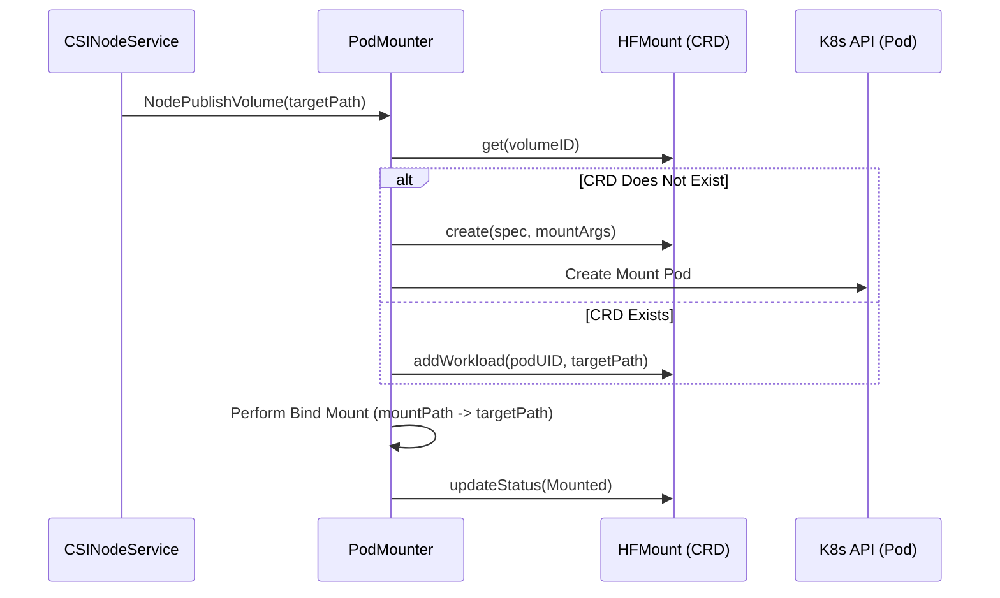
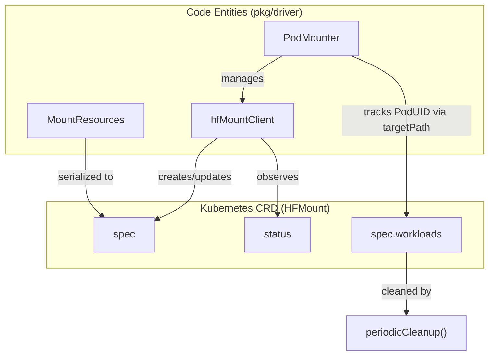

<!-- source: DeepWiki mcp.deepwiki.com · repo huggingface/hf-csi-driver · page 7 Reference: HFMount CRD · fetched 2026-10-26 -->

# Reference: HFMount CRD

Relevant source files

The following files were used as context for generating this wiki page:

- [deploy/helm/hf-csi-driver/templates/crd.yaml](deploy/helm/hf-csi-driver/templates/crd.yaml)
- [deploy/kubernetes/crd.yaml](deploy/kubernetes/crd.yaml)
- [pkg/driver/hfmount.go](pkg/driver/hfmount.go)
- [pkg/driver/podmounter.go](pkg/driver/podmounter.go)
- [pkg/driver/poduid_test.go](pkg/driver/poduid_test.go)

The `HFMount` Custom Resource Definition (CRD) serves as the source of truth for the `hf-csi-driver` when operating in `mountpod` mode. It persists the state of FUSE mounts across CSI driver restarts, enabling the `PodMounter` to recover existing mounts and manage the lifecycle of dedicated mount pods.

## Overview and Purpose

When the driver is configured for `mountpod` mode, every unique FUSE source (repository or bucket) on a node is managed by a dedicated pod. The `HFMount` resource tracks which node a mount belongs to, the CLI arguments used to initialize the FUSE process, and a list of all workload pods currently consuming that mount via bind-mounts [pkg/driver/podmounter.go:49-55]().

The CRD is crucial for:
1. **Resilience**: If the CSI driver restarts, it scans `HFMount` resources to re-discover existing mount pods and their configurations [pkg/driver/podmounter.go:191-192]().
2. **Auto-Recovery**: If a mount pod is deleted or fails, the driver uses the `mountArgs` stored in the CRD to recreate the pod with identical parameters [deploy/kubernetes/crd.yaml:41-44]().
3. **Reference Counting**: The `workloads` array tracks active consumers. The driver only deletes the mount pod and the CRD when the last workload pod is unpublished [pkg/driver/hfmount.go:121-142]().

### Resource Definition
*   **Group**: `hf.csi.huggingface.co` [pkg/driver/hfmount.go:17]()
*   **Version**: `v1alpha1` [pkg/driver/hfmount.go:18]()
*   **Kind**: `HFMount` [pkg/driver/hfmount.go:19]()
*   **Short Name**: `hfm` [deploy/kubernetes/crd.yaml:13]()

## Schema Reference

### Spec Fields
The `spec` defines the desired state and configuration of the FUSE mount.

| Field | Type | Description |
| :--- | :--- | :--- |
| `nodeName` | `string` | The Kubernetes node where the mount pod resides [deploy/kubernetes/crd.yaml:29-30](). |
| `volumeID` | `string` | The CSI Volume ID associated with this mount [deploy/kubernetes/crd.yaml:31-32](). |
| `sourceType` | `string` | Either `repo` or `bucket` [deploy/kubernetes/crd.yaml:33-35](). |
| `sourceID` | `string` | The identifier for the source (e.g., repository name or bucket name) [deploy/kubernetes/crd.yaml:36-37](). |
| `mountPodName` | `string` | The name of the dedicated pod running `hf-mount-fuse` [deploy/kubernetes/crd.yaml:38-39](). |
| `mountPath` | `string` | The host path where the FUSE filesystem is mounted [deploy/kubernetes/crd.yaml:40-41](). |
| `mountArgs` | `[]string` | Full CLI flags used to start the `hf-mount-fuse` process [deploy/kubernetes/crd.yaml:42-46](). |
| `resources` | `object` | CPU/Memory requests and limits for the mount pod [deploy/kubernetes/crd.yaml:47-58](). |
| `workloads` | `[]object` | List of consuming pods, including `podUID`, `targetPath`, and `attachmentTime` [deploy/kubernetes/crd.yaml:59-71](). |

### Status Fields
The `status` tracks the operational state of the mount.

| Field | Type | Description |
| :--- | :--- | :--- |
| `phase` | `string` | Current state: `Pending`, `Mounted`, or `Failed` [deploy/kubernetes/crd.yaml:81-83](). |
| `message` | `string` | Human-readable details about the current phase or error [deploy/kubernetes/crd.yaml:84-85](). |

**Sources**: [deploy/kubernetes/crd.yaml:21-85](), [pkg/driver/hfmount.go:37-45]()

## Implementation Details

The `hfMountClient` class in `pkg/driver/hfmount.go` provides a typed wrapper around the Kubernetes dynamic client to perform CRUD operations on `HFMount` resources.

### Concurrency and Conflict Resolution
Since multiple `NodePublishVolume` or `NodeUnpublishVolume` calls might occur simultaneously for the same volume (e.g., when multiple pods on one node use the same PVC), the driver implements a **Read-Modify-Write** loop with retries for workload updates.

The `retryOnConflict` function [pkg/driver/hfmount.go:194-220]() attempts to update the resource up to 5 times if a `409 Conflict` error is returned by the API server. This is specifically used when adding [pkg/driver/hfmount.go:98-117]() or removing [pkg/driver/hfmount.go:121-142]() workloads from the `spec.workloads` array.

### Lifecycle Flow: CRD as Source of Truth

The following diagram illustrates how the `PodMounter` interacts with the `HFMount` CRD during a volume publish request.

**Volume Publication Sequence**

**Sources**: [pkg/driver/hfmount.go:48-84](), [pkg/driver/hfmount.go:98-117](), [pkg/driver/podmounter.go:55-78]()

## Data Flow: PodMounter to HFMount

The `PodMounter` struct utilizes the `hfMountClient` to synchronize the physical state of the node with the cluster's control plane.

**Entity Mapping: Code to CRD**

### Cleanup and Orphan Management
The `PodMounter` runs a periodic background routine, `periodicCleanup`, every 2 minutes [pkg/driver/podmounter.go:197-210](). This routine performs two critical tasks using the CRD:
1.  **runCleanupScan**: Identifies local mount directories that no longer have a corresponding `HFMount` CRD or active mount pod, and unmounts them [pkg/driver/podmounter.go:212-230]().
2.  **cleanupStaleCRDs**: Lists all `HFMount` resources for the current node and deletes those that have no active workloads and no running mount pod [pkg/driver/podmounter.go:207-208]().

**Sources**: [pkg/driver/podmounter.go:194-210](), [pkg/driver/hfmount.go:145-153](), [pkg/driver/hfmount.go:157-189]()

---

