# Page: Overview

# Overview

<details>
<summary>Relevant source files</summary>

The following files were used as context for generating this wiki page:

- [.github/workflows/ci.yml](.github/workflows/ci.yml)
- [README.md](README.md)
- [deploy/helm/hf-csi-driver/Chart.yaml](deploy/helm/hf-csi-driver/Chart.yaml)

</details>


The `hf-csi-driver` is a Kubernetes Container Storage Interface (CSI) implementation designed to mount **Hugging Face Buckets** and **Model/Dataset Repositories** directly into Pods as FUSE filesystems. It acts as a bridge between the Kubernetes storage lifecycle and [hf-mount](https://github.com/huggingface/hf-mount), a Rust-based FUSE implementation [README.md:3-5]().

The driver allows data scientists and engineers to treat Hugging Face Hub resources as local directories, supporting both read-only model access and read-write bucket storage [README.md:91-164]().

## Key Architectural Concepts

The system consists of several moving parts that coordinate to manage the lifecycle of FUSE mounts:

1.  **CSI Driver (Go):** A DaemonSet running on every node that implements the CSI spec (Identity, Node services). It handles `NodePublishVolume` and `NodeUnpublishVolume` requests from the kubelet [pkg/driver/node.go:102-103]().
2.  **hf-mount-fuse (Rust):** The actual FUSE binary that performs the network I/O to the Hugging Face Hub.
3.  **HFMount CRD:** A Custom Resource Definition used as the "source of truth" for active mounts on a node. It allows the driver to recover mounts after a node or driver restart [README.md:14-16]().
4.  **Admission Webhook:** An optional component that injects `hf-mount` sidecar containers into Pods for high-performance, low-overhead mounting [README.md:212-215]().

### High-Level Interaction Flow

The following diagram illustrates how a user request for a volume results in a FUSE mount:

**User to Code Flow**
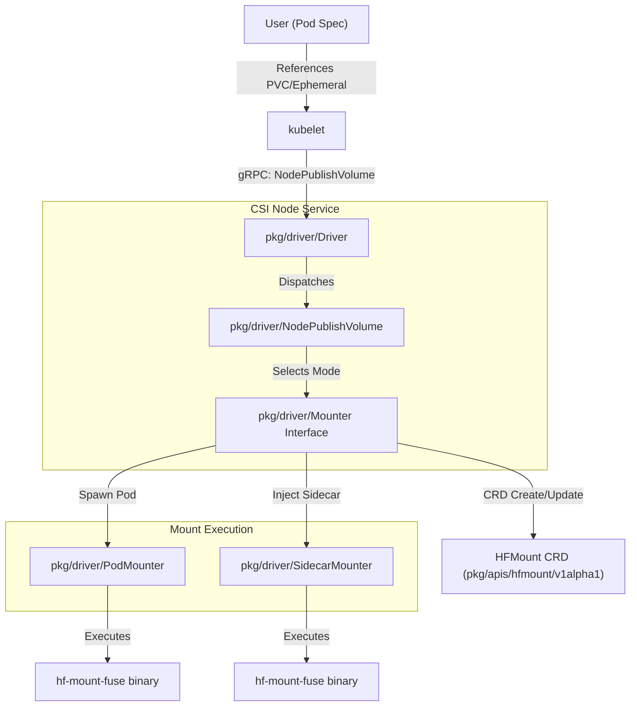
Sources: [pkg/driver/driver.go:27-45](), [pkg/driver/node.go:102-230](), [README.md:9-12]()

## Mount Modes

The driver supports two primary modes of operation, determined by the `mountMode` volume attribute:

| Mode | Description | Primary Use Case |
| :--- | :--- | :--- |
| **PodMount** | Each volume gets a dedicated "mount pod" on the node. The driver bind-mounts the FUSE path into the application pod. | Default; highly resilient; survives driver restarts. |
| **Sidecar** | The `hf-mount` process runs as a sidecar container within the application pod. Uses FD-passing for FUSE setup. | Performance; reduced resource overhead; better isolation. |

For details on selecting and configuring these modes, see **[Architecture Overview](#1.2)**.

## System Components Mapping

This diagram bridges the conceptual subsystems to their specific implementation packages and entry points.

**System to Code Entity Mapping**
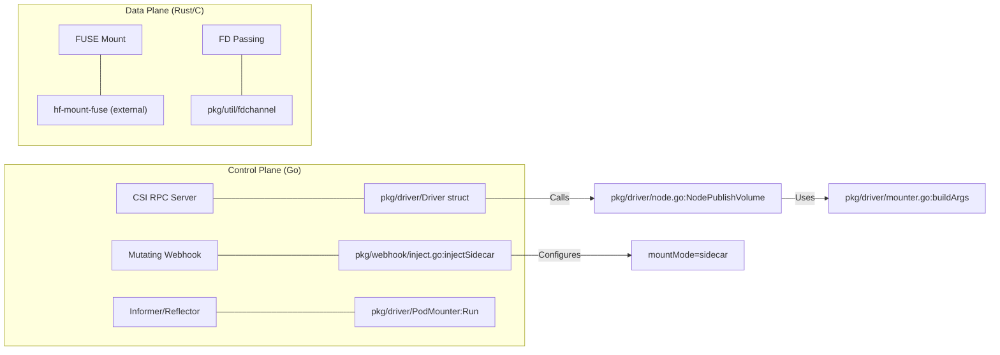
Sources: [pkg/driver/driver.go:27-45](), [pkg/driver/node.go:102-120](), [pkg/driver/mounter.go:120-140](), [pkg/webhook/inject.go:45-60]()

## Child Pages

*   **[Getting Started](#1.1)**: Instructions for installing the driver via Helm or YAML manifests, and examples for mounting your first repository or bucket.
*   **[Architecture Overview](#1.2)**: A deep dive into the HFMount CRD lifecycle, the differences between PodMount and Sidecar modes, and how the admission webhook automates sidecar injection.

---
Sources: [README.md:1-211](), [.github/workflows/ci.yml:1-214](), [deploy/helm/hf-csi-driver/Chart.yaml:1-7]()

---

# Page: Getting Started

# Getting Started

<details>
<summary>Relevant source files</summary>

The following files were used as context for generating this wiki page:

- [deploy/helm/hf-csi-driver/Chart.yaml](deploy/helm/hf-csi-driver/Chart.yaml)
- [deploy/helm/hf-csi-driver/values.yaml](deploy/helm/hf-csi-driver/values.yaml)
- [deploy/kubernetes/csidriver.yaml](deploy/kubernetes/csidriver.yaml)
- [deploy/kubernetes/daemonset.yaml](deploy/kubernetes/daemonset.yaml)
- [deploy/kubernetes/examples/bucket.yaml](deploy/kubernetes/examples/bucket.yaml)
- [deploy/kubernetes/examples/repo.yaml](deploy/kubernetes/examples/repo.yaml)
- [deploy/kubernetes/rbac.yaml](deploy/kubernetes/rbac.yaml)
- [deploy/kubernetes/serviceaccount.yaml](deploy/kubernetes/serviceaccount.yaml)

</details>


The `hf-csi-driver` provides a Kubernetes Container Storage Interface (CSI) implementation for mounting Hugging Face repositories and S3-backed buckets as FUSE filesystems. This allows Kubernetes workloads to access model weights and datasets directly via standard file system operations.

## Installation

The driver can be installed either via Helm (recommended) or using raw Kubernetes manifests.

### Helm Chart Deployment
The Helm chart automates the deployment of the CSI driver, the sidecar injection webhook, and the necessary RBAC permissions.

1.  **Configure Values**: Review `deploy/helm/hf-csi-driver/values.yaml` to customize the image tags and cache directory [deploy/helm/hf-csi-driver/values.yaml:1-17]().
2.  **Install**:
    ```bash
    helm install hf-csi-driver ./deploy/helm/hf-csi-driver
    ```

The chart deploys a `DaemonSet` named `hf-csi-node` to every node [deploy/helm/hf-csi-driver/values.yaml:24-30](), along with a mutating admission webhook for sidecar injection [deploy/helm/hf-csi-driver/values.yaml:34-42]().

### Raw Kubernetes Manifests
For environments without Helm, apply the manifests located in `deploy/kubernetes/`:

1.  **CRDs and RBAC**:
    ```bash
    kubectl apply -f deploy/kubernetes/crd.yaml
    kubectl apply -f deploy/kubernetes/rbac.yaml
    kubectl apply -f deploy/kubernetes/serviceaccount.yaml
    ```
2.  **CSIDriver Object**: Registers `hf.csi.huggingface.co` with the cluster [deploy/kubernetes/csidriver.yaml:1-9]().
    ```bash
    kubectl apply -f deploy/kubernetes/csidriver.yaml
    ```
3.  **DaemonSet**:
    ```bash
    kubectl apply -f deploy/kubernetes/daemonset.yaml
    ```

**Sources:**
- [deploy/helm/hf-csi-driver/values.yaml:1-48]()
- [deploy/kubernetes/daemonset.yaml:1-110]()
- [deploy/kubernetes/csidriver.yaml:1-9]()
- [deploy/kubernetes/rbac.yaml:1-25]()

---

## Required Secrets

The driver requires a Hugging Face API token to authenticate requests to the Hub. This should be provided as a Kubernetes Secret.

```yaml
apiVersion: v1
kind: Secret
metadata:
  name: hf-token
  namespace: default
type: Opaque
stringData:
  token: hf_xxxxxxxxxxxxxxxxx 
```

The secret is referenced in the `PersistentVolume` (PV) spec via `nodePublishSecretRef` [deploy/kubernetes/examples/repo.yaml:17-19]().

**Sources:**
- [deploy/kubernetes/examples/repo.yaml:15-19]()
- [deploy/kubernetes/examples/bucket.yaml:15-17]()

---

## Configuration and Usage

### Mounting a Repository
To mount a Hugging Face repository (Model or Dataset), define a `PersistentVolume` with `sourceType: repo`.

```yaml
apiVersion: v1
kind: PersistentVolume
metadata:
  name: hf-repo-pv
spec:
  csi:
    driver: hf.csi.huggingface.co
    volumeHandle: my-repo-handle
    volumeAttributes:
      sourceType: repo
      sourceId: org/model-name
      revision: main
```

### Mounting a Bucket
To mount a Hugging Face Bucket (S3-compatible), use `sourceType: bucket`.

```yaml
apiVersion: v1
kind: PersistentVolume
metadata:
  name: hf-bucket-pv
spec:
  csi:
    driver: hf.csi.huggingface.co
    volumeHandle: my-bucket-handle
    volumeAttributes:
      sourceType: bucket
      sourceId: org/bucket-name
```

**Sources:**
- [deploy/kubernetes/examples/repo.yaml:1-24]()
- [deploy/kubernetes/examples/bucket.yaml:1-20]()

---

## Implementation Data Flow

The following diagram illustrates the interaction between the Kubernetes API, the CSI Driver, and the `hf-mount-fuse` utility during a volume mount operation.

### Deployment Architecture
The driver consists of a `hf-csi-plugin` container which handles CSI RPCs and orchestrates the FUSE mount via `hf-mount-fuse`.

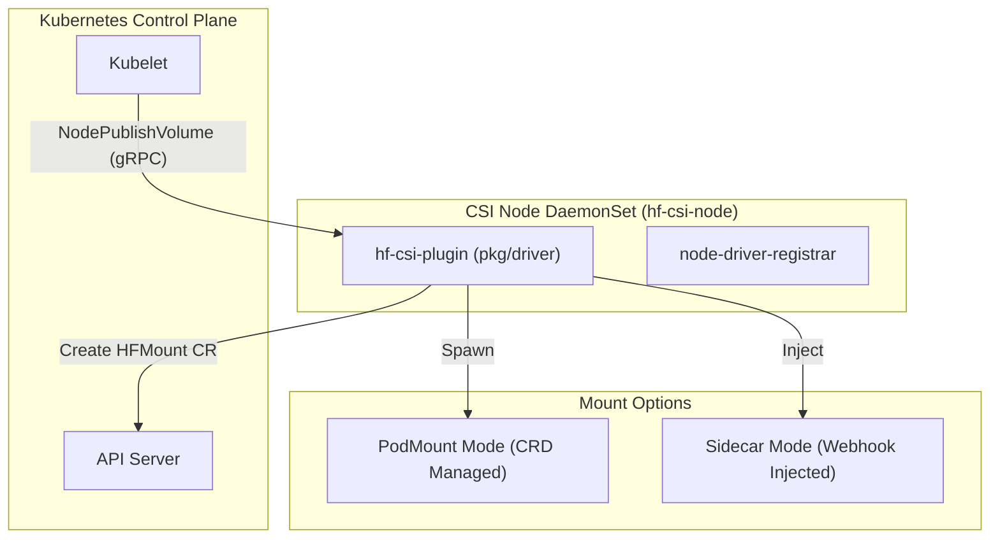

**Sources:**
- [deploy/kubernetes/daemonset.yaml:24-50]()
- [deploy/kubernetes/csidriver.yaml:1-9]()

### Mount Process: Code Entity Mapping
This diagram maps the natural language "Mount Request" to specific code entities and CLI arguments used to invoke the FUSE mounter.

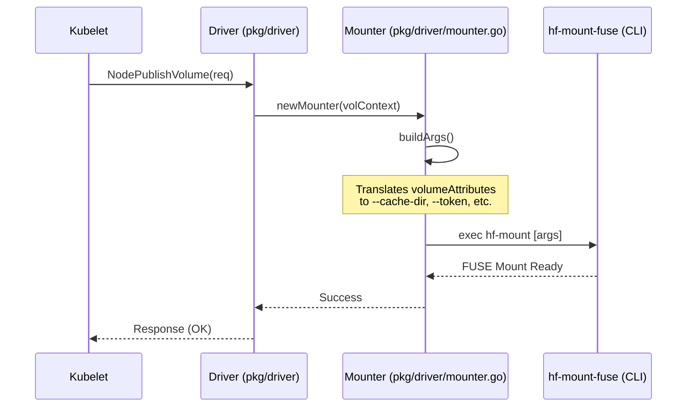

**Sources:**
- [deploy/kubernetes/daemonset.yaml:26-32]()
- [deploy/kubernetes/examples/repo.yaml:21-23]()
- [deploy/helm/hf-csi-driver/values.yaml:15-17]()

---

## Key Configuration Parameters

| Attribute | Description | Default |
| :--- | :--- | :--- |
| `sourceType` | Type of source: `repo` or `bucket`. | Required |
| `sourceId` | The HF repository or bucket ID (e.g., `gpt2`). | Required |
| `revision` | Git revision (branch/commit/tag) for `repo` types. | `main` |
| `cacheDir` | Host path for caching downloaded data. | `/var/lib/hf-csi-driver/cache` |
| `mountMode` | `sidecar` (default) or `mountpod`. | `sidecar` |

**Sources:**
- [deploy/helm/hf-csi-driver/values.yaml:17]()
- [deploy/kubernetes/daemonset.yaml:29-30]()
- [deploy/kubernetes/examples/repo.yaml:21-23]()

---

# Page: Architecture Overview

# Architecture Overview

<details>
<summary>Relevant source files</summary>

The following files were used as context for generating this wiki page:

- [.github/workflows/ci.yml](.github/workflows/ci.yml)
- [README.md](README.md)
- [cmd/hf-csi-driver/main.go](cmd/hf-csi-driver/main.go)
- [pkg/driver/driver.go](pkg/driver/driver.go)

</details>


The `hf-csi-driver` provides a Kubernetes-native way to mount Hugging Face repositories and S3-backed buckets into Pods using FUSE. It serves as a bridge between the [CSI (Container Storage Interface)](https://github.com/container-storage-interface/spec) and [hf-mount](https://github.com/huggingface/hf-mount), a Rust-based FUSE implementation [README.md:3-5]().

## System Components

The system consists of three primary binaries/roles:
1.  **CSI Driver (Node Mode)**: A DaemonSet running on every node. It implements the CSI `NodeServer` interface to handle volume lifecycle events [cmd/hf-csi-driver/main.go:58-59]().
2.  **Admission Webhook (Webhook Mode)**: A deployment that intercepts Pod creation to inject sidecar containers for high-performance mounting [cmd/hf-csi-driver/main.go:60-61]().
3.  **hf-mount-fuse**: The actual FUSE filesystem process. It runs either in a standalone **Mount Pod** or as a **Sidecar Container** [README.md:9-12]().

### High-Level Interaction Diagram

The following diagram illustrates how a user request for a volume flows through the system components.

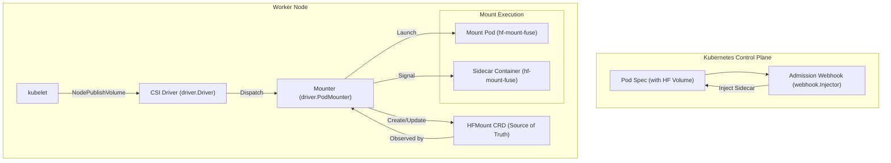
**Sources:** [pkg/driver/driver.go:36-49](), [cmd/hf-csi-driver/main.go:57-65](), [pkg/driver/podmounter.go:103-104]()

---

## Mount Modes

The driver supports two distinct architectural patterns for running the FUSE process. The choice is governed by the `mountMode` attribute or the presence of the sidecar.

### 1. PodMount Mode (Default)
In this mode, the CSI driver creates a dedicated "Mount Pod" for every unique volume on a node. 
- **Isolation**: The FUSE process is decoupled from the lifecycle of the workload Pod. If the CSI driver restarts, the Mount Pod continues running [README.md:14]().
- **Self-Healing**: The `PodMounter` uses the `HFMount` CRD as the source of truth. If a Mount Pod is deleted or crashes, the driver detects the discrepancy and recreates it [README.md:15-16]().
- **Propagation**: The FUSE filesystem is mounted inside the Mount Pod and then bind-mounted to the target path on the host, which is then shared with the workload Pod [README.md:10]().

### 2. Sidecar Mode
Sidecar mode is optimized for performance and resource accounting. It requires the Admission Webhook to be enabled.
- **Injection**: The `webhook.Injector` adds an `hf-mount` container to the user's Pod [cmd/hf-csi-driver/main.go:148-151]().
- **FD Passing**: Instead of traditional mounting, the sidecar opens `/dev/fuse` and passes the file descriptor to the driver or handles the mount internally using `SCM_RIGHTS` over a Unix socket [pkg/driver/driver.go:17-26]().
- **Native Sidecars**: It utilizes Kubernetes native sidecar support (KEP-753) to ensure the mount is available before the main application starts.

| Feature | PodMount Mode | Sidecar Mode |
| :--- | :--- | :--- |
| **FUSE Process Location** | Dedicated Pod per Volume | Container within Workload Pod |
| **Resilience** | Survives Workload Restart | Tied to Workload Lifecycle |
| **Resource Attribution** | Cluster-level (System) | Pod-level (User) |
| **Implementation** | `driver.PodMounter` | `webhook.Injector` + `driver.sidecarMount` |

**Sources:** [README.md:9-20](), [pkg/driver/driver.go:17-26](), [cmd/hf-csi-driver/main.go:123-157]()

---

## The HFMount CRD

The `HFMount` Custom Resource Definition (CRD) acts as the "Source of Truth" for the `PodMounter` [README.md:16](). It stores the necessary state to recover mounts after a node reboot or driver crash.

Key fields in `HFMountSpec`:
- `sourceType`: `repo` or `bucket`.
- `sourceID`: The Hugging Face repository or bucket name.
- `mountArgs`: The CLI flags generated for `hf-mount-fuse`.
- `workloads`: A list of target paths and Pods currently using this mount.

**Sources:** [README.md:192-211](), [pkg/driver/podmounter.go:103-104]()

---

## Data Flow: NodePublishVolume

The following diagram maps the CSI RPC call to the internal Go entities.

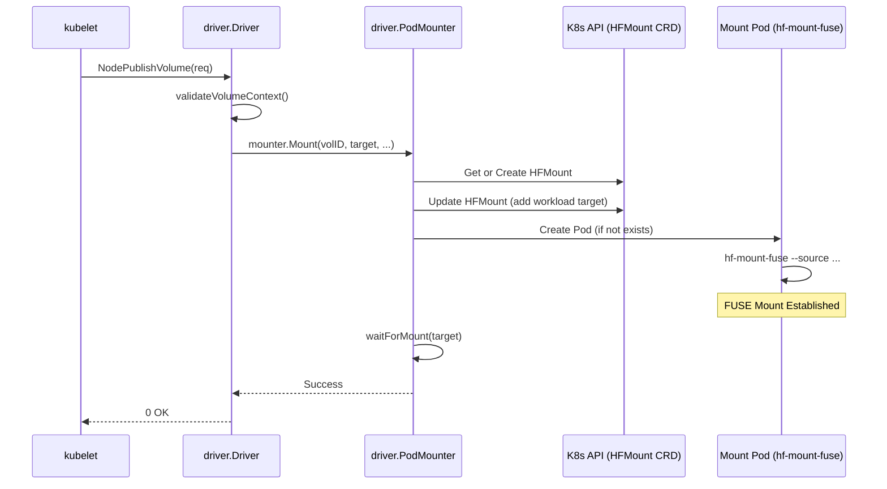
**Sources:** [pkg/driver/driver.go:104-106](), [pkg/driver/driver.go:81-92](), [README.md:9-12]()

---

## Token Management and Security

The driver handles Hugging Face authentication tokens via Kubernetes Secrets.
- **Secret Reference**: Tokens are passed via `nodePublishSecretRef` in the PV or Pod spec [README.md:87-89]().
- **Live Refresh**: The driver implements `requiresRepublish`, allowing it to update the token file used by `hf-mount-fuse` without unmounting the volume [README.md:18]().
- **Privileges**: Both the CSI driver and the mount containers require `privileged: true` to perform FUSE mounts and manage mount propagation [README.md:25]().

**Sources:** [README.md:55-60](), [README.md:107-112](), [README.md:18-19]()

---

# Page: Core Driver

# Core Driver

<details>
<summary>Relevant source files</summary>

The following files were used as context for generating this wiki page:

- [cmd/hf-csi-driver/main.go](cmd/hf-csi-driver/main.go)
- [pkg/driver/controller.go](pkg/driver/controller.go)
- [pkg/driver/driver.go](pkg/driver/driver.go)
- [pkg/driver/identity.go](pkg/driver/identity.go)

</details>


The `hf-csi-driver` is a Container Storage Interface (CSI) implementation that enables Kubernetes workloads to mount Hugging Face repositories and buckets. The core driver logic resides in the `pkg/driver` package and is responsible for managing the gRPC server lifecycle, handling CSI RPC requests, and orchestrating volume mounts through various mounter backends.

## Driver Lifecycle and Initialization

The `Driver` struct [pkg/driver/driver.go:36-49]() serves as the central orchestrator. It implements the standard CSI `Identity`, `Controller`, and `Node` services. The driver is typically started in `node` mode by the `main` function [cmd/hf-csi-driver/main.go:58-59]().

### Initialization Sequence

The `Run()` method [pkg/driver/driver.go:65-110]() initializes the driver following these steps:
1. **Endpoint Parsing**: Parses the CSI endpoint (typically a Unix Domain Socket) [pkg/driver/driver.go:66-69]().
2. **Mounter Startup**: Starts the internal mounter's background processes (e.g., pod watchers) [pkg/driver/driver.go:81]().
3. **Async Recovery**: Triggers `mounter.Recover()` in a goroutine to restore existing mounts without blocking the gRPC server's availability [pkg/driver/driver.go:88-92]().
4. **gRPC Registration**: Registers the CSI service implementations and begins serving requests [pkg/driver/driver.go:103-109]().

### Graceful Shutdown
The driver handles `SIGINT` and `SIGTERM` signals [cmd/hf-csi-driver/main.go:106-112](). The `Stop()` function [pkg/driver/driver.go:112-132]() closes the `stopCh` to signal background routines and attempts a graceful gRPC shutdown with a 10-second timeout before forcing a stop.

### Driver Entry Point and Lifecycle
The following diagram illustrates how the `main` package initializes the `Driver` and its relationship with the gRPC server.

**Driver Startup Flow**
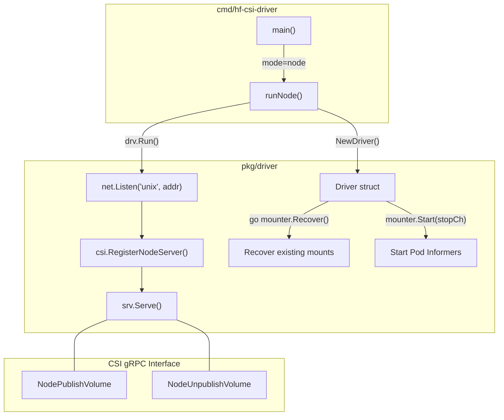
Sources: [pkg/driver/driver.go:36-110](), [cmd/hf-csi-driver/main.go:26-121]()

## CSI Service Implementation

The driver implements three primary CSI interfaces:

1.  **Identity Service**: Provides plugin information (`hf.csi.huggingface.co`) and capabilities.
    *   Defined in: [pkg/driver/identity.go:1-26]()
2.  **Controller Service**: Currently implements a minimal interface as the driver is primarily node-centric.
    *   Defined in: [pkg/driver/controller.go:1-12]()
3.  **Node Service**: The most critical component, handling the actual mounting and unmounting of volumes on specific nodes.
    *   For details, see [CSI Node Service](#2.1).

## Mounter Architecture

The `Driver` does not perform mounts directly. Instead, it delegates to a `Mounter` interface. This abstraction allows the driver to support different execution environments, specifically the **MountPod** mode (where FUSE runs in a dedicated pod) and the **Sidecar** mode (where FUSE runs inside the workload pod).

**System Component Mapping**
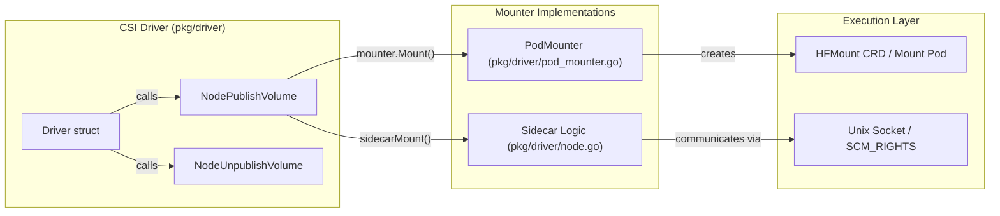
Sources: [pkg/driver/driver.go:36-49](), [pkg/driver/node.go:1-26]()

### Key Subsystems

*   **Node Service RPCs**: Manages the request flow for `NodePublishVolume` and `NodeUnpublishVolume`.
    *   For details, see [CSI Node Service](#2.1).
*   **Mounter Interface**: Defines how the driver communicates with the mount logic and how CLI arguments for `hf-mount-fuse` are constructed.
    *   For details, see [Mounter Interface and CLI Argument Construction](#2.2).
*   **PodMounter**: Manages the lifecycle of dedicated FUSE mount pods and the `HFMount` CRD.
    *   For details, see [PodMounter (MountPod Mode)](#2.3).
*   **Sidecar Mounter**: Implements the high-performance sidecar mode using file descriptor passing.
    *   For details, see [Sidecar Mounter (Sidecar Mode)](#2.4).
*   **Resource Management**: Handles the parsing and enforcement of CPU/Memory limits for FUSE processes.
    *   For details, see [Resource Management](#2.5).

## Configuration

The driver is configured via CLI flags in `main.go` [cmd/hf-csi-driver/main.go:31-40](), including:
*   `--endpoint`: The gRPC socket path.
*   `--node-id`: The unique identifier for the node (defaults to hostname).
*   `--cache-dir`: The base directory for FUSE caching [pkg/driver/driver.go:34]().
*   `--mount-image`: The container image used for mount pods.

| Parameter | Default | Description |
| :--- | :--- | :--- |
| `DriverName` | `hf.csi.huggingface.co` | The official CSI driver identifier [pkg/driver/driver.go:29](). |
| `DefaultCacheBase` | `/var/lib/hf-csi-driver/cache` | Default path for local file caching [pkg/driver/driver.go:34](). |
| `Version` | `dev` | The driver version, injected at build time [pkg/driver/driver.go:32](). |

Sources: [pkg/driver/driver.go:28-34](), [cmd/hf-csi-driver/main.go:31-40]()

---

# Page: CSI Node Service

# CSI Node Service

<details>
<summary>Relevant source files</summary>

The following files were used as context for generating this wiki page:

- [pkg/driver/mount_linux.go](pkg/driver/mount_linux.go)
- [pkg/driver/mount_other.go](pkg/driver/mount_other.go)
- [pkg/driver/node.go](pkg/driver/node.go)
- [pkg/driver/node_test.go](pkg/driver/node_test.go)
- [pkg/driver/unmount_linux.go](pkg/driver/unmount_linux.go)
- [pkg/driver/unmount_other.go](pkg/driver/unmount_other.go)

</details>


The CSI Node Service is responsible for the lifecycle of volume mounts on individual worker nodes. It implements the `NodePublishVolume` and `NodeUnpublishVolume` gRPC endpoints, which Kubelet calls to mount and unmount Hugging Face repositories or buckets.

The service supports two distinct operation modes: **Sidecar Mode** (default) and **MountPod Mode**. It manages request validation, token rotation, and health monitoring for both modes.

## NodePublishVolume Workflow

`NodePublishVolume` is called by Kubelet when a pod is scheduled to a node and requires a volume. It is also called periodically for "republish" events to refresh secrets.

### 1. Request Validation
The driver first validates that the required fields are present in the `csi.NodePublishVolumeRequest`:
*   **Volume Capabilities**: Only `Mount` access type is supported [pkg/driver/node.go:64-66]().
*   **Volume Context**: Must contain `sourceType` (e.g., "bucket") and `sourceId` [pkg/driver/node.go:68-75]().
*   **Mount Mode**: Validates that `mountMode` is either `sidecar` or `mountpod` [pkg/driver/node.go:82-87]().

### 2. Mode Selection & Fallback
The driver determines the execution mode based on the `mountMode` attribute and the availability of the workload pod's UID:
*   **Sidecar Mode**: Requires the pod UID (passed via `csi.storage.k8s.io/pod.uid` in `VolumeContext`). If the UID is missing (e.g., `podInfoOnMount` is disabled in the `CSIDriver` object), the driver automatically falls back to **MountPod Mode** [pkg/driver/node.go:91-94]().

### 3. Token Management
Authentication tokens are retrieved from the CSI `Secrets` map using a configurable `tokenKey` (defaults to `token`) [pkg/driver/node.go:78-79]().
*   **Initial Mount**: The token is passed to the mounter implementation.
*   **Republish**: If the volume is already mounted, the driver refreshes the token. In Sidecar mode, it updates the token in the shared emptyDir; in MountPod mode, it overwrites the token file on disk [pkg/driver/node.go:120-128]().

### 4. Health Checks and Recovery
The driver checks the status of existing mounts before proceeding:
*   **Stale Mounts**: If a mount is detected as corrupted (e.g., FUSE daemon crashed), the driver performs a force unmount for MountPod mode [pkg/driver/node.go:107-111]().
*   **Sidecar Health**: In sidecar mode, it reads an error file from the shared emptyDir. If the sidecar is unhealthy, it unmounts the stale FUSE mount to allow the next retry to create a fresh socket [pkg/driver/node.go:133-145]().

### NodePublishVolume Logic Flow
This diagram maps the `NodePublishVolume` function logic to the internal system components.

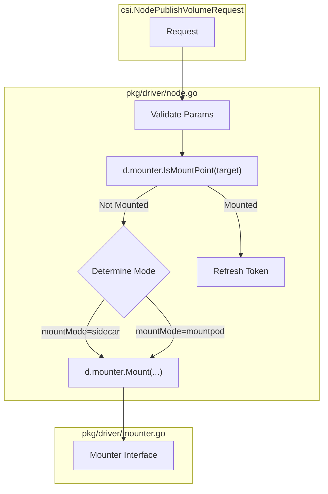
**Sources:** [pkg/driver/node.go:49-150](), [pkg/driver/node.go:163-180]()

## NodeUnpublishVolume

`NodeUnpublishVolume` handles the teardown of mounts. The driver implements a "fast-path" for Sidecar mode to ensure clean cleanup of FUSE mounts.

### Sidecar Fast-Path Unmount
When a pod using Sidecar mode is deleted, the sidecar container may exit before the CSI driver is called. To prevent stale FUSE mounts that block Kubelet, the driver uses `fuseUnmount` (a lazy unmount via `MNT_DETACH` on Linux) [pkg/driver/unmount_linux.go:9]().

1.  The driver checks if the target path was registered as a sidecar volume in the `sidecarVolumes` map [pkg/driver/node.go:211-212]().
2.  If found, it executes `d.fuseUnmountFn(target)` immediately [pkg/driver/node.go:214]().
3.  It then proceeds to the standard `d.mounter.Unmount(target)` call to ensure all resources are cleared [pkg/driver/node.go:219]().

### MountPod Cleanup
For MountPod mode, the call is routed to the `PodMounter`, which:
1.  Removes the bind-mount at the `targetPath`.
2.  Updates or deletes the `HFMount` CRD associated with the volume, which triggers the controller to terminate the dedicated mount pod.

**Sources:** [pkg/driver/node.go:203-223](), [pkg/driver/unmount_linux.go:1-11]()

## Key Functions and Data Structures

### Volume Context Parameters
The driver parses the `VolumeContext` map into specific fields for the mounter.

| Key | Code Constant | Description |
| :--- | :--- | :--- |
| `sourceType` | `volumeCtxSourceType` | Repository type (e.g., `bucket`) |
| `sourceId` | `volumeCtxSourceID` | Repository ID (e.g., `org/name`) |
| `mountMode` | `volumeCtxMountMode` | `sidecar` or `mountpod` |
| `csi.storage.k8s.io/pod.uid` | `volumeCtxPodUID` | Required for Sidecar mode |

**Sources:** [pkg/driver/node.go:23-38]()

### Mounter Routing
The `Driver` struct delegates the actual mounting work to the `Mounter` interface.

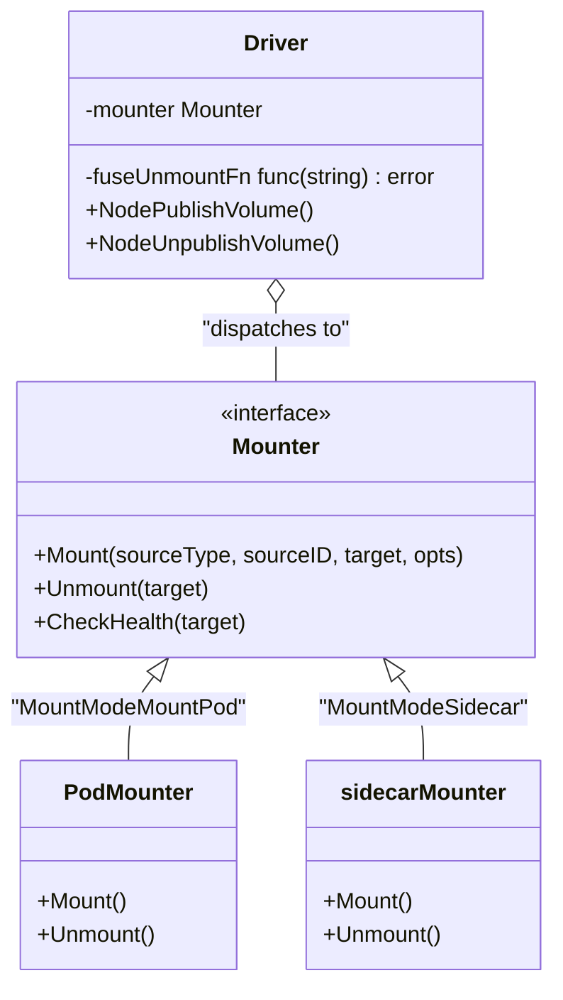
**Sources:** [pkg/driver/node.go:49-54](), [pkg/driver/node_test.go:13-55]()

## Implementation Details

### Mount Health Checks
The driver uses `IsMountPoint` to determine if a path is already active. On Linux, it specifically detects "stale" mounts where the FUSE transport is broken (returning `ENOTCONN` or `EIO`) [pkg/driver/mount_linux.go:16-27]().

### Bind Mounts
In MountPod mode, the driver performs a bind mount from the source path (managed by the mount pod) to the target path (requested by Kubelet) using `syscall.MS_BIND` [pkg/driver/mount_linux.go:11-13]().

### Platform Support
The driver includes build-constrained files for non-Linux platforms (`mount_other.go`, `unmount_other.go`) which return errors or perform no-ops for Linux-specific features like bind mounts and lazy unmounts [pkg/driver/mount_other.go:8-10](), [pkg/driver/unmount_other.go:8-10]().

**Sources:** [pkg/driver/mount_linux.go:1-27](), [pkg/driver/mount_other.go:1-16](), [pkg/driver/unmount_linux.go:1-11](), [pkg/driver/unmount_other.go:1-11]()

---

# Page: Mounter Interface and CLI Argument Construction

# Mounter Interface and CLI Argument Construction

<details>
<summary>Relevant source files</summary>

The following files were used as context for generating this wiki page:

- [pkg/driver/mounter.go](pkg/driver/mounter.go)
- [pkg/driver/mounter_test.go](pkg/driver/mounter_test.go)

</details>


This section describes the `Mounter` interface, which abstracts the volume mounting logic for the `hf-csi-driver`, and the mechanisms used to translate CSI volume attributes into CLI arguments for the `hf-mount-fuse` binary.

## The Mounter Interface

The `Mounter` interface serves as the primary abstraction layer between the CSI `NodeServer` and the specific mounting implementations (PodMount vs. Sidecar). It defines the lifecycle and health management contract that any mounting strategy must satisfy.

| Method | Description |
| :--- | :--- |
| `Mount` | Performs the mount operation using the provided `sourceType`, `sourceID`, and `MountOptions`. |
| `Unmount` | Tears down the mount at the specified target path. |
| `IsMountPoint` | Checks if the target path is currently an active mount point. |
| `CheckHealth` | Returns an error if the mount is unhealthy (e.g., a mount pod is in `CrashLoopBackOff`). |
| `Recover` | Re-adopts existing mounts from a previous driver instance (crucial for driver restarts). |
| `Start` | Launches background goroutines, such as Kubernetes informers or watchers. |

**Sources:** [pkg/driver/mounter.go:32-43]()

### Mounter Implementation Overview

The following diagram illustrates how the `Mounter` interface bridges the high-level CSI RPC calls to the low-level `hf-mount-fuse` execution.

**Mounter Interface and CLI Flow**
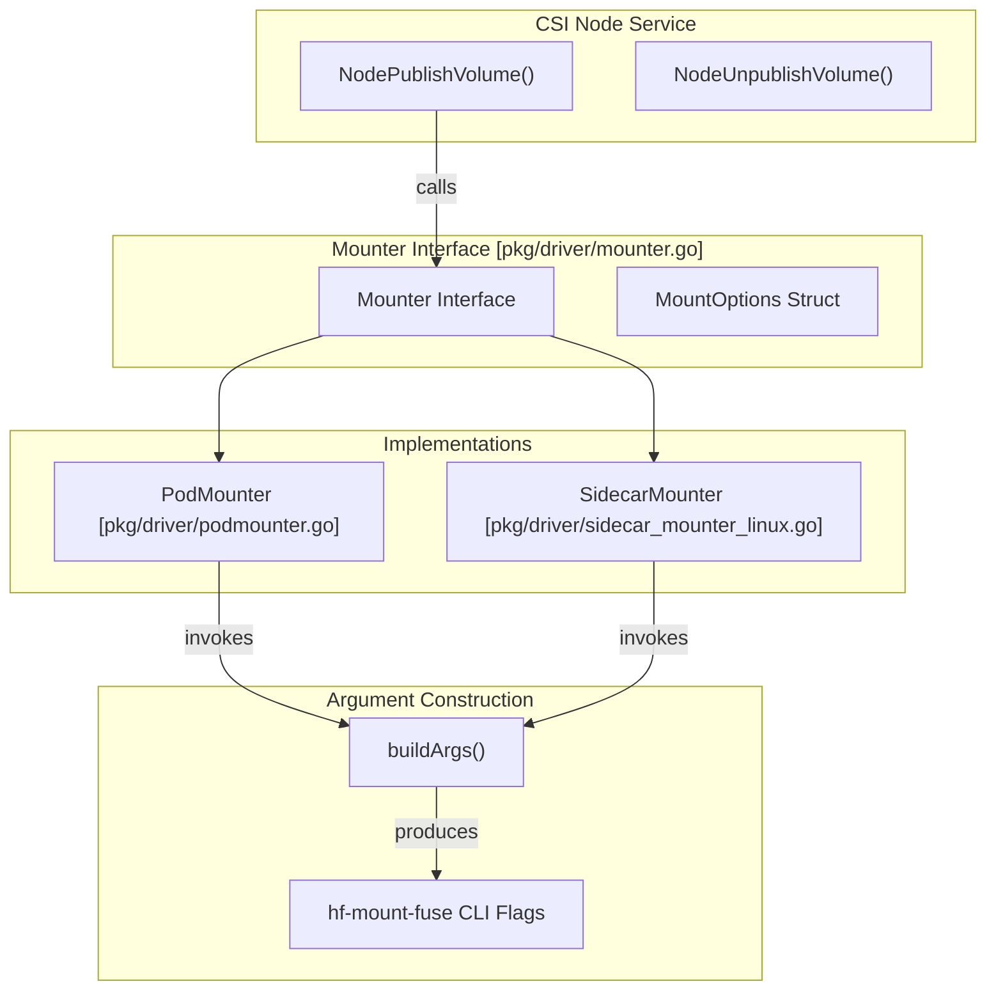
**Sources:** [pkg/driver/mounter.go:13-43](), [pkg/driver/mounter.go:49-96]()

---

## MountOptions and CLI Translation

The `MountOptions` struct encapsulates all configurable parameters for a Hugging Face volume. These options are typically parsed from `volumeAttributes` in the CSI request and then translated into CLI flags for `hf-mount-fuse` via the `buildArgs` function.

### MountOptions Struct Fields
The struct includes fields for performance tuning, authentication, and resource management:
*   **Performance:** `CacheSize`, `MetadataTtlMs`, `InodeSoftLimit`, `LruSweepIntervalMs`.
*   **Networking:** `HubEndpoint`, `PollIntervalSecs`, `PollListingConcurrency`.
*   **Security/Context:** `TokenFile`, `ReadOnly`, `VolumeMountGroup` (fsGroup), `WorkloadPodUID`.
*   **Passthrough:** `ExtraArgs` allows users to pass arbitrary flags directly to the FUSE binary.

**Sources:** [pkg/driver/mounter.go:13-30]()

### buildArgs Function Logic
The `buildArgs` function is the source of truth for how `MountOptions` are mapped to `hf-mount-fuse` flags. It performs validation and conditional logic based on the `sourceType` (`bucket` or `repo`).

1.  **Validation:** It strictly enforces that `sourceType` is either "bucket" or "repo" [pkg/driver/mounter.go:50-54]().
2.  **Flag Mapping:** Standard options like `--hub-endpoint`, `--cache-dir`, and `--token-file` are appended if present [pkg/driver/mounter.go:57-86]().
3.  **Source Specifics:** The `--revision` flag is only appended if the `sourceType` is "repo" [pkg/driver/mounter.go:91-93]().
4.  **Positional Arguments:** The function ensures the required positional arguments (`sourceType`, `sourceID`, `target`) are placed at the end of the argument list [pkg/driver/mounter.go:89]().

**Sources:** [pkg/driver/mounter.go:49-96]()

---

## Token Management

The driver supports live token refreshing. Instead of passing the Hugging Face token directly as a CLI argument (which would be visible in `ps` or container specs), the driver writes the token to a file and passes the `--token-file` flag to `hf-mount-fuse`.

### writeTokenFile
The `writeTokenFile` function ensures that token updates are atomic to prevent the FUSE process from reading a partial or corrupted token.

**Token Write Process**
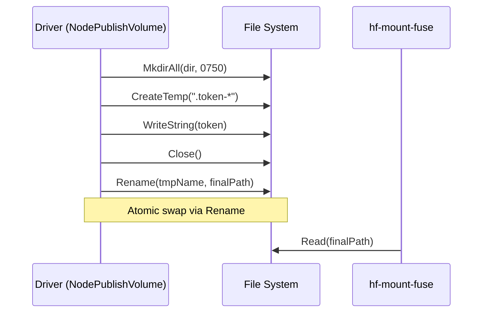
**Sources:** [pkg/driver/mounter.go:99-119]()

---

## Technical Mapping: Attributes to Flags

The following table maps the `MountOptions` fields to the actual CLI flags generated by `buildArgs`.

| MountOptions Field | CLI Flag | Description |
| :--- | :--- | :--- |
| `HubEndpoint` | `--hub-endpoint` | The HF Hub URL (e.g., `https://huggingface.co`). |
| `CacheDir` | `--cache-dir` | Local path for disk caching. |
| `CacheSize` | `--cache-size` | Maximum size of the local cache. |
| `PollIntervalSecs` | `--poll-interval-secs` | Frequency to check for remote updates. |
| `MetadataTtlMs` | `--metadata-ttl-ms` | Time-to-live for cached file metadata. |
| `TokenFile` | `--token-file` | Path to the file containing the HF API token. |
| `Revision` | `--revision` | Git revision (only for `sourceType: repo`). |
| `ReadOnly` | `--read-only` | Mounts the FUSE filesystem in read-only mode. |
| `ExtraArgs` | (various) | Directly appended to the argument slice. |

**Sources:** [pkg/driver/mounter.go:57-93](), [pkg/driver/mounter_test.go:7-34]()

---

# Page: PodMounter (MountPod Mode)

# PodMounter (MountPod Mode)

<details>
<summary>Relevant source files</summary>

The following files were used as context for generating this wiki page:

- [deploy/helm/hf-csi-driver/templates/crd.yaml](deploy/helm/hf-csi-driver/templates/crd.yaml)
- [deploy/kubernetes/crd.yaml](deploy/kubernetes/crd.yaml)
- [pkg/driver/hfmount.go](pkg/driver/hfmount.go)
- [pkg/driver/podmounter.go](pkg/driver/podmounter.go)
- [pkg/driver/podmounter_test.go](pkg/driver/podmounter_test.go)
- [pkg/driver/poduid_test.go](pkg/driver/poduid_test.go)
- [pkg/driver/resources.go](pkg/driver/resources.go)
- [pkg/driver/resources_test.go](pkg/driver/resources_test.go)

</details>


The `PodMounter` is the implementation of the `Mounter` interface used when `mountMode` is set to `mountpod`. In this mode, the CSI driver delegates the execution of the FUSE binary (`hf-mount-fuse`) to dedicated, standalone Kubernetes Pods. This architecture ensures that FUSE mounts survive CSI driver restarts or upgrades, preventing I/O errors in workload pods.

## Architecture and Data Flow

The `PodMounter` manages a 1-to-N relationship between a "Mount Pod" (the FUSE source) and "Workload Pods" (the consumers). The driver uses a source-vs-target path model where the FUSE daemon mounts the remote repository into a private directory on the host, which is then bind-mounted into the specific Kubelet pod directories.

### Mount Pod Lifecycle

1.  **Creation**: When `NodePublishVolume` is called, the `PodMounter` checks for an existing `HFMount` CRD for that source. If none exists, it creates one and then spawns a Mount Pod [pkg/driver/podmounter.go:237-270]().
2.  **Ready Check**: The driver polls the Mount Pod until it is in the `Running` phase and the FUSE mount is visible on the host at `mountBaseDir` [pkg/driver/podmounter.go:34-38](), [pkg/driver/podmounter.go:318-345]().
3.  **Bind Mount**: Once the source is ready, the driver performs a bind-mount from the source path (e.g., `/var/lib/hf-csi-driver/mnt/<id>`) to the target path provided by Kubelet [pkg/driver/podmounter.go:347-355]().
4.  **Tracking**: The relationship is recorded in the `HFMount` CRD `spec.workloads` list [pkg/driver/hfmount.go:98-117]().

### Source vs Target Path Model Diagram

This diagram illustrates how the `PodMounter` bridges the FUSE mount from a dedicated pod to the application container.

"Source vs Target Path Model"
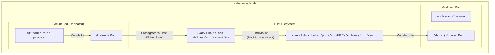
Sources: [pkg/driver/podmounter.go:34](), [pkg/driver/podmounter.go:347-355](), [pkg/driver/podmounter.go:488-518]()

## The HFMount CRD

The `HFMount` Custom Resource Definition acts as the source of truth for all mounts on a node. It allows the driver to recover state after a restart and ensures that Mount Pods are recreated if they are accidentally deleted while workloads are still active.

### Key CRD Fields
| Field | Description | Location |
| :--- | :--- | :--- |
| `spec.mountArgs` | The exact CLI flags used to launch `hf-mount-fuse`. | [deploy/kubernetes/crd.yaml:40-46]() |
| `spec.workloads` | List of active pod UIDs and target paths consuming this mount. | [deploy/kubernetes/crd.yaml:58-71]() |
| `spec.resources` | CPU/Memory requests and limits for the mount pod. | [deploy/kubernetes/crd.yaml:47-58]() |
| `status.phase` | Current state: `Pending`, `Mounted`, or `Failed`. | [deploy/kubernetes/crd.yaml:79-83]() |

Sources: [pkg/driver/hfmount.go:37-45](), [deploy/kubernetes/crd.yaml:1-104]()

## Event Handling and Recovery

The `PodMounter` runs a Pod Informer to react to changes in the cluster state [pkg/driver/podmounter.go:124-189]().

### Informer Logic
*   **Pod Restarts**: If a Mount Pod's container restarts (detected via `RestartCount`), the driver identifies all active bind-mounts for that source and re-establishes them to fix "Transport endpoint is not connected" errors [pkg/driver/podmounter.go:160-167](), [pkg/driver/podmounter.go:732-775]().
*   **Pod Deletion**: If a Mount Pod is deleted but the `HFMount` CRD still lists active workloads, the driver will automatically recreate the pod using the stored `mountArgs` [pkg/driver/podmounter.go:783-809]().
*   **Late Adoption**: If the driver starts and finds a running Mount Pod that isn't yet tracked in its internal `binds` map, it "adopts" it to ensure cleanup logic applies [pkg/driver/podmounter.go:136-159]().

### Periodic Cleanup Scan
The `periodicCleanup` goroutine runs every 2 minutes [pkg/driver/podmounter.go:197-210](). It performs two main tasks:
1.  **runCleanupScan**: Scans `/var/lib/hf-csi-driver/mnt` for directories that no longer have a corresponding running Pod or active `HFMount` CRD, and unmounts them [pkg/driver/podmounter.go:212-235]().
2.  **cleanupStaleCRDs**: Removes `HFMount` objects that have no active workloads and no running pods [pkg/driver/podmounter.go:207]().

## Code Entity Interaction

The following diagram maps the logical operations of the `PodMounter` to the specific functions and structures in the codebase.

"PodMounter Implementation Map"
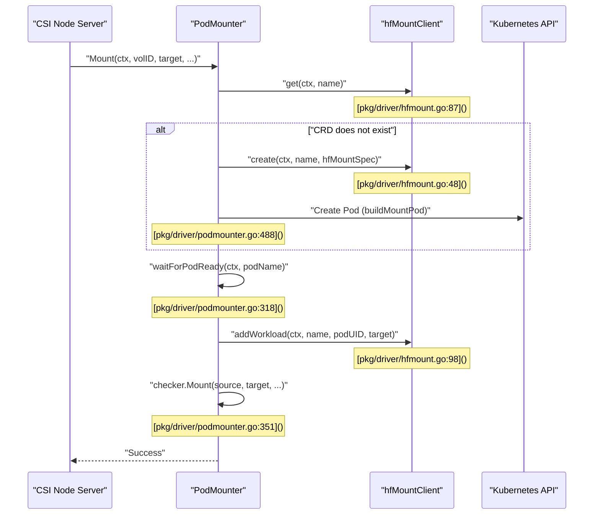
Sources: [pkg/driver/podmounter.go:237-360](), [pkg/driver/hfmount.go:23-34]()

## Synchronization and Locking

To prevent race conditions when multiple pods on the same node request the same Hugging Face repository simultaneously, the `PodMounter` uses reference-counted mutexes:

*   **`sourceLocks`**: A map of `refMutex` keyed by the FUSE source ID [pkg/driver/podmounter.go:77]().
*   **`acquireSourceLock`**: Increments a reference count and returns a mutex for a specific source [pkg/driver/podmounter.go:101-111]().
*   **`releaseSourceLock`**: Decrements the count and deletes the mutex from the map when it reaches zero to save memory [pkg/driver/podmounter.go:114-121]().

This ensures that only one goroutine is creating or repairing a specific Mount Pod at any given time.

Sources: [pkg/driver/podmounter.go:42-47](), [pkg/driver/podmounter.go:101-121]()

---

# Page: Sidecar Mounter (Sidecar Mode)

# Sidecar Mounter (Sidecar Mode)

<details>
<summary>Relevant source files</summary>

The following files were used as context for generating this wiki page:

- [.gitignore](.gitignore)
- [pkg/driver/sidecar_mounter_linux.go](pkg/driver/sidecar_mounter_linux.go)
- [pkg/driver/sidecar_mounter_linux_test.go](pkg/driver/sidecar_mounter_linux_test.go)
- [pkg/driver/sidecar_mounter_other.go](pkg/driver/sidecar_mounter_other.go)
- [pkg/util/fdchannel.go](pkg/util/fdchannel.go)
- [pkg/util/fdchannel_test.go](pkg/util/fdchannel_test.go)

</details>


In Sidecar Mode, the CSI driver does not manage external "Mount Pods." Instead, it performs the kernel-level FUSE mount itself and delegates the filesystem logic to a sidecar container running within the same Pod as the workload. This mode relies on a mutating admission webhook to inject the sidecar container and a shared `emptyDir` volume for inter-process communication.

## Architectural Overview

The `sidecarMount` implementation facilitates a hand-off of the FUSE device file descriptor (`/dev/fuse`) from the CSI driver (running as a DaemonSet on the host) to the sidecar container (running in the Pod's network/mount namespace). This allows the sidecar to serve FUSE requests without requiring `CAP_SYS_ADMIN` or privileged access to the host's `/dev` directory.

### Sidecar Mounting Flow

The logic is primarily contained in `sidecarMount` within [pkg/driver/sidecar_mounter_linux.go:130-130]().

| Step | Action | Description |
| :--- | :--- | :--- |
| **1** | **Open /dev/fuse** | The driver opens `/dev/fuse` to obtain a file descriptor [pkg/driver/sidecar_mounter_linux.go:136-139](). |
| **2** | **Kernel Mount** | The driver calls `syscall.Mount` to attach the FUSE device to the `target` path [pkg/driver/sidecar_mounter_linux.go:156-159](). |
| **3** | **Prepare emptyDir** | A volume-specific directory is created in the shared `hf-csi-tmp` `emptyDir` [pkg/driver/sidecar_mounter_linux.go:172-177](). |
| **4** | **Write Args** | CLI arguments for `hf-mount-fuse` are written to an `args` file in the `emptyDir` [pkg/driver/sidecar_mounter_linux.go:198-203](). |
| **5** | **FD Passing** | The driver creates a Unix socket and sends the FUSE file descriptor(s) to the sidecar via `SCM_RIGHTS` [pkg/driver/sidecar_mounter_linux.go:214-233](). |

### Data Flow Diagram: FD Passing

This diagram illustrates how the file descriptors and configuration move from the CSI Driver to the Sidecar Container.

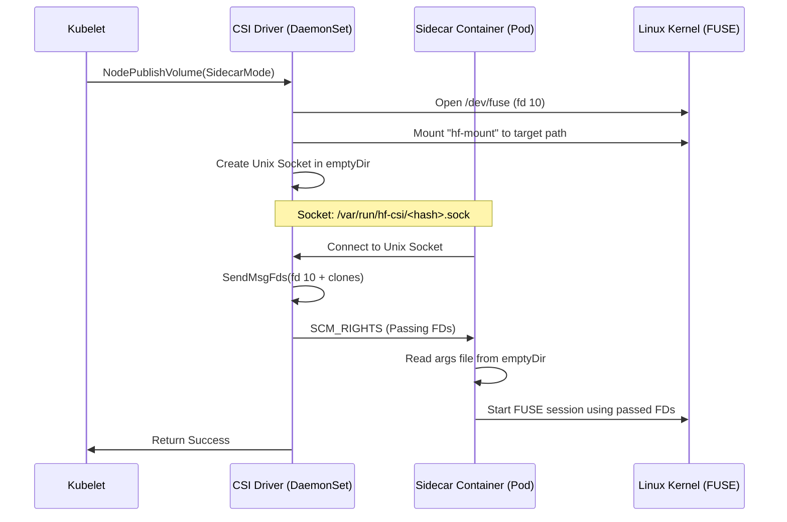
**Sources:** [pkg/driver/sidecar_mounter_linux.go:130-240](), [pkg/util/fdchannel.go:22-42]()

---

## Implementation Details

### FUSE Device Cloning (Multi-threading)

To support high-concurrency reads, the driver utilizes the `FUSE_DEV_IOC_CLONE` ioctl. This allows multiple file descriptors to be bound to the same FUSE connection, enabling the sidecar to run multiple reader threads.

*   **Function:** `cloneFuseFd` [pkg/driver/sidecar_mounter_linux.go:84-96]()
*   **Default Count:** 4 fds (1 primary + 3 clones), configurable via `fuseFdCount` volume attribute or `HF_CSI_SIDECAR_FUSE_FD_COUNT` [pkg/driver/sidecar_mounter_linux.go:46-79]().
*   **Mechanism:** The driver opens `/dev/fuse` multiple times and calls `ioctl(dst, FUSE_DEV_IOC_CLONE, &srcFd)` to link them [pkg/driver/sidecar_mounter_linux.go:90-90]().

### Unix Socket Management and Symlinks

Unix domain socket paths are limited to 108 characters (`UNIX_PATH_MAX`). Because Kubelet's pod volume paths are often very long (e.g., `/var/lib/kubelet/pods/<uuid>/...`), the driver uses a symlink workaround:

1.  A hash is generated from the volume name [pkg/driver/sidecar_mounter_linux.go:172-172]().
2.  A short symlink is created in `/var/run/hf-csi/<hash>` pointing to the long `emptyDir` path [pkg/driver/sidecar_mounter_linux.go:214-222]().
3.  The Unix socket is created using this short symlink path [pkg/driver/sidecar_mounter_linux.go:223-223]().

### SCM_RIGHTS and `fdchannel`

The `pkg/util/fdchannel` package handles the low-level `sendmsg` system calls required to pass file descriptors across processes.

*   **`SendMsgFds`**: Packs a slice of integers (FDs) into a `syscall.UnixRights` structure and sends them as ancillary data [pkg/util/fdchannel.go:22-42]().
*   **`RecvMsg`**: Used primarily for testing or by the sidecar (if written in Go) to extract the FDs from the OOB (out-of-band) buffer [pkg/util/fdchannel.go:46-83]().

**Sources:** [pkg/driver/sidecar_mounter_linux.go:35-52](), [pkg/util/fdchannel.go:1-84]()

---

## Token Lifecycle

Sidecar mode supports dynamic token refresh without requiring a pod restart.

### Token Injection
The driver copies the Hugging Face token from the CSI-provided path to the shared `emptyDir` at `/.volumes/<hash>/token` [pkg/driver/sidecar_mounter_linux.go:184-196](). The `emptyDir` is typically backed by `tmpfs`, ensuring the token is never persisted to physical disk.

### Token Refresh
When `NodePublishVolume` is called for an existing mount (republish), the driver invokes `refreshSidecarToken`. This function overwrites the token file in the `emptyDir` with the new credentials [pkg/driver/sidecar_mounter_linux.go:294-311](). The `hf-mount-fuse` process in the sidecar monitors this file and reloads it automatically.

**Sources:** [pkg/driver/sidecar_mounter_linux.go:184-196](), [pkg/driver/sidecar_mounter_linux.go:294-311]()

---

## Code Entity Map

The following table maps conceptual operations to the specific functions and constants in the codebase.

| System Name | Code Entity | File |
| :--- | :--- | :--- |
| **FUSE Clone Ioctl** | `fuseDevIoctlClone` | [pkg/driver/sidecar_mounter_linux.go:51-51]() |
| **FD Sender** | `SendMsgFds` | [pkg/util/fdchannel.go:22-22]() |
| **FD Receiver** | `RecvMsg` | [pkg/util/fdchannel.go:46-46]() |
| **Mount Execution** | `sidecarMount` | [pkg/driver/sidecar_mounter_linux.go:130-130]() |
| **Path Translator** | `sidecarPath` | [pkg/driver/sidecar_mounter_linux.go:104-104]() |
| **Health Check** | `checkSidecarHealth` | [pkg/driver/sidecar_mounter_linux.go:261-261]() |
| **Accept Timeout** | `socketAcceptTimeout` | [pkg/driver/sidecar_mounter_linux.go:33-33]() |

**Sources:** [pkg/driver/sidecar_mounter_linux.go](), [pkg/util/fdchannel.go]()

---

# Page: Resource Management

# Resource Management

<details>
<summary>Relevant source files</summary>

The following files were used as context for generating this wiki page:

- [pkg/driver/mounter.go](pkg/driver/mounter.go)
- [pkg/driver/podmounter_test.go](pkg/driver/podmounter_test.go)
- [pkg/driver/resources.go](pkg/driver/resources.go)
- [pkg/driver/resources_test.go](pkg/driver/resources_test.go)

</details>


The `hf-csi-driver` allows for granular control over the CPU and memory resources allocated to the FUSE daemon containers (`hf-mount-fuse`). Whether running in **PodMount** mode (dedicated pods) or **Sidecar** mode (injected containers), the driver ensures that resource requests and limits are correctly parsed, merged across multiple volumes, and clamped to prevent Kubernetes API rejections.

## Resource Lifecycle

Resource management follows a specific data flow from the CSI `volumeAttributes` to the final Pod specification:

1.  **Parsing**: Attributes provided in the StorageClass or PV are parsed from strings into `MountResources` structs containing `resource.Quantity` objects.
2.  **Storage**: For PodMount mode, these resources are persisted in the `HFMount` CRD.
3.  **Merging**: In Sidecar mode, if a pod uses multiple HF volumes, the resources for the single sidecar container are calculated by taking the **maximum** of all individual volume requirements.
4.  **Clamping**: To avoid `RequestExceedsLimit` errors from the kube-apiserver, the driver ensures that any calculated `Request` does not exceed the specified `Limit`.
5.  **Application**: The final `corev1.ResourceRequirements` are applied to the container spec.

### Data Flow: Attributes to Pod Spec

The following diagram illustrates how raw string attributes are transformed into Kubernetes resource objects.

**Resource Processing Pipeline**
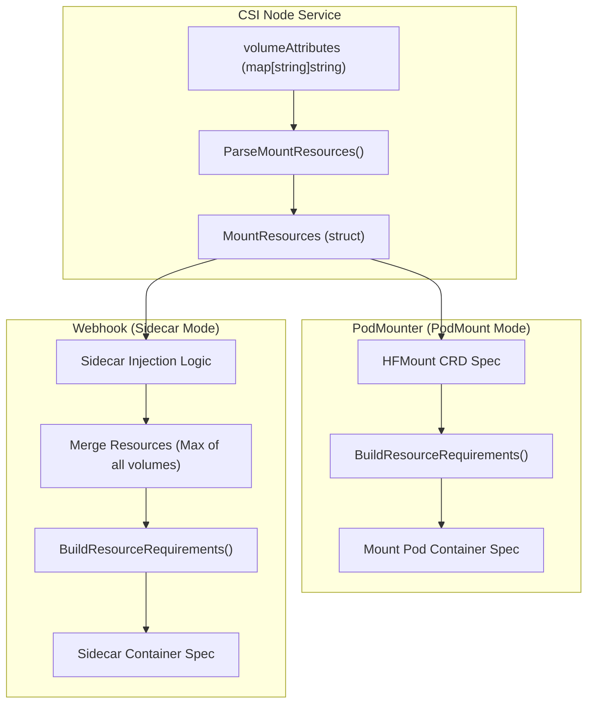
**Sources:** [pkg/driver/resources.go:37-44](), [pkg/driver/resources.go:63-94]()

---

## Implementation Details

### Key Entities

| Entity | Role |
| :--- | :--- |
| `MountResources` | A struct holding optional `CPULimit`, `CPURequest`, `MemoryLimit`, and `MemoryRequest`. [pkg/driver/resources.go:28-33]() |
| `ParseMountResources` | Function that extracts and validates quantities from `volumeAttributes`. [pkg/driver/resources.go:37-44]() |
| `BuildResourceRequirements` | Merges user overrides with system defaults and applies clamping logic. [pkg/driver/resources.go:63-94]() |
| `clampRequestToLimit` | Ensures `Requests[R] <= Limits[R]` for a given resource. [pkg/driver/resources.go:143-159]() |

### Default Values
If no resource attributes are provided by the user, the driver applies minimal defaults to ensure the FUSE daemon has a baseline allocation:
*   **Default CPU Request**: `10m` [pkg/driver/resources.go:22]()
*   **Default Memory Request**: `32Mi` [pkg/driver/resources.go:23]()

*Note: Limits are not set by default. They are only applied if explicitly requested via volume attributes.* [pkg/driver/resources.go:58-62]()

### Resource Attribute Keys
The driver recognizes the following keys in the CSI `volumeAttributes` map:
*   `cpuLimit` [pkg/driver/resources.go:12]()
*   `cpuRequest` [pkg/driver/resources.go:13]()
*   `memoryLimit` [pkg/driver/resources.go:14]()
*   `memoryRequest` [pkg/driver/resources.go:15]()

**Sources:** [pkg/driver/resources.go:11-24]()

---

## Clamping and Validation

The driver prioritizes pod schedulability over strict adherence to conflicting resource requests. If a user provides a `cpuRequest` of `500m` but a `cpuLimit` of `200m`, the Kubernetes API would normally reject the Pod creation.

The `clampRequestToLimit` function detects this condition and automatically lowers the `Request` to match the `Limit`, issuing a warning in the logs:
[pkg/driver/resources.go:155-158]()

```go
if rq.Cmp(lim) > 0 {
    klog.Warningf("%s request %s exceeds limit %s; clamping request to limit", name, rq.String(), lim.String())
    req.Requests[name] = lim
}
```

**Sources:** [pkg/driver/resources.go:143-159]()

---

## Code Entity Mapping

The following diagram maps the logical resource management concepts to the specific functions and structures in the Go codebase.

**Code Entity Map**
```mermaid
classDiagram
    class "volumeAttributes" {
        cpuLimit: string
        cpuRequest: string
    }

    class MountResources {
        +CPULimit: *resource.Quantity
        +CPURequest: *resource.Quantity
        +ToStringMap() map[string]string
        +ToUnstructured() map[string]interface{}
    }

    class ResourceLogic {
        +ParseMountResources(map[string]string)
        +BuildResourceRequirements(MountResources, defaults)
        +clampRequestToLimit(ResourceRequirements, name)
    }

    class PodMounter {
        +buildMountPod(..., MountResources)
    }

    "volumeAttributes" --> ResourceLogic : "Parsed by"
    ResourceLogic --> MountResources : "Produces"
    MountResources --> PodMounter : "Passed to"
    PodMounter --> ResourceLogic : "Calls BuildResourceRequirements"
```
**Sources:** [pkg/driver/resources.go:28-44](), [pkg/driver/resources.go:63-94](), [pkg/driver/mounter.go:29]()

---

## Serialization for CRDs

In **PodMount** mode, the driver needs to store these resource requirements in the `HFMount` Custom Resource so that if the driver restarts, it can reconstruct the state.

The `MountResources` struct provides helper methods for this:
*   `ToStringMap()`: Converts the quantities back to strings for the CRD's `volumeAttributes` equivalent. [pkg/driver/resources.go:98-113]()
*   `ToUnstructured()`: Converts the map to `map[string]interface{}` for use with the `client-go` dynamic/unstructured client. [pkg/driver/resources.go:118-128]()
*   `MountResourcesFromUnstructured()`: Reconstructs the struct from a raw map retrieved from the Kubernetes API. [pkg/driver/resources.go:133-141]()

**Sources:** [pkg/driver/resources.go:98-141]()

---

# Page: Admission Webhook (Sidecar Injection)

# Admission Webhook (Sidecar Injection)

<details>
<summary>Relevant source files</summary>

The following files were used as context for generating this wiki page:

- [pkg/webhook/handler.go](pkg/webhook/handler.go)
- [pkg/webhook/sidecar.go](pkg/webhook/sidecar.go)
- [pkg/webhook/sidecar_test.go](pkg/webhook/sidecar_test.go)
- [test/e2e/sidecar/02-sidecar-injected.sh](test/e2e/sidecar/02-sidecar-injected.sh)

</details>


The HF CSI Driver utilizes a Mutating Admission Webhook to facilitate "Sidecar Mode" mounts. This webhook intercepts Pod creation requests and automatically injects the necessary components—specifically the `hf-mount` sidecar container and shared communication volumes—required to run FUSE mounts within the Pod's own lifecycle.

## Overview

The webhook's primary responsibility is to detect Pods that reference the `hf.csi.huggingface.co` driver and prepare them for sidecar-based mounting. It operates as a standard Kubernetes Mutating Admission Webhook, typically listening on the `/inject` path [pkg/webhook/handler.go:19-21]().

### Core Responsibilities
*   **Volume Scanning**: It inspects both inline `csi` volumes and `persistentVolumeClaim` references to identify HF CSI volumes [pkg/webhook/handler.go:124-146]().
*   **Opt-out Detection**: It respects the `mountMode: mountpod` attribute, skipping injection for volumes that prefer the dedicated Mount Pod architecture [pkg/webhook/handler.go:130-132]().
*   **Spec Mutation**: It modifies the Pod spec by adding a "native sidecar" (an init container with `restartPolicy: Always`) and shared `emptyDir` volumes [pkg/webhook/sidecar.go:38-107]().
*   **Lifecycle Management**: It enforces a minimum `terminationGracePeriodSeconds` to ensure the FUSE daemon has sufficient time to flush writes to the Hugging Face Hub during Pod shutdown [pkg/webhook/sidecar.go:109-131]().

### Webhook Flow Diagram

The following diagram illustrates the interaction between the Kubernetes API Server, the Webhook `Injector`, and the resulting Pod specification.

**Webhook Admission Logic**
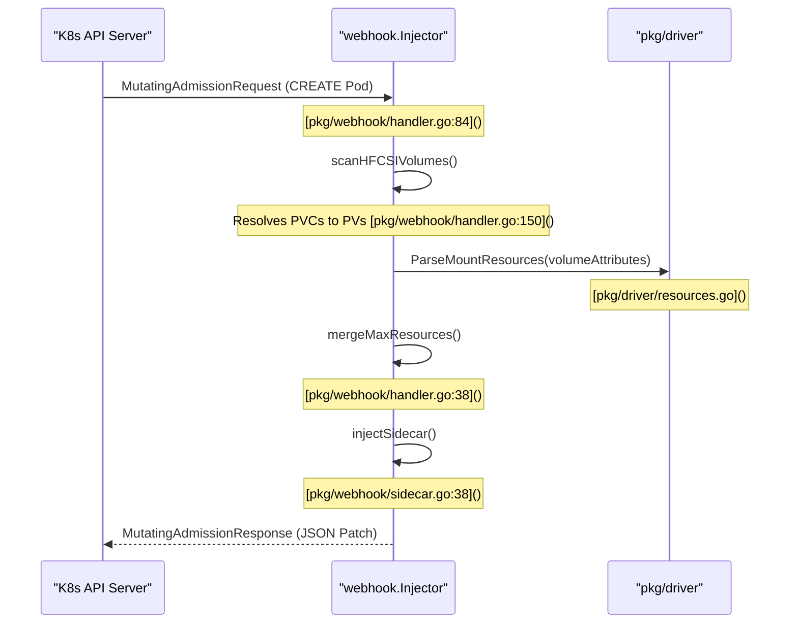
Sources: [pkg/webhook/handler.go:84-118](), [pkg/webhook/sidecar.go:38-107]()

## Sidecar Injection Logic

The injection logic transforms a standard Pod into one capable of running the `hf-mount-fuse` binary. It uses the KEP-753 "native sidecar" feature, which allows the sidecar to start before other containers and remain running throughout the Pod's life.

Key components injected include:
*   **The `hf-mount` Container**: An init container with `restartPolicy: Always` running the `hf-mount-fuse-sidecar` command [pkg/webhook/sidecar.go:60-65]().
*   **Communication Volume**: A `tmpfs` backed `emptyDir` named `hf-csi-tmp` used for passing FUSE file descriptors and mount arguments between the CSI driver and the sidecar [pkg/webhook/sidecar.go:41-48]().
*   **Resource Merging**: If multiple HF volumes are present, the webhook merges their resource requirements (CPU/Memory) by taking the maximum of each requested value to ensure the shared sidecar is adequately provisioned [pkg/webhook/handler.go:38-48]().

For details on the specific container configuration and volume mounting, see **[Sidecar Injection Logic (#3.1)]**.

Sources: [pkg/webhook/sidecar.go:30-107](), [pkg/webhook/handler.go:38-48]()

## Webhook Deployment and TLS

The webhook is deployed as a Service within the cluster, usually managed by the same Deployment as the CSI controller. Because Kubernetes requires HTTPS for admission webhooks, the deployment includes TLS certificate management.

*   **Endpoint**: The server registers the `/inject` handler via the `NewInjector` function [pkg/webhook/handler.go:79-81]().
*   **Security**: The sidecar itself is configured with a restrictive `SecurityContext`, running as non-root and dropping all capabilities, as it receives its FUSE file descriptor via SCM_RIGHTS rather than opening `/dev/fuse` directly [pkg/webhook/sidecar.go:70-78]().
*   **Graceful Shutdown**: The webhook automatically raises the Pod's `terminationGracePeriodSeconds` to a minimum of 60 seconds [pkg/webhook/sidecar.go:19](). This is tracked via the `hf.csi.huggingface.co/original-termination-grace-period-seconds` annotation [pkg/webhook/sidecar.go:28]().

For details on Helm templates and TLS configuration, see **[Webhook Deployment and TLS (#3.2)]**.

Sources: [pkg/webhook/handler.go:19-36](), [pkg/webhook/sidecar.go:12-28](), [pkg/webhook/sidecar.go:70-78]()

## Component Mapping

This diagram maps the logical webhook components to the specific Go entities and files that implement them.

**Code Entity Mapping**
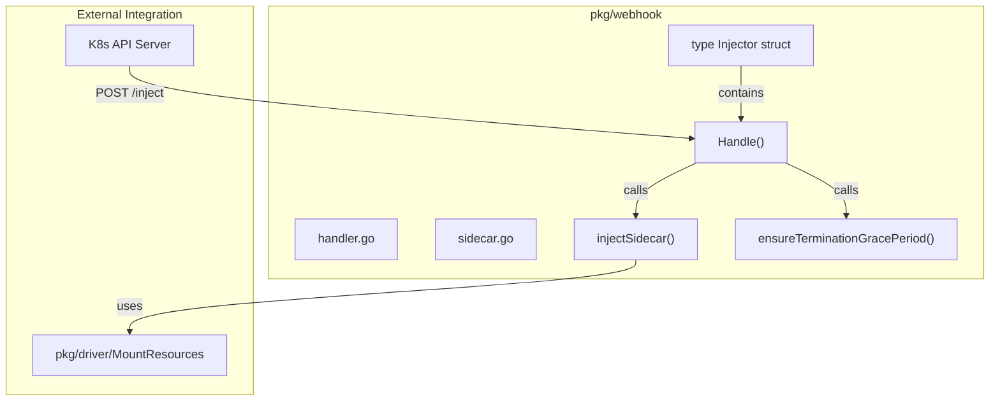
Sources: [pkg/webhook/handler.go:72-84](), [pkg/webhook/sidecar.go:38-114]()

---

# Page: Sidecar Injection Logic

# Sidecar Injection Logic

<details>
<summary>Relevant source files</summary>

The following files were used as context for generating this wiki page:

- [pkg/webhook/handler.go](pkg/webhook/handler.go)
- [pkg/webhook/sidecar.go](pkg/webhook/sidecar.go)
- [pkg/webhook/sidecar_test.go](pkg/webhook/sidecar_test.go)
- [test/e2e/sidecar/02-sidecar-injected.sh](test/e2e/sidecar/02-sidecar-injected.sh)

</details>


The `hf-csi-driver` uses a mutating admission webhook to inject the `hf-mount` sidecar container into Pods that reference HF CSI volumes. This sidecar runs the `hf-mount-fuse` process, which performs the actual file system operations. The injection logic ensures that the sidecar is correctly configured, has sufficient resources, and is given enough time to flush data to Hugging Face Hub during Pod termination.

## Overview of `injectSidecar`

The core injection logic is encapsulated in the `injectSidecar` function within [pkg/webhook/sidecar.go:38-107](). When the webhook detects a Pod using the `hf.csi.huggingface.co` driver, it performs the following mutations:

1.  **Volume Injection**: Adds a shared `emptyDir` (backed by `tmpfs`) for communication between the CSI driver and the sidecar [pkg/webhook/sidecar.go:41-48]().
2.  **Container Injection**: Prepends a "native sidecar" (an init container with `restartPolicy: Always`) to the Pod spec [pkg/webhook/sidecar.go:60-104]().
3.  **Grace Period Enforcement**: Ensures the Pod's `terminationGracePeriodSeconds` is sufficient for FUSE write-back flushes [pkg/webhook/sidecar.go:106-106]().

### Data Flow and Code Entity Mapping

The following diagram illustrates how the `Injector` struct processes a Pod and interacts with the driver's resource management logic.

**Sidecar Injection Sequence**
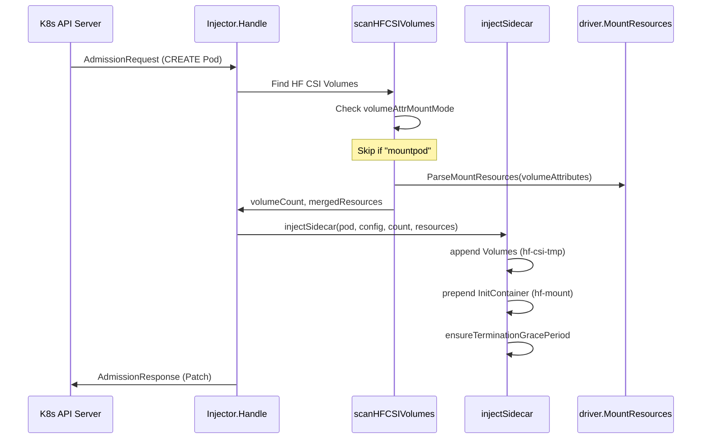
**Sources:** [pkg/webhook/handler.go:84-118](), [pkg/webhook/handler.go:124-146](), [pkg/webhook/sidecar.go:38-107]()

---

## Volume Scanning and Opt-out

The webhook scans both inline ephemeral volumes and `PersistentVolumeClaim` (PVC) references to determine if injection is necessary.

*   **Detection**: It looks for `vol.CSI.Driver == "hf.csi.huggingface.co"` [pkg/webhook/handler.go:129-129]().
*   **PVC Resolution**: For PVCs, the `resolvePVFromPVC` function fetches the underlying `PersistentVolume` to check the driver name and attributes [pkg/webhook/handler.go:150-169]().
*   **Opt-out Mechanism**: If the `mountMode` attribute is set to `mountpod`, the volume is skipped for sidecar injection [pkg/webhook/handler.go:131-133](), [pkg/webhook/handler.go:138-140]().

**Sources:** [pkg/webhook/handler.go:124-146](), [pkg/webhook/handler.go:19-36]()

---

## Native Sidecar Configuration (KEP-753)

The driver utilizes Kubernetes "Native Sidecars" by defining the `hf-mount` container as an `initContainer` with a `restartPolicy` of `Always` [pkg/webhook/sidecar.go:64-64](). This ensures the FUSE daemon starts before any standard containers and remains running for the life of the Pod.

### Security and Isolation
The sidecar runs with a restricted `SecurityContext`:
*   **Unprivileged**: It does not need `privileged: true` or `CAP_SYS_ADMIN` because the CSI driver performs the kernel mount and passes the file descriptor via `SCM_RIGHTS` [pkg/webhook/sidecar.go:30-33]().
*   **Non-root**: Runs as user/group 65534 (nobody) [pkg/webhook/sidecar.go:71-73]().
*   **Read-only Root FS**: The container's root filesystem is read-only [pkg/webhook/sidecar.go:74-74]().

### Startup Probe
To prevent application containers from accessing the mount before it is ready, a `StartupProbe` checks for the existence of a `.ready` file in the shared communication volume [pkg/webhook/sidecar.go:89-97]().

**Sources:** [pkg/webhook/sidecar.go:58-99]()

---

## Resource Merging and Clamping

Since multiple HF volumes in a single Pod share one sidecar container, the webhook must merge resource requirements from all volumes.

| Feature | Implementation Detail |
| :--- | :--- |
| **Merging Strategy** | Uses `mergeMaxResources` to pick the largest `Request` and `Limit` across all volumes [pkg/webhook/handler.go:38-48](). |
| **Parsing** | `driver.ParseMountResources` converts volume attributes into `resource.Quantity` [pkg/webhook/sidecar_test.go:62-74](). |
| **Clamping** | `driver.BuildResourceRequirements` ensures that if a user sets a `Limit` lower than the default `Request`, the `Request` is clamped down to match the `Limit` to avoid Pod rejection [pkg/webhook/sidecar_test.go:117-131](). |

**Sources:** [pkg/webhook/handler.go:38-62](), [pkg/webhook/sidecar_test.go:80-112]()

---

## Termination Grace Period Enforcement

The FUSE process may need time to flush pending writes to the Hugging Face Hub. The FUSE flush queue uses a 2s debounce and can batch up to 30s of changes [pkg/webhook/sidecar.go:12-16]().

*   **Minimum Period**: The webhook enforces a minimum `terminationGracePeriodSeconds` of 60 seconds [pkg/webhook/sidecar.go:19-19]().
*   **Traceability**: If the value is raised, the original value is stored in the annotation `hf.csi.huggingface.co/original-termination-grace-period-seconds` [pkg/webhook/sidecar.go:28-28]().
*   **Zero-Grace Handling**: This is particularly critical for `Jobs`, which often default to 0s (immediate `SIGKILL`), leading to data loss without this enforcement [pkg/webhook/sidecar_test.go:177-180]().

**Sources:** [pkg/webhook/sidecar.go:109-131](), [test/e2e/sidecar/02-sidecar-injected.sh:16-25]()

---

## Communication Infrastructure

The CSI driver and the sidecar communicate via a shared `emptyDir` volume named `hf-csi-tmp`.

**Entity Mapping: Communication Bridge**
```mermaid
graph LR
    subgraph "CSI Node Plugin (Host)"
        NodePublish["NodePublishVolume"]
        UnixSocket["Unix Socket (SCM_RIGHTS)"]
    end

    subgraph "Pod Sandbox"
        subgraph "Shared Volume: hf-csi-tmp"
            SocketFile["mount.sock"]
            ReadyFile[".ready"]
        end

        subgraph "hf-mount Sidecar"
            SidecarProcess["hf-mount-fuse-sidecar"]
            TmpDir["/tmp (sidecar-tmp)"]
        end
    end

    NodePublish -- "Creates" --> SocketFile
    NodePublish -- "Sends FD" --> UnixSocket
    UnixSocket -- "Path in" --> SocketFile
    SidecarProcess -- "Reads FD" --> SocketFile
    SidecarProcess -- "Writes" --> ReadyFile
    SidecarProcess -- "Uses" --> TmpDir
```
**Sources:** [pkg/webhook/handler.go:19-31](), [pkg/webhook/sidecar.go:39-56](), [pkg/webhook/sidecar.go:65-66]()

---

# Page: Webhook Deployment and TLS

# Webhook Deployment and TLS

<details>
<summary>Relevant source files</summary>

The following files were used as context for generating this wiki page:

- [cmd/hf-csi-driver/main.go](cmd/hf-csi-driver/main.go)
- [deploy/helm/hf-csi-driver/templates/webhook-certificate.yaml](deploy/helm/hf-csi-driver/templates/webhook-certificate.yaml)
- [deploy/helm/hf-csi-driver/templates/webhook-deployment.yaml](deploy/helm/hf-csi-driver/templates/webhook-deployment.yaml)
- [deploy/helm/hf-csi-driver/templates/webhook-service.yaml](deploy/helm/hf-csi-driver/templates/webhook-service.yaml)
- [deploy/helm/hf-csi-driver/values.yaml](deploy/helm/hf-csi-driver/values.yaml)

</details>


The `hf-csi-driver` utilizes a Mutating Admission Webhook to support "sidecar mode" volume mounts. This page details the deployment architecture of the webhook server, the automated TLS certificate management within the Helm chart, and the registration of the `/inject` endpoint.

## Webhook Server Lifecycle

The webhook is a secondary execution mode of the `hf-csi-driver` binary, triggered by the `--mode=webhook` flag [cmd/hf-csi-driver/main.go:28](). When running in this mode, the application initializes a `controller-runtime` manager to handle HTTPS requests and health probes.

### Initialization Sequence

1.  **Manager Setup**: The `runWebhook` function creates a `ctrl.Manager` configured with a `WebhookServer` [cmd/hf-csi-driver/main.go:130-137]().
2.  **Health Probes**: A readiness check is registered at `/readyz` on port `22031` [cmd/hf-csi-driver/main.go:132,142]().
3.  **Injector Registration**: A new `webhook.Injector` is instantiated and registered to the `/inject` path [cmd/hf-csi-driver/main.go:148-151]().
4.  **TLS Loading**: The server automatically loads certificates from the directory specified by `--webhook-cert-dir` (default `/etc/tls-certs`) [cmd/hf-csi-driver/main.go:43,135]().

### Webhook Component Interaction
The following diagram illustrates the relationship between the Kubernetes API server, the Webhook Service, and the Go code entities.

**Diagram: Webhook Registration and Request Flow**
```mermaid
graph TD
    subgraph "Kubernetes Control Plane"
        A["MutatingWebhookConfiguration"] -- "caBundle & ServiceRef" --> B["kube-apiserver"]
    end

    subgraph "Webhook Pod (mode=webhook)"
        direction TB
        subgraph "cmd/hf-csi-driver/main.go"
            C["runWebhook()"] --> D["ctrl.Manager"]
            D --> E["ctrlwebhook.Server"]
        end
        
        subgraph "pkg/webhook"
            F["Injector struct"] -- "implements" --> G["admission.Handler"]
        end
        
        E -- "Register('/inject')" --> G
    end

    B -- "HTTPS POST /inject" --> H["Service: hf-csi-driver-webhook"]
    H -- "Port 443 -> 9443" --> E
```
**Sources:** [cmd/hf-csi-driver/main.go:123-157](), [deploy/helm/hf-csi-driver/templates/webhook-service.yaml:1-16]()

---

## TLS Configuration and Certificate Management

The webhook requires TLS for secure communication with the `kube-apiserver`. The `hf-csi-driver` Helm chart automates the generation and distribution of these certificates.

### Automated Certificate Generation
The chart uses a conditional logic block in `webhook-certificate.yaml` to manage the TLS Secret:
1.  **Lookup**: It first checks if a Secret named `{{ .Release.Name }}-webhook-tls` already exists [deploy/helm/hf-csi-driver/templates/webhook-certificate.yaml:3]().
2.  **Reuse**: If found, it reuses the existing `ca.crt`, `tls.crt`, and `tls.key` to prevent unnecessary certificate rotations on Helm upgrades [deploy/helm/hf-csi-driver/templates/webhook-certificate.yaml:4-19]().
3.  **Generation**: If not found, it uses the Helm `genSelfSignedCert` function to create a certificate valid for 3650 days, covering the service's internal DNS names (e.g., `svc-name.namespace.svc`) [deploy/helm/hf-csi-driver/templates/webhook-certificate.yaml:52-64]().

### MutatingWebhookConfiguration
The `MutatingWebhookConfiguration` resource instructs the API server on which pods to intercept.
-   **Path**: Requests are sent to `/inject` [deploy/helm/hf-csi-driver/templates/webhook-certificate.yaml:39]().
-   **Namespace Selector**: To avoid circular dependencies and system instability, the webhook excludes `kube-system`, `kube-public`, and `kube-node-lease` [deploy/helm/hf-csi-driver/templates/webhook-certificate.yaml:40-44]().
-   **Rules**: It only triggers on `CREATE` operations for `pods` [deploy/helm/hf-csi-driver/templates/webhook-certificate.yaml:46-49]().

**Sources:** [deploy/helm/hf-csi-driver/templates/webhook-certificate.yaml:1-96]()

---

## Deployment Specification

The webhook is deployed as a single-replica `Deployment` (configurable via `Values.webhook.replicas`) [deploy/helm/hf-csi-driver/templates/webhook-deployment.yaml:10]().

### Container Arguments
The container executes the same driver image but with specific flags:
-   `--mode=webhook`: Activates the admission controller logic [deploy/helm/hf-csi-driver/templates/webhook-deployment.yaml:30]().
-   `--sidecar-image`: Passes the `hf-mount-fuse` image reference that will be injected into user pods [deploy/helm/hf-csi-driver/templates/webhook-deployment.yaml:33]().
-   `--webhook-port`: Configures the listening port (default `9443`) [deploy/helm/hf-csi-driver/templates/webhook-deployment.yaml:31]().

### Volume Mounts
The TLS Secret is mounted into the pod at `/etc/tls-certs`:
```yaml
volumeMounts:
  - name: tls-certs
    mountPath: /etc/tls-certs
    readOnly: true
volumes:
  - name: tls-certs
    secret:
      secretName: {{ include "hf-csi-driver.fullname" . }}-webhook-tls
```
**Sources:** [deploy/helm/hf-csi-driver/templates/webhook-deployment.yaml:25-60](), [deploy/helm/hf-csi-driver/values.yaml:34-42]()

---

## Mount Mode Opt-out Mechanism

While the webhook is active globally for all non-system namespaces, it respects a per-volume opt-out mechanism. The driver supports two primary mount modes:
1.  **sidecar (Default)**: The webhook injects an `initContainer` into the Pod to perform the FUSE mount.
2.  **mountpod**: The CSI driver creates a separate, dedicated Pod on the node to manage the mount.

### Logic Flow for Opt-out
When the webhook receives an admission request, the `Injector` scans the Pod's volumes. If a volume's `CSI` attributes contain `mountMode: mountpod`, the webhook skips sidecar injection for that specific Pod, allowing the `PodMounter` in the Node driver to handle the lifecycle instead.

**Diagram: Opt-out Data Flow**
```mermaid
flowchart LR
    subgraph "User Pod Spec"
        V1["Volume: hf-volume"]
        V1 --- ATTR["volumeAttributes: { mountMode: 'mountpod' }"]
    end

    subgraph "Webhook Server"
        INJ["pkg/webhook/Injector.Inject()"]
        SCAN["Scan Pod Volumes"]
    end

    V1 --> INJ
    INJ --> SCAN
    SCAN -- "mountMode == 'mountpod'" --> SKIP["Return Unchanged Pod"]
    SCAN -- "mountMode == 'sidecar' (or empty)" --> DO_INJ["Inject hf-mount Sidecar"]
```
**Sources:** [deploy/helm/hf-csi-driver/values.yaml:32-33](), [cmd/hf-csi-driver/main.go:148-151]()

---

# Page: Deployment and Configuration

# Deployment and Configuration

<details>
<summary>Relevant source files</summary>

The following files were used as context for generating this wiki page:

- [deploy/helm/hf-csi-driver/Chart.yaml](deploy/helm/hf-csi-driver/Chart.yaml)
- [deploy/helm/hf-csi-driver/values.yaml](deploy/helm/hf-csi-driver/values.yaml)
- [deploy/kubernetes/daemonset.yaml](deploy/kubernetes/daemonset.yaml)

</details>


This section provides a high-level reference for the deployment artifacts and configuration mechanisms of the `hf-csi-driver`. The driver is designed to be deployed as a standard Kubernetes CSI plugin, utilizing a DaemonSet for node-level operations and a Mutating Admission Webhook for sidecar injection.

The deployment infrastructure supports two primary methods:
1.  **Helm Chart**: The recommended approach for production, offering full parameterization of images, resource limits, and cache settings.
2.  **Raw Manifests**: A collection of static YAML files for environments where Helm is not available or for manual inspection of the resource hierarchy.

## Deployment Architecture Overview

The `hf-csi-driver` deployment consists of several interconnected Kubernetes objects that facilitate FUSE mounting across different isolation modes.

### Code-to-Entity Mapping: Deployment Components

The following diagram maps the logical deployment components to their corresponding Kubernetes resource definitions and configuration keys.

**Deployment Component Map**
```mermaid
graph TD
    subgraph "Kubernetes Cluster"
        CSID["CSIDriver Object"]
        DS["DaemonSet: hf-csi-node"]
        WH["Webhook Deployment"]
        CRD["CustomResourceDefinition: hfmounts"]
        RBAC["ClusterRoles & Bindings"]
    end

    subgraph "Code & Config"
        DS_FILE["deploy/kubernetes/daemonset.yaml"]
        VALS["deploy/helm/hf-csi-driver/values.yaml"]
        CHART["deploy/helm/hf-csi-driver/Chart.yaml"]
    end

    DS_FILE -->|defines| DS
    VALS -->|configures| DS
    VALS -->|configures| WH
    CHART -->|metadata| CSID
    RBAC -->|permissions| DS
    RBAC -->|permissions| WH
```
**Sources:**
- [deploy/kubernetes/daemonset.yaml:1-7]()
- [deploy/helm/hf-csi-driver/values.yaml:1-48]()
- [deploy/helm/hf-csi-driver/Chart.yaml:1-6]()

## Core Components

### 1. CSIDriver Object
The `CSIDriver` object registers `hf.csi.huggingface.co` within the cluster. It defines how Kubernetes should interact with the driver, specifically regarding volume lifecycle and whether the driver requires pod information during `NodePublishVolume`.

### 2. DaemonSet (`hf-csi-node`)
The DaemonSet runs on every worker node and contains three primary containers:
*   **`hf-csi-plugin`**: The main Go binary that implements the CSI Node service. It manages FUSE mounts, `HFMount` CRDs, and interacts with the `hf-mount-fuse` binary.
*   **`node-driver-registrar`**: Registers the CSI driver with the Kubelet.
*   **`liveness-probe`**: Monitors the health of the CSI plugin.

### 3. Mutating Admission Webhook
The webhook is responsible for `Sidecar Mode` operations. It intercepts Pod creation requests and injects the `hf-mount-fuse` sidecar container and required volumes (e.g., the shared FUSE device directory) when it detects a Hugging Face CSI volume.

### 4. RBAC and Permissions
The driver requires `ClusterRole` permissions to manage `HFMount` custom resources and to coordinate with the Kubernetes API for pod-mount lifecycle management.

**Sources:**
- [deploy/kubernetes/daemonset.yaml:23-88]()
- [deploy/helm/hf-csi-driver/values.yaml:34-41]()

## Configuration Parameters

The driver is configured primarily through CLI flags in the DaemonSet or values in the Helm chart. Key configuration areas include:

| Category | Key Parameters | Description |
| :--- | :--- | :--- |
| **Images** | `image.repository`, `hfMount.image.tag` | Defines the driver and FUSE mounter images. [deploy/helm/hf-csi-driver/values.yaml:1-12]() |
| **Storage** | `cacheDir` | Host path used for local caching of Hugging Face datasets. [deploy/helm/hf-csi-driver/values.yaml:17-17]() |
| **Networking** | `hostNetwork` | Whether the driver pods share the host network namespace. [deploy/helm/hf-csi-driver/values.yaml:22-22]() |
| **Scheduling** | `nodeSelector`, `tolerations` | Controls which nodes the driver is deployed on. [deploy/helm/hf-csi-driver/values.yaml:24-29]() |

**Sources:**
- [deploy/helm/hf-csi-driver/values.yaml:1-48]()
- [deploy/kubernetes/daemonset.yaml:26-32]()

## Detailed Reference Pages

For specific implementation details and configuration schemas, refer to the following child pages:

### [Helm Chart Reference](#4.1)
Detailed documentation on the `hf-csi-driver` Helm chart. Includes a full breakdown of `values.yaml`, instructions for customizing image tags for `hf-mount-fuse`, and configuring the admission webhook for sidecar injection.

### [Raw Kubernetes Manifests](#4.2)
A guide to the static YAML manifests located in `deploy/kubernetes/`. This section covers the manual setup of the `DaemonSet`, `ServiceAccount`, `CSIDriver` object, and the `HFMount` CRD for clusters not utilizing Helm.

---
**Sources:**
- [deploy/helm/hf-csi-driver/values.yaml:1-48]()
- [deploy/kubernetes/daemonset.yaml:1-110]()

---

# Page: Helm Chart Reference

# Helm Chart Reference

<details>
<summary>Relevant source files</summary>

The following files were used as context for generating this wiki page:

- [.dockerignore](.dockerignore)
- [deploy/helm/hf-csi-driver/Chart.yaml](deploy/helm/hf-csi-driver/Chart.yaml)
- [deploy/helm/hf-csi-driver/templates/_helpers.tpl](deploy/helm/hf-csi-driver/templates/_helpers.tpl)
- [deploy/helm/hf-csi-driver/templates/csidriver.yaml](deploy/helm/hf-csi-driver/templates/csidriver.yaml)
- [deploy/helm/hf-csi-driver/templates/daemonset.yaml](deploy/helm/hf-csi-driver/templates/daemonset.yaml)
- [deploy/helm/hf-csi-driver/templates/rbac.yaml](deploy/helm/hf-csi-driver/templates/rbac.yaml)
- [deploy/helm/hf-csi-driver/templates/serviceaccount.yaml](deploy/helm/hf-csi-driver/templates/serviceaccount.yaml)
- [deploy/helm/hf-csi-driver/values.yaml](deploy/helm/hf-csi-driver/values.yaml)
- [go.mod](go.mod)
- [go.sum](go.sum)

</details>


The `hf-csi-driver` Helm chart provides a production-ready deployment for the Hugging Face CSI driver. It manages the lifecycle of the CSI Node service (via a DaemonSet), the sidecar injection webhook, necessary RBAC permissions, and the `CSIDriver` object registration.

### Chart Components and Templates

The chart is structured to deploy all required infrastructure for both `podmount` and `sidecar` mount modes.

#### 1. CSI Node DaemonSet
The primary component is the DaemonSet, which runs on every node in the cluster. It contains three containers:
*   **`hf-csi-plugin`**: The core driver binary that implements the CSI spec.
*   **`node-driver-registrar`**: Registers the CSI driver with the Kubelet.
*   **`liveness-probe`**: Monitors the health of the CSI driver.

The DaemonSet is configured with `hostNetwork: true` by default [deploy/helm/hf-csi-driver/templates/daemonset.yaml:32-32]() and requires `privileged: true` [deploy/helm/hf-csi-driver/templates/daemonset.yaml:61-61]() to manage FUSE mounts and bind-mounts into the Kubelet directory.

#### 2. Admission Webhook
The chart deploys a mutating admission webhook that handles sidecar injection for pods using HF volumes. This ensures that the `hf-mount-fuse` process can run within the same network/process namespace as the application when `mountMode: sidecar` is used.

#### 3. CSIDriver Object
The `CSIDriver` object [deploy/helm/hf-csi-driver/templates/csidriver.yaml:2-2]() defines the driver's capabilities:
*   **`podInfoOnMount: true`**: Required for the driver to receive pod metadata (like UID and namespace) to facilitate token management and sidecar coordination [deploy/helm/hf-csi-driver/templates/csidriver.yaml:9-9]().
*   **`requiresRepublish: true`**: Enables the driver to periodically refresh tokens or handle mount recovery [deploy/helm/hf-csi-driver/templates/csidriver.yaml:10-10]().
*   **`volumeLifecycleModes`**: Supports both `Ephemeral` and `Persistent` volumes [deploy/helm/hf-csi-driver/templates/csidriver.yaml:11-14]().

#### 4. RBAC and Permissions
The driver requires a `ClusterRole` [deploy/helm/hf-csi-driver/templates/rbac.yaml:2-2]() with permissions to:
*   Manage `HFMount` custom resources and their status [deploy/helm/hf-csi-driver/templates/rbac.yaml:17-19]().
*   Create and delete `Pods` (for the `podmount` mode) [deploy/helm/hf-csi-driver/templates/rbac.yaml:8-10]().
*   Read `PersistentVolume` and `PersistentVolumeClaim` objects [deploy/helm/hf-csi-driver/templates/rbac.yaml:11-16]().

Sources: [deploy/helm/hf-csi-driver/templates/daemonset.yaml:1-144](), [deploy/helm/hf-csi-driver/templates/csidriver.yaml:1-14](), [deploy/helm/hf-csi-driver/templates/rbac.yaml:1-35]().

### Configuration Values (`values.yaml`)

The following table describes the primary configuration knobs available in the Helm chart.

| Value | Description | Default |
| :--- | :--- | :--- |
| `image.repository` | Repository for the CSI driver binary. | `ghcr.io/huggingface/hf-csi-driver` |
| `image.tag` | Image tag for the CSI driver. | `latest` |
| `hfMount.image.repository`| Repository for the FUSE mounter. | `ghcr.io/huggingface/hf-mount-fuse` |
| `hfMount.image.tag` | Image tag for the FUSE mounter. | `latest` |
| `cacheDir` | Host path used for caching downloaded files. | `/var/lib/hf-csi-driver/cache` |
| `logVerbosity` | Log level for the driver (klog). | `4` |
| `webhook.port` | Port for the admission webhook service. | `9443` |
| `priorityClassName` | Priority class for the DaemonSet pods. | `system-node-critical` |

#### Customizing Cache and Mounts
The `cacheDir` value [deploy/helm/hf-csi-driver/values.yaml:17-17]() is passed to the CSI driver via the `--cache-dir` flag [deploy/helm/hf-csi-driver/templates/daemonset.yaml:45-45](). This directory is mounted from the host into the driver container to persist cached data across driver restarts [deploy/helm/hf-csi-driver/templates/daemonset.yaml:136-139]().

Sources: [deploy/helm/hf-csi-driver/values.yaml:1-48](), [deploy/helm/hf-csi-driver/templates/daemonset.yaml:40-54]().

### Data Flow: Helm to Code Entity Mapping

The following diagram bridges the Helm configuration space to the internal Go structs and command-line arguments used by the driver.

**Helm to Driver Argument Mapping**
```mermaid
graph TD
    subgraph "Values.yaml"
        V_CD["cacheDir"]
        V_HI["hfMount.image"]
        V_LV["logVerbosity"]
        V_HN["hostNetwork"]
    end

    subgraph "DaemonSet Container Args"
        A_CD["--cache-dir"]
        A_MI["--mount-image"]
        A_LV["--v"]
        A_HN["--mount-host-network"]
    end

    subgraph "pkg/driver/driver.go"
        D_S["Driver Struct"]
        D_CD["Driver.cacheDir"]
    end

    V_CD -->|Template Expansion| A_CD
    V_HI -->|Template Expansion| A_MI
    V_LV -->|Template Expansion| A_LV
    V_HN -->|Template Expansion| A_HN

    A_CD -->|main.go Flags| D_CD
    A_MI -->|main.go Flags| D_S
```
Sources: [deploy/helm/hf-csi-driver/values.yaml:7-22](), [deploy/helm/hf-csi-driver/templates/daemonset.yaml:42-54]().

### Deployment Architecture

The chart orchestrates multiple Kubernetes resources to enable the CSI lifecycle. The diagram below illustrates how these templates relate to the runtime entities.

**Chart Resource Relationship**
```mermaid
graph TD
    subgraph "Templates"
        DS["daemonset.yaml"]
        RBAC["rbac.yaml"]
        CSID["csidriver.yaml"]
        WH["webhook/ (Templates)"]
    end

    subgraph "Runtime Entities"
        K_CSI["CSIDriver Object"]
        K_DS["DaemonSet (hf-csi-node)"]
        K_SA["ServiceAccount"]
        K_WH["MutatingWebhookConfiguration"]
    end

    DS -->|Creates| K_DS
    RBAC -->|Binds| K_SA
    CSID -->|Registers| K_CSI
    WH -->|Configures| K_WH

    K_DS -->|Uses| K_SA
    K_DS -->|Registers with| K_CSI
```
Sources: [deploy/helm/hf-csi-driver/templates/daemonset.yaml:1-4](), [deploy/helm/hf-csi-driver/templates/rbac.yaml:1-35](), [deploy/helm/hf-csi-driver/templates/csidriver.yaml:1-4]().

### Implementation Details

#### Health and Startup Probes
The driver includes a specific `startupProbe` configuration [deploy/helm/hf-csi-driver/templates/daemonset.yaml:83-89]() to prevent the Kubelet from killing the driver during its initialization phase. The driver blocks on the Kubernetes API and the `mount-pod-watcher` initialization, which can take ~30s on cold starts [deploy/helm/hf-csi-driver/templates/daemonset.yaml:77-82]().

#### Mount Propagation
The DaemonSet uses `Bidirectional` mount propagation for two critical paths:
1.  **`/var/lib/kubelet`**: Allows the driver to make FUSE mounts visible to the Kubelet [deploy/helm/hf-csi-driver/templates/daemonset.yaml:63-65]().
2.  **`/var/lib/hf-csi-driver/mnt`**: Used as the global mount point for `podmount` mode [deploy/helm/hf-csi-driver/templates/daemonset.yaml:70-72]().

Sources: [deploy/helm/hf-csi-driver/templates/daemonset.yaml:63-72](), [deploy/helm/hf-csi-driver/templates/daemonset.yaml:83-95]().

---

# Page: Raw Kubernetes Manifests

# Raw Kubernetes Manifests

<details>
<summary>Relevant source files</summary>

The following files were used as context for generating this wiki page:

- [deploy/helm/hf-csi-driver/templates/crd.yaml](deploy/helm/hf-csi-driver/templates/crd.yaml)
- [deploy/kubernetes/crd.yaml](deploy/kubernetes/crd.yaml)
- [deploy/kubernetes/csidriver.yaml](deploy/kubernetes/csidriver.yaml)
- [deploy/kubernetes/daemonset.yaml](deploy/kubernetes/daemonset.yaml)
- [deploy/kubernetes/rbac.yaml](deploy/kubernetes/rbac.yaml)
- [deploy/kubernetes/serviceaccount.yaml](deploy/kubernetes/serviceaccount.yaml)
- [pkg/driver/hfmount.go](pkg/driver/hfmount.go)

</details>


The `hf-csi-driver` provides a set of plain YAML manifests located under `deploy/kubernetes/`. These manifests are intended for environments where Helm is not used or where manual control over the deployment lifecycle is required. They define the core components necessary for the driver to function, including the `DaemonSet`, RBAC permissions, the `CSIDriver` object, and the `HFMount` Custom Resource Definition (CRD).

## Component Architecture and Data Flow

The following diagram illustrates how the raw manifests relate to the runtime entities and the flow of information between the Kubernetes API and the CSI driver components.

### Manifest to Runtime Entity Mapping
```mermaid
graph TD
    subgraph "Kubernetes API Space"
        CRD["CRD: hfmounts.hf.csi.huggingface.co"]
        CSID["CSIDriver: hf.csi.huggingface.co"]
        SA["ServiceAccount: hf-csi-driver"]
        RBAC["ClusterRole: hf-csi-driver"]
    end

    subgraph "Node Space (DaemonSet)"
        DS["DaemonSet: hf-csi-node"]
        Plugin["Container: hf-csi-plugin"]
        Registrar["Container: node-driver-registrar"]
        Liveness["Container: liveness-probe"]
    end

    subgraph "Custom Resources"
        HFM["HFMount (Custom Resource)"]
    end

    CRD -.->|Defines| HFM
    SA -.->|Identity for| DS
    RBAC -.->|Authorizes| SA
    CSID -.->|Configures| Plugin
    Plugin -.->|Manages| HFM
    Registrar -.->|Registers| Plugin
```
Sources: [deploy/kubernetes/daemonset.yaml:1-25](), [deploy/kubernetes/crd.yaml:1-14](), [deploy/kubernetes/rbac.yaml:1-25](), [deploy/kubernetes/csidriver.yaml:1-9]()

## DaemonSet Configuration

The `hf-csi-node` DaemonSet is the primary deployment mechanism for the driver. It ensures that an instance of the `hf-csi-plugin` runs on every Linux node in the cluster.

### Container Responsibilities
1.  **hf-csi-plugin**: The core driver binary. It handles CSI RPC calls and manages FUSE mounts. It requires `privileged: true` to perform mount operations and propagate them to the host [deploy/kubernetes/daemonset.yaml:24-39]().
2.  **node-driver-registrar**: A sidecar container that registers the CSI driver with the Kubelet using the Unix domain socket at `/csi/csi.sock` [deploy/kubernetes/daemonset.yaml:63-70]().
3.  **liveness-probe**: Monitors the health of the CSI driver via the `/healthz` endpoint on port `9808` [deploy/kubernetes/daemonset.yaml:77-84]().

### Host Path Mounts and Propagation
The driver relies on specific `hostPath` volumes to interact with the Kubelet and the host filesystem:
*   **kubelet-dir**: `/var/lib/kubelet` is mounted with `Bidirectional` propagation to allow the driver to make mounts visible to the Kubelet [deploy/kubernetes/daemonset.yaml:41-43](), [deploy/kubernetes/daemonset.yaml:90-93]().
*   **plugin-dir**: Used for the CSI socket communication [deploy/kubernetes/daemonset.yaml:94-97]().
*   **cache-dir**: Persistent storage for file chunks cached by `hf-mount-fuse` [deploy/kubernetes/daemonset.yaml:102-105]().
*   **mnt-dir**: The base directory for FUSE mounts in `podmount` mode [deploy/kubernetes/daemonset.yaml:106-109]().

Sources: [deploy/kubernetes/daemonset.yaml:24-110]()

## HFMount Custom Resource Definition (CRD)

The `HFMount` CRD is critical for the `podmount` mode. It serves as the source of truth for the state of FUSE mounts on a specific node, allowing the driver to recover mounts after a node or driver restart.

### HFMount Entity Mapping
```mermaid
classDiagram
    class HFMount {
        +String nodeName
        +String volumeID
        +String sourceType
        +String sourceID
        +String mountPodName
        +String mountPath
        +String[] mountArgs
        +MountResources resources
        +Workload[] workloads
    }
    class MountResources {
        +String cpuLimit
        +String cpuRequest
        +String memoryLimit
        +String memoryRequest
    }
    class Workload {
        +String podUID
        +String targetPath
        +DateTime attachmentTime
    }
    HFMount "1" -- "1" MountResources : contains
    HFMount "1" -- "*" Workload : tracks
```
Sources: [deploy/kubernetes/crd.yaml:26-70](), [pkg/driver/hfmount.go:37-45]()

### Key Fields in HFMount
| Field | Description | Source |
| :--- | :--- | :--- |
| `spec.mountArgs` | The exact CLI flags used for `hf-mount-fuse`, enabling pod recreation. | [deploy/kubernetes/crd.yaml:42-46]() |
| `spec.workloads` | A list of consumer pods (UIDs and target paths) currently using the mount. | [deploy/kubernetes/crd.yaml:59-71]() |
| `status.phase` | Current state: `Pending`, `Mounted`, or `Failed`. | [deploy/kubernetes/crd.yaml:79-83]() |

Sources: [deploy/kubernetes/crd.yaml:1-101](), [pkg/driver/hfmount.go:16-20]()

## RBAC and ServiceAccount

The driver operates under the `hf-csi-driver` `ServiceAccount` [deploy/kubernetes/serviceaccount.yaml:1-6](). It is granted permissions via a `ClusterRole` to manage its own resources and interact with Pods.

### Permissions
*   **Pods**: `get`, `list`, `watch`, `create`, `delete`. Required for managing mount pods in `podmount` mode [deploy/kubernetes/rbac.yaml:6-8]().
*   **HFMounts**: `get`, `list`, `watch`, `create`, `update`, `delete`. Required for maintaining the lifecycle of the custom resource and its status [deploy/kubernetes/rbac.yaml:9-11]().

Sources: [deploy/kubernetes/rbac.yaml:1-25]()

## CSIDriver Object

The `CSIDriver` object defines the capabilities of the driver to the Kubernetes control plane.

*   **attachRequired: false**: The driver does not use the standard Kubernetes `AttachVolume` flow (it is a mount-only driver) [deploy/kubernetes/csidriver.yaml:6]().
*   **podInfoOnMount: true**: Required for the driver to receive pod metadata (like UID and namespace) in the `NodePublishVolume` request, which is used for sidecar injection and workload tracking [deploy/kubernetes/csidriver.yaml:7]().
*   **requiresRepublish: true**: Ensures that `NodePublishVolume` is called periodically, allowing the driver to refresh tokens or update mount states [deploy/kubernetes/csidriver.yaml:8]().

Sources: [deploy/kubernetes/csidriver.yaml:1-9]()

---

# Page: Build and Release

# Build and Release

<details>
<summary>Relevant source files</summary>

The following files were used as context for generating this wiki page:

- [.github/workflows/ci.yml](.github/workflows/ci.yml)
- [.github/workflows/release.yml](.github/workflows/release.yml)
- [Dockerfile](Dockerfile)
- [LICENSE](LICENSE)
- [Makefile](Makefile)

</details>


This page describes the build system, continuous integration, and release processes for the `hf-csi-driver`. The project utilizes a multi-stage `Dockerfile` for containerization, a `Makefile` for local development tasks, and GitHub Actions to automate testing and OCI artifact distribution.

## Build System Overview

The build process is centered around producing a statically linked Go binary for the CSI driver and packaging it into a minimal runtime environment.

### Dockerfile
The project uses a multi-stage `Dockerfile` [[Dockerfile:1-14]()] to ensure small image sizes and a clean build environment:
1.  **Builder Stage**: Uses `golang:1.25-bookworm` to compile the `hf-csi-driver` binary from `cmd/hf-csi-driver/` [[Dockerfile:2-8]()]. It sets `CGO_ENABLED=0` for portability [[Dockerfile:8-8]()].
2.  **Runtime Stage**: Uses `debian:bookworm-slim` [[Dockerfile:11-11]()]. It installs the `mount` utility, which is required by the driver for performing FUSE mounts via `mount-utils` [[Dockerfile:12-12]()].

### Makefile
The `Makefile` provides a standard interface for local development and CI steps:
*   **`build`**: Compiles the binary locally with version information injected via `LDFLAGS` [[Makefile:9-10]()].
*   **`docker-build`**: Builds the container image using the local `Dockerfile` [[Makefile:15-16]()].
*   **`test`**: Runs Go unit tests across the `pkg/` directory [[Makefile:12-13]()].
*   **`e2e`**: Triggers the full end-to-end test suite, including cluster setup via `kind` [[Makefile:31-43]()].

**Build and Release Flow**
```mermaid
graph TD
    subgraph "Source"
        Code["Go Source Code"]
        Helm["Helm Chart Templates"]
    end

    subgraph "Build Phase"
        DF["Dockerfile Multi-stage"]
        MF["Makefile Targets"]
        Code --> DF
        Code --> MF
    end

    subgraph "Artifacts"
        Bin["hf-csi-driver Binary"]
        Img["Container Image (ghcr.io)"]
        Chart["Helm Chart (OCI)"]
        DF --> Img
        MF --> Bin
    end

    Img --> Chart
    Sources: [Dockerfile:1-14](), [Makefile:1-22](), [.github/workflows/release.yml:11-13]()
```

Sources: [Dockerfile:1-14](), [Makefile:1-43]()

## CI Pipeline

The Continuous Integration (CI) workflow is triggered on every pull request and push to the `main` branch [[.github/workflows/ci.yml:3-6]()]. It ensures code quality through linting and validates functionality via comprehensive E2E tests in a `kind` cluster.

Key components of the CI pipeline include:
*   **Linting & Unit Tests**: Execution of `golangci-lint` and `go test -race` [[.github/workflows/ci.yml:9-32]()].
*   **Dependency Building**: Since the driver depends on `hf-mount-fuse`, the CI clones and builds the `hf-mount` image dynamically to test against the latest changes [[.github/workflows/ci.yml:55-79]()].
*   **E2E Suites**: Separate jobs for `podmount` and `sidecar` modes. These jobs install `kind`, load the freshly built images, and execute a series of shell-based test scripts [[.github/workflows/ci.yml:80-213]()].

For details, see [CI Pipeline](#5.1).

Sources: [.github/workflows/ci.yml:1-214]()

## Release Workflow

The release process is automated via a dedicated GitHub Actions workflow [[.github/workflows/release.yml:1-5]()]. It handles versioning, image distribution, and Helm chart publishing.

The workflow follows these high-level steps:
1.  **Semantic Versioning**: Uses `huggingface/semver-release-action` to determine the next version and create a GitHub release [[.github/workflows/release.yml:16-31]()].
2.  **Image Publishing**: Builds the production Docker image and pushes it to `ghcr.io/huggingface/hf-csi-driver` with both the version tag and `latest` [[.github/workflows/release.yml:32-54]()].
3.  **Helm Chart OCI Publishing**: 
    *   Fetches the latest release tag of the `hf-mount` dependency [[.github/workflows/release.yml:66-72]()].
    *   Uses `yq` and `sed` to update `Chart.yaml` and `values.yaml` with the correct image tags [[.github/workflows/release.yml:74-83]()].
    *   Packages the chart and pushes it to the OCI registry at `oci://ghcr.io/huggingface/charts` [[.github/workflows/release.yml:90-93]()].

For details, see [Release Workflow](#5.2).

**CI/CD Code Entity Mapping**
```mermaid
graph LR
    subgraph "GitHub Actions"
        CI[".github/workflows/ci.yml"]
        REL[".github/workflows/release.yml"]
    end

    subgraph "Build Tools"
        MK["Makefile"]
        DK["Dockerfile"]
    end

    subgraph "External Deps"
        HFM["huggingface/hf-mount"]
    end

    CI --> MK
    CI --> HFM
    REL --> DK
    REL --> HFM
    REL -->|"yq/sed"| Chart["deploy/helm/hf-csi-driver/Chart.yaml"]

    Sources: [.github/workflows/ci.yml:55-72](), [.github/workflows/release.yml:66-83](), [Makefile:1-10]()
```

Sources: [.github/workflows/release.yml:1-94]()

---

# Page: CI Pipeline

# CI Pipeline

<details>
<summary>Relevant source files</summary>

The following files were used as context for generating this wiki page:

- [.github/workflows/ci.yml](.github/workflows/ci.yml)
- [LICENSE](LICENSE)
- [Makefile](Makefile)
- [test/e2e/setup-cluster.sh](test/e2e/setup-cluster.sh)
- [test/e2e/teardown-cluster.sh](test/e2e/teardown-cluster.sh)

</details>


The `hf-csi-driver` utilizes GitHub Actions to ensure code quality, binary integrity, and functional correctness across both supported mount modes (**PodMount** and **Sidecar**). The pipeline automates linting, unit testing, container image construction for dependencies, and full-scale End-to-End (E2E) testing using `kind` clusters.

## Workflow Architecture

The CI workflow is defined in [.github/workflows/ci.yml:1-214](). It consists of several parallelized stages that culminate in two comprehensive E2E test suites.

### CI Data Flow and Dependency Graph

The following diagram illustrates how artifacts and dependencies flow through the GitHub Actions pipeline.

**CI Pipeline Stage Dependencies**
```mermaid
graph TD
    subgraph "Static Analysis & Unit Tests"
        L["lint"]
        T["test (go test)"]
        HL["helm-lint"]
    end

    subgraph "Artifact Preparation"
        B["build (binary check)"]
        BHM["build-hf-mount (Docker)"]
    end

    subgraph "Functional Validation"
        E2EP["e2e-podmount"]
        E2ES["e2e-sidecar"]
    end

    L --> E2EP
    T --> E2EP
    HL --> E2EP
    B --> E2EP
    BHM --> E2EP

    L --> E2ES
    T --> E2ES
    HL --> E2ES
    B --> E2ES
    BHM --> E2ES
```
**Sources:** [.github/workflows/ci.yml:8-151](), [Makefile:9-43]()

---

## Pipeline Stages

### 1. Static Analysis and Unit Testing
The pipeline performs initial checks to ensure the codebase adheres to standards and passes isolated logic tests:
*   **Lint:** Executes `golangci-lint` to catch common Go mistakes and style issues [.github/workflows/ci.yml:9-21]().
*   **Test:** Runs `go test -race -v ./...` to execute all unit tests in the `pkg/` directory [.github/workflows/ci.yml:22-32](). This corresponds to the `test` target in the [Makefile:12-13]().
*   **Helm Lint:** Validates the Helm chart syntax in `deploy/helm/hf-csi-driver/` for both default and webhook-enabled configurations [.github/workflows/ci.yml:44-54]().

### 2. Binary and Dependency Building
*   **Build:** Performs a dry-run compilation of the `hf-csi-driver` binary for Linux to ensure no compilation errors exist [.github/workflows/ci.yml:33-43]().
*   **Build hf-mount image:** The driver depends on the `hf-mount-fuse` FUSE implementation. The CI clones the `huggingface/hf-mount` repository and builds its container image [.github/workflows/ci.yml:55-79]().
    *   **Ref Resolution:** By default, it uses the `main` branch of `hf-mount`. However, developers can override this by creating a `.hf-mount-ref` file in the repo root to test unmerged changes in the FUSE binary [.github/workflows/ci.yml:61-68]().
    *   **Artifact Sharing:** The resulting image is saved as a `.tar` file and uploaded as a GitHub Action artifact to be consumed by the E2E jobs [.github/workflows/ci.yml:72-76]().

### 3. End-to-End (E2E) Testing
The E2E stages are the most critical part of the pipeline, simulating real-world Kubernetes environments using `kind` (Kubernetes in Docker).

#### Cluster Setup
Both E2E jobs call `test/e2e/setup-cluster.sh` [.github/workflows/ci.yml:109,178](). This script:
1.  Creates a `kind` cluster with `/dev/fuse` mapped from the host to allow FUSE mounts inside the nodes [test/e2e/setup-cluster.sh:46-60]().
2.  Builds the local `hf-csi-driver` image [test/e2e/setup-cluster.sh:62-64]().
3.  Loads both the driver and the `hf-mount-fuse` images into the `kind` nodes [test/e2e/setup-cluster.sh:72-74]().
4.  Deploys the driver via Helm, configuring the `webhook.enabled` flag based on the test mode (PodMount vs. Sidecar) [test/e2e/setup-cluster.sh:81-101]().

#### Test Execution Logic
The E2E suites verify the driver's behavior across different scenarios. If any step fails, a `99-debug.sh` script runs to collect logs and cluster state [.github/workflows/ci.yml:145-147,211-213]().

| Suite | Focus Area | Key Scenarios Verified |
| :--- | :--- | :--- |
| **e2e-podmount** | `HFMount` CRD and Mount Pods | PV/PVC mounting, driver restart resilience, mount pod recovery, `fsgroup` support, and bucket R/W [.github/workflows/ci.yml:111-143](). |
| **e2e-sidecar** | Admission Webhook and FD-passing | Sidecar injection, Unix socket communication, token permissions, and multi-volume pod support [.github/workflows/ci.yml:180-209](). |

**Sources:** [.github/workflows/ci.yml:80-214](), [test/e2e/setup-cluster.sh:1-112]()

---

## Code Entity Mapping

The CI pipeline interacts with the codebase primarily through the `Makefile` and the `test/e2e` scripts. The following diagram maps CI concepts to specific code entities.

**CI Pipeline to Code Entity Mapping**
```mermaid
graph LR
    subgraph "GitHub Actions Workflow [.github/workflows/ci.yml]"
        W_B["job: build"]
        W_T["job: test"]
        W_EP["job: e2e-podmount"]
        W_ES["job: e2e-sidecar"]
    end

    subgraph "Makefile Entities [Makefile]"
        M_B["target: build"]
        M_T["target: test"]
        M_E["target: e2e-%"]
    end

    subgraph "E2E Logic [test/e2e/]"
        S_SC["setup-cluster.sh"]
        S_PM["podmount/*.sh"]
        S_SC_M["sidecar/*.sh"]
    end

    W_B --> M_B
    W_T --> M_T
    W_EP --> S_SC
    W_EP --> S_PM
    W_ES --> S_SC
    W_ES --> S_SC_M
    M_E --> S_SC
```

**Sources:** [.github/workflows/ci.yml:1-214](), [Makefile:1-43](), [test/e2e/setup-cluster.sh:1-112]()

## Infrastructure Requirements
The CI jobs run on `aws-general-8-plus` runners [.github/workflows/ci.yml:12,25,36,47,58,84,153](). This provides sufficient resources for:
*   Running a `kind` cluster.
*   Concurrent Docker builds.
*   Go race detection (which increases memory usage during `go test`).

**Sources:** [.github/workflows/ci.yml:1-214]()

---

# Page: Release Workflow

# Release Workflow

<details>
<summary>Relevant source files</summary>

The following files were used as context for generating this wiki page:

- [.github/workflows/release.yml](.github/workflows/release.yml)
- [Dockerfile](Dockerfile)
- [deploy/helm/hf-csi-driver/Chart.yaml](deploy/helm/hf-csi-driver/Chart.yaml)

</details>


The release workflow for the `hf-csi-driver` is a fully automated process managed via GitHub Actions. It handles semantic versioning, multi-stage Docker image builds, and the publication of Helm charts to the GitHub Container Registry (GHCR). The workflow ensures that the CSI driver is packaged with the correct metadata and synchronized with the latest version of the `hf-mount` utility.

## Workflow Overview

The release process is defined in [.github/workflows/release.yml](). It is triggered manually via `workflow_dispatch` [.github/workflows/release.yml:4]() and consists of three primary stages: versioning, image construction, and chart distribution.

### Release Process Data Flow

The following diagram illustrates the flow of data and dependencies between the different jobs in the release pipeline.

**Diagram: Release Pipeline Data Flow**
```mermaid
graph TD
    subgraph "Job: release"
        A["semver-release-action"] --> B["Generate Tag/Version"]
    end

    subgraph "Job: docker"
        B --> C["docker/build-push-action"]
        C --> D["ghcr.io/huggingface/hf-csi-driver:TAG"]
    end

    subgraph "Job: helm"
        B --> E["Fetch hf-mount latest tag"]
        E --> F["Update Chart.yaml & values.yaml"]
        F --> G["helm package"]
        G --> H["helm push to OCI Registry"]
    end

    D -. "Referenced by" .-> F
```
**Sources:** [.github/workflows/release.yml:16-94]()

---

## 1. Versioning and Tagging

The `release` job serves as the entry point for the workflow. It utilizes the `huggingface/semver-release-action` to determine the next semantic version based on the repository's history [.github/workflows/release.yml:28]().

*   **Outputs:** The job exports three key variables: `tag`, `version`, and a boolean `released` [.github/workflows/release.yml:19-22]().
*   **Permissions:** The workflow requires `contents: write` to create tags/releases and `packages: write` to push artifacts [.github/workflows/release.yml:7-8]().

**Sources:** [.github/workflows/release.yml:6-31]()

---

## 2. Docker Image Build

The `docker` job builds the CSI driver binary and packages it into a production-ready container.

### Build Implementation
The build uses a multi-stage [Dockerfile]():
1.  **Builder Stage:** Uses `golang:1.25-bookworm` to compile the `hf-csi-driver` binary from `cmd/hf-csi-driver/` [Dockerfile:2-8]().
2.  **Runtime Stage:** Uses `debian:bookworm-slim`. It installs the `mount` package, which is a requirement for performing FUSE mounts via the Kubernetes `mount-utils` library [Dockerfile:11-12]().

### Distribution
The image is tagged with both the specific release tag and `latest` [.github/workflows/release.yml:52-54](). It is pushed to the GitHub Container Registry at `ghcr.io/huggingface/hf-csi-driver` [.github/workflows/release.yml:11-12]().

**Sources:** [Dockerfile:1-15](), [.github/workflows/release.yml:32-55]()

---

## 3. Helm Chart Publication

The `helm` job synchronizes the Kubernetes manifests with the newly released images and the external `hf-mount` dependency.

### External Dependency Fetching
The workflow queries the GitHub API to find the latest release tag of the `hf-mount` repository [.github/workflows/release.yml:71](). This tag is used to ensure that the `hf-mount` sidecar image used by the driver is up to date.

### Manifest Transformation
The workflow performs in-place updates to the Helm chart files using `sed` and `yq`:
*   **Chart.yaml:** Replaces the placeholder `0.0.0-latest` with the actual release version [.github/workflows/release.yml:80]().
*   **values.yaml:** Updates the image tags for the CSI driver, the admission webhook, and the `hf-mount` utility [.github/workflows/release.yml:81-83]().

### OCI Registry Push
The chart is packaged and pushed as an OCI artifact to `oci://ghcr.io/huggingface/charts` [.github/workflows/release.yml:93]().

**Sources:** [.github/workflows/release.yml:56-94](), [deploy/helm/hf-csi-driver/Chart.yaml:5-6]()

---

## Release Entities and Relationships

The following diagram maps the logical release components to the specific files and tools used in the workflow.

**Diagram: Release Logic to Code Entity Map**
```mermaid
classDiagram
    class ReleaseWorkflow {
        <<.github/workflows/release.yml>>
        +release_job
        +docker_job
        +helm_job
    }

    class Versioning {
        <<semver-release-action>>
        +tag
        +version
    }

    class BuildArtifacts {
        <<Dockerfile>>
        +hf-csi-driver (binary)
        +debian-runtime (image)
    }

    class ChartMetadata {
        <<deploy/helm/hf-csi-driver/>>
        +Chart.yaml
        +values.yaml
    }

    ReleaseWorkflow --> Versioning : "triggers"
    ReleaseWorkflow --> BuildArtifacts : "builds via docker/build-push-action"
    ReleaseWorkflow --> ChartMetadata : "updates via yq/sed"
    ChartMetadata --> BuildArtifacts : "references image tags"
```
**Sources:** [.github/workflows/release.yml:1-94](), [Dockerfile:1-15](), [deploy/helm/hf-csi-driver/Chart.yaml:1-6]()

---

# Page: Testing

# Testing

<details>
<summary>Relevant source files</summary>

The following files were used as context for generating this wiki page:

- [.github/workflows/ci.yml](.github/workflows/ci.yml)
- [test/e2e/lib.sh](test/e2e/lib.sh)
- [test/e2e/setup-cluster.sh](test/e2e/setup-cluster.sh)

</details>


The `hf-csi-driver` employs a multi-tiered testing strategy to ensure the reliability of FUSE mounts, resource management, and sidecar injection. The suite ranges from standard Go unit tests for internal logic to comprehensive End-to-End (E2E) tests executed within `kind` (Kubernetes-in-Docker) clusters.

## Test Strategy Overview

The testing lifecycle is orchestrated via GitHub Actions and categorized into three main areas:

1.  **Unit Tests**: Validate individual components like CSI RPC handling, CLI argument construction, and resource clamping logic.
2.  **E2E PodMount Mode**: Validates the "Mount Pod" architecture where a dedicated pod manages the FUSE lifecycle.
3.  **E2E Sidecar Mode**: Validates the "Sidecar" architecture involving the mutating admission webhook and Unix socket file descriptor (fd) passing.

### Test Architecture

The following diagram maps the test categories to the specific code entities and scripts they validate.

**Diagram: Test Coverage Mapping**
```mermaid
graph TD
    subgraph "Unit Tests (pkg)"
        A["node_test.go"] --> B["NodePublishVolume"]
        C["mounter_test.go"] --> D["buildArgs"]
        E["resources_test.go"] --> F["Clamping Logic"]
    end

    subgraph "E2E Suites (test/e2e)"
        G["setup-cluster.sh"] --> H["Kind Cluster"]
        H --> I["PodMount Suite"]
        H --> J["Sidecar Suite"]
    end

    subgraph "CI Pipeline"
        K[".github/workflows/ci.yml"] --> A
        K --> G
    end
```
Sources: [.github/workflows/ci.yml:1-150](), [test/e2e/setup-cluster.sh:1-20]()

---

## Unit Tests

Unit tests are located within the `pkg/` directory and focus on the core driver logic without requiring a live Kubernetes cluster. These tests are executed during the `test` job in the CI pipeline using `go test -race -v ./...` [.github/workflows/ci.yml:22-32]().

Key areas of coverage include:
*   **CSI RPC Logic**: Scenarios for `NodePublishVolume` and `NodeUnpublishVolume`.
*   **Mounter Validation**: Ensuring `buildArgs` correctly translates `MountOptions` into CLI flags for `hf-mount-fuse`.
*   **Resource Clamping**: Verifying that requested resources are clamped to limits to prevent scheduling failures.
*   **Internal Communication**: Testing the `fdchannel` package for passing file descriptors over Unix sockets.

For details, see [Unit Tests](#6.1).

---

## End-to-End (E2E) Testing

The E2E suites run in the CI pipeline using `kind` clusters [.github/workflows/ci.yml:94-100](). The environment is prepared by `test/e2e/setup-cluster.sh`, which builds the driver image, loads the `hf-mount-fuse` image, and installs the Helm chart with specific configurations for either `podmount` or `sidecar` mode [test/e2e/setup-cluster.sh:72-112]().

### E2E Suite Relationships

The following diagram illustrates how the E2E scripts interact with the cluster components.

**Diagram: E2E Execution Flow**
```mermaid
sequenceDiagram
    participant CI as "CI Runner (.github/workflows/ci.yml)"
    participant Setup as "setup-cluster.sh"
    participant Kind as "Kind Cluster"
    participant Script as "E2E Test Script (01-xx.sh)"

    CI->>Setup: "Exec (podmount | sidecar)"
    Setup->>Kind: "helm upgrade --install"
    CI->>Script: "Run test scenario"
    Script->>Kind: "kubectl apply (Pod/PVC)"
    Kind-->>Script: "Verify Mount/Status"
    Script-->>CI: "Exit Code"
```
Sources: [.github/workflows/ci.yml:80-214](), [test/e2e/setup-cluster.sh:100-112]()

### End-to-End Tests: PodMount Mode
This suite focuses on the lifecycle of the `HFMount` Custom Resource and the resulting mount pods. It validates resilience against driver restarts, mount pod recovery, and cleanup of bind-mounts upon unprovisions.

For details, see [End-to-End Tests: PodMount Mode](#6.2).

### End-to-End Tests: Sidecar Mode
This suite validates the Mutating Admission Webhook. It ensures that sidecars are correctly injected, FUSE file descriptors are passed via the Unix socket, and that the driver handles "stuck" sidecars or token permission issues gracefully.

For details, see [End-to-End Tests: Sidecar Mode](#6.3).

---

## CI/CD Integration

The CI pipeline defined in `.github/workflows/ci.yml` automates the entire testing process:
*   **Linting**: Runs `golangci-lint` and `helm lint` [.github/workflows/ci.yml:9-54]().
*   **Artifact Building**: Builds the `hf-csi-driver` binary and pulls/builds the `hf-mount-fuse` image [.github/workflows/ci.yml:33-79]().
*   **Parallel E2E**: Runs `e2e-podmount` and `e2e-sidecar` jobs in parallel to minimize feedback time [.github/workflows/ci.yml:80-214]().

Sources: [.github/workflows/ci.yml:1-214](), [test/e2e/lib.sh:1-48](), [test/e2e/setup-cluster.sh:1-112]()

---

# Page: Unit Tests

# Unit Tests

<details>
<summary>Relevant source files</summary>

The following files were used as context for generating this wiki page:

- [.gitignore](.gitignore)
- [pkg/driver/mounter_test.go](pkg/driver/mounter_test.go)
- [pkg/driver/node_test.go](pkg/driver/node_test.go)
- [pkg/driver/podmounter_test.go](pkg/driver/podmounter_test.go)
- [pkg/driver/resources.go](pkg/driver/resources.go)
- [pkg/driver/resources_test.go](pkg/driver/resources_test.go)
- [pkg/driver/sidecar_mounter_linux_test.go](pkg/driver/sidecar_mounter_linux_test.go)
- [pkg/util/fdchannel.go](pkg/util/fdchannel.go)
- [pkg/util/fdchannel_test.go](pkg/util/fdchannel_test.go)
- [pkg/webhook/sidecar.go](pkg/webhook/sidecar.go)
- [pkg/webhook/sidecar_test.go](pkg/webhook/sidecar_test.go)
- [test/e2e/sidecar/02-sidecar-injected.sh](test/e2e/sidecar/02-sidecar-injected.sh)

</details>


The `hf-csi-driver` employs a comprehensive suite of Go unit tests to validate the core CSI driver logic, the `hf-mount-fuse` CLI argument construction, resource management, and the low-level inter-process communication (IPC) mechanisms used in sidecar mode.

## Node Service Validation

The `NodePublishVolume` and `NodeUnpublishVolume` RPCs are tested in `pkg/driver/node_test.go` using a `mockMounter` to simulate the actual mounting operations.

### Key Test Scenarios
*   **Request Validation**: Ensures that missing mandatory fields such as `volumeId`, `targetPath`, or `sourceType` result in an error [pkg/driver/node_test.go:72-131]().
*   **Idempotency**: Verifies that calling `NodePublishVolume` multiple times for the same volume succeeds and correctly updates the token file if secrets have changed [pkg/driver/node_test.go:179-210]().
*   **Token Management**: Validates that public repositories (those without CSI secrets) do not generate a token file [pkg/driver/node_test.go:212-240]().
*   **Fast-path Unmount**: Tests the optimization where the driver directly unmounts the FUSE mount in sidecar mode instead of waiting for a Pod deletion event [pkg/driver/node_test.go:57-70]().

### Mock Mounter Data Flow
The following diagram illustrates how the `mockMounter` is used to verify that the `Driver` correctly translates CSI requests into mounter calls.

**Title: Node Service to Mounter Routing**
```mermaid
graph TD
    subgraph "CSI Request Space"
        NPV["NodePublishVolumeRequest"]
    end

    subgraph "Code Entity Space"
        D["Driver.NodePublishVolume()"]
        MM["mockMounter.Mount()"]
        MO["MountOptions"]
    end

    NPV -- "VolumeContext + Secrets" --> D
    D -- "Translates to" --> MO
    D -- "Calls" --> MM
    MM -- "Stores for assertion" --> LM["mockMounter.lastOpts"]
```
Sources: [pkg/driver/node_test.go:13-45](), [pkg/driver/node_test.go:133-177]()

## CLI Argument Construction

The `buildArgs` function is responsible for translating the internal `MountOptions` struct into the command-line flags required by `hf-mount-fuse`. Tests in `mounter_test.go` validate this translation for different repository types.

| Source Type | Specific Logic Validated | Source |
| :--- | :--- | :--- |
| **Bucket** | Ensures `--revision` is ignored for bucket sources. | [pkg/driver/mounter_test.go:59-72]() |
| **Repo** | Validates that `--revision` is correctly appended. | [pkg/driver/mounter_test.go:36-57]() |
| **Common** | Validates `--hub-endpoint`, `--cache-dir`, and `--read-only` flags. | [pkg/driver/mounter_test.go:7-34]() |
| **Passthrough** | Ensures `ExtraArgs` (e.g., `--uid`, `--gid`) are passed through correctly. | [pkg/driver/mounter_test.go:81-102]() |

Sources: [pkg/driver/mounter_test.go:1-103]()

## PodMounter Lifecycle

The `PodMounter` tests focus on the generation of `HFMount` CRDs and the underlying Pod specifications.

*   **Pod Terminal States**: `TestIsPodTerminal` validates which `PodPhase` values (Succeeded, Failed) are considered terminal for cleanup logic [pkg/driver/podmounter_test.go:10-27]().
*   **Label Sanitization**: `TestSanitizeLabelValue` ensures that Kubernetes node names (which may contain dots or slashes) are safely converted into valid label values [pkg/driver/podmounter_test.go:75-119]().
*   **Affinity and Security**: `TestBuildMountPod` verifies that generated pods have the correct `NodeAffinity` to land on the requesting node and are configured with `Privileged: true` to perform FUSE mounts [pkg/driver/podmounter_test.go:154-201]().

Sources: [pkg/driver/podmounter_test.go:1-220]()

## Resource Management and Clamping

The `Resource Management` subsystem ensures that FUSE daemon containers (Sidecars or Mount Pods) have predictable resource footprints.

### Resource Parsing and Merging
*   **Typo Resilience**: `ParseMountResources` is tested to ensure that invalid quantity strings (e.g., "100mzz") are logged and dropped rather than causing a pod admission failure [pkg/webhook/sidecar_test.go:62-74]().
*   **Merge Logic**: When multiple volumes are present in a pod, `mergeMaxResources` picks the highest limit/request defined across all volumes to ensure the sidecar can handle the aggregate load [pkg/webhook/sidecar_test.go:80-112]().

### Request Clamping
A critical safety feature is "clamping," where a resource `Request` is automatically lowered to match a `Limit` if the user (or default) specifies a request higher than the limit. This prevents Kubernetes from rejecting the Pod with a "request exceeds limit" error.

**Title: Resource Clamping Logic**
```mermaid
graph TD
    subgraph "Natural Language Space"
        UserDef["User sets MemoryLimit: 16Mi"]
        SysDef["System Default Request: 32Mi"]
    end

    subgraph "Code Entity Space"
        BRR["BuildResourceRequirements()"]
        CRL["clampRequestToLimit()"]
        MR["MountResources"]
        RL["corev1.ResourceList"]
    end

    UserDef --> MR
    SysDef --> BRR
    MR -- "overrides" --> BRR
    BRR -- "invokes" --> CRL
    CRL -- "updates" --> RL
    RL -- "Result" --> Final["Request: 16Mi, Limit: 16Mi"]
```
Sources: [pkg/driver/resources.go:63-94](), [pkg/driver/resources.go:143-159](), [pkg/webhook/sidecar_test.go:117-149]()

## Sidecar IPC (FD Passing)

The `util/fdchannel` package provides the mechanism for passing FUSE file descriptors from the CSI driver to the unprivileged sidecar container using `SCM_RIGHTS`.

*   **Single FD Passing**: `TestSendRecvMsg` validates the basic transfer of a file descriptor and an associated JSON message over a Unix socket [pkg/util/fdchannel_test.go:11-92]().
*   **Multi-threaded Support**: `TestSendMsgFds_MultiFdSingleCmsg` verifies that multiple file descriptors (created via `FUSE_DEV_IOC_CLONE`) can be packed into a single control message. This is essential for the multi-threaded performance of the Rust-based sidecar [pkg/util/fdchannel_test.go:163-259]().

Sources: [pkg/util/fdchannel.go:22-42](), [pkg/util/fdchannel_test.go:1-285]()

## Webhook Sidecar Injection

Tests in `pkg/webhook/sidecar_test.go` validate the mutation of Pod specs.

*   **Grace Period Enforcement**: `TestEnsureTerminationGracePeriod` ensures that the `terminationGracePeriodSeconds` is raised to at least 60 seconds. This provides the sidecar enough time to flush FUSE write buffers to the remote bucket during pod shutdown [pkg/webhook/sidecar_test.go:162-192]().
*   **Annotation Tracking**: Validates that the original grace period is preserved in the `hf.csi.huggingface.co/original-termination-grace-period-seconds` annotation for observability [pkg/webhook/sidecar_test.go:170-172]().

Sources: [pkg/webhook/sidecar.go:12-28](), [pkg/webhook/sidecar.go:114-131](), [pkg/webhook/sidecar_test.go:162-192]()

---

# Page: End-to-End Tests: PodMount Mode

# End-to-End Tests: PodMount Mode

<details>
<summary>Relevant source files</summary>

The following files were used as context for generating this wiki page:

- [test/e2e/podmount/01-mount.sh](test/e2e/podmount/01-mount.sh)
- [test/e2e/podmount/02-resilience-driver-restart.sh](test/e2e/podmount/02-resilience-driver-restart.sh)
- [test/e2e/podmount/03-kill-mount-pod.sh](test/e2e/podmount/03-kill-mount-pod.sh)
- [test/e2e/podmount/04-unmount-cleanup.sh](test/e2e/podmount/04-unmount-cleanup.sh)
- [test/e2e/podmount/05-remount.sh](test/e2e/podmount/05-remount.sh)
- [test/e2e/podmount/06-multi-volume.sh](test/e2e/podmount/06-multi-volume.sh)
- [test/e2e/podmount/07-ephemeral.sh](test/e2e/podmount/07-ephemeral.sh)
- [test/e2e/podmount/08-mount-failure.sh](test/e2e/podmount/08-mount-failure.sh)
- [test/e2e/podmount/09-bucket-rw.sh](test/e2e/podmount/09-bucket-rw.sh)
- [test/e2e/podmount/10-fsgroup.sh](test/e2e/podmount/10-fsgroup.sh)
- [test/e2e/podmount/99-debug.sh](test/e2e/podmount/99-debug.sh)
- [test/e2e/podmount/run.sh](test/e2e/podmount/run.sh)

</details>


The PodMount End-to-End (E2E) suite validates the functionality of the `hf-csi-driver` when operating in `mountpod` mode. In this mode, the CSI driver creates a dedicated Kubernetes Pod for every volume mount to host the FUSE process. This suite ensures that the driver correctly manages the lifecycle of these mount pods, handles node-level failures, and maintains data integrity across various volume configurations (PV/PVC vs. Ephemeral) and source types (Hugging Face Repos vs. Buckets).

### Test Suite Execution Flow

The suite is executed via a central runner script that orchestrates individual test cases in a specific order to reuse cluster resources where possible.

#### Test Runner Orchestration
The script `test/e2e/podmount/run.sh` defines the execution sequence. It conditionally includes bucket-related tests only if an `HF_TOKEN` is provided in the environment. It also registers a trap to execute `test/e2e/podmount/99-debug.sh` on any failure, which dumps driver logs, `HFMount` CRDs, and mount pod states for troubleshooting.

**PodMount E2E Execution Sequence**
```mermaid
graph TD
    Start["run.sh"] --> T01["01-mount.sh"]
    T01 --> T02["02-resilience-driver-restart.sh"]
    T02 --> T03["03-kill-mount-pod.sh"]
    T03 --> T04["04-unmount-cleanup.sh"]
    T04 --> T05["05-remount.sh"]
    T05 --> T06["06-multi-volume.sh"]
    T06 --> T07["07-ephemeral.sh"]
    T07 --> T08["08-mount-failure.sh"]
    T08 --> CheckToken{HF_TOKEN set?}
    CheckToken -- Yes --> T09["09-bucket-rw.sh"]
    T09 --> T10["10-fsgroup.sh"]
    CheckToken -- No --> End["Success"]
    T10 --> End
    
    T01 -.-> |Error| Debug["99-debug.sh"]
    T08 -.-> |Error| Debug
```
**Sources:** [test/e2e/podmount/run.sh:1-36](), [test/e2e/podmount/99-debug.sh:1-31]()

---

### Core Test Cases

#### 01. Standard PV/PVC Mount
Validates the most common use case: a public Hugging Face repository mounted via `PersistentVolume` and `PersistentVolumeClaim`.
- **Validation:** Confirms that `CSIDriver` attributes (`requiresRepublish: true`) are set correctly [test/e2e/podmount/01-mount.sh:9-11]().
- **Data Flow:** A workload pod reads `config.json` from the mounted volume. The test verifies that an `HFMount` CRD and a corresponding mount pod with the label `hf.csi.huggingface.co/app=hf-mount` are created [test/e2e/podmount/01-mount.sh:75-86]().

#### 02. Driver Resilience (Restart)
Ensures that existing mounts remain functional even if the CSI driver `DaemonSet` is restarted.
- **Validation:** Restarts the `hf-csi-hf-csi-driver-node` DaemonSet while a reader pod is actively polling the mount [test/e2e/podmount/02-resilience-driver-restart.sh:35-37]().
- **Logic:** Verifies that the mount pod survives the driver restart and the workload continues to read data successfully [test/e2e/podmount/02-resilience-driver-restart.sh:40-45]().

#### 03. Mount Pod Recovery
Tests the driver's ability to self-heal when a FUSE host (the mount pod) is deleted.
- **Validation:** Force-deletes the mount pod [test/e2e/podmount/03-kill-mount-pod.sh:11]().
- **Logic:** Monitors the cluster until the driver detects the missing pod and recreates it based on the `HFMount` CRD state [test/e2e/podmount/03-kill-mount-pod.sh:14-21]().

#### 04. Unmount and Cleanup
Validates the lifecycle end-state.
- **Validation:** Deletes the workload pod and waits for the CSI `NodeUnpublishVolume` call [test/e2e/podmount/04-unmount-cleanup.sh:9-10]().
- **Logic:** Ensures that the associated mount pod is terminated and resources are cleaned up from the node [test/e2e/podmount/04-unmount-cleanup.sh:13-20]().

**Sources:** [test/e2e/podmount/01-mount.sh:1-89](), [test/e2e/podmount/02-resilience-driver-restart.sh:1-47](), [test/e2e/podmount/03-kill-mount-pod.sh:1-29](), [test/e2e/podmount/04-unmount-cleanup.sh:1-28]()

---

### Advanced Scenarios and Edge Cases

| Test Script | Scenario | Key Validation |
| :--- | :--- | :--- |
| `06-multi-volume.sh` | Multiple volumes in one Pod | Ensures that a Pod using two different repos triggers the creation of two distinct mount pods [test/e2e/podmount/06-multi-volume.sh:72-74](). |
| `07-ephemeral.sh` | Inline CSI Volumes | Validates `csi` volume sources defined directly in the Pod spec (skipping PV/PVC) [test/e2e/podmount/07-ephemeral.sh:24-30](). |
| `08-mount-failure.sh` | Invalid Repository | Attempts to mount a non-existent repo and verifies that a `FailedMount` event with a descriptive error is emitted [test/e2e/podmount/08-mount-failure.sh:34-54](). |
| `09-bucket-rw.sh` | S3-compatible Buckets | Validates write access to HF Buckets using a provided `HF_TOKEN` [test/e2e/podmount/09-bucket-rw.sh:20-33](). |
| `10-fsgroup.sh` | Permissions & Security | Validates that a non-root user (UID 1000) can write to a bucket when `fsGroup` is applied in the `securityContext` [test/e2e/podmount/10-fsgroup.sh:19-33](). |

**Sources:** [test/e2e/podmount/06-multi-volume.sh:1-76](), [test/e2e/podmount/07-ephemeral.sh:1-37](), [test/e2e/podmount/08-mount-failure.sh:1-58](), [test/e2e/podmount/09-bucket-rw.sh:1-40](), [test/e2e/podmount/10-fsgroup.sh:1-54]()

---

### Implementation Mapping: Test to Code

The following diagram maps the E2E test actions to the specific driver components and Kubernetes objects they exercise.

**System Interaction Map**
```mermaid
sequenceDiagram
    participant T as E2E Test Script
    participant K as Kubernetes API
    participant D as hf-csi-driver (Node)
    participant M as Mount Pod (hf-mount-fuse)

    T->>K: Create Pod with CSI Volume
    K->>D: NodePublishVolume RPC
    Note over D: PodMounter.Mount
    D->>K: Create HFMount CRD
    D->>K: Create Mount Pod
    K->>M: Schedule & Start
    M->>M: FUSE Mount to /mount/path
    D->>D: Bind mount to /var/lib/kubelet/...
    T->>K: Check Pod Succeeded
    T->>K: Verify HFMount exists
    T->>K: Verify Mount Pod labels
```

**Code Entity Reference Table**

| Concept | Code Entity / Label | Description |
| :--- | :--- | :--- |
| **Mount Mode** | `mountMode: mountpod` | Volume attribute that triggers `PodMounter` logic. |
| **CRD** | `HFMount` | The source of truth for desired mount state on a node. |
| **Labels** | `hf.csi.huggingface.co/app=hf-mount` | Label used by tests to identify and count active mount pods. |
| **Cleanup** | `NodeUnpublishVolume` | CSI RPC called during `04-unmount-cleanup.sh` to trigger pod deletion. |
| **Events** | `FailedMount` | Event reason checked in `08-mount-failure.sh` for error propagation. |

**Sources:** [test/e2e/podmount/01-mount.sh:33](), [test/e2e/podmount/03-kill-mount-pod.sh:9](), [test/e2e/podmount/08-mount-failure.sh:37](), [test/e2e/podmount/01-mount.sh:81]()

---

# Page: End-to-End Tests: Sidecar Mode

# End-to-End Tests: Sidecar Mode

<details>
<summary>Relevant source files</summary>

The following files were used as context for generating this wiki page:

- [pkg/webhook/sidecar.go](pkg/webhook/sidecar.go)
- [pkg/webhook/sidecar_test.go](pkg/webhook/sidecar_test.go)
- [test/e2e/sidecar/01-ephemeral.sh](test/e2e/sidecar/01-ephemeral.sh)
- [test/e2e/sidecar/02-sidecar-injected.sh](test/e2e/sidecar/02-sidecar-injected.sh)
- [test/e2e/sidecar/03-no-mount-pods.sh](test/e2e/sidecar/03-no-mount-pods.sh)
- [test/e2e/sidecar/04-pv-token.sh](test/e2e/sidecar/04-pv-token.sh)
- [test/e2e/sidecar/05-bucket-rw.sh](test/e2e/sidecar/05-bucket-rw.sh)
- [test/e2e/sidecar/06-fsgroup.sh](test/e2e/sidecar/06-fsgroup.sh)
- [test/e2e/sidecar/07-token-perms.sh](test/e2e/sidecar/07-token-perms.sh)
- [test/e2e/sidecar/08-multi-volume.sh](test/e2e/sidecar/08-multi-volume.sh)
- [test/e2e/sidecar/09-stuck-sidecar.sh](test/e2e/sidecar/09-stuck-sidecar.sh)
- [test/e2e/sidecar/99-debug.sh](test/e2e/sidecar/99-debug.sh)
- [test/e2e/sidecar/run.sh](test/e2e/sidecar/run.sh)

</details>


The sidecar E2E suite validates the high-performance "sidecar mode" of the `hf-csi-driver`. In this mode, the FUSE daemon runs as a native Kubernetes sidecar (using KEP-753) within the application pod rather than in a separate mount pod. These tests ensure the mutating admission webhook correctly modifies pod specs, the CSI driver successfully passes file descriptors over Unix sockets, and the sidecar container handles volume lifecycles (including error states like "stuck" mounts) correctly.

## Test Suite Overview

The sidecar tests are executed sequentially by the `test/e2e/sidecar/run.sh` script [test/e2e/sidecar/run.sh:7-24](). The suite requires a Kubernetes cluster with the `hf-csi-webhook` and `MutatingWebhookConfiguration` properly configured [test/e2e/sidecar/01-ephemeral.sh:9-11]().

### Core Injection and Data Flow

The following diagram illustrates the interaction between the Webhook, the CSI Node Service, and the Sidecar container during a test run.

**Sidecar Injection and Mount Data Flow**
```mermaid
sequenceDiagram
    participant K as Kubelet
    participant W as Mutating Webhook
    participant C as CSI Node Service
    participant S as hf-mount Sidecar

    K->>W: Mutate Pod (Admission)
    W->>W: injectSidecar()
    W-->>K: Pod Spec with hf-mount initContainer
    
    K->>C: NodePublishVolume
    C->>C: open /dev/fuse
    C->>C: write args to shared emptyDir
    C-->>K: Success (Mount Pending)

    K->>S: Start initContainer
    S->>C: Connect to Unix Socket
    C->>S: Send FUSE FD via SCM_RIGHTS
    S->>S: Start FUSE Daemon
    S->>S: touch /.ready
    
    Note over S: StartupProbe checks /.ready
    S-->>K: Sidecar Ready
    K->>K: Start App Containers
```
**Sources:** [pkg/webhook/sidecar.go:30-107](), [test/e2e/sidecar/01-ephemeral.sh:13-37]()

---

## Detailed Test Case Catalog

### 01-02: Injection Verification
*   **01-ephemeral.sh**: Validates that an inline CSI ephemeral volume triggers the sidecar flow. It verifies that the application container can read files (e.g., `config.json`) from the mounted repository [test/e2e/sidecar/01-ephemeral.sh:13-38]().
*   **02-sidecar-injected.sh**: Inspects the pod spec to confirm that the `hf-mount` init container and the `hf-csi-tmp` `emptyDir` volume were added by the webhook [test/e2e/sidecar/02-sidecar-injected.sh:9-14](). It also verifies that `terminationGracePeriodSeconds` was raised to at least 60s [test/e2e/sidecar/02-sidecar-injected.sh:21-25]().

### 03-04: Infrastructure and PVs
*   **03-no-mount-pods.sh**: Ensures that no `HFMount` CRDs or associated mount pods were created, confirming the driver did not fall back to `podmount` mode [test/e2e/sidecar/03-no-mount-pods.sh:9-14]().
*   **04-pv-token.sh**: Tests the full PVC -> PV -> Secret chain. The webhook must resolve the volume source through the PVC to decide whether to inject the sidecar [test/e2e/sidecar/04-pv-token.sh:14-70]().

### 05-07: Permissions and Credentials
*   **05-bucket-rw.sh**: Validates read/write capabilities on Hugging Face Buckets. Requires `HF_TOKEN` [test/e2e/sidecar/05-bucket-rw.sh:12-39]().
*   **06-fsgroup.sh**: Validates that the sidecar respects `fsGroup` settings, allowing a non-root user (UID 1000) to write to the bucket [test/e2e/sidecar/06-fsgroup.sh:13-52]().
*   **07-token-perms.sh**: Verifies that the token file written by the CSI driver to the shared `emptyDir` (tmpfs) is readable by the unprivileged sidecar user (UID 65534) [test/e2e/sidecar/07-token-perms.sh:9-47]().

### 08-09: Advanced Scenarios
*   **08-multi-volume.sh**: Ensures that a pod mounting multiple HF volumes only receives **one** sidecar container that manages all mounts [test/e2e/sidecar/08-multi-volume.sh:11-48]().
*   **09-stuck-sidecar.sh**: A regression test for a scenario where a sidecar container exists but fails to connect to the Unix socket. It validates that the driver can still unmount the "stuck" FUSE path using `MNT_DETACH` without blocking the `NodeUnpublishVolume` RPC [test/e2e/sidecar/09-stuck-sidecar.sh:1-18]().

---

## Webhook Implementation Details

The sidecar injection logic is encapsulated in `injectSidecar`. It performs several critical modifications to the Pod spec to support the FUSE lifecycle.

### Sidecar Resource Management
Resources are merged from multiple volumes using a "max" strategy. If Volume A requests 128Mi and Volume B requests 256Mi, the sidecar is assigned 256Mi.

| Feature | Implementation | Code Reference |
| :--- | :--- | :--- |
| **Shared Storage** | `hf-csi-tmp` (Memory `emptyDir`) for sockets/args | [pkg/webhook/sidecar.go:41-48]() |
| **Native Sidecar** | `initContainer` with `restartPolicy: Always` | [pkg/webhook/sidecar.go:58-64]() |
| **Readiness** | `StartupProbe` checking for `.ready` file | [pkg/webhook/sidecar.go:89-97]() |
| **Grace Period** | Bumped to `MinTerminationGracePeriodSeconds` (60s) | [pkg/webhook/sidecar.go:19](), [pkg/webhook/sidecar.go:114-131]() |
| **Resource Clamping** | Requests are clamped to limits to prevent API rejection | [pkg/webhook/sidecar_test.go:117-131]() |

### Code Entity Mapping: Sidecar Configuration

The following diagram maps the high-level Sidecar configuration to the specific Go entities and constants used in the webhook.

**Webhook Entity Map**
```mermaid
graph TD
    subgraph "Sidecar Pod Spec"
        IC["pod.Spec.InitContainers[0]"]
        VOL["pod.Spec.Volumes"]
        ANNO["pod.ObjectMeta.Annotations"]
    end

    subgraph "pkg/webhook Constants"
        SCN["SidecarContainerName"]
        TVN["TmpVolumeName"]
        MGP["MinTerminationGracePeriodSeconds"]
        AOGP["AnnotationOriginalGracePeriod"]
    end

    IC -- "Name" --> SCN
    VOL -- "Shared Volume" --> TVN
    ANNO -- "Metadata" --> AOGP
    MGP -- "Enforces" --> ANNO
```
**Sources:** [pkg/webhook/sidecar.go:19-28](), [pkg/webhook/sidecar.go:38-107]()

---

## Handling "Stuck" Sidecars (PR-23 Regression)

The `09-stuck-sidecar.sh` test validates a critical recovery path. If a sidecar container crashes or fails to start, the CSI driver's `NodePublishVolume` may have already created a kernel FUSE mount. Any standard filesystem call (like `stat` or `ls`) on that path will block indefinitely while the kernel waits for a `FUSE_INIT` response from a daemon that doesn't exist.

The test verifies that:
1.  The bug condition is reproduced: `stat` on the target path times out [test/e2e/sidecar/09-stuck-sidecar.sh:88-96]().
2.  The driver uses `umount -l` (Lazy unmount / `MNT_DETACH`), which bypasses the blocked path lookup and detaches the mount point immediately [test/e2e/sidecar/09-stuck-sidecar.sh:101-106]().
3.  After the lazy unmount, `stat` on the directory works again, allowing the Kubelet to clean up the volume directory [test/e2e/sidecar/09-stuck-sidecar.sh:112-117]().

**Sources:** [test/e2e/sidecar/09-stuck-sidecar.sh:1-125]()

---

# Page: Reference: HFMount CRD

# Reference: HFMount CRD

<details>
<summary>Relevant source files</summary>

The following files were used as context for generating this wiki page:

- [deploy/helm/hf-csi-driver/templates/crd.yaml](deploy/helm/hf-csi-driver/templates/crd.yaml)
- [deploy/kubernetes/crd.yaml](deploy/kubernetes/crd.yaml)
- [pkg/driver/hfmount.go](pkg/driver/hfmount.go)
- [pkg/driver/podmounter.go](pkg/driver/podmounter.go)
- [pkg/driver/poduid_test.go](pkg/driver/poduid_test.go)

</details>


The `HFMount` Custom Resource Definition (CRD) serves as the source of truth for the `hf-csi-driver` when operating in `mountpod` mode. It persists the state of FUSE mounts across CSI driver restarts, enabling the `PodMounter` to recover existing mounts and manage the lifecycle of dedicated mount pods.

## Overview and Purpose

When the driver is configured for `mountpod` mode, every unique FUSE source (repository or bucket) on a node is managed by a dedicated pod. The `HFMount` resource tracks which node a mount belongs to, the CLI arguments used to initialize the FUSE process, and a list of all workload pods currently consuming that mount via bind-mounts [pkg/driver/podmounter.go:49-55]().

The CRD is crucial for:
1. **Resilience**: If the CSI driver restarts, it scans `HFMount` resources to re-discover existing mount pods and their configurations [pkg/driver/podmounter.go:191-192]().
2. **Auto-Recovery**: If a mount pod is deleted or fails, the driver uses the `mountArgs` stored in the CRD to recreate the pod with identical parameters [deploy/kubernetes/crd.yaml:41-44]().
3. **Reference Counting**: The `workloads` array tracks active consumers. The driver only deletes the mount pod and the CRD when the last workload pod is unpublished [pkg/driver/hfmount.go:121-142]().

### Resource Definition
*   **Group**: `hf.csi.huggingface.co` [pkg/driver/hfmount.go:17]()
*   **Version**: `v1alpha1` [pkg/driver/hfmount.go:18]()
*   **Kind**: `HFMount` [pkg/driver/hfmount.go:19]()
*   **Short Name**: `hfm` [deploy/kubernetes/crd.yaml:13]()

## Schema Reference

### Spec Fields
The `spec` defines the desired state and configuration of the FUSE mount.

| Field | Type | Description |
| :--- | :--- | :--- |
| `nodeName` | `string` | The Kubernetes node where the mount pod resides [deploy/kubernetes/crd.yaml:29-30](). |
| `volumeID` | `string` | The CSI Volume ID associated with this mount [deploy/kubernetes/crd.yaml:31-32](). |
| `sourceType` | `string` | Either `repo` or `bucket` [deploy/kubernetes/crd.yaml:33-35](). |
| `sourceID` | `string` | The identifier for the source (e.g., repository name or bucket name) [deploy/kubernetes/crd.yaml:36-37](). |
| `mountPodName` | `string` | The name of the dedicated pod running `hf-mount-fuse` [deploy/kubernetes/crd.yaml:38-39](). |
| `mountPath` | `string` | The host path where the FUSE filesystem is mounted [deploy/kubernetes/crd.yaml:40-41](). |
| `mountArgs` | `[]string` | Full CLI flags used to start the `hf-mount-fuse` process [deploy/kubernetes/crd.yaml:42-46](). |
| `resources` | `object` | CPU/Memory requests and limits for the mount pod [deploy/kubernetes/crd.yaml:47-58](). |
| `workloads` | `[]object` | List of consuming pods, including `podUID`, `targetPath`, and `attachmentTime` [deploy/kubernetes/crd.yaml:59-71](). |

### Status Fields
The `status` tracks the operational state of the mount.

| Field | Type | Description |
| :--- | :--- | :--- |
| `phase` | `string` | Current state: `Pending`, `Mounted`, or `Failed` [deploy/kubernetes/crd.yaml:81-83](). |
| `message` | `string` | Human-readable details about the current phase or error [deploy/kubernetes/crd.yaml:84-85](). |

**Sources**: [deploy/kubernetes/crd.yaml:21-85](), [pkg/driver/hfmount.go:37-45]()

## Implementation Details

The `hfMountClient` class in `pkg/driver/hfmount.go` provides a typed wrapper around the Kubernetes dynamic client to perform CRUD operations on `HFMount` resources.

### Concurrency and Conflict Resolution
Since multiple `NodePublishVolume` or `NodeUnpublishVolume` calls might occur simultaneously for the same volume (e.g., when multiple pods on one node use the same PVC), the driver implements a **Read-Modify-Write** loop with retries for workload updates.

The `retryOnConflict` function [pkg/driver/hfmount.go:194-220]() attempts to update the resource up to 5 times if a `409 Conflict` error is returned by the API server. This is specifically used when adding [pkg/driver/hfmount.go:98-117]() or removing [pkg/driver/hfmount.go:121-142]() workloads from the `spec.workloads` array.

### Lifecycle Flow: CRD as Source of Truth

The following diagram illustrates how the `PodMounter` interacts with the `HFMount` CRD during a volume publish request.

**Volume Publication Sequence**
```mermaid
sequenceDiagram
    participant CS as CSINodeService
    participant PM as PodMounter
    participant CRD as HFMount (CRD)
    participant K8S as K8s API (Pod)

    CS->>PM: NodePublishVolume(targetPath)
    PM->>CRD: get(volumeID)
    alt CRD Does Not Exist
        PM->>CRD: create(spec, mountArgs)
        PM->>K8S: Create Mount Pod
    else CRD Exists
        PM->>CRD: addWorkload(podUID, targetPath)
    end
    PM->>PM: Perform Bind Mount (mountPath -> targetPath)
    PM->>CRD: updateStatus(Mounted)
```
**Sources**: [pkg/driver/hfmount.go:48-84](), [pkg/driver/hfmount.go:98-117](), [pkg/driver/podmounter.go:55-78]()

## Data Flow: PodMounter to HFMount

The `PodMounter` struct utilizes the `hfMountClient` to synchronize the physical state of the node with the cluster's control plane.

**Entity Mapping: Code to CRD**
```mermaid
graph TD
    subgraph "Code Entities (pkg/driver)"
        PM["PodMounter"]
        HFC["hfMountClient"]
        MR["MountResources"]
    end

    subgraph "Kubernetes CRD (HFMount)"
        Spec["spec"]
        Status["status"]
        WL["spec.workloads"]
    end

    PM -- "manages" --> HFC
    HFC -- "creates/updates" --> Spec
    HFC -- "observes" --> Status
    MR -- "serialized to" --> Spec
    
    PM -- "tracks PodUID via targetPath" --> WL
    WL -- "cleaned by" --> Cleanup["periodicCleanup()"]
```

### Cleanup and Orphan Management
The `PodMounter` runs a periodic background routine, `periodicCleanup`, every 2 minutes [pkg/driver/podmounter.go:197-210](). This routine performs two critical tasks using the CRD:
1.  **runCleanupScan**: Identifies local mount directories that no longer have a corresponding `HFMount` CRD or active mount pod, and unmounts them [pkg/driver/podmounter.go:212-230]().
2.  **cleanupStaleCRDs**: Lists all `HFMount` resources for the current node and deletes those that have no active workloads and no running mount pod [pkg/driver/podmounter.go:207-208]().

**Sources**: [pkg/driver/podmounter.go:194-210](), [pkg/driver/hfmount.go:145-153](), [pkg/driver/hfmount.go:157-189]()

---

# Page: Reference: Volume Attributes

# Reference: Volume Attributes

<details>
<summary>Relevant source files</summary>

The following files were used as context for generating this wiki page:

- [README.md](README.md)
- [deploy/kubernetes/examples/bucket.yaml](deploy/kubernetes/examples/bucket.yaml)
- [deploy/kubernetes/examples/repo.yaml](deploy/kubernetes/examples/repo.yaml)
- [pkg/driver/mounter.go](pkg/driver/mounter.go)
- [pkg/driver/node.go](pkg/driver/node.go)

</details>


This page provides a comprehensive technical reference for all CSI `volumeAttributes` recognized by the `hf-csi-driver`. These attributes allow users to configure the behavior of the `hf-mount-fuse` daemon, resource allocation, and the mounting mechanism on a per-volume basis.

The driver parses these attributes during the `NodePublishVolume` RPC call [pkg/driver/node.go:49-53]() and translates them into CLI arguments for the FUSE binary or resource specifications for the sidecar/mount pod.

## Attribute Data Flow

The following diagram illustrates how `volumeAttributes` from a `PersistentVolume` or inline `csi` volume spec are processed by the driver's internal components.

### Diagram: Attribute Processing Pipeline
```mermaid
graph TD
    subgraph "Kubernetes API"
        PV["PersistentVolume.spec.csi.volumeAttributes"]
        Pod["Pod.spec.volumes.csi.volumeAttributes"]
    end

    subgraph "CSI Driver (Node Service)"
        NPV["NodePublishVolume()"]
        Parse["ParseMountResources()"]
        Build["buildArgs()"]
    end

    subgraph "Execution Context"
        Sidecar["Sidecar Mode: Environment & Flags"]
        MountPod["MountPod Mode: HFMount CRD & Pod Spec"]
    end

    PV --> NPV
    Pod --> NPV
    NPV --> Parse
    NPV --> Build
    Parse --> Sidecar
    Parse --> MountPod
    Build --> Sidecar
    Build --> MountPod
```
**Sources:** [pkg/driver/node.go:49-177](), [pkg/driver/mounter.go:49-96]()

---

## Core Attributes Reference

These attributes control the source content and the operational behavior of the FUSE filesystem.

| Attribute | Required | Default | Description |
| --- | --- | --- | --- |
| `sourceType` | **Yes** | - | Type of Hugging Face resource: `bucket` or `repo`. [pkg/driver/node.go:23](), [pkg/driver/mounter.go:50-54]() |
| `sourceId` | **Yes** | - | The HF identifier (e.g., `username/my-bucket` or `openai-community/gpt2`). [pkg/driver/node.go:24]() |
| `revision` | No | `main` | Git revision (branch, tag, or commit hash). Only applies if `sourceType` is `repo`. [pkg/driver/node.go:20,25]() |
| `hubEndpoint` | No | `https://huggingface.co` | The Hub API endpoint to connect to. [pkg/driver/node.go:26]() |
| `tokenKey` | No | `token` | The key within the Secret (provided via `nodePublishSecretRef`) containing the HF token. [pkg/driver/node.go:21,35]() |
| `mountMode` | No | `sidecar` | Determines if the FUSE daemon runs as a `sidecar` (injected into the workload) or a `mountpod` (managed by the driver). [pkg/driver/node.go:37,43-46]() |

**Sources:** [pkg/driver/node.go:19-47](), [pkg/driver/mounter.go:13-30](), [README.md:192-210]()

---

## Performance & Cache Tuning

These attributes are passed directly to `hf-mount-fuse` as CLI flags via the `buildArgs` function [pkg/driver/mounter.go:49]().

| Attribute | Default | hf-mount-fuse Flag | Description |
| --- | --- | --- | --- |
| `cacheDir` | Auto | `--cache-dir` | Local path for caching files. In `mountpod` mode, this defaults to a subdirectory of the driver's base cache. [pkg/driver/node.go:27,166]() |
| `cacheSize` | `10000000000` | `--cache-size` | Maximum cache size in bytes. [pkg/driver/node.go:28]() |
| `pollIntervalSecs` | `30` | `--poll-interval-secs` | Frequency (in seconds) to check the Hub for remote changes. [pkg/driver/node.go:29]() |
| `pollListingConcurrency` | `4` | `--poll-listing-concurrency` | Max concurrent API requests per poll round. [pkg/driver/node.go:30]() |
| `metadataTtlMs` | `10000` | `--metadata-ttl-ms` | Kernel metadata cache TTL in milliseconds. [pkg/driver/node.go:31]() |
| `inodeSoftLimit` | `0` | `--inode-soft-limit` | Soft cap on in-memory inode table size. `0` disables eviction. [pkg/driver/node.go:32]() |
| `lruSweepIntervalMs` | `5000` | `--lru-sweep-interval-ms` | Interval between background LRU sweeps for inode eviction. [pkg/driver/node.go:33]() |
| `fuseFdCount` | - | - | Sidecar mode only: number of FUSE file descriptors to open (defaults to global driver config). [pkg/driver/node.go:34]() |

**Sources:** [pkg/driver/node.go:163-173](), [pkg/driver/mounter.go:56-80](), [README.md:198-204]()

---

## Resource Management Attributes

When using `sidecar` mode or `mountpod` mode, the driver uses these attributes to define the CPU and Memory constraints of the FUSE container. These are parsed into the `MountResources` struct [pkg/driver/resources.go:13-18]().

| Attribute | Default | Description |
| --- | --- | --- |
| `cpuLimit` | - | Maximum CPU cores (e.g., `500m`, `2`). |
| `cpuRequest` | `10m` | Guaranteed CPU cores. |
| `memoryLimit` | - | Maximum memory (e.g., `512Mi`, `2Gi`). |
| `memoryRequest` | `32Mi` | Guaranteed memory. |

### Implementation Mapping: Resources to Code
The `ParseMountResources` function in `pkg/driver/resources.go` maps these string attributes to Kubernetes `resource.Quantity` objects.

```mermaid
classDiagram
    class VolumeAttributes {
        +cpuLimit string
        +cpuRequest string
        +memoryLimit string
        +memoryRequest string
    }
    class MountResources {
        +CPULimit resource.Quantity
        +CPURequest resource.Quantity
        +MemoryLimit resource.Quantity
        +MemoryRequest resource.Quantity
    }
    VolumeAttributes --|> MountResources : Parsed by ParseMountResources()
```
**Sources:** [pkg/driver/resources.go:13-44](), [pkg/driver/node.go:177](), [README.md:207-210]()

---

## Advanced Passthrough

### `mountFlags`
The `mountFlags` attribute allows passing comma-separated flags for inline ephemeral volumes. For `PersistentVolumes`, the driver instead uses the standard `spec.mountOptions` field. Both are eventually merged into the `ExtraArgs` field of `MountOptions` [pkg/driver/mounter.go:25]().

**Example Usage:**
```yaml
volumeAttributes:
  sourceType: bucket
  sourceId: my-user/my-data
  mountFlags: "advanced-writes,uid=1000,gid=1000"
```

**Sources:** [pkg/driver/node.go:36,178-185](), [pkg/driver/mounter.go:88](), [README.md:206]()

---

# Page: Internals: fd-Passing and FUSE Device Cloning

# Internals: fd-Passing and FUSE Device Cloning

<details>
<summary>Relevant source files</summary>

The following files were used as context for generating this wiki page:

- [pkg/driver/sidecar_mounter_linux.go](pkg/driver/sidecar_mounter_linux.go)
- [pkg/util/fdchannel.go](pkg/util/fdchannel.go)
- [pkg/util/fdchannel_test.go](pkg/util/fdchannel_test.go)

</details>


In sidecar mode, the `hf-csi-driver` performs a privileged kernel mount and then transfers control of the FUSE session to an unprivileged sidecar container. This transition relies on Unix domain sockets and the `SCM_RIGHTS` mechanism to pass file descriptors (fds) across process boundaries, combined with FUSE device cloning to enable multi-threaded performance.

## The fd-Passing Mechanism (`util/fdchannel`)

The `util/fdchannel` package provides a specialized wrapper around Linux socket system calls to facilitate the transfer of open file descriptors. This is necessary because the sidecar container lacks the `CAP_SYS_ADMIN` capability required to call `mount(2)` or open `/dev/fuse` for mounting.

### Key Functions

*   **`SendMsgFds(conn net.Conn, fds []int, msg []byte)`**: This is the primary entry point for the CSI driver. It takes a slice of fds and a payload (JSON metadata), packs them into a single `SCM_RIGHTS` control message (ancillary data), and sends them via `syscall.Sendmsg`. [pkg/util/fdchannel.go:22-42]()
*   **`SendMsg(conn net.Conn, fd int, msg []byte)`**: A convenience wrapper for sending a single fd. [pkg/util/fdchannel.go:13-15]()
*   **`RecvMsg(conn net.Conn)`**: Used by the receiver (primarily in tests or sidecar implementations) to extract the first fd and the message payload from the socket buffer. [pkg/util/fdchannel.go:46-83]()

### Unix Socket Path Length Workaround

Unix domain socket paths are limited to 108 characters (`UNIX_PATH_MAX`). Because the CSI driver operates within deep Kubernetes directory structures (e.g., `/var/lib/kubelet/pods/<uid>/volumes/...`), these paths frequently exceed the limit. 

To resolve this, the driver creates a short-lived symlink in `/var/run/hf-csi/` pointing to the long path. The socket is then bound using the symlink path. [pkg/driver/sidecar_mounter_linux.go:35-38](), [pkg/driver/sidecar_mounter_linux.go:204-219]()

## FUSE Device Cloning (`FUSE_DEV_IOC_CLONE`)

To support multi-threaded FUSE reads without requiring the sidecar to have `CAP_SYS_ADMIN`, the driver utilizes the `FUSE_DEV_IOC_CLONE` ioctl.

1.  **Primary FD**: The driver opens `/dev/fuse` and performs the initial `syscall.Mount`. [pkg/driver/sidecar_mounter_linux.go:136-160]()
2.  **Cloning**: For every additional reader thread requested (via `fuseFdCount`), the driver opens `/dev/fuse` again and calls `ioctl(new_fd, FUSE_DEV_IOC_CLONE, &primary_fd)`. [pkg/driver/sidecar_mounter_linux.go:81-96]()
3.  **Result**: This binds the new fd to the same FUSE session as the primary fd. The driver then ships the entire set of fds to the sidecar in one `SendMsgFds` call. [pkg/driver/sidecar_mounter_linux.go:264-273]()

### Sidecar fd-Passing Lifecycle

The following diagram illustrates the interaction between the CSI Driver's `sidecarMount` function and the `fdchannel` utility during a volume publish event.

**Sequence: Sidecar fd-Passing and Cloning**
```mermaid
sequenceDiagram
    participant D as sidecarMount (driver)
    participant K as Linux Kernel
    participant F as fdchannel (util)
    participant S as hf-mount (sidecar)

    D->>K: Open /dev/fuse (Primary FD)
    D->>K: syscall.Mount(target, "fuse", ...)
    Note over D: Determine fd count (default 4)
    loop N-1 times
        D->>D: cloneFuseFd()
        D->>K: ioctl(FUSE_DEV_IOC_CLONE)
    end
    D->>D: Create Symlink (Path Workaround)
    D->>F: net.Listen("unix", symlinkPath)
    S->>F: net.Dial("unix", socketPath)
    F->>D: Accept()
    D->>F: SendMsgFds(conn, allFds, jsonMetadata)
    F->>K: syscall.Sendmsg(SCM_RIGHTS)
    K->>S: Deliver FDs to Sidecar FD Table
    S->>S: Start N reader threads
```
Sources: [pkg/driver/sidecar_mounter_linux.go:130-280](), [pkg/util/fdchannel.go:22-42]()

## Implementation Details

### Data Flow: Code Entity Mapping

This table maps the conceptual "Natural Language" steps to the specific code entities in the `hf-csi-driver`.

| Step | Code Entity | File Reference |
| :--- | :--- | :--- |
| **FUSE Mount** | `syscall.Mount` | [pkg/driver/sidecar_mounter_linux.go:156]() |
| **FD Cloning** | `cloneFuseFd` / `fuseDevIoctlClone` | [pkg/driver/sidecar_mounter_linux.go:84-96]() |
| **Path Workaround** | `symlinkBase` / `os.Symlink` | [pkg/driver/sidecar_mounter_linux.go:38](), [pkg/driver/sidecar_mounter_linux.go:211]() |
| **IPC Payload** | `SendMsgFds` | [pkg/util/fdchannel.go:22]() |
| **FD Configuration** | `sidecarFuseFdCount` | [pkg/driver/sidecar_mounter_linux.go:59-79]() |

### Async Goroutine Lifecycle

The `sidecarMount` function does not block the CSI `NodePublishVolume` call indefinitely. It starts an asynchronous goroutine to handle the socket handshake.

1.  **Setup**: The kernel mount is performed synchronously. If this succeeds, `NodePublishVolume` returns success to the Kubelet. [pkg/driver/sidecar_mounter_linux.go:130-160]()
2.  **Handshake**: A goroutine is spawned to wait for the sidecar's connection. It has a timeout (default 5 minutes). [pkg/driver/sidecar_mounter_linux.go:193-200]()
3.  **Cleanup**: Once the fds are sent, the driver closes its local copies of the fds. The FUSE session remains active in the kernel because the sidecar now holds the fds. [pkg/driver/sidecar_mounter_linux.go:275-279]()

**Entity Relationship: Sidecar IPC Components**
```mermaid
graph TD
    subgraph "pkg/driver"
        A["sidecarMount"] --> B["sidecarFuseFdCount"]
        A --> C["cloneFuseFd"]
        A --> D["Async Handshake Goroutine"]
    end

    subgraph "pkg/util"
        D --> E["SendMsgFds"]
        E --> F["syscall.Sendmsg"]
    end

    subgraph "Host OS"
        F --> G["/dev/fuse"]
        F --> H["Unix Socket /var/run/hf-csi/"]
    end

    subgraph "Sidecar Container"
        H --> I["hf-mount-fuse"]
    end
```
Sources: [pkg/driver/sidecar_mounter_linux.go:59-96](), [pkg/driver/sidecar_mounter_linux.go:130-280](), [pkg/util/fdchannel.go:22-42]()

### Resource Cleanup
If the sidecar fails to connect within the `socketAcceptTimeout`, the goroutine closes the fds and unmounts the target path to prevent "Transport endpoint is not connected" errors on the host. [pkg/driver/sidecar_mounter_linux.go:222-230]()

Sources:
* [pkg/driver/sidecar_mounter_linux.go:33-52]()
* [pkg/driver/sidecar_mounter_linux.go:59-96]()
* [pkg/driver/sidecar_mounter_linux.go:130-280]()
* [pkg/util/fdchannel.go:1-83]()
* [pkg/util/fdchannel_test.go:11-92]()

---

# Page: Design Notes: Git Repo Support Analysis

# Design Notes: Git Repo Support Analysis

<details>
<summary>Relevant source files</summary>

The following files were used as context for generating this wiki page:

- [README.md](README.md)
- [docs/git-repo-support-analysis.md](docs/git-repo-support-analysis.md)

</details>


This page summarizes the design analysis for extending `hf-mount` to support Hugging Face Git repositories (models, datasets, and spaces) alongside the existing support for Hugging Face Buckets.

## Purpose and Scope

The `hf-mount` utility was originally designed to mount **Hugging Face Buckets**, which are flat key-value stores backed by Xet CAS [docs/git-repo-support-analysis.md:3-5](). Extending support to **Git repositories** introduces complexity due to versioning, mixed storage backends (Git blobs, LFS, and Xet), and multi-step commit workflows [docs/git-repo-support-analysis.md:6-7](). The goal of this analysis is to define a unified `StorageBackend` trait that allows a single binary to handle both source types [docs/git-repo-support-analysis.md:9-10]().

## API Surface Comparison

The primary challenge in supporting both systems lies in the divergent API structures for tree listing, file identity, and authentication.

| Concern | Buckets (Current) | Git Repos (Target) |
| :--- | :--- | :--- |
| **Tree Listing** | `GET /api/buckets/{id}/tree[/{prefix}]` | `GET /api/{type}s/{repo_id}/tree/{revision}[/{path}]` |
| **File Identity** | `xet_hash` (Always) | Mixed: `oid` (Git SHA-1), `lfs.oid` (SHA-256), or `xetHash` |
| **mtime** | Native `mtime` field | Requires `expand=true` (Expensive) |
| **Download** | Xet CAS reconstruction | `/resolve/` URL → inline or 302 redirect (LFS/Xet) |
| **Auth Tokens** | Per-bucket CAS token | Repo-level `Authorization: Bearer hf_...` |
| **Revisions** | None (Mutable KV) | Every URL requires `{revision}` (branch/tag/SHA) |

Sources: [docs/git-repo-support-analysis.md:15-24]()

## Tree Entry and Content Identity

In the current implementation, every file is identified by a `xet_hash` [docs/git-repo-support-analysis.md:28-31](). To support Git repos, the system must handle three distinct file types:

1.  **Regular Git Blobs**: Identified by a Git `oid` (SHA-1). Small files stored directly in Git [docs/git-repo-support-analysis.md:33-36]().
2.  **LFS Files**: Identified by an `lfs.oid` (SHA-256). Large files stored in S3/CDN [docs/git-repo-support-analysis.md:38-41]().
3.  **Xet-Migrated Files**: Identified by a `xetHash`. Large files in repositories migrated to Xet storage [docs/git-repo-support-analysis.md:42-43]().

### Mapping Data Structures to Code Entities

The following diagram illustrates how the abstract concept of a "File" in a repository is translated into the proposed `ContentId` and `RemoteEntry` structures in the Rust codebase.

**Figure 1: Content Identity Mapping**
```mermaid
graph TD
    subgraph "Natural Language Space"
        A["Git Blob (Small)"]
        B["LFS File (Large)"]
        C["Xet File (Migrated)"]
    end

    subgraph "Code Entity Space (proposed in hub_api.rs)"
        D["enum ContentId"]
        E["ContentId::GitBlob(String)"]
        F["ContentId::Lfs { oid: String, size: u64 }"]
        G["ContentId::Xet(String)"]
        
        H["struct RemoteEntry"]
        I["RemoteEntry.content_id"]
    end

    A --> E
    B --> F
    C --> G
    E --> D
    F --> D
    G --> D
    D --> I
    I --> H
```
Sources: [docs/git-repo-support-analysis.md:124-136]()

## Download and Write Flows

### Download Flow Differences
The download mechanism must dispatch based on the `ContentId` type:
*   **Buckets**: Always use `FileDownloadSession` for Xet CAS reconstruction [docs/git-repo-support-analysis.md:52-53]().
*   **Git Repos**: 
    *   **Small blobs**: HTTP 200 (inline content) from `/resolve/` [docs/git-repo-support-analysis.md:55]() .
    *   **LFS (Legacy)**: HTTP 302 redirect to S3/CDN presigned URLs [docs/git-repo-support-analysis.md:57]().
    *   **LFS (Xet-migrated)**: HTTP 302 with `X-Xet-Hash` header, triggering Xet CAS reconstruction [docs/git-repo-support-analysis.md:56]().

### Write/Commit Flow Comparison
Writing to Git repositories is significantly more complex than the atomic batch operation used by Buckets.

**Figure 2: Commit Workflow Comparison**
```mermaid
sequenceDiagram
    participant VFS as vfs.rs (flush_batch)
    participant B_API as BucketBackend (hub_api.rs)
    participant G_API as GitRepoBackend (hub_api.rs)
    participant Hub as Hugging Face Hub API

    Note over VFS, Hub: Bucket Write Flow
    VFS->>B_API: batch_operations(ops)
    B_API->>Hub: POST /api/buckets/{id}/batch
    Hub-->>B_API: 200 OK
    B_API-->>VFS: Success

    Note over VFS, Hub: Git Repo Write Flow
    VFS->>G_API: commit(ops)
    G_API->>Hub: POST /api/{type}s/{repo}/preupload/{rev}
    Hub-->>G_API: uploadMode (lfs or inline)
    G_API->>Hub: POST /{repo}.git/info/lfs/objects/batch
    G_API->>Hub: PUT (S3/CDN Upload)
    G_API->>Hub: POST /api/{type}s/{repo}/commit/{rev}
    Hub-->>G_API: 200 OK
    G_API-->>VFS: Success
```
Sources: [docs/git-repo-support-analysis.md:59-93](), [docs/git-repo-support-analysis.md:174-184]()

## Engineering Challenges and Impact

### Abstraction via StorageBackend Trait
To support both backends, the analysis proposes a `StorageBackend` trait to decouple the FUSE logic from the specific API implementations [docs/git-repo-support-analysis.md:109-110]().

```rust
#[async_trait]
pub trait StorageBackend: Send + Sync {
    async fn list_tree(&self, prefix: &str) -> Result<Vec<RemoteEntry>>;
    async fn download(&self, entry: &RemoteEntry, range: Option<Range<u64>>) -> Result<DownloadStream>;
    async fn commit(&self, ops: Vec<CommitOp>) -> Result<()>;
}
```
Sources: [docs/git-repo-support-analysis.md:112-122]()

### Impact on Existing Modules
*   **`hub_api.rs` (High Impact)**: Requires a full rewrite or extraction of logic into `BucketBackend` and `GitRepoBackend` [docs/git-repo-support-analysis.md:101-107]().
*   **`inode.rs` (Medium Impact)**: The `Inode` struct must replace the optional `xet_hash: String` with the new `content_id: ContentId` enum [docs/git-repo-support-analysis.md:144-147]().
*   **`cache.rs` (Medium Impact)**: `download_to_file()` must be updated to handle HTTP range requests for LFS/GitBlob targets instead of relying solely on Xet CAS [docs/git-repo-support-analysis.md:149-155]().
*   **`vfs.rs` (Medium Impact)**: `flush_batch()` must transition from the Xet-specific `FileUploadSession` to the multi-step Git commit process [docs/git-repo-support-analysis.md:169-184]().

Sources:
* `README.md`
* `docs/git-repo-support-analysis.md`

---

# Page: Glossary

# Glossary

<details>
<summary>Relevant source files</summary>

The following files were used as context for generating this wiki page:

- [.github/workflows/ci.yml](.github/workflows/ci.yml)
- [README.md](README.md)
- [deploy/helm/hf-csi-driver/templates/crd.yaml](deploy/helm/hf-csi-driver/templates/crd.yaml)
- [deploy/kubernetes/crd.yaml](deploy/kubernetes/crd.yaml)
- [pkg/driver/hfmount.go](pkg/driver/hfmount.go)
- [pkg/driver/mounter.go](pkg/driver/mounter.go)
- [pkg/driver/node.go](pkg/driver/node.go)
- [pkg/driver/podmounter.go](pkg/driver/podmounter.go)
- [pkg/driver/poduid_test.go](pkg/driver/poduid_test.go)
- [pkg/driver/sidecar_mounter_linux.go](pkg/driver/sidecar_mounter_linux.go)
- [pkg/util/fdchannel.go](pkg/util/fdchannel.go)
- [pkg/util/fdchannel_test.go](pkg/util/fdchannel_test.go)
- [pkg/webhook/sidecar.go](pkg/webhook/sidecar.go)
- [pkg/webhook/sidecar_test.go](pkg/webhook/sidecar_test.go)
- [test/e2e/sidecar/02-sidecar-injected.sh](test/e2e/sidecar/02-sidecar-injected.sh)

</details>


This page provides definitions for codebase-specific terms, domain concepts, and architectural components of the `hf-csi-driver`.

## Core Concepts

### hf-mount / hf-mount-fuse
The underlying FUSE (Filesystem in Userspace) implementation written in Rust. It performs the actual network I/O to Hugging Face Buckets or Repos and exposes them as a local filesystem [README.md:1-5](). The CSI driver acts as a manager for the lifecycle of this process.

### Mount Modes
The driver supports two primary ways of running the FUSE daemon:
*   **Sidecar Mode (`sidecar`)**: The FUSE daemon runs inside the workload pod as a native sidecar container (KEP-753) [pkg/driver/node.go:40-43]().
*   **MountPod Mode (`mountpod`)**: The FUSE daemon runs in a dedicated pod managed by the CSI driver, separate from the workload pod [pkg/driver/node.go:44-46]().

### HFMount CRD
A Custom Resource Definition used as the source of truth for mounts in `mountpod` mode. It tracks the `sourceType`, `sourceID`, and `mountPath`, allowing the driver to recover mounts after a restart [README.md:13-17](), [pkg/driver/podmounter.go:93]().

## Technical Terms

### SCM_RIGHTS / FD Passing
A mechanism used in **Sidecar Mode** to transfer open file descriptors over a Unix domain socket. The CSI driver opens `/dev/fuse`, performs the kernel-level mount, and then "ships" the file descriptor to the sidecar container [pkg/driver/sidecar_mounter_linux.go:120-130](). This allows the sidecar to run without `privileged` capabilities [pkg/webhook/sidecar.go:30-33]().

### FUSE_DEV_IOC_CLONE
An ioctl command (`0x8004E500`) used to create multiple file descriptors pointing to the same FUSE connection [pkg/driver/sidecar_mounter_linux.go:48-52](). This enables multi-threaded reading in the FUSE daemon by providing multiple independent channels to the kernel FUSE device [pkg/driver/sidecar_mounter_linux.go:81-96]().

### emptyDir Injection
In Sidecar Mode, a mutating admission webhook injects a shared `emptyDir` volume (named `hf-csi-tmp`) into the workload pod [pkg/webhook/sidecar.go:38-48](). This volume is used for:
1.  **Unix Socket**: Communication for FD passing.
2.  **Args File**: Passing CLI arguments to the sidecar.
3.  **Token File**: Passing the Hugging Face API token securely [pkg/driver/sidecar_mounter_linux.go:181-185]().

## Component Mapping

### Logic to Code Entity Space
The following diagram maps high-level system operations to specific functions and classes in the codebase.

**Mount Operation Flow**
```mermaid
graph TD
    subgraph "CSI RPC Layer"
        NPV["NodePublishVolume (pkg/driver/node.go)"]
    end

    subgraph "Mounter Logic"
        M_INT["Mounter Interface (pkg/driver/mounter.go)"]
        PM["PodMounter (pkg/driver/podmounter.go)"]
        SM["sidecarMount (pkg/driver/sidecar_mounter_linux.go)"]
    end

    subgraph "Sidecar Utilities"
        FDC["fdchannel (pkg/util/fdchannel.go)"]
        W["injectSidecar (pkg/webhook/sidecar.go)"]
    end

    NPV -- "Calls" --> M_INT
    M_INT -- "Implementation (MountPod)" --> PM
    M_INT -- "Implementation (Sidecar)" --> SM
    SM -- "Sends FDs via" --> FDC
    NPV -- "Relies on Injection" --> W
```
**Sources:** [pkg/driver/node.go:49-54](), [pkg/driver/mounter.go:32-43](), [pkg/driver/podmounter.go:49-55](), [pkg/driver/sidecar_mounter_linux.go:130-131](), [pkg/webhook/sidecar.go:30-38]().

### Resource Management Mapping
This diagram shows how volume attributes from the Kubernetes API are transformed into internal resource requirements.

**Resource Data Flow**
```mermaid
graph LR
    subgraph "Kubernetes API"
        VA["volumeAttributes (PVC/PV)"]
    end

    subgraph "Driver Parsing"
        PMR["ParseMountResources (pkg/driver/node.go)"]
        MR["MountResources Struct (pkg/driver/resources.go)"]
    end

    subgraph "Webhook Injection"
        MMR["mergeMaxResources (pkg/webhook/sidecar.go)"]
        BRR["BuildResourceRequirements (pkg/driver/resources.go)"]
    end

    VA -- "Input to" --> PMR
    PMR -- "Creates" --> MR
    MR -- "Merged by" --> MMR
    MMR -- "Finalized by" --> BRR
    BRR -- "Output to" --> PodSpec["Pod.Spec.Containers[sidecar].Resources"]
```
**Sources:** [pkg/driver/node.go:177](), [pkg/driver/mounter.go:29](), [pkg/webhook/sidecar.go:98](), [pkg/webhook/sidecar_test.go:80-93]().

## Reference Table: Abbreviations & Constants

| Term | Definition | Code Pointer |
| :--- | :--- | :--- |
| **NPV** | `NodePublishVolume`: The CSI RPC that initiates a mount. | [pkg/driver/node.go:49]() |
| **NUV** | `NodeUnpublishVolume`: The CSI RPC that initiates an unmount. | [pkg/driver/node.go:211]() |
| **Hfm** | Short name for the `HFMount` CRD. | [deploy/kubernetes/crd.yaml]() |
| **fsGroup** | Kubernetes pod security field; mapped to FUSE `user_id`/`group_id`. | [pkg/driver/node.go:160-162]() |
| **TokenKey** | The key in a K8s Secret containing the HF API token. | [pkg/driver/node.go:21]() |
| **SourceID** | The HF identifier (e.g., `openai-community/gpt2`). | [pkg/driver/node.go:24]() |

**Sources:** [pkg/driver/node.go:19-47](), [pkg/driver/node.go:49-54](), [pkg/driver/node.go:160-162](), [pkg/driver/node.go:211]().