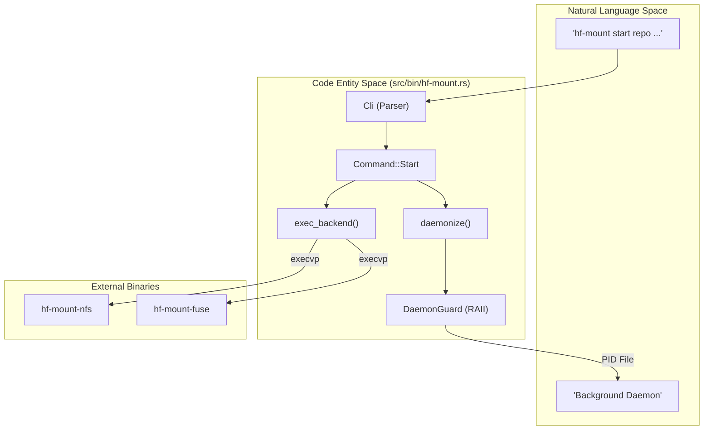
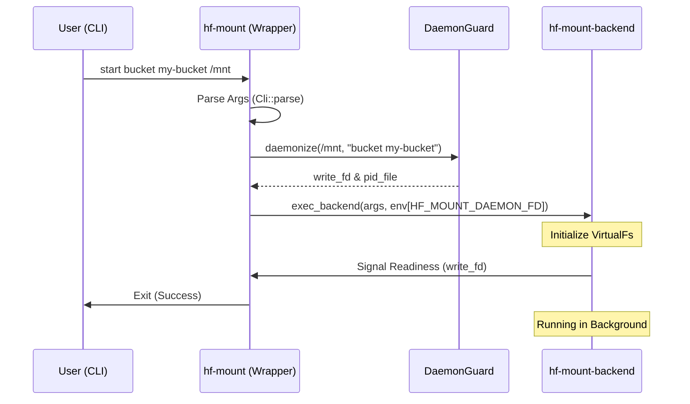

<!-- source: DeepWiki mcp.deepwiki.com · repo huggingface/hf-mount · page 1.1 Getting Started · fetched 2026-10-26 -->

# Getting Started

<details>
<summary>Relevant source files</summary>

The following files were used as context for generating this wiki page:

- [.github/workflows/release.yml](.github/workflows/release.yml)
- [LICENSE](LICENSE)
- [README.md](README.md)
- [install.sh](install.sh)
- [src/bin/hf-mount.rs](src/bin/hf-mount.rs)

</details>


This page provides a technical guide for installing, configuring, and operating `hf-mount`. It covers the installation scripts, the CLI wrapper architecture, and the lifecycle of background daemons.

## Purpose and Scope

`hf-mount` is a tool designed to expose Hugging Face [Buckets](https://huggingface.co/docs/hub/storage-buckets) and [Repositories](https://huggingface.co) as local filesystems using FUSE or NFS [README.md:5-25](). It enables lazy-loading of data, meaning files are only fetched from the remote server when they are actually read by a local process [README.md:25-25]().

## Installation

### Automated Installation
The primary installation method is a shell script that detects the host platform and architecture to download the appropriate pre-compiled binaries.

```bash
curl -fsSL https://raw.githubusercontent.com/huggingface/hf-mount/main/install.sh | sh
```

The `install.sh` script performs the following steps:
1. **Platform Detection**: Identifies the OS (`linux` or `darwin`) and architecture (`x86_64`, `aarch64`, or `arm64`) [install.sh:9-23]().
2. **Binary Acquisition**: Downloads three distinct binaries from GitHub Releases: `hf-mount` (the wrapper), `hf-mount-nfs` (NFS backend), and `hf-mount-fuse` (FUSE backend) [install.sh:28-33]().
3. **Deployment**: Places binaries in `~/.local/bin/` (customizable via `INSTALL_DIR`) and sets executable permissions [install.sh:7-33]().

### System Prerequisites
* **NFS Backend**: No system dependencies; works out-of-the-box on most Linux and macOS systems [README.md:28-28]().
* **FUSE Backend**: 
    * **Linux**: Requires `fuse3` [README.md:59-59]().
    * **macOS**: Requires [macFUSE](https://osxfuse.github.io) [README.md:61-61]().
* **Build from Source**: Requires Rust 1.85+ and optional features `nfs` and `fuse` [README.md:65-76]().

### Build Artifacts
The build pipeline generates specialized binaries for different targets to minimize dependency bloat:

| Binary | Purpose | Feature Flags |
| :--- | :--- | :--- |
| `hf-mount` | CLI wrapper & daemon manager | Default |
| `hf-mount-nfs` | Standalone NFS server backend | `nfs` |
| `hf-mount-fuse` | Standalone FUSE client backend | `fuse` |

Sources: [README.md:35-79](), [install.sh:1-42](), [.github/workflows/release.yml:44-56]()

## CLI Usage Patterns

The `hf-mount` binary serves as a high-level manager for background daemons. It parses user commands and dispatches them to specific backend binaries.

### Starting a Mount
The `start` command launches a backend in the background.

```bash
# Mount a repo (Read-Only)
hf-mount start repo <repo_id> <mount_point>

# Mount a bucket (Read-Write)
hf-mount start bucket <bucket_id> <mount_point>
```

**Common Flags:**
* `--fuse`: Forces the use of the FUSE backend (defaults to NFS) [src/bin/hf-mount.rs:16-18]().
* `--hf-token`: Explicitly provides the Hugging Face API token [README.md:209-209]().
* `--revision`: Specifies a git ref for repo mounts [README.md:111-111]().

### Management Commands
* **Status**: Lists all active daemons by reading from `~/.hf-mount/pids/` [src/bin/hf-mount.rs:44-54]().
* **Stop**: Gracefully shuts down a daemon and unmounts the filesystem [src/bin/hf-mount.rs:37-43]().

### Implementation: The Daemonization Flow
When `hf-mount start` is called, it does not run the filesystem logic itself. Instead, it performs a fork-exec dance to ensure the mount survives the shell session.

**Daemon Initialization Sequence**
1. **`daemonize()`**: The wrapper creates a pipe for readiness notification and forks the process [src/bin/hf-mount.rs:92-98]().
2. **`exec_backend()`**: The child process replaces itself with either `hf-mount-nfs` or `hf-mount-fuse` using `execvp` [src/bin/hf-mount.rs:113-130]().
3. **Ready Signal**: The backend binary performs its setup (e.g., binding to a port or mounting the FUSE device) and then writes to the `HF_MOUNT_DAEMON_FD` to signal the parent that initialization is complete [src/bin/hf-mount.rs:113-125]().

**Entity Association: CLI to Backend**


Sources: [src/bin/hf-mount.rs:5-130](), [README.md:131-148]()

## Configuration and Environment

`hf-mount` relies on both CLI flags and environment variables for configuration.

### Environment Variables
| Variable | Description |
| :--- | :--- |
| `HF_TOKEN` | Hugging Face authentication token [README.md:17-17](). |
| `HF_ENDPOINT` | Custom Hub URL (default: `https://huggingface.co`) [README.md:210-210](). |
| `INSTALL_DIR` | Target directory for the `install.sh` script [install.sh:7-7](). |
| `HF_MOUNT_DAEMON_FD` | Internal: Used to pass the readiness pipe to backends [src/bin/hf-mount.rs:125-125](). |
| `HF_MOUNT_DAEMON_PID_FILE` | Internal: Path to the PID file for the backend to manage [src/bin/hf-mount.rs:126-126](). |

### Data Flow: Initialization to Mount
The following diagram illustrates how configuration flows from the CLI into the operational filesystem state.



Sources: [src/bin/hf-mount.rs:33-130](), [README.md:205-215]()

---

