# Page: Overview

# Overview

<details>
<summary>Relevant source files</summary>

The following files were used as context for generating this wiki page:

- [Cargo.toml](Cargo.toml)
- [README.md](README.md)

</details>


`hf-mount` is a high-performance virtual filesystem that allows users to mount Hugging Face [Storage Buckets](https://huggingface.co/docs/hub/storage-buckets) and [Repositories](https://huggingface.co) as local directories. It enables "lazy-loading" of data, meaning files are only fetched from the remote server when a process actually reads them, eliminating the need for full repository clones or manual downloads [README.md:5-25]().

The project is designed for read-heavy Machine Learning workloads, such as training or inference, where datasets and models may be significantly larger than available local disk space [README.md:82-87]().

## Key Capabilities

*   **Lazy Fetching:** Only the bytes requested by the application are downloaded, using range requests via the Xet CAS (Content Addressable Storage) layer [README.md:25]().
*   **Dual Protocol Support:** Provides both **NFS** (stateless, no root required) and **FUSE** (tighter kernel integration) backends [README.md:27-29]().
*   **Write Support:** Supports read-write operations on Hugging Face Buckets with two distinct modes: a synchronous streaming mode for simple appends and an advanced staging mode for random-access writes [README.md:117-122]().
*   **Agent-Friendly:** Exposes remote data through standard POSIX interfaces, allowing tools like `ls`, `grep`, and `find` to work directly on Hub content [README.md:31]().

For installation instructions and basic CLI usage, see [Getting Started (#1.1)]().

## System Architecture

The `hf-mount` ecosystem consists of a management CLI and specialized backend binaries that implement the filesystem logic.

### Component Relationship

The following diagram illustrates how the user-facing CLI interacts with the daemonized backends and how those backends communicate with Hugging Face infrastructure.

**System Entity Map**
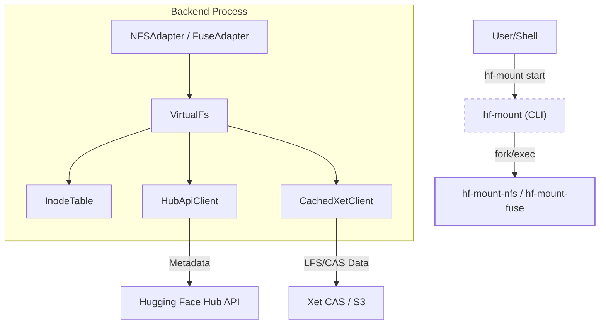
**Sources:** [src/bin/hf-mount.rs:1-59](), [src/bin/hf-mount-nfs.rs:1-50](), [src/bin/hf-mount-fuse.rs:1-50]()

### Core Abstractions

1.  **CLI Wrapper (`hf-mount`):** A frontend binary that manages the lifecycle of mount points, including starting, stopping, and tracking PIDs/logs [README.md:131-138]().
2.  **Protocol Adapters:**
    *   `NFSAdapter`: Implements the `nfsserve` trait to expose the filesystem over the NFSv3 protocol [Cargo.toml:26-39]().
    *   `FuseAdapter`: Implements the `fuser` trait for direct kernel integration [Cargo.toml:23-38]().
3.  **VirtualFs:** The central engine that translates POSIX-like operations (getattr, lookup, read, write) into remote API calls. It maintains an `InodeTable` to track file metadata and directory structures.
4.  **Xet CAS Layer:** Handles the heavy lifting of data movement, using the `xet-client` to reconstruct files from content-addressable chunks [Cargo.toml:12-16]().

For a deep dive into the internal data flow and write modes, see [Architecture Overview (#1.2)]().

## Technical Stack

The project is written in Rust and leverages several key technologies:

| Component | Entity / Library | Purpose |
| :--- | :--- | :--- |
| **Concurrency** | `tokio` | Async runtime for I/O and polling [Cargo.toml:30]() |
| **NFS Backend** | `nfsserve` | User-space NFSv3 server implementation [Cargo.toml:26]() |
| **FUSE Backend** | `fuser` | Rust bindings for FUSE [Cargo.toml:23]() |
| **Data Transport** | `xet-client` | Deduplicated data transfer and caching [Cargo.toml:13]() |
| **API Client** | `reqwest` | Communication with the Hugging Face Hub [Cargo.toml:27]() |

## Project Structure

The codebase is organized into a main library and multiple binary targets:

*   `src/lib.rs`: Contains the core `VirtualFs` logic and trait definitions.
*   `src/bin/hf-mount.rs`: The management CLI [src/bin/hf-mount.rs:1-59]().
*   `src/bin/hf-mount-nfs.rs`: The NFS-specific daemon [src/bin/hf-mount-nfs.rs:1-50]().
*   `src/bin/hf-mount-fuse.rs`: The FUSE-specific daemon [src/bin/hf-mount-fuse.rs:1-50]().
*   `src/vfs/`: Directory and file metadata management.
*   `src/hub/`: Implementation of the Hub API and Xet CAS interfaces.

For details on the core filesystem implementation, see [Core Filesystem Layer (#2)]().

---

# Page: Getting Started

# Getting Started

<details>
<summary>Relevant source files</summary>

The following files were used as context for generating this wiki page:

- [.github/workflows/release.yml](.github/workflows/release.yml)
- [LICENSE](LICENSE)
- [README.md](README.md)
- [install.sh](install.sh)
- [src/bin/hf-mount.rs](src/bin/hf-mount.rs)

</details>


This page provides a technical guide for installing, configuring, and operating `hf-mount`. It covers the installation scripts, the CLI wrapper architecture, and the lifecycle of background daemons.

## Purpose and Scope

`hf-mount` is a tool designed to expose Hugging Face [Buckets](https://huggingface.co/docs/hub/storage-buckets) and [Repositories](https://huggingface.co) as local filesystems using FUSE or NFS [README.md:5-25](). It enables lazy-loading of data, meaning files are only fetched from the remote server when they are actually read by a local process [README.md:25-25]().

## Installation

### Automated Installation
The primary installation method is a shell script that detects the host platform and architecture to download the appropriate pre-compiled binaries.

```bash
curl -fsSL https://raw.githubusercontent.com/huggingface/hf-mount/main/install.sh | sh
```

The `install.sh` script performs the following steps:
1. **Platform Detection**: Identifies the OS (`linux` or `darwin`) and architecture (`x86_64`, `aarch64`, or `arm64`) [install.sh:9-23]().
2. **Binary Acquisition**: Downloads three distinct binaries from GitHub Releases: `hf-mount` (the wrapper), `hf-mount-nfs` (NFS backend), and `hf-mount-fuse` (FUSE backend) [install.sh:28-33]().
3. **Deployment**: Places binaries in `~/.local/bin/` (customizable via `INSTALL_DIR`) and sets executable permissions [install.sh:7-33]().

### System Prerequisites
* **NFS Backend**: No system dependencies; works out-of-the-box on most Linux and macOS systems [README.md:28-28]().
* **FUSE Backend**: 
    * **Linux**: Requires `fuse3` [README.md:59-59]().
    * **macOS**: Requires [macFUSE](https://osxfuse.github.io) [README.md:61-61]().
* **Build from Source**: Requires Rust 1.85+ and optional features `nfs` and `fuse` [README.md:65-76]().

### Build Artifacts
The build pipeline generates specialized binaries for different targets to minimize dependency bloat:

| Binary | Purpose | Feature Flags |
| :--- | :--- | :--- |
| `hf-mount` | CLI wrapper & daemon manager | Default |
| `hf-mount-nfs` | Standalone NFS server backend | `nfs` |
| `hf-mount-fuse` | Standalone FUSE client backend | `fuse` |

Sources: [README.md:35-79](), [install.sh:1-42](), [.github/workflows/release.yml:44-56]()

## CLI Usage Patterns

The `hf-mount` binary serves as a high-level manager for background daemons. It parses user commands and dispatches them to specific backend binaries.

### Starting a Mount
The `start` command launches a backend in the background.

```bash
# Mount a repo (Read-Only)
hf-mount start repo <repo_id> <mount_point>

# Mount a bucket (Read-Write)
hf-mount start bucket <bucket_id> <mount_point>
```

**Common Flags:**
* `--fuse`: Forces the use of the FUSE backend (defaults to NFS) [src/bin/hf-mount.rs:16-18]().
* `--hf-token`: Explicitly provides the Hugging Face API token [README.md:209-209]().
* `--revision`: Specifies a git ref for repo mounts [README.md:111-111]().

### Management Commands
* **Status**: Lists all active daemons by reading from `~/.hf-mount/pids/` [src/bin/hf-mount.rs:44-54]().
* **Stop**: Gracefully shuts down a daemon and unmounts the filesystem [src/bin/hf-mount.rs:37-43]().

### Implementation: The Daemonization Flow
When `hf-mount start` is called, it does not run the filesystem logic itself. Instead, it performs a fork-exec dance to ensure the mount survives the shell session.

**Daemon Initialization Sequence**
1. **`daemonize()`**: The wrapper creates a pipe for readiness notification and forks the process [src/bin/hf-mount.rs:92-98]().
2. **`exec_backend()`**: The child process replaces itself with either `hf-mount-nfs` or `hf-mount-fuse` using `execvp` [src/bin/hf-mount.rs:113-130]().
3. **Ready Signal**: The backend binary performs its setup (e.g., binding to a port or mounting the FUSE device) and then writes to the `HF_MOUNT_DAEMON_FD` to signal the parent that initialization is complete [src/bin/hf-mount.rs:113-125]().

**Entity Association: CLI to Backend**
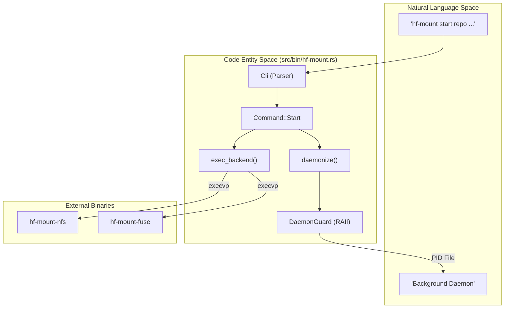

Sources: [src/bin/hf-mount.rs:5-130](), [README.md:131-148]()

## Configuration and Environment

`hf-mount` relies on both CLI flags and environment variables for configuration.

### Environment Variables
| Variable | Description |
| :--- | :--- |
| `HF_TOKEN` | Hugging Face authentication token [README.md:17-17](). |
| `HF_ENDPOINT` | Custom Hub URL (default: `https://huggingface.co`) [README.md:210-210](). |
| `INSTALL_DIR` | Target directory for the `install.sh` script [install.sh:7-7](). |
| `HF_MOUNT_DAEMON_FD` | Internal: Used to pass the readiness pipe to backends [src/bin/hf-mount.rs:125-125](). |
| `HF_MOUNT_DAEMON_PID_FILE` | Internal: Path to the PID file for the backend to manage [src/bin/hf-mount.rs:126-126](). |

### Data Flow: Initialization to Mount
The following diagram illustrates how configuration flows from the CLI into the operational filesystem state.

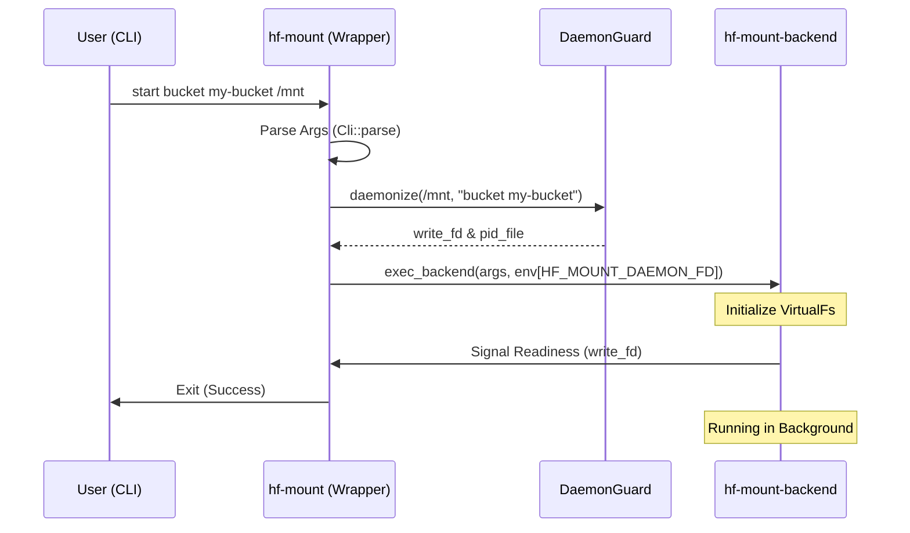

Sources: [src/bin/hf-mount.rs:33-130](), [README.md:205-215]()

---

# Page: Architecture Overview

# Architecture Overview

<details>
<summary>Relevant source files</summary>

The following files were used as context for generating this wiki page:

- [Cargo.lock](Cargo.lock)
- [Cargo.toml](Cargo.toml)
- [README.md](README.md)
- [src/setup.rs](src/setup.rs)

</details>


The `hf-mount` system is a multi-layered filesystem bridge that exposes Hugging Face Hub repositories and Storage Buckets as local POSIX-compliant filesystems. It is designed for lazy-loading data, meaning file contents are only fetched from the remote server when a process performs a read operation.

## Layered Architecture

The system operates through a hierarchy of components, moving from user-facing CLI tools down to the low-level Hugging Face API and Content Addressable Storage (CAS).

### System Component Diagram
The following diagram illustrates the data flow and component relationships from the CLI to the remote backend.

"Architecture Component Flow"
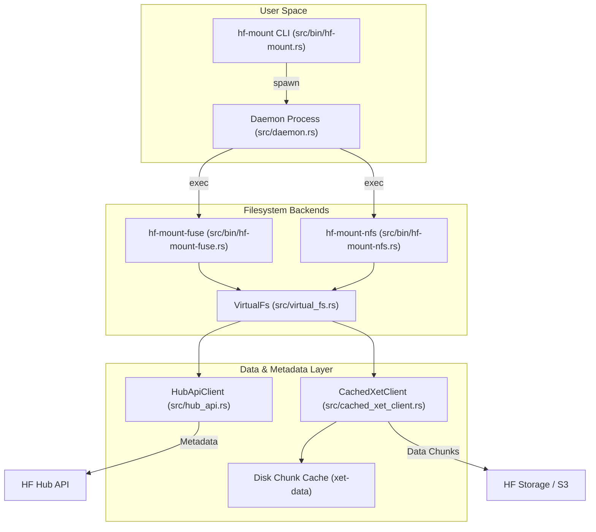
Sources: [src/bin/hf-mount.rs:1-60](), [src/daemon.rs:1-50](), [src/virtual_fs.rs:1-100](), [src/hub_api.rs:1-50](), [src/cached_xet_client.rs:1-40]()

## Mount Types: Repo vs. Bucket

The system supports two primary sources of data, handled via the `Source` enum in `src/setup.rs` [src/setup.rs:17-35]().

| Feature | Repo Mount (`Source::Repo`) | Bucket Mount (`Source::Bucket`) |
| :--- | :--- | :--- |
| **Primary Use** | Models, Datasets, Git-based repos | S3-like object storage for checkpoints/logs |
| **Mutability** | Read-Only (by default) | Read-Write (default) |
| **Versioning** | Git Revisions (branch/tag/commit) | Flat/Prefix-based (no Git) |
| **Metadata Source** | Hub Tree API | Bucket List API |
| **Data Path** | Xet CAS / LFS | Direct S3 / Xet CAS |

Sources: [src/setup.rs:17-54](), [src/hub_api.rs:115-150](), [README.md:98-130]()

## Filesystem Backends

`hf-mount` provides two protocol implementations to expose the `VirtualFs` to the Operating System.

1.  **FUSE (Filesystem in Userspace)**: Implemented in `FuseAdapter` using the `fuser` crate. It provides tighter kernel integration and supports features like `FOPEN_DIRECT_IO` [src/setup.rs:110-115](). It requires `libfuse` and often root privileges.
2.  **NFS (Network File System)**: Implemented via `NFSAdapter` using the `nfsserve` crate. It runs a local NFSv3 server and mounts it via the OS's native NFS client. This is the recommended backend as it requires no kernel extensions or root privileges [README.md:28-29]().

Sources: [src/bin/hf-mount-fuse.rs:1-50](), [src/bin/hf-mount-nfs.rs:1-50](), [Cargo.toml:36-40]()

## Write Modes

When mounting a Bucket, the system supports two distinct write strategies configured via `MountOptions` [src/setup.rs:91-94]().

### 1. Streaming Mode (Default)
Optimized for append-only workloads like logging.
*   **Implementation**: Uses `StreamingChannel` in `VirtualFs`.
*   **Behavior**: Data is buffered in memory and uploaded synchronously to the Hub when the file handle is closed.
*   **Constraint**: Does not support random access or seeking.

### 2. Advanced Mode (`--advanced-writes`)
Optimized for random I/O and large file modifications.
*   **Implementation**: Uses a local `StagingDir` [src/xet.rs:253-260]() to store temporary files.
*   **Behavior**: Writes are applied to local staging files. A background `FlushManager` debounces these changes and asynchronously uploads them to the Hub based on `flush_debounce_ms` [src/setup.rs:133-141]().
*   **Constraint**: Requires local disk space for the staging area.

Sources: [src/setup.rs:91-94](), [src/setup.rs:133-141](), [src/virtual_fs.rs:750-800](), [src/xet.rs:253-300]()

## Lazy-Loading Data Flow

The core of the performance model is the lazy-loading mechanism. Metadata is fetched and cached, but file bytes are only retrieved upon request.

"Read Path Sequence"
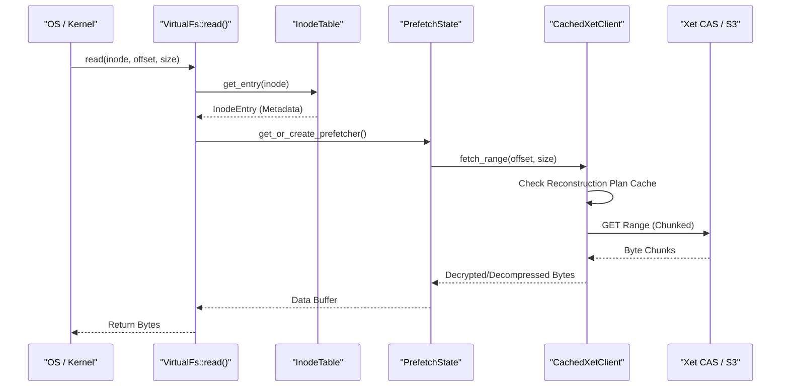

### Key Components in Data Flow:
*   **`InodeTable`**: Manages the mapping between POSIX inodes and Hub paths. It uses a TTL-based revalidation mechanism (`metadata_ttl_ms`) to ensure local metadata isn't too stale [src/setup.rs:117-123]().
*   **`PrefetchState`**: Tracks sequential read patterns to adaptively pre-fetch data into the local cache, reducing latency for large file reads.
*   **`CachedXetClient`**: Interfaces with the Xet-core library to handle deduplication and chunking. It maintains a cache of "reconstruction plans" to quickly locate which remote chunks correspond to specific file ranges [src/cached_xet_client.rs:15-30]().

Sources: [src/virtual_fs.rs:400-500](), [src/cached_xet_client.rs:10-60](), [src/setup.rs:117-128]()

---

# Page: Core Filesystem Layer

# Core Filesystem Layer

<details>
<summary>Relevant source files</summary>

The following files were used as context for generating this wiki page:

- [src/virtual_fs/mod.rs](src/virtual_fs/mod.rs)

</details>


The Core Filesystem Layer is centered around the `VirtualFs` struct, which acts as the primary bridge between POSIX filesystem operations (requested by FUSE or NFS backends) and the remote Hugging Face Hub API and Xet Content Addressable Storage (CAS). It manages the translation of file paths to inodes, handles metadata caching, and orchestrates the complex data flow for reading and writing remote assets.

### VirtualFs Abstraction

`VirtualFs` implements the core logic for a virtualized filesystem. It maintains an internal mapping of the remote repository or bucket structure into a local hierarchy of inodes. It is designed to be protocol-agnostic, allowing both `FuseAdapter` and `NFSAdapter` to invoke its methods for standard operations like `lookup`, `read`, `write`, and `readdir`.

#### Key Components of VirtualFs

| Component | Role | Code Entity |
| :--- | :--- | :--- |
| **Inode Table** | Tracks metadata and relationships for all known files and directories. | `inode_table` [src/virtual_fs/mod.rs:82-82]() |
| **Open File Table** | Maps numeric file handles to active local file descriptors or remote streams. | `open_files` [src/virtual_fs/mod.rs:84-84]() |
| **Staging Directory** | Local scratch space used for "Advanced Writes" before syncing to the Hub. | `staging_dir` [src/virtual_fs/mod.rs:79-79]() |
| **Flush Manager** | Manages the background pipeline for uploading dirty files and processing deletes. | `flush_manager` [src/virtual_fs/mod.rs:97-97]() |
| **Negative Cache** | Prevents redundant API calls for paths that are known to not exist. | `negative_cache` [src/virtual_fs/mod.rs:89-89]() |

**Sources:** [src/virtual_fs/mod.rs:75-115](), [src/virtual_fs/mod.rs:119-176]()

### System Architecture and Code Mapping

The following diagram illustrates how high-level filesystem concepts map to specific implementation entities within the `VirtualFs` layer.

**VirtualFs Entity Mapping**
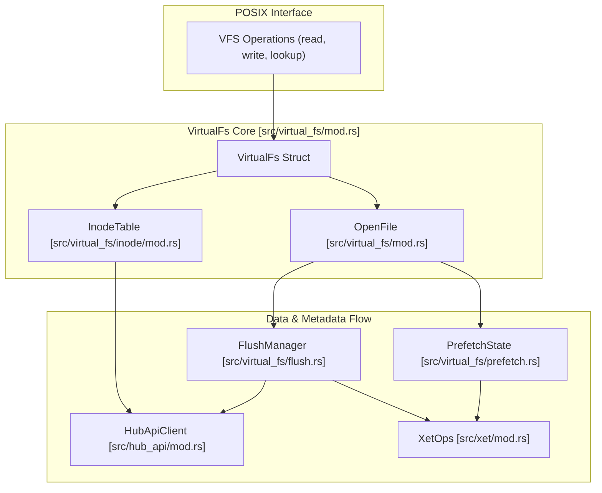
**Sources:** [src/virtual_fs/mod.rs:75-115](), [src/virtual_fs/mod.rs:15-21]()

### Concurrency and Locking Discipline

To prevent deadlocks while handling asynchronous I/O, `VirtualFs` follows a strict locking hierarchy. Most locks are held only briefly to extract state before dropping them to perform async operations.

1.  **Staging Locks**: Per-inode `tokio::sync::Mutex` to prevent concurrent races during file preparation. [src/virtual_fs/mod.rs:91-91]()
2.  **Inode Table**: `RwLock` for metadata access and hierarchy traversal. [src/virtual_fs/mod.rs:82-82]()
3.  **Open Files**: `RwLock` for tracking active file handles. [src/virtual_fs/mod.rs:84-84]()
4.  **Negative Cache**: `RwLock` for path existence checks. [src/virtual_fs/mod.rs:89-89]()

**Sources:** [src/virtual_fs/mod.rs:62-74]()

---

## Subsystems and Child Pages

The functionality of the Core Filesystem Layer is divided into several specialized subsystems:

### [VirtualFs: Inode Table and Metadata](#2.1)
The `InodeTable` is the heart of the filesystem. It manages `InodeEntry` objects which can represent directories, regular files, or symlinks (`InodeKind`). This subsystem handles the TTL-based revalidation of metadata against the Hub API and manages the "dirty-generation" mechanism to ensure consistency during concurrent writes and remote updates.
*   **Key Entities**: `InodeTable`, `InodeEntry`, `InodeKind`.
*   **Details**: See [VirtualFs: Inode Table and Metadata](#2.1).

### [Read Path and Prefetching](#2.2)
Remote files are read lazily. The `PrefetchState` manages an adaptive windowing strategy that decides whether to stream data sequentially or perform range-based downloads. It interacts with the `CachedXetClient` to reconstruct file content from the Xet CAS.
*   **Key Entities**: `PrefetchState`, `FetchStrategy`, `FetchPlan`.
*   **Details**: See [Read Path and Prefetching](#2.2).

### [Write Path: Streaming and Advanced Modes](#2.3)
`hf-mount` supports two distinct write models. **Streaming Mode** is optimized for sequential, append-only uploads (e.g., logging or large model exports). **Advanced Writes** use a local `StagingDir` to allow random access and small writes, which are then debounced and batched by the `FlushManager`.
*   **Key Entities**: `StreamingChannel`, `StagingDir`, `FlushManager`.
*   **Details**: See [Write Path: Streaming and Advanced Modes](#2.3).

### [Background Polling and Cache Invalidation](#2.4)
To stay in sync with remote changes made by other clients, a background task (`poll_remote_changes`) periodically fetches the remote tree state. It diffs this state against the local `InodeTable` and uses an `Invalidator` callback to signal the OS kernel to drop stale page caches.
*   **Key Entities**: `poll_remote_changes`, `Invalidator`, `metadata_ttl`.
*   **Details**: See [Background Polling and Cache Invalidation](#2.4).

**Sources:** [src/virtual_fs/mod.rs:15-21](), [src/virtual_fs/mod.rs:129-164]()

---

# Page: VirtualFs: Inode Table and Metadata

# VirtualFs: Inode Table and Metadata

<details>
<summary>Relevant source files</summary>

The following files were used as context for generating this wiki page:

- [src/virtual_fs/inode.rs](src/virtual_fs/inode.rs)
- [src/virtual_fs/mod.rs](src/virtual_fs/mod.rs)
- [src/virtual_fs/prefetch.rs](src/virtual_fs/prefetch.rs)
- [src/virtual_fs/tests.rs](src/virtual_fs/tests.rs)
- [tests/pjdfstest.rs](tests/pjdfstest.rs)

</details>


The `VirtualFs` layer provides a POSIX-compliant filesystem abstraction that bridges local OS requests to the Hugging Face Hub and Xet CAS. At the heart of this layer is the **Inode Table**, which manages the lifecycle, metadata, and consistency of filesystem entities.

### Inode Data Structures

The filesystem represents every file, directory, and symlink as an `InodeEntry`. These entries are indexed within an `InodeTable` to allow O(1) lookups by inode number or path.

| Entity | Description |
| :--- | :--- |
| `InodeKind` | Enum defining the type: `File`, `Directory`, or `Symlink` [src/virtual_fs/inode.rs:17-21](). |
| `InodeEntry` | The primary metadata container. Stores POSIX attributes (size, mtime, mode, uid/gid) alongside Hub-specific metadata like `xet_hash` and `etag` [src/virtual_fs/inode.rs:31-61](). |
| `DirChild` | A lightweight edge representation in the directory tree, mapping a name to an inode number [src/virtual_fs/inode.rs:25-28](). |
| `InodeTable` | A thread-safe container (protected by `RwLock`) holding the mapping of `u64` IDs to `InodeEntry` and a reverse `path_to_inode` map [src/virtual_fs/inode.rs:100-104](). |

#### Inode Metadata and Identity
The system uses a 64-bit counter to generate unique inode numbers, starting from `ROOT_INODE` (1) [src/virtual_fs/inode.rs:5-117]().

**Inode Table Mapping**
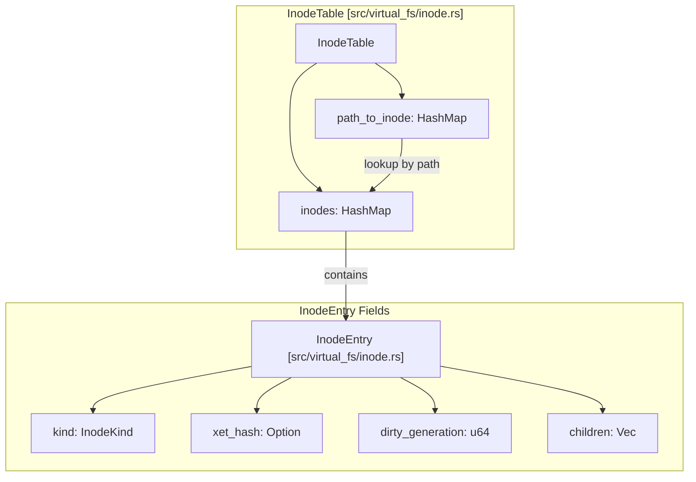
Sources: [src/virtual_fs/inode.rs:17-61](), [src/virtual_fs/inode.rs:100-104]()

---

### Inode Lifecycle and Lookup

When a user accesses a path, `VirtualFs` performs a lookup. If the inode is not in the `InodeTable`, it is fetched from the Hub API and cached.

1.  **Local Cache Check**: The `InodeTable` is searched by path [src/virtual_fs/inode.rs:158-160]().
2.  **Negative Cache**: If a path was recently confirmed as non-existent, the request is rejected immediately to avoid Hub API spam [src/virtual_fs/mod.rs:29-31]().
3.  **Remote Fetch**: If missing, `HubOps::head` or `HubOps::list_tree` is called to populate the entry [src/virtual_fs/mod.rs:1138-1150]().
4.  **Creation**: New inodes are inserted via `InodeTable::insert`, which increments the `next_inode` counter [src/virtual_fs/inode.rs:178-218]().

#### Metadata Revalidation (TTL)
To balance performance with consistency, `VirtualFs` implements a TTL-based revalidation mechanism:
*   **`metadata_ttl`**: Configurable duration (defaulting to kernel attribute timeout) during which cached metadata is trusted [src/virtual_fs/mod.rs:104-106]().
*   **`last_revalidated`**: A timestamp on the `InodeEntry` [src/virtual_fs/inode.rs:60]().
*   **Lookup Logic**: If `serve_lookup_from_cache` is enabled and the TTL hasn't expired, the cached entry is returned without a network call [src/virtual_fs/mod.rs:109-110]().

---

### Concurrency: Dirty Generation Mechanism

To handle concurrent writes and background polling without data loss, `hf-mount` uses a "Dirty Generation" counter rather than simple boolean flags.

*   **`dirty_generation`**: Every mutation (write, truncate) increments this counter [src/virtual_fs/inode.rs:69-72]().
*   **Atomic Snapshots**: When a flush starts, the current generation is snapshotted.
*   **Conditional Clear**: Upon successful upload, `clear_dirty_if(snapshot)` is called. If a concurrent writer incremented the generation during the upload, the inode remains dirty, ensuring the new data is eventually flushed [src/virtual_fs/inode.rs:77-84]().

**Write and Commit Flow**
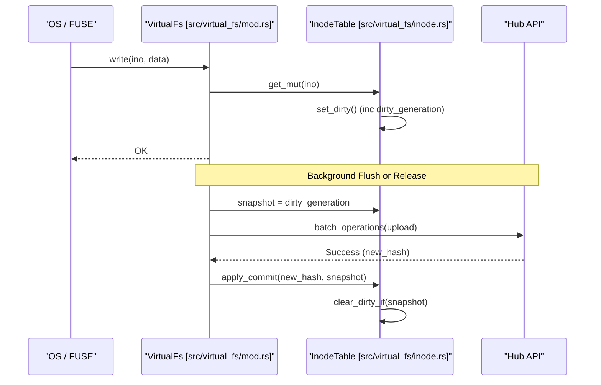
Sources: [src/virtual_fs/inode.rs:63-98](), [src/virtual_fs/mod.rs:718-735](), [src/virtual_fs/tests.rs:81-106]()

---

### Negative Lookup Cache

The `negative_cache` prevents repeated "File Not Found" (ENOENT) errors from triggering expensive Hub API calls.

*   **Capacity**: Limited to 10,000 entries by default [src/virtual_fs/mod.rs:29]().
*   **TTL**: Entries expire after 30 seconds [src/virtual_fs/mod.rs:31]().
*   **Invalidation**: When a file is created or when `poll_remote_changes` detects a new remote file, the corresponding path is purged from the negative cache to make it visible [src/virtual_fs/mod.rs:155-161]().

### OS Junk Filtering

The `VirtualFs` can be configured via `filter_os_files` to ignore metadata-only files generated by operating systems (e.g., `.DS_Store`, `Thumbs.db`).
*   **Implementation**: `is_os_junk(name)` checks against a hardcoded list of patterns [src/virtual_fs/mod.rs:38-43]().
*   **Effect**: If enabled, `mknod` or `create` calls for these files return successfully to the OS but do not create an inode or sync to the Hub [src/virtual_fs/mod.rs:111-112]().

Sources:
*   `src/virtual_fs/mod.rs`: Constants [23-31](), Junk filtering [38-43](), VfsConfig [48-60](), Initialization [125-175]().
*   `src/virtual_fs/inode.rs`: InodeEntry definition [31-61](), Dirty generation logic [63-98](), InodeTable implementation [100-218]().
*   `src/virtual_fs/tests.rs`: Streaming write tests [81-106]().

---

# Page: Read Path and Prefetching

# Read Path and Prefetching

<details>
<summary>Relevant source files</summary>

The following files were used as context for generating this wiki page:

- [src/cached_xet_client.rs](src/cached_xet_client.rs)
- [src/virtual_fs/mod.rs](src/virtual_fs/mod.rs)
- [src/virtual_fs/prefetch.rs](src/virtual_fs/prefetch.rs)
- [src/virtual_fs/tests.rs](src/virtual_fs/tests.rs)

</details>


This page describes the implementation of remote file reads in `hf-mount`. It covers the lifecycle of a read request from the virtual filesystem layer down to the Xet Content Addressable Storage (CAS), including adaptive prefetching logic and the reconstruction plan cache.

## Overview of the Read Path

When a user process issues a `read(2)` system call, the request enters `VirtualFs` via the FUSE or NFS adapter. `hf-mount` translates these POSIX offsets into requests for data chunks from the Hugging Face Hub's Xet-based storage. To minimize latency over high-bandwidth, high-latency network connections, the system employs an adaptive prefetching strategy.

### Data Flow

1.  **Request Reception**: `VirtualFs::read` receives an inode, offset, and size.
2.  **Handle Lookup**: The `file_handle` is used to retrieve an `OpenFile` entry from the `open_files` map [src/virtual_fs/mod.rs:84-84]().
3.  **Buffer Check**: The `PrefetchState` associated with the file handle is checked for cached data.
4.  **Strategy Selection**: If data is missing, `PrefetchState::prepare_fetch` determines whether to use a sequential stream or a targeted range download [src/virtual_fs/prefetch.rs:106-106]().
5.  **Plan Reconstruction**: The `CachedXetClient` retrieves or derives a "reconstruction plan" (mapping file offsets to Xet Object (Xorb) hashes) [src/cached_xet_client.rs:45-55]().
6.  **Data Fetch**: Data is pulled from the CAS, optionally populating the local `xorb` disk cache.

**Read Path Architecture**

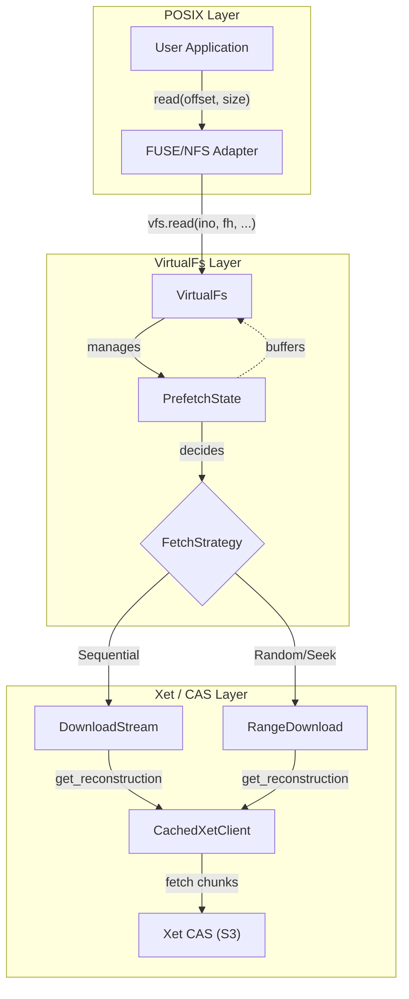
Sources: [src/virtual_fs/mod.rs:75-115](), [src/virtual_fs/prefetch.rs:39-46](), [src/cached_xet_client.rs:138-143]()

---

## Prefetching and Adaptive Window Sizing

The `PrefetchState` struct [src/virtual_fs/prefetch.rs:66-85]() manages the forward-read buffer for a specific file handle. It classifies access patterns to balance between high throughput for sequential reads and low overhead for random access.

### Tuning Constants

The prefetching behavior is governed by several internal constants [src/virtual_fs/prefetch.rs:11-22]():

| Constant | Value | Description |
| :--- | :--- | :--- |
| `INITIAL_WINDOW` | 8 MiB | Starting prefetch size for a new sequential stream. |
| `MAX_WINDOW` | 128 MiB | Upper bound for the prefetch window (reached via "slow-start"). |
| `SEEK_WINDOW` | 1 MiB | Size of the backward-seek buffer kept in memory. |
| `FORWARD_SKIP` | 16 MiB | Max gap to "drain" from a stream before resetting it. |

### Fetch Strategies

The `FetchStrategy` enum [src/virtual_fs/prefetch.rs:39-46]() defines how data is retrieved:

*   **`StartStream` / `ContinueStream`**: Used for sequential access. It utilizes an unbounded stream that prefetches up to `window_size` ahead of the current read offset. This mode enables the `xorb` disk cache to amortize the cost of downloading large compressed objects.
*   **`RangeDownload`**: Used for random access or seeks beyond `FORWARD_SKIP`. It fetches only the exact byte range requested. This strategy bypasses the `xorb` disk cache to avoid downloading 64MB objects for small, isolated reads (e.g., reading metadata from the end of a Parquet or ZIP file).

### Adaptive Logic

The system implements a "slow-start" mechanism similar to TCP. If a read is contiguous with the previous buffer end, the `window_size` is doubled, up to `MAX_WINDOW` [src/virtual_fs/prefetch.rs:119-123](). If a "far seek" occurs, the window is reset to `INITIAL_WINDOW` to avoid wasting bandwidth [src/virtual_fs/prefetch.rs:131-132]().

Sources: [src/virtual_fs/prefetch.rs:8-22](), [src/virtual_fs/prefetch.rs:106-161]()

---

## CachedXetClient and Reconstruction Plans

To read a file from the Xet CAS, the client must first obtain a **Reconstruction Plan**. This plan describes which Xorbs (and which byte ranges within them) compose the target file.

### Reconstruction Plan Cache

`CachedXetClient` [src/cached_xet_client.rs:45-55]() maintains an in-memory cache of these plans to avoid repeated Hub API calls.

*   **Cache Key**: A tuple of `(MerkleHash, Option<FileRange>)` [src/cached_xet_client.rs:19-19]().
*   **TTL**: Entries are cached for 59 minutes [src/cached_xet_client.rs:24-24](), just under the 1-hour expiry of the presigned S3 URLs contained within the plan.
*   **Single-Flight Coalescing**: If multiple threads request the same reconstruction plan simultaneously, the `inflight` map [src/cached_xet_client.rs:53-53]() ensures only one network request is made. Other threads wait on a broadcast channel [src/cached_xet_client.rs:149-149]().

### Plan Derivation

A key optimization in `CachedXetClient` is the ability to derive range-specific plans from a cached full-file plan.

The `derive_range_response` function [src/cached_xet_client.rs:97-97]() walks the terms of a full-file plan and filters for those overlapping the requested `FileRange`. This allows a random read to proceed immediately if the full file's metadata has already been fetched, without requiring a new round-trip to the CAS server.

**Reconstruction Plan Logic**

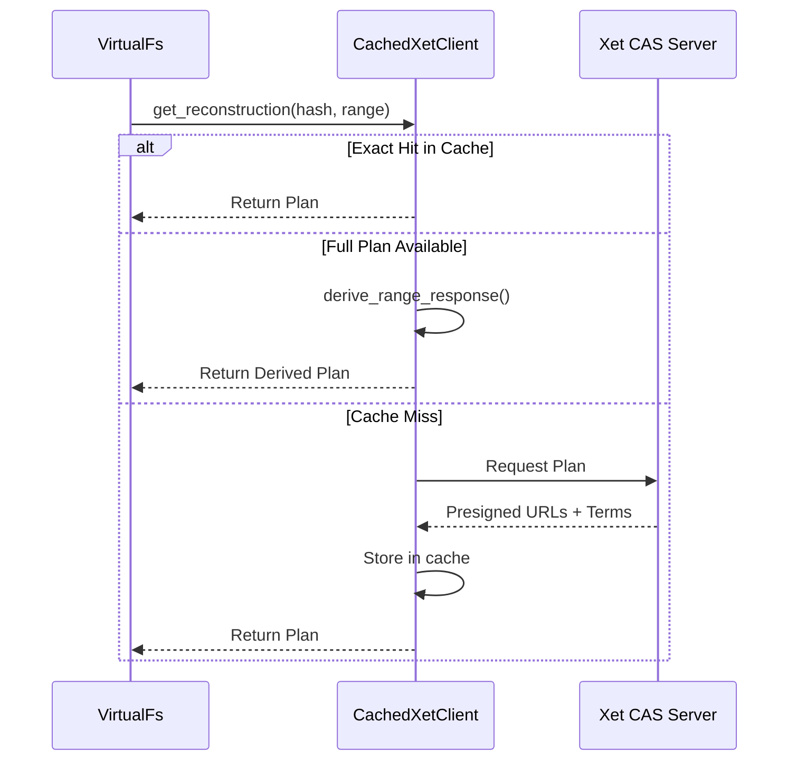
Sources: [src/cached_xet_client.rs:97-135](), [src/cached_xet_client.rs:138-200]()

---

## Implementation Details: PrefetchState

The `PrefetchState` uses a `VecDeque<Bytes>` to store downloaded chunks [src/virtual_fs/prefetch.rs:70-70](). This structure allows for:
1.  **Zero-copy Reads**: Using `Bytes::slice()` to return data to the caller without copying.
2.  **Efficient Draining**: Removing consumed data from the front of the queue without reallocating the entire buffer.

### Sequential Read Buffer Management

When `VirtualFs` performs a read, it calls `PrefetchState::get_reach` to check if the requested offset and size are already buffered. If not, it uses the `FetchPlan` to trigger a download.

```rust
// Simplified logic from src/virtual_fs/prefetch.rs
pub(crate) fn prepare_fetch(&mut self, offset: u64, size: u32) -> FetchPlan {
    // 1. Drain consumed data to the seek window
    // 2. Determine if the access is sequential
    // 3. Adjust window_size (double if sequential, reset if seek)
    // 4. Return FetchStrategy and fetch_size
}
```

If the `forward_only` flag (associated with `DIRECT_IO`) is set, the buffer is aggressively drained after every read to minimize memory footprint [src/virtual_fs/prefetch.rs:83-84]().

Sources: [src/virtual_fs/prefetch.rs:66-102](), [src/virtual_fs/prefetch.rs:106-161]()

---

# Page: Write Path: Streaming and Advanced Modes

# Write Path: Streaming and Advanced Modes

<details>
<summary>Relevant source files</summary>

The following files were used as context for generating this wiki page:

- [src/virtual_fs/flush.rs](src/virtual_fs/flush.rs)
- [src/virtual_fs/mod.rs](src/virtual_fs/mod.rs)
- [src/xet.rs](src/xet.rs)
- [tests/common/bench.rs](tests/common/bench.rs)
- [tests/common/fs_tests.rs](tests/common/fs_tests.rs)

</details>


The `hf-mount` write path is divided into two distinct operational modes: **Streaming** (default) and **Advanced Writes**. These modes cater to different workloads, ranging from simple sequential logging or model exports to complex, random-access data manipulation.

### Overview of Write Modes

| Feature | Streaming Mode (Default) | Advanced Writes (`--advanced-writes`) |
|:---|:---|:---|
| **Access Pattern** | Append-only, sequential | Random access, read-modify-write |
| **Concurrency** | Single-writer per file | Multi-writer, debounced flushing |
| **Storage** | Memory buffers (via `xet-core`) | Local disk staging area |
| **Upload Trigger** | Synchronous on `close()` | Asynchronous debounced background task |
| **Atomicity** | File-level (all or nothing) | Batch-level (multiple files/deletes) |

---

### 1. Streaming Mode

Streaming mode is designed for high-throughput, sequential writes. It bypasses local disk staging by piping data directly into the `xet-core` deduplication and CAS (Content Addressable Storage) pipeline.

#### StreamingChannel and StreamingWriter
When a file is opened for writing in streaming mode, `VirtualFs` creates a `StreamingChannel` [src/virtual_fs/mod.rs:1134-1140](). This channel wraps a `StreamingWriterOps` implementation (typically `StreamingWriter` in `src/xet.rs`) [src/xet.rs:37-42]().

1.  **Write Operation**: Data passed to `write()` is forwarded to the `SingleFileCleaner` in `xet-core` [src/xet.rs:110-116](). This component calculates hashes and prepares chunks for CAS upload in memory.
2.  **Close Operation**: When the file handle is released, `StreamingChannel::commit` is called. This performs a **synchronous** finalize of the CAS session and a Hub API commit [src/virtual_fs/mod.rs:1164-1175]().
3.  **Limitations**: If a user attempts to seek or perform a random-access write, the operation returns `ENOTSUP` or `ESPIPE` because the underlying `StreamingWriter` only supports incremental `add_data` calls.

**Sources:** [src/virtual_fs/mod.rs:1134-1175](), [src/xet.rs:37-42](), [src/xet.rs:102-116]()

---

### 2. Advanced Writes

Advanced mode enables full POSIX compatibility for writes, including random seeks, overwrites, and `truncate()`. It achieves this by using a local `StagingDir` as a scratchpad before committing changes to the Hugging Face Hub.

#### StagingDir and Session Isolation
The `StagingDir` manages a local directory (usually under `~/.cache/huggingface/hf-mount/.../staging`) where dirty files are stored [src/xet.rs:182-192](). 
*   **Path Generation**: Staging paths are obfuscated using a `session_key` to prevent collisions between different mount instances [src/xet.rs:191-197]().
*   **File Preparation**: When a remote file is opened for writing, `VirtualFs` downloads the remote content to the staging area first, allowing the application to perform read-modify-write operations locally [src/xet.rs:118-125]().

#### Data Flow: Local-to-Remote Pipeline
The following diagram illustrates the transition of data from a POSIX `write()` call to the Hub API using the `FlushManager`.

**Diagram: Advanced Write Data Flow**
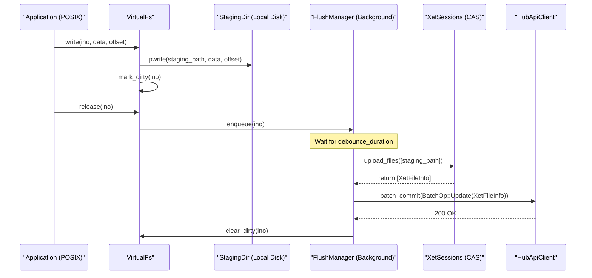
**Sources:** [src/virtual_fs/flush.rs:23-68](), [src/virtual_fs/mod.rs:1191-1210](), [src/xet.rs:182-205]()

---

### 3. FlushManager and the Flush Loop

The `FlushManager` is the orchestrator for asynchronous durability in advanced mode. It prevents the "stutter" associated with synchronous network I/O during file closes by debouncing updates.

#### Debouncing and Batching
The `flush_loop` task waits for `FlushSignal` events [src/virtual_fs/flush.rs:14-19]().
*   **Debounce**: After receiving a signal, the loop waits for a `flush_debounce` period (default ~1s) to see if more writes arrive for the same or other files [src/virtual_fs/flush.rs:164-180]().
*   **Max Batch Window**: To prevent starvation, the loop forces a flush if the `max_batch_window` is reached [src/virtual_fs/flush.rs:179-185]().

#### Remote Delete Queue
The `FlushManager` also handles `pending_deletes`. When a file is renamed or removed, the local inode is updated immediately, but the Hub API call is deferred and batched with other updates in `flush_pending_deletes` [src/virtual_fs/flush.rs:86-95](), [src/virtual_fs/flush.rs:193-194]().

**Diagram: Entity Mapping for Flush Subsystem**
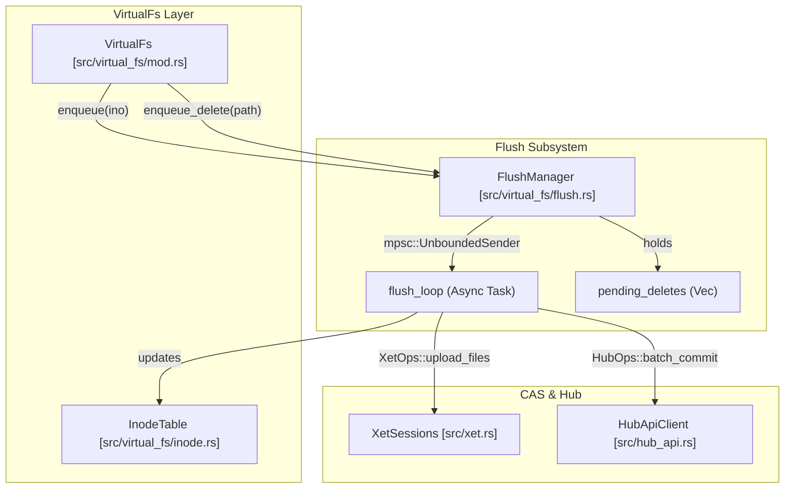
**Sources:** [src/virtual_fs/flush.rs:23-68](), [src/virtual_fs/flush.rs:157-194](), [src/virtual_fs/mod.rs:75-115]()

---

### 4. Implementation Details

#### Key Functions
*   **`VirtualFs::write`**: Determines if the file is a `StreamingChannel` or a local staging file. If staging, it performs a standard file system write to the local disk [src/virtual_fs/mod.rs:1000-1050]().
*   **`FlushManager::enqueue`**: Sends a signal to the background loop to mark an inode as needing a remote sync [src/virtual_fs/flush.rs:71-77]().
*   **`XetSessions::upload_files`**: Takes a list of local paths, processes them through the `xet-core` deduplication engine, and returns `XetFileInfo` objects containing the Merkle hashes required by the Hub [src/xet.rs:127-147]().

#### Error Handling
If a background flush fails (e.g., network timeout or unauthorized), the error is captured in `FlushManager::errors` [src/virtual_fs/flush.rs:26](). The next time the application performs a metadata operation or another write on that inode, the VFS checks for these deferred errors and returns them to the user [src/virtual_fs/flush.rs:79-81]().

**Sources:** [src/virtual_fs/mod.rs:1000-1050](), [src/virtual_fs/flush.rs:26-81](), [src/xet.rs:127-147]()

---

# Page: Background Polling and Cache Invalidation

# Background Polling and Cache Invalidation

<details>
<summary>Relevant source files</summary>

The following files were used as context for generating this wiki page:

- [src/virtual_fs/mod.rs](src/virtual_fs/mod.rs)
- [src/virtual_fs/poll.rs](src/virtual_fs/poll.rs)

</details>


The `hf-mount` filesystem maintains consistency with the Hugging Face Hub by periodically polling for remote changes. This mechanism ensures that updates made by other clients or through the Hub web interface are eventually reflected in the local mount point without requiring a remount. The system utilizes a background task to diff the remote state against the local `InodeTable` and triggers kernel-level cache invalidations to purge stale data.

## Polling Lifecycle and Implementation

The polling logic is encapsulated in the `poll_remote_changes` function, which runs as a long-lived asynchronous task spawned during `VirtualFs` initialization [src/virtual_fs/mod.rs:148-164]().

### The Polling Loop
The task operates on a fixed interval defined by `VfsConfig.poll_interval_secs` [src/virtual_fs/mod.rs:53](). If this interval is set to zero, polling is disabled [src/virtual_fs/mod.rs:148]().

1.  **Remote Fetch**: The loop begins by calling `hub_client.list_tree("", true)` to get a full recursive listing of the remote repository or bucket [src/virtual_fs/poll.rs:24]().
2.  **Snapshotting**: It takes a read-only snapshot of the local `InodeTable` to minimize lock contention during the diffing phase [src/virtual_fs/poll.rs:39]().
3.  **Diffing**: The system compares the remote entries against the local snapshot.
4.  **Application**: Mutations (updates, deletions, and new files) are applied to the `InodeTable` under a write lock [src/virtual_fs/poll.rs:96]().
5.  **Invalidation**: The kernel is notified to drop cached attributes and pages for affected inodes [src/virtual_fs/poll.rs:172-178]().

### Polling Data Flow
The following diagram illustrates how the background task interacts with the Hub API and local state.

**Figure 1: Remote Change Detection Flow**
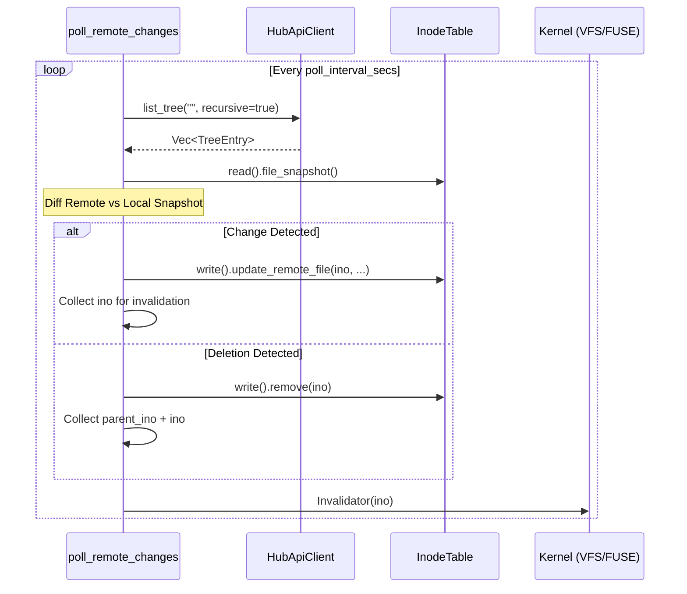
Sources: [src/virtual_fs/poll.rs:14-178](), [src/virtual_fs/mod.rs:148-164]()

## Change Detection Logic

The system uses specific metadata fields to determine if a file has changed on the remote.

| Feature | Logic | Source |
| :--- | :--- | :--- |
| **Xet Hash** | Preferred for Xet-enabled repos. Compares `xet_hash`. | [src/virtual_fs/poll.rs:63-64]() |
| **ETag / OID** | Used for standard files. Compares `oid`. | [src/virtual_fs/poll.rs:66]() |
| **Size** | Secondary check. If size differs, file is marked changed. | [src/virtual_fs/poll.rs:69]() |
| **Dirty Protection** | Locally modified files (marked `is_dirty`) are **skipped** during polling. | [src/virtual_fs/poll.rs:53-56]() |

### Dirty-File Protection
To prevent remote changes from overwriting uncommitted local work, the poller checks the `is_dirty` flag on every inode [src/virtual_fs/poll.rs:54](). If a file is dirty, the local version takes precedence until the `FlushManager` successfully uploads the changes to the Hub.

## Kernel Cache Invalidation

Because modern operating systems heavily cache file attributes and data pages, simply updating the internal `InodeTable` is insufficient. `hf-mount` uses an `Invalidator` callback to bridge the gap between the userspace daemon and the kernel.

### The Invalidator Callback
The `Invalidator` is a boxed closure `Fn(u64)` stored in `VirtualFs` [src/virtual_fs/mod.rs:33](). It is typically provided by the backend (e.g., `FuseAdapter`) after the filesystem is mounted.

*   **For Files**: The poller triggers invalidation for the specific file inode. This forces the kernel to discard page cache entries and re-fetch attributes (like size and mtime) on the next access [src/virtual_fs/poll.rs:172-174]().
*   **For Deletions**: The poller invalidates both the deleted file's inode and its parent directory's inode [src/virtual_fs/poll.rs:112-115](). This ensures the directory entry (dentry) is removed from the kernel's name cache.
*   **For New Files**: The poller identifies the parent directory of the new remote file and invalidates that directory's inode [src/virtual_fs/poll.rs:131-143]().

### Negative Cache Invalidation
The `VirtualFs` maintains a `negative_cache` to prevent repeated Hub API calls for files that do not exist [src/virtual_fs/mod.rs:89](). When polling detects new files on the remote, it must clear relevant entries from this cache:
1.  The poller identifies the parent path of the new file [src/virtual_fs/poll.rs:125-130]().
2.  It removes all entries in the `negative_cache` that reside under that parent path [src/virtual_fs/poll.rs:163-169]().

## Code Entity Mapping

The following diagram maps the logical polling components to their specific implementation structures in the `virtual_fs` module.

**Figure 2: Polling Component Mapping**
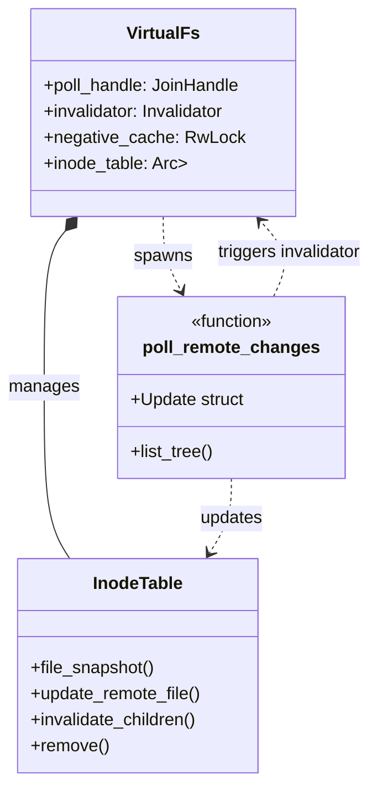
Sources: [src/virtual_fs/mod.rs:75-115](), [src/virtual_fs/poll.rs:14-178](), [src/virtual_fs/inode/mod.rs:252-270]()

## Summary of Invalidation Scenarios

| Event | Inode(s) Invalidated | Cache Effect |
| :--- | :--- | :--- |
| **File Updated** | `file_ino` | Kernel drops page cache; attributes re-fetched. |
| **File Deleted** | `file_ino`, `parent_ino` | Dentry removed; file disappears from directory listing. |
| **New File Created** | `parent_ino` | Kernel re-reads directory; `negative_cache` cleared for path. |
| **Directory Changed** | `dir_ino` | `inode_table.invalidate_children()` called; `readdir` re-fetches. |

Sources: [src/virtual_fs/poll.rs:98-178]()

---

# Page: Filesystem Backends

# Filesystem Backends

<details>
<summary>Relevant source files</summary>

The following files were used as context for generating this wiki page:

- [src/bin/hf-mount-fuse.rs](src/bin/hf-mount-fuse.rs)
- [src/bin/hf-mount-nfs.rs](src/bin/hf-mount-nfs.rs)
- [src/fuse.rs](src/fuse.rs)
- [src/nfs.rs](src/nfs.rs)

</details>


The `hf-mount` codebase provides two distinct protocol backends to expose the `VirtualFs` abstraction to the operating system: **FUSE** (Filesystem in Userspace) and **NFS** (Network File System). These backends act as adapters, translating OS-specific filesystem requests into operations understood by the core virtual filesystem layer.

### Backend Selection
The choice of backend is typically determined by the environment and performance requirements:
- **FUSE**: The default for Linux and macOS. It offers deeper integration with kernel features like `DIRECT_IO` and atomic truncation.
- **NFS**: Primarily used for environments where FUSE is restricted (e.g., certain container runtimes) or where a stateless protocol is preferred.

### System Architecture: Backend Adapters
The following diagram illustrates how the specialized backend binaries (`hf-mount-fuse` and `hf-mount-nfs`) wrap the `VirtualFs` core.

**Backend to VFS Mapping**
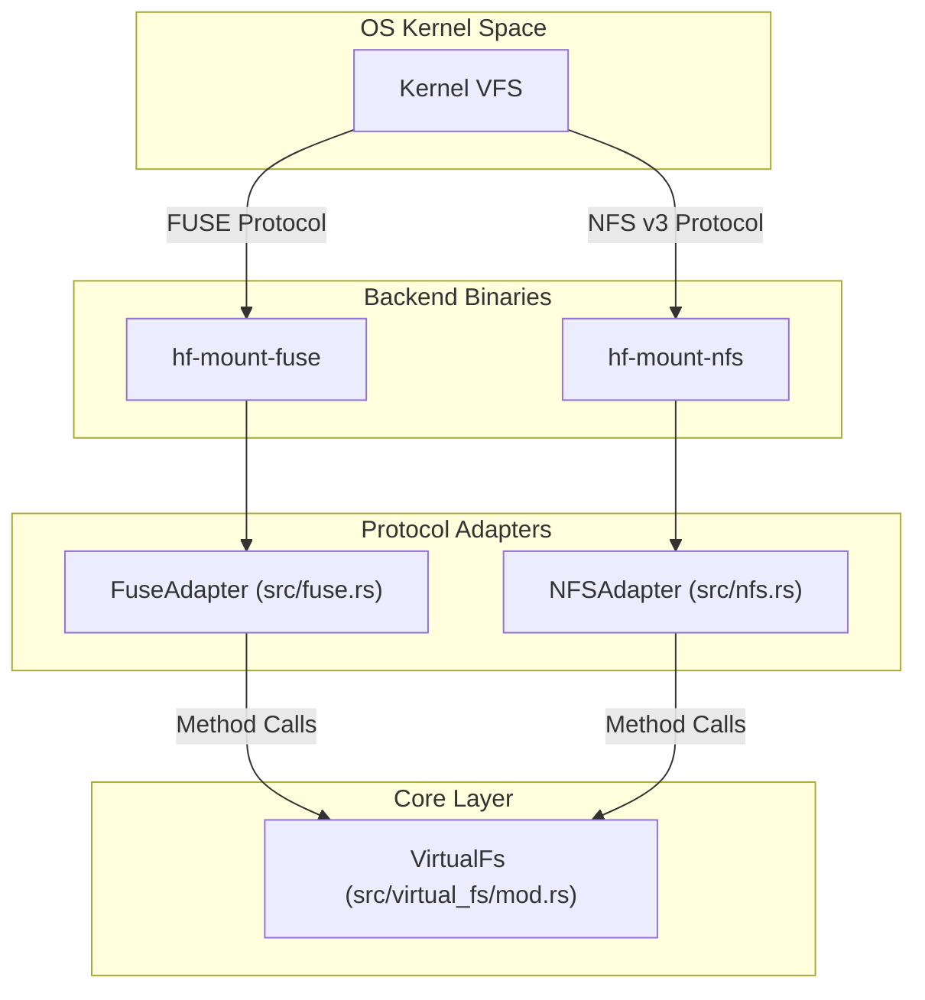
**Sources:** [src/bin/hf-mount-fuse.rs:6-25](), [src/bin/hf-mount-nfs.rs:5-21](), [src/fuse.rs:20-30](), [src/nfs.rs:21-34]()

---

## FUSE Backend

The FUSE backend is implemented via the `FuseAdapter` struct [src/fuse.rs:20-30](), which implements the `fuser::Filesystem` trait. It serves as an async-to-sync bridge, using a `tokio::runtime::Handle` to execute the asynchronous `VirtualFs` methods within the synchronous FUSE callback context [src/fuse.rs:153-157]().

### Key Responsibilities
- **Kernel Negotiation**: Configures kernel parameters such as `max_background` requests and `max_readahead` during the `init` phase [src/fuse.rs:99-148]().
- **Capability Support**: Enables advanced features like `FUSE_DIRECT_IO_ALLOW_MMAP` to support memory-mapped files (e.g., for `safetensors`) even when bypassing the kernel page cache [src/fuse.rs:112-117]().
- **Attribute Mapping**: Converts internal `VirtualFsAttr` metadata into the `FileAttr` format required by the `fuser` library [src/fuse.rs:60-83]().

For detailed implementation details on signal handling and kernel flags, see [FUSE Backend](#3.1).

**Sources:** [src/fuse.rs:20-49](), [src/fuse.rs:98-148](), [src/fuse.rs:151-157]()

---

## NFS Backend

The NFS backend uses the `NFSAdapter` [src/nfs.rs:21-25]() to expose the repository as an NFS v3 export. Unlike FUSE, which is a stateful local protocol, NFS v3 is stateless. To bridge this, the backend maintains a `HandlePool` [src/nfs.rs:23]().

### Key Responsibilities
- **Handle Management**: Since NFS v3 does not have explicit `open` or `release` calls for every I/O operation, the `NFSAdapter` uses an LRU cache (`HandlePool`) to keep `VirtualFs` file handles open for active I/O [src/nfs.rs:46-81]().
- **Stateless-to-Stateful Bridge**: Automatically opens handles on `read` or `write` requests and flushes/releases them when they are evicted from the pool [src/nfs.rs:37-43]().
- **Mount Orchestration**: Handles platform-specific mount commands (e.g., `mount_nfs` on macOS or `mount.nfs` on Linux) to attach the local NFS server to the desired mount point.

For details on the LRU eviction logic and write durability, see [NFS Backend](#3.2).

**Sources:** [src/nfs.rs:21-34](), [src/nfs.rs:46-56](), [src/nfs.rs:149-168]()

---

## Interaction Overview

The backends are initialized by their respective entry points using a shared `setup` utility [src/setup.rs]().

| Feature | FUSE (`FuseAdapter`) | NFS (`NFSAdapter`) |
| :--- | :--- | :--- |
| **Library** | `fuser` | `nfsserve` |
| **Async Handling** | `runtime.block_on()` | `async_trait` implementation |
| **Metadata TTL** | Kernel-enforced | Adapter-enforced |
| **File Handles** | Managed by Kernel | Managed by `HandlePool` LRU |
| **Direct I/O** | Supported via `FOPEN_DIRECT_IO` | Implicit (NFS-dependent) |

**Code Entity Mapping**
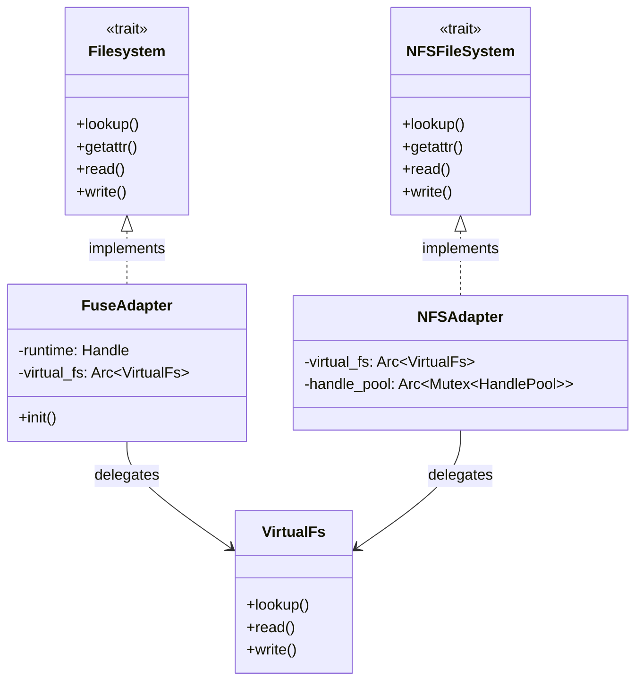
**Sources:** [src/fuse.rs:20-30](), [src/fuse.rs:98-100](), [src/nfs.rs:21-25](), [src/nfs.rs:119-120]()

---

# Page: FUSE Backend

# FUSE Backend

<details>
<summary>Relevant source files</summary>

The following files were used as context for generating this wiki page:

- [.vscode/settings.json](.vscode/settings.json)
- [src/bin/hf-mount-fuse.rs](src/bin/hf-mount-fuse.rs)
- [src/bin/hf-mount-nfs.rs](src/bin/hf-mount-nfs.rs)
- [src/fuse.rs](src/fuse.rs)

</details>


The FUSE (Filesystem in Userspace) backend provides a high-performance, POSIX-compliant interface to the `VirtualFs` layer. It leverages the `fuser` crate to communicate with the Linux/macOS kernel FUSE driver. This backend is responsible for translating synchronous kernel requests into asynchronous operations, negotiating advanced kernel capabilities, and managing the mount lifecycle including signal-driven unmounting.

## FuseAdapter and Trait Implementation

The core of the FUSE backend is the `FuseAdapter` struct [src/fuse.rs:20-30](). It implements the `fuser::Filesystem` trait, acting as a bridge between the kernel's low-level FUSE protocol and the internal `VirtualFs` abstraction.

Because the `fuser` trait methods are synchronous but `VirtualFs` operations are `async` (relying on `tokio` for network I/O), the `FuseAdapter` uses a `tokio::runtime::Handle` to execute futures via `block_on` [src/fuse.rs:153-157]().

### Data Flow: Kernel to VirtualFs

The following diagram illustrates the path of a filesystem request from the OS kernel through the FUSE adapter into the asynchronous virtual filesystem.

**FUSE Request Lifecycle**
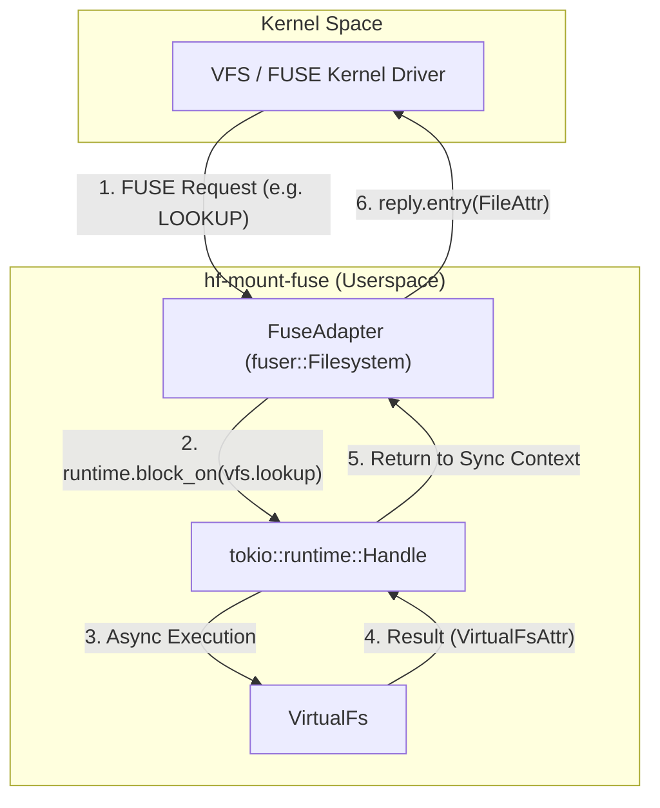
Sources: [src/fuse.rs:151-157](), [src/fuse.rs:170-184]()

## Kernel Capability Negotiation

During the `init` phase, `FuseAdapter` configures the kernel FUSE driver to optimize for network-backed storage and specific container environments.

| Capability | Purpose | Implementation Detail |
| :--- | :--- | :--- |
| `FUSE_ATOMIC_O_TRUNC` | Allows `open()` with `O_TRUNC` to succeed atomically. | Required for simple streaming writes [src/fuse.rs:120-135](). |
| `FUSE_DIRECT_IO_ALLOW_MMAP` | Enables `mmap()` support when `direct_io` is enabled. | Critical for `safetensors` on Linux 6.6+ [src/fuse.rs:112-117](). |
| `FUSE_ALLOW_IDMAP` | Supports UID/GID remapping in user namespaces. | Essential for rootless containers/Kubernetes [src/fuse.rs:140-145](). |
| `max_background` | Increases concurrent kernel requests. | Set to 64 to avoid bottlenecks during high I/O [src/fuse.rs:103](). |

Sources: [src/fuse.rs:98-148]()

## Implementation Details

### Attribute Conversion
The backend converts internal `VirtualFsAttr` metadata into the `fuser::FileAttr` format required by the kernel [src/fuse.rs:60-83](). It uses a constant `GENERATION` of 0 because `hf-mount` does not currently recycle inode numbers [src/fuse.rs:17-18]().

### Directory Pagination
In `readdir`, the adapter uses the `offset` provided by the kernel to support pagination of large directories [src/fuse.rs:169-184](). This ensures that even if a directory contains thousands of entries, the kernel can fetch them in chunks without overwhelming the `ReplyDirectory` buffer.

### Write Modes and Flags
The `FuseAdapter` respects several configuration flags that alter its behavior:
*   **Direct I/O**: If `direct_io` is enabled, the `FOPEN_DIRECT_IO` flag is passed to the kernel during `open` and `create` calls [src/fuse.rs:51-57](). This bypasses the kernel page cache, which is preferred when `VirtualFs` manages its own `PrefetchState`.
*   **Advanced Writes**: If disabled, the backend enforces strict checks on `FUSE_ATOMIC_O_TRUNC` support to ensure streaming writes don't result in corrupted files [src/fuse.rs:122-129]().

Sources: [src/fuse.rs:20-30](), [src/fuse.rs:51-57](), [src/fuse.rs:120-135]()

## Mount Lifecycle and Signal Handling

The entry point for the FUSE backend is the `hf-mount-fuse` binary. It initializes the environment using `setup()` and enters the `mount_fuse` loop.

**Mount and Signal Flow**
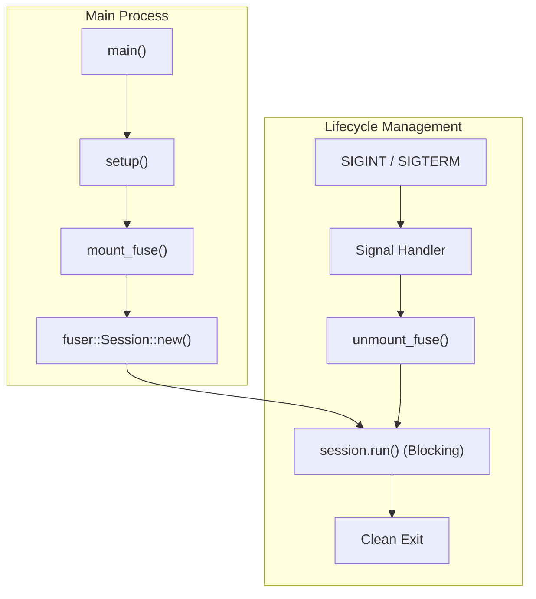
Sources: [src/bin/hf-mount-fuse.rs:6-25](), [src/fuse.rs:324-365]()

### Unmount Utilities
The backend includes a robust unmount utility, `unmount_fuse`, which attempts to unmount the filesystem using the standard `umount` (or `diskutil` on macOS) command [src/fuse.rs:367-393](). This is called both during graceful shutdown and as a cleanup measure if initialization fails.

The `DaemonGuard` [src/bin/hf-mount-fuse.rs:8]() ensures that the PID file and logs are managed correctly while the FUSE session is active in the background.

Sources: [src/bin/hf-mount-fuse.rs:1-25](), [src/fuse.rs:367-393]()

---

# Page: NFS Backend

# NFS Backend

<details>
<summary>Relevant source files</summary>

The following files were used as context for generating this wiki page:

- [src/bin/hf-mount-fuse.rs](src/bin/hf-mount-fuse.rs)
- [src/bin/hf-mount-nfs.rs](src/bin/hf-mount-nfs.rs)
- [src/nfs.rs](src/nfs.rs)

</details>


The NFS backend provides a high-performance, cross-platform alternative to FUSE by exposing the `VirtualFs` via the NFS v3 protocol over a local TCP loopback. This approach is particularly useful on platforms where FUSE support is restricted or where kernel-level NFS optimizations (like aggressive client-side caching) are desired. It utilizes the `nfsserve` library to implement the server-side logic and bridges the stateless nature of NFS to the stateful requirements of the `VirtualFs`.

### Implementation Overview

The core of the NFS backend is the `NFSAdapter`, which implements the `NFSFileSystem` trait from the `nfsserve` crate [src/nfs.rs:21-25](). It acts as a translation layer between NFS procedure calls (e.g., `LOOKUP`, `READ`, `WRITE`) and `VirtualFs` operations.

#### Handle Management and the HandlePool
NFS v3 is inherently stateless, identifying files by `fileid3` (Inodes). However, `VirtualFs` requires stateful file handles for operations like `read` and `write`. The `HandlePool` is an LRU (Least Recently Used) cache that manages this mapping [src/nfs.rs:31](), [src/nfs.rs:364-370]().

*   **LRU Eviction**: The pool has a fixed capacity (defaulting to 1000 handles) [src/nfs.rs:372](). When the capacity is reached, the least recently used handle is evicted.
*   **Flush on Eviction**: Before a handle is closed, the adapter calls `evict_handle`, which triggers `virtual_fs.flush` to ensure all dirty data is committed to the Hub/CAS before the handle is released [src/nfs.rs:37-43]().
*   **Concurrent Access**: The `get_or_open_handle` method handles cases where multiple NFS threads might request the same file simultaneously, ensuring only one `VirtualFs` handle is opened and cached [src/nfs.rs:46-81]().

#### Data Flow: NFS to VirtualFs
The following diagram illustrates how a standard NFS `READ` request is resolved through the adapter and the handle pool.

**NFS Read Operation Flow**
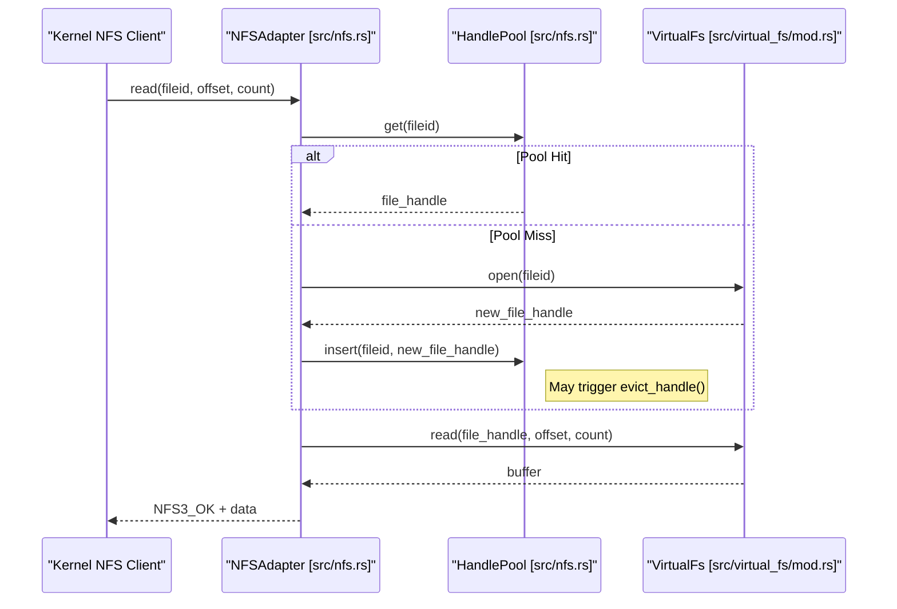
Sources: [src/nfs.rs:149-168](), [src/nfs.rs:46-81]()

### Platform-Specific Mounting

The `mount_nfs` function handles the lifecycle of the NFS server and the OS-level mount command [src/nfs.rs:223-331](). It binds to a random port on `127.0.0.1` and executes platform-specific commands to attach the local NFS server to the filesystem tree.

| Platform | Command Used | Key Arguments |
| :--- | :--- | :--- |
| **Linux** | `mount.nfs` | `port`, `mountport`, `nolock`, `tcp`, `nfsvers=3`, `actimeo` [src/nfs.rs:265-275]() |
| **macOS** | `mount_nfs` | `port`, `mountport`, `nolock`, `tcp`, `nfsvers=3`, `locallocks` [src/nfs.rs:277-287]() |

The `metadata_ttl_ms` configuration is passed to the mount command via `actimeo` (Linux) or `nocto` settings to control how aggressively the kernel caches file attributes [src/nfs.rs:260-262]().

### Write Durability and `schedule_flush`

NFS supports both synchronous and asynchronous writes. To optimize performance while maintaining durability, the `NFSAdapter` utilizes the `VirtualFs` flushing mechanism:

1.  **Write**: Data is written to the `VirtualFs` via the handle retrieved from the `HandlePool` [src/nfs.rs:200-210]().
2.  **Commit**: When the NFS client sends a `COMMIT` request, the adapter calls `virtual_fs.flush` to ensure data is persisted [src/nfs.rs:212-220]().
3.  **Background Flush**: For asynchronous writes, the `VirtualFs` may manage its own background flushing, but the `NFSAdapter` ensures that any handle evicted from the `HandlePool` is explicitly flushed first [src/nfs.rs:37-39]().

### Shutdown and Unmount Detection

The NFS backend must handle graceful shutdowns to avoid "stale mount" errors in the host OS.

*   **Unmount Detection**: A background task polls the mount point or monitors the server status. If the user manually unmounts the directory, the `NFSTcpListener` loop terminates [src/nfs.rs:320-331]().
*   **DaemonGuard**: The `DaemonGuard` is notified once the mount is ready by checking for the existence of the mount point in the system's mount table [src/nfs.rs:303-315]().
*   **Cleanup**: On exit, the `NFSAdapter` ensures all remaining handles in the `HandlePool` are flushed and released [src/nfs.rs:40-42]().

**NFS System Component Mapping**
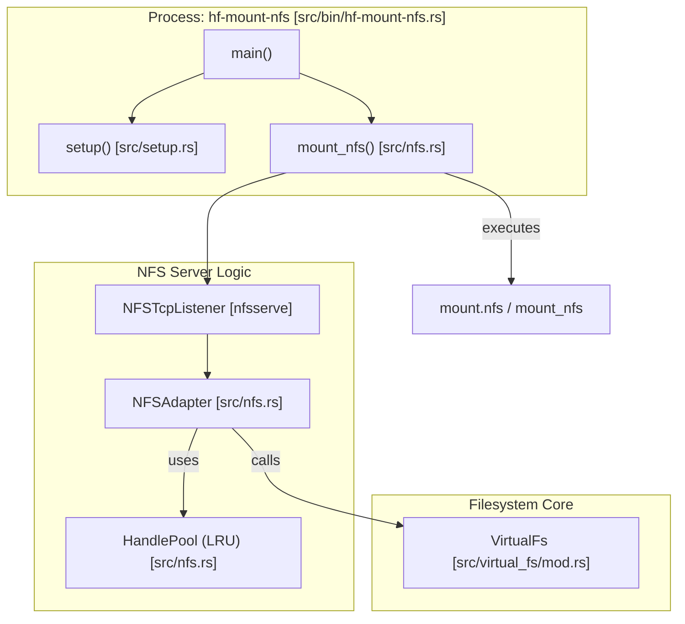
Sources: [src/bin/hf-mount-nfs.rs:5-21](), [src/nfs.rs:21-34](), [src/nfs.rs:223-235]()

### Key Functions and Methods

| Entity | Description |
| :--- | :--- |
| `NFSAdapter::new` | Initializes the adapter with a `VirtualFs` instance and an empty `HandlePool` [src/nfs.rs:28-34](). |
| `get_or_open_handle` | Retrieves an existing handle or opens a new one, managing LRU eviction and concurrency [src/nfs.rs:46-81](). |
| `vfs_attr_to_nfs` | Converts internal `VirtualFsAttr` metadata into the `fattr3` format required by the NFS protocol [src/nfs.rs:408-435](). |
| `errno_to_nfs` | Maps standard libc error codes to `nfsstat3` error codes for protocol compliance [src/nfs.rs:444-465](). |
| `mount_nfs` | The entry point for starting the TCP server and executing the OS mount command [src/nfs.rs:223-250](). |

Sources: [src/nfs.rs:21-465](), [src/bin/hf-mount-nfs.rs:1-22]()

---

# Page: Hub API and Authentication

# Hub API and Authentication

<details>
<summary>Relevant source files</summary>

The following files were used as context for generating this wiki page:

- [src/hub_api.rs](src/hub_api.rs)
- [src/setup.rs](src/setup.rs)

</details>


The Hugging Face Hub serves as the remote source of truth for both metadata and file content in `hf-mount`. Communication is split into two distinct layers: the **Hub API** (for directory structures, file attributes, and commit operations) and the **Xet CAS Layer** (for high-performance, chunk-deduplicated data transfer).

This page provides a high-level overview of how `hf-mount` authenticates with these services and manages the data flow between the local filesystem and the remote Hub.

### System Architecture: API and Data Flow

The following diagram illustrates how the `HubApiClient` and `Xet CAS` components interact with the Hugging Face infrastructure.

**Hub Communication Overview**
```mermaid
graph TD
    subgraph "hf-mount (Local)"
        VFS["VirtualFs"]
        HAC["HubApiClient (HubOps)"]
        XC["CachedXetClient (XetOps)"]
        TR["HubTokenRefresher"]
    end

    subgraph "Hugging Face Hub (Remote)"
        HAPI["Hub API (/api/...)"]
        HRES["Resolve Endpoint (/resolve/...)"]
        CAS["Xet CAS (Content Addressable Storage)"]
        AUTH["Auth Service (JWT)"]
    end

    VFS -->|"list_tree / head_file"| HAC
    HAC -->|"JSON Metadata"| HAPI
    HAC -->|"ETag / XetHash"| HRES
    
    VFS -->|"read / write"| XC
    XC -->|"Chunked Data"| CAS
    
    TR -->|"Fetch CAS JWT"| HAPI
    TR -->|"Rotate Token"| XC
    CAS -.->|"Verify JWT"| AUTH
```
Sources: [src/hub_api.rs:18-26](), [src/hub_api.rs:194-214](), [src/setup.rs:161-171]()

---

## HubApiClient and HubOps Trait

The `HubApiClient` is the primary interface for metadata operations. It implements the `HubOps` trait, which abstracts operations like listing directory trees, fetching file headers (HEAD requests), and committing batches of changes.

- **Source Polymorphism**: Supports both `Bucket` (S3-like storage) and `Repo` (Git-based Models, Datasets, and Spaces) through the `SourceKind` enum [src/hub_api.rs:84-93]().
- **Path Scoping**: Supports a `path_prefix` which allows mounting a specific subfolder of a repository as the filesystem root [src/hub_api.rs:211-213]().
- **Metadata Translation**: Converts Hub-specific structures like `RepoTreeEntry` into a unified `TreeEntry` format used by the `VirtualFs` [src/hub_api.rs:126-156]().

For details on tree listing, pagination, and ETag-based validation, see **[HubApiClient and HubOps Trait](#4.1)**.

Sources: [src/hub_api.rs:13-26](), [src/hub_api.rs:194-214]()

---

## Authentication and Token Management

`hf-mount` employs a two-tier authentication model to handle long-lived user credentials and short-lived storage access tokens.

| Credential Type | Purpose | Lifecycle |
|:---|:---|:---|
| **HF Token** | Primary user identity for Hub API calls. | Static (env/CLI) or File-based (30s refresh). |
| **CAS JWT** | Scoped access to Xet Content Addressable Storage. | Short-lived; automatically refreshed by `HubTokenRefresher`. |

### Token Rotation and CSI Support
To support environments like Kubernetes (CSI Driver), `hf-mount` can monitor a `token_file`. If the file on disk is updated, the client re-reads it automatically every 30 seconds [src/hub_api.rs:191-192](). This allows for seamless credential rotation without unmounting the filesystem.

For details on the refresh logic and JWT acquisition, see **[Authentication and Token Management](#4.2)**.

Sources: [src/hub_api.rs:191-206](), [src/setup.rs:58-69]()

---

## Xet CAS Layer

While metadata travels via the Hub API, actual file content is managed by the Xet CAS (Content Addressable Storage) layer. This layer provides high-performance data transfer using Merkle-tree-based deduplication.

**Entity Mapping: CAS Interaction**
```mermaid
graph LR
    subgraph "Code Entity Space"
        VFS["VirtualFs"]
        XOPS["trait XetOps"]
        CXC["CachedXetClient"]
        HTR["HubTokenRefresher"]
    end

    subgraph "Data/Network Space"
        RECP["Reconstruction Plan"]
        CHKS["Data Chunks"]
        JWT["CAS JWT Token"]
    end

    VFS -->|"fetch_plan()"| XOPS
    XOPS -->|"implements"| CXC
    CXC -->|"GET /plan"| RECP
    CXC -->|"GET /block"| CHKS
    HTR -->|"Refreshes"| JWT
    CXC -.->|"Uses"| JWT
```
Sources: [src/hub_api.rs:504-510](), [src/setup.rs:9-14]()

Key features of the Xet layer in `hf-mount` include:
- **Deduplication**: Only unique data chunks are uploaded or downloaded.
- **Reconstruction Plans**: Metadata that describes how chunks assemble into a file. These are cached locally in the `CachedXetClient` to reduce latency [src/setup.rs:11-14]().
- **Streaming vs. Staging**: Supports both direct streaming writes and random-access writes via a local `StagingDir` [src/setup.rs:91-94]().

For details on session isolation and the xorb disk cache bypass, see **[Xet CAS Layer](#4.3)**.

Sources: [src/setup.rs:75-78](), [src/setup.rs:100-108]()

---

# Page: HubApiClient and HubOps Trait

# HubApiClient and HubOps Trait

<details>
<summary>Relevant source files</summary>

The following files were used as context for generating this wiki page:

- [src/hub_api.rs](src/hub_api.rs)

</details>


The `HubApiClient` serves as the primary interface for interacting with the Hugging Face Hub. It abstracts the complexities of the Hub's REST API, providing a unified set of operations for both standard Git-based repositories and S3-backed buckets. This abstraction is formalized through the `HubOps` trait, which allows the filesystem layer (`VirtualFs`) and the background flush manager to perform metadata lookups, tree listings, and atomic batch updates without concern for the underlying storage type.

## HubOps Trait Interface

The `HubOps` trait defines the contract for all Hub-related operations. By using this trait, the codebase facilitates easier testing through mocks and ensures that the `VirtualFs` remains decoupled from the specific HTTP implementation.

| Method | Description |
| :--- | :--- |
| `list_tree` | Recursively or non-recursively lists entries in a directory. |
| `head_file` | Fetches metadata (ETag, size, Xet hash) for a specific path. |
| `batch_operations` | Submits a list of file additions or deletions as an atomic commit. |
| `download_file_http` | Downloads a file directly via HTTP (used for small files or non-Xet content). |
| `source` | Returns the `SourceKind` (Bucket vs Repo) of the current mount. |

Sources: [src/hub_api.rs:13-26]()

## Data Model and Source Types

The client distinguishes between two primary source types through the `SourceKind` enum. This distinction dictates which API endpoints are hit and how metadata is parsed.

### SourceKind and RepoType
A `SourceKind` can either be a `Bucket` (identified by a `bucket_id`) or a `Repo` (identified by `repo_id`, `repo_type`, and `revision`) [src/hub_api.rs:81-93](). 

The `RepoType` determines the URL structure used for API calls:
*   **Model**: API prefix `models`, resolve prefix `""` [src/hub_api.rs:31-57]().
*   **Dataset**: API prefix `datasets`, resolve prefix `datasets/` [src/hub_api.rs:31-57]().
*   **Space**: API prefix `spaces`, resolve prefix `spaces/` [src/hub_api.rs:31-57]().

### TreeEntry and BatchOp
Metadata returned from the Hub is normalized into a `TreeEntry` struct, which includes the file path, size, and critical identifiers like the `xet_hash` (for deduplicated content) and `oid` (Git blob OID, used as an ETag) [src/hub_api.rs:126-138]().

For writes, the `BatchOp` enum represents atomic changes:
*   `AddFile`: Includes path, `xet_hash`, and `mtime` [src/hub_api.rs:114-120]().
*   `DeleteFile`: Includes the target path [src/hub_api.rs:122]().

Sources: [src/hub_api.rs:30-57](), [src/hub_api.rs:81-106](), [src/hub_api.rs:110-138]()

## HubApiClient Implementation

The `HubApiClient` manages the HTTP lifecycle using `reqwest`. It maintains two distinct clients: a standard `client` for most requests and a `head_client` specifically configured *not* to follow redirects [src/hub_api.rs:195-198](). This is necessary because `HEAD` requests to the Hub's `resolve` endpoint often redirect to S3/Cloudfront; the client needs the headers from the Hub (containing `X-Repo-Commit`, etc.) rather than the headers from the final download target.

### Scoped Path Management (`path_prefix`)
The client supports mounting a subfolder of a repository or bucket via the `path_prefix` field [src/hub_api.rs:213-214](). 
1.  **Outgoing**: When calling the Hub API, the `path_prefix` is prepended to the requested path.
2.  **Incoming**: When receiving `TreeEntry` results, the `path_prefix` is stripped so that the `VirtualFs` only sees paths relative to the mount point.

### Token Caching and Refresh
To support environments like Kubernetes (CSI drivers) where tokens are rotated on disk, `HubApiClient` implements a two-tier token strategy:
*   **Static Token**: A token provided at initialization [src/hub_api.rs:200]().
*   **Token File**: A path to a file (e.g., a mounted Secret) [src/hub_api.rs:204]().
*   **Caching**: If a `token_file` is used, the client caches the content for 30 seconds (`TOKEN_FILE_REFRESH`) to avoid excessive I/O on every API call [src/hub_api.rs:192](), [src/hub_api.rs:206]().

Sources: [src/hub_api.rs:194-214](), [src/hub_api.rs:434-463]()

## Technical Diagrams

### Hub API Interaction Flow
This diagram illustrates how `HubApiClient` translates high-level `HubOps` calls into specific Hub API routes based on the `SourceKind`.

```mermaid
graph TD
    subgraph "Natural Language Space"
        A["List Directory"]
        B["Commit Changes"]
        C["Get Metadata"]
    end

    subgraph "Code Entity Space: HubApiClient"
        A --> D["list_tree()"]
        B --> E["batch_operations()"]
        C --> F["head_file()"]

        D --> G{{"SourceKind?"}}
        G -- "Repo" --> H["GET /api/{type}/{id}/tree/{rev}/{path}"]
        G -- "Bucket" --> I["GET /api/buckets/{id}/tree/{path}"]

        E --> J["POST /api/{type}/{id}/commit/{rev}"]
        F --> K["HEAD /{resolve_prefix}{id}/resolve/{rev}/{path}"]
    end

    H --> L["RepoTreeEntry"]
    I --> M["TreeEntry (Bucket)"]
    L --> N["Normalize to TreeEntry"]
    M --> N
```
Sources: [src/hub_api.rs:18-26](), [src/hub_api.rs:84-93](), [src/hub_api.rs:141-156](), [src/hub_api.rs:555-580]()

### Token Resolution Logic
This diagram shows the priority and caching logic used to retrieve the Hugging Face authentication token for requests.

```mermaid
graph TD
    subgraph "Entity: HubApiClient"
        Start["Request Auth Token"] --> CheckFile{"token_file exists?"}
        
        CheckFile -- "Yes" --> CheckCache{"Cache < 30s old?"}
        CheckCache -- "Yes" --> ReturnCache["Return cached token"]
        CheckCache -- "No" --> ReadDisk["Read token_file from disk"]
        ReadDisk --> UpdateCache["Update token_file_cache"]
        UpdateCache --> ReturnCache
        
        CheckFile -- "No" --> CheckStatic{"static token exists?"}
        CheckStatic -- "Yes" --> ReturnStatic["Return static token"]
        CheckStatic -- "No" --> ReturnNone["No Authentication"]
    end
```
Sources: [src/hub_api.rs:191-206](), [src/hub_api.rs:434-463]()

## Key Operations

### Tree Listing and Pagination
When `list_tree` is called, the client handles the differences between Repository and Bucket APIs. For Repositories, it fetches the `RepoTreeEntry` which contains Git-specific metadata (like LFS info) and converts it to the common `TreeEntry` format [src/hub_api.rs:555-600]().

### ETag-based Conditional Downloads
The `head_file` operation is used to validate local cache freshness. It retrieves the `etag` and `xet_hash` from the Hub's response headers [src/hub_api.rs:173-179](). This allows the `VirtualFs` to perform conditional requests or skip downloads if the local `Inode` metadata matches the remote state.

### Batch Operations
The `batch_operations` method enables atomic multi-file updates. It takes a slice of `BatchOp` and sends them to the Hub's commit endpoint. This is used by the `FlushManager` to ensure that when multiple files are written or deleted, they appear in the Hub as a single consistent commit [src/hub_api.rs:112-123](), [src/hub_api.rs:650-680]().

Sources: [src/hub_api.rs:112-123](), [src/hub_api.rs:173-179](), [src/hub_api.rs:555-600](), [src/hub_api.rs:650-680]()

---

# Page: Authentication and Token Management

# Authentication and Token Management

<details>
<summary>Relevant source files</summary>

The following files were used as context for generating this wiki page:

- [src/hub_api.rs](src/hub_api.rs)
- [src/setup.rs](src/setup.rs)

</details>


`hf-mount` employs a two-tier authentication model to handle different security requirements for metadata operations and bulk data transfer. Metadata operations (listing files, checking permissions) are handled via the Hugging Face Hub API using standard HF tokens. Bulk data transfers (reading and writing file chunks) utilize short-lived JSON Web Tokens (JWTs) generated by the Hub and consumed by the Xet Content Addressable Storage (CAS) backend.

## Two-Tier Authentication Model

The system distinguishes between long-lived user credentials and short-lived session tokens required by the underlying storage architecture.

| Token Type | Purpose | Lifecycle | Code Entity |
|:---|:---|:---|:---|
| **HF Token** | Hub API calls (Tree listing, HEAD, Batch Ops) | Static or File-based (refreshed every 30s) | `HubApiClient` |
| **CAS JWT** | Xet CAS data operations (Read/Write chunks) | Short-lived (typically 1 hour) | `HubTokenRefresher` |

### Hub API Authentication (`HubApiClient`)

The `HubApiClient` manages the primary HF token used for all REST operations against the Hugging Face Hub. It supports two modes of token acquisition:
1.  **Static Token**: Provided via the `--hf-token` CLI flag or `HF_TOKEN` environment variable [src/setup.rs:59-62]().
2.  **Token File**: Provided via the `--token-file` CLI flag [src/setup.rs:68-69](). This is specifically designed for environments like Kubernetes where a CSI driver or sidecar might rotate tokens on disk.

When a `token_file` is used, the client implements a 30-second TTL cache (`TOKEN_FILE_REFRESH`) to avoid excessive disk I/O while ensuring the mount picks up rotated credentials without requiring a restart [src/hub_api.rs:191-193](), [src/hub_api.rs:205-206]().

### CAS Token Refresh (`HubTokenRefresher`)

The Xet CAS backend requires a specific JWT to authorize chunk-level operations. Since these tokens expire, `hf-mount` implements the `TokenRefresher` trait from the `xet-client` library [src/hub_api.rs:9-9]().

The `HubTokenRefresher` struct bridges the Hub API and the CAS layer. When the `xet-core` library detects an expired token or requires a new session, it calls the refresher, which in turn hits the Hub's `/api/cas/token` endpoint to fetch a `CasTokenInfo` object [src/hub_api.rs:182-187](), [src/hub_api.rs:414-416]().

## Data Flow: Token Acquisition and Rotation

The following diagram illustrates how tokens flow from the user/environment into the various system components and how they are refreshed.

**Authentication Data Flow**

```mermaid
sequenceDiagram
    participant OS as "Environment/Disk"
    participant HAC as "HubApiClient"
    participant HTR as "HubTokenRefresher"
    participant Hub as "HF Hub API"
    participant CAS as "Xet CAS Backend"

    Note over OS, HAC: Initialization
    OS->>HAC: Load HF_TOKEN or token_file [src/setup.rs:59-69]
    
    rect rgb(240, 240, 240)
    Note over HAC, Hub: Metadata Auth (Static/File)
    HAC->>HAC: Check token_file_cache TTL (30s) [src/hub_api.rs:192]
    alt Cache Expired
        OS->>HAC: Re-read token from disk [src/hub_api.rs:341-355]
    end
    HAC->>Hub: API Request (Authorization: Bearer <token>)
    end

    rect rgb(230, 230, 230)
    Note over HTR, CAS: Data Auth (JWT Rotation)
    CAS->>HTR: request_token() (on expiry) [src/hub_api.rs:420]
    HTR->>HAC: get_token() [src/hub_api.rs:423]
    HAC->>Hub: POST /api/cas/token [src/hub_api.rs:396]
    Hub-->>HTR: CasTokenInfo (JWT + CAS URL) [src/hub_api.rs:182]
    HTR-->>CAS: TokenInfo [src/hub_api.rs:427]
    CAS->>CAS: Authenticate Chunks with JWT
    end
```

Sources: `src/hub_api.rs`, `src/setup.rs`

## Key Implementation Entities

The authentication logic is encapsulated in `src/hub_api.rs`.

### HubApiClient
The central authority for Hub communication. It handles the logic for choosing between the static token and the file-based token.

*   **`get_token()`**: Internal method that resolves the current token. It prioritizes the `token_file` if it exists and is non-empty, otherwise falling back to the static `token` [src/hub_api.rs:335-364]().
*   **`get_cas_token()`**: Requests a temporary CAS JWT from the Hub for a specific repository or bucket [src/hub_api.rs:396-412]().

### HubTokenRefresher
A wrapper around `HubApiClient` that implements `xet_client::cas_client::auth::TokenRefresher`.

*   **`refresh_token()`**: Asynchronously fetches a new CAS token and maps the Hub's `CasTokenInfo` into the `TokenInfo` structure expected by the Xet client [src/hub_api.rs:420-432]().

**Code Entity Mapping**

```mermaid
classDiagram
    class HubOps {
        <<interface>>
        +list_tree()
        +head_file()
        +batch_operations()
    }

    class HubApiClient {
        -client: Client
        -token: Option<String>
        -token_file: Option<PathBuf>
        -token_file_cache: Mutex
        +get_token() String
        +get_cas_token() CasTokenInfo
    }

    class HubTokenRefresher {
        -hub_client: Arc<HubApiClient>
        +refresh_token() TokenInfo
    }

    class TokenRefresher {
        <<interface>>
        +refresh_token()
    }

    HubOps <|.. HubApiClient : implements [src/hub_api.rs:240]
    TokenRefresher <|.. HubTokenRefresher : implements [src/hub_api.rs:418]
    HubTokenRefresher --> HubApiClient : delegates to [src/hub_api.rs:423]
```

Sources: `src/hub_api.rs`

## CSI Driver and Token Rotation

A primary use case for the `token_file` mechanism is integration with the Hugging Face CSI driver. In Kubernetes environments:

1.  The CSI driver mounts a volume containing a short-lived token (e.g., via a Projected Volume or a sidecar).
2.  `hf-mount` is started with `--token-file /path/to/token` [src/setup.rs:68-69]().
3.  Every 30 seconds, `HubApiClient` checks the modification time of the token file [src/hub_api.rs:341-344]().
4.  If the file has changed or the internal cache has expired, the new token is loaded [src/hub_api.rs:352-354]().
5.  Subsequent Hub API calls and CAS token refreshes automatically use the updated credentials without interrupting active filesystem operations.

This allows for seamless credential rotation for long-running mounts, which is critical for security compliance in production clusters.

Sources: `src/hub_api.rs`, `src/setup.rs`

---

# Page: Xet CAS Layer

# Xet CAS Layer

<details>
<summary>Relevant source files</summary>

The following files were used as context for generating this wiki page:

- [src/cached_xet_client.rs](src/cached_xet_client.rs)
- [src/xet.rs](src/xet.rs)

</details>


The Xet Content Addressable Storage (CAS) layer provides the underlying data transport and deduplication logic for `hf-mount`. It abstracts the complexity of the Xet protocol—including Merkle-tree based file reconstruction, block-level deduplication, and compressed "xorb" storage—into a set of high-level traits used by the filesystem layer.

## Overview of XetOps

The `XetOps` trait is the primary interface between the `VirtualFs` and the Xet backend. it provides methods for streaming writes, full-file downloads, and range-based streaming.

| Method | Purpose | Implementation Detail |
| :--- | :--- | :--- |
| `create_streaming_writer` | Starts an append-only upload session. | Returns a `StreamingWriter` wrapping a `FileUploadSession` [src/xet.rs:102-116](). |
| `download_to_file` | Downloads a full file to a local path. | Used for staging files in "advanced" write mode [src/xet.rs:118-125](). |
| `upload_files` | Batch uploads multiple files from disk. | Finalizes a `FileUploadSession` after processing paths [src/xet.rs:127-147](). |
| `download_stream_boxed` | Creates a byte-range stream. | Bridges to `FileReconstructor` or `FileDownloadSession` [src/xet.rs:149-157](). |
| `warm_reconstruction_cache` | Pre-fetches a file's reconstruction plan. | Triggers a background fetch in `CachedXetClient` [src/xet.rs:159-163](). |

Sources: [src/xet.rs:20-33](), [src/xet.rs:101-164]()

## XetSessions and Data Flow

`XetSessions` is the concrete implementation of `XetOps`. It manages the lifecycle of `FileDownloadSession` and `FileUploadSession` objects from the `xet-core` library.

### Streaming and Reconstruction
When a read request arrives, `XetSessions::download_stream` determines the optimal fetching strategy based on whether a byte range is specified:

1.  **Unbounded Streams (`end == None`)**: Uses `session.download_stream_from_offset`. This path utilizes the standard `xet-core` chunk cache, which is ideal for sequential reads [src/xet.rs:78-82]().
2.  **Bounded Ranges (`end == Some`)**: Uses `FileReconstructor` to build a stream for a specific `FileRange`. Crucially, this path bypasses the `xorb` disk cache to avoid "cache pollution" where a small random read might otherwise trigger a ~64MB xorb download [src/xet.rs:83-96]().

### StagingDir Session Isolation
For "advanced" write modes (random access or read-modify-write), `hf-mount` uses a `StagingDir`. To prevent collisions between different mount instances or concurrent sessions, it generates a unique `session_key` for the staging path [src/xet.rs:182-192]().

Sources: [src/xet.rs:54-98](), [src/xet.rs:182-192]()

## CachedXetClient

The `CachedXetClient` sits between the CAS sessions and the remote server. It optimizes the retrieval of **Reconstruction Plans**—the manifests that describe which chunks (and which xorbs) compose a specific file.

### Reconstruction Plan Coalescing
The client implements a "single-flight" mechanism using `tokio::sync::broadcast` channels. If multiple threads request the same reconstruction plan simultaneously, only the first thread performs the network request (`Lead` action); others wait (`Wait` action) and consume the result from the cache once the leader finishes [src/cached_xet_client.rs:146-152]().

### Plan Derivation Logic
To minimize network overhead, `CachedXetClient` can derive a range-specific plan from a cached full-file plan.

*   **Logic**: It iterates through the `terms` of the full plan, tracking cumulative offsets, and filters for those overlapping the requested `FileRange` [src/cached_xet_client.rs:97-121]().
*   **Over-fetch Management**: Because `XorbReconstructionTerm` only provides `unpacked_length` for the whole term, the derived plan may include up to one extra chunk (~128KB) at the boundaries. This is considered negligible for large model weights [src/cached_xet_client.rs:80-96]().

### Cache Lifecycle
*   **Capacity**: Limited to 4096 entries [src/cached_xet_client.rs:21]().
*   **TTL**: Set to 59 minutes [src/cached_xet_client.rs:24](). This is specifically tuned to be shorter than the 1-hour expiry of the S3 presigned URLs contained within the plans, preventing "Stale URL" errors [src/cached_xet_client.rs:22-24]().

### Entity Mapping: Reconstruction Cache
The following diagram shows how `CachedXetClient` coordinates between the `Client` trait and internal cache structures.

```mermaid
graph TD
    subgraph "Natural Language: Request Flow"
        REQ["Read Request"] --> HIT{"Cache Hit?"}
        HIT -- "Yes" --> RET["Return Plan"]
        HIT -- "No" --> SF{"Single Flight?"}
        SF -- "In-Flight" --> WAIT["Wait for Broadcast"]
        SF -- "Leader" --> FETCH["Fetch from CAS"]
    end

    subgraph "Code Entity Space"
        direction LR
        CXC["CachedXetClient (src/cached_xet_client.rs)"]
        KEY["ReconCacheKey: (MerkleHash, Option<FileRange>)"]
        ENTRY["CacheEntry (src/cached_xet_client.rs:26)"]
        INNER["inner: Arc<dyn Client>"]
        IF["inflight: Mutex<HashMap<...>>"]
        
        CXC --> KEY
        CXC --> IF
        IF -->|tokio::sync::broadcast| WAIT
        CXC -->|get_reconstruction| INNER
        INNER -->|QueryReconstructionResponse| ENTRY
    end
```
Sources: [src/cached_xet_client.rs:18-24](), [src/cached_xet_client.rs:45-70](), [src/cached_xet_client.rs:143-152]()

## Writing to CAS

The CAS layer supports two distinct writing abstractions via `StreamingWriterOps`.

### StreamingWriter
The `StreamingWriter` is used for append-only uploads. It encapsulates a `SingleFileCleaner` which handles the chunking and hashing of data as it is written [src/xet.rs:205-212]().

1.  **`write()`**: Passes data to the `cleaner`. It tracks `bytes_written` locally [src/xet.rs:224-228]().
2.  **`finish_boxed()`**: Closes the cleaner, finalizes the `FileUploadSession`, and returns a `XetFileInfo` containing the final Merkle hash of the uploaded content [src/xet.rs:230-241]().

### Write Path Entity Mapping
This diagram maps the high-level write operations to the internal `xet-core` session objects.

```mermaid
graph LR
    subgraph "VirtualFs Layer"
        VFS_W["VirtualFs::write"] --> SWO["StreamingWriterOps"]
    end

    subgraph "Xet CAS Layer (src/xet.rs)"
        SWO -->|impl| SW["StreamingWriter"]
        SW -->|uses| SFC["SingleFileCleaner (xet_data)"]
        SW -->|manages| FUS["FileUploadSession (xet_data)"]
    end

    subgraph "Finalization"
        SW -->|finish_boxed| FIN["finalize()"]
        FIN -->|returns| XFI["XetFileInfo (hash, size)"]
    end

    style SW fill:none,stroke-dasharray: 5 5
```
Sources: [src/xet.rs:37-42](), [src/xet.rs:102-116](), [src/xet.rs:205-242]()

## Performance Optimizations

### Xorb Cache Bypass
For random reads (typical in `safetensors` header lookups), `hf-mount` explicitly bypasses the `xorb` disk cache. By using `FileReconstructor` directly with a `FileRange`, the system avoids the latency and disk I/O of downloading an entire 64MB xorb when only a few kilobytes are needed [src/xet.rs:87-94]().

### Single-Flight Coalescing
The `inflight` map in `CachedXetClient` ensures that even under heavy parallel load (e.g., a distributed training job starting on many nodes simultaneously), the CAS server is not overwhelmed by redundant requests for the same file manifest [src/cached_xet_client.rs:51-53]().

Sources: [src/xet.rs:87-94](), [src/cached_xet_client.rs:51-53]()

---

# Page: Daemon and Process Management

# Daemon and Process Management

<details>
<summary>Relevant source files</summary>

The following files were used as context for generating this wiki page:

- [src/bin/hf-mount.rs](src/bin/hf-mount.rs)
- [src/daemon.rs](src/daemon.rs)

</details>


This page describes the lifecycle of `hf-mount` processes, the daemonization mechanism used to run mounts in the background, and the tools provided for process discovery and termination.

## Overview

The `hf-mount` system employs a wrapper-based execution model where a primary CLI (`hf-mount`) manages the lifecycle of specialized backend binaries (`hf-mount-nfs` or `hf-mount-fuse`). When a user starts a mount, the wrapper handles the transition from a foreground terminal process to a background daemon, ensuring the filesystem is fully initialized before returning control to the user.

For details on how these processes are configured during startup, see [Mount Setup and Configuration](#5.1).

## Lifecycle and Daemonization

The `hf-mount` CLI implements a manual `fork`/`exec` flow to achieve daemonization without external process managers. This flow ensures that logs are redirected and the process is detached from the controlling terminal.

### The Fork/Exec Sequence

1.  **CLI Entry**: The user runs `hf-mount start` [src/bin/hf-mount.rs:15-23]().
2.  **Daemonization**: The `daemonize()` function handles the initial fork, `setsid` call, and redirection of `stdout`/`stderr` to a log file [src/bin/hf-mount.rs:92-98]().
3.  **Ready Notification**: A pipe is established between the parent and child. The parent waits on this pipe while the child proceeds to initialization [src/daemon.rs:119-146]().
4.  **Backend Exec**: The child process identifies the appropriate backend binary and calls `exec_backend`, which replaces the current process image using `execvp` [src/bin/hf-mount.rs:104-106]().
5.  **Signal Readiness**: Once the backend (NFS or FUSE) has successfully mounted the filesystem, it uses the `DaemonGuard` to write to the pipe, signaling the original parent process to exit with success [src/daemon.rs:137-146]().

### Process Transition Diagram

The following diagram illustrates the transition from the wrapper CLI to the long-running backend daemon.

"Process Transition and Exec Flow"
```mermaid
sequenceDiagram
    participant U as User/Shell
    participant C as hf-mount CLI
    participant D as Daemonized Child
    participant B as Backend (NFS/FUSE)

    U->>C: hf-mount start --fuse <args>
    C->>C: daemonize()
    Note over C,D: fork() / setsid()
    C->>C: Create Pipe (write_fd)
    C->>D: Spawned
    D->>D: Redirect stdout/stderr to log_path()
    D->>B: exec_backend() (replaces process)
    Note over B: Backend initializes VirtualFs
    B->>B: Mount protocol (FUSE/NFS)
    B->>C: DaemonGuard::notify_ready() via write_fd
    C->>U: Exit 0 (Success)
    Note over B: Backend runs as Daemon
```
Sources: [src/bin/hf-mount.rs:55-107](), [src/bin/hf-mount.rs:113-130](), [src/daemon.rs:119-164]()

## DaemonGuard and PID Management

The `DaemonGuard` is an RAII (Resource Acquisition Is Initialization) struct that manages the liveness state of a daemon.

*   **PID File Schema**: PID files are stored in `~/.hf-mount/pids/` [src/daemon.rs:5-10](). The filename is a percent-encoded version of the canonical mount point path [src/daemon.rs:61-64]().
*   **PID File Contents**: The file contains three lines: the PID, the canonical mount path, and a source label (e.g., "bucket my-bucket") [src/daemon.rs:107-115]().
*   **RAII Cleanup**: When the backend process terminates (gracefully or via crash), the `DaemonGuard` drop implementation attempts to remove the PID file [src/daemon.rs:166-175]().

### Daemon State Management

"Daemon Metadata and File Entities"
```mermaid
classDiagram
    class DaemonGuard {
        +i32 write_fd
        +PathBuf pid_file
        +bool notified
        +notify_ready()
        +from_env()
    }
    class PidFileContents {
        +i32 pid
        +Option~String~ mount
        +Option~String~ source
    }
    DaemonGuard ..> PidFileContents : manages
    PidFileContents --|> state_dir : stored in ~/.hf-mount/pids/
```
Sources: [src/daemon.rs:119-123](), [src/daemon.rs:100-104](), [src/daemon.rs:5-10]()

## Discovery and Shutdown

`hf-mount` provides built-in mechanisms to discover running daemons and shut them down cleanly.

### Discovery (`list_daemons`)
The `list_daemons()` function scans the `~/.hf-mount/pids/` directory [src/daemon.rs:61-64](). For each PID file found, it verifies:
1.  **Liveness**: The process is still running [src/daemon.rs:95-97]().
2.  **Identity**: On Linux, it checks `/proc/<pid>/exe` to ensure the process is actually an `hf-mount` binary [src/daemon.rs:78-84]().

### Graceful Shutdown (`stop_daemon`)
Stopping a daemon is primarily achieved by unmounting the filesystem, which triggers the backend's internal shutdown logic.

*   **Unmount Strategies**: The system attempts several platform-specific commands. On macOS, it tries `umount` and `diskutil` [src/daemon.rs:190-193](). On Linux, it attempts `umount`, `sudo umount`, and `fusermount3 -u -z` (lazy unmount) [src/daemon.rs:194-203]().
*   **Wait for Exit**: After the unmount command is issued, `stop_daemon` polls the PID to ensure the process has exited before returning [src/daemon.rs:207]().

| Feature | Linux Strategy | macOS Strategy |
| :--- | :--- | :--- |
| **Identity Check** | `/proc/<pid>/exe` verification | Process liveness only |
| **Unmount** | `fusermount3`, `umount`, `sudo` | `diskutil unmount`, `umount` |
| **PID Path** | `~/.hf-mount/pids/%2Fmnt.pid` | `~/.hf-mount/pids/%2Fmnt.pid` |

Sources: [src/daemon.rs:71-87](), [src/daemon.rs:188-204](), [src/bin/hf-mount.rs:44-54]()

## Log Management

Logs are automatically managed by the daemonization process.
*   **Location**: Logs are stored in `~/.hf-mount/logs/` [src/daemon.rs:66-69]().
*   **Naming**: Like PID files, log files use the percent-encoded canonical mount point to ensure uniqueness [src/daemon.rs:67-68]().
*   **Redirection**: During `daemonize()`, the child process redirects its standard output and error streams to these files, ensuring that backend logs (including FUSE/NFS debug output) are captured even when detached from the terminal [src/bin/hf-mount.rs:92-98]().

Sources: [src/daemon.rs:66-69](), [src/daemon.rs:52-59]()

---

# Page: Mount Setup and Configuration

# Mount Setup and Configuration

<details>
<summary>Relevant source files</summary>

The following files were used as context for generating this wiki page:

- [src/setup.rs](src/setup.rs)

</details>


This page describes the initialization sequence of `hf-mount`, covering the transition from CLI arguments to a fully operational `VirtualFs`. It details the configuration schemas, the factory logic in `setup()`, and the environment tuning for the underlying `xet-core` libraries.

## Overview of the Initialization Sequence

The setup process follows a strict linear progression to ensure that authentication is valid, caches are initialized, and the virtual filesystem tree is rooted correctly before the FUSE or NFS server starts.

### Initialization Flow
The following diagram illustrates the data flow from the `Args` parser to the `MountSetup` container.

**Mount Initialization Sequence**
```mermaid
graph TD
    subgraph "CLI Entry"
        A["Args::parse()"] --> B["Source Enum"]
        A --> C["MountOptions"]
    end

    subgraph "Factory: setup()"
        B --> D["HubApiClient::new()"]
        C --> D
        D --> E["XetSessions::new()"]
        E --> F["CachedXetClient::new()"]
        F --> G["VirtualFs::new()"]
    end

    subgraph "Result"
        G --> H["MountSetup Struct"]
    end

    D -- "SourceKind" --> G
    C -- "VfsConfig" --> G
```
**Sources:** [src/setup.rs:152-171](), [src/setup.rs:198-268]()

## Configuration Schemas

### Source Enum
The `Source` enum defines what is being mounted. It handles the parsing of Hugging Face identifiers into internal types.

| Variant | Fields | Purpose |
| :--- | :--- | :--- |
| `Bucket` | `bucket_id`, `mount_point` | Mounts an S3-backed HF Bucket (Read-Write). |
| `Repo` | `repo_id`, `mount_point`, `revision` | Mounts a Model/Dataset/Space repo (Read-Only). |

**Sources:** [src/setup.rs:17-35]()

### MountOptions CLI Schema
The `MountOptions` struct defines the global configuration for the filesystem behavior, performance tuning, and cache limits.

| Option | Code Reference | Default | Description |
| :--- | :--- | :--- | :--- |
| `hf_token` | `hf_token` | `None` | API token (or `HF_TOKEN` env). |
| `token_file` | `token_file` | `None` | Path to a file for dynamic token refresh. |
| `cache_dir` | `cache_dir` | `/tmp/hf-mount-cache` | Local disk storage for chunks and staging. |
| `advanced_writes`| `advanced_writes` | `false` | Enables staging files for random-access writes. |
| `metadata_ttl_ms`| `metadata_ttl_ms` | `10,000` | Kernel attribute cache duration. |
| `poll_interval` | `poll_interval_secs`| `30` | Frequency of remote change detection. |

**Sources:** [src/setup.rs:58-147]()

## The `setup()` Factory Function

The `setup()` function is the primary entry point for constructing the filesystem environment. It performs the following critical tasks:

1.  **Path Resolution**: Splits the provided `repo_id` or `bucket_id` into a `SourceKind` and an optional `path_prefix` (e.g., mounting a specific subdirectory) using `split_path_prefix` [[src/hub_api.rs:136-152]()] and `parse_repo_id` [[src/hub_api.rs:114-134]()].
2.  **Authentication**: Initializes a `HubTokenRefresher` which manages the 30-second TTL refresh cycle for JWTs used by the Xet CAS backend [[src/setup.rs:218-223]()].
3.  **Client Stack**:
    *   Constructs `HubApiClient` for metadata operations [[src/setup.rs:224-229]()].
    *   Constructs `CachedXetClient` for data operations, wrapping the `xet-core` remote client [[src/setup.rs:242-244]()].
4.  **VirtualFs Creation**: Consolidates these components into a `VirtualFs` instance wrapped in an `Arc` for multi-threaded access [[src/setup.rs:260-267]()].

**Sources:** [src/setup.rs:198-268]()

## xet-core Environment Tuning

`hf-mount` relies on `xet-core` (via `xet-data`) for content-addressed storage (CAS) operations. These are tuned via environment variables in `init_tracing()` to ensure optimal performance for filesystem workloads.

| Variable | Value | Purpose |
| :--- | :--- | :--- |
| `XET_DISABLE_VERSION_CHECK` | `1` | Prevents startup delays from version pings. |
| `XET_LOG_LEVEL` | `error` | Suppresses verbose internal Xet logging. |
| `XET_CONCURRENCY` | `128` | Max concurrent network requests for chunking. |
| `XET_BLOCK_SIZE` | `16777216` | Sets 16MB block size for deduplication. |

**Sources:** [src/setup.rs:189-196]()

## Data Structure Mapping

The following diagram bridges the CLI argument space to the internal structs that govern the filesystem lifecycle.

**CLI to Internal Entity Mapping**
```mermaid
classDiagram
    class Args {
        +Source source
        +MountOptions options
    }
    class MountSetup {
        +Runtime runtime
        +Arc~VirtualFs~ virtual_fs
        +PathBuf mount_point
        +Duration metadata_ttl
    }
    class VirtualFs {
        +HubApiClient hub_api
        +CachedXetClient xet_client
        +VfsConfig config
    }
    class VfsConfig {
        +SourceKind source
        +bool read_only
        +bool advanced_writes
    }

    Args --> MountSetup : "transformed by setup()"
    MountSetup *-- VirtualFs : "manages"
    VirtualFs *-- VfsConfig : "configured by"
```
**Sources:** [src/setup.rs:152-171](), [src/virtual_fs.rs:65-81]()

## Initialization Sequence Implementation

The initialization is split into two phases to support daemonization:
1.  **`init_tracing(daemon: bool)`**: Sets up logging and environment variables. This must be called before any threads are spawned to allow for safe `fork()` calls in daemon mode [[src/setup.rs:177-196]()].
2.  **`setup(args: Args)`**: Spawns the `tokio` runtime and builds the VFS stack [[src/setup.rs:198-268]()].

### The `MountSetup` Result
The `MountSetup` struct is the final artifact of the configuration phase. It contains the initialized `tokio::runtime::Runtime` and the `Arc<VirtualFs>`, which are then passed to the specific backend (FUSE or NFS) to begin serving requests [[src/setup.rs:161-171]()].

**Sources:** [src/setup.rs:161-171](), [src/setup.rs:177-196]()

---

# Page: Testing

# Testing

<details>
<summary>Relevant source files</summary>

The following files were used as context for generating this wiki page:

- [src/test_mocks.rs](src/test_mocks.rs)
- [src/virtual_fs/prefetch.rs](src/virtual_fs/prefetch.rs)
- [src/virtual_fs/tests.rs](src/virtual_fs/tests.rs)
- [tests/common/mod.rs](tests/common/mod.rs)

</details>


The `hf-mount` test infrastructure is designed to ensure data integrity, POSIX compatibility, and high performance across both FUSE and NFS backends. The suite ranges from low-level unit tests with mocked remote services to full integration tests that interact with the live Hugging Face Hub API and Xet CAS (Content Addressable Storage).

## Test Infrastructure Overview

The testing strategy is divided into three primary layers, each targeting different aspects of the system's reliability:

| Layer | Focus | Key Components |
| :--- | :--- | :--- |
| **Unit Tests** | VFS logic and state transitions | `MockHub`, `MockXet`, `VirtualFs` tests |
| **Integration Tests** | End-to-end bucket/repo lifecycles | `tests/common/mod.rs`, `hf-mount-fuse` binary |
| **POSIX & Benchmarks** | Compliance and performance | `pjdfstest`, `fsx`, `fio`, `bench.rs` |

### Code-to-System Mapping: Test Entities
The following diagram illustrates how testing entities in the codebase map to the functional components they validate.

**Test Entity Relationship Diagram**
```mermaid
graph TD
    subgraph "Unit Test Space"
        ["MockHub"] -- "implements" --> ["HubOps"]
        ["MockXet"] -- "implements" --> ["XetOps"]
        ["VirtualFsTests"] -- "validates" --> ["VirtualFs"]
    end

    subgraph "Integration Test Space"
        ["tests/common/mod.rs"] -- "spawns" --> ["hf-mount-fuse"]
        ["tests/common/mod.rs"] -- "manages" --> ["TestBucket"]
        ["fs_tests.rs"] -- "runs POSIX ops on" --> ["MountPoint"]
    end

    ["VirtualFs"] -- "uses" --> ["HubOps"]
    ["VirtualFs"] -- "uses" --> ["XetOps"]
```
Sources: [src/test_mocks.rs:18-30](), [src/virtual_fs/tests.rs:32-39](), [tests/common/mod.rs:176-193]()

---

## 1. Unit Testing with Mocks

Unit tests reside primarily in `src/virtual_fs/tests.rs` and use a comprehensive mocking layer defined in `src/test_mocks.rs`. This allows for deterministic testing of complex filesystem behaviors like concurrent writes, error propagation, and cache invalidation without requiring network access.

*   **`MockHub`**: Implements the `HubOps` trait to simulate Hub API responses, including tree listings, file metadata (`head_file`), and batch commit operations [src/test_mocks.rs:18-127]().
*   **`MockXet`**: Implements the `XetOps` trait to simulate CAS interactions, including streaming uploads and range downloads [src/test_mocks.rs:209-215]().
*   **State Validation**: Tests verify that `InodeEntry` flags (e.g., `is_dirty`) and `InodeTable` states transition correctly during the `open` -> `write` -> `flush` -> `release` lifecycle [src/virtual_fs/tests.rs:80-106]().

For details on VFS internal testing, see [Functional and POSIX Tests](#6.2).

---

## 2. Integration Test Framework

The integration framework in `tests/common/mod.rs` provides the "glue" for end-to-end testing. It automates the lifecycle of temporary Hugging Face buckets and manages the daemonized mount processes.

*   **Bucket Lifecycle**: Helpers like `setup_bucket` and `delete_bucket` handle authentication via `HF_TOKEN` and communicate with the Hub API to create isolated environments for each test run [tests/common/mod.rs:23-41]().
*   **Mount Management**: The `mount_bucket` function locates the compiled `hf-mount-fuse` binary and spawns it as a child process, polling `/proc/mounts` (on Linux) or checking the mount directory until the filesystem is ready [tests/common/mod.rs:176-210]().
*   **Data Integrity**: The framework includes deterministic pattern generation to verify that bytes written to the mount are identical to those retrieved via the Hub API [tests/common/mod.rs:45-79]().

For details, see [Integration Test Framework](#6.1).

---

## 3. POSIX Compliance and Functional Tests

To ensure `hf-mount` behaves like a standard filesystem, it is subjected to several industry-standard test suites. These tests are orchestrated via `tests/common/fs_tests.rs`.

*   **POSIX Suites**: The system runs `pjdfstest` for syscall correctness and `fsx` for stress-testing concurrent file operations.
*   **Revalidation Logic**: Specific tests verify that the background polling mechanism correctly invalidates the kernel cache when files are modified out-of-band on the Hub.
*   **Write Modes**: Tests cover both `Streaming` (append-only) and `Advanced` (random-access staging) write modes to ensure consistency across different application workloads.

For details, see [Functional and POSIX Tests](#6.2).

---

## 4. Benchmarks and Performance

Performance is tracked using both internal Rust benchmarks and external tools like `fio`.

*   **Throughput**: `bench.rs` measures sequential and random read/write throughput, specifically focusing on the efficiency of the `PrefetchState` adaptive windowing [src/virtual_fs/prefetch.rs:11-22]().
*   **Deduplication**: Benchmarks validate the Xet CAS deduplication speedup when uploading similar files or re-uploading modified files.
*   **Latency**: Close-to-open latency and metadata operation speeds (e.g., `ls -R`) are monitored to ensure the Hub API pagination and caching are performing optimally.

For details, see [Benchmarks and Performance Tests](#6.3).

**Performance Measurement Flow**
```mermaid
graph LR
    ["fio_bench.rs"] -- "triggers" --> ["FUSE/NFS Ops"]
    ["FUSE/NFS Ops"] -- "calls" --> ["VirtualFs"]
    ["VirtualFs"] -- "monitors" --> ["PrefetchState"]
    ["PrefetchState"] -- "adjusts" --> ["window_size"]
    ["window_size"] -- "affects" --> ["Xet_CAS_Download"]
```
Sources: [src/virtual_fs/prefetch.rs:66-85](), [tests/common/mod.rs:3-5]()

---
**Sources:**
- [tests/common/mod.rs:1-210]()
- [src/test_mocks.rs:1-215]()
- [src/virtual_fs/tests.rs:1-211]()
- [src/virtual_fs/prefetch.rs:8-58]()

---

# Page: Integration Test Framework

# Integration Test Framework

<details>
<summary>Relevant source files</summary>

The following files were used as context for generating this wiki page:

- [.github/workflows/ci.yml](.github/workflows/ci.yml)
- [tests/common/mod.rs](tests/common/mod.rs)
- [tests/repo_ops.rs](tests/repo_ops.rs)

</details>


The `hf-mount` integration test framework provides a robust suite for validating filesystem behavior against real Hugging Face Hub endpoints. It manages the full lifecycle of remote resources (buckets and repositories) and local mount processes (FUSE and NFS), ensuring data integrity and POSIX compliance through automated pipelines.

## Overview and Lifecycle Management

The framework, primarily defined in `tests/common/mod.rs`, handles the orchestration of testing environments. This includes authenticating with the Hub, creating temporary buckets for isolated testing, and spawning the filesystem daemons.

### Bucket Lifecycle
For tests requiring write access or isolated environments, the framework manages "Buckets" on the Hugging Face Hub.

*   **`setup_bucket`**: Initializes a test environment by fetching the current user identity via `whoami`, generating a unique bucket ID based on the test name and process ID, and calling `create_bucket` [tests/common/mod.rs:23-41]().
*   **`create_bucket`**: Issues a POST request to the Hub API. It gracefully handles `409 Conflict` if the bucket already exists [tests/common/mod.rs:82-98]().
*   **`delete_bucket`**: Performs cleanup by issuing a DELETE request to the Hub API [tests/common/mod.rs:101-123]().
*   **`whoami`**: Retrieves the username associated with the `HF_TOKEN` to namespace test buckets [tests/common/mod.rs:126-138]().

### Mount Lifecycle
The framework supports spawning both FUSE and NFS variants of the filesystem as child processes.

*   **`mount_bucket` / `mount_repo`**: These functions locate the compiled `hf-mount-fuse` or `hf-mount-nfs` binaries and spawn them using `std::process::Command`. They pass essential configuration such as `--hf-token`, `--hub-endpoint`, and `--cache-dir` [tests/common/mod.rs:176-214]().
*   **Readiness Polling**: After spawning the child process, the framework polls `/proc/mounts` (on Linux) or uses `st_dev` checks to ensure the mount point is live before returning control to the test runner [tests/common/mod.rs:218-245]().
*   **`unmount`**: Ensures a clean exit by sending a `SIGINT` to the child process and waiting for the mount point to disappear from the kernel's mount table [tests/common/mod.rs:324-358]().

### Integration Test Data Flow
The following diagram illustrates how a test case interacts with the framework to establish a live filesystem backed by the Hub.

**Test Setup and Mount Flow**
```mermaid
sequenceDiagram
    participant T as Test Case
    participant C as common::mod.rs
    participant H as Hub API
    participant B as hf-mount Binary

    T->>C: setup_bucket("test_name")
    C->>H: GET /api/whoami-v2
    H-->>C: username
    C->>H: POST /api/buckets/{id}
    C-->>T: (token, bucket_id, HubApiClient)

    T->>C: mount_bucket(bucket_id, mp)
    C->>B: Command::new("hf-mount-fuse")
    activate B
    loop Poll Readiness
        C->>C: check /proc/mounts
    end
    C-->>T: Child Process Handle
    
    T->>T: Run POSIX Ops (read/write)
    T->>C: unmount(mp, child)
    C->>B: SIGINT
    deactivate B
    C->>C: wait for mount removal
```
**Sources:** [tests/common/mod.rs:23-41](), [tests/common/mod.rs:176-214](), [tests/common/mod.rs:324-358]()

---

## CAS Upload Pipeline

The framework includes a manual Content Addressable Storage (CAS) upload pipeline to prepopulate buckets with data without relying on the FUSE/NFS mount itself. This is used for "read-only" tests or verifying that the mount correctly sees externally uploaded data.

*   **`build_write_config`**: Generates a `TranslatorConfig` by requesting a short-lived CAS write JWT from the Hub [tests/common/mod.rs:141-156]().
*   **`upload_file`**: Uses the `xet-data` `FileUploadSession` to chunk, hash, and upload a file to the CAS [tests/common/mod.rs:159-172]().
*   **Metadata Synchronization**: After uploading to CAS, the framework calls `HubApiClient::batch_operations` to link the CAS hash (Xet Hash) to a path in the Hub's file tree [tests/common/mod.rs:67-74]().

**CAS Upload Entity Mapping**
```mermaid
graph TD
    subgraph "Test Helper Space"
        U["upload_file"]
        BWC["build_write_config"]
    end

    subgraph "Code Entity Space"
        FUS["FileUploadSession (xet-data)"]
        HAC["HubApiClient::batch_operations"]
        JWT["HubApiClient::get_cas_write_token"]
    end

    BWC -->|Calls| JWT
    U -->|Initializes| FUS
    U -.->|Then| HAC
```
**Sources:** [tests/common/mod.rs:141-172](), [tests/common/mod.rs:67-74]()

---

## Data Integrity and Patterns

To verify filesystem correctness, the framework employs deterministic data generation. This ensures that even for large files, the test can verify every byte without storing the entire file in memory.

*   **`generate_pattern`**: Creates a deterministic byte buffer of a specific size. This is used to write known data to the mount [tests/common/mod.rs:373-380]().
*   **`verify_pattern`**: Reads a file from the mount and compares it against the expected deterministic pattern, ensuring that no corruption occurred during the Hub upload/download lifecycle [tests/common/mod.rs:383-393]().

---

## CI Integration

The integration tests are orchestrated via GitHub Actions, targeting various environments and protocols.

| Job Name | Description | Key Command |
| :--- | :--- | :--- |
| `smoke-test` | Runs basic FUSE and NFS operations against a staging Hub. | `cargo test --test fuse_ops --test nfs_ops` |
| `fsx` | Executes the `fsx` tool to test data integrity under stress. | `cargo test --test fsx` |
| `xfstests` | Runs a subset of the Linux `xfstests` suite for filesystem exerciser. | `cargo test --test xfstests` |
| `pjdfstest` | Validates POSIX compliance (permissions, symlinks, etc.). | `cargo test --test pjdfstest` |

The CI environment sets `HF_ENDPOINT` to `https://hub-ci.huggingface.co` to avoid polluting the production Hub [github/workflows/ci.yml:68-69]().

**Sources:** [.github/workflows/ci.yml:61-136](), [tests/common/mod.rs:373-393]()

---

# Page: Functional and POSIX Tests

# Functional and POSIX Tests

<details>
<summary>Relevant source files</summary>

The following files were used as context for generating this wiki page:

- [.github/workflows/ci.yml](.github/workflows/ci.yml)
- [src/virtual_fs/inode.rs](src/virtual_fs/inode.rs)
- [tests/common/bench.rs](tests/common/bench.rs)
- [tests/common/fs_tests.rs](tests/common/fs_tests.rs)
- [tests/fsx.rs](tests/fsx.rs)
- [tests/fuse_ops.rs](tests/fuse_ops.rs)
- [tests/nfs_ops.rs](tests/nfs_ops.rs)
- [tests/pjdfstest.rs](tests/pjdfstest.rs)
- [tests/repo_ops.rs](tests/repo_ops.rs)
- [tests/xfstests.rs](tests/xfstests.rs)

</details>


The `hf-mount` codebase employs a multi-layered testing strategy to ensure data integrity, protocol correctness, and POSIX compliance. This page covers functional integration tests, the shared test suite used across backends, and the integration of industry-standard POSIX compliance suites.

## Functional Integration Framework

Functional tests are primarily located in the `tests/` directory and leverage a common infrastructure defined in `tests/common/mod.rs`. These tests simulate real-world usage by mounting actual Hugging Face Hub repositories or temporary S3-backed buckets.

### Shared Test Suite (`fs_tests.rs`)

The `tests/common/fs_tests.rs` file contains a portable suite of filesystem operations that can be executed against any mount point, regardless of whether it is backed by FUSE or NFS.

| Function | Scope | Key Operations Verified |
|:---|:---|:---|
| `run_read_tests` | Read-Only | `readdir`, full file reads, range reads (seeking), tail reads, and `stat` metadata accuracy. [tests/common/fs_tests.rs:9-77]() |
| `run_write_tests` | Advanced Writes | File creation, `truncate` (to 0 and non-zero), random writes, `rename` of dirty files, and nested directory operations. [tests/common/fs_tests.rs:82-205]() |
| `run_simple_write_tests` | Streaming Writes | Append-only write patterns and synchronous close-to-upload behavior. [tests/common/fs_tests.rs:209-234]() |
| `run_revalidation_test` | Metadata Consistency | Verification that remote changes are detected via `lookup()` and that kernel caches are invalidated. [tests/common/fs_tests.rs:261-314]() |
| `verify_hub_state` | Remote Integrity | Asynchronous verification that the Hub API reflects the expected file size and existence after a mount flush. [tests/common/fs_tests.rs:244-259]() |

**Sources:** [tests/common/fs_tests.rs:1-314]()

### Protocol-Specific Integration

Individual test files instantiate the `VirtualFs` via specific backends to verify protocol-specific logic:

*   **FUSE Ops (`tests/fuse_ops.rs`):** Tests FUSE-specific features like `--advanced-writes` and metadata TTL revalidation. [tests/fuse_ops.rs:43-78]()
*   **NFS Ops (`tests/nfs_ops.rs`):** Verifies the NFS v3 server implementation, including read-only enforcement and the `HandlePool` bridge. [tests/nfs_ops.rs:4-38]()
*   **Repo Ops (`tests/repo_ops.rs`):** Focuses on mounting real Hugging Face model repositories (e.g., `openai-community/gpt2`) to verify the handling of both plain Git/LFS files and Xet-backed files. [tests/repo_ops.rs:6-28]()

**Sources:** [tests/fuse_ops.rs:1-114](), [tests/nfs_ops.rs:1-77](), [tests/repo_ops.rs:1-90]()

## Data Flow: Test Execution to Backend

The following diagram illustrates how a functional test (e.g., `test_fuse_advanced_writes`) interacts with the system components to verify a write operation.

**Functional Test Data Flow**
```mermaid
sequenceDiagram
    participant T as "tests/fuse_ops.rs"
    participant C as "common::mount_bucket"
    participant V as "VirtualFs"
    participant H as "HubApiClient"
    participant X as "XetSessions"

    T->>C: mount_bucket(bucket_id, "--advanced-writes")
    C->>V: Initialize with StagingDir
    T->>T: run_write_tests()
    T->>V: write() / truncate()
    V->>V: set_dirty() [inode.rs:70]
    T->>V: flush() / release()
    V->>X: finalize_session()
    V->>H: commit_changes()
    T->>T: verify_hub_state()
    T->>H: get_file_metadata()
```
**Sources:** [tests/fuse_ops.rs:43-78](), [tests/common/fs_tests.rs:82-205](), [src/virtual_fs/inode.rs:63-98]()

## POSIX Compliance Suites

To ensure `hf-mount` behaves like a standard Unix filesystem, the CI pipeline integrates several external test suites.

### pjdfstest (POSIX Compliance)

The `pjdfstest` suite is used to verify syscall-level correctness for operations like `chmod`, `chown`, `mkdir`, `rename`, and `symlink`.

*   **Implementation:** The test runner (`tests/pjdfstest.rs`) clones and builds `pjdfstest` from source, then runs the `prove` utility against the mount point. [tests/pjdfstest.rs:38-79]()
*   **Exclusions:** Tests involving `mkfifo`, `mknod`, and hard `link` are excluded as they are not supported by the underlying Hub/S3 backends (returning `ENOSYS` or `ENOTSUP`). [tests/pjdfstest.rs:11-30]()
*   **CI Integration:** The `ci.yml` workflow runs this suite and posts a summary table to Pull Requests. [.github/workflows/ci.yml:137-166]()

### fsx (File System Exerciser)

`fsx` performs thousands of random operations (read, write, truncate, fallocate) to stress-test data integrity.

*   **Modes:**
    *   **Normal:** 50,000 random operations. [tests/fsx.rs:91-114]()
    *   **Paranoid:** 100 operations with a close/reopen after every single op (`-c 1`), forcing a full CAS round-trip and Hub commit for every mutation. [tests/fsx.rs:119-144]()
*   **Constraints:** `mmap` operations are disabled (`-R -W`) because FUSE `MAPWRITE` bypasses the FUSE handler via the kernel page cache. [tests/fsx.rs:4-5]()

### xfstests (Filesystem Exerciser)

The Linux kernel `xfstests` suite (generic tests) is run against `hf-mount` with `--advanced-writes` enabled.

*   **FUSE Patching:** Since `xfstests` expects real block devices, `hf-mount` applies runtime patches to `common/rc` within the `xfstests` directory. These patches replace standard `mount`/`unmount` commands with `sync` and `drop_caches` calls to simulate unmounting for a FUSE filesystem. [tests/xfstests.rs:79-125]()
*   **Configuration:** It uses a `local.config` to define `TEST_DEV` and `SCRATCH_DEV` as `hf-mount` instances. [tests/xfstests.rs:159-169]()

**Sources:** [tests/pjdfstest.rs:1-196](), [tests/fsx.rs:1-145](), [tests/xfstests.rs:1-189](), [.github/workflows/ci.yml:115-136]()

## Code Entity Mapping

The following diagram maps the test suites to the specific code entities they exercise within the `hf-mount` architecture.

**Test Suite to Entity Mapping**
```mermaid
graph TD
    subgraph "Test Suites"
        P["pjdfstest.rs"]
        F["fsx.rs"]
        X["xfstests.rs"]
        O["fuse_ops.rs / nfs_ops.rs"]
    end

    subgraph "Core Entities"
        IT["InodeTable (inode.rs)"]
        VFS["VirtualFs (mod.rs)"]
        FM["FlushManager (flush.rs)"]
        SD["StagingDir (staging.rs)"]
    end

    P -->|Validates Permissions/Paths| IT
    F -->|Stresses Random IO| SD
    X -->|Generic POSIX Ops| VFS
    O -->|End-to-End Pipeline| FM
    
    SD -->|Writes Staging Files| FM
    FM -->|Commits to Hub| VFS
```
**Sources:** [src/virtual_fs/inode.rs:100-110](), [tests/pjdfstest.rs:1-30](), [tests/fsx.rs:119-144](), [tests/fuse_ops.rs:43-51]()

## CI Pipeline Integration

Automated testing is managed via GitHub Actions in `.github/workflows/ci.yml`.

| Job Name | Trigger | Environment Requirements |
|:---|:---|:---|
| `lint-test` | Every Push | Unit tests with `cargo test --lib`. [.github/workflows/ci.yml:21-60]() |
| `smoke-test` | Every Push | Integration tests against `hub-ci.huggingface.co`. [.github/workflows/ci.yml:61-92]() |
| `fsx` | Every Push | Data integrity checks (10-minute timeout). [.github/workflows/ci.yml:93-114]() |
| `xfstests` | Every Push | Full exerciser suite (45-minute timeout). [.github/workflows/ci.yml:115-136]() |
| `pjdfstest` | PR/Push | POSIX compliance verification. [.github/workflows/ci.yml:137-166]() |

**Sources:** [.github/workflows/ci.yml:1-233]()

---

# Page: Benchmarks and Performance Tests

# Benchmarks and Performance Tests

<details>
<summary>Relevant source files</summary>

The following files were used as context for generating this wiki page:

- [tests/bench.rs](tests/bench.rs)
- [tests/common/bench.rs](tests/common/bench.rs)
- [tests/common/fs_tests.rs](tests/common/fs_tests.rs)
- [tests/fio_bench.rs](tests/fio_bench.rs)
- [tests/warm_cache_bench.rs](tests/warm_cache_bench.rs)

</details>


This page documents the performance testing infrastructure for `hf-mount`. The codebase includes several benchmarking suites designed to measure filesystem throughput, latency, and the effectiveness of caching mechanisms across both FUSE and NFS backends.

## Overview of Benchmark Suites

The benchmarking infrastructure is primarily located in the `tests/` directory and utilizes a combination of custom Rust-based benchmarks and industry-standard tools like `fio`.

| Suite | File | Primary Focus |
|:---|:---|:---|
| **Standard Bench** | [tests/bench.rs]() | Comparison of FUSE vs NFS across multiple file sizes (50MB to 500MB). |
| **Fio Bench** | [tests/fio_bench.rs]() | Detailed IOPS and latency metrics using the `fio` engine. |
| **Warm Cache Bench** | [tests/warm_cache_bench.rs]() | Measuring the impact of the `CachedXetClient` reconstruction plan cache. |
| **Raw Pipeline** | [tests/common/bench.rs]() | Measuring the theoretical throughput of the `SingleFileCleaner` without FUSE/Kernel overhead. |

### Performance Data Flow

The following diagram illustrates how a benchmark request flows through the system components to measure performance.

**Benchmark Execution Flow**
```mermaid
graph TD
    subgraph "Test Runner (Natural Language Space)"
        A["bench.rs / fio_bench.rs"]
    end

    subgraph "Code Entity Space"
        B["common::mount_bucket"]
        C["VirtualFs (VFS)"]
        D["Xet CAS / Hub API"]
        E["CachedXetClient"]
        F["SingleFileCleaner"]
    end

    A -->|"setup_bucket()"| B
    B -->|"initializes"| C
    A -->|"read() / write() syscalls"| C
    C -->|"fetch_range / add_data"| D
    D -.->|"Plan Cache"| E
    D -.->|"Streaming Write"| F
```
Sources: [tests/bench.rs:12-15](), [tests/common/bench.rs:32-35](), [tests/warm_cache_bench.rs:7-9]()

---

## Standard Benchmark (`bench.rs`)

The `test_bench` function in [tests/bench.rs:10-165]() performs a comprehensive comparison between FUSE and NFS. It uses three standard sizes: 50MB, 200MB, and 500MB [tests/bench.rs:3-7]().

### Measured Metrics
1.  **Sequential Read**: Cold read of a file from the remote bucket [tests/common/bench.rs:37-46]().
2.  **Sequential Re-read**: Reading the same file again to measure local disk cache/kernel buffer impact [tests/common/bench.rs:48-56]().
3.  **Range Read**: Seeking to a specific offset (e.g., 25MB) and reading a 1MB chunk [tests/common/bench.rs:58-70]().
4.  **Random Reads**: Performing 100 independent 4KB reads at random offsets [tests/common/bench.rs:72-97]().
5.  **Write Throughput**: Measuring `write()` syscall speed into the FUSE mount [tests/common/bench.rs:132-146]().
6.  **Close Latency**: The time taken for the `close()` syscall, which includes the Xet CAS finalization and Hub API commit [tests/common/bench.rs:149-151]().
7.  **Deduplication Speedup**: Re-writing identical data to measure the efficiency of the CAS deduplication [tests/common/bench.rs:162-177]().

Sources: [tests/bench.rs:108-156](), [tests/common/bench.rs:9-28]()

---

## FIO Benchmarks (`fio_bench.rs`)

The `fio_bench.rs` suite integrates the industry-standard `fio` tool to provide high-fidelity performance data. It defines several `FioJob` configurations to simulate different workloads [tests/fio_bench.rs:13-57]().

### Job Configurations
*   **seq-read-100M**: 128k block size sequential read [tests/fio_bench.rs:22-28]().
*   **rand-read-4k-100M**: 4k block size random read with IOPS measurement [tests/fio_bench.rs:37-42]().
*   **multi-file**: Concurrent reads across multiple small and medium files [tests/fio_bench.rs:44-56]().

The results are parsed from JSON output and formatted into a comparison table showing FUSE vs NFS bandwidth (MB/s), IOPS, and average latency in microseconds [tests/fio_bench.rs:96-109]().

Sources: [tests/fio_bench.rs:6-11](), [tests/fio_bench.rs:111-160]()

---

## Cache Performance (`warm_cache_bench.rs`)

This benchmark specifically targets the `CachedXetClient` reconstruction plan cache. When a file is opened, the system must fetch a "reconstruction plan" from the CAS to know how to assemble blocks.

*   **Cold Open**: FUSE blocks while the plan is fetched from the remote CAS [tests/warm_cache_bench.rs:7-7]().
*   **Warm Open**: Subsequent opens hit the in-process `CachedXetClient` cache, resulting in near-instant Time-To-First-Byte (TTFB) [tests/warm_cache_bench.rs:8-8]().

The test reports TTFB in milliseconds and end-to-end MB/s for 5 consecutive opens of a 100MB file [tests/warm_cache_bench.rs:17-19]().

Sources: [tests/warm_cache_bench.rs:71-125](), [tests/warm_cache_bench.rs:140-147]()

---

## Raw Pipeline Benchmark

The `run_raw_cleaner_benchmark` function in `tests/common/bench.rs` bypasses the FUSE/NFS layer and the OS kernel entirely. It measures the throughput of the `SingleFileCleaner` and `XetSessions` streaming writer directly [tests/common/bench.rs:193-205]().

This benchmark serves as the "theoretical ceiling" for write performance, identifying if bottlenecks are in the networking/CAS layer or the filesystem protocol implementation.

### Implementation Detail
The benchmark uses `common::generate_pattern` to create deterministic data and pushes it through `writer.add_data()` [tests/common/bench.rs:194-203]().

**Raw Write Pipeline Entity Mapping**
```mermaid
graph LR
    subgraph "Natural Language Space"
        A["Write Benchmark Request"]
    end

    subgraph "Code Entity Space"
        B["run_raw_cleaner_benchmark"]
        C["XetSessions::create_streaming_writer"]
        D["SingleFileCleaner::add_data"]
        E["StreamingChannel"]
    end

    A --> B
    B --> C
    C --> D
    D --> E
```
Sources: [tests/common/bench.rs:193-205](), [tests/common/mod.rs:136-145]()

---

## Summary of Key Metrics

| Metric | Code Reference | Description |
|:---|:---|:---|
| `seq_read_mbps` | [tests/common/bench.rs:9]() | Sequential throughput (MB/s). |
| `range_read_ms` | [tests/common/bench.rs:11]() | Latency for 1MB random seek (ms). |
| `close_secs` | [tests/common/bench.rs:20]() | Time to finalize upload on file close (s). |
| `dedup_total_mbps` | [tests/common/bench.rs:25]() | Effective throughput when data is already in CAS. |
| `ttfb_ms` | [tests/warm_cache_bench.rs:111]() | Time to first byte (Plan fetch latency). |

Sources: [tests/common/bench.rs:8-28](), [tests/warm_cache_bench.rs:86-87]()

---

# Page: CI/CD and Release

# CI/CD and Release

<details>
<summary>Relevant source files</summary>

The following files were used as context for generating this wiki page:

- [.github/workflows/ci.yml](.github/workflows/ci.yml)
- [.github/workflows/release.yml](.github/workflows/release.yml)
- [LICENSE](LICENSE)
- [install.sh](install.sh)
- [tests/repo_ops.rs](tests/repo_ops.rs)

</details>


This section covers the automated infrastructure used to validate, build, and distribute `hf-mount`. The project leverages GitHub Actions for continuous integration and a specialized release pipeline to produce cross-platform binaries.

## Continuous Integration (CI)

The CI workflow ensures code quality and functional correctness through a multi-stage pipeline. It is triggered on every pull request to `main` and on direct pushes to the `main` branch [.github/workflows/ci.yml:3-7]().

### CI Pipeline Stages

| Stage | Task | Description |
| :--- | :--- | :--- |
| **Lint & Unit Tests** | `lint-test` | Runs `rustfmt` (nightly), `clippy` across various feature flag combinations (none, NFS, FUSE, all), and standard unit tests [.github/workflows/ci.yml:21-59](). |
| **Smoke Tests** | `smoke-test` | Executes integration tests for both FUSE and NFS backends against the Hugging Face Hub CI environment [.github/workflows/ci.yml:61-91](). |
| **Data Integrity** | `fsx` | Runs the `fsx` test suite to verify filesystem consistency under stress [.github/workflows/ci.yml:93-113](). |
| **Compliance** | `pjdfstest` | Validates POSIX compliance. Results are automatically posted as PR comments [.github/workflows/ci.yml:137-202](). |
| **Benchmarks** | `bench` | Measures performance (throughput, latency) and compares results against the base branch for PRs [.github/workflows/ci.yml:203-240](). |

For details on the testing suites executed during CI, see [Integration Test Framework](#6.1) and [Functional and POSIX Tests](#6.2).

**Sources:** [.github/workflows/ci.yml:1-240]()

---

## Release Pipeline

The release pipeline is triggered by version tags (e.g., `v0.1.0`) or manual dispatch [.github/workflows/release.yml:3-6](). It automates the compilation of the three primary binary targets: `hf-mount`, `hf-mount-fuse`, and `hf-mount-nfs`.

### Build Matrix and Artifacts
The pipeline uses a build matrix to support Linux and macOS across different architectures. Binaries are compiled with `vendored-openssl` to ensure portability across environments without requiring system-level OpenSSL dependencies [.github/workflows/release.yml:47-49]().

#### CI to Release Artifact Mapping
The following diagram illustrates how the `release.yml` workflow maps system targets to the final naming convention used in the distribution.

**Release Artifact Generation Flow**
```mermaid
graph TD
    subgraph "Build_Matrix"
        L_X86["target: x86_64-unknown-linux-gnu"]
        L_ARM["target: aarch64-unknown-linux-gnu"]
        M_ARM["target: aarch64-apple-darwin"]
    end

    subgraph "Binary_Targets"
        B1["hf-mount"]
        B2["hf-mount-fuse"]
        B3["hf-mount-nfs"]
    end

    L_X86 -->|cargo build| DIST1["hf-mount-x86_64-linux"]
    L_ARM -->|cross-compile| DIST2["hf-mount-aarch64-linux"]
    M_ARM -->|macos-14| DIST3["hf-mount-arm64-apple-darwin"]

    B1 & B2 & B3 --> L_X86
    B1 & B2 & B3 --> L_ARM
    B1 & B2 & B3 --> M_ARM
```
**Sources:** [.github/workflows/release.yml:15-106]()

For details on the build configuration and feature flags, see [Build System and Feature Flags](#7.1).

---

## Installation and Deployment

The project provides a user-facing `install.sh` script to simplify the deployment of the pre-compiled binaries.

### Platform Detection Logic
The installer uses `uname` to detect the operating system and architecture, mapping them to the specific artifact naming convention used in the GitHub Release [.github/workflows/release.yml:55,98]().

**Installation Logic Flow**
```mermaid
graph TD
    START["install.sh"] --> DETECT["Detect OS & ARCH"]
    DETECT -->|"uname -s / -m"| MAP["Map to PLATFORM & ARCH_TAG"]
    
    subgraph "Mapping_Logic"
        direction LR
        U1["x86_64"] -->|"ARCH_TAG"| T1["x86_64"]
        U2["aarch64 / arm64"] -->|"ARCH_TAG"| T2["arm64 (mac) / aarch64 (linux)"]
    end

    MAP --> DOWNLOAD["curl from BASE_URL"]
    DOWNLOAD -->|"for bin in hf-mount*"| FILE["hf-mount-${ARCH_TAG}-${PLATFORM}"]
    FILE --> INSTALL["Move to INSTALL_DIR"]
```
**Sources:** [install.sh:9-33]()

### Key Installer Behaviors
- **Binary Retrieval**: It downloads all three components: the main wrapper (`hf-mount`), the FUSE-specific binary (`hf-mount-fuse`), and the NFS-specific binary (`hf-mount-nfs`) [install.sh:28-33]().
- **Permissions**: Automatically applies `chmod +x` to make the binaries executable [install.sh:32]().
- **Environment**: Checks if the `INSTALL_DIR` (defaulting to `$HOME/.local/bin`) is present in the user's `$PATH` and provides a warning if not [install.sh:37-41]().

For details on the installation process and platform-specific requirements, see [Release Pipeline and Installation](#7.2).

**Sources:** [install.sh:1-42]()

---

# Page: Build System and Feature Flags

# Build System and Feature Flags

<details>
<summary>Relevant source files</summary>

The following files were used as context for generating this wiki page:

- [Cargo.lock](Cargo.lock)
- [Cargo.toml](Cargo.toml)

</details>


This page details the configuration of the `hf-mount` build system, including its multi-binary structure, the role of Cargo feature flags in enabling specific filesystem protocols, and the dependency graph that powers the VirtualFs and its backends.

## Binary Targets

The `hf-mount` project is structured to produce three distinct binary targets from a single codebase. This allows users to install only the necessary components for their specific environment (e.g., a system without FUSE support might only use the NFS target).

| Binary | Source Path | Required Features | Description |
|:---|:---|:---|:---|
| `hf-mount` | [src/bin/hf-mount.rs:57-58]() | None | The primary CLI wrapper and daemon manager. It handles process lifecycle and dispatches to the protocol-specific binaries. |
| `hf-mount-fuse` | [src/bin/hf-mount-fuse.rs:47-48]() | `fuse` | The FUSE implementation of the filesystem. Requires `libfuse` (or equivalent) on the host system. |
| `hf-mount-nfs` | [src/bin/hf-mount-nfs.rs:52-53]() | `nfs` | The NFSv3 server implementation. Allows mounting via the OS native NFS client. |

### Binary Relationship Diagram

The following diagram illustrates how the `hf-mount` wrapper interacts with the specialized protocol binaries.

"HF-Mount Binary Relationship"
```mermaid
graph TD
    subgraph "CLI Space"
        CLI["hf-mount (Wrapper)"]
    end

    subgraph "Daemon Space"
        DAEMON["hf-mount daemon"]
    end

    subgraph "Protocol Binaries"
        FUSE_BIN["hf-mount-fuse"]
        NFS_BIN["hf-mount-nfs"]
    end

    CLI -->|spawn| DAEMON
    DAEMON -->|exec| FUSE_BIN
    DAEMON -->|exec| NFS_BIN

    FUSE_BIN -->|mount| KERNEL_FUSE["Kernel FUSE VFS"]
    NFS_BIN -->|serve| KERNEL_NFS["Kernel NFS Client"]
```
Sources: [Cargo.toml:46-59]()

## Feature Flags

`hf-mount` uses Cargo features to manage heavy dependencies and platform-specific requirements.

*   **`fuse`**: Enables the `fuser` dependency and builds the `hf-mount-fuse` binary. This is typically used on Linux and macOS (with macFUSE) [Cargo.toml:38]().
*   **`nfs`**: Enables the `nfsserve` dependency and builds the `hf-mount-nfs` binary. This allows the filesystem to be exported via NFSv3, which is useful for environments where FUSE is restricted or unavailable [Cargo.toml:39]().
*   **`vendored-openssl`**: Forces the compilation of a local copy of OpenSSL. This is used in the CI/CD pipeline to ensure binary portability across different Linux distributions [Cargo.toml:40]().

Sources: [Cargo.toml:36-40]()

## Key Dependencies

The project relies on a mix of Hugging Face internal crates (Xet-core) and standard Rust ecosystem libraries.

### Xet-Core Crates
These crates provide the Content Addressable Storage (CAS) and deduplication logic used by the Hub:
*   `xet-client`: Core client for interacting with Xet-based repositories [Cargo.toml:13]().
*   `xet-core-structures`: Common data types for the Xet protocol [Cargo.toml:14]().
*   `xet-data`: Low-level data handling and serialization [Cargo.toml:15]().
*   `xet-runtime`: Execution environment and configuration for Xet operations [Cargo.toml:16]().

### Core Frameworks
*   **`tokio`**: The asynchronous runtime. Used with `rt-multi-thread` and `macros` for the daemon and background polling tasks [Cargo.toml:30]().
*   **`clap`**: Handles CLI argument parsing using the `derive` and `env` features for configuration via environment variables [Cargo.toml:22]().
*   **`tracing` & `tracing-subscriber`**: Provides structured logging and diagnostics throughout the filesystem lifecycle [Cargo.toml:31-32]().

### Protocol Adapters
*   **`fuser`**: A Rust wrapper for the FUSE (Filesystem in Userspace) kernel interface [Cargo.toml:23]().
*   **`nfsserve`**: A userspace NFSv3 server implementation [Cargo.toml:26]().

Sources: [Cargo.toml:11-34]()

## Dependency Graph and Data Flow

The build system facilitates a modular architecture where the `VirtualFs` logic is decoupled from the transport protocol.

"Build Entity to Code Entity Mapping"
```mermaid
graph LR
    subgraph "Build System (Cargo.toml)"
        FEAT_FUSE["feature = 'fuse'"]
        FEAT_NFS["feature = 'nfs'"]
        DEP_XET["xet-client"]
        DEP_TOKIO["tokio"]
    end

    subgraph "Code Entities"
        VFS["VirtualFs (Core Logic)"]
        FUSE_ADP["FuseAdapter"]
        NFS_ADP["NFSAdapter"]
        XET_OPS["XetOps Trait"]
    end

    FEAT_FUSE --> FUSE_ADP
    FEAT_NFS --> NFS_ADP
    DEP_XET --> XET_OPS
    DEP_TOKIO --> VFS

    FUSE_ADP --> VFS
    NFS_ADP --> VFS
    VFS --> XET_OPS
```
Sources: [Cargo.toml:11-40](), [Cargo.lock:1-176]()

## Compilation and Lockfile Management

The `Cargo.lock` file ensures deterministic builds by pinning the entire dependency tree.

1.  **Version 4 Format**: The project uses the latest Cargo lockfile format [Cargo.lock:3]().
2.  **OpenSSL Handling**: The `openssl-sys` dependency is optional [Cargo.toml:42-44](). When `vendored-openssl` is active, it triggers a source-based build of OpenSSL, mitigating "version mismatch" errors when moving binaries between different GLIBC environments.
3.  **Xet-Core Revision**: The Xet-core dependencies are currently pinned to specific Git revisions (e.g., `rev = "0d7808b"`) to ensure compatibility with the Hub's CAS implementation during the development phase [Cargo.toml:13-16]().

Sources: [Cargo.toml:13-16](), [Cargo.lock:1-5]()

---

# Page: Release Pipeline and Installation

# Release Pipeline and Installation

<details>
<summary>Relevant source files</summary>

The following files were used as context for generating this wiki page:

- [.github/workflows/release.yml](.github/workflows/release.yml)
- [LICENSE](LICENSE)
- [install.sh](install.sh)

</details>


This page details the automated release infrastructure and the user-facing installation logic for `hf-mount`. The project utilizes GitHub Actions to manage a cross-platform build matrix, generating specialized binaries for different architectures and operating systems, which are then distributed via a unified shell script.

## Release Workflow (`release.yml`)

The release pipeline is triggered by the creation of a version tag (e.g., `v0.1.0`) or via manual `workflow_dispatch` [ .github/workflows/release.yml:3-6](). It is divided into three primary stages: Linux compilation, macOS compilation, and the final GitHub Release creation.

### Build Matrix and Targets
The pipeline builds three distinct binaries for each supported platform to minimize dependency overhead for users who only require specific backends:
1. `hf-mount`: The main CLI wrapper.
2. `hf-mount-fuse`: The FUSE-enabled daemon.
3. `hf-mount-nfs`: The NFS-enabled daemon.

| Platform | Target Triple | Architecture Tag | Runner |
| :--- | :--- | :--- | :--- |
| Linux x86_64 | `x86_64-unknown-linux-gnu` | `x86_64` | `ubuntu-22.04` |
| Linux aarch64 | `aarch64-unknown-linux-gnu` | `aarch64` | `ubuntu-22.04` |
| macOS arm64 | `aarch64-apple-darwin` | `arm64` | `macos-14` |

Sources: [ .github/workflows/release.yml:15-24](), [ .github/workflows/release.yml:64-72]()

### Cross-Compilation Setup
For Linux `aarch64` builds running on `x86_64` Ubuntu runners, the workflow installs `gcc-aarch64-linux-gnu` and configures Cargo to use it as the linker [ .github/workflows/release.yml:36-42](). macOS builds utilize `macos-14` runners which provide native `arm64` support [ .github/workflows/release.yml:72]().

### Compilation Flags
All binaries are compiled with `--release` and `--no-default-features`. Specific features are enabled per binary to ensure `vendored-openssl` is included for portability:
* **FUSE**: `--features fuse,vendored-openssl` [ .github/workflows/release.yml:47]()
* **NFS**: `--features nfs,vendored-openssl` [ .github/workflows/release.yml:48]()
* **Wrapper**: `--features vendored-openssl` [ .github/workflows/release.yml:49]()

### Artifact Naming Convention
Once built, binaries are renamed to follow a specific pattern: `{binary}-{arch}-{platform}` [ .github/workflows/release.yml:54-56](). 
* Example: `hf-mount-fuse-x86_64-linux`
* Example: `hf-mount-nfs-arm64-apple-darwin`

Sources: [ .github/workflows/release.yml:44-58](), [ .github/workflows/release.yml:94-100]()

## Release Creation and Deployment

The `release` job aggregates artifacts from all build jobs using `actions/download-artifact` [ .github/workflows/release.yml:112-115](). It then uses the GitHub CLI (`gh`) to create a new release associated with the tag, uploading all binaries and automatically generating release notes [ .github/workflows/release.yml:120-127]().

### Release Data Flow
The following diagram illustrates the flow from source code to the final GitHub Release.

**Release Pipeline Data Flow**
```mermaid
graph TD
    subgraph "Build_Stage"
        SRC["Source Code"] --> LINUX_X64["Build Linux x86_64"]
        SRC --> LINUX_ARM["Build Linux aarch64"]
        SRC --> MACOS_ARM["Build macOS arm64"]
    end

    subgraph "Packaging_Stage"
        LINUX_X64 --> PKG_LX64["Rename: hf-mount-x86_64-linux"]
        LINUX_ARM --> PKG_LARM["Rename: hf-mount-aarch64-linux"]
        MACOS_ARM --> PKG_MARM["Rename: hf-mount-arm64-apple-darwin"]
    end

    subgraph "Deployment_Stage"
        PKG_LX64 --> GH_REL["gh release create"]
        PKG_LARM --> GH_REL
        PKG_MARM --> GH_REL
        GH_REL --> ASSETS["GitHub Release Assets"]
    end
```
Sources: [ .github/workflows/release.yml:14-128]()

## Installation Logic (`install.sh`)

The `install.sh` script provides a "one-liner" installation experience. It performs runtime environment detection to select the correct pre-compiled binaries from the GitHub Release assets.

### Platform Detection
The script uses `uname` to determine the operating system and architecture:
* **OS Detection**: Maps `linux` to `linux` and `darwin` to `apple-darwin` [ install.sh:13-17]().
* **Arch Detection**: Maps `x86_64` to `x86_64`. For ARM-based systems, it normalizes `aarch64` and `arm64` based on the OS (Linux uses `aarch64`, macOS uses `arm64`) [ install.sh:19-23]().

### Deployment Process
1. **Directory Setup**: Ensures the installation directory (defaulting to `$HOME/.local/bin`) exists [ install.sh:7,26]().
2. **Download Loop**: Iterates through the three required binaries (`hf-mount`, `hf-mount-nfs`, `hf-mount-fuse`) [ install.sh:28]().
3. **URL Construction**: Builds the download URL using the detected `ARCH_TAG` and `PLATFORM` [ install.sh:25,29]().
4. **Execution**: Downloads via `curl`, applies executable permissions with `chmod +x`, and verifies if the directory is in the user's `$PATH` [ install.sh:31-41]().

**Installation Logic Mapping**
```mermaid
graph TD
    START["install.sh execution"] --> DETECT["Detect OS & ARCH"]
    
    subgraph "Code_Entity_Space"
        DETECT --> OS_VAR["OS (uname -s)"]
        DETECT --> ARCH_VAR["ARCH (uname -m)"]
        
        OS_VAR --> PLATFORM_MAP["PLATFORM variable"]
        ARCH_VAR --> ARCH_TAG_MAP["ARCH_TAG variable"]
        
        PLATFORM_MAP & ARCH_TAG_MAP --> BIN_LOOP["for bin in hf-mount..."]
        BIN_LOOP --> DL["curl ${BASE_URL}/${BINARY}"]
    end
    
    DL --> LOCAL_BIN["$INSTALL_DIR/hf-mount"]
    LOCAL_BIN --> CHMOD["chmod +x"]
```
Sources: [ install.sh:9-33]()

## Summary of Release Artifacts

| Binary Component | Functionality | Release Filename Suffix |
| :--- | :--- | :--- |
| `hf-mount` | CLI entry point and daemon manager | `-{arch}-{platform}` |
| `hf-mount-fuse` | FUSE backend implementation | `-{arch}-{platform}` |
| `hf-mount-nfs` | NFS backend implementation | `-{arch}-{platform}` |

Sources: [ .github/workflows/release.yml:54-56](), [ install.sh:28-29]()

---

# Page: Glossary

# Glossary

<details>
<summary>Relevant source files</summary>

The following files were used as context for generating this wiki page:

- [README.md](README.md)
- [src/cached_xet_client.rs](src/cached_xet_client.rs)
- [src/daemon.rs](src/daemon.rs)
- [src/fuse.rs](src/fuse.rs)
- [src/hub_api.rs](src/hub_api.rs)
- [src/nfs.rs](src/nfs.rs)
- [src/setup.rs](src/setup.rs)
- [src/virtual_fs/flush.rs](src/virtual_fs/flush.rs)
- [src/virtual_fs/mod.rs](src/virtual_fs/mod.rs)
- [src/xet.rs](src/xet.rs)

</details>


This glossary defines the technical terms, abbreviations, and domain-specific concepts used throughout the `hf-mount` codebase. It serves as a reference for onboarding engineers to understand the mapping between high-level filesystem concepts and their specific implementations in Rust.

## Core Domain Concepts

### VirtualFs (Virtual Filesystem)
The central abstraction layer that implements POSIX-like filesystem logic (inodes, directories, file handles) and translates them into Hugging Face Hub API calls and Xet CAS operations. It is protocol-agnostic, serving as the backend for both FUSE and NFS.
*   **Implementation**: `VirtualFs` struct in [src/virtual_fs/mod.rs:75-115]().
*   **Key Responsibilities**: Inode management, metadata caching, path resolution, and coordinating read/write strategies.

### Inode (Index Node)
A unique identifier for every file and directory in the mount. Unlike traditional filesystems where inodes are managed by the kernel/disk, `hf-mount` generates and manages these in-memory.
*   **Types**: Defined by `InodeKind` (File, Directory, Symlink) in [src/virtual_fs/inode.rs:32-37]().
*   **Storage**: Managed by the `InodeTable` in [src/virtual_fs/inode.rs:136-141]().
*   **Persistence**: Inodes are transient and exist only for the duration of the mount process.

### Xet CAS (Content Addressable Storage)
The backend storage system used by Hugging Face for large file versioning and deduplication. `hf-mount` uses the `xet-core` library to interact with this layer.
*   **Trait**: `XetOps` defines the interface for CAS operations in [src/xet.rs:20-33]().
*   **Implementation**: `XetSessions` in [src/xet.rs:54-59]().

### Hub API
The Hugging Face Hub REST API used for metadata operations (listing trees, getting file info, committing changes).
*   **Trait**: `HubOps` abstracts these operations in [src/hub_api.rs:18-26]().
*   **Client**: `HubApiClient` handles authentication and HTTP communication in [src/hub_api.rs:194-214]().

---

## Technical Terms & Abbreviations

| Term | Definition | Code Pointer |
| :--- | :--- | :--- |
| **CAS** | Content Addressable Storage. Data is indexed by its cryptographic hash (Merkle Hash). | [src/xet.rs:20]() |
| **FUSE** | Filesystem in Userspace. A kernel interface for implementing filesystems in non-privileged processes. | [src/fuse.rs:20]() |
| **NFS** | Network File System (v3). Used as an alternative backend to FUSE for better compatibility. | [src/nfs.rs:21]() |
| **O_TRUNC** | A POSIX flag used during `open()` to truncate a file to zero length. | [src/fuse.rs:119-135]() |
| **TTL** | Time-To-Live. Specifically refers to the duration metadata is cached before re-validating with the Hub. | [src/setup.rs:116-127]() |
| **Xet Hash** | A Merkle Hash representing the content of a file in the CAS. | [src/hub_api.rs:133]() |
| **Dirty Inode** | An inode representing a file that has local changes not yet committed to the Hub. | [src/virtual_fs/flush.rs:16]() |

---

## System Data Flow: Read Path

The following diagram illustrates the transition from a POSIX `read()` call to the retrieval of data from the Xet CAS via the `VirtualFs` and `PrefetchState`.

### Read Path Architecture
```mermaid
graph TD
    subgraph "Natural Language / OS Space"
        UserApp["User Application (e.g. cat, python)"]
        Kernel["OS Kernel (VFS Layer)"]
    end

    subgraph "Code Entity Space: Backend"
        Adapter["FuseAdapter / NFSAdapter"]
        VFS["VirtualFs::read()"]
    end

    subgraph "Code Entity Space: Data Retrieval"
        PState["PrefetchState"]
        XetSess["XetSessions::download_stream()"]
        CAS["Xet CAS (Remote Storage)"]
    end

    UserApp -- "read(fd, buf, len)" --> Kernel
    Kernel -- "FUSE_READ / NFS_READ" --> Adapter
    Adapter -- "block_on(vfs.read)" --> VFS
    VFS -- "get_or_create_prefetch" --> PState
    PState -- "demand_fetch" --> XetSess
    XetSess -- "HTTPS Request" --> CAS
```
**Sources**: [src/fuse.rs:198-205](), [src/virtual_fs/mod.rs:118-124](), [src/xet.rs:77-98]()

---

## System Data Flow: Write Path (Advanced Mode)

This diagram shows the "Advanced Write" flow, where files are staged locally before being flushed to the Hub.

### Advanced Write Architecture
```mermaid
graph LR
    subgraph "Code Entity Space: Frontend"
        VFS_W["VirtualFs::write()"]
        S_Dir["StagingDir"]
    end

    subgraph "Code Entity Space: Background"
        F_Man["FlushManager"]
        F_Loop["flush_loop()"]
    end

    subgraph "Code Entity Space: Remote Commit"
        Xet_U["XetSessions::upload_files()"]
        Hub_B["HubApiClient::batch_operations()"]
    end

    VFS_W -- "Write to Local File" --> S_Dir
    VFS_W -- "enqueue(ino)" --> F_Man
    F_Man -- "Signal::Dirty" --> F_Loop
    F_Loop -- "CAS Upload" --> Xet_U
    F_Loop -- "Commit Metadata" --> Hub_B
```
**Sources**: [src/virtual_fs/mod.rs:129-141](), [src/virtual_fs/flush.rs:23-30](), [src/virtual_fs/flush.rs:157-190](), [src/xet.rs:127-147]()

---

## Glossary of Key Components

### `StagingDir`
A local directory on disk used to store temporary files during write operations. This allows `hf-mount` to support random-access writes and `seek()` by performing a "read-modify-write" on a local copy before uploading the final version to the CAS.
*   **Implementation**: [src/xet.rs:182-186]()

### `FlushManager`
A background task coordinator that manages the "debounce" logic for writes. It prevents excessive API calls by waiting for a period of inactivity (debounce) or a maximum window before batching multiple file changes into a single Hub commit.
*   **Implementation**: [src/virtual_fs/flush.rs:23-67]()
*   **Key Function**: `flush_loop` in [src/virtual_fs/flush.rs:157-190]().

### `HandlePool`
Specific to the **NFS Backend**. Since NFS v3 is a stateless protocol, the `HandlePool` maintains an LRU (Least Recently Used) cache of open file handles to bridge the gap between stateless NFS requests and the stateful `VirtualFs`.
*   **Implementation**: [src/nfs.rs:23](), [src/nfs.rs:46-81]()

### `NegativeCache`
A cache used to store information about paths that are known *not* to exist on the Hub. This prevents "negative lookup storms" (e.g., when a compiler or shell searches multiple paths for a file) from overwhelming the Hub API.
*   **Implementation**: [src/virtual_fs/mod.rs:89]()
*   **TTL**: Configured by `NEG_CACHE_TTL` in [src/virtual_fs/mod.rs:31]().

### `CachedXetClient`
A wrapper around the Xet CAS client that provides single-flight request coalescing and an in-memory cache for "reconstruction plans" (the map of how a file is composed of CAS chunks).
*   **Implementation**: [src/cached_xet_client.rs:45-55]()
*   **Logic**: `derive_range_response` in [src/cached_xet_client.rs:97-135]() allows the client to calculate sub-range downloads from a cached full-file plan.

### `DaemonGuard`
An RAII (Resource Acquisition Is Initialization) struct used by the daemonized process to signal readiness to the parent process and ensure the PID file is cleaned up upon exit.
*   **Implementation**: [src/daemon.rs:119-123]()

**Sources**: [src/virtual_fs/mod.rs:1-115](), [src/hub_api.rs:1-214](), [src/setup.rs:1-171](), [src/nfs.rs:1-117](), [src/fuse.rs:1-165](), [src/xet.rs:1-190](), [src/cached_xet_client.rs:1-150](), [src/virtual_fs/flush.rs:1-142](), [src/daemon.rs:1-164]().