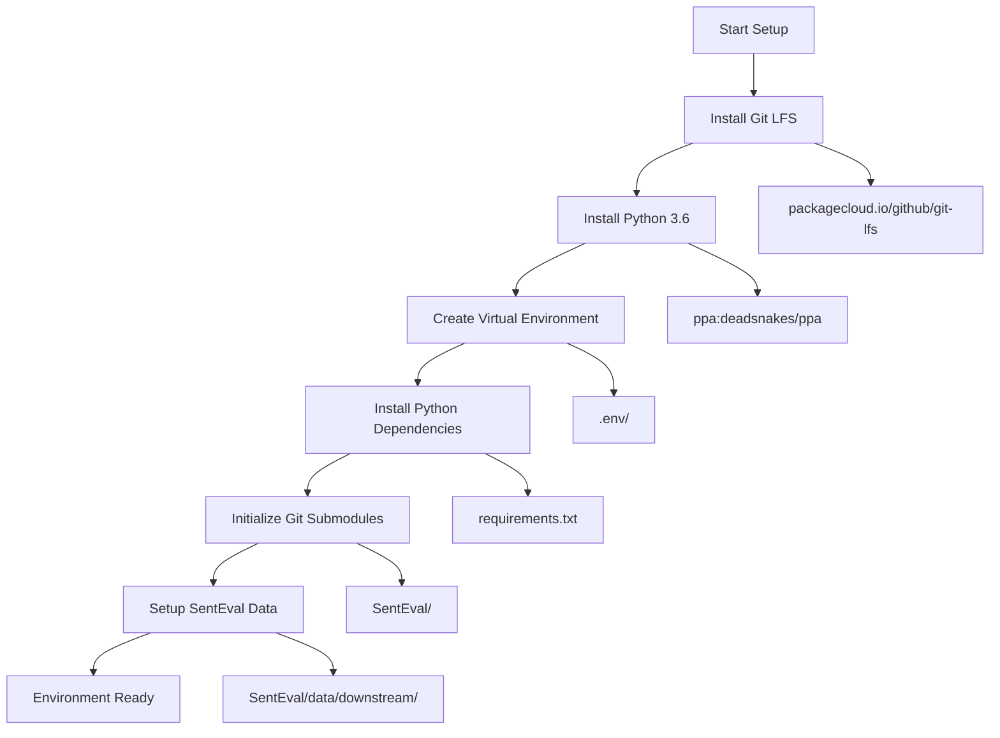
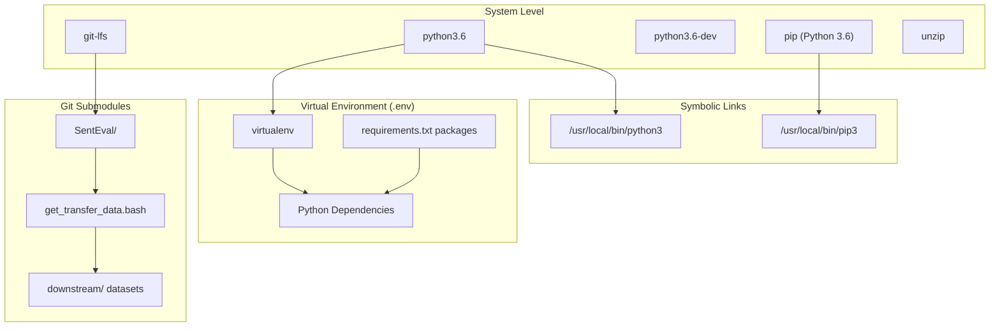

<!-- source: DeepWiki mcp.deepwiki.com · repo huggingface/hmtl · page 2.1 Environment Setup · fetched 2026-10-26 -->

# Environment Setup

<details>
<summary>Relevant source files</summary>

The following files were used as context for generating this wiki page:

- [demo/HMTL_demo.png](demo/HMTL_demo.png)
- [scripts/machine_setup.sh](scripts/machine_setup.sh)

</details>


This document provides detailed instructions for setting up the development environment required for the HMTL (Hierarchical Multi-Task Learning) system. This includes configuring Python 3.6, Git LFS for model downloads, virtual environment creation, and SentEval submodule initialization.

For information about downloading pre-trained models and datasets after environment setup, see [Data Acquisition](#2.2). For details about the Python package dependencies being installed, see [Dependencies](#2.3).

## Setup Process Overview

The environment setup follows an automated process defined in the `machine_setup.sh` script, which handles all required system dependencies and configurations.

**Environment Setup Flow**


Sources: [scripts/machine_setup.sh:1-36]()

## Environment Components

The setup process installs and configures several key components that work together to support HMTL development and execution.

**Installed Components Architecture**


Sources: [scripts/machine_setup.sh:3-36]()

## Automated Setup Process

### Git LFS Installation

Git LFS (Large File Storage) is required for downloading pre-trained models that exceed standard Git file size limits.

The setup process installs Git LFS from the official GitHub repository:

```bash
curl -s https://packagecloud.io/install/repositories/github/git-lfs/script.deb.sh | sudo bash
sudo apt-get install git-lfs
git lfs install
```

Sources: [scripts/machine_setup.sh:3-6]()

### Python 3.6 Installation

HMTL requires Python 3.6 specifically. The setup installs this version from the `deadsnakes` PPA repository and configures pip:

| Component | Installation Command | Purpose |
|-----------|---------------------|---------|
| Repository | `sudo add-apt-repository ppa:deadsnakes/ppa` | Adds Python 3.6 package source |
| Python 3.6 | `sudo apt-get install python3.6 python3.6-dev` | Installs Python runtime and development headers |
| Pip | `wget https://bootstrap.pypa.io/get-pip.py && sudo python3.6 get-pip.py` | Installs package manager for Python 3.6 |
| Symbolic Links | `sudo ln -s /usr/bin/python3.6 /usr/local/bin/python3` | Creates system-wide Python 3 alias |

Sources: [scripts/machine_setup.sh:9-16]()

### Virtual Environment Creation

A clean Python environment is created using `virtualenv` to isolate HMTL dependencies:

```bash
sudo pip3 install virtualenv
virtualenv -p /usr/bin/python3.6 .env
source ./.env/bin/activate
```

The virtual environment is created in the `.env/` directory at the repository root.

Sources: [scripts/machine_setup.sh:19-22]()

### Dependency Installation

Python dependencies are installed from the `requirements.txt` file within the activated virtual environment:

```bash
pip install -r requirements.txt
```

Sources: [scripts/machine_setup.sh:25-26]()

### SentEval Submodule Setup

The SentEval evaluation framework is included as a Git submodule and requires additional data downloads:

```bash
git submodule init
git submodule update
```

After initializing the submodule, transfer learning datasets are downloaded:

```bash
sudo apt-get install unzip
cd SentEval/data/downstream/
./get_transfer_data.bash
```

Sources: [scripts/machine_setup.sh:29-35]()

## Manual Setup Alternative

If automated setup is not suitable, the environment can be configured manually by following each step in the `machine_setup.sh` script sequentially. Ensure all dependencies are installed in the correct order, as later steps depend on earlier installations.

## Environment Verification

After running the setup script, verify the environment by checking:

- Python version: `python3 --version` should return Python 3.6.x
- Virtual environment activation: `source .env/bin/activate`
- Package installation: `pip list` should show installed dependencies
- SentEval submodule: `ls SentEval/` should show submodule contents
- Git LFS: `git lfs version` should return version information

Sources: [scripts/machine_setup.sh:1-36]()

---

