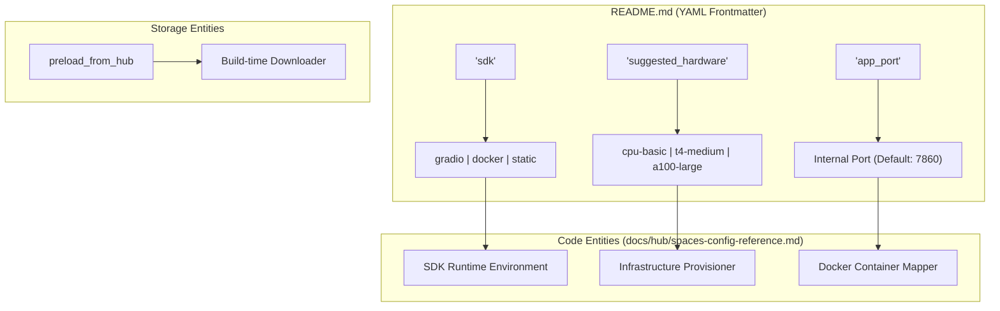
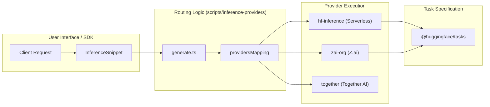

<!-- source: DeepWiki mcp.deepwiki.com · repo huggingface/hub-docs · page 8 Glossary · fetched 2026-10-26 -->

# Glossary

Relevant source files

The following files were used as context for generating this wiki page:

- [datasetcard.md](datasetcard.md)
- [docs/hub/_toctree.yml](docs/hub/_toctree.yml)
- [docs/hub/billing.md](docs/hub/billing.md)
- [docs/hub/datasets-cards.md](docs/hub/datasets-cards.md)
- [docs/hub/index.md](docs/hub/index.md)
- [docs/hub/local-cache.md](docs/hub/local-cache.md)
- [docs/hub/model-cards.md](docs/hub/model-cards.md)
- [docs/hub/paper-pages.md](docs/hub/paper-pages.md)
- [docs/hub/pro.md](docs/hub/pro.md)
- [docs/hub/repositories-licenses.md](docs/hub/repositories-licenses.md)
- [docs/hub/repositories.md](docs/hub/repositories.md)
- [docs/hub/spaces-changelog.md](docs/hub/spaces-changelog.md)
- [docs/hub/spaces-config-reference.md](docs/hub/spaces-config-reference.md)
- [docs/hub/spaces-dependencies.md](docs/hub/spaces-dependencies.md)
- [docs/hub/spaces-dev-mode.md](docs/hub/spaces-dev-mode.md)
- [docs/hub/spaces-gpus.md](docs/hub/spaces-gpus.md)
- [docs/hub/spaces-overview.md](docs/hub/spaces-overview.md)
- [docs/hub/spaces-sdks-gradio.md](docs/hub/spaces-sdks-gradio.md)
- [docs/hub/spaces-sdks-static.md](docs/hub/spaces-sdks-static.md)
- [docs/hub/spaces-sdks-streamlit.md](docs/hub/spaces-sdks-streamlit.md)
- [docs/hub/spaces-using-opencv.md](docs/hub/spaces-using-opencv.md)
- [docs/hub/spaces-zerogpu.md](docs/hub/spaces-zerogpu.md)
- [docs/hub/spaces.md](docs/hub/spaces.md)
- [docs/inference-providers/_redirects.yml](docs/inference-providers/_redirects.yml)
- [docs/inference-providers/_toctree.yml](docs/inference-providers/_toctree.yml)
- [docs/inference-providers/guides/evaluation-inspect-ai.md](docs/inference-providers/guides/evaluation-inspect-ai.md)
- [docs/inference-providers/guides/first-api-call.md](docs/inference-providers/guides/first-api-call.md)
- [docs/inference-providers/guides/function-calling.md](docs/inference-providers/guides/function-calling.md)
- [docs/inference-providers/hub-api.md](docs/inference-providers/hub-api.md)
- [docs/inference-providers/index.md](docs/inference-providers/index.md)
- [docs/inference-providers/integrations/vscode.md](docs/inference-providers/integrations/vscode.md)
- [docs/inference-providers/providers/hf-inference.md](docs/inference-providers/providers/hf-inference.md)
- [docs/inference-providers/providers/zai-org.md](docs/inference-providers/providers/zai-org.md)
- [docs/inference-providers/tasks/chat-completion.md](docs/inference-providers/tasks/chat-completion.md)
- [docs/inference-providers/tasks/image-text-to-text.md](docs/inference-providers/tasks/image-text-to-text.md)
- [docs/xet/api.md](docs/xet/api.md)
- [docs/xet/download-protocol.md](docs/xet/download-protocol.md)
- [docs/xet/hashing.md](docs/xet/hashing.md)
- [docs/xet/index.md](docs/xet/index.md)
- [docs/xet/shard.md](docs/xet/shard.md)
- [docs/xet/upload-protocol.md](docs/xet/upload-protocol.md)
- [docs/xet/xorb.md](docs/xet/xorb.md)
- [modelcard.md](modelcard.md)
- [scripts/inference-providers/package.json](scripts/inference-providers/package.json)
- [scripts/inference-providers/pnpm-lock.yaml](scripts/inference-providers/pnpm-lock.yaml)
- [scripts/inference-providers/scripts/generate.ts](scripts/inference-providers/scripts/generate.ts)

This page provides definitions for codebase-specific terms, jargon, and domain concepts used across the Hugging Face Hub ecosystem. It is intended for onboarding engineers to bridge the gap between high-level features and their technical implementations.

## Core Concepts

### Repository (Repo)
The fundamental unit of storage on the Hub. Every repository is a Git-based project that can host models, datasets, or Spaces. Repositories include metadata defined in a "Card" (README.md) and support versioning via branches and tags.
*   **Implementation**: Managed via Git and the Xet storage backend for large files [docs/hub/spaces-overview.md:21-21]().
*   **Types**: Models, Datasets, and Spaces [docs/hub/index.md:3-3]().

### Card (Model/Dataset/Space Card)
A `README.md` file located at the root of a repository that contains both human-readable documentation and a YAML frontmatter block for machine-readable metadata.
*   **Implementation**: The YAML block defines repository attributes like licenses, tags, and task types [docs/hub/repositories-licenses.md:3-3](), [docs/hub/spaces-config-reference.md:3-3]().
*   **Key Files**: `modelcard.md` and `datasetcard.md` templates.

### Space
An interactive application hosted on the Hub to showcase ML models.
*   **SDKs**: Supports `gradio`, `docker`, and `static` [docs/hub/spaces-config-reference.md:19-20]().
*   **Hardware**: Ranges from `cpu-basic` to high-end GPUs like `a100-large` [docs/hub/spaces-config-reference.md:35-39]().
*   **Configuration**: Defined in the Space Card YAML [docs/hub/spaces-config-reference.md:3-3]().

---

## Infrastructure and Storage

### Xet Storage Backend
The high-performance storage layer that replaces or augments Git LFS for large file hosting on the Hub. It utilizes chunk-level deduplication and specialized upload/download protocols.
*   **Key Components**: CAS (Content Addressable Storage) API, Xorb, and Shard formats [docs/hub/_toctree.yml:52-64]().
*   **Code Pointers**: `docs/xet/upload-protocol.md`(), `docs/xet/hashing.md`().

### Local Cache
A standardized directory structure on a user's machine where Hub assets are stored to avoid redundant downloads.
*   **Implementation**: Managed by the `huggingface_hub` library [docs/hub/_toctree.yml:65-66]().

### ZeroGPU
A specialized hardware scheduling tier for Spaces that allows free users to access GPU compute for short durations using a dynamic allocation system.
*   **Source**: [docs/hub/spaces-overview.md:14-14]().

---

## Inference and Tasks

### Inference Provider
A third-party compute provider (e.g., Together, Groq, Cerebras) that integrates with the Hugging Face Hub to serve models via the Inference API.
*   **Implementation**: The `generate.ts` script handles the mapping of models to these providers [docs/inference-providers/tasks/chat-completion.md:4-4]().
*   **Configuration**: `providersMapping` objects in snippets define which provider serves which model ID [docs/inference-providers/tasks/chat-completion.md:71-71]().

### Task (Pipeline Tag)
A standardized ML task category (e.g., `text-generation`, `image-to-text`, `automatic-speech-recognition`) that determines how the Inference API processes inputs and outputs.
*   **Metadata**: Stored in the `pipeline_tag` field of a repository's YAML metadata [docs/inference-providers/tasks/image-text-to-text.md:28-28]().

### Chat Completion
A subtask of `text-generation` designed for conversational contexts, supporting both LLMs and VLMs (Vision-Language Models).
*   **Specification**: Compatible with the OpenAI SDK format [docs/inference-providers/tasks/chat-completion.md:62-62]().

---

## Mapping: Natural Language to Code Entities

### Space Lifecycle and Configuration
This diagram maps the user-facing configuration of a Space to the internal parameters and SDKs used by the Hub's deployment engine.

**Space Deployment Mapping**

**Sources:** [docs/hub/spaces-config-reference.md:19-62](), [docs/hub/spaces-config-reference.md:127-130]()

### Inference Provider Request Flow
This diagram shows how a user request for "Chat Completion" is routed through the Hub's infrastructure to a specific Inference Provider.

**Inference Routing Flow**

**Sources:** [docs/inference-providers/tasks/chat-completion.md:69-72](), [scripts/inference-providers/package.json:17-20](), [docs/inference-providers/providers/hf-inference.md:39-42]()

---

## Technical Terms Reference

| Term | Definition | Code/Doc Pointer |
| :--- | :--- | :--- |
| **Gated Access** | A mechanism to require users to agree to terms before accessing a model/dataset. | [docs/hub/_toctree.yml:108-109]() |
| **OAuth Scopes** | Permissions granted to a Space to access a user's Hub profile (e.g., `openid`, `profile`). | [docs/hub/spaces-config-reference.md:97-98]() |
| **SCIM** | System for Cross-domain Identity Management used for Enterprise Hub user provisioning. | [docs/hub/_toctree.yml:6.2]() |
| **VLM** | Vision-Language Model; a model that takes both images and text as input. | [docs/inference-providers/tasks/image-text-to-text.md:17-17]() |
| **Webhook** | An HTTP callback that triggers on repository events (e.g., new commits). | [docs/hub/_toctree.yml:73-74]() |
| **Xorb** | A specific file format used within the Xet storage backend for sharded data. | [docs/hub/_toctree.yml:53-54]() |

**Sources:** [docs/hub/_toctree.yml:108-109](), [docs/hub/spaces-config-reference.md:97-98](), [docs/inference-providers/tasks/image-text-to-text.md:17-17](), [docs/hub/_toctree.yml:73-74]()