# Page: Hugging Face Hub Overview

# Hugging Face Hub Overview

<details>
<summary>Relevant source files</summary>

The following files were used as context for generating this wiki page:

- [datasetcard.md](datasetcard.md)
- [docs/hub/_toctree.yml](docs/hub/_toctree.yml)
- [docs/hub/datasets-cards.md](docs/hub/datasets-cards.md)
- [docs/hub/index.md](docs/hub/index.md)
- [docs/hub/local-cache.md](docs/hub/local-cache.md)
- [docs/hub/model-cards.md](docs/hub/model-cards.md)
- [docs/hub/paper-pages.md](docs/hub/paper-pages.md)
- [docs/hub/repositories-licenses.md](docs/hub/repositories-licenses.md)
- [docs/hub/repositories.md](docs/hub/repositories.md)
- [modelcard.md](modelcard.md)

</details>


## Purpose and Scope

This document provides a comprehensive overview of the Hugging Face Hub ecosystem, covering its core components, architecture, and key features. It serves as the entry point for understanding how the Hub functions as a platform for hosting machine learning models, datasets, and interactive applications.

For details on specific repository fundamentals and local caching, see [Getting Started and Repository Basics](#1.1). For details on the underlying large-file storage architecture, see [Xet Storage Backend](#1.2).

## What is the Hugging Face Hub

The Hugging Face Hub is the reference AI platform for open ML, hosting over 2M models, 1.5M datasets, and 1.5M AI apps (Spaces) [docs/hub/index.md:1-3](). It serves as a central collaboration platform where the machine learning community can share, explore, discover, and experiment with open-source ML resources.

The platform is built on Git-based repositories, providing version control, commit history, and branches [docs/hub/repositories.md:1-3](). While standard Git is used for code, the Hub utilizes specialized backends like **Xet** and **Git LFS** to handle large binary files such as model weights and Parquet datasets [docs/hub/repositories.md:8-10]().

Sources: [docs/hub/index.md:1-3](), [docs/hub/repositories.md:1-10]()

## Core Components

The Hub ecosystem is organized into three primary repository types, unified by a common metadata and documentation system.

### Repository Types and Code Entities

The following diagram bridges the conceptual repository types to the specific files and structures that define them in the codebase and on-disk cache.

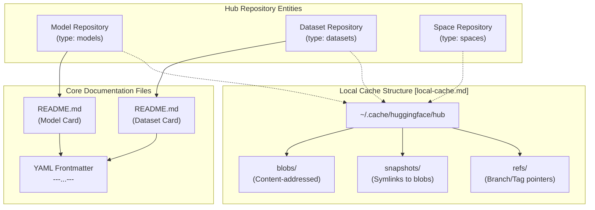

Sources: [docs/hub/model-cards.md:6-25](), [docs/hub/datasets-cards.md:1-12](), [docs/hub/local-cache.md:26-110]()

### Models
Model repositories host machine learning weights and configurations. They use **Model Cards** (`README.md`) to store metadata such as `library_name`, `base_model`, and `license` [docs/hub/model-cards.md:61-109](). Valid licenses are validated against a central registry [docs/hub/repositories-licenses.md:11-68]().

### Datasets
Dataset repositories provide structured data storage. They include **Dataset Cards** that define `task_categories` and `size_categories` [docs/hub/datasets-cards.md:11-26](). The Hub automatically detects modalities (audio, image, etc.) but allows overrides via tags in the metadata [docs/hub/datasets-cards.md:62-72]().

### Spaces
Spaces host interactive ML applications. They support SDKs like Gradio, Streamlit, and Docker [docs/hub/index.md:124-130](). Spaces can also serve as Model Context Protocol (MCP) servers for AI agents.

## Overall Architecture

### Storage and Versioning Architecture

The Hub distinguishes between Git-backed versioned storage and non-versioned object storage.

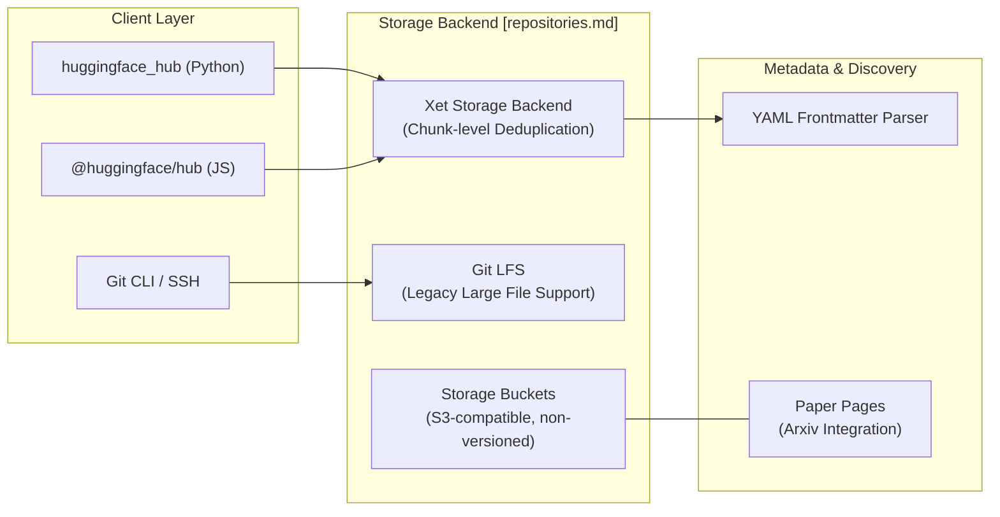

Sources: [docs/hub/repositories.md:5-10](), [docs/hub/local-cache.md:9-16](), [docs/hub/paper-pages.md:1-15]()

### Metadata and Discovery
The Hub's discovery engine relies on the YAML frontmatter in `README.md` files. 
- **Licenses**: The Hub enforces valid license identifiers (e.g., `apache-2.0`, `mit`) to enable filtering [docs/hub/repositories-licenses.md:11-15]().
- **Paper Integration**: Arxiv IDs linked in cards are extracted to create **Paper Pages**, linking models and datasets to academic research [docs/hub/paper-pages.md:10-20]().
- **Local Caching**: The `huggingface_hub` library manages a content-addressed local cache at `~/.cache/huggingface/hub`, using symlinks in `snapshots/` to point to content in `blobs/` [docs/hub/local-cache.md:28-73]().

## Next Steps

For further technical details, please refer to the following child pages:

*   **[Getting Started and Repository Basics](#1.1)**: Covers Git operations, PRs, Discussions, and the technical layout of the `local-cache`.
*   **[Xet Storage Backend](#1.2)**: Details the deduplication and chunking logic that enables Terabyte-scale repository hosting.

Sources: [docs/hub/_toctree.yml:46-64](), [docs/hub/repositories.md:18-32]()

---

# Page: Getting Started and Repository Basics

# Getting Started and Repository Basics

<details>
<summary>Relevant source files</summary>

The following files were used as context for generating this wiki page:

- [docs/hub/_toctree.yml](docs/hub/_toctree.yml)
- [docs/hub/index.md](docs/hub/index.md)
- [docs/hub/local-cache.md](docs/hub/local-cache.md)
- [docs/hub/moderation.md](docs/hub/moderation.md)
- [docs/hub/repositories-getting-started.md](docs/hub/repositories-getting-started.md)
- [docs/hub/repositories-next-steps.md](docs/hub/repositories-next-steps.md)
- [docs/hub/repositories-pull-requests-discussions.md](docs/hub/repositories-pull-requests-discussions.md)
- [docs/hub/repositories-settings.md](docs/hub/repositories-settings.md)
- [docs/hub/repositories.md](docs/hub/repositories.md)
- [docs/hub/sample-factory.md](docs/hub/sample-factory.md)
- [docs/hub/security-git-ssh.md](docs/hub/security-git-ssh.md)
- [docs/hub/spaces-custom-domain.md](docs/hub/spaces-custom-domain.md)
- [docs/hub/spaces-embed.md](docs/hub/spaces-embed.md)
- [docs/hub/spaces-more-ways-to-create.md](docs/hub/spaces-more-ways-to-create.md)
- [docs/hub/xet/index.md](docs/hub/xet/index.md)
- [docs/hub/xet/legacy-git-lfs.md](docs/hub/xet/legacy-git-lfs.md)
- [docs/hub/xet/overview.md](docs/hub/xet/overview.md)
- [docs/hub/xet/security.md](docs/hub/xet/security.md)
- [docs/hub/xet/using-xet-storage.md](docs/hub/xet/using-xet-storage.md)

</details>


The Hugging Face Hub is a central platform for hosting and collaborating on Machine Learning assets. It supports three primary repository types: **Models**, **Datasets**, and **Spaces** [docs/hub/index.md:3-3](). All repositories are backed by Git-based versioning, but utilize a specialized storage backend called **Xet** to handle large-scale binary data like model weights and Parquet files [docs/hub/repositories.md:3-9]().

## Repository Fundamentals

A repository (or "repo") on the Hub serves as a version-controlled container for code, metadata, and large assets [docs/hub/repositories.md:3-3]().

### Versioning and Branches
The Hub implements a simplified Git workflow to accommodate ML-specific needs.
*   **Branches**: Used to isolate "work in progress" from "production-ready" code. They allow multiple contributors to work on a project without frequent conflicts [docs/hub/repositories-next-steps.md:15-17]().
*   **Tags**: Used to mark specific commits as milestones (e.g., `v1.0`). Tags are useful for A/B testing and pinning specific model versions in downstream applications [docs/hub/repositories-next-steps.md:21-25]().
*   **Refs**: Human-readable references (branches, tags, PRs) are stored in the `refs/` directory of the local cache, mapping these names to 40-character hexadecimal commit hashes [docs/hub/local-cache.md:129-134]().

### Pull Requests and Discussions
Unlike standard Git hosts like GitHub, the Hub does not require forks for community contributions [docs/hub/repositories-pull-requests-discussions:5-6]().
*   **Special Refs**: Contributors push changes directly to a special `ref` branch on the source repository (e.g., `refs/pr/42`) [docs/hub/repositories-pull-requests-discussions:6-6](), [docs/hub/repositories-pull-requests-discussions:113-122]().
*   **Unified Interface**: Discussions and Pull Requests (PRs) are displayed in a single list under the **Community** tab [docs/hub/repositories-pull-requests-discussions:7-7](), [docs/hub/repositories-pull-requests-discussions:14-14]().
*   **Draft Mode**: PRs can be opened in "Draft" status to indicate ongoing work, preventing accidental merges until the "Publish" button is clicked [docs/hub/repositories-pull-requests-discussions:124-126]().

### Repository Settings and Visibility
Repository owners can manage visibility and administrative tasks via the **Settings** tab [docs/hub/repositories-settings:6-6]().
*   **Visibility**: Options include `public` and `private` (for models/datasets), while Spaces add a `protected` tier [docs/hub/repositories-settings:8-10]().
*   **Renaming/Transferring**: Owners can rename repos or transfer ownership to organizations. The Hub automatically redirects old URLs and preserves metadata like download counts [docs/hub/repositories-settings:18-20]().
*   **Feature Toggles**: Discussions and PRs can be disabled entirely if the owner wishes to restrict community contributions [docs/hub/repositories-settings:36-38]().

**Sources:** [docs/hub/repositories.md:3-9](), [docs/hub/repositories-next-steps.md:15-25](), [docs/hub/repositories-pull-requests-discussions.md:5-126](), [docs/hub/repositories-settings.md:6-38](), [docs/hub/local-cache.md:129-134]()

---

## Local Cache Layout

The `huggingface_hub` library and integrated tools (like `transformers` and `llama.cpp`) use a specific on-disk layout to manage downloaded assets efficiently [docs/hub/local-cache.md:1-25]().

### Cache Structure Diagram
This diagram bridges the **Logical Repository** concept to the **Physical File System** entities.

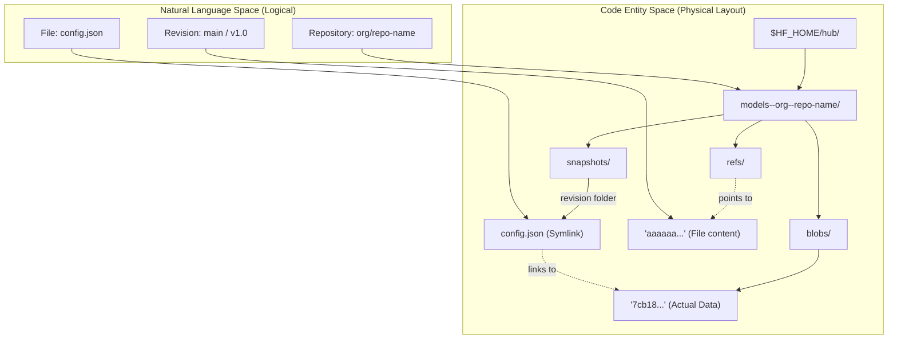

### Key Components
1.  **Location**: Defaults to `~/.cache/huggingface/hub`, but can be overridden by `HF_HUB_CACHE` or `HF_HOME` [docs/hub/local-cache.md:28-37]().
2.  **`blobs/`**: Content-addressed storage. Files are named by their **SHA-1** (Git-tracked) or **SHA-256** (LFS/Xet) hashes. This ensures that identical files across different revisions or repositories are stored only once [docs/hub/local-cache.md:113-120]().
3.  **`snapshots/`**: Contains subdirectories named after commit hashes. Each subdirectory contains symlinks pointing to the relevant files in `../../blobs/` [docs/hub/local-cache.md:146-158]().
4.  **`.locks/`**: Contains lock files to ensure thread-safety during concurrent downloads [docs/hub/local-cache.md:42-42]().

**Sources:** [docs/hub/local-cache.md:1-158]()

---

## Getting Started: Upload and Download

Users can interact with the Hub through the Web UI, the `hf` CLI, or standard Git clients enhanced with `git-xet` [docs/hub/repositories-getting-started:7-12]().

### Workflow Comparison

| Action | Web UI | `hf` CLI | Git + Xet |
| :--- | :--- | :--- | :--- |
| **Creation** | [huggingface.co/new](http://huggingface.co/new) | N/A | N/A |
| **Upload** | "Add file" button in Files tab | `hf upload {repo} {path}` | `git push` |
| **Download** | "Download" button on file | `hf download {repo} {file}` | `git clone {url}` |
| **Auth** | Browser Login | `hf auth login` | SSH Keys or HTTPS Creds |

### Integration Diagram: CLI and Storage
This diagram shows how user commands translate to the underlying `hf_xet` and `xet-core` entities.

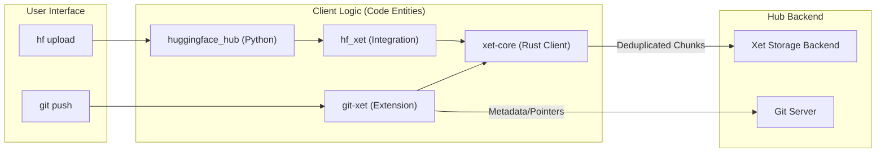

### Implementation Details
*   **Xet Protocol**: Invoked automatically for large files. It uses chunk-level deduplication to increase upload speeds by only sending changed data segments [docs/hub/xet/using-xet-storage.md:89-89]().
*   **Adaptive Concurrency**: The `hf_xet` package (integrated into `huggingface_hub` >= 0.32.0) dynamically adjusts parallel transfer streams based on network conditions [docs/hub/xet/using-xet-storage.md:11-13](), [docs/hub/xet/using-xet-storage.md:126-126]().
*   **Authentication**: The `hf auth login` command manages tokens locally for the CLI and Python libraries [docs/hub/repositories-getting-started:14-22]().

**Sources:** [docs/hub/repositories-getting-started.md:7-100](), [docs/hub/xet/using-xet-storage.md:5-127]()

---

# Page: Xet Storage Backend

# Xet Storage Backend

<details>
<summary>Relevant source files</summary>

The following files were used as context for generating this wiki page:

- [docs/hub/datasets-ingesting.md](docs/hub/datasets-ingesting.md)
- [docs/hub/repositories-getting-started.md](docs/hub/repositories-getting-started.md)
- [docs/hub/xet/deduplication.md](docs/hub/xet/deduplication.md)
- [docs/hub/xet/index.md](docs/hub/xet/index.md)
- [docs/hub/xet/legacy-git-lfs.md](docs/hub/xet/legacy-git-lfs.md)
- [docs/hub/xet/overview.md](docs/hub/xet/overview.md)
- [docs/hub/xet/security.md](docs/hub/xet/security.md)
- [docs/hub/xet/using-xet-storage.md](docs/hub/xet/using-xet-storage.md)
- [docs/xet/api.md](docs/xet/api.md)
- [docs/xet/chunking.md](docs/xet/chunking.md)
- [docs/xet/deduplication.md](docs/xet/deduplication.md)
- [docs/xet/download-protocol.md](docs/xet/download-protocol.md)
- [docs/xet/hashing.md](docs/xet/hashing.md)
- [docs/xet/index.md](docs/xet/index.md)
- [docs/xet/shard.md](docs/xet/shard.md)
- [docs/xet/upload-protocol.md](docs/xet/upload-protocol.md)
- [docs/xet/xorb.md](docs/xet/xorb.md)

</details>


The Xet storage backend is a content-addressed storage (CAS) system designed to optimize the hosting of large files on the Hugging Face Hub. It replaces traditional Git LFS with a more efficient architecture based on **Content-Defined Chunking (CDC)** and **global deduplication**. By breaking files into variable-sized chunks (~64KB), Xet allows for incremental updates, faster transfers, and instant server-side copies between repositories and storage buckets [docs/hub/xet/deduplication.md:3-6]().

## System Architecture and Data Flow

The Xet ecosystem consists of several layers, from high-level client libraries to the low-level CAS protocol. The primary reference implementation is `xet-core`, written in Rust, which provides the underlying logic for both Python and Git interfaces [docs/xet/index.md:31-43]().

### High-Level Components

| Component | Description |
| :--- | :--- |
| **hf_xet** | Python bindings for `huggingface_hub` to enable Xet-based uploads/downloads [docs/hub/xet/using-xet-storage.md:11-13](). |
| **git-xet** | A Git extension that acts as a custom transfer agent, allowing standard `git push/pull` workflows to use the Xet protocol [docs/hub/xet/using-xet-storage.md:32-33](). |
| **CAS Server** | The remote Content Addressable Storage that stores chunks, xorbs, and shards [docs/xet/api.md:1-3](). |

### Logical Data Flow (Upload)

The following diagram illustrates how a file is transformed from a byte stream into stored entities in the CAS.

**Title: File to CAS Entity Mapping**
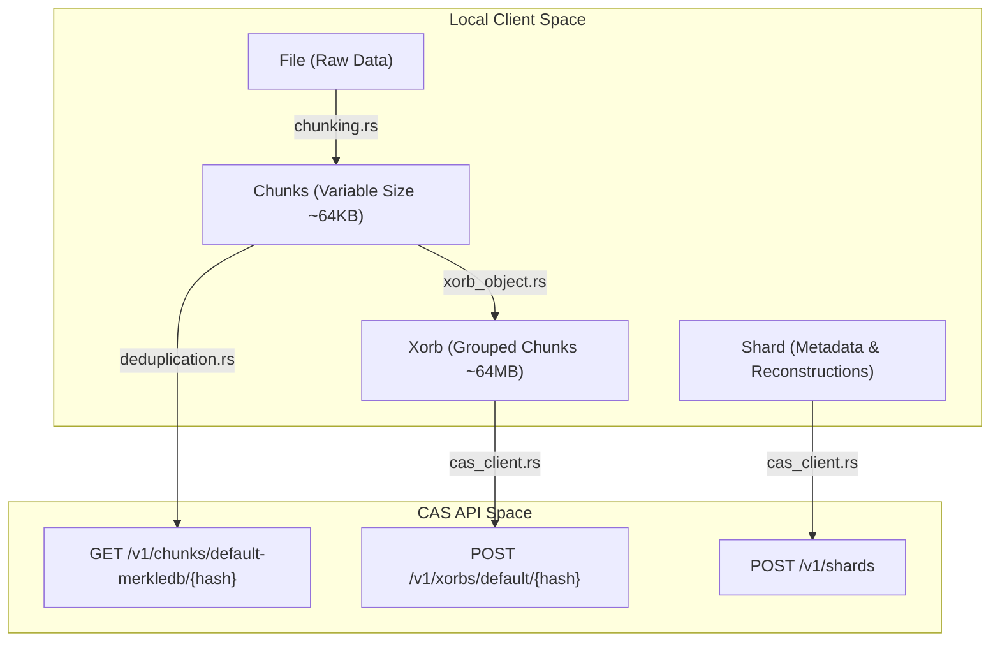
Sources: [docs/xet/upload-protocol.md:58-114](), [docs/xet/index.md:35-43](), [docs/hub/xet/deduplication.md:55-62]()

## Core Technology: Content-Defined Chunking (CDC)

Unlike fixed-size chunking used in traditional storage, Xet uses **Gearhash-based CDC**. This ensures **boundary stability**: if data is inserted at the beginning of a file, only the modified chunk changes, while all subsequent chunks retain the same boundaries and hashes [docs/xet/chunking.md:92-114]().

### Algorithm Implementation
1. **Rolling Hash**: A 64-bit hash `h` is updated per byte: `h = (h << 1) + TABLE[b]` [docs/xet/chunking.md:27-33]().
2. **Constraints**:
   - **Min Size**: 8 KiB (no boundaries allowed before this) [docs/xet/chunking.md:17-17]().
   - **Max Size**: 128 KiB (boundary forced if no content match found) [docs/xet/chunking.md:18-18]().
   - **Mask**: `0xFFFF000000000000`. A boundary is set when `(h & MASK) == 0`, occurring statistically every 64 KiB [docs/xet/chunking.md:19-19](), [docs/xet/chunking.md:84-84]().

Sources: [docs/xet/chunking.md:12-50]()

## Data Formats: Xorbs and Shards

Xet does not store individual 64KB chunks as separate files to avoid metadata overhead. Instead, it aggregates them into larger structures.

### Xorb (Xet Orb)
A Xorb is a sequence of compressed chunks, capped at 64 MiB [docs/xet/xorb.md:13-15]().
- **Structure**: Each chunk in a Xorb has a header (1 byte version, 3 bytes compressed size, 1 byte compression type, 3 bytes uncompressed size) followed by the data [docs/xet/xorb.md:45-53]().
- **Compression**: Supports `None`, `LZ4`, and `ByteGrouping4LZ4` (optimized for structured data like floating-point tensors) [docs/xet/xorb.md:72-78]().

### Shard
Shards are the "connective tissue" of the system. They contain:
1. **File Information**: The "recipe" (File Reconstruction) to rebuild a file from specific chunk ranges in various Xorbs [docs/xet/upload-protocol.md:35-39]().
2. **CAS Information**: Metadata about which chunks are contained in which Xorbs, used for deduplication [docs/xet/upload-protocol.md:45-47]().

Sources: [docs/xet/xorb.md:3-33](), [docs/xet/upload-protocol.md:33-51]()

## Protocols and API

### Upload Protocol
The upload process is highly concurrent but strictly ordered regarding finalization [docs/xet/upload-protocol.md:5-6]():
1. **Chunking & Hashing**: Split file and compute `MerkleHash` for each chunk [docs/xet/upload-protocol.md:58-61]().
2. **Deduplication**: Check local cache and then the **Global Deduplication API** (`GET /v1/chunks/...`) to see if chunks already exist [docs/xet/upload-protocol.md:64-71]().
3. **Xorb Upload**: Group new chunks and upload via `POST /v1/xorbs/...` [docs/xet/upload-protocol.md:84-87]().
4. **Shard Upload**: Upload the file reconstruction and Xorb metadata via `POST /v1/shards`. All referenced Xorbs **MUST** be uploaded before the shard [docs/xet/upload-protocol.md:110-116]().

### Download Protocol
Downloading involves a two-stage process to reassemble the file from distributed chunks [docs/xet/download-protocol.md:7-10]().

**Title: Xet Download & Reconstruction Sequence**
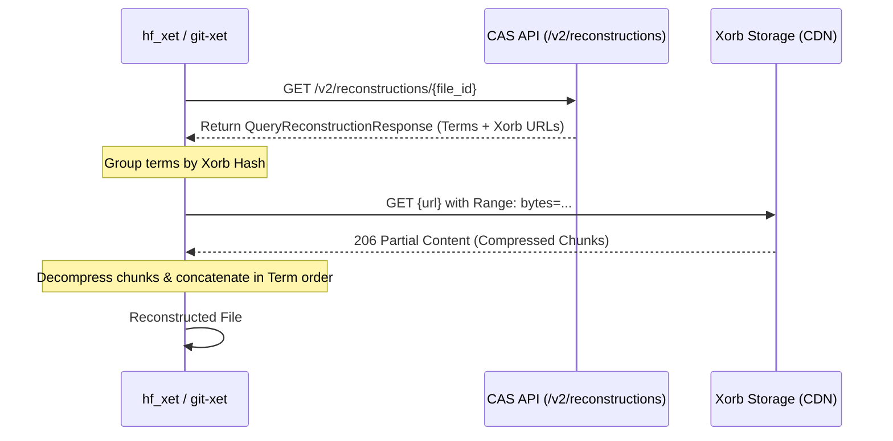
Sources: [docs/xet/download-protocol.md:12-102](), [docs/xet/api.md:37-43]()

## Hashing and Integrity
Xet uses `Blake3` keyed hashes for all identifiers [docs/xet/hashing.md:10-14]():
- **Chunk Hash**: Keyed with `DATA_KEY` [docs/xet/hashing.md:14-16]().
- **Xorb/File Hash**: Computed as the root of a Merkle Tree where leaves are chunk hashes. Internal nodes are formatted as a string list of `hash : size` before hashing with `INTERNAL_NODE_KEY` [docs/xet/hashing.md:28-40]().
- **Verification Hash**: Used in shards to prove the uploader possesses the file data, keyed with `VERIFICATION_KEY` [docs/xet/hashing.md:100-110]().

### Hash-to-String Conversion
To ensure consistency, hashes are converted to hex strings using a specific little-endian 64-bit region reversal [docs/xet/api.md:13-19](). For example, a hash starting `[0, 1, 2, 3, 4, 5, 6, 7]` becomes `0706050403020100...` in API paths [docs/xet/api.md:26-33]().

Sources: [docs/xet/hashing.md:1-120](), [docs/xet/api.md:9-34]()

---

# Page: Repository Management

# Repository Management

<details>
<summary>Relevant source files</summary>

The following files were used as context for generating this wiki page:

- [datasetcard.md](datasetcard.md)
- [docs/hub/collections.md](docs/hub/collections.md)
- [docs/hub/datasets-cards.md](docs/hub/datasets-cards.md)
- [docs/hub/datasets-gated.md](docs/hub/datasets-gated.md)
- [docs/hub/model-cards.md](docs/hub/model-cards.md)
- [docs/hub/models-gated.md](docs/hub/models-gated.md)
- [docs/hub/paper-pages.md](docs/hub/paper-pages.md)
- [docs/hub/repositories-licenses.md](docs/hub/repositories-licenses.md)
- [modelcard.md](modelcard.md)

</details>


This document provides a high-level overview of the core repository management features that apply to all three primary repository types on the Hugging Face Hub: Models, Datasets, and Spaces. It covers metadata management, licensing, community features, and repository organization.

For detailed technical specifications and implementation guides for each type, see:
- [Models](#2.1) — Uploading, model cards, inference widgets, and gated access.
- [Datasets](#2.2) — Dataset cards, Dataset Viewer (Data Studio), and multimodal data configuration.
- [Spaces](#2.3) — SDKs (Gradio, Docker), GPU hardware, and deployment options.

## Repository Types and Structure

The Hugging Face Hub hosts three primary repository types, each utilizing a `README.md` file (the "card") as the central point for documentation and machine-readable metadata.

```mermaid
graph TB
    subgraph "Repository Types"
        [ModelRepo] -- "README.md" --> [ModelCard]
        [DatasetRepo] -- "README.md" --> [DatasetCard]
        [SpaceRepo] -- "README.md" --> [SpaceCard]
    end
    
    subgraph "Common Management Components"
        [YAML_Metadata] -- "Stored in Card Header" --> [Hub_Features]
        [Gating_System] -- "Access Control" --> [User_Requests]
        [Collections] -- "Grouping" --> [Repo_Sets]
    end

    [ModelCard] --> [YAML_Metadata]
    [DatasetCard] --> [YAML_Metadata]
    [SpaceCard] --> [YAML_Metadata]
    
    [Hub_Features] --> [Filtering_Search]
    [Hub_Features] --> [Library_Detection]
    [Hub_Features] --> [Widget_Config]
```
Sources: [docs/hub/model-cards.md:6-7](), [docs/hub/datasets-cards.md:5-7]()

## Metadata and Card Management

Repository cards serve dual purposes: providing human-readable documentation and storing structured metadata. Metadata is defined in a YAML block at the top of the `README.md` file.

### Metadata Features
Metadata enables the Hub to index repositories for search and trigger specific UI elements:
* **Discovery**: Fields like `language`, `tags`, and `task_categories` enable filtering at `huggingface.co/models` or `/datasets`.
* **Lineage**: The `base_model` field tracks fine-tunes, adapters, and merges.
* **Library Integration**: The `library_name` field (e.g., `transformers`, `flair`, `keras`) determines which code snippets and inference logic are displayed.

### Editing Metadata
Users can manage metadata through three primary interfaces:
1. **Metadata UI**: A visual editor on the repository page for common fields.
2. **Direct YAML Editing**: Manual modification of the `README.md` header.
3. **Programmatic Access**: Using the `huggingface_hub` Python library to update metadata.

Sources: [docs/hub/model-cards.md:23-43](), [docs/hub/model-cards.md:81-98](), [docs/hub/datasets-cards.md:9-26]()

## Licensing System

The Hub provides a standardized licensing system to define permissions for code, models, and data. Licenses are specified in the card metadata using unique identifiers.

| License Family | Example Identifiers |
| :--- | :--- |
| **Open Source** | `apache-2.0`, `mit`, `bsd-3-clause`, `gpl-3.0` |
| **Creative Commons** | `cc-by-4.0`, `cc-by-nc-sa-4.0`, `cc0-1.0` |
| **OpenRAIL** | `openrail`, `bigscience-bloom-rail-1.0`, `creativeml-openrail-m` |
| **Custom/Other** | `other` (requires `license_name` and `license_link`) |

Sources: [docs/hub/repositories-licenses.md:11-63](), [modelcard.md:6-8]()

## Access Control and Gating

For sensitive or research-stage assets, the Hub supports **Gated Repositories**. This requires users to share contact information and potentially agree to specific terms before accessing files.

* **Approval Modes**:
    * **Automatic Approval**: Access is granted immediately upon the user sharing their info.
    * **Manual Approval**: Repository authors must review and `accept` or `reject` requests via the UI or API.
* **API Management**: Access requests can be managed programmatically using endpoints like `/api/models/{repo_id}/user-access-request/pending`.

Sources: [docs/hub/models-gated.md:1-29](), [docs/hub/models-gated.md:55-65](), [docs/hub/datasets-gated.md:1-33]()

## Organizational Tools

### Collections
Collections allow users and organizations to group related repositories (Models, Datasets, Spaces, and Papers) on a single page.
* **Use Cases**: Showcasing a complete project, bookmarking resources, or gating a group of repositories simultaneously (Enterprise feature).
* **Notes & Images**: Items in a collection can have custom text notes and images attached for context.

Sources: [docs/hub/collections.md:1-16](), [docs/hub/collections.md:58-62](), [docs/hub/collections.md:85-93]()

### Paper Pages
The Hub extracts arXiv IDs from repository cards to link artifacts (models/datasets) to their original research papers. Users can "claim authorship" of papers to verify their profile and group their contributions.

Sources: [docs/hub/paper-pages.md:1-22](), [docs/hub/datasets-cards.md:48-54]()

---

# Page: Models

# Models

<details>
<summary>Relevant source files</summary>

The following files were used as context for generating this wiki page:

- [docs/hub/_config.py](docs/hub/_config.py)
- [docs/hub/blog-articles.md](docs/hub/blog-articles.md)
- [docs/hub/collections.md](docs/hub/collections.md)
- [docs/hub/datasets-download-stats.md](docs/hub/datasets-download-stats.md)
- [docs/hub/datasets-downloading.md](docs/hub/datasets-downloading.md)
- [docs/hub/datasets-gated.md](docs/hub/datasets-gated.md)
- [docs/hub/datasets-spark.md](docs/hub/datasets-spark.md)
- [docs/hub/dduf.md](docs/hub/dduf.md)
- [docs/hub/enterprise-advanced-security.md](docs/hub/enterprise-advanced-security.md)
- [docs/hub/enterprise-blog-articles.md](docs/hub/enterprise-blog-articles.md)
- [docs/hub/enterprise-datasets.md](docs/hub/enterprise-datasets.md)
- [docs/hub/eval-results.md](docs/hub/eval-results.md)
- [docs/hub/gguf-gpt4all.md](docs/hub/gguf-gpt4all.md)
- [docs/hub/gguf-llamacpp.md](docs/hub/gguf-llamacpp.md)
- [docs/hub/gguf.md](docs/hub/gguf.md)
- [docs/hub/lmstudio.md](docs/hub/lmstudio.md)
- [docs/hub/local-apps.md](docs/hub/local-apps.md)
- [docs/hub/mlx.md](docs/hub/mlx.md)
- [docs/hub/model-card-annotated.md](docs/hub/model-card-annotated.md)
- [docs/hub/model-card-appendix.md](docs/hub/model-card-appendix.md)
- [docs/hub/model-card-guidebook.md](docs/hub/model-card-guidebook.md)
- [docs/hub/model-card-landscape-analysis.md](docs/hub/model-card-landscape-analysis.md)
- [docs/hub/model-cards-co2.md](docs/hub/model-cards-co2.md)
- [docs/hub/model-cards-user-studies.md](docs/hub/model-cards-user-studies.md)
- [docs/hub/model-release-checklist.md](docs/hub/model-release-checklist.md)
- [docs/hub/models-adding-libraries.md](docs/hub/models-adding-libraries.md)
- [docs/hub/models-advanced.md](docs/hub/models-advanced.md)
- [docs/hub/models-download-stats.md](docs/hub/models-download-stats.md)
- [docs/hub/models-downloading.md](docs/hub/models-downloading.md)
- [docs/hub/models-faq.md](docs/hub/models-faq.md)
- [docs/hub/models-gated.md](docs/hub/models-gated.md)
- [docs/hub/models-inference.md](docs/hub/models-inference.md)
- [docs/hub/models-libraries.md](docs/hub/models-libraries.md)
- [docs/hub/models-tasks.md](docs/hub/models-tasks.md)
- [docs/hub/models-the-hub.md](docs/hub/models-the-hub.md)
- [docs/hub/models-uploading.md](docs/hub/models-uploading.md)
- [docs/hub/models-widgets-examples.md](docs/hub/models-widgets-examples.md)
- [docs/hub/models-widgets.md](docs/hub/models-widgets.md)
- [docs/hub/models.md](docs/hub/models.md)
- [docs/hub/paddlenlp.md](docs/hub/paddlenlp.md)
- [docs/hub/publisher-analytics.md](docs/hub/publisher-analytics.md)
- [docs/hub/setfit.md](docs/hub/setfit.md)
- [docs/hub/timm.md](docs/hub/timm.md)
- [eval_results.yaml](eval_results.yaml)

</details>


This document covers the model repository system within the Hugging Face Hub, including model cards, metadata management, access control, inference capabilities, and library integrations. Models are one of the three primary repository types on the Hub alongside datasets and Spaces.

For information about dataset repositories, see [Datasets](#2.2). For information about Space repositories and application hosting, see [Spaces](#2.3). For programmatic access to models via APIs, see [Hub API and Programmatic Access](#3).

## Model Repository Architecture

Model repositories are Git-based repositories that store machine learning models, their metadata, and associated files. The Hub provides specialized features for model discovery, inference, and integration with ML libraries.

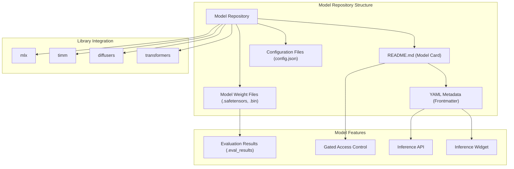

**Model Repository Components Mapping:**
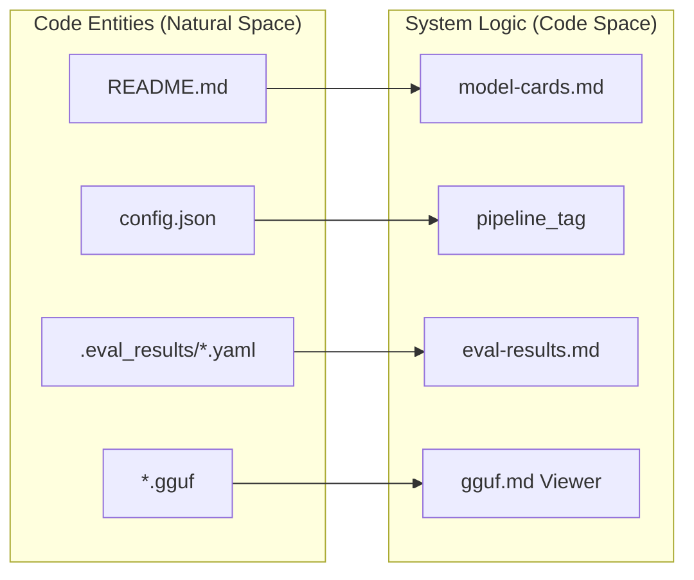

Sources: [docs/hub/models.md:1-21](), [docs/hub/models-the-hub.md:1-11](), [docs/hub/eval-results.md:16-23](), [docs/hub/gguf.md:27-29]()

## Model Cards and Metadata

Model cards serve as the documentation and metadata container for model repositories. They are implemented as `README.md` files with YAML frontmatter containing structured metadata.

### Model Card Structure

Model cards contain both structured metadata and human-readable documentation:

| Component | Purpose | Location |
|-----------|---------|----------|
| YAML Metadata | Structured data for Hub features (task, library, license) | Top of `README.md` |
| Model Description | Human-readable documentation of architecture and intent | Body of `README.md` |
| Evaluation Results | Standardized performance metrics | `.eval_results/` folder |
| Usage Examples | Copy-and-run code snippets | Markdown content |

### Key Metadata Fields

The model card metadata supports numerous fields that enable Hub functionality:

```yaml
---
language: 
- en
license: apache-2.0
library_name: transformers
pipeline_tag: text-generation
tags:
- deepseek
- v3
datasets:
- username/dataset
base_model: username/base-model
widget:
  - text: "The capital of France is"
    example_title: "Geography Completion"
---
```

### Evaluation Results Integration
The Hub provides a decentralized system for tracking results. Evaluation scores are stored in model repos as YAML files in the `.eval_results/` folder [docs/hub/eval-results.md:16-23](). These results are aggregated into benchmark dataset leaderboards if they reference a registered benchmark ID [docs/hub/eval-results.md:31-33]().

Sources: [docs/hub/model-cards.md:1-303](), [docs/hub/model-release-checklist.md:25-41](), [docs/hub/eval-results.md:1-43]()

## Model Access and Security

The Hub provides multiple layers of access control, including gated models for sensitive research or early releases.

### Gated Models

Gated models require users to share contact information and potentially agree to terms before access is granted [docs/hub/models-gated.md:3-4]().

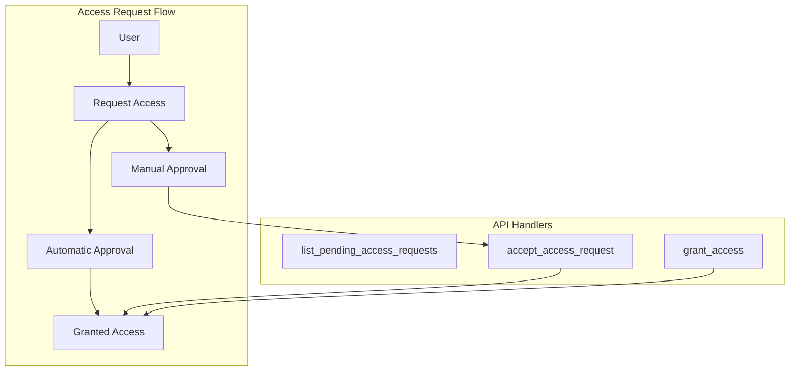

### Access Management API
Model authors can automate approval via the `huggingface_hub` Python client or REST API:

| Method | Endpoint | Python Function |
|----------|---------|---------|
| `GET` | `/api/models/{repo_id}/user-access-request/pending` | `list_pending_access_requests` |
| `POST` | `/api/models/{repo_id}/user-access-request/handle` | `accept_access_request` |
| `POST` | `/api/models/{repo_id}/user-access-request/grant` | `grant_access` |

Sources: [docs/hub/models-gated.md:52-65](), [docs/hub/datasets-gated.md:52-65]()

## Model Inference and Widgets

The Hub provides interactive widgets and inference APIs for model execution, powered by Inference Providers [docs/hub/models-widgets.md:5-6]().

### Widget Determination
The type of widget displayed (e.g., `text-generation`, `text-to-image`) is inferred from the model's `pipeline_tag` [docs/hub/models-widgets.md:17-20](). For `transformers` models, this can be automatically determined from the architecture in `config.json` [docs/hub/models-widgets.md:22-23]().

### Widget Configuration
Authors can specify example inputs in the model card metadata to guide users:
```yaml
widget:
  - text: "This new restaurant has amazing food!"
    example_title: "Positive Review"
  - src: sample1.flac
    example_title: "Audio Sample"
```
Sources: [docs/hub/models-widgets.md:30-42](), [docs/hub/models-widgets.md:85-88]()

## Library Integration

The Hub supports dozens of libraries, enabling users to download and upload models directly from their favorite frameworks [docs/hub/models-libraries.md:3-5]().

### Integration Status Table (Partial)
| Library | Inference Providers | Widgets | Download | Push |
|---------|---------------------|---------|----------|------|
| [Transformers](./transformers) | ✅ | ✅ | ✅ | ✅ |
| [Diffusers](./diffusers) | ✅ | ✅ | ✅ | ✅ |
| [MLX](./mlx) | ❌ | ❌ | ✅ | ✅ |
| [PEFT](./peft) | ✅ | ✅ | ✅ | ✅ |

Sources: [docs/hub/models-libraries.md:7-45]()

### Implementation Guide
To integrate a new library, authors use the `huggingface_hub` Python library to implement `from_pretrained` and `push_to_hub` methods [docs/hub/models-adding-libraries.md:20-22]().
- **Download**: Use `hf_hub_download` for single files or `snapshot_download` for full repos [docs/hub/models-adding-libraries.md:62-75]().
- **Upload**: Use `upload_file` or `upload_folder` [docs/hub/models-adding-libraries.md:90-91]().

## Specialized Formats: GGUF

The Hub has built-in features for the **GGUF format**, a binary format optimized for quick loading and efficient inference, particularly with `llama.cpp` [docs/hub/gguf.md:3-4]().

### GGUF Features
- **Metadata Viewer**: The Hub provides a specialized viewer for GGUF files to check metadata and tensor info (name, shape, precision) [docs/hub/gguf.md:27-29]().
- **Quantization Support**: Supports various types like `Q4_K`, `Q8_0`, and `IQ4_XS` [docs/hub/gguf.md:75-83]().
- **Parsing**: A Javascript parser `@huggingface/gguf` is available for remote file inspection [docs/hub/gguf.md:51-60]().

Sources: [docs/hub/gguf.md:1-85](), [docs/hub/gguf-llamacpp.md:1-44]()

## Model Release Checklist

To ensure a successful model release, authors should follow these essential steps:
1. **Weights**: Use `safetensors` over `pickle` for safety and speed [docs/hub/model-release-checklist.md:18-19]().
2. **Repositories**: Use separate repositories for different model variants (e.g., different quantizations or sizes) and group them into **Collections** [docs/hub/model-release-checklist.md:15-16]().
3. **Metadata**: Ensure `pipeline_tag`, `library_name`, and `license` are correctly set in the YAML frontmatter [docs/hub/model-release-checklist.md:25-41]().
4. **Discoverability**: Cite research papers to enable automatic cross-linking [docs/hub/model-release-checklist.md:113-114]().

Sources: [docs/hub/model-release-checklist.md:1-124]()

---

# Page: Datasets

# Datasets

<details>
<summary>Relevant source files</summary>

The following files were used as context for generating this wiki page:

- [docs/hub/academia-hub.md](docs/hub/academia-hub.md)
- [docs/hub/api.md](docs/hub/api.md)
- [docs/hub/collections.md](docs/hub/collections.md)
- [docs/hub/data-studio.md](docs/hub/data-studio.md)
- [docs/hub/datasets-adding.md](docs/hub/datasets-adding.md)
- [docs/hub/datasets-argilla.md](docs/hub/datasets-argilla.md)
- [docs/hub/datasets-audio.md](docs/hub/datasets-audio.md)
- [docs/hub/datasets-dask.md](docs/hub/datasets-dask.md)
- [docs/hub/datasets-data-files-configuration.md](docs/hub/datasets-data-files-configuration.md)
- [docs/hub/datasets-distilabel.md](docs/hub/datasets-distilabel.md)
- [docs/hub/datasets-duckdb-auth.md](docs/hub/datasets-duckdb-auth.md)
- [docs/hub/datasets-duckdb.md](docs/hub/datasets-duckdb.md)
- [docs/hub/datasets-editing.md](docs/hub/datasets-editing.md)
- [docs/hub/datasets-fiftyone.md](docs/hub/datasets-fiftyone.md)
- [docs/hub/datasets-file-names-and-splits.md](docs/hub/datasets-file-names-and-splits.md)
- [docs/hub/datasets-gated.md](docs/hub/datasets-gated.md)
- [docs/hub/datasets-image.md](docs/hub/datasets-image.md)
- [docs/hub/datasets-libraries.md](docs/hub/datasets-libraries.md)
- [docs/hub/datasets-manual-configuration.md](docs/hub/datasets-manual-configuration.md)
- [docs/hub/datasets-overview.md](docs/hub/datasets-overview.md)
- [docs/hub/datasets-pandas.md](docs/hub/datasets-pandas.md)
- [docs/hub/datasets-polars-auth.md](docs/hub/datasets-polars-auth.md)
- [docs/hub/datasets-polars-file-formats.md](docs/hub/datasets-polars-file-formats.md)
- [docs/hub/datasets-polars-operations.md](docs/hub/datasets-polars-operations.md)
- [docs/hub/datasets-polars-optimizations.md](docs/hub/datasets-polars-optimizations.md)
- [docs/hub/datasets-polars.md](docs/hub/datasets-polars.md)
- [docs/hub/datasets-pyarrow.md](docs/hub/datasets-pyarrow.md)
- [docs/hub/datasets-streaming.md](docs/hub/datasets-streaming.md)
- [docs/hub/datasets-upload-guide-llm.md](docs/hub/datasets-upload-guide-llm.md)
- [docs/hub/datasets-usage.md](docs/hub/datasets-usage.md)
- [docs/hub/datasets-video.md](docs/hub/datasets-video.md)
- [docs/hub/datasets-viewer-configure.md](docs/hub/datasets-viewer-configure.md)
- [docs/hub/datasets-viewer-embed.md](docs/hub/datasets-viewer-embed.md)
- [docs/hub/datasets-viewer-sql-console.md](docs/hub/datasets-viewer-sql-console.md)
- [docs/hub/datasets-webdataset.md](docs/hub/datasets-webdataset.md)
- [docs/hub/models-gated.md](docs/hub/models-gated.md)
- [docs/hub/spacy.md](docs/hub/spacy.md)
- [docs/hub/storage-limits.md](docs/hub/storage-limits.md)

</details>


This document covers dataset repositories on the Hugging Face Hub, including uploading datasets, dataset cards and metadata, the Dataset Viewer (Data Studio), access control, and advanced features. Dataset repositories are one of the three main content types managed by the Hub, alongside models and Spaces.

For information about model repositories, see [Models](#2.1). For information about Spaces, see [Spaces](#2.3). For programmatic access to datasets, see [Hub API and Programmatic Access](#3).

## Dataset Repository Architecture

Dataset repositories follow the Hub's Git-based repository model, with additional features specific to dataset management and visualization.

### Dataset Repository Structure

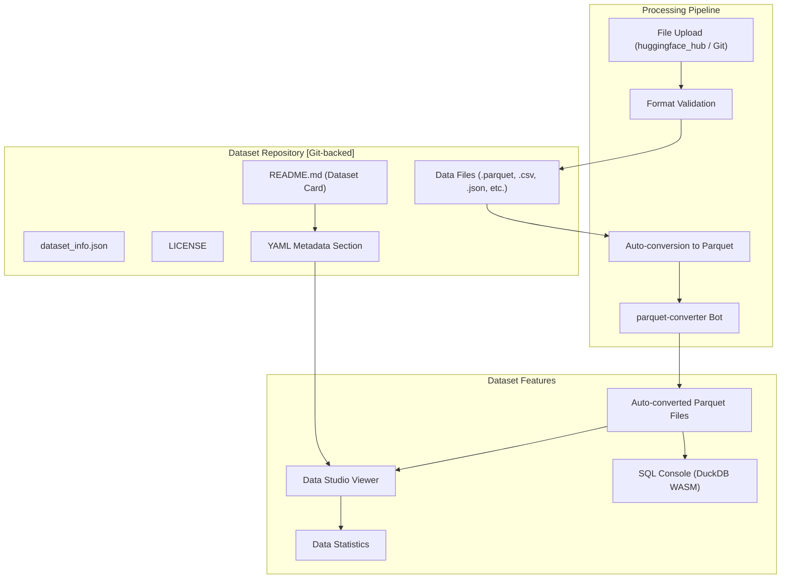

Sources: [docs/hub/datasets-adding.md:1-116](), [docs/hub/datasets-viewer.md:57-81](), [docs/hub/datasets-cards.md:1-83](), [docs/hub/datasets-data-files-configuration.md:1-72]()

### Dataset Lifecycle Management

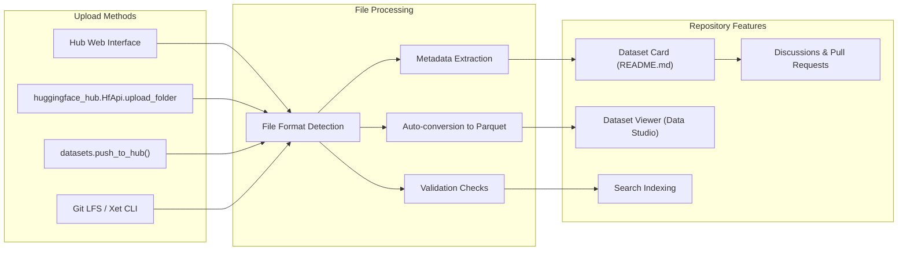

Sources: [docs/hub/datasets-adding.md:7-76](), [docs/hub/datasets-viewer.md:67-81](), [docs/hub/repositories-pull-requests-discussions.md:1-164]()

## Upload Methods and File Formats

The Hub supports multiple methods for uploading datasets and a wide range of file formats.

### Supported File Formats

| Format Category | File Extensions | Notes |
|-----------------|----------------|-------|
| Tabular Data | `.parquet`, `.csv`, `.tsv` | **Parquet** is recommended for efficiency and streaming [docs/hub/datasets-adding.md:108-108]() |
| Structured Text | `.jsonl`, `.json` | JSON Lines preferred for nested data [docs/hub/datasets-adding.md:108-108]() |
| Streaming | `.arrow` | Arrow streaming and IPC formats [docs/hub/datasets-adding.md:90-90]() |
| Plain Text | `.txt` | Simple text files |
| Images | `.png`, `.jpg`, `.jpeg`, etc. | Raw image files [docs/hub/datasets-adding.md:92-92]() |
| Audio | `.wav`, `.mp3`, etc. | Raw audio files [docs/hub/datasets-adding.md:93-93]() |
| Video | `.mp4`, `.mov`, `.avi` | Video datasets [docs/hub/datasets-adding.md:94-94]() |
| Documents | `.pdf` | PDF documents |
| Archives | `.tar` (WebDataset) | Preferred for large-scale image/audio streaming [docs/hub/datasets-adding.md:108-108]() |
| Specialized | `.lance` | Lance open lakehouse format [docs/hub/datasets-adding.md:97-97]() |

Sources: [docs/hub/datasets-adding.md:83-101](), [docs/hub/datasets-data-files-configuration.md:47-50]()

### Storage and Repository Limits

| Characteristic | Recommended | Tips |
|----------------|-------------|------|
| Repo size | - | Upgrade plan for TBs of data [docs/hub/storage-limits.md:72-72]() |
| Files per repo | <100k | Merge data into fewer files [docs/hub/storage-limits.md:73-73]() |
| Entries per folder | <10k | Use subdirectories [docs/hub/storage-limits.md:74-74]() |
| File size | <200GB | Split into chunked files [docs/hub/storage-limits.md:75-75]() |

Sources: [docs/hub/storage-limits.md:70-78]()

## Dataset Cards and Metadata

Dataset cards serve as documentation and provide structured metadata for discovery and usage guidance.

### Metadata Implementation
Dataset cards are implemented as `README.md` files with a YAML front-matter section. Metadata includes license, language, and task categories which help in Hub discovery [docs/hub/datasets-adding.md:52-54]().

**Splits and Subsets Configuration**:
Users can manually define splits (e.g., `train`, `test`) and subsets (configurations) using YAML in the `README.md` [docs/hub/datasets-data-files-configuration.md:28-34]().

```yaml
configs:
- config_name: benchmark
  data_files:
  - split: test
    path: benchmark.csv
```
Sources: [docs/hub/datasets-data-files-configuration.md:37-43]()

## Data Studio and Dataset Viewer

The Dataset Viewer (Data Studio) provides interactive exploration of dataset contents through a web interface.

### Features and Optimization
- **Auto-conversion**: The Hub automatically converts supported formats to Parquet to power the viewer [docs/hub/datasets-viewer.md:67-81]().
- **Optimized Parquet**: Features like **Content Defined Chunking (CDC)** optimize files for the Xet storage backend, enabling faster uploads/downloads via deduplication [docs/hub/datasets-libraries.md:54-54]().
- **Page Indexing**: Including a page index (`write_page_index=True`) accelerates filters and random access in the viewer [docs/hub/datasets-libraries.md:55-55]().

### SQL Console
The SQL Console allows running SQL queries directly on dataset files using DuckDB. It supports complex operations like filtering, joining, and statistical analysis [docs/hub/datasets-viewer-sql-console.md:1-129]().

### Embedding
The viewer can be embedded via iframe:
`https://huggingface.co/datasets/<namespace>/<dataset-name>/embed/viewer` [docs/hub/datasets-viewer-embed.md:5-5]().

Sources: [docs/hub/datasets-viewer.md:1-105](), [docs/hub/datasets-libraries.md:44-61](), [docs/hub/datasets-viewer-embed.md:1-16]()

## Gated Datasets and Access Control

Gated datasets require users to request access and share contact information before downloading files [docs/hub/datasets-gated.md:3-3]().

### Management Flow
1. **Enable Access Request**: Dataset authors enable gating in settings [docs/hub/datasets-gated.md:11-11]().
2. **Approval Modes**: 
   - **Automatic**: Access granted immediately upon sharing info [docs/hub/datasets-gated.md:19-19]().
   - **Manual**: Authors must review and accept/reject requests [docs/hub/datasets-gated.md:26-26]().
3. **API Access**: Authors can manage requests via `huggingface_hub` using functions like `accept_access_request` and `list_pending_access_requests` [docs/hub/datasets-gated.md:65-65]().

### Programmatic Access Control (REST API)
| Method | URI | Description |
|--------|-----|-------------|
| `GET` | `/api/datasets/{repo_id}/user-access-request/pending` | List pending requests [docs/hub/datasets-gated.md:57-57]() |
| `POST` | `/api/datasets/{repo_id}/user-access-request/handle` | Accept/Reject a user [docs/hub/datasets-gated.md:60-60]() |
| `POST` | `/api/datasets/{repo_id}/user-access-request/grant` | Directly grant access [docs/hub/datasets-gated.md:61-61]() |

Sources: [docs/hub/datasets-gated.md:1-66](), [docs/hub/models-gated.md:1-66]()

## Library Integrations

The Datasets Hub integrates with various data processing and training libraries.

### Data Processing Libraries
| Library | Integration Level | Key Feature |
|---------|-------------------|-------------|
| **Pandas** | Read/Write | Uses `hf://` paths via `fsspec` [docs/hub/datasets-pandas.md:4-4]() |
| **Dask** | Read/Write/Parallel | Supports distributed writing and predicate pushdown [docs/hub/datasets-dask.md:31-33](), [docs/hub/datasets-dask.md:99-101]() |
| **DuckDB** | Read/Stream | SQL-based access to Hub Parquet files [docs/hub/datasets-libraries.md:19-19]() |
| **Polars** | Read/Write/Stream | High-performance DataFrame operations [docs/hub/datasets-libraries.md:25-25]() |

### Code Entity Association (Pandas/Dask)
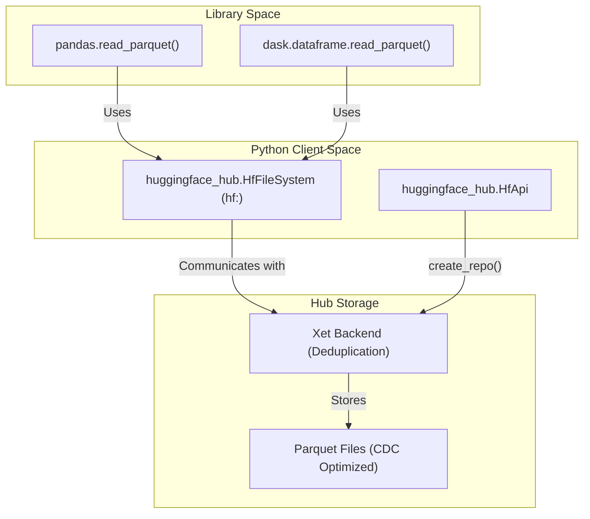

Sources: [docs/hub/datasets-pandas.md:1-91](), [docs/hub/datasets-dask.md:1-63](), [docs/hub/datasets-libraries.md:1-30]()

---

# Page: Spaces

# Spaces

<details>
<summary>Relevant source files</summary>

The following files were used as context for generating this wiki page:

- [docs/hub/billing.md](docs/hub/billing.md)
- [docs/hub/keras.md](docs/hub/keras.md)
- [docs/hub/oauth.md](docs/hub/oauth.md)
- [docs/hub/pro.md](docs/hub/pro.md)
- [docs/hub/security-gpg.md](docs/hub/security-gpg.md)
- [docs/hub/security-secrets.md](docs/hub/security-secrets.md)
- [docs/hub/spaces-add-to-arxiv.md](docs/hub/spaces-add-to-arxiv.md)
- [docs/hub/spaces-advanced.md](docs/hub/spaces-advanced.md)
- [docs/hub/spaces-agents.md](docs/hub/spaces-agents.md)
- [docs/hub/spaces-changelog.md](docs/hub/spaces-changelog.md)
- [docs/hub/spaces-circleci.md](docs/hub/spaces-circleci.md)
- [docs/hub/spaces-config-reference.md](docs/hub/spaces-config-reference.md)
- [docs/hub/spaces-dependencies.md](docs/hub/spaces-dependencies.md)
- [docs/hub/spaces-dev-mode.md](docs/hub/spaces-dev-mode.md)
- [docs/hub/spaces-get-user-plan.md](docs/hub/spaces-get-user-plan.md)
- [docs/hub/spaces-gpus.md](docs/hub/spaces-gpus.md)
- [docs/hub/spaces-handle-url-parameters.md](docs/hub/spaces-handle-url-parameters.md)
- [docs/hub/spaces-oauth.md](docs/hub/spaces-oauth.md)
- [docs/hub/spaces-overview.md](docs/hub/spaces-overview.md)
- [docs/hub/spaces-sdks-docker-aim.md](docs/hub/spaces-sdks-docker-aim.md)
- [docs/hub/spaces-sdks-docker-argilla.md](docs/hub/spaces-sdks-docker-argilla.md)
- [docs/hub/spaces-sdks-docker-chatui.md](docs/hub/spaces-sdks-docker-chatui.md)
- [docs/hub/spaces-sdks-docker-examples.md](docs/hub/spaces-sdks-docker-examples.md)
- [docs/hub/spaces-sdks-docker-first-demo.md](docs/hub/spaces-sdks-docker-first-demo.md)
- [docs/hub/spaces-sdks-docker-giskard.md](docs/hub/spaces-sdks-docker-giskard.md)
- [docs/hub/spaces-sdks-docker-jupyter.md](docs/hub/spaces-sdks-docker-jupyter.md)
- [docs/hub/spaces-sdks-docker-label-studio.md](docs/hub/spaces-sdks-docker-label-studio.md)
- [docs/hub/spaces-sdks-docker-langfuse.md](docs/hub/spaces-sdks-docker-langfuse.md)
- [docs/hub/spaces-sdks-docker-livebook.md](docs/hub/spaces-sdks-docker-livebook.md)
- [docs/hub/spaces-sdks-docker-panel.md](docs/hub/spaces-sdks-docker-panel.md)
- [docs/hub/spaces-sdks-docker-shiny.md](docs/hub/spaces-sdks-docker-shiny.md)
- [docs/hub/spaces-sdks-docker-tabby.md](docs/hub/spaces-sdks-docker-tabby.md)
- [docs/hub/spaces-sdks-docker-zenml.md](docs/hub/spaces-sdks-docker-zenml.md)
- [docs/hub/spaces-sdks-docker.md](docs/hub/spaces-sdks-docker.md)
- [docs/hub/spaces-sdks-gradio.md](docs/hub/spaces-sdks-gradio.md)
- [docs/hub/spaces-sdks-python.md](docs/hub/spaces-sdks-python.md)
- [docs/hub/spaces-sdks-static.md](docs/hub/spaces-sdks-static.md)
- [docs/hub/spaces-sdks-streamlit.md](docs/hub/spaces-sdks-streamlit.md)
- [docs/hub/spaces-storage.md](docs/hub/spaces-storage.md)
- [docs/hub/spaces-using-opencv.md](docs/hub/spaces-using-opencv.md)
- [docs/hub/spaces-zerogpu.md](docs/hub/spaces-zerogpu.md)
- [docs/hub/spaces.md](docs/hub/spaces.md)
- [docs/hub/tf-keras.md](docs/hub/tf-keras.md)

</details>


Spaces provide a platform for hosting machine learning demo applications directly on user and organization profiles within the Hugging Face Hub ecosystem. This document covers the technical architecture, configuration systems, runtime environments, and deployment workflows for Spaces.

For information about model repositories, see [Models](#2.1). For dataset repositories, see [Datasets](#2.2). For broader Hub API access patterns, see [Hub API and Programmatic Access](#3).

## Architecture Overview

Spaces operate as specialized Git repositories with integrated runtime environments that automatically build and deploy applications when code changes are pushed [docs/hub/spaces-overview.md:21-22](). The system supports multiple Software Development Kits (SDKs) and provides scalable hardware options ranging from free CPUs to high-end NVIDIA GPUs [docs/hub/spaces-overview.md:51-68]().

### Core Spaces Runtime Architecture

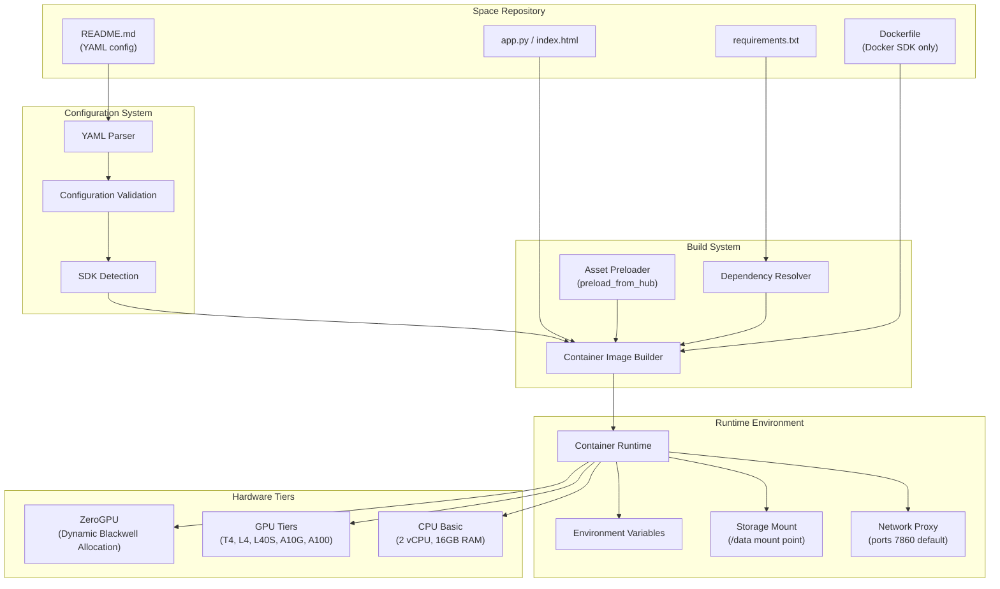

Sources: [docs/hub/spaces-overview.md:21-68](), [docs/hub/spaces-config-reference.md:1-62](), [docs/hub/spaces-zerogpu.md:1-10]()

### SDK-Specific Runtime Environments

Spaces support three primary SDKs: Gradio, Docker, and Static HTML [docs/hub/spaces.md:5-6](). Note that Streamlit is now deprecated as a built-in SDK and should be deployed via Docker [docs/hub/spaces-sdks-streamlit.md:1-3]().

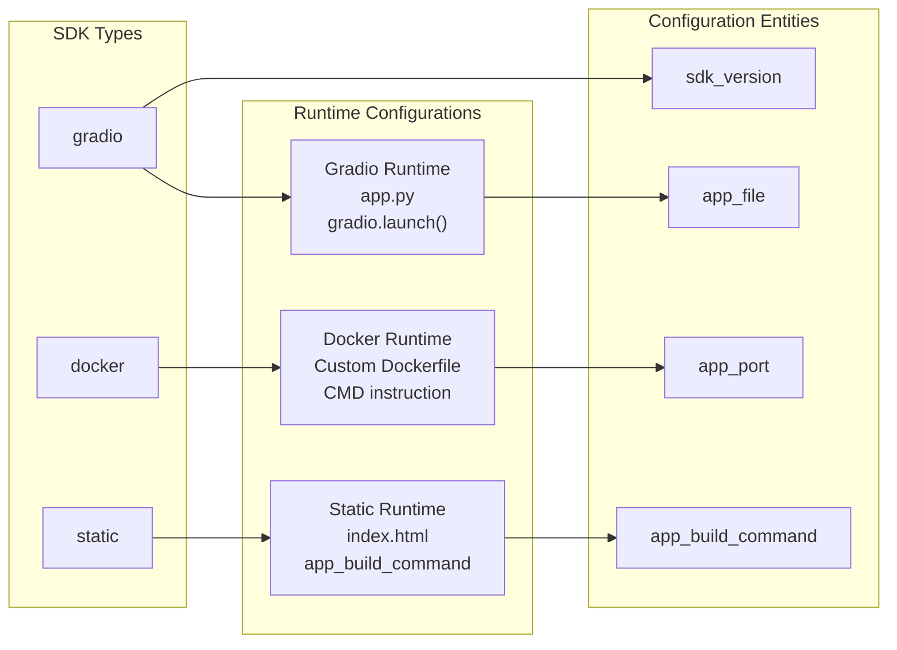

Sources: [docs/hub/spaces-config-reference.md:19-61](), [docs/hub/spaces-sdks-streamlit.md:1-3](), [docs/hub/spaces-sdks-static.md:1-27]()

## Configuration System

Spaces configuration is managed through YAML metadata blocks in the `README.md` file at the repository root [docs/hub/spaces-config-reference.md:3]().

### Core Configuration Parameters

| Parameter | Type | Purpose | Default / Options |
|-----------|------|---------|-------------------|
| `sdk` | string | Runtime environment | `gradio`, `docker`, `static` [docs/hub/spaces-config-reference.md:20]() |
| `python_version` | string | Python runtime version | `3.10` [docs/hub/spaces-config-reference.md:24]() |
| `app_file` | string | Entry point file path | SDK dependent [docs/hub/spaces-config-reference.md:49]() |
| `app_port` | int | Application port (Docker) | `7860` [docs/hub/spaces-config-reference.md:62]() |
| `suggested_hardware` | string | Hardware recommendation | `cpu-basic`, `t4-medium`, `a100-large`, etc. [docs/hub/spaces-config-reference.md:35-39]() |
| `preload_from_hub` | list | Build-time file preloading | Repository and file list [docs/hub/spaces-config-reference.md:127-130]() |

Sources: [docs/hub/spaces-config-reference.md:7-130]()

### OAuth and Security Configuration

Spaces can integrate Hugging Face Sign-In by setting `hf_oauth: true` in the metadata [docs/hub/spaces-oauth.md:15](). This injects `OAUTH_CLIENT_ID` and `OAUTH_CLIENT_SECRET` into the environment [docs/hub/spaces-oauth.md:50-51]().

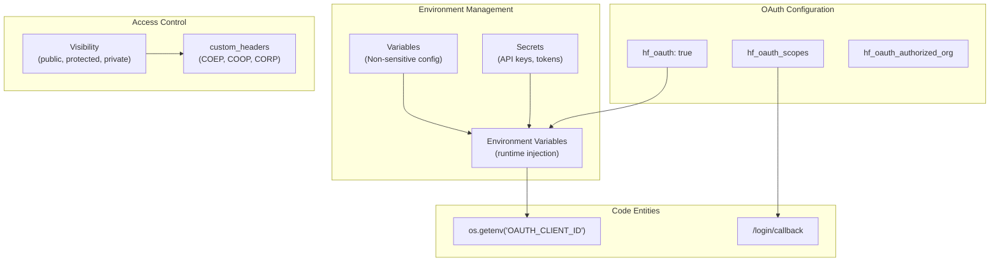

Sources: [docs/hub/spaces-overview.md:84-85](), [docs/hub/spaces-oauth.md:29-55](), [docs/hub/spaces-config-reference.md:114-123]()

## Hardware and Infrastructure

### Hardware Specifications

| Hardware Flavor | CPU | Memory | GPU Memory | Hourly Price |
|-----------------|-----|--------|------------|--------------|
| `cpu-basic` | 2 vCPU | 16 GB | - | Free [docs/hub/spaces-gpus.md:28]() |
| `t4-small` | 4 vCPU | 15 GB | 16 GB | $0.40 [docs/hub/spaces-gpus.md:38]() |
| `l4x1` | 8 vCPU | 30 GB | 24 GB | $0.80 [docs/hub/spaces-gpus.md:40]() |
| `a10g-large` | 12 vCPU | 46 GB | 24 GB | $1.50 [docs/hub/spaces-gpus.md:46]() |
| `a100-large` | 12 vCPU | 142 GB | 80 GB | $2.50 [docs/hub/spaces-gpus.md:49]() |

Sources: [docs/hub/spaces-gpus.md:26-53](), [docs/hub/spaces-overview.md:51-68]()

### ZeroGPU: Dynamic Allocation

ZeroGPU is a shared infrastructure that dynamically allocates NVIDIA RTX Pro 6000 Blackwell GPUs (48GB/96GB VRAM) for Gradio-based Spaces [docs/hub/spaces-zerogpu.md:5-29]().

*   **Implementation**: Use the `@spaces.GPU` decorator on functions requiring acceleration [docs/hub/spaces-zerogpu.md:65]().
*   **Quotas**: Usage is subject to daily quotas (e.g., 5 mins for free accounts, 40 mins for PRO) [docs/hub/spaces-zerogpu.md:157-163]().
*   **Model Loading**: Models should be placed on `cuda` at the root module level using PyTorch CUDA emulation [docs/hub/spaces-zerogpu.md:94-99]().

Sources: [docs/hub/spaces-zerogpu.md:1-173]()

## Development and Deployment

### Space Visibility Tiers

| Tier | Source Code | App Access | Clonable |
|------|-------------|------------|----------|
| **Public** | Visible to everyone | Public | Yes |
| **Protected** | Private (Owner/Collabs) | Public (Embed/Domain) | No |
| **Private** | Private | Private | No |

Sources: [docs/hub/spaces-overview.md:34-45]()

### Deployment Lifecycle

1.  **Creation**: Initialize via Hub UI or API [docs/hub/spaces-overview.md:11]().
2.  **Dependencies**: Managed via `requirements.txt` (Python), `packages.txt` (Debian), or `Dockerfile` [docs/hub/spaces-sdks-streamlit.md:41-48](), [docs/hub/spaces-changelog.md:110-111]().
3.  **Build**: Triggered on every Git push [docs/hub/spaces-overview.md:21]().
4.  **Runtime**: Health checked against `startup_duration_timeout` (default 30m) [docs/hub/spaces-config-reference.md:110-112]().
5.  **Billing**: Usage-based by the minute for upgraded hardware; free hardware suspends after inactivity [docs/hub/spaces-gpus.md:123-130]().

### Development Mode

Dev Mode enables live editing via SSH or VS Code. It requires specific packages like `bash`, `curl`, and `git` to be available in the container [docs/hub/spaces-dev-mode.md:1-170]().

Sources: [docs/hub/spaces-overview.md:9-45](), [docs/hub/spaces-gpus.md:121-130](), [docs/hub/spaces-config-reference.md:110-112]()

---

# Page: Hub API and Programmatic Access

# Hub API and Programmatic Access

<details>
<summary>Relevant source files</summary>

The following files were used as context for generating this wiki page:

- [docs/hub/api.md](docs/hub/api.md)
- [docs/hub/datasets-audio.md](docs/hub/datasets-audio.md)
- [docs/hub/datasets-data-files-configuration.md](docs/hub/datasets-data-files-configuration.md)
- [docs/hub/datasets-image.md](docs/hub/datasets-image.md)
- [docs/hub/datasets-manual-configuration.md](docs/hub/datasets-manual-configuration.md)
- [docs/hub/datasets-overview.md](docs/hub/datasets-overview.md)
- [docs/hub/datasets-video.md](docs/hub/datasets-video.md)
- [docs/hub/datasets-webdataset.md](docs/hub/datasets-webdataset.md)
- [docs/hub/jobs-webhooks.md](docs/hub/jobs-webhooks.md)
- [docs/hub/rate-limits.md](docs/hub/rate-limits.md)
- [docs/hub/repositories-github-actions.md](docs/hub/repositories-github-actions.md)
- [docs/hub/search.md](docs/hub/search.md)
- [docs/hub/security-tokens.md](docs/hub/security-tokens.md)
- [docs/hub/spaces-github-actions.md](docs/hub/spaces-github-actions.md)
- [docs/hub/trusted-publishers.md](docs/hub/trusted-publishers.md)
- [docs/hub/webhooks-guide-auto-retrain.md](docs/hub/webhooks-guide-auto-retrain.md)
- [docs/hub/webhooks-guide-discussion-bot.md](docs/hub/webhooks-guide-discussion-bot.md)
- [docs/hub/webhooks-guide-metadata-review.md](docs/hub/webhooks-guide-metadata-review.md)
- [docs/hub/webhooks.md](docs/hub/webhooks.md)

</details>


This document covers the Hub's REST API endpoints and programmatic client libraries that enable automated interaction with models, datasets, and Spaces. It includes authentication mechanisms, common integration patterns, and code-based workflows for repository management.

For information about repository management through the web interface, see [Repository Management](#2). For information about setting up automated workflows and CI/CD integration, see [Webhooks and Automation](#3.2).

## REST API Overview

The Hugging Face Hub exposes a comprehensive REST API that provides programmatic access to all Hub functionality. Documentation and testing for these endpoints are available in the [OpenAPI Playground](https://huggingface.co/spaces/huggingface/openapi) [docs/hub/api.md:6-6]().

### API Architecture

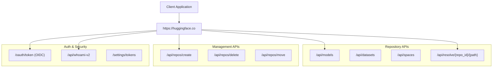

Sources: [docs/hub/api.md:1-16](), [docs/hub/rate-limits.md:7-12](), [docs/hub/trusted-publishers.md:141-143]()

### Rate Limits and Tiers

The Hub enforces rate limits based on the request type and user tier. Limits are calculated over 5-minute fixed windows [docs/hub/rate-limits.md:75-76]().

| Bucket | Purpose |
| :--- | :--- |
| **Hub APIs** | Model/dataset search, repo creation, management [docs/hub/rate-limits.md:7-8](). |
| **Resolvers** | URLs containing `/resolve/` for downloading files (highest limits) [docs/hub/rate-limits.md:9-12](). |
| **Pages** | Web browsing requests (lowest limits) [docs/hub/rate-limits.md:13-15](). |

For details, see [REST API and Client Libraries](#3.1).

Sources: [docs/hub/rate-limits.md:1-72]()

## Client Libraries

Official client libraries wrap the REST API to provide high-level abstractions for common operations.

### Python Client (`huggingface_hub`)

The `huggingface_hub` Python library is the primary client for programmatic Hub interaction. It includes smart retry handling for 429 rate limit errors by parsing the `RateLimit` HTTP header [docs/hub/rate-limits.md:94-98]().

### JavaScript Client (`huggingface.js`)

The `huggingface.js` client provides access to Hub endpoints for JavaScript and TypeScript environments [docs/hub/api.md:3-3]().

Sources: [docs/hub/api.md:3-3](), [docs/hub/rate-limits.md:92-98]()

## Authentication and Security

### User Access Tokens

User Access Tokens are the preferred way to authenticate applications. They come in three primary flavors [docs/hub/security-tokens.md:12-19]():
- `fine-grained`: Scoped to specific resources (recommended for production) [docs/hub/security-tokens.md:71-71]().
- `read`: Read access to public and private repos.
- `write`: Additionally grants permission to create or modify content.

### Trusted Publishers (OIDC)

For CI/CD workflows (e.g., GitHub Actions, GitLab CI), **Trusted Publishers** allow pushing to the Hub without storing an `HF_TOKEN` secret [docs/hub/trusted-publishers.md:1-5](). The workflow exchanges a short-lived OIDC token from the CI provider for a short-lived Hub token [docs/hub/trusted-publishers.md:141-143]().

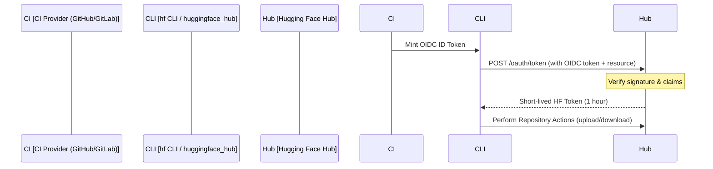

For details, see [REST API and Client Libraries](#3.1).

Sources: [docs/hub/security-tokens.md:1-106](), [docs/hub/trusted-publishers.md:1-143]()

## Automation and Webhooks

Webhooks enable MLOps workflows by listening for changes on repositories (Models, Datasets, or Spaces) [docs/hub/webhooks.md:3-5]().

### Webhook Event Scopes
- `repo`: Repository creation, deletion, or moving [docs/hub/webhooks.md:96-96]().
- `repo.content`: Commits, tags, and file updates [docs/hub/webhooks.md:97-97]().
- `discussion`: PR/Discussion creation and status updates [docs/hub/webhooks.md:99-99]().
- `discussion.comment`: New or updated comments [docs/hub/webhooks.md:100-100]().

### Use Cases
- **Auto-Retrain**: Trigger model fine-tuning when a dataset is updated [docs/hub/webhooks-guide-auto-retrain.md:6-7]().
- **Discussion Bots**: Use LLMs to reply to Hub comments automatically [docs/hub/webhooks-guide-discussion-bot.md:1-3]().
- **Metadata Review**: Automatically validate YAML metadata in `README.md` files [docs/hub/webhooks-guide-metadata-review.md:1-3]().

For details, see [Webhooks and Automation](#3.2).

Sources: [docs/hub/webhooks.md:1-105](), [docs/hub/webhooks-guide-auto-retrain.md:1-171](), [docs/hub/webhooks-guide-discussion-bot.md:1-133]()

## Hub Jobs

Hub Jobs provide a way to run compute tasks on Hugging Face infrastructure. They can be triggered manually or automatically via webhooks [docs/hub/webhooks.md:5-5]().

Common tasks for Jobs include:
- Large dataset processing and sharding [docs/hub/datasets-data-files-configuration.md:59-59]().
- Model evaluation and automated testing.
- Serving endpoints for specialized processing.

For details, see [Hub Jobs](#3.3).

Sources: [docs/hub/webhooks.md:5-5](), [docs/hub/jobs-webhooks.md:1-10]()

---

# Page: REST API and Client Libraries

# REST API and Client Libraries

<details>
<summary>Relevant source files</summary>

The following files were used as context for generating this wiki page:

- [docs/hub/api.md](docs/hub/api.md)
- [docs/hub/datasets-audio.md](docs/hub/datasets-audio.md)
- [docs/hub/datasets-data-files-configuration.md](docs/hub/datasets-data-files-configuration.md)
- [docs/hub/datasets-image.md](docs/hub/datasets-image.md)
- [docs/hub/datasets-manual-configuration.md](docs/hub/datasets-manual-configuration.md)
- [docs/hub/datasets-overview.md](docs/hub/datasets-overview.md)
- [docs/hub/datasets-video.md](docs/hub/datasets-video.md)
- [docs/hub/datasets-webdataset.md](docs/hub/datasets-webdataset.md)
- [docs/hub/rate-limits.md](docs/hub/rate-limits.md)
- [docs/hub/repositories-github-actions.md](docs/hub/repositories-github-actions.md)
- [docs/hub/search.md](docs/hub/search.md)
- [docs/hub/security-tokens.md](docs/hub/security-tokens.md)
- [docs/hub/spaces-github-actions.md](docs/hub/spaces-github-actions.md)
- [docs/hub/trusted-publishers.md](docs/hub/trusted-publishers.md)

</details>


This page documents the programmatic interfaces for interacting with the Hugging Face Hub. It covers the foundational REST API, the primary client libraries in Python and JavaScript, authentication mechanisms, and modern CI/CD integration via Trusted Publishers.

## Hub REST API

The Hugging Face Hub is built on a comprehensive REST API that facilitates repository management, file operations, and metadata retrieval. The API is documented via an OpenAPI specification, which is the authoritative source for all endpoint definitions [docs/hub/api.md:6-6]().

### Core API Categories
The Hub classifies requests into three primary buckets to manage traffic and performance:

| Bucket | Purpose | Example Operations |
| :--- | :--- | :--- |
| **Hub APIs** | Repository and user management | Searching models/datasets, creating repos, managing organizations [docs/hub/rate-limits:7-8]() |
| **Resolvers** | Serving user-generated content | Downloading model weights or dataset files via `/resolve/` URLs [docs/hub/rate-limits:9-11]() |
| **Pages** | Human-readable web content | Rendering repository landing pages on `huggingface.co` [docs/hub/rate-limits:13-14]() |

### Rate Limiting and Retries
All API calls are subject to rate limits calculated over 5-minute fixed windows [docs/hub/rate-limits:9-9](), [docs/hub/rate-limits:17-18](). When a limit is exceeded, the server returns a `429 Too Many Requests` error including `RateLimit` and `RateLimit-Policy` headers [docs/hub/rate-limits:38-44]().

**Data Flow: Rate Limit Handling**
The following diagram illustrates how the `huggingface_hub` Python library interacts with the Hub's rate-limiting headers to perform smart retries.

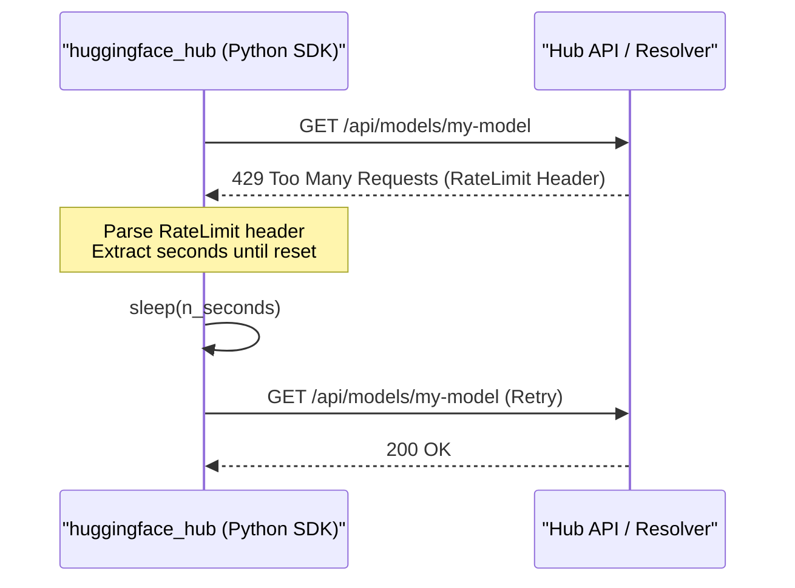
Sources: [docs/hub/rate-limits:38-57](), [docs/hub/rate-limits:92-98]()

---

## Client Libraries

While the REST API can be accessed directly, Hugging Face provides high-level wrappers to simplify development.

### Python: `huggingface_hub`
The `huggingface_hub` library is the primary tool for Python developers. It handles authentication, local caching, and optimized file transfers.
- **Smart Retries**: Versions 1.2.0+ automatically parse `RateLimit` headers to wait the precise duration before retrying [docs/hub/rate-limits:92-98]().
- **Integration**: It is used internally by `transformers`, `datasets`, and `diffusers` to manage model loading [docs/hub/security-tokens:48-56]().

### JavaScript: `huggingface.js`
The `huggingface.js` client provides similar functionality for web and Node.js environments, enabling browser-based interactions with Hub repositories and Inference Providers [docs/hub/api.md:3-3]().

---

## Authentication and Tokens

Programmatic access to private or gated resources requires authentication via User Access Tokens. These are managed in the user's [settings](https://huggingface.co/settings/tokens) [docs/hub/security-tokens:5-6]().

### Token Types and Scopes
| Role | Capabilities |
| :--- | :--- |
| `fine-grained` | Scoped access to specific repositories or organizations; recommended for production [docs/hub/security-tokens:14-14](), [docs/hub/security-tokens:71-71](). |
| `read` | Download public and private repositories the user has access to [docs/hub/security-tokens:16-16](). |
| `write` | Create repositories and push content [docs/hub/security-tokens:18-19](). |

### Enterprise Token Policies
Organizations on Team or Enterprise plans can enforce approval workflows for fine-grained tokens. Tokens may exist in `Pending`, `Approved`, `Denied`, or `Revoked` states [docs/hub/security-tokens:83-103]().

Sources: [docs/hub/security-tokens:12-21](), [docs/hub/security-tokens:87-92]()

---

## Trusted Publishers and CI/CD

Trusted Publishers allow CI/CD environments (like GitHub Actions or GitLab CI) to interact with the Hub without storing long-lived `HF_TOKEN` secrets [docs/hub/trusted-publishers:3-5]().

### OIDC Token Exchange
The system uses OpenID Connect (OIDC) to prove the identity of a CI job. The CI provider mints an ID token, which the Hub exchanges for a short-lived (1 hour) Hugging Face token [docs/hub/trusted-publishers:9-12]().

**Code Entity Mapping: OIDC Exchange Flow**
This diagram bridges the CI configuration space to the Hub's authentication entities.

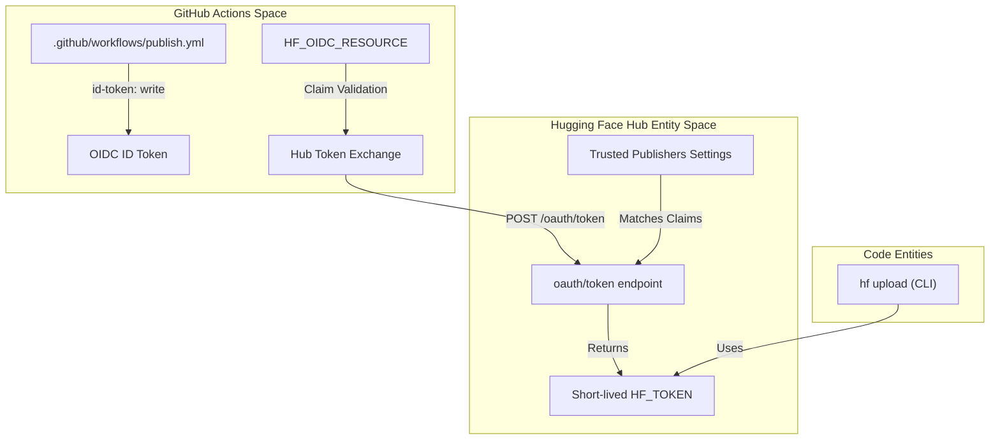
Sources: [docs/hub/trusted-publishers:16-32](), [docs/hub/trusted-publishers:49-66](), [docs/hub/trusted-publishers:141-143]()

### GitHub Actions Integration
The official `huggingface/hub-sync` action facilitates automatic synchronization between a GitHub repository and a Hub repository (Model, Dataset, or Space) [docs/hub/repositories-github-actions:3-4]().

**Key Parameters for `huggingface/hub-sync`:**
- `github_repo_id`: The source GitHub repository [docs/hub/repositories-github-actions:49-49]().
- `huggingface_repo_id`: The target Hub repository [docs/hub/repositories-github-actions:50-50]().
- `repo_type`: One of `model`, `dataset`, or `space` [docs/hub/repositories-github-actions:52-52]().

**Example Workflow Fragment:**
```yaml
- uses: huggingface/hub-sync@v0.1.0
  with:
    github_repo_id: ${{ github.repository }}
    huggingface_repo_id: acme/my-model
    hf_token: ${{ secrets.HF_TOKEN }}
    repo_type: model
```
Sources: [docs/hub/repositories-github-actions:37-43](), [docs/hub/repositories-github-actions:47-56]()

---

# Page: Webhooks and Automation

# Webhooks and Automation

<details>
<summary>Relevant source files</summary>

The following files were used as context for generating this wiki page:

- [docs/hub/jobs-configuration.md](docs/hub/jobs-configuration.md)
- [docs/hub/jobs-examples.md](docs/hub/jobs-examples.md)
- [docs/hub/jobs-large-datasets.md](docs/hub/jobs-large-datasets.md)
- [docs/hub/jobs-manage.md](docs/hub/jobs-manage.md)
- [docs/hub/jobs-popular-images.md](docs/hub/jobs-popular-images.md)
- [docs/hub/jobs-pricing.md](docs/hub/jobs-pricing.md)
- [docs/hub/jobs-quickstart.md](docs/hub/jobs-quickstart.md)
- [docs/hub/jobs-reference.md](docs/hub/jobs-reference.md)
- [docs/hub/jobs-schedule.md](docs/hub/jobs-schedule.md)
- [docs/hub/jobs-webhooks.md](docs/hub/jobs-webhooks.md)
- [docs/hub/webhooks-guide-auto-retrain.md](docs/hub/webhooks-guide-auto-retrain.md)
- [docs/hub/webhooks-guide-discussion-bot.md](docs/hub/webhooks-guide-discussion-bot.md)
- [docs/hub/webhooks-guide-metadata-review.md](docs/hub/webhooks-guide-metadata-review.md)
- [docs/hub/webhooks.md](docs/hub/webhooks.md)

</details>


Webhooks and automated Jobs form the backbone of MLOps on the Hugging Face Hub. They allow developers to build reactive systems that respond to repository events—such as code pushes, new discussions, or dataset updates—by triggering compute tasks, bots, or metadata reviews.

## Webhook Architecture

Webhooks function by sending an `HTTP POST` request with a JSON payload to a user-defined target URL whenever a specified event occurs. This enables a push-based integration model.

```mermaid
graph TD
    subgraph "Hugging Face Hub"
        EventSource["Repository Event<br/>(Push, PR, Comment)"]
        WebhookEngine["Webhook Engine"]
        Registry["Webhook Registry<br/>(Settings)"]
    end

    subgraph "Automation Target (e.g., Space or Server)"
        Endpoint["POST /webhook"]
        SecretVal["X-Webhook-Secret<br/>Validator"]
        Logic["Automation Logic"]
    end

    subgraph "Downstream Actions"
        JobTrigger["Trigger Hub Job"]
        BotReply["Post Discussion Comment"]
        ExternalCI["External CI/CD"]
    end

    EventSource --> WebhookEngine
    Registry -.-> WebhookEngine
    WebhookEngine -- "JSON Payload" --> Endpoint
    Endpoint --> SecretVal
    SecretVal --> Logic
    Logic --> JobTrigger
    Logic --> BotReply
    Logic --> ExternalCI
```

**System Data Flow: Hub Events to Automation Actions**

Sources: [docs/hub/webhooks.md:3-6](), [docs/hub/webhooks.md:24-26]()

## Event Scopes and Payloads

The nature of an event is defined by its `event.scope` and `event.action`.

| Scope | Description | Common Actions |
| :--- | :--- | :--- |
| `repo` | Global repository operations | `create`, `delete`, `update`, `move` |
| `repo.content` | Changes to files, commits, or tags | `update` |
| `repo.config` | Changes to settings (e.g., visibility, secrets) | `update` |
| `discussion` | PR and Discussion lifecycle | `create`, `delete`, `update` |
| `discussion.comment` | Comment interactions | `create`, `update` |

### Payload Structure
The payload contains detailed context about the repository and the event. For content changes, the `updatedRefs` array identifies exactly which branches or tags were modified.

```json
{
  "event": { "action": "update", "scope": "repo.content" },
  "repo": {
    "type": "model",
    "name": "username/repo",
    "headSha": "c379e821..."
  },
  "updatedRefs": [
    {
      "ref": "refs/heads/main",
      "oldSha": "ce9a4674...",
      "newSha": "575db8b7..."
    }
  ],
  "webhook": { "id": "6390e855...", "version": 3 }
}
```

Sources: [docs/hub/webhooks.md:94-100](), [docs/hub/webhooks.md:131-146]()

## Automation with Hub Jobs

Webhooks can directly trigger **Hub Jobs**, which are managed compute instances for tasks like training, evaluation, or data processing.

### Webhook to Job Workflow
A common pattern involves a "Dispatcher" Space that receives the webhook and uses the `huggingface_hub` library's `run_job` or `hf jobs` CLI to start compute.

```mermaid
graph LR
    subgraph "Code Entity Space"
        WH_Payload["WebhookPayload (JSON)"]
        FastAPI_Route["FastAPI @app.post('/webhook')"]
        HF_Client["huggingface_hub.run_job()"]
        Job_Entity["Hub Job (ID: 699d8...)"]
    end

    WH_Payload --> FastAPI_Route
    FastAPI_Route --> HF_Client
    HF_Client --> Job_Entity
```

**Dispatcher Logic Association**

### Triggering Jobs Programmatically
When a webhook triggers a Job, you can pass repository metadata as environment variables or secrets to the container.

```python
from huggingface_hub import run_job

# Logic inside a Webhook Handler Space
def handle_webhook(payload):
    if payload.event.scope == "repo.content":
        run_job(
            image="huggingface/trl",
            command=["python", "train.py"],
            flavor="a100-large",
            secrets={"HF_TOKEN": os.environ["HF_TOKEN"]},
            environment={
                "REPO_ID": payload.repo.name,
                "REVISION": payload.updatedRefs[0].newSha
            }
        )
```

Sources: [docs/hub/jobs-configuration.md:156-163](), [docs/hub/webhooks-guide-auto-retrain.md:121-134]()

## Automation Use Cases

### 1. Metadata Quality Review
Automate checks for model/dataset cards. When a `README.md` is updated, a webhook triggers a script that parses the YAML header and posts a "Report Card" in the repository's discussions.

*   **Key Functions**: `ModelCard.load(repo_id).data.to_dict()` is used to extract metadata for validation.
*   **Action**: Posts a markdown table using the Discussion API.

Sources: [docs/hub/webhooks-guide-metadata-review.md:43-54](), [docs/hub/webhooks-guide-metadata-review.md:129-136]()

### 2. Discussion Bots
Create bots that respond to mentions.
*   **Logic**: The handler checks if `comment.content` includes the `@bot-username`.
*   **Integration**: Calls an LLM via [Inference Providers](https://huggingface.co/docs/inference-providers) and posts the generated response back to the Hub API.

Sources: [docs/hub/webhooks-guide-discussion-bot.md:52-65](), [docs/hub/webhooks-guide-discussion-bot.md:102-111]()

### 3. Auto-Retraining
Trigger a fine-tuning pipeline when a dataset is updated.
*   **Workflow**: Detects `repo.content` updates on a dataset, then creates an AutoTrain project or a custom Hub Job.
*   **Persistance**: Results are typically pushed back to the Hub using `push_to_hub` or saved to a [Storage Bucket](./7.2).

Sources: [docs/hub/webhooks-guide-auto-retrain.md:107-116](), [docs/hub/jobs-quickstart.md:96-97]()

## Implementation Best Practices

### Security: Secret Validation
Always verify the `X-Webhook-Secret` header in your endpoint to ensure the request originated from the Hugging Face Hub.

```python
# FastAPI Example
@app.post("/webhook")
async def post_webhook(payload: WebhookPayload, x_webhook_secret: str = Header(None)):
    if x_webhook_secret != os.environ.get("WEBHOOK_SECRET"):
        raise HTTPException(status_code=403)
    # Process event...
```

Sources: [docs/hub/webhooks-guide-auto-retrain.md:63-74](), [docs/hub/webhooks-guide-discussion-bot.md:41-48]()

### Resource Management
*   **Timeouts**: Use `--timeout` (default 30m) for Jobs to prevent runaway costs.
*   **Hardware Selection**: Choose a `--flavor` (e.g., `cpu-upgrade`, `a10g-small`) that matches the task requirements.
*   **Volumes**: Use `-v hf://...` to mount large datasets lazily rather than downloading them, saving ephemeral disk space.

Sources: [docs/hub/jobs-pricing.md:126-134](), [docs/hub/jobs-configuration.md:106-110](), [docs/hub/jobs-large-datasets.md:58-65]()

---

# Page: Hub Jobs

# Hub Jobs

<details>
<summary>Relevant source files</summary>

The following files were used as context for generating this wiki page:

- [docs/hub/jobs-configuration.md](docs/hub/jobs-configuration.md)
- [docs/hub/jobs-examples.md](docs/hub/jobs-examples.md)
- [docs/hub/jobs-large-datasets.md](docs/hub/jobs-large-datasets.md)
- [docs/hub/jobs-manage.md](docs/hub/jobs-manage.md)
- [docs/hub/jobs-overview.md](docs/hub/jobs-overview.md)
- [docs/hub/jobs-popular-images.md](docs/hub/jobs-popular-images.md)
- [docs/hub/jobs-pricing.md](docs/hub/jobs-pricing.md)
- [docs/hub/jobs-quickstart.md](docs/hub/jobs-quickstart.md)
- [docs/hub/jobs-reference.md](docs/hub/jobs-reference.md)
- [docs/hub/jobs-schedule.md](docs/hub/jobs-schedule.md)
- [docs/hub/jobs-serving.md](docs/hub/jobs-serving.md)
- [docs/hub/jobs.md](docs/hub/jobs.md)

</details>


`Hugging Face Jobs` provide a serverless compute infrastructure for AI and data workflows, supporting a familiar `uv` and Docker-like interface. They are designed for fine-tuning models, running batch inference, and large-scale data processing [docs/hub/jobs.md:1-6](). Jobs support a wide range of hardware flavors, from basic CPUs to multi-GPU clusters (e.g., 8x Nvidia H200) [docs/hub/jobs-pricing.md:20-55]().

## System Architecture and Data Flow

The Jobs ecosystem bridges local development with cloud execution by synchronizing code, mounting remote data, and providing real-time telemetry.

### Job Lifecycle Diagram
This diagram maps the high-level Job lifecycle to the underlying CLI commands and API concepts.

```mermaid
graph TD
    subgraph "Natural Language Space"
        A["Start Job"]
        B["Monitor Usage"]
        C["Access Data"]
        D["Terminate"]
    end

    subgraph "Code Entity Space"
        A --> RUN["hf jobs uv run / run_job()"]
        B --> STATS["hf jobs stats"]
        C --> VOL["Volume / -v hf://"]
        D --> CANCEL["hf jobs cancel"]
        
        RUN -.-> |"POST /api/jobs"| API["Jobs HTTP API"]
        STATS -.-> |"GET /api/jobs/:id/stats"| API
        VOL -.-> |"Lazy Fetch"| XET["Xet/S3 Storage"]
    end
```
**Sources:** [docs/hub/jobs-reference.md:22-31](), [docs/hub/jobs-manage.md:92-95](), [docs/hub/jobs-configuration.md:104-106]()

### Data Flow for Large Datasets
Jobs use a lazy-loading mechanism for volumes, allowing them to process datasets far larger than the ephemeral disk provided by the hardware flavor [docs/hub/jobs-large-datasets.md:3-4]().

```mermaid
sequenceDiagram
    participant CLI as "hf jobs CLI"
    participant S3 as "Storage Bucket / Hub Repo"
    participant Job as "Job Container (Ephemeral Disk)"
    participant App as "User Script (Polars/vLLM)"

    CLI->>Job: Initialize with Volume Mount (-v)
    Note over Job: Mount point created at /data
    App->>Job: Request file (e.g., /data/shard_1.parquet)
    Job->>S3: Lazy fetch requested chunks
    S3-->>Job: Stream data to cache
    Job-->>App: Provide file descriptor
    Note over App: Process data without full download
```
**Sources:** [docs/hub/jobs-large-datasets.md:57-65](), [docs/hub/jobs-configuration.md:104-110]()

## Configuration and Execution

### Execution Modes
1.  **UV Jobs**: Uses the `uv` package manager to handle dependencies dynamically. By default, these run on `ghcr.io/astral-sh/uv:python3.12-bookworm` [docs/hub/jobs-configuration.md:9-37]().
    *   Command: `hf jobs uv run --with <deps> <script.py>` [docs/hub/jobs-configuration.md:25]().
2.  **Docker Jobs**: Runs any public or private Docker image [docs/hub/jobs-configuration.md:39-44]().
    *   Command: `hf jobs run <image> <command>` [docs/hub/jobs-configuration.md:44]().

### Environment and Secrets
Jobs provide built-in environment variables for resource discovery:
| Variable | Description |
|----------|-------------|
| `JOB_ID` | Unique identifier for the job |
| `ACCELERATOR` | Type of GPU (e.g., `a100x4`) or `none` |
| `CPU_CORES` | Number of allocated cores |
| `MEMORY` | Allocated RAM (e.g., `8Gi`) |

**Sources:** [docs/hub/jobs-configuration.md:57-67]()

Secrets (like `HF_TOKEN`) are encrypted server-side and exposed as environment variables within the container using the `-s` or `--secrets` flag [docs/hub/jobs-configuration.md:90-97]().

### Volume Management
Volumes allow mounting Hugging Face repositories or Storage Buckets using the `hf://` URI scheme [docs/hub/jobs-configuration.md:104-106]().

*   **Read-Only**: Models and datasets are always mounted read-only [docs/hub/jobs-configuration.md:140]().
*   **Read-Write**: Storage buckets are read-write by default, enabling persistence of checkpoints and logs [docs/hub/jobs-configuration.md:140-141]().
*   **Local Sync**: Passing a local directory (e.g., `-v ./data:/mnt`) automatically syncs files to a `jobs-artifacts` bucket before starting the job [docs/hub/jobs-configuration.md:146-154]().

## Scheduling and Automation

Jobs can be scheduled using standard CRON expressions or aliases like `@hourly` [docs/hub/jobs-schedule.md:5]().

| Command | Action |
|---------|--------|
| `hf jobs scheduled ps` | List active schedules [docs/hub/jobs-schedule.md:32-33]() |
| `hf jobs scheduled suspend` | Pause a schedule [docs/hub/jobs-schedule.md:41-42]() |
| `hf jobs scheduled trigger` | Immediate manual execution [docs/hub/jobs-schedule.md:47-48]() |

## Serving Endpoints

Jobs can act as ephemeral inference servers by exposing ports. This is billed at a flat rate of **$0.01/hour** in addition to hardware costs [docs/hub/jobs-pricing.md:62-68]().

### Example: vLLM Server
A Job can be detached to run a vLLM OpenAI-compatible server:
```bash
hf jobs run --detach --expose 8000 --flavor a10g-small -s HF_TOKEN \
  vllm/vllm-openai \
  vllm serve LiquidAI/LFM2.5-8B-A1B --max-model-len 8192
```
**Sources:** [docs/hub/jobs-serving.md:12-23]()

The endpoint is reachable at `https://{job_id}--{port}.hf.jobs` and requires an `Authorization: Bearer <HF_TOKEN>` header for access [docs/hub/jobs-serving.md:34-43]().

## Pricing and Billing

Billing is computed **per minute** based on the hardware flavor and is only active when the job is in the `Starting` or `Running` state [docs/hub/jobs-pricing.md:8-10]().

*   **CPU Basic**: $0.01/hr (2 vCPU, 16GB RAM) [docs/hub/jobs-pricing.md:24]().
*   **Nvidia A100 - large**: $2.50/hr (80GB GPU Memory) [docs/hub/jobs-pricing.md:44]().
*   **8x Nvidia H200**: $40.00/hr (1128GB GPU Memory) [docs/hub/jobs-pricing.md:50]().

Users can set a `--timeout` (default 30 minutes) to prevent runaway costs [docs/hub/jobs-pricing.md:124-134]().

## Popular Framework Images

For optimized GPU execution, it is recommended to use framework-specific images that include the CUDA toolkit and `nvcc` [docs/hub/jobs-popular-images:40-54]().

| Framework | Image |
|-----------|-------|
| **vLLM** | `vllm/vllm-openai` [docs/hub/jobs-popular-images.md:15]() |
| **TRL** | `huggingface/trl` [docs/hub/jobs-popular-images.md:32]() |
| **llama.cpp**| `ghcr.io/ggml-org/llama.cpp:server-cuda` [docs/hub/jobs-serving.md:71]() |

**Sources:** [docs/hub/jobs-popular-images.md:12-38]()

---

# Page: Inference and Model Execution

# Inference and Model Execution

<details>
<summary>Relevant source files</summary>

The following files were used as context for generating this wiki page:

- [docs/inference-providers/_redirects.yml](docs/inference-providers/_redirects.yml)
- [docs/inference-providers/_toctree.yml](docs/inference-providers/_toctree.yml)
- [docs/inference-providers/guides/evaluation-inspect-ai.md](docs/inference-providers/guides/evaluation-inspect-ai.md)
- [docs/inference-providers/guides/first-api-call.md](docs/inference-providers/guides/first-api-call.md)
- [docs/inference-providers/guides/function-calling.md](docs/inference-providers/guides/function-calling.md)
- [docs/inference-providers/hub-api.md](docs/inference-providers/hub-api.md)
- [docs/inference-providers/index.md](docs/inference-providers/index.md)
- [docs/inference-providers/integrations/vscode.md](docs/inference-providers/integrations/vscode.md)
- [docs/inference-providers/providers/hf-inference.md](docs/inference-providers/providers/hf-inference.md)
- [docs/inference-providers/providers/zai-org.md](docs/inference-providers/providers/zai-org.md)
- [docs/inference-providers/tasks/chat-completion.md](docs/inference-providers/tasks/chat-completion.md)
- [docs/inference-providers/tasks/image-text-to-text.md](docs/inference-providers/tasks/image-text-to-text.md)
- [scripts/inference-providers/package.json](scripts/inference-providers/package.json)
- [scripts/inference-providers/pnpm-lock.yaml](scripts/inference-providers/pnpm-lock.yaml)
- [scripts/inference-providers/scripts/generate.ts](scripts/inference-providers/scripts/generate.ts)

</details>


This document covers the Hugging Face Hub's inference and model execution ecosystem, including the Inference API, third-party inference providers, interactive widgets, and task-based pipeline architecture. It explains how models hosted on the Hub can be executed through various interfaces and services.

For information about uploading and managing models themselves, see [Models](#2.1). For details about programmatic Hub access, see [Hub API and Programmatic Access](#3). For enterprise inference features, see [Security and Enterprise Features](#6).

## Overview

The Hub provides multiple pathways for executing machine learning models:

- **Interactive Widgets**: Browser-based interfaces for immediate model testing directly on model pages.
- **Inference API**: Serverless REST API endpoints for programmatic model execution.
- **Inference Providers**: A network of third-party providers (e.g., Fal AI, Groq, Together) integrated into the Hub UI and SDKs.
- **Task-based Pipeline System**: Standardized interfaces organized by ML task types (e.g., `text-generation`, `text-to-image`).

All inference capabilities are organized around **tasks** (also called pipeline types), which define the input/output schema and API behavior.

## Inference Architecture

The Hub's inference system is built around a task-centric architecture where models are categorized by their ML task type, and each task has standardized APIs across different execution environments.

### System Architecture Diagram

Title: Inference and Execution Flow
```mermaid
graph TB
    subgraph "Model Repository"
        [ModelRepo] --> [TaskMetadata]
        [TaskMetadata] --> [PipelineTag]
    end
    
    subgraph "Task System (@huggingface/tasks)"
        [PipelineTag] --> [TaskSpec]
        [TaskSpec] --> [InputSchema]
        [TaskSpec] --> [OutputSchema]
    end
    
    subgraph "Execution Interfaces"
        [InputSchema] --> [InferenceWidget]
        [InputSchema] --> [InferenceAPI]
        [InputSchema] --> [ProviderRouter]
    end
    
    subgraph "Client Libraries"
        [InferenceAPI] --> [hf_hub_python]
        [ProviderRouter] --> [hf_js_inference]
        [InferenceAPI] --> [OpenAI_SDK]
    end
    
    [hf_hub_python] --> [InferenceClient_class]
    [hf_js_inference] --> [InferenceClient_js]
```
Sources: [docs/inference-providers/tasks/chat-completion.md:1-13](), [scripts/inference-providers/package.json:16-27](), [docs/inference-providers/index.md:8-12]()

## Task and Pipeline System

Tasks define the "shape" of model APIs and determine which inference interfaces are available. Each task corresponds to a specific ML capability with standardized input/output formats defined in `@huggingface/tasks`.

### Task-to-Code Entity Mapping

Title: Task to Specification Mapping
```mermaid
graph LR
    subgraph "Task Types"
        [chat-completion]
        [text-to-image]
        [feature-extraction]
        [image-text-to-text]
    end
    
    subgraph "Code Specifications (huggingface.js)"
        [chat-completion] --> [chat_spec_json]
        [text-to-image] --> [t2i_spec_json]
        [feature-extraction] --> [fe_spec_json]
        [image-text-to-text] --> [vlm_spec_json]
    end
    
    subgraph "Router Endpoints"
        [chat_spec_json] --> [router_v1_chat]
        [t2i_spec_json] --> [router_v1_models]
        [fe_spec_json] --> [api_models_task]
    end
    
    [router_v1_chat] -- "https://router.huggingface.co/v1/chat/completions" --> [Execution]
```
Sources: [docs/inference-providers/tasks/chat-completion.md:5-7](), [docs/inference-providers/tasks/image-text-to-text.md:5-7](), [docs/inference-providers/hub-api.md:141-146]()

### Task Categories
The Hub supports over 20 pipeline types, ranging from NLP to Computer Vision. For a full list of supported tasks, see [Tasks and Pipeline Types](#4.3).

Sources: [scripts/inference-providers/scripts/generate.ts:8-29](), [docs/inference-providers/_toctree.yml:60-105]()

## Inference Providers

Inference Providers allow developers to run models on specialized third-party infrastructure through a unified Hugging Face interface.

- **Unified API**: Access providers like Cerebras, Groq, and Novita using a single Hugging Face token.
- **Automatic Routing**: The `provider="auto"` parameter in SDKs automatically selects available providers based on user preferences.
- **OpenAI Compatibility**: The Hub Router provides an OpenAI-compatible `/v1/chat/completions` endpoint for many models.

For a complete list of partners and setup instructions, see [Inference Providers](#4.2).

Sources: [docs/inference-providers/index.md:8-12](), [docs/inference-providers/guides/first-api-call.md:138-156](), [docs/inference-providers/hub-api.md:141-146]()

## Interactive Widgets and Playground

Interactive widgets provide browser-based interfaces for immediate model testing.

- **Model Page Widgets**: Automatically generated based on the model's `pipeline_tag`.
- **Inference Playground**: A dedicated UI for Chat Completion models that allows side-by-side model comparison, system prompt testing, and real-time parameter adjustment.
- **Code Snippet Generator**: The widget provides ready-to-use `curl`, `Python`, and `JavaScript` snippets for the selected model and provider.

For details on configuring these tools, see [Model Inference and Widgets](#4.1).

Sources: [docs/inference-providers/tasks/chat-completion.md:43-56](), [docs/inference-providers/guides/first-api-call.md:34-46](), [docs/inference-providers/guides/first-api-call.md:51-55]()

## API Specifications and Protocols

Each task defines precise API contracts for request/response formats.

- **Authentication**: All endpoints require a Bearer token with `inference.serverless.write` permissions.
- **Streaming**: Supported for tasks like `text-generation` and `chat-completion` using Server-Sent Events (SSE).
- **Function Calling**: Enabled for supported LLMs to interact with external tools via structured JSON schemas.

### Request Headers Example
| Header | Description |
| :--- | :--- |
| **Authorization** | `Bearer hf_****` (Personal access token) |

Sources: [docs/inference-providers/tasks/chat-completion.md:88-93](), [docs/inference-providers/guides/function-calling.md:1-10](), [docs/inference-providers/hub-api.md:73-80]()

## Child Pages

- [Model Inference and Widgets](#4.1) — Interactive widgets, Inference API, and Playground configuration.
- [Inference Providers](#4.2) — Third-party provider details (Groq, Fal, Together, etc.) and registration.
- [Tasks and Pipeline Types](#4.3) — Technical specifications for chat, vision, and audio tasks.
- [Inference Provider Integrations](#4.4) — Using providers with VS Code, Claude Code, and other frameworks.

---

# Page: Model Inference and Widgets

# Model Inference and Widgets

<details>
<summary>Relevant source files</summary>

The following files were used as context for generating this wiki page:

- [docs/hub/models-inference.md](docs/hub/models-inference.md)
- [docs/hub/models-the-hub.md](docs/hub/models-the-hub.md)
- [docs/hub/models-widgets-examples.md](docs/hub/models-widgets-examples.md)
- [docs/hub/models-widgets.md](docs/hub/models-widgets.md)
- [docs/hub/paddlenlp.md](docs/hub/paddlenlp.md)

</details>


This document covers the interactive inference capabilities available directly on Hugging Face Hub model pages, including browser-based widgets, the Inference API, the Inference Playground, and model execution architecture.

## Overview

The Hugging Face Hub provides immediate access to model inference through interactive widgets displayed on model pages and programmatic access via Inference Providers. These systems allow users to experiment with models directly in their browser without requiring local setup.

**Widget Generation and Inference Flow**

```mermaid
flowchart TD
    ModelRepo["Model Repository"] --> MetadataAnalysis["Metadata Analysis"]
    MetadataAnalysis --> PipelineTag["pipeline_tag Detection"]
    PipelineTag --> WidgetConfig["Widget Configuration"]
    WidgetConfig --> WidgetRender["Widget Rendering"]
    
    WidgetRender --> UserInput["User Input"]
    UserInput --> InferenceRequest["Inference Request"]
    InferenceRequest --> InferenceProviders["Inference Providers Router"]
    InferenceProviders --> ModelExecution["Model Execution (Serverless)"]
    ModelExecution --> Results["Results Display"]
    
    ModelCard["Model Card YAML"] --> MetadataAnalysis
    ConfigJson["config.json"] --> MetadataAnalysis
```

Sources: [docs/hub/models-widgets.md:16-26](), [docs/hub/models-inference.md:7-14]()

## Interactive Widgets

Widgets are automatically generated browser-based interfaces that allow users to test models directly on their Hub pages. These widgets are powered by [Inference Providers](https://huggingface.co/docs/inference-providers), which provide unified access to machine learning models backed by serverless partners [docs/hub/models-widgets.md:3-5]().

### Widget Generation Process

The Hub determines which widget to display through a hierarchical analysis process:

1.  **Explicit Pipeline Tag**: Checks for `pipeline_tag` in model card metadata [docs/hub/models-widgets.md:26-26]().
2.  **Library-Specific Detection**: For libraries like `transformers`, the architecture in `config.json` (e.g., `AutoModelForTokenClassification`) determines the type [docs/hub/models-widgets.md:22-23]().
3.  **Tag-Based Inference**: Falls back to analyzing model tags (e.g., `tag: text-classification`) [docs/hub/models-widgets.md:24-25]().

**Widget Detection Architecture**

```mermaid
flowchart LR
    subgraph "Metadata Sources"
        ModelCardYAML["model card YAML<br/>pipeline_tag"]
        ConfigJson["config.json<br/>AutoModel classes"]
        Tags["Repository tags"]
    end
    
    subgraph "Processing Pipeline"
        MetadataParser["Metadata Parser"]
        PipelineInference["Pipeline Type Inference"]
        WidgetSelector["Widget Type Selection"]
    end
    
    subgraph "Widget System"
        DefaultInputs["default-widget-inputs.ts"]
        InferenceClient["InferenceClient (SDK)"]
        WidgetComponents["Widget UI Components"]
    end
    
    ModelCardYAML --> MetadataParser
    ConfigJson --> MetadataParser
    Tags --> MetadataParser
    
    MetadataParser --> PipelineInference
    PipelineInference --> WidgetSelector
    WidgetSelector --> DefaultInputs
    WidgetSelector --> InferenceClient
    InferenceClient --> WidgetComponents
```

Sources: [docs/hub/models-widgets.md:16-26](), [docs/hub/models-widgets.md:97-98](), [docs/hub/models-inference.md:26-34]()

### Widget Configuration

Users can customize widget behavior through YAML metadata in their model cards.

#### Input Examples Configuration
The `widget` field defines example inputs. You can provide multiple examples and optional `example_title` [docs/hub/models-widgets.md:30-42]().

```yaml
widget:
  - text: "This new restaurant has amazing food!"
    example_title: "Positive Review"
  - text: "I'm really disappointed."
    example_title: "Negative Review"
```

For vision and audio, use `src`. Files can be external URLs or relative paths within the repository [docs/hub/models-widgets.md:61-95]().

```yaml
widget:
  - src: sample1.flac
    example_title: "Custom Speech Sample"
```

#### Example Outputs
If a model is not yet supported by Inference Providers, you can describe the model output in the `output` property to showcase results [docs/hub/models-widgets.md:99-103]().

```yaml
widget:
  - text: "I liked this movie"
    output:
      - label: POSITIVE
        score: 0.8
```

Sources: [docs/hub/models-widgets.md:30-133]()

## Inference Providers and Playground

The Hub integrates with Inference Providers to offer pay-as-you-go and free-tier inference [docs/hub/models-inference.md:1-5]().

### Inference Playground
The [Inference Playground](https://huggingface.co/playground) allows users to test and compare chat completion models interactively [docs/hub/models-inference.md:12-12]().

### Programmatic Access
Developers can use the `InferenceClient` via Python or JavaScript SDKs, or use an OpenAI-compatible API [docs/hub/models-inference.md:26-114]().

**Inference Execution Architecture**

```mermaid
flowchart TD
    subgraph "Client Layer"
        Widget["Browser Widget"]
        Playground["Inference Playground"]
        PythonSDK["huggingface_hub.InferenceClient"]
        OpenAIClient["OpenAI-compatible Client"]
    end
    
    subgraph "Routing Layer"
        Router["router.huggingface.co/v1"]
        ProviderSelector["Provider Selector (auto)"]
    end
    
    subgraph "Execution Layer"
        HFInference["HF-Inference (Serverless)"]
        PartnerProviders["Partner Providers (Groq, Fal, etc.)"]
    end
    
    Widget --> Router
    Playground --> Router
    PythonSDK --> Router
    OpenAIClient --> Router
    
    Router --> ProviderSelector
    ProviderSelector --> HFInference
    ProviderSelector --> PartnerProviders
```

Sources: [docs/hub/models-inference.md:31-40](), [docs/hub/models-inference.md:56-62](), [docs/hub/models-inference.md:133-138]()

## Widget Types and Tasks

The Hub supports a wide range of tasks across NLP, Audio, and Computer Vision.

| Category | Widget Examples | Source |
| :--- | :--- | :--- |
| **NLP** | Fill-Mask, Summarization, Question Answering, Zero-Shot Classification | [docs/hub/models-widgets-examples.md:5-126]() |
| **Audio** | Text-to-Speech, ASR, Audio Classification | [docs/hub/models-widgets-examples.md:159-209]() |
| **Vision** | Image Classification, Object Detection, Segmentation | [docs/hub/models-widgets-examples.md:211-241]() |

The `conversational` widget is a special case shown for `text-generation` or `image-text-to-text` models if they are also tagged as `conversational` [docs/hub/models-widgets.md:20-20]().

Sources: [docs/hub/models-widgets.md:20-20](), [docs/hub/models-widgets-examples.md:1-247]()

---

# Page: Inference Providers

# Inference Providers

<details>
<summary>Relevant source files</summary>

The following files were used as context for generating this wiki page:

- [README.md](README.md)
- [docs/hub/agents-sdk.md](docs/hub/agents-sdk.md)
- [docs/inference-providers/_redirects.yml](docs/inference-providers/_redirects.yml)
- [docs/inference-providers/_toctree.yml](docs/inference-providers/_toctree.yml)
- [docs/inference-providers/guides/building-first-app.md](docs/inference-providers/guides/building-first-app.md)
- [docs/inference-providers/guides/evaluation-inspect-ai.md](docs/inference-providers/guides/evaluation-inspect-ai.md)
- [docs/inference-providers/guides/first-api-call.md](docs/inference-providers/guides/first-api-call.md)
- [docs/inference-providers/guides/function-calling.md](docs/inference-providers/guides/function-calling.md)
- [docs/inference-providers/guides/gpt-oss.md](docs/inference-providers/guides/gpt-oss.md)
- [docs/inference-providers/guides/image-editor.md](docs/inference-providers/guides/image-editor.md)
- [docs/inference-providers/guides/responses-api.md](docs/inference-providers/guides/responses-api.md)
- [docs/inference-providers/guides/structured-output.md](docs/inference-providers/guides/structured-output.md)
- [docs/inference-providers/hub-api.md](docs/inference-providers/hub-api.md)
- [docs/inference-providers/index.md](docs/inference-providers/index.md)
- [docs/inference-providers/integrations/vscode.md](docs/inference-providers/integrations/vscode.md)
- [docs/inference-providers/pricing.md](docs/inference-providers/pricing.md)
- [docs/inference-providers/providers/cerebras.md](docs/inference-providers/providers/cerebras.md)
- [docs/inference-providers/providers/cohere.md](docs/inference-providers/providers/cohere.md)
- [docs/inference-providers/providers/deepinfra.md](docs/inference-providers/providers/deepinfra.md)
- [docs/inference-providers/providers/featherless-ai.md](docs/inference-providers/providers/featherless-ai.md)
- [docs/inference-providers/providers/fireworks-ai.md](docs/inference-providers/providers/fireworks-ai.md)
- [docs/inference-providers/providers/groq.md](docs/inference-providers/providers/groq.md)
- [docs/inference-providers/providers/novita.md](docs/inference-providers/providers/novita.md)
- [docs/inference-providers/providers/nscale.md](docs/inference-providers/providers/nscale.md)
- [docs/inference-providers/providers/ovhcloud.md](docs/inference-providers/providers/ovhcloud.md)
- [docs/inference-providers/providers/publicai.md](docs/inference-providers/providers/publicai.md)
- [docs/inference-providers/providers/scaleway.md](docs/inference-providers/providers/scaleway.md)
- [docs/inference-providers/providers/together.md](docs/inference-providers/providers/together.md)
- [docs/inference-providers/providers/wavespeed.md](docs/inference-providers/providers/wavespeed.md)
- [docs/inference-providers/register-as-a-provider.md](docs/inference-providers/register-as-a-provider.md)
- [scripts/inference-providers/scripts/generate.ts](scripts/inference-providers/scripts/generate.ts)

</details>


## Purpose and Scope

Inference Providers is Hugging Face's unified platform for accessing machine learning models through third-party inference providers. This system enables developers to run inference on thousands of models through a single API while leveraging the infrastructure of multiple specialized providers like Cerebras, Cohere, DeepInfra, Fal AI, Featherless, Fireworks, Groq, Novita, nScale, OVHcloud, PublicAI, Replicate, Scaleway, Together, Wavespeed, and Z.ai.

This document covers the technical architecture, provider integration process, client implementations, and the `generate.ts` documentation pipeline.

## System Architecture

### Core Infrastructure

The Inference Providers system consists of several interconnected components that handle routing, authentication, billing, and provider management.

```mermaid
graph TB
    subgraph "Hub Infrastructure"
        HubAPI["Hub API"]
        AuthService["Authentication Service"]
        Router["Router<br/>router.huggingface.co"]
    end
    
    subgraph "Provider Management"
        ModelMappingAPI["Model Mapping API<br/>/api/partners/{provider}/models"]
        BillingAPI["Billing API"]
        ProviderRegistry["Provider Registry"]
    end
    
    subgraph "Client Libraries"
        JSClient["@huggingface/inference<br/>InferenceClient"]
        PythonClient["huggingface_hub<br/>InferenceClient"]
    end
    
    subgraph "External Providers"
        Cerebras["Cerebras API"]
        Cohere["Cohere API"] 
        FalAI["Fal AI API"]
        Others["Other Providers..."]
    end
    
    subgraph "Documentation System"
        Generator["scripts/inference-providers/scripts/generate.ts"]
        Templates["Handlebars Templates"]
        Docs["Generated Documentation"]
    end
    
    JSClient --> Router
    PythonClient --> Router
    Router --> AuthService
    Router --> ModelMappingAPI
    Router --> Cerebras
    Router --> Cohere
    Router --> FalAI
    Router --> Others
    Router --> BillingAPI
    
    ModelMappingAPI --> ProviderRegistry
    Generator --> Templates
    Generator --> Docs
    
    class Router,ModelMappingAPI,BillingAPI fill:#e1f5fe
    class JSClient,PythonClient fill:#e8f5e8
    class Cerebras,Cohere,FalAI fill:#fff3e0
```

Sources: [docs/inference-providers/index.md:8-12](), [scripts/inference-providers/scripts/generate.ts:36-58](), [docs/inference-providers/register-as-a-provider.md:1-20]()

### Request Flow Architecture

The system processes inference requests through a routing mechanism that handles provider selection, model mapping, and billing.

```mermaid
graph LR
    subgraph "Client Request"
        UserApp["User Application"]
        ClientLib["InferenceClient"]
    end
    
    subgraph "Hub Router"
        RouterEndpoint["router.huggingface.co"]
        ProviderSelector["Provider Selector"]
        ModelMapper["Model Mapper"]
    end
    
    subgraph "Provider APIs"
        ProviderAPI["Provider API Endpoint"]
        ProviderModel["Provider Model ID"]
    end
    
    subgraph "Billing & Tracking"
        RequestTracker["Request Tracker"]
        CostCalculator["Cost Calculator"]
        BillingEndpoint["Provider Billing Endpoint"]
    end
    
    UserApp --> ClientLib
    ClientLib --> RouterEndpoint
    RouterEndpoint --> ProviderSelector
    ProviderSelector --> ModelMapper
    ModelMapper --> ProviderAPI
    ProviderAPI --> ProviderModel
    
    RouterEndpoint --> RequestTracker
    RequestTracker --> CostCalculator
    CostCalculator --> BillingEndpoint
    
    class RouterEndpoint,ProviderSelector,ModelMapper fill:#e1f5fe
    class ProviderAPI,ProviderModel fill:#fff3e0
```

Sources: [docs/inference-providers/index.md:8-9](), [docs/inference-providers/register-as-a-provider.md:301-350]()

## Provider Integration Process

### Registration Workflow

Providers must complete several integration steps to become part of the Inference Providers ecosystem, including implementing OpenAI-compatible APIs and registering their Hub organization.

```mermaid
graph TD
    subgraph "Prerequisites"
        TaskAPIs["Implement Task APIs<br/>OpenAI compatible"]
        TaskSchemas["Follow Task Schemas<br/>huggingface.js/tasks"]
    end
    
    subgraph "JavaScript Integration"
        JSHelper["TaskProviderHelper<br/>packages/inference/src/providers/"]
        JSRegistration["getProviderHelper.ts<br/>PROVIDERS registry"]
        JSTests["Integration Tests"]
    end
    
    subgraph "Model Mapping"
        MappingAPI["POST /api/partners/{provider}/models"]
        ModelRegistry["Model Registry<br/>hfModel -> providerModel"]
        StatusManagement["live/staging status"]
    end
    
    subgraph "Billing Setup"
        BillingEndpoint["Provider Billing API"]
        RequestIDHeader["Inference-Id header"]
        CostTracking["Cost in nano-USD"]
    end
    
    subgraph "Python Integration"
        PythonHelper["TaskProviderHelper<br/>src/huggingface_hub/inference/_providers/"]
        PythonRegistry["PROVIDERS registry"]
        PythonTests["Python Tests"]
    end
    
    TaskAPIs --> JSHelper
    JSHelper --> JSRegistration
    JSRegistration --> JSTests
    JSTests --> MappingAPI
    MappingAPI --> ModelRegistry
    ModelRegistry --> StatusManagement
    StatusManagement --> BillingEndpoint
    BillingEndpoint --> RequestIDHeader
    RequestIDHeader --> CostTracking
    CostTracking --> PythonHelper
    PythonHelper --> PythonRegistry
    PythonRegistry --> PythonTests
    
    class JSHelper,PythonHelper fill:#e8f5e8
    class MappingAPI,ModelRegistry fill:#e1f5fe
    class BillingEndpoint,CostTracking fill:#fff3e0
```

Sources: [docs/inference-providers/register-as-a-provider.md:22-72](), [docs/inference-providers/register-as-a-provider.md:124-196]()

## Provider-Specific Documentation

Documentation for providers is generated automatically using templates. Each provider page includes supported tasks and specific model mappings.

### Supported Providers
The following providers are integrated into the Hub ecosystem:
- **Cerebras**: Specialized in fast AI inference and training [docs/inference-providers/providers/cerebras.md:39-39]().
- **Cohere**: Multilingual models and enterprise AI workspace [docs/inference-providers/providers/cohere.md:39-41]().
- **Featherless AI**: Serverless platform making thousands of open-source models available [docs/inference-providers/providers/featherless-ai.md:39-41]().
- **Fireworks AI**: High-performance generative AI solutions for LLMs and image models [docs/inference-providers/providers/fireworks-ai.md:39-39]().
- **Novita**: Low-cost, reliable solution for shipping AI models with 200+ APIs [docs/inference-providers/providers/novita.md:39-41]().
- **nScale**: Vertically integrated AI cloud for bespoke infrastructure [docs/inference-providers/providers/nscale.md:39-41]().
- **PublicAI**: Nonprofit open-source project building public AI infrastructure [docs/inference-providers/providers/publicai.md:39-41]().
- **Scaleway**: European cloud provider offering Generative APIs [docs/inference-providers/providers/scaleway.md:39-39]().
- **Together**: Decentralized cloud services for training and deploying generative models [docs/inference-providers/providers/together.md:39-39]().

### Model Mapping Examples
Providers map Hugging Face model IDs to their internal provider IDs:
- **Together**: Maps `black-forest-labs/FLUX.1-schnell` directly [docs/inference-providers/providers/together.md:100-100]().
- **Novita**: Maps `zai-org/GLM-5.2` to `zai-org/glm-5.2` [docs/inference-providers/providers/novita.md:52-52]().
- **Fireworks AI**: Maps `moonshotai/Kimi-K3` to `accounts/fireworks/models/kimi-k3` [docs/inference-providers/providers/fireworks-ai.md:59-59]().

Sources: [docs/inference-providers/providers/together.md](), [docs/inference-providers/providers/novita.md](), [docs/inference-providers/providers/fireworks-ai.md]()

## The generate.ts Pipeline

The documentation for Inference Providers is generated via a TypeScript script that fetches data from the Hub API and applies it to Handlebars templates.

### Pipeline Flow

```mermaid
graph TD
    subgraph "Input Data"
        TasksAPI["Hub Tasks API<br/>/api/tasks"]
        PartnerAPI["Partner Models API<br/>/api/partners/{provider}/models"]
        Schemas["huggingface.js JSON Specs"]
    end

    subgraph "Processing Logic"
        GenScript["scripts/inference-providers/scripts/generate.ts"]
        HbsEngine["Handlebars Engine"]
    end

    subgraph "Output Docs"
        TaskDocs["docs/inference-providers/tasks/*.md"]
        ProviderDocs["docs/inference-providers/providers/*.md"]
    end

    TasksAPI --> GenScript
    PartnerAPI --> GenScript
    Schemas --> GenScript
    GenScript --> HbsEngine
    HbsEngine --> TaskDocs
    HbsEngine --> ProviderDocs
```

### Key Functions and Constants
- `TASKS`: Defines the list of supported `PipelineType` values like `text-generation` and `automatic-speech-recognition` [scripts/inference-providers/scripts/generate.ts:8-28]().
- `PROVIDERS_URLS`: A record mapping provider keys to their marketing URLs [scripts/inference-providers/scripts/generate.ts:36-54]().
- `authFetchJson()`: Helper function to fetch data from protected Hub endpoints using `HF_TOKEN` [scripts/inference-providers/scripts/generate.ts:60-73]().
- `PER_TASK_SUPPORTED_PROVIDERS`: A global registry populated by fetching `/api/partners/{provider}/models` to determine which providers support which tasks [scripts/inference-providers/scripts/generate.ts:98-125]().
- `writeProviderDoc()`: Generates the markdown file for a specific provider using templates [scripts/inference-providers/scripts/generate.ts:171-184]().

Sources: [scripts/inference-providers/scripts/generate.ts:1-184]()

---

# Page: Tasks and Pipeline Types

# Tasks and Pipeline Types

<details>
<summary>Relevant source files</summary>

The following files were used as context for generating this wiki page:

- [docs/inference-providers/providers/fal-ai.md](docs/inference-providers/providers/fal-ai.md)
- [docs/inference-providers/providers/hf-inference.md](docs/inference-providers/providers/hf-inference.md)
- [docs/inference-providers/providers/replicate.md](docs/inference-providers/providers/replicate.md)
- [docs/inference-providers/providers/zai-org.md](docs/inference-providers/providers/zai-org.md)
- [docs/inference-providers/tasks/audio-classification.md](docs/inference-providers/tasks/audio-classification.md)
- [docs/inference-providers/tasks/automatic-speech-recognition.md](docs/inference-providers/tasks/automatic-speech-recognition.md)
- [docs/inference-providers/tasks/chat-completion.md](docs/inference-providers/tasks/chat-completion.md)
- [docs/inference-providers/tasks/feature-extraction.md](docs/inference-providers/tasks/feature-extraction.md)
- [docs/inference-providers/tasks/fill-mask.md](docs/inference-providers/tasks/fill-mask.md)
- [docs/inference-providers/tasks/image-classification.md](docs/inference-providers/tasks/image-classification.md)
- [docs/inference-providers/tasks/image-segmentation.md](docs/inference-providers/tasks/image-segmentation.md)
- [docs/inference-providers/tasks/image-text-to-text.md](docs/inference-providers/tasks/image-text-to-text.md)
- [docs/inference-providers/tasks/image-to-image.md](docs/inference-providers/tasks/image-to-image.md)
- [docs/inference-providers/tasks/object-detection.md](docs/inference-providers/tasks/object-detection.md)
- [docs/inference-providers/tasks/question-answering.md](docs/inference-providers/tasks/question-answering.md)
- [docs/inference-providers/tasks/summarization.md](docs/inference-providers/tasks/summarization.md)
- [docs/inference-providers/tasks/table-question-answering.md](docs/inference-providers/tasks/table-question-answering.md)
- [docs/inference-providers/tasks/text-classification.md](docs/inference-providers/tasks/text-classification.md)
- [docs/inference-providers/tasks/text-generation.md](docs/inference-providers/tasks/text-generation.md)
- [docs/inference-providers/tasks/text-to-image.md](docs/inference-providers/tasks/text-to-image.md)
- [docs/inference-providers/tasks/text-to-video.md](docs/inference-providers/tasks/text-to-video.md)
- [docs/inference-providers/tasks/token-classification.md](docs/inference-providers/tasks/token-classification.md)
- [docs/inference-providers/tasks/translation.md](docs/inference-providers/tasks/translation.md)
- [docs/inference-providers/tasks/zero-shot-classification.md](docs/inference-providers/tasks/zero-shot-classification.md)
- [scripts/inference-providers/package.json](scripts/inference-providers/package.json)
- [scripts/inference-providers/pnpm-lock.yaml](scripts/inference-providers/pnpm-lock.yaml)

</details>


This document covers the task and pipeline type system in the Hugging Face Hub, which defines the standardized interface for machine learning models and their execution. Tasks describe the "shape" of model APIs (inputs and outputs) and serve as the foundation for model discovery, inference execution, and widget generation across the Hub ecosystem.

## What are Tasks and Pipeline Types

Tasks, also referred to as pipeline types, are standardized categories that define the input-output interface for machine learning models. They serve as a classification system that enables the Hub to automatically determine which inference API, interactive widgets, and user interface elements to display for any given model.

### Natural Language Space to Code Entity Space: Task Resolution

```mermaid
graph TB
    subgraph "Model Repository"
        Model["Model Files"]
        ModelCard["Model Card"]
        TaskTag["pipeline_tag: chat-completion"]
    end
    
    subgraph "huggingface.js Registry"
        PIPELINE_DATA["PIPELINE_DATA in pipelines.ts"]
        InputSpec["input.json schema"]
        OutputSpec["output.json schema"]
    end
    
    subgraph "Hub Features"
        InferenceAPI["Inference API Routes"]
        Widget["Svelte Widget Components"]
        Playground["playground UI"]
        HF_CLI["hf models ls --pipeline-tag"]
    end
    
    TaskTag --> PIPELINE_DATA
    PIPELINE_DATA --> InputSpec
    PIPELINE_DATA --> OutputSpec
    
    PIPELINE_DATA --> InferenceAPI
    PIPELINE_DATA --> Widget
    PIPELINE_DATA --> Playground
    PIPELINE_DATA --> HF_CLI
    
    Model --> TaskTag
    ModelCard --> TaskTag
```

Tasks enable several key Hub functionalities:
- **Model Discovery**: Users can filter models via `hf models ls --warm --pipeline-tag <tag>` [docs/inference-providers/tasks/chat-completion.md:37-41]().
- **Automatic Interface Generation**: The Hub provides an interactive UI Playground for testing models like Chat Completion [docs/inference-providers/tasks/chat-completion.md:43-56]().
- **Inference Execution**: Requests are routed based on the `pipeline` parameter in `InferenceSnippet` components [docs/inference-providers/providers/hf-inference.md:51-54]().
- **Provider Integration**: Third-party providers map their internal IDs to Hub task tags via `providersMapping` [docs/inference-providers/tasks/text-to-image.md:38-41]().

Sources: [docs/inference-providers/tasks/chat-completion.md:15-18](), [docs/inference-providers/tasks/chat-completion.md:37-41](), [docs/inference-providers/tasks/chat-completion.md:43-56]()

## Core Task Categories and Implementations

The Hub supports a wide array of tasks across vision, audio, and text domains. Each task is backed by specific JSON schemas for request/response validation.

### Supported Tasks Overview

| Task Tag | Domain | Key Input Parameters | Source |
| :--- | :--- | :--- | :--- |
| `chat-completion` | Multimodal/Text | `messages`, `tools`, `frequency_penalty` | [docs/inference-providers/tasks/chat-completion.md:15-100]() |
| `text-generation` | Text | `inputs`, `max_new_tokens`, `grammar` | [docs/inference-providers/tasks/text-generation.md:15-82]() |
| `text-to-image` | Vision | `inputs` (prompt), `guidance_scale`, `num_inference_steps` | [docs/inference-providers/tasks/text-to-image.md:15-60]() |
| `image-to-image` | Vision | `inputs` (base64/bytes), `prompt`, `target_size` | [docs/inference-providers/tasks/image-to-image.md:15-68]() |
| `image-text-to-text`| Multimodal | Conversational inputs (VLM) | [docs/inference-providers/tasks/image-text-to-text.md:15-47]() |
| `image-segmentation`| Vision | `inputs`, `mask_threshold`, `subtask` | [docs/inference-providers/tasks/image-segmentation.md:15-58]() |
| `automatic-speech-recognition` | Audio | Audio bytes/file | [docs/inference-providers/providers/hf-inference.md:47-54]() |

### Implementation Data Flow

The following diagram illustrates how a request flows from a client through the Hub's task-based validation layer to an Inference Provider.

```mermaid
sequenceDiagram
    participant Client
    participant HubAPI["Hub Inference API"]
    participant TaskSpec["@huggingface/tasks Specs"]
    participant Provider["Inference Provider (e.g., Z.ai, Fal, Replicate)"]
    
    Client->>HubAPI: POST /models/{model_id} (Task: text-to-image)
    HubAPI->>TaskSpec: Load input.json schema
    TaskSpec-->>HubAPI: Return validation rules (guidance_scale, etc.)
    HubAPI->>HubAPI: Validate payload
    HubAPI->>Provider: Forward request to providerModelId
    Provider-->>HubAPI: Return raw bytes or JSON
    HubAPI->>TaskSpec: Load output.json schema
    HubAPI-->>Client: Return validated response (image bytes/JSON)
```

Sources: [docs/inference-providers/tasks/text-to-image.md:45-73](), [docs/inference-providers/tasks/chat-completion.md:6-11](), [docs/inference-providers/providers/zai-org.md:53-70]()

## Task Specializations

### Chat Completion and VLMs
`chat-completion` is a specialized subtask of `text-generation` and `image-text-to-text` [docs/inference-providers/tasks/chat-completion.md:18](). It supports:
- **Conversational LLMs**: Text-only models like `google/gemma-2-2b-it` [docs/inference-providers/tasks/chat-completion.md:24]().
- **Conversational VLMs**: Vision-Language Models like `zai-org/GLM-4.5V` [docs/inference-providers/tasks/chat-completion.md:34]().
- **Advanced Features**: Supports tool calling, streaming, and grammar constraints (JSON/Regex) [docs/inference-providers/tasks/chat-completion.md:60-64]().

### Image and Video Generation
- **Text-to-Image**: Generates images from text prompts. Key parameters include `negative_prompt` and `seed` [docs/inference-providers/tasks/text-to-image.md:59-64]().
- **Image-to-Image**: Transforms source images. Used for style transfer, colorization, and upscaling [docs/inference-providers/tasks/image-to-image.md:17-23]().
- **Text-to-Video**: Supported by providers like Replicate and Fal for models like `Wan-AI/Wan2.2` [docs/inference-providers/providers/replicate.md:74-81](), [docs/inference-providers/providers/fal-ai.md:84-91]().

### Analytical and Discriminative Tasks
The `hf-inference` (serverless) provider focuses heavily on CPU-bound analytical tasks [docs/inference-providers/providers/hf-inference.md:39-43]():
- **Feature Extraction**: Mapping text to embeddings [docs/inference-providers/providers/hf-inference.md:57-64]().
- **Classification**: Text, image, and token classification (NER) [docs/inference-providers/providers/hf-inference.md:137-165]().
- **Segmentation**: Identifying object boundaries in images [docs/inference-providers/providers/hf-inference.md:87-94]().

Sources: [docs/inference-providers/tasks/chat-completion.md:60-64](), [docs/inference-providers/providers/hf-inference.md:39-43](), [docs/inference-providers/tasks/image-to-image.md:17-23]()

## Technical Registry and Tooling

The task system is managed via the `@huggingface/tasks` package [scripts/inference-providers/package.json:18]().

### Registry Components
- **JSON Schemas**: Located in `packages/tasks/src/tasks/{task_name}/spec/` [docs/inference-providers/tasks/chat-completion.md:6-7]().
- **Code Snippets**: Generators for `curl`, `python`, and `js` reside in `packages/tasks/src/snippets/` [docs/inference-providers/tasks/chat-completion.md:8-11]().
- **Generation Logic**: The `generate.ts` script orchestrates the creation of task documentation from these schemas and templates [docs/inference-providers/tasks/chat-completion.md:4-5]().

### Provider Mapping Logic
Providers map Hub model IDs to their internal IDs using the `providersMapping` structure in documentation snippets:
```typescript
// Example from Text-to-Image
providersMapping={ {
    "fal-ai": {"modelId": "krea/Krea-2-Turbo", "providerModelId": "fal-ai/krea-2/turbo"},
    "hf-inference": {"modelId": "stabilityai/stable-diffusion-3", "providerModelId": "stabilityai/stable-diffusion-3"}
} }
```
Sources: [docs/inference-providers/tasks/text-to-image.md:40](), [scripts/inference-providers/package.json:17-18](), [docs/inference-providers/tasks/chat-completion.md:4-11]()

Sources:
- [docs/inference-providers/tasks/chat-completion.md:1-100]()
- [docs/inference-providers/tasks/text-generation.md:1-85]()
- [docs/inference-providers/tasks/text-to-image.md:1-73]()
- [docs/inference-providers/tasks/image-to-image.md:1-78]()
- [docs/inference-providers/tasks/image-segment-ation.md:1-72]()
- [docs/inference-providers/providers/hf-inference.md:1-186]()
- [docs/inference-providers/providers/zai-org.md:50-73]()
- [scripts/inference-providers/package.json:1-28]()

---

# Page: Inference Provider Integrations

# Inference Provider Integrations

<details>
<summary>Relevant source files</summary>

The following files were used as context for generating this wiki page:

- [docs/inference-providers/_redirects.yml](docs/inference-providers/_redirects.yml)
- [docs/inference-providers/_toctree.yml](docs/inference-providers/_toctree.yml)
- [docs/inference-providers/guides/evaluation-inspect-ai.md](docs/inference-providers/guides/evaluation-inspect-ai.md)
- [docs/inference-providers/guides/first-api-call.md](docs/inference-providers/guides/first-api-call.md)
- [docs/inference-providers/guides/function-calling.md](docs/inference-providers/guides/function-calling.md)
- [docs/inference-providers/hub-api.md](docs/inference-providers/hub-api.md)
- [docs/inference-providers/index.md](docs/inference-providers/index.md)
- [docs/inference-providers/integrations/claude-code.md](docs/inference-providers/integrations/claude-code.md)
- [docs/inference-providers/integrations/codex.md](docs/inference-providers/integrations/codex.md)
- [docs/inference-providers/integrations/datadesigner.md](docs/inference-providers/integrations/datadesigner.md)
- [docs/inference-providers/integrations/hermes-agent.md](docs/inference-providers/integrations/hermes-agent.md)
- [docs/inference-providers/integrations/index.md](docs/inference-providers/integrations/index.md)
- [docs/inference-providers/integrations/pi.md](docs/inference-providers/integrations/pi.md)
- [docs/inference-providers/integrations/visionagents.md](docs/inference-providers/integrations/visionagents.md)
- [docs/inference-providers/integrations/vscode.md](docs/inference-providers/integrations/vscode.md)
- [scripts/inference-providers/scripts/generate.ts](scripts/inference-providers/scripts/generate.ts)

</details>


Hugging Face Inference Providers allow developers to integrate state-of-the-art open models into their existing workflows, tools, and frameworks. By utilizing a single Hugging Face token, users can access dozens of world-class inference providers (e.g., Together, Groq, Cerebras, Fal AI) without changing their code structure, thanks to standardized API endpoints and OpenAI-compatible routing [docs/inference-providers/integrations/index.md:1-12]().

## Architectural Overview

The integration layer sits between external developer tools and the Hugging Face router. The router acts as a gateway that translates standardized requests (like OpenAI-compatible chat completions) into provider-specific calls.

### Data Flow: External Tool to Inference Provider
The following diagram illustrates how an external tool like Claude Code or VS Code communicates with a model through the Hugging Face infrastructure.

**Integration Data Flow**
```mermaid
graph TD
    subgraph "Local Environment"
        A["External Tool (e.g., Claude Code)"] -- "Env: ANTHROPIC_BASE_URL" --> B["HF CLI / Extensions"]
        B -- "Authenticated Request (HF_TOKEN)" --> C["HF Router"]
    end

    subgraph "Hugging Face Infrastructure"
        C -- "Routing Policy (:fastest, :cheapest)" --> D["Provider Selection Logic"]
        D -- "Forwarded Request" --> E["Inference Provider (e.g., Together AI)"]
    end

    subgraph "Provider Space"
        E -- "Model Execution" --> F["Model Output"]
    end

    F --> C
    C --> A
```
Sources: [docs/inference-providers/integrations/claude-code.md:7-8](), [docs/inference-providers/integrations/claude-code.md:51-68](), [docs/inference-providers/guides/first-api-call.md:149-156]()

## Supported Coding Agents and CLI Tools

Hugging Face Inference Providers are integrated into several popular terminal-based coding agents. These tools typically use environment variables to redirect their API calls to the Hugging Face router [docs/inference-providers/integrations/index.md:3-4]().

| Integration | Description | Configuration Method |
| :--- | :--- | :--- |
| **Claude Code** | Anthropic's agentic coding tool for the terminal. | `ANTHROPIC_BASE_URL="https://router.huggingface.co"` |
| **Pi** | Minimalist terminal-based coding assistant. | Native HF Token support. |
| **OpenCode** | AI coding agent built for the terminal. | CLI configuration. |
| **Codex** | OpenAI's agentic coding CLI for the terminal. | API Base URL redirection. |
| **Hermes Agent** | Open-source AI agent CLI for coding and development. | CLI configuration. |

Sources: [docs/inference-providers/integrations/index.md:16-22](), [docs/inference-providers/integrations/claude-code.md:50-58]()

### Implementation Example: Claude Code
Claude Code integration can be handled manually or via the `hf-claude` extension. The extension provides an interactive model and provider picker [docs/inference-providers/integrations/claude-code.md:16-19]().

**Claude Code Environment Setup**
```bash
export ANTHROPIC_BASE_URL="https://router.huggingface.co"
export ANTHROPIC_AUTH_TOKEN="${HF_TOKEN}"
export ANTHROPIC_API_KEY="${HF_TOKEN}"
# Mapping internal slots to HF models
export ANTHROPIC_DEFAULT_SONNET_MODEL="zai-org/GLM-5.1:fastest"
```
Sources: [docs/inference-providers/integrations/claude-code.md:50-58](), [docs/inference-providers/integrations/claude-code.md:70-72]()

## IDE Integrations: VS Code

The **HF Copilot Chat extension** allows users to bring open LLMs (like DeepSeek V3 or Kimi K2) directly into the GitHub Copilot Chat interface in VS Code [docs/inference-providers/integrations/vscode.md:1-5]().

**VS Code Integration Logic**
```mermaid
graph LR
    subgraph "VS Code Interface"
        VSC["Copilot Chat Window"] -- "Select Model" --> MP["Model Picker"]
    end

    subgraph "Hugging Face Extension"
        MP -- "Request" --> EXT["HF Copilot Extension"]
        EXT -- "Auth" --> TOK["HF Token (Settings)"]
    end

    EXT -- "API Call" --> HFR["router.huggingface.co/v1"]
```
Sources: [docs/inference-providers/integrations/vscode.md:9-14]()

## Framework Integrations

Inference Providers are compatible with major LLM orchestration and evaluation frameworks. Most integrations utilize the OpenAI-compatible endpoint at `https://router.huggingface.co/v1` [docs/inference-providers/hub-api.md:141-143]().

### DataDesigner (NVIDIA NeMo)
`DataDesigner` uses Inference Providers to generate synthetic datasets. It maps a `ModelProvider` class to the Hugging Face router [docs/inference-providers/integrations/datadesigner.md:3-7]().

**Code Entity Mapping: DataDesigner**
*   **Class**: `ModelProvider` [docs/inference-providers/integrations/datadesigner.md:37-42]() - Defines the API endpoint and provider type (`openai`).
*   **Class**: `ModelConfig` [docs/inference-providers/integrations/datadesigner.md:45-49]() - Links a specific model ID (e.g., `openai/gpt-oss-120b`) to the provider.
*   **Function**: `push_to_hub` [docs/inference-providers/integrations/datadesigner.md:110-114]() - Exports the generated synthetic data back to Hugging Face.

### Inspect AI (UK AI Security Institute)
Inspect AI uses the `hf-inference-providers/` prefix to route evaluation tasks through the Hub [docs/inference-providers/guides/evaluation-inspect-ai:53]().

**Inspect AI Evaluation Flow**
```bash
# Evaluating a specific model via a specific provider
inspect eval theory-of-mind.py --model hf-inference-providers/openai/gpt-oss-120b:groq
```
Sources: [docs/inference-providers/guides/evaluation-inspect-ai.md:53-54](), [docs/inference-providers/guides/evaluation-inspect-ai.md:103-105]()

## Advanced Integration Features

### Provider Routing Policies
When integrating via the router, developers can append suffixes to model IDs to control how the Hub selects a provider [docs/inference-providers/integrations/claude-code.md:66-68]().

| Suffix | Behavior |
| :--- | :--- |
| `:fastest` | Picks the provider with the highest throughput and lowest latency. |
| `:cheapest` | Picks the provider with the lowest cost per token. |
| `:preferred` | Follows the user's preference order set in Hub settings. |
| `:{provider_name}` | Pins the request to a specific provider (e.g., `:together`). |

Sources: [docs/inference-providers/integrations/claude-code.md:68](), [docs/inference-providers/guides/first-api-call.md:151-155]()

### Programmatic Discovery
Tools can dynamically discover supported models and providers using the Hub API [docs/inference-providers/hub-api.md:5-7]().

*   **List Models**: `GET /api/models?inference_provider=all` [docs/inference-providers/hub-api.md:43-45]()
*   **Provider Metadata**: `GET /v1/models` (OpenAI-compatible) returns pricing, context length, and latency per provider [docs/inference-providers/hub-api.md:143-146](), [docs/inference-providers/hub-api.md:229-241]().

Sources: [docs/inference-providers/hub-api.md:5-53](), [docs/inference-providers/hub-api.md:141-241]()

---

# Page: Integration and Development

# Integration and Development

<details>
<summary>Relevant source files</summary>

The following files were used as context for generating this wiki page:

- [docs/hub/adapters.md](docs/hub/adapters.md)
- [docs/hub/datasets-download-stats.md](docs/hub/datasets-download-stats.md)
- [docs/hub/diffusers.md](docs/hub/diffusers.md)
- [docs/hub/models-adding-libraries.md](docs/hub/models-adding-libraries.md)
- [docs/hub/models-download-stats.md](docs/hub/models-download-stats.md)
- [docs/hub/models-libraries.md](docs/hub/models-libraries.md)
- [docs/hub/security-pickle.md](docs/hub/security-pickle.md)
- [docs/hub/setfit.md](docs/hub/setfit.md)
- [docs/hub/timm.md](docs/hub/timm.md)
- [docs/hub/transformers.md](docs/hub/transformers.md)

</details>


This document covers how external libraries, tools, and frameworks integrate with the Hugging Face Hub platform. It provides an overview of the integration architecture, supported integration types, and development workflows for extending Hub functionality.

For specific library integration details, see [Library Integrations](#5.1). For information about specialized model formats and storage systems, see [Model Formats and Storage](#5.2). For AI agents and the Model Context Protocol, see [AI Agents and MCP](#5.3). For AWS SageMaker deployment and training, see [AWS SageMaker Integration](#5.4).

## Integration Architecture Overview

The Hub serves as a central integration platform for the machine learning ecosystem, supporting dozens of libraries. The integration architecture provides standardized interfaces for content management, inference, and development workflows.

### Hub Integration Components

```mermaid
graph TB
    subgraph "Hub Core Platform"
        HubAPI["HfApi (huggingface_hub)"]
        TaskSystem["Task System"]
        LibraryRegistry["Library Registry"] 
        ModelLibrariesTS["model-libraries.ts"]
    end
    
    subgraph "Integration Types"
        MLLibraries["ML Libraries"]
        InferenceProviders["Inference Providers"]
        AgentsMCP["Agents & MCP"]
        SageMaker["AWS SageMaker"]
    end
    
    subgraph "Integration Capabilities"
        DownloadSupport["hf_hub_download / snapshot_download"]
        UploadSupport["upload_file / push_to_hub"] 
        InferenceAPI["Inference API"]
        WidgetSupport["Interactive Widgets"]
    end
    
    subgraph "Library Examples"
        Transformers["transformers"]
        Diffusers["diffusers"]
        Timm["timm"]
        SentenceTransformers["sentence-transformers"]
        Keras["keras"]
        MLX["mlx"]
    end
    
    HubAPI --> TaskSystem
    HubAPI --> LibraryRegistry
    LibraryRegistry --> ModelLibrariesTS
    
    TaskSystem --> MLLibraries
    TaskSystem --> InferenceProviders
    TaskSystem --> AgentsMCP
    TaskSystem --> SageMaker
    
    MLLibraries --> DownloadSupport
    MLLibraries --> UploadSupport
    MLLibraries --> InferenceAPI
    MLLibraries --> WidgetSupport
    
    MLLibraries --> Transformers
    MLLibraries --> Diffusers
    MLLibraries --> Timm
    MLLibraries --> SentenceTransformers
    MLLibraries --> Keras
    MLLibraries --> MLX
```

Sources: [docs/hub/models-libraries.md:1-45](), [docs/hub/models-adding-libraries.md:58-90]()

## Integration Types and Levels

The Hub supports varying levels of integration. Developers can register their libraries in the `model-libraries.ts` file to enable specific features like download metrics and UI widgets.

| Integration Level | Download from Hub | Push to Hub | Inference Providers | Widgets |
|------------------|-------------------|-------------|---------------------|---------|
| **Full Integration** | ✅ | ✅ | ✅ | ✅ |
| **Partial Integration** | ✅ | ✅ | ❌ | ❌ |
| **Download Only** | ✅ | ❌ | ❌ | ❌ |

### Library Categories and Formats

The Hub ecosystem supports a wide range of modalities and specialized formats:

*   **NLP:** `transformers`, `spaCy`, `flair`, `allennlp`, `paddlenlp`.
*   **Computer Vision:** `diffusers`, `timm`, `open_clip`.
*   **Audio/Speech:** `speechbrain`, `espnet`, `asteroid`.
*   **Specialized Formats:** `GGUF` for local execution, `safetensors` for secure weight storage.
*   **Parameter-Efficient Fine-Tuning:** `PEFT`, `adapters`.

Sources: [docs/hub/models-libraries.md:7-45](), [docs/hub/security-pickle.md:3-5]()

## Library Integration Patterns

### Core Programmatic Access

Most integrations utilize the `huggingface_hub` Python library (or `@huggingface/hub` for JS) to handle authentication and file transfers.

#### Authentication and Downloads
Users typically authenticate via `hf auth login` which stores a token in the `HF_HOME` directory [docs/hub/models-adding-libraries.md:39-45](). Libraries then use `hf_hub_download` for single files or `snapshot_download` for entire repositories [docs/hub/models-adding-libraries.md:67-79]().

#### Model Uploading
Libraries implement a `push_to_hub` pattern using `create_repo` and `upload_file` or `upload_folder` [docs/hub/models-adding-libraries.md:89-116]().

### Integration Examples

*   **Transformers:** Uses `AutoModel.from_pretrained()` to load weights and `config.json` [docs/hub/transformers.md:78-87]().
*   **Timm:** Loads models via `timm.create_model("hf-hub:..." )` and supports `push_to_hf_hub` [docs/hub/timm.md:17-24, 130-134]().
*   **Adapters:** Extends base models using `load_adapter()` to add parameter-efficient modules [docs/hub/adapters.md:31-41]().

## Security and Analytics in Development

### Safe Serialization
The Hub encourages the use of `safetensors` over `pickle` to prevent arbitrary code execution during model loading [docs/hub/security-pickle.md:3-5](). The Hub automatically scans for dangerous opcodes like `GLOBAL` or `REDUCE` in pickle files [docs/hub/security-pickle.md:156-160]().

### Download Metrics
Download counts are tracked server-side. For models, the Hub tracks hits to specific "query files" like `config.json` or library-specific files defined in `model-libraries.ts` [docs/hub/models-download-stats.md:5-11](). Dataset downloads are aggregated by IP address within 5-minute windows [docs/hub/datasets-download-stats.md:5]().

## Development Workflow for New Integrations

```mermaid
graph LR
    subgraph "Implementation"
        Dev["Developer Library"]
        HFHub["huggingface_hub SDK"]
    end
    
    subgraph "Hub Registration"
        PR["Pull Request to huggingface.js"]
        TS["model-libraries.ts"]
    end
    
    subgraph "Feature Activation"
        Metrics["Download Stats"]
        UI["Library Tags & Widgets"]
    end
    
    Dev -- "Uses" --> HFHub
    HFHub -- "Uploads to" --> HubRepo["Hub Repository"]
    Dev -- "Register" --> PR
    PR -- "Updates" --> TS
    TS -- "Enables" --> Metrics
    TS -- "Enables" --> UI
```

Sources: [docs/hub/models-adding-libraries.md:18-20](), [docs/hub/models-download-stats.md:13-15]()

### Requirements for New Libraries
1.  **Dependency:** Add `huggingface_hub` to library requirements [docs/hub/models-adding-libraries.md:24-28]().
2.  **Methods:** Implement `from_pretrained` and `push_to_hub` methods [docs/hub/models-adding-libraries.md:58-62]().
3.  **Metadata:** Ensure model repositories include a `README.md` with appropriate `library_name` tags.
4.  **Registration:** Update `model-libraries.ts` in the `huggingface.js` repository to enable download tracking and UI widgets [docs/hub/models-download-stats.md:13-15]().

For detailed instructions on specific integration targets, see the following child pages:
*   [Library Integrations](#5.1) — Detailed list of supported ML frameworks.
*   [Model Formats and Storage](#5.2) — GGUF, DDUF, and local application support.
*   [AI Agents and MCP](#5.3) — Connecting Hub models to agentic workflows.
*   [AWS SageMaker Integration](#5.4) — Deployment on managed AWS infrastructure.

Sources: [docs/hub/models-libraries.md:1-50](), [docs/hub/models-adding-libraries.md:1-125](), [docs/hub/security-pickle.md:1-180](), [docs/hub/models-download-stats.md:1-25](), [docs/hub/datasets-download-stats.md:1-15]()

---

# Page: Library Integrations

# Library Integrations

<details>
<summary>Relevant source files</summary>

The following files were used as context for generating this wiki page:

- [docs/hub/adapters.md](docs/hub/adapters.md)
- [docs/hub/allennlp.md](docs/hub/allennlp.md)
- [docs/hub/asteroid.md](docs/hub/asteroid.md)
- [docs/hub/datasets-download-stats.md](docs/hub/datasets-download-stats.md)
- [docs/hub/datasets-editing.md](docs/hub/datasets-editing.md)
- [docs/hub/datasets-libraries.md](docs/hub/datasets-libraries.md)
- [docs/hub/datasets-pandas.md](docs/hub/datasets-pandas.md)
- [docs/hub/datasets-pyarrow.md](docs/hub/datasets-pyarrow.md)
- [docs/hub/datasets-streaming.md](docs/hub/datasets-streaming.md)
- [docs/hub/diffusers.md](docs/hub/diffusers.md)
- [docs/hub/espnet.md](docs/hub/espnet.md)
- [docs/hub/fastai.md](docs/hub/fastai.md)
- [docs/hub/flair.md](docs/hub/flair.md)
- [docs/hub/ml-agents.md](docs/hub/ml-agents.md)
- [docs/hub/mlx-image.md](docs/hub/mlx-image.md)
- [docs/hub/models-adding-libraries.md](docs/hub/models-adding-libraries.md)
- [docs/hub/models-download-stats.md](docs/hub/models-download-stats.md)
- [docs/hub/models-libraries.md](docs/hub/models-libraries.md)
- [docs/hub/notifications.md](docs/hub/notifications.md)
- [docs/hub/ollama.md](docs/hub/ollama.md)
- [docs/hub/rl-baselines3-zoo.md](docs/hub/rl-baselines3-zoo.md)
- [docs/hub/security-pickle.md](docs/hub/security-pickle.md)
- [docs/hub/setfit.md](docs/hub/setfit.md)
- [docs/hub/spacy.md](docs/hub/spacy.md)
- [docs/hub/stable-baselines3.md](docs/hub/stable-baselines3.md)
- [docs/hub/timm.md](docs/hub/timm.md)
- [docs/hub/transformers.md](docs/hub/transformers.md)
- [docs/hub/unity-sentis.md](docs/hub/unity-sentis.md)

</details>


This document covers how machine learning libraries integrate with the Hugging Face Hub ecosystem, enabling seamless model sharing, inference, and discovery across 30+ supported libraries. Library integrations allow users to upload, download, and use models from various ML frameworks through standardized APIs and interfaces.

For information about specific model formats and storage backends, see [Model Formats and Storage](#5.2). For details about inference execution and providers, see [Model Inference and Widgets](#4.1).

## Integration Architecture

The Hub provides a standardized integration framework that allows ML libraries to connect with Hub services through multiple integration points. Libraries can leverage the `huggingface_hub` Python client and Hub APIs to provide users with familiar interfaces while gaining access to Hub features.

```mermaid
graph TB
    subgraph "ML Libraries"
        Transformers["🤗 Transformers"]
        Diffusers["🤗 Diffusers"] 
        Timm["timm"]
        SpaCy["spaCy"]
        SetFit["SetFit"]
        MLX["MLX / mlx-image"]
        OtherLibs["30+ Other Libraries"]
    end
    
    subgraph "Hub Integration Layer"
        HFHubClient["huggingface_hub Python Library"]
        HFJS["huggingface.js / @huggingface/hub"]
        ModelLibrariesTS["model-libraries.ts Registry"]
    end
    
    subgraph "Hub Services"
        ModelRepo["Model Repository"]
        DatasetRepo["Dataset Repository"]
        InferenceAPI["Inference API"]
        Widgets["Interactive Widgets"]
    end
    
    subgraph "Key Code Entities"
        hf_hub_download["hf_hub_download()"]
        snapshot_download["snapshot_download()"]
        create_repo["create_repo()"]
        upload_file["upload_file() / upload_folder()"]
        push_to_hub["push_to_hub()"]
    end
    
    Transformers --> HFHubClient
    Diffusers --> HFHubClient
    Timm --> HFHubClient
    MLX --> HFHubClient
    
    HFHubClient --> hf_hub_download
    HFHubClient --> create_repo
    HFHubClient --> upload_file
    
    hf_hub_download --> ModelRepo
    create_repo --> ModelRepo
    upload_file --> ModelRepo
    
    ModelLibrariesTS --> Widgets
    ModelLibrariesTS --> InferenceAPI
```

**Sources:** [docs/hub/models-libraries.md:3-5](), [docs/hub/models-adding-libraries:20-24](), [docs/hub/models-adding-libraries:58-82](), [docs/hub/models-adding-libraries:87-118]()

## Integration Levels

Libraries can integrate with the Hub at different levels, providing varying degrees of functionality. The integration capabilities are tracked in the library registry and determine which Hub features are available for each library.

| Integration Level | Description | Hub Features Enabled |
|------------------|-------------|---------------------|
| **Inference Providers** | Library models can be used through Hub's inference endpoints | Real-time model execution, API access |
| **Widgets** | Interactive model testing directly in browser | Model demos, quick testing |
| **Download from Hub** | Library can load models from Hub repositories | `from_pretrained()` or `hf_hub_download()` functionality |
| **Push to Hub** | Library can upload models to Hub repositories | `push_to_hub()` or `upload_folder()` methods |

### Capability Comparison Matrix

| Library | Inference | Widgets | Download | Push |
|---------|-----------|---------|----------|------|
| **Transformers** | ✅ | ✅ | ✅ | ✅ |
| **Diffusers** | ✅ | ✅ | ✅ | ✅ |
| **Timm** | ✅ | ✅ | ✅ | ✅ |
| **Keras** | ❌ | ❌ | ✅ | ✅ |
| **MLX** | ❌ | ❌ | ✅ | ✅ |
| **Sentence Transformers** | ✅ | ✅ | ✅ | ✅ |
| **Unity Sentis** | ❌ | ❌ | ❌ | ❌ |

**Sources:** [docs/hub/models-libraries.md:7-45](), [docs/hub/timm.md:15-24](), [docs/hub/mlx-image.md:21-30]()

## Implementation Patterns

### Model Download and Instantiation
Integrations typically provide a `from_pretrained` or `load_from_hf` method. This method uses `hf_hub_download` for single files (like `config.json`) or `snapshot_download` for entire repositories.

```python
# Internal implementation pattern
from huggingface_hub import hf_hub_download

def from_pretrained(repo_id, filename="model.bin"):
    # Returns local path to the cached file
    file_path = hf_hub_download(repo_id=repo_id, filename=filename)
    return MyLibraryModel.load(file_path)
```

### Model Upload and Sharing
Libraries implement `push_to_hub` by wrapping `create_repo` and `upload_folder`.

```python
# Internal implementation pattern
from huggingface_hub import HfApi

def push_to_hub(model, repo_id):
    api = HfApi()
    api.create_repo(repo_id=repo_id, exist_ok=True)
    model.save_pretrained("temp_dir")
    api.upload_folder(folder_path="temp_dir", repo_id=repo_id)
```

**Sources:** [docs/hub/models-adding-libraries:58-82](), [docs/hub/models-adding-libraries:87-121]()

## Dataset Library Integrations

The Datasets Hub supports a distinct set of libraries for data processing and analysis. These integrations often focus on streaming and optimized file formats like Parquet.

```mermaid
graph LR
    subgraph "Data Libraries"
        Pandas["Pandas"]
        Polars["Polars"]
        DuckDB["DuckDB"]
        Spark["Spark"]
        Dask["Dask"]
    end
    
    subgraph "Hub Data Access"
        HF_FS["hf:// File System"]
        ParquetCDC["Parquet Content Defined Chunking"]
        XetBackend["Xet Storage Backend"]
    end
    
    Pandas --> HF_FS
    Polars --> HF_FS
    DuckDB --> HF_FS
    HF_FS --> XetBackend
    ParquetCDC --> XetBackend
```

### Optimized Parquet Support
Libraries like `Pandas` and `PyArrow` can write optimized Parquet files that leverage the Hub's Xet storage backend for chunk-level deduplication.

*   `use_content_defined_chunking=True`: Enables [Parquet CDC](https://huggingface.co/blog/parquet-cdc) for efficient editing and storage.
*   `write_page_index=True`: Accelerates filters during streaming and random access.

**Sources:** [docs/hub/datasets-libraries.md:11-28](), [docs/hub/datasets-libraries.md:52-61](), [docs/hub/datasets-pandas.md:80-91]()

## Specialized Integrations

### Timm (PyTorch Image Models)
`timm` models on the Hub use the `hf-hub:` prefix. The integration uses `timm.create_model` to fetch weights directly from the Hub.
*   **Source:** [docs/hub/timm.md:17-24]()

### MLX (Apple Silicon)
The `mlx-image` library replicates `timm` functionality for Apple's MLX framework. It supports loading weights from the `mlx-vision` community.
*   **Source:** [docs/hub/mlx-image.md:3-9](), [docs/hub/mlx-image.md:21-30]()

### Ollama (Local GGUF)
Ollama integrates with the Hub to run GGUF models locally. It uses the `hf.co/` domain mapping to fetch models directly.
*   **Command:** `ollama run hf.co/{username}/{repository}:{quantization}`
*   **Source:** [docs/hub/ollama.md:7-23](), [docs/hub/ollama.md:52-54]()

## Download Statistics and Query Files

The Hub counts downloads server-side by monitoring requests to specific "query files" defined for each library. These definitions are stored in `model-libraries.ts`.

| Library | Query File / Filter |
|---------|---------------------|
| **Default** | `config.json`, `config.yaml`, `params.json` |
| **NeMo** | Files with `.nemo` extension |
| **Diffusers** | `model_index.json` or top-level `.safetensors` |
| **GGUF** | All `.gguf` files (self-contained) |

**Sources:** [docs/hub/models-download-stats.md:5-11](), [docs/hub/models-download-stats.md:17-24](), [docs/hub/datasets-download-stats.md:3-5]()

## Security and Pickle Scanning

Since many library integrations (like PyTorch/Pickle-based ones) involve serializing Python objects, the Hub performs automated **Pickle Scanning**.
*   The Hub disassembles pickles using `pickletools` to vet imports without execution.
*   It flags dangerous instructions like `REDUCE`, `GLOBAL`, and `STACK_GLOBAL`.
*   Integrations are encouraged to move toward `safetensors` to eliminate arbitrary code execution risks.

**Sources:** [docs/hub/security-pickle.md:3-5](), [docs/hub/security-pickle.md:47-50](), [docs/hub/security-pickle.md:156-160]()

---

# Page: Model Formats and Storage

# Model Formats and Storage

<details>
<summary>Relevant source files</summary>

The following files were used as context for generating this wiki page:

- [docs/hub/academia-hub.md](docs/hub/academia-hub.md)
- [docs/hub/datasets-spark.md](docs/hub/datasets-spark.md)
- [docs/hub/datasets-upload-guide-llm.md](docs/hub/datasets-upload-guide-llm.md)
- [docs/hub/dduf.md](docs/hub/dduf.md)
- [docs/hub/gguf-gpt4all.md](docs/hub/gguf-gpt4all.md)
- [docs/hub/gguf-llamacpp.md](docs/hub/gguf-llamacpp.md)
- [docs/hub/gguf.md](docs/hub/gguf.md)
- [docs/hub/lmstudio.md](docs/hub/lmstudio.md)
- [docs/hub/local-apps.md](docs/hub/local-apps.md)
- [docs/hub/models-advanced.md](docs/hub/models-advanced.md)
- [docs/hub/storage-buckets-access.md](docs/hub/storage-buckets-access.md)
- [docs/hub/storage-buckets-integrations.md](docs/hub/storage-buckets-integrations.md)
- [docs/hub/storage-buckets-s3.md](docs/hub/storage-buckets-s3.md)
- [docs/hub/storage-buckets.md](docs/hub/storage-buckets.md)
- [docs/hub/storage-limits.md](docs/hub/storage-limits.md)

</details>


This document covers the specialized model formats and storage backends supported by the Hugging Face Hub. It details the technical implementation of binary model formats like GGUF and DDUF, as well as the underlying storage systems that handle large file versioning, deduplication, and mutable object storage.

## Model Format Support

The Hub supports various specialized binary formats optimized for different ML inference engines and use cases. These formats extend beyond standard framework formats like PyTorch `.bin` files or Safetensors.

### GGUF Format

GGUF (GGML Universal Format) is a binary format optimized for quick loading and inference, particularly designed for use with GGML and llama.cpp executors [docs/hub/gguf.md:3](). Unlike tensor-only formats, GGUF encodes both tensors and standardized metadata in a single file [docs/hub/gguf.md:9]().

```mermaid
graph TB
    subgraph "GGUF Ecosystem"
        GGUFFiles["GGUF Files<br/>*.gguf"]
        HubFilter["Hub Filter<br/>library=gguf"]
        ConversionTool["ggml-org/gguf-my-repo<br/>Conversion Space"]
    end
    
    subgraph "Hub Integration"
        TensorViewer["Tensor Viewer<br/>show_tensors parameter"]
        MetadataParser["@huggingface/gguf<br/>JavaScript Parser"]
        HubAPI["Hub API<br/>File Resolution"]
    end
    
    subgraph "Inference Engines"
        LlamaCpp["llama-cli<br/>llama-server"]
        LMStudio["LM Studio"]
        GPT4All["GPT4All"]
        Ollama["Ollama"]
    end
    
    subgraph "Quantization Types [docs/hub/gguf.md:63-96]"
        Q4_K["Q4_K<br/>4.5 bits-per-weight"]
        Q8_K["Q8_K<br/>8-bit quantization"]
        IQ_Series["IQ Series<br/>Importance Matrix"]
    end
    
    GGUFFiles --> HubFilter
    GGUFFiles --> TensorViewer
    ConversionTool --> GGUFFiles
    TensorViewer --> MetadataParser
    HubAPI --> LlamaCpp
    HubAPI --> LMStudio
    GGUFFiles --> Q4_K
    GGUFFiles --> Q8_K
    GGUFFiles --> IQ_Series
    
    LlamaCpp --> HubAPI
    LMStudio --> HubAPI
    Ollama --> HubAPI
```

The Hub provides built-in GGUF support through several components:

- **File Discovery**: Models can be filtered using the `library=gguf` tag [docs/hub/gguf.md:13]().
- **Tensor Visualization**: Interactive viewer for metadata and tensors (name, shape, precision) available on model and files pages [docs/hub/gguf.md:27-29]().
- **JavaScript Parser**: The `@huggingface/gguf` package enables remote metadata parsing without downloading the full file [docs/hub/gguf.md:47-61]().
- **Direct Engine Integration**: Tools like `llama-cli` and `llama-server` can reference Hub models directly using the `-hf` flag [docs/hub/gguf-llamacpp.md:40-52]().

#### Local Application Support
GGUF is the primary format for local applications that prioritize privacy and speed [docs/hub/local-apps.md:3-8]().
- **LM Studio**: Desktop GUI for running and experimenting with local LLMs [docs/hub/local-apps.md:83-91]().
- **Ollama**: CLI tool for running models locally with direct Hub integration [docs/hub/local-apps.md:58-69]().
- **GPT4All**: Ecosystem for running open-source LLMs on consumer hardware [docs/hub/gguf.md:40]().

Sources: [docs/hub/gguf.md:1-96](), [docs/hub/gguf-llamacpp.md:1-75](), [docs/hub/local-apps.md:1-98]()

### DDUF Format

DDUF (Diffusion Unified Format) packages complete diffusion model pipelines into single archives while maintaining `mmap` compatibility and HTTP-friendly remote access.

```mermaid
graph TB
    subgraph "DDUF Structure [docs/hub/dduf.md:38-42]"
        ZipArchive["ZIP Archive<br/>*.dduf"]
        ModelIndex["model_index.json<br/>Root metadata"]
        ComponentDirs["Component Directories<br/>vae/, text_encoder/"]
        SafetensorsFiles["*.safetensors<br/>Uncompressed weights"]
    end
    
    subgraph "Python API [docs/hub/dduf.md:58-131]"
        ReadDDUF["read_dduf_file()<br/>huggingface_hub"]
        ExportFolder["export_folder_as_dduf()"]
        DDUFEntry["DDUFEntry<br/>offset, length metadata"]
    end
    
    subgraph "Integration"
        DiffusersLoad["DiffusionPipeline.from_pretrained()"]
        MemoryMap["as_mmap()<br/>Context manager"]
    end
    
    ZipArchive --> ModelIndex
    ZipArchive --> ComponentDirs
    ComponentDirs --> SafetensorsFiles
    
    ReadDDUF --> DDUFEntry
    ExportFolder --> ZipArchive
    
    DDUFEntry --> MemoryMap
    DiffusersLoad --> ReadDDUF
```

DDUF enforces specific constraints for ML compatibility:
- **Uncompressed storage**: Uses compression flag `0` to allow memory mapping [docs/hub/dduf.md:38]().
- **ZIP64 protocol**: Required for files exceeding 4GB [docs/hub/dduf.md:39]().
- **Mandatory `model_index.json`**: Must exist at the archive root [docs/hub/dduf.md:41]().

Sources: [docs/hub/dduf.md:1-180](), [docs/hub/models-advanced.md:7-8]()

## Storage Backends and Infrastructure

The Hub employs specialized storage systems to handle both versioned Git repositories and high-performance mutable object storage.

### Storage Buckets (S3-Compatible)

Storage Buckets provide non-versioned, mutable S3-like object storage powered by the Xet backend [docs/hub/storage-buckets.md:3](). They are designed for training checkpoints, logs, and intermediate artifacts [docs/hub/storage-buckets.md:27]().

```mermaid
graph TB
    subgraph "Access Interfaces"
        S3Gateway["S3 Gateway<br/>s3.hf.co"]
        HfMount["hf-mount<br/>NFS/FUSE"]
        PythonSDK["huggingface_hub<br/>create_bucket(), hffs"]
        HfCLI["hf buckets<br/>create, list, sync"]
    end
    
    subgraph "Data Consumers"
        Spark["PySpark<br/>pyspark_huggingface"]
        Dask["Dask<br/>read_parquet()"]
        SkyPilot["SkyPilot<br/>Cloud Workloads"]
        Jobs["Hub Jobs<br/>Volume Mounts"]
    end
    
    subgraph "Authentication [docs/hub/storage-buckets-s3.md:11-25]"
        HFToken["HF User Token"]
        S3Creds["S3 Credentials<br/>HFAK..."]
    end
    
    S3Gateway --> S3Creds
    HFToken --> S3Creds
    
    PythonSDK --> S3Gateway
    HfCLI --> S3Gateway
    HfMount --> S3Gateway
    
    Spark --> PythonSDK
    Dask --> PythonSDK
    SkyPilot --> HfMount
    Jobs --> HfMount
```

#### Access Methods
- **S3 API**: Accessible via `https://s3.hf.co/<namespace>` using standard S3 tools (AWS CLI, boto3, s5cmd) [docs/hub/storage-buckets-s3.md:3-33]().
- **Filesystem Mounts**: `hf-mount` allows mounting buckets as local filesystems via NFS or FUSE for lazy byte fetching [docs/hub/storage-buckets-access.md:19-31]().
- **Python Data Tools**: `HfFileSystem` provides `fsspec`-compatible access using `hf://buckets/` paths for pandas, Dask, and DuckDB [docs/hub/storage-buckets-access.md:52-73]().
- **Distributed Processing**: `pyspark_huggingface` enables reading Hub repositories and buckets as Spark DataSources [docs/hub/datasets-spark.md:5-15]().

Sources: [docs/hub/storage-buckets.md:1-136](), [docs/hub/storage-buckets-s3.md:1-130](), [docs/hub/storage-buckets-access.md:1-74](), [docs/hub/datasets-spark.md:1-109]()

### Storage Limits and Plans

The Hub provides generous free storage for public repositories with paid tiers for expanded private and public capacity.

| Account Type | Public Storage | Private Storage |
| :--- | :--- | :--- |
| **Free user/org** | Best-effort | 100GB |
| **PRO** | Up to 10TB included | 1TB + Pay-as-you-go |
| **Team** | 12TB base + 1TB/seat | 1TB/seat + Pay-as-you-go |
| **Enterprise** | 200TB base + 1TB/seat | 1TB/seat + Pay-as-you-go |

Sources: [docs/hub/storage-limits.md:16-21](), [docs/hub/academia-hub.md:28-29]()

#### Repository Recommendations
To maintain performance, the Hub suggests the following constraints for Git-backed repositories:
- **Repo size**: Use storage plans or contact HF for TB-scale repos [docs/hub/storage-limits.md:72]().
- **Files per repo**: Recommended < 100k files [docs/hub/storage-limits.md:73]().
- **File size**: Maximum 200GB (hard stop by LFS), < 50GB recommended [docs/hub/storage-limits.md:75](), [docs/hub/datasets-upload-guide-llm.md:73-74]().
- **Entries per folder**: Recommended < 10k files [docs/hub/storage-limits.md:74]().

Sources: [docs/hub/storage-limits.md:57-81](), [docs/hub/datasets-upload-guide-llm.md:68-89]()

---

# Page: AI Agents and MCP

# AI Agents and MCP

<details>
<summary>Relevant source files</summary>

The following files were used as context for generating this wiki page:

- [docs/hub/agent-traces.md](docs/hub/agent-traces.md)
- [docs/hub/agents-cli.md](docs/hub/agents-cli.md)
- [docs/hub/agents-libraries.md](docs/hub/agents-libraries.md)
- [docs/hub/agents-local.md](docs/hub/agents-local.md)
- [docs/hub/agents-mcp.md](docs/hub/agents-mcp.md)
- [docs/hub/agents-overview.md](docs/hub/agents-overview.md)
- [docs/hub/agents-skills.md](docs/hub/agents-skills.md)
- [docs/hub/agents.md](docs/hub/agents.md)
- [docs/hub/datasets-lance.md](docs/hub/datasets-lance.md)
- [docs/hub/datasets.md](docs/hub/datasets.md)
- [docs/hub/download-analytics.md](docs/hub/download-analytics.md)
- [docs/hub/enterprise-service-accounts.md](docs/hub/enterprise-service-accounts.md)
- [docs/hub/enterprise-tokens-management.md](docs/hub/enterprise-tokens-management.md)
- [docs/hub/enterprise.md](docs/hub/enterprise.md)
- [docs/hub/session-traces-format.md](docs/hub/session-traces-format.md)
- [docs/hub/spaces-api-endpoints.md](docs/hub/spaces-api-endpoints.md)
- [docs/hub/spaces-mcp-servers.md](docs/hub/spaces-mcp-servers.md)

</details>


Hugging Face Agents connect AI assistants and coding tools directly to the Hub ecosystem. By utilizing the **Model Context Protocol (MCP)**, specialized **Skills**, and the `huggingface_hub` SDK, agents can programmatically search models, explore datasets, execute community tools via Spaces, and manage compute jobs [docs/hub/agents.md:1-5]().

## Model Context Protocol (MCP) Integration

The Hugging Face MCP Server acts as a bridge between MCP-compatible clients (such as Claude Desktop, Cursor, VS Code, and ChatGPT) and the Hub [docs/hub/agents-mcp.md:1-3](). It exposes Hub resources as tools that an LLM can invoke to retrieve real-time context.

### Connection Architecture

The data flow follows the Model Context Protocol standard, where the client (IDE/Chat) hosts the agent logic and communicates with the HF MCP Server to access Hub-specific tools.

**MCP Tool Resolution Flow**
```mermaid
graph TD
    subgraph "Natural Language Space"
        UserPrompt["User Prompt: 'Find Qwen 3 quantizations'"]
        AgentReasoning["Agent Reasoning Loop"]
    end

    subgraph "Code Entity Space"
        MCPClient["MCP Client (Cursor/Claude)"]
        HF_MCP_Server["Hugging Face MCP Server"]
        HF_FS["hf_fs (Built-in Tool)"]
        GradioMCP["Gradio MCP Server (Space)"]
        HubAPI["Hub REST API"]
    end

    UserPrompt --> MCPClient
    MCPClient --> AgentReasoning
    AgentReasoning -- "Call Tool" --> HF_MCP_Server
    HF_MCP_Server -- "Invoke" --> HF_FS
    HF_MCP_Server -- "Invoke" --> GradioMCP
    HF_FS --> HubAPI
    GradioMCP --> HubAPI
    HubAPI -- "Metadata/Files" --> MCPClient
```
Sources: [docs/hub/agents-mcp.md:26-45](), [docs/hub/spaces-mcp-servers.md:33-64]()

### Built-in MCP Tools
The server provides several core tools for Hub interaction:
*   `hf_fs`: The primary tool for navigating the Hub, performing semantic searches of documentation, and exploring repository files [docs/hub/agents-mcp.md:41-43]().
*   **Contribute Repos**: Allows agents to create repositories and write files [docs/hub/agents-mcp.md:49-49]().
*   **Sandboxes**: Provides isolated environments for code execution [docs/hub/agents-mcp.md:50-50]().
*   **Run and Manage Jobs**: Enables scheduling and monitoring of compute jobs on HF infrastructure [docs/hub/agents-mcp.md:51-51]().

## Agent Skills

Skills are task-specific guidance files (following the `SKILL.md` format) that provide agents with the context needed to perform complex ML workflows [docs/hub/agents-skills.md:6-8]().

| Skill | Purpose |
| :--- | :--- |
| `hf-cli` | Hub operations (upload/download/jobs) via the `hf` CLI [docs/hub/agents-skills.md:54-54](). |
| `huggingface-datasets` | Advanced dataset exploration, row pagination, and filtering [docs/hub/agents-skills.md:55-55](). |
| `huggingface-llm-trainer` | Fine-tuning LLMs using TRL (SFT, DPO, GRPO) on HF Jobs [docs/hub/agents-skills.md:56-56](). |
| `huggingface-community-evals` | Running model benchmarks on local hardware [docs/hub/agents-skills.md:58-58](). |

Sources: [docs/hub/agents-skills.md:50-65]()

## Local Agents and llama.cpp

For privacy or performance, agents can run entirely on local hardware by connecting to a `llama.cpp` server [docs/hub/agents-local.md:1-3]().

### Local Execution Flow
The local setup decouples the inference engine from the agent logic, using an OpenAI-compatible API layer.

**Local Agent Architecture**
```mermaid
graph LR
    subgraph "Local Hardware"
        LlamaServer["llama-server (llama.cpp)"]
        GGUF_Model["GGUF Model File"]
        AgentProcess["Agent (Pi / OpenClaw / Hermes)"]
        LocalFiles["Local Filesystem / Terminal"]
    end

    AgentProcess -- "POST /v1/chat/completions" --> LlamaServer
    LlamaServer -- "Token Stream" --> AgentProcess
    LlamaServer --> GGUF_Model
    AgentProcess -- "Execute Action" --> LocalFiles
```
Sources: [docs/hub/agents-local.md:198-214](), [docs/hub/agents-local.md:32-67]()

### Implementation Example: Pi Agent
The Pi coding agent connects to a local `llama-server` by configuring the `baseUrl` in `~/.pi/agent/models.json` [docs/hub/agents-local.md:42-59](). Vision support can be enabled by adding the `image` input type to the model definition [docs/hub/agents-local.md:71-82]().

## Spaces as MCP Servers

Public Gradio Spaces can be transformed into MCP tools without additional code by enabling the `mcp_server` parameter in the `launch()` method [docs/hub/spaces-mcp-servers.md:33-64]().

### Building an MCP Space
To expose a Space as a tool, the functions must include clear Python type hints and docstrings, which the MCP server uses to generate the tool schema for the LLM [docs/hub/spaces-mcp-servers.md:43-64]().

```python
# Example from docs/hub/spaces-mcp-servers.md
import gradio as gr

def letter_counter(word: str, letter: str) -> int:
    """Count occurrences of a letter in a word."""
    return word.lower().count(letter.lower())

demo = gr.Interface(fn=letter_counter, inputs=["text", "text"], outputs="number")
demo.launch(mcp_server=True) # Automatically exposes MCP schema
```
Sources: [docs/hub/spaces-mcp-servers.md:45-64]()

## Agent Traces and STS-Format

Agent sessions from tools like Claude Code, Codex, and Pi can be uploaded to the Hub for visualization [docs/hub/session-traces-format.md:1-3](). The Hub uses the **Session Trace Simple Format (STS-Format)**, a JSONL structure, to render these traces [docs/hub/session-traces-format.md:5-6]().

### STS-Format Structure
1.  **Session Header**: Defines the `harness` (e.g., `llama.app`) and session `id` [docs/hub/session-traces-format.md:7-11]().
2.  **Messages**: Individual lines representing `user`, `assistant`, `system`, or `tool` roles [docs/hub/session-traces-format.md:25-31]().

Sources: [docs/hub/session-traces-format.md:7-46]()

---

# Page: AWS SageMaker Integration

# AWS SageMaker Integration

<details>
<summary>Relevant source files</summary>

The following files were used as context for generating this wiki page:

- [.gitignore](.gitignore)
- [docs/sagemaker/notebooks/sagemaker-sdk/deepseek-ocr-sagemaker/sagemaker-notebook.ipynb](docs/sagemaker/notebooks/sagemaker-sdk/deepseek-ocr-sagemaker/sagemaker-notebook.ipynb)
- [docs/sagemaker/notebooks/sagemaker-sdk/deploy-embedding-models/sagemaker-notebook.ipynb](docs/sagemaker/notebooks/sagemaker-sdk/deploy-embedding-models/sagemaker-notebook.ipynb)
- [docs/sagemaker/notebooks/sagemaker-sdk/deploy-llama-3-3-70b-inferentia2/sagemaker-notebook.ipynb](docs/sagemaker/notebooks/sagemaker-sdk/deploy-llama-3-3-70b-inferentia2/sagemaker-notebook.ipynb)
- [docs/sagemaker/notebooks/sagemaker-sdk/evaluate-llm-lighteval/sagemaker-notebook.ipynb](docs/sagemaker/notebooks/sagemaker-sdk/evaluate-llm-lighteval/sagemaker-notebook.ipynb)
- [docs/sagemaker/notebooks/sagemaker-sdk/evaluate-llm-lighteval/scripts/requirements.txt](docs/sagemaker/notebooks/sagemaker-sdk/evaluate-llm-lighteval/scripts/requirements.txt)
- [docs/sagemaker/notebooks/sagemaker-sdk/evaluate-llm-lighteval/scripts/run_lighteval.py](docs/sagemaker/notebooks/sagemaker-sdk/evaluate-llm-lighteval/scripts/run_lighteval.py)
- [docs/sagemaker/notebooks/sagemaker-sdk/fine-tune-embedding-models/sagemaker-notebook.ipynb](docs/sagemaker/notebooks/sagemaker-sdk/fine-tune-embedding-models/sagemaker-notebook.ipynb)
- [docs/sagemaker/notebooks/sagemaker-sdk/fine-tune-embedding-models/scripts/requirements.txt](docs/sagemaker/notebooks/sagemaker-sdk/fine-tune-embedding-models/scripts/requirements.txt)
- [docs/sagemaker/notebooks/sagemaker-sdk/fine-tune-embedding-models/scripts/run_mnr.py](docs/sagemaker/notebooks/sagemaker-sdk/fine-tune-embedding-models/scripts/run_mnr.py)
- [docs/sagemaker/notebooks/sagemaker-sdk/fine-tune-trl-cli/sagemaker-notebook.ipynb](docs/sagemaker/notebooks/sagemaker-sdk/fine-tune-trl-cli/sagemaker-notebook.ipynb)
- [docs/sagemaker/notebooks/sagemaker-sdk/flux-2-image-generation/assets/comparison.png](docs/sagemaker/notebooks/sagemaker-sdk/flux-2-image-generation/assets/comparison.png)
- [docs/sagemaker/notebooks/sagemaker-sdk/flux-2-image-generation/assets/cover.png](docs/sagemaker/notebooks/sagemaker-sdk/flux-2-image-generation/assets/cover.png)
- [docs/sagemaker/notebooks/sagemaker-sdk/flux-2-image-generation/assets/old_kitchen.png](docs/sagemaker/notebooks/sagemaker-sdk/flux-2-image-generation/assets/old_kitchen.png)
- [docs/sagemaker/notebooks/sagemaker-sdk/flux-2-image-generation/sagemaker-notebook.ipynb](docs/sagemaker/notebooks/sagemaker-sdk/flux-2-image-generation/sagemaker-notebook.ipynb)
- [docs/sagemaker/scripts/auto-generate-examples.py](docs/sagemaker/scripts/auto-generate-examples.py)
- [docs/sagemaker/scripts/auto-update-toctree.py](docs/sagemaker/scripts/auto-update-toctree.py)
- [docs/sagemaker/source/dlcs/available.md](docs/sagemaker/source/dlcs/available.md)
- [docs/sagemaker/source/index.md](docs/sagemaker/source/index.md)
- [docs/sagemaker/source/tutorials/jumpstart/jumpstart-quickstart.md](docs/sagemaker/source/tutorials/jumpstart/jumpstart-quickstart.md)
- [docs/sagemaker/source/tutorials/sagemaker-sdk/deploy-sagemaker-sdk.md](docs/sagemaker/source/tutorials/sagemaker-sdk/deploy-sagemaker-sdk.md)
- [docs/sagemaker/source/tutorials/sagemaker-sdk/sagemaker-sdk-quickstart.md](docs/sagemaker/source/tutorials/sagemaker-sdk/sagemaker-sdk-quickstart.md)
- [docs/sagemaker/source/tutorials/sagemaker-sdk/training-sagemaker-sdk.md](docs/sagemaker/source/tutorials/sagemaker-sdk/training-sagemaker-sdk.md)

</details>


The Hugging Face integration with Amazon SageMaker provides a managed ecosystem for training and deploying state-of-the-art machine learning models on AWS infrastructure. This integration is primarily driven by the **SageMaker Python SDK v3**, which utilizes specialized **Deep Learning Containers (DLCs)** optimized for Hugging Face libraries like `transformers`, `diffusers`, and `text-generation-inference` [docs/sagemaker/source/index.md:5-16]().

## Architecture and Data Flow

The integration bridges the Hugging Face Hub with AWS managed services. The flow typically involves fetching model artifacts from the Hub and executing them within SageMaker's managed compute environments (Training Jobs or Inference Endpoints).

### SageMaker SDK V3 Data Flow
The following diagram illustrates how the `ModelTrainer` and `ModelBuilder` classes interact with AWS and Hugging Face resources.

**Diagram: SageMaker SDK V3 Component Interaction**
```mermaid
graph TD
    subgraph "Hugging Face Hub"
        HF_MODELS["Model Repositories"]
        HF_DLC["ECR Image Registry (763104351884)"]
    end

    subgraph "Local / SageMaker Notebook"
        MT["ModelTrainer (sagemaker.train.model_trainer)"]
        MB["ModelBuilder (sagemaker.serve.model_builder)"]
        SESS["Session (sagemaker.core.helper.session_helper)"]
    end

    subgraph "AWS Infrastructure"
        S3["Amazon S3 (Artifact Storage)"]
        TRAIN_JOB["SageMaker Training Job"]
        INF_EP["SageMaker Inference Endpoint"]
    end

    MT -->|Uploads Source| S3
    MT -->|Triggers| TRAIN_JOB
    TRAIN_JOB -->|Pulls Image| HF_DLC
    TRAIN_JOB -->|Saves model.tar.gz| S3
    
    MB -->|Resolves Image| HF_DLC
    MB -->|References Artifacts| S3
    MB -->|Deploys| INF_EP
    HF_MODELS -->|Direct Download| INF_EP
```
**Sources:** [docs/sagemaker/source/tutorials/sagemaker-sdk/training-sagemaker-sdk.md:109-115](), [docs/sagemaker/source/tutorials/sagemaker-sdk/deploy-sagemaker-sdk.md:87-110](), [docs/sagemaker/source/dlcs/available.md:19-32]()

## Training with `ModelTrainer`

SageMaker Training Jobs provide managed infrastructure for compute-intensive workloads, billed per second of execution [docs/sagemaker/notebooks/sagemaker-sdk/deepseek-ocr-sagemaker/sagemaker-notebook.ipynb:66-78](). The `ModelTrainer` class (v3 SDK) replaces the legacy `HuggingFace` estimator [docs/sagemaker/source/tutorials/sagemaker-sdk/training-sagemaker-sdk.md:36-37]().

### Implementation Details
- **Entrypoint**: Users provide a Python script (e.g., `train.py`) and a `source_dir`. SageMaker sets environment variables like `SM_MODEL_DIR` (`/opt/ml/model`) and `SM_CHANNEL_TRAIN` to manage paths [docs/sagemaker/source/tutorials/sagemaker-sdk/training-sagemaker-sdk.md:66-74]().
- **Checkpointing**: By configuring `CheckpointConfig`, artifacts are continuously synced to S3 rather than only at the end of the job [docs/sagemaker/source/tutorials/sagemaker-sdk/training-sagemaker-sdk.md:106-107]().
- **TRL CLI**: For zero-code fine-tuning, the `trl sft` CLI can be executed within a Training Job using standard YAML configurations [docs/sagemaker/notebooks/sagemaker-sdk/fine-tune-trl-cli/sagemaker-notebook.ipynb:7-17]().

**Sources:** [docs/sagemaker/source/tutorials/sagemaker-sdk/training-sagemaker-sdk.md:64-115](), [docs/sagemaker/notebooks/sagemaker-sdk/fine-tune-trl-cli/sagemaker-notebook.ipynb:138-140]()

## Deployment with `ModelBuilder`

The `ModelBuilder` class simplifies the creation of SageMaker endpoints by automatically resolving the appropriate DLC and handling model serialization [docs/sagemaker/source/dlcs/available.md:107-117]().

### Inference DLC Frameworks
SageMaker supports several specialized inference backends via Hugging Face DLCs:

| Framework | Use Case | Accelerator |
| :--- | :--- | :--- |
| `huggingface-pytorch-inference` | General Purpose Transformers | CPU/GPU/Neuron |
| `huggingface-vllm` | High-throughput LLM serving | GPU/Neuron |
| `huggingface-tei` | Text Embeddings Inference | CPU/GPU |
| `huggingface-llama.cpp` | Lightweight GGUF serving | CPU/GPU |

**Sources:** [docs/sagemaker/source/dlcs/available.md:22-80]()

### Code Entity Space: Deployment Logic
The following diagram maps SDK classes to their functional roles in the deployment lifecycle.

**Diagram: Deployment Code Entities**
```mermaid
classDiagram
    class ModelBuilder {
        +model: str
        +instance_type: str
        +image_uri: str
        +build()
        +deploy()
    }
    class ImageURIs {
        +retrieve(framework, region, version)
    }
    class SessionHelper {
        +get_execution_role()
        +Session()
    }
    class Predictor {
        +invoke(body, content_type)
        +delete()
    }

    ModelBuilder ..> ImageURIs : uses to resolve DLC
    ModelBuilder ..> SessionHelper : requires for AWS Auth
    ModelBuilder --> Predictor : returns on deploy()
```
**Sources:** [docs/sagemaker/source/dlcs/available.md:88-117](), [docs/sagemaker/source/tutorials/sagemaker-sdk/deploy-sagemaker-sdk.md:135-168]()

## SageMaker JumpStart

JumpStart provides a curated "one-click" catalog for popular models like Qwen or Llama [docs/sagemaker/source/tutorials/jumpstart/jumpstart-quickstart.md:1-7](). 

- **UI Deployment**: Models can be deployed directly from the SageMaker Studio console [docs/sagemaker/source/tutorials/jumpstart/jumpstart-quickstart.md:25-29]().
- **SDK Deployment**: By passing a JumpStart Model ID to `ModelBuilder`, the SDK resolves pre-configured artifacts and network isolation settings [docs/sagemaker/source/tutorials/jumpstart/jumpstart-quickstart.md:44-57]().

## Hardware Accelerators

The integration includes deep support for AWS-specific hardware:
1. **AWS Trainium/Inferentia**: Supported via `huggingface-pytorch-training-neuronx` and `huggingface-pytorch-inference-neuronx` containers [docs/sagemaker/source/dlcs/available.md:20,32]().
2. **Optimum Neuron**: Models for Inferentia2 often require pre-compilation or use of the `neuron model cache` to handle static shapes [docs/sagemaker/notebooks/sagemaker-sdk/deploy-llama-3-3-70b-inferentia2/sagemaker-notebook.ipynb:138-143]().

**Sources:** [docs/sagemaker/source/dlcs/available.md:7-9](), [docs/sagemaker/notebooks/sagemaker-sdk/deploy-llama-3-3-70b-inferentia2/sagemaker-notebook.ipynb:10-28]()

---

# Page: Security and Enterprise Features

# Security and Enterprise Features

<details>
<summary>Relevant source files</summary>

The following files were used as context for generating this wiki page:

- [docs/hub/download-analytics.md](docs/hub/download-analytics.md)
- [docs/hub/enterprise-service-accounts.md](docs/hub/enterprise-service-accounts.md)
- [docs/hub/enterprise-tokens-management.md](docs/hub/enterprise-tokens-management.md)
- [docs/hub/enterprise.md](docs/hub/enterprise.md)
- [docs/hub/organizations.md](docs/hub/organizations.md)
- [docs/hub/security-2fa.md](docs/hub/security-2fa.md)
- [docs/hub/security-jfrog.md](docs/hub/security-jfrog.md)
- [docs/hub/security-protectai.md](docs/hub/security-protectai.md)
- [docs/hub/security.md](docs/hub/security.md)
- [docs/hub/spaces-api-endpoints.md](docs/hub/spaces-api-endpoints.md)
- [docs/hub/spaces-mcp-servers.md](docs/hub/spaces-mcp-servers.md)

</details>


This document covers the comprehensive security infrastructure and enterprise-grade features available on the Hugging Face Hub. It provides an overview of authentication systems, access control mechanisms, enterprise features for organizations, and security scanning capabilities that protect the platform and its users.

For detailed information about API authentication and programmatic access, see [Hub API and Programmatic Access](#3). For specific repository management features, see [Repository Management](#2).

## Security Architecture Overview

The Hugging Face Hub implements a multi-layered security architecture that spans from individual user authentication to enterprise-wide access control and compliance features. Hugging Face is **SOC2 Type 2 certified** and **GDPR compliant** [docs/hub/security.md:5-9]().

### Core Security Layers

```mermaid
graph TB
    subgraph "Authentication Layer"
        UserAuth["User Authentication"]
        OAuth["OAuth/OpenID Connect"]
        SSO["Single Sign-On"]
        TwoFA["Two-Factor Authentication"]
        GPGSigning["GPG Commit Signing"]
    end
    
    subgraph "Access Control Layer"
        UserTokens["User Access Tokens"]
        OrgManagement["Organization Management"]
        ResourceGroups["Resource Groups"]
        GatedAccess["Gated Models/Datasets"]
        PrivateRepos["Private Repositories"]
    end
    
    subgraph "Security Scanning Layer"
        MalwareScan["Malware Scanning"]
        PickleScan["Pickle Scanning"]
        SecretsScan["Secrets Scanning"]
        JFrogScan["JFrog Scanner"]
        ProtectAIScan["Protect AI Scanner"]
    end
    
    subgraph "Enterprise Features"
        EnterpriseSSO["Enterprise SSO"]
        StorageRegions["Storage Regions"]
        ServiceAccounts["Service Accounts"]
        TokenManagement["Token Management"]
        AdvancedSecurity["Advanced Security Controls"]
        Analytics["Analytics Dashboard"]
    end
    
    UserAuth --> UserTokens
    OAuth --> OrgManagement
    SSO --> EnterpriseSSO
    TwoFA --> UserTokens
    GPGSigning --> UserTokens
    
    OrgManagement --> ResourceGroups
    ResourceGroups --> PrivateRepos
    GatedAccess --> PrivateRepos
    
    MalwareScan --> SecurityNotifications["Security Notifications"]
    PickleScan --> SecurityNotifications
    SecretsScan --> SecurityNotifications
    JFrogScan --> SecurityNotifications
    ProtectAIScan --> SecurityNotifications
    
    EnterpriseSSO --> AuditLogs["Audit Logs"]
    StorageRegions --> ComplianceReporting["Compliance Reporting"]
    TokenManagement --> SecurityNotifications
    AdvancedSecurity --> DataGovernance["Data Governance"]
    ServiceAccounts --> UserTokens
```

Sources: [docs/hub/security.md:1-26](), [docs/hub/enterprise.md:58-90](), [docs/hub/enterprise-service-accounts.md:6-9]()

## Authentication Systems

The Hub provides multiple authentication mechanisms designed to meet different security requirements and use cases, ranging from personal developer access to corporate identity providers.

### User Authentication Components

```mermaid
graph LR
    subgraph "Core Authentication"
        LoginFlow["User Login Flow"]
        SessionMgmt["Session Management"]
    end
    
    subgraph "Enhanced Security"
        TwoFactorAuth["security-2fa.md"]
        GPGSigning["security-gpg.md"]
        AccessTokens["security-tokens.md"]
        GitSSH["security-git-ssh.md"]
    end
    
    subgraph "Enterprise Authentication"
        SAMLProvider["SAML 2.0 / OIDC"]
        SCIM["SCIM Provisioning"]
        SSOConfig["enterprise-sso.md"]
    end
    
    subgraph "OAuth Integration"
        OAuthFlow["oauth.md"]
        SpacesOAuth["spaces-oauth.md"]
    end
    
    LoginFlow --> TwoFactorAuth
    SessionMgmt --> AccessTokens
    AccessTokens --> GitSSH
    
    SAMLProvider --> SSOConfig
    SCIM --> SSOConfig
    
    OAuthFlow --> SpacesOAuth
```

The authentication system supports both individual users and enterprise organizations:

- **User Access Tokens**: Tokens for API access and Git operations. Organizations can enforce "Fine-Grained Tokens" only policies [docs/hub/enterprise-tokens-management.md:41-45]().
- **Two-Factor Authentication (2FA)**: Adds a one-time security code requirement via apps like Authy or Google Authenticator [docs/hub/security-2fa.md:5-22]().
- **Git over SSH & GPG Signing**: Secure Git operations and cryptographic verification of commit authenticity [docs/hub/security.md:17-18]().
- **OAuth & SSO**: Support for SAML/OIDC (Okta, Azure, Google) for managed identity [docs/hub/enterprise.md:75-76]().

For details, see [Authentication and OAuth](#6.1).

Sources: [docs/hub/security.md:15-25](), [docs/hub/security-2fa.md:1-22](), [docs/hub/enterprise-tokens-management.md:37-46]()

## Access Control and Gating

Access control on the Hub is managed through Organization roles, Resource Groups, and repository-level gating.

### Access Control Implementation

| Level | Feature | Description |
| :--- | :--- | :--- |
| **Org** | `Standard` vs `Fine-grained` | Team/Enterprise plans allow for detailed permission mapping beyond basic Read/Write/Admin [docs/hub/enterprise.md:62](). |
| **Repo** | `Gated Access` | Requires users to request access and potentially agree to terms before downloading [docs/hub/organizations.md:5](). |
| **Group** | `Gating Group Collections` | Enterprise feature to manage access to groups of repositories collectively [docs/hub/enterprise.md:69](). |
| **Service** | `Service Accounts` | Org-owned identities for CI/CD, decoupled from individual member accounts [docs/hub/enterprise-service-accounts.md:6-9](). |

Resource Groups allow for logical partitioning of repositories where private assets are only visible to specific subsets of organization members [docs/hub/security.md:20]().

For details, see [Access Control and Gating](#6.3).

Sources: [docs/hub/organizations.md:1-5](), [docs/hub/enterprise-service-accounts.md:1-9](), [docs/hub/enterprise.md:58-70]()

## Enterprise Hub

The **Team & Enterprise** plans offer advanced governance, auditing, and compliance capabilities for companies.

### Key Enterprise Capabilities

- **Managed SSO**: SAML and OIDC integration with support for Okta, Azure AD, and Entra ID [docs/hub/enterprise.md:75-76]().
- **Token Management**: Administrators can monitor, approve, deny, or revoke member access tokens to prevent leaks and ensure hygiene [docs/hub/enterprise-tokens-management.md:11-36]().
- **Data Residency**: Option to store data in specific regions (US, EU, etc.) to meet compliance requirements [docs/hub/enterprise.md:67]().
- **Download Analytics**: Bandwidth-level view of usage with per-member breakdowns [docs/hub/download-analytics.md:3-33]().
- **Service Accounts**: Programmatic access identities that don't consume a paid seat [docs/hub/enterprise-service-accounts.md:52-55]().

For details, see [Enterprise Hub](#6.2).

Sources: [docs/hub/enterprise.md:20-88](), [docs/hub/enterprise-tokens-management.md:1-10](), [docs/hub/download-analytics.md:1-33]()

## Security Scanning

The Hub implements automated scanning to protect the community from malicious serialization formats and exploits.

### Scanning Pipeline and Partners

```mermaid
graph LR
    subgraph "Internal Scanners"
        Malware["Malware Scanning"]
        Pickle["Pickle Scanning"]
        Secrets["Secrets Scanning"]
    end
    
    subgraph "Third-party Partners"
        JFrog["JFrog Scanner"]
        ProtectAI["Protect AI Guardian"]
    end
    
    Repo[("Public/Private Repo")] --> Malware
    Repo --> Pickle
    Repo --> Secrets
    Repo --> JFrog
    Repo --> ProtectAI
    
    Malware --> UI["Hub UI Security Badges"]
    Pickle --> UI
    JFrog --> UI
```

- **Pickle Scanning**: Detects dangerous `pickle` files that could lead to arbitrary code execution [docs/hub/security-protectai.md:21-23]().
- **JFrog Scanner**: Analyzes model weights to detect malicious code while minimizing false positives [docs/hub/security-jfrog.md:4-11]().
- **Protect AI**: Scans for Keras Lambda layer exploits and other ML-specific vulnerabilities [docs/hub/security-protectai.md:6-25]().

Sources: [docs/hub/security.md:21-25](), [docs/hub/security-jfrog.md:4-12](), [docs/hub/security-protectai.md:6-13]()

---

# Page: Authentication and OAuth

# Authentication and OAuth

<details>
<summary>Relevant source files</summary>

The following files were used as context for generating this wiki page:

- [docs/hub/oauth.md](docs/hub/oauth.md)
- [docs/hub/organizations.md](docs/hub/organizations.md)
- [docs/hub/repositories-github-actions.md](docs/hub/repositories-github-actions.md)
- [docs/hub/security-2fa.md](docs/hub/security-2fa.md)
- [docs/hub/security-jfrog.md](docs/hub/security-jfrog.md)
- [docs/hub/security-protectai.md](docs/hub/security-protectai.md)
- [docs/hub/security-tokens.md](docs/hub/security-tokens.md)
- [docs/hub/security.md](docs/hub/security.md)
- [docs/hub/spaces-github-actions.md](docs/hub/spaces-github-actions.md)
- [docs/hub/spaces-oauth.md](docs/hub/spaces-oauth.md)
- [docs/hub/spaces-sdks-docker-chatui.md](docs/hub/spaces-sdks-docker-chatui.md)
- [docs/hub/trusted-publishers.md](docs/hub/trusted-publishers.md)

</details>


This document covers the authentication and authorization systems in the Hugging Face Hub, including OAuth flows for external applications, Spaces authentication, Trusted Publishers for CI/CD, and token management. For information about access control within organizations and resource groups, see [Access Control and Gating](#6.3).

## OAuth for External Applications

The Hugging Face Hub provides OAuth 2.0 and OpenID Connect (OIDC) support, allowing external applications to implement **"Sign in with HF"** functionality [docs/hub/oauth.md:1-3](). This enables users to authenticate with their HF accounts and grant applications specific permissions to access Hub resources.

### OAuth Application Registration

OAuth applications are created through the user settings interface at `/settings/applications/new` [docs/hub/oauth.md:15-18](). 

- **Public OAuth apps**: Apps can be created without a client secret, which is useful for native apps or CLIs where keeping a secret is impractical. These use PKCE for security [docs/hub/oauth.md:19-26]().
- **Automated creation (CIMD)**: The Hub supports Client ID Metadata Documents, allowing automated app creation for websites via a `/.well-known/oauth-cimd` endpoint [docs/hub/oauth.md:33-52]().

### OAuth Authorization Flow

The Hub supports standard Authorization Code flows and Device Code flows [docs/hub/oauth.md:54-56]().

**Authorization Code Flow:**

```mermaid
sequenceDiagram
    participant "User" as U
    participant "External App" as App
    participant "HF OAuth Server" as OAuth
    participant "HF API" as API
    
    U->>App: "Click 'Sign in with HF'"
    App->>U: "Redirect to OAuth authorize URL"
    U->>OAuth: "GET /oauth/authorize?client_id=...&scope=..."
    OAuth->>U: "Show permission modal"
    U->>OAuth: "Grant permissions"
    OAuth->>App: "Redirect with authorization code"
    App->>OAuth: "POST /oauth/token with code & secret/PKCE"
    OAuth->>App: "Return access_token and id_token"
    App->>API: "API calls with access_token"
```

The authorization URL pattern is: `https://huggingface.co/oauth/authorize?redirect_uri={REDIRECT_URI}&scope=openid%20profile&client_id={CLIENT_ID}&state={STATE}` [docs/hub/spaces-oauth.md:103-104]().

### OAuth Scopes

The Hub supports multiple scopes that determine what permissions an application receives:

| Scope | Description |
|-------|-------------|
| `openid` | Get ID token in addition to access token [docs/hub/oauth.md:100]() |
| `profile` | Get user's profile information (username, avatar) [docs/hub/oauth.md:101]() |
| `email` | Get user's email address [docs/hub/oauth.md:102]() |
| `read-repos` | Read access to user's personal repos [docs/hub/oauth.md:104]() |
| `write-repos` | Write/read access to user's personal repos [docs/hub/oauth.md:107]() |
| `manage-repos` | Full access including repo creation and deletion [docs/hub/oauth.md:108]() |
| `inference-api` | Access to Inference Providers on behalf of user [docs/hub/oauth.md:111]() |
| `write-discussions` | Open/interact with discussions and PRs [docs/hub/oauth.md:114]() |

Sources: [docs/hub/oauth.md:98-115](), [docs/hub/spaces-oauth.md:67-87]()

## Spaces OAuth Integration

Hugging Face Spaces can integrate OAuth authentication by adding `hf_oauth: true` to the Space's metadata in the `README.md` file [docs/hub/spaces-oauth.md:13-15]().

### Spaces Configuration

```yaml
title: My Space
sdk: gradio
hf_oauth: true
hf_oauth_expiration_minutes: 480 # Optional, default 8 hours
hf_oauth_scopes:
  - read-repos
  - inference-api
hf_oauth_authorized_org: ORG_NAME # Optional restriction
```

Sources: [docs/hub/spaces-oauth.md:19-44]()

### Environment Variables in Spaces

When OAuth is enabled, the Space environment is automatically populated with:
- `OAUTH_CLIENT_ID`: The public client ID [docs/hub/spaces-oauth.md:50]().
- `OAUTH_CLIENT_SECRET`: The app secret [docs/hub/spaces-oauth.md:51]().
- `OAUTH_SCOPES`: Scopes accessible by the app [docs/hub/spaces-oauth.md:52]().
- `OPENID_PROVIDER_URL`: URL for OpenID metadata [docs/hub/spaces-oauth.md:53]().

**Spaces OAuth Implementation Architecture:**

```mermaid
graph TB
    subgraph "Space Environment"
        README["README.md (hf_oauth: true)"]
        Metadata["Metadata Parser"]
        EnvVars["Env: OAUTH_CLIENT_ID, OAUTH_CLIENT_SECRET"]
    end
    
    subgraph "Implementation Entities"
        GradioAuth["Gradio Built-in Auth"]
        HFJS["huggingface.js oauthLoginUrl"]
        NodeClient["node-openid-client"]
    end
    
    subgraph "External Hub Services"
        Authorize["/oauth/authorize"]
        TokenExchange["/oauth/token"]
        UserInfo["/oauth/userinfo"]
    end
    
    README --> Metadata
    Metadata --> EnvVars
    EnvVars --> GradioAuth
    EnvVars --> HFJS
    
    GradioAuth --> Authorize
    HFJS --> Authorize
    Authorize --> TokenExchange
    TokenExchange --> UserInfo
```

Sources: [docs/hub/spaces-oauth.md:48-55](), [docs/hub/spaces-oauth.md:97-110]()

## Trusted Publishers (Keyless Auth)

Trusted Publishers allow CI/CD workflows (GitHub Actions, GitLab CI, etc.) to push to the Hub without storing a long-lived `HF_TOKEN` secret [docs/hub/trusted-publishers.md:1-5]().

### Mechanism
1. The CI provider mints a short-lived **OIDC ID token** [docs/hub/trusted-publishers.md:141]().
2. The workflow exchanges this for a short-lived Hugging Face token via `https://huggingface.co/oauth/token` [docs/hub/trusted-publishers.md:142]().
3. The Hub validates the CI provider's claims (repo, branch, workflow) against configured publishers [docs/hub/trusted-publishers.md:143]().

### Supported Flavors
- **Repo Publisher**: Configured on a specific repository's settings. Grants write access to that repo only [docs/hub/trusted-publishers.md:99]().
- **User Publisher**: Configured on account settings. Grants read access to gated repos and uses account rate limits [docs/hub/trusted-publishers.md:100]().

Sources: [docs/hub/trusted-publishers.md:95-102](), [docs/hub/trusted-publishers.md:139-144]()

## User Access Tokens

User Access Tokens are the primary method for programmatic authentication in scripts, notebooks, and libraries like `transformers` [docs/hub/security-tokens.md:3-5]().

### Token Types
- **Fine-grained**: Scoped to specific resources (e.g., one model). Recommended for production [docs/hub/security-tokens.md:14]().
- **Read**: Access to public and private repos the user can read [docs/hub/security-tokens.md:16]().
- **Write**: Additionally grants push access to repos the user owns or has write access to [docs/hub/security-tokens.md:18]().

### Enterprise Token Policies
Organizations on Team or Enterprise plans can enforce policies:
- **Pending State**: Fine-grained tokens scoped to an organization may require administrator approval before becoming active [docs/hub/security-tokens.md:87-91]().
- **Revocation**: Admins can permanently revoke tokens. Revoked tokens return a `403` error [docs/hub/security-tokens.md:102-106]().

Sources: [docs/hub/security-tokens.md:12-20](), [docs/hub/security-tokens.md:83-94]()

## Security Features

### Two-Factor Authentication (2FA)
The Hub supports TOTP (Time-based One-Time Password) via apps like Google Authenticator or Authy [docs/hub/security-2fa.md:5-22](). 
- **Recovery Codes**: Users are provided with single-use recovery codes to regain access if the authenticator is lost [docs/hub/security-2fa.md:41-46]().

### Git over SSH and GPG
- **SSH Keys**: Users can add SSH public keys to their settings to interact with Git repositories without passwords [docs/hub/security.md:17]().
- **GPG Signing**: Supports signing commits to verify the identity of the committer [docs/hub/security.md:18]().

### Security Scanning
The Hub integrates several scanners to protect users:
- **Malware Scanning**: General file scanning [docs/hub/security.md:21]().
- **Pickle Scanning**: Detects dangerous imports in Python pickle files [docs/hub/security.md:22]().
- **Secrets Scanning**: Detects leaked tokens or keys in repositories [docs/hub/security.md:23]().
- **Third-party Scanners**: Partnerships with **Protect AI** (Guardian) and **JFrog** provide additional exploit detection for Keras, Pickle, and other ML formats [docs/hub/security-protectai.md:6-11](), [docs/hub/security-jfrog.md:4-9]().

Sources: [docs/hub/security.md:15-26](), [docs/hub/security-2fa.md:1-29]()

---

# Page: Enterprise Hub

# Enterprise Hub

<details>
<summary>Relevant source files</summary>

The following files were used as context for generating this wiki page:

- [docs/hub/advanced-compute-options.md](docs/hub/advanced-compute-options.md)
- [docs/hub/audit-logs.md](docs/hub/audit-logs.md)
- [docs/hub/download-analytics.md](docs/hub/download-analytics.md)
- [docs/hub/enterprise-advanced-sso.md](docs/hub/enterprise-advanced-sso.md)
- [docs/hub/enterprise-network-security.md](docs/hub/enterprise-network-security.md)
- [docs/hub/enterprise-scim.md](docs/hub/enterprise-scim.md)
- [docs/hub/enterprise-service-accounts.md](docs/hub/enterprise-service-accounts.md)
- [docs/hub/enterprise-sso.md](docs/hub/enterprise-sso.md)
- [docs/hub/enterprise-tokens-management.md](docs/hub/enterprise-tokens-management.md)
- [docs/hub/enterprise.md](docs/hub/enterprise.md)
- [docs/hub/security-sso-azure-oidc.md](docs/hub/security-sso-azure-oidc.md)
- [docs/hub/security-sso-azure-saml.md](docs/hub/security-sso-azure-saml.md)
- [docs/hub/security-sso-entra-id-scim.md](docs/hub/security-sso-entra-id-scim.md)
- [docs/hub/security-sso-google-oidc.md](docs/hub/security-sso-google-oidc.md)
- [docs/hub/security-sso-google-saml.md](docs/hub/security-sso-google-saml.md)
- [docs/hub/security-sso-okta-oidc.md](docs/hub/security-sso-okta-oidc.md)
- [docs/hub/security-sso-okta-saml.md](docs/hub/security-sso-okta-saml.md)
- [docs/hub/security-sso-okta-scim.md](docs/hub/security-sso-okta-scim.md)
- [docs/hub/security-sso.md](docs/hub/security-sso.md)
- [docs/hub/spaces-api-endpoints.md](docs/hub/spaces-api-endpoints.md)
- [docs/hub/spaces-mcp-servers.md](docs/hub/spaces-mcp-servers.md)
- [docs/hub/storage-regions.md](docs/hub/storage-regions.md)

</details>


Enterprise Hub provides advanced organizational capabilities and enterprise-grade security features for companies and teams using Hugging Face. It extends the core Hub platform with mandatory Single Sign-On (SSO), fine-grained access controls, compliance features, and advanced infrastructure options.

## Enterprise Hub Architecture

Enterprise Hub integrates additional security, compliance, and management layers into the standard Hugging Face Hub architecture.

```mermaid
graph TB
    subgraph "Enterprise Identity & Access"
        SSO["SSO (SAML/OIDC)"]
        SCIM["SCIM Provisioning"]
        ServiceAccounts["Service Accounts"]
    end
    
    subgraph "Advanced Access Control"
        ResourceGroups["Resource Groups"]
        TokenPolicy["Token Policy Engine"]
        NetworkSecurity["Network Security (IP Ranges)"]
    end
    
    subgraph "Infrastructure & Compliance"
        StorageRegions["Storage Regions (US/EU)"]
        AuditLogs["Audit Logs"]
        Analytics["Download Analytics"]
    end
    
    subgraph "Advanced Compute"
        ZeroGPU["ZeroGPU Spaces"]
        InferenceProviders["Inference Providers"]
    end

    SSO --> SCIM
    SCIM --> ResourceGroups
    ResourceGroups --> TokenPolicy
    TokenPolicy --> ServiceAccounts
    NetworkSecurity --> AuditLogs
    StorageRegions --> ZeroGPU
```

Sources: [docs/hub/enterprise.md:1-83](), [docs/hub/enterprise-sso.md:1-40]()

## Core Enterprise Components

### Single Sign-On (SSO) Models

Hugging Face supports two SSO models depending on the plan (Team, Enterprise, or Enterprise Plus). Both support SAML 2.0 and OIDC [docs/hub/security-sso.md:6-8]().

| Feature | Basic SSO | Managed SSO |
| :--- | :--- | :--- |
| **Plan** | Team & Enterprise | Enterprise Plus |
| **Scope** | Organization resources only | Entire Hugging Face platform |
| **Login Method** | Adds layer to HF login | Replaces HF login entirely |
| **User Accounts** | Personal accounts (linked) | Organization-owned & managed |
| **SCIM** | Invitation-based | Full lifecycle (create/deactivate) |

Sources: [docs/hub/enterprise-sso.md:10-24](), [docs/hub/security-sso.md:10-11]()

### Service Accounts

Service accounts are organization-owned identities for programmatic access (CI/CD, automation) [docs/hub/enterprise-service-accounts.md:6-9]().
- **Management**: Created by admins in organization settings; do not consume a paid seat [docs/hub/enterprise-service-accounts.md:12-17, 54-55]().
- **Authentication**: Accessed via fine-grained tokens; no interactive login [docs/hub/enterprise-service-accounts.md:24-25]().
- **Scoping**: Permissions can be Organization-wide or Per-repository [docs/hub/enterprise-service-accounts.md:30-35]().

Sources: [docs/hub/enterprise-service-accounts.md:1-55]()

### Storage Regions

Organizations can specify geographical storage locations for compliance and performance [docs/hub/storage-regions.md:6-11]().
- **Available Regions**: US, EU (GDPR compliant), with Asia-Pacific and GCC coming soon [docs/hub/storage-regions.md:13-19, 64-67]().
- **Performance**: European users see 4-5x faster speeds when using the EU region [docs/hub/storage-regions.md:87-88]().
- **Scope**: Chosen region applies to repository storage (models/datasets) and Spaces runtime/storage [docs/hub/storage-regions.md:91-93]().

Sources: [docs/hub/storage-regions.md:1-94]()

## Security and Compliance

### Token Management and Policy

Administrators can oversee and restrict how access tokens interact with organization resources [docs/hub/enterprise-tokens-management.md:6-7]().

```mermaid
graph LR
    subgraph "Token Policy Engine"
        PolicyA["Allow User Tokens"]
        PolicyB["Only Fine-Grained"]
        PolicyC["Require Admin Approval"]
    end

    subgraph "Approval Flow"
        Pending["Pending State"]
        Decision{Admin Review}
        Approved["Approved (Active)"]
        Denied["Denied (403 Error)"]
    end

    PolicyC --> Pending
    Pending --> Decision
    Decision --> Approved
    Decision --> Denied
```

- **Deny vs. Revoke**: "Deny" blocks access within the approval workflow and is reversible. "Revoke" (Enterprise Plus) is a permanent cut-off at the organization level [docs/hub/enterprise-tokens-management.md:82-90]().
- **Visibility**: Fine-grained token names and specific permissions are visible to admins during review [docs/hub/enterprise-tokens-management.md:26-31, 65-66]().

Sources: [docs/hub/enterprise-tokens-management.md:37-63, 78-99]()

### Network Security (Enterprise Plus)

Enterprise Plus enables strict network-level controls by defining **Organization IP Ranges** in CIDR format [docs/hub/enterprise-network-security.md:4-9]().

- **Higher Rate Limits**: Unlocks the highest HTTP rate limits for Hub API actions when traffic originates from defined IP ranges [docs/hub/enterprise-network-security.md:27-31]().
- **Content Access Policy (CAP)**: Admins can block specific repository types, organizations, or individual repositories for users within their network [docs/hub/enterprise-network-security.md:57-73]().
- **Metadata Visibility**: Option to keep repo cards visible while blocking actual content (file downloads, Space runtimes) [docs/hub/enterprise-network-security.md:77-82]().

Sources: [docs/hub/enterprise-network-security.md:1-90]()

### Audit Logs

Audit Logs enable administrators to review actions taken by members [docs/hub/audit-logs.md:6-7]().
- **Event Format**: Logged as `scope.action` (e.g., `repo.create`, `org.rotate_token`) [docs/hub/audit-logs.md:35]().
- **Export**: Logs can be downloaded as JSON for external analysis [docs/hub/audit-logs.md:31]().
- **Tracking**: Covers Org management, Membership (SCIM/SSO joins), Repository settings (secrets/variables), and Billing [docs/hub/audit-logs.md:37-110]().

Sources: [docs/hub/audit-logs.md:1-110]()

## Advanced Compute Features

### ZeroGPU for Organizations

ZeroGPU is a dynamic GPU allocation system utilizing NVIDIA RTX Pro 6000 Blackwell GPUs (96GB VRAM) [docs/hub/advanced-compute-options.md:10-11]().
- **Benefit**: Access powerful hardware at no additional cost via dynamic sharing [docs/hub/advanced-compute-options.md:27]().
- **Capacity**: Organizations can host up to 50 ZeroGPU Spaces [docs/hub/advanced-compute-options.md:28]().

Sources: [docs/hub/advanced-compute-options.md:8-32]()

### Inference Providers Usage Control

Organizations on Team or Enterprise plans get $2/seat/month included for Inference Providers [docs/hub/enterprise.md:37]().
- **Control**: Admins can manage usage and billing breakdown across the organization [docs/hub/enterprise.md:38]().
- **Marketplace Integration**: Support for AWS and GCP marketplace linking/billing [docs/hub/audit-logs.md:106-107]().

Sources: [docs/hub/enterprise.md:35-42](), [docs/hub/audit-logs.md:102-110]()

---

# Page: Access Control and Gating

# Access Control and Gating

<details>
<summary>Relevant source files</summary>

The following files were used as context for generating this wiki page:

- [docs/hub/collections.md](docs/hub/collections.md)
- [docs/hub/datasets-gated.md](docs/hub/datasets-gated.md)
- [docs/hub/enterprise-gating-group-collections.md](docs/hub/enterprise-gating-group-collections.md)
- [docs/hub/enterprise-resource-groups.md](docs/hub/enterprise-resource-groups.md)
- [docs/hub/models-gated.md](docs/hub/models-gated.md)
- [docs/hub/organizations-security.md](docs/hub/organizations-security.md)
- [docs/hub/programmatic-user-access-control.md](docs/hub/programmatic-user-access-control.md)
- [docs/hub/security-resource-groups.md](docs/hub/security-resource-groups.md)

</details>


This document covers the access control and gating mechanisms available on the Hugging Face Hub, including repository-level gating, organization access management, and enterprise security features. The Hub provides multiple layers of access control, from individual repository gating to organization-wide security policies, enabling fine-grained control over who can access and contribute to repositories.

## Access Control Levels

The Hub implements access control at multiple levels, each serving different use cases and organizational structures.

### Repository-Level Gating

Repository gating allows authors to control access through user access requests. Users must agree to share contact information (username and email) to access gated repositories. Authors can configure these requests with custom fields via the repository settings.

```mermaid
graph TB
    subgraph "Gated Repository Access Flow"
        User["User"] --> Request["Access Request"]
        Request --> Form["extra_gated_fields Form"]
        Form --> Decision{"Approval Mode"}
        Decision -->|"Automatic"| AutoApproval["Immediate Access"]
        Decision -->|"Manual"| PendingQueue["Pending Queue"]
        PendingQueue --> Review["Author Review"]
        Review --> Accept["Accept"]
        Review --> Reject["Reject"]
        Accept --> Access["Repository Access"]
        Reject --> Denied["Access Denied"]
    end
    
    subgraph "API Management (REST)"
        AdminAPI["/api/{type}/{repo_id}/user-access-request"]
        AdminAPI --> GetPending["/pending"]
        AdminAPI --> GetAccepted["/accepted"]
        AdminAPI --> GetRejected["/rejected"]
        AdminAPI --> HandleRequest["/handle"]
        AdminAPI --> GrantAccess["/grant"]
    end
    
    Review --> AdminAPI
```

**Repository Gating Components**

Sources: [docs/hub/models-gated.md:1-63](), [docs/hub/datasets-gated.md:1-63]()

### Organization Access Control

Members of organizations are assigned one of five roles, defining their permissions across the organization's namespace.

| Role | Description |
|------|-------------|
| `no_access` | Member of org but no access to repos/settings. Used with Resource Groups. |
| `read` | Read-only access to repos and metadata (member list, API tokens). |
| `contributor` | Write rights only to repositories created by the user. |
| `write` | Write rights to all organization repositories. |
| `admin` | Full write rights plus administrative control (billing, members, profile). |

Sources: [docs/hub/organizations-security.md:11-23]()

### Resource Groups (Enterprise & Team)

Resource Groups allow organization administrators to group related repositories and collections together, enabling independent team workflows within a single organization. A repository or collection can belong to exactly one Resource Group.

```mermaid
graph TB
    subgraph "Resource Group Architecture"
        Org["Organization"] --> RG1["Resource Group A"]
        Org --> RG2["Resource Group B"]
        
        RG1 --> Repo1["Repository 1"]
        RG1 --> Coll1["Collection 1"]
        RG2 --> Repo2["Repository 2"]
        
        User1["User 1"] -.->|"admin"| RG1
        User2["User 2"] -.->|"write"| RG1
        User3["User 3"] -.->|"read"| RG2
    end
    
    subgraph "Resource Group Roles"
        RGRead["read"] --> RGReadAccess["Read access to group repos"]
        RGContrib["contributor"] --> RGContribAccess["Write to user-created repos"]
        RGWrite["write"] --> RGWriteAccess["Write access to all group repos"]
        RGAdmin["admin"] --> RGAdminAccess["Manage group members + write"]
    end
```

**Auto-join**: Organization admins can enable "Auto-include org members" to automatically add members to a Resource Group at a specified role (Read+ or All members). This is mutually exclusive with SCIM management.

Sources: [docs/hub/security-resource-groups.md:6-88](), [docs/hub/enterprise-resource-groups.md:6-31]()

## Gating Implementation

### Model and Dataset Gating Configuration

Gating is configured via repository metadata. The system supports custom forms using `extra_gated_fields`.

**Field Types for `extra_gated_fields`**:
- `text`: Single-line text input.
- `checkbox`: Boolean agreement.
- `date_picker`: Date selection.
- `country`: ISO 3166-1 alpha-2 dropdown.
- `select`: Dropdown with custom options.

Sources: [docs/hub/models-gated.md:88-127](), [docs/hub/datasets-gated.md:87-126]()

### Programmatic Access Control Management

The Hub provides REST API endpoints and `huggingface_hub` Python client methods for managing access.

| Action | REST URI (POST) | Python Method |
|--------|-----------------|---------------|
| Handle Request | `/user-access-request/handle` | `accept_access_request`, `reject_access_request` |
| Grant Access | `/user-access-request/grant` | `grant_access` |
| List Pending | `/user-access-request/pending` | `list_pending_access_requests` |

**Change Member Role API**:
Organization roles and Resource Group assignments are updated via:
`PUT /api/organizations/{org_name}/members/{username}/role`

Payload example:
```json
{
  "role": "write",
  "resourceGroups": [{"id": "group_id_hex", "role": "read"}]
}
```

Sources: [docs/hub/models-gated.md:55-65](), [docs/hub/programmatic-user-access-control.md:39-57]()

### Gating Group Collections (Enterprise & Team)

Gating Group Collections allow organizations to gate a group of models and datasets simultaneously. A user request for one repository in the collection applies to all items in that gating group.

**Requirements**:
- Collection owner must be an organization with a Team/Enterprise plan.
- All items must be owned by the same organization.
- Each item can only belong to one Gating Group Collection.

Sources: [docs/hub/enterprise-gating-group-collections.md:6-16](), [docs/hub/collections.md:58-62]()

## Access Control Integration

The access control system bridges high-level organizational structures with low-level API entities.

```mermaid
graph LR
    subgraph "Natural Language Concepts"
        Team["Team Member"]
        Project["Project Assets"]
        Gate["Gatekeeper"]
    end

    subgraph "Code Entities (API & Models)"
        MemberRole["PUT /api/organizations/{name}/members/{user}/role"]
        RG["ResourceGroup ID (24-char hex)"]
        GatedRepo["is_gated: true (Repo Metadata)"]
        AccessReq["POST /api/models/{id}/user-access-request/handle"]
    end

    Team --> MemberRole
    Project --> RG
    Gate --> GatedRepo
    Gate --> AccessReq
```

Sources: [docs/hub/programmatic-user-access-control.md:39-57](), [docs/hub/models-gated.md:60-65](), [docs/hub/security-resource-groups.md:18-23]()

---

# Page: Advanced Features and Administration

# Advanced Features and Administration

<details>
<summary>Relevant source files</summary>

The following files were used as context for generating this wiki page:

- [docs/hub/billing.md](docs/hub/billing.md)
- [docs/hub/jobs-webhooks.md](docs/hub/jobs-webhooks.md)
- [docs/hub/pro.md](docs/hub/pro.md)
- [docs/hub/spaces-gpus.md](docs/hub/spaces-gpus.md)
- [docs/hub/spaces-overview.md](docs/hub/spaces-overview.md)
- [docs/hub/spaces-sdks-static.md](docs/hub/spaces-sdks-static.md)
- [docs/hub/spaces-zerogpu.md](docs/hub/spaces-zerogpu.md)
- [docs/hub/webhooks-guide-auto-retrain.md](docs/hub/webhooks-guide-auto-retrain.md)
- [docs/hub/webhooks-guide-discussion-bot.md](docs/hub/webhooks-guide-discussion-bot.md)
- [docs/hub/webhooks-guide-metadata-review.md](docs/hub/webhooks-guide-metadata-review.md)
- [docs/hub/webhooks.md](docs/hub/webhooks.md)

</details>


This document covers advanced Hub features designed for automation, monitoring, and community management. These features are primarily intended for repository administrators, organization managers, and power users who need to implement automated workflows, manage large-scale operations, or maintain community standards.

For basic repository management, see [Repository Management](#2). For enterprise-specific features like SSO and resource groups, see [Enterprise Hub](#6.2). For API access and programmatic interactions, see [Hub API and Programmatic Access](#3).

## Overview of Advanced Features

The Hub provides several categories of advanced features that enable sophisticated automation and management workflows:

| Feature Category | Primary Use Cases | Target Users |
|------------------|-------------------|--------------|
| **Webhooks & Events** | CI/CD automation, model retraining, community bots | DevOps teams, ML engineers |
| **Billing & Resource Control** | Usage monitoring, cost management, quota enforcement | Finance teams, org admins |
| **Storage Management** | Large dataset hosting, cost optimization, usage tiers | Data engineers, administrators |
| **Community Moderation** | Content quality, metadata enhancement, social blogging | Community managers, curators |

These features integrate with the Hub's core infrastructure to provide enterprise-grade capabilities while maintaining the collaborative nature of the platform.

Sources: [docs/hub/webhooks.md:1-13](), [docs/hub/billing.md:1-6]()

## Automation and Integration Architecture

### Webhook System Architecture

The Hub's webhook system enables real-time automation by sending HTTP POST requests to external endpoints when repository events occur.

```mermaid
graph TB
    subgraph "Hub Core Events"
        RepoEvents["repo.*"]
        ContentEvents["repo.content"]
        ConfigEvents["repo.config"]
        DiscussionEvents["discussion.*"]
        CommentEvents["discussion.comment"]
    end
    
    subgraph "Webhook Processing"
        WebhookHandler["HTTP POST handler"]
        SecretValidation["X-Webhook-Secret validation"]
        PayloadParser["JSON payload parser"]
        EventFilter["event.scope & event.action filter"]
    end
    
    subgraph "Automation Targets"
        SpacesListener["FastAPI/NodeJS Space listeners"]
        AutoTrainAPI["AutoTrain.create_project()"]
        MetadataReview["DatasetCard.load() / ModelCard.load()"]
        DiscussionBot["Inference Providers API"]
        HubJobs["Hub Jobs trigger"]
    end
    
    RepoEvents --> WebhookHandler
    ContentEvents --> WebhookHandler  
    ConfigEvents --> WebhookHandler
    DiscussionEvents --> WebhookHandler
    CommentEvents --> WebhookHandler
    
    WebhookHandler --> SecretValidation
    SecretValidation --> PayloadParser
    PayloadParser --> EventFilter
    
    EventFilter --> SpacesListener
    SpacesListener --> AutoTrainAPI
    SpacesListener --> MetadataReview
    SpacesListener --> DiscussionBot
    EventFilter --> HubJobs
```

**Webhook Event Structure**

Webhook payloads follow a standardized JSON schema with event scope hierarchies:

- `repo` - Global events on repos (`create`, `delete`, `update`, `move`) [docs/hub/webhooks.md:96-96]()
- `repo.content` - Events on repo content, such as new commits or tags [docs/hub/webhooks.md:97-97]()
- `repo.config` - Configuration updates like Space secrets or settings [docs/hub/webhooks.md:98-98]()
- `discussion` - Creating or updating discussions and Pull Requests [docs/hub/webhooks.md:99-99]()
- `discussion.comment` - Creating, updating, or hiding comments [docs/hub/webhooks.md:100-100]()

For details, see [Webhooks and Events](#7.1).

Sources: [docs/hub/webhooks.md:90-105](), [docs/hub/webhooks-guide-auto-retrain.md:38-116](), [docs/hub/jobs-webhooks.md:19-37]()

### Webhook Implementation Patterns

The Hub supports several common webhook implementation patterns for automation:

```mermaid
graph LR
    subgraph "Pattern 1: Auto-Retrain"
        DatasetUpdate["repo.content update"]
        AutoTrainTrigger["AutoTrain.create_project()"]
        ModelOutput["Fine-tuned model"]
        DatasetUpdate --> AutoTrainTrigger --> ModelOutput
    end
    
    subgraph "Pattern 2: Metadata Review"
        RepoChange["repo.content update"]
        MetadataExtract["ModelCard.load() / DatasetCard.load()"]
        QualityReport["create_markdown_report()"]
        DiscussionPost["POST /discussions/comment"]
        RepoChange --> MetadataExtract --> QualityReport --> DiscussionPost
    end
    
    subgraph "Pattern 3: Discussion Bot"
        CommentCreate["discussion.comment create"]
        BotMention["@bot_username check"]
        LLMInference["Inference Providers API"]
        BotReply["POST /discussions/comment"]
        CommentCreate --> BotMention --> LLMInference --> BotReply
    end
```

Sources: [docs/hub/webhooks-guide-auto-retrain.md:121-134](), [docs/hub/webhooks-guide-metadata-review.md:43-54](), [docs/hub/webhooks-guide-discussion-bot.md:70-111]()

## Billing and Resource Control

### Subscription Tiers and Storage Limits

Hugging Face monetizes through advanced features and compute access. Storage management follows a tiered model with included capacity and pay-as-you-go overage.

| Plan | Included Private Storage | Storage Overage | Key Benefits |
|------|-------------------------|-----------------|--------------|
| **PRO** | 1TB [docs/hub/billing.md:47]() | $18/TB/month [docs/hub/billing.md:47]() | Higher rate limits, ZeroGPU priority, Dev Mode [docs/hub/pro.md:5-11]() |
| **Team** | 1TB per seat [docs/hub/billing.md:47]() | $18/TB/month [docs/hub/billing.md:47]() | SSO, Advanced Access Control, Org ZeroGPU [docs/hub/billing.md:9-16]() |
| **Enterprise** | 1TB per seat [docs/hub/billing.md:47]() | Custom | Annual contracts, compliance, dedicated support [docs/hub/billing.md:9-16]() |

For details, see [Billing and Storage Management](#7.2).

Sources: [docs/hub/billing.md:7-52](), [docs/hub/pro.md:1-12]()

### Compute Services Billing

Compute usage is usage-based (pay-as-you-go) and billed separately from subscriptions [docs/hub/billing.md:68]().

```mermaid
graph TB
    subgraph "Compute Resource [docs/hub/billing.md:57]"
        SpacesGPU["GPU Spaces"]
        ZeroGPU["ZeroGPU Quota"]
        InferenceEndpoints["Inference Endpoints"]
        InferenceProviders["Inference Providers"]
    end
    
    subgraph "Billing Mechanism [docs/hub/billing.md:123]"
        UsageTracking["Usage per minute"]
        CreditConsumption["Pre-paid Credits"]
        Stripe["Stripe Processing"]
    end
    
    subgraph "Management [docs/hub/billing.md:61]"
        BillingDashboard["Billing Dashboard"]
        AutoRecharge["Automatic Recharge"]
    end
    
    SpacesGPU --> UsageTracking
    ZeroGPU --> CreditConsumption
    InferenceEndpoints --> UsageTracking
    InferenceProviders --> CreditConsumption
    
    UsageTracking --> Stripe
    CreditConsumption --> Stripe
    Stripe --> BillingDashboard
    AutoRecharge --> Stripe
```

**ZeroGPU Usage Tiers**
ZeroGPU provides dynamic allocation of NVIDIA RTX Pro 6000 Blackwell GPUs [docs/hub/spaces-zerogpu:5](). Usage is subject to daily quotas based on account tier:
- **Free**: 5 minutes [docs/hub/spaces-zerogpu:160]()
- **PRO/Team**: 40 minutes (extensible with credits) [docs/hub/spaces-zerogpu:161-162]()
- **Enterprise**: 60 minutes (extensible with credits) [docs/hub/spaces-zerogpu:163]()

Sources: [docs/hub/billing.md:55-70](), [docs/hub/spaces-zerogpu:153-173](), [docs/hub/spaces-gpus:122-132]()

## Community and Metadata Enhancement

### Metadata Quality and Reporting

The Hub encourages high-quality documentation through automated metadata validation and community initiatives.

- **YAML Validation**: Model and dataset cards use a YAML header to define metadata like `language`, `license`, and `tags` [docs/hub/webhooks-guide-metadata-review.md:9-24]().
- **Automated Reviews**: Webhooks can trigger scripts using `huggingface_hub` to check for required fields and post a `markdown_report` to the repository's community tab [docs/hub/webhooks-guide-metadata-review.md:116-128]().
- **Social Features**: PRO users can publish Social Posts and Community Blogs to drive engagement [docs/hub/pro.md:10]().

For details, see [Community and Metadata Enhancement](#7.3).

Sources: [docs/hub/webhooks-guide-metadata-review.md:28-33](), [docs/hub/pro.md:10]()

## Administrative Child Pages

- [Webhooks and Events](#7.1) — Setting up webhooks for repository events, automation guides (metadata review, discussion bots, auto-retrain), and CI/CD integration.
- [Billing and Storage Management](#7.2) — Understanding Hub billing (subscriptions, pay-as-you-go), storage limits, storage buckets (S3-compatible), storage regions, and download analytics.
- [Community and Metadata Enhancement](#7.3) — Community contributions, Hacktoberfest challenges, metadata improvement (adding licenses, language tags), paper pages, leaderboards, and content quality initiatives.

---

# Page: Webhooks and Events

# Webhooks and Events

<details>
<summary>Relevant source files</summary>

The following files were used as context for generating this wiki page:

- [docs/hub/jobs-webhooks.md](docs/hub/jobs-webhooks.md)
- [docs/hub/webhooks-guide-auto-retrain.md](docs/hub/webhooks-guide-auto-retrain.md)
- [docs/hub/webhooks-guide-discussion-bot.md](docs/hub/webhooks-guide-discussion-bot.md)
- [docs/hub/webhooks-guide-metadata-review.md](docs/hub/webhooks-guide-metadata-review.md)
- [docs/hub/webhooks.md](docs/hub/webhooks.md)

</details>


Webhooks are a foundation for MLOps-related features on the Hugging Face Hub. They allow you to listen for changes on specific repositories or all repositories belonging to a particular set of users or organizations. Webhooks enable real-time integration with external systems for CI/CD pipelines, automated workflows, and community management [docs/hub/webhooks.md:1-5]().

## Overview

Webhooks provide `HTTP POST` notifications when specific events occur on Hub repositories. They enable automation for model validation, dataset processing, community moderation, and MLOps workflows without requiring polling [docs/hub/webhooks.md:22-25]().

Title: Webhook Event Delivery Flow
```mermaid
graph TB
    subgraph "Hub Events"
        RepoCreate["repo create"]
        RepoUpdate["repo.content update"] 
        ConfigUpdate["repo.config update"]
        DiscussionCreate["discussion create"]
        CommentCreate["discussion.comment create"]
    end
    
    subgraph "Webhook System"
        WebhookRegistry["Webhook Registry"]
        PayloadProcessor["Payload Processor"]
        SecretValidator["X-Webhook-Secret Validator"]
        RateLimiter["Rate Limiter (1000/24h)"]
    end
    
    subgraph "Target Endpoints"
        FastAPIApp["FastAPI /webhook endpoint"]
        SpacesRuntime["Spaces Docker Runtime"]
        ExternalService["External CI/CD Service"]
        HubJobs["Hub Jobs Trigger"]
    end
    
    RepoCreate --> WebhookRegistry
    RepoUpdate --> WebhookRegistry
    ConfigUpdate --> WebhookRegistry
    DiscussionCreate --> WebhookRegistry
    CommentCreate --> WebhookRegistry
    
    WebhookRegistry --> PayloadProcessor
    PayloadProcessor --> SecretValidator
    SecretValidator --> RateLimiter
    RateLimiter --> FastAPIApp
    RateLimiter --> SpacesRuntime
    RateLimiter --> ExternalService
    RateLimiter --> HubJobs
```
Sources: [docs/hub/webhooks.md:3-6](), [docs/hub/webhooks.md:24-25](), [docs/hub/webhooks.md:241-245]()

## Event Types and Scopes

The webhook system categorizes events using `event.scope` and `event.action` properties. Each scope represents a different aspect of repository activity [docs/hub/webhooks.md:88-93]().

| Scope | Actions | Description |
|-------|---------|-------------|
| `repo` | `create`, `delete`, `update`, `move` | Global repository operations [docs/hub/webhooks.md:96-96]() |
| `repo.content` | `update` | Content changes (commits, tags, PRs) [docs/hub/webhooks.md:97-97]() |
| `repo.config` | `update` | Configuration changes (secrets, settings, DOIs) [docs/hub/webhooks.md:98-98]() |
| `discussion` | `create`, `delete`, `update` | Discussion and PR lifecycle [docs/hub/webhooks.md:99-99]() |
| `discussion.comment` | `create`, `update` | Comment operations [docs/hub/webhooks.md:100-100]() |

Title: Event Scope and Action Mapping
```mermaid
graph LR
    subgraph "Repository Events"
        RepoScope["event.scope: 'repo'"]
        ContentScope["event.scope: 'repo.content'"]
        ConfigScope["event.scope: 'repo.config'"]
    end
    
    subgraph "Community Events"
        DiscussionScope["event.scope: 'discussion'"]
        CommentScope["event.scope: 'discussion.comment'"]
    end
    
    subgraph "Actions"
        CreateAction["action: 'create'"]
        UpdateAction["action: 'update'"]
        DeleteAction["action: 'delete'"]
        MoveAction["action: 'move'"]
    end
    
    RepoScope --> CreateAction
    RepoScope --> DeleteAction
    RepoScope --> UpdateAction
    RepoScope --> MoveAction
    
    ContentScope --> UpdateAction
    ConfigScope --> UpdateAction
    
    DiscussionScope --> CreateAction
    DiscussionScope --> DeleteAction
    DiscussionScope --> UpdateAction
    
    CommentScope --> CreateAction
    CommentScope --> UpdateAction
```
Sources: [docs/hub/webhooks.md:94-101]()

## Payload Structure

Webhook payloads are JSON objects. The structure varies based on event type but always includes `event`, `repo`, and `webhook` properties [docs/hub/webhooks.md:31-35]().

### Data Models

Title: Webhook Payload Code Entity Space
```mermaid
graph TB
    subgraph "WebhookPayload (JSON)"
        EventProp["event: WebhookPayloadEvent"]
        RepoProp["repo: WebhookPayloadRepo"] 
        WebhookProp["webhook: {id, version}"]
        RefsProp["updatedRefs: UpdatedRef[] (Optional)"]
        DiscProp["discussion: DiscussionInfo (Optional)"]
    end
    
    subgraph "WebhookPayloadEvent [docs/hub/webhooks-guide-auto-retrain.md:83-85]"
        Action["action: Literal['create', 'update', 'delete', 'move']"]
        Scope["scope: string"]
    end
    
    subgraph "WebhookPayloadRepo [docs/hub/webhooks-guide-auto-retrain.md:87-93]"
        RepoType["type: 'model'|'dataset'|'space'"]
        RepoName["name: string"]
        RepoId["id: string"]
        HeadSha["headSha: string"]
    end
    
    subgraph "UpdatedRef [docs/hub/webhooks.md:134-146]"
        RefName["ref: string"]
        OldSha["oldSha: string | null"]
        NewSha["newSha: string | null"]
    end
    
    EventProp --> Action
    EventProp --> Scope
    RepoProp --> RepoType
    RepoProp --> RepoName
    RefsProp --> UpdatedRef
```
Sources: [docs/hub/webhooks.md:33-85](), [docs/hub/webhooks-guide-auto-retrain.md:82-97]()

## Automation Use Cases

### CI/CD and Metadata Review
You can use the `huggingface_hub` library (specifically `ModelCard.load` or `DatasetCard.load`) to fetch repository metadata when a webhook triggers, allowing for automated quality reports [docs/hub/webhooks-guide-metadata-review.md:35-54]().

### Automated Training
Webhooks can trigger model re-training when a dataset is updated. This often involves calling `AutoTrain.create_project` in response to a `repo.content` update event [docs/hub/webhooks-guide-auto-retrain.md:121-134]().

### Discussion Bots
By listening to `discussion.comment` events with the `create` action, bots can respond to mentions using Inference Providers (e.g., calling `https://router.huggingface.co/v1/chat/completions`) [docs/hub/webhooks-guide-discussion-bot.md:52-95]().

## Security and Authentication

### Secret Validation
Webhooks include an `X-Webhook-Secret` HTTP header. Implementation must validate this header against a secret stored in the environment (e.g., `WEBHOOK_SECRET`) to prevent unauthorized triggers [docs/hub/webhooks-guide-discussion-bot.md:42-50](), [docs/hub/webhooks-guide-auto-retrain.md:59-74]().

### Rate Limiting
Webhooks are limited to 1,000 triggers per 24-hour period [docs/hub/webhooks.md:241-245]().

## CI/CD Integration with Hub Jobs

Webhooks can directly trigger **Hub Jobs** using the `huggingface_hub` Python client's `create_webhook` function with a `job_id` [docs/hub/jobs-webhooks.md:5-17]().

Title: Hub Jobs Webhook Integration
```mermaid
graph LR
    subgraph "Programmatic Setup"
        ClientCall["create_webhook(job_id=...)"]
    end

    subgraph "Runtime Environment Variables [docs/hub/jobs-webhooks.md:19-24]"
        WP["WEBHOOK_PAYLOAD"]
        WRID["WEBHOOK_REPO_ID"]
        WRT["WEBHOOK_REPO_TYPE"]
        WS["WEBHOOK_SECRET"]
    end

    ClientCall -->|Registers| HubRegistry["Hub Webhook Registry"]
    HubRegistry -->|Triggers Job| Runtime["Job Container"]
    Runtime -->|Injects| WP
    Runtime -->|Injects| WRID
    Runtime -->|Injects| WRT
    Runtime -->|Injects| WS
```
Sources: [docs/hub/jobs-webhooks.md:7-25]()

## Development and Debugging

The Webhooks settings page ([huggingface.co/settings/webhooks](https://huggingface.co/settings/webhooks)) provides:
- **Activity Tab**: View history of payloads sent [docs/hub/webhooks.md:26-29]().
- **Replay**: It is possible to replay past webhooks for easier debugging [docs/hub/webhooks.md:26-29]().
- **Direct URL**: When using Spaces to react to webhooks, the "Direct URL" (found in "Embed this Space") must be used as the target URL [docs/hub/webhooks-guide-discussion-bot.md:120-123]().

Sources: [docs/hub/webhooks.md:16-29](), [docs/hub/webhooks-guide-discussion-bot.md:118-127]()

---

# Page: Billing and Storage Management

# Billing and Storage Management

<details>
<summary>Relevant source files</summary>

The following files were used as context for generating this wiki page:

- [docs/hub/academia-hub.md](docs/hub/academia-hub.md)
- [docs/hub/advanced-compute-options.md](docs/hub/advanced-compute-options.md)
- [docs/hub/audit-logs.md](docs/hub/audit-logs.md)
- [docs/hub/billing.md](docs/hub/billing.md)
- [docs/hub/datasets-upload-guide-llm.md](docs/hub/datasets-upload-guide-llm.md)
- [docs/hub/enterprise-sso.md](docs/hub/enterprise-sso.md)
- [docs/hub/pro.md](docs/hub/pro.md)
- [docs/hub/spaces-gpus.md](docs/hub/spaces-gpus.md)
- [docs/hub/spaces-overview.md](docs/hub/spaces-overview.md)
- [docs/hub/spaces-sdks-static.md](docs/hub/spaces-sdks-static.md)
- [docs/hub/spaces-zerogpu.md](docs/hub/spaces-zerogpu.md)
- [docs/hub/storage-buckets-access.md](docs/hub/storage-buckets-access.md)
- [docs/hub/storage-buckets-integrations.md](docs/hub/storage-buckets-integrations.md)
- [docs/hub/storage-buckets-s3.md](docs/hub/storage-buckets-s3.md)
- [docs/hub/storage-buckets.md](docs/hub/storage-buckets.md)
- [docs/hub/storage-limits.md](docs/hub/storage-limits.md)
- [docs/hub/storage-regions.md](docs/hub/storage-regions.md)

</details>


This page covers the Hub's billing systems and storage management infrastructure, including pricing models, storage backends, account types, and administrative operations. For enterprise-specific features like SSO and resource groups, see [Enterprise Hub](#6.2). For repository access control, see [Access Control and Gating](#6.3).

## Overview

The Hub operates on a freemium model with three main pricing components: repository storage, compute services, and subscription features. Storage is managed through two primary architectures: Git-based repositories (Models, Datasets, Spaces) and non-versioned, mutable **Storage Buckets** powered by the Xet backend [docs/hub/storage-buckets.md:3-5]().

## Storage Architecture

### Storage Backend Systems

The Hub uses two storage systems for handling large files in repositories, with a transition toward Xet for chunk-level deduplication.

#### Storage Backend Architecture
```mermaid
graph TB
    subgraph "Repository Layer"
        GitRepo["Git Repository"]
        GitAttrib[".gitattributes"]
        PointerFiles["Pointer Files"]
    end
    
    subgraph "Xet Storage System"
        XetChunking["Content-Defined Chunking"]
        XetBlocks["Xorb/Shard Formats"]
        XetCAS["CAS API"]
        XetDedup["Chunk-level Deduplication"]
    end
    
    subgraph "Legacy Git LFS"
        LFSStorage["File-level Storage"]
        LFSDedup["File-level Deduplication"]
    end
    
    subgraph "Remote Storage"
        S3["S3-Compatible Object Storage"]
        StorageRegions["Storage Regions<br/>US/EU/APAC"]
    end
    
    subgraph "Access Layer"
        LFSBridge["Git LFS Bridge"]
        XetClient["hf_xet / git-xet"]
        HubAPI["Hub API"]
        BucketsAPI["S3-Compatible API"]
    end
    
    GitRepo --> GitAttrib
    GitAttrib --> PointerFiles
    
    PointerFiles --> XetChunking
    XetChunking --> XetBlocks
    XetBlocks --> XetCAS
    XetCAS --> XetDedup
    
    PointerFiles --> LFSStorage
    LFSStorage --> LFSDedup
    
    XetDedup --> S3
    LFSDedup --> S3
    S3 --> StorageRegions
    
    XetClient --> XetCAS
    LFSBridge --> LFSStorage
    HubAPI --> LFSBridge
    HubAPI --> XetClient
    BucketsAPI --> XetCAS
```

Sources: [docs/hub/storage-buckets.md:3-5](), [docs/hub/storage-limits.md:10-11](), [docs/hub/storage-regions.md:6-18]()

### Storage Types Comparison

| Feature | Repositories (Git-based) | Storage Buckets |
|---------|-------------------------|-----------------|
| **Versioning** | Full Git history | None (mutable, overwrite-in-place) |
| **Primary Use** | Publishing finished artifacts | Working storage / intermediate data |
| **Deduplication** | Xet chunk-level | Xet chunk-level |
| **Access** | Hub API, Git push/pull | S3-like `sync`, `cp`, `rm`, FUSE mount |
| **PR Support** | Yes | No |

Sources: [docs/hub/storage-buckets.md:17-27]()

## Billing Systems Architecture

### Billing Components and Payment Flow
```mermaid
graph TB
    subgraph "Account Types"
        FreeAccount["Free Account<br/>100GB private"]
        PROAccount["PRO Account<br/>1TB private + PAYG"]
        TeamEntAccount["Team/Enterprise<br/>1TB per seat + PAYG"]
        AcademiaAccount["Academia Hub<br/>1TB per seat"]
    end
    
    subgraph "Billing Components"
        Subscriptions["Subscription Billing<br/>PRO/Team/Enterprise"]
        PrivateStorage["Private Storage PAYG<br/>$18/TB/mo"]
        PublicStorage["Public Storage Add-on<br/>Tiered ($12/TB)"]
        ComputeBilling["Compute Usage<br/>Usage-based/Credits"]
    end
    
    subgraph "Payment Processing"
        StripeAPI["Stripe API"]
        CreditCard["Credit Card"]
        AWSMarketplace["AWS Marketplace"]
        CreditsSystem["Pre-paid Credits"]
    end
    
    subgraph "Invoicing System"
        MonthlyInvoice["Monthly Invoice Generation"]
        BillingDashboard["Billing Dashboard"]
    end
    
    FreeAccount --> PrivateStorage
    PROAccount --> Subscriptions
    PROAccount --> PrivateStorage
    TeamEntAccount --> Subscriptions
    TeamEntAccount --> PrivateStorage
    AcademiaAccount --> Subscriptions
    
    Subscriptions --> StripeAPI
    PrivateStorage --> StripeAPI
    PublicStorage --> StripeAPI
    ComputeBilling --> CreditsSystem
    
    StripeAPI --> CreditCard
    StripeAPI --> AWSMarketplace
    CreditsSystem --> MonthlyInvoice
    
    MonthlyInvoice --> BillingDashboard
```

Sources: [docs/hub/billing.md:7-52](), [docs/hub/storage-limits.md:16-53](), [docs/hub/academia-hub.md:28-39]()

### Account Types and Storage Limits

| Account Type | Public Storage | Private Storage | Compute Benefits |
|--------------|----------------|-----------------|------------------|
| **Free** | Best-effort | 100GB | 2 Gradio Spaces (ZeroGPU) |
| **PRO** | 10TB included | 1TB + $18/TB/mo | 10 ZeroGPU Spaces, Inference Credits |
| **Team** | 12TB base + 1TB/seat | 1TB/seat + $18/TB/mo | Advanced Hardware, Org Management |
| **Enterprise** | 200TB base + 1TB/seat | 1TB/seat + $18/TB/mo | 50 ZeroGPU Spaces, SSO, Regions |

Sources: [docs/hub/storage-limits.md:16-21](), [docs/hub/billing.md:24-52](), [docs/hub/advanced-compute-options.md:28]()

## Storage Management Operations

### Repository Recommendations

The Hub implements recommendations to ensure optimal Git performance:

| Characteristic | Recommended | Tips |
|----------------|-------------|------|
| **Files per repo** | <100k | Merge data into fewer files |
| **Entries per folder** | <10k | Use subdirectories |
| **File size** | <200GB | Split into chunked files |
| **Commit size** | <100 files | `upload_folder` auto-splits commits |

Sources: [docs/hub/storage-limits.md:70-78]()

### Compute Billing and Credits

Compute services (Spaces, Inference Endpoints, Jobs) are usage-based.
1. **Usage-based**: Charged by the minute when `Starting` or `Running` [docs/hub/spaces-gpus.md:123-126]().
2. **Credits**: Users can pre-pay credits for services like ZeroGPU extension ($1 per 10 mins) or Inference Providers [docs/hub/spaces-zerogpu:172-173](), [docs/hub/billing.md:95-104]().
3. **Automatic Recharge**: Recommended to avoid service disruption when credits are exhausted [docs/hub/billing.md:108]().

## Enterprise and Advanced Storage Features

### Storage Regions and Compliance

Organizations on Team/Enterprise plans can control the physical location of their data [docs/hub/storage-regions.md:4-6]().

*   **Available Regions**: US (Default), EU, and upcoming APAC/GCC [docs/hub/storage-regions.md:13-18]().
*   **Performance**: EU storage provides 4-5x faster speeds for European users [docs/hub/storage-regions.md:87-88]().
*   **Compliance**: Enables GDPR-compliant development for EU-regulated industries [docs/hub/storage-regions.md:66-67]().

### Storage Buckets Access Patterns

Buckets support multiple high-performance access methods:

*   **hf-mount**: Mounts buckets as a local filesystem via NFS/FUSE. Buckets are mounted **read-write** [docs/hub/storage-buckets-access.md:19-36]().
*   **HfFileSystem**: An `fsspec`-compatible interface using `hf://buckets/` paths for Python tools like pandas and DuckDB [docs/hub/storage-buckets-access.md:52-73]().
*   **S3-Compatible API**: Allows use of standard S3 tooling (`boto3`, `aws cli`, `s5cmd`) [docs/hub/storage-buckets-access.md:13]().

#### Data Access Entity Mapping
```mermaid
graph LR
    subgraph "Python Entity Space"
        HFFS["HfFileSystem (fsspec)"]
        Pandas["pd.read_parquet()"]
        Datasets["load_dataset()"]
    end
    
    subgraph "System/CLI Entity Space"
        HFMount["hf-mount (NFS/FUSE)"]
        HFBuckets["hf buckets create/list"]
        S3Tooling["boto3 / s5cmd"]
    end
    
    subgraph "Hub Infrastructure"
        XetBackend["Xet Storage Backend"]
        BucketRepo["Storage Bucket (Non-versioned)"]
    end
    
    HFFS -- "hf://buckets/ path" --> BucketRepo
    Pandas -- "via HFFS" --> BucketRepo
    Datasets -- "via HFFS" --> BucketRepo
    HFMount -- "Lazily fetches bytes" --> XetBackend
    HFBuckets -- "Management API" --> BucketRepo
    S3Tooling -- "S3-Compatible Gateway" --> XetBackend
```

Sources: [docs/hub/storage-buckets-access.md:9-13](), [docs/hub/storage-buckets-integrations.md:3-73](), [docs/hub/storage-buckets.md:3-5]()

## Payment Processing

*   **Stripe**: Processes all credit card payments. Supports 3D-secure [docs/hub/billing.md:73-112]().
*   **AWS Marketplace**: Allows linking a Hugging Face organization to an AWS account to include Hub usage in the AWS bill [docs/hub/billing.md:90-91]().
*   **Regional Restrictions**: Credit cards issued in India are currently not supported due to RBI compliance requirements; AWS Marketplace is the recommended alternative for these users [docs/hub/billing.md:112-114]().

Sources: [docs/hub/billing.md:71-91](), [docs/hub/billing.md:110-114]()

---

# Page: Community and Metadata Enhancement

# Community and Metadata Enhancement

<details>
<summary>Relevant source files</summary>

The following files were used as context for generating this wiki page:

- [datasetcard.md](datasetcard.md)
- [docs/hub/datasets-cards.md](docs/hub/datasets-cards.md)
- [docs/hub/eval-results.md](docs/hub/eval-results.md)
- [docs/hub/leaderboard-data-guide.md](docs/hub/leaderboard-data-guide.md)
- [docs/hub/model-cards-co2.md](docs/hub/model-cards-co2.md)
- [docs/hub/model-cards.md](docs/hub/model-cards.md)
- [docs/hub/models.md](docs/hub/models.md)
- [docs/hub/paper-pages.md](docs/hub/paper-pages.md)
- [docs/hub/repositories-licenses.md](docs/hub/repositories-licenses.md)
- [eval_results.yaml](eval_results.yaml)
- [hacktoberfest_challenges/datasets_without_language.csv](hacktoberfest_challenges/datasets_without_language.csv)
- [hacktoberfest_challenges/datasets_without_language.md](hacktoberfest_challenges/datasets_without_language.md)
- [hacktoberfest_challenges/model_license_other.csv](hacktoberfest_challenges/model_license_other.csv)
- [hacktoberfest_challenges/model_license_other.md](hacktoberfest_challenges/model_license_other.md)
- [hacktoberfest_challenges/model_no_license.csv](hacktoberfest_challenges/model_no_license.csv)
- [hacktoberfest_challenges/model_no_license.md](hacktoberfest_challenges/model_no_license.md)
- [modelcard.md](modelcard.md)

</details>


This document covers the Hub's community-driven initiatives and systematic approaches for improving repository metadata quality, including license identification, language tagging, evaluation results, and paper indexing.

## Overview

The Hugging Face Hub hosts hundreds of thousands of public models and datasets. Metadata quality directly impacts discoverability, compliance, and user experience. Community and metadata enhancement encompasses both automated systems (like validation at push time) and community-driven initiatives to systematically improve the completeness and accuracy of repository metadata across the platform [hacktoberfest_challenges/datasets_without_language.md:5-8](), [docs/hub/eval-results.md:83-84]().

## Metadata Enhancement Architecture

### Core Metadata Components

Metadata is primarily stored in the YAML frontmatter of `README.md` files (cards) and specialized YAML files within the repository [docs/hub/model-cards.md:25-26](), [docs/hub/eval-results.md:16-17]().

```mermaid
graph TB
    subgraph "Repository Storage"
        ReadmeFile["README.md"]
        EvalFolder[".eval_results/*.yaml"]
        EvalConfig["eval.yaml"]
    end
    
    subgraph "YAML Metadata Fields"
        Language["language: ISO 639-1"]
        License["license: identifier"]
        BaseModel["base_model: string | list"]
        TaskCategories["task_categories: []"]
        LibraryName["library_name: string"]
    end
    
    subgraph "Enhancement Systems"
        MetadataUI["Metadata UI Editor"]
        CommunityPR["Community Pull Requests"]
        BenchmarkReg["Benchmark Registration"]
        PaperIndexing["Paper Indexing"]
    end
    
    ReadmeFile --> Language
    ReadmeFile --> License
    ReadmeFile --> BaseModel
    ReadmeFile --> TaskCategories
    ReadmeFile --> LibraryName
    
    EvalFolder --> BenchmarkReg
    EvalConfig --> BenchmarkReg
    
    MetadataUI --> ReadmeFile
    CommunityPR --> ReadmeFile
    CommunityPR --> EvalFolder
    PaperIndexing --> ReadmeFile
```

Sources: [docs/hub/model-cards.md:23-41](), [docs/hub/datasets-cards.md:9-26](), [docs/hub/eval-results.md:16-30](), [docs/hub/eval-results.md:80-84](), [modelcard.md:1-21](), [datasetcard.md:1-34]()

## Community Enhancement Initiatives

### Language and License Metadata Challenges

The Hub maintains systematic community challenges (often during events like Hacktoberfest) to improve metadata coverage.

**Language Metadata Enhancement:**
- **Objective:** Fill the `language` field for datasets lacking it to improve discovery [hacktoberfest_challenges/datasets_without_language.md:22-23]().
- **Workflow:** Contributors identify datasets using the `huggingface_hub` library (e.g., `list_datasets(full=True)`) filtering for those with text-related tasks and sufficient downloads [hacktoberfest_challenges/datasets_without_language.md:63-71]().
- **Identification:** Methods include analyzing the dataset name (e.g., `imdb_de`), checking the dataset card text, or using the [facebook/fasttext-language-identification](https://huggingface.co/facebook/fasttext-language-identification) model [hacktoberfest_challenges/datasets_without_language.md:33-38]().

**License Enhancement:**
- **Standardizing "Other":** Models with `license: other` are updated to include `license_name` and `license_link` if a specific custom license (like Coqui's CPML) is found in the repo [hacktoberfest_challenges/model_license_other.md:10-20]().
- **Official Support Migration:** Transitioning models from `license: other` to newly supported identifiers, such as `license: llama2` [hacktoberfest_challenges/model_license_other.md:29-36]().

Sources: [hacktoberfest_challenges/datasets_without_language.md:25-42](), [hacktoberfest_challenges/model_license_other.md:42-53](), [docs/hub/repositories-licenses.md:11-68]()

## Evaluation Results and Leaderboards

The Hub provides a decentralized system for tracking model performance through benchmark datasets and model-resident evaluation scores [docs/hub/eval-results.md:6-7]().

### Data Flow for Leaderboards

```mermaid
graph TD
    subgraph "Model Repository"
        EvalFile[".eval_results/score.yaml"]
    end

    subgraph "Benchmark Dataset Repository"
        BenchmarkConfig["eval.yaml"]
        LeaderboardAPI["/api/datasets/{id}/leaderboard"]
    end

    subgraph "User Interface"
        ModelPage["Model Page Badges"]
        LeaderboardUI["Benchmark Leaderboard"]
    end

    EvalFile -- "References dataset ID" --> BenchmarkConfig
    BenchmarkConfig -- "Aggregates" --> LeaderboardAPI
    LeaderboardAPI -- "Populates" --> LeaderboardUI
    EvalFile -- "Displays" --> ModelPage
```

Sources: [docs/hub/eval-results.md:16-23](), [docs/hub/eval-results.md:80-84](), [docs/hub/leaderboard-data-guide.md:23-31]()

### Benchmark Registration and Verification
- **Benchmark Datasets:** Repositories containing an `eval.yaml` in the root are defined as Benchmarks [docs/hub/eval-results.md:10-12]().
- **Verification:** Results can include a `verifyToken`, which is a cryptographic proof that the evaluation was run on trusted infrastructure (e.g., HF Jobs with `inspect-ai`) [docs/hub/eval-results.md:36-58](), [eval_results.yaml:11-12]().
- **Community Submissions:** Anyone can submit results to a model via a PR to the `.eval_results/` folder. These appear with a "community" badge while the PR is open [docs/hub/eval-results.md:65-72]().

Sources: [docs/hub/eval-results.md:56-62](), [docs/hub/eval-results.md:80-87](), [docs/hub/leaderboard-data-guide.md:103-118]()

## Paper Pages and ArXiv Integration

Paper pages serve as hubs for artifacts (models, datasets, Spaces) related to research papers [docs/hub/paper-pages.md:3-4]().

- **Automatic Linking:** If a `README.md` includes a link to an ArXiv abstract or PDF, the Hub extracts the ID and adds an `arxiv:<ID>` tag [docs/hub/paper-pages.md:10-12]().
- **Authorship:** Users can claim authorship of indexed papers. The Hub attempts to match users by email, but manual "claim authorship" requests are validated by the admin team [docs/hub/paper-pages.md:22-31]().
- **Indexing:** If a paper is not on the Hub, users can index it by searching for the ArXiv ID at `hf.co/papers` [docs/hub/paper-pages.md:51-54]().

Sources: [docs/hub/paper-pages.md:1-54](), [docs/hub/datasets-cards.md:48-60]()

## Metadata Validation and Discovery

The Hub implements strict validation for specific metadata fields to ensure search consistency.

| Field | Validation/Behavior |
| :--- | :--- |
| `library_name` | Validated against a list of supported libraries (e.g., `transformers`, `flair`, `timm`) [docs/hub/model-cards.md:81-89](), [modelcard.md:9](). |
| `license` | Must match valid identifiers (e.g., `apache-2.0`, `mit`) to display the license badge [docs/hub/repositories-licenses.md:11-68](), [datasetcard.md:99](). |
| `base_model` | Links the current model to its parent, enabling filtering by derived models [docs/hub/model-cards.md:103-112](). |
| `modality` | Automatically detected but can be forced via tags (e.g., `audio`, `geospatial`) [docs/hub/datasets-cards.md:62-72](). |

Sources: [docs/hub/model-cards.md:27-33](), [docs/hub/model-cards.md:79-81](), [docs/hub/datasets-cards.md:28-32](), [modelcard.md:53-54]()

---

# Page: Glossary

# Glossary

<details>
<summary>Relevant source files</summary>

The following files were used as context for generating this wiki page:

- [datasetcard.md](datasetcard.md)
- [docs/hub/_toctree.yml](docs/hub/_toctree.yml)
- [docs/hub/billing.md](docs/hub/billing.md)
- [docs/hub/datasets-cards.md](docs/hub/datasets-cards.md)
- [docs/hub/index.md](docs/hub/index.md)
- [docs/hub/local-cache.md](docs/hub/local-cache.md)
- [docs/hub/model-cards.md](docs/hub/model-cards.md)
- [docs/hub/paper-pages.md](docs/hub/paper-pages.md)
- [docs/hub/pro.md](docs/hub/pro.md)
- [docs/hub/repositories-licenses.md](docs/hub/repositories-licenses.md)
- [docs/hub/repositories.md](docs/hub/repositories.md)
- [docs/hub/spaces-changelog.md](docs/hub/spaces-changelog.md)
- [docs/hub/spaces-config-reference.md](docs/hub/spaces-config-reference.md)
- [docs/hub/spaces-dependencies.md](docs/hub/spaces-dependencies.md)
- [docs/hub/spaces-dev-mode.md](docs/hub/spaces-dev-mode.md)
- [docs/hub/spaces-gpus.md](docs/hub/spaces-gpus.md)
- [docs/hub/spaces-overview.md](docs/hub/spaces-overview.md)
- [docs/hub/spaces-sdks-gradio.md](docs/hub/spaces-sdks-gradio.md)
- [docs/hub/spaces-sdks-static.md](docs/hub/spaces-sdks-static.md)
- [docs/hub/spaces-sdks-streamlit.md](docs/hub/spaces-sdks-streamlit.md)
- [docs/hub/spaces-using-opencv.md](docs/hub/spaces-using-opencv.md)
- [docs/hub/spaces-zerogpu.md](docs/hub/spaces-zerogpu.md)
- [docs/hub/spaces.md](docs/hub/spaces.md)
- [docs/inference-providers/_redirects.yml](docs/inference-providers/_redirects.yml)
- [docs/inference-providers/_toctree.yml](docs/inference-providers/_toctree.yml)
- [docs/inference-providers/guides/evaluation-inspect-ai.md](docs/inference-providers/guides/evaluation-inspect-ai.md)
- [docs/inference-providers/guides/first-api-call.md](docs/inference-providers/guides/first-api-call.md)
- [docs/inference-providers/guides/function-calling.md](docs/inference-providers/guides/function-calling.md)
- [docs/inference-providers/hub-api.md](docs/inference-providers/hub-api.md)
- [docs/inference-providers/index.md](docs/inference-providers/index.md)
- [docs/inference-providers/integrations/vscode.md](docs/inference-providers/integrations/vscode.md)
- [docs/inference-providers/providers/hf-inference.md](docs/inference-providers/providers/hf-inference.md)
- [docs/inference-providers/providers/zai-org.md](docs/inference-providers/providers/zai-org.md)
- [docs/inference-providers/tasks/chat-completion.md](docs/inference-providers/tasks/chat-completion.md)
- [docs/inference-providers/tasks/image-text-to-text.md](docs/inference-providers/tasks/image-text-to-text.md)
- [docs/xet/api.md](docs/xet/api.md)
- [docs/xet/download-protocol.md](docs/xet/download-protocol.md)
- [docs/xet/hashing.md](docs/xet/hashing.md)
- [docs/xet/index.md](docs/xet/index.md)
- [docs/xet/shard.md](docs/xet/shard.md)
- [docs/xet/upload-protocol.md](docs/xet/upload-protocol.md)
- [docs/xet/xorb.md](docs/xet/xorb.md)
- [modelcard.md](modelcard.md)
- [scripts/inference-providers/package.json](scripts/inference-providers/package.json)
- [scripts/inference-providers/pnpm-lock.yaml](scripts/inference-providers/pnpm-lock.yaml)
- [scripts/inference-providers/scripts/generate.ts](scripts/inference-providers/scripts/generate.ts)

</details>


This page provides definitions for codebase-specific terms, jargon, and domain concepts used across the Hugging Face Hub ecosystem. It is intended for onboarding engineers to bridge the gap between high-level features and their technical implementations.

## Core Concepts

### Repository (Repo)
The fundamental unit of storage on the Hub. Every repository is a Git-based project that can host models, datasets, or Spaces. Repositories include metadata defined in a "Card" (README.md) and support versioning via branches and tags.
*   **Implementation**: Managed via Git and the Xet storage backend for large files [docs/hub/spaces-overview.md:21-21]().
*   **Types**: Models, Datasets, and Spaces [docs/hub/index.md:3-3]().

### Card (Model/Dataset/Space Card)
A `README.md` file located at the root of a repository that contains both human-readable documentation and a YAML frontmatter block for machine-readable metadata.
*   **Implementation**: The YAML block defines repository attributes like licenses, tags, and task types [docs/hub/repositories-licenses.md:3-3](), [docs/hub/spaces-config-reference.md:3-3]().
*   **Key Files**: `modelcard.md` and `datasetcard.md` templates.

### Space
An interactive application hosted on the Hub to showcase ML models.
*   **SDKs**: Supports `gradio`, `docker`, and `static` [docs/hub/spaces-config-reference.md:19-20]().
*   **Hardware**: Ranges from `cpu-basic` to high-end GPUs like `a100-large` [docs/hub/spaces-config-reference.md:35-39]().
*   **Configuration**: Defined in the Space Card YAML [docs/hub/spaces-config-reference.md:3-3]().

---

## Infrastructure and Storage

### Xet Storage Backend
The high-performance storage layer that replaces or augments Git LFS for large file hosting on the Hub. It utilizes chunk-level deduplication and specialized upload/download protocols.
*   **Key Components**: CAS (Content Addressable Storage) API, Xorb, and Shard formats [docs/hub/_toctree.yml:52-64]().
*   **Code Pointers**: `docs/xet/upload-protocol.md`(), `docs/xet/hashing.md`().

### Local Cache
A standardized directory structure on a user's machine where Hub assets are stored to avoid redundant downloads.
*   **Implementation**: Managed by the `huggingface_hub` library [docs/hub/_toctree.yml:65-66]().

### ZeroGPU
A specialized hardware scheduling tier for Spaces that allows free users to access GPU compute for short durations using a dynamic allocation system.
*   **Source**: [docs/hub/spaces-overview.md:14-14]().

---

## Inference and Tasks

### Inference Provider
A third-party compute provider (e.g., Together, Groq, Cerebras) that integrates with the Hugging Face Hub to serve models via the Inference API.
*   **Implementation**: The `generate.ts` script handles the mapping of models to these providers [docs/inference-providers/tasks/chat-completion.md:4-4]().
*   **Configuration**: `providersMapping` objects in snippets define which provider serves which model ID [docs/inference-providers/tasks/chat-completion.md:71-71]().

### Task (Pipeline Tag)
A standardized ML task category (e.g., `text-generation`, `image-to-text`, `automatic-speech-recognition`) that determines how the Inference API processes inputs and outputs.
*   **Metadata**: Stored in the `pipeline_tag` field of a repository's YAML metadata [docs/inference-providers/tasks/image-text-to-text.md:28-28]().

### Chat Completion
A subtask of `text-generation` designed for conversational contexts, supporting both LLMs and VLMs (Vision-Language Models).
*   **Specification**: Compatible with the OpenAI SDK format [docs/inference-providers/tasks/chat-completion.md:62-62]().

---

## Mapping: Natural Language to Code Entities

### Space Lifecycle and Configuration
This diagram maps the user-facing configuration of a Space to the internal parameters and SDKs used by the Hub's deployment engine.

**Space Deployment Mapping**
```mermaid
graph TD
    subgraph "README.md (YAML Frontmatter)"
        A["'sdk'"] --> B["gradio | docker | static"]
        C["'suggested_hardware'"] --> D["cpu-basic | t4-medium | a100-large"]
        E["'app_port'"] --> F["Internal Port (Default: 7860)"]
    end

    subgraph "Code Entities (docs/hub/spaces-config-reference.md)"
        B --> G["SDK Runtime Environment"]
        D --> H["Infrastructure Provisioner"]
        F --> I["Docker Container Mapper"]
    end

    subgraph "Storage Entities"
        J["preload_from_hub"] --> K["Build-time Downloader"]
    end
```
**Sources:** [docs/hub/spaces-config-reference.md:19-62](), [docs/hub/spaces-config-reference.md:127-130]()

### Inference Provider Request Flow
This diagram shows how a user request for "Chat Completion" is routed through the Hub's infrastructure to a specific Inference Provider.

**Inference Routing Flow**
```mermaid
graph LR
    subgraph "User Interface / SDK"
        U["Client Request"] --> P["InferenceSnippet"]
    end

    subgraph "Routing Logic (scripts/inference-providers)"
        P --> GS["generate.ts"]
        GS --> PM["providersMapping"]
    end

    subgraph "Provider Execution"
        PM --> HFI["hf-inference (Serverless)"]
        PM --> ZAI["zai-org (Z.ai)"]
        PM --> TGT["together (Together AI)"]
    end

    subgraph "Task Specification"
        HFI --> T["@huggingface/tasks"]
        ZAI --> T
    end
```
**Sources:** [docs/inference-providers/tasks/chat-completion.md:69-72](), [scripts/inference-providers/package.json:17-20](), [docs/inference-providers/providers/hf-inference.md:39-42]()

---

## Technical Terms Reference

| Term | Definition | Code/Doc Pointer |
| :--- | :--- | :--- |
| **Gated Access** | A mechanism to require users to agree to terms before accessing a model/dataset. | [docs/hub/_toctree.yml:108-109]() |
| **OAuth Scopes** | Permissions granted to a Space to access a user's Hub profile (e.g., `openid`, `profile`). | [docs/hub/spaces-config-reference.md:97-98]() |
| **SCIM** | System for Cross-domain Identity Management used for Enterprise Hub user provisioning. | [docs/hub/_toctree.yml:6.2]() |
| **VLM** | Vision-Language Model; a model that takes both images and text as input. | [docs/inference-providers/tasks/image-text-to-text.md:17-17]() |
| **Webhook** | An HTTP callback that triggers on repository events (e.g., new commits). | [docs/hub/_toctree.yml:73-74]() |
| **Xorb** | A specific file format used within the Xet storage backend for sharded data. | [docs/hub/_toctree.yml:53-54]() |

**Sources:** [docs/hub/_toctree.yml:108-109](), [docs/hub/spaces-config-reference.md:97-98](), [docs/inference-providers/tasks/image-text-to-text.md:17-17](), [docs/hub/_toctree.yml:73-74]()