# Page: Overview

# Overview

<details>
<summary>Relevant source files</summary>

The following files were used as context for generating this wiki page:

- [README.md](README.md)
- [setup.py](setup.py)

</details>


## Purpose and Scope

This document provides an introduction to the Hugging Face Inference Toolkit, a system for serving machine learning models from the Hugging Face ecosystem in production environments. This page covers the toolkit's purpose, architecture, capabilities, and deployment options at a high level. For detailed installation instructions, see [Installation and Setup](#2). For deployment-specific guidance, see [Deployment Guide](#5).

## What is the Hugging Face Inference Toolkit

The Hugging Face Inference Toolkit is a containerized inference server that provides standardized HTTP APIs for serving models from three primary libraries:

- **Transformers**: NLP, vision, audio, and multimodal models
- **Diffusers**: Text-to-image generation models
- **Sentence Transformers**: Embedding and semantic similarity models

The toolkit eliminates boilerplate inference code by providing default implementations of model loading, pre-processing, prediction, and post-processing for 30+ task types. It is production-ready and serves as the default inference implementation for Hugging Face Inference Endpoints.

**Sources:** [setup.py:1-86](), [README.md:1-6]()

## Key Capabilities

| Capability | Description |
|------------|-------------|
| **Multi-Framework Support** | PyTorch, TensorFlow, and ONNX models |
| **Model Source Flexibility** | Load from Hugging Face Hub, Google Cloud Storage, or local filesystem |
| **Hardware Optimization** | CPU, GPU (CUDA), and AWS Inferentia2 acceleration |
| **Custom Inference Logic** | Override default behavior with custom `handler.py` files |
| **Zero-Configuration Deployment** | Automatic pipeline selection based on task type |
| **Multi-Platform Deployment** | Standalone Docker, Vertex AI, Inferentia2, and HF Endpoints |

The toolkit uses environment variables for configuration (see [Configuration](#3)) and requires minimal setup to serve most models from the Hugging Face Hub.

**Sources:** [README.md:7-82](), [setup.py:15-58]()

## High-Level System Architecture

The following diagram shows the core components and their relationships in the inference system:

### Component Architecture Diagram

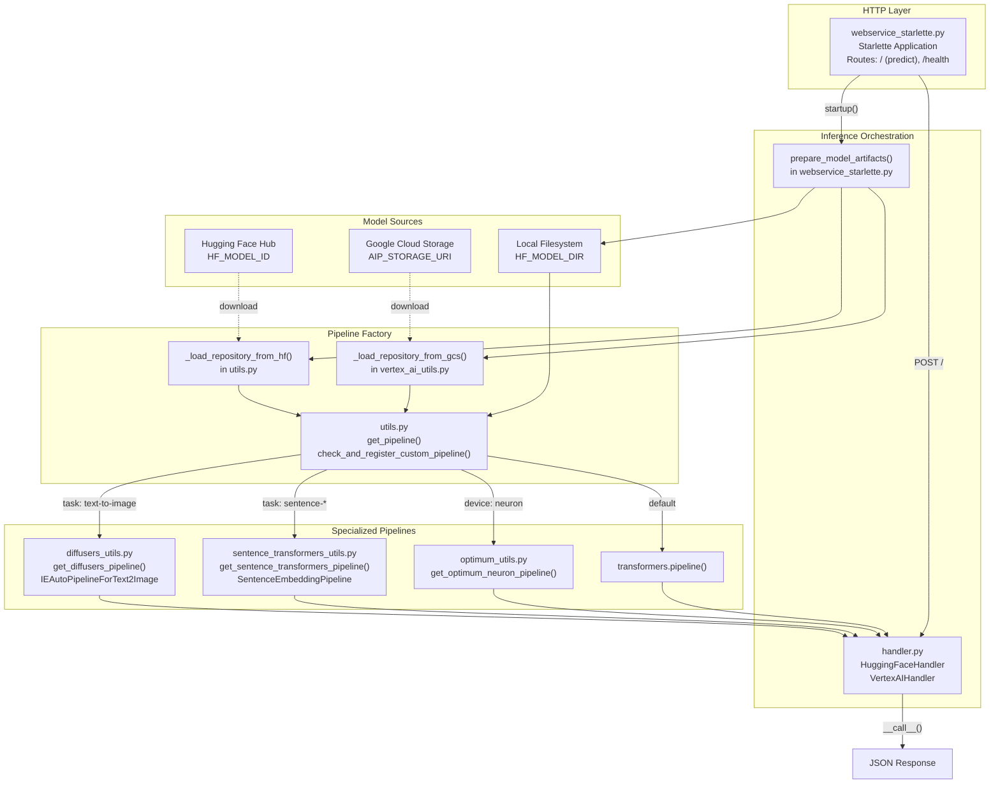

**Sources:** [src/huggingface_inference_toolkit/webservice_starlette.py:1-200](), [src/huggingface_inference_toolkit/handler.py:1-150](), [src/huggingface_inference_toolkit/utils.py:1-300]()

### Request Processing Flow

The following diagram traces how an inference request flows through the system, showing the actual function calls and decision points:

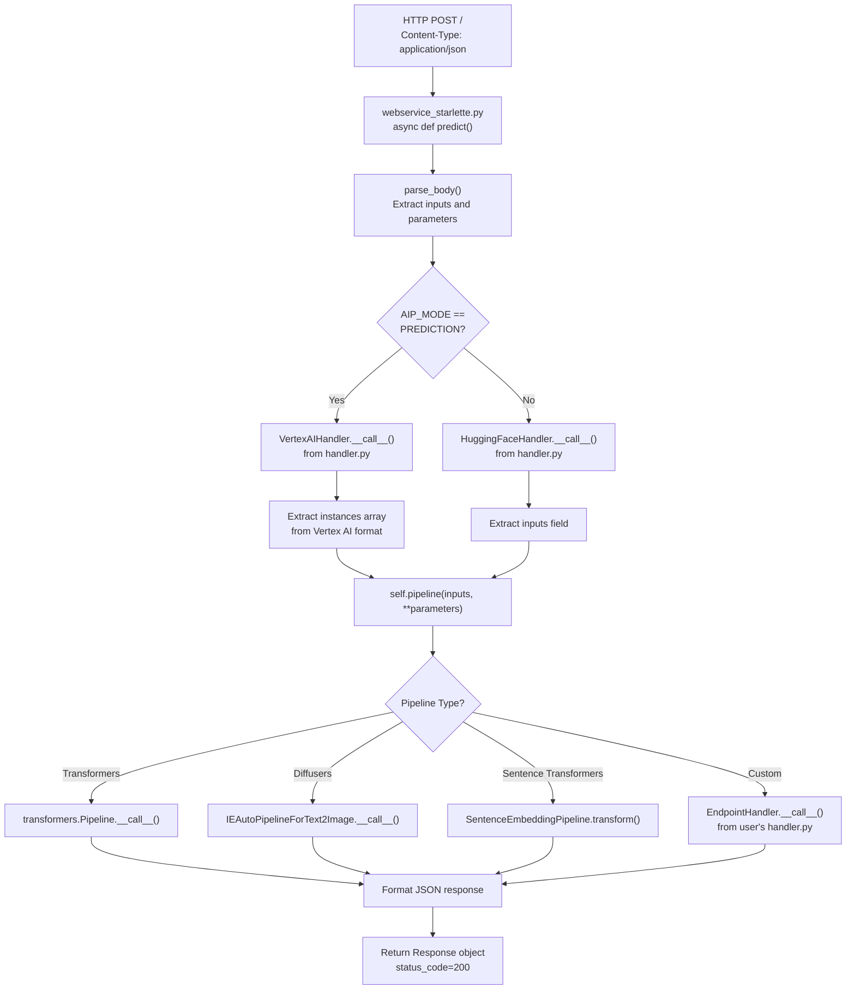

**Sources:** [src/huggingface_inference_toolkit/webservice_starlette.py:80-150](), [src/huggingface_inference_toolkit/handler.py:20-100]()

## Supported Model Types and Tasks

The toolkit provides built-in support for the following task categories:

### Transformers Tasks

| Task Type | Example Models | Pipeline Class |
|-----------|----------------|----------------|
| `text-classification` | DistilBERT, BERT | `TextClassificationPipeline` |
| `question-answering` | RoBERTa, ALBERT | `QuestionAnsweringPipeline` |
| `token-classification` | BERT, RoBERTa | `TokenClassificationPipeline` |
| `summarization` | BART, T5 | `SummarizationPipeline` |
| `translation` | MarianMT, T5 | `TranslationPipeline` |
| `text-generation` | GPT-2, GPT-Neo | `TextGenerationPipeline` |
| `image-classification` | ViT, ResNet | `ImageClassificationPipeline` |
| `object-detection` | DETR, YOLOS | `ObjectDetectionPipeline` |
| `automatic-speech-recognition` | Wav2Vec2, Whisper | `AutomaticSpeechRecognitionPipeline` |
| `audio-classification` | Wav2Vec2 | `AudioClassificationPipeline` |

### Specialized Pipelines

- **Diffusers**: `text-to-image` tasks using Stable Diffusion and similar models (see [Diffusers Integration](#6.1))
- **Sentence Transformers**: `sentence-similarity`, `sentence-embeddings`, `sentence-ranking` (see [Sentence Transformers Support](#6.2))
- **Optimum Neuron**: Hardware-accelerated inference on AWS Inferentia2 (see [AWS Neuron Optimization](#6.3))

For a complete list of supported tasks and validation, see [tests/integ/config.py:1-100]().

**Sources:** [setup.py:15-58](), [README.md:217-221]()

## Deployment Targets

The toolkit supports five primary deployment scenarios, each configured through environment variables:

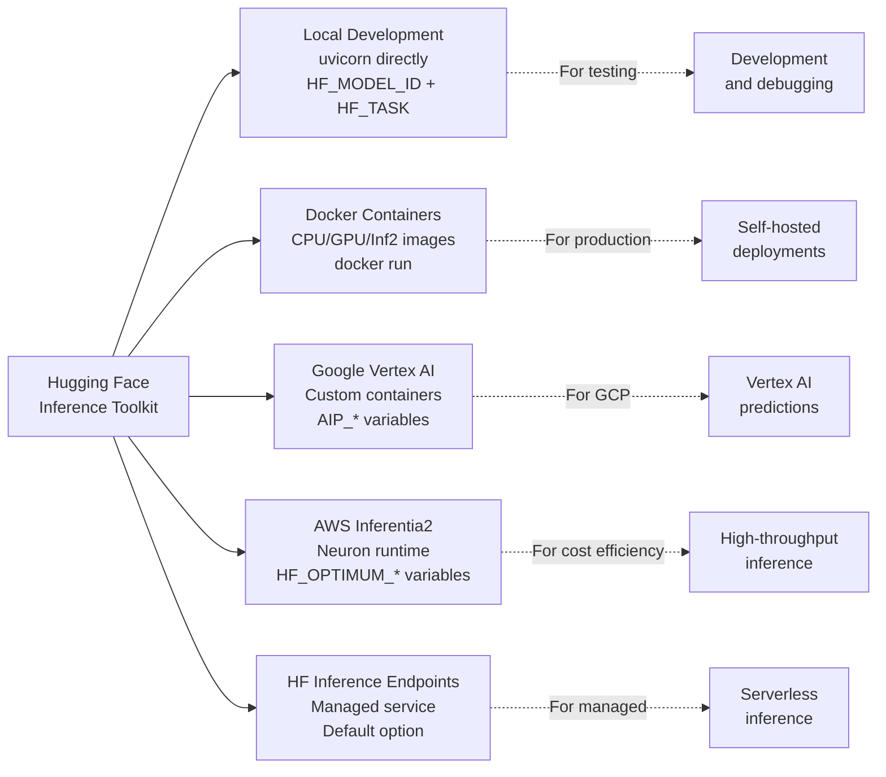

Each deployment target uses the same codebase but is configured differently:

| Target | Configuration | Container Image |
|--------|---------------|-----------------|
| **Local Development** | `HF_MODEL_ID`, `HF_TASK` environment variables | N/A (runs directly) |
| **Docker Standalone** | Environment variables in `docker run` | `inference-pytorch-cpu/gpu` |
| **Vertex AI** | `AIP_MODE=PREDICTION`, `AIP_STORAGE_URI` | Custom container |
| **Inferentia2** | `HF_OPTIMUM_BATCH_SIZE`, `HF_OPTIMUM_SEQUENCE_LENGTH` | `inference-pytorch-inf2` |
| **HF Endpoints** | Managed by platform | Platform-provided |

For detailed deployment instructions, see [Deployment Guide](#5).

**Sources:** [README.md:16-196](), [dockerfiles/]()

## Key Components

The toolkit's codebase is organized around the following core modules:

### Primary Modules

| Module | Path | Purpose |
|--------|------|---------|
| **Web Service** | `src/huggingface_inference_toolkit/webservice_starlette.py` | Starlette HTTP server with `/` (predict) and `/health` endpoints |
| **Handler** | `src/huggingface_inference_toolkit/handler.py` | `HuggingFaceHandler` and `VertexAIHandler` classes for orchestrating inference |
| **Utils** | `src/huggingface_inference_toolkit/utils.py` | `get_pipeline()` factory, model loading from Hub/GCS, custom handler detection |
| **Constants** | `src/huggingface_inference_toolkit/const.py` | Environment variable definitions and defaults |

### Specialized Modules

| Module | Path | Purpose |
|--------|------|---------|
| **Diffusers** | `src/huggingface_inference_toolkit/diffusers_utils.py` | `get_diffusers_pipeline()` for text-to-image generation |
| **Sentence Transformers** | `src/huggingface_inference_toolkit/sentence_transformers_utils.py` | `get_sentence_transformers_pipeline()` for embeddings |
| **Optimum Neuron** | `src/huggingface_inference_toolkit/optimum_utils.py` | `get_optimum_neuron_pipeline()` for Inferentia2 |
| **Vertex AI** | `src/huggingface_inference_toolkit/vertex_ai_utils.py` | `_load_repository_from_gcs()` for GCS model loading |

### Package Definition

The `setup.py` file defines the package structure and optional dependencies:

```
huggingface-inference-toolkit
├── Core dependencies: transformers, huggingface_hub, starlette, uvicorn
├── extras["torch"]: torch, torchvision, torchaudio, peft
├── extras["diffusers"]: diffusers, accelerate
├── extras["st"]: sentence_transformers
├── extras["inf2"]: optimum-neuron
└── extras["google"]: google-cloud-storage
```

Users install only the dependencies needed for their use case. For example, a text classification deployment on CPU requires only the core dependencies plus `extras["torch"]`, while a text-to-image deployment on GPU requires `extras["torch"]` and `extras["diffusers"]`.

**Sources:** [setup.py:1-86](), [src/huggingface_inference_toolkit/]()

## Extension Points

The toolkit provides two primary extension mechanisms:

### Custom Handlers

Users can override default inference behavior by including a `handler.py` file in their model repository. This file must define an `EndpointHandler` class with a `__call__` method:

```python
class EndpointHandler:
    def __init__(self, path: str):
        # Custom initialization
        pass
    
    def __call__(self, data: dict) -> dict:
        # Custom inference logic
        pass
```

The system automatically detects and loads custom handlers via `check_and_register_custom_pipeline()` in [src/huggingface_inference_toolkit/utils.py]().

### Custom Dependencies

Users can include a `requirements.txt` file in their model repository to install additional Python packages at container startup. This enables use of domain-specific libraries not included in the base image.

For implementation details, see [Custom Handlers and Pipelines](#6.4).

**Sources:** [README.md:63-78](), [src/huggingface_inference_toolkit/utils.py:100-200]()

## Next Steps

- To install the toolkit locally or in a container, see [Installation and Setup](#2)
- To understand configuration options, see [Configuration](#3)
- To learn about the system's internal architecture, see [Core Architecture](#4)
- To deploy the toolkit, see [Deployment Guide](#5)

**Sources:** [README.md:1-292](), [setup.py:1-86]()

---

# Page: Installation and Setup

# Installation and Setup

<details>
<summary>Relevant source files</summary>

The following files were used as context for generating this wiki page:

- [pyproject.toml](pyproject.toml)
- [setup.cfg](setup.cfg)
- [setup.py](setup.py)

</details>


This document covers the installation process for the Hugging Face Inference Toolkit, package structure, dependency management, and optional features. It explains how to install the toolkit for different use cases, from basic CPU-only inference to specialized scenarios like Diffusers text-to-image generation or AWS Inferentia2 deployment.

For information about configuring the toolkit after installation, see [Configuration](#3). For deployment-specific setup, see [Deployment Guide](#5).

---

## Basic Installation

The Hugging Face Inference Toolkit is distributed as a Python package named `huggingface-inference-toolkit`. The package can be installed via pip:

```bash
pip install huggingface-inference-toolkit
```

This installs the core package with standard dependencies required for serving Transformers models via HTTP. The package requires Python 3.9 or higher [setup.py:70]().

**Sources:** [setup.py:60-71]()

---

## Package Structure

The toolkit follows a standard Python package layout with source code located in the `src/` directory and the package itself namespaced under `sagemaker_huggingface_inference_toolkit`.

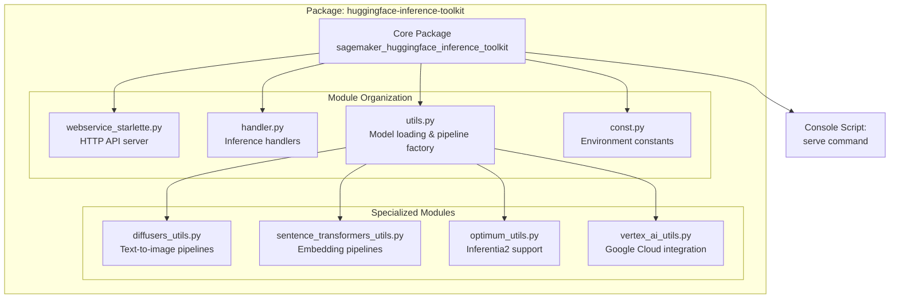

**Package Metadata:**
- **Name:** `huggingface-inference-toolkit` [setup.py:60]()
- **Version:** `0.5.6` [setup.py:8]()
- **License:** Apache License 2.0 [setup.py:71]()
- **Source Directory:** `src/` [setup.py:65]()

The package provides a console entry point `serve` that maps to `sagemaker_huggingface_inference_toolkit.serving:main` [setup.py:69](), which is used to start the inference server.

**Sources:** [setup.py:1-86]()

---

## Core Dependencies

The toolkit has a comprehensive set of core dependencies installed by default. These dependencies enable standard Transformers model serving without requiring additional extras.

### Transformers Ecosystem

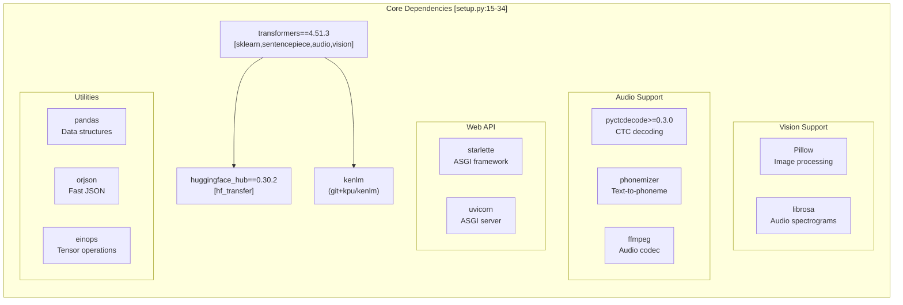

**Key Dependencies:**

| Dependency | Version | Purpose |
|------------|---------|---------|
| `transformers` | 4.51.3 | Core model library with sklearn, sentencepiece, audio, and vision extras [setup.py:19]() |
| `huggingface_hub` | 0.30.2 | Model repository access with hf_transfer for faster downloads [setup.py:20]() |
| `kenlm` | git@ba83eaf | Language modeling (installed from git due to cmake compatibility) [setup.py:16-18]() |
| `starlette` | latest | ASGI web framework [setup.py:29]() |
| `uvicorn` | latest | ASGI server for production [setup.py:30]() |
| `Pillow` | latest | Image processing for vision models [setup.py:22]() |
| `librosa` | latest | Audio feature extraction [setup.py:23]() |
| `pyctcdecode` | ≥0.3.0 | CTC beam search decoding for ASR [setup.py:25]() |
| `phonemizer` | latest | Phoneme conversion for TTS [setup.py:26]() |
| `ffmpeg` | latest | Audio/video codec support [setup.py:27]() |

**Note on KenLM:** The toolkit installs KenLM from a specific git commit to work around a cmake error affecting the main branch. This is consistent with a patch in Transformers [setup.py:16-18]().

**Sources:** [setup.py:15-34]()

---

## Optional Extras

The toolkit uses setuptools extras to provide optional functionality. Each extra installs additional dependencies required for specific use cases. This modular approach minimizes installation size for users who don't need all features.

### Installation with Extras

To install with one or more extras:

```bash
# Single extra
pip install huggingface-inference-toolkit[torch]

# Multiple extras
pip install huggingface-inference-toolkit[torch,diffusers,st]

# All extras
pip install huggingface-inference-toolkit[torch,diffusers,st,inf2,google,test,quality]
```

### Extras Reference

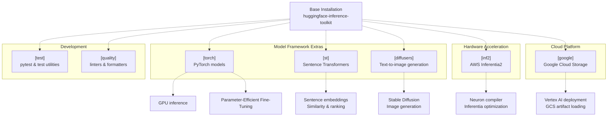

| Extra | Dependencies | Use Case | Details |
|-------|-------------|----------|---------|
| **`torch`** | `torch==2.5.1`<br/>`torchvision`<br/>`torchaudio`<br/>`peft==0.15.1` | PyTorch model inference, GPU acceleration, PEFT adapters | Required for most models. Includes PEFT for parameter-efficient fine-tuning [setup.py:42](). |
| **`st`** | `sentence_transformers==4.0.2` | Sentence embeddings, similarity, ranking tasks | Required for `sentence-similarity`, `sentence-embeddings`, and `sentence-ranking` tasks [setup.py:38](). See [Sentence Transformers Support](#6.2). |
| **`diffusers`** | `diffusers==0.33.1`<br/>`accelerate==1.6.0` | Text-to-image generation, Stable Diffusion models | Required for `text-to-image` task [setup.py:39](). See [Diffusers Integration](#6.1). |
| **`inf2`** | `optimum-neuron` | AWS Inferentia2 deployment | Required for running on AWS Inf2 instances [setup.py:56](). See [AWS Inferentia2 Deployment](#5.4). |
| **`google`** | `google-cloud-storage`<br/>`crcmod==1.7` | Google Vertex AI deployment, GCS model artifacts | Required for Vertex AI custom containers [setup.py:57](). See [Google Vertex AI Deployment](#5.3). |
| **`test`** | `pytest==7.2.1`<br/>`pytest-xdist`<br/>`parameterized`<br/>`psutil`<br/>`datasets`<br/>`pytest-sugar`<br/>`mock==2.0.0`<br/>`docker`<br/>`requests`<br/>`tenacity` | Running test suite | Required for developers contributing to the toolkit [setup.py:43-54](). See [Testing](#8). |
| **`quality`** | `isort`<br/>`ruff` | Code formatting and linting | Required for developers to run quality checks [setup.py:55](). See [Development Guide](#10). |

**Important:** The `torch` extra includes `peft` as a dependency because PEFT requires PyTorch. If `peft` were a core dependency, PyTorch would be installed even without the `torch` extra, which would conflict with users who want TensorFlow-only installations [setup.py:40-42]().

**Sources:** [setup.py:36-57]()

---

## System Requirements

### Python Version

The toolkit requires Python 3.9 or higher [setup.py:70](). Supported versions include:
- Python 3.9
- Python 3.10
- Python 3.11
- Python 3.12

**Sources:** [setup.py:70-83]()

### Ubuntu System Packages

For full audio processing capabilities, the following Ubuntu packages must be installed at the system level:

```bash
# Required for torchaudio
apt install libsndfile1-dev

# Required for audio processing (ffmpeg)
apt install ffmpeg

# Additional codecs for ffmpeg
apt install libavcodec-extra
```

**Rationale:**
- **`libsndfile1-dev`:** torchaudio requires the development version of the libsndfile package for audio I/O operations [setup.py:11]()
- **`ffmpeg`:** Required for audio preprocessing and format conversion [setup.py:12]()
- **`libavcodec-extra`:** Provides additional codec support for ffmpeg [setup.py:13]()

These packages are typically pre-installed in the toolkit's Docker images but must be installed separately for local development.

**Sources:** [setup.py:10-13]()

---

## Development Setup

For contributors or users who want to run tests and quality checks, install the toolkit with development extras:

```bash
# Clone the repository
git clone https://github.com/huggingface/huggingface-inference-toolkit
cd huggingface-inference-toolkit

# Install in editable mode with all development dependencies
pip install -e ".[torch,diffusers,st,test,quality]"
```

### Development Tools Configuration

The toolkit uses several development tools configured via `pyproject.toml` and `setup.cfg`:

**Tool Configuration Overview:**

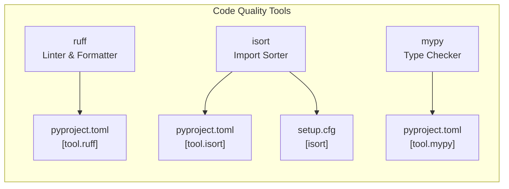

#### Ruff Configuration

Ruff handles linting and formatting with the following settings:
- **Line length:** 119 characters [pyproject.toml:8]()
- **Target version:** Python 3.11 [pyproject.toml:10]()
- **Enabled rules:** pycodestyle errors (E), warnings (W), pyflakes (F), isort (I), flake8-comprehensions (C), flake8-bugbear (B) [pyproject.toml:13-20]()
- **Ignored rules:** E501 (line length, handled by formatter), B008, C901 [pyproject.toml:21-25]()

#### Isort Configuration

Import sorting is configured via both `pyproject.toml` and `setup.cfg`:
- **Profile:** black-compatible [pyproject.toml:31]()
- **Line length:** 119 characters [setup.cfg:14]()
- **Multi-line mode:** Vertical hanging indent (mode 3) [setup.cfg:16]()
- **Known third-party:** `transformers`, `starlette`, `huggingface_hub` [pyproject.toml:32]()

#### MyPy Configuration

Type checking configuration:
- **Ignore missing imports:** true [pyproject.toml:2]()
- **No implicit optional:** true [pyproject.toml:3]()
- **Scripts are modules:** true [pyproject.toml:4]()

**Running Quality Checks:**

```bash
# Run ruff linter
ruff check src/

# Run ruff formatter
ruff format src/

# Run isort
isort src/

# Run mypy
mypy src/
```

**Sources:** [pyproject.toml:1-33](), [setup.cfg:1-22]()

---

## Installation Verification

After installation, verify the toolkit is correctly installed:

```bash
# Check package version
python -c "import sagemaker_huggingface_inference_toolkit; print(sagemaker_huggingface_inference_toolkit.__version__)"

# Verify serve command is available
which serve

# Test import of core modules
python -c "from sagemaker_huggingface_inference_toolkit import utils, handler, webservice_starlette"
```

For local development and testing, see [Local Development](#5.1). For running the test suite, see [Testing](#8).

**Sources:** [setup.py:60-86]()

---

# Page: Configuration

# Configuration

<details>
<summary>Relevant source files</summary>

The following files were used as context for generating this wiki page:

- [README.md](README.md)
- [src/huggingface_inference_toolkit/const.py](src/huggingface_inference_toolkit/const.py)
- [src/huggingface_inference_toolkit/webservice_starlette.py](src/huggingface_inference_toolkit/webservice_starlette.py)
- [tests/unit/test_const.py](tests/unit/test_const.py)

</details>


This page documents all environment variables and configuration options that control the Hugging Face Inference Toolkit's runtime behavior. Configuration determines how models are loaded, which inference pipelines are selected, and how the toolkit adapts to different deployment platforms.

For information about the deployment-specific setup procedures, see [Deployment Guide](#5). For details about the web service endpoints that respond to these configurations, see [Web Service Layer](#4.1).

## Overview

The toolkit's behavior is controlled entirely through environment variables, with no configuration files required. All configuration constants are centralized in [src/huggingface_inference_toolkit/const.py:1-19]() and imported throughout the codebase. The configuration system supports:

- Model source specification (Hugging Face Hub, local directory, or cloud storage)
- Task and framework selection for pipeline initialization
- Platform-specific adaptations (Google Vertex AI, AWS Inferentia2)
- Custom handler discovery
- Security and authentication settings

Sources: [src/huggingface_inference_toolkit/const.py:1-19](), [README.md:199-278]()

## Configuration Architecture

The following diagram shows how environment variables flow from their definition in `const.py` through the application initialization and into runtime components:

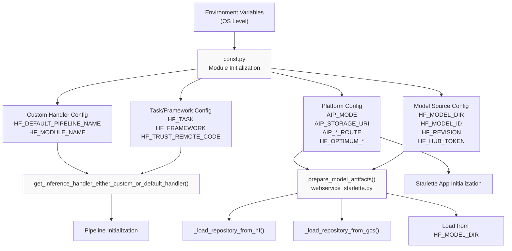

Sources: [src/huggingface_inference_toolkit/const.py:1-19](), [src/huggingface_inference_toolkit/webservice_starlette.py:33-67]()

## Configuration Variables Reference

### Model Source Configuration

These variables determine where the model artifacts are located and how they should be loaded.

| Variable | Type | Default | Required | Description |
|----------|------|---------|----------|-------------|
| `HF_MODEL_DIR` | string | `/opt/huggingface/model` | No | Directory where model artifacts are stored or will be downloaded to |
| `HF_MODEL_ID` | string | `None` | Conditional | Hugging Face Hub model identifier (e.g., `distilbert-base-uncased`) |
| `HF_REVISION` | string | `None` | No | Git revision/commit hash to pin specific model version |
| `HF_HUB_TOKEN` | string | `None` | Conditional | Hugging Face API token for accessing private models |

**Usage Rules:**
- If `HF_MODEL_DIR` contains model artifacts, the toolkit uses them directly
- If `HF_MODEL_DIR` is empty and `HF_MODEL_ID` is set, the model is downloaded from the Hub to `HF_MODEL_DIR`
- If neither is properly configured, the toolkit checks for `AIP_STORAGE_URI` (Vertex AI mode)
- `HF_HUB_TOKEN` is required for private models on the Hub
- `HF_REVISION` should be a full commit hash for reproducible deployments

Sources: [src/huggingface_inference_toolkit/const.py:6-11](), [README.md:203-245](), [src/huggingface_inference_toolkit/webservice_starlette.py:36-59]()

### Task and Framework Configuration

These variables control which inference pipeline is initialized and how the model is loaded.

| Variable | Type | Default | Required | Description |
|----------|------|---------|----------|-------------|
| `HF_TASK` | string | `None` | Yes | Task type for pipeline selection (e.g., `text-classification`, `text-to-image`) |
| `HF_FRAMEWORK` | string | `None` | No | Deep learning framework (`pytorch`, `tensorflow`, or `onnx`) |
| `HF_TRUST_REMOTE_CODE` | boolean | `"0"` | No | Whether to trust and execute remote code from Hub models |

**Framework Detection:**
- If `HF_FRAMEWORK` is not set, the toolkit automatically detects the framework from model artifacts
- Setting `HF_FRAMEWORK` explicitly improves Hub download efficiency by filtering unnecessary files
- Valid values: `"pytorch"`, `"tensorflow"`, `"onnx"`

**Security Considerations:**
- `HF_TRUST_REMOTE_CODE` defaults to `"0"` (false) for security
- Set to `"1"` to enable loading models with custom modeling code
- Only enable for trusted model sources

Sources: [src/huggingface_inference_toolkit/const.py:8-12](), [README.md:215-261]()

### Custom Handler Configuration

These variables control custom inference handler discovery and loading.

| Variable | Type | Default | Required | Description |
|----------|------|---------|----------|-------------|
| `HF_DEFAULT_PIPELINE_NAME` | string | `handler.py` | No | Filename for custom handler script in model directory |
| `HF_MODULE_NAME` | string | `handler.EndpointHandler` | No | Python module path to custom handler class |

**Handler Resolution:**
The toolkit searches for custom handlers in this order:
1. `{HF_MODEL_DIR}/{HF_DEFAULT_PIPELINE_NAME}` containing `EndpointHandler` class
2. `{HF_MODEL_DIR}/pipeline.py` containing `PreTrainedPipeline` class (legacy)
3. Falls back to default pipeline based on `HF_TASK`

**Module Name Format:**
- Derived from `HF_DEFAULT_PIPELINE_NAME`: `{stem}.EndpointHandler`
- Example: `handler.py` → `handler.EndpointHandler`
- Example: `custom.py` → `custom.EndpointHandler`

Sources: [src/huggingface_inference_toolkit/const.py:13-18](), [README.md:63-78]()

### Google Vertex AI Configuration

These variables are automatically set by Vertex AI and control the toolkit's behavior in that environment.

| Variable | Type | Default | Required | Description |
|----------|------|---------|----------|-------------|
| `AIP_MODE` | string | `None` | No | Set to `PREDICTION` by Vertex AI to enable prediction mode |
| `AIP_STORAGE_URI` | string | `None` | Conditional | GCS URI containing model artifacts (e.g., `gs://bucket/path`) |
| `AIP_PREDICT_ROUTE` | string | `None` | Yes* | HTTP route for prediction endpoint (e.g., `/predict`) |
| `AIP_HEALTH_ROUTE` | string | `None` | Yes* | HTTP route for health check endpoint (e.g., `/health`) |
| `AIP_HTTP_PORT` | string | `None` | No | Port number for the HTTP server |

*Required when `AIP_MODE=PREDICTION`

**Vertex AI Behavior:**
When `AIP_MODE=PREDICTION`, the toolkit:
1. Changes route structure to use `AIP_PREDICT_ROUTE` and `AIP_HEALTH_ROUTE`
2. Disables the `/metrics` endpoint
3. Supports loading model artifacts from GCS via `AIP_STORAGE_URI`

Sources: [src/huggingface_inference_toolkit/webservice_starlette.py:143-160](), [README.md:80-129]()

### AWS Inferentia2 Configuration

These variables control model compilation and inference on AWS Inferentia2 accelerators.

| Variable | Type | Default | Required | Description |
|----------|------|---------|----------|-------------|
| `HF_OPTIMUM_BATCH_SIZE` | integer | `1` | Conditional | Static batch size for Neuron compilation |
| `HF_OPTIMUM_SEQUENCE_LENGTH` | integer | `None` | Conditional | Static sequence length for Neuron compilation |

**Compilation Modes:**
The toolkit supports three modes for Inferentia2:

1. **Pre-compiled model from Hub:** Model repository contains `.neuron` artifacts
   - No compilation variables required
   - Example: `HF_MODEL_ID=optimum/bge-base-en-v1.5-neuronx`

2. **Runtime compilation:** Compile model on first startup
   - Both `HF_OPTIMUM_BATCH_SIZE` and `HF_OPTIMUM_SEQUENCE_LENGTH` required
   - Model artifacts cached for subsequent startups
   - Example: `HF_OPTIMUM_BATCH_SIZE=1 HF_OPTIMUM_SEQUENCE_LENGTH=128`

3. **Config-based compilation:** Compilation parameters in model's `config.json`
   - `config.json` contains `neuron` dictionary with `static_batch_size` and `static_sequence_length`
   - No environment variables required

**Important Notes:**
- Input shapes are static and must be known at compilation time
- Compiled models are tied to specific batch size and sequence length
- Recompilation occurs if shapes change

Sources: [README.md:131-196]()

## Configuration Flow Diagram

The following diagram illustrates the decision tree for model loading based on configuration variables:

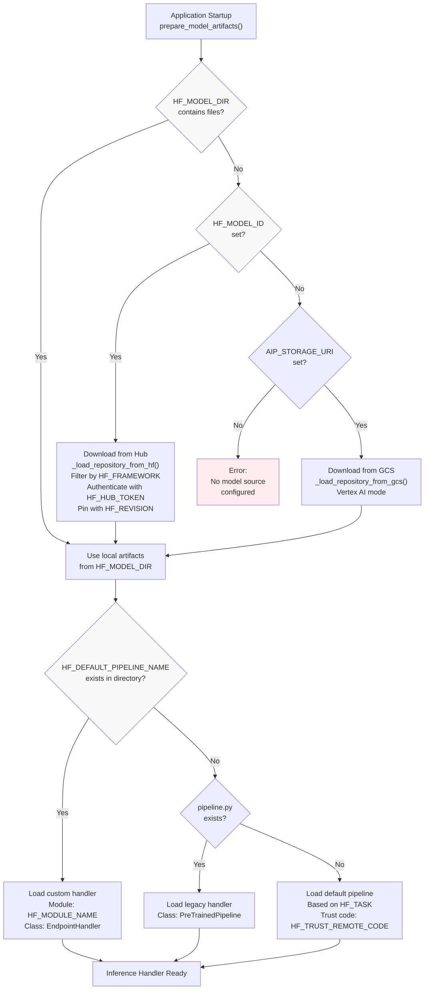

Sources: [src/huggingface_inference_toolkit/webservice_starlette.py:33-67](), [src/huggingface_inference_toolkit/const.py:1-19]()

## Configuration Examples

### Standard Deployment

Basic deployment with a public Hub model:

```bash
HF_MODEL_ID=distilbert-base-uncased-finetuned-sst-2-english
HF_TASK=text-classification
```

### Private Model with Authentication

Accessing a private model from the Hub:

```bash
HF_MODEL_ID=myorg/private-model
HF_TASK=text-generation
HF_HUB_TOKEN=hf_xxxxxxxxxxxxxxxxxxxxxxxxxxxxx
HF_REVISION=03b4d196c19d0a73c7e0322684e97db1ec397613
```

### Local Model Directory

Using pre-downloaded model artifacts:

```bash
HF_MODEL_DIR=/mnt/models/my-model
HF_TASK=question-answering
```

### Vertex AI Deployment

Configuration for Google Vertex AI (most variables set by platform):

```bash
AIP_MODE=PREDICTION
AIP_HTTP_PORT=8080
AIP_PREDICT_ROUTE=/predict
AIP_HEALTH_ROUTE=/health
AIP_STORAGE_URI=gs://my-bucket/models/my-model
HF_TASK=text-classification
```

### AWS Inferentia2 with Runtime Compilation

Deploying on Inferentia2 with on-the-fly compilation:

```bash
HF_MODEL_ID=distilbert-base-uncased-finetuned-sst-2-english
HF_TASK=text-classification
HF_OPTIMUM_BATCH_SIZE=1
HF_OPTIMUM_SEQUENCE_LENGTH=128
```

### Custom Handler with Framework Selection

Using a custom handler with specific framework:

```bash
HF_MODEL_DIR=/opt/models/custom-model
HF_TASK=text-classification
HF_FRAMEWORK=pytorch
HF_DEFAULT_PIPELINE_NAME=inference.py
HF_MODULE_NAME=inference.CustomHandler
```

Sources: [README.md:16-196]()

## Configuration Validation

The following table summarizes configuration validation rules enforced at startup:

| Condition | Validation | Error Message |
|-----------|------------|---------------|
| Model source | At least one of `HF_MODEL_DIR` (non-empty), `HF_MODEL_ID`, or `AIP_STORAGE_URI` must be set | `Can't initialize model. Please set env HF_MODEL_DIR or provider a HF_MODEL_ID.` |
| Vertex AI routes | When `AIP_MODE=PREDICTION`, both `AIP_PREDICT_ROUTE` and `AIP_HEALTH_ROUTE` required | `AIP_PREDICT_ROUTE and AIP_HEALTH_ROUTE need to be set in Vertex AI environment` |
| Custom handler | If `HF_DEFAULT_PIPELINE_NAME` set, file must exist in `HF_MODEL_DIR` | Handler falls back to default pipeline |
| Inferentia2 | For runtime compilation, both `HF_OPTIMUM_BATCH_SIZE` and `HF_OPTIMUM_SEQUENCE_LENGTH` recommended | May fail at compilation if shapes not specified |

Sources: [src/huggingface_inference_toolkit/webservice_starlette.py:54-59](), [src/huggingface_inference_toolkit/webservice_starlette.py:148-151]()

## Environment Variable to Code Entity Mapping

The following diagram maps configuration variables to the specific code locations where they are consumed:

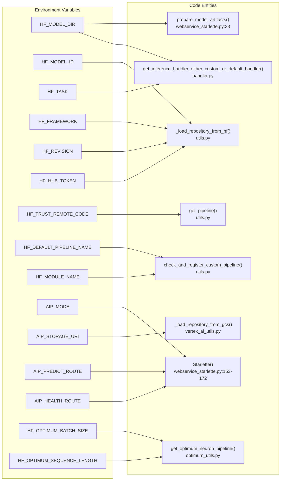

Sources: [src/huggingface_inference_toolkit/const.py:1-19](), [src/huggingface_inference_toolkit/webservice_starlette.py:1-173]()

## Configuration Precedence

When multiple configuration methods are available, the toolkit follows this precedence order:

1. **Explicit environment variables** - Highest priority
2. **Platform-injected variables** (e.g., `AIP_*` from Vertex AI) - Second priority
3. **Default values in const.py** - Lowest priority

Example scenario: If both `HF_MODEL_DIR` contains files AND `HF_MODEL_ID` is set, the local directory takes precedence and no Hub download occurs.

Sources: [src/huggingface_inference_toolkit/webservice_starlette.py:36-59]()

## Related Configuration Files

While runtime behavior is controlled by environment variables, the following files define package-level configuration:

| File | Purpose | Key Content |
|------|---------|-------------|
| `setup.py` | Package dependencies and optional extras | Defines `torch`, `st`, `diffusers`, `inf2`, `google` extras |
| `pyproject.toml` | Development tool configuration | Configures `isort`, `ruff`, `pytest` |
| `.env` (not in repo) | Local development environment variables | User-created file for local testing |

For information about installing optional dependencies, see [Installation and Setup](#2).

Sources: [README.md:9-14]()

---

# Page: Core Architecture

# Core Architecture

<details>
<summary>Relevant source files</summary>

The following files were used as context for generating this wiki page:

- [src/huggingface_inference_toolkit/const.py](src/huggingface_inference_toolkit/const.py)
- [src/huggingface_inference_toolkit/handler.py](src/huggingface_inference_toolkit/handler.py)
- [src/huggingface_inference_toolkit/utils.py](src/huggingface_inference_toolkit/utils.py)
- [src/huggingface_inference_toolkit/webservice_starlette.py](src/huggingface_inference_toolkit/webservice_starlette.py)
- [tests/unit/test_const.py](tests/unit/test_const.py)

</details>


## Purpose and Scope

This document describes the overall system architecture of the Hugging Face Inference Toolkit, including the relationships between core components and the data flow through the inference pipeline. It covers the three primary architectural layers: the HTTP web service, the handler abstraction, and the pipeline factory system.

For specific deployment configurations and environment variables, see [Configuration](#3). For details about individual pipeline types (Diffusers, Sentence Transformers, Optimum Neuron), see [Specialized Pipeline Support](#6). For HTTP API schemas and endpoints, see [API Reference](#7).

## System Overview

The Hugging Face Inference Toolkit follows a three-tier architecture where HTTP requests flow through a web service layer, are processed by inference handlers, and are executed by task-specific pipelines. The system is designed to support multiple model types, frameworks, and deployment platforms through a unified interface.

### Core Components

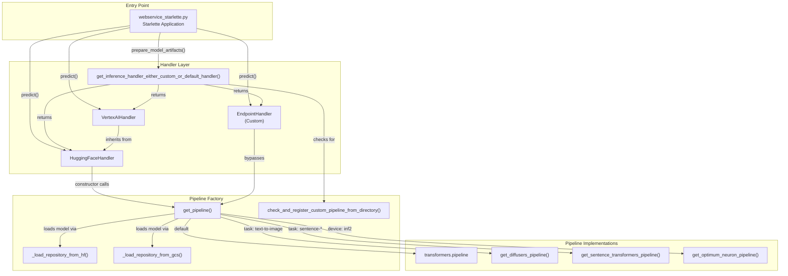

**Sources:** [src/huggingface_inference_toolkit/webservice_starlette.py:33-67](), [src/huggingface_inference_toolkit/handler.py:141-159](), [src/huggingface_inference_toolkit/utils.py:206-263]()

| Component | File | Primary Responsibility |
|-----------|------|------------------------|
| `Starlette` app | `webservice_starlette.py` | HTTP endpoint routing, request deserialization, response serialization |
| `get_inference_handler_either_custom_or_default_handler()` | `handler.py` | Selects appropriate handler based on environment and custom handler presence |
| `HuggingFaceHandler` | `handler.py` | Default handler for standard inference requests |
| `VertexAIHandler` | `handler.py` | Vertex AI-specific handler with batch instance processing |
| `EndpointHandler` | Custom `handler.py` | User-defined custom inference logic |
| `get_pipeline()` | `utils.py` | Pipeline factory that selects and instantiates task-specific pipelines |
| `_load_repository_from_hf()` | `utils.py` | Downloads models from Hugging Face Hub |
| `_load_repository_from_gcs()` | `vertex_ai_utils.py` | Downloads models from Google Cloud Storage |

## Request Processing Flow

The following diagram shows the complete lifecycle of an inference request from HTTP entry to response serialization:

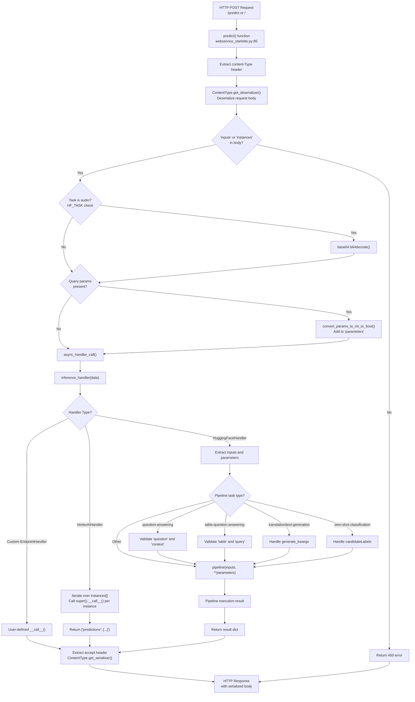

**Sources:** [src/huggingface_inference_toolkit/webservice_starlette.py:85-139](), [src/huggingface_inference_toolkit/handler.py:29-106](), [src/huggingface_inference_toolkit/handler.py:120-138]()

### Request Processing Steps

1. **Request Reception** - The `predict()` function in `webservice_starlette.py` receives the HTTP POST request [webservice_starlette.py:85]().

2. **Content Deserialization** - The `content-Type` header determines the deserialization strategy. The system uses `ContentType.get_deserializer()` to parse the request body [webservice_starlette.py:88-92]().

3. **Schema Validation** - The deserialized body must contain either `inputs` or `instances` key [webservice_starlette.py:94-97]().

4. **Audio Preprocessing** - For audio tasks (`automatic-speech-recognition`, `audio-classification`), base64-encoded inputs are decoded [webservice_starlette.py:100-107]().

5. **Parameter Handling** - Query parameters are converted to integers or booleans and merged into the `parameters` dict [webservice_starlette.py:110-113]().

6. **Asynchronous Handler Call** - The request is passed to `async_handler_call()` which manages thread pool execution [webservice_starlette.py:118]().

7. **Handler Execution** - The appropriate handler (`HuggingFaceHandler`, `VertexAIHandler`, or custom) processes the request [handler.py:29-106]().

8. **Response Serialization** - The result is serialized according to the `accept` header and returned [webservice_starlette.py:125-132]().

## Component Interactions

### Startup Sequence

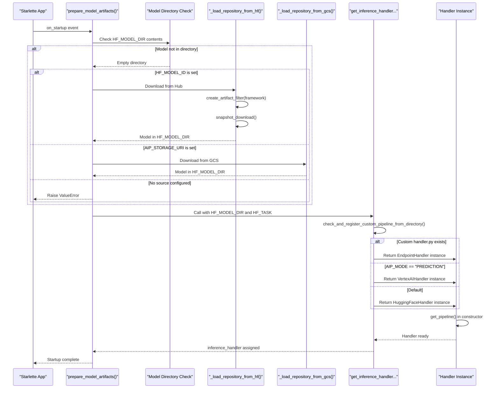

**Sources:** [src/huggingface_inference_toolkit/webservice_starlette.py:33-66](), [src/huggingface_inference_toolkit/handler.py:141-159](), [src/huggingface_inference_toolkit/utils.py:105-149]()

### Runtime Request Handling

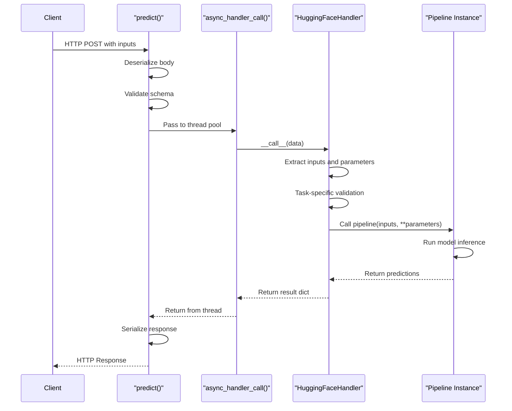

**Sources:** [src/huggingface_inference_toolkit/webservice_starlette.py:85-139](), [src/huggingface_inference_toolkit/handler.py:29-106]()

## Model Loading Architecture

The system supports three model loading strategies, evaluated in order during the `prepare_model_artifacts()` startup phase:

### Loading Priority

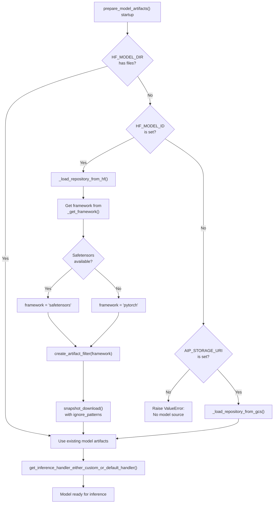

**Sources:** [src/huggingface_inference_toolkit/webservice_starlette.py:33-66](), [src/huggingface_inference_toolkit/utils.py:105-149](), [src/huggingface_inference_toolkit/const.py:6-11]()

### Framework-Specific Artifact Filtering

The `create_artifact_filter()` function generates regex patterns to exclude unnecessary model files based on the target framework. This reduces download time and storage requirements [utils.py:58-69]().

| Framework | Pattern | Files Included | Files Excluded |
|-----------|---------|----------------|----------------|
| `pytorch` | `pytorch*` | `pytorch_model.bin`, `model.safetensors` | TensorFlow, ONNX, Flax weights |
| `tensorflow` | `tf*` | `tf_model.h5`, `saved_model.pb` | PyTorch, ONNX, Flax weights |
| `onnx` | `*onnx*` | `model.onnx` | Framework-specific weights |
| `safetensors` | `*safetensors` | `model.safetensors` | Legacy weight formats |

The `framework2weight` mapping defines all recognized patterns [utils.py:41-55]().

### Environment Variables for Model Loading

| Variable | Source File | Purpose | Default |
|----------|-------------|---------|---------|
| `HF_MODEL_DIR` | `const.py:6` | Local directory for model artifacts | `/opt/huggingface/model` |
| `HF_MODEL_ID` | `const.py:7` | Hugging Face Hub repository identifier | `None` |
| `HF_REVISION` | `const.py:10` | Git commit hash or branch name | `None` (latest) |
| `HF_HUB_TOKEN` | `const.py:11` | Authentication token for private repos | `None` |
| `HF_FRAMEWORK` | `const.py:9` | Explicit framework selection | Auto-detected |
| `AIP_STORAGE_URI` | N/A | Google Cloud Storage URI for Vertex AI | `None` |

**Sources:** [src/huggingface_inference_toolkit/const.py:1-18]()

## Pipeline Selection Logic

The `get_pipeline()` function implements a decision tree that selects the appropriate pipeline implementation based on hardware availability, task type, and custom handler presence [utils.py:206-263]().

### Pipeline Selection Decision Tree

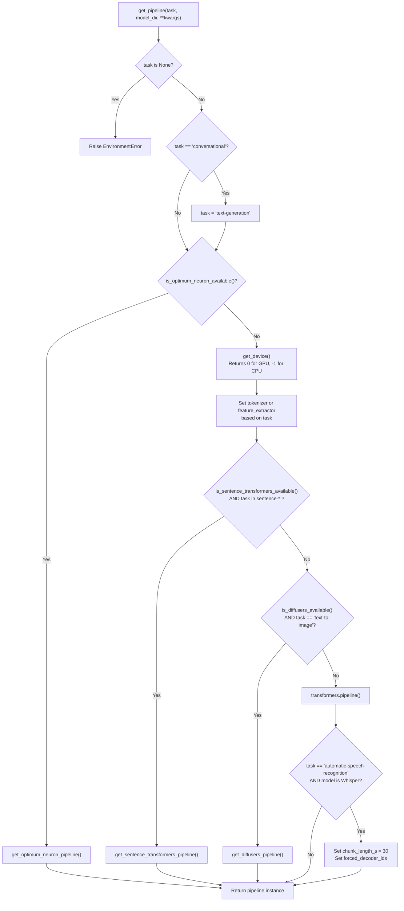

**Sources:** [src/huggingface_inference_toolkit/utils.py:206-263]()

### Device Detection

The `get_device()` function returns the appropriate device identifier for pipeline initialization [utils.py:194-203]():

- Returns `0` if GPU is available (CUDA for PyTorch, GPU device for TensorFlow)
- Returns `-1` for CPU-only execution
- GPU availability checked via `torch.cuda.is_available()` or `tf.config.list_physical_devices("GPU")`

### Task-Specific Pipeline Routing

| Task Category | Condition | Pipeline Function | Source File |
|---------------|-----------|-------------------|-------------|
| AWS Inferentia2 | `is_optimum_neuron_available()` returns `True` | `get_optimum_neuron_pipeline()` | `optimum_utils.py` |
| Sentence Embeddings | Task in `["sentence-similarity", "sentence-embeddings", "sentence-ranking", "text-ranking"]` | `get_sentence_transformers_pipeline()` | `sentence_transformers_utils.py` |
| Text-to-Image | Task is `"text-to-image"` | `get_diffusers_pipeline()` | `diffusers_utils.py` |
| Standard Tasks | All other tasks | `transformers.pipeline()` | `transformers` library |

**Sources:** [src/huggingface_inference_toolkit/utils.py:222-256]()

### Custom Pipeline Override

Before any standard pipeline selection, the system checks for custom handler implementations [utils.py:152-191]():

1. **Primary Custom Handler** - Looks for `handler.py` in the model directory, expecting an `EndpointHandler` class [utils.py:157-170]()
2. **Legacy Custom Handler** - Falls back to `pipeline.py` with a `PreTrainedPipeline` class [utils.py:172-187]()
3. **No Custom Handler** - Proceeds with standard pipeline selection [utils.py:189-191]()

The custom handler path is configured via the `HF_DEFAULT_PIPELINE_NAME` environment variable (defaults to `"handler.py"`) [const.py:14]().

## Handler Abstraction

The handler layer provides a uniform interface between the web service and the underlying pipelines, handling request preprocessing, task-specific parameter transformations, and response formatting.

### Handler Class Hierarchy

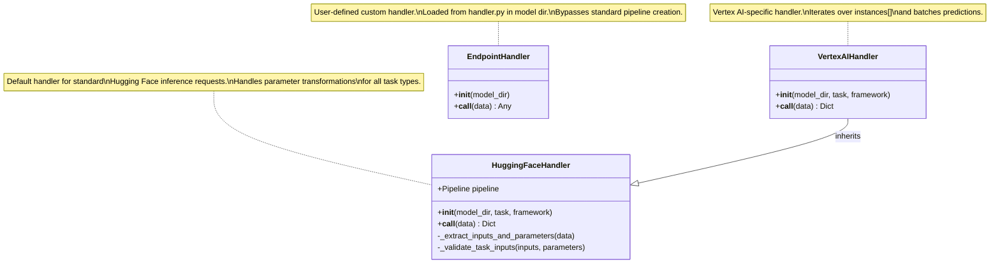

**Sources:** [src/huggingface_inference_toolkit/handler.py:13-159]()

### HuggingFaceHandler Request Processing

The `HuggingFaceHandler.__call__()` method implements task-specific input transformations [handler.py:29-106]():

#### Input Extraction
```python
inputs = data.pop("inputs", data)
parameters = data.pop("parameters", {})
```
[handler.py:36-37]()

#### Task-Specific Transformations

| Task Type | Transformation | Lines |
|-----------|----------------|-------|
| `question-answering` | Validates `question` and `context` keys exist | [handler.py:53-60]() |
| `table-question-answering` | Renames `question` to `query`, validates `table` key | [handler.py:62-71]() |
| `translation` / `text-generation` | Moves `generation_parameters` to `generate_kwargs` | [handler.py:73-82]() |
| `zero-shot-classification` | Renames `candidateLabels` to `candidate_labels`, wraps text in `sequences` | [handler.py:90-102]() |
| Sentence Transformers | Passes inputs directly without parameters | [handler.py:40-45]() |
| Diffusers | Supports both dict and string inputs with parameters | [handler.py:47-51]() |

### VertexAIHandler Batch Processing

The `VertexAIHandler` extends `HuggingFaceHandler` to support Vertex AI's batch prediction format [handler.py:109-138]():

1. Validates `instances` key exists in request [handler.py:127-128]()
2. Extracts shared `parameters` from request [handler.py:129]()
3. Iterates over each instance in the `instances` array [handler.py:133]()
4. Constructs individual payload: `{"inputs": instance, "parameters": parameters}` [handler.py:134]()
5. Calls parent `HuggingFaceHandler.__call__()` for each instance [handler.py:135]()
6. Wraps results in `{"predictions": [...]}` response format [handler.py:138]()

This enables Vertex AI to send multiple instances in a single request while maintaining the standard Hugging Face inference interface for each individual prediction.

### Handler Selection Strategy

The `get_inference_handler_either_custom_or_default_handler()` function determines which handler to instantiate [handler.py:141-159]():

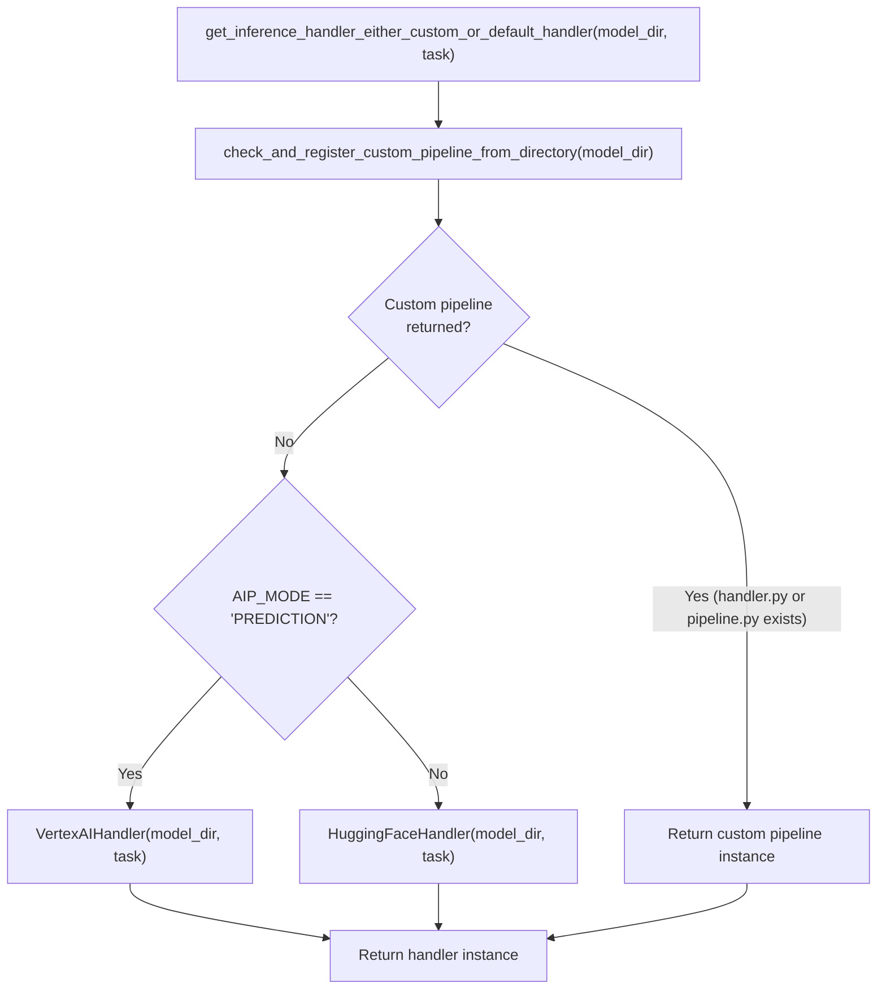

**Sources:** [src/huggingface_inference_toolkit/handler.py:141-159]()

## Configuration System

The core architecture relies on environment variables defined in `const.py` for runtime configuration [const.py:1-18]().

### Configuration Loading

All configuration values are loaded at module import time and stored as module-level constants:

| Constant | Environment Variable | Type | Default | Purpose |
|----------|---------------------|------|---------|---------|
| `HF_MODEL_DIR` | `HF_MODEL_DIR` | `str` | `/opt/huggingface/model` | Local storage path for model artifacts |
| `HF_MODEL_ID` | `HF_MODEL_ID` | `str \| None` | `None` | Hugging Face Hub repository identifier |
| `HF_TASK` | `HF_TASK` | `str \| None` | `None` | ML task type (e.g., `text-classification`) |
| `HF_FRAMEWORK` | `HF_FRAMEWORK` | `str \| None` | `None` | DL framework (`pytorch`, `tensorflow`) |
| `HF_REVISION` | `HF_REVISION` | `str \| None` | `None` | Git revision (commit hash, branch, tag) |
| `HF_HUB_TOKEN` | `HF_HUB_TOKEN` | `str \| None` | `None` | Authentication token for private models |
| `HF_TRUST_REMOTE_CODE` | `HF_TRUST_REMOTE_CODE` | `bool` | `False` | Allow execution of remote code in models |
| `HF_DEFAULT_PIPELINE_NAME` | `HF_DEFAULT_PIPELINE_NAME` | `str` | `handler.py` | Filename for custom handler module |
| `HF_MODULE_NAME` | `HF_MODULE_NAME` | `str` | `handler.EndpointHandler` | Fully qualified class name for custom handler |

**Sources:** [src/huggingface_inference_toolkit/const.py:1-18]()

### Security Considerations

The `HF_TRUST_REMOTE_CODE` flag controls whether models can execute custom Python code from the repository [const.py:12]():

- Default is `False` (secure by default)
- Must be explicitly set to `"1"` or `"true"` to enable
- Converted to boolean via `strtobool()` utility
- Required for models that use custom modeling code

**Sources:** [src/huggingface_inference_toolkit/const.py:12](), [src/huggingface_inference_toolkit/handler.py:26]()

---

# Page: Web Service Layer

# Web Service Layer

<details>
<summary>Relevant source files</summary>

The following files were used as context for generating this wiki page:

- [src/huggingface_inference_toolkit/const.py](src/huggingface_inference_toolkit/const.py)
- [src/huggingface_inference_toolkit/webservice_starlette.py](src/huggingface_inference_toolkit/webservice_starlette.py)
- [tests/unit/test_const.py](tests/unit/test_const.py)

</details>


## Purpose and Scope

This document details the HTTP web service layer that serves as the entry point for all inference requests. The web service is implemented using [Starlette](https://www.starlette.io) and provides REST API endpoints for model inference, health checks, and metrics reporting.

For information about:
- How models are loaded and pipelines are created, see [Model Loading and Pipeline Factory](#4.2)
- How inference handlers process requests, see [Inference Handlers](#4.3)
- Configuration of environment variables, see [Configuration](#3)
- Deployment-specific routing and setup, see [Deployment Guide](#5)

**Sources:** [src/huggingface_inference_toolkit/webservice_starlette.py:1-173]()

## Application Architecture

The web service layer is built on Starlette and provides an asynchronous ASGI application. The application operates in two modes depending on the deployment environment:

1. **Standard Mode**: Default mode with multiple endpoints for health, prediction, and metrics
2. **Vertex AI Mode**: Google Cloud Vertex AI compatible mode with custom routes

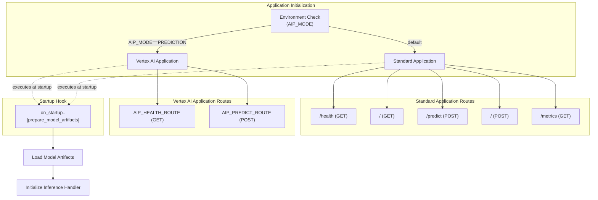

**Sources:** [src/huggingface_inference_toolkit/webservice_starlette.py:143-172]()

### Application Instantiation

The `app` object is created conditionally based on the `AIP_MODE` environment variable:

| Condition | Application Mode | Routes Defined |
|-----------|-----------------|----------------|
| `AIP_MODE == "PREDICTION"` | Vertex AI | Custom routes from `AIP_HEALTH_ROUTE` and `AIP_PREDICT_ROUTE` |
| Otherwise | Standard | `/`, `/health`, `/predict`, `/metrics` |

Both application modes share the same startup hook that executes `prepare_model_artifacts()` to initialize the model before accepting requests.

**Sources:** [src/huggingface_inference_toolkit/webservice_starlette.py:143-172]()

## Startup Lifecycle

The `prepare_model_artifacts()` async function executes during application startup and is responsible for ensuring model artifacts are available and the inference handler is initialized.

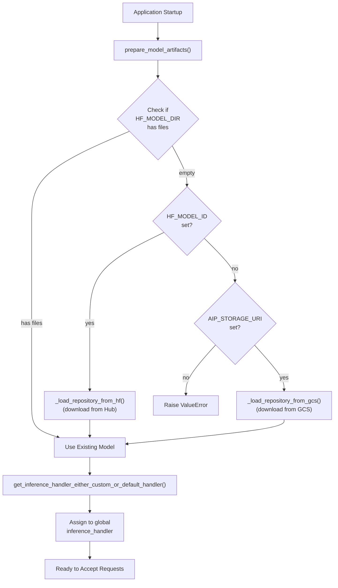

### Model Source Cascade

The model loading logic follows a priority order:

1. **Local Directory**: Check if `HF_MODEL_DIR` (default: `/opt/huggingface/model`) already contains model files
2. **Hugging Face Hub**: If `HF_MODEL_ID` is set, download from the Hub using `_load_repository_from_hf()`
3. **Google Cloud Storage**: If `AIP_STORAGE_URI` is set (Vertex AI deployment), download from GCS
4. **Error**: If none of the above sources are available, raise a `ValueError`

The loaded model artifacts are then used to instantiate the appropriate inference handler, which is stored in the global `inference_handler` variable for use by the predict endpoint.

**Sources:** [src/huggingface_inference_toolkit/webservice_starlette.py:33-66]()

## HTTP Endpoints

The web service exposes the following endpoints:

### Standard Mode Endpoints

| Endpoint | Method | Handler Function | Purpose |
|----------|--------|-----------------|---------|
| `/` | GET | `health()` | Root health check |
| `/health` | GET | `health()` | Health check endpoint |
| `/` | POST | `predict()` | Root prediction endpoint |
| `/predict` | POST | `predict()` | Named prediction endpoint |
| `/metrics` | GET | `metrics()` | Prometheus-compatible metrics |

### Vertex AI Mode Endpoints

| Endpoint | Method | Handler Function | Purpose |
|----------|--------|-----------------|---------|
| `$AIP_HEALTH_ROUTE` | GET | `health()` | Health check (route from env var) |
| `$AIP_PREDICT_ROUTE` | POST | `predict()` | Prediction (route from env var) |

**Sources:** [src/huggingface_inference_toolkit/webservice_starlette.py:153-172]()

## Health Check Endpoint

The `health()` function provides a simple liveness check that returns HTTP 200 with "Ok" as plain text.

```python
async def health(request):
    return PlainTextResponse("Ok")
```

This endpoint is used by:
- Container orchestration systems (Kubernetes, ECS) for liveness probes
- Load balancers for health checks
- Vertex AI's health monitoring

**Sources:** [src/huggingface_inference_toolkit/webservice_starlette.py:69-70]()

## Metrics Endpoint

The `metrics()` function exposes Prometheus-compatible metrics in plain text format:

```
inf_batch_current_size <value>
inf_queue_size <value>
```

### Metrics Definitions

| Metric Name | Description | Calculation |
|-------------|-------------|-------------|
| `inf_batch_current_size` | Number of requests currently being processed | `MAX_CONCURRENT_THREADS - MAX_THREADS_GUARD.value` |
| `inf_queue_size` | Number of requests waiting in the queue | `MAX_THREADS_GUARD.statistics().tasks_waiting` |

These metrics are derived from the async concurrency control system (see Concurrency Model section below).

**Sources:** [src/huggingface_inference_toolkit/webservice_starlette.py:73-82]()

## Prediction Endpoint

The `predict()` async function is the core inference endpoint. It handles request deserialization, input validation, inference execution, and response serialization.

```mermaid
sequenceDiagram
    participant Client
    participant predict as "predict()"
    participant Deserializer as "ContentType.get_deserializer()"
    participant AsyncHandler as "async_handler_call()"
    participant InferenceHandler as "inference_handler"
    participant Serializer as "ContentType.get_serializer()"
    
    Client->>predict: "POST with body"
    predict->>predict: "Extract content-type header"
    predict->>Deserializer: "deserialize(body)"
    Deserializer-->>predict: "deserialized_body dict"
    
    predict->>predict: "Validate 'inputs' or 'instances' key"
    
    alt "Audio task with base64"
        predict->>predict: "base64.b64decode(inputs)"
    end
    
    alt "Query params present"
        predict->>predict: "Add to parameters dict"
    end
    
    predict->>AsyncHandler: "async_handler_call(handler, body)"
    AsyncHandler->>InferenceHandler: "handler(body)"
    InferenceHandler-->>AsyncHandler: "predictions"
    AsyncHandler-->>predict: "predictions"
    
    predict->>predict: "Extract accept header"
    predict->>Serializer: "serialize(predictions, accept)"
    Serializer-->>predict: "serialized_response"
    predict->>Client: "Response with media_type"
```

### Request Processing Flow

1. **Content-Type Handling**: Extract `content-type` header and deserialize request body using appropriate deserializer
2. **Input Validation**: Verify that body contains either `inputs` or `instances` key (Vertex AI compatibility)
3. **Audio Preprocessing**: For audio tasks (`automatic-speech-recognition`, `audio-classification`), decode base64-encoded inputs
4. **Query Parameters**: If query parameters are present and no `parameters` key exists in body, add them to the request
5. **Async Inference**: Execute inference via `async_handler_call()` which manages concurrency
6. **Response Serialization**: Use `accept` header to determine output format and serialize response

**Sources:** [src/huggingface_inference_toolkit/webservice_starlette.py:85-139]()

### Input Schema

The request body must contain one of:

| Key | Type | Description |
|-----|------|-------------|
| `inputs` | Any | Standard HF format - model inputs |
| `instances` | Array | Vertex AI format - array of input instances |
| `parameters` | Object | Optional inference parameters |

### Audio Task Handling

For audio tasks, the toolkit expects base64-encoded audio data in the `inputs` field:

```python
if "parameters" in deserialized_body and HF_TASK in {
    "automatic-speech-recognition",
    "audio-classification",
}:
    deserialized_body["inputs"] = base64.b64decode(
        deserialized_body["inputs"], validate=True
    )
```

The `validate=True` flag ensures strict base64 validation to prevent malformed data from reaching the model.

**Sources:** [src/huggingface_inference_toolkit/webservice_starlette.py:99-107]()

### Query Parameter Processing

Query parameters are automatically converted to `parameters` if no explicit `parameters` key exists in the request body:

```python
if request.query_params and "parameters" not in deserialized_body:
    deserialized_body["parameters"] = convert_params_to_int_or_bool(
        dict(request.query_params)
    )
```

The `convert_params_to_int_or_bool()` utility function intelligently converts string values to integers or booleans where appropriate.

**Sources:** [src/huggingface_inference_toolkit/webservice_starlette.py:109-113]()

### Response Format

Responses are serialized based on the `accept` header:

| Accept Header | Serializer | Default Behavior |
|--------------|-----------|------------------|
| `application/json` | JSON serializer | Yes (default) |
| `*/*` | JSON serializer | Fallback to JSON |
| Other | Content-type specific | Based on serializer registry |

**Sources:** [src/huggingface_inference_toolkit/webservice_starlette.py:124-132]()

## Error Handling

The predict endpoint wraps all processing in a try-except block. Errors are caught and returned as JSON responses with HTTP 400 status:

```python
except Exception as e:
    logger.error(e)
    return Response(
        Jsoner.serialize({"error": str(e)}),
        status_code=400,
        media_type="application/json",
    )
```

Error responses always use JSON format regardless of the `accept` header, ensuring clients can reliably parse error information.

**Sources:** [src/huggingface_inference_toolkit/webservice_starlette.py:133-139]()

## Concurrency Model

The web service uses an asynchronous concurrency model with thread limiting to control resource usage:

```mermaid
graph LR
    subgraph "Request Queue"
        IncomingReqs["Incoming Requests"]
    end
    
    subgraph "Concurrency Control"
        MaxGuard["MAX_THREADS_GUARD<br/>(CapacityLimiter)"]
        MaxThreads["MAX_CONCURRENT_THREADS"]
    end
    
    subgraph "Execution Pool"
        Thread1["Worker Thread 1"]
        Thread2["Worker Thread 2"]
        ThreadN["Worker Thread N"]
    end
    
    IncomingReqs --> MaxGuard
    MaxGuard -->|"within limit"| Thread1
    MaxGuard -->|"within limit"| Thread2
    MaxGuard -->|"within limit"| ThreadN
    MaxGuard -->|"at capacity"| Queue["Request Queue"]
    
    MaxThreads -.->|"defines limit"| MaxGuard
```

The `async_handler_call()` function (imported from `async_utils`) manages concurrent execution using the `MAX_THREADS_GUARD` capacity limiter. This prevents the system from being overwhelmed by too many simultaneous inference requests.

Metrics exposed by the `/metrics` endpoint reflect this concurrency state:
- **Current batch size**: `MAX_CONCURRENT_THREADS - MAX_THREADS_GUARD.value`
- **Queue size**: `MAX_THREADS_GUARD.statistics().tasks_waiting`

**Sources:** [src/huggingface_inference_toolkit/webservice_starlette.py:11-12](), [src/huggingface_inference_toolkit/webservice_starlette.py:76-81](), [src/huggingface_inference_toolkit/webservice_starlette.py:118]()

## Request Timing

The predict endpoint tracks and logs request duration using `perf_counter`:

```python
start_time = perf_counter()
pred = await async_handler_call(inference_handler, deserialized_body)
logger.info(
    f"POST {request.url.path} | Duration: {(perf_counter()-start_time) *1000:.2f} ms"
)
```

This provides millisecond-precision timing information in the application logs for monitoring inference performance.

**Sources:** [src/huggingface_inference_toolkit/webservice_starlette.py:116-122]()

## Environment Variables

The web service layer relies on several environment variables defined in [const.py]():

| Variable | Default | Purpose | Used By |
|----------|---------|---------|---------|
| `HF_MODEL_DIR` | `/opt/huggingface/model` | Model artifact directory | `prepare_model_artifacts()` |
| `HF_MODEL_ID` | `None` | Hugging Face Hub model identifier | `prepare_model_artifacts()` |
| `HF_TASK` | `None` | Task type (e.g., `text-classification`) | `predict()` audio handling, handler selection |
| `HF_FRAMEWORK` | `None` | Framework filter (pytorch/tensorflow) | Model loading |
| `HF_REVISION` | `None` | Git revision to download | Model loading |
| `HF_HUB_TOKEN` | `None` | Authentication token for Hub | Model loading |
| `AIP_MODE` | `None` | Set to `"PREDICTION"` for Vertex AI | Application routing |
| `AIP_HEALTH_ROUTE` | `None` | Vertex AI health endpoint path | Vertex AI routing |
| `AIP_PREDICT_ROUTE` | `None` | Vertex AI prediction endpoint path | Vertex AI routing |
| `AIP_STORAGE_URI` | `None` | GCS URI for model artifacts | `prepare_model_artifacts()` |

**Sources:** [src/huggingface_inference_toolkit/const.py:1-18](), [src/huggingface_inference_toolkit/webservice_starlette.py:12-19](), [src/huggingface_inference_toolkit/webservice_starlette.py:143-151]()

## Global State

The web service maintains minimal global state:

```python
global inference_handler
```

The `inference_handler` variable is initialized during application startup by `prepare_model_artifacts()` and is subsequently accessed by all requests to the `predict()` endpoint. This global state is thread-safe because it is initialized once during startup before the web server begins accepting requests, and is only read (not written) during request processing.

**Sources:** [src/huggingface_inference_toolkit/webservice_starlette.py:34](), [src/huggingface_inference_toolkit/webservice_starlette.py:63](), [src/huggingface_inference_toolkit/webservice_starlette.py:118]()

---

# Page: Model Loading and Pipeline Factory

# Model Loading and Pipeline Factory

<details>
<summary>Relevant source files</summary>

The following files were used as context for generating this wiki page:

- [src/huggingface_inference_toolkit/utils.py](src/huggingface_inference_toolkit/utils.py)
- [tests/unit/test_utils.py](tests/unit/test_utils.py)

</details>


This document explains the model loading and pipeline instantiation mechanisms in the Hugging Face Inference Toolkit. The utilities described here handle downloading models from remote sources, filtering framework-specific artifacts, detecting available hardware, and routing to the appropriate pipeline implementation based on task type and hardware availability.

For information about how pipelines are invoked during inference, see [Inference Handlers](#4.3). For deployment-specific model loading (GCS for Vertex AI, cached models for Inferentia2), see sections [5.3](#5.3) and [5.4](#5.4). For specialized pipeline implementations, see [Specialized Pipeline Support](#6).

## Model Loading Architecture

The model loading system supports three primary sources: Hugging Face Hub, Google Cloud Storage (Vertex AI), and local directories. The system automatically detects the source based on environment variables and delegates to the appropriate loading mechanism.

### Model Source Resolution Flow

```mermaid
flowchart TD
    Start["prepare_model_artifacts()"] --> CheckLocal{"HF_MODEL_DIR<br/>directory exists?"}
    
    CheckLocal -->|Yes| UseLocal["Use local directory"]
    CheckLocal -->|No| CheckHFID{"HF_MODEL_ID<br/>provided?"}
    
    CheckHFID -->|Yes| LoadHF["_load_repository_from_hf()"]
    CheckHFID -->|No| CheckGCS{"AIP_STORAGE_URI<br/>provided?"}
    
    CheckGCS -->|Yes| LoadGCS["_load_repository_from_gcs()<br/>(vertex_ai_utils.py)"]
    CheckGCS -->|No| Error["EnvironmentError:<br/>No model source"]
    
    LoadHF --> DetectFW["_get_framework()"]
    DetectFW --> CheckSafetensors{"PyTorch + safetensors<br/>available?"}
    
    CheckSafetensors -->|Yes| UseST["framework = 'safetensors'"]
    CheckSafetensors -->|No| UseFW["Use detected framework"]
    
    UseST --> Filter["create_artifact_filter(framework)"]
    UseFW --> Filter
    
    Filter --> Download["snapshot_download()<br/>with ignore_patterns"]
    Download --> Complete["Model directory ready"]
    
    LoadGCS --> Complete
    UseLocal --> Complete
    
    style LoadHF fill:#e1f5ff
    style DetectFW fill:#ffe1e1
    style Filter fill:#fff4e1
```

**Model Source Resolution and Artifact Filtering**

Sources: [src/huggingface_inference_toolkit/utils.py:105-149]()

### Loading from Hugging Face Hub

The `_load_repository_from_hf()` function handles downloading models from the Hugging Face Hub with framework-specific artifact filtering.

| Parameter | Type | Purpose |
|-----------|------|---------|
| `repository_id` | `Optional[str]` | Hub model identifier (e.g., "bert-base-uncased") |
| `target_dir` | `Optional[Union[str, Path]]` | Local directory for model artifacts |
| `framework` | `Optional[str]` | Framework to filter artifacts for (auto-detected if None) |
| `revision` | `Optional[str]` | Git commit hash or branch name |
| `hf_hub_token` | `Optional[str]` | Authentication token for private models |

**Key behaviors:**

1. **Authentication**: If `hf_hub_token` is provided, calls `login(token=hf_hub_token)` [line 117]
2. **Framework auto-detection**: If `framework` is None, calls `_get_framework()` [line 120]
3. **SafeTensors preference**: For PyTorch, checks if safetensors weights exist and prefers them over pickle-based weights [lines 130-133]
4. **Artifact filtering**: Uses `create_artifact_filter()` to generate regex patterns that exclude non-framework artifacts [line 136]
5. **Download**: Uses `snapshot_download()` with `ignore_patterns` to selectively download files [lines 141-147]

Sources: [src/huggingface_inference_toolkit/utils.py:105-149](), [tests/unit/test_utils.py:21-84]()

## Framework Detection and Artifact Filtering

### Framework Detection Logic

```mermaid
flowchart LR
    Start["_get_framework()"] --> CheckTorch{"is_torch_available()"}
    
    CheckTorch -->|True| ReturnPT["return 'pytorch'"]
    CheckTorch -->|False| CheckTF{"is_tf_available()"}
    
    CheckTF -->|True| ReturnTF["return 'tensorflow'"]
    CheckTF -->|False| RaiseError["RuntimeError:<br/>No framework installed"]
    
    style CheckTorch fill:#e1f5ff
    style CheckTF fill:#ffe1e1
```

**Framework Detection Priority: PyTorch > TensorFlow**

The `_get_framework()` function determines which deep learning framework is available, with PyTorch taking priority if both are installed [lines 88-102]. This ensures consistent behavior across environments.

Sources: [src/huggingface_inference_toolkit/utils.py:88-102](), [tests/unit/test_utils.py:92-104]()

### Artifact Filtering Mechanism

The `framework2weight` dictionary maps framework identifiers to file pattern wildcards:

| Framework | Pattern | Files Matched |
|-----------|---------|---------------|
| `pytorch` | `pytorch*` | pytorch_model.bin, pytorch_model.bin.index.json |
| `tensorflow` / `tf` | `tf*` | tf_model.h5, tf_model.h5.index.json |
| `safetensors` | `*safetensors` | model.safetensors |
| `onnx` | `*onnx*` | model.onnx |
| `flax` | `flax*` | flax_model.msgpack |
| `rust` | `rust*` | rust_model.ot |
| `openvino` | `*openvino*` | openvino_model.xml, openvino_model.bin |
| `coreml` | `*mlmodel` | model.mlmodel |
| `tflite` | `*tflite` | model.tflite |
| `savedmodel` | `*tar.gz` | model.tar.gz |
| `ckpt` | `*ckpt` | checkpoint files |

The `create_artifact_filter()` function [lines 58-69] generates a list of regex patterns to **exclude** all framework weights except the specified one. This reduces download time and storage requirements by only retrieving relevant artifacts.

**Example**: For `framework="pytorch"`, the function returns all patterns **except** `pytorch*`, causing `snapshot_download()` to skip TensorFlow, ONNX, and other framework files.

Sources: [src/huggingface_inference_toolkit/utils.py:41-69](), [tests/unit/test_utils.py:33-84]()

## Device Detection

### GPU Availability Check

```mermaid
flowchart TD
    Start["_is_gpu_available()"] --> CheckTFAvail{"is_tf_available()"}
    
    CheckTFAvail -->|True| TFCheck["tf.config.list_physical_devices('GPU')"]
    CheckTFAvail -->|False| CheckTorchAvail{"is_torch_available()"}
    
    TFCheck --> TFResult{"len(devices) > 0"}
    TFResult -->|True| ReturnTrue["return True"]
    TFResult -->|False| ReturnFalse["return False"]
    
    CheckTorchAvail -->|True| TorchCheck["torch.cuda.is_available()"]
    CheckTorchAvail -->|False| RaiseError["RuntimeError"]
    
    TorchCheck --> ReturnBool["return bool"]
    
    style TFCheck fill:#e1f5ff
    style TorchCheck fill:#ffe1e1
```

**Framework-Specific GPU Detection**

The `_is_gpu_available()` function [lines 72-85] checks for GPU availability using framework-specific APIs:
- **TensorFlow**: Uses `tf.config.list_physical_devices("GPU")`
- **PyTorch**: Uses `torch.cuda.is_available()`

The `get_device()` function [lines 194-203] converts this boolean to device index notation:
- GPU available: returns `0` (device index for first GPU)
- No GPU: returns `-1` (CPU in transformers convention)

Sources: [src/huggingface_inference_toolkit/utils.py:72-85](), [src/huggingface_inference_toolkit/utils.py:194-203](), [tests/unit/test_utils.py:86-90]()

## Pipeline Factory System

The `get_pipeline()` function [lines 206-263] is the central dispatcher that instantiates the appropriate pipeline based on task type, available hardware, and installed dependencies.

### Pipeline Selection Logic

```mermaid
flowchart TD
    Start["get_pipeline(task, model_dir, **kwargs)"] --> CheckTask{"task is None?"}
    
    CheckTask -->|Yes| ErrorNoTask["EnvironmentError:<br/>'task not set'"]
    CheckTask -->|No| MapConv{"task == 'conversational'?"}
    
    MapConv -->|Yes| SetTextGen["task = 'text-generation'"]
    MapConv -->|No| CheckNeuron{"is_optimum_neuron_available()"}
    
    SetTextGen --> CheckNeuron
    
    CheckNeuron -->|True| OptimumPipe["get_optimum_neuron_pipeline()<br/>(optimum_utils.py)"]
    CheckNeuron -->|False| GetDevice["device = get_device()"]
    
    GetDevice --> SetKwargs["Set tokenizer/<br/>feature_extractor kwargs"]
    
    SetKwargs --> CheckST{"is_sentence_transformers_available()<br/>AND task in sentence-*?"}
    
    CheckST -->|True| STPipe["get_sentence_transformers_pipeline()"]
    CheckST -->|False| CheckDiff{"is_diffusers_available()<br/>AND task == 'text-to-image'?"}
    
    CheckDiff -->|True| DiffPipe["get_diffusers_pipeline()<br/>(diffusers_utils.py)"]
    CheckDiff -->|False| TransPipe["transformers.pipeline()"]
    
    TransPipe --> CheckWhisper{"task == 'automatic-speech-recognition'<br/>AND model is Whisper?"}
    STPipe --> Return["return hf_pipeline"]
    DiffPipe --> Return
    OptimumPipe --> Return
    
    CheckWhisper -->|True| ConfigWhisper["Set chunk_length_s = 30<br/>Set forced_decoder_ids"]
    CheckWhisper -->|False| Return
    
    ConfigWhisper --> Return
    
    style CheckNeuron fill:#e1f5ff
    style CheckST fill:#ffe1e1
    style CheckDiff fill:#fff4e1
    style TransPipe fill:#d4f1d4
```

**Pipeline Routing Decision Tree**

Sources: [src/huggingface_inference_toolkit/utils.py:206-263](), [tests/unit/test_utils.py:108-166]()

### Pipeline Type Routing Table

| Condition | Pipeline Implementation | Purpose |
|-----------|------------------------|---------|
| `is_optimum_neuron_available()` | `get_optimum_neuron_pipeline()` | AWS Inferentia2 acceleration (see [6.3](#6.3)) |
| `task in ["sentence-similarity", "sentence-embeddings", "sentence-ranking", "text-ranking"]` | `get_sentence_transformers_pipeline()` | Sentence embeddings and similarity (see [6.2](#6.2)) |
| `task == "text-to-image"` | `get_diffusers_pipeline()` | Diffusion models for image generation (see [6.1](#6.1)) |
| Default | `transformers.pipeline()` | Standard transformers tasks |

### Tokenizer and Feature Extractor Configuration

The pipeline factory automatically determines whether to load a tokenizer or feature extractor based on task type [lines 231-241]:

**Feature extractor tasks** (load `feature_extractor` kwarg):
- `automatic-speech-recognition`
- `image-segmentation`
- `image-classification`
- `audio-classification`
- `object-detection`
- `zero-shot-image-classification`

**No tokenizer/feature extractor** (model handles internally):
- `image-text-to-text` (multimodal models)
- `image-to-text` (vision models)
- `text-to-image` (diffusion models)

**Tokenizer tasks** (all others): Load `tokenizer` kwarg for text-based models

Sources: [src/huggingface_inference_toolkit/utils.py:231-241]()

### Task-Specific Optimizations

#### Whisper Long Audio Support

For Whisper models in automatic speech recognition tasks, the pipeline factory applies special configuration [lines 257-262]:

1. **Chunk length**: Sets `chunk_length_s = 30` to enable processing of audio files longer than 30 seconds
2. **Decoder prompts**: Configures `forced_decoder_ids` for English transcription

This optimization allows Whisper to process long audio files without memory issues.

Sources: [src/huggingface_inference_toolkit/utils.py:257-262](), [tests/unit/test_utils.py:122-137]()

#### Conversational Task Mapping

The `conversational` task is automatically mapped to `text-generation` [lines 219-220] because conversational models use text generation under the hood. This provides backward compatibility with older task naming conventions.

Sources: [src/huggingface_inference_toolkit/utils.py:219-220](), [tests/unit/test_utils.py:140-166]()

## Custom Pipeline Support

The toolkit supports user-defined inference logic through custom handlers, enabling specialized preprocessing, postprocessing, or model architectures beyond standard transformers pipelines.

### Custom Pipeline Discovery

```mermaid
flowchart TD
    Start["check_and_register_custom_pipeline_from_directory(model_dir)"] --> CheckHandler{"handler.py<br/>exists?"}
    
    CheckHandler -->|Yes| LoadHandler["spec_from_file_location('huggingface_inference', handler.py)"]
    CheckHandler -->|No| CheckLegacy{"pipeline.py<br/>exists?"}
    
    LoadHandler --> AddPath["sys.path.insert(0, model_dir)"]
    AddPath --> ExecHandler["exec_module(handler)"]
    ExecHandler --> InstHandler["handler.EndpointHandler(model_dir)"]
    InstHandler --> ReturnCustom["return custom_pipeline"]
    
    CheckLegacy -->|Yes| WarnLegacy["logger.warning('legacy format')"]
    CheckLegacy -->|No| LogNone["logger.info('No custom pipeline')"]
    
    WarnLegacy --> LoadLegacy["spec_from_file_location('pipeline.PreTrainedPipeline', pipeline.py)"]
    LoadLegacy --> ExecLegacy["exec_module(pipeline)"]
    ExecLegacy --> InstLegacy["pipeline.PreTrainedPipeline(model_dir)"]
    InstLegacy --> ReturnCustom
    
    LogNone --> ReturnNone["return None"]
    
    style CheckHandler fill:#e1f5ff
    style InstHandler fill:#ffe1e1
    style WarnLegacy fill:#fff4e1
```

**Custom Handler Loading Flow**

The `check_and_register_custom_pipeline_from_directory()` function [lines 152-191] searches for custom pipeline implementations in this priority order:

1. **`handler.py`** (preferred): Modern format using `EndpointHandler` class
2. **`pipeline.py`** (legacy): Deprecated format using `PreTrainedPipeline` class
3. **None**: Fall back to standard pipeline factory

### Custom Handler Interface

**Modern format** (`handler.py`):
```python
# Expected structure in model repository
class EndpointHandler:
    def __init__(self, path: str):
        # Initialize with model directory path
        self.path = path
        
    def __call__(self, data: dict) -> dict:
        # Custom inference logic
        return result
```

**Legacy format** (`pipeline.py`):
```python
# Deprecated - use handler.py instead
class PreTrainedPipeline:
    def __init__(self, path: str):
        self.path = path
        
    def __call__(self, inputs):
        return outputs
```

The custom pipeline is loaded by:
1. Creating a module spec from the file location [line 161 or 178]
2. Inserting the model directory into `sys.path` to support submodule imports [line 164 or 181]
3. Dynamically importing and executing the module [lines 166-168 or 183-185]
4. Instantiating the handler/pipeline class with `model_dir` [line 170 or 187]

Sources: [src/huggingface_inference_toolkit/utils.py:152-191](), [tests/unit/test_utils.py:168-199]()

### Custom Pipeline Use Cases

Custom handlers are commonly used for:
- **Non-standard preprocessing**: Domain-specific input transformations
- **Custom postprocessing**: Formatting outputs for specific APIs
- **Multi-model ensembles**: Combining predictions from multiple models
- **ONNX runtime**: Using optimized ONNX models instead of PyTorch/TensorFlow
- **Business logic**: Adding authentication, rate limiting, or data validation

For examples of custom handlers in deployment, see [6.4](#6.4).

Sources: [tests/unit/test_utils.py:168-199]()

## Utility Functions

### Parameter Type Conversion

The `convert_params_to_int_or_bool()` function [lines 266-275] normalizes query parameters from string format to appropriate Python types:

| Input String | Converted Type | Output |
|--------------|----------------|--------|
| `"123"` | `int` | `123` |
| `"true"` | `bool` | `True` |
| `"false"` | `bool` | `False` |
| Other strings | `str` | Unchanged |

This is used to convert HTTP query parameters (always strings) into the correct types expected by pipeline inference parameters.

Sources: [src/huggingface_inference_toolkit/utils.py:266-275]()

## Integration with Other Components

The model loading and pipeline factory system integrates with:

- **[Web Service Layer](#4.1)**: Called during server startup via `prepare_model_artifacts()`
- **[Inference Handlers](#4.3)**: Pipeline instances are wrapped by handler classes for inference
- **[Vertex AI Deployment](#5.3)**: Extends loading with `_load_repository_from_gcs()`
- **[Inferentia2 Deployment](#5.4)**: Routes to `get_optimum_neuron_pipeline()` for hardware acceleration
- **[Specialized Pipelines](#6)**: Factory delegates to specialized implementations based on task and hardware

The modular design allows new pipeline types and model sources to be added without modifying the core factory logic.

Sources: [src/huggingface_inference_toolkit/utils.py](), [tests/unit/test_utils.py]()

---

# Page: Inference Handlers

# Inference Handlers

<details>
<summary>Relevant source files</summary>

The following files were used as context for generating this wiki page:

- [src/huggingface_inference_toolkit/handler.py](src/huggingface_inference_toolkit/handler.py)
- [tests/unit/test_handler.py](tests/unit/test_handler.py)
- [tests/unit/test_sentence_transformers.py](tests/unit/test_sentence_transformers.py)

</details>


This document describes the handler layer that wraps inference pipelines and processes inference requests. Handlers are responsible for extracting input data and parameters from request payloads, applying task-specific transformations, and executing inference using the appropriate pipeline. For information about how pipelines are created and loaded, see [Model Loading and Pipeline Factory](#4.2). For web service integration, see [Web Service Layer](#4.1).

## Overview

The handler layer provides two main classes:

| Handler Class | Purpose | Deployment Target |
|--------------|---------|-------------------|
| `HuggingFaceHandler` | Default handler for standard inference requests | Local, Docker, AWS Inferentia2, HF Inference Endpoints |
| `VertexAIHandler` | Batch-oriented handler for Vertex AI's instance-based API | Google Vertex AI |

Both handlers wrap pipelines created by the pipeline factory and implement the callable interface `__call__(data: Dict[str, Any]) -> Dict[str, Any]`.

Sources: [src/huggingface_inference_toolkit/handler.py:13-159]()

## Handler Architecture

```mermaid
graph TB
    subgraph "Handler Selection"
        Factory["get_inference_handler_either_custom_or_default_handler()"]
        CheckCustom{"Custom pipeline<br/>exists?"}
        CheckAIP{"AIP_MODE ==<br/>PREDICTION?"}
        
        Factory --> CheckCustom
        CheckCustom -->|Yes| CustomPipeline["Custom EndpointHandler"]
        CheckCustom -->|No| CheckAIP
        CheckAIP -->|Yes| VertexHandler["VertexAIHandler"]
        CheckAIP -->|No| DefaultHandler["HuggingFaceHandler"]
    end
    
    subgraph "Handler Classes"
        DefaultHandler
        VertexHandler
        CustomPipeline
        
        VertexHandler -.inherits.-> DefaultHandler
    end
    
    subgraph "Pipeline Wrapping"
        PipelineFactory["get_pipeline()"]
        
        DefaultHandler -->|initializes with| PipelineFactory
        VertexHandler -->|initializes with| PipelineFactory
    end
    
    subgraph "Request Processing"
        DefaultHandler --> ProcessSingle["Process single request"]
        VertexHandler --> ProcessBatch["Process instances[] batch"]
        ProcessBatch --> ProcessSingle
    end
    
    style Factory fill:#f9f9f9
    style DefaultHandler fill:#f9f9f9
    style VertexHandler fill:#f9f9f9
```

**Handler Selection and Class Hierarchy**

The factory function first checks for custom pipelines, then selects between Vertex AI and default handlers based on environment configuration.

Sources: [src/huggingface_inference_toolkit/handler.py:141-159]()

## HuggingFaceHandler

The `HuggingFaceHandler` class is the default handler implementation that supports all standard Transformers, Diffusers, Sentence Transformers, and Optimum pipelines.

### Initialization

```mermaid
graph LR
    Init["HuggingFaceHandler.__init__()"]
    Args["Arguments:<br/>- model_dir<br/>- task<br/>- framework"]
    GetPipeline["get_pipeline()"]
    Pipeline["self.pipeline"]
    
    Init --> Args
    Args --> GetPipeline
    GetPipeline --> Pipeline
    
    TrustCode["HF_TRUST_REMOTE_CODE<br/>environment variable"]
    TrustCode --> GetPipeline
```

**Handler Initialization Flow**

The handler delegates pipeline creation to `get_pipeline()` with the trust_remote_code flag from environment configuration.

Sources: [src/huggingface_inference_toolkit/handler.py:19-27](), [src/huggingface_inference_toolkit/const.py]()

### Request Processing

The `__call__` method processes inference requests by extracting inputs and parameters, applying task-specific transformations, and invoking the pipeline.

```mermaid
flowchart TD
    Start["__call__(data)"]
    Extract["Extract 'inputs' and 'parameters'"]
    
    Start --> Extract
    Extract --> CheckTask{"Pipeline has<br/>'task' attribute?"}
    
    CheckTask -->|No| CheckPipelineType{"Pipeline type?"}
    CheckPipelineType -->|Sentence Transformers| STLogic["Call pipeline with inputs<br/>No parameters supported"]
    CheckPipelineType -->|Diffusers| DiffusersLogic["Call pipeline(inputs, **parameters)"]
    
    CheckTask -->|Yes| ApplyTransforms["Apply task-specific<br/>parameter transformations"]
    
    ApplyTransforms --> QA{"task ==<br/>question-answering?"}
    QA -->|Yes| ValidateQA["Validate inputs has<br/>'question' and 'context'"]
    QA -->|No| TableQA{"task ==<br/>table-question-answering?"}
    
    TableQA -->|Yes| TransformTableQA["Transform 'question' to 'query'<br/>Validate 'table' exists"]
    TableQA -->|No| Translation{"task contains<br/>'translation' or is<br/>text-generation, etc?"}
    
    Translation -->|Yes| GenKwargs["Handle 'generation_parameters'<br/>Flatten 'generate_kwargs'"]
    Translation -->|No| ZeroShot{"task contains<br/>'zero-shot-classification'?"}
    
    ZeroShot -->|Yes| ZeroShotTransform["Transform 'candidateLabels'<br/>Wrap inputs in 'sequences'"]
    ZeroShot -->|No| Execute
    
    ValidateQA --> Execute["pipeline(inputs, **parameters)"]
    TransformTableQA --> Execute
    GenKwargs --> Execute
    ZeroShotTransform --> Execute
    
    STLogic --> Return["Return results"]
    DiffusersLogic --> Return
    Execute --> Return
    
    style Start fill:#f9f9f9
    style Execute fill:#f9f9f9
```

**Request Processing Flow in HuggingFaceHandler**

The handler branches based on pipeline type and task, applying specific transformations before execution.

Sources: [src/huggingface_inference_toolkit/handler.py:29-106]()

### Task-Specific Parameter Handling

The handler applies several task-specific transformations:

| Task Type | Transformation | Lines |
|-----------|---------------|-------|
| `question-answering` | Validates `inputs` contains both `question` and `context` keys | [53-60]() |
| `table-question-answering` | Renames `question` → `query`, validates `table` and `query` exist | [62-71]() |
| Translation, text-generation, image-to-text, ASR, TTS | Converts `generation_parameters` → `generate_kwargs` | [73-82]() |
| Translation, text-generation | Flattens `generate_kwargs` into top-level parameters | [84-88]() |
| `zero-shot-classification` | Renames `candidateLabels` → `candidate_labels`, wraps string inputs in `sequences` key | [90-102]() |

#### Diffusers and Sentence Transformers

Pipelines without a `task` attribute (Diffusers and Sentence Transformers) receive special handling:

- **Sentence Transformers**: Parameters are not yet supported; inputs are passed directly
- **Diffusers**: Both inputs and parameters are passed as keyword arguments

Sources: [src/huggingface_inference_toolkit/handler.py:39-51]()

### Input Data Structure

The handler expects request data in the following format:

```json
{
  "inputs": "<input_data>",
  "parameters": {
    "parameter_name": "value"
  }
}
```

Where `inputs` can be:
- A string (for most NLP tasks)
- A dictionary (for tasks like question-answering, zero-shot-classification, or Diffusers)
- A list (for batch processing)

Sources: [src/huggingface_inference_toolkit/handler.py:36-37]()

## VertexAIHandler

The `VertexAIHandler` extends `HuggingFaceHandler` to support Google Vertex AI's batch prediction API, which expects requests in the `instances` format.

```mermaid
graph TB
    subgraph "VertexAIHandler Request Flow"
        Request["Request with 'instances' array"]
        Validate{"'instances'<br/>exists?"}
        Extract["Extract 'parameters'"]
        Iterate["For each instance in instances[]"]
        BuildPayload["Build payload:<br/>{inputs: instance, parameters: parameters}"]
        CallSuper["super().__call__(payload)"]
        Collect["Collect prediction"]
        Return["Return {predictions: [...]"}"]
        
        Request --> Validate
        Validate -->|No| Error["Raise ValueError"]
        Validate -->|Yes| Extract
        Extract --> Iterate
        Iterate --> BuildPayload
        BuildPayload --> CallSuper
        CallSuper --> Collect
        Collect --> Iterate
        Iterate -->|Done| Return
    end
    
    style Request fill:#f9f9f9
    style CallSuper fill:#f9f9f9
```

**VertexAIHandler Batch Processing**

The handler processes each instance separately and aggregates results into a predictions array.

### Request Format

Vertex AI requests must follow this structure:

```json
{
  "instances": [
    "<instance_1>",
    "<instance_2>"
  ],
  "parameters": {
    "shared_parameter": "value"
  }
}
```

The response format is:

```json
{
  "predictions": [
    {"result": "..."},
    {"result": "..."}
  ]
}
```

Sources: [src/huggingface_inference_toolkit/handler.py:109-138]()

## Handler Selection Logic

The `get_inference_handler_either_custom_or_default_handler` function determines which handler to instantiate based on the model directory contents and environment variables.

```mermaid
flowchart TD
    Start["get_inference_handler_either_custom_or_default_handler(model_dir, task)"]
    CheckCustom["check_and_register_custom_pipeline_from_directory(model_dir)"]
    
    Start --> CheckCustom
    CheckCustom --> HasCustom{"Custom pipeline<br/>found?"}
    
    HasCustom -->|Yes| ReturnCustom["Return custom pipeline instance"]
    HasCustom -->|No| CheckEnv{"AIP_MODE ==<br/>'PREDICTION'?"}
    
    CheckEnv -->|Yes| ReturnVertex["Return VertexAIHandler(model_dir, task)"]
    CheckEnv -->|No| ReturnDefault["Return HuggingFaceHandler(model_dir, task)"]
    
    style Start fill:#f9f9f9
    style ReturnCustom fill:#f9f9f9
    style ReturnVertex fill:#f9f9f9
    style ReturnDefault fill:#f9f9f9
```

**Handler Selection Decision Tree**

Custom pipelines take precedence, followed by Vertex AI mode detection, with the default handler as fallback.

### Selection Priority

1. **Custom Pipeline**: If `handler.py` or `pipeline.py` exists in the model directory, the custom handler is used
2. **Vertex AI Mode**: If `AIP_MODE` environment variable equals `"PREDICTION"`, `VertexAIHandler` is used
3. **Default**: Otherwise, `HuggingFaceHandler` is used

Sources: [src/huggingface_inference_toolkit/handler.py:141-159]()

## Custom Handler Integration

The handler system integrates with custom pipelines registered via `check_and_register_custom_pipeline_from_directory`. When a custom `handler.py` file exists in the model directory with an `EndpointHandler` class, that handler is used instead of the default handlers.

Custom handlers must implement:
- An `__init__` method that accepts `model_dir` (and optionally `task`)
- A `__call__` method that accepts a dictionary and returns a dictionary

For more details on custom handler implementation, see [Custom Handlers and Pipelines](#6.4).

Sources: [src/huggingface_inference_toolkit/handler.py:152-154](), [src/huggingface_inference_toolkit/utils.py]()

## Testing

The handler layer has comprehensive unit test coverage:

| Test File | Coverage |
|-----------|----------|
| `tests/unit/test_handler.py` | HuggingFaceHandler initialization, device selection, prediction calls, custom pipeline integration |
| `tests/unit/test_sentence_transformers.py` | Sentence Transformers pipeline wrapping through handlers |

### Key Test Scenarios

- **Device allocation**: Verifies handlers correctly place models on GPU when available, CPU otherwise
- **Prediction correctness**: Validates output structure for various tasks
- **Custom pipeline loading**: Tests `get_inference_handler_either_custom_or_default_handler` with custom handlers
- **Framework support**: Tests both PyTorch and TensorFlow handlers

Sources: [tests/unit/test_handler.py:1-120](), [tests/unit/test_sentence_transformers.py:1-115]()

---

# Page: Deployment Guide

# Deployment Guide

<details>
<summary>Relevant source files</summary>

The following files were used as context for generating this wiki page:

- [README.md](README.md)
- [dockerfiles/pytorch/Dockerfile](dockerfiles/pytorch/Dockerfile)

</details>


This document provides an overview of all supported deployment scenarios for the Hugging Face Inference Toolkit and guidance on selecting the appropriate deployment strategy for your use case. The toolkit supports five primary deployment modes, each optimized for different environments and requirements.

For detailed configuration of environment variables and runtime behavior, see [Configuration](#3). For understanding the underlying architecture that enables multi-platform deployment, see [Core Architecture](#4).

---

## Supported Deployment Modes

The Hugging Face Inference Toolkit is designed to run identically across multiple deployment platforms through environment variable configuration. The same codebase serves all deployment targets through the `webservice_starlette.py` web service layer.

### Deployment Options

| Deployment Mode | Primary Use Case | Hardware Support | Model Loading | Configuration Complexity |
|----------------|------------------|------------------|---------------|-------------------------|
| Local Development | Development and testing | CPU/GPU | Hub or local directory | Low |
| Docker Standalone | Self-hosted production | CPU/GPU/Inferentia2 | Hub or local directory | Medium |
| Google Vertex AI | GCP-hosted inference | CPU/GPU | GCS or Hub | Medium |
| AWS Inferentia2 | Cost-optimized inference on AWS | Inferentia2 | Hub with Neuron compilation | High |
| HF Inference Endpoints | Managed serverless inference | CPU/GPU | Hub | Low |

**Sources:** [README.md:1-286]()

---

## Deployment Architecture Overview

The following diagram illustrates how the toolkit serves multiple deployment targets through a unified architecture:

```mermaid
graph TB
    subgraph "Source Code"
        WebService["webservice_starlette.py<br/>Starlette HTTP Server"]
        Handler["handler.py<br/>Inference Logic"]
        Utils["utils.py<br/>Model Loading"]
        Entrypoint["entrypoint.sh<br/>Container Entry"]
    end
    
    subgraph "Build Artifacts"
        CPUImage["Container Image<br/>integration-test-pytorch:cpu"]
        GPUImage["Container Image<br/>integration-test-pytorch:gpu"]
        Inf2Image["Container Image<br/>integration-test-pytorch:inf2"]
    end
    
    subgraph "Deployment Targets"
        Local["Local Development<br/>uvicorn directly<br/>Port: 5000"]
        DockerCPU["Docker Standalone CPU<br/>docker run -p 5000:5000"]
        DockerGPU["Docker Standalone GPU<br/>docker run --gpus all"]
        VertexAI["Google Vertex AI<br/>Custom Container<br/>Port: 8080"]
        Inferentia2["AWS Inferentia2<br/>--device=/dev/neuron0"]
        HFEndpoints["HF Inference Endpoints<br/>Managed Service"]
    end
    
    WebService --> CPUImage
    WebService --> GPUImage
    WebService --> Inf2Image
    Handler --> CPUImage
    Handler --> GPUImage
    Handler --> Inf2Image
    Utils --> CPUImage
    Utils --> GPUImage
    Utils --> Inf2Image
    Entrypoint --> CPUImage
    Entrypoint --> GPUImage
    Entrypoint --> Inf2Image
    
    WebService -.->|"no container"| Local
    
    CPUImage --> DockerCPU
    GPUImage --> DockerGPU
    Inf2Image --> Inferentia2
    
    CPUImage --> VertexAI
    GPUImage --> VertexAI
    
    CPUImage --> HFEndpoints
    GPUImage --> HFEndpoints
```

**Sources:** [README.md:1-286](), [dockerfiles/pytorch/Dockerfile:1-61](), High-Level System Architecture Diagram 3

---

## Configuration Matrix

Different deployment modes require different environment variables. The following table shows the essential configuration for each mode:

| Environment Variable | Local Dev | Docker | Vertex AI | Inferentia2 | HF Endpoints |
|---------------------|-----------|--------|-----------|-------------|--------------|
| `HF_MODEL_ID` | Required* | Required* | Required* | Required* | Auto-set |
| `HF_TASK` | Required | Required | Required | Required | Auto-set |
| `HF_MODEL_DIR` | Required | Optional | Optional | Optional | Auto-set |
| `HF_HUB_TOKEN` | Optional | Optional | Optional | Optional | Auto-set |
| `AIP_MODE` | — | — | `PREDICTION` | — | — |
| `AIP_HTTP_PORT` | — | — | `8080` | — | — |
| `AIP_STORAGE_URI` | — | — | Optional | — | — |
| `HF_OPTIMUM_BATCH_SIZE` | — | — | — | Required** | — |
| `HF_OPTIMUM_SEQUENCE_LENGTH` | — | — | — | Required** | — |

\* Not required if model is pre-loaded in `HF_MODEL_DIR`  
\*\* Not required if model is already compiled to Neuron format

**Sources:** [README.md:199-278]()

---

## Deployment Decision Guide

The following diagram provides a decision tree for selecting the appropriate deployment mode:

```mermaid
graph TD
    Start["Need to deploy<br/>Hugging Face model"] --> Managed{Want managed<br/>hosting?}
    
    Managed -->|Yes| Cloud{Which cloud<br/>provider?}
    Managed -->|No| SelfHost{Self-hosted<br/>infrastructure?}
    
    Cloud -->|Hugging Face| HFEndpoints["HF Inference Endpoints<br/>✓ Fully managed<br/>✓ Auto-scaling<br/>✓ No configuration<br/>See section 5.5"]
    Cloud -->|Google Cloud| VertexAI["Google Vertex AI<br/>✓ GCP integration<br/>✓ GCS model loading<br/>✓ Custom containers<br/>See section 5.3"]
    Cloud -->|AWS| AWSChoice{Hardware<br/>preference?}
    
    AWSChoice -->|Inferentia2| Inf2["AWS Inferentia2<br/>✓ Cost-effective<br/>✓ Optimized for transformers<br/>✓ Neuron compilation<br/>See section 5.4"]
    AWSChoice -->|GPU/CPU| SelfHost
    
    SelfHost -->|Yes| Docker["Docker Deployment<br/>✓ Container isolation<br/>✓ CPU/GPU/Inf2 support<br/>✓ Production-ready<br/>See section 5.2"]
    SelfHost -->|No| Development{Development<br/>only?}
    
    Development -->|Yes| LocalDev["Local Development<br/>✓ Fast iteration<br/>✓ No Docker required<br/>✓ Direct debugging<br/>See section 5.1"]
    Development -->|No| Docker
```

**Sources:** [README.md:1-286](), High-Level System Architecture Diagram 3

---

## Common Deployment Workflow

Regardless of the chosen deployment mode, all deployments follow this general workflow:

```mermaid
sequenceDiagram
    participant User
    participant Deployment as "Deployment Platform"
    participant Container as "Container/Process"
    participant WebService as "webservice_starlette.py"
    participant Utils as "utils.py"
    participant Hub as "Hugging Face Hub"
    
    User->>Deployment: Deploy with config<br/>(HF_MODEL_ID, HF_TASK, etc.)
    Deployment->>Container: Start container/process
    Container->>WebService: Execute entrypoint.sh<br/>start uvicorn
    WebService->>WebService: Read environment variables
    WebService->>Utils: prepare_model_artifacts()
    
    alt Model not in HF_MODEL_DIR
        Utils->>Hub: Download model<br/>_load_repository_from_hf()
        Hub-->>Utils: Model artifacts
        Utils->>Utils: Filter by framework<br/>(pytorch/tensorflow/onnx)
    end
    
    Utils->>Utils: Load pipeline<br/>get_pipeline()
    Utils-->>WebService: Pipeline ready
    WebService->>WebService: Start HTTP server
    WebService-->>Deployment: Health check OK
    Deployment-->>User: Endpoint ready
    
    User->>WebService: POST /predict or /pred<br/>{"inputs": "..."}
    WebService->>WebService: handler.py inference
    WebService-->>User: Predictions
```

**Sources:** [README.md:1-286](), [src/huggingface_inference_toolkit/webservice_starlette.py](), [src/huggingface_inference_toolkit/utils.py]()

---

## Container Images

The toolkit provides three specialized container images built from the same Dockerfile with different base images:

| Image Name | Base Image | Primary Use | Size Consideration |
|-----------|------------|-------------|-------------------|
| `integration-test-pytorch:cpu` | Ubuntu 22.04 | CPU inference, development | Smallest |
| `integration-test-pytorch:gpu` | nvidia/cuda:12.1.0-devel-ubuntu22.04 | GPU inference | Large (includes CUDA) |
| `integration-test-pytorch:inf2` | AWS Deep Learning Container | Inferentia2 inference | Large (includes Neuron SDK) |

All images include:
- Python 3.11
- PyTorch and transformers
- Optional extras: sentence-transformers, diffusers, optimum-neuron
- Starlette web service
- Health check endpoints

**Build Commands:**
```bash
# CPU image
make inference-pytorch-cpu

# GPU image
make inference-pytorch-gpu

# Inferentia2 image
make inference-pytorch-inf2
```

**Sources:** [README.md:25-47](), [dockerfiles/pytorch/Dockerfile:1-61]()

---

## Quick Start Examples

### Local Development
```bash
mkdir tmp/
HF_MODEL_ID=distilbert-base-uncased-finetuned-sst-2-english \
HF_TASK=text-classification \
HF_MODEL_DIR=tmp \
uvicorn src.huggingface_inference_toolkit.webservice_starlette:app --port 5000
```

### Docker Standalone (GPU)
```bash
docker run -ti -p 5000:5000 --gpus all \
  -e HF_MODEL_ID=nlpconnect/vit-gpt2-image-captioning \
  -e HF_TASK=image-to-text \
  integration-test-pytorch:gpu
```

### Vertex AI
```bash
docker run -ti -p 8080:8080 \
  -e AIP_MODE=PREDICTION \
  -e AIP_HTTP_PORT=8080 \
  -e AIP_PREDICT_ROUTE=/pred \
  -e AIP_HEALTH_ROUTE=/h \
  -e HF_MODEL_ID=distilbert-base-uncased-finetuned-sst-2-english \
  -e HF_TASK=text-classification \
  vertex-test-pytorch:gpu
```

### Inferentia2
```bash
docker run -ti -p 5000:5000 \
  -e HF_MODEL_ID=distilbert-base-uncased-finetuned-sst-2-english \
  -e HF_TASK=text-classification \
  -e HF_OPTIMUM_BATCH_SIZE=1 \
  -e HF_OPTIMUM_SEQUENCE_LENGTH=128 \
  --device=/dev/neuron0 \
  integration-test-pytorch:inf2
```

**Sources:** [README.md:16-195]()

---

## API Compatibility

All deployment modes expose the same HTTP API for inference, ensuring portability:

| Endpoint | Method | Purpose | Standard Mode | Vertex AI Mode |
|----------|--------|---------|---------------|----------------|
| Health Check | GET | Verify service is running | `/health` | `AIP_HEALTH_ROUTE` |
| Prediction | POST | Perform inference | `/` or `/predict` | `AIP_PREDICT_ROUTE` |

**Request Format:**
```json
{
  "inputs": "Your input text or data",
  "parameters": {
    "top_k": 2,
    "temperature": 0.7
  }
}
```

**Vertex AI Request Format:**
```json
{
  "instances": ["Input 1", "Input 2"],
  "parameters": {
    "top_k": 2
  }
}
```

**Sources:** [README.md:49-129](), [src/huggingface_inference_toolkit/webservice_starlette.py]()

---

## Deployment Mode Details

For comprehensive documentation on each deployment mode, refer to the following sections:

- **[Local Development](#5.1)**: Setting up local development environment, debugging, and testing without containers
- **[Docker Deployment](#5.2)**: Building and running containerized deployments for CPU and GPU
- **[Google Vertex AI Deployment](#5.3)**: Deploying to Google Cloud Platform with Vertex AI integration
- **[AWS Inferentia2 Deployment](#5.4)**: Deploying to AWS Inferentia2 with Neuron compiler optimization
- **[Hugging Face Inference Endpoints](#5.5)**: Using the managed inference service with zero configuration

---

## Custom Handler Support

All deployment modes support custom inference logic through `handler.py` files included in the model repository. This allows you to:

- Implement custom preprocessing
- Override inference logic
- Add custom postprocessing
- Integrate additional dependencies via `requirements.txt`

For details on implementing custom handlers, see [Custom Handlers and Pipelines](#6.4).

**Repository Structure with Custom Handler:**
```
model.tar.gz/
├── pytorch_model.bin
├── config.json
├── handler.py
└── requirements.txt
```

**Sources:** [README.md:63-78]()

---

## Security Considerations

When deploying models, consider the following security aspects:

| Consideration | Environment Variable | Default | Risk Level |
|--------------|---------------------|---------|------------|
| Remote code execution | `HF_TRUST_REMOTE_CODE` | `"0"` | High |
| Private model access | `HF_HUB_TOKEN` | Not set | Medium |
| Model versioning | `HF_REVISION` | Latest | Low |

**Recommendation:** Always pin model revisions in production using `HF_REVISION` to ensure reproducibility and prevent unexpected model updates.

**Sources:** [README.md:247-253]()

---

## Next Steps

After selecting your deployment mode:

1. Review the [Configuration](#3) page for environment variable details
2. Follow the detailed deployment guide for your chosen mode (sections 5.1-5.5)
3. Consult the [API Reference](#7) for request/response formats
4. Review [Troubleshooting](#11) if you encounter issues

For information on supported model types and tasks, see [Specialized Pipeline Support](#6).

---

# Page: Local Development

# Local Development

<details>
<summary>Relevant source files</summary>

The following files were used as context for generating this wiki page:

- [README.md](README.md)
- [setup.py](setup.py)

</details>


This page provides instructions for running the Hugging Face Inference Toolkit locally without Docker containers, using uvicorn to serve models directly. This is the fastest way to test models, develop custom handlers, or debug inference issues during development.

For containerized deployment options, see [Docker Deployment](#5.2), [Google Vertex AI Deployment](#5.3), or [AWS Inferentia2 Deployment](#5.4). For general configuration options, see [Configuration](#3).

---

## Installation

### Basic Installation

Install the package in development mode with the required extras for your use case:

```bash
git clone https://github.com/huggingface/huggingface-inference-toolkit
cd huggingface-inference-toolkit
pip install -e ".[torch,st,diffusers,test,quality]"
```

The available extras are defined in [setup.py:36-57]():

| Extra | Purpose | Key Dependencies |
|-------|---------|------------------|
| `torch` | PyTorch models | `torch==2.5.1`, `torchvision`, `torchaudio`, `peft==0.15.1` |
| `st` | Sentence Transformers | `sentence_transformers==4.0.2` |
| `diffusers` | Text-to-image models | `diffusers==0.33.1`, `accelerate==1.6.0` |
| `inf2` | AWS Inferentia2 support | `optimum-neuron` |
| `google` | Google Cloud Storage | `google-cloud-storage`, `crcmod==1.7` |
| `test` | Testing dependencies | `pytest`, `docker`, `requests`, etc. |
| `quality` | Code quality tools | `isort`, `ruff` |

### Python Version Requirements

The toolkit requires Python 3.9 or higher, as specified in [setup.py:70]().

### Platform-Specific Installation

**AWS Inferentia2 Development:**
```bash
pip install -e ".[inf2,test,quality]" --upgrade
```

**Google Cloud Development:**
```bash
pip install -e ".[torch,st,diffusers,google,test,quality]"
```

Sources: [setup.py:1-86](), [README.md:9-14]()

---

## Local Development Setup Flow

```mermaid
flowchart TD
    Clone["git clone repository"]
    Install["pip install -e .[extras]"]
    CreateDir["mkdir model_directory/"]
    SetEnv["Set Environment Variables"]
    
    Clone --> Install
    Install --> CreateDir
    CreateDir --> SetEnv
    
    SetEnv --> ChooseMode{Deployment Mode?}
    
    ChooseMode -->|Standard| StandardEnv["HF_MODEL_ID=model-name<br/>HF_TASK=task-type<br/>HF_MODEL_DIR=model_directory"]
    ChooseMode -->|Vertex AI| VertexEnv["AIP_MODE=PREDICTION<br/>AIP_HTTP_PORT=8080<br/>AIP_PREDICT_ROUTE=/pred<br/>AIP_HEALTH_ROUTE=/h<br/>HF_MODEL_ID=model-name<br/>HF_TASK=task-type"]
    ChooseMode -->|Inferentia2| Inf2Env["HF_MODEL_ID=model-name<br/>HF_TASK=task-type<br/>HF_OPTIMUM_BATCH_SIZE=1<br/>HF_OPTIMUM_SEQUENCE_LENGTH=128"]
    
    StandardEnv --> RunUvicorn["uvicorn src.huggingface_inference_toolkit.webservice_starlette:app --port 5000"]
    VertexEnv --> RunUvicorn8080["uvicorn src.huggingface_inference_toolkit.webservice_starlette:app --port 8080"]
    Inf2Env --> RunUvicorn
    
    RunUvicorn --> AppStartup["webservice_starlette.app startup"]
    RunUvicorn8080 --> AppStartup
    
    AppStartup --> PrepareModel["prepare_model_artifacts()"]
    PrepareModel --> LoadHandler["Load HuggingFaceHandler or VertexAIHandler"]
    LoadHandler --> Ready["Server Ready"]
    
    Ready --> SendRequest["curl POST request"]
    SendRequest --> Response["Receive inference response"]
    
    style SetEnv fill:#f9f9f9
    style RunUvicorn fill:#f9f9f9
    style RunUvicorn8080 fill:#f9f9f9
    style Ready fill:#f9f9f9
```

Sources: [README.md:16-21](), [README.md:84-103](), [README.md:141-169]()

---

## Environment Configuration

### Required Environment Variables

The minimum configuration requires three environment variables:

| Variable | Purpose | Example |
|----------|---------|---------|
| `HF_MODEL_ID` | Model identifier from Hugging Face Hub | `distilbert-base-uncased-finetuned-sst-2-english` |
| `HF_TASK` | Task type for inference pipeline | `text-classification` |
| `HF_MODEL_DIR` | Directory for model storage | `./tmp_models/` |

### Environment Variable Resolution

```mermaid
flowchart LR
    subgraph "Model Source Configuration"
        ModelID["HF_MODEL_ID<br/>(from Hub)"]
        ModelDir["HF_MODEL_DIR<br/>(local path)"]
        Storage["AIP_STORAGE_URI<br/>(GCS path)"]
    end
    
    subgraph "Task Configuration"
        Task["HF_TASK<br/>(required)"]
        Framework["HF_FRAMEWORK<br/>(optional)"]
    end
    
    subgraph "Authentication"
        Token["HF_HUB_TOKEN<br/>(for private models)"]
        TrustCode["HF_TRUST_REMOTE_CODE<br/>(default: 0)"]
    end
    
    subgraph "Deployment Mode"
        AIPMode["AIP_MODE<br/>(PREDICTION for Vertex)"]
        AIPPort["AIP_HTTP_PORT<br/>(Vertex port)"]
        AIPRoutes["AIP_PREDICT_ROUTE<br/>AIP_HEALTH_ROUTE"]
    end
    
    subgraph "Inferentia2"
        OptimumBatch["HF_OPTIMUM_BATCH_SIZE<br/>(default: 1)"]
        OptimumSeq["HF_OPTIMUM_SEQUENCE_LENGTH<br/>(required for compilation)"]
    end
    
    ModelID -.->|downloads to| ModelDir
    Storage -.->|downloads to| ModelDir
    Task --> PipelineCreation["get_pipeline()"]
    Framework --> PipelineCreation
    Token --> ModelID
    TrustCode --> ModelID
    
    AIPMode --> Handler["VertexAIHandler"]
    AIPPort --> Uvicorn["uvicorn --port"]
    AIPRoutes --> AppRoutes["app.add_route()"]
    
    OptimumBatch --> NeuronPipeline["get_optimum_neuron_pipeline()"]
    OptimumSeq --> NeuronPipeline
```

Sources: [README.md:199-278](), [setup.py:1-86]()

---

## Running Locally with Uvicorn

### Standard Mode

The standard mode runs the Starlette ASGI application directly with default HTTP endpoints:

```bash
mkdir tmp_models/
HF_MODEL_ID=hf-internal-testing/tiny-random-distilbert \
HF_MODEL_DIR=tmp_models \
HF_TASK=text-classification \
uvicorn src.huggingface_inference_toolkit.webservice_starlette:app --port 5000
```

**Default Endpoints:**
- `POST /` - Inference endpoint
- `GET /health` - Health check endpoint

**Testing the inference:**
```bash
curl --request POST \
  --url http://localhost:5000 \
  --header 'Content-Type: application/json' \
  --data '{"inputs": "This is a great product!"}'
```

Sources: [README.md:16-21](), [README.md:51-61]()

### Vertex AI Mode

Vertex AI mode configures the application to use Google Vertex AI-compatible endpoints:

```bash
mkdir tmp_models/
AIP_MODE=PREDICTION \
AIP_HTTP_PORT=8080 \
AIP_PREDICT_ROUTE=/pred \
AIP_HEALTH_ROUTE=/h \
HF_MODEL_ID=distilbert/distilbert-base-uncased-finetuned-sst-2-english \
HF_TASK=text-classification \
HF_MODEL_DIR=tmp_models \
uvicorn src.huggingface_inference_toolkit.webservice_starlette:app --port 8080
```

**Vertex AI Endpoints:**
- `POST /pred` - Prediction endpoint (custom route)
- `GET /h` - Health check (custom route)

**Testing with Vertex AI schema:**
```bash
curl --request POST \
  --url http://localhost:8080/pred \
  --header 'Content-Type: application/json' \
  --data '{
    "instances": ["I love this product", "I hate this product"],
    "parameters": { "top_k": 2 }
  }'
```

The request format uses `instances` array instead of `inputs` for batch processing.

Sources: [README.md:84-103]()

### Inferentia2 Mode

For AWS Inferentia2 development, additional compilation parameters are required:

```bash
mkdir tmp_models/
HF_MODEL_ID="distilbert/distilbert-base-uncased-finetuned-sst-2-english" \
HF_TASK="text-classification" \
HF_OPTIMUM_BATCH_SIZE=1 \
HF_OPTIMUM_SEQUENCE_LENGTH=128 \
HF_MODEL_DIR=tmp_models \
uvicorn src.huggingface_inference_toolkit.webservice_starlette:app --port 5000
```

**Note:** This requires running on an actual Inferentia2 instance with `/dev/neuron0` device available. The model will be compiled to Neuron format on first run if not already compiled.

**Sentence Transformers on Inferentia2:**
```bash
HF_MODEL_ID="sentence-transformers/all-MiniLM-L6-v2" \
HF_TASK="feature-extraction" \
HF_OPTIMUM_BATCH_SIZE=1 \
HF_OPTIMUM_SEQUENCE_LENGTH=128 \
HF_MODEL_DIR=tmp_models \
uvicorn src.huggingface_inference_toolkit.webservice_starlette:app --port 5000
```

Sources: [README.md:141-169]()

---

## Application Startup Sequence

```mermaid
sequenceDiagram
    participant Uvicorn
    participant App as "webservice_starlette.app"
    participant Startup as "@app.on_event('startup')"
    participant Prepare as "prepare_model_artifacts()"
    participant Utils as "utils.py functions"
    participant Handler as "handler.py"
    
    Uvicorn->>App: Start ASGI server
    App->>Startup: Trigger startup event
    
    Startup->>Prepare: Call prepare_model_artifacts()
    
    Prepare->>Prepare: Check HF_MODEL_DIR
    
    alt HF_MODEL_DIR is empty
        Prepare->>Utils: Check HF_MODEL_ID
        alt HF_MODEL_ID exists
            Utils->>Utils: _load_repository_from_hf()
            Utils->>Utils: Download model from Hub
            Utils->>Utils: Filter artifacts by framework
        else AIP_STORAGE_URI exists
            Utils->>Utils: _load_repository_from_gcs()
            Utils->>Utils: Download from GCS
        end
    end
    
    Prepare->>Utils: check_and_register_custom_pipeline()
    alt handler.py exists
        Utils->>Handler: Load EndpointHandler class
        Utils->>Utils: Register as custom pipeline
    end
    
    Prepare->>Utils: get_pipeline()
    
    alt Device is Inferentia2
        Utils->>Utils: get_optimum_neuron_pipeline()
    else Task is text-to-image
        Utils->>Utils: get_diffusers_pipeline()
    else Task is sentence-*
        Utils->>Utils: get_sentence_transformers_pipeline()
    else Standard task
        Utils->>Utils: transformers.pipeline()
    end
    
    Utils->>Startup: Return pipeline
    Startup->>App: Set app.state.pipeline
    App->>Uvicorn: Ready to serve requests
```

Sources: [README.md:16-21](), [setup.py:1-86]()

---

## Testing Different Model Types

### Text Classification

```bash
# Small test model
HF_MODEL_ID=hf-internal-testing/tiny-random-distilbert \
HF_MODEL_DIR=tmp_models \
HF_TASK=text-classification \
uvicorn src.huggingface_inference_toolkit.webservice_starlette:app --port 5000

# Test request
curl --request POST \
  --url http://localhost:5000 \
  --header 'Content-Type: application/json' \
  --data '{"inputs": "This is amazing!"}'
```

### Question Answering

```bash
HF_MODEL_ID=distilbert-base-uncased-distilled-squad \
HF_MODEL_DIR=tmp_models \
HF_TASK=question-answering \
uvicorn src.huggingface_inference_toolkit.webservice_starlette:app --port 5000

# Test request
curl --request POST \
  --url http://localhost:5000 \
  --header 'Content-Type: application/json' \
  --data '{
    "inputs": {
      "question": "What is used for inference?",
      "context": "This model is used with the inference toolkit for inference."
    }
  }'
```

### Image-to-Text (GPU Required)

```bash
HF_MODEL_ID=nlpconnect/vit-gpt2-image-captioning \
HF_MODEL_DIR=tmp_models \
HF_TASK=image-to-text \
uvicorn src.huggingface_inference_toolkit.webservice_starlette:app --port 5000

# Test with base64 encoded image
curl --request POST \
  --url http://localhost:5000 \
  --header 'Content-Type: application/json' \
  --data '{"inputs": "<base64_encoded_image>"}'
```

### Text-to-Image with Diffusers (GPU Required)

```bash
HF_MODEL_ID=echarlaix/tiny-random-stable-diffusion-xl \
HF_MODEL_DIR=tmp_models \
HF_TASK=text-to-image \
uvicorn src.huggingface_inference_toolkit.webservice_starlette:app --port 5000

# Test request
curl --request POST \
  --url http://localhost:5000 \
  --header 'Content-Type: application/json' \
  --data '{
    "inputs": "A beautiful sunset over mountains",
    "parameters": {
      "num_inference_steps": 25,
      "guidance_scale": 7.5
    }
  }'
```

Sources: [README.md:41-47](), [README.md:51-61]()

---

## Using Local Model Artifacts

Instead of downloading from the Hub, you can use pre-downloaded or custom models:

```bash
# Prepare local model directory
mkdir -p local_model/
# Copy model files to local_model/ (e.g., pytorch_model.bin, config.json, tokenizer files)

# Run with local model
HF_MODEL_DIR=local_model \
HF_TASK=text-classification \
uvicorn src.huggingface_inference_toolkit.webservice_starlette:app --port 5000
```

**Required files in model directory:**
- `config.json` - Model configuration
- `pytorch_model.bin` or `model.safetensors` - Model weights
- Tokenizer files (`tokenizer.json`, `tokenizer_config.json`, `vocab.txt`, etc.)
- (Optional) `handler.py` - Custom inference handler
- (Optional) `requirements.txt` - Additional dependencies

Sources: [README.md:46-47](), [README.md:63-77]()

---

## Custom Handler Development

### Directory Structure for Custom Handlers

```mermaid
flowchart TD
    ModelDir["Model Directory<br/>(HF_MODEL_DIR)"]
    
    ModelDir --> Config["config.json<br/>(model configuration)"]
    ModelDir --> Weights["pytorch_model.bin<br/>(model weights)"]
    ModelDir --> Tokenizer["tokenizer files<br/>(tokenizer.json, vocab.txt)"]
    ModelDir --> Handler["handler.py<br/>(custom inference logic)"]
    ModelDir --> Reqs["requirements.txt<br/>(optional dependencies)"]
    
    Handler --> Class["class EndpointHandler"]
    Class --> Init["__init__(self, path='')"]
    Class --> Call["__call__(self, data)"]
    
    Init --> LoadModel["Load custom model"]
    Init --> LoadTokenizer["Load custom tokenizer"]
    Call --> Preprocess["Custom preprocessing"]
    Call --> Inference["Custom inference"]
    Call --> Postprocess["Custom postprocessing"]
    
    style Handler fill:#f9f9f9
    style Class fill:#f9f9f9
```

### Testing Custom Handler Locally

```bash
# Create custom handler directory
mkdir custom_model/
cd custom_model/

# Download base model
huggingface-cli download philschmid/custom-pipeline-text-classification \
  --local-dir .

# Ensure handler.py exists
ls handler.py  # Should exist

# Run with custom handler
cd ..
HF_MODEL_DIR=custom_model \
HF_TASK=text-classification \
uvicorn src.huggingface_inference_toolkit.webservice_starlette:app --port 5000
```

The toolkit will automatically detect `handler.py` and use the custom `EndpointHandler` class instead of the default pipeline.

Sources: [README.md:63-78]()

---

## Private Model Authentication

For private models on Hugging Face Hub:

```bash
# Set HF_HUB_TOKEN for authentication
export HF_HUB_TOKEN="hf_xxxxxxxxxxxxxxxxxxxxx"

HF_MODEL_ID=your-org/private-model \
HF_MODEL_DIR=tmp_models \
HF_TASK=text-classification \
uvicorn src.huggingface_inference_toolkit.webservice_starlette:app --port 5000
```

The token is used for:
- Downloading private models from the Hub
- Accessing gated models that require acceptance
- Downloading private model dependencies

Sources: [README.md:239-245]()

---

## Framework-Specific Configuration

### Specifying Framework

To avoid downloading unnecessary files for frameworks you're not using:

```bash
# PyTorch only
HF_MODEL_ID=distilbert-base-uncased \
HF_TASK=text-classification \
HF_FRAMEWORK=pytorch \
HF_MODEL_DIR=tmp_models \
uvicorn src.huggingface_inference_toolkit.webservice_starlette:app --port 5000
```

This prevents downloading TensorFlow or ONNX weights when you only need PyTorch weights, reducing disk usage and download time.

Sources: [README.md:255-261]()

---

## Development Workflow

### Typical Development Cycle

1. **Install dependencies:**
   ```bash
   pip install -e ".[torch,test]"
   ```

2. **Create working directory:**
   ```bash
   mkdir dev_models/
   ```

3. **Test with small model:**
   ```bash
   HF_MODEL_ID=hf-internal-testing/tiny-random-distilbert \
   HF_MODEL_DIR=dev_models \
   HF_TASK=text-classification \
   uvicorn src.huggingface_inference_toolkit.webservice_starlette:app --port 5000 --reload
   ```
   
   Note the `--reload` flag enables auto-reloading when code changes.

4. **Make code changes** to handlers, utils, or webservice files

5. **Test changes** - the server automatically reloads

6. **Run unit tests:**
   ```bash
   make unit-test
   ```

7. **Run integration tests** (requires Docker):
   ```bash
   make integ-test
   ```

### Port Configuration

You can customize the port by changing the `--port` parameter:

```bash
# Use port 8000
uvicorn src.huggingface_inference_toolkit.webservice_starlette:app --port 8000

# Listen on all interfaces
uvicorn src.huggingface_inference_toolkit.webservice_starlette:app --host 0.0.0.0 --port 5000
```

Sources: [README.md:9-14](), [README.md:16-21]()

---

## Debugging and Logging

### Enabling Debug Logging

Uvicorn provides built-in logging. For more verbose output:

```bash
# Enable debug logging
HF_MODEL_ID=distilbert-base-uncased \
HF_TASK=text-classification \
HF_MODEL_DIR=tmp_models \
uvicorn src.huggingface_inference_toolkit.webservice_starlette:app \
  --port 5000 \
  --log-level debug
```

### Common Environment Variable Debugging

| Issue | Check | Solution |
|-------|-------|----------|
| Model not loading | `HF_MODEL_ID` and `HF_MODEL_DIR` | Ensure `HF_MODEL_ID` is valid or directory contains model files |
| Task not recognized | `HF_TASK` | Use supported task names (see [Configuration](#3)) |
| Authentication error | `HF_HUB_TOKEN` | Set valid token for private models |
| Framework mismatch | `HF_FRAMEWORK` | Specify `pytorch` or `tensorflow` explicitly |
| Inferentia2 compilation | `HF_OPTIMUM_BATCH_SIZE`, `HF_OPTIMUM_SEQUENCE_LENGTH` | Both must be set for compilation |

### Verifying Startup

Monitor the console output to verify successful startup:

```
INFO:     Started server process
INFO:     Waiting for application startup.
INFO:     Loading model from Hugging Face Hub...
INFO:     Model loaded successfully
INFO:     Application startup complete.
INFO:     Uvicorn running on http://127.0.0.1:5000
```

Sources: [README.md:199-278]()

---

## Quick Reference Commands

### Standard Deployment
```bash
HF_MODEL_ID=<model-id> HF_TASK=<task> HF_MODEL_DIR=tmp/ \
uvicorn src.huggingface_inference_toolkit.webservice_starlette:app --port 5000
```

### Vertex AI Mode
```bash
AIP_MODE=PREDICTION AIP_HTTP_PORT=8080 AIP_PREDICT_ROUTE=/pred AIP_HEALTH_ROUTE=/h \
HF_MODEL_ID=<model-id> HF_TASK=<task> HF_MODEL_DIR=tmp/ \
uvicorn src.huggingface_inference_toolkit.webservice_starlette:app --port 8080
```

### Inferentia2 Mode
```bash
HF_MODEL_ID=<model-id> HF_TASK=<task> \
HF_OPTIMUM_BATCH_SIZE=1 HF_OPTIMUM_SEQUENCE_LENGTH=128 \
HF_MODEL_DIR=tmp/ \
uvicorn src.huggingface_inference_toolkit.webservice_starlette:app --port 5000
```

### Local Model
```bash
HF_MODEL_DIR=/path/to/local/model HF_TASK=<task> \
uvicorn src.huggingface_inference_toolkit.webservice_starlette:app --port 5000
```

### With Auto-Reload
```bash
HF_MODEL_ID=<model-id> HF_TASK=<task> HF_MODEL_DIR=tmp/ \
uvicorn src.huggingface_inference_toolkit.webservice_starlette:app --port 5000 --reload
```

Sources: [README.md:16-169](), [setup.py:1-86]()

---

# Page: Docker Deployment

# Docker Deployment

<details>
<summary>Relevant source files</summary>

The following files were used as context for generating this wiki page:

- [.github/workflows/build-container.yaml](.github/workflows/build-container.yaml)
- [.github/workflows/docker-build-action.yaml](.github/workflows/docker-build-action.yaml)
- [README.md](README.md)
- [dockerfiles/pytorch/Dockerfile](dockerfiles/pytorch/Dockerfile)

</details>


This document describes how to build and run the Hugging Face Inference Toolkit using Docker containers. Docker deployment provides a standardized, portable way to run inference services with all dependencies pre-configured. For local development without containers, see [Local Development](#5.1). For cloud-specific deployments, see [Google Vertex AI Deployment](#5.3), [AWS Inferentia2 Deployment](#5.4), or [Hugging Face Inference Endpoints](#5.5).

## Overview

The toolkit provides pre-built Docker images for three hardware configurations:
- **CPU**: Standard x86 CPU inference (`inference-pytorch-cpu`)
- **GPU**: NVIDIA GPU-accelerated inference (`inference-pytorch-gpu`)
- **Inferentia2**: AWS Inferentia2 accelerator inference (`inference-pytorch-inf2`)

All images use Python 3.11 and include the necessary dependencies for PyTorch, Sentence Transformers, and Diffusers pipelines. The same web service code runs in all variants, with hardware-specific optimizations applied automatically based on detected devices.

Sources: [README.md:24-47](), [dockerfiles/pytorch/Dockerfile:1-61]()

## Docker Image Variants

The following table summarizes the available Docker images:

| Image Name | Base Image | Hardware Target | Install Extras | Use Case |
|------------|-----------|-----------------|----------------|----------|
| `inference-pytorch-cpu` | `ubuntu:22.04` | x86 CPU | `torch,st,diffusers` | Standard inference without GPU |
| `inference-pytorch-gpu` | `nvidia/cuda:12.1.0-devel-ubuntu22.04` | NVIDIA GPU | `torch,st,diffusers` | GPU-accelerated inference |
| `inference-pytorch-inf2` | Custom | AWS Inferentia2 | `inf2` | AWS Neuron-compiled models |

Sources: [.github/workflows/build-container.yaml:18-42](), [dockerfiles/pytorch/Dockerfile:1]()

## Dockerfile Structure

The primary Dockerfile for CPU and GPU variants follows a multi-stage build pattern:

```mermaid
graph TB
    subgraph "Dockerfile Build Stages"
        ARG["ARG BASE_IMAGE<br/>(nvidia/cuda:12.1.0 or ubuntu:22.04)"]
        FROM["FROM $BASE_IMAGE AS base"]
        
        DEPS["System Dependencies<br/>apt-get install:<br/>- python3.11<br/>- build-essential<br/>- git, git-lfs<br/>- ffmpeg<br/>- protobuf"]
        
        PY["Python Setup<br/>- update-alternatives<br/>- install pip<br/>- upgrade pip"]
        
        INSTALL["pip install --upgrade pip<br/>'.[torch,st,diffusers]'"]
        
        COPY["Copy Application<br/>- src/huggingface_inference_toolkit<br/>- webservice_starlette.py<br/>- entrypoint.sh"]
        
        ENTRYPOINT["ENTRYPOINT<br/>bash -c ./entrypoint.sh"]
    end
    
    ARG --> FROM
    FROM --> DEPS
    DEPS --> PY
    PY --> INSTALL
    INSTALL --> COPY
    COPY --> ENTRYPOINT
```

**Key Build Steps:**

1. **Base Image Selection**: [dockerfiles/pytorch/Dockerfile:1]() - Uses `ARG BASE_IMAGE` to switch between CPU (Ubuntu) and GPU (CUDA) base images
2. **System Dependencies**: [dockerfiles/pytorch/Dockerfile:12-33]() - Installs Python 3.11, build tools, media libraries (ffmpeg), and Git LFS
3. **Python Configuration**: [dockerfiles/pytorch/Dockerfile:39-48]() - Sets Python 3.11 as default and installs pip from source
4. **Package Installation**: [dockerfiles/pytorch/Dockerfile:51]() - Installs the toolkit with `.[torch,st,diffusers]` extras
5. **Application Copy**: [dockerfiles/pytorch/Dockerfile:54-55]() - Copies the application modules into the container
6. **Entrypoint Setup**: [dockerfiles/pytorch/Dockerfile:58-60]() - Configures `entrypoint.sh` as the container's entry point

Sources: [dockerfiles/pytorch/Dockerfile:1-61]()

## Building Docker Images

### Local Build

Build images locally using the provided Makefile targets:

```bash
# Build CPU image
make inference-pytorch-cpu

# Build GPU image
make inference-pytorch-gpu

# Build Inferentia2 image
make inference-pytorch-inf2
```

These commands invoke Docker build with the appropriate Dockerfile and build arguments. The CPU variant overrides the base image:

```bash
docker build -f dockerfiles/pytorch/Dockerfile \
  --build-arg BASE_IMAGE=ubuntu:22.04 \
  -t inference-pytorch-cpu .
```

Sources: [README.md:24-37]()

### CI/CD Build Pipeline

The automated build pipeline consists of two workflow files:

```mermaid
graph LR
    subgraph "Trigger Events"
        PUSH["Push to main<br/>paths: src/**, dockerfiles/**"]
        MANUAL["workflow_dispatch"]
    end
    
    subgraph "build-container.yaml"
        JOB_CPU["Job: starlette-pytorch-cpu"]
        JOB_GPU["Job: starlette-pytorch-gpu"]
        JOB_INF2["Job: starlette-pytorch-inf2"]
    end
    
    subgraph "docker-build-action.yaml<br/>(Reusable Workflow)"
        CHECKOUT["Checkout Code"]
        BUILDX["Setup Docker Buildx"]
        LOGIN["Login to Registry<br/>registry.internal.huggingface.tech"]
        BUILD["Build & Push<br/>compression=zstd<br/>target=base"]
    end
    
    subgraph "Registry"
        REPO["registry.internal.huggingface.tech/hf-endpoints/"]
        IMG_CPU["inference-pytorch-cpu:latest<br/>inference-pytorch-cpu:sha-XXXXXXX"]
        IMG_GPU["inference-pytorch-gpu:latest<br/>inference-pytorch-gpu:sha-XXXXXXX"]
        IMG_INF2["inference-pytorch-inf2:latest<br/>inference-pytorch-inf2:sha-XXXXXXX"]
    end
    
    PUSH --> JOB_CPU
    PUSH --> JOB_GPU
    PUSH --> JOB_INF2
    MANUAL --> JOB_CPU
    MANUAL --> JOB_GPU
    MANUAL --> JOB_INF2
    
    JOB_CPU --> CHECKOUT
    JOB_GPU --> CHECKOUT
    JOB_INF2 --> CHECKOUT
    
    CHECKOUT --> BUILDX
    BUILDX --> LOGIN
    LOGIN --> BUILD
    
    BUILD --> IMG_CPU
    BUILD --> IMG_GPU
    BUILD --> IMG_INF2
```

**Workflow Details:**

- **Trigger**: [.github/workflows/build-container.yaml:4-11]() - Activates on pushes to `main` affecting `src/**`, `dockerfiles/**`, or `scripts/**`, or manual dispatch
- **Jobs**: [.github/workflows/build-container.yaml:18-42]() - Defines three parallel jobs for CPU, GPU, and Inf2 variants
- **Reusable Workflow**: [.github/workflows/docker-build-action.yaml:1-62]() - Shared build logic using Docker Buildx
- **Registry**: Images are tagged with both `latest` and `sha-<commit>` tags at [.github/workflows/docker-build-action.yaml:61]()

Sources: [.github/workflows/build-container.yaml:1-42](), [.github/workflows/docker-build-action.yaml:1-62]()

## Running Containers

### Basic Container Execution

The general pattern for running a container is:

```bash
docker run -ti -p 5000:5000 \
  -e HF_MODEL_ID=<model-id> \
  -e HF_TASK=<task-name> \
  <image-name>
```

### Model Loading Strategies

Containers support two model loading approaches:

```mermaid
graph TD
    START["docker run"]
    
    subgraph "Environment Variables"
        MODEL_ID["HF_MODEL_ID<br/>(Hub model identifier)"]
        MODEL_DIR["HF_MODEL_DIR<br/>(default: /opt/huggingface/model)"]
        TASK["HF_TASK<br/>(pipeline task type)"]
    end
    
    subgraph "Model Source Decision"
        CHECK_DIR{"Model files<br/>in HF_MODEL_DIR?"}
        CHECK_ID{"HF_MODEL_ID<br/>provided?"}
    end
    
    subgraph "Actions"
        DOWNLOAD["Download from<br/>Hugging Face Hub<br/>to HF_MODEL_DIR"]
        USE_LOCAL["Use existing<br/>local artifacts"]
        ERROR["Error: No model source"]
    end
    
    START --> CHECK_DIR
    CHECK_DIR -->|"Yes (volume mount)"| USE_LOCAL
    CHECK_DIR -->|"No"| CHECK_ID
    CHECK_ID -->|"Yes"| DOWNLOAD
    CHECK_ID -->|"No"| ERROR
    
    DOWNLOAD --> SERVE["Load Pipeline<br/>Start Web Service<br/>Listen on :5000"]
    USE_LOCAL --> SERVE
```

**Strategy 1: Download from Hub**
```bash
docker run -ti -p 5000:5000 \
  -e HF_MODEL_ID=distilbert-base-uncased-distilled-squad \
  -e HF_TASK=question-answering \
  inference-pytorch-cpu
```

**Strategy 2: Mount Local Model**
```bash
docker run -ti -p 5000:5000 \
  -e HF_MODEL_DIR=/repository \
  -v $(pwd)/distilbert-base-uncased-emotion:/repository \
  inference-pytorch-cpu
```

Sources: [README.md:39-47]()

### GPU-Enabled Containers

For GPU inference, use the `--gpus` flag to expose NVIDIA GPUs to the container:

```bash
# Image-to-text with GPU
docker run -ti -p 5000:5000 --gpus all \
  -e HF_MODEL_ID=nlpconnect/vit-gpt2-image-captioning \
  -e HF_TASK=image-to-text \
  inference-pytorch-gpu

# Text-to-image with GPU
docker run -ti -p 5000:5000 --gpus all \
  -e HF_MODEL_ID=stabilityai/stable-diffusion-xl-base-1.0 \
  -e HF_TASK=text-to-image \
  inference-pytorch-gpu
```

The `--gpus all` flag requires the NVIDIA Container Toolkit to be installed on the host system.

Sources: [README.md:43-45]()

### Inferentia2 Containers

For AWS Inferentia2 deployment, expose the Neuron device:

```bash
docker run -ti -p 5000:5000 \
  -e HF_MODEL_ID=distilbert/distilbert-base-uncased-finetuned-sst-2-english \
  -e HF_TASK=text-classification \
  -e HF_OPTIMUM_BATCH_SIZE=1 \
  -e HF_OPTIMUM_SEQUENCE_LENGTH=128 \
  --device=/dev/neuron0 \
  inference-pytorch-inf2
```

The `--device=/dev/neuron0` flag grants access to the first Inferentia2 chip. Additional environment variables `HF_OPTIMUM_BATCH_SIZE` and `HF_OPTIMUM_SEQUENCE_LENGTH` configure model compilation parameters.

Sources: [README.md:181-183]()

## Runtime Architecture

When a container starts, the following initialization sequence occurs:

```mermaid
sequenceDiagram
    participant Docker
    participant Entrypoint as entrypoint.sh
    participant WebService as webservice_starlette.py
    participant Handler as handler.py
    participant Utils as utils.py
    participant HFHub as Hugging Face Hub
    
    Docker->>Entrypoint: bash -c ./entrypoint.sh
    Entrypoint->>WebService: uvicorn ... :app --host 0.0.0.0 --port 5000
    
    WebService->>WebService: @app.on_event("startup")
    WebService->>Utils: prepare_model_artifacts()
    
    alt HF_MODEL_ID provided & HF_MODEL_DIR empty
        Utils->>HFHub: _load_repository_from_hf()
        HFHub-->>Utils: Download model files
        Utils->>Utils: Filter artifacts by HF_FRAMEWORK
    else Model files exist in HF_MODEL_DIR
        Utils->>Utils: Use existing artifacts
    end
    
    Utils->>Utils: check_and_register_custom_pipeline()
    alt handler.py exists
        Utils->>Utils: Load custom EndpointHandler
    else Standard pipeline
        Utils->>Utils: get_pipeline() - detect task
    end
    
    Utils-->>WebService: Pipeline ready
    WebService->>Handler: Initialize HuggingFaceHandler(pipeline)
    Handler-->>WebService: Handler ready
    
    WebService->>WebService: Listen on :5000
    
    Note over WebService: Ready for inference requests
```

**Key Runtime Components:**

1. **Entrypoint Script**: [dockerfiles/pytorch/Dockerfile:60]() - `scripts/entrypoint.sh` starts the web service with appropriate parameters
2. **Startup Handler**: The `prepare_model_artifacts()` function executes during the Starlette application's startup event
3. **Model Loading**: Models are loaded either from the Hub or from mounted volumes based on environment configuration
4. **Pipeline Creation**: The appropriate pipeline (standard Transformers, Diffusers, Sentence Transformers, or custom) is instantiated
5. **Handler Initialization**: A handler wraps the pipeline to process HTTP requests

Sources: [dockerfiles/pytorch/Dockerfile:54-60]()

## Common Docker Configuration Patterns

### Authentication with Private Models

```bash
docker run -ti -p 5000:5000 \
  -e HF_MODEL_ID=organization/private-model \
  -e HF_TASK=text-classification \
  -e HF_HUB_TOKEN=hf_xxxxxxxxxxxxxxxxxxxx \
  inference-pytorch-cpu
```

### Pinning Model Revisions

```bash
docker run -ti -p 5000:5000 \
  -e HF_MODEL_ID=distilbert-base-uncased \
  -e HF_TASK=fill-mask \
  -e HF_REVISION=03b4d196c19d0a73c7e0322684e97db1ec397613 \
  inference-pytorch-cpu
```

### Enabling Remote Code Execution

```bash
docker run -ti -p 5000:5000 \
  -e HF_MODEL_ID=custom-model-with-code \
  -e HF_TASK=text-generation \
  -e HF_TRUST_REMOTE_CODE=1 \
  inference-pytorch-gpu
```

### Custom Port Binding

```bash
docker run -ti -p 8080:5000 \
  -e HF_MODEL_ID=model-id \
  -e HF_TASK=task-name \
  inference-pytorch-cpu
```

The container always listens on port 5000 internally, but Docker's `-p` flag maps it to any host port.

Sources: [README.md:39-61]()

## Container Environment Variables

The following environment variables are commonly used in Docker deployments:

| Variable | Purpose | Default | Required |
|----------|---------|---------|----------|
| `HF_MODEL_ID` | Hub model identifier | None | No* |
| `HF_MODEL_DIR` | Directory containing model files | `/opt/huggingface/model` | No |
| `HF_TASK` | Pipeline task type | None | Yes |
| `HF_REVISION` | Model commit hash | Latest | No |
| `HF_HUB_TOKEN` | Authentication token | None | No** |
| `HF_TRUST_REMOTE_CODE` | Trust custom model code | `"0"` | No |
| `HF_FRAMEWORK` | Framework (pytorch/tensorflow) | `"pytorch"` | No |

\* Required if `HF_MODEL_DIR` is empty  
\** Required for private models

For complete environment variable documentation, see [Configuration](#3).

Sources: [README.md:199-277]()

## Testing Docker Images

The integration test suite validates Docker images across different hardware configurations. Tests use pytest fixtures to launch containers with pre-configured models:

```mermaid
graph TB
    subgraph "Test Fixtures"
        LOCAL["local_container<br/>Pre-downloaded models<br/>in HF_MODEL_DIR"]
        REMOTE["remote_container<br/>Download from Hub<br/>via HF_MODEL_ID"]
    end
    
    subgraph "Container Launch"
        BUILD["Build test image"]
        RUN["docker run -d<br/>-e HF_MODEL_ID/HF_MODEL_DIR<br/>-e HF_TASK<br/>--gpus all (if GPU)"]
        WAIT["Wait for health check<br/>GET /health"]
    end
    
    subgraph "Test Execution"
        VERIFY["verify_task()<br/>POST /predict<br/>Check response format"]
    end
    
    LOCAL --> BUILD
    REMOTE --> BUILD
    BUILD --> RUN
    RUN --> WAIT
    WAIT --> VERIFY
    
    VERIFY --> CLEANUP["docker stop & rm"]
```

Integration tests are located in `tests/integ/` and use the `integration-test-action.yaml` workflow for CI/CD validation.

Sources: [.github/workflows/build-container.yaml:1-42]()

## Troubleshooting

### Container Fails to Start

**Symptom**: Container exits immediately after `docker run`

**Common Causes**:
- Missing required environment variables (`HF_TASK` not set)
- Invalid `HF_MODEL_ID` or authentication failure
- Empty `HF_MODEL_DIR` with no `HF_MODEL_ID` specified

**Solution**: Check container logs with `docker logs <container-id>`

### Model Download Failures

**Symptom**: Hub download errors during startup

**Common Causes**:
- Network connectivity issues
- Private model without `HF_HUB_TOKEN`
- Invalid `HF_REVISION` hash

**Solution**: Verify network access to `huggingface.co` and authenticate with valid token

### GPU Not Detected

**Symptom**: Model runs on CPU despite using GPU image

**Common Causes**:
- `--gpus` flag not specified
- NVIDIA Container Toolkit not installed
- CUDA driver mismatch

**Solution**: Install NVIDIA Container Toolkit and verify with `docker run --gpus all nvidia/cuda:12.1.0-base-ubuntu22.04 nvidia-smi`

For detailed troubleshooting guidance, see [Troubleshooting](#11).

Sources: [README.md:24-61]()

---

# Page: Google Vertex AI Deployment

# Google Vertex AI Deployment

<details>
<summary>Relevant source files</summary>

The following files were used as context for generating this wiki page:

- [README.md](README.md)
- [src/huggingface_inference_toolkit/const.py](src/huggingface_inference_toolkit/const.py)
- [src/huggingface_inference_toolkit/vertex_ai_utils.py](src/huggingface_inference_toolkit/vertex_ai_utils.py)
- [src/huggingface_inference_toolkit/webservice_starlette.py](src/huggingface_inference_toolkit/webservice_starlette.py)
- [tests/unit/test_const.py](tests/unit/test_const.py)
- [tests/unit/test_vertex_ai_utils.py](tests/unit/test_vertex_ai_utils.py)

</details>


## Purpose and Scope

This document explains how to deploy the Hugging Face Inference Toolkit on Google Vertex AI as a custom prediction container. It covers Vertex AI-specific configuration, model artifact loading from Google Cloud Storage (GCS), HTTP API route customization, and container deployment patterns.

For general deployment concepts, see [Deployment Guide](#5). For AWS Inferentia2-specific deployment, see [AWS Inferentia2 Deployment](#5.4). For local development without cloud infrastructure, see [Local Development](#5.1).

## Overview

The toolkit integrates with Google Vertex AI by implementing the [Custom Container Requirements for Prediction](https://cloud.google.com/vertex-ai/docs/predictions/custom-container-requirements). The integration automatically detects Vertex AI environment variables and adapts the HTTP routes, model loading strategy, and request/response formats accordingly.

**Key Features:**
- Automatic detection of Vertex AI environment via `AIP_MODE` 
- Model loading from GCS using `AIP_STORAGE_URI`
- Configurable HTTP routes via `AIP_PREDICT_ROUTE` and `AIP_HEALTH_ROUTE`
- Support for Vertex AI's `instances` request format alongside standard `inputs` format
- Fallback to Hugging Face Hub when GCS storage URI is not provided

Sources: [README.md:80-129](), [src/huggingface_inference_toolkit/webservice_starlette.py:143-160]()

## Vertex AI Environment Detection

The toolkit determines whether it is running in a Vertex AI environment by checking the `AIP_MODE` environment variable. When this variable is set to `"PREDICTION"`, the web service adapts its configuration for Vertex AI compatibility.

```mermaid
flowchart TD
    Start["Application Startup"] --> CheckAIPMode{"AIP_MODE == 'PREDICTION'?"}
    
    CheckAIPMode -->|Yes| VertexConfig["Configure Vertex AI Mode"]
    CheckAIPMode -->|No| StandardConfig["Configure Standard Mode"]
    
    VertexConfig --> ValidateRoutes{"AIP_PREDICT_ROUTE &<br/>AIP_HEALTH_ROUTE set?"}
    ValidateRoutes -->|No| RaiseError["Raise ValueError"]
    ValidateRoutes -->|Yes| CreateVertexApp["Create Starlette App<br/>with custom routes"]
    
    StandardConfig --> CreateStandardApp["Create Starlette App<br/>with standard routes:<br/>'/', '/predict', '/health', '/metrics'"]
    
    CreateVertexApp --> StartServer["Start Server"]
    CreateStandardApp --> StartServer
    
    style VertexConfig fill:#f9f9f9
    style CreateVertexApp fill:#f9f9f9
```

**Diagram: Vertex AI Environment Detection and Route Configuration**

The detection logic is implemented in [src/huggingface_inference_toolkit/webservice_starlette.py:143-172](). When `AIP_MODE` is detected, the application validates that required route environment variables are present and creates a minimal Starlette application with only the prediction and health routes.

Sources: [src/huggingface_inference_toolkit/webservice_starlette.py:143-172]()

## Environment Variables

### Vertex AI-Specific Variables

These environment variables are automatically set by Vertex AI when deploying custom containers:

| Variable | Description | Required | Example |
|----------|-------------|----------|---------|
| `AIP_MODE` | Operating mode, must be `"PREDICTION"` for inference | Yes | `PREDICTION` |
| `AIP_PREDICT_ROUTE` | HTTP route for prediction requests | Yes | `/predict` or `/pred` |
| `AIP_HEALTH_ROUTE` | HTTP route for health checks | Yes | `/health` or `/h` |
| `AIP_STORAGE_URI` | GCS URI for model artifacts | No* | `gs://my-bucket/my-model/` |
| `AIP_HTTP_PORT` | Port for HTTP server (default: 8080) | No | `8080` |

\* `AIP_STORAGE_URI` is optional if `HF_MODEL_ID` is provided for Hub-based loading

### Hugging Face Toolkit Variables

Standard toolkit variables work alongside Vertex AI variables:

| Variable | Description | Example |
|----------|-------------|---------|
| `HF_MODEL_ID` | Hugging Face Hub model identifier | `distilbert-base-uncased` |
| `HF_TASK` | ML task type | `text-classification` |
| `HF_MODEL_DIR` | Directory for model storage | `/opt/huggingface/model` |
| `HF_HUB_TOKEN` | Authentication token for private models | `hf_xxxxx` |
| `HF_FRAMEWORK` | Deep learning framework | `pytorch` |

For complete environment variable documentation, see [Configuration](#3).

Sources: [README.md:80-129](), [src/huggingface_inference_toolkit/webservice_starlette.py:143-151](), [src/huggingface_inference_toolkit/const.py:1-19]()

## Model Loading Strategy

The toolkit implements a three-tier fallback strategy for model loading in Vertex AI environments:

```mermaid
flowchart TD
    Start["prepare_model_artifacts()"] --> CheckEmpty{"HF_MODEL_DIR empty?"}
    
    CheckEmpty -->|No| UseExisting["Use existing model<br/>in HF_MODEL_DIR"]
    CheckEmpty -->|Yes| CheckModelID{"HF_MODEL_ID provided?"}
    
    CheckModelID -->|Yes| LoadFromHub["_load_repository_from_hf()<br/>Download from Hugging Face Hub<br/>to HF_MODEL_DIR"]
    CheckModelID -->|No| CheckGCS{"AIP_STORAGE_URI provided?"}
    
    CheckGCS -->|Yes| LoadFromGCS["_load_repository_from_gcs()<br/>Download from GCS<br/>to HF_MODEL_DIR"]
    CheckGCS -->|No| Error["Raise ValueError:<br/>No model source available"]
    
    LoadFromHub --> UseExisting
    LoadFromGCS --> UseExisting
    
    UseExisting --> InitHandler["get_inference_handler_either_custom_or_default_handler()"]
    InitHandler --> Complete["Model Ready"]
    
    style LoadFromGCS fill:#f9f9f9
    style CheckGCS fill:#f9f9f9
```

**Diagram: Model Loading Decision Flow for Vertex AI**

The loading strategy is implemented in [src/huggingface_inference_toolkit/webservice_starlette.py:33-66](). The key logic:

1. **Check Local Directory** (line 36): If `HF_MODEL_DIR` contains files, use them directly
2. **Hub Fallback** (lines 38-45): If directory is empty and `HF_MODEL_ID` is set, download from Hugging Face Hub
3. **GCS Fallback** (lines 48-51): If directory is empty and `AIP_STORAGE_URI` is set, download from GCS
4. **Error** (lines 53-59): If no model source is available, raise a descriptive error

Sources: [src/huggingface_inference_toolkit/webservice_starlette.py:33-66]()

## GCS Artifact Loading

The GCS loading functionality is implemented in [src/huggingface_inference_toolkit/vertex_ai_utils.py:11-42](). The `_load_repository_from_gcs()` function downloads all files from a GCS bucket to the local model directory.

```mermaid
flowchart LR
    subgraph "Google Cloud Storage"
        GCSBucket["GCS Bucket<br/>gs://my-bucket/my-model/"]
        Artifacts["Model Artifacts:<br/>• config.json<br/>• pytorch_model.bin<br/>• tokenizer.json<br/>• handler.py<br/>• requirements.txt"]
    end
    
    subgraph "Container Filesystem"
        ModelDir["HF_MODEL_DIR<br/>/opt/huggingface/model/"]
        LocalFiles["Downloaded Files"]
    end
    
    subgraph "GCS Loading Process"
        ParseURI["Parse GCS URI<br/>Extract bucket & prefix"]
        ListBlobs["storage.Client()<br/>list_blobs()"]
        Download["For each blob:<br/>blob.download_to_filename()"]
    end
    
    GCSBucket --> ParseURI
    ParseURI --> ListBlobs
    Artifacts --> ListBlobs
    ListBlobs --> Download
    Download --> LocalFiles
    LocalFiles --> ModelDir
    
    style GCSBucket fill:#f9f9f9
    style ParseURI fill:#f9f9f9
```

**Diagram: GCS to Local Filesystem Transfer Process**

### Implementation Details

The GCS loading function performs the following steps:

1. **URI Parsing** (lines 23-25): Extract bucket name and prefix from the `gs://` URI using regex
2. **Client Creation** (line 27): Create an authenticated `google.cloud.storage.Client`
3. **Blob Listing** (line 28): List all blobs matching the prefix
4. **Directory Structure** (lines 36-38): Recreate the directory hierarchy locally
5. **File Download** (line 40): Download each blob to its corresponding local path

The function handles nested directory structures and skips empty directory markers (blobs ending with `/`).

**Key Code References:**
- URI parsing: [src/huggingface_inference_toolkit/vertex_ai_utils.py:23-25]()
- Blob iteration: [src/huggingface_inference_toolkit/vertex_ai_utils.py:28-40]()
- Path handling: [src/huggingface_inference_toolkit/vertex_ai_utils.py:30-38]()

Sources: [src/huggingface_inference_toolkit/vertex_ai_utils.py:11-42](), [tests/unit/test_vertex_ai_utils.py:4-57]()

## HTTP API Configuration

In Vertex AI mode, the HTTP API adapts to use custom routes specified by environment variables instead of the standard routes.

### Route Mapping

| Standard Mode | Vertex AI Mode | Method | Purpose |
|---------------|----------------|--------|---------|
| `/` | `${AIP_PREDICT_ROUTE}` | POST | Inference endpoint |
| `/predict` | `${AIP_PREDICT_ROUTE}` | POST | Inference endpoint |
| `/health` | `${AIP_HEALTH_ROUTE}` | GET | Health check |
| `/` | `${AIP_HEALTH_ROUTE}` | GET | Health check |
| `/metrics` | N/A | GET | Prometheus metrics |

**Note:** The `/metrics` endpoint is not available in Vertex AI mode as it is not part of the custom container requirements.

### Request Format

Vertex AI supports both the standard `inputs` format and the Vertex AI-specific `instances` format:

**Standard Format:**
```json
{
  "inputs": "I love this product",
  "parameters": {
    "top_k": 2
  }
}
```

**Vertex AI Format:**
```json
{
  "instances": ["I love this product", "I hate this product"],
  "parameters": {
    "top_k": 2
  }
}
```

Both formats are handled by the same prediction endpoint. The validation logic in [src/huggingface_inference_toolkit/webservice_starlette.py:94-97]() checks for either key.

Sources: [src/huggingface_inference_toolkit/webservice_starlette.py:143-172](), [README.md:95-103]()

## Container Setup

### Building the Container

Build a Docker image for Vertex AI deployment:

```bash
docker build -f dockerfiles/pytorch/Dockerfile -t vertex-inference:gpu .
```

For CPU-only deployments:
```bash
docker build -f dockerfiles/pytorch/Dockerfile -t vertex-inference:cpu .
```

### Running Locally for Testing

Test the Vertex AI configuration locally before deploying:

**With HF_MODEL_ID (Hub-based loading):**
```bash
docker run -ti -p 8080:8080 \
  -e AIP_MODE=PREDICTION \
  -e AIP_HTTP_PORT=8080 \
  -e AIP_PREDICT_ROUTE=/pred \
  -e AIP_HEALTH_ROUTE=/h \
  -e HF_MODEL_ID=distilbert/distilbert-base-uncased-finetuned-sst-2-english \
  -e HF_TASK=text-classification \
  vertex-inference:gpu
```

**With AIP_STORAGE_URI (GCS-based loading):**
```bash
docker run -ti -p 8080:8080 \
  -e AIP_MODE=PREDICTION \
  -e AIP_HTTP_PORT=8080 \
  -e AIP_PREDICT_ROUTE=/pred \
  -e AIP_HEALTH_ROUTE=/h \
  -e AIP_STORAGE_URI=gs://my-bucket/my-model \
  -e HF_TASK=text-classification \
  -e GOOGLE_APPLICATION_CREDENTIALS=/secrets/gcp-credentials.json \
  -v /path/to/credentials.json:/secrets/gcp-credentials.json \
  vertex-inference:gpu
```

### Testing the Endpoints

**Health Check:**
```bash
curl http://localhost:8080/h
```

**Prediction Request:**
```bash
curl --request POST \
  --url http://localhost:8080/pred \
  --header 'Content-Type: application/json' \
  --data '{
    "instances": ["I love this product", "I hate this product"],
    "parameters": { "top_k": 2 }
  }'
```

Sources: [README.md:105-129]()

## Deployment to Vertex AI

### Prerequisites

1. **Google Cloud Project**: Active GCP project with Vertex AI API enabled
2. **Container Registry**: Push the built image to a registry accessible by Vertex AI (GCR, Artifact Registry)
3. **Model Artifacts**: Model files uploaded to GCS or use `HF_MODEL_ID` for Hub models
4. **IAM Permissions**: Service account with Storage Object Viewer for GCS access

### Deployment Steps

```mermaid
flowchart TD
    BuildImage["Build Docker Image<br/>docker build"]
    PushImage["Push to Registry<br/>docker push gcr.io/project/image"]
    UploadModel["Upload model to GCS<br/>(optional)"]
    CreateModel["Create Vertex AI Model<br/>with container URI"]
    CreateEndpoint["Create Vertex AI Endpoint"]
    DeployModel["Deploy Model to Endpoint<br/>with environment variables"]
    TestEndpoint["Test Prediction Endpoint"]
    
    BuildImage --> PushImage
    PushImage --> UploadModel
    UploadModel --> CreateModel
    CreateModel --> CreateEndpoint
    CreateEndpoint --> DeployModel
    DeployModel --> TestEndpoint
    
    style UploadModel fill:#f9f9f9
    style CreateModel fill:#f9f9f9
    style DeployModel fill:#f9f9f9
```

**Diagram: Vertex AI Deployment Workflow**

### Example Configuration

**Model with GCS Artifacts:**
- **Container Image**: `gcr.io/my-project/vertex-inference:gpu`
- **Environment Variables**:
  - `AIP_STORAGE_URI`: Set by Vertex AI from model's `artifactUri`
  - `HF_TASK=text-classification`
- **Machine Type**: `n1-standard-4` with GPU (e.g., `NVIDIA_TESLA_T4`)

**Model with Hub Loading:**
- **Container Image**: `gcr.io/my-project/vertex-inference:gpu`
- **Environment Variables**:
  - `HF_MODEL_ID=distilbert-base-uncased`
  - `HF_TASK=text-classification`
  - `HF_HUB_TOKEN=hf_xxxxx` (if model is private)
- **Machine Type**: `n1-standard-4` with GPU

The Vertex AI platform automatically sets `AIP_MODE`, `AIP_PREDICT_ROUTE`, `AIP_HEALTH_ROUTE`, and `AIP_HTTP_PORT` based on the endpoint configuration.

Sources: [README.md:80-129]()

## Authentication and Permissions

### Service Account Configuration

The container requires a service account with appropriate permissions:

**For GCS Model Loading:**
- Role: `roles/storage.objectViewer` on the GCS bucket containing model artifacts
- The service account is automatically available in the container via [Application Default Credentials](https://cloud.google.com/docs/authentication/application-default-credentials)

**For Private Hub Models:**
- Set `HF_HUB_TOKEN` environment variable
- Store the token in [Secret Manager](https://cloud.google.com/secret-manager) and inject as environment variable

### Code Reference

The GCS client authentication is handled transparently by the `google.cloud.storage.Client()` constructor in [src/huggingface_inference_toolkit/vertex_ai_utils.py:27](), which automatically uses Application Default Credentials.

Sources: [src/huggingface_inference_toolkit/vertex_ai_utils.py:11-42]()

## Request and Response Formats

### Request Schema

The prediction endpoint accepts JSON payloads with either `inputs` or `instances`:

**Text Classification Example:**
```json
{
  "instances": ["This is great!", "This is terrible"],
  "parameters": {
    "top_k": 2
  }
}
```

**Question Answering Example:**
```json
{
  "inputs": {
    "question": "What is Vertex AI?",
    "context": "Vertex AI is Google Cloud's unified ML platform."
  }
}
```

### Response Schema

Responses follow the same format as the standard Hugging Face Inference API:

```json
[
  [
    {"label": "POSITIVE", "score": 0.9998},
    {"label": "NEGATIVE", "score": 0.0002}
  ],
  [
    {"label": "NEGATIVE", "score": 0.9995},
    {"label": "POSITIVE", "score": 0.0005}
  ]
]
```

For detailed API reference, see [API Reference](#7).

Sources: [src/huggingface_inference_toolkit/webservice_starlette.py:85-139](), [README.md:95-103]()

## Comparison with Standard Deployment

| Aspect | Standard Mode | Vertex AI Mode |
|--------|---------------|----------------|
| **Environment Detection** | No special variable | `AIP_MODE=PREDICTION` |
| **HTTP Routes** | Fixed (`/`, `/predict`, `/health`) | Configurable via env vars |
| **Model Source** | Hub or local volume | Hub, GCS, or local volume |
| **Request Format** | `inputs` only | `inputs` or `instances` |
| **Metrics Endpoint** | Available at `/metrics` | Not available |
| **Health Route** | `/health` and `/` | Configurable via `AIP_HEALTH_ROUTE` |
| **Authentication** | `HF_HUB_TOKEN` for Hub | Application Default Credentials for GCS |

Sources: [src/huggingface_inference_toolkit/webservice_starlette.py:142-172]()

## Troubleshooting

### Model Not Found Error

**Error:** `ValueError: Can't initialize model`

**Cause:** Neither `HF_MODEL_ID` nor `AIP_STORAGE_URI` is set, and `HF_MODEL_DIR` is empty.

**Solution:** Provide either:
- `HF_MODEL_ID` for Hub-based loading
- `AIP_STORAGE_URI` for GCS-based loading (set automatically by Vertex AI if model has `artifactUri`)
- Mount model files to `HF_MODEL_DIR`

### Route Configuration Error

**Error:** `ValueError: AIP_PREDICT_ROUTE and AIP_HEALTH_ROUTE need to be set in Vertex AI environment`

**Cause:** `AIP_MODE=PREDICTION` is set but route variables are missing.

**Solution:** Set both `AIP_PREDICT_ROUTE` and `AIP_HEALTH_ROUTE`. Vertex AI sets these automatically when deploying.

### GCS Authentication Error

**Error:** `google.auth.exceptions.DefaultCredentialsError`

**Cause:** No valid credentials available for accessing GCS.

**Solution:** 
- For local testing: Set `GOOGLE_APPLICATION_CREDENTIALS` to point to a service account key file
- For Vertex AI deployment: Ensure the endpoint's service account has `roles/storage.objectViewer` permission

### Task Detection Issues

**Error:** Task cannot be inferred from model

**Cause:** `HF_TASK` is not set and cannot be detected from `config.json`

**Solution:** Always set `HF_TASK` environment variable explicitly for Vertex AI deployments.

For general troubleshooting, see [Troubleshooting](#11).

Sources: [src/huggingface_inference_toolkit/webservice_starlette.py:33-66](), [src/huggingface_inference_toolkit/webservice_starlette.py:143-151]()

---

# Page: AWS Inferentia2 Deployment

# AWS Inferentia2 Deployment

<details>
<summary>Relevant source files</summary>

The following files were used as context for generating this wiki page:

- [.gitignore](.gitignore)
- [README.md](README.md)
- [dockerfiles/pytorch/Dockerfile.inf2](dockerfiles/pytorch/Dockerfile.inf2)
- [scripts/inf2_entrypoint.sh](scripts/inf2_entrypoint.sh)
- [scripts/inf2_env.py](scripts/inf2_env.py)
- [src/huggingface_inference_toolkit/optimum_utils.py](src/huggingface_inference_toolkit/optimum_utils.py)
- [tests/integ/test_pytorch_local_inf2.py](tests/integ/test_pytorch_local_inf2.py)
- [tests/unit/test_optimum_utils.py](tests/unit/test_optimum_utils.py)

</details>


This document covers deploying Hugging Face models on AWS Inferentia2 hardware using the Hugging Face Inference Toolkit. AWS Inferentia2 is AWS's custom machine learning accelerator chip designed for high-performance, cost-effective inference workloads. The toolkit leverages Optimum Neuron to compile and serve models optimized for Inferentia2's architecture.

For general deployment strategies, see [Deployment Guide](#5). For custom handlers that can be used with Inferentia2, see [Custom Handlers and Pipelines](#6.4). For detailed information about the Optimum Neuron integration, see [AWS Neuron Optimization](#6.3).

## Overview

AWS Inferentia2 accelerators require models to be compiled for the Neuron runtime using static input shapes. The toolkit provides three deployment approaches:

1. **Pre-compiled models**: Use models already compiled to `.neuron` format from the Hugging Face Hub
2. **On-the-fly compilation**: Provide compilation parameters via environment variables
3. **Config-based compilation**: Include compilation parameters in the model's `config.json`

The compilation process converts standard PyTorch models into Neuron-optimized format with fixed batch sizes and sequence lengths, enabling efficient execution on Inferentia2 hardware.

**Sources**: [README.md:131-139](), [src/huggingface_inference_toolkit/optimum_utils.py:73-114]()

## Deployment Architecture

```mermaid
graph TB
    subgraph "Model Sources"
        PreCompiled["Pre-compiled Model<br/>(.neuron format)<br/>e.g. optimum/bge-base-en-v1.5-neuronx"]
        StandardModel["Standard Model<br/>Requires compilation"]
    end
    
    subgraph "Configuration Inputs"
        EnvVars["Environment Variables<br/>HF_OPTIMUM_BATCH_SIZE<br/>HF_OPTIMUM_SEQUENCE_LENGTH"]
        ConfigJson["config.json<br/>neuron dictionary"]
        CachedModel["Cached Neuron Model<br/>Hub lookup"]
    end
    
    subgraph "Entrypoint Process"
        Inf2Entrypoint["inf2_entrypoint.sh<br/>Orchestrator"]
        Inf2Env["inf2_env.py<br/>Config Resolution"]
        MainEntrypoint["entrypoint.sh<br/>Service Startup"]
    end
    
    subgraph "Runtime Components"
        OptimumUtils["optimum_utils.py<br/>get_optimum_neuron_pipeline"]
        NeuronCompiler["Optimum Neuron Compiler<br/>Static input shapes"]
        NeuronRuntime["Neuron Runtime<br/>Execute on inf2"]
    end
    
    PreCompiled --> Inf2Entrypoint
    StandardModel --> Inf2Entrypoint
    
    Inf2Entrypoint --> Inf2Env
    EnvVars --> Inf2Env
    ConfigJson --> Inf2Env
    CachedModel --> Inf2Env
    
    Inf2Env --> MainEntrypoint
    MainEntrypoint --> OptimumUtils
    
    OptimumUtils --> NeuronCompiler
    NeuronCompiler --> NeuronRuntime
    
    PreCompiled -.skip compilation.-> NeuronRuntime
```

**Sources**: [scripts/inf2_entrypoint.sh:1-18](), [scripts/inf2_env.py:184-235](), [src/huggingface_inference_toolkit/optimum_utils.py:73-114]()

## Container Image

The Inferentia2 container image is built using a specialized Dockerfile that includes Neuron SDK components and Optimum Neuron libraries.

### Image Components

| Component | Version/Details | Purpose |
|-----------|----------------|---------|
| Base Image | `ubuntu:22.04` | Operating system foundation |
| Neuron Collectives | `2.22.33.0-d2128d1aa` | Inter-device communication |
| Neuron Runtime | `2.22.19.0-5856c0b42` | Inferentia2 execution runtime |
| Neuron Tools | `2.19.0.0` | Neuron compiler and utilities |
| Optimum Neuron | `0.0.28` | HF-Neuron integration layer |
| Sentence Transformers | Optional via `[st]` extra | Embedding model support |

### Build Process

```bash
# Build Inferentia2 container
make inference-pytorch-inf2

# Or manually
docker build -f dockerfiles/pytorch/Dockerfile.inf2 \
  -t integration-test-pytorch:inf2 .
```

The Dockerfile installs Neuron SDK packages from AWS's APT repository and configures the environment for Neuron runtime execution.

**Sources**: [dockerfiles/pytorch/Dockerfile.inf2:1-79](), [README.md:175-177]()

## Configuration System

```mermaid
graph LR
    subgraph "Configuration Priority"
        ConfigFile["config.json<br/>neuron dict<br/>Highest priority"]
        EnvVariables["Environment Variables<br/>HF_OPTIMUM_*<br/>Medium priority"]
        CachedLookup["Hub Cached Models<br/>Compatible search<br/>Lowest priority"]
        DefaultFallback["Default Values<br/>batch_size=1<br/>sequence_length=128"]
    end
    
    subgraph "Resolution Logic"
        GetInputShapes["get_input_shapes()"]
        CheckConfig["Check config.json<br/>for neuron dict"]
        CheckEnv["Check environment<br/>variables"]
        SearchCache["lookup_compatible_cached_model()"]
        ApplyDefaults["Apply defaults"]
    end
    
    subgraph "Output"
        InputShapes["input_shapes dict<br/>batch_size<br/>sequence_length"]
    end
    
    GetInputShapes --> CheckConfig
    CheckConfig -->|"Has neuron dict"| InputShapes
    CheckConfig -->|"No neuron dict"| CheckEnv
    CheckEnv -->|"HF_OPTIMUM_SEQUENCE_LENGTH set"| InputShapes
    CheckEnv -->|"Not set"| SearchCache
    SearchCache -->|"Compatible found"| InputShapes
    SearchCache -->|"None found"| ApplyDefaults
    ApplyDefaults --> InputShapes
    
    ConfigFile -.informs.-> CheckConfig
    EnvVariables -.informs.-> CheckEnv
    CachedLookup -.informs.-> SearchCache
    DefaultFallback -.informs.-> ApplyDefaults
```

**Sources**: [src/huggingface_inference_toolkit/optimum_utils.py:16-71](), [scripts/inf2_env.py:80-231]()

### Environment Variables

#### Required Variables

**`HF_OPTIMUM_SEQUENCE_LENGTH`**: Maximum sequence length for model compilation. Must be specified unless the model is pre-compiled or has a neuron configuration in `config.json`.

```bash
export HF_OPTIMUM_SEQUENCE_LENGTH=128
```

#### Optional Variables

**`HF_OPTIMUM_BATCH_SIZE`**: Batch size for compiled model. Defaults to `1` if not specified.

```bash
export HF_OPTIMUM_BATCH_SIZE=1
```

**`HF_MODEL_ID`**: Model repository ID or local path.

```bash
export HF_MODEL_ID="distilbert/distilbert-base-uncased-finetuned-sst-2-english"
```

**`HF_TASK`**: Task type for the pipeline (e.g., `text-classification`, `feature-extraction`).

```bash
export HF_TASK="text-classification"
```

**Sources**: [README.md:263-277](), [src/huggingface_inference_toolkit/optimum_utils.py:56-70]()

### Configuration in config.json

Models can include static input shape configuration directly in their `config.json`:

```json
{
  "neuron": {
    "static_batch_size": 1,
    "static_sequence_length": 128
  }
}
```

When present, this configuration takes precedence over environment variables and triggers a warning if environment variables are also set.

**Sources**: [src/huggingface_inference_toolkit/optimum_utils.py:24-47](), [README.md:137-138]()

## Entrypoint Process

The Inferentia2 deployment uses a two-stage entrypoint process that resolves configuration before starting the web service.

### Entrypoint Flow

```mermaid
sequenceDiagram
    participant Docker
    participant inf2_entrypoint.sh
    participant inf2_env.py
    participant ENV_FILEPATH
    participant entrypoint.sh
    participant WebService
    
    Docker->>inf2_entrypoint.sh: Container start
    inf2_entrypoint.sh->>ENV_FILEPATH: Create temp file
    inf2_entrypoint.sh->>inf2_env.py: Execute with args
    
    inf2_env.py->>inf2_env.py: parse_cmdline_and_set_env()
    inf2_env.py->>inf2_env.py: Check existing env vars
    
    alt All vars set
        inf2_env.py->>inf2_env.py: Skip (user knows config)
    else Vars missing
        inf2_env.py->>inf2_env.py: Load model config
        inf2_env.py->>inf2_env.py: Check neuron dict in config
        
        alt Has neuron config
            inf2_env.py->>inf2_env.py: Validate compatibility
        else No neuron config
            inf2_env.py->>inf2_env.py: lookup_compatible_cached_model()
            alt Found compatible
                inf2_env.py->>inf2_env.py: Use cached config
            else Not found
                inf2_env.py->>inf2_env.py: Use defaults (1, 128)
            end
        end
        
        inf2_env.py->>ENV_FILEPATH: Write export statements
    end
    
    inf2_entrypoint.sh->>ENV_FILEPATH: Source environment
    inf2_entrypoint.sh->>ENV_FILEPATH: Delete temp file
    inf2_entrypoint.sh->>entrypoint.sh: Execute main entrypoint
    entrypoint.sh->>WebService: Start uvicorn
```

**Sources**: [scripts/inf2_entrypoint.sh:1-18](), [scripts/inf2_env.py:37-235]()

### inf2_env.py Configuration Resolution

The `inf2_env.py` script implements intelligent configuration resolution:

1. **Parse command-line arguments**: Extract batch size, sequence length, model ID, and revision from command-line arguments or environment variables [scripts/inf2_env.py:37-78]()

2. **Check existing configuration**: If all required environment variables are set, skip resolution [scripts/inf2_env.py:192-200]()

3. **Load model config**: Attempt to load configuration from the model's `config.json` [scripts/inf2_env.py:206-218]()

4. **Search cached models**: If no config found, search for compatible pre-compiled models in the Hugging Face Hub cache [scripts/inf2_env.py:90-128]()

5. **Apply defaults**: If no compatible configuration found, fall back to default values (`batch_size=1`, `sequence_length=128`) [scripts/inf2_env.py:222-227]()

6. **Write environment**: Export resolved configuration to temporary file for sourcing [scripts/inf2_env.py:80-84]()

The compatibility checking ensures that cached models match the compiler version and input shape requirements [scripts/inf2_env.py:131-174]().

**Sources**: [scripts/inf2_env.py:184-235]()

## Model Compilation and Loading

### Pipeline Creation Flow

```mermaid
graph TB
    subgraph "Pipeline Factory - utils.py"
        GetPipeline["get_pipeline()<br/>Main entry point"]
        DeviceCheck["Check device type"]
    end
    
    subgraph "Inferentia2 Path - optimum_utils.py"
        GetOptimumNeuron["get_optimum_neuron_pipeline()"]
        CheckTask["Validate task support<br/>NEURONX_SUPPORTED_TASKS"]
        ConvertTask["sentence-embeddings<br/>→ feature-extraction"]
        CheckNeuronFile["Check for NEURON_FILE_NAME"]
        GetInputShapes["get_input_shapes()<br/>Priority: config → env → cache → default"]
        CreatePipeline["optimum.neuron.pipeline()<br/>export=True/False"]
    end
    
    subgraph "Compilation"
        ExportTrue["export=True<br/>Compile model to Neuron"]
        ExportFalse["export=False<br/>Load pre-compiled model"]
        NeuronCompile["Neuron Compiler<br/>Static shapes"]
    end
    
    subgraph "Runtime"
        NeuronPipeline["Neuron Pipeline<br/>Loaded in memory"]
        InferenceReady["Ready for inference"]
    end
    
    GetPipeline --> DeviceCheck
    DeviceCheck -->|"device=inf2"| GetOptimumNeuron
    
    GetOptimumNeuron --> CheckTask
    CheckTask -->|"Unsupported"| Error["Raise ValueError"]
    CheckTask -->|"Supported"| ConvertTask
    ConvertTask --> CheckNeuronFile
    
    CheckNeuronFile -->|"NEURON_FILE_NAME exists"| ExportFalse
    CheckNeuronFile -->|"Not found"| GetInputShapes
    
    GetInputShapes --> ExportTrue
    
    ExportTrue --> CreatePipeline
    ExportFalse --> CreatePipeline
    
    CreatePipeline -->|"export=True"| NeuronCompile
    CreatePipeline -->|"export=False"| NeuronPipeline
    
    NeuronCompile --> NeuronPipeline
    NeuronPipeline --> InferenceReady
```

**Sources**: [src/huggingface_inference_toolkit/optimum_utils.py:73-114]()

### Compilation Process

The compilation process converts standard transformers models to Neuron-optimized format:

1. **Task validation**: Verify the task is supported by checking against `NEURONX_SUPPORTED_TASKS` from Optimum Neuron [src/huggingface_inference_toolkit/optimum_utils.py:86-94]()

2. **Task normalization**: Convert `sentence-embeddings` to `feature-extraction` for compatibility [src/huggingface_inference_toolkit/optimum_utils.py:86-88]()

3. **Check pre-compilation**: Look for `NEURON_FILE_NAME` in model directory to determine if model is already compiled [src/huggingface_inference_toolkit/optimum_utils.py:97-99]()

4. **Input shape resolution**: Call `get_input_shapes()` to determine static batch size and sequence length [src/huggingface_inference_toolkit/optimum_utils.py:106]()

5. **Pipeline creation**: Instantiate `optimum.neuron.pipeline()` with `export=True` (compile) or `export=False` (load existing) [src/huggingface_inference_toolkit/optimum_utils.py:111-113]()

The compilation process is automatic and transparent - if a model is not pre-compiled, the toolkit compiles it on first load using the provided input shapes.

**Sources**: [src/huggingface_inference_toolkit/optimum_utils.py:73-114]()

## Running Containers

### Local Development

For local testing on an Inferentia2 instance:

```bash
# With environment variables (on-the-fly compilation)
mkdir tmp2/
HF_MODEL_ID="distilbert/distilbert-base-uncased-finetuned-sst-2-english" \
HF_TASK="text-classification" \
HF_OPTIMUM_BATCH_SIZE=1 \
HF_OPTIMUM_SEQUENCE_LENGTH=128 \
HF_MODEL_DIR=tmp2 \
uvicorn src.huggingface_inference_toolkit.webservice_starlette:app --port 5000

# With sentence transformers
HF_MODEL_ID="sentence-transformers/all-MiniLM-L6-v2" \
HF_TASK="feature-extraction" \
HF_OPTIMUM_BATCH_SIZE=1 \
HF_OPTIMUM_SEQUENCE_LENGTH=128 \
HF_MODEL_DIR=tmp2 \
uvicorn src.huggingface_inference_toolkit.webservice_starlette:app --port 5000
```

**Sources**: [README.md:141-169]()

### Container Execution

```bash
# Build the container
make inference-pytorch-inf2

# Run with on-the-fly compilation
docker run -ti -p 5000:5000 \
  -e HF_MODEL_ID="distilbert/distilbert-base-uncased-finetuned-sst-2-english" \
  -e HF_TASK="text-classification" \
  -e HF_OPTIMUM_BATCH_SIZE=1 \
  -e HF_OPTIMUM_SEQUENCE_LENGTH=128 \
  --device=/dev/neuron0 \
  integration-test-pytorch:inf2

# Run with pre-compiled model
docker run -ti -p 5000:5000 \
  -e HF_MODEL_ID="optimum/bge-base-en-v1.5-neuronx" \
  -e HF_TASK="feature-extraction" \
  --device=/dev/neuron0 \
  integration-test-pytorch:inf2
```

The `--device=/dev/neuron0` flag grants the container access to the Inferentia2 device.

**Sources**: [README.md:171-195]()

### Sending Requests

```bash
curl --request POST \
  --url http://localhost:5000 \
  --header 'Content-Type: application/json' \
  --data '{
    "inputs": "Wow, this is such a great product. I love it!",
    "parameters": { "top_k": 2 }
  }'
```

The API schema matches the standard Hugging Face Inference API format.

**Sources**: [README.md:187-195]()

## Supported Tasks

The following tasks are supported on Inferentia2 through Optimum Neuron:

| Task | Example Use Case | Compilation Required |
|------|------------------|---------------------|
| `text-classification` | Sentiment analysis | Yes (unless pre-compiled) |
| `token-classification` | Named entity recognition | Yes (unless pre-compiled) |
| `question-answering` | Extractive QA | Yes (unless pre-compiled) |
| `fill-mask` | Masked language modeling | Yes (unless pre-compiled) |
| `feature-extraction` | Embeddings generation | Yes (unless pre-compiled) |
| `sentence-embeddings` | Semantic similarity | Yes (unless pre-compiled) |

The supported tasks are determined by `NEURONX_SUPPORTED_TASKS` from the Optimum Neuron library. Task support is validated at pipeline creation time [src/huggingface_inference_toolkit/optimum_utils.py:91-94]().

For LLM inference on Inferentia2, use [Neuronx TGI](https://huggingface.co/blog/text-generation-inference-on-inferentia2) instead, as it is specifically optimized for large language models.

**Sources**: [README.md:139-140](), [tests/integ/test_pytorch_local_inf2.py:16-32](), [src/huggingface_inference_toolkit/optimum_utils.py:91-94]()

## Static Input Shapes

### Shape Requirements

AWS Inferentia2 requires models to be compiled with static input shapes. This means:

- **Batch size**: Fixed number of samples per inference call
- **Sequence length**: Fixed maximum token length for text inputs

Inputs that don't match the compiled shapes are automatically padded or truncated by the Optimum Neuron pipeline.

### Performance Implications

| Configuration | Memory Usage | Throughput | Latency |
|--------------|--------------|------------|---------|
| Small shapes (1, 128) | Low | Lower | Lower |
| Medium shapes (4, 256) | Medium | Medium | Medium |
| Large shapes (8, 512) | High | Higher | Higher |

Choose shapes based on your workload characteristics:
- Smaller shapes for latency-sensitive applications
- Larger shapes for throughput-optimized batch processing

**Sources**: [README.md:133-138](), [src/huggingface_inference_toolkit/optimum_utils.py:16-71]()

## Testing

### Unit Tests

The unit test suite validates Optimum Neuron integration:

```bash
# Run all Inferentia2 unit tests
pytest tests/unit/test_optimum_utils.py
```

Key test scenarios:
- Input shape extraction from config files [tests/unit/test_optimum_utils.py:35-43]()
- Input shape extraction from environment variables [tests/unit/test_optimum_utils.py:48-58]()
- Pipeline creation from pre-compiled models [tests/unit/test_optimum_utils.py:63-72]()
- Pipeline creation with on-the-fly compilation [tests/unit/test_optimum_utils.py:77-88]()

**Sources**: [tests/unit/test_optimum_utils.py:1-89]()

### Integration Tests

Integration tests validate end-to-end functionality:

```bash
# Run Inferentia2 integration tests
pytest tests/integ/test_pytorch_local_inf2.py
```

Tests cover multiple tasks (`feature-extraction`, `fill-mask`, `question-answering`, `text-classification`, `token-classification`) on Inferentia2 hardware using both local and remote model loading fixtures.

**Sources**: [tests/integ/test_pytorch_local_inf2.py:1-33]()

## Troubleshooting

### Common Issues

**Missing HF_OPTIMUM_SEQUENCE_LENGTH**

If the model is not pre-compiled and this variable is not set:
```
ValueError: HF_OPTIMUM_SEQUENCE_LENGTH environment variable is not set.
```

**Solution**: Set `HF_OPTIMUM_SEQUENCE_LENGTH` or use a pre-compiled model [src/huggingface_inference_toolkit/optimum_utils.py:56-60]().

**Unsupported Task**

If the task is not supported by Neuron:
```
ValueError: Task {task} is not supported by optimum neuron and inf2.
```

**Solution**: Check the list of supported tasks or use a different deployment target [src/huggingface_inference_toolkit/optimum_utils.py:91-94]().

**Compiler Version Mismatch**

The `inf2_env.py` script checks compiler version compatibility for cached models. If versions don't match, the cached model is skipped [scripts/inf2_env.py:146-155]().

**Device Access**

Ensure the container has access to Neuron devices using `--device=/dev/neuron0` flag when running Docker containers.

**Sources**: [src/huggingface_inference_toolkit/optimum_utils.py:56-94](), [scripts/inf2_env.py:146-155]()

---

# Page: Hugging Face Inference Endpoints

# Hugging Face Inference Endpoints

<details>
<summary>Relevant source files</summary>

The following files were used as context for generating this wiki page:

- [README.md](README.md)
- [setup.py](setup.py)

</details>


## Purpose and Scope

This document explains how the Hugging Face Inference Toolkit serves as the default serving runtime for Hugging Face Inference Endpoints. It covers the integration mechanism, runtime configuration, and deployment flow specific to this managed service platform.

For information about other deployment modes, see:
- [Local Development](#5.1) for running the toolkit locally with uvicorn
- [Docker Deployment](#5.2) for standalone containerized deployments
- [Google Vertex AI Deployment](#5.3) for GCP-specific configuration
- [AWS Inferentia2 Deployment](#5.4) for Neuron-optimized deployments

## Overview

Hugging Face Inference Endpoints is a managed service that provides production-ready inference infrastructure for models hosted on the Hugging Face Hub. This toolkit serves as the default container runtime for the service, providing standardized inference capabilities without requiring users to write custom serving code.

The relationship is defined in [setup.py:63]():
```
description="Hugging Face Inference Toolkit is for serving 🤗 Transformers models in containers."
```

And in [README.md:5]():
```
The Toolkit is built to work with the Hugging Face Hub and is used as the "default" option in Inference Endpoints
```

**Sources:** [setup.py:59-69](), [README.md:1-6]()

## Integration Architecture

The toolkit integrates with Inference Endpoints through a containerized deployment model where the service orchestrates container lifecycle, model loading, and traffic routing.

```mermaid
graph TB
    subgraph "Hugging Face Infrastructure"
        HFHub["Hugging Face Hub<br/>Model Repository"]
        IEControl["Inference Endpoints<br/>Control Plane"]
        IEOrch["Container Orchestrator"]
    end
    
    subgraph "Container Instance"
        WebService["webservice_starlette.py<br/>Starlette Application"]
        Handler["handler.py<br/>HuggingFaceHandler"]
        Utils["utils.py<br/>prepare_model_artifacts<br/>get_pipeline"]
    end
    
    subgraph "Configuration Sources"
        EnvVars["Environment Variables<br/>HF_MODEL_ID<br/>HF_TASK<br/>HF_MODEL_DIR"]
        ModelFiles["Model Artifacts<br/>/opt/huggingface/model"]
    end
    
    subgraph "External Traffic"
        Users["API Clients"]
    end
    
    IEControl -->|"provisions"| IEOrch
    IEOrch -->|"injects config"| EnvVars
    IEOrch -->|"launches"| WebService
    
    HFHub -->|"downloads to"| ModelFiles
    
    EnvVars -->|"configures"| WebService
    ModelFiles -->|"loaded by"| Utils
    
    WebService -->|"delegates to"| Handler
    Handler -->|"uses pipeline from"| Utils
    
    Users -->|"POST /"| WebService
    WebService -->|"JSON response"| Users
    
    style IEControl fill:#f9f9f9
    style WebService fill:#e1f5ff
    style Utils fill:#ffe1e1
```

**Diagram: Inference Endpoints Integration Flow**

The Inference Endpoints control plane manages the container lifecycle and injects configuration through environment variables. The toolkit then loads models and serves inference requests through the standard Starlette web service interface.

**Sources:** [setup.py:59-69](), [README.md:1-6]()

## Runtime Configuration

### Environment Variables

When deployed on Inference Endpoints, the service automatically configures the following environment variables:

| Variable | Source | Purpose |
|----------|--------|---------|
| `HF_MODEL_ID` | Endpoint configuration | Model repository identifier on Hub |
| `HF_TASK` | Auto-detected or configured | ML task type for pipeline selection |
| `HF_MODEL_DIR` | Default: `/opt/huggingface/model` | Directory for model artifacts |
| `HF_HUB_TOKEN` | Endpoint secrets | Authentication for private models |
| `HF_REVISION` | Optional configuration | Pin specific model commit |
| `HF_FRAMEWORK` | Auto-detected | `pytorch` or `tensorflow` |

The `HF_MODEL_ID` is the primary configuration point, as documented in [README.md:224-229]():
```
The HF_MODEL_ID environment variable defines the model id, which will be automatically loaded from huggingface.co/models when starting the container.
```

### Model Loading Flow

```mermaid
flowchart TD
    Start["Container Startup"] --> InitApp["app = Starlette()"]
    InitApp --> Startup["@app.on_event('startup')"]
    
    Startup --> PrepModel["prepare_model_artifacts()<br/>utils.py"]
    
    PrepModel --> CheckLocal{"Model in<br/>HF_MODEL_DIR?"}
    CheckLocal -->|"No"| Download["_load_repository_from_hf()<br/>utils.py"]
    CheckLocal -->|"Yes"| CheckCustom{"handler.py<br/>exists?"}
    
    Download --> FilterFramework["Filter by HF_FRAMEWORK<br/>pytorch/tensorflow/onnx"]
    FilterFramework --> CheckCustom
    
    CheckCustom -->|"Yes"| CustomHandler["check_and_register_custom_pipeline()<br/>utils.py<br/>Load EndpointHandler class"]
    CheckCustom -->|"No"| AutoDetect["Automatic Pipeline Selection<br/>get_pipeline()"]
    
    AutoDetect --> CheckTask{"Task Type"}
    CheckTask -->|"text-to-image"| Diffusers["get_diffusers_pipeline()<br/>diffusers_utils.py"]
    CheckTask -->|"sentence-*"| ST["get_sentence_transformers_pipeline()<br/>sentence_transformers_utils.py"]
    CheckTask -->|"standard"| Transformers["transformers.pipeline()"]
    
    CustomHandler --> WrapHandler["HuggingFaceHandler<br/>handler.py"]
    Diffusers --> WrapHandler
    ST --> WrapHandler
    Transformers --> WrapHandler
    
    WrapHandler --> Ready["Endpoint Ready<br/>Health Check: 200 OK"]
    
    style PrepModel fill:#e1f5ff
    style Download fill:#ffe1e1
    style WrapHandler fill:#fff4e1
```

**Diagram: Model Loading and Initialization Sequence**

The startup sequence follows the logic in [src/huggingface_inference_toolkit/webservice_starlette.py]() where the `prepare_model_artifacts()` function is called during application startup to load or download the model, followed by pipeline instantiation.

**Sources:** [src/huggingface_inference_toolkit/utils.py](), [src/huggingface_inference_toolkit/webservice_starlette.py]()

## Container Images

Inference Endpoints uses the same container images built by this toolkit. The primary images are:

| Image Variant | Base | Use Case |
|---------------|------|----------|
| `inference-pytorch-cpu` | CPU-optimized PyTorch | CPU endpoints, cost-effective |
| `inference-pytorch-gpu` | GPU-enabled PyTorch | GPU endpoints, high throughput |
| `inference-pytorch-inf2` | AWS Neuron SDK | Inferentia2 hardware acceleration |

These images are built via [.github/workflows/build-container.yaml]() and include all dependencies specified in [setup.py:15-34]():

- `transformers[sklearn,sentencepiece,audio,vision]==4.51.3`
- `huggingface_hub[hf_transfer]==0.30.2`
- `starlette` and `uvicorn` for web service
- Vision libraries: `Pillow`, `librosa`
- Audio processing: `pyctcdecode`, `phonemizer`, `ffmpeg`

**Sources:** [setup.py:15-34](), [.github/workflows/build-container.yaml]()

## API Compatibility

### Standard Endpoint Interface

The toolkit exposes a POST endpoint at `/` that accepts requests matching the [Inference API schema](https://huggingface.co/docs/api-inference/detailed_parameters):

```json
{
  "inputs": "<input_data>",
  "parameters": {
    "key": "value"
  }
}
```

This is implemented in [src/huggingface_inference_toolkit/webservice_starlette.py]() where the Starlette application defines the route handler.

### Health and Metrics Endpoints

| Endpoint | Method | Purpose |
|----------|--------|---------|
| `/` | POST | Inference requests |
| `/health` | GET | Liveness/readiness probe |
| `/metrics` | GET | Prometheus metrics (if enabled) |

### Task-Specific Request Formats

The request format varies by task type. Examples documented in [README.md:49-61]():

**Question Answering:**
```json
{
  "inputs": {
    "question": "What is used for inference?",
    "context": "This model is used with sagemaker for inference."
  }
}
```

**Text Classification:**
```json
{
  "inputs": "I love this product"
}
```

**Sources:** [README.md:49-61](), [src/huggingface_inference_toolkit/webservice_starlette.py]()

## Deployment Flow

```mermaid
sequenceDiagram
    participant User
    participant IEPortal as "Inference Endpoints UI"
    participant IEBackend as "IE Backend"
    participant K8s as "Kubernetes"
    participant Container
    participant HFHub as "Hugging Face Hub"
    
    User->>IEPortal: "Create Endpoint<br/>Select Model ID + Hardware"
    IEPortal->>IEBackend: "Endpoint Configuration"
    IEBackend->>K8s: "Deploy Pod<br/>Image: inference-pytorch-gpu<br/>Env: HF_MODEL_ID, HF_TASK"
    
    K8s->>Container: "Start Container"
    Container->>Container: "webservice_starlette.py<br/>app startup"
    Container->>Container: "prepare_model_artifacts()"
    
    alt "Model not in HF_MODEL_DIR"
        Container->>HFHub: "Download Model<br/>_load_repository_from_hf()"
        HFHub->>Container: "Model Files"
    end
    
    Container->>Container: "get_pipeline()<br/>Initialize Pipeline"
    Container->>K8s: "Health Check: 200 OK"
    K8s->>IEBackend: "Pod Ready"
    IEBackend->>IEPortal: "Endpoint Running"
    IEPortal->>User: "Endpoint URL"
    
    User->>Container: "POST / {inputs: ...}"
    Container->>Container: "handler.predict()"
    Container->>User: "Inference Result"
```

**Diagram: End-to-End Deployment Sequence**

The deployment follows this sequence:
1. User configures endpoint through UI
2. Backend provisions container with environment variables
3. Container starts and loads model during startup
4. Health checks confirm readiness
5. Endpoint becomes available for inference

**Sources:** [setup.py:59-69](), [README.md:1-6]()

## Configuration Examples

### Standard Transformers Model

For a standard model like DistilBERT:

```bash
HF_MODEL_ID=distilbert-base-uncased-finetuned-sst-2-english
HF_TASK=text-classification
HF_MODEL_DIR=/opt/huggingface/model
```

As shown in [README.md:42]():
```
docker run -e HF_MODEL_ID=distilbert-base-uncased-distilled-squad -e HF_TASK=question-answering
```

### Diffusers Model

For text-to-image generation:

```bash
HF_MODEL_ID=stabilityai/stable-diffusion-xl-base-1.0
HF_TASK=text-to-image
```

Example from [README.md:45]():
```
docker run --gpus all -e HF_MODEL_ID=stabilityai/stable-diffusion-xl-base-1.0 -e HF_TASK=text-to-image
```

### Private Model with Authentication

For gated or private models:

```bash
HF_MODEL_ID=meta-llama/Llama-2-7b-hf
HF_HUB_TOKEN=hf_xxxxxxxxxxxxx
HF_TASK=text-generation
```

The token is documented in [README.md:239-245]():
```
The HF_HUB_TOKEN environment variable defines your Hugging Face authorization token.
```

**Sources:** [README.md:42-47](), [README.md:224-245]()

## Differences from Other Deployment Modes

### vs. Local Development

| Aspect | Inference Endpoints | Local Development |
|--------|---------------------|-------------------|
| Container | Managed by service | User runs manually |
| Model Download | Automatic on startup | Manual setup |
| Environment Variables | Injected by platform | User configures |
| Scaling | Auto-scaling available | Single instance |
| Monitoring | Built-in metrics | User implements |

### vs. Vertex AI

| Feature | Inference Endpoints | Vertex AI |
|---------|---------------------|-----------|
| Route Configuration | Standard `/` | `AIP_PREDICT_ROUTE` customizable |
| Request Format | `{"inputs": ...}` | `{"instances": [...]}` |
| Model Source | Hub-native | Hub or GCS (`AIP_STORAGE_URI`) |
| Health Endpoint | `/health` | `AIP_HEALTH_ROUTE` customizable |

Vertex AI configuration shown in [README.md:82-103]() requires `AIP_*` environment variables, while Inference Endpoints uses standard Hub configuration.

### vs. Docker Standalone

| Aspect | Inference Endpoints | Docker Standalone |
|--------|---------------------|-------------------|
| Orchestration | Kubernetes managed | User manages |
| GPU Allocation | Automatic | `--gpus all` flag required |
| Port Configuration | Managed | User specifies `-p 5000:5000` |
| Updates | Rolling deployments | Manual recreation |

**Sources:** [README.md:16-61](), [README.md:80-129]()

## Custom Handler Support

Inference Endpoints fully supports custom handlers via `handler.py` files in model repositories. This is documented in [README.md:63-78]():

```
model.tar.gz/
|- pytorch_model.bin
|- handler.py
|- requirements.txt
```

The custom handler is detected and loaded by [src/huggingface_inference_toolkit/utils.py]() in the `check_and_register_custom_pipeline()` function, which looks for an `EndpointHandler` class.

### Custom Handler Example Structure

A custom handler must implement:

```python
class EndpointHandler:
    def __init__(self, path=""):
        # Initialize model and dependencies
        pass
    
    def __call__(self, data: dict):
        # Process inputs and return predictions
        pass
```

The handler is then wrapped by `HuggingFaceHandler` in [src/huggingface_inference_toolkit/handler.py]() for integration with the web service.

**Sources:** [README.md:63-78](), [src/huggingface_inference_toolkit/utils.py](), [src/huggingface_inference_toolkit/handler.py]()

## Supported Front-End Status

As noted in [README.md:283]():

- ✅ Starlette (HF Endpoints) - Fully supported
- ✅ Starlette (Vertex AI) - Supported
- ⏳ Starlette (Azure ML) - Planned
- ⏳ Starlette (SageMaker) - Planned

The current implementation in [src/huggingface_inference_toolkit/webservice_starlette.py]() provides the foundation for all Starlette-based deployments.

**Sources:** [README.md:280-286]()

## Model Artifact Handling

The toolkit handles model artifacts efficiently during container startup. The logic in [README.md:203-213]() explains:

```
If HF_MODEL_ID is not set the toolkit expects a model artifact at this directory.
If HF_MODEL_ID is set and the directory is empty, the toolkit will download the model from the Hub.
```

This lazy-loading approach optimizes cold start time by only downloading when necessary. The download is performed by `_load_repository_from_hf()` in [src/huggingface_inference_toolkit/utils.py](), which:

1. Downloads model files to `HF_MODEL_DIR`
2. Filters by framework (`HF_FRAMEWORK`) to avoid downloading unnecessary files
3. Respects `HF_REVISION` for version pinning
4. Uses `HF_HUB_TOKEN` for authentication

**Sources:** [README.md:203-213](), [src/huggingface_inference_toolkit/utils.py]()

## Summary

Hugging Face Inference Endpoints leverages this toolkit as its default serving runtime, providing:

- **Zero-configuration deployment** for standard Hub models
- **Automatic pipeline selection** based on task and model type  
- **Custom handler support** for specialized inference logic
- **Standard API compatibility** with the Inference API schema
- **Multi-framework support** (PyTorch, TensorFlow)
- **Specialized optimizations** (Diffusers, Sentence Transformers, Neuron)

The integration is transparent to users, who only need to select a model and hardware configuration. The toolkit handles all model loading, pipeline initialization, and request processing automatically.

**Sources:** [setup.py:59-69](), [README.md:1-6](), [README.md:280-286]()

---

# Page: Specialized Pipeline Support

# Specialized Pipeline Support

<details>
<summary>Relevant source files</summary>

The following files were used as context for generating this wiki page:

- [setup.py](setup.py)
- [src/huggingface_inference_toolkit/utils.py](src/huggingface_inference_toolkit/utils.py)

</details>


## Purpose and Scope

This document provides an overview of the toolkit's support for specialized pipeline implementations beyond the standard Transformers library. It explains the routing logic that determines when to use Diffusers, Sentence Transformers, Optimum Neuron, or custom handlers instead of the default Transformers pipelines.

For deployment-specific configurations (Inferentia2 hardware setup, Vertex AI integration), see [Deployment Guide](#5). For standard Transformers pipeline usage, see [Inference Handlers](#4.3). For detailed information about each specialized pipeline type, see the subsections:
- Diffusers text-to-image generation: [6.1](#6.1)
- Sentence Transformers embeddings: [6.2](#6.2)
- AWS Neuron optimization: [6.3](#6.3)
- Custom handler implementation: [6.4](#6.4)

## Why Specialized Pipelines

The standard `transformers.pipeline` function provides excellent support for most NLP, vision, and audio tasks. However, certain model types and hardware platforms benefit from specialized implementations that provide:

- **Domain-specific optimizations**: Diffusers pipelines include scheduler optimizations and parameter normalization for generative models
- **Hardware acceleration**: Optimum Neuron provides static shape compilation for AWS Inferentia2
- **Extended task coverage**: Sentence Transformers adds embeddings, similarity, and ranking tasks not in the base Transformers library
- **Custom inference logic**: User-defined handlers enable arbitrary preprocessing, postprocessing, and model ensemble patterns

The toolkit automatically selects the appropriate pipeline implementation based on task type, hardware availability, and the presence of custom handler files.

## Installation and Dependencies

Specialized pipelines require additional dependencies that are installed via `extras_require` in [setup.py](). The modular installation system allows users to install only what they need:

| Extra | Package Dependencies | Use Case |
|-------|---------------------|----------|
| `st` | `sentence_transformers==4.0.2` | Embedding and similarity tasks |
| `diffusers` | `diffusers==0.33.1`, `accelerate==1.6.0` | Text-to-image generation |
| `inf2` | `optimum-neuron` | AWS Inferentia2 deployment |
| `torch` | `torch==2.5.1`, `torchvision`, `torchaudio`, `peft==0.15.1` | PyTorch-based models |

Installation examples:
```bash
# Install with Diffusers support
pip install huggingface-inference-toolkit[diffusers,torch]

# Install with Sentence Transformers support
pip install huggingface-inference-toolkit[st,torch]

# Install with Inferentia2 support
pip install huggingface-inference-toolkit[inf2,torch]

# Install with all specialized pipelines
pip install huggingface-inference-toolkit[st,diffusers,inf2,torch]
```

**Sources:** [setup.py:36-58]()

## Pipeline Selection Architecture

The `get_pipeline` function in `utils.py` implements the central routing logic that determines which pipeline implementation to use. The selection process follows a priority hierarchy:

```mermaid
graph TD
    Start["get_pipeline(task, model_dir)"] --> CheckCustom{"Custom handler.py<br/>or pipeline.py<br/>exists?"}
    
    CheckCustom -->|"Yes"| CustomHandler["check_and_register_custom_pipeline<br/>Returns EndpointHandler or<br/>PreTrainedPipeline"]
    CheckCustom -->|"No"| CheckTask["Validate task parameter"]
    
    CheckTask --> CheckDevice{"is_optimum_neuron_available()"}
    
    CheckDevice -->|"True (Inf2 hardware)"| OptimumPipeline["get_optimum_neuron_pipeline<br/>(optimum_utils.py)"]
    CheckDevice -->|"False"| GetDevice["get_device()<br/>Returns GPU (0) or CPU (-1)"]
    
    GetDevice --> CheckSentence{"Task in<br/>sentence-similarity,<br/>sentence-embeddings,<br/>sentence-ranking,<br/>text-ranking"}
    
    CheckSentence -->|"True AND<br/>is_sentence_transformers_available()"| STPipeline["get_sentence_transformers_pipeline<br/>(sentence_transformers_utils)"]
    CheckSentence -->|"False"| CheckDiffusers{"Task == text-to-image"}
    
    CheckDiffusers -->|"True AND<br/>is_diffusers_available()"| DiffusersPipeline["get_diffusers_pipeline<br/>(diffusers_utils.py)"]
    CheckDiffusers -->|"False"| StandardPipeline["transformers.pipeline<br/>(standard implementation)"]
    
    CustomHandler --> Return["Return Pipeline object"]
    OptimumPipeline --> Return
    STPipeline --> Return
    DiffusersPipeline --> Return
    StandardPipeline --> Return
```

**Key decision points:**

1. **Custom handlers take absolute priority**: If `handler.py` or `pipeline.py` exists in the model directory, it is loaded regardless of task type or hardware ([utils.py:152-191]())

2. **Hardware detection**: Inferentia2 availability is checked via `is_optimum_neuron_available()`, and if present, all tasks are routed to Optimum Neuron ([utils.py:222-224]())

3. **Task-based routing**: For non-custom, non-Inferentia2 scenarios, the task name determines whether to use Sentence Transformers or Diffusers ([utils.py:243-253]())

4. **Fallback to Transformers**: If no specialized implementation matches, the standard `transformers.pipeline` is used ([utils.py:255]())

**Sources:** [utils.py:206-263](), [utils.py:152-191]()

## Pipeline Routing Logic in Code

The `get_pipeline` function implements this routing as follows:

```python
# Priority 1: Check for Inferentia2 hardware
if is_optimum_neuron_available():
    return get_optimum_neuron_pipeline(task=task, model_dir=model_dir)

# Priority 2: Check for Sentence Transformers tasks
if is_sentence_transformers_available() and task in [
    "sentence-similarity",
    "sentence-embeddings", 
    "sentence-ranking",
    "text-ranking"
]:
    return get_sentence_transformers_pipeline(task, model_dir, device, **kwargs)

# Priority 3: Check for Diffusers tasks  
elif is_diffusers_available() and task == "text-to-image":
    return get_diffusers_pipeline(task, model_dir, device, **kwargs)

# Priority 4: Use standard Transformers pipeline
else:
    return pipeline(task=task, model=model_dir, device=device, **kwargs)
```

Note that custom handler checking happens before `get_pipeline` is called, in the model preparation phase. See [Custom Handlers and Pipelines](#6.4) for details.

**Sources:** [utils.py:206-263]()

## Task to Pipeline Mapping

The following table shows which tasks are handled by each specialized pipeline implementation:

| Task | Pipeline Implementation | Module | Hardware Requirements |
|------|------------------------|--------|----------------------|
| `sentence-similarity` | Sentence Transformers | `sentence_transformers_utils` | GPU or CPU |
| `sentence-embeddings` | Sentence Transformers | `sentence_transformers_utils` | GPU or CPU |
| `sentence-ranking` | Sentence Transformers | `sentence_transformers_utils` | GPU or CPU |
| `text-ranking` | Sentence Transformers (mapped to `sentence-ranking`) | `sentence_transformers_utils` | GPU or CPU |
| `text-to-image` | Diffusers | `diffusers_utils` | GPU (recommended) or CPU |
| All tasks | Optimum Neuron | `optimum_utils` | AWS Inferentia2 only |
| Any task | Custom handlers | User-provided `handler.py` | User-defined |
| All other tasks | Standard Transformers | `transformers.pipeline` | GPU or CPU |

**Task name normalization:** The `text-ranking` task is automatically mapped to `sentence-ranking` ([utils.py:249-250]()). The `conversational` task is mapped to `text-generation` ([utils.py:219-220]()).

**Sources:** [utils.py:243-255]()

## Availability Detection

Each specialized pipeline module provides an availability check function that the toolkit uses to determine whether to route to that implementation:

```mermaid
graph LR
    subgraph "Availability Checks"
        IsST["is_sentence_transformers_available()"]
        IsDiff["is_diffusers_available()"]
        IsOptimum["is_optimum_neuron_available()"]
    end
    
    subgraph "Import Checks"
        STImport["importlib.util.find_spec<br/>('sentence_transformers')"]
        DiffImport["importlib.util.find_spec<br/>('diffusers')"]
        OptimumImport["importlib.util.find_spec<br/>('optimum.neuron')"]
    end
    
    subgraph "Hardware Checks"
        NeuronDevice["Check for /dev/neuron*<br/>device files"]
    end
    
    IsST --> STImport
    IsDiff --> DiffImport
    IsOptimum --> OptimumImport
    IsOptimum --> NeuronDevice
    
    STImport --> Decision1{"Package<br/>installed?"}
    DiffImport --> Decision2{"Package<br/>installed?"}
    OptimumImport --> Decision3{"Package<br/>installed?"}
    NeuronDevice --> Decision4{"Neuron<br/>hardware?"}
    
    Decision1 -->|"Yes"| STAvail["Return True"]
    Decision1 -->|"No"| STNotAvail["Return False"]
    Decision2 -->|"Yes"| DiffAvail["Return True"]
    Decision2 -->|"No"| DiffNotAvail["Return False"]
    Decision3 -->|"Yes"| Decision4
    Decision3 -->|"No"| OptNotAvail["Return False"]
    Decision4 -->|"Yes"| OptAvail["Return True"]
    Decision4 -->|"No"| OptNotAvail
```

These functions are called during pipeline selection to determine which implementations are available in the current environment. If a specialized package is not installed, the toolkit gracefully falls back to the standard Transformers pipeline.

**Sources:** [utils.py:12-24]()

## Configuration Parameters

Each specialized pipeline type has its own configuration parameters. These are typically passed through the `get_pipeline` function via `**kwargs`:

### Common Parameters (All Pipelines)

| Parameter | Type | Description | Default |
|-----------|------|-------------|---------|
| `task` | `str` | Task identifier (e.g., `text-to-image`) | Required |
| `model_dir` | `Path` | Local directory containing model artifacts | Required |
| `device` | `int` | Device ID: 0 for GPU, -1 for CPU | Auto-detected |

### Tokenizer/Feature Extractor Selection

The `get_pipeline` function automatically sets up the correct tokenizer or feature extractor based on task type:

- **Feature extractor tasks** (lines 231-239): `automatic-speech-recognition`, `image-segmentation`, `image-classification`, `audio-classification`, `object-detection`, `zero-shot-image-classification`
- **Tokenizer tasks**: Most NLP tasks except `image-text-to-text`, `image-to-text`, `text-to-image` (lines 240-241)

This ensures the pipeline loads the correct preprocessing components from the model directory.

**Sources:** [utils.py:229-241]()

## Special Case Handling

### Whisper Model Configuration

For automatic speech recognition using Whisper models, the toolkit applies special configuration:

```python
if task == "automatic-speech-recognition" and isinstance(
    hf_pipeline.model, WhisperForConditionalGeneration
):
    # Enable long audio file processing
    hf_pipeline._preprocess_params["chunk_length_s"] = 30
    
    # Set English transcription as default
    hf_pipeline.model.config.forced_decoder_ids = (
        hf_pipeline.tokenizer.get_decoder_prompt_ids(
            language="english", task="transcribe"
        )
    )
```

This configuration enables processing of audio files longer than 30 seconds and sets the default language to English ([utils.py:257-262]()).

**Sources:** [utils.py:257-262]()

## Pipeline Factory Pattern

The specialized pipeline utilities follow a consistent factory pattern:

```mermaid
graph LR
    subgraph "Factory Functions"
        GetST["get_sentence_transformers_pipeline<br/>(sentence_transformers_utils)"]
        GetDiff["get_diffusers_pipeline<br/>(diffusers_utils)"]
        GetOpt["get_optimum_neuron_pipeline<br/>(optimum_utils)"]
    end
    
    subgraph "Inputs"
        Task["task: str"]
        ModelDir["model_dir: Path"]
        Device["device: int"]
        Kwargs["**kwargs"]
    end
    
    subgraph "Returns"
        Pipeline["Pipeline object<br/>with __call__ method"]
    end
    
    Task --> GetST
    ModelDir --> GetST
    Device --> GetST
    Kwargs --> GetST
    
    Task --> GetDiff
    ModelDir --> GetDiff
    Device --> GetDiff
    Kwargs --> GetDiff
    
    Task --> GetOpt
    ModelDir --> GetOpt
    Kwargs --> GetOpt
    
    GetST --> Pipeline
    GetDiff --> Pipeline
    GetOpt --> Pipeline
```

Each factory function:
1. Takes standard parameters (`task`, `model_dir`, optional `device`)
2. Loads the appropriate model class for the specialized library
3. Returns a pipeline object with a `__call__` method compatible with the handler interface
4. Handles library-specific parameter normalization

**Sources:** [utils.py:206-263]()

## Device Management

Device selection differs between specialized pipelines:

- **Standard Transformers**: Uses `device` parameter from `get_device()` function, which returns `0` for GPU or `-1` for CPU ([utils.py:194-203]())
- **Sentence Transformers**: Accepts device parameter and uses it directly ([utils.py:251]())
- **Diffusers**: Accepts device parameter and uses it directly ([utils.py:253]())
- **Optimum Neuron**: Does not use device parameter; automatically detects and uses Neuron cores ([utils.py:223-224]())

The `get_device()` function uses framework-specific checks:
- For PyTorch: `torch.cuda.is_available()`
- For TensorFlow: `len(tf.config.list_physical_devices("GPU")) > 0`

**Sources:** [utils.py:72-86](), [utils.py:194-203]()

## Integration with Handler Classes

The pipeline objects returned by `get_pipeline` are wrapped by handler classes that provide a standardized inference interface:

```mermaid
graph TB
    GetPipeline["get_pipeline()<br/>(utils.py)"] --> Pipeline["Pipeline object"]
    
    Pipeline --> HandlerInit["HuggingFaceHandler.__init__<br/>or VertexAIHandler.__init__"]
    
    HandlerInit --> StorePipeline["Store as self.pipeline"]
    
    Request["HTTP Request"] --> HandlerCall["Handler.__call__(data)"]
    
    HandlerCall --> PreProcess["Task-specific preprocessing"]
    PreProcess --> PipelineCall["self.pipeline(**inputs)"]
    PipelineCall --> PostProcess["Format response"]
    PostProcess --> Response["HTTP Response"]
```

This abstraction allows all specialized pipelines to be served through the same HTTP interface, regardless of their underlying implementation. See [Inference Handlers](#4.3) for details on handler classes.

**Sources:** [utils.py:206-263]()

## Next Steps

For detailed information about each specialized pipeline type, including specific parameters, optimization techniques, and implementation details, see:

- **[Diffusers Integration (Text-to-Image)](#6.1)**: Image generation with Stable Diffusion and other diffusion models
- **[Sentence Transformers Support](#6.2)**: Embedding generation, semantic similarity, and ranking
- **[AWS Neuron Optimization](#6.3)**: Static shape compilation for Inferentia2 hardware
- **[Custom Handlers and Pipelines](#6.4)**: Implementing user-defined inference logic

---

# Page: Diffusers Integration (Text-to-Image)

# Diffusers Integration (Text-to-Image)

<details>
<summary>Relevant source files</summary>

The following files were used as context for generating this wiki page:

- [src/huggingface_inference_toolkit/diffusers_utils.py](src/huggingface_inference_toolkit/diffusers_utils.py)
- [tests/unit/conftest.py](tests/unit/conftest.py)
- [tests/unit/test_diffusers.py](tests/unit/test_diffusers.py)
- [tests/unit/test_serializer.py](tests/unit/test_serializer.py)

</details>


## Purpose and Scope

This document describes the Diffusers integration in the Hugging Face Inference Toolkit, which enables text-to-image generation capabilities. The integration provides a standardized wrapper around the Diffusers library's text-to-image pipelines, handling parameter normalization, device configuration, and scheduler optimization.

This page focuses specifically on the text-to-image task. For other specialized pipeline types, see [Sentence Transformers Support](#6.2) and [AWS Neuron Optimization](#6.3). For information about custom inference logic, see [Custom Handlers and Pipelines](#6.4).

## Overview

The Diffusers integration serves as a bridge between the toolkit's standardized inference API and the Diffusers library. It translates common inference parameters (such as `seed` and `target_size`) into Diffusers-specific formats, automatically configures optimal device placement and data types, and optionally applies scheduler optimizations for faster inference.

Sources: [src/huggingface_inference_toolkit/diffusers_utils.py:1-96]()

## Architecture

The Diffusers integration is invoked by the main pipeline factory when the task type is `"text-to-image"`. The following diagram illustrates how it fits into the overall system:

```mermaid
graph TB
    Request["HTTP Request<br/>POST /predict"] --> WebService["webservice_starlette.py"]
    WebService --> Handler["handler.py<br/>HuggingFaceHandler"]
    Handler --> GetPipeline["utils.py<br/>get_pipeline()"]
    
    GetPipeline --> TaskCheck{"Task Type?"}
    TaskCheck -->|"text-to-image"| DiffusersFactory["diffusers_utils.py<br/>get_diffusers_pipeline()"]
    TaskCheck -->|"other"| OtherPipelines["Other Pipeline Types"]
    
    DiffusersFactory --> InstantiatePipeline["DIFFUSERS_TASKS['text-to-image']"]
    InstantiatePipeline --> IEAutoPipeline["IEAutoPipelineForText2Image<br/>__init__()"]
    
    IEAutoPipeline --> AutoPipeline["diffusers.AutoPipelineForText2Image<br/>.from_pretrained()"]
    IEAutoPipeline --> SchedulerOpt{"Is StableDiffusionPipeline?"}
    SchedulerOpt -->|"Yes"| DPMScheduler["DPMSolverMultistepScheduler<br/>.from_config()"]
    SchedulerOpt -->|"No"| SkipScheduler["Skip Scheduler Optimization"]
    
    DPMScheduler --> ReturnPipeline["Return Pipeline Wrapper"]
    SkipScheduler --> ReturnPipeline
    
    ReturnPipeline --> Handler
    Handler --> CallPipeline["IEAutoPipelineForText2Image<br/>__call__()"]
    CallPipeline --> NormalizeParams["Parameter Normalization<br/>seed, target_size, etc."]
    NormalizeParams --> InvokeDiffusers["self.pipeline(prompt, **kwargs)"]
    InvokeDiffusers --> Response["Return PIL Image"]
```

Sources: [src/huggingface_inference_toolkit/diffusers_utils.py:86-96](), [src/huggingface_inference_toolkit/diffusers_utils.py:24-40]()

## Core Components

### Task Registration

The Diffusers integration registers its support through the `DIFFUSERS_TASKS` dictionary:

```python
DIFFUSERS_TASKS = {
    "text-to-image": IEAutoPipelineForText2Image,
}
```

This mapping is used by `get_diffusers_pipeline()` to instantiate the appropriate wrapper class.

Sources: [src/huggingface_inference_toolkit/diffusers_utils.py:86-88]()

### get_diffusers_pipeline Function

The factory function that creates Diffusers pipeline instances:

| Parameter | Type | Description |
|-----------|------|-------------|
| `task` | str | Task identifier (currently only `"text-to-image"`) |
| `model_dir` | str | Path to model directory |
| `device` | int | Device ID (0 for CUDA, -1 for CPU) |
| `**kwargs` | dict | Additional arguments passed to pipeline constructor |

The function converts the numeric device ID to a string (`"cuda"` or `"cpu"`) before instantiation.

Sources: [src/huggingface_inference_toolkit/diffusers_utils.py:91-95]()

### IEAutoPipelineForText2Image Class

The main wrapper class that encapsulates a Diffusers text-to-image pipeline with standardized parameter handling.

#### Initialization

The constructor handles device placement and dtype selection:

```mermaid
graph LR
    Init["__init__(model_dir, device, **kwargs)"] --> CheckDevice{"device == 'cuda'?"}
    
    CheckDevice -->|"Yes"| CheckBF16{"is_torch_bf16_gpu_available()?"}
    CheckDevice -->|"No"| SetFloat32["dtype = torch.float32<br/>device_map = None"]
    
    CheckBF16 -->|"Yes"| SetBF16["dtype = torch.bfloat16<br/>device_map = 'balanced'"]
    CheckBF16 -->|"No"| SetFP16["dtype = torch.float16<br/>device_map = 'balanced'"]
    
    SetFloat32 --> LoadPipeline["AutoPipelineForText2Image<br/>.from_pretrained()"]
    SetBF16 --> LoadPipeline
    SetFP16 --> LoadPipeline
    
    LoadPipeline --> TryScheduler{"isinstance(StableDiffusionPipeline)?"}
    TryScheduler -->|"Yes"| ApplyDPM["scheduler = DPMSolverMultistepScheduler<br/>.from_config()"]
    TryScheduler -->|"No"| Done["Initialization Complete"]
    ApplyDPM --> Done
```

**Device and Dtype Configuration:**

| Device | Data Type | Device Map | Rationale |
|--------|-----------|------------|-----------|
| `"cuda"` | `torch.bfloat16` | `"balanced"` | Best performance on GPUs with BF16 support |
| `"cuda"` | `torch.float16` | `"balanced"` | Fallback for GPUs without BF16 |
| `"cpu"` | `torch.float32` | `None` | CPU requires full precision |

Sources: [src/huggingface_inference_toolkit/diffusers_utils.py:24-40]()

#### Scheduler Optimization

For `StableDiffusionPipeline` instances, the constructor attempts to replace the default scheduler with `DPMSolverMultistepScheduler`:

```python
if isinstance(self.pipeline, StableDiffusionPipeline):
    try:
        self.pipeline.scheduler = DPMSolverMultistepScheduler.from_config(
            self.pipeline.scheduler.config
        )
    except Exception:
        pass
```

The DPM-Solver scheduler typically provides faster convergence with fewer inference steps, improving generation speed without sacrificing quality. The optimization is wrapped in a try-except block to gracefully handle models where this scheduler is incompatible.

Sources: [src/huggingface_inference_toolkit/diffusers_utils.py:35-39]()

## Parameter Normalization

The `__call__` method performs extensive parameter normalization to bridge the gap between the toolkit's standardized API and Diffusers-specific conventions.

### Parameter Transformation Flow

```mermaid
graph TB
    Call["__call__(prompt, **kwargs)"] --> CheckPromptDup{"'prompt' in kwargs?"}
    CheckPromptDup -->|"Yes"| RemovePromptKwarg["Remove duplicate prompt<br/>Log warning"]
    CheckPromptDup -->|"No"| CheckSeed{"'seed' in kwargs?"}
    RemovePromptKwarg --> CheckSeed
    
    CheckSeed -->|"Yes"| ConvertSeed["seed = int(kwargs['seed'])<br/>generator = torch.Generator()<br/>.manual_seed(seed)<br/>kwargs['generator'] = generator<br/>Remove 'seed'"]
    CheckSeed -->|"No"| CheckNumImages{"'num_images_per_prompt' in kwargs?"}
    ConvertSeed --> CheckNumImages
    
    CheckNumImages -->|"Yes"| RemoveNumImages["Remove 'num_images_per_prompt'<br/>Log warning (not supported)"]
    CheckNumImages -->|"No"| CheckTargetSize{"'target_size' in kwargs?"}
    RemoveNumImages --> CheckTargetSize
    
    CheckTargetSize -->|"Yes"| ExtractDimensions["kwargs['height'] = target_size['height']<br/>kwargs['width'] = target_size['width']<br/>Remove 'target_size'"]
    CheckTargetSize -->|"No"| ValidateDimensions{"height == width or both None?"}
    ExtractDimensions --> ValidateDimensions
    
    ValidateDimensions -->|"No"| RaiseError["ValueError:<br/>height and width must match"]
    ValidateDimensions -->|"Yes"| CheckOutputType{"'output_type' in kwargs<br/>and != 'pil'?"}
    
    CheckOutputType -->|"Yes"| RemoveOutputType["Remove 'output_type'<br/>Log warning (must be PIL)"]
    CheckOutputType -->|"No"| InvokePipeline["self.pipeline(prompt,<br/>num_images_per_prompt=1,<br/>**kwargs)"]
    RemoveOutputType --> InvokePipeline
    
    InvokePipeline --> ExtractImage["return out.images[0]"]
```

Sources: [src/huggingface_inference_toolkit/diffusers_utils.py:41-83]()

### Parameter Mapping Table

| Input Parameter | Transformation | Diffusers Parameter | Notes |
|----------------|----------------|---------------------|-------|
| `prompt` (arg) | Direct passthrough | `prompt` | Takes precedence over `prompt` in kwargs |
| `seed` | Convert to `torch.Generator` | `generator` | Seeds random number generation for reproducibility |
| `target_size` | Extract dimensions | `height`, `width` | Nested dict flattened to separate params |
| `num_images_per_prompt` | Removed | Fixed at `1` | Multiple images not supported |
| `output_type` | Removed | Fixed at `"pil"` | Output format locked to PIL Image |
| `height` | Validated | `height` | Must equal `width` (or both None) |
| `width` | Validated | `width` | Must equal `height` (or both None) |

Sources: [src/huggingface_inference_toolkit/diffusers_utils.py:46-78]()

### Seed Handling

The conversion from `seed` to `generator` ensures deterministic generation:

```python
if "seed" in kwargs:
    seed = int(kwargs["seed"])
    generator = torch.Generator().manual_seed(seed)
    kwargs["generator"] = generator
    kwargs.pop("seed")
```

This allows API clients to specify a simple integer seed value, which is internally converted to PyTorch's `Generator` object expected by Diffusers pipelines.

Sources: [src/huggingface_inference_toolkit/diffusers_utils.py:54-59]()

### Target Size Normalization

The `target_size` parameter accepts a nested dictionary and extracts it into separate dimensions:

```python
if "target_size" in kwargs:
    kwargs["height"] = kwargs["target_size"].pop("height")
    kwargs["width"] = kwargs["target_size"].pop("width")
    kwargs.pop("target_size")
```

The implementation enforces that both dimensions must be equal or both must be unspecified. This constraint prevents aspect ratio issues with certain model architectures.

Sources: [src/huggingface_inference_toolkit/diffusers_utils.py:66-74]()

## Return Value

The `__call__` method always returns a single PIL Image object:

```python
out = self.pipeline(prompt, num_images_per_prompt=1, **kwargs)
return out.images[0]
```

Even though Diffusers pipelines return a list of images, the wrapper extracts only the first image to maintain a consistent single-image API contract.

Sources: [src/huggingface_inference_toolkit/diffusers_utils.py:81-83]()

## Integration Points

### Import Structure

The module uses conditional imports to handle environments where Diffusers is not installed:

```mermaid
graph TB
    ModuleLoad["diffusers_utils.py loaded"] --> CheckSpec["importlib.util.find_spec('diffusers')"]
    CheckSpec --> SetFlag["_diffusers = bool(spec found)"]
    
    SetFlag --> ExportCheck["is_diffusers_available()"]
    ExportCheck -->|"True"| ImportDiffusers["Import:<br/>torch<br/>AutoPipelineForText2Image<br/>DPMSolverMultistepScheduler<br/>StableDiffusionPipeline"]
    ExportCheck -->|"False"| SkipImports["Skip Diffusers imports"]
    
    ImportDiffusers --> DefineClasses["Define IEAutoPipelineForText2Image<br/>Define DIFFUSERS_TASKS<br/>Define get_diffusers_pipeline()"]
    SkipImports --> DefineClasses
```

This pattern allows the toolkit to function even when the `diffusers` extra is not installed, with the pipeline factory simply skipping text-to-image support.

Sources: [src/huggingface_inference_toolkit/diffusers_utils.py:1-21]()

### Main Pipeline Factory Integration

The `get_pipeline` function in `utils.py` delegates to `get_diffusers_pipeline()` when appropriate:

```python
# Pseudocode representation
if task == "text-to-image" and is_diffusers_available():
    return get_diffusers_pipeline(task=task, model_dir=model_dir, device=device, **kwargs)
```

This integration point allows the Diffusers wrapper to participate in the unified pipeline creation flow.

Sources: [src/huggingface_inference_toolkit/diffusers_utils.py:91-95]()

## Usage Example

### API Request Format

A typical text-to-image request would include:

```json
{
  "inputs": "A photo of an astronaut riding a horse on Mars",
  "parameters": {
    "seed": 42,
    "target_size": {
      "height": 512,
      "width": 512
    },
    "num_inference_steps": 25,
    "guidance_scale": 7.5
  }
}
```

### Parameter Processing

The system processes this request as follows:

1. `inputs` → `prompt` argument
2. `seed` → converted to `torch.Generator().manual_seed(42)`
3. `target_size` → extracted to `height=512, width=512`
4. `num_inference_steps` → passed directly to Diffusers
5. `guidance_scale` → passed directly to Diffusers

### Response Format

The response contains the generated image serialized according to the `Accept` header (typically PNG or JPEG format).

Sources: [src/huggingface_inference_toolkit/diffusers_utils.py:41-83]()

## Testing

The Diffusers integration includes unit tests that verify:

1. **Pipeline instantiation**: Confirming `get_pipeline()` returns `IEAutoPipelineForText2Image` for text-to-image tasks
2. **GPU device placement**: Validating the pipeline is correctly placed on CUDA devices
3. **Image generation**: Ensuring the pipeline produces valid PIL Image objects

Test coverage includes both CPU and GPU execution paths, with small test models (`echarlaix/tiny-random-stable-diffusion-xl`) used to minimize resource requirements.

Sources: [tests/unit/test_diffusers.py:1-52]()

## Dependencies

The Diffusers integration requires the following packages (installed via the `diffusers` extra in `setup.py`):

- `diffusers` - Core text-to-image pipeline implementations
- `accelerate` - Device placement and memory optimization
- `torch` - PyTorch framework
- `transformers` - For utility functions like `is_torch_bf16_gpu_available()`

These dependencies are optional and only loaded when the `diffusers` extra is installed.

Sources: [src/huggingface_inference_toolkit/diffusers_utils.py:1-21]()

---

# Page: Sentence Transformers Support

# Sentence Transformers Support

<details>
<summary>Relevant source files</summary>

The following files were used as context for generating this wiki page:

- [src/huggingface_inference_toolkit/utils.py](src/huggingface_inference_toolkit/utils.py)
- [tests/unit/test_handler.py](tests/unit/test_handler.py)
- [tests/unit/test_sentence_transformers.py](tests/unit/test_sentence_transformers.py)

</details>


This document describes the specialized support for sentence-transformers models in the Hugging Face Inference Toolkit. The sentence-transformers library provides state-of-the-art models for generating sentence embeddings, computing semantic similarity, and performing text ranking tasks. The toolkit provides dedicated pipeline implementations that handle the unique requirements of these models.

For information about other specialized pipeline types, see [Diffusers Integration](#6.1), [AWS Neuron Optimization](#6.3), and [Custom Handlers](#6.4).

## Overview

The sentence-transformers integration enables three primary task types:
- **sentence-embeddings**: Generate dense vector representations of text
- **sentence-similarity**: Compute semantic similarity scores between sentences
- **sentence-ranking**: Rank text passages based on relevance to a query (also known as `text-ranking`)

These tasks are handled by the `SentenceEmbeddingPipeline` class, which wraps sentence-transformers models and provides a standardized interface compatible with the toolkit's handler architecture.

**Sources:** [src/huggingface_inference_toolkit/utils.py:243-251](), [tests/unit/test_sentence_transformers.py:1-115]()

## Task Detection and Routing

```mermaid
flowchart TD
    GetPipeline["get_pipeline()<br/>utils.py:206"] --> CheckNeuron{"is_optimum_neuron_available()"}
    CheckNeuron -->|Yes| NeuronPath["Neuron Pipeline<br/>(see section 6.3)"]
    CheckNeuron -->|No| CheckDevice["get_device()"]
    
    CheckDevice --> CheckSTAvailable{"is_sentence_transformers_available()"}
    
    CheckSTAvailable -->|No| CheckTask2["Check task type"]
    CheckSTAvailable -->|Yes| CheckSTTask{"task in<br/>sentence-transformers tasks?"}
    
    CheckSTTask -->|No| CheckTask2
    CheckSTTask -->|Yes| NormalizeTask["Normalize 'text-ranking'<br/>to 'sentence-ranking'"]
    
    NormalizeTask --> CallSTFactory["get_sentence_transformers_pipeline()<br/>sentence_transformers_utils"]
    
    CheckTask2 -->|"text-to-image"| DiffusersPath["Diffusers Pipeline"]
    CheckTask2 -->|"other"| TransformersPath["transformers.pipeline()"]
    
    CallSTFactory --> STTasks{"Task Type?"}
    
    STTasks -->|"sentence-embeddings"| EmbedPipeline["SentenceEmbeddingPipeline<br/>mode: embeddings"]
    STTasks -->|"sentence-similarity"| SimPipeline["SentenceEmbeddingPipeline<br/>mode: similarity"]
    STTasks -->|"sentence-ranking"| RankPipeline["SentenceEmbeddingPipeline<br/>mode: ranking"]
    
    style CallSTFactory fill:#f9f9f9
    style GetPipeline fill:#f9f9f9
    style STTasks fill:#f9f9f9
```

**Task Detection Logic**

The `get_pipeline` function routes sentence-transformers tasks through the following logic:

1. **Availability Check**: Verifies `sentence_transformers` library is installed via `is_sentence_transformers_available()`
2. **Task Matching**: Checks if task is one of: `"sentence-similarity"`, `"sentence-embeddings"`, `"sentence-ranking"`, `"text-ranking"`
3. **Task Normalization**: Converts `"text-ranking"` alias to canonical `"sentence-ranking"`
4. **Factory Invocation**: Calls `get_sentence_transformers_pipeline(task, model_dir, device, **kwargs)`

**Sources:** [src/huggingface_inference_toolkit/utils.py:243-251](), [tests/unit/test_sentence_transformers.py:16-21]()

## Supported Tasks

### Sentence Embeddings

The `sentence-embeddings` task generates dense vector representations of input text. These embeddings capture semantic meaning and can be used for downstream tasks like clustering, semantic search, or classification.

**Input Format:**
- `sentences` (string or list of strings): Text to encode

**Output Format:**
```json
{
  "embeddings": [[0.123, -0.456, ...], ...]
}
```

**Example Usage:**
```python
# Single sentence
pipe(sentences="Lets create an embedding")
# Returns: {"embeddings": [[...]]}

# Multiple sentences
pipe(sentences=["Lets create an embedding", "Another sentence"])
# Returns: {"embeddings": [[...], [...]]}
```

**Sources:** [tests/unit/test_sentence_transformers.py:25-33]()

### Sentence Similarity

The `sentence-similarity` task computes semantic similarity scores between a source sentence and one or more target sentences. Scores are typically in the range [-1, 1] or [0, 1] depending on the model.

**Input Format:**
- `source_sentence` (string): Reference sentence for comparison
- `sentences` (list of strings): Candidate sentences to compare against

**Output Format:**
```json
{
  "similarities": [0.85, 0.23, ...]
}
```

**Example Usage:**
```python
pipe(
    source_sentence="Lets create an embedding",
    sentences=["Lets create an embedding", "I like noodles"]
)
# Returns: {"similarities": [0.99, 0.12]}
```

**Sources:** [tests/unit/test_sentence_transformers.py:37-42]()

### Sentence Ranking

The `sentence-ranking` task uses cross-encoder models to compute relevance scores for text passages. Unlike bi-encoders used for embeddings, cross-encoders process query-passage pairs jointly, providing more accurate but slower ranking.

**Input Formats:**

The ranking pipeline supports two input formats:

1. **Sentence Pairs Format** (legacy):
```python
# Single pair
pipe(sentences=["query text", "passage text"])
# Returns: {"scores": 0.89}

# Multiple pairs
pipe(sentences=[
    ["query1", "passage1"],
    ["query2", "passage2"]
])
# Returns: {"scores": [0.89, 0.45]}
```

2. **Query-Texts Format** (TEI-compatible):
```python
pipe(
    query="What is machine learning?",
    texts=["ML is a subset of AI", "The weather is nice"],
    return_documents=False  # Optional
)
# Returns: [
#   {"index": 0, "score": 0.95},
#   {"index": 1, "score": 0.12}
# ]

# With return_documents=True
# Returns: [
#   {"index": 0, "score": 0.95, "text": "ML is a subset of AI"},
#   {"index": 1, "score": 0.12, "text": "The weather is nice"}
# ]
```

**Input Validation:**

The pipeline enforces mutually exclusive input formats:
- **Cannot mix formats**: Providing both `sentences` and (`query` + `texts`) raises `ValueError`
- **Query requires texts**: Providing `query` without `texts` raises `ValueError`
- **Texts must be non-empty**: `texts` must be a non-empty list of strings

**Sources:** [tests/unit/test_sentence_transformers.py:46-115]()

## Pipeline Architecture

```mermaid
flowchart TB
    subgraph "Pipeline Initialization"
        Factory["get_sentence_transformers_pipeline()<br/>sentence_transformers_utils"]
        Factory --> LoadModel["Load SentenceTransformer<br/>from model_dir"]
        LoadModel --> CreatePipeline["SentenceEmbeddingPipeline(model, task, device)"]
    end
    
    subgraph "SentenceEmbeddingPipeline"
        Pipeline["SentenceEmbeddingPipeline"]
        Pipeline --> TaskField["task: str<br/>(embeddings/similarity/ranking)"]
        Pipeline --> ModelField["model: SentenceTransformer"]
        Pipeline --> DeviceField["device: int<br/>(0 for GPU, -1 for CPU)"]
    end
    
    subgraph "Inference Flow"
        Call["__call__(**kwargs)"] --> ValidateInputs["Validate Input Format"]
        
        ValidateInputs --> RouteTask{"Route by task"}
        
        RouteTask -->|"embeddings"| EncodeMethod["model.encode(sentences)"]
        RouteTask -->|"similarity"| SimilarityMethod["encode source + sentences<br/>compute_similarity()"]
        RouteTask -->|"ranking"| RankingMethod["model.predict(pairs)<br/>or rank(query, docs)"]
        
        EncodeMethod --> FormatEmbed["Format: {'embeddings': [...]'}"]
        SimilarityMethod --> FormatSim["Format: {'similarities': [...]}"]
        RankingMethod --> FormatRank["Format: {'scores': ...}<br/>or [{'index': ..., 'score': ...}]"]
    end
    
    CreatePipeline --> Pipeline
    Pipeline --> Call
    
    style Factory fill:#f9f9f9
    style Pipeline fill:#f9f9f9
    style ValidateInputs fill:#f9f9f9
```

**Pipeline Lifecycle:**

1. **Factory Creation**: `get_sentence_transformers_pipeline` loads the model from `model_dir` and instantiates `SentenceEmbeddingPipeline`
2. **Device Assignment**: Pipeline receives device ID (0 for GPU, -1 for CPU) determined by `get_device()`
3. **Task Configuration**: Pipeline stores task type to determine inference behavior
4. **Inference Execution**: `__call__` method validates inputs, routes to appropriate model method, and formats outputs

**Sources:** [tests/unit/test_sentence_transformers.py:16-21](), [src/huggingface_inference_toolkit/utils.py:243-251]()

## Integration with Handler System

```mermaid
flowchart LR
    Request["HTTP POST /predict"] --> Handler["HuggingFaceHandler"]
    Handler --> CheckCustom{"Custom pipeline<br/>exists?"}
    
    CheckCustom -->|No| GetPipeline["get_pipeline(task, model_dir)"]
    CheckCustom -->|Yes| CustomPath["Custom EndpointHandler"]
    
    GetPipeline --> CheckTask{"Task type?"}
    CheckTask -->|"sentence-*"| STFactory["get_sentence_transformers_pipeline()"]
    CheckTask -->|"other"| OtherFactory["Other pipeline factory"]
    
    STFactory --> STPipeline["SentenceEmbeddingPipeline"]
    OtherFactory --> OtherPipeline["Other Pipeline"]
    
    STPipeline --> HandlerStore["handler.pipeline"]
    OtherPipeline --> HandlerStore
    CustomPath --> HandlerStore
    
    HandlerStore --> Inference["handler(inputs)"]
    Inference --> Response["HTTP Response"]
    
    style Handler fill:#f9f9f9
    style GetPipeline fill:#f9f9f9
    style STFactory fill:#f9f9f9
```

The sentence-transformers pipeline integrates seamlessly with the handler system:

1. **Handler Detection**: During initialization, `HuggingFaceHandler` calls `get_pipeline` to create the appropriate pipeline instance
2. **Task-Based Routing**: If task is in sentence-transformers task list, routes to `get_sentence_transformers_pipeline`
3. **Pipeline Storage**: Resulting `SentenceEmbeddingPipeline` is stored as `handler.pipeline`
4. **Inference Execution**: Handler's `__call__` method delegates to `pipeline(**inputs)`

**Sources:** [tests/unit/test_handler.py:65-73](), [src/huggingface_inference_toolkit/utils.py:206-263]()

## Input/Output Format Summary

| Task | Input Parameters | Output Format | Example Model |
|------|------------------|---------------|---------------|
| `sentence-embeddings` | `sentences`: str or List[str] | `{"embeddings": List[List[float]]}` | sentence-transformers/all-MiniLM-L6-v2 |
| `sentence-similarity` | `source_sentence`: str<br/>`sentences`: List[str] | `{"similarities": List[float]}` | sentence-transformers/all-MiniLM-L6-v2 |
| `sentence-ranking` | **Legacy:** `sentences`: str or List[List[str]]<br/>**TEI:** `query`: str, `texts`: List[str] | **Legacy:** `{"scores": float or List[float]}`<br/>**TEI:** `List[{"index": int, "score": float}]` | cross-encoder/ms-marco-MiniLM-L-6-v2 |

**Sources:** [tests/unit/test_sentence_transformers.py:25-80]()

## Device and Framework Support

### Device Handling

The sentence-transformers pipeline respects the toolkit's device detection logic:

```python
device = get_device()  # Returns 0 for GPU, -1 for CPU
pipeline = get_sentence_transformers_pipeline(
    task=task, 
    model_dir=model_dir, 
    device=device
)
```

The device ID is passed through to the underlying `SentenceTransformer` model, which handles device placement accordingly.

**Sources:** [src/huggingface_inference_toolkit/utils.py:226-251]()

### Framework Limitations

**PyTorch Only**: Sentence-transformers support is currently limited to PyTorch models. Attempting to use a TensorFlow framework raises an exception:

```python
# This will fail
handler = get_inference_handler_either_custom_or_default_handler(
    model_dir, 
    task="sentence-embeddings",
    framework="tensorflow"
)
# Raises: Exception (TF not supported for sentence-transformers)
```

**Sources:** [tests/unit/test_handler.py:111-119]()

## Model Repository Expectations

Sentence-transformers models loaded from the Hugging Face Hub should contain:
- Model weights (PyTorch format or safetensors)
- `config.json` with model configuration
- Tokenizer files
- Optional: `modules.json` for sentence-transformers-specific configuration

The toolkit automatically filters artifacts during download to include only PyTorch-related files when loading sentence-transformers models.

**Sources:** [src/huggingface_inference_toolkit/utils.py:105-149]()

## Error Handling

The sentence-ranking pipeline implements comprehensive input validation:

### Invalid Input Combinations

**Mixed Format Error:**
```python
# Cannot provide both sentence pairs AND query+texts
pipe(
    sentences=["query", "passage"],
    query="query",
    texts=["passage"]
)
# Raises: ValueError - mutually exclusive input formats
```

### Missing Required Inputs

**No Input Error:**
```python
pipe(sentences=None, query=None, texts=None)
# Raises: ValueError - no inputs provided
```

**Incomplete Query-Texts Format:**
```python
pipe(query="What is ML?", texts=None)
# Raises: ValueError - texts must be provided with query
```

**Sources:** [tests/unit/test_sentence_transformers.py:82-114]()

## Usage Examples

### Complete Integration Example

```python
# 1. Model is loaded from Hub or local directory
storage_dir = _load_repository_from_hf(
    "sentence-transformers/all-MiniLM-L6-v2",
    "/tmp/model",
    framework="pytorch"
)

# 2. Handler creates appropriate pipeline
handler = get_inference_handler_either_custom_or_default_handler(
    str(storage_dir),
    task="sentence-embeddings"
)

# 3. Handler wraps SentenceEmbeddingPipeline
assert isinstance(handler.pipeline, SentenceEmbeddingPipeline)

# 4. Inference through handler
result = handler({"inputs": "Generate embeddings for this text"})
assert "embeddings" in result
assert isinstance(result["embeddings"], list)
```

**Sources:** [tests/unit/test_handler.py:65-73](), [tests/unit/test_sentence_transformers.py:16-33]()

---

# Page: AWS Neuron Optimization

# AWS Neuron Optimization

<details>
<summary>Relevant source files</summary>

The following files were used as context for generating this wiki page:

- [.gitignore](.gitignore)
- [dockerfiles/pytorch/Dockerfile.inf2](dockerfiles/pytorch/Dockerfile.inf2)
- [scripts/inf2_entrypoint.sh](scripts/inf2_entrypoint.sh)
- [scripts/inf2_env.py](scripts/inf2_env.py)
- [src/huggingface_inference_toolkit/optimum_utils.py](src/huggingface_inference_toolkit/optimum_utils.py)
- [tests/integ/test_pytorch_local_inf2.py](tests/integ/test_pytorch_local_inf2.py)
- [tests/unit/test_optimum_utils.py](tests/unit/test_optimum_utils.py)

</details>


## Purpose and Scope

This document describes the AWS Neuron optimization support in the Hugging Face Inference Toolkit, which enables efficient inference on AWS Inferentia2 accelerators. This specialized pipeline support allows the toolkit to compile and run Transformer models on Neuron hardware using the Optimum Neuron library.

For general deployment instructions on Inferentia2 infrastructure, see [AWS Inferentia2 Deployment](#5.4). For information on other specialized pipelines, see [Diffusers Integration](#6.1) and [Sentence Transformers Support](#6.2).

## Overview

AWS Inferentia2 is a purpose-built machine learning inference accelerator that requires models to be compiled for the Neuron architecture. The compilation process uses static input shapes (batch size and sequence length) to optimize the model graph. This optimization support enables the toolkit to:

- Detect Inferentia2 hardware availability
- Automatically compile models for Neuron if not already converted
- Load pre-compiled Neuron models from cache
- Validate compiler version compatibility
- Configure static input shapes from environment variables or model configuration

Unlike standard CPU/GPU inference, Neuron models cannot accept variable input sizes at runtime. The compiled model artifacts are tied to specific input dimensions chosen during compilation.

**Sources:** [src/huggingface_inference_toolkit/optimum_utils.py:1-115](), [dockerfiles/pytorch/Dockerfile.inf2:1-79]()

## Optimum Neuron Integration

The toolkit integrates with the `optimum.neuron` library to provide Neuron-optimized inference pipelines. The integration point is the `get_optimum_neuron_pipeline` function, which wraps the standard `optimum.neuron.pipelines.transformers.base.pipeline` factory.

```mermaid
graph TB
    subgraph "Pipeline Selection in utils.py"
        GetPipeline["get_pipeline()"]
        IsInf2{"is_optimum_neuron_available()"}
    end
    
    subgraph "Optimum Neuron Module"
        GetOptimum["get_optimum_neuron_pipeline()"]
        CheckTask{"Task in<br/>NEURONX_SUPPORTED_TASKS?"}
        CheckConversion{"NEURON_FILE_NAME<br/>exists?"}
        GetInputShapes["get_input_shapes()"]
        NeuronPipeline["optimum.neuron.pipeline()"]
    end
    
    subgraph "Input Shape Resolution"
        ConfigFile["config.neuron<br/>static_batch_size<br/>static_sequence_length"]
        EnvVars["HF_OPTIMUM_BATCH_SIZE<br/>HF_OPTIMUM_SEQUENCE_LENGTH"]
    end
    
    GetPipeline -->|device=inf2| IsInf2
    IsInf2 -->|True| GetOptimum
    GetOptimum --> CheckTask
    CheckTask -->|Unsupported| Error["ValueError:<br/>Task not supported"]
    CheckTask -->|Supported| CheckConversion
    CheckConversion -->|Exists: export=False| GetInputShapes
    CheckConversion -->|Missing: export=True| GetInputShapes
    GetInputShapes --> ConfigFile
    GetInputShapes --> EnvVars
    ConfigFile -->|Priority 1| NeuronPipeline
    EnvVars -->|Priority 2| NeuronPipeline
    NeuronPipeline --> Return["Neuron Pipeline Instance"]
    
    style GetOptimum fill:#f9f9f9
    style GetInputShapes fill:#f9f9f9
    style NeuronPipeline fill:#f9f9f9
```

**Availability Detection**

The toolkit checks for Optimum Neuron availability using `is_optimum_neuron_available()`, which tests whether the `optimum.neuron` module is importable [src/huggingface_inference_toolkit/optimum_utils.py:6-13]().

```python
# From optimum_utils.py
_optimum_neuron = False
if importlib.util.find_spec("optimum") is not None:
    if importlib.util.find_spec("optimum.neuron") is not None:
        _optimum_neuron = True
```

**Supported Tasks**

The Neuron pipeline supports a subset of Transformers tasks defined in `optimum.neuron.pipelines.transformers.base.NEURONX_SUPPORTED_TASKS` [src/huggingface_inference_toolkit/optimum_utils.py:91-94](). The toolkit validates task support and raises a `ValueError` for unsupported tasks. 

The `sentence-embeddings` task is automatically mapped to `feature-extraction` [src/huggingface_inference_toolkit/optimum_utils.py:86-88](), as Neuron's feature extraction pipeline handles sentence embedding workloads.

**Sources:** [src/huggingface_inference_toolkit/optimum_utils.py:12-13](), [src/huggingface_inference_toolkit/optimum_utils.py:73-114](), [tests/integ/test_pytorch_local_inf2.py:13-32]()

## Static Input Shape Configuration

Neuron models require static input shapes to be specified at compilation time. The toolkit provides a two-tier configuration system for determining these shapes, with model configuration taking precedence over environment variables.

```mermaid
flowchart TD
    Start["get_input_shapes(model_dir)"]
    LoadConfig["AutoConfig.from_pretrained(model_dir)"]
    HasNeuron{"config.neuron<br/>exists?"}
    HasStatic{"static_batch_size &&<br/>static_sequence_length<br/>present?"}
    
    UseConfig["input_shapes = {<br/>  'batch_size': config.neuron['static_batch_size'],<br/>  'sequence_length': config.neuron['static_sequence_length']<br/>}"]
    
    WarnEnv1["Log warning:<br/>HF_OPTIMUM_BATCH_SIZE ignored"]
    WarnEnv2["Log warning:<br/>HF_OPTIMUM_SEQUENCE_LENGTH ignored"]
    
    CheckSeqEnv{"HF_OPTIMUM_SEQUENCE_LENGTH<br/>set?"}
    
    ErrorSeq["ValueError:<br/>HF_OPTIMUM_SEQUENCE_LENGTH<br/>not set"]
    
    ValidateSeq{"sequence_length > 0?"}
    ErrorInvalid["ValueError:<br/>Must be positive integer"]
    
    GetBatch["batch_size = HF_OPTIMUM_BATCH_SIZE<br/>default: 1"]
    GetSeq["sequence_length = HF_OPTIMUM_SEQUENCE_LENGTH"]
    
    UseEnv["input_shapes = {<br/>  'batch_size': int(batch_size),<br/>  'sequence_length': int(sequence_length)<br/>}"]
    
    ReturnShapes["Return input_shapes"]
    
    Start --> LoadConfig
    LoadConfig --> HasNeuron
    HasNeuron -->|Yes| HasStatic
    HasNeuron -->|No| CheckSeqEnv
    HasStatic -->|Yes| UseConfig
    HasStatic -->|No| CheckSeqEnv
    UseConfig --> WarnEnv1
    WarnEnv1 --> WarnEnv2
    WarnEnv2 --> ReturnShapes
    
    CheckSeqEnv -->|No| ErrorSeq
    CheckSeqEnv -->|Yes| ValidateSeq
    ValidateSeq -->|No| ErrorInvalid
    ValidateSeq -->|Yes| GetBatch
    GetBatch --> GetSeq
    GetSeq --> UseEnv
    UseEnv --> ReturnShapes
    
    style UseConfig fill:#f9f9f9
    style UseEnv fill:#f9f9f9
```

**Configuration Priority**

1. **Model Config (Highest Priority)**: If the model's `config.json` contains a `neuron` section with `static_batch_size` and `static_sequence_length`, these values are used [src/huggingface_inference_toolkit/optimum_utils.py:24-37](). Environment variables are ignored with a warning [src/huggingface_inference_toolkit/optimum_utils.py:39-47]().

2. **Environment Variables (Fallback)**: If the model config does not specify Neuron parameters, the toolkit reads:
   - `HF_OPTIMUM_SEQUENCE_LENGTH` (required) [src/huggingface_inference_toolkit/optimum_utils.py:56-65]()
   - `HF_OPTIMUM_BATCH_SIZE` (optional, defaults to 1) [src/huggingface_inference_toolkit/optimum_utils.py:66-70]()

**Validation**

The `HF_OPTIMUM_SEQUENCE_LENGTH` must be set to a positive integer when environment variable configuration is used. If not set or invalid, the function raises a `ValueError` [src/huggingface_inference_toolkit/optimum_utils.py:57-65]().

**Sources:** [src/huggingface_inference_toolkit/optimum_utils.py:16-71](), [tests/unit/test_optimum_utils.py:35-58]()

## Model Loading and Compilation

The Neuron pipeline automatically handles both pre-compiled and non-compiled models through the `export` parameter passed to `optimum.neuron.pipeline()`.

```mermaid
graph LR
    subgraph "Model Directory Check"
        ListDir["os.listdir(model_dir)"]
        HasNeuron{"NEURON_FILE_NAME<br/>in files?"}
    end
    
    subgraph "Pipeline Creation"
        SetExport["export = True or False"]
        CreatePipeline["optimum.neuron.pipeline(<br/>  task=task,<br/>  model=model_dir,<br/>  export=export,<br/>  input_shapes=input_shapes<br/>)"]
    end
    
    subgraph "Export Process"
        direction TB
        Compile["Compile model<br/>for Neuron"]
        SaveArtifacts["Save compiled artifacts<br/>to model_dir"]
    end
    
    subgraph "Load Process"
        direction TB
        LoadCompiled["Load pre-compiled<br/>Neuron model"]
    end
    
    ListDir --> HasNeuron
    HasNeuron -->|Yes: Pre-compiled| SetExportFalse["export = False"]
    HasNeuron -->|No: Needs compilation| SetExportTrue["export = True"]
    
    SetExportFalse --> CreatePipeline
    SetExportTrue --> CreatePipeline
    
    CreatePipeline -->|export=True| Compile
    CreatePipeline -->|export=False| LoadCompiled
    
    Compile --> SaveArtifacts
    SaveArtifacts --> Return["Return Pipeline"]
    LoadCompiled --> Return
    
    style CreatePipeline fill:#f9f9f9
```

**Pre-compiled Models**

If `NEURON_FILE_NAME` (typically `"model.neuron"`) exists in the model directory, the pipeline sets `export=False` and directly loads the compiled artifacts [src/huggingface_inference_toolkit/optimum_utils.py:96-99]().

**On-demand Compilation**

If the model is not pre-compiled, the pipeline sets `export=True` and triggers compilation during pipeline instantiation [src/huggingface_inference_toolkit/optimum_utils.py:100-103](). The compilation process:
- Converts the PyTorch model to the Neuron format
- Applies graph optimizations for the specified input shapes
- Saves the compiled artifacts to the model directory for future use

The compiled model is cached and can be reused by subsequent requests with the same configuration.

**Sources:** [src/huggingface_inference_toolkit/optimum_utils.py:96-114](), [tests/unit/test_optimum_utils.py:63-88]()

## Cached Model Lookup and Compatibility

The `inf2_env.py` script implements a sophisticated cached model lookup system that searches for compatible pre-compiled models in the Hugging Face Hub cache. This enables automatic selection of compatible models based on the current environment and neuronxcc compiler version.

```mermaid
graph TB
    subgraph "Entry Point"
        ParseArgs["parse_cmdline_and_set_env()"]
        CheckEnv{"All env vars<br/>already set?"}
    end
    
    subgraph "Config Resolution"
        LoadConfig["AutoConfig.from_pretrained(model_id)"]
        HasNeuronConfig{"config.neuron<br/>exists?"}
        CheckCompat["check_env_and_neuron_config_compatibility()"]
        LookupCache["lookup_compatible_cached_model()"]
    end
    
    subgraph "Cache Search"
        GetEntries["get_hub_cached_entries(model_id, 'inference')"]
        FilterCompat["Filter entries:<br/>- Check compiler version<br/>- Check input shapes<br/>- Check num_cores"]
        SortEntries["Sort by batch_size<br/>(descending)"]
        SelectBest["Select first entry"]
    end
    
    subgraph "Output"
        WriteEnv["neuron_config_to_env()<br/>Write to ENV_FILEPATH"]
        DefaultFallback["Default:<br/>batch_size=1<br/>sequence_length=128"]
    end
    
    ParseArgs --> CheckEnv
    CheckEnv -->|Yes| Exit["Exit: User knows<br/>what they're doing"]
    CheckEnv -->|No| LoadConfig
    
    LoadConfig --> HasNeuronConfig
    HasNeuronConfig -->|Yes| CheckCompat
    CheckCompat -->|Compatible| WriteEnv
    CheckCompat -->|Incompatible| ErrorIncompat["Exception:<br/>Invalid neuron config"]
    
    HasNeuronConfig -->|No| LookupCache
    LookupCache --> GetEntries
    GetEntries --> FilterCompat
    FilterCompat -->|Found compatible| SortEntries
    FilterCompat -->|None found| DefaultFallback
    SortEntries --> SelectBest
    SelectBest --> WriteEnv
    DefaultFallback --> WriteEnv
    
    WriteEnv --> Done["Source ENV_FILEPATH<br/>in entrypoint.sh"]
    
    style LookupCache fill:#f9f9f9
    style CheckCompat fill:#f9f9f9
```

**Compatibility Checks**

The `check_env_and_neuron_config_compatibility` function validates that a cached model configuration matches the current environment [scripts/inf2_env.py:131-174]():

| Check | Description | Source |
|-------|-------------|--------|
| **Compiler Version** | `neuron_config["compiler_version"]` must match `get_neuronxcc_version()` | [scripts/inf2_env.py:146-155]() |
| **Batch Size** | `neuron_config["static_batch_size"]` must match `HF_BATCH_SIZE` env var (if set) | [scripts/inf2_env.py:157-172]() |
| **Sequence Length** | `neuron_config["static_sequence_length"]` must match `HF_OPTIMUM_SEQUENCE_LENGTH` env var (if set) | [scripts/inf2_env.py:157-172]() |

**Environment Variable Peering**

The script maintains a mapping between environment variables and model config keys [scripts/inf2_env.py:23-26]():

```python
env_config_peering = [
    ("HF_BATCH_SIZE", "static_batch_size"),
    ("HF_OPTIMUM_SEQUENCE_LENGTH", "static_sequence_length"),
]
```

**Selection Strategy**

When multiple compatible cached models are found, the script selects the one with the largest batch size [scripts/inf2_env.py:86-88](), [scripts/inf2_env.py:122-128]():

```python
def sort_neuron_configs(dictionary):
    return -dictionary["static_batch_size"]

all_compatible = sorted(all_compatible, key=sort_neuron_configs)
entry = all_compatible[0]
```

**Fallback Defaults**

If no compatible cached model is found and the model config doesn't contain Neuron parameters, the script falls back to default values [scripts/inf2_env.py:222-227]():

```python
neuron_config = {'static_batch_size': 1, 'static_sequence_length': 128}
```

**Sources:** [scripts/inf2_env.py:80-232]()

## Entrypoint Bootstrap Process

The Inferentia2 deployment uses a specialized two-stage entrypoint process that configures the environment before launching the main service.

```mermaid
sequenceDiagram
    participant Docker
    participant inf2_entrypoint.sh
    participant inf2_env.py
    participant ENV_FILEPATH
    participant entrypoint.sh
    participant WebService
    
    Docker->>inf2_entrypoint.sh: Start container
    Note over inf2_entrypoint.sh: Create temp file for env vars
    inf2_entrypoint.sh->>inf2_entrypoint.sh: export ENV_FILEPATH=$(mktemp)
    inf2_entrypoint.sh->>inf2_entrypoint.sh: touch $ENV_FILEPATH
    
    inf2_entrypoint.sh->>inf2_env.py: Execute with args
    Note over inf2_env.py: Parse --model-id, --batch-size, --sequence-length
    inf2_env.py->>inf2_env.py: parse_cmdline_and_set_env()
    
    alt All env vars already set
        inf2_env.py->>inf2_env.py: Exit early
    else Need to resolve config
        inf2_env.py->>inf2_env.py: Load model config
        alt Config has neuron section
            inf2_env.py->>inf2_env.py: Validate compatibility
        else No neuron config
            inf2_env.py->>inf2_env.py: lookup_compatible_cached_model()
        end
        inf2_env.py->>ENV_FILEPATH: Write export statements
        Note over ENV_FILEPATH: export HF_BATCH_SIZE=1<br/>export HF_OPTIMUM_SEQUENCE_LENGTH=128
    end
    
    inf2_env.py-->>inf2_entrypoint.sh: Complete
    inf2_entrypoint.sh->>ENV_FILEPATH: source $ENV_FILEPATH
    Note over inf2_entrypoint.sh: Environment variables now set
    inf2_entrypoint.sh->>inf2_entrypoint.sh: rm -f $ENV_FILEPATH
    inf2_entrypoint.sh->>entrypoint.sh: exec entrypoint.sh
    entrypoint.sh->>WebService: Start Starlette service
```

**Stage 1: Environment Setup (inf2_entrypoint.sh)**

The `inf2_entrypoint.sh` script [scripts/inf2_entrypoint.sh:1-18]():

1. Creates a temporary file to store environment variable exports [scripts/inf2_entrypoint.sh:4]()
2. Registers a cleanup trap to delete the temp file on exit [scripts/inf2_entrypoint.sh:6]()
3. Invokes `inf2_env.py` with all command-line arguments [scripts/inf2_entrypoint.sh:12]()
4. Sources the generated environment file [scripts/inf2_entrypoint.sh:14]()
5. Executes the standard `entrypoint.sh` [scripts/inf2_entrypoint.sh:18]()

**Stage 2: Main Service (entrypoint.sh)**

After environment configuration, the standard entrypoint script starts the Starlette web service with the configured Neuron environment variables. The Dockerfile specifies this entrypoint [dockerfiles/pytorch/Dockerfile.inf2:78]():

```dockerfile
ENTRYPOINT ["bash", "-c", "./inf2_entrypoint.sh"]
```

**Command-line Argument Mapping**

The `inf2_env.py` script accepts command-line arguments that override environment variables [scripts/inf2_env.py:37-77]():

| Argument | Environment Variable | Default |
|----------|---------------------|---------|
| `--batch-size` | `HF_BATCH_SIZE` | From `BATCH_SIZE` or 0 |
| `--sequence-length` | `HF_OPTIMUM_SEQUENCE_LENGTH` | From `SEQUENCE_LENGTH` or 0 |
| `--model-id` | `MODEL_ID` | From `HF_MODEL_ID` or `HF_MODEL_DIR` |
| `--revision` | `REVISION` | From `REVISION` |

**Sources:** [scripts/inf2_entrypoint.sh:1-18](), [scripts/inf2_env.py:37-77](), [dockerfiles/pytorch/Dockerfile.inf2:74-78]()

## Docker Image Configuration

The Inferentia2 Docker image is based on Ubuntu 22.04 and includes the AWS Neuron SDK components required for inference on Inferentia2 hardware.

**Base Dependencies**

The Dockerfile installs three critical Neuron packages [dockerfiles/pytorch/Dockerfile.inf2:6-43]():

| Package | Version Variable | Purpose |
|---------|-----------------|---------|
| `aws-neuronx-tools` | `NEURONX_TOOLS_VERSION=2.19.0.0` | Command-line tools and utilities |
| `aws-neuronx-collectives` | `NEURONX_COLLECTIVES_LIB_VERSION=2.22.33.0-d2128d1aa` | Collective communication libraries |
| `aws-neuronx-runtime-lib` | `NEURONX_RUNTIME_LIB_VERSION=2.22.19.0-5856c0b42` | Neuron runtime libraries |

**Python Environment**

The image configures environment variables for Neuron SDK [dockerfiles/pytorch/Dockerfile.inf2:14-16]():

```dockerfile
ENV LD_LIBRARY_PATH=/opt/aws/neuron/lib:/lib/x86_64-linux-gnu:/opt/conda/lib/:$LD_LIBRARY_PATH
ENV PATH=/opt/aws/neuron/bin:$PATH
```

**Optimum Neuron Installation**

The toolkit installs `optimum-neuron[neuronx]` from the Neuron pip repository [dockerfiles/pytorch/Dockerfile.inf2:59-63]():

```dockerfile
RUN pip install --extra-index-url https://pip.repos.neuron.amazonaws.com \
    --no-cache-dir optimum-neuron[neuronx]==${OPTIMUM_NEURON_VERSION}
```

The image currently uses `OPTIMUM_NEURON_VERSION=0.0.28` [dockerfiles/pytorch/Dockerfile.inf2:11]() with a temporary override to a specific git commit [dockerfiles/pytorch/Dockerfile.inf2:63]().

**Toolkit Installation**

The toolkit is installed with the sentence-transformers extra [dockerfiles/pytorch/Dockerfile.inf2:67]():

```dockerfile
RUN pip install --no-cache-dir -U pip ".[st]"
```

**Sources:** [dockerfiles/pytorch/Dockerfile.inf2:1-79]()

## Configuration Reference

The following environment variables control AWS Neuron optimization behavior:

### Required Configuration

| Variable | Description | Valid Values | Used By |
|----------|-------------|--------------|---------|
| `HF_OPTIMUM_SEQUENCE_LENGTH` | Static sequence length for compilation | Positive integer | [optimum_utils.py:56-60]() |

### Optional Configuration

| Variable | Description | Default | Used By |
|----------|-------------|---------|---------|
| `HF_OPTIMUM_BATCH_SIZE` | Static batch size for compilation | `1` | [optimum_utils.py:66]() |
| `HF_BATCH_SIZE` | Alias for batch size (inf2_env.py) | From `BATCH_SIZE` or `0` | [inf2_env.py:45]() |
| `BATCH_SIZE` | Legacy batch size variable | None | [inf2_env.py:45]() |
| `SEQUENCE_LENGTH` | Legacy sequence length variable | None | [inf2_env.py:49-50]() |
| `REVISION` | Model revision/commit hash | Latest | [inf2_env.py:54]() |

### Model Source Configuration

These variables are inherited from the general configuration system but have special handling in the inf2 entrypoint:

| Variable | Description | Used By |
|----------|-------------|---------|
| `HF_MODEL_ID` | Hugging Face Hub model identifier | [inf2_env.py:53]() |
| `HF_MODEL_DIR` | Local model directory path | [inf2_env.py:53]() |
| `MODEL_ID` | Resolved model identifier | [inf2_env.py:64]() |

### Internal Configuration

| Variable | Description | Purpose |
|----------|-------------|---------|
| `ENV_FILEPATH` | Path to temporary environment file | Created by [inf2_entrypoint.sh:4]() |
| `NEURON_RT_NUM_CORES` | Number of Neuron cores to use | Future optimization (commented out in [optimum_utils.py:108]()) |

**Sources:** [src/huggingface_inference_toolkit/optimum_utils.py:16-71](), [scripts/inf2_env.py:23-76](), [scripts/inf2_entrypoint.sh:1-18]()

## Supported Tasks

The toolkit supports the following tasks on AWS Inferentia2, as defined by `NEURONX_SUPPORTED_TASKS` in Optimum Neuron:

- `feature-extraction`
- `fill-mask`
- `question-answering`
- `text-classification`
- `token-classification`

The `sentence-embeddings` task is automatically mapped to `feature-extraction` for compatibility [src/huggingface_inference_toolkit/optimum_utils.py:86-88]().

Tasks not in this list will raise a `ValueError` during pipeline creation [src/huggingface_inference_toolkit/optimum_utils.py:91-94](). For the complete list of supported tasks and their current status, refer to the Optimum Neuron documentation.

**Sources:** [src/huggingface_inference_toolkit/optimum_utils.py:73-94](), [tests/integ/test_pytorch_local_inf2.py:16-26]()

---

# Page: Custom Handlers and Pipelines

# Custom Handlers and Pipelines

<details>
<summary>Relevant source files</summary>

The following files were used as context for generating this wiki page:

- [README.md](README.md)
- [src/huggingface_inference_toolkit/utils.py](src/huggingface_inference_toolkit/utils.py)
- [tests/unit/test_utils.py](tests/unit/test_utils.py)

</details>


This document explains how to implement custom inference logic by providing a `handler.py` file in your model repository. Custom handlers allow you to override the default preprocessing, model loading, and postprocessing behavior provided by the toolkit. This is useful when you need specialized logic that is not covered by the standard Transformers, Diffusers, or Sentence Transformers pipelines.

For information about the default inference handler implementation, see [Inference Handlers](#4.3). For specialized built-in pipeline support, see sections [6.1](#6.1), [6.2](#6.2), and [6.3](#6.3).

## Custom Handler Overview

The Hugging Face Inference Toolkit automatically detects and loads custom handlers from the model directory. When a custom handler is present, it replaces the default pipeline-based inference logic entirely, giving you full control over the inference process.

```mermaid
graph TD
    Start["Model Loading Initiated"] --> CheckCustom{"check_and_register_custom_pipeline_from_directory"}
    CheckCustom --> CheckHandlerFile{"handler.py<br/>exists?"}
    CheckHandlerFile -->|Yes| LoadHandler["Load handler.py<br/>as custom module"]
    CheckHandlerFile -->|No| CheckLegacy{"pipeline.py<br/>exists?"}
    CheckLegacy -->|Yes| LoadLegacy["Load pipeline.py<br/>(with deprecation warning)"]
    CheckLegacy -->|No| ReturnNone["Return None<br/>(use default pipeline)"]
    
    LoadHandler --> ImportModule["importlib.util.spec_from_file_location"]
    ImportModule --> AddToPath["Add model_dir to sys.path"]
    AddToPath --> ExecModule["Execute module spec"]
    ExecModule --> InstantiateHandler["handler.EndpointHandler(model_dir)"]
    InstantiateHandler --> ReturnCustom["Return custom_pipeline object"]
    
    LoadLegacy --> ImportLegacy["Load as pipeline.PreTrainedPipeline"]
    ImportLegacy --> InstantiateLegacy["pipeline.PreTrainedPipeline(model_dir)"]
    InstantiateLegacy --> ReturnCustom
    
    ReturnCustom --> UseHandler["Use custom handler for inference"]
    ReturnNone --> UseDefault["Use get_pipeline() for standard inference"]
    
    style CheckCustom fill:#f9f9f9
    style LoadHandler fill:#e8f5e9
    style LoadLegacy fill:#fff3cd
    style ReturnNone fill:#f5f5f5
```

**Sources:** [src/huggingface_inference_toolkit/utils.py:152-191]()

## EndpointHandler Interface

Custom handlers must implement the `EndpointHandler` class with a callable interface. The handler receives the `model_dir` during initialization and is invoked with request data during inference.

### Required Implementation

```python
class EndpointHandler:
    def __init__(self, path: str):
        """
        Initialize the handler.
        
        Args:
            path: Directory path where model artifacts are stored
        """
        pass
    
    def __call__(self, data: dict) -> dict:
        """
        Process inference request.
        
        Args:
            data: Request payload containing 'inputs' and optional 'parameters'
            
        Returns:
            Inference results
        """
        pass
```

The `__call__` method receives the request data as a dictionary and should return the inference results. The handler has complete control over how inputs are processed, how the model is loaded and invoked, and how outputs are formatted.

**Sources:** [src/huggingface_inference_toolkit/utils.py:160-170](), [README.md:63-78]()

## Repository Structure

A model repository with a custom handler typically includes the following files:

| File | Required | Purpose |
|------|----------|---------|
| `handler.py` | Yes | Contains the `EndpointHandler` class implementation |
| `requirements.txt` | Optional | Additional Python dependencies needed by the handler |
| Model artifacts (e.g., `pytorch_model.bin`) | Yes | The actual model weights and configuration |
| Configuration files (e.g., `config.json`) | Yes | Model configuration and metadata |
| Tokenizer files | Depends | Required if the handler uses tokenization |

Example repository structure from `philschmid/custom-pipeline-text-classification`:

```
model.tar.gz/
├── pytorch_model.bin
├── config.json
├── tokenizer_config.json
├── vocab.txt
├── handler.py
└── requirements.txt
```

**Sources:** [README.md:69-75](), [tests/unit/test_utils.py:176-186]()

## Custom Handler Loading Process

The toolkit uses dynamic module loading to import and instantiate custom handlers:

```mermaid
sequenceDiagram
    participant Utils as utils.py
    participant Loader as importlib.util
    participant SysPath as sys.path
    participant Module as Custom Module
    participant Handler as EndpointHandler Instance
    
    Utils->>Utils: check_and_register_custom_pipeline_from_directory(model_dir)
    Utils->>Utils: custom_module = model_dir / "handler.py"
    
    alt handler.py exists
        Utils->>Loader: spec_from_file_location(HF_MODULE_NAME, custom_module)
        Loader-->>Utils: module spec
        Utils->>SysPath: sys.path.insert(0, model_dir)
        Note over SysPath: Enables relative imports in handler
        Utils->>Loader: module_from_spec(spec)
        Utils->>Module: spec.loader.exec_module(handler)
        Utils->>Module: sys.modules[HF_MODULE_NAME] = handler
        Utils->>Handler: handler.EndpointHandler(model_dir)
        Handler-->>Utils: custom_pipeline instance
    else handler.py not found
        Utils->>Utils: Check for legacy pipeline.py
    end
```

Key constants used in the loading process:
- `HF_MODULE_NAME`: Module name for the custom handler (imported from `const.py`)
- `HF_DEFAULT_PIPELINE_NAME`: Expected filename ("handler.py")

The model directory is added to `sys.path` to support relative imports within the custom handler code, allowing handlers to import local modules or dependencies.

**Sources:** [src/huggingface_inference_toolkit/utils.py:156-170](), [src/huggingface_inference_toolkit/const.py:11]()

## Example Custom Handler

Here's a complete example of a custom handler that performs reversed text output (for demonstration purposes):

```python
class EndpointHandler:
    def __init__(self, path: str):
        """Initialize with model directory path"""
        self.path = path
        # Load model, tokenizer, or any other resources here
        
    def __call__(self, data: dict) -> str:
        """
        Process inference request
        
        Args:
            data: Dictionary with 'inputs' and optional 'parameters'
            
        Returns:
            Processed result
        """
        inputs = data.get("inputs", "")
        parameters = data.get("parameters", {})
        
        # Custom inference logic
        result = inputs[::-1]  # Reverse the input
        
        return result
```

This handler can be tested as shown in [tests/unit/test_utils.py:168-173]():

```python
model_dir = "path/to/custom_handler"
pipeline = check_and_register_custom_pipeline_from_directory(model_dir)
result = pipeline("test")  # Returns "tset"
```

**Sources:** [tests/unit/test_utils.py:168-173]()

## Legacy Pipeline Support

The toolkit also supports a legacy format using `pipeline.py` with a `PreTrainedPipeline` class. This format is deprecated but maintained for backward compatibility.

### Legacy Format Structure

```python
# pipeline.py (deprecated)
class PreTrainedPipeline:
    def __init__(self, path: str):
        """Initialize with model directory path"""
        self.path = path
        
    def __call__(self, data):
        """Process inference request"""
        pass
```

When a `pipeline.py` file is detected without a `handler.py` file, the toolkit loads it with a deprecation warning:

```
You are using a legacy custom pipeline.
Please update to the new format.
See documentation for more information.
```

The loading process for legacy pipelines is similar to the modern format but uses different module names:
- Module name: `"pipeline.PreTrainedPipeline"`
- Class name: `PreTrainedPipeline`

**Sources:** [src/huggingface_inference_toolkit/utils.py:172-187]()

## Integration with Default Handler

Custom handlers are integrated into the inference flow through the `get_inference_handler_either_custom_or_default_handler` function (referenced in [tests/unit/test_utils.py:189-206]()):

```mermaid
graph LR
    subgraph "Initialization Phase"
        PrepModel["prepare_model_artifacts"] --> CheckCustom["check_and_register_custom_pipeline_from_directory"]
    end
    
    subgraph "Handler Selection"
        CheckCustom --> CustomExists{"custom_pipeline<br/>returned?"}
        CustomExists -->|Yes| UseCustom["Use custom handler directly"]
        CustomExists -->|No| CreateDefault["get_pipeline(task, model_dir)"]
    end
    
    subgraph "Inference Phase"
        UseCustom --> Invoke1["custom_handler(data)"]
        CreateDefault --> WrapDefault["HuggingFaceHandler<br/>wraps pipeline"]
        WrapDefault --> Invoke2["handler(data)"]
    end
    
    Invoke1 --> Response["Return results"]
    Invoke2 --> Response
    
    style CustomExists fill:#f9f9f9
    style UseCustom fill:#e8f5e9
```

When a custom handler is present:
1. It bypasses the default pipeline creation logic entirely
2. The custom handler is invoked directly with the request data
3. No additional wrapping or processing is applied

When no custom handler is found:
1. The standard `get_pipeline()` function creates a task-specific pipeline
2. The pipeline is wrapped in a `HuggingFaceHandler` or `VertexAIHandler`
3. The handler normalizes request/response formats

**Sources:** [tests/unit/test_utils.py:189-206]()

## Requirements and Dependencies

Custom handlers can specify additional Python dependencies through a `requirements.txt` file in the model repository. These dependencies are installed when the model is deployed.

### Dependency Installation

The dependencies are typically installed during the container build or initialization phase, not during the handler loading itself. The toolkit expects the environment to have all required dependencies available when the handler is loaded.

Example `requirements.txt`:

```
numpy>=1.21.0
pillow>=9.0.0
scipy>=1.7.0
```

### Import Resolution

Because the model directory is added to `sys.path` (as shown in [src/huggingface_inference_toolkit/utils.py:164]()), custom handlers can:
- Import local Python modules from the same directory
- Use relative imports for submodules
- Access any files or resources in the model directory

**Sources:** [README.md:73-77](), [src/huggingface_inference_toolkit/utils.py:164]()

## Use Cases for Custom Handlers

Custom handlers are appropriate when:

| Use Case | Description |
|----------|-------------|
| **Custom preprocessing** | Input data requires specialized preprocessing not provided by standard pipelines |
| **Multi-model inference** | Inference requires multiple models or complex model orchestration |
| **Post-processing logic** | Results need custom formatting, filtering, or transformation |
| **External resources** | Inference requires external API calls, databases, or file resources |
| **Proprietary models** | Using models not supported by Transformers, Diffusers, or Sentence Transformers |
| **Performance optimization** | Implementing custom batching, caching, or optimization strategies |

For standard Transformers tasks without special requirements, the default pipelines (see [#4.2](#4.2)) are recommended as they require less code and are maintained by the toolkit.

**Sources:** [README.md:63-78]()

## Testing Custom Handlers

Custom handlers can be tested both locally and remotely:

### Local Testing

```python
from huggingface_inference_toolkit.utils import check_and_register_custom_pipeline_from_directory

# Test with local directory
model_dir = "path/to/model/with/handler"
handler = check_and_register_custom_pipeline_from_directory(model_dir)

# Test inference
result = handler({"inputs": "test input", "parameters": {}})
```

### Remote Testing

```python
from huggingface_inference_toolkit.utils import _load_repository_from_hf, check_and_register_custom_pipeline_from_directory

# Download model with custom handler from Hub
storage_dir = _load_repository_from_hf(
    "philschmid/custom-pipeline-text-classification",
    "/tmp/model",
    framework="pytorch"
)

# Load and test handler
handler = check_and_register_custom_pipeline_from_directory(str(storage_dir))
result = handler("test input")
```

The test suite includes examples of both approaches in [tests/unit/test_utils.py:168-186]().

**Sources:** [tests/unit/test_utils.py:168-186]()

## Error Handling

If the custom handler module fails to load or execute, the toolkit will raise an exception during initialization. Common issues include:

1. **Module not found**: The `handler.py` file is missing or incorrectly named
2. **Missing dependencies**: Required packages are not installed
3. **Import errors**: Relative imports fail if module structure is incorrect
4. **Class not found**: The `EndpointHandler` class is not defined in the module
5. **Initialization errors**: The `__init__` method raises an exception

The loading process in [src/huggingface_inference_toolkit/utils.py:152-191]() will propagate these errors, causing the web service startup to fail with a descriptive error message.

**Sources:** [src/huggingface_inference_toolkit/utils.py:152-191]()

---

# Page: API Reference

# API Reference

<details>
<summary>Relevant source files</summary>

The following files were used as context for generating this wiki page:

- [README.md](README.md)
- [src/huggingface_inference_toolkit/const.py](src/huggingface_inference_toolkit/const.py)
- [src/huggingface_inference_toolkit/webservice_starlette.py](src/huggingface_inference_toolkit/webservice_starlette.py)
- [tests/integ/config.py](tests/integ/config.py)
- [tests/integ/utils.py](tests/integ/utils.py)
- [tests/unit/test_const.py](tests/unit/test_const.py)

</details>


This document provides a comprehensive reference for the HTTP API exposed by the Hugging Face Inference Toolkit. It covers all available endpoints, request/response formats, content type handling, and detailed specifications for each of the 31+ supported task types.

For deployment-specific configuration details, see [Configuration](#3). For information about implementing custom inference handlers, see [Custom Handlers and Pipelines](#6.4).

## HTTP Endpoints

The toolkit exposes different endpoints depending on the deployment mode. The web service layer is implemented in [src/huggingface_inference_toolkit/webservice_starlette.py]().

### Standard Mode Endpoints

When running in standard mode (non-Vertex AI), the following endpoints are available:

```mermaid
graph TB
    Client[HTTP Client]
    
    subgraph "Standard Mode Routes"
        HealthGET["/health<br/>GET<br/>Returns: 'Ok'"]
        RootGET["/<br/>GET<br/>Returns: 'Ok'"]
        PredictPOST["/predict<br/>POST<br/>Request: JSON/Binary<br/>Response: JSON/Binary"]
        RootPOST["/<br/>POST<br/>Request: JSON/Binary<br/>Response: JSON/Binary"]
        MetricsGET["/metrics<br/>GET<br/>Returns: Prometheus Metrics"]
    end
    
    Client -->|"health check"| HealthGET
    Client -->|"health check"| RootGET
    Client -->|"inference request"| PredictPOST
    Client -->|"inference request"| RootPOST
    Client -->|"monitoring"| MetricsGET
```

**Sources:** [src/huggingface_inference_toolkit/webservice_starlette.py:162-172]()

### Vertex AI Mode Endpoints

When `AIP_MODE=PREDICTION`, the toolkit uses custom routes defined by environment variables:

```mermaid
graph TB
    Client[HTTP Client]
    
    subgraph "Vertex AI Mode Routes"
        direction TB
        HealthRoute["AIP_HEALTH_ROUTE<br/>GET<br/>Returns: 'Ok'"]
        PredictRoute["AIP_PREDICT_ROUTE<br/>POST<br/>Request: JSON with 'instances'<br/>Response: JSON"]
    end
    
    Client -->|"health check"| HealthRoute
    Client -->|"inference request"| PredictRoute
    
    Note["Routes configured via<br/>AIP_PREDICT_ROUTE and<br/>AIP_HEALTH_ROUTE<br/>environment variables"]
```

**Sources:** [src/huggingface_inference_toolkit/webservice_starlette.py:143-160]()

### Health Check Endpoint

**Route:** `GET /health` (standard) or `GET ${AIP_HEALTH_ROUTE}` (Vertex AI)

**Implementation:** [src/huggingface_inference_toolkit/webservice_starlette.py:69-70]()

**Response:**
```
Ok
```

**Content-Type:** `text/plain`

### Metrics Endpoint

**Route:** `GET /metrics` (standard mode only)

**Implementation:** [src/huggingface_inference_toolkit/webservice_starlette.py:76-82]()

**Response Format:**
```
inf_batch_current_size <number>
inf_queue_size <number>
```

Metrics exposed:
- `inf_batch_current_size`: Current number of requests being processed
- `inf_queue_size`: Number of requests waiting in the queue

**Sources:** [src/huggingface_inference_toolkit/webservice_starlette.py:73-82]()

## Request Format

The prediction endpoint accepts POST requests with either JSON or binary content.

### Request Structure Flow

```mermaid
flowchart TD
    Request["HTTP POST Request"]
    
    CheckCT{Check<br/>Content-Type}
    
    Request --> CheckCT
    
    CheckCT -->|"application/json"| JSONDeser["JSON Deserialization"]
    CheckCT -->|"image/*"| BinaryDeser["Binary Image Data"]
    CheckCT -->|"audio/*"| AudioDeser["Binary Audio Data"]
    
    JSONDeser --> CheckSchema{Check<br/>Schema}
    BinaryDeser --> CreateBody["Create Body with<br/>'inputs' key"]
    AudioDeser --> CreateBody
    
    CheckSchema -->|"has 'inputs'"| ValidStandard["Standard Format:<br/>{inputs, parameters?}"]
    CheckSchema -->|"has 'instances'"| ValidVertex["Vertex AI Format:<br/>{instances, parameters?}"]
    CheckSchema -->|"neither"| Error["Error: Invalid Schema"]
    
    CreateBody --> ValidStandard
    
    ValidStandard --> AddParams{"Query<br/>Parameters?"}
    ValidVertex --> AddParams
    
    AddParams -->|"yes"| MergeParams["Merge into 'parameters'"]
    AddParams -->|"no"| InferenceCall["async_handler_call"]
    
    MergeParams --> InferenceCall
```

**Sources:** [src/huggingface_inference_toolkit/webservice_starlette.py:85-139]()

### Standard Request Format

**Content-Type:** `application/json`

**Schema:**
```json
{
  "inputs": "<input_data>",
  "parameters": {
    "<parameter_name>": "<value>"
  }
}
```

**Fields:**
- `inputs` (required): The input data for inference. Format varies by task type.
- `parameters` (optional): Task-specific parameters to control inference behavior.

**Example:**
```bash
curl --request POST \
  --url http://localhost:5000 \
  --header 'Content-Type: application/json' \
  --data '{
    "inputs": "I love this product",
    "parameters": { "top_k": 2 }
  }'
```

**Sources:** [README.md:52-61](), [src/huggingface_inference_toolkit/webservice_starlette.py:94-97]()

### Vertex AI Request Format

When `AIP_MODE=PREDICTION`, the request format uses `instances` instead of `inputs`:

**Schema:**
```json
{
  "instances": ["<input_1>", "<input_2>"],
  "parameters": {
    "<parameter_name>": "<value>"
  }
}
```

**Example:**
```bash
curl --request POST \
  --url http://localhost:8080/pred \
  --header 'Content-Type: application/json' \
  --data '{
    "instances": ["I love this product", "I hate this product"],
    "parameters": { "top_k": 2 }
  }'
```

**Sources:** [README.md:96-103](), [src/huggingface_inference_toolkit/webservice_starlette.py:94]()

### Query Parameters

Query parameters can be used as an alternative to the `parameters` field in the request body. They will be automatically merged into the parameters dictionary.

**Implementation:** [src/huggingface_inference_toolkit/webservice_starlette.py:110-113]()

**Example:**
```bash
curl --request POST \
  --url http://localhost:5000?top_k=2&max_length=50 \
  --header 'Content-Type: application/json' \
  --data '{"inputs": "Translate this text"}'
```

**Sources:** [src/huggingface_inference_toolkit/webservice_starlette.py:110-113](), [src/huggingface_inference_toolkit/utils.py]() (convert_params_to_int_or_bool function)

### Binary Input Format

For image and audio tasks, binary data can be sent directly with appropriate content types.

**Image Tasks:**
- Content-Type: `image/jpeg`, `image/png`, etc.
- Body: Raw image bytes

**Audio Tasks:**
- Content-Type: `audio/flac`, `audio/wav`, etc.
- Body: Raw audio bytes (or base64-encoded in JSON with parameters)

**Example:**
```bash
curl --request POST \
  --url http://localhost:5000 \
  --header 'Content-Type: image/jpeg' \
  --data-binary @tiger.jpeg
```

**Base64 Encoding for Audio (with parameters):**

For audio tasks that require parameters, audio data must be base64-encoded within the JSON request:

```json
{
  "inputs": "<base64_encoded_audio>",
  "parameters": { "return_timestamps": "word" }
}
```

**Implementation:** [src/huggingface_inference_toolkit/webservice_starlette.py:100-107]()

**Sources:** [src/huggingface_inference_toolkit/webservice_starlette.py:100-107](), [tests/integ/config.py:142-147]()

## Response Format

### Success Response

**Status Code:** `200 OK`

**Content-Type:** Determined by the `Accept` header (defaults to `application/json`)

**Response Structure:**

The response format varies by task type but generally follows these patterns:

**Classification Tasks:**
```json
[
  {
    "label": "POSITIVE",
    "score": 0.9998
  },
  {
    "label": "NEGATIVE", 
    "score": 0.0002
  }
]
```

**Generation Tasks:**
```json
[
  {
    "generated_text": "The generated output text..."
  }
]
```

**Token Tasks:**
```json
[
  {
    "word": "Wolfgang",
    "score": 0.99,
    "entity": "I-PER",
    "index": 4,
    "start": 11,
    "end": 19
  }
]
```

**Sources:** [src/huggingface_inference_toolkit/webservice_starlette.py:125-132](), [tests/integ/config.py:182-265]()

### Error Response

**Status Code:** `400 Bad Request`

**Content-Type:** `application/json`

**Schema:**
```json
{
  "error": "<error_message>"
}
```

**Example:**
```json
{
  "error": "Body needs to provide a inputs key, received: {}"
}
```

**Implementation:** [src/huggingface_inference_toolkit/webservice_starlette.py:133-139]()

**Sources:** [src/huggingface_inference_toolkit/webservice_starlette.py:133-139]()

## Supported Tasks

The toolkit supports 31+ machine learning tasks across text, vision, audio, and multimodal domains. The task type is specified via the `HF_TASK` environment variable.

### Task Categories Overview

```mermaid
graph TB
    subgraph "Text Tasks"
        TC["text-classification"]
        ZS["zero-shot-classification"]
        NER["token-classification"]
        QA["question-answering"]
        FM["fill-mask"]
        SUM["summarization"]
        TRANS["translation_xx_to_yy"]
        T2T["text2text-generation"]
        TG["text-generation"]
        CONV["conversational"]
        TQA["table-question-answering"]
    end
    
    subgraph "Vision Tasks"
        IC["image-classification"]
        ZSIC["zero-shot-image-classification"]
        OD["object-detection"]
        IS["image-segmentation"]
    end
    
    subgraph "Audio Tasks"
        ASR["automatic-speech-recognition"]
        AC["audio-classification"]
    end
    
    subgraph "Multimodal Tasks"
        ITT["image-text-to-text"]
        T2I["text-to-image"]
    end
    
    subgraph "Embedding Tasks"
        FE["feature-extraction"]
        SS["sentence-similarity"]
        SE["sentence-embeddings"]
        SR["sentence-ranking"]
    end
```

**Sources:** [tests/integ/config.py:22-116]()

### Complete Task Reference Table

The following table provides a comprehensive reference for all supported tasks, including model framework support, input format, and output structure.

| Task Type | PyTorch | TensorFlow | Input Format | Output Type |
|-----------|---------|------------|--------------|-------------|
| `text-classification` | ✓ | ✓ | String | Classification scores |
| `zero-shot-classification` | ✓ | ✓ | String + labels | Classification scores |
| `feature-extraction` | ✓ | ✓ | String | Embeddings array |
| `token-classification` | ✓ | ✓ | String | Token entities |
| `question-answering` | ✓ | ✓ | Question + context | Answer span |
| `fill-mask` | ✓ | ✓ | String with [MASK] | Token predictions |
| `summarization` | ✓ | ✓ | String | Summary text |
| `translation_xx_to_yy` | ✓ | ✓ | String | Translated text |
| `text2text-generation` | ✓ | ✓ | String | Generated text |
| `text-generation` | ✓ | ✓ | String | Generated text |
| `image-classification` | ✓ | ✓ | Image bytes | Classification scores |
| `zero-shot-image-classification` | ✓ | ✓ | Image bytes | Classification scores |
| `automatic-speech-recognition` | ✓ | ✗ | Audio bytes | Transcribed text |
| `audio-classification` | ✓ | ✗ | Audio bytes | Classification scores |
| `object-detection` | ✓ | ✗ | Image bytes | Bounding boxes |
| `image-segmentation` | ✓ | ✗ | Image bytes | Segmentation masks |
| `conversational` | ✓ | ✗ | Conversation history | Generated response |
| `sentence-similarity` | ✓ | ✗ | Source + sentences | Similarity scores |
| `sentence-embeddings` | ✓ | ✗ | String | Embedding vector |
| `sentence-ranking` | ✓ | ✗ | String array | Ranking scores |
| `text-to-image` | ✓ | ✗ | String prompt | Image bytes |
| `table-question-answering` | ✓ | ✗ | Query + table | Answer |
| `image-text-to-text` | ✓ | ✗ | Image URL + text | Generated text |

**Sources:** [tests/integ/config.py:22-116]()

## Task-Specific Examples

### Text Classification

**Task ID:** `text-classification`

**Request:**
```json
{
  "inputs": "I love you. I like you"
}
```

**Response:**
```json
[
  {
    "label": "POSITIVE",
    "score": 0.9998
  }
]
```

**Example Model:** `hf-internal-testing/tiny-random-distilbert`

**Sources:** [tests/integ/config.py:23-26, 120, 183]()

### Zero-Shot Classification

**Task ID:** `zero-shot-classification`

**Request:**
```json
{
  "inputs": "Hi, I recently bought a device from your company but it is not working as advertised and I would like to get reimbursed!",
  "parameters": {
    "candidate_labels": ["refund", "legal", "faq"]
  }
}
```

**Response:**
```json
{
  "sequence": "Hi, I recently bought a device...",
  "labels": ["refund", "faq", "legal"],
  "scores": [0.96, 0.027, 0.008]
}
```

**Example Model:** `hf-internal-testing/tiny-random-bart`

**Sources:** [tests/integ/config.py:28-30, 121-124, 184-188]()

### Token Classification (Named Entity Recognition)

**Task ID:** `token-classification`

**Request:**
```json
{
  "inputs": "My name is Wolfgang and I live in Berlin"
}
```

**Response:**
```json
[
  {
    "word": "Wolfgang",
    "score": 0.99,
    "entity": "I-PER",
    "index": 4,
    "start": 11,
    "end": 19
  },
  {
    "word": "Berlin",
    "score": 0.99,
    "entity": "I-LOC",
    "index": 9,
    "start": 34,
    "end": 40
  }
]
```

**Example Model:** `hf-internal-testing/tiny-random-roberta`

**Sources:** [tests/integ/config.py:35-38, 126, 189-206]()

### Question Answering

**Task ID:** `question-answering`

**Request:**
```json
{
  "inputs": {
    "question": "What is used for inference?",
    "context": "My Name is Philipp and I live in Nuremberg. This model is used with sagemaker for inference."
  }
}
```

**Response:**
```json
{
  "score": 0.99,
  "start": 68,
  "end": 77,
  "answer": "sagemaker"
}
```

**Example Model:** `hf-internal-testing/tiny-random-electra`

**Sources:** [tests/integ/config.py:39-42, 127-132, 207-212](), [README.md:56-60]()

### Fill Mask

**Task ID:** `fill-mask`

**Request:**
```json
{
  "inputs": "Paris is the [MASK] of France."
}
```

**Response:**
```json
[
  {
    "token": 1234,
    "token_str": "capital",
    "score": 0.95,
    "sequence": "Paris is the capital of France."
  }
]
```

**Example Model:** `hf-internal-testing/tiny-random-bert`

**Sources:** [tests/integ/config.py:43-46, 133]()

### Summarization

**Task ID:** `summarization`

**Request:**
```json
{
  "inputs": "The tower is 324 metres (1,063 ft) tall, about the same height as an 81-storey building, and the tallest structure in Paris. Its base is square, measuring 125 metres (410 ft) on each side. During its construction, the Eiffel Tower surpassed the Washington Monument to become the tallest man-made structure in the world, a title it held for 41 years until the Chrysler Building in New York City was finished in 1930..."
}
```

**Response:**
```json
[
  {
    "summary_text": "The Eiffel Tower is 324 metres tall and was the tallest structure in the world for 41 years."
  }
]
```

**Example Model:** `hf-internal-testing/tiny-random-bart`

**Sources:** [tests/integ/config.py:47-50, 134-136, 213]()

### Translation

**Task ID:** `translation_xx_to_yy`

**Request:**
```json
{
  "inputs": "My name is Sarah and I live in London"
}
```

**Response:**
```json
[
  {
    "translation_text": "Mein Name ist Sarah und ich lebe in London"
  }
]
```

**Example Model:** `hf-internal-testing/tiny-random-t5` (PyTorch), `hf-internal-testing/tiny-random-marian` (TensorFlow)

**Sources:** [tests/integ/config.py:51-54, 137, 214]()

### Text Generation

**Task ID:** `text-generation`

**Request:**
```json
{
  "inputs": "My name is philipp and I am",
  "parameters": {
    "max_length": 50,
    "temperature": 0.7
  }
}
```

**Response:**
```json
[
  {
    "generated_text": "My name is philipp and I am a software engineer working on machine learning..."
  }
]
```

**Example Model:** `hf-internal-testing/tiny-random-gpt2`

**Sources:** [tests/integ/config.py:59-62, 141]()

### Text-to-Text Generation

**Task ID:** `text2text-generation`

**Request:**
```json
{
  "inputs": "question: What is 42 context: 42 is the answer to life, the universe and everything."
}
```

**Response:**
```json
[
  {
    "generated_text": "42 is the answer to life, the universe and everything"
  }
]
```

**Example Model:** `hf-internal-testing/tiny-random-t5`

**Sources:** [tests/integ/config.py:55-58, 138-140, 215]()

### Image Classification

**Task ID:** `image-classification`

**Request:**
```bash
curl --request POST \
  --url http://localhost:5000 \
  --header 'Content-Type: image/jpeg' \
  --data-binary @tiger.jpeg
```

**Response:**
```json
[
  {
    "score": 0.8858,
    "label": "tiger, Panthera tigris"
  },
  {
    "score": 0.1094,
    "label": "tiger cat"
  }
]
```

**Example Model:** `hf-internal-testing/tiny-random-vit`

**Sources:** [tests/integ/config.py:63-66, 142, 219-231]()

### Automatic Speech Recognition

**Task ID:** `automatic-speech-recognition`

**Request (with base64 encoding):**
```json
{
  "inputs": "<base64_encoded_audio_data>",
  "parameters": {
    "return_timestamps": "word"
  }
}
```

**Response:**
```json
{
  "text": "GOING ALONG SLUSHY COUNTRY ROADS AND SPEAKING TO DAMP AUDIENCES..."
}
```

**Example Model:** `hf-internal-testing/tiny-random-Wav2Vec2Model`

**Note:** Audio data must be base64-encoded when sent with parameters. See [src/huggingface_inference_toolkit/webservice_starlette.py:100-107]() for implementation details.

**Sources:** [tests/integ/config.py:67-70, 146, 245-247](), [src/huggingface_inference_toolkit/webservice_starlette.py:100-107]()

### Audio Classification

**Task ID:** `audio-classification`

**Request:**
```bash
curl --request POST \
  --url http://localhost:5000 \
  --header 'Content-Type: audio/flac' \
  --data-binary @sample1.flac
```

**Response:**
```json
[
  {
    "label": "no",
    "score": 0.5053
  },
  {
    "label": "yes",
    "score": 0.4947
  }
]
```

**Example Model:** `hf-internal-testing/tiny-random-WavLMModel`

**Sources:** [tests/integ/config.py:71-74, 147, 248-251]()

### Object Detection

**Task ID:** `object-detection`

**Request:**
```bash
curl --request POST \
  --url http://localhost:5000 \
  --header 'Content-Type: image/jpeg' \
  --data-binary @image.jpeg
```

**Response:**
```json
[
  {
    "score": 0.9143,
    "label": "cat",
    "box": {
      "xmin": 100,
      "ymin": 150,
      "xmax": 400,
      "ymax": 500
    }
  }
]
```

**Example Model:** `hustvl/yolos-tiny`

**Sources:** [tests/integ/config.py:75-78, 144, 252]()

### Image Segmentation

**Task ID:** `image-segmentation`

**Request:**
```bash
curl --request POST \
  --url http://localhost:5000 \
  --header 'Content-Type: image/jpeg' \
  --data-binary @image.jpeg
```

**Response:**
```json
[
  {
    "score": 0.9143,
    "label": "cat",
    "mask": "<base64_encoded_mask>"
  }
]
```

**Example Model:** `hf-internal-testing/tiny-random-beit-pipeline`

**Sources:** [tests/integ/config.py:108-111, 145, 253]()

### Conversational

**Task ID:** `conversational`

**Request:**
```json
{
  "inputs": [
    {"role": "user", "content": "Which movie is the best?"}
  ]
}
```

**Response:**
```json
[
  {"role": "user", "content": "Which movie is the best?"},
  {"role": "assistant", "content": "It's Die Hard for sure."}
]
```

**Example Model:** `microsoft/DialoGPT-small`

**Sources:** [tests/integ/config.py:83-87, 159-163, 255-258]()

### Sentence Similarity

**Task ID:** `sentence-similarity`

**Request:**
```json
{
  "inputs": {
    "source_sentence": "Lets create an embedding",
    "sentences": ["Lets create an embedding", "This is different"]
  }
}
```

**Response:**
```json
{
  "similarities": [0.99, 0.42]
}
```

**Example Model:** `sentence-transformers/all-MiniLM-L6-v2`

**Sources:** [tests/integ/config.py:88-91, 164-169, 259]()

### Sentence Embeddings

**Task ID:** `sentence-embeddings`

**Request:**
```json
{
  "inputs": "Lets create an embedding"
}
```

**Response:**
```json
{
  "embeddings": [0.123, -0.456, 0.789, ...]
}
```

**Example Model:** `sentence-transformers/all-MiniLM-L6-v2`

**Sources:** [tests/integ/config.py:92-95, 170, 260]()

### Sentence Ranking

**Task ID:** `sentence-ranking`

**Request:**
```json
{
  "inputs": ["First sentence to rank", "Second sentence to rank"]
}
```

**Response:**
```json
{
  "scores": [0.85, 0.92]
}
```

**Example Model:** `cross-encoder/ms-marco-MiniLM-L-6-v2`

**Sources:** [tests/integ/config.py:96-99, 171, 261]()

### Text-to-Image

**Task ID:** `text-to-image`

**Request:**
```json
{
  "inputs": "a man on a horse jumps over a broken down airplane",
  "parameters": {
    "guidance_scale": 7.5,
    "num_inference_steps": 50,
    "seed": 42,
    "target_size": {"width": 512, "height": 512}
  }
}
```

**Response:**
Binary image data (Content-Type: `image/jpeg` or `image/png`)

**Example Models:** 
- `hf-internal-testing/tiny-stable-diffusion-torch`
- `stabilityai/stable-diffusion-xl-base-1.0`

**Note:** For detailed text-to-image parameter handling, see [Diffusers Integration](#6.1).

**Sources:** [tests/integ/config.py:100-103, 172, 262](), [README.md:44-45]()

### Table Question Answering

**Task ID:** `table-question-answering`

**Request:**
```json
{
  "inputs": {
    "query": "How many stars does the transformers repository have?",
    "table": {
      "Repository": ["Transformers", "Datasets", "Tokenizers"],
      "Stars": ["36542", "4512", "3934"],
      "Contributors": ["651", "77", "34"],
      "Programming language": ["Python", "Python", "Rust, Python and NodeJS"]
    }
  }
}
```

**Response:**
```json
{
  "answer": "36542"
}
```

**Example Model:** `philschmid/tapex-tiny`

**Sources:** [tests/integ/config.py:104-107, 148-158, 254]()

### Image-Text-to-Text

**Task ID:** `image-text-to-text`

**Request:**
```json
{
  "inputs": {
    "images": "https://huggingface.co/datasets/Narsil/image_dummy/raw/main/parrots.png",
    "text": "A photo of"
  }
}
```

**Response:**
```json
[
  {
    "input_text": "A photo of",
    "generated_text": "two colorful parrots sitting on a branch"
  }
]
```

**Example Model:** `Salesforce/blip-image-captioning-base`

**Sources:** [tests/integ/config.py:112-116, 174-179, 263]()

## Content Type Handling

The toolkit supports multiple content types for both requests and responses through a serialization system.

### Request Content Types

```mermaid
graph LR
    Request["HTTP Request"]
    
    subgraph "ContentType.get_deserializer"
        AppJSON["application/json<br/>→ Jsoner"]
        ImageJPEG["image/jpeg<br/>→ Imager"]
        ImagePNG["image/png<br/>→ Imager"]
        AudioFLAC["audio/flac<br/>→ Audioer"]
        AudioWAV["audio/wav<br/>→ Audioer"]
    end
    
    Request --> AppJSON
    Request --> ImageJPEG
    Request --> ImagePNG
    Request --> AudioFLAC
    Request --> AudioWAV
    
    AppJSON --> Deserialized["Deserialized Body"]
    ImageJPEG --> Deserialized
    ImagePNG --> Deserialized
    AudioFLAC --> Deserialized
    AudioWAV --> Deserialized
```

**Implementation:** [src/huggingface_inference_toolkit/webservice_starlette.py:88-92]()

**Supported Input Content Types:**
- `application/json` - Default for most tasks
- `image/jpeg`, `image/png`, `image/gif` - For vision tasks
- `audio/flac`, `audio/wav`, `audio/mp3` - For audio tasks

**Sources:** [src/huggingface_inference_toolkit/webservice_starlette.py:88-92](), [src/huggingface_inference_toolkit/serialization/]()

### Response Content Types

The response content type is determined by the `Accept` header in the request. If not specified or set to `*/*`, it defaults to `application/json`.

```mermaid
graph LR
    Accept["Accept Header"]
    
    subgraph "ContentType.get_serializer"
        JSON["application/json<br/>→ Jsoner"]
        JPEG["image/jpeg<br/>→ Imager"]
        PNG["image/png<br/>→ Imager"]
    end
    
    Accept -->|"application/json"| JSON
    Accept -->|"*/*"| JSON
    Accept -->|"image/jpeg"| JPEG
    Accept -->|"image/png"| PNG
    
    JSON --> Response["HTTP Response"]
    JPEG --> Response
    PNG --> Response
```

**Implementation:** [src/huggingface_inference_toolkit/webservice_starlette.py:125-132]()

**Supported Output Content Types:**
- `application/json` - Default for all tasks
- `image/jpeg`, `image/png` - For text-to-image tasks

**Sources:** [src/huggingface_inference_toolkit/webservice_starlette.py:125-132]()

## Common Parameters

Many tasks support common parameters that control inference behavior:

### Generation Parameters

Available for text generation tasks (`text-generation`, `text2text-generation`, `summarization`, `translation`):

| Parameter | Type | Default | Description |
|-----------|------|---------|-------------|
| `max_length` | int | varies | Maximum length of generated sequence |
| `max_new_tokens` | int | varies | Maximum number of tokens to generate |
| `min_length` | int | varies | Minimum length of generated sequence |
| `do_sample` | bool | false | Whether to use sampling |
| `temperature` | float | 1.0 | Sampling temperature |
| `top_k` | int | 50 | Top-k sampling parameter |
| `top_p` | float | 1.0 | Top-p (nucleus) sampling parameter |
| `num_beams` | int | 1 | Number of beams for beam search |
| `repetition_penalty` | float | 1.0 | Penalty for repetition |

### Classification Parameters

Available for classification tasks (`text-classification`, `image-classification`, etc.):

| Parameter | Type | Default | Description |
|-----------|------|---------|-------------|
| `top_k` | int | varies | Return top k predictions |

### Diffusers Parameters

Available for `text-to-image` task:

| Parameter | Type | Default | Description |
|-----------|------|---------|-------------|
| `guidance_scale` | float | 7.5 | Classifier-free guidance scale |
| `num_inference_steps` | int | 50 | Number of denoising steps |
| `seed` | int | random | Random seed for reproducibility |
| `target_size` | dict | {"width": 512, "height": 512} | Output image dimensions |
| `negative_prompt` | string | None | Negative prompt for guidance |

For detailed parameter handling per task, refer to the specific task sections above.

**Sources:** [tests/integ/config.py:119-180](), [src/huggingface_inference_toolkit/diffusers_utils.py]()

## AWS Inferentia2 Support

When deploying on AWS Inferentia2, additional configuration parameters are required:

### Required Environment Variables

- `HF_OPTIMUM_BATCH_SIZE`: Batch size for Neuron compilation (default: 1)
- `HF_OPTIMUM_SEQUENCE_LENGTH`: Sequence length for Neuron compilation (required)

### Example Request

```bash
curl --request POST \
  --url http://localhost:5000 \
  --header 'Content-Type: application/json' \
  --data '{
    "inputs": "Wow, this is such a great product. I love it!",
    "parameters": { "top_k": 2 }
  }'
```

For more details on Inferentia2 deployment, see [AWS Inferentia2 Deployment](#5.4) and [AWS Neuron Optimization](#6.3).

**Sources:** [README.md:131-196](), [src/huggingface_inference_toolkit/const.py]()

---

# Page: Testing

# Testing

<details>
<summary>Relevant source files</summary>

The following files were used as context for generating this wiki page:

- [.github/workflows/unit-test.yaml](.github/workflows/unit-test.yaml)
- [tests/integ/conftest.py](tests/integ/conftest.py)
- [tests/integ/helpers.py](tests/integ/helpers.py)

</details>


The Hugging Face Inference Toolkit employs a comprehensive testing strategy to ensure reliability across multiple deployment scenarios, frameworks (PyTorch and TensorFlow), device types (CPU, GPU, Inferentia2), and 31+ ML task types. The testing infrastructure consists of unit tests that validate individual components in isolation and integration tests that verify end-to-end functionality using Docker containers.

For details on CI/CD automation of these tests, see [CI/CD Pipeline](#9). For specific deployment testing scenarios, see [Deployment Guide](#5).

## Testing Strategy Overview

The toolkit uses a two-tier testing approach:

**Unit Tests**: Fast, isolated tests that validate individual functions and classes without requiring Docker containers or external dependencies. These tests focus on model loading logic, pipeline factory functions, handler initialization, and utility functions.

**Integration Tests**: Comprehensive end-to-end tests that validate the entire inference pipeline by launching Docker containers and making HTTP requests. These tests verify that models can be loaded, inference requests are processed correctly, and responses match expected formats across different task types, frameworks, and hardware configurations.

The testing infrastructure supports two distinct model loading scenarios:
- **Remote Model Testing**: Containers download models from Hugging Face Hub at runtime using `HF_MODEL_ID`
- **Local Model Testing**: Containers mount pre-downloaded models from the host filesystem using `HF_MODEL_DIR`

Sources: [.github/workflows/unit-test.yaml:1-50](), [tests/integ/conftest.py:1-154]()

## Test Infrastructure Architecture

```mermaid
graph TB
    subgraph "Code Changes"
        Push["Push to main branch<br/>or Pull Request"]
    end
    
    subgraph "GitHub Actions Workflows"
        UnitWorkflow["unit-test.yaml<br/>Runs on: aws-g4dn-2xlarge-cache"]
        IntegWorkflow["integration-test.yaml<br/>Multiple job matrix"]
    end
    
    subgraph "Docker Build"
        BuildStep["make inference-pytorch-gpu<br/>Build Docker image"]
        Image["integration-test-pytorch:gpu"]
    end
    
    subgraph "Unit Test Execution"
        UnitMount["Mount tests to<br/>CACHE_TEST_DIR"]
        UnitRun["docker run with --gpus all<br/>pytest tests/unit"]
        UnitDeps["Install extras:<br/>[test,st,diffusers,google]"]
    end
    
    subgraph "Integration Test Execution"
        IntegFixtures["Pytest Fixtures:<br/>local_container<br/>remote_container"]
        IntegMatrix["Test Matrix:<br/>31+ tasks x 2 frameworks<br/>x 2 devices"]
        IntegVerify["verify_task()<br/>HTTP requests + validation"]
    end
    
    Push -->|triggers| UnitWorkflow
    Push -->|triggers| IntegWorkflow
    
    UnitWorkflow --> BuildStep
    BuildStep --> Image
    Image --> UnitMount
    UnitMount --> UnitDeps
    UnitDeps --> UnitRun
    
    IntegWorkflow --> IntegFixtures
    IntegFixtures --> IntegMatrix
    IntegMatrix --> IntegVerify
    
    style UnitWorkflow fill:#f9f9f9
    style IntegWorkflow fill:#f9f9f9
    style Image fill:#e8e8e8
```

**Test Infrastructure Components**

| Component | Purpose | Location |
|-----------|---------|----------|
| `unit-test.yaml` | GitHub Actions workflow for unit tests | [.github/workflows/unit-test.yaml:1-50]() |
| `conftest.py` | Pytest fixtures for container management | [tests/integ/conftest.py:1-154]() |
| `helpers.py` | Integration test helpers and verification | [tests/integ/helpers.py:1-445]() |
| `config.py` | Task-to-model mappings and test data | Referenced in child page [8.3](#8.3) |
| `aws-g4dn-2xlarge-cache` | Self-hosted GPU runner | [.github/workflows/unit-test.yaml:23]() |

Sources: [.github/workflows/unit-test.yaml:1-50](), [tests/integ/conftest.py:1-154](), [tests/integ/helpers.py:1-445]()

## Unit Test Execution

Unit tests run in a Docker container with GPU support and verify individual components without requiring full HTTP service startup.

### Unit Test Workflow

The unit test workflow executes the following steps:

1. **Container Build**: Builds the `integration-test-pytorch:gpu` Docker image using `make inference-pytorch-gpu` [.github/workflows/unit-test.yaml:39]()
2. **Test Directory Mounting**: Copies test files to a cache directory to avoid permission issues [.github/workflows/unit-test.yaml:30-35]()
3. **Dependency Installation**: Installs the package with test extras: `pip install '.[test,st,diffusers,google]'` [.github/workflows/unit-test.yaml:49]()
4. **Test Execution**: Runs pytest against the unit test directory with GPU access [.github/workflows/unit-test.yaml:40-49]()

### Running Unit Tests Locally

To run unit tests locally without Docker:

```bash
# Install with test dependencies
pip install -e '.[test,st,diffusers,google]'

# Run all unit tests
pytest tests/unit

# Run with verbose output
pytest tests/unit -v

# Run specific test file
pytest tests/unit/test_utils.py
```

To run unit tests in Docker (matching CI environment):

```bash
# Build the Docker image
make inference-pytorch-gpu

# Run unit tests in container
docker run \
  --gpus all \
  -v ./tests:/tests \
  --entrypoint /bin/bash \
  integration-test-pytorch:gpu \
  -c "pip install '.[test,st,diffusers,google]' && pytest /tests/unit"
```

**Environment Variables for Unit Tests**

| Variable | Default | Purpose |
|----------|---------|---------|
| `RUN_SLOW` | `True` | Enable slow tests (GPU-intensive) |
| `CACHE_TEST_DIR` | `/mnt/hf_cache/hf-inference-toolkit-tests` | Cache directory for test artifacts |

Sources: [.github/workflows/unit-test.yaml:1-50]()

## Integration Test Fixtures

Integration tests use pytest fixtures to manage Docker container lifecycle. The toolkit provides two distinct fixture strategies for different testing scenarios.

```mermaid
graph TB
    subgraph "Test Invocation"
        PytestRun["pytest tests/integ/"]
        TaskParam["@pytest.mark.parametrize<br/>task, device, framework"]
    end
    
    subgraph "Fixture Selection"
        LocalFixture["local_container fixture<br/>conftest.py:69-154"]
        RemoteFixture["remote_container fixture<br/>conftest.py:24-64"]
    end
    
    subgraph "Model Preparation"
        LocalDownload["_load_repository_from_hf()<br/>Pre-download to HF_HUB_CACHE"]
        RemoteEnv["Set HF_MODEL_ID env var<br/>Container downloads at startup"]
    end
    
    subgraph "Container Configuration"
        LocalMount["Volume mount:<br/>model_dir → /opt/huggingface/model"]
        RemoteNoMount["No volume mount<br/>Download from Hub"]
        
        DeviceConfig{"Device Type?"}
        GPURequest["device_requests:<br/>DeviceRequest(gpu)"]
        Inf2Device["devices:<br/>/dev/neuron0"]
        NoneDevice["No special device config"]
    end
    
    subgraph "Container Lifecycle"
        StartContainer["client.containers.run()<br/>detach=True"]
        WaitReady["wait_for_container_to_be_ready()<br/>Poll /health endpoint"]
        YieldPort["Yield (container, port)"]
        Teardown["Stop and remove container"]
    end
    
    PytestRun --> TaskParam
    TaskParam -->|local test| LocalFixture
    TaskParam -->|remote test| RemoteFixture
    
    LocalFixture --> LocalDownload
    RemoteFixture --> RemoteEnv
    
    LocalDownload --> LocalMount
    RemoteEnv --> RemoteNoMount
    
    LocalMount --> DeviceConfig
    RemoteNoMount --> DeviceConfig
    
    DeviceConfig -->|gpu| GPURequest
    DeviceConfig -->|inf2| Inf2Device
    DeviceConfig -->|cpu| NoneDevice
    
    GPURequest --> StartContainer
    Inf2Device --> StartContainer
    NoneDevice --> StartContainer
    
    StartContainer --> WaitReady
    WaitReady --> YieldPort
    YieldPort --> Teardown
    
    style LocalFixture fill:#f9f9f9
    style RemoteFixture fill:#f9f9f9
    style LocalMount fill:#e8e8e8
    style RemoteNoMount fill:#e8e8e8
```

### `local_container` Fixture

The `local_container` fixture pre-downloads models to the host filesystem and mounts them into the container. This approach:

- **Speeds up tests** by avoiding repeated downloads
- **Simulates production deployments** where models are pre-packaged in container images
- **Tests the `HF_MODEL_DIR` code path** [tests/integ/conftest.py:80]()

**Key Implementation Details**:

```python
# Model directory construction
object_id = model.replace("/", "--")
model_dir = f"{HF_HUB_CACHE}/{object_id}"

# Pre-download model
_storage_dir = _load_repository_from_hf(
    repository_id=model, target_dir=model_dir
)

# Mount into container
volumes={model_dir: {"bind": "/opt/huggingface/model", "mode": "ro"}}
```

**Device-Specific Configuration**:

| Device | Configuration | Location |
|--------|---------------|----------|
| CPU | No special config | [tests/integ/conftest.py:122]() |
| GPU | `device_requests=[DeviceRequest(count=-1, capabilities=[["gpu"]])]` | [tests/integ/conftest.py:107-111]() |
| Inferentia2 | `devices={"/dev/neuron0": {...}}` + batch size/sequence length env vars | [tests/integ/conftest.py:112-122]() |

Sources: [tests/integ/conftest.py:67-154]()

### `remote_container` Fixture

The `remote_container` fixture passes the model ID as an environment variable, causing the container to download the model from Hugging Face Hub at startup. This approach:

- **Tests the `HF_MODEL_ID` code path** [tests/integ/conftest.py:53]()
- **Simulates first-time deployments** without pre-cached models
- **Verifies Hub integration** and authentication

**Key Implementation Details**:

```python
environment={
    "HF_MODEL_ID": model,
    "HF_TASK": task,
    "CUDA_LAUNCH_BLOCKING": 1
}
# No volume mount - model downloaded at runtime
```

Sources: [tests/integ/conftest.py:20-64]()

## Test Verification Process

Integration tests verify inference functionality using the `verify_task()` helper function, which executes the following workflow:

```mermaid
flowchart TD
    Start["verify_task(task, port)"]
    
    HealthCheck["wait_for_container_to_be_ready()<br/>Poll GET /health endpoint<br/>max_retries=30, interval=3s"]
    
    CheckTask{"Task Type?"}
    
    ImageTask["Image tasks:<br/>image-classification,<br/>object-detection,<br/>image-segmentation"]
    AudioTask["Audio tasks:<br/>automatic-speech-recognition,<br/>audio-classification"]
    TextToImage["text-to-image"]
    TextTask["Text tasks:<br/>All other tasks"]
    
    ImageRequest["POST / with<br/>content-type: image/x-image<br/>data=task2input[task]"]
    AudioRequest["POST / with<br/>content-type: audio/x-audio<br/>data=task2input[task]"]
    TextToImageRequest["POST / with<br/>json=input<br/>accept: image/png"]
    TextRequest["POST / with<br/>json=input"]
    
    ValidateResponse["Validate response:<br/>task2validation[task]()<br/>Compare with task2output[task]"]
    
    Success["Test Passes"]
    Failure["Log error + traceback<br/>Raise exception"]
    
    Start --> HealthCheck
    HealthCheck --> CheckTask
    
    CheckTask -->|Image| ImageTask
    CheckTask -->|Audio| AudioTask
    CheckTask -->|text-to-image| TextToImage
    CheckTask -->|Other| TextTask
    
    ImageTask --> ImageRequest
    AudioTask --> AudioRequest
    TextToImage --> TextToImageRequest
    TextTask --> TextRequest
    
    ImageRequest --> ValidateResponse
    AudioRequest --> ValidateResponse
    TextToImageRequest --> ValidateResponse
    TextRequest --> ValidateResponse
    
    ValidateResponse -->|Pass| Success
    ValidateResponse -->|Fail| Failure
    
    style HealthCheck fill:#f9f9f9
    style ValidateResponse fill:#e8e8e8
```

### Health Check Mechanism

The `wait_for_container_to_be_ready()` function polls the `/health` endpoint with exponential backoff:

- **Max retries**: 30 attempts [tests/integ/helpers.py:36]()
- **Retry interval**: 3 seconds [tests/integ/helpers.py:36]()
- **Success condition**: HTTP 200 response [tests/integ/helpers.py:44]()
- **Failure**: Raises the last exception after exhausting retries [tests/integ/helpers.py:55]()

### Task-Specific Request Handling

Different task types require different HTTP content types and request formats:

| Task Category | Content-Type | Request Format | Example Tasks |
|---------------|--------------|----------------|---------------|
| Image | `image/x-image` | Binary data | image-classification, object-detection |
| Audio | `audio/x-audio` | Binary data | automatic-speech-recognition |
| Text-to-Image | `application/json` | JSON with `accept: image/png` | text-to-image |
| Text/Other | `application/json` | JSON | text-classification, summarization |

Sources: [tests/integ/helpers.py:36-109]()

## Test Matrix Coverage

The integration test suite covers a comprehensive matrix of configurations:

### Supported Task Types (31+ tasks)

The test suite validates the following task categories:

**Transformers Standard Tasks** (21 tasks):
- Text: `text-classification`, `zero-shot-classification`, `token-classification`, `question-answering`, `fill-mask`, `summarization`, `translation_xx_to_yy`, `text2text-generation`, `text-generation`, `feature-extraction`, `conversational`
- Vision: `image-classification`, `object-detection`, `image-segmentation`, `image-text-to-text`
- Audio: `automatic-speech-recognition`, `audio-classification`
- Multimodal: `table-question-answering`

**Sentence Transformers Tasks** (3 tasks):
- `sentence-similarity`, `sentence-embeddings`, `sentence-ranking`

**Diffusers Tasks** (1 task):
- `text-to-image`

**Custom Handler Tasks**:
- Custom `handler.py` implementations
- Legacy `pipeline.py` implementations

### Test Function Matrix

| Test Function | Frameworks | Tasks | Fixture | Source |
|---------------|------------|-------|---------|--------|
| `test_pt_container_remote_model` | PyTorch | All 31 tasks | `remote_container` | [tests/integ/helpers.py:143-165]() |
| `test_pt_container_local_model` | PyTorch | All 31 tasks | `local_container` | [tests/integ/helpers.py:200-224]() |
| `test_pt_container_custom_handler` | PyTorch | Custom handlers | `local_container` | [tests/integ/helpers.py:232-261]() |
| `test_pt_container_legacy_custom_pipeline` | PyTorch | Legacy pipelines | `local_container` | [tests/integ/helpers.py:269-298]() |
| `test_tf_container_remote_model` | TensorFlow | 28 tasks (excludes diffusers) | `remote_container` | [tests/integ/helpers.py:330-352]() |
| `test_tf_container_local_model` | TensorFlow | 28 tasks (excludes diffusers) | `local_container` | [tests/integ/helpers.py:384-410]() |

### Device Configurations

Tests run across multiple device types based on environment:

| Device | Trigger | Docker Config | Source |
|--------|---------|---------------|--------|
| CPU | Default | No special config | [tests/integ/conftest.py:17]() |
| GPU | `RUN_SLOW=True` | `device_requests=[DeviceRequest(gpu)]` | [tests/integ/conftest.py:16-17]() |
| Inferentia2 | Manual/separate workflow | `devices={"/dev/neuron0": ...}` | [tests/integ/conftest.py:112-122]() |

Sources: [tests/integ/helpers.py:112-410](), [tests/integ/conftest.py:14-17]()

## Running Integration Tests Locally

### Prerequisites

1. Docker installed and running
2. Docker image built: `make inference-pytorch-gpu` or `make inference-pytorch-cpu`
3. (Optional) GPU with NVIDIA drivers for GPU tests

### Run All Integration Tests

```bash
# Build container
make inference-pytorch-gpu

# Run all integration tests (CPU mode)
pytest tests/integ/

# Run with GPU support
RUN_SLOW=True pytest tests/integ/
```

### Run Specific Task Tests

```bash
# Test only text-classification
pytest tests/integ/ -k "text-classification"

# Test only remote model loading
pytest tests/integ/ -k "remote_model"

# Test only local model loading
pytest tests/integ/ -k "local_model"

# Test custom handlers
pytest tests/integ/ -k "custom_handler"
```

### Environment Variables for Integration Tests

| Variable | Default | Purpose |
|----------|---------|---------|
| `RUN_SLOW` | `False` | Enable GPU tests |
| `HF_HUB_CACHE` | `~/.cache/huggingface/hub` | Model cache directory |
| `HF_HUB_TOKEN` | None | Authentication token for private models |

### Debugging Failed Tests

When an integration test fails, the fixture teardown logs the container output:

```python
# Teardown section of fixtures
previous = client.containers.get(container_name)
logs = previous.logs().decode("utf-8")
logging.info(f"Container logs:\n{logs}")
```

To access these logs:
1. Run pytest with `-s` flag to see stdout: `pytest tests/integ/ -s`
2. Increase logging verbosity: `pytest tests/integ/ -s --log-cli-level=DEBUG`
3. Keep container running by commenting out teardown code

Sources: [tests/integ/conftest.py:60-64](), [tests/integ/conftest.py:145-153]()

## Test Data Management

Integration tests rely on configuration mappings that define:

- **task2model**: Maps task types to specific Hugging Face model IDs for both PyTorch and TensorFlow
- **task2input**: Provides sample inputs for each task type
- **task2output**: Expected output snapshots for validation
- **task2validation**: Validation functions to compare predictions with expected outputs

For detailed documentation of these mappings, see [Test Configuration](#8.3).

Sources: [tests/integ/helpers.py:14](), [tests/integ/conftest.py:13]()

---

# Page: Unit Tests

# Unit Tests

<details>
<summary>Relevant source files</summary>

The following files were used as context for generating this wiki page:

- [.github/workflows/unit-test.yaml](.github/workflows/unit-test.yaml)
- [tests/unit/test_handler.py](tests/unit/test_handler.py)
- [tests/unit/test_sentence_transformers.py](tests/unit/test_sentence_transformers.py)
- [tests/unit/test_utils.py](tests/unit/test_utils.py)

</details>


## Purpose and Scope

This document describes the unit test suite for the Hugging Face Inference Toolkit. Unit tests validate individual components in isolation, including model loading utilities, framework detection, pipeline creation, inference handlers, and specialized pipeline implementations. These tests run quickly without requiring full integration with external services or Docker containers.

For information about Docker-based end-to-end testing across multiple tasks and devices, see [Integration Tests](#8.2). For the CI/CD automation that executes these tests, see [Unit Test Workflow](#9.1).

## Test Organization

The unit test suite is organized into three primary test modules, each focusing on a specific subsystem:

```mermaid
graph TB
    subgraph "Unit Test Suite"
        direction TB
        
        TestUtils["tests/unit/test_utils.py"]
        TestHandler["tests/unit/test_handler.py"]
        TestST["tests/unit/test_sentence_transformers.py"]
    end
    
    subgraph "Source Modules Under Test"
        Utils["src/huggingface_inference_toolkit/utils.py"]
        Handler["src/huggingface_inference_toolkit/handler.py"]
        STUtils["src/huggingface_inference_toolkit/sentence_transformers_utils.py"]
    end
    
    TestUtils -->|"validates"| Utils
    TestHandler -->|"validates"| Handler
    TestST -->|"validates"| STUtils
    
    Utils -->|"used by"| Handler
    STUtils -->|"used by"| Utils
```

**Test Module Responsibilities:**

| Module | Lines of Code | Primary Functions Tested | Key Assertions |
|--------|---------------|-------------------------|----------------|
| `test_utils.py` | 207 | Model loading, framework detection, pipeline creation | Model artifacts downloaded correctly, framework detected properly, pipelines instantiated |
| `test_handler.py` | 120 | Handler initialization, device placement, inference execution | Correct device assignment, valid predictions, custom pipeline handling |
| `test_sentence_transformers.py` | 115 | Sentence transformers pipeline creation, embedding generation | Pipeline type correct, embeddings returned, similarity computed |

Sources: [tests/unit/test_utils.py:1-207](), [tests/unit/test_handler.py:1-120](), [tests/unit/test_sentence_transformers.py:1-115]()

## Test Execution Environment

Unit tests run in a GPU-enabled Docker container to validate GPU detection and device placement logic. The execution environment is configured through the GitHub Actions workflow:

```mermaid
flowchart LR
    WorkflowTrigger["GitHub Actions Trigger<br/>Push/PR/Manual"]
    
    BuildStep["docker/setup-buildx-action@v3"]
    
    BuildImage["make inference-pytorch-gpu"]
    
    RunContainer["docker run<br/>integration-test-pytorch:gpu"]
    
    InstallDeps["pip install .[test,st,diffusers,google]"]
    
    RunTests["pytest tests/unit"]
    
    WorkflowTrigger --> BuildStep
    BuildStep --> BuildImage
    BuildImage --> RunContainer
    RunContainer --> InstallDeps
    InstallDeps --> RunTests
    
    subgraph "Container Configuration"
        GPUAccess["--gpus all"]
        CacheMount["-v ./tests:/mnt/hf_cache/..."]
        Environment["RUN_SLOW=True<br/>CACHE_TEST_DIR=/mnt/hf_cache/..."]
    end
    
    RunContainer -.->|"uses"| GPUAccess
    RunContainer -.->|"mounts"| CacheMount
    RunContainer -.->|"sets"| Environment
```

**Environment Variables:**

- `RUN_SLOW`: When set to `True`, enables tests marked with `@slow` decorator [tests/unit/test_utils.py:86-89]()
- `CACHE_TEST_DIR`: Points to `/mnt/hf_cache/hf-inference-toolkit-tests` for model caching [.github/workflows/unit-test.yaml:26]()
- `AWS_REGION`: Set to `us-east-1` for any AWS-related operations [.github/workflows/unit-test.yaml:25]()

The workflow uses the `aws-g4dn-2xlarge-cache` runner group, which provides GPU capabilities for testing device assignment logic [.github/workflows/unit-test.yaml:23]().

Sources: [.github/workflows/unit-test.yaml:21-49]()

## Core Test Categories

### Model Loading Tests

Model loading tests validate the `_load_repository_from_hf` function's ability to download models from the Hugging Face Hub with various configurations:

```mermaid
graph TB
    LoadFunc["_load_repository_from_hf"]
    
    subgraph "Test Scenarios"
        RevisionTest["test_load_revision_repository_from_hf<br/>tests/unit/test_utils.py:21-29"]
        TFTest["test_load_tensorflow_repository_from_hf<br/>tests/unit/test_utils.py:32-46"]
        ONNXTest["test_load_onnx_repository_from_hf<br/>tests/unit/test_utils.py:49-66"]
        PTTest["test_load_pytorch_repository_from_hf<br/>tests/unit/test_utils.py:69-83"]
    end
    
    subgraph "Validations"
        RevisionCheck["Validates specific commit hash<br/>checks tokenizer_config.json absent"]
        FrameworkFilter["Validates framework-specific artifacts<br/>pytorch_model.bin vs tf_model.h5"]
        ONNXCheck["Validates ONNX model downloaded<br/>model.onnx + handler.py present"]
        PTCheck["Validates PyTorch artifacts<br/>pytorch_model.bin present"]
    end
    
    LoadFunc --> RevisionTest
    LoadFunc --> TFTest
    LoadFunc --> ONNXTest
    LoadFunc --> PTTest
    
    RevisionTest --> RevisionCheck
    TFTest --> FrameworkFilter
    ONNXTest --> ONNXCheck
    PTTest --> PTCheck
```

**Key Test Functions:**

- `test_load_revision_repository_from_hf`: Downloads model at specific revision `eb4c77816edd604d0318f8e748a1c606a2888493` and verifies revision-specific artifacts [tests/unit/test_utils.py:21-29]()
- `test_load_tensorflow_repository_from_hf`: Uses `framework="tensorflow"` parameter to filter for TensorFlow artifacts, asserting `tf_model.h5` present and `pytorch_model.bin` absent [tests/unit/test_utils.py:32-46]()
- `test_load_onnx_repository_from_hf`: Downloads ONNX model and validates both `model.onnx` and `handler.py` are present [tests/unit/test_utils.py:49-66]()
- `test_load_pytorch_repository_from_hf`: Validates PyTorch model download with framework filtering [tests/unit/test_utils.py:69-83]()

Sources: [tests/unit/test_utils.py:21-83]()

### Framework Detection Tests

Framework detection tests validate the `_get_framework` function, which determines whether PyTorch or TensorFlow should be used:

**Test Coverage:**

- `test_get_framework_pytorch`: Decorated with `@require_torch`, asserts framework returns `"pytorch"` [tests/unit/test_utils.py:92-95]()
- `test_get_framework_tensorflow`: Decorated with `@require_tf`, checks if PyTorch is available and falls back to TensorFlow appropriately [tests/unit/test_utils.py:98-104]()

The tests use `transformers.testing_utils` decorators (`@require_torch`, `@require_tf`) to skip when dependencies are unavailable [tests/unit/test_utils.py:7]().

Sources: [tests/unit/test_utils.py:92-104]()

### Pipeline Creation Tests

Pipeline creation tests validate the `get_pipeline` factory function across different task types and model configurations:

```mermaid
graph TB
    GetPipeline["get_pipeline<br/>Central Factory Function"]
    
    subgraph "Test Cases"
        BasicPipe["test_get_pipeline<br/>text-classification"]
        WhisperPipe["test_whisper_long_audio<br/>automatic-speech-recognition"]
        ConvPipe["test_wrapped_pipeline<br/>conversational"]
        CustomLocalPipe["test_local_custom_pipeline<br/>custom handler"]
        CustomRemotePipe["test_remote_custom_pipeline<br/>custom handler"]
    end
    
    subgraph "Assertions"
        BasicAssert["Validates score in output<br/>Standard pipeline interface"]
        WhisperAssert["Validates long audio transcription<br/>len(text) > 700 chars"]
        ConvAssert["Validates conversational response<br/>role=assistant in output"]
        CustomAssert["Validates custom pipeline callable<br/>Returns reversed input"]
        RemoteAssert["Validates remote custom handler<br/>Returns input unchanged"]
    end
    
    GetPipeline --> BasicPipe
    GetPipeline --> WhisperPipe
    GetPipeline --> ConvPipe
    GetPipeline --> CustomLocalPipe
    GetPipeline --> CustomRemotePipe
    
    BasicPipe --> BasicAssert
    WhisperPipe --> WhisperAssert
    ConvPipe --> ConvAssert
    CustomLocalPipe --> CustomAssert
    CustomRemotePipe --> RemoteAssert
```

**Notable Test Cases:**

- `test_get_pipeline`: Creates text-classification pipeline with `hf-internal-testing/tiny-random-BertForSequenceClassification` and validates prediction contains `score` field [tests/unit/test_utils.py:107-118]()
- `test_whisper_long_audio`: Tests automatic speech recognition with OpenAI Whisper, asserting transcription exceeds 700 characters for long audio file [tests/unit/test_utils.py:121-137]()
- `test_wrapped_pipeline`: Tests conversational pipeline with Microsoft DialoGPT, validating multi-turn conversation handling with `max_new_tokens=100` [tests/unit/test_utils.py:139-165]()

Sources: [tests/unit/test_utils.py:107-165]()

### Handler Tests

Handler tests validate the `HuggingFaceHandler` class, which wraps pipelines for inference execution:

```mermaid
graph TB
    subgraph "Handler Test Matrix"
        direction TB
        
        PTDevice["test_pt_get_device<br/>PyTorch device placement"]
        PTPredict["test_pt_predict_call<br/>PyTorch inference"]
        PTCustom["test_pt_custom_pipeline<br/>PyTorch custom handler"]
        PTST["test_pt_sentence_transformers_pipeline<br/>PyTorch sentence transformers"]
        
        TFDevice["test_tf_get_device<br/>TensorFlow device placement"]
        TFPredict["test_tf_predict_call<br/>TensorFlow inference"]
        TFCustom["test_tf_custom_pipeline<br/>TensorFlow custom handler"]
        TFST["test_tf_sentence_transformers_pipeline<br/>TensorFlow sentence transformers"]
    end
    
    subgraph "Device Assertions"
        PTDeviceCheck["CUDA available → cuda:0<br/>else → cpu"]
        TFDeviceCheck["GPU available → device=0<br/>else → device=-1"]
    end
    
    subgraph "Prediction Assertions"
        PredCheck["Output contains label and score"]
        CustomCheck["Custom handler returns input unchanged"]
        STCheck["Embeddings list returned"]
        STFailCheck["TF sentence transformers raises Exception"]
    end
    
    PTDevice --> PTDeviceCheck
    PTPredict --> PredCheck
    PTCustom --> CustomCheck
    PTST --> STCheck
    
    TFDevice --> TFDeviceCheck
    TFPredict --> PredCheck
    TFCustom --> CustomCheck
    TFST --> STFailCheck
```

**Device Placement Tests:**

- `test_pt_get_device`: Checks `h.pipeline.model.device` against `torch.cuda.is_available()`, expecting `torch.device(type="cuda", index=0)` when GPU available [tests/unit/test_handler.py:27-37]()
- `test_tf_get_device`: Validates TensorFlow handler sets `pipeline.device` to `0` for GPU or `-1` for CPU based on `_is_gpu_available()` [tests/unit/test_handler.py:76-84]()

**Inference Execution Tests:**

- `test_pt_predict_call` and `test_tf_predict_call`: Both validate handler callable returns predictions with `label` and `score` keys [tests/unit/test_handler.py:41-49](), [tests/unit/test_handler.py:88-96]()
- Custom pipeline tests use `philschmid/custom-pipeline-text-classification` model and validate `get_inference_handler_either_custom_or_default_handler` returns custom handler [tests/unit/test_handler.py:53-61](), [tests/unit/test_handler.py:100-108]()

Sources: [tests/unit/test_handler.py:1-120]()

### Custom Pipeline Tests

Custom pipeline tests validate the `check_and_register_custom_pipeline_from_directory` function, which detects and loads user-defined inference logic:

**Test Scenarios:**

1. **Local Custom Pipeline**: Tests local custom handler at `tests/resources/custom_handler`, validates pipeline path and reverses input string [tests/unit/test_utils.py:168-173]()
2. **Remote Custom Pipeline**: Downloads `philschmid/custom-pipeline-text-classification` from Hub, validates custom pipeline returns input unchanged [tests/unit/test_utils.py:176-186]()
3. **Handler Integration**: Tests `get_inference_handler_either_custom_or_default_handler` function's ability to detect and use custom handlers [tests/unit/test_utils.py:189-199]()

The local custom handler test uses a `cache_test_dir` fixture that provides access to test resources [tests/unit/test_utils.py:168]().

Sources: [tests/unit/test_utils.py:168-199]()

### Sentence Transformers Tests

Sentence transformers tests validate specialized pipelines for embeddings, similarity, and ranking tasks:

```mermaid
graph TB
    subgraph "Sentence Transformers Test Suite"
        direction TB
        
        GetPipeTest["test_get_sentence_transformers_pipeline<br/>Validates pipeline type"]
        EmbedTest["test_sentence_embedding_task<br/>Single and batch embeddings"]
        SimTest["test_sentence_similarity<br/>Cosine similarity"]
        RankTest["test_sentence_ranking<br/>Cross-encoder scoring"]
        RankTEITest["test_sentence_ranking_tei<br/>TEI-compatible format"]
        ValidationTest["test_sentence_ranking_validation_errors<br/>Input validation"]
    end
    
    subgraph "Models Used"
        AllMiniLM["sentence-transformers/all-MiniLM-L6-v2<br/>Bi-encoder for embeddings/similarity"]
        MsMarco["cross-encoder/ms-marco-MiniLM-L-6-v2<br/>Cross-encoder for ranking"]
    end
    
    subgraph "Assertions"
        TypeCheck["isinstance(pipe, SentenceEmbeddingPipeline)"]
        EmbedCheck["embeddings is list<br/>len(embeddings) == num_sentences"]
        SimCheck["similarities is list"]
        ScoreCheck["scores is list or float"]
        TEICheck["Output has index and score keys<br/>Optional text key"]
        ErrorCheck["ValueError raised for invalid inputs"]
    end
    
    GetPipeTest --> AllMiniLM
    EmbedTest --> AllMiniLM
    SimTest --> AllMiniLM
    RankTest --> MsMarco
    RankTEITest --> MsMarco
    ValidationTest --> MsMarco
    
    GetPipeTest --> TypeCheck
    EmbedTest --> EmbedCheck
    SimTest --> SimCheck
    RankTest --> ScoreCheck
    RankTEITest --> TEICheck
    ValidationTest --> ErrorCheck
```

**Test Coverage:**

- `test_get_sentence_transformers_pipeline`: Validates `get_pipeline` returns `SentenceEmbeddingPipeline` instance for `sentence-embeddings` task [tests/unit/test_sentence_transformers.py:16-21]()
- `test_sentence_embedding_task`: Tests both single sentence and batch embedding generation [tests/unit/test_sentence_transformers.py:24-33]()
- `test_sentence_similarity`: Validates similarity computation between source sentence and candidates [tests/unit/test_sentence_transformers.py:36-42]()
- `test_sentence_ranking`: Tests cross-encoder scoring for both sentence pairs and single sentences [tests/unit/test_sentence_transformers.py:45-58]()
- `test_sentence_ranking_tei`: Validates Text Embeddings Inference (TEI) compatible format with `query` and `texts` parameters [tests/unit/test_sentence_transformers.py:61-79]()
- `test_sentence_ranking_validation_errors`: Validates input validation raises `ValueError` for conflicting or missing parameters [tests/unit/test_sentence_transformers.py:82-114]()

Sources: [tests/unit/test_sentence_transformers.py:1-115]()

## Test Utilities and Fixtures

### Pytest Fixtures

The test suite defines custom fixtures for shared test resources:

**`input_data` Fixture**: Provides mutable input dictionary for handler tests, defined as fixture to prevent side effects from `pop` operations [tests/unit/test_handler.py:21-23]()

```python
@pytest.fixture
def input_data():
    return {"inputs": "My name is Wolfgang and I live in Berlin"}
```

**`cache_test_dir` Fixture**: Referenced in `test_whisper_long_audio` and `test_local_custom_pipeline`, provides path to test resources directory [tests/unit/test_utils.py:122](), [tests/unit/test_utils.py:169]()

### Transformers Test Utilities

Tests leverage decorators from `transformers.testing_utils` for conditional execution:

- `@require_torch`: Skips test if PyTorch not installed [tests/unit/test_utils.py:7]()
- `@require_tf`: Skips test if TensorFlow not installed [tests/unit/test_utils.py:7]()
- `@slow`: Marks test as slow, only runs when `RUN_SLOW` environment variable is `True` [tests/unit/test_utils.py:7]()

Example usage:
```python
@require_torch
def test_get_pipeline():
    # Test only runs if PyTorch available
    ...

@slow
def test_gpu_available():
    # Test only runs when RUN_SLOW=True
    device = _is_gpu_available()
    assert device is True
```

Sources: [tests/unit/test_utils.py:1-17](), [tests/unit/test_handler.py:1-14](), [tests/unit/test_sentence_transformers.py:1-13]()

## Running Unit Tests Locally

### Prerequisites

Install the package with test dependencies:

```bash
pip install '.[test,st,diffusers,google]'
```

This installs:
- `pytest` for test execution
- `sentence-transformers` extras for sentence transformers tests
- `diffusers` extras for diffusers tests (if needed)
- `google` extras for Google Cloud Storage tests (if needed)

### Execution Commands

**Run all unit tests:**
```bash
pytest tests/unit
```

**Run specific test module:**
```bash
pytest tests/unit/test_utils.py
pytest tests/unit/test_handler.py
pytest tests/unit/test_sentence_transformers.py
```

**Run specific test function:**
```bash
pytest tests/unit/test_utils.py::test_get_pipeline
pytest tests/unit/test_handler.py::test_pt_predict_call
```

**Run slow tests:**
```bash
RUN_SLOW=True pytest tests/unit
```

**Run with verbose output:**
```bash
pytest tests/unit -v
```

**Run with coverage:**
```bash
pytest tests/unit --cov=huggingface_inference_toolkit --cov-report=html
```

Sources: [.github/workflows/unit-test.yaml:41-49]()

## Test Dependencies and Models

### Test Models

The unit tests use small, fast-loading models to minimize test execution time:

| Test | Model Repository | Size | Purpose |
|------|------------------|------|---------|
| Framework detection | `lysandre/tiny-bert-random` | Tiny | Fast loading for framework tests |
| Handler tests | `hf-internal-testing/tiny-random-distilbert` | Tiny | Device placement and inference |
| Pipeline tests | `hf-internal-testing/tiny-random-BertForSequenceClassification` | Tiny | Classification pipeline |
| Speech recognition | `openai/whisper-tiny` | ~150MB | Audio transcription |
| Conversational | `microsoft/DialoGPT-small` | ~350MB | Multi-turn conversation |
| Sentence embeddings | `sentence-transformers/all-MiniLM-L6-v2` | ~90MB | Embeddings and similarity |
| Cross-encoder | `cross-encoder/ms-marco-MiniLM-L-6-v2` | ~90MB | Ranking tasks |
| Custom pipeline | `philschmid/custom-pipeline-text-classification` | Small | Custom handler validation |

### Framework-Specific Tests

Tests are conditionally executed based on installed frameworks:

```mermaid
graph LR
    TestExec["pytest tests/unit"]
    
    subgraph "Framework Detection"
        PTAvail["PyTorch Available?"]
        TFAvail["TensorFlow Available?"]
    end
    
    subgraph "Test Execution"
        PTTests["@require_torch tests<br/>test_pt_* functions"]
        TFTests["@require_tf tests<br/>test_tf_* functions"]
        BothTests["Tests without decorator<br/>Framework-agnostic"]
    end
    
    TestExec --> PTAvail
    TestExec --> TFAvail
    TestExec --> BothTests
    
    PTAvail -->|"Yes"| PTTests
    PTAvail -->|"No"| Skip1["Skip PT tests"]
    
    TFAvail -->|"Yes"| TFTests
    TFAvail -->|"No"| Skip2["Skip TF tests"]
    
    BothTests --> AllTests["Always Run"]
```

This design allows the test suite to run in environments with only PyTorch, only TensorFlow, or both frameworks installed.

Sources: [tests/unit/test_utils.py:6-7](), [tests/unit/test_handler.py:5](), [tests/unit/test_sentence_transformers.py:4]()

---

# Page: Integration Tests

# Integration Tests

<details>
<summary>Relevant source files</summary>

The following files were used as context for generating this wiki page:

- [.github/workflows/integration-test.yaml](.github/workflows/integration-test.yaml)
- [.github/workflows/quality.yaml](.github/workflows/quality.yaml)
- [tests/integ/conftest.py](tests/integ/conftest.py)
- [tests/integ/helpers.py](tests/integ/helpers.py)
- [tests/integ/test_pytorch_local_cpu.py](tests/integ/test_pytorch_local_cpu.py)
- [tests/integ/test_pytorch_local_gpu.py](tests/integ/test_pytorch_local_gpu.py)
- [tests/integ/test_pytorch_remote_cpu.py](tests/integ/test_pytorch_remote_cpu.py)
- [tests/integ/test_pytorch_remote_gpu.py](tests/integ/test_pytorch_remote_gpu.py)

</details>


## Purpose and Scope

Integration tests validate end-to-end inference functionality by running Docker containers and making HTTP requests to deployed models. These tests ensure that the complete system works correctly across different device types (CPU, GPU, Inferentia2), frameworks (PyTorch, TensorFlow), and model loading strategies (local vs. remote).

For information about unit testing individual components, see [Unit Tests](#8.1). For details about the task-to-model mappings and validation logic used by these tests, see [Test Configuration](#8.3).

Sources: [tests/integ/conftest.py:1-154](), [tests/integ/helpers.py:1-445]()

## Test Architecture Overview

The integration test suite is organized around **Docker-based container testing** where each test:
1. Builds a Docker image with the inference toolkit installed
2. Launches a container with specific environment variables
3. Waits for the container to become healthy
4. Sends HTTP requests to validate inference outputs
5. Tears down the container

```mermaid
graph TB
    subgraph "Test Files"
        LocalCPU["test_pytorch_local_cpu.py<br/>CPU local model tests"]
        LocalGPU["test_pytorch_local_gpu.py<br/>GPU local model tests"]
        RemoteCPU["test_pytorch_remote_cpu.py<br/>CPU remote model tests"]
        RemoteGPU["test_pytorch_remote_gpu.py<br/>GPU remote model tests"]
    end
    
    subgraph "Fixtures (conftest.py)"
        LocalFixture["local_container<br/>Pre-downloaded models<br/>Volume mount"]
        RemoteFixture["remote_container<br/>Runtime download<br/>HF_MODEL_ID"]
    end
    
    subgraph "Helpers (helpers.py)"
        VerifyTask["verify_task()<br/>Send HTTP request<br/>Validate response"]
        WaitReady["wait_for_container_to_be_ready()<br/>Health check polling"]
    end
    
    subgraph "Test Configuration"
        Config["config.py<br/>task2model<br/>task2input<br/>task2output<br/>task2validation"]
    end
    
    LocalCPU --> LocalFixture
    LocalGPU --> LocalFixture
    RemoteCPU --> RemoteFixture
    RemoteGPU --> RemoteFixture
    
    LocalFixture --> VerifyTask
    RemoteFixture --> VerifyTask
    
    VerifyTask --> WaitReady
    VerifyTask --> Config
    
    style LocalFixture fill:#f9f9f9
    style RemoteFixture fill:#f9f9f9
    style VerifyTask fill:#e8e8e8
```

Sources: [tests/integ/conftest.py:1-154](), [tests/integ/helpers.py:1-445](), [tests/integ/test_pytorch_local_cpu.py:1-90](), [tests/integ/test_pytorch_local_gpu.py:1-78]()

## Container Fixtures

### local_container Fixture

The `local_container` fixture pre-downloads models to the host machine and mounts them as read-only volumes into the container. This approach:
- **Reduces test execution time** by avoiding repeated downloads
- **Tests the local model loading path** (HF_MODEL_DIR)
- **Simulates deployment scenarios** where models are baked into images or mounted from persistent storage

```mermaid
flowchart LR
    Start["Test invoked"] --> GetModel["Determine model<br/>from task2model"]
    GetModel --> Download["_load_repository_from_hf()<br/>Download to HF_HUB_CACHE"]
    Download --> Mount["Create container<br/>Volume: {model_dir}:/opt/huggingface/model"]
    Mount --> SetEnv["Environment:<br/>HF_MODEL_DIR=/opt/huggingface/model<br/>HF_TASK={task}"]
    SetEnv --> DeviceCheck{Device type?}
    DeviceCheck -->|"CPU"| LaunchCPU["Launch container<br/>No special config"]
    DeviceCheck -->|"GPU"| LaunchGPU["Launch container<br/>device_requests=[gpu]"]
    DeviceCheck -->|"inf2"| LaunchInf2["Launch container<br/>devices={'/dev/neuron0'}<br/>HF_OPTIMUM_BATCH_SIZE=1<br/>HF_OPTIMUM_SEQUENCE_LENGTH=128"]
    LaunchCPU --> Yield["Yield (container, port)"]
    LaunchGPU --> Yield
    LaunchInf2 --> Yield
    Yield --> Teardown["Teardown:<br/>Stop and remove container"]
```

Key implementation details in [tests/integ/conftest.py:68-154]():

| Line Range | Functionality |
|------------|---------------|
| 69-77 | Determines model from `task2model` mapping; handles custom tasks |
| 79-82 | Sets environment variables (HF_MODEL_DIR, HF_TASK) |
| 96-102 | Allocates random port and checks for conflicts |
| 107-111 | Configures GPU device requests |
| 112-122 | Configures Inferentia2 device mounting and environment variables |
| 124-129 | Downloads model using `_load_repository_from_hf` |
| 131-142 | Launches container with volume mount |
| 145-150 | Teardown: retrieves logs, stops, and removes container |

Sources: [tests/integ/conftest.py:68-154]()

### remote_container Fixture

The `remote_container` fixture provides the model ID as an environment variable and lets the container download it at startup. This approach:
- **Tests the Hub download path** (HF_MODEL_ID)
- **Validates runtime model loading** from Hugging Face Hub
- **Simulates typical production deployments** where containers fetch models on startup

```mermaid
flowchart LR
    Start["Test invoked"] --> GetModel["Get model from task2model"]
    GetModel --> AllocPort["Allocate random port<br/>5000-9000"]
    AllocPort --> DeviceCheck{Device type?}
    DeviceCheck -->|"CPU"| LaunchCPU["Launch container<br/>device_requests=[]"]
    DeviceCheck -->|"GPU"| LaunchGPU["Launch container<br/>device_requests=[gpu]"]
    LaunchCPU --> SetEnv["Environment:<br/>HF_MODEL_ID={model}<br/>HF_TASK={task}<br/>CUDA_LAUNCH_BLOCKING=1"]
    LaunchGPU --> SetEnv
    SetEnv --> Yield["Yield (container, port)"]
    Yield --> Download["Container downloads model<br/>at startup via HF_MODEL_ID"]
    Download --> Teardown["Teardown:<br/>Retrieve logs, stop, remove"]
```

Key implementation details in [tests/integ/conftest.py:20-65]():

| Line Range | Functionality |
|------------|---------------|
| 20-23 | Retry decorator for Docker API errors (up to 10 attempts) |
| 26 | Random sleep to stagger parallel test execution |
| 29-32 | Container naming and model lookup |
| 34-38 | Port allocation with conflict checking |
| 43-47 | GPU device request configuration |
| 49-57 | Container launch with HF_MODEL_ID environment variable |
| 60-64 | Teardown with log retrieval |

Sources: [tests/integ/conftest.py:20-65]()

## Test Execution Flow

The diagram below shows how a single integration test executes from start to finish:

```mermaid
sequenceDiagram
    participant Test as Test Function
    participant Fixture as Container Fixture
    participant Docker as Docker Client
    participant Container as Running Container
    participant Verify as verify_task()
    participant HTTP as HTTP Requests
    
    Test->>Fixture: Request fixture
    Fixture->>Docker: Build/pull image
    Fixture->>Docker: containers.run()
    Docker->>Container: Start container
    Fixture-->>Test: Return (container, port)
    
    Test->>Verify: verify_task(task, port)
    Verify->>HTTP: GET /health
    HTTP-->>Verify: Poll until 200 OK
    
    alt Image/Audio Task
        Verify->>HTTP: POST / with binary data<br/>content-type: image/x-image or audio/x-audio
    else Text-to-Image Task
        Verify->>HTTP: POST / with JSON<br/>accept: image/png
    else Standard Task
        Verify->>HTTP: POST / with JSON
    end
    
    HTTP-->>Verify: Response
    Verify->>Verify: task2validation[task](result, snapshot)
    Verify-->>Test: Assertion passed/failed
    
    Test->>Fixture: Teardown
    Fixture->>Docker: container.logs()
    Fixture->>Docker: container.stop()
    Fixture->>Docker: container.remove()
```

Sources: [tests/integ/helpers.py:36-56](), [tests/integ/helpers.py:58-108]()

## Test Coverage Matrix

The integration tests cover a comprehensive set of tasks across different configurations:

### PyTorch Tests

| Test File | Fixture Type | Device | Task Count | Special Tests |
|-----------|--------------|--------|------------|---------------|
| test_pytorch_local_cpu.py | local_container | CPU | 18 standard tasks | Custom handler, legacy pipeline |
| test_pytorch_local_gpu.py | local_container | GPU | 18 standard tasks | Custom handler, legacy pipeline |
| test_pytorch_remote_cpu.py | remote_container | CPU | 18 standard tasks | - |
| test_pytorch_remote_gpu.py | remote_container | GPU | 18 standard tasks | - |

### Standard Tasks Tested

All PyTorch test files validate the following 18 tasks:

```python
# NLP Tasks
"text-classification", "zero-shot-classification", "token-classification",
"question-answering", "fill-mask", "summarization", "translation_xx_to_yy",
"text2text-generation", "text-generation", "feature-extraction",
"table-question-answering", "conversational"

# Vision Tasks
"image-classification", "object-detection", "image-segmentation"

# Audio Tasks
"automatic-speech-recognition", "audio-classification"

# Sentence Transformers Tasks
"sentence-similarity", "sentence-embeddings", "sentence-ranking"

# Diffusers Tasks
"text-to-image"
```

Sources: [tests/integ/test_pytorch_local_cpu.py:14-38](), [tests/integ/test_pytorch_local_gpu.py:10-34](), [tests/integ/test_pytorch_remote_cpu.py:15-40](), [tests/integ/test_pytorch_remote_gpu.py:16-40]()

### Custom Handler Tests

Both CPU and GPU local tests include validation for custom inference handlers:

| Repository ID | Purpose | Test Location |
|---------------|---------|---------------|
| philschmid/custom-handler-test | Basic custom handler | [tests/integ/test_pytorch_local_cpu.py:48-70]() |
| philschmid/custom-handler-distilbert | DistilBERT with custom handler | [tests/integ/test_pytorch_local_cpu.py:48-70]() |
| philschmid/custom-pipeline-text-classification | Legacy pipeline.py format | [tests/integ/test_pytorch_local_cpu.py:72-89]() |

Sources: [tests/integ/test_pytorch_local_cpu.py:54-89](), [tests/integ/test_pytorch_local_gpu.py:46-77]()

## Helper Functions

### verify_task Function

The `verify_task` function performs the actual inference validation by:
1. Polling the `/health` endpoint until the container is ready
2. Sending the appropriate HTTP request based on task type
3. Validating the response against expected output snapshots

```mermaid
flowchart TD
    Start["verify_task(task, port)"] --> Wait["wait_for_container_to_be_ready(BASE_URL)"]
    Wait --> CheckType{Task type?}
    
    CheckType -->|"image-*"| ImageReq["POST /<br/>data=task2input[task]<br/>content-type: image/x-image"]
    CheckType -->|"audio-*"| AudioReq["POST /<br/>data=task2input[task]<br/>content-type: audio/x-audio"]
    CheckType -->|"text-to-image"| TTIReq["POST /<br/>json=input<br/>accept: image/png"]
    CheckType -->|"other"| JSONReq["POST /<br/>json=input"]
    
    ImageReq --> GetPred["prediction = response.json()"]
    AudioReq --> GetPred
    TTIReq --> GetContent["prediction = response.content"]
    JSONReq --> GetPred
    
    GetPred --> ValidateJSON["task2validation[task](result, snapshot)"]
    GetContent --> ValidateBin["Validate binary image data"]
    ValidateJSON --> Assert["Assert validation passed"]
    ValidateBin --> Assert
    Assert --> End["Return"]
```

**Implementation details** [tests/integ/helpers.py:58-108]():

- Lines 66-70: Retrieves task-specific input from `task2input` mapping
- Lines 72-87: Routes request based on task type (image, audio, text-to-image, standard)
- Lines 89-101: Validates responses using `task2validation` functions
- Lines 102-108: Comprehensive error logging with stack traces

Sources: [tests/integ/helpers.py:58-108]()

### wait_for_container_to_be_ready Function

This function implements a polling mechanism to wait for containers to complete startup:

```python
def wait_for_container_to_be_ready(
    base_url, 
    time_between_retries=3, 
    max_retries=30
)
```

**Behavior** [tests/integ/helpers.py:36-56]():
- Polls `GET /health` every 3 seconds
- Maximum of 30 retries (90 seconds total)
- Returns `True` on successful health check (200 status)
- Raises the last encountered error if all retries exhausted

This is critical because containers need time to:
1. Load model artifacts
2. Initialize the pipeline
3. Start the Starlette web server

Sources: [tests/integ/helpers.py:36-56]()

## Test Organization and Parametrization

Integration tests use pytest's parametrization extensively to create comprehensive test matrices:

### Parametrization Strategy

```python
@pytest.mark.parametrize("task", [18_tasks...])
@pytest.mark.parametrize("device", ["cpu"])
@pytest.mark.parametrize("framework", ["pytorch"])
@pytest.mark.parametrize("repository_id", [""])
@pytest.mark.usefixtures("local_container")
def test_pt_container_local_model(self, local_container, task, framework, device):
    verify_task(task=task, port=local_container[1])
```

This creates:
- **18 separate test instances** (one per task)
- Each test runs with its own container
- Fixtures receive parameters via pytest's parametrization mechanism

Sources: [tests/integ/test_pytorch_local_cpu.py:13-48]()

### Retry Mechanisms

Tests include retry logic to handle transient failures:

| Retry Type | Implementation | Purpose |
|------------|----------------|---------|
| Fixture-level | `@tenacity.retry` on fixtures | Handle Docker API errors during container creation |
| Test-level | `@tenacity.retry` on test methods | Retry entire test on any failure (CPU tests only) |

**Example** from [tests/integ/conftest.py:20-23]():
```python
@tenacity.retry(
    retry=tenacity.retry_if_exception(docker.errors.APIError),
    stop=tenacity.stop_after_attempt(10),
)
```

Sources: [tests/integ/conftest.py:20-23](), [tests/integ/test_pytorch_local_cpu.py:9-12]()

## GitHub Actions Integration

The integration tests run automatically via GitHub Actions workflows:

```mermaid
graph TB
    Trigger["Push to main or PR<br/>(excluding README.md)"] --> Workflow["integration-test.yaml"]
    
    Workflow --> Job1["pytorch-integration-local-gpu<br/>test_pytorch_local_gpu.py<br/>build: inference-pytorch-gpu<br/>parallelism: 1"]
    Workflow --> Job2["pytorch-integration-remote-gpu<br/>test_pytorch_remote_gpu.py<br/>build: inference-pytorch-gpu"]
    Workflow --> Job3["pytorch-integration-remote-cpu<br/>test_pytorch_remote_cpu.py<br/>build: inference-pytorch-cpu"]
    Workflow --> Job4["pytorch-integration-local-cpu<br/>test_pytorch_local_cpu.py<br/>build: inference-pytorch-cpu<br/>parallelism: 1"]
    
    Job1 --> Action["integration-test-action.yaml<br/>(Reusable workflow)"]
    Job2 --> Action
    Job3 --> Action
    Job4 --> Action
    
    Action --> Build["Build Docker image<br/>using specified make target"]
    Build --> Run["Run pytest<br/>with specified test path"]
```

### Workflow Configuration

Each job in [.github/workflows/integration-test.yaml:18-44]() specifies:

| Parameter | Purpose | Example Values |
|-----------|---------|----------------|
| `test_path` | Which test file to execute | `tests/integ/test_pytorch_local_gpu.py` |
| `build_img_cmd` | Make command to build image | `make inference-pytorch-gpu` |
| `test_parallelism` | Number of parallel workers | `1` (local tests), default (remote tests) |

**Parallelism notes:**
- Local tests run with `parallelism: 1` to avoid volume mount conflicts
- Remote tests can run in parallel since each downloads its own model copy

Sources: [.github/workflows/integration-test.yaml:1-44]()

### Concurrency Control

The workflow uses concurrency groups to cancel redundant runs:

```yaml
concurrency:
  group: ${{ github.workflow }}-${{ github.head_ref || github.run_id }}
  cancel-in-progress: true
```

This ensures that:
- New pushes to a PR cancel previous integration test runs
- Resources are not wasted on outdated code versions

Sources: [.github/workflows/integration-test.yaml:14-16]()

## Port Allocation Strategy

Tests use random port allocation to avoid conflicts during parallel execution:

```mermaid
flowchart LR
    Start["Allocate port"] --> Random["port = random.randint(5000, 9000)"]
    Random --> Check["socket.connect_ex(localhost, port)"]
    Check --> InUse{Port in use?}
    InUse -->|"Yes (return=0)"| Random
    InUse -->|"No (return!=0)"| Use["Use port for container"]
```

**Implementation** in fixtures:
- [tests/integ/conftest.py:31-38]() (remote_container)
- [tests/integ/conftest.py:96-102]() (local_container)

This prevents race conditions when multiple test workers start containers simultaneously.

Sources: [tests/integ/conftest.py:31-38](), [tests/integ/conftest.py:96-102]()

## Container Lifecycle Management

Each test follows a strict lifecycle to ensure proper cleanup:

```mermaid
stateDiagram-v2
    [*] --> ImageReady: Docker image exists
    ImageReady --> Creating: fixtures.run()
    Creating --> Running: Container started
    Running --> Testing: verify_task()
    Testing --> LogRetrieval: Test complete
    LogRetrieval --> Stopped: container.stop()
    Stopped --> Removed: container.remove()
    Removed --> [*]
    
    Running --> ErrorPath: Test failure
    ErrorPath --> LogRetrieval
```

**Teardown implementation** [tests/integ/conftest.py:145-150]():
1. Retrieve container logs using `previous.logs().decode("utf-8")`
2. Log output for debugging
3. Stop the container with `previous.stop()`
4. Remove the container with `previous.remove()`

This ensures no orphaned containers remain after test execution, even on failure.

Sources: [tests/integ/conftest.py:145-150](), [tests/integ/conftest.py:60-64]()

## Device-Specific Configuration

### GPU Configuration

GPU tests configure Docker device requests:

```python
device_request = [docker.types.DeviceRequest(count=-1, capabilities=[["gpu"]])]
```

- `count=-1`: Allocate all available GPUs
- Used in both local and remote container fixtures
- Allows testing GPU-accelerated inference

Sources: [tests/integ/conftest.py:43-47](), [tests/integ/conftest.py:107-111]()

### Inferentia2 Configuration

Inf2 tests mount Neuron devices and set optimization parameters:

```python
devices = {
    "/dev/neuron0": {
        "PathInContainer": "/dev/neuron0",
        "CgroupPermissions": "rwm",
    }
}
env["HF_OPTIMUM_BATCH_SIZE"] = 1
env["HF_OPTIMUM_SEQUENCE_LENGTH"] = 128
```

This configuration in [tests/integ/conftest.py:112-122]():
- Mounts the Neuron device into the container
- Sets required compilation parameters for static shapes
- Enables testing of AWS Inferentia2 deployment scenarios

Sources: [tests/integ/conftest.py:112-122]()

---

# Page: Test Configuration

# Test Configuration

<details>
<summary>Relevant source files</summary>

The following files were used as context for generating this wiki page:

- [tests/integ/config.py](tests/integ/config.py)
- [tests/integ/conftest.py](tests/integ/conftest.py)
- [tests/integ/helpers.py](tests/integ/helpers.py)
- [tests/integ/utils.py](tests/integ/utils.py)

</details>


## Purpose and Scope

This document describes the test configuration system located in [tests/integ/config.py]() that drives parametrized integration testing across the Hugging Face Inference Toolkit. The configuration defines mappings between tasks, models, test inputs, expected outputs, and validation functions that enable automated testing of 31+ machine learning tasks across multiple frameworks (PyTorch and TensorFlow).

For information about how these configurations are used in Docker-based integration tests, see [Integration Tests](#8.2). For unit testing details, see [Unit Tests](#8.1).

## Overview of Configuration Architecture

The test configuration system consists of four primary dictionaries that work together to enable comprehensive, parametrized testing:

```mermaid
graph TB
    subgraph "Configuration Dictionaries<br/>tests/integ/config.py"
        Task2Model["task2model<br/>Dict[str, Dict[str, str]]"]
        Task2Input["task2input<br/>Dict[str, Union[Dict, str, bytes]]"]
        Task2Output["task2output<br/>Dict[str, Any]"]
        Task2Validation["task2validation<br/>Dict[str, Callable]"]
    end
    
    subgraph "Validation Functions<br/>tests/integ/utils.py"
        ValidateClassification["validate_classification"]
        ValidateNER["validate_ner"]
        ValidateQA["validate_question_answering"]
        ValidateText2Image["validate_text_to_image"]
        ValidateCustom["validate_custom"]
        OtherValidators["...15 more validators"]
    end
    
    subgraph "Test Execution<br/>tests/integ/helpers.py"
        VerifyTask["verify_task(task, port)"]
        TestPtRemote["test_pt_container_remote_model"]
        TestPtLocal["test_pt_container_local_model"]
        TestTfRemote["test_tf_container_remote_model"]
    end
    
    subgraph "Test Fixtures<br/>tests/integ/conftest.py"
        RemoteContainer["remote_container fixture"]
        LocalContainer["local_container fixture"]
    end
    
    Task2Model --> VerifyTask
    Task2Input --> VerifyTask
    Task2Output --> VerifyTask
    Task2Validation --> ValidateClassification
    Task2Validation --> ValidateNER
    Task2Validation --> ValidateQA
    Task2Validation --> ValidateText2Image
    Task2Validation --> ValidateCustom
    Task2Validation --> OtherValidators
    
    VerifyTask --> ValidateClassification
    VerifyTask --> ValidateNER
    VerifyTask --> ValidateQA
    
    TestPtRemote --> RemoteContainer
    TestPtLocal --> LocalContainer
    TestPtRemote --> VerifyTask
    TestPtLocal --> VerifyTask
    TestTfRemote --> VerifyTask
    
    RemoteContainer --> Task2Model
    LocalContainer --> Task2Model
```

**Sources:** [tests/integ/config.py:1-293](), [tests/integ/utils.py:1-97](), [tests/integ/helpers.py:1-445]()

## Configuration Dictionaries

### task2model: Model Selection Matrix

The `task2model` dictionary maps task types to specific model identifiers for each supported framework. This configuration determines which models are used during integration testing.

**Structure:** [tests/integ/config.py:22-116]()

```python
task2model = {
    "task-name": {
        "pytorch": "model-id-or-None",
        "tensorflow": "model-id-or-None",
    }
}
```

#### Supported Task Matrix

The following table shows all 31 supported tasks and their corresponding test models:

| Task Type | PyTorch Model | TensorFlow Model | Notes |
|-----------|---------------|------------------|-------|
| `text-classification` | `hf-internal-testing/tiny-random-distilbert` | `hf-internal-testing/tiny-random-distilbert` | Standard NLP |
| `zero-shot-classification` | `hf-internal-testing/tiny-random-bart` | `typeform/distilbert-base-uncased-mnli` | NLP |
| `feature-extraction` | `hf-internal-testing/tiny-random-bert` | `hf-internal-testing/tiny-random-bert` | Embeddings |
| `token-classification` | `hf-internal-testing/tiny-random-roberta` | `hf-internal-testing/tiny-random-roberta` | NER tasks |
| `question-answering` | `hf-internal-testing/tiny-random-electra` | `hf-internal-testing/tiny-random-electra` | QA |
| `fill-mask` | `hf-internal-testing/tiny-random-bert` | `hf-internal-testing/tiny-random-bert` | MLM |
| `summarization` | `hf-internal-testing/tiny-random-bart` | `hf-internal-testing/tiny-random-bart` | Seq2Seq |
| `translation_xx_to_yy` | `hf-internal-testing/tiny-random-t5` | `hf-internal-testing/tiny-random-marian` | Translation |
| `text2text-generation` | `hf-internal-testing/tiny-random-t5` | `hf-internal-testing/tiny-random-bart` | Seq2Seq |
| `text-generation` | `hf-internal-testing/tiny-random-gpt2` | `hf-internal-testing/tiny-random-gpt2` | Causal LM |
| `image-classification` | `hf-internal-testing/tiny-random-vit` | `hf-internal-testing/tiny-random-vit` | Vision |
| `automatic-speech-recognition` | `hf-internal-testing/tiny-random-Wav2Vec2Model` | `None` | PyTorch only |
| `audio-classification` | `hf-internal-testing/tiny-random-WavLMModel` | `None` | PyTorch only |
| `object-detection` | `hustvl/yolos-tiny` | `None` | PyTorch only |
| `zero-shot-image-classification` | `hf-internal-testing/tiny-random-clip-zero-shot-image-classification` | `hf-internal-testing/tiny-random-clip-zero-shot-image-classification` | Vision |
| `conversational` | `microsoft/DialoGPT-small` | `None` | PyTorch only |
| `sentence-similarity` | `sentence-transformers/all-MiniLM-L6-v2` | `None` | Sentence Transformers |
| `sentence-embeddings` | `sentence-transformers/all-MiniLM-L6-v2` | `None` | Sentence Transformers |
| `sentence-ranking` | `cross-encoder/ms-marco-MiniLM-L-6-v2` | `None` | Sentence Transformers |
| `text-to-image` | `hf-internal-testing/tiny-stable-diffusion-torch` | `None` | Diffusers |
| `table-question-answering` | `philschmid/tapex-tiny` | `None` | PyTorch only |
| `image-segmentation` | `hf-internal-testing/tiny-random-beit-pipeline` | `None` | PyTorch only |
| `image-text-to-text` | `Salesforce/blip-image-captioning-base` | `None` | Multimodal |

**Key Characteristics:**
- 23 tasks support PyTorch
- 15 tasks support TensorFlow
- All models use small/tiny variants for fast test execution
- Models prefixed with `hf-internal-testing/` are specifically designed for testing

**Sources:** [tests/integ/config.py:22-116]()

### task2input: Test Input Data

The `task2input` dictionary defines sample inputs for each task. Inputs vary by modality and include text strings, dictionaries with structured data, and binary file content for images and audio.

**Structure:** [tests/integ/config.py:119-180]()

#### Input Data Types by Task Category

```mermaid
graph LR
    subgraph "Text Tasks"
        TextInput["String or Dict<br/>JSON serializable"]
    end
    
    subgraph "Image Tasks"
        ImageInput["bytes<br/>from open(file, 'rb').read()"]
    end
    
    subgraph "Audio Tasks"
        AudioInput["bytes<br/>from open(file, 'rb').read()"]
    end
    
    subgraph "Multimodal Tasks"
        MultimodalInput["Dict with 'images' + 'text'<br/>or structured query + table"]
    end
    
    Task2Input["task2input dictionary"] --> TextInput
    Task2Input --> ImageInput
    Task2Input --> AudioInput
    Task2Input --> MultimodalInput
    
    TextInput --> TextClassification["text-classification<br/>summarization<br/>question-answering"]
    ImageInput --> ImageClassification["image-classification<br/>object-detection"]
    AudioInput --> ASR["automatic-speech-recognition<br/>audio-classification"]
    MultimodalInput --> TableQA["table-question-answering<br/>image-text-to-text"]
```

**Sources:** [tests/integ/config.py:119-180]()

#### Example Input Configurations

**Simple Text Input:**
```python
"text-classification": {"inputs": "I love you. I like you"}
```
[tests/integ/config.py:120]()

**Structured Input with Parameters:**
```python
"zero-shot-classification": {
    "inputs": "Hi, I recently bought a device...",
    "parameters": {"candidate_labels": ["refund", "legal", "faq"]}
}
```
[tests/integ/config.py:121-124]()

**Context-based QA Input:**
```python
"question-answering": {
    "inputs": {
        "question": "What is used for inference?",
        "context": "My Name is Philipp and I live in Nuremberg. This model is used with sagemaker for inference."
    }
}
```
[tests/integ/config.py:127-132]()

**Binary Image Input:**
```python
"image-classification": open(os.path.join(os.getcwd(), "tests/resources/image/tiger.jpeg"), "rb").read()
```
[tests/integ/config.py:142]()

**Binary Audio Input:**
```python
"automatic-speech-recognition": open(os.path.join(os.getcwd(), "tests/resources/audio/sample1.flac"), "rb").read()
```
[tests/integ/config.py:146]()

**Multimodal Input:**
```python
"image-text-to-text": {
    "inputs": {
        "images": "https://huggingface.co/datasets/Narsil/image_dummy/raw/main/parrots.png",
        "text": "A photo of"
    }
}
```
[tests/integ/config.py:174-179]()

**Sources:** [tests/integ/config.py:119-180]()

### task2output: Expected Output Schemas

The `task2output` dictionary defines the expected structure and format of inference results. These serve as snapshots for validation, ensuring that API responses conform to expected schemas.

**Structure:** [tests/integ/config.py:182-265]()

#### Output Schema Examples

**Classification Output:**
```python
"text-classification": [{"label": "POSITIVE", "score": 0.01}]
```
[tests/integ/config.py:183]()

**Zero-Shot Classification Output:**
```python
"zero-shot-classification": {
    "sequence": "Hi, I recently bought a device...",
    "labels": ["refund", "faq", "legal"],
    "scores": [0.96, 0.027, 0.008]
}
```
[tests/integ/config.py:184-188]()

**Token Classification (NER) Output:**
```python
"token-classification": [
    {
        "word": "Wolfgang",
        "score": 0.99,
        "entity": "I-PER",
        "index": 4,
        "start": 11,
        "end": 19
    }
]
```
[tests/integ/config.py:189-206]()

**Image Output (Text-to-Image):**
```python
"text-to-image": bytes  # Binary PNG/JPEG data
```
[tests/integ/config.py:262]()

**Sentinel Values:** Some tasks use `None` as the snapshot value when exact output matching is not required:
- `feature-extraction`: `None` [tests/integ/config.py:216]()
- `fill-mask`: `None` [tests/integ/config.py:217]()
- `text-generation`: `None` [tests/integ/config.py:218]()

**Sources:** [tests/integ/config.py:182-265]()

### task2validation: Validation Function Registry

The `task2validation` dictionary maps each task to its validation function. These functions compare the actual inference result against the expected snapshot.

**Structure:** [tests/integ/config.py:268-293]()

```python
task2validation = {
    "text-classification": validate_classification,
    "token-classification": validate_ner,
    "question-answering": validate_question_answering,
    # ... 28 more mappings
}
```

#### Validation Function Mapping

```mermaid
graph TB
    subgraph "Validation Functions<br/>tests/integ/utils.py"
        direction TB
        ValidateClass["validate_classification<br/>lines 4-7"]
        ValidateZeroShot["validate_zero_shot_classification<br/>lines 14-22"]
        ValidateNER["validate_ner<br/>lines 25-31"]
        ValidateQA["validate_question_answering<br/>lines 34-38"]
        ValidateSumm["validate_summarization<br/>lines 41-43"]
        ValidateTranslation["validate_translation<br/>lines 51-53"]
        ValidateTextGen["validate_text_generation<br/>lines 56-58"]
        ValidateFE["validate_feature_extraction<br/>lines 61-63"]
        ValidateFM["validate_fill_mask<br/>lines 66-68"]
        ValidateASR["validate_automatic_speech_recognition<br/>lines 71-74"]
        ValidateOD["validate_object_detection<br/>lines 77-79"]
        ValidateT2I["validate_text_to_image<br/>lines 82-84"]
        ValidateIT2T["validate_image_text_to_text<br/>lines 87-90"]
        ValidateCustom["validate_custom<br/>lines 93-96"]
        ValidateConv["validate_conversational<br/>lines 10-11"]
    end
    
    subgraph "Task Groups"
        direction TB
        ClassificationTasks["text-classification<br/>image-classification<br/>audio-classification"]
        ZeroShotTasks["zero-shot-classification<br/>sentence-similarity<br/>sentence-embeddings<br/>sentence-ranking<br/>table-question-answering"]
        StructuredTasks["token-classification<br/>question-answering<br/>object-detection<br/>image-segmentation"]
        GenerationTasks["summarization<br/>translation<br/>text-generation<br/>text2text-generation<br/>fill-mask<br/>feature-extraction"]
        SpecializedTasks["automatic-speech-recognition<br/>text-to-image<br/>image-text-to-text<br/>conversational<br/>custom"]
    end
    
    ClassificationTasks --> ValidateClass
    ZeroShotTasks --> ValidateZeroShot
    StructuredTasks --> ValidateNER
    StructuredTasks --> ValidateQA
    StructuredTasks --> ValidateOD
    GenerationTasks --> ValidateSumm
    GenerationTasks --> ValidateTranslation
    GenerationTasks --> ValidateTextGen
    GenerationTasks --> ValidateFE
    GenerationTasks --> ValidateFM
    SpecializedTasks --> ValidateASR
    SpecializedTasks --> ValidateT2I
    SpecializedTasks --> ValidateIT2T
    SpecializedTasks --> ValidateConv
    SpecializedTasks --> ValidateCustom
```

**Sources:** [tests/integ/config.py:268-293](), [tests/integ/utils.py:1-97]()

## Validation Function Implementations

Validation functions in [tests/integ/utils.py]() implement different validation strategies based on task requirements.

### Strict Schema Validation

**validate_classification** [tests/integ/utils.py:4-7]()
- Validates that result contains same keys as snapshot
- Used for: `text-classification`, `image-classification`, `audio-classification`
- Checks structure but not exact values

**validate_ner** [tests/integ/utils.py:25-31]()
- Validates token classification output structure
- Checks first item's keys match snapshot
- Used for: `token-classification`

**validate_question_answering** [tests/integ/utils.py:34-38]()
- Validates QA response contains required keys: `score`, `start`, `end`, `answer`
- Used for: `question-answering`

### Flexible Content Validation

**validate_zero_shot_classification** [tests/integ/utils.py:14-22]()
- Validates dictionary keys match between result and snapshot
- Does not enforce exact label ordering or score values
- Used for: `zero-shot-classification`, `sentence-similarity`, `sentence-embeddings`, `sentence-ranking`, `table-question-answering`

**validate_object_detection** [tests/integ/utils.py:77-79]()
- Validates first item's keys match snapshot structure
- Used for: `object-detection`, `image-segmentation`

### Existence-Only Validation

**validate_summarization** [tests/integ/utils.py:41-43]()
```python
def validate_summarization(result=None, snapshot=None):
    assert result is not None
    return True
```

Similar simple existence checks are used for:
- `validate_text_generation` [tests/integ/utils.py:56-58]()
- `validate_translation` [tests/integ/utils.py:51-53]()
- `validate_feature_extraction` [tests/integ/utils.py:61-63]()
- `validate_fill_mask` [tests/integ/utils.py:66-68]()
- `validate_text2text_generation` [tests/integ/utils.py:46-48]()

### Type-Based Validation

**validate_text_to_image** [tests/integ/utils.py:82-84]()
```python
def validate_text_to_image(result=None, snapshot=None):
    assert isinstance(result, snapshot)  # snapshot is 'bytes' type
    return True
```

**validate_image_text_to_text** [tests/integ/utils.py:87-90]()
```python
def validate_image_text_to_text(result=None, snapshot=None):
    assert isinstance(result, list)
    assert all(isinstance(d, dict) and d.keys() == {"input_text", "generated_text"} for d in result)
    return True
```

### Special Cases

**validate_automatic_speech_recognition** [tests/integ/utils.py:71-74]()
- Validates result exists and contains `"text"` key
- Checks transcription was produced

**validate_conversational** [tests/integ/utils.py:10-11]()
- Validates generated conversation is longer than original input
- Checks for absence of error keys

**validate_custom** [tests/integ/utils.py:93-96]()
- Performs exact equality check
- Used for custom handler validation

**Sources:** [tests/integ/utils.py:1-97]()

## Usage in Parametrized Tests

The configuration dictionaries enable parametrized testing through pytest's `@pytest.mark.parametrize` decorator. This allows running the same test logic across all supported tasks.

### Test Fixture Integration

```mermaid
graph TB
    subgraph "Pytest Parameters"
        TaskParam["@pytest.mark.parametrize('task', [tasks])"]
        FrameworkParam["@pytest.mark.parametrize('framework', ['pytorch', 'tensorflow'])"]
        DeviceParam["@pytest.mark.parametrize('device', ['cpu', 'gpu', 'inf2'])"]
    end
    
    subgraph "Fixture Resolution"
        RemoteFix["remote_container(device, task, framework)"]
        LocalFix["local_container(device, task, repository_id, framework)"]
    end
    
    subgraph "Configuration Lookup"
        ModelLookup["model = task2model[task][framework]"]
        InputLookup["input = task2input[task]"]
        ValidationLookup["validation_fn = task2validation[task]"]
        SnapshotLookup["snapshot = task2output[task]"]
    end
    
    subgraph "Execution"
        LaunchContainer["Launch Docker container with HF_MODEL_ID and HF_TASK"]
        SendRequest["POST request with task2input data"]
        ValidateResponse["validation_fn(result, snapshot)"]
    end
    
    TaskParam --> RemoteFix
    TaskParam --> LocalFix
    FrameworkParam --> RemoteFix
    FrameworkParam --> LocalFix
    DeviceParam --> RemoteFix
    DeviceParam --> LocalFix
    
    RemoteFix --> ModelLookup
    LocalFix --> ModelLookup
    
    ModelLookup --> LaunchContainer
    LaunchContainer --> SendRequest
    
    InputLookup --> SendRequest
    SendRequest --> ValidateResponse
    
    ValidationLookup --> ValidateResponse
    SnapshotLookup --> ValidateResponse
```

**Sources:** [tests/integ/conftest.py:24-154](), [tests/integ/helpers.py:58-109]()

### Container Fixture Configuration

**remote_container fixture** [tests/integ/conftest.py:24-64]()
- Downloads model at runtime via `HF_MODEL_ID` environment variable
- Retrieves model from `task2model[task][framework]`
- Sets `HF_TASK` environment variable
- Example: [tests/integ/conftest.py:32]()
  ```python
  model = task2model[task][framework]
  ```

**local_container fixture** [tests/integ/conftest.py:68-153]()
- Pre-downloads model using `_load_repository_from_hf`
- Mounts model directory to `/opt/huggingface/model`
- Sets `HF_MODEL_DIR` and `HF_TASK` environment variables
- Also uses `task2model` for model lookup: [tests/integ/conftest.py:73]()
  ```python
  model = task2model[task][framework]
  ```

**Sources:** [tests/integ/conftest.py:24-154]()

### Verification Flow

The `verify_task` function demonstrates how all configuration dictionaries are used together:

[tests/integ/helpers.py:58-108]()

**Step 1: Input Lookup**
```python
input = task2input[task]
```

**Step 2: Content-Type Detection**
- Image tasks: `content-type: image/x-image` [tests/integ/helpers.py:72-81]()
- Audio tasks: `content-type: audio/x-audio` [tests/integ/helpers.py:82-87]()
- Text-to-image: `accept: image/png` [tests/integ/helpers.py:88-89]()
- Default: JSON payload [tests/integ/helpers.py:91]()

**Step 3: Response Validation**
```python
assert task2validation[task](result=prediction, snapshot=task2output[task])
```
[tests/integ/helpers.py:101]()

**Sources:** [tests/integ/helpers.py:58-108]()

### Example Parametrized Test

[tests/integ/helpers.py:111-166]()

```python
@require_torch
@pytest.mark.parametrize(
    "task",
    [
        "text-classification",
        "zero-shot-classification",
        # ... 18 more tasks
        "text-to-image",
    ],
)
def test_pt_container_remote_model(task: str) -> None:
    framework = "pytorch"
    model = task2model[task][framework]  # Configuration lookup
    
    container = client.containers.run(
        container_image,
        environment={"HF_MODEL_ID": model, "HF_TASK": task},
        # ...
    )
    
    verify_task(task=task, port=port)  # Uses all 4 config dicts
```

This single test function is executed 21 times (once per task in the parametrize list), with each execution using the appropriate model, input, output, and validation function from the configuration dictionaries.

**Sources:** [tests/integ/helpers.py:111-166]()

## Framework Support Matrix

The following table summarizes framework support across all tasks:

| Support Level | Task Count | Examples |
|---------------|------------|----------|
| PyTorch + TensorFlow | 9 | `text-classification`, `question-answering`, `fill-mask` |
| PyTorch only | 14 | `automatic-speech-recognition`, `object-detection`, `sentence-similarity`, `text-to-image` |

**PyTorch-only tasks** are skipped in TensorFlow test runs via:
```python
if model is None:
    pytest.skip("no supported TF model")
```
[tests/integ/helpers.py:337]()

**Sources:** [tests/integ/config.py:22-116](), [tests/integ/helpers.py:330-352]()

## Custom Handler Testing

Special task configurations exist for testing custom inference handlers:

**Custom Handler Input:** [tests/integ/config.py:173]()
```python
"custom": {"inputs": "this is a test"}
```

**Custom Handler Output:** [tests/integ/config.py:264]()
```python
"custom": {"inputs": "this is a test"}  # Echo expected
```

**Custom Handler Validation:** [tests/integ/config.py:292]()
```python
"custom": validate_custom  # Exact equality check
```

Custom handler tests use repository IDs instead of task names:
- `philschmid/custom-handler-test` [tests/integ/helpers.py:230]()
- `philschmid/custom-handler-distilbert` [tests/integ/helpers.py:230]()
- `philschmid/custom-pipeline-text-classification` [tests/integ/helpers.py:267]()

**Sources:** [tests/integ/config.py:173,264,292](), [tests/integ/helpers.py:228-299]()

---

# Page: CI/CD Pipeline

# CI/CD Pipeline

<details>
<summary>Relevant source files</summary>

The following files were used as context for generating this wiki page:

- [.github/workflows/build-container.yaml](.github/workflows/build-container.yaml)
- [.github/workflows/docker-build-action.yaml](.github/workflows/docker-build-action.yaml)
- [.github/workflows/integration-test.yaml](.github/workflows/integration-test.yaml)
- [.github/workflows/quality.yaml](.github/workflows/quality.yaml)
- [.github/workflows/unit-test.yaml](.github/workflows/unit-test.yaml)

</details>


## Purpose and Scope

This document provides an overview of the automated CI/CD pipeline that validates, tests, and publishes the Hugging Face Inference Toolkit. The pipeline consists of GitHub Actions workflows that enforce code quality, run comprehensive test suites, and build Docker container images for deployment.

For detailed information about specific workflow components, see:
- [Unit Test Workflow](#9.1) - GPU-accelerated unit testing
- [Integration Test Workflows](#9.2) - Docker-based integration testing across multiple configurations
- [Container Build Pipeline](#9.3) - Automated image building and registry publishing

Testing infrastructure and test organization are covered in [Testing](#8).

## Workflow Overview

The CI/CD pipeline consists of five primary GitHub Actions workflows that execute automatically on code changes:

| Workflow | File | Primary Purpose | Runner Type |
|----------|------|-----------------|-------------|
| Unit Tests | `.github/workflows/unit-test.yaml` | Run pytest unit tests with GPU support | `aws-g4dn-2xlarge-cache` |
| Integration Tests | `.github/workflows/integration-test.yaml` | Run end-to-end Docker container tests | `aws-general-8-plus` (via reusable workflow) |
| Quality Check | `.github/workflows/quality.yaml` | Run linting and formatting checks | `ubuntu-latest` |
| Build Container | `.github/workflows/build-container.yaml` | Build and publish Docker images | `aws-highmemory-32-plus-priv` |
| Docker Build Action | `.github/workflows/docker-build-action.yaml` | Reusable workflow for Docker builds | `aws-highmemory-32-plus-priv` |

Sources: [.github/workflows/unit-test.yaml:1-50](), [.github/workflows/integration-test.yaml:1-45](), [.github/workflows/quality.yaml:1-28](), [.github/workflows/build-container.yaml:1-42](), [.github/workflows/docker-build-action.yaml:1-62]()

## Pipeline Architecture

```mermaid
graph TB
    subgraph "Trigger Events"
        Push["Push to main<br/>(src/**, dockerfiles/**)"]
        PR["Pull Request"]
        Manual["workflow_dispatch"]
    end
    
    subgraph "Validation Workflows"
        Quality["quality.yaml<br/>Run isort + ruff"]
        UnitTest["unit-test.yaml<br/>pytest unit tests<br/>GPU Runner"]
    end
    
    subgraph "Integration Testing"
        IntegTest["integration-test.yaml<br/>Orchestrator Workflow"]
        LocalGPU["test_pytorch_local_gpu.py"]
        RemoteGPU["test_pytorch_remote_gpu.py"]
        LocalCPU["test_pytorch_local_cpu.py"]
        RemoteCPU["test_pytorch_remote_cpu.py"]
        
        IntegTest --> LocalGPU
        IntegTest --> RemoteGPU
        IntegTest --> LocalCPU
        IntegTest --> RemoteCPU
    end
    
    subgraph "Container Build Pipeline"
        BuildContainer["build-container.yaml<br/>Multi-variant Builder"]
        BuildAction["docker-build-action.yaml<br/>Reusable Workflow"]
        
        CPU["inference-pytorch-cpu<br/>BASE_IMAGE=ubuntu:22.04"]
        GPU["inference-pytorch-gpu<br/>BASE_IMAGE=nvidia/cuda"]
        Inf2["inference-pytorch-inf2<br/>AWS Neuron SDK"]
        
        BuildContainer --> BuildAction
        BuildAction --> CPU
        BuildAction --> GPU
        BuildAction --> Inf2
    end
    
    subgraph "Artifacts"
        Registry["registry.internal.huggingface.tech<br/>/hf-endpoints"]
        
        CPU --> Registry
        GPU --> Registry
        Inf2 --> Registry
    end
    
    Push --> Quality
    Push --> UnitTest
    Push --> IntegTest
    Push --> BuildContainer
    
    PR --> Quality
    PR --> UnitTest
    PR --> IntegTest
    
    Manual --> Quality
    Manual --> UnitTest
    Manual --> IntegTest
    Manual --> BuildContainer
```

**Pipeline Architecture**: Shows how trigger events (push, PR, manual) activate validation workflows (quality, unit tests), integration tests, and container builds. The container build pipeline produces three image variants that are pushed to the internal registry.

Sources: [.github/workflows/unit-test.yaml:3-10](), [.github/workflows/integration-test.yaml:3-12](), [.github/workflows/quality.yaml:3-10](), [.github/workflows/build-container.yaml:3-11]()

## Workflow Trigger Conditions

Each workflow defines specific trigger conditions to optimize CI/CD execution and avoid redundant builds:

```mermaid
graph LR
    subgraph "Path Filters"
        SrcChange["Changes to<br/>src/**"]
        DockerChange["Changes to<br/>dockerfiles/**"]
        ScriptChange["Changes to<br/>scripts/**"]
        TestChange["Changes to<br/>tests/**"]
    end
    
    subgraph "Exclusions"
        ReadmeOnly["README.md only"]
        UnitTestYaml["unit-test.yaml only"]
        QualityYaml["quality.yaml only"]
    end
    
    SrcChange --> Triggers["Triggers All Workflows"]
    DockerChange --> Triggers
    ScriptChange --> BuildOnly["Triggers build-container.yaml"]
    TestChange --> TestOnly["Triggers unit-test.yaml<br/>integration-test.yaml"]
    
    ReadmeOnly --> Skip["Skips All Workflows"]
    UnitTestYaml --> SkipInteg["Skips integration-test.yaml"]
    QualityYaml --> SkipInteg
```

**Trigger Conditions**: Path-based filtering ensures workflows only run when relevant code changes. README updates skip CI/CD entirely, and integration tests skip when only test configuration files change.

Sources: [.github/workflows/unit-test.yaml:4-10](), [.github/workflows/integration-test.yaml:4-12](), [.github/workflows/quality.yaml:4-10](), [.github/workflows/build-container.yaml:4-11]()

### Trigger Configuration Details

**Unit Test Workflow** [.github/workflows/unit-test.yaml:3-10]():
```yaml
on:
  push:
    paths-ignore:
      - 'README.md'
    branches:
     - main
  pull_request:
  workflow_dispatch:
```

**Integration Test Workflow** [.github/workflows/integration-test.yaml:3-12]():
```yaml
on:
  push:
    paths-ignore:
      - 'README.md'
      - '.github/workflows/unit-test.yaml'
      - '.github/workflows/quality.yaml'
    branches:
     - main
  pull_request:
  workflow_dispatch:
```

**Build Container Workflow** [.github/workflows/build-container.yaml:3-11]():
```yaml
on:
  push:
    branches:
      - main
    paths:
      - "src/**"
      - "dockerfiles/**"
      - "scripts/**"
  workflow_dispatch:
```

## Concurrency Control

All workflows implement concurrency control to prevent resource contention and reduce unnecessary execution:

| Workflow | Concurrency Group | Behavior |
|----------|-------------------|----------|
| `unit-test.yaml` | `${{ github.workflow }}-${{ github.head_ref \|\| github.run_id }}` | Cancel in-progress runs on new commits |
| `integration-test.yaml` | `${{ github.workflow }}-${{ github.head_ref \|\| github.run_id }}` | Cancel in-progress runs on new commits |
| `quality.yaml` | `${{ github.workflow }}-${{ github.head_ref \|\| github.run_id }}` | Cancel in-progress runs on new commits |
| `build-container.yaml` | `${{ github.workflow }}-${{ github.ref }}` | Cancel in-progress builds on new pushes |

The `cancel-in-progress: true` setting ensures that when new code is pushed, outdated pipeline runs are terminated to conserve runner resources and provide faster feedback.

Sources: [.github/workflows/unit-test.yaml:16-18](), [.github/workflows/integration-test.yaml:14-16](), [.github/workflows/quality.yaml:12-14](), [.github/workflows/build-container.yaml:13-15]()

## CI/CD Execution Flow

```mermaid
sequenceDiagram
    participant Dev as Developer
    participant GH as GitHub
    participant Quality as quality.yaml
    participant Unit as unit-test.yaml
    participant Integ as integration-test.yaml
    participant Build as build-container.yaml
    participant Registry as Internal Registry
    
    Dev->>GH: Push to main / Create PR
    
    par Parallel Validation
        GH->>Quality: Trigger quality check
        Quality->>Quality: pip install .[quality]
        Quality->>Quality: make quality (isort + ruff)
        Quality-->>GH: Quality Report
    and
        GH->>Unit: Trigger unit tests
        Unit->>Unit: Build inference-pytorch-gpu
        Unit->>Unit: Run pytest with GPU
        Unit-->>GH: Test Results
    and
        GH->>Integ: Trigger integration tests
        Integ->>Integ: Matrix: local/remote × CPU/GPU
        Integ->>Integ: Build containers
        Integ->>Integ: Run integration tests
        Integ-->>GH: Integration Results
    end
    
    alt All tests pass and on main branch
        GH->>Build: Trigger container build
        Build->>Build: Build CPU variant
        Build->>Build: Build GPU variant
        Build->>Build: Build Inf2 variant
        Build->>Registry: Push images with tags
        Registry-->>Build: Push complete
        Build-->>GH: Build Complete
    end
    
    GH-->>Dev: CI/CD Status
```

**CI/CD Execution Flow**: Shows the parallel execution of validation workflows followed by conditional container builds. All validation steps run concurrently for fast feedback, with container builds only executing on successful main branch commits.

Sources: [.github/workflows/unit-test.yaml:1-50](), [.github/workflows/integration-test.yaml:1-45](), [.github/workflows/quality.yaml:1-28](), [.github/workflows/build-container.yaml:1-42]()

## Runner Infrastructure

The CI/CD pipeline utilizes specialized GitHub Actions runners for different workload requirements:

```mermaid
graph TB
    subgraph "Runner Types"
        GPU["aws-g4dn-2xlarge-cache<br/>GPU Runner<br/>NVIDIA GPU + Docker + Cache"]
        HighMem["aws-highmemory-32-plus-priv<br/>High Memory Runner<br/>Docker Buildx + Registry Access"]
        Standard["ubuntu-latest<br/>Standard Runner<br/>General Purpose"]
        General["aws-general-8-plus<br/>General Runner<br/>via integration-test-action.yaml"]
    end
    
    subgraph "Workflow Assignments"
        UnitTestJob["unit-test.yaml<br/>pytorch-unit-test job"]
        BuildJob["docker-build-action.yaml<br/>buildx job"]
        QualityJob["quality.yaml<br/>quality job"]
        IntegJob["integration-test-action.yaml<br/>integration test jobs"]
    end
    
    GPU --> UnitTestJob
    HighMem --> BuildJob
    Standard --> QualityJob
    General --> IntegJob
```

**Runner Infrastructure**: Different runner types are assigned based on workload requirements. GPU runners for unit tests, high-memory runners for Docker builds, and standard runners for quality checks.

Sources: [.github/workflows/unit-test.yaml:22-23](), [.github/workflows/docker-build-action.yaml:31-32](), [.github/workflows/quality.yaml:18]()

### Runner Configuration

**GPU Runner for Unit Tests** [.github/workflows/unit-test.yaml:22-27]():
```yaml
runs-on: 
  group: aws-g4dn-2xlarge-cache
env:
  AWS_REGION: us-east-1
  CACHE_TEST_DIR: /mnt/hf_cache/hf-inference-toolkit-tests
  RUN_SLOW: True
```

The GPU runner provides:
- NVIDIA GPU access via `--gpus all` flag [.github/workflows/unit-test.yaml:44]()
- Persistent cache mount at `/mnt/hf_cache` for model artifacts
- AWS region configuration for accessing resources

**High-Memory Runner for Container Builds** [.github/workflows/docker-build-action.yaml:31-32]():
```yaml
runs-on:
  group: aws-highmemory-32-plus-priv
```

This runner type is optimized for:
- Docker Buildx multi-platform builds
- Large memory requirements for parallel build stages
- Registry authentication and push operations

## Container Build Pipeline Integration

The container build pipeline uses a reusable workflow pattern to avoid code duplication:

```mermaid
graph TB
    MainWorkflow["build-container.yaml<br/>Main Orchestrator"]
    
    subgraph "Job Definitions"
        CPUJob["starlette-pytorch-cpu job<br/>BASE_IMAGE=ubuntu:22.04"]
        GPUJob["starlette-pytorch-gpu job<br/>Default CUDA base"]
        Inf2Job["starlette-pytorch-inf2 job<br/>Neuron SDK base"]
    end
    
    ReusableWorkflow["docker-build-action.yaml<br/>Reusable Workflow"]
    
    subgraph "Build Steps"
        Checkout["Checkout code"]
        SetupBuildx["Setup Docker Buildx"]
        Login["Login to registry"]
        BuildPush["Build and push image"]
    end
    
    subgraph "Outputs"
        CPUImage["inference-pytorch-cpu:sha-xxx<br/>inference-pytorch-cpu:latest"]
        GPUImage["inference-pytorch-gpu:sha-xxx<br/>inference-pytorch-gpu:latest"]
        Inf2Image["inference-pytorch-inf2:sha-xxx<br/>inference-pytorch-inf2:latest"]
    end
    
    MainWorkflow --> CPUJob
    MainWorkflow --> GPUJob
    MainWorkflow --> Inf2Job
    
    CPUJob --> ReusableWorkflow
    GPUJob --> ReusableWorkflow
    Inf2Job --> ReusableWorkflow
    
    ReusableWorkflow --> Checkout
    Checkout --> SetupBuildx
    SetupBuildx --> Login
    Login --> BuildPush
    
    BuildPush --> CPUImage
    BuildPush --> GPUImage
    BuildPush --> Inf2Image
```

**Container Build Pipeline Integration**: The main workflow defines three jobs that call the reusable workflow with different parameters. Each job produces two image tags (commit SHA and latest) pushed to the internal registry.

Sources: [.github/workflows/build-container.yaml:17-42](), [.github/workflows/docker-build-action.yaml:1-62]()

### Reusable Workflow Interface

The `docker-build-action.yaml` workflow defines a standardized interface for building Docker images:

**Workflow Inputs** [.github/workflows/docker-build-action.yaml:3-22]():

| Input | Type | Required | Default | Purpose |
|-------|------|----------|---------|---------|
| `context` | string | No | `"./"` | Build context directory |
| `repository` | string | No | `"registry.internal.huggingface.tech/hf-endpoints"` | Container registry URL |
| `image` | string | Yes | - | Image name (e.g., `inference-pytorch-cpu`) |
| `build_args` | string | No | `""` | Docker build arguments |
| `dockerfile` | string | No | `"Dockerfile"` | Path to Dockerfile |

**Workflow Secrets** [.github/workflows/docker-build-action.yaml:23-27]():

| Secret | Required | Purpose |
|--------|----------|---------|
| `REGISTRY_USERNAME` | Yes | Container registry authentication |
| `REGISTRY_PASSWORD` | Yes | Container registry authentication |

### Build and Push Configuration

The reusable workflow builds and pushes images with specific optimizations:

**Build Configuration** [.github/workflows/docker-build-action.yaml:52-61]():
- **Push**: Always enabled for tagged builds
- **Target**: `base` stage from multi-stage Dockerfile
- **Outputs**: `type=image,compression=zstd,force-compression=true,push=true`
- **Tags**: Two tags per build:
  - Short SHA: `${{ inputs.repository }}/${{ inputs.image }}:sha-${{ env.GITHUB_SHA_SHORT }}`
  - Latest: `${{ inputs.repository }}/${{ inputs.image }}:latest`

The `zstd` compression format provides better compression ratios than gzip, reducing image transfer times.

## Registry and Artifact Management

All container images are published to the internal Hugging Face registry:

**Registry Configuration**:
- **URL**: `registry.internal.huggingface.tech/hf-endpoints`
- **Authentication**: Via GitHub secrets `REGISTRY_USERNAME` and `REGISTRY_PASSWORD`
- **Access**: Internal Hugging Face infrastructure only

**Image Naming Convention**:

```
registry.internal.huggingface.tech/hf-endpoints/<variant>:<tag>
```

Where:
- `<variant>`: `inference-pytorch-cpu`, `inference-pytorch-gpu`, or `inference-pytorch-inf2`
- `<tag>`: `sha-<7-char-commit-hash>` or `latest`

**Example Images**:
- `registry.internal.huggingface.tech/hf-endpoints/inference-pytorch-cpu:sha-a1b2c3d`
- `registry.internal.huggingface.tech/hf-endpoints/inference-pytorch-gpu:latest`
- `registry.internal.huggingface.tech/hf-endpoints/inference-pytorch-inf2:sha-a1b2c3d`

Sources: [.github/workflows/docker-build-action.yaml:10-11](), [.github/workflows/docker-build-action.yaml:42-47](), [.github/workflows/docker-build-action.yaml:61]()

## Debug Configuration

All test workflows enable GitHub Actions debug logging for troubleshooting:

**Debug Environment Variables** [.github/workflows/unit-test.yaml:12-14]():
```yaml
env:
  ACTIONS_RUNNER_DEBUG: true
  ACTIONS_STEP_DEBUG: true
```

These variables provide:
- **`ACTIONS_RUNNER_DEBUG`**: Detailed runner diagnostics and job information
- **`ACTIONS_STEP_DEBUG`**: Step-by-step execution logs with environment details

This configuration is consistent across `unit-test.yaml` and `integration-test.yaml` workflows.

Sources: [.github/workflows/unit-test.yaml:12-14](), [.github/workflows/integration-test.yaml:14-16]()

## CI/CD Pipeline Summary

The Hugging Face Inference Toolkit CI/CD pipeline provides:

1. **Automated Validation**: Quality checks, unit tests, and integration tests run on every commit
2. **Parallel Execution**: Independent workflows run concurrently for fast feedback
3. **Specialized Runners**: GPU, high-memory, and standard runners optimized for specific workloads
4. **Multi-Variant Builds**: Three container variants (CPU, GPU, Inf2) built from a single codebase
5. **Artifact Management**: Versioned container images with SHA and latest tags
6. **Concurrency Control**: Automatic cancellation of outdated runs to conserve resources

The pipeline ensures code quality and functional correctness before container images are published to the internal registry for deployment.

Sources: [.github/workflows/unit-test.yaml:1-50](), [.github/workflows/integration-test.yaml:1-45](), [.github/workflows/quality.yaml:1-28](), [.github/workflows/build-container.yaml:1-42](), [.github/workflows/docker-build-action.yaml:1-62]()

---

# Page: Unit Test Workflow

# Unit Test Workflow

<details>
<summary>Relevant source files</summary>

The following files were used as context for generating this wiki page:

- [.github/workflows/unit-test.yaml](.github/workflows/unit-test.yaml)

</details>


## Purpose and Scope

This document details the GitHub Actions workflow that executes unit tests for the Hugging Face Inference Toolkit. The workflow validates individual components of the system (handlers, utilities, pipeline factories) in isolation using GPU-accelerated infrastructure. 

For information about integration testing that validates end-to-end behavior in Docker containers, see [Integration Test Workflows](#9.2). For details about the test infrastructure and test cases themselves, see [Unit Tests](#8.1).

## Overview

The unit test workflow is defined in [.github/workflows/unit-test.yaml:1-50]() and provides automated validation of the toolkit's core functionality on every code change. The workflow executes tests in a GPU-enabled Docker container to ensure GPU-dependent code paths are properly tested.

**Key characteristics:**
- Runs on self-hosted AWS GPU runners (`aws-g4dn-2xlarge-cache`)
- Builds a fresh Docker image for each test run
- Installs test dependencies and multiple package extras
- Uses a persistent cache mount for test artifacts
- Enables slow tests (`RUN_SLOW=True`)

## Workflow Triggers

The workflow activates under three conditions:

| Trigger | Description | Configuration |
|---------|-------------|---------------|
| **Push to main** | Automatic execution on merged changes | Ignores `README.md` modifications |
| **Pull Request** | Validates changes before merge | All PRs targeting any branch |
| **Manual Dispatch** | On-demand execution | Via GitHub Actions UI (`workflow_dispatch`) |

```mermaid
flowchart LR
    Push["git push<br/>(main branch)"] --> TriggerCheck{"README.md<br/>only?"}
    PR["Pull Request<br/>opened/updated"] --> Workflow
    Manual["Manual Trigger<br/>(workflow_dispatch)"] --> Workflow
    
    TriggerCheck -->|No| Workflow["unit-test.yaml<br/>Workflow Execution"]
    TriggerCheck -->|Yes| Skip["Skip Execution"]
    
    Workflow --> Job["pytorch-unit-test<br/>Job"]
```

**Sources:** [.github/workflows/unit-test.yaml:3-10]()

## Concurrency Control

The workflow implements intelligent concurrency management to avoid redundant test runs:

```yaml
concurrency:
  group: ${{ github.workflow }}-${{ github.head_ref || github.run_id }}
  cancel-in-progress: true
```

**Behavior:**
- Groups runs by workflow name and branch/run ID
- Cancels in-progress runs when new commits are pushed to the same branch
- Prevents resource waste from testing outdated commits
- Each PR branch maintains independent test execution

**Sources:** [.github/workflows/unit-test.yaml:16-18]()

## Job Configuration

The workflow defines a single job `pytorch-unit-test` that executes on specialized GPU infrastructure:

### Runner Infrastructure

```mermaid
graph TB
    Job["pytorch-unit-test<br/>Job Definition"]
    
    Runner["Self-Hosted Runner<br/>Group: aws-g4dn-2xlarge-cache"]
    
    Hardware["AWS g4dn.2xlarge Instance<br/>• 1x NVIDIA T4 GPU (16GB)<br/>• 8 vCPUs<br/>• 32 GB RAM"]
    
    Cache["Persistent Cache Mount<br/>/mnt/hf_cache/"]
    
    Job --> Runner
    Runner --> Hardware
    Runner --> Cache
```

**Sources:** [.github/workflows/unit-test.yaml:21-27]()

### Environment Variables

The job configures the test environment with three key variables:

| Variable | Value | Purpose |
|----------|-------|---------|
| `AWS_REGION` | `us-east-1` | AWS region for SDK operations |
| `CACHE_TEST_DIR` | `/mnt/hf_cache/hf-inference-toolkit-tests` | Persistent test artifact location |
| `RUN_SLOW` | `True` | Enables slow-running tests marked with `@pytest.mark.slow` |

**Debug variables** are also enabled at the workflow level:
- `ACTIONS_RUNNER_DEBUG: true` - Verbose runner diagnostics
- `ACTIONS_STEP_DEBUG: true` - Detailed step execution logs

**Sources:** [.github/workflows/unit-test.yaml:12-14,24-27]()

## Execution Steps

The workflow follows a five-step process to build the test environment and execute tests:

```mermaid
flowchart TD
    Start["Workflow Triggered"] --> Step1
    
    Step1["Step 1: Checkout Code<br/>actions/checkout@v4.1.1"] --> Step2
    
    Step2["Step 2: Setup Cache Directory<br/>• Delete old cache<br/>• Create fresh directory<br/>• Set permissions"] --> Step3
    
    Step3["Step 3: Configure Docker Buildx<br/>docker/setup-buildx-action@v3.0.0"] --> Step4
    
    Step4["Step 4: Build Docker Image<br/>make inference-pytorch-gpu<br/>→ integration-test-pytorch:gpu"] --> Step5
    
    Step5["Step 5: Execute Unit Tests<br/>docker run with pytest"] --> End["Test Results"]
    
    style Step1 fill:#f9f9f9
    style Step2 fill:#f9f9f9
    style Step3 fill:#f9f9f9
    style Step4 fill:#f9f9f9
    style Step5 fill:#f9f9f9
```

**Sources:** [.github/workflows/unit-test.yaml:28-49]()

### Step 1: Code Checkout

Uses the official GitHub Actions checkout action to clone the repository at the triggering commit:

```yaml
- uses: actions/checkout@v4.1.1
```

**Sources:** [.github/workflows/unit-test.yaml:29]()

### Step 2: Cache Directory Management

Prepares the persistent cache mount for test execution:

```bash
sudo rm -rf ${{ env.CACHE_TEST_DIR }} && \
sudo mkdir ${{ env.CACHE_TEST_DIR }} && \
sudo chown -R runner ${{ env.CACHE_TEST_DIR }}
cp -r tests ${{ env.CACHE_TEST_DIR }}
```

**Operations:**
1. Remove stale test artifacts from previous runs
2. Create fresh cache directory
3. Transfer ownership to the `runner` user
4. Copy test files into the cache mount

**Rationale:** The cache mount (`/mnt/hf_cache/`) persists between workflow runs, enabling faster model downloads and preventing disk space exhaustion on the runner's root volume.

**Sources:** [.github/workflows/unit-test.yaml:30-35]()

### Step 3: Docker Buildx Setup

Configures Docker's Buildx engine for advanced image building:

```yaml
- name: Docker Setup Buildx
  uses: docker/setup-buildx-action@v3.0.0
```

Buildx provides:
- Multi-platform build support
- Build caching
- Advanced build features

**Sources:** [.github/workflows/unit-test.yaml:36-37]()

### Step 4: Docker Image Build

Builds the GPU-enabled test container:

```bash
make inference-pytorch-gpu
```

This Makefile target builds the image tagged as `integration-test-pytorch:gpu` using the GPU-specific Dockerfile. The image includes PyTorch with CUDA support and all necessary dependencies for GPU-accelerated inference.

**Sources:** [.github/workflows/unit-test.yaml:38-39]()

### Step 5: Test Execution

Runs pytest inside the Docker container with full GPU access:

```mermaid
graph TB
    DockerRun["docker run Command"]
    
    subgraph "Container Configuration"
        GPU["--gpus all<br/>NVIDIA GPU Access"]
        Env["Environment Variables<br/>• RUN_SLOW=True<br/>• CACHE_TEST_DIR"]
        Volume["-v ./tests:$CACHE_TEST_DIR<br/>Mount Tests Directory"]
        Entry["--entrypoint /bin/bash<br/>Custom Entry Point"]
    end
    
    subgraph "Test Execution Script"
        Install["pip install<br/>'.[test,st,diffusers,google]'"]
        Pytest["pytest $CACHE_TEST_DIR/unit"]
    end
    
    DockerRun --> GPU
    DockerRun --> Env
    DockerRun --> Volume
    DockerRun --> Entry
    
    Entry --> Install
    Install --> Pytest
```

**Complete command:**
```bash
docker run \
  -e RUN_SLOW='True' \
  --gpus all \
  -e CACHE_TEST_DIR='/mnt/hf_cache/hf-inference-toolkit-tests' \
  -v ./tests:/mnt/hf_cache/hf-inference-toolkit-tests \
  --entrypoint /bin/bash \
  integration-test-pytorch:gpu \
  -c "pip install '.[test,st,diffusers,google]' && pytest /mnt/hf_cache/hf-inference-toolkit-tests/unit"
```

**Sources:** [.github/workflows/unit-test.yaml:40-49]()

## Test Dependencies

The workflow installs the toolkit with multiple extras to ensure comprehensive testing:

| Extra | Dependencies | Purpose |
|-------|--------------|---------|
| `test` | `pytest`, `pytest-asyncio`, `httpx` | Core testing framework |
| `st` | `sentence-transformers` | Sentence embedding tests |
| `diffusers` | `diffusers`, `accelerate` | Text-to-image generation tests |
| `google` | `google-cloud-storage` | Vertex AI integration tests |

**Installation command:**
```bash
pip install '.[test,st,diffusers,google]'
```

This ensures all specialized pipeline types can be tested, even though unit tests primarily focus on core utilities rather than full pipeline execution.

**Sources:** [.github/workflows/unit-test.yaml:49]()

## GPU Access

The `--gpus all` flag provides the container with access to all available NVIDIA GPUs on the runner. This enables:

- Testing GPU-specific code paths in `utils.py` (device detection)
- Validating torch CUDA operations
- Ensuring GPU memory management works correctly
- Testing mixed precision and distributed inference utilities

The g4dn.2xlarge instance provides a single NVIDIA T4 GPU with 16GB memory, sufficient for unit test validation without requiring full model loading.

**Sources:** [.github/workflows/unit-test.yaml:44]()

## Test Execution Flow

The complete test execution process from trigger to results:

```mermaid
sequenceDiagram
    participant Dev as "Developer"
    participant GH as "GitHub"
    participant Runner as "aws-g4dn-2xlarge-cache"
    participant Docker as "Docker Engine"
    participant Container as "Test Container"
    
    Dev->>GH: Push to main / Create PR
    GH->>Runner: Dispatch workflow
    
    Runner->>Runner: Checkout code
    Runner->>Runner: Setup cache directory
    Runner->>Docker: Configure Buildx
    
    Docker->>Docker: Build integration-test-pytorch:gpu
    Docker-->>Runner: Image ready
    
    Runner->>Docker: docker run --gpus all
    Docker->>Container: Start container
    
    Container->>Container: pip install [test,st,diffusers,google]
    Container->>Container: pytest unit/
    
    Container-->>Docker: Test results (exit code)
    Docker-->>Runner: Results
    Runner-->>GH: Publish results
    GH-->>Dev: Notification (pass/fail)
```

**Sources:** [.github/workflows/unit-test.yaml:1-50]()

## Caching Strategy

The workflow leverages a persistent cache mount to optimize test execution:

**Cache location:** `/mnt/hf_cache/hf-inference-toolkit-tests`

**Cached artifacts:**
- Downloaded model files (for tests that load models)
- Hugging Face Hub cache
- Pip package cache
- Compiled Python bytecode

**Benefits:**
1. **Faster test execution** - Avoids re-downloading models on each run
2. **Reduced network usage** - Minimizes Hub API calls
3. **Consistent test data** - Same model versions across runs
4. **Runner disk management** - Separates large test artifacts from root volume

**Cleanup:** The cache directory is cleared at the start of each run ([.github/workflows/unit-test.yaml:31-34]()), ensuring tests always start with a clean slate while the underlying cache mount persists.

**Sources:** [.github/workflows/unit-test.yaml:26,30-35]()

## Running Tests Locally

To replicate the CI environment locally:

1. **Build the GPU image:**
   ```bash
   make inference-pytorch-gpu
   ```

2. **Run tests with GPU access:**
   ```bash
   docker run \
     -e RUN_SLOW=True \
     --gpus all \
     -v $(pwd)/tests:/tests \
     --entrypoint /bin/bash \
     integration-test-pytorch:gpu \
     -c "pip install '.[test,st,diffusers,google]' && pytest /tests/unit"
   ```

For detailed information about the unit test structure and test cases, see [Unit Tests](#8.1).

**Sources:** [.github/workflows/unit-test.yaml:38-49]()

## Workflow Limitations

The current workflow has several notable characteristics:

1. **GPU-only testing** - No separate CPU-only test job (GPU image includes CPU code paths)
2. **No Inferentia2 testing** - Unit tests do not validate Neuron-specific code
3. **No test result caching** - Each run executes all tests (no incremental testing)
4. **Single Python version** - Tests only the Python version in the Docker image
5. **No coverage reporting** - No code coverage metrics are collected or published

Integration tests ([Integration Test Workflows](#9.2)) provide broader device and deployment validation.

**Sources:** [.github/workflows/unit-test.yaml:1-50]()

---

# Page: Integration Test Workflows

# Integration Test Workflows

<details>
<summary>Relevant source files</summary>

The following files were used as context for generating this wiki page:

- [.github/workflows/integration-test.yaml](.github/workflows/integration-test.yaml)
- [.github/workflows/quality.yaml](.github/workflows/quality.yaml)
- [tests/integ/conftest.py](tests/integ/conftest.py)
- [tests/integ/helpers.py](tests/integ/helpers.py)

</details>


## Purpose and Scope

This document details the automated integration testing system that validates end-to-end functionality of the inference toolkit. The system tests Docker containers across multiple dimensions: device types (CPU, GPU, Inferentia2), model loading strategies (local vs remote), frameworks (PyTorch, TensorFlow), and 31+ ML task types.

For information about unit testing individual components, see [Unit Tests](#8.1). For details on the test configuration mappings (task2model, task2input, task2output, task2validation), see [Test Configuration](#8.3). For the broader CI/CD context, see [CI/CD Pipeline](#9).

Sources: [.github/workflows/integration-test.yaml:1-45](), [tests/integ/conftest.py:1-154](), [tests/integ/helpers.py:1-445]()

## Overview

The integration test system uses Docker containers to simulate real deployment environments. Tests execute automatically on pushes to main branches, pull requests, and can be triggered manually via `workflow_dispatch`. The system validates that:

- Models load correctly from different sources (Hugging Face Hub, local storage)
- Containers start successfully with appropriate device configuration
- The `/health` endpoint responds correctly
- Inference requests produce expected outputs
- All supported tasks work across frameworks and devices

The test suite is organized into a job matrix covering:
- **Model Loading**: Local (pre-downloaded, volume-mounted) vs Remote (download at runtime from Hub)
- **Device Type**: CPU, GPU, AWS Inferentia2
- **Framework**: PyTorch (31+ tasks), TensorFlow (22+ tasks)

Sources: [.github/workflows/integration-test.yaml:1-45](), [tests/integ/conftest.py:15-17]()

## Workflow Architecture

### Job Matrix Structure

The main workflow file defines four parallel jobs that cover different combinations of device type and loading strategy:

| Job Name | Device | Loading Strategy | Test File | Image Build | Parallelism |
|----------|--------|------------------|-----------|-------------|-------------|
| `pytorch-integration-local-gpu` | GPU | Local | `test_pytorch_local_gpu.py` | `make inference-pytorch-gpu` | 1 |
| `pytorch-integration-remote-gpu` | GPU | Remote | `test_pytorch_remote_gpu.py` | `make inference-pytorch-gpu` | default |
| `pytorch-integration-local-cpu` | CPU | Local | `test_pytorch_local_cpu.py` | `make inference-pytorch-cpu` | 1 |
| `pytorch-integration-remote-cpu` | CPU | Remote | `test_pytorch_remote_cpu.py` | `make inference-pytorch-cpu` | default |

Each job invokes the reusable workflow `integration-test-action.yaml` with job-specific parameters for test path, image build command, and parallelism settings.

```mermaid
graph TB
    subgraph "Trigger Events"
        Push["push to main"]
        PR["pull_request"]
        Manual["workflow_dispatch"]
    end
    
    subgraph "integration-test.yaml"
        Job1["pytorch-integration-local-gpu"]
        Job2["pytorch-integration-remote-gpu"]
        Job3["pytorch-integration-local-cpu"]
        Job4["pytorch-integration-remote-cpu"]
    end
    
    subgraph "Reusable Workflow"
        Reusable["integration-test-action.yaml"]
    end
    
    Push --> Job1 & Job2 & Job3 & Job4
    PR --> Job1 & Job2 & Job3 & Job4
    Manual --> Job1 & Job2 & Job3 & Job4
    
    Job1 -->|"test_path: test_pytorch_local_gpu.py<br/>build_img_cmd: make inference-pytorch-gpu<br/>test_parallelism: 1"| Reusable
    Job2 -->|"test_path: test_pytorch_remote_gpu.py<br/>build_img_cmd: make inference-pytorch-gpu"| Reusable
    Job3 -->|"test_path: test_pytorch_remote_cpu.py<br/>build_img_cmd: make inference-pytorch-cpu"| Reusable
    Job4 -->|"test_path: test_pytorch_local_cpu.py<br/>build_img_cmd: make inference-pytorch-cpu<br/>test_parallelism: 1"| Reusable
```

**Diagram: Integration Test Job Matrix**

Sources: [.github/workflows/integration-test.yaml:18-44]()

### Concurrency Control

The workflow implements concurrency control to prevent resource conflicts and reduce redundant test runs:

```yaml
concurrency:
  group: ${{ github.workflow }}-${{ github.head_ref || github.run_id }}
  cancel-in-progress: true
```

This configuration ensures that:
- Only one workflow run executes per branch at a time
- New commits automatically cancel in-progress runs for the same branch
- Different branches can run tests simultaneously without interference

Sources: [.github/workflows/integration-test.yaml:14-16]()

### Test Parallelism Strategy

**Local tests** (`test_pytorch_local_*`) set `test_parallelism: "1"` to run sequentially because:
- They share the `HF_HUB_CACHE` directory for pre-downloaded models
- Volume mounts may conflict if tests run in parallel
- Sequential execution ensures stable model downloads and cache usage

**Remote tests** (`test_pytorch_remote_*`) use default parallelism because:
- Each container downloads models independently into its own filesystem
- No shared resources between test containers
- Parallel execution reduces overall test time

Sources: [.github/workflows/integration-test.yaml:22-25](), [.github/workflows/integration-test.yaml:40-44]()

## Container Fixtures

The integration tests use pytest fixtures defined in `tests/integ/conftest.py` to manage Docker container lifecycle. Two primary fixtures implement different model loading strategies.

### Remote Container Fixture

The `remote_container` fixture creates containers that download models at runtime from the Hugging Face Hub.

**Signature:**
```python
@pytest.fixture(scope="function")
def remote_container(device, task, framework):
```

**Behavior:**
1. Generates random port (5000-9000) and verifies availability
2. Creates container with environment variables:
   - `HF_MODEL_ID`: Model identifier from `task2model[task][framework]`
   - `HF_TASK`: Task type
   - `CUDA_LAUNCH_BLOCKING`: Set to 1 for debugging
3. Configures device access (GPU device requests or none)
4. Starts container in detached mode
5. Yields `(container, port)` tuple to test
6. Teardown: Collects logs, stops container, removes container

```mermaid
flowchart TD
    Start["remote_container fixture invoked"]
    
    Start --> Sleep["time.sleep(random.randint(1, 5))<br/>Reduce startup conflicts"]
    Sleep --> GetClient["client = docker.from_env()"]
    GetClient --> GetPort["port = random.randint(5000, 9000)"]
    
    GetPort --> CheckPort["sock.connect_ex('localhost', port)"]
    CheckPort -->|"Port in use"| GetPort
    CheckPort -->|"Port available"| BuildName["container_name = integration-test-{framework}-{task}-{device}"]
    
    BuildName --> GetModel["model = task2model[task][framework]"]
    GetModel --> SetEnv["environment:<br/>HF_MODEL_ID=model<br/>HF_TASK=task<br/>CUDA_LAUNCH_BLOCKING=1"]
    
    SetEnv --> CheckDevice{"device == 'gpu'?"}
    CheckDevice -->|"Yes"| GPURequest["device_requests = DeviceRequest(count=-1, capabilities=['gpu'])"]
    CheckDevice -->|"No"| NoDevice["device_requests = []"]
    
    GPURequest --> RunContainer["client.containers.run()"]
    NoDevice --> RunContainer
    
    RunContainer --> SetPorts["ports: 5000 -> port"]
    SetPorts --> Detach["detach=True"]
    Detach --> Yield["yield (container, port)"]
    
    Yield --> TestRun["Test execution"]
    TestRun --> GetLogs["previous.logs().decode('utf-8')"]
    GetLogs --> LogInfo["logging.info(logs)"]
    LogInfo --> Stop["previous.stop()"]
    Stop --> Remove["previous.remove()"]
```

**Diagram: remote_container Fixture Lifecycle**

Sources: [tests/integ/conftest.py:20-64]()

### Local Container Fixture

The `local_container` fixture mounts pre-downloaded models as read-only volumes, simulating scenarios with persistent model storage.

**Signature:**
```python
@pytest.fixture(scope="function")
def local_container(device, task, repository_id, framework):
```

**Behavior:**
1. Determines model based on task type (standard or custom)
2. Downloads model to cache directory using `_load_repository_from_hf`
3. Creates container with environment variables:
   - `HF_MODEL_DIR`: `/opt/huggingface/model`
   - `HF_TASK`: Task type
4. Mounts model directory as read-only volume
5. Configures device-specific settings (GPU, Inferentia2)
6. Starts container and yields to test
7. Teardown: Waits 5 seconds, collects logs, stops and removes container

```mermaid
flowchart TD
    Start["local_container fixture invoked"]
    
    Start --> Sleep["time.sleep(random.randint(1, 5))"]
    Sleep --> CheckTaskType{"task == 'custom'?"}
    
    CheckTaskType -->|"Yes"| CustomPath["model = repository_id<br/>id = random.randint(1, 1000)"]
    CheckTaskType -->|"No"| StandardPath["model = task2model[task][framework]<br/>id = task"]
    
    CustomPath --> BuildDir["object_id = model.replace('/', '--')<br/>model_dir = HF_HUB_CACHE/object_id"]
    StandardPath --> BuildDir
    
    BuildDir --> Download["_load_repository_from_hf(model, model_dir)"]
    Download --> SetEnv["environment:<br/>HF_MODEL_DIR=/opt/huggingface/model<br/>HF_TASK=task"]
    
    SetEnv --> CheckDevice{"device?"}
    CheckDevice -->|"inf2"| Inf2Setup["devices: /dev/neuron0 -> /dev/neuron0<br/>HF_OPTIMUM_BATCH_SIZE=1<br/>HF_OPTIMUM_SEQUENCE_LENGTH=128"]
    CheckDevice -->|"gpu"| GPUSetup["device_requests = DeviceRequest(count=-1, capabilities=['gpu'])"]
    CheckDevice -->|"cpu"| CPUSetup["device_requests = None<br/>devices = None"]
    
    Inf2Setup --> RunContainer["client.containers.run()"]
    GPUSetup --> RunContainer
    CPUSetup --> RunContainer
    
    RunContainer --> MountVolume["volumes: model_dir -> /opt/huggingface/model (ro)"]
    MountVolume --> Yield["yield (container, port)"]
    
    Yield --> TestRun["Test execution"]
    TestRun --> Sleep2["time.sleep(5)"]
    Sleep2 --> Teardown["Get logs, stop, remove"]
```

**Diagram: local_container Fixture Lifecycle**

Sources: [tests/integ/conftest.py:67-153]()

### Fixture Comparison

| Aspect | `remote_container` | `local_container` |
|--------|-------------------|-------------------|
| Model source | Hugging Face Hub | Pre-downloaded to `HF_HUB_CACHE` |
| Environment variable | `HF_MODEL_ID` | `HF_MODEL_DIR` |
| Volume mount | None | `{model_dir}:/opt/huggingface/model:ro` |
| Startup time | Slower (download + load) | Faster (load only) |
| Cache efficiency | Each container downloads | Shared cache across tests |
| Device support | CPU, GPU | CPU, GPU, Inferentia2 |
| Custom handler support | Limited | Full support |
| Retry decorator | `@tenacity.retry(retry=docker.errors.APIError)` | `@tenacity.retry(reraise=True)` |
| Use case simulation | Production Hub pulls | Cached/persistent storage |

Sources: [tests/integ/conftest.py:20-153]()

## Test Implementation

### Test Functions Overview

The test suite in `tests/integ/helpers.py` implements parametrized test functions that cover different combinations of framework and loading strategy:

**PyTorch Tests:**
- `test_pt_container_remote_model`: 24 tasks with remote model loading
- `test_pt_container_local_model`: 24 tasks with local model loading
- `test_pt_container_custom_handler`: 2 custom handler repositories
- `test_pt_container_legacy_custom_pipeline`: 1 legacy pipeline repository

**TensorFlow Tests:**
- `test_tf_container_remote_model`: 22 tasks with remote model loading
- `test_tf_container_local_model`: 22 tasks with local model loading

Each test function uses `@pytest.mark.parametrize` to generate multiple test cases from a single implementation.

Sources: [tests/integ/helpers.py:111-445]()

### Test Verification Flow

The `verify_task` function implements the core test execution logic:

```mermaid
flowchart TD
    Start["verify_task(task, port)"]
    
    Start --> BaseURL["BASE_URL = http://localhost:{port}"]
    BaseURL --> GetInput["input = task2input[task]"]
    GetInput --> Health["wait_for_container_to_be_ready(BASE_URL)"]
    
    Health --> HealthLoop["Retry loop: max 30 attempts<br/>wait 3 seconds between retries"]
    HealthLoop --> HealthCheck["GET BASE_URL/health"]
    HealthCheck -->|"200 OK"| HealthReady["Container ready"]
    HealthCheck -->|"Failed"| HealthRetry{"Attempts < 30?"}
    HealthRetry -->|"Yes"| HealthLoop
    HealthRetry -->|"No"| HealthError["Raise ConnectionError"]
    
    HealthReady --> CheckTaskType{"task type?"}
    
    CheckTaskType -->|"image-classification<br/>object-detection<br/>image-segmentation<br/>zero-shot-image-classification"| ImageRequest["POST BASE_URL<br/>data=task2input[task]<br/>headers: content-type=image/x-image"]
    
    CheckTaskType -->|"automatic-speech-recognition<br/>audio-classification"| AudioRequest["POST BASE_URL<br/>data=task2input[task]<br/>headers: content-type=audio/x-audio"]
    
    CheckTaskType -->|"text-to-image"| TextToImageRequest["POST BASE_URL<br/>json=input<br/>headers: accept=image/png"]
    
    CheckTaskType -->|"other"| JSONRequest["POST BASE_URL<br/>json=input"]
    
    ImageRequest --> GetJSON["prediction = response.json()"]
    AudioRequest --> GetJSON
    TextToImageRequest --> GetContent["prediction = response.content"]
    JSONRequest --> GetJSON
    
    GetJSON --> Log["Log input, prediction, snapshot"]
    GetContent --> Log
    
    Log --> Validate{"task2validation[task](prediction, snapshot)"}
    Validate -->|"True"| Success["Test passes"]
    Validate -->|"False"| Failure["AssertionError"]
    Validate -->|"Exception"| Error["Log error details and raise"]
```

**Diagram: verify_task Execution Flow**

**Content-Type Handling:**

The function dispatches requests based on task type to handle different input formats:
- **Image tasks**: Send raw image bytes with `content-type: image/x-image`
- **Audio tasks**: Send raw audio bytes with `content-type: audio/x-audio`
- **Text-to-image**: Send JSON input, accept PNG response
- **All other tasks**: Send/receive JSON

Sources: [tests/integ/helpers.py:58-108]()

### Health Check Implementation

The `wait_for_container_to_be_ready` function polls the `/health` endpoint until the container is ready:

```python
def wait_for_container_to_be_ready(base_url, time_between_retries=3, max_retries=30):
    retries = 0
    error = None
    
    while retries < max_retries:
        time.sleep(time_between_retries)
        try:
            response = requests.get(f"{base_url}/health")
            if response.status_code == 200:
                return True
            else:
                raise ConnectionError(f"Couldn't start container, Error: {response.status_code}")
        except Exception as exception:
            error = exception
        retries += 1
    
    raise error
```

**Parameters:**
- `base_url`: Container base URL (e.g., `http://localhost:5432`)
- `time_between_retries`: Seconds between health check attempts (default: 3)
- `max_retries`: Maximum number of attempts (default: 30, total ~90 seconds)

This handles variable startup times for:
- Container initialization
- Model download (remote containers)
- Model loading into memory
- Web service startup

Sources: [tests/integ/helpers.py:36-55]()

### Task Coverage Matrix

The integration tests cover 31+ ML task types across three pipeline categories:

**Transformers Tasks (PyTorch & TensorFlow):**

| Category | Tasks |
|----------|-------|
| **Text Processing** | `text-classification`, `zero-shot-classification`, `token-classification`, `question-answering`, `fill-mask`, `summarization`, `translation_xx_to_yy`, `text2text-generation`, `text-generation`, `feature-extraction`, `table-question-answering`, `conversational` |
| **Vision** | `image-classification`, `object-detection`, `image-segmentation`, `image-text-to-text` |
| **Audio** | `automatic-speech-recognition`, `audio-classification` |

**Sentence Transformers Tasks (PyTorch only):**
- `sentence-similarity`
- `sentence-embeddings`
- `sentence-ranking`

**Diffusers Tasks (PyTorch only):**
- `text-to-image`

Each task references configuration from `task2model` (model IDs), `task2input` (test inputs), `task2output` (expected outputs), and `task2validation` (validation functions).

Sources: [tests/integ/helpers.py:113-141](), [tests/integ/helpers.py:170-198](), [tests/integ/helpers.py:303-328](), [tests/integ/helpers.py:358-382]()

## Container Management

### Naming Convention

Containers follow a consistent naming pattern for identification and cleanup:

```
integration-test-{framework}-{task}-{device}       # remote_container
integration-test-{framework}-{id}-{device}         # local_container (standard tasks)
integration-test-{framework}-{random_id}-{device}  # local_container (custom tasks)
integration-test-custom                            # custom handler tests
```

Examples:
- `integration-test-pytorch-text-classification-gpu`
- `integration-test-pytorch-42-cpu`
- `integration-test-custom`

This naming enables:
- Easy identification in `docker ps` output
- Programmatic cleanup via `make_sure_other_containers_are_stopped`
- Prevention of name conflicts across parallel test runs

Sources: [tests/integ/conftest.py:29](), [tests/integ/conftest.py:93](), [tests/integ/helpers.py:144](), [tests/integ/helpers.py:233]()

### Port Management

The system implements dynamic port allocation to avoid conflicts:

```python
port = random.randint(5000, 9000)
sock = socket.socket(socket.AF_INET, socket.SOCK_STREAM)
while sock.connect_ex(("localhost", port)) == 0:
    logging.debug(f"Port {port} is already being used; getting a new one...")
    port = random.randint(5000, 9000)
```

**Strategy:**
1. Generate random port between 5000-9000
2. Test port availability using socket connection
3. If port is in use, generate new random port
4. Repeat until available port is found
5. Map container port 5000 to host port

The random sleep at fixture startup (1-5 seconds) further reduces port collision probability when multiple tests start simultaneously.

Sources: [tests/integ/conftest.py:31-38](), [tests/integ/conftest.py:96-102]()

### Device Configuration

**GPU Configuration:**

GPU tests use Docker device requests to expose NVIDIA GPUs:

```python
device_request = [docker.types.DeviceRequest(count=-1, capabilities=[["gpu"]])]
```

The `count=-1` parameter makes all available GPUs accessible to the container. The `IS_GPU` flag determines whether GPU tests run, derived from `transformers.testing_utils._run_slow_tests`.

Sources: [tests/integ/conftest.py:43-46](), [tests/integ/conftest.py:107-110](), [tests/integ/conftest.py:16-17]()

**Inferentia2 Configuration:**

Inferentia2 tests map the Neuron device and set compiler-specific environment variables:

```python
devices = {
    "/dev/neuron0": {
        "PathInContainer": "/dev/neuron0",
        "CgroupPermissions": "rwm",
    }
}
env["HF_OPTIMUM_BATCH_SIZE"] = 1
env["HF_OPTIMUM_SEQUENCE_LENGTH"] = 128
```

These configurations enable:
- Access to AWS Neuron accelerator hardware
- Static shape compilation for optimized inference
- Batch size and sequence length optimization

Sources: [tests/integ/conftest.py:112-122]()

### Cleanup and Teardown

Both fixtures implement comprehensive cleanup in their teardown phase:

**Cleanup sequence:**
1. Retrieve container by name: `client.containers.get(container_name)`
2. Optional wait: `time.sleep(5)` (local_container only)
3. Collect logs: `previous.logs().decode('utf-8')`
4. Log to console: `logging.info(f"Container logs:\n{logs}")`
5. Stop container: `previous.stop()`
6. Remove container: `previous.remove()`

The 5-second sleep in `local_container` ensures all I/O operations complete before log collection.

Sources: [tests/integ/conftest.py:60-64](), [tests/integ/conftest.py:145-150]()

## Error Handling and Retry Logic

### Fixture Retry Mechanisms

Both container fixtures use `@tenacity.retry` to handle transient failures:

**remote_container:**
```python
@tenacity.retry(
    retry=tenacity.retry_if_exception(docker.errors.APIError),
    stop=tenacity.stop_after_attempt(10),
)
```
- Retries only on `docker.errors.APIError`
- Stops after 10 attempts
- No reraise (allows test to continue if fixture creation fails)

**local_container:**
```python
@tenacity.retry(stop=tenacity.stop_after_attempt(10), reraise=True)
```
- Retries on any exception
- Stops after 10 attempts
- Reraises the final exception

These retry mechanisms handle:
- Temporary Docker daemon unavailability
- Container startup race conditions
- Network-related transient failures

Sources: [tests/integ/conftest.py:20-23](), [tests/integ/conftest.py:67]()

### Error Logging

The test framework logs extensive debugging information on failures:

**verify_task error logging:**
```python
logging.error(f"Base URL: {BASE_URL}")
logging.error(f"Task: {task}")
logging.error(f"Input: {input}")
logging.error(f"Error: {str(exception)}")
logging.error(f"Stack: {traceback.format_exc()}")
```

**Container logs:**
- Captured via `container.logs().decode('utf-8')`
- Logged using `logging.info(f"Container logs:\n{logs}")`
- Available in CI/CD workflow output for debugging

This information enables rapid diagnosis of test failures across the entire test matrix.

Sources: [tests/integ/conftest.py:61-62](), [tests/integ/conftest.py:147-148](), [tests/integ/helpers.py:103-108]()

## Cache and Performance Optimization

### Model Cache Directory

The `HF_HUB_CACHE` environment variable specifies the shared cache for Hugging Face Hub downloads:

```python
HF_HUB_CACHE = os.environ.get("HF_HUB_CACHE", "/home/ubuntu/.cache/huggingface/hub")
```

**Caching strategy for local_container:**
1. Generate object ID: `object_id = model.replace("/", "--")`
2. Build cache path: `model_dir = f"{HF_HUB_CACHE}/{object_id}"`
3. Download if not exists: `_load_repository_from_hf(model, model_dir)`
4. Mount as read-only volume: `{model_dir}:/opt/huggingface/model:ro`

**Benefits:**
- Avoids redundant model downloads across test runs
- Reduces test execution time from minutes to seconds
- Minimizes network bandwidth usage
- Enables reliable testing even with intermittent network issues

**Caveat:** Local tests must run sequentially (`test_parallelism: "1"`) to prevent cache conflicts.

Sources: [tests/integ/conftest.py:15](), [tests/integ/conftest.py:124-129]()

### Startup Conflict Reduction

Both fixtures implement a random sleep at initialization:

```python
time.sleep(random.randint(1, 5))
```

This reduces the probability of simultaneous operations that cause:
- Port allocation conflicts (multiple tests selecting the same random port)
- Docker API rate limiting (concurrent container creation requests)
- Resource contention on test runners (CPU, memory, GPU)
- Race conditions in shared cache access

The 1-5 second jitter effectively distributes container startup times across a wider window.

Sources: [tests/integ/conftest.py:26](), [tests/integ/conftest.py:71]()

## Integration Test Execution Sequence

### Complete Test Flow

```mermaid
sequenceDiagram
    participant GH as "GitHub Actions"
    participant Workflow as "integration-test.yaml"
    participant Reusable as "integration-test-action.yaml"
    participant Make as "Makefile"
    participant Docker as "Docker Engine"
    participant Pytest as "pytest"
    participant Fixture as "conftest.py fixtures"
    participant Container as "Container (port 5xxx)"
    
    GH->>Workflow: "Trigger: push/PR/manual"
    
    par Job Matrix
        Workflow->>Reusable: "pytorch-integration-local-gpu"
        Workflow->>Reusable: "pytorch-integration-remote-gpu"
        Workflow->>Reusable: "pytorch-integration-local-cpu"
        Workflow->>Reusable: "pytorch-integration-remote-cpu"
    end
    
    Reusable->>Make: "Execute build_img_cmd"
    Make->>Docker: "docker build -f dockerfiles/pytorch/Dockerfile.*"
    Docker-->>Make: "Image: integration-test-pytorch:{device}"
    Make-->>Reusable: "Build complete"
    
    Reusable->>Pytest: "pytest test_path -v"
    
    loop For each parametrized task
        Pytest->>Fixture: "Request fixture (remote_container or local_container)"
        
        alt local_container
            Fixture->>Fixture: "_load_repository_from_hf(model, cache_dir)"
            Fixture->>Docker: "Mount volume: cache_dir:/opt/huggingface/model"
        else remote_container
            Fixture->>Docker: "Set env: HF_MODEL_ID=model"
        end
        
        Fixture->>Docker: "docker.containers.run(detach=True, port=random)"
        Docker->>Container: "Start container"
        
        Container->>Container: "Load model (from Hub or volume)"
        Container->>Container: "Initialize web service"
        Container->>Container: "Start listening on port 5000"
        
        Fixture-->>Pytest: "yield (container, port)"
        
        Pytest->>Pytest: "verify_task(task, port)"
        Pytest->>Container: "wait_for_container_to_be_ready()"
        
        loop Health check (max 30 retries)
            Pytest->>Container: "GET /health"
            Container-->>Pytest: "200 OK"
        end
        
        Pytest->>Container: "POST / with task2input[task]"
        Container->>Container: "Run inference"
        Container-->>Pytest: "prediction"
        
        Pytest->>Pytest: "task2validation[task](prediction, snapshot)"
        Pytest->>Pytest: "assert validation result"
        
        Pytest->>Fixture: "Teardown fixture"
        Fixture->>Container: "container.logs()"
        Container-->>Fixture: "Container logs"
        Fixture->>Docker: "container.stop()"
        Fixture->>Docker: "container.remove()"
    end
    
    Pytest-->>Reusable: "Test results (pass/fail)"
    Reusable-->>Workflow: "Job status"
    Workflow-->>GH: "Workflow status"
```

**Diagram: Complete Integration Test Execution Sequence**

Sources: [.github/workflows/integration-test.yaml:1-45](), [tests/integ/conftest.py:24-153](), [tests/integ/helpers.py:58-108]()

## Reusable Workflow Parameters

The reusable workflow `integration-test-action.yaml` accepts the following parameters:

| Parameter | Type | Description | Example Values |
|-----------|------|-------------|----------------|
| `test_path` | string | Path to pytest test file relative to repository root | `tests/integ/test_pytorch_local_gpu.py` |
| `build_img_cmd` | string | Make command to build Docker image before testing | `make inference-pytorch-gpu`<br/>`make inference-pytorch-cpu` |
| `test_parallelism` | string | Number of parallel pytest workers (optional) | `"1"` (sequential)<br/>unset (default parallelism) |

**Parameter usage:**

```yaml
pytorch-integration-local-gpu:
  name: Local Integration Tests - GPU
  uses: ./.github/workflows/integration-test-action.yaml
  with:
    test_path: "tests/integ/test_pytorch_local_gpu.py"
    build_img_cmd: "make inference-pytorch-gpu"
    test_parallelism: "1"
```

The reusable workflow pattern enables:
- Consistent test execution across all job variants
- Centralized workflow maintenance
- Easy addition of new test job configurations

Sources: [.github/workflows/integration-test.yaml:21-25](), [.github/workflows/integration-test.yaml:39-44]()

## Troubleshooting Integration Tests

### Common Issues and Solutions

| Issue | Symptoms | Solution |
|-------|----------|----------|
| **Port conflict** | `Address already in use` error | Check for orphaned containers: `docker ps -a \| grep integration-test` and remove them |
| **Container startup timeout** | Health check fails after 30 retries | Inspect container logs: `docker logs <container_name>`. Increase `max_retries` in `wait_for_container_to_be_ready` if needed |
| **Model download failure** | `Repository not found` or network errors | Verify `HF_HUB_TOKEN` for gated models. Check network connectivity. Clear cache and retry |
| **GPU not available** | Container cannot access GPU | Verify NVIDIA drivers: `nvidia-smi`. Check Docker GPU support: `docker run --gpus all nvidia/cuda:11.0-base nvidia-smi` |
| **Inferentia2 device not found** | `/dev/neuron0` not accessible | Verify Neuron drivers installed. Check device permissions. Ensure `devices` parameter is correctly configured |
| **Test validation failure** | `AssertionError` on output validation | Review logged prediction vs snapshot. Update `task2output` if model output format changed. Check `task2validation` logic |

### Debug Workflow

1. **Check GitHub Actions logs**: View workflow run details in Actions tab, expand failed job steps
2. **Review container logs**: Captured during teardown and printed via `logging.info`
3. **Run locally**: Execute tests on local machine with same Docker images:
   ```bash
   make inference-pytorch-cpu
   pytest tests/integ/test_pytorch_local_cpu.py::test_pt_container_local_model[text-classification] -v -s
   ```
4. **Inspect running container**: For hanging tests, use `docker ps` to find container, then `docker logs -f <container_name>`
5. **Enable debug logging**: Set environment variable before running pytest:
   ```python
   logging.basicConfig(level=logging.DEBUG)
   ```

### Manual Test Execution

To run a single task test manually:

```bash
# Build the Docker image
make inference-pytorch-cpu

# Run specific test with verbose output
pytest tests/integ/test_pytorch_local_cpu.py::test_pt_container_local_model[text-classification] -v -s

# Run all tests in a file
pytest tests/integ/test_pytorch_remote_gpu.py -v

# Run with specific marker
pytest tests/integ/ -v -m "require_torch"
```

Sources: [tests/integ/conftest.py:61-62](), [tests/integ/conftest.py:147-148](), [tests/integ/helpers.py:103-108]()

---

# Page: Container Build Pipeline

# Container Build Pipeline

<details>
<summary>Relevant source files</summary>

The following files were used as context for generating this wiki page:

- [.github/workflows/build-container.yaml](.github/workflows/build-container.yaml)
- [.github/workflows/docker-build-action.yaml](.github/workflows/docker-build-action.yaml)
- [dockerfiles/pytorch/Dockerfile](dockerfiles/pytorch/Dockerfile)

</details>


## Purpose and Scope

This document describes the automated Docker container build system that produces deployable images for the Hugging Face Inference Toolkit. The pipeline creates three specialized image variants (CPU, GPU, and Inferentia2) and publishes them to an internal registry.

For information about using these built containers in different deployment scenarios, see [Docker Deployment](#5.2), [AWS Inferentia2 Deployment](#5.4), and [Hugging Face Inference Endpoints](#5.5). For testing workflows that validate these containers, see [Integration Test Workflows](#9.2).

---

## Build System Architecture

The container build system consists of two GitHub Actions workflows: a reusable workflow template that defines the build logic, and a caller workflow that orchestrates builds for multiple image variants.

```mermaid
graph TB
    subgraph "Trigger Events"
        PushMain["Push to main branch"]
        PathChange["Path filters:<br/>src/**<br/>dockerfiles/**<br/>scripts/**"]
        ManualTrigger["workflow_dispatch"]
    end
    
    subgraph "Caller Workflow"
        BuildContainer["build-container.yaml"]
        JobCPU["starlette-pytorch-cpu job"]
        JobGPU["starlette-pytorch-gpu job"]
        JobInf2["starlette-pytorch-inf2 job"]
    end
    
    subgraph "Reusable Workflow"
        DockerBuild["docker-build-action.yaml"]
        Checkout["actions/checkout@v3"]
        SetupBuildx["docker/setup-buildx-action@v2.0.0"]
        Login["docker/login-action@v2.0.0"]
        BuildPush["docker/build-push-action@v3.0.0"]
    end
    
    subgraph "Build Artifacts"
        ImageCPU["inference-pytorch-cpu:sha-XXX<br/>inference-pytorch-cpu:latest"]
        ImageGPU["inference-pytorch-gpu:sha-XXX<br/>inference-pytorch-gpu:latest"]
        ImageInf2["inference-pytorch-inf2:sha-XXX<br/>inference-pytorch-inf2:latest"]
    end
    
    subgraph "Container Registry"
        Registry["registry.internal.huggingface.tech/hf-endpoints"]
    end
    
    PushMain --> PathChange
    PathChange --> BuildContainer
    ManualTrigger --> BuildContainer
    
    BuildContainer --> JobCPU
    BuildContainer --> JobGPU
    BuildContainer --> JobInf2
    
    JobCPU -->|"uses: ./.github/workflows/docker-build-action.yaml"| DockerBuild
    JobGPU -->|"uses: ./.github/workflows/docker-build-action.yaml"| DockerBuild
    JobInf2 -->|"uses: ./.github/workflows/docker-build-action.yaml"| DockerBuild
    
    DockerBuild --> Checkout
    Checkout --> SetupBuildx
    SetupBuildx --> Login
    Login --> BuildPush
    
    BuildPush --> ImageCPU
    BuildPush --> ImageGPU
    BuildPush --> ImageInf2
    
    ImageCPU --> Registry
    ImageGPU --> Registry
    ImageInf2 --> Registry
```

**Sources:** [.github/workflows/build-container.yaml:1-42](), [.github/workflows/docker-build-action.yaml:1-62]()

---

## Workflow Structure

### Caller Workflow: build-container.yaml

The main orchestration workflow defines three parallel build jobs, each targeting a different hardware platform. The workflow is triggered automatically on pushes to `main` that modify source code, Dockerfiles, or scripts.

[.github/workflows/build-container.yaml:3-11]() specifies the trigger conditions:

```yaml
on:
  push:
    branches:
      - main
    paths:
      - "src/**"
      - "dockerfiles/**"
      - "scripts/**"
  workflow_dispatch:
```

[.github/workflows/build-container.yaml:13-15]() implements concurrency control to prevent multiple builds from running simultaneously:

```yaml
concurrency:
  group: ${{ github.workflow }}-${{ github.ref }}
  cancel-in-progress: true
```

**Sources:** [.github/workflows/build-container.yaml:1-42]()

---

## Image Variants

The build pipeline produces three specialized Docker images, each optimized for different deployment targets:

| Job Name | Image Name | Dockerfile | Base Image | Purpose |
|----------|------------|------------|------------|---------|
| `starlette-pytorch-cpu` | `inference-pytorch-cpu` | `dockerfiles/pytorch/Dockerfile` | `ubuntu:22.04` | CPU-only inference, local development, Vertex AI CPU instances |
| `starlette-pytorch-gpu` | `inference-pytorch-gpu` | `dockerfiles/pytorch/Dockerfile` | `nvidia/cuda:12.1.0-devel-ubuntu22.04` | GPU-accelerated inference, CUDA support |
| `starlette-pytorch-inf2` | `inference-pytorch-inf2` | `dockerfiles/pytorch/Dockerfile.inf2` | *(Inferentia2-specific base)* | AWS Inferentia2 accelerator support |

```mermaid
graph LR
    subgraph "Build Jobs"
        CPU["starlette-pytorch-cpu"]
        GPU["starlette-pytorch-gpu"]
        Inf2["starlette-pytorch-inf2"]
    end
    
    subgraph "Dockerfiles"
        DockerfilePytorch["dockerfiles/pytorch/Dockerfile"]
        DockerfileInf2["dockerfiles/pytorch/Dockerfile.inf2"]
    end
    
    subgraph "Build Arguments"
        ArgUbuntu["build_args:<br/>BASE_IMAGE=ubuntu:22.04"]
        ArgCuda["(default CUDA base)"]
        ArgInf2["(Inf2-specific args)"]
    end
    
    subgraph "Registry Images"
        RegCPU["registry.internal.huggingface.tech/<br/>hf-endpoints/inference-pytorch-cpu"]
        RegGPU["registry.internal.huggingface.tech/<br/>hf-endpoints/inference-pytorch-gpu"]
        RegInf2["registry.internal.huggingface.tech/<br/>hf-endpoints/inference-pytorch-inf2"]
    end
    
    CPU --> DockerfilePytorch
    CPU --> ArgUbuntu
    GPU --> DockerfilePytorch
    GPU --> ArgCuda
    Inf2 --> DockerfileInf2
    Inf2 --> ArgInf2
    
    DockerfilePytorch --> RegCPU
    DockerfilePytorch --> RegGPU
    DockerfileInf2 --> RegInf2
```

The CPU and GPU variants share the same Dockerfile but use different base images. [.github/workflows/build-container.yaml:18-26]() demonstrates the CPU build configuration with an explicit base image override, while [.github/workflows/build-container.yaml:27-34]() shows the GPU build using the default CUDA base image.

**Sources:** [.github/workflows/build-container.yaml:17-42]()

---

## Reusable Workflow: docker-build-action.yaml

The reusable workflow template [.github/workflows/docker-build-action.yaml:1-62]() provides a standardized build process that accepts parameters from caller workflows.

### Input Parameters

[.github/workflows/docker-build-action.yaml:3-22]() defines the workflow interface:

| Parameter | Type | Required | Default | Description |
|-----------|------|----------|---------|-------------|
| `context` | string | No | `"./"` | Build context directory |
| `repository` | string | No | `"registry.internal.huggingface.tech/hf-endpoints"` | Container registry URL |
| `image` | string | Yes | *(none)* | Image name (e.g., `inference-pytorch-cpu`) |
| `build_args` | string | No | `""` | Docker build arguments |
| `dockerfile` | string | No | `"Dockerfile"` | Path to Dockerfile relative to context |

### Required Secrets

[.github/workflows/docker-build-action.yaml:23-27]() specifies authentication secrets:

- `REGISTRY_USERNAME`: Registry authentication username
- `REGISTRY_PASSWORD`: Registry authentication password

**Sources:** [.github/workflows/docker-build-action.yaml:1-62]()

---

## Build Process Execution

The build executes on dedicated GitHub Actions runners with elevated privileges. [.github/workflows/docker-build-action.yaml:31-32]() specifies the runner configuration:

```yaml
runs-on:
  group: aws-highmemory-32-plus-priv
```

### Build Steps

```mermaid
flowchart TD
    Start["Build Job Start"] --> Step1["Step 1: Check out code<br/>actions/checkout@v3"]
    Step1 --> Step2["Step 2: Set up Docker Buildx<br/>docker/setup-buildx-action@v2.0.0"]
    Step2 --> Step3["Step 3: Login to registry<br/>docker/login-action@v2.0.0<br/>registry: inputs.repository<br/>credentials: secrets"]
    Step3 --> Step4["Step 4: Inject slug variables<br/>rlespinasse/github-slug-action@v4<br/>Creates: GITHUB_SHA_SHORT"]
    Step4 --> Step5["Step 5: Build and push<br/>docker/build-push-action@v3.0.0"]
    
    Step5 --> Detail1["push: true"]
    Step5 --> Detail2["context: inputs.context"]
    Step5 --> Detail3["build-args: inputs.build_args"]
    Step5 --> Detail4["target: base"]
    Step5 --> Detail5["outputs: type=image,<br/>compression=zstd,<br/>force-compression=true"]
    Step5 --> Detail6["file: inputs.context/inputs.dockerfile"]
    Step5 --> Detail7["tags:<br/>- repository/image:sha-GITHUB_SHA_SHORT<br/>- repository/image:latest"]
    
    Detail1 & Detail2 & Detail3 & Detail4 & Detail5 & Detail6 & Detail7 --> Complete["Image pushed to registry"]
```

**Key Build Configuration:**

1. **Docker Buildx Setup** [.github/workflows/docker-build-action.yaml:37-40](): Enables advanced Docker build features with `install: true`

2. **Registry Authentication** [.github/workflows/docker-build-action.yaml:42-47](): Authenticates against the internal Hugging Face registry using provided secrets

3. **SHA Short Variables** [.github/workflows/docker-build-action.yaml:49-50](): Generates abbreviated commit SHA for image tagging

4. **Build and Push** [.github/workflows/docker-build-action.yaml:52-61](): Executes the Docker build with:
   - `target: base` - Builds the `base` stage from multi-stage Dockerfile
   - `outputs: type=image,compression=zstd,force-compression=true` - Optimizes image size with zstd compression
   - Dual tagging strategy: `sha-${{ env.GITHUB_SHA_SHORT }}` and `latest`

**Sources:** [.github/workflows/docker-build-action.yaml:29-62]()

---

## Dockerfile Structure

### Base Image Selection

The PyTorch Dockerfile [dockerfiles/pytorch/Dockerfile:1]() supports parameterized base images:

```dockerfile
ARG BASE_IMAGE=nvidia/cuda:12.1.0-devel-ubuntu22.04
```

This allows the same Dockerfile to produce both CPU (with `ubuntu:22.04`) and GPU (with CUDA) variants.

### Build Stages

```mermaid
graph TB
    subgraph "Dockerfile Build Process"
        Base["FROM BASE_IMAGE AS base"]
        SysPackages["System package installation:<br/>- Python 3.11<br/>- build tools<br/>- git, git-lfs<br/>- audio libraries (ffmpeg, libsndfile)<br/>- protobuf"]
        PythonSetup["Python configuration:<br/>- Set Python 3.11 as default<br/>- Install pip from source<br/>- Upgrade pip"]
        PipInstall["Install Python packages:<br/>pip install '.[torch,st,diffusers]'"]
        CopyApp["Copy application code:<br/>- huggingface_inference_toolkit/<br/>- webservice_starlette.py"]
        Entrypoint["Copy and configure:<br/>- scripts/entrypoint.sh (chmod 0755)<br/>- Set ENTRYPOINT"]
    end
    
    Base --> SysPackages
    SysPackages --> PythonSetup
    PythonSetup --> PipInstall
    PipInstall --> CopyApp
    CopyApp --> Entrypoint
```

### Key Installation Steps

1. **System Dependencies** [dockerfiles/pytorch/Dockerfile:12-33](): Installs build tools, Python 3.11, audio processing libraries, and protobuf compiler

2. **Python Setup** [dockerfiles/pytorch/Dockerfile:39-48](): Configures Python 3.11 as default and installs pip

3. **Python Package Installation** [dockerfiles/pytorch/Dockerfile:51](): Installs the toolkit with extras: `".[torch,st,diffusers]"`
   - `torch`: PyTorch, torchvision, torchaudio, peft
   - `st`: sentence-transformers
   - `diffusers`: diffusers library with accelerate

4. **Application Files** [dockerfiles/pytorch/Dockerfile:54-55](): Copies the inference toolkit module and web service entry point

5. **Entrypoint Script** [dockerfiles/pytorch/Dockerfile:58-60](): Sets up the container startup command with proper permissions

**Sources:** [dockerfiles/pytorch/Dockerfile:1-61]()

---

## Image Tagging Strategy

Each successful build produces two tags for each image:

| Tag Pattern | Example | Purpose |
|-------------|---------|---------|
| `sha-$GITHUB_SHA_SHORT` | `sha-a1b2c3d` | Immutable reference to specific commit |
| `latest` | `latest` | Always points to most recent build |

The tagging is implemented in [.github/workflows/docker-build-action.yaml:61]():

```yaml
tags: ${{ inputs.repository }}/${{ inputs.image }}:sha-${{ env.GITHUB_SHA_SHORT }},${{ inputs.repository }}/${{ inputs.image }}:latest
```

### Full Image Names

For a commit with short SHA `a1b2c3d`, the following images are created:

- `registry.internal.huggingface.tech/hf-endpoints/inference-pytorch-cpu:sha-a1b2c3d`
- `registry.internal.huggingface.tech/hf-endpoints/inference-pytorch-cpu:latest`
- `registry.internal.huggingface.tech/hf-endpoints/inference-pytorch-gpu:sha-a1b2c3d`
- `registry.internal.huggingface.tech/hf-endpoints/inference-pytorch-gpu:latest`
- `registry.internal.huggingface.tech/hf-endpoints/inference-pytorch-inf2:sha-a1b2c3d`
- `registry.internal.huggingface.tech/hf-endpoints/inference-pytorch-inf2:latest`

**Sources:** [.github/workflows/docker-build-action.yaml:49-61]()

---

## Triggering Builds

### Automatic Triggers

Builds are automatically triggered when code is pushed to the `main` branch and changes affect monitored paths [.github/workflows/build-container.yaml:7-9]():

- `src/**` - Changes to source code
- `dockerfiles/**` - Changes to Dockerfile definitions
- `scripts/**` - Changes to build or entrypoint scripts

### Manual Triggers

The workflow can be manually triggered via GitHub Actions UI using `workflow_dispatch` [.github/workflows/build-container.yaml:11]().

### Concurrency Control

[.github/workflows/build-container.yaml:13-15]() prevents resource conflicts by canceling in-progress builds when a new commit is pushed:

```yaml
concurrency:
  group: ${{ github.workflow }}-${{ github.ref }}
  cancel-in-progress: true
```

**Sources:** [.github/workflows/build-container.yaml:1-15]()

---

## Build Optimization

### Compression

[.github/workflows/docker-build-action.yaml:59]() enables zstd compression for reduced image size and faster push/pull operations:

```yaml
outputs: type=image,compression=zstd,force-compression=true,push=true
```

### Docker Buildx

[.github/workflows/docker-build-action.yaml:37-40]() uses Docker Buildx for:
- Multi-platform build capability
- Advanced caching features
- Efficient layer management

### Build Context

[.github/workflows/docker-build-action.yaml:56]() uses the repository root as build context, with `.dockerignore` filtering unnecessary files to reduce context size.

**Sources:** [.github/workflows/docker-build-action.yaml:37-61]()

---

## Integration with Deployment

The built container images serve as the foundation for all deployment scenarios documented in [Deployment Guide](#5):

- **Local Development** [#5.1](#5.1): Developers can pull and run these images directly
- **Docker Deployment** [#5.2](#5.2): Images can be used as-is or extended
- **Vertex AI** [#5.3](#5.3): Custom container deployment uses these base images
- **Inferentia2** [#5.4](#5.4): The `inference-pytorch-inf2` image includes Neuron SDK
- **HF Inference Endpoints** [#5.5](#5.5): The platform uses these as default serving containers

The entrypoint script [dockerfiles/pytorch/Dockerfile:60]() references `scripts/entrypoint.sh`, which handles runtime initialization including model loading and service startup based on environment variables documented in [Configuration](#3).

**Sources:** [.github/workflows/build-container.yaml:1-42](), [.github/workflows/docker-build-action.yaml:1-62](), [dockerfiles/pytorch/Dockerfile:1-61]()

---

# Page: Development Guide

# Development Guide

<details>
<summary>Relevant source files</summary>

The following files were used as context for generating this wiki page:

- [.github/workflows/integration-test.yaml](.github/workflows/integration-test.yaml)
- [.github/workflows/quality.yaml](.github/workflows/quality.yaml)
- [pyproject.toml](pyproject.toml)
- [setup.cfg](setup.cfg)

</details>


This document provides guidelines for developers contributing to the Hugging Face Inference Toolkit. It covers code quality standards, linting and formatting tools, development workflow, and best practices for maintaining code consistency.

For information about running tests, see [Testing](#8). For CI/CD pipeline details, see [CI/CD Pipeline](#9). For installation and setup instructions for end-users, see [Installation and Setup](#2).

## Purpose and Scope

This guide is intended for contributors who want to modify or extend the toolkit's codebase. It documents:
- Code quality tools and their configuration
- Linting and formatting standards
- Local development workflow
- Pre-commit quality checks
- How quality checks integrate with CI/CD

## Development Environment Setup

### Prerequisites

To set up a development environment, you need Python 3.11 or later. The toolkit's code quality tools are configured to target Python 3.11 as specified in [pyproject.toml:10]().

### Installation for Development

Install the toolkit in editable mode with quality checking dependencies:

```bash
pip install -e .[quality]
```

This installs the package in development mode along with all tools required for code quality checks as referenced in [.github/workflows/quality.yaml:26]().

### Available Installation Extras

The toolkit provides several installation extras for different use cases. While the `quality` extra installs code quality tools, other extras enable specific functionality. Refer to the `setup.py` file for the complete list of extras including `torch`, `diffusers`, `st` (sentence-transformers), `inf2`, and `google`.

**Sources:** [pyproject.toml:1-33](), [.github/workflows/quality.yaml:1-28]()

## Code Quality Tools

The toolkit uses a modern Python toolchain for code quality enforcement. The primary configuration is in `pyproject.toml` with some legacy configuration remaining in `setup.cfg`.

### Tool Configuration Overview

```mermaid
graph TB
    subgraph "Configuration Files"
        PyProject["pyproject.toml"]
        SetupCfg["setup.cfg"]
    end
    
    subgraph "Code Quality Tools"
        Ruff["ruff"]
        Isort["isort"]
        Mypy["mypy"]
        Flake8["flake8<br/>(legacy)"]
    end
    
    subgraph "Quality Checks"
        Linting["Linting<br/>E, W, F errors"]
        Formatting["Code Formatting<br/>119 char line length"]
        ImportSorting["Import Sorting"]
        TypeChecking["Type Checking"]
    end
    
    PyProject -->|configures| Ruff
    PyProject -->|configures| Isort
    PyProject -->|configures| Mypy
    SetupCfg -->|configures| Isort
    SetupCfg -->|configures| Flake8
    
    Ruff -->|performs| Linting
    Ruff -->|performs| Formatting
    Ruff -->|performs| ImportSorting
    Isort -->|performs| ImportSorting
    Mypy -->|performs| TypeChecking
    Flake8 -->|performs| Linting
```

**Sources:** [pyproject.toml:1-33](), [setup.cfg:1-22]()

### Ruff Configuration

Ruff is the primary linting and formatting tool, configured in [pyproject.toml:6-28](). It combines the functionality of multiple tools into a single fast implementation.

**Configuration Details:**

| Setting | Value | Purpose |
|---------|-------|---------|
| `line-length` | 119 | Maximum line length (matches Black formatter) |
| `target-version` | `py311` | Target Python 3.11 syntax |
| `select` | E, W, F, I, C, B | Enabled rule categories |

**Enabled Rule Categories:**

- **E**: pycodestyle errors
- **W**: pycodestyle warnings  
- **F**: pyflakes (undefined names, unused imports)
- **I**: isort (import sorting)
- **C**: flake8-comprehensions (list/dict/set comprehension issues)
- **B**: flake8-bugbear (common bugs and design problems)

**Ignored Rules:**

- **E501**: Line length (handled by ruff-format)
- **B008**: Function calls in argument defaults
- **C901**: Function complexity

**Special Rules:**

- Unused variables with underscore prefix are allowed via [pyproject.toml:27]()
- Unused imports in `__init__.py` files are allowed via [pyproject.toml:28]()

**Sources:** [pyproject.toml:6-28]()

### Isort Configuration

Import sorting is handled by both ruff (as the `I` rule category) and isort. The configuration ensures consistent import organization:

```
profile = "black"
known_third_party = ["transformers", "starlette", "huggingface_hub"]
```

The toolkit recognizes specific third-party packages to ensure they are sorted in the correct section of import statements [pyproject.toml:30-32]().

Additional isort settings in `setup.cfg` include:
- Line length: 119 characters
- Force grid wrap: 0
- Include trailing comma: True
- Multi-line output mode: 3 (vertical hanging indent)

**Sources:** [pyproject.toml:30-32](), [setup.cfg:1-18]()

### Mypy Configuration

Type checking is configured with mypy in [pyproject.toml:1-4](). The configuration is minimal but strict:

- `ignore_missing_imports = true`: Allows imports from packages without type stubs
- `no_implicit_optional = true`: Requires explicit `Optional` type annotations
- `scripts_are_modules = true`: Treats scripts as importable modules

**Sources:** [pyproject.toml:1-4]()

### Legacy Flake8 Configuration

Some legacy flake8 configuration remains in `setup.cfg` but is largely superseded by ruff:

- Ignored errors: E203, E501, E741, W503, W605
- Max line length: 119

**Sources:** [setup.cfg:19-22]()

## Development Workflow

### Quality Check Execution Flow

```mermaid
flowchart TD
    Start["Developer makes<br/>code changes"] --> RunLocal["Run local<br/>quality checks"]
    
    RunLocal --> MakeQuality["make quality"]
    
    MakeQuality --> Ruff["ruff check src tests"]
    MakeQuality --> RuffFormat["ruff format --check src tests"]
    MakeQuality --> Isort["isort --check-only src tests"]
    MakeQuality --> Mypy["mypy src"]
    
    Ruff --> QualityPass{All checks<br/>pass?}
    RuffFormat --> QualityPass
    Isort --> QualityPass
    Mypy --> QualityPass
    
    QualityPass -->|No| Fix["Fix issues<br/>or run auto-fix"]
    QualityPass -->|Yes| Commit["git commit"]
    
    Fix --> AutoFix["ruff check --fix<br/>ruff format<br/>isort"]
    AutoFix --> RunLocal
    
    Commit --> Push["git push"]
    Push --> CI["GitHub Actions<br/>quality workflow"]
    
    CI --> CIInstall["pip install -e .[quality]"]
    CIInstall --> CIMake["make quality"]
    
    CIMake --> CIPass{CI checks<br/>pass?}
    CIPass -->|No| FixCI["Fix and push<br/>again"]
    CIPass -->|Yes| Merge["Ready for<br/>review/merge"]
    
    FixCI --> RunLocal
```

**Sources:** [.github/workflows/quality.yaml:1-28]()

### Running Quality Checks Locally

Execute quality checks before committing code:

```bash
make quality
```

This command runs all configured linters and formatters in check mode. The exact implementation depends on the Makefile, but based on the CI workflow at [.github/workflows/quality.yaml:27](), it executes the configured quality tools.

### Auto-fixing Issues

Many issues can be automatically fixed:

```bash
# Fix linting issues
ruff check --fix src tests

# Format code
ruff format src tests

# Sort imports
isort src tests
```

These commands modify files in place to conform to the code quality standards.

**Sources:** [pyproject.toml:6-28]()

## Code Style Standards

### Line Length and Formatting

All code must adhere to a maximum line length of **119 characters** as specified in [pyproject.toml:8](). This is consistent with Black formatter conventions.

### Import Organization

Imports should be organized in the following order:
1. Standard library imports
2. Third-party imports (transformers, starlette, huggingface_hub)
3. First-party imports (huggingface_inference_toolkit)

Imports within each group should be sorted alphabetically. Use the `isort` tool or ruff's `I` rules to ensure proper ordering.

### Type Annotations

While not strictly required everywhere, type annotations are encouraged. When used:
- Avoid implicit `Optional` types (use `Optional[Type]` explicitly)
- Import type stubs where available
- Use `mypy` to validate type correctness

**Sources:** [pyproject.toml:1-4](), [pyproject.toml:30-32](), [setup.cfg:1-18]()

## File Organization

### Source Code Structure

```mermaid
graph TB
    Root["Repository Root"]
    
    Root --> Src["src/huggingface_inference_toolkit/"]
    Root --> Tests["tests/"]
    Root --> GithubDir[".github/workflows/"]
    Root --> Config["Configuration Files"]
    
    Src --> Core["Core modules:<br/>webservice_starlette.py<br/>handler.py<br/>utils.py"]
    Src --> Specialized["Specialized modules:<br/>diffusers_utils.py<br/>sentence_transformers_utils.py<br/>optimum_utils.py"]
    
    Tests --> Unit["unit/"]
    Tests --> Integ["integ/"]
    
    Unit --> UnitFiles["test_handler.py<br/>test_utils.py<br/>test_diffusers_utils.py"]
    Integ --> IntegFiles["test_pytorch_local_gpu.py<br/>test_pytorch_remote_gpu.py<br/>config.py<br/>helpers.py"]
    
    GithubDir --> Workflows["quality.yaml<br/>unit-test.yaml<br/>integration-test.yaml<br/>build-container.yaml"]
    
    Config --> ConfigFiles["pyproject.toml<br/>setup.cfg<br/>setup.py"]
```

**Sources:** [.github/workflows/quality.yaml:1-28](), [.github/workflows/integration-test.yaml:1-45]()

## Continuous Integration Quality Checks

### GitHub Actions Quality Workflow

The quality workflow runs automatically on every push and pull request (except when only README.md changes). It executes on `ubuntu-latest` runners with Python 3.11.

**Workflow Steps:**

1. **Checkout**: Retrieve the repository code
2. **Setup Python**: Install Python 3.11
3. **Install Dependencies**: `pip install -e .[quality]`
4. **Run Quality Checks**: `make quality`

The workflow is defined in [.github/workflows/quality.yaml:1-28]().

### Concurrency Control

The quality workflow implements concurrency control to cancel in-progress runs when new commits are pushed:

```yaml
concurrency:
  group: ${{ github.workflow }}-${{ github.head_ref || github.run_id }}
  cancel-in-progress: true
```

This optimization saves CI resources and provides faster feedback on the most recent code changes [.github/workflows/quality.yaml:14-16]().

**Sources:** [.github/workflows/quality.yaml:1-28]()

## Testing During Development

While comprehensive testing documentation is available in [Testing](#8), developers should be aware of basic testing workflows:

### Running Tests Locally

For detailed testing instructions, refer to [Unit Tests](#8.1) and [Integration Tests](#8.2). Integration tests require Docker and use fixtures for container management.

### Quality Checks vs. Tests

| Check Type | Command | Purpose | When to Run |
|------------|---------|---------|-------------|
| Quality | `make quality` | Lint, format, type check | Before every commit |
| Unit Tests | `pytest tests/unit/` | Validate component logic | After code changes |
| Integration Tests | `pytest tests/integ/` | Validate end-to-end behavior | Before PR submission |

**Sources:** [.github/workflows/quality.yaml:1-28](), [.github/workflows/integration-test.yaml:1-45]()

## Contribution Workflow

### Standard Git Workflow

```mermaid
flowchart LR
    Fork["Fork repository"] --> Clone["Clone to local"]
    Clone --> Branch["Create feature branch"]
    Branch --> Develop["Make changes"]
    Develop --> Quality["Run make quality"]
    Quality --> QPass{Quality<br/>passes?}
    QPass -->|No| Fix["Fix issues"]
    Fix --> Develop
    QPass -->|Yes| UnitTest["Run unit tests"]
    UnitTest --> UPass{Tests<br/>pass?}
    UPass -->|No| FixTest["Fix tests"]
    FixTest --> Develop
    UPass -->|Yes| Commit["Commit changes"]
    Commit --> Push["Push to fork"]
    Push --> PR["Open pull request"]
    PR --> CIChecks["CI runs quality<br/>and test workflows"]
    CIChecks --> CIPass{CI passes?}
    CIPass -->|No| FixCI["Address CI failures"]
    FixCI --> Push
    CIPass -->|Yes| Review["Code review"]
    Review --> Merge["Merge to main"]
```

### Pre-Commit Best Practices

1. **Always run quality checks** before committing: `make quality`
2. **Run relevant unit tests** for modified components
3. **Write meaningful commit messages** describing the change
4. **Keep commits focused** on a single logical change
5. **Test integration scenarios** if modifying core components

**Sources:** [.github/workflows/quality.yaml:1-28]()

## Path Ignore Patterns

The quality workflow ignores changes to specific files to avoid unnecessary CI runs:

- `README.md`: Documentation-only changes don't require quality checks
- `.github/workflows/unit-test.yaml`: Changes to other workflow files
- `.github/workflows/quality.yaml`: Self-reference to avoid loops

This is configured in [.github/workflows/quality.yaml:5-7]().

**Sources:** [.github/workflows/quality.yaml:5-7]()

## Configuration File Priority

When tools have configuration in multiple files, the priority is:

1. **pyproject.toml** (preferred, modern configuration)
2. **setup.cfg** (legacy configuration, maintained for compatibility)

New configuration should be added to `pyproject.toml`. The `setup.cfg` file is maintained for tools that don't yet support `pyproject.toml` configuration.

**Sources:** [pyproject.toml:1-33](), [setup.cfg:1-22]()

## Troubleshooting Development Issues

### Common Quality Check Failures

| Issue | Cause | Solution |
|-------|-------|----------|
| E501 line too long | Line exceeds 119 characters | Break line or use ruff format |
| F401 unused import | Import not referenced | Remove import or add to `__init__.py` if intentional |
| I001 import not sorted | Imports out of order | Run `isort src tests` |
| Type errors from mypy | Missing type annotations | Add explicit types or use `# type: ignore` with justification |

### Fixing Import Issues

If isort and ruff disagree on import ordering:
1. Run `isort src tests` first
2. Then run `ruff format src tests`
3. Verify with `make quality`

### CI Failures

If CI passes locally but fails in GitHub Actions:
1. Ensure you're using Python 3.11 locally
2. Verify all dependencies are installed: `pip install -e .[quality]`
3. Check for platform-specific issues (Windows vs. Linux line endings)

**Sources:** [pyproject.toml:6-28](), [.github/workflows/quality.yaml:22-24]()

---

# Page: Troubleshooting

# Troubleshooting

<details>
<summary>Relevant source files</summary>

The following files were used as context for generating this wiki page:

- [README.md](README.md)
- [src/huggingface_inference_toolkit/const.py](src/huggingface_inference_toolkit/const.py)
- [src/huggingface_inference_toolkit/utils.py](src/huggingface_inference_toolkit/utils.py)
- [src/huggingface_inference_toolkit/webservice_starlette.py](src/huggingface_inference_toolkit/webservice_starlette.py)
- [tests/unit/test_const.py](tests/unit/test_const.py)

</details>


This document provides diagnostic guidance and solutions for common issues encountered when deploying and running the Hugging Face Inference Toolkit. It covers problems related to model loading, configuration, hardware compatibility, request handling, and deployment-specific scenarios.

For general deployment instructions, see [Deployment Guide](#5). For configuration reference, see [Configuration](#3). For custom handler implementation guidance, see [Custom Handlers and Pipelines](#6.4).

---

## Common Error Patterns

The toolkit's error handling follows a consistent pattern where issues are logged and returned as JSON responses with 400 status codes. Understanding the error flow helps diagnose problems quickly.

```mermaid
flowchart TD
    Start["Request/Startup"] --> PrepModel["prepare_model_artifacts"]
    PrepModel --> ModelCheck{"Model artifacts<br/>exist?"}
    
    ModelCheck -->|No| CheckID{"HF_MODEL_ID<br/>set?"}
    ModelCheck -->|Yes| InitHandler["get_inference_handler_either_custom_or_default_handler"]
    
    CheckID -->|No| CheckGCS{"AIP_STORAGE_URI<br/>set?"}
    CheckID -->|Yes| DownloadHF["_load_repository_from_hf"]
    
    CheckGCS -->|No| Error1["ValueError:<br/>Can't initialize model"]
    CheckGCS -->|Yes| DownloadGCS["_load_repository_from_gcs"]
    
    DownloadHF --> Framework{"HF_FRAMEWORK<br/>valid?"}
    Framework -->|No| Error2["RuntimeError:<br/>No framework installed"]
    Framework -->|Yes| InitHandler
    
    DownloadGCS --> InitHandler
    
    InitHandler --> TaskCheck{"HF_TASK<br/>set?"}
    TaskCheck -->|No| Error3["EnvironmentError:<br/>Task not set"]
    TaskCheck -->|Yes| PipelineCreate["get_pipeline"]
    
    PipelineCreate --> DeviceCheck{"Device<br/>available?"}
    DeviceCheck -->|Fail| Error4["RuntimeError:<br/>No device found"]
    DeviceCheck -->|OK| Ready["Service Ready"]
    
    Ready --> Request["Incoming Request"]
    Request --> ValidateInput{"inputs or<br/>instances key?"}
    ValidateInput -->|No| Error5["ValueError:<br/>Missing inputs key"]
    ValidateInput -->|Yes| Inference["Run Inference"]
    
    Inference --> Success["200 Response"]
    
    Error1 --> Log["logger.error"]
    Error2 --> Log
    Error3 --> Log
    Error4 --> Log
    Error5 --> Log
    Log --> Response400["400 Response"]
```

**Sources:** [src/huggingface_inference_toolkit/webservice_starlette.py:33-139](), [src/huggingface_inference_toolkit/utils.py:206-263]()

---

## Model Loading Issues

### Model Not Found Error

**Symptom:** `ValueError: Can't initialize model. Please set env HF_MODEL_DIR or provider a HF_MODEL_ID.`

**Cause:** The toolkit cannot locate model artifacts during startup at [webservice_starlette.py:54-59]().

**Diagnosis Steps:**

| Check | Command | Expected Result |
|-------|---------|----------------|
| Model directory exists | `ls -la $HF_MODEL_DIR` | Directory contains model files |
| Environment variable set | `echo $HF_MODEL_ID` | Model ID string |
| GCS URI (Vertex AI) | `echo $AIP_STORAGE_URI` | GCS path starting with `gs://` |

**Solutions:**

1. **Local deployment**: Ensure model files are present in `HF_MODEL_DIR` (default: `/opt/huggingface/model`)
   ```bash
   # Verify model files exist
   ls /opt/huggingface/model/config.json
   ls /opt/huggingface/model/pytorch_model.bin
   ```

2. **Hub download**: Set `HF_MODEL_ID` to download automatically
   ```bash
   export HF_MODEL_ID="distilbert-base-uncased-finetuned-sst-2-english"
   export HF_TASK="text-classification"
   ```

3. **Vertex AI**: Ensure `AIP_STORAGE_URI` points to valid GCS location with model artifacts
   ```bash
   export AIP_MODE="PREDICTION"
   export AIP_STORAGE_URI="gs://my-bucket/model/"
   ```

**Sources:** [src/huggingface_inference_toolkit/webservice_starlette.py:33-59]()

---

### Framework Not Installed Error

**Symptom:** `RuntimeError: At least one of TensorFlow 2.0 or PyTorch should be installed.`

**Cause:** Neither PyTorch nor TensorFlow is available in the environment, checked at [utils.py:81-85]() and [utils.py:98-102]().

**Diagnosis:**
```bash
# Check PyTorch installation
python -c "import torch; print(torch.__version__)"

# Check TensorFlow installation
python -c "import tensorflow; print(tensorflow.__version__)"
```

**Solutions:**

1. **Install with extras**: Use appropriate package extras during installation
   ```bash
   # PyTorch support
   pip install -e ".[torch]"
   
   # Add sentence transformers
   pip install -e ".[torch,st]"
   
   # Add diffusers
   pip install -e ".[torch,diffusers]"
   ```

2. **Set framework explicitly**: If both are installed, specify which to use
   ```bash
   export HF_FRAMEWORK="pytorch"  # or "tensorflow"
   ```

3. **Use correct Docker image**: Each image contains specific frameworks
   - `integration-test-pytorch:cpu` - PyTorch CPU
   - `integration-test-pytorch:gpu` - PyTorch GPU  
   - `integration-test-pytorch:inf2` - PyTorch + Optimum Neuron

**Sources:** [src/huggingface_inference_toolkit/utils.py:26-31](), [src/huggingface_inference_toolkit/utils.py:88-102](), [README.md:10-12]()

---

### Artifact Filter Issues

**Symptom:** Wrong framework weights downloaded, or excessive download size.

**Cause:** The `create_artifact_filter` function at [utils.py:58-69]() filters model files by framework, but may download unnecessary artifacts if `HF_FRAMEWORK` is not set correctly.

**Diagnosis:**
```bash
# Check which files were downloaded
ls -lh $HF_MODEL_DIR/

# Look for framework-specific patterns
ls $HF_MODEL_DIR/*.bin        # PyTorch
ls $HF_MODEL_DIR/*.safetensors # SafeTensors
ls $HF_MODEL_DIR/*.h5          # TensorFlow
```

**Solution:**
```bash
# Set framework before download
export HF_FRAMEWORK="pytorch"
export HF_MODEL_ID="your-model-id"

# The toolkit will automatically filter to pytorch* patterns
# and ignore tf*, onnx*, etc.
```

**Supported framework patterns:**
| Framework | Pattern | File Extensions |
|-----------|---------|-----------------|
| pytorch | `pytorch*` | `.bin`, `.pth` |
| safetensors | `*safetensors` | `.safetensors` |
| tensorflow | `tf*` | `.h5`, `.pb` |
| onnx | `*onnx*` | `.onnx` |

**Sources:** [src/huggingface_inference_toolkit/utils.py:41-69](), [src/huggingface_inference_toolkit/utils.py:129-137]()

---

### Private Model Authentication

**Symptom:** HTTP 401 or 403 errors when downloading private models.

**Cause:** Missing or invalid `HF_HUB_TOKEN` for authenticated Hub access at [utils.py:116-117]().

**Diagnosis:**
```bash
# Check if token is set
echo $HF_HUB_TOKEN

# Test token manually
huggingface-cli whoami
```

**Solution:**
```bash
# Set valid Hugging Face token
export HF_HUB_TOKEN="hf_xxxxxxxxxxxxxxxxxxxxx"

# For gated models, ensure token has accepted model terms
# on huggingface.co
```

**Sources:** [src/huggingface_inference_toolkit/utils.py:105-117](), [src/huggingface_inference_toolkit/const.py:11](), [README.md:239-245]()

---

## Configuration Errors

### Task Not Set Error

**Symptom:** `EnvironmentError: The task for this model is not set`

**Cause:** `HF_TASK` environment variable is not configured at startup, validated at [utils.py:214-217]().

**Diagnosis:**
```bash
# Check if task is set
echo $HF_TASK

# Verify model card on Hub has task metadata
curl https://huggingface.co/api/models/$HF_MODEL_ID | jq '.pipeline_tag'
```

**Solution:**
```bash
# Set task explicitly
export HF_TASK="text-classification"

# Supported tasks include:
# - text-classification
# - question-answering
# - token-classification
# - summarization
# - translation
# - text-generation
# - image-classification
# - automatic-speech-recognition
# - text-to-image
# - sentence-similarity
# See full list at tests/integ/config.py
```

**Task to Pipeline Mapping:**

```mermaid
flowchart LR
    Task["HF_TASK value"] --> Router["get_pipeline"]
    
    Router --> CheckNeuron{"is_optimum_neuron_available?"}
    CheckNeuron -->|Yes| NeuronPipe["get_optimum_neuron_pipeline"]
    CheckNeuron -->|No| CheckST{"sentence-* tasks?"}
    
    CheckST -->|Yes| STPipe["get_sentence_transformers_pipeline"]
    CheckST -->|No| CheckDiff{"text-to-image?"}
    
    CheckDiff -->|Yes| DiffPipe["get_diffusers_pipeline"]
    CheckDiff -->|No| TransPipe["transformers.pipeline"]
    
    NeuronPipe --> Pipeline["Pipeline instance"]
    STPipe --> Pipeline
    DiffPipe --> Pipeline
    TransPipe --> Pipeline
```

**Sources:** [src/huggingface_inference_toolkit/utils.py:206-263](), [src/huggingface_inference_toolkit/const.py:8](), [README.md:215-221]()

---

### Vertex AI Configuration Errors

**Symptom:** `ValueError: AIP_PREDICT_ROUTE and AIP_HEALTH_ROUTE need to be set in Vertex AI environment`

**Cause:** Running with `AIP_MODE=PREDICTION` but missing required Vertex AI route configuration at [webservice_starlette.py:148-151]().

**Required Environment Variables:**

| Variable | Purpose | Example |
|----------|---------|---------|
| `AIP_MODE` | Enables Vertex AI mode | `PREDICTION` |
| `AIP_HTTP_PORT` | Server port | `8080` |
| `AIP_PREDICT_ROUTE` | Prediction endpoint path | `/predict` |
| `AIP_HEALTH_ROUTE` | Health check path | `/health` |
| `AIP_STORAGE_URI` | GCS model location (optional) | `gs://bucket/model/` |

**Solution:**
```bash
# Complete Vertex AI configuration
export AIP_MODE="PREDICTION"
export AIP_HTTP_PORT="8080"
export AIP_PREDICT_ROUTE="/predict"
export AIP_HEALTH_ROUTE="/health"

# Either provide model locally or from GCS
export AIP_STORAGE_URI="gs://my-bucket/model/"
# OR
export HF_MODEL_ID="distilbert-base-uncased"
export HF_TASK="text-classification"
```

**Sources:** [src/huggingface_inference_toolkit/webservice_starlette.py:143-160](), [README.md:80-129]()

---

### Remote Code Trust Error

**Symptom:** Model fails to load with security warning about remote code execution.

**Cause:** Model requires custom code execution but `HF_TRUST_REMOTE_CODE` is disabled (default: `"0"`).

**Solution:**
```bash
# Enable trust remote code (use with caution)
export HF_TRUST_REMOTE_CODE="1"

# Only enable for models you trust, as this allows
# arbitrary code execution from model repository
```

**Sources:** [src/huggingface_inference_toolkit/const.py:12](), [README.md:247-253]()

---

## Device and Hardware Issues

### GPU Not Available

**Symptom:** Model runs on CPU despite GPU hardware being present.

**Diagnosis:**
```bash
# Check CUDA availability
python -c "import torch; print(torch.cuda.is_available())"
python -c "import torch; print(torch.cuda.device_count())"

# Check nvidia-smi
nvidia-smi

# For TensorFlow
python -c "import tensorflow as tf; print(tf.config.list_physical_devices('GPU'))"
```

**Common Causes:**

1. **Docker missing GPU access**: Add `--gpus all` flag
   ```bash
   # Wrong
   docker run -p 5000:5000 -e HF_MODEL_ID=... image:gpu
   
   # Correct
   docker run --gpus all -p 5000:5000 -e HF_MODEL_ID=... image:gpu
   ```

2. **CUDA driver mismatch**: Ensure host CUDA drivers match container requirements
   ```bash
   # Check host driver version
   nvidia-smi
   
   # Verify container can see GPU
   docker run --gpus all nvidia/cuda:11.8.0-base-ubuntu22.04 nvidia-smi
   ```

3. **PyTorch CPU-only build**: Reinstall with CUDA support
   ```bash
   pip uninstall torch
   pip install torch --index-url https://download.pytorch.org/whl/cu118
   ```

**Device Selection Logic:**

```mermaid
flowchart TD
    Start["get_device call"] --> CheckNeuron{"is_optimum_neuron_available?"}
    
    CheckNeuron -->|Yes| Neuron["Return Neuron device<br/>logged: 'Using device Neuron'"]
    CheckNeuron -->|No| CheckGPU["_is_gpu_available"]
    
    CheckGPU --> Framework{"Which framework?"}
    
    Framework -->|PyTorch| TorchCheck["torch.cuda.is_available"]
    Framework -->|TensorFlow| TFCheck["tf.config.list_physical_devices('GPU')"]
    
    TorchCheck -->|True| GPU["Return device=0<br/>logged: 'Using device GPU'"]
    TorchCheck -->|False| CPU["Return device=-1<br/>logged: 'Using device CPU'"]
    
    TFCheck -->|Found| GPU
    TFCheck -->|Empty| CPU
```

**Sources:** [src/huggingface_inference_toolkit/utils.py:72-86](), [src/huggingface_inference_toolkit/utils.py:194-203](), [src/huggingface_inference_toolkit/utils.py:222-227]()

---

### AWS Inferentia2 Compilation Issues

**Symptom:** Model fails to compile for Neuron, or compilation takes excessive time.

**Cause:** Missing or incorrect input shape configuration for Neuron compiler.

**Required Configuration:**

| Variable | Purpose | Required When |
|----------|---------|---------------|
| `HF_OPTIMUM_BATCH_SIZE` | Static batch size for compilation | Always for new models |
| `HF_OPTIMUM_SEQUENCE_LENGTH` | Static sequence length | Always for new models |
| Model already compiled | Pre-compiled `.neuron` artifacts | Alternative to compilation |

**Solution:**

1. **Provide compilation parameters:**
   ```bash
   export HF_MODEL_ID="distilbert-base-uncased"
   export HF_TASK="text-classification"
   export HF_OPTIMUM_BATCH_SIZE=1
   export HF_OPTIMUM_SEQUENCE_LENGTH=128
   
   # Run with Neuron device access
   docker run --device=/dev/neuron0 -p 5000:5000 \
     -e HF_MODEL_ID=$HF_MODEL_ID \
     -e HF_TASK=$HF_TASK \
     -e HF_OPTIMUM_BATCH_SIZE=$HF_OPTIMUM_BATCH_SIZE \
     -e HF_OPTIMUM_SEQUENCE_LENGTH=$HF_OPTIMUM_SEQUENCE_LENGTH \
     integration-test-pytorch:inf2
   ```

2. **Use pre-compiled model:**
   ```bash
   # Model already contains .neuron artifacts
   export HF_MODEL_ID="optimum/bge-base-en-v1.5-neuronx"
   export HF_TASK="feature-extraction"
   # No batch size or sequence length needed
   ```

3. **Embed config in model repository:** Add to `config.json`:
   ```json
   {
     "neuron": {
       "static_batch_size": 1,
       "static_sequence_length": 128
     }
   }
   ```

**Compilation Time:** First run may take 5-15 minutes as the model compiles. Subsequent runs use cached compilation.

**Sources:** [README.md:131-196](), [README.md:263-277]()

---

## Request and Response Errors

### Missing Input Key Error

**Symptom:** `ValueError: Body needs to provide a inputs key`

**Cause:** Request body does not contain required `"inputs"` or `"instances"` key, validated at [webservice_starlette.py:94-97]().

**Diagnosis:**
```bash
# Check request format
curl -X POST http://localhost:5000 \
  -H "Content-Type: application/json" \
  -d '{"wrong_key": "value"}'
```

**Solution:**

Standard format (default):
```bash
curl -X POST http://localhost:5000 \
  -H "Content-Type: application/json" \
  -d '{
    "inputs": "This is the input text",
    "parameters": {"top_k": 2}
  }'
```

Vertex AI format:
```bash
curl -X POST http://localhost:8080/predict \
  -H "Content-Type: application/json" \
  -d '{
    "instances": ["Input 1", "Input 2"],
    "parameters": {"top_k": 2}
  }'
```

**Input Format by Task:**

| Task | Input Format | Example |
|------|-------------|---------|
| text-classification | String or list | `"I love this"` |
| question-answering | Dict with question/context | `{"question": "...", "context": "..."}` |
| image-classification | Base64 string | `"iVBORw0KGgo..."` (in parameters) |
| automatic-speech-recognition | Base64 audio | `"UklGRi..."` (decoded automatically) |
| text-to-image | String prompt | `"A cat"` |

**Sources:** [src/huggingface_inference_toolkit/webservice_starlette.py:94-97](), [README.md:49-61]()

---

### Base64 Audio Decoding Errors

**Symptom:** `binascii.Error: Invalid base64-encoded string` for audio tasks.

**Cause:** Audio input for ASR or audio classification must be valid base64-encoded binary data, decoded at [webservice_starlette.py:99-107]().

**Diagnosis:**
```bash
# Check if audio is properly encoded
echo "$AUDIO_DATA" | base64 -d > test.wav
file test.wav  # Should show audio format
```

**Solution:**
```bash
# Properly encode audio file
AUDIO_B64=$(base64 -w 0 audio.wav)

# Send request
curl -X POST http://localhost:5000 \
  -H "Content-Type: application/json" \
  -d "{
    \"inputs\": \"$AUDIO_B64\",
    \"parameters\": {}
  }"
```

**Important:** The `validate=True` parameter at [webservice_starlette.py:106]() enforces strict base64 validation. Ensure no extra whitespace or invalid characters.

**Sources:** [src/huggingface_inference_toolkit/webservice_starlette.py:99-107]()

---

### Content Type Negotiation

**Symptom:** Response in unexpected format or serialization errors.

**Cause:** The `accept` header controls response format, defaulting to `application/json` at [webservice_starlette.py:125-127]().

**Supported Content Types:**

Request `Content-Type`:
- `application/json` (default)
- Determined by `ContentType.get_deserializer()` at [webservice_starlette.py:90-92]()

Response `accept`:
- `application/json` (default)
- `*/*` (defaults to JSON)
- Determined by `ContentType.get_serializer()` at [webservice_starlette.py:129-131]()

**Solution:**
```bash
# Specify accept header explicitly
curl -X POST http://localhost:5000 \
  -H "Content-Type: application/json" \
  -H "Accept: application/json" \
  -d '{"inputs": "text"}'
```

**Sources:** [src/huggingface_inference_toolkit/webservice_starlette.py:88-132]()

---

## Custom Handler Issues

### Handler Not Found

**Symptom:** Custom handler not loaded despite presence of `handler.py` in model directory.

**Diagnosis:**
```bash
# Check if handler.py exists
ls $HF_MODEL_DIR/handler.py

# Check file permissions
ls -l $HF_MODEL_DIR/handler.py

# Verify EndpointHandler class exists
grep "class EndpointHandler" $HF_MODEL_DIR/handler.py
```

**Custom Handler Detection Flow:**

```mermaid
flowchart TD
    Start["check_and_register_custom_pipeline_from_directory"] --> CheckHandler{"handler.py<br/>exists?"}
    
    CheckHandler -->|Yes| LoadHandler["Load handler.py<br/>as module"]
    CheckHandler -->|No| CheckLegacy{"pipeline.py<br/>exists?"}
    
    LoadHandler --> ImportHandler["Import handler.EndpointHandler"]
    ImportHandler --> InitHandler["EndpointHandler(model_dir)"]
    InitHandler --> Return["Return custom_pipeline"]
    
    CheckLegacy -->|Yes| WarnLegacy["logger.warning:<br/>'Using legacy custom pipeline'"]
    CheckLegacy -->|No| LogNone["logger.info:<br/>'No custom pipeline found'"]
    
    WarnLegacy --> LoadLegacy["Load pipeline.py<br/>as module"]
    LoadLegacy --> ImportLegacy["Import pipeline.PreTrainedPipeline"]
    ImportLegacy --> InitLegacy["PreTrainedPipeline(model_dir)"]
    InitLegacy --> Return
    
    LogNone --> ReturnNone["Return None"]
```

**Required Structure:**

`handler.py`:
```python
class EndpointHandler:
    def __init__(self, path: str):
        # Initialize with model_dir
        pass
    
    def __call__(self, data: dict):
        # Process data and return predictions
        return predictions
```

**Common Issues:**

1. **Wrong class name**: Must be `EndpointHandler`, not `Handler` or `CustomPipeline`
2. **Wrong file name**: Must be `handler.py` (unless `HF_DEFAULT_PIPELINE_NAME` is set)
3. **Missing `__init__` or `__call__`**: Both methods are required
4. **Import errors**: Handler can import submodules, but they must be in `sys.path`

**Sources:** [src/huggingface_inference_toolkit/utils.py:152-191](), [src/huggingface_inference_toolkit/const.py:14-18](), [README.md:63-78]()

---

### Handler Dependencies Not Found

**Symptom:** `ImportError` or `ModuleNotFoundError` when custom handler loads.

**Cause:** Handler imports modules not available in base environment.

**Solution:**

1. **Include `requirements.txt` in model directory:**
   ```
   model/
   ├── handler.py
   ├── requirements.txt  # Add custom dependencies here
   ├── config.json
   └── pytorch_model.bin
   ```

2. **Install dependencies before starting service:**
   ```bash
   # In Dockerfile
   RUN pip install -r /opt/huggingface/model/requirements.txt
   ```

3. **Check dependency installation:**
   ```bash
   # Verify imports work
   python -c "import your_custom_module"
   ```

**Note:** The toolkit adds `model_dir` to `sys.path` at [utils.py:164]() and [utils.py:181](), allowing handler to import local submodules.

**Sources:** [src/huggingface_inference_toolkit/utils.py:163-164](), [src/huggingface_inference_toolkit/utils.py:180-181](), [README.md:73-74]()

---

## Performance and Resource Issues

### Out of Memory (OOM) Errors

**Symptom:** Process killed with exit code 137 or `CUDA out of memory` error.

**Diagnosis:**
```bash
# Check available memory
free -h

# Check GPU memory
nvidia-smi

# Monitor during inference
watch -n 1 nvidia-smi
```

**Solutions:**

1. **Reduce batch size for Inferentia2:**
   ```bash
   export HF_OPTIMUM_BATCH_SIZE=1  # Smaller batch size
   ```

2. **Use CPU for large models:**
   ```bash
   # Force CPU execution
   docker run -e HF_MODEL_ID=... integration-test-pytorch:cpu
   ```

3. **Increase Docker memory limit:**
   ```bash
   docker run --memory=8g --memory-swap=8g ...
   ```

4. **Use model quantization or distillation:**
   ```bash
   # Use smaller variant
   export HF_MODEL_ID="distilbert-base-uncased"  # instead of bert-base-uncased
   ```

**Sources:** [README.md:263-269]()

---

### Port Binding Errors

**Symptom:** `OSError: [Errno 98] Address already in use`

**Diagnosis:**
```bash
# Check what's using the port
lsof -i :5000
netstat -tlnp | grep 5000
```

**Solutions:**

1. **Use different port:**
   ```bash
   # Local run
   uvicorn src.huggingface_inference_toolkit.webservice_starlette:app --port 5001
   
   # Docker
   docker run -p 5001:5000 ...
   ```

2. **Vertex AI port configuration:**
   ```bash
   export AIP_HTTP_PORT=8080  # Use Vertex AI port
   ```

3. **Kill existing process:**
   ```bash
   kill $(lsof -t -i:5000)
   ```

**Sources:** [README.md:20](), [README.md:90]()

---

## Debugging Strategies

### Enable Detailed Logging

**Check logs for diagnostic information:**
```bash
# Logs show:
# - Model directory: "Initializing model from directory:..."
# - Device selection: "Using device GPU" or "Using device CPU"
# - Custom pipeline: "Found custom pipeline at..." or "No custom pipeline found"
# - Request timing: "POST / | Duration: X ms"
```

**Key Log Messages:**

| Log Message | Location | Indicates |
|-------------|----------|-----------|
| `"Ignore regex pattern for files..."` | [utils.py:137]() | Framework filter applied |
| `"Found custom pipeline at..."` | [utils.py:160]() | Custom handler detected |
| `"Using legacy custom pipeline"` | [utils.py:173-177]() | Old pipeline.py format |
| `"Using device Neuron"` | [utils.py:223]() | Inferentia2 detected |
| `"Using device GPU/CPU"` | [utils.py:227]() | Device selection |
| `"POST {path} \| Duration: {time} ms"` | [webservice_starlette.py:120-122]() | Request timing |

**Sources:** [src/huggingface_inference_toolkit/utils.py:137](), [src/huggingface_inference_toolkit/utils.py:160-189](), [src/huggingface_inference_toolkit/utils.py:223-227](), [src/huggingface_inference_toolkit/webservice_starlette.py:120-122]()

---

### Test with Minimal Configuration

**Isolate issues using minimal working configuration:**

```bash
# 1. Simplest CPU inference
export HF_MODEL_ID="hf-internal-testing/tiny-random-distilbert"
export HF_TASK="text-classification"
uvicorn src.huggingface_inference_toolkit.webservice_starlette:app --port 5000

# 2. Test request
curl -X POST http://localhost:5000 \
  -H "Content-Type: application/json" \
  -d '{"inputs": "test"}'

# 3. If working, add complexity incrementally:
#    - Switch to target model
#    - Add GPU support
#    - Add custom handler
#    - Add specific parameters
```

**Sources:** [README.md:16-21]()

---

### Health Check and Metrics

**Use health and metrics endpoints for monitoring:**

```bash
# Health check (standard deployment)
curl http://localhost:5000/health

# Vertex AI health check
curl http://localhost:8080$AIP_HEALTH_ROUTE

# Metrics (standard deployment only)
curl http://localhost:5000/metrics
```

**Metrics Output:**
```
inf_batch_current_size {current_requests}
inf_queue_size {waiting_requests}
```

The metrics reflect:
- `inf_batch_current_size`: Number of requests being processed, calculated from `MAX_CONCURRENT_THREADS - MAX_THREADS_GUARD.value` at [webservice_starlette.py:77]()
- `inf_queue_size`: Number of requests waiting in queue, from `MAX_THREADS_GUARD.statistics().tasks_waiting` at [webservice_starlette.py:78]()

**Sources:** [src/huggingface_inference_toolkit/webservice_starlette.py:69-82]()

---

## Common Error Messages Reference

| Error Message | Location | Common Cause | Solution |
|---------------|----------|--------------|----------|
| `"Can't initialize model"` | [webservice_starlette.py:54-59]() | No model source configured | Set `HF_MODEL_ID` or provide model in `HF_MODEL_DIR` |
| `"At least one of TensorFlow 2.0 or PyTorch should be installed"` | [utils.py:81-85](), [utils.py:98-102]() | Missing framework | Install with `pip install ".[torch]"` |
| `"The task for this model is not set"` | [utils.py:214-217]() | Missing `HF_TASK` | Set `HF_TASK` environment variable |
| `"Body needs to provide a inputs key"` | [webservice_starlette.py:94-97]() | Wrong request format | Include `"inputs"` or `"instances"` in JSON body |
| `"Invalid base64-encoded string"` | [webservice_starlette.py:105-107]() | Malformed audio data | Properly base64-encode audio file |
| `"AIP_PREDICT_ROUTE and AIP_HEALTH_ROUTE need to be set"` | [webservice_starlette.py:148-151]() | Incomplete Vertex AI config | Set all `AIP_*` variables |

**Sources:** [src/huggingface_inference_toolkit/webservice_starlette.py:54-151](), [src/huggingface_inference_toolkit/utils.py:81-217]()