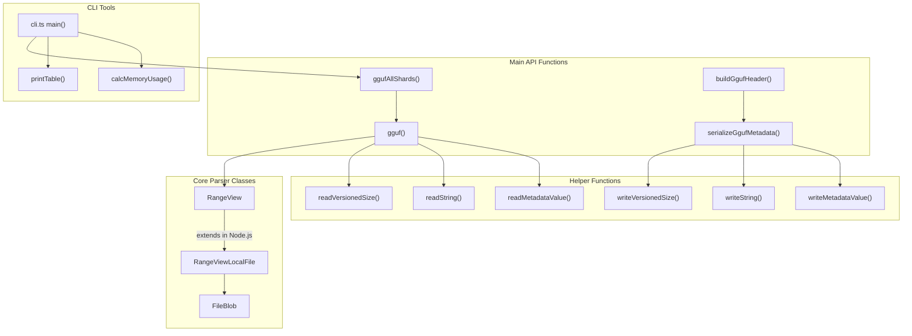
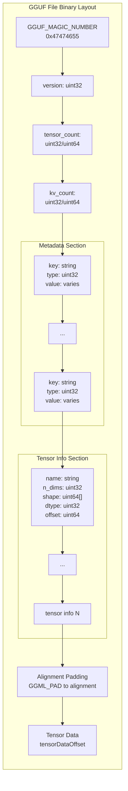
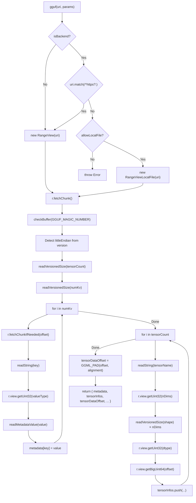
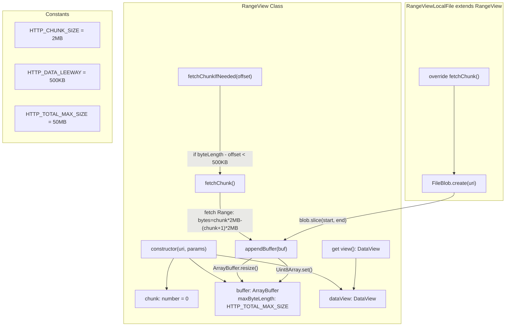
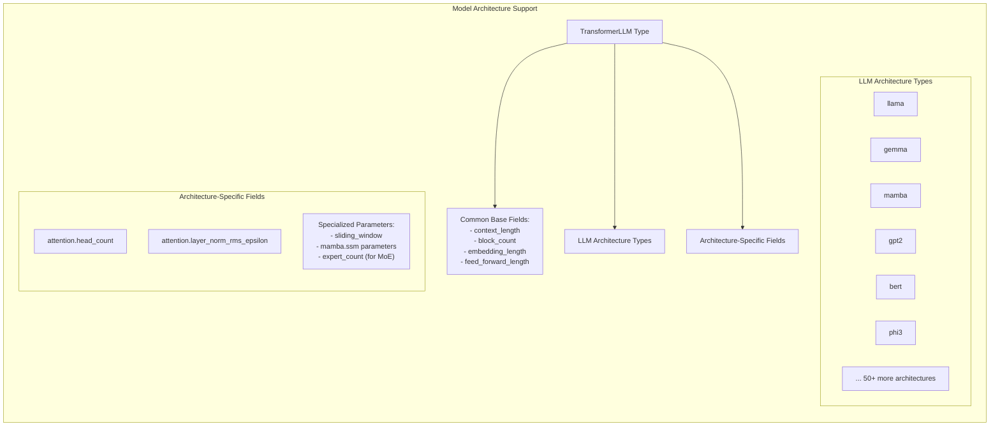
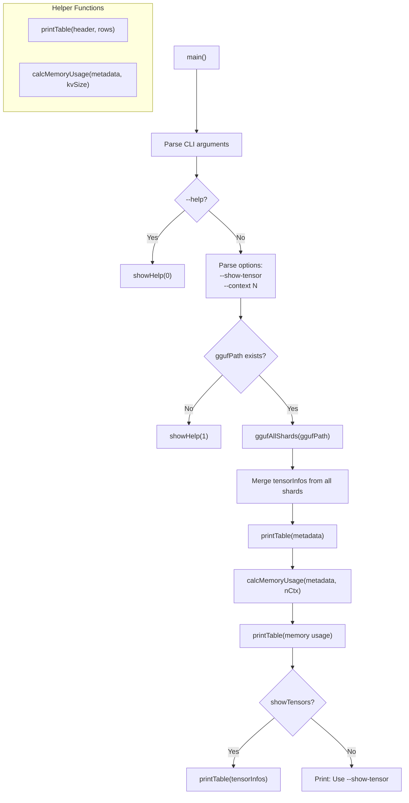
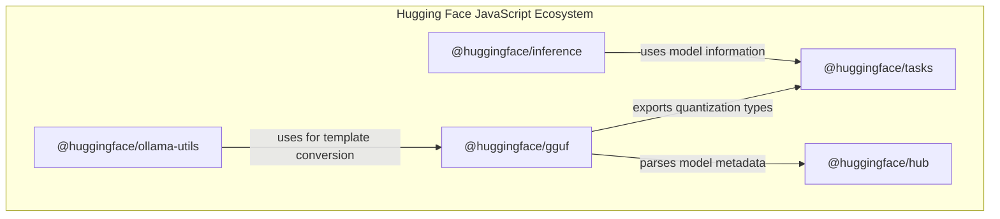

<!-- source: DeepWiki mcp.deepwiki.com · repo huggingface/huggingface.js · page 3.2 GGUF Library · fetched 2026-10-26 -->

# GGUF Library

<details>
<summary>Relevant source files</summary>

The following files were used as context for generating this wiki page:

- [packages/gguf/README.md](packages/gguf/README.md)
- [packages/gguf/package.json](packages/gguf/package.json)
- [packages/gguf/pnpm-lock.yaml](packages/gguf/pnpm-lock.yaml)
- [packages/gguf/scripts/generate-llm.ts](packages/gguf/scripts/generate-llm.ts)
- [packages/gguf/src/cli.ts](packages/gguf/src/cli.ts)
- [packages/gguf/src/gguf.spec.ts](packages/gguf/src/gguf.spec.ts)
- [packages/gguf/src/gguf.ts](packages/gguf/src/gguf.ts)
- [packages/gguf/src/quant-descriptions.ts](packages/gguf/src/quant-descriptions.ts)
- [packages/gguf/src/transformer-llm.ts](packages/gguf/src/transformer-llm.ts)
- [packages/gguf/src/types.spec.ts](packages/gguf/src/types.spec.ts)
- [packages/gguf/src/types.ts](packages/gguf/src/types.ts)
- [packages/gguf/src/utils/FileBlob.ts](packages/gguf/src/utils/FileBlob.ts)
- [packages/gguf/src/utils/isBackend.ts](packages/gguf/src/utils/isBackend.ts)
- [packages/hub/src/lib/parse-safetensors-metadata.spec.ts](packages/hub/src/lib/parse-safetensors-metadata.spec.ts)
- [packages/hub/src/lib/parse-safetensors-metadata.ts](packages/hub/src/lib/parse-safetensors-metadata.ts)
- [packages/tasks/src/gguf.ts](packages/tasks/src/gguf.ts)

</details>


The GGUF Library (`@huggingface/gguf`) is a JavaScript utility for parsing GGUF (GGML Unified Format) files used by machine learning models, particularly large language models (LLMs). This library specifically enables efficient inspection of model metadata and tensor information without needing to download or load the entire model into memory, which is especially useful for remotely hosted files.

For information about model conversion or the GGUF format specification itself, see the [Architecture and Design Patterns](#5) section.

## Overview

The GGUF Library provides tools to extract metadata and tensor information from GGUF files, working with both remote and local files (local files supported in Node.js environments only). It implements efficient HTTP range requests to parse remote files without downloading them completely, making it suitable for browser applications that need to inspect model properties. The library also provides serialization functions for modifying and reconstructing GGUF headers.

### Library Architecture



Sources: [packages/gguf/src/gguf.ts:244-506](), [packages/gguf/src/cli.ts:1-219](), [packages/gguf/src/utils/FileBlob.ts:1-121]()

## Core Features

### 1. GGUF Parsing

The library's primary function `gguf()` parses GGUF files and extracts:

- **Metadata**: Architecture type, model name, context length, quantization information, etc.
- **Tensor Information**: Weight tensor shapes, data types, and memory locations
- **Format Details**: GGUF version, endianness, tensor data offset, and alignment

The function supports multiple overloads for different use cases:

```typescript
// Basic usage - returns metadata and tensorInfos
const result = await gguf(url);

// With typed metadata - returns GGUFTypedMetadata
const result = await gguf(url, { typedMetadata: true });

// With parameter count calculation
const result = await gguf(url, { computeParametersCount: true });

// Combined options
const result = await gguf(url, {
  typedMetadata: true,
  computeParametersCount: true,
  allowLocalFile: true,  // Node.js only
});
```

Sources: [packages/gguf/src/gguf.ts:244-506](), [packages/gguf/README.md:22-59]()

### 2. Typed Metadata

The library provides an optional `typedMetadata` parameter that returns metadata with type information:

```typescript
const { typedMetadata } = await gguf(url, { typedMetadata: true });

// Each field includes value, type, and optionally subType (for arrays)
console.log(typedMetadata.version);
// { value: 2, type: GGUFValueType.UINT32 }

console.log(typedMetadata["general.architecture"]);
// { value: "llama", type: GGUFValueType.STRING }

console.log(typedMetadata["tokenizer.ggml.tokens"]);
// { value: [...], type: GGUFValueType.ARRAY, subType: GGUFValueType.STRING }
```

The typed metadata preserves complete type information from the GGUF file, which is useful for:
- Validating metadata types
- Re-serializing metadata with correct types
- Understanding the exact binary representation

Sources: [packages/gguf/src/gguf.ts:352-420](), [packages/gguf/src/types.ts:106-133](), [packages/gguf/README.md:71-104]()

### 3. Sharded Model Support

For large models split into multiple files, the `ggufAllShards()` function consolidates information across shards:

```typescript
import { ggufAllShards } from "@huggingface/gguf";

// Parse a sharded model (automatically finds all shards)
const { shards, parameterCount } = await ggufAllShards(
  "path/to/model-00001-of-00009.gguf"
);

console.log(`Model has ${parameterCount} parameters`);
```

Sources: [packages/gguf/src/gguf.ts:404-445](), [packages/gguf/src/gguf.spec.ts:267-276]()

### 4. Comprehensive Quantization Support

The library includes detailed documentation for all quantization types found in GGUF files, providing descriptions and bit-per-weight information:

```typescript
import { GGMLQuantizationType, GGUF_QUANT_DESCRIPTIONS } from "@huggingface/gguf";

// Get information about a specific quantization method
console.log(GGUF_QUANT_DESCRIPTIONS[GGMLQuantizationType.Q4_K].txt);
// "4-bit quantization (q). Super-blocks with 8 blocks, each block has 32 weights..."
```

Sources: [packages/gguf/src/quant-descriptions.ts:1-166]()

### 5. Metadata Serialization

The library provides functions to serialize GGUF metadata and reconstruct headers, enabling metadata modification:

#### `serializeGgufMetadata()`

Serializes typed metadata to a binary `Uint8Array` with proper GGUF formatting:

```typescript
import { serializeGgufMetadata, GGUFValueType } from "@huggingface/gguf";

const typedMetadata = {
  version: { value: 2, type: GGUFValueType.UINT32 },
  tensor_count: { value: 0n, type: GGUFValueType.UINT64 },
  kv_count: { value: 2n, type: GGUFValueType.UINT64 },
  "general.architecture": { value: "llama", type: GGUFValueType.STRING },
  "general.name": { value: "My Model", type: GGUFValueType.STRING },
};

const serialized = serializeGgufMetadata(typedMetadata, {
  littleEndian: true,  // default
  alignment: 32,       // default: GGUF_DEFAULT_ALIGNMENT
});
```

Sources: [packages/gguf/src/gguf.ts:668-776]()

#### `buildGgufHeader()`

Reconstructs a complete GGUF header by combining updated metadata with original tensor information:

```typescript
import { gguf, buildGgufHeader } from "@huggingface/gguf";

// Parse original file
const { typedMetadata, tensorInfoByteRange, littleEndian } = await gguf(url, {
  typedMetadata: true,
});

// Modify metadata
typedMetadata["general.name"] = { 
  value: "Modified Model", 
  type: GGUFValueType.STRING 
};

// Reconstruct header
const originalBlob = await fetch(url).then(r => r.blob());
const newHeader = await buildGgufHeader(originalBlob, typedMetadata, {
  littleEndian,
  tensorInfoByteRange,
});
```

This function:
1. Serializes the updated metadata using `serializeGgufMetadata()`
2. Extracts the original tensor info section from the file
3. Calculates proper alignment and padding
4. Returns a new header blob ready for file reconstruction

Sources: [packages/gguf/src/gguf.ts:788-845]()

## Architecture

The GGUF Library's architecture is designed for efficient parsing of potentially very large files by implementing a streaming approach with range requests.

### GGUF File Format Structure



Sources: [packages/gguf/src/gguf.ts:29-30](), [packages/gguf/src/gguf.ts:310-460]()

### Parsing Flow



Sources: [packages/gguf/src/gguf.ts:244-506]()

### RangeView Streaming System

The library implements a `RangeView` class that handles efficient data fetching with HTTP range requests:

#### RangeView Architecture



**Key Features:**
- **Chunked Reading**: Downloads 2MB chunks (`HTTP_CHUNK_SIZE`) at a time
- **Lazy Loading**: Only fetches additional chunks when needed (within 500KB of end)
- **Memory Efficiency**: Uses resizable `ArrayBuffer` up to 50MB maximum
- **Browser Compatibility**: Falls back to manual buffer copying if `ArrayBuffer.resize()` is unavailable
- **Local File Support**: `RangeViewLocalFile` extends base class for Node.js file system access

Sources: [packages/gguf/src/gguf.ts:63-167](), [packages/gguf/src/utils/FileBlob.ts:22-121](), [packages/gguf/src/utils/isBackend.ts:1-7]()

## Data Types and Formats

The GGUF library supports parsing various value types and handles different data formats found in GGUF files.

### GGUF Value Types

The library provides enums for all supported data types in the GGUF format:

| Type ID | Name | Description |
|---------|------|-------------|
| 0 | UINT8 | 8-bit unsigned integer |
| 1 | INT8 | 8-bit signed integer |
| 2 | UINT16 | 16-bit unsigned integer |
| 3 | INT16 | 16-bit signed integer |
| 4 | UINT32 | 32-bit unsigned integer |
| 5 | INT32 | 32-bit signed integer |
| 6 | FLOAT32 | 32-bit floating point |
| 7 | BOOL | Boolean value |
| 8 | STRING | Text string |
| 9 | ARRAY | Array of values |
| 10 | UINT64 | 64-bit unsigned integer |
| 11 | INT64 | 64-bit signed integer |
| 12 | FLOAT64 | 64-bit floating point |

Sources: [packages/gguf/src/types.ts:50-64]()

### Quantization Types

The library supports a wide range of quantization types used in GGML/GGUF models:

| Quantization Method | Bits Per Weight | Description |
|---------------------|-----------------|-------------|
| F32 | 32.0 | 32-bit standard IEEE 754 floating-point |
| F16 | 16.0 | 16-bit standard IEEE 754 half-precision |
| Q8_K | 8.0 | 8-bit quantization with blocks of 256 weights |
| Q6_K | 6.5625 | 6-bit quantization with super-blocks |
| Q5_K | 5.5 | 5-bit quantization with blocks of 32 weights |
| Q4_K | 4.5 | 4-bit quantization with super-blocks |
| Q3_K | 3.4375 | 3-bit quantization with blocks of 16 weights |
| Q2_K | 2.625 | 2-bit quantization with super-blocks |
| IQ4_XS | 4.25 | 4-bit importance-based quantization |
| IQ3_XXS | 3.06 | 3-bit importance-based quantization |
| IQ2_XXS | 2.06 | 2-bit importance-based quantization |

Sources: [packages/gguf/src/quant-descriptions.ts:3-127](), [packages/gguf/src/quant-descriptions.ts:136-166]()

## Model Architecture Support

The GGUF Library includes comprehensive support for various model architectures, with type-safe access to architecture-specific metadata fields. The list of supported architectures is extensive and includes:



Sources: [packages/gguf/src/transformer-llm.ts:55-108](), [packages/gguf/src/transformer-llm.ts:342-399]()

### Auto-Generated Model Types

The library includes auto-generated type definitions for all model architectures by parsing the llama.cpp source code. This ensures the library stays up-to-date with the latest architectures and parameters, providing proper type checking for model metadata.

```typescript
// Example of architecture-specific typing
if (metadata["general.architecture"] === "llama") {
  // Type-safe access to llama-specific parameters
  const headCount = metadata["llama.attention.head_count"];
  const headCountKv = metadata["llama.attention.head_count_kv"];
  const contextLength = metadata["llama.context_length"];
} else if (metadata["general.architecture"] === "mamba") {
  // Type-safe access to mamba-specific parameters
  const convKernel = metadata["mamba.ssm.conv_kernel"];
  const innerSize = metadata["mamba.ssm.inner_size"];
}
```

Sources: [packages/gguf/scripts/generate-llm.ts:1-269](), [packages/gguf/src/transformer-llm.ts:1-400]()

## Command Line Interface

The GGUF Library includes a command-line tool called `gguf-view` for inspecting GGUF files, similar to the `gguf_dump.py` script in llama.cpp.

### CLI Implementation



### Basic Usage

```bash
# View metadata of a GGUF file
npx @huggingface/gguf path/to/model.gguf

# View both metadata and tensor information
npx @huggingface/gguf --show-tensor path/to/model.gguf

# Specify context length for memory usage calculation
npx @huggingface/gguf --context 8192 path/to/model.gguf
```

### Memory Usage Calculation

The CLI calculates KV cache memory usage based on model architecture:

```typescript
// From cli.ts calcMemoryUsage()
const arch = metadata["general.architecture"];
const n_embd = metadata[`${arch}.embedding_length`];
const n_head = metadata[`${arch}.attention.head_count`];
const n_embd_head_k = metadata[`${arch}.attention.key_length`] ?? n_embd / n_head;
const n_embd_head_v = metadata[`${arch}.attention.value_length`] ?? n_embd / n_head;
const n_head_kv = metadata[`${arch}.attention.head_count_kv`];
const n_layer = metadata[`${arch}.block_count`];

// Calculate memory per layer
for (let i = 0; i < n_layer; i++) {
  const n_embd_k_gqa = n_embd_head_k * n_head_kv_arr[i];
  const n_embd_v_gqa = n_embd_head_v * n_head_kv_arr[i];
  totalElemsK += n_embd_k_gqa * kvSize;
  totalElemsV += n_embd_v_gqa * kvSize;
}
```

The memory estimate includes:
- **K cache**: Key embeddings across all layers
- **V cache**: Value embeddings across all layers  
- **Weight**: Model tensor weights
- **Overhead**: ~5% of model weight + base overhead

Sources: [packages/gguf/src/cli.ts:23-138](), [packages/gguf/src/cli.ts:140-185](), [packages/gguf/README.md:136-171]()

## Usage Examples

### Basic Metadata Extraction

```typescript
import { gguf } from "@huggingface/gguf";

const { metadata, tensorInfos } = await gguf(
  "https://huggingface.co/TheBloke/Llama-2-7B-Chat-GGUF/resolve/main/llama-2-7b-chat.Q4_K_M.gguf"
);

// Access general model information
console.log(`Model: ${metadata["general.name"]}`);
console.log(`Architecture: ${metadata["general.architecture"]}`);
console.log(`Context length: ${metadata["llama.context_length"]}`);

// Get tokenizer information
if (metadata["tokenizer.ggml.model"]) {
  console.log(`Tokenizer: ${metadata["tokenizer.ggml.model"]}`);
  console.log(`Vocabulary size: ${metadata["tokenizer.ggml.tokens"].length}`);
}

// Get first few tensors
tensorInfos.slice(0, 3).forEach(tensor => {
  console.log(`${tensor.name}: shape=${tensor.shape}, type=${tensor.dtype}`);
});
```

Sources: [packages/gguf/src/gguf.spec.ts:38-96](), [packages/gguf/README.md:22-59]()

### Working with Local Files

```typescript
import { gguf } from "@huggingface/gguf";

// Only works in Node.js environments
const { metadata, tensorInfos } = await gguf(
  "./my_model.gguf", 
  { allowLocalFile: true }
);

// Calculate parameter count
const parameterCount = tensorInfos
  .map(({ shape }) => shape.reduce((acc, val) => acc * Number(val), 1))
  .reduce((acc, val) => acc + val, 0);

console.log(`Model has ${parameterCount} parameters`);
```

Sources: [packages/gguf/src/gguf.spec.ts:251-256](), [packages/gguf/README.md:61-69]()

### Working with Non-Standard Metadata

For custom GGUF files with non-standard metadata fields, you can use the non-strict typing:

```typescript
import { gguf, GGUFParseOutput } from "@huggingface/gguf";

// Parse with non-strict typing for custom metadata fields
const { metadata } = await gguf(
  "https://example.com/custom.gguf"
) as GGUFParseOutput<{ strict: false }>;

// Access custom fields
console.log(metadata["custom.field"]);
console.log(metadata["lora.weights"]);
```

Sources: [packages/gguf/README.md:126-133](), [packages/gguf/src/types.spec.ts:18-24]()

### Serialization Round-Trip Example

The library supports full round-trip serialization, allowing you to parse, modify, and reconstruct GGUF files:

```typescript
import { gguf, serializeGgufMetadata, GGUFValueType } from "@huggingface/gguf";
import { writeFileSync } from "node:fs";

// 1. Parse original file
const { typedMetadata, tensorInfoByteRange, littleEndian } = 
  await gguf(url, { typedMetadata: true });

// 2. Modify metadata
typedMetadata["general.name"] = {
  value: "Modified Model",
  type: GGUFValueType.STRING
};

// 3. Serialize to binary
const newHeader = serializeGgufMetadata(typedMetadata, { littleEndian });

// 4. Write to file
writeFileSync("modified.gguf", new Uint8Array(newHeader));
```

The serialization process:
1. Writes GGUF magic number (`0x47474755`)
2. Writes version as `uint32`
3. Writes tensor count and KV count (version-dependent sizes)
4. Writes all key-value pairs with proper type encoding
5. Applies alignment padding (`GGML_PAD`)

Sources: [packages/gguf/src/gguf.spec.ts:588-640](), [packages/gguf/src/gguf.ts:668-776]()

## Compatibility and Limitations

- **Browser Support**: Works in browsers but cannot access local files in browser environments
- **Node.js Version**: Requires Node.js version 20 or higher 
- **Fetch API**: Uses the Fetch API for HTTP requests, with support for custom fetch implementations
- **Endianness**: Handles both little-endian and big-endian GGUF files
- **GGUF Versions**: Supports GGUF format versions 1, 2, and 3
- **Memory Efficiency**: Uses HTTP range requests to minimize memory usage when parsing remote files

Sources: [packages/gguf/src/gguf.ts:263-281](), [packages/gguf/package.json:29-31]()

## Integration with Hugging Face Ecosystem

The GGUF Library is part of the Hugging Face JavaScript ecosystem and integrates with other libraries:



The library is particularly useful for:

1. **Analyzing models**: Inspecting model architecture, parameters, and quantization
2. **Integration with Ollama**: Used by `@huggingface/ollama-utils` for template conversion
3. **Model discovery**: Identifying model capabilities based on metadata
4. **Memory planning**: Estimating memory requirements for running models

Sources: [packages/gguf/package.json:56-58](), [packages/gguf/src/gguf.ts:9]()

## Conclusion

The GGUF Library provides efficient tools for parsing and analyzing GGUF model files without loading the entire model into memory. It supports both remote and local files, offers comprehensive type definitions for various model architectures, and includes a CLI tool for easy inspection of model metadata. The library is designed to work in both browser and Node.js environments, making it versatile for different applications.

---

