# Page: Overview

# Overview

<details>
<summary>Relevant source files</summary>

The following files were used as context for generating this wiki page:

- [README.md](README.md)
- [package.json](package.json)
- [packages/doc-internal/fix-cdn-versions.ts](packages/doc-internal/fix-cdn-versions.ts)
- [packages/doc-internal/package.json](packages/doc-internal/package.json)
- [packages/doc-internal/pnpm-lock.yaml](packages/doc-internal/pnpm-lock.yaml)
- [packages/hub/package.json](packages/hub/package.json)
- [packages/hub/pnpm-lock.yaml](packages/hub/pnpm-lock.yaml)
- [packages/inference/package.json](packages/inference/package.json)
- [packages/inference/pnpm-lock.yaml](packages/inference/pnpm-lock.yaml)
- [packages/inference/src/package.ts](packages/inference/src/package.ts)
- [packages/inference/test/global.d.ts](packages/inference/test/global.d.ts)
- [pnpm-lock.yaml](pnpm-lock.yaml)

</details>


## Purpose and Scope

The Hugging Face.js monorepo provides a collection of JavaScript and TypeScript libraries for interacting with the Hugging Face ecosystem. These libraries enable developers to perform machine learning inference, manage repositories and files on the Hugging Face Hub, parse model formats, and integrate with AI agent frameworks—all from JavaScript/TypeScript environments including Node.js, browsers, Deno, and Bun.

This overview introduces the monorepo's structure, package organization, and architectural principles. For detailed information about specific packages:
- ML inference capabilities, see [Inference Library](#2.1)
- Repository and file management, see [Hub Library](#2.2)
- AI agent development, see [Agents and MCP Library](#2.3)
- Task definitions and type system, see [Tasks Library](#3.1)

**Sources:** [README.md:54-73]()

## Monorepo Structure

The repository contains 12+ packages organized in the `packages/` directory, with three primary user-facing libraries and several supporting packages:

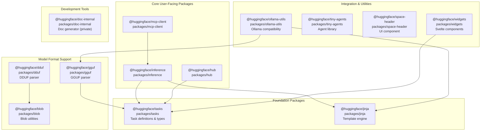

**Sources:** [README.md:54-68](), [packages/inference/package.json:61-64](), [packages/hub/package.json:64-66]()

## Package Dependency Structure

The packages follow a layered dependency architecture where foundation packages have no dependencies on user-facing packages:

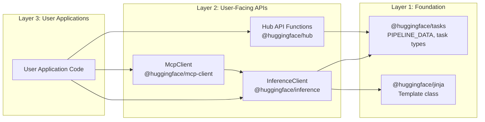

The foundation packages (`@huggingface/tasks` and `@huggingface/jinja`) are workspace dependencies declared in package.json files using the `workspace:^` protocol, enabling monorepo version management.

**Sources:** [packages/inference/pnpm-lock.yaml:10-16](), [packages/hub/pnpm-lock.yaml:10-13]()

## Installation and Distribution

### NPM Installation

Packages are published to the public NPM registry and can be installed individually:

```bash
npm install @huggingface/inference
npm install @huggingface/hub
npm install @huggingface/mcp-client
```

Each package is configured with `publishConfig.access: "public"` to enable public distribution.

**Sources:** [README.md:76-84](), [packages/inference/package.json:43-45](), [packages/hub/package.json:46-48]()

### CDN and Browser Usage

Packages support direct browser usage via CDN without bundlers, using ES modules:

```html
<script type="module">
  import { InferenceClient } from 'https://cdn.jsdelivr.net/npm/@huggingface/inference@4.13.11/+esm';
  import { createRepo } from "https://cdn.jsdelivr.net/npm/@huggingface/hub@2.8.0/+esm";
</script>
```

Version numbers in CDN URLs are automatically maintained by the `fix-cdn-versions.ts` script during documentation generation, which reads version numbers from package.json files and updates README.md files.

**Sources:** [README.md:95-104](), [packages/doc-internal/fix-cdn-versions.ts:1-17]()

### Deno Support

Packages work with Deno through esm.sh or npm: protocol:

```typescript
import { InferenceClient } from "https://esm.sh/@huggingface/inference"
import { createRepo } from "npm:@huggingface/hub"
```

**Sources:** [README.md:106-117]()

## Module Format Architecture

All packages are built to support both ESM (ECMAScript Modules) and CommonJS formats for maximum compatibility:

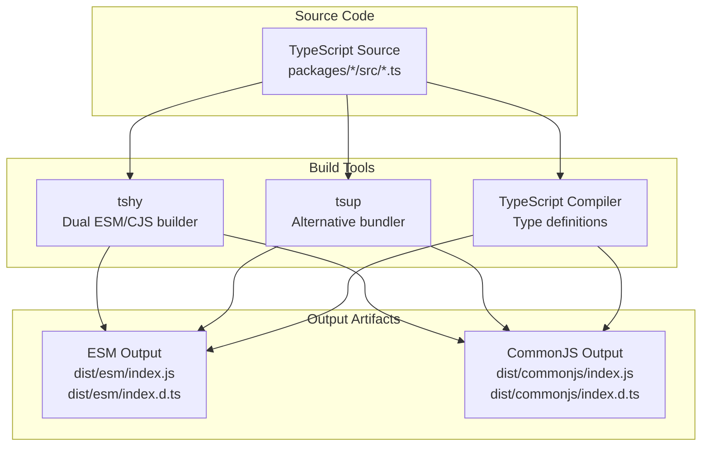

The package.json files configure export mappings to support both formats:

```json
{
  "type": "module",
  "main": "./dist/commonjs/index.js",
  "module": "./dist/esm/index.js",
  "exports": {
    ".": {
      "import": {
        "types": "./dist/esm/index.d.ts",
        "default": "./dist/esm/index.js"
      },
      "require": {
        "types": "./dist/commonjs/index.d.ts",
        "default": "./dist/commonjs/index.js"
      }
    }
  }
}
```

**Sources:** [packages/inference/package.json:26-42](), [README.md:273-276](), [package.json:24-26]()

## Environment Requirements

The libraries target modern JavaScript environments and avoid polyfills and legacy dependencies:

| Environment | Minimum Version | Notes |
|-------------|----------------|-------|
| Node.js | >= 18 | Specified in engines field |
| Browsers | Modern (ES2020+) | Native ES modules support required |
| Bun | Latest | Full compatibility |
| Deno | Latest | Via esm.sh or npm: protocol |

The strict version requirement enables use of modern features like native `fetch`, `crypto`, and async iterators without polyfills.

**Sources:** [README.md:70-71](), [packages/inference/package.json:75-77](), [packages/hub/package.json:73-75]()

## Build and Development Workflow

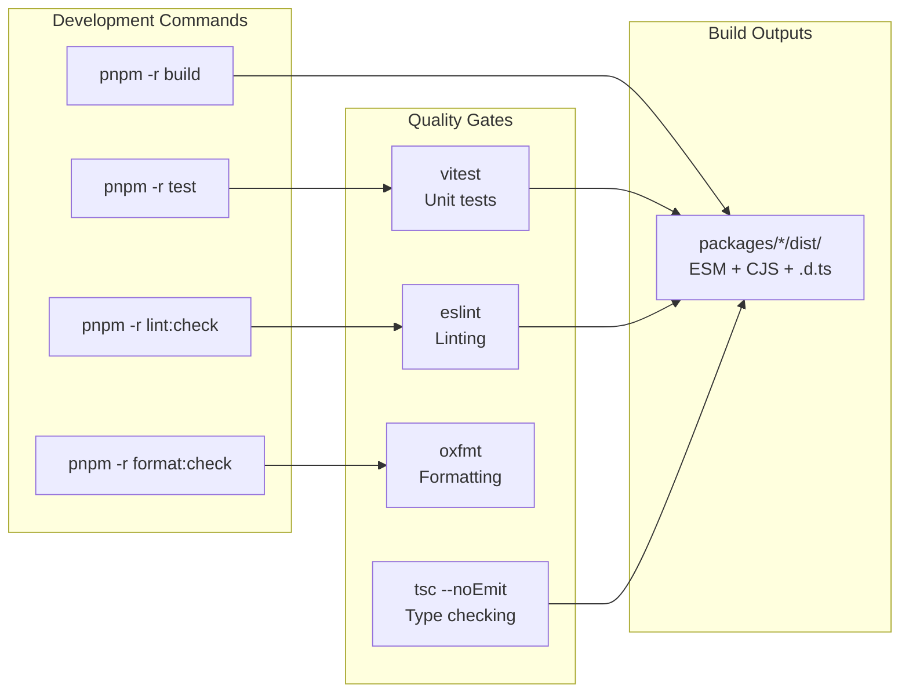

The monorepo uses `pnpm` with workspace support and `-r` (recursive) flag to execute commands across all packages. The package manager is enforced with `"packageManager": "pnpm@10.10.0"` in package.json.

**Sources:** [README.md:259-276](), [package.json:5-11](), [package.json:32]()

## Documentation Generation

Documentation is generated using TypeDoc and processed through custom scripts:

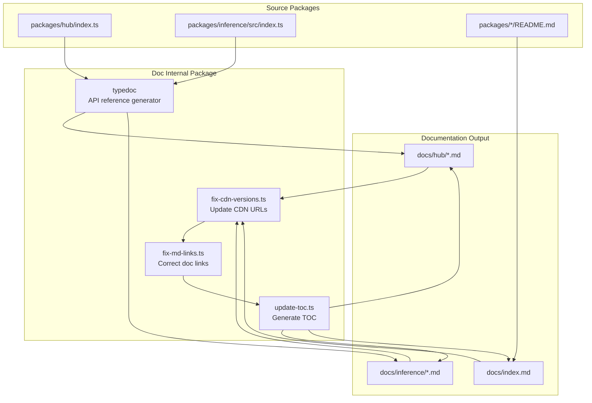

The `@huggingface/doc-internal` package (private, not published) orchestrates the documentation build process through its `start` script which runs TypeDoc with the `typedoc-plugin-markdown` plugin and post-processes the output.

**Sources:** [packages/doc-internal/package.json:8-24](), [packages/doc-internal/fix-cdn-versions.ts:1-17]()

## Primary Use Cases

### ML Inference

```typescript
import { InferenceClient } from "@huggingface/inference";

const client = new InferenceClient("hf_...");

// Chat completion with provider selection
await client.chatCompletion({
  model: "meta-llama/Llama-3.1-8B-Instruct",
  provider: "sambanova",
  messages: [{ role: "user", content: "Hello!" }],
  max_tokens: 512
});

// Image generation
await client.textToImage({
  model: "black-forest-labs/FLUX.1-dev",
  provider: "replicate",
  inputs: "a picture of a green bird"
});
```

The `InferenceClient` class provides 25+ task-specific methods that route requests to multiple inference providers.

**Sources:** [README.md:30-51](), [README.md:125-194]()

### Repository Management

```typescript
import { createRepo, uploadFile, deleteFiles } from "@huggingface/hub";

await createRepo({
  repo: "my-user/nlp-model",
  accessToken: "hf_..."
});

await uploadFile({
  repo: "my-user/nlp-model",
  accessToken: "hf_...",
  file: {
    path: "pytorch_model.bin",
    content: new Blob(...)
  }
});
```

The Hub package provides functions for creating repositories, uploading/downloading files, and managing model metadata.

**Sources:** [README.md:13-28](), [README.md:196-223]()

### AI Agent Development

```typescript
import { Agent } from '@huggingface/mcp-client';

const agent = new Agent({
  provider: "auto",
  model: "Qwen/Qwen2.5-72B-Instruct",
  apiKey: "hf_...",
  servers: [{
    command: "npx",
    args: ["@playwright/mcp@latest"]
  }]
});

await agent.loadTools();

for await (const chunk of agent.run("What are trending models?")) {
  if ("choices" in chunk) {
    console.log(chunk.choices[0]?.delta.content);
  }
}
```

The MCP client enables building AI agents that can use tools via the Model Context Protocol.

**Sources:** [README.md:225-256]()

## Version Management

Package versions are managed independently with semantic versioning. Current versions are stored in package.json files and referenced throughout the codebase:

- `@huggingface/inference`: Version exported from [packages/inference/src/package.ts:2]() as `PACKAGE_VERSION` constant
- `@huggingface/hub`: Version in [packages/hub/package.json:3]()

Version synchronization across documentation and examples is handled by the `fix-cdn-versions.ts` script which reads package.json files and updates CDN URLs in README files.

**Sources:** [packages/inference/src/package.ts:1-4](), [packages/inference/package.json:3](), [packages/hub/package.json:3]()

---

# Page: Core Libraries

# Core Libraries

<details>
<summary>Relevant source files</summary>

The following files were used as context for generating this wiki page:

- [README.md](README.md)
- [package.json](package.json)
- [packages/doc-internal/fix-cdn-versions.ts](packages/doc-internal/fix-cdn-versions.ts)
- [packages/doc-internal/package.json](packages/doc-internal/package.json)
- [packages/doc-internal/pnpm-lock.yaml](packages/doc-internal/pnpm-lock.yaml)
- [packages/hub/package.json](packages/hub/package.json)
- [packages/hub/pnpm-lock.yaml](packages/hub/pnpm-lock.yaml)
- [packages/inference/package.json](packages/inference/package.json)
- [packages/inference/pnpm-lock.yaml](packages/inference/pnpm-lock.yaml)
- [packages/inference/src/package.ts](packages/inference/src/package.ts)
- [packages/inference/test/global.d.ts](packages/inference/test/global.d.ts)
- [pnpm-lock.yaml](pnpm-lock.yaml)

</details>


This document provides a technical overview of the core JavaScript libraries that form the foundation of the Hugging Face JS ecosystem. These libraries enable developers to interact with machine learning models, manage content on the Hugging Face Hub, and build AI-powered applications. For information about supporting libraries that extend this functionality, see [Supporting Libraries](#3).

## Overview

The Hugging Face JavaScript ecosystem is built around three primary core libraries:

1. **@huggingface/inference** - A TypeScript client for making inference requests to Hugging Face models and other AI providers
2. **@huggingface/hub** - Utilities for programmatically interacting with the Hugging Face Hub API
3. **@huggingface/agents** - Tools for building agent-based applications with Hugging Face models

These libraries are designed for modern JavaScript environments and require Node.js >= 18, Bun, or Deno. They work in both server-side and client-side contexts, with browser-specific optimizations where needed.

## Core Architecture

The following diagram illustrates the high-level architecture of the core libraries and their relationships with supporting libraries:

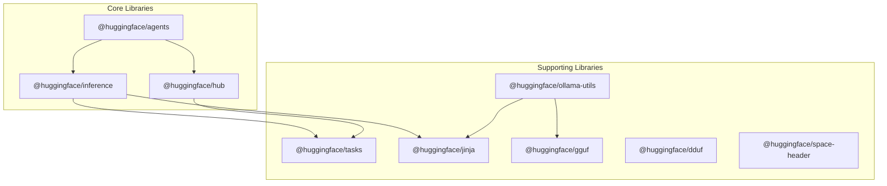

Sources: [README.md:54-67](README.md:54-67), [packages/hub/package.json:6-7](packages/hub/package.json:6-7), [packages/inference/package.json:6-11](packages/inference/package.json:6-11)

The core libraries follow a modular design with clear separation of concerns. They depend on supporting libraries that provide shared functionality such as task definitions, templating, and file format parsing.

## Inference Library (@huggingface/inference)

The Inference library provides a unified client for making inference requests to various AI providers. It abstracts away the complexities of different provider APIs behind a consistent interface.

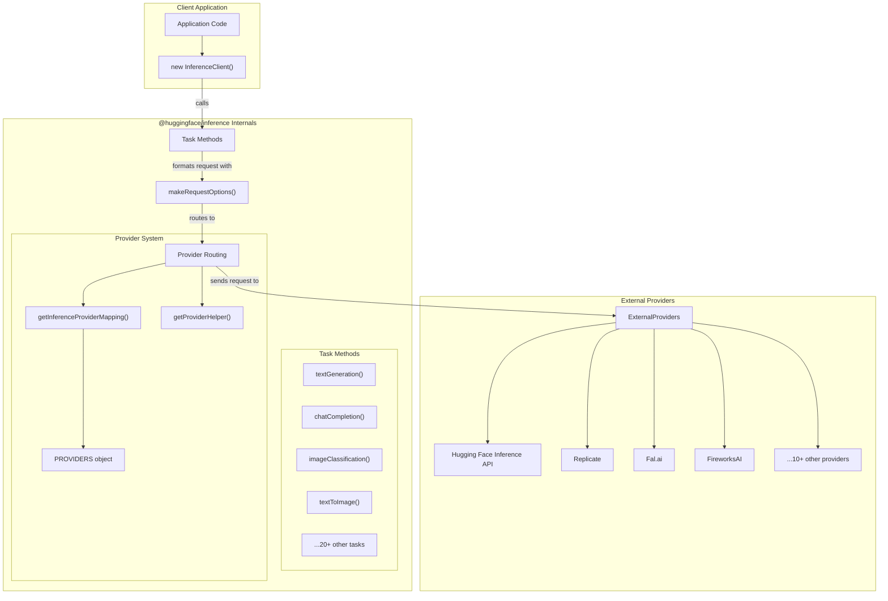

Sources: [packages/inference/package.json:14-18](packages/inference/package.json:14-18), [README.md:127-194](README.md:127-194)

### Key Components

- **InferenceClient** - Main client class for making inference requests
- **Task Methods** - Methods for different ML tasks (textGeneration, imageClassification, etc.)
- **Provider Routing** - System for routing requests to different providers based on the model and task

### Features

- Support for 20+ machine learning tasks
- Integration with 10+ inference providers
- Streaming support for applicable tasks (using async iterators)
- Type-safe API with comprehensive TypeScript definitions

### Usage Example

```ts
import { InferenceClient } from "@huggingface/inference";

const client = new InferenceClient("hf_token");

// Chat completion API
const response = await client.chatCompletion({
  model: "meta-llama/Llama-3.1-8B-Instruct",
  messages: [{ role: "user", content: "Hello, nice to meet you!" }],
  max_tokens: 512
});
console.log(response.choices[0].message);

// Using a third-party provider
await client.textToImage({
  model: "black-forest-labs/FLUX.1-dev",
  inputs: "a picture of a green bird",
  provider: "replicate"
});
```

## Hub Library (@huggingface/hub)

The Hub library provides utilities for interacting with the Hugging Face Hub API, enabling programmatic management of repositories and files.

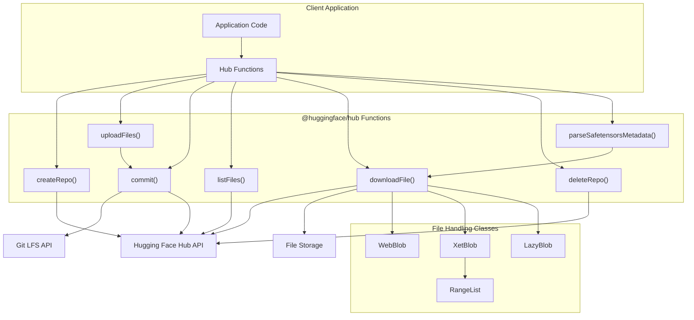

Sources: [packages/hub/package.json:3-10](packages/hub/package.json:3-10), [README.md:199-223](README.md:199-223)

### Key Components

- **Repository Management** - Functions for creating, deleting, and managing repositories
- **File Operations** - Functions for uploading, downloading, and managing files
- **Blob Handling** - Classes for handling different types of file blobs

### Features

- Support for all Hugging Face Hub repository types (models, datasets, spaces)
- File upload and download with chunking support
- Git LFS support for large file storage
- Browser and Node.js compatibility with environment-specific optimizations

### Usage Example

```ts
import { createRepo, uploadFile, deleteFiles } from "@huggingface/hub";

// Create a new repository
await createRepo({
  repo: "my-user/nlp-model",
  accessToken: "hf_token"
});

// Upload a file
await uploadFile({
  repo: "my-user/nlp-model",
  accessToken: "hf_token",
  file: {
    path: "model.safetensors",
    content: new Blob([...])
  }
});

// Delete files
await deleteFiles({
  repo: { type: "space", name: "my-user/my-space" },
  accessToken: "hf_token",
  paths: ["README.md", ".gitattributes"]
});
```

## Agents Library (@huggingface/agents)

The Agents library provides tools for building agent-based applications that can interact with Hugging Face models through natural language interfaces.

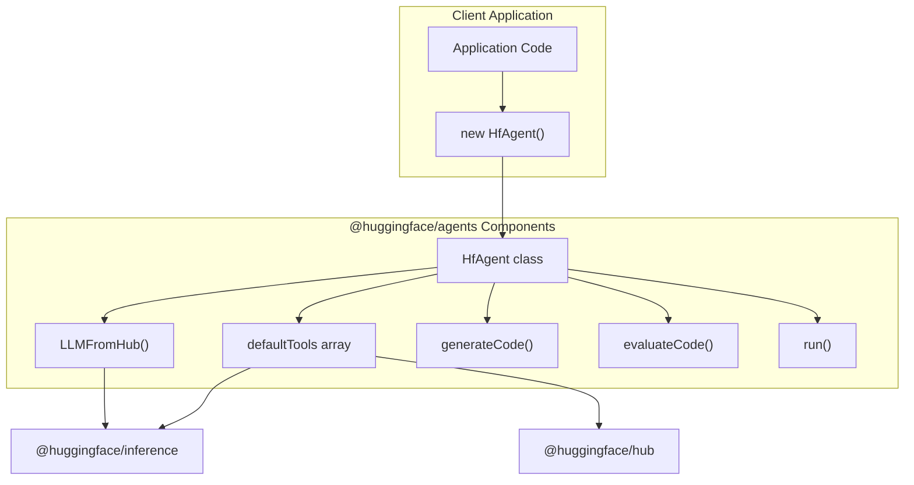

Sources: [README.md:227-248](README.md:227-248)

### Key Components

- **HfAgent** - Main class for creating agents
- **LLMFromHub** - Function for loading language models from the Hub
- **defaultTools** - Set of default tools for agents

### Features

- Code generation and evaluation based on natural language instructions
- Integration with various tools for different tasks
- Safety features for code execution

### Usage Example

```ts
import { HfAgent, LLMFromHub, defaultTools } from '@huggingface/agents';

const agent = new HfAgent(
  "hf_token",
  LLMFromHub("hf_token"),
  [...defaultTools]
);

// Generate code from natural language
const code = await agent.generateCode(
  "Draw a picture of a cat wearing a top hat. Then caption the picture."
);
console.log(code);

// Evaluate the generated code
const messages = await agent.evaluateCode(code);
console.log(messages);
```

## Installation and Usage

### Package Installation

The libraries can be installed via npm, yarn, or pnpm:

```bash
npm install @huggingface/inference
npm install @huggingface/hub
npm install @huggingface/agents
```

### CDN Usage

For browser environments, you can use the libraries directly from a CDN:

```html
<script type="module">
    import { InferenceClient } from 'https://cdn.jsdelivr.net/npm/@huggingface/inference@3.8.1/+esm';
    import { createRepo } from "https://cdn.jsdelivr.net/npm/@huggingface/hub@1.1.2/+esm";
</script>
```

### Deno Usage

```ts
import { InferenceClient } from "https://esm.sh/@huggingface/inference";
import { createRepo } from "https://esm.sh/@huggingface/hub";
// or
import { InferenceClient } from "npm:@huggingface/inference";
import { createRepo } from "npm:@huggingface/hub";
```

## Library Dependencies

The following diagram shows the dependencies between the core libraries and supporting packages:

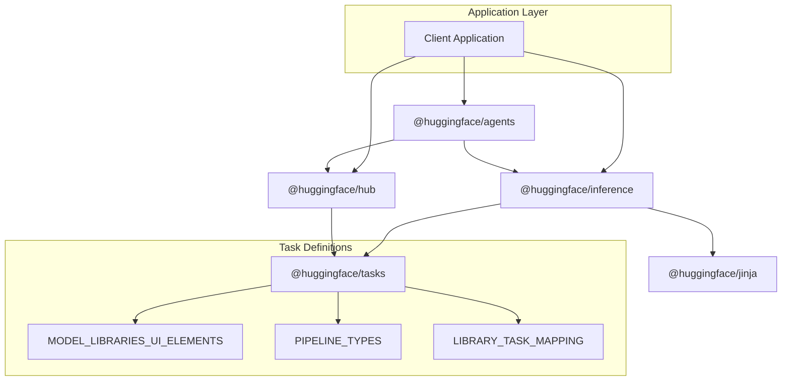

Sources: [packages/tasks/src/index.ts:1-69](packages/tasks/src/index.ts:1-69), [packages/inference/package.json:57-60](packages/inference/package.json:57-60), [packages/hub/package.json:64-66](packages/hub/package.json:64-66)

The `@huggingface/tasks` package serves as a central registry for the relationships between model libraries, pipeline types, and supported tasks. It defines:

- The full list of supported model libraries (100+ libraries)
- All available pipeline types (30+ task types)
- Which tasks are supported by which libraries

## Summary

The Hugging Face JavaScript core libraries provide a comprehensive foundation for integrating machine learning capabilities into JavaScript applications. With these libraries, developers can:

1. **Make inference requests** to any model on the Hugging Face Hub or through third-party providers
2. **Manage repositories and files** on the Hugging Face Hub programmatically
3. **Create intelligent agents** that interact with models through natural language

These libraries work together to enable a wide range of AI-powered applications, from simple model inference to complex agent-based systems.

Sources: [README.md:54-71](README.md:54-71), [packages/tasks/src/model-libraries.ts:44-60](packages/tasks/src/model-libraries.ts:44-60)

---

# Page: Inference Library

# Inference Library

<details>
<summary>Relevant source files</summary>

The following files were used as context for generating this wiki page:

- [.github/workflows/lint.yml](.github/workflows/lint.yml)
- [.github/workflows/test.yml](.github/workflows/test.yml)
- [README.md](README.md)
- [package.json](package.json)
- [packages/doc-internal/fix-cdn-versions.ts](packages/doc-internal/fix-cdn-versions.ts)
- [packages/doc-internal/package.json](packages/doc-internal/package.json)
- [packages/doc-internal/pnpm-lock.yaml](packages/doc-internal/pnpm-lock.yaml)
- [packages/hub/package.json](packages/hub/package.json)
- [packages/hub/pnpm-lock.yaml](packages/hub/pnpm-lock.yaml)
- [packages/inference/README.md](packages/inference/README.md)
- [packages/inference/package.json](packages/inference/package.json)
- [packages/inference/pnpm-lock.yaml](packages/inference/pnpm-lock.yaml)
- [packages/inference/src/config.ts](packages/inference/src/config.ts)
- [packages/inference/src/lib/getProviderHelper.ts](packages/inference/src/lib/getProviderHelper.ts)
- [packages/inference/src/lib/makeRequestOptions.ts](packages/inference/src/lib/makeRequestOptions.ts)
- [packages/inference/src/package.ts](packages/inference/src/package.ts)
- [packages/inference/src/providers/consts.ts](packages/inference/src/providers/consts.ts)
- [packages/inference/src/providers/wavespeed.ts](packages/inference/src/providers/wavespeed.ts)
- [packages/inference/src/providers/zai-org.ts](packages/inference/src/providers/zai-org.ts)
- [packages/inference/src/types.ts](packages/inference/src/types.ts)
- [packages/inference/test/InferenceClient.spec.ts](packages/inference/test/InferenceClient.spec.ts)
- [packages/inference/test/global.d.ts](packages/inference/test/global.d.ts)
- [pnpm-lock.yaml](pnpm-lock.yaml)

</details>


The Hugging Face Inference Library (`@huggingface/inference`) provides a unified JavaScript/TypeScript interface for accessing machine learning models through various inference providers. It simplifies working with AI models by offering a consistent API for tasks like text generation, image classification, and more. This library serves as a client for the Hugging Face Inference API, Inference Endpoints, and numerous third-party providers.

## Overview

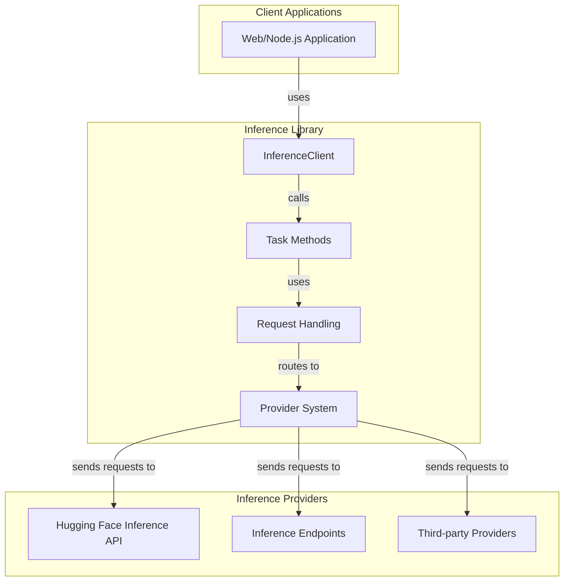

The library supports more than 30 different AI tasks across various domains (NLP, Computer Vision, Audio, Multimodal) and can route requests to over a dozen different inference providers.

Sources:
- [packages/inference/README.md:1-33]()
- [packages/inference/src/types.ts:40-56]()

## Core Components

### InferenceClient

The primary way to interact with the library is through the `InferenceClient` class, which provides methods for all supported AI tasks:

```typescript
import { InferenceClient } from '@huggingface/inference';

const hf = new InferenceClient('your_access_token');
const result = await hf.textGeneration({
  model: 'gpt2',
  inputs: 'The answer to the universe is'
});
```

Each task method takes appropriate arguments (model, inputs, parameters) and returns typed results.

Sources:
- [packages/inference/README.md:33-46]()
- [packages/inference/README.md:108-132]()

### Provider System

One of the library's key features is its ability to route requests to different inference providers:

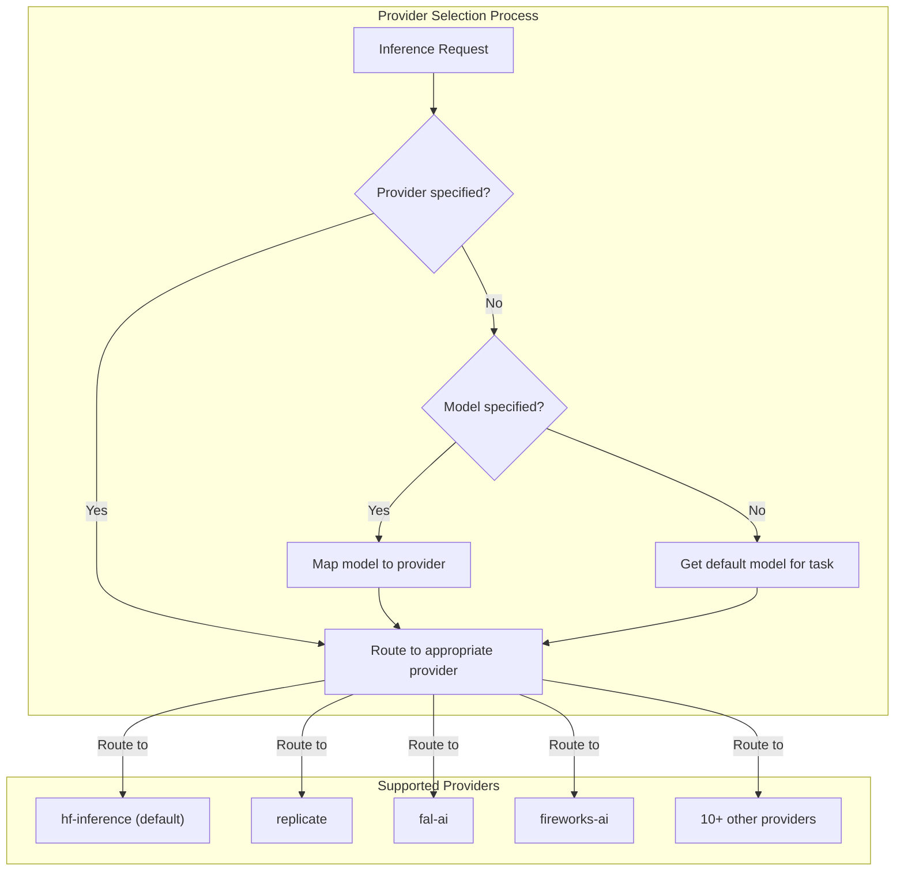

Each provider has specialized implementations for handling different tasks, formatting requests appropriately, and parsing responses into consistent formats.

Sources:
- [packages/inference/src/types.ts:40-56]()
- [packages/inference/README.md:45-93]()
- [packages/inference/src/lib/getProviderHelper.ts:1-48]()

### Request Flow

When making a request through the library, several key components work together:

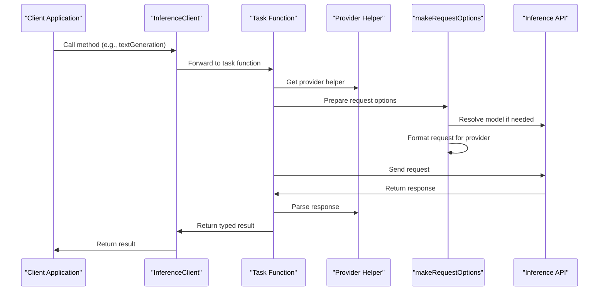

The request flow handles model resolution, provider selection, request formatting, and response parsing to provide a consistent experience regardless of the underlying provider.

Sources:
- [packages/inference/src/lib/makeRequestOptions.ts:1-96]()
- [packages/inference/src/tasks/nlp/textGeneration.ts:1-24]()

## Supported Tasks

The library organizes ML tasks into several categories:

### Natural Language Processing

```
- Text Generation
- Fill Mask
- Summarization
- Question Answering
- Table Question Answering
- Text Classification
- Token Classification
- Translation
- Zero-Shot Classification
- Conversational
- Sentence Similarity
- Feature Extraction
```

Sources:
- [packages/inference/README.md:111-334]()
- [packages/inference/src/tasks/nlp/sentenceSimilarity.ts:1-22]()

### Computer Vision

```
- Image Classification
- Object Detection
- Image Segmentation
- Image To Text
- Text To Image
- Image To Image
- Zero Shot Image Classification
```

Sources:
- [packages/inference/README.md:388-470]()
- [packages/inference/src/tasks/cv/textToImage.ts:1-36]()

### Audio

```
- Automatic Speech Recognition
- Audio Classification
- Text To Speech
- Audio To Audio
```

Sources:
- [packages/inference/README.md:336-386]()

### Multimodal

```
- Feature Extraction
- Visual Question Answering
- Document Question Answering
```

Sources:
- [packages/inference/README.md:482-526]()
- [packages/inference/src/tasks/nlp/featureExtraction.ts:1-32]()

### Tabular

```
- Tabular Regression
- Tabular Classification
```

Sources:
- [packages/inference/README.md:528-572]()

## Working with Providers

The library supports multiple inference providers, each with their own specialized implementations:

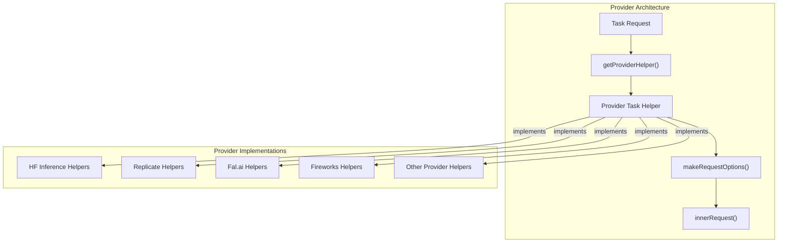

To specify a provider, add the `provider` parameter when calling a task:

```typescript
await client.textToImage({
  provider: "replicate",
  model: "black-forest-labs/Flux.1-dev",
  inputs: "A black forest cake"
})
```

The library currently supports the following providers:
- Hugging Face Inference API (default)
- Fal.ai
- Fireworks AI
- Hyperbolic
- Nebius
- Novita
- Replicate
- Sambanova
- Together
- Blackforestlabs
- Cohere
- Cerebras
- OpenAI

Sources:
- [packages/inference/README.md:62-86]()
- [packages/inference/src/providers/fal-ai.ts:17-269]()
- [packages/inference/src/providers/replicate.ts:17-140]()
- [packages/inference/src/providers/hf-inference.ts:13-116]()

## Making Requests

### Basic Usage

```typescript
// Initialize client
const hf = new InferenceClient('your_access_token');

// Text generation
const textResult = await hf.textGeneration({
  model: 'gpt2',
  inputs: 'The answer to the universe is'
});

// Image classification
const imageResult = await hf.imageClassification({
  model: 'google/vit-base-patch16-224',
  data: readFileSync('image.jpg')
});
```

Sources:
- [packages/inference/README.md:114-132]()
- [packages/inference/README.md:394-400]()

### Tree-shaking

For optimized bundle sizes, you can import individual functions directly:

```typescript
import { textGeneration } from "@huggingface/inference";

await textGeneration({
  accessToken: "hf_...",
  model: "gpt2",
  inputs: "The answer to the universe is"
});
```

Sources:
- [packages/inference/README.md:94-109]()

### Streaming Support

For certain tasks like text generation, the library supports streaming responses:

```typescript
// Streaming text generation
for await (const output of hf.textGenerationStream({
  model: "google/flan-t5-xxl",
  inputs: "Explain the theory of relativity in simple terms",
  parameters: { max_new_tokens: 250 }
})) {
  console.log(output.token.text);
}
```

Sources:
- [packages/inference/README.md:125-132]()
- [packages/inference/src/tasks/nlp/textGenerationStream.ts:1-98]()

### Chat Completion API

The library offers a ChatGPT-like interface for conversational models:

```typescript
// Non-streaming chat
const response = await hf.chatCompletion({
  model: "meta-llama/Llama-3.1-8B-Instruct",
  messages: [{ role: "user", content: "Hello, nice to meet you!" }],
  max_tokens: 512,
  temperature: 0.1,
});

// Streaming chat
for await (const chunk of hf.chatCompletionStream({
  model: "meta-llama/Llama-3.1-8B-Instruct",
  messages: [{ role: "user", content: "Can you help me solve an equation?" }],
  max_tokens: 512,
  temperature: 0.1,
})) {
  if (chunk.choices && chunk.choices.length > 0) {
    console.log(chunk.choices[0].delta.content);
  }
}
```

Sources:
- [packages/inference/README.md:134-188]()
- [packages/inference/src/tasks/nlp/chatCompletion.ts:1-20]()
- [packages/inference/src/tasks/nlp/chatCompletionStream.ts:1-19]()

## Custom Inference Endpoints

You can use your own inference endpoints by using the `.endpoint()` method:

```typescript
const customEndpoint = hf.endpoint('https://xyz.eu-west-1.aws.endpoints.huggingface.cloud/gpt2');
const { generated_text } = await customEndpoint.textGeneration({inputs: 'The answer to the universe is'});
```

Sources:
- [packages/inference/README.md:595-636]()

## Internal Architecture

The library's internal architecture revolves around several key components that work together:

### Request Preparation

The `makeRequestOptions` function is responsible for preparing request options:
1. Determines the correct model (user-provided or default)
2. Resolves provider mappings for third-party providers
3. Formats the request according to the provider's requirements
4. Sets appropriate authentication headers

Sources:
- [packages/inference/src/lib/makeRequestOptions.ts:19-95]()

### Provider Mapping

When using third-party providers, the library needs to map Hugging Face model IDs to provider-specific model IDs. This is done through:
1. Hardcoded mappings for testing or local development
2. Inference provider mappings fetched from the Hugging Face API

Sources:
- [packages/inference/src/lib/getInferenceProviderMapping.ts:23-96]()
- [packages/inference/src/providers/consts.ts:12-35]()

### Provider Helpers

Each provider has specialized implementations for different tasks:

```typescript
export class FalAITextToImageTask extends FalAITask implements TextToImageTaskHelper {
  // Provider-specific implementations for text-to-image tasks
}

export class ReplicateTextToVideoTask extends ReplicateTask implements TextToVideoTaskHelper {
  // Provider-specific implementations for text-to-video tasks
}
```

These helpers know how to:
1. Format requests for the specific provider
2. Parse responses from the provider
3. Handle provider-specific authentication

Sources:
- [packages/inference/src/providers/fal-ai.ts:82-134]()
- [packages/inference/src/providers/replicate.ts:125-140]()
- [packages/inference/src/providers/hf-inference.ts:119-156]()

### Task Implementation

Each task in the library follows a similar pattern:

```typescript
export async function sentenceSimilarity(
  args: SentenceSimilarityArgs,
  options?: Options
): Promise<SentenceSimilarityOutput> {
  const providerHelper = getProviderHelper(args.provider ?? "hf-inference", "sentence-similarity");
  const { data: res } = await innerRequest<SentenceSimilarityOutput>(args, providerHelper, {
    ...options,
    task: "sentence-similarity",
  });
  return providerHelper.getResponse(res);
}
```

This consistent pattern allows the library to handle all tasks in a uniform way while accommodating task-specific requirements.

Sources:
- [packages/inference/src/tasks/nlp/sentenceSimilarity.ts:11-21]()
- [packages/inference/src/tasks/nlp/textGeneration.ts:12-24]()
- [packages/inference/src/tasks/cv/textToImage.ts:25-35]()

## Testing and Development

The library includes comprehensive tests that validate:
1. Basic functionality with each provider
2. Task-specific functionality
3. Error handling
4. Response parsing

A VCR (recording) system is used for testing that records actual API responses and plays them back during tests, allowing for consistent testing without making real API calls.

Sources:
- [packages/inference/test/vcr.ts:19-216]()
- [packages/inference/test/InferenceClient.spec.ts:26-216]()
- [.github/workflows/test.yml:1-145]()

## Conclusion

The Hugging Face Inference Library provides a powerful, flexible interface for interacting with AI models through various providers. Its consistent API, provider-agnostic design, and comprehensive task support make it an excellent choice for JavaScript and TypeScript developers looking to incorporate AI capabilities into their applications.

For information about the Hub Library, which provides utilities for interacting with the Hugging Face Hub API, please see [Hub Library](#2.2).

---

# Page: InferenceClient API

# InferenceClient API

<details>
<summary>Relevant source files</summary>

The following files were used as context for generating this wiki page:

- [.github/workflows/lint.yml](.github/workflows/lint.yml)
- [.github/workflows/test.yml](.github/workflows/test.yml)
- [packages/inference/README.md](packages/inference/README.md)
- [packages/inference/src/config.ts](packages/inference/src/config.ts)
- [packages/inference/src/lib/getProviderHelper.ts](packages/inference/src/lib/getProviderHelper.ts)
- [packages/inference/src/lib/makeRequestOptions.ts](packages/inference/src/lib/makeRequestOptions.ts)
- [packages/inference/src/providers/consts.ts](packages/inference/src/providers/consts.ts)
- [packages/inference/src/providers/wavespeed.ts](packages/inference/src/providers/wavespeed.ts)
- [packages/inference/src/providers/zai-org.ts](packages/inference/src/providers/zai-org.ts)
- [packages/inference/src/types.ts](packages/inference/src/types.ts)
- [packages/inference/test/InferenceClient.spec.ts](packages/inference/test/InferenceClient.spec.ts)

</details>


## Purpose and Scope

This document provides comprehensive documentation for the `InferenceClient` class, the primary interface for running machine learning inference across the Hugging Face ecosystem. The `InferenceClient` provides a unified API for accessing models through Inference Providers, Inference Endpoints, and local servers.

For information about the provider abstraction system that powers routing, see [Provider System](#2.1.2). For details about task-specific types and standalone functions, see [Task Functions and Types](#2.1.3).

Sources: [packages/inference/README.md:1-767]()

## Class Overview and Initialization

The `InferenceClient` class serves as the main entry point for performing inference operations. It handles authentication, request routing, provider selection, and error management.

### Constructor Signature

```typescript
new InferenceClient(accessToken?: string, options?: {
  endpointUrl?: string;
})
```

**Parameters:**
- `accessToken` (optional): Either a Hugging Face access token (starting with `hf_`) or a third-party provider API key
- `options.endpointUrl` (optional): URL of a specific endpoint to target (Inference Endpoint or local server)

**Usage Examples:**

```typescript
// Basic initialization with HF token
const hf = new InferenceClient('hf_...');

// Using with Inference Endpoint
const hf = new InferenceClient('hf_...', {
  endpointUrl: 'https://xyz.endpoints.huggingface.cloud/v1/'
});

// Using with local endpoint
const hf = new InferenceClient(undefined, {
  endpointUrl: 'http://localhost:8080'
});

// Using with third-party provider key
const hf = new InferenceClient('sk-...');
```

Sources: [packages/inference/README.md:35-44](), [packages/inference/README.md:686-748]()

### Initialization Flow

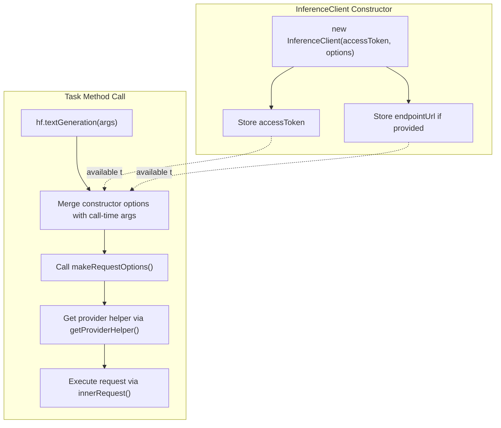

Sources: [packages/inference/src/lib/makeRequestOptions.ts:19-99]()

## Authentication Methods

The `InferenceClient` supports four authentication modes, determined automatically based on the provided credentials and options.

### Authentication Mode Resolution

| `accessToken` Value | `includeCredentials` | Auth Method | Use Case |
|---------------------|---------------------|-------------|----------|
| `hf_...` | any | `hf-token` | Hugging Face API with user token |
| Other value | any | `provider-key` | Third-party provider direct auth |
| undefined | `"include"` | `credentials-include` | Browser cookie-based auth |
| undefined | undefined | `none` | Public models (rate-limited) |

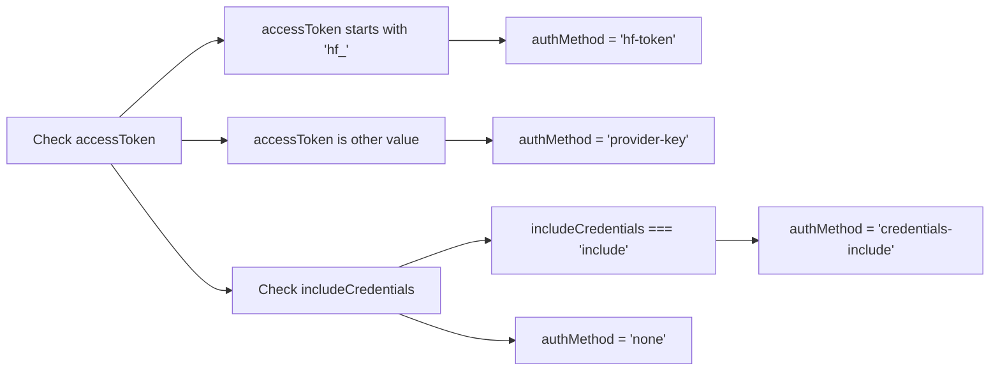

Sources: [packages/inference/src/lib/makeRequestOptions.ts:125-140](), [packages/inference/src/types.ts:169-174]()

### Authentication Configuration

**Hugging Face Token Authentication:**
```typescript
const hf = new InferenceClient('hf_...');
```
Token is sent in the `Authorization: Bearer` header and routes through `router.huggingface.co`.

**Third-Party Provider Authentication:**
```typescript
const hf = new InferenceClient('sk-...');
await hf.chatCompletion({
  model: 'provider/model-name',
  provider: 'replicate',
  messages: [...]
});
```
API key is sent directly to the provider's endpoint.

**Browser Credential-Based Authentication:**
```typescript
const hf = new InferenceClient(undefined, { includeCredentials: 'include' });
```
Uses browser cookies for authentication (OAuth flow).

Sources: [packages/inference/README.md:41-44](), [packages/inference/src/types.ts:31-42]()

## Configuration Options

### Options Interface

The `Options` interface is accepted by all task methods to control request behavior.

```typescript
interface Options {
  retry_on_error?: boolean;      // Default: true
  fetch?: typeof fetch;          // Custom fetch implementation
  signal?: AbortSignal;          // For request cancellation
  includeCredentials?: string | boolean;  // Credential handling
  billTo?: string;              // Organization billing account
}
```

**Key Options:**

| Option | Type | Default | Description |
|--------|------|---------|-------------|
| `retry_on_error` | `boolean` | `true` | Retry on 503 errors (model loading) |
| `fetch` | `function` | native `fetch` | Custom fetch for proxies/middleware |
| `signal` | `AbortSignal` | undefined | Abort controller for cancellation |
| `includeCredentials` | `string \| boolean` | `"same-origin"` | Credential policy or boolean flag |
| `billTo` | `string` | undefined | Organization name for billing |

Sources: [packages/inference/src/types.ts:16-43]()

### BaseArgs Interface

Every task method accepts arguments that extend `BaseArgs`:

```typescript
interface BaseArgs {
  accessToken?: string;          // Override client token
  model?: string;                // HF model ID
  endpointUrl?: string;          // Override client endpoint
  provider?: InferenceProviderOrPolicy;  // Provider selection
}
```

These parameters can be specified at the client level (constructor) or per-method call, with method-level arguments taking precedence.

Sources: [packages/inference/src/types.ts:121-154]()

### Usage Examples

```typescript
// Retry configuration
await hf.textGeneration({
  model: 'meta-llama/Llama-3.2-3B',
  inputs: 'Hello',
}, {
  retry_on_error: false  // Don't wait for model loading
});

// Request cancellation
const controller = new AbortController();
setTimeout(() => controller.abort(), 5000);

await hf.chatCompletionStream({
  model: 'mistralai/Mistral-7B-Instruct-v0.2',
  messages: [{ role: 'user', content: 'Write an essay' }]
}, {
  signal: controller.signal
});

// Organization billing
await hf.textToImage({
  model: 'black-forest-labs/FLUX.1-dev',
  inputs: 'A landscape'
}, {
  billTo: 'my-org-name'
});
```

Sources: [packages/inference/README.md:706-726](), [packages/inference/src/types.ts:16-43]()

## Task Methods by Category

The `InferenceClient` exposes 25+ task-specific methods organized by modality. Each method follows a consistent pattern with optional streaming variants.

### Method Naming Convention

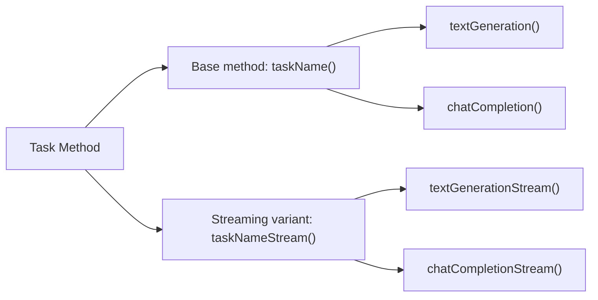

### Natural Language Processing Tasks

```typescript
// Text Generation
await hf.textGeneration({
  model: 'mistralai/Mixtral-8x7B-v0.1',
  inputs: 'The answer to the universe is',
  parameters: { max_new_tokens: 100 }
});

// Text Generation (Streaming)
for await (const chunk of hf.textGenerationStream({
  model: 'meta-llama/Llama-3.2-3B',
  inputs: 'Write a story',
  parameters: { max_new_tokens: 250 }
})) {
  console.log(chunk.token.text);
}

// Chat Completion
await hf.chatCompletion({
  model: 'Qwen/Qwen3-32B',
  provider: 'cerebras',
  messages: [
    { role: 'user', content: 'Hello!' }
  ],
  max_tokens: 512
});

// Chat Completion (Streaming)
for await (const chunk of hf.chatCompletionStream({
  model: 'Qwen/Qwen3-32B',
  messages: [{ role: 'user', content: 'Help me' }]
})) {
  console.log(chunk.choices[0].delta.content);
}
```

**Complete NLP Method List:**
- `textGeneration()` / `textGenerationStream()` - Generate text continuations
- `chatCompletion()` / `chatCompletionStream()` - OpenAI-compatible chat API
- `featureExtraction()` - Extract embeddings from text
- `fillMask()` - Fill masked tokens in text
- `summarization()` - Summarize long documents
- `questionAnswering()` - Answer questions given context
- `tableQuestionAnswering()` - Answer questions about tabular data
- `textClassification()` - Classify text into categories
- `tokenClassification()` - Named entity recognition
- `translation()` - Translate between languages
- `zeroShotClassification()` - Classify without training
- `sentenceSimilarity()` - Calculate semantic similarity

Sources: [packages/inference/README.md:238-429](), [packages/inference/test/InferenceClient.spec.ts:254-566]()

### Computer Vision Tasks

```typescript
// Text to Image
await hf.textToImage({
  model: 'black-forest-labs/FLUX.1-dev',
  inputs: 'A picture of a green bird',
  parameters: {
    width: 512,
    height: 512,
    num_inference_steps: 25
  }
});

// Image Classification
await hf.imageClassification({
  model: 'google/vit-base-patch16-224',
  data: imageBlob
});

// Object Detection
await hf.objectDetection({
  model: 'facebook/detr-resnet-50',
  data: imageBlob
});

// Image to Image
await hf.imageToImage({
  model: 'lllyasviel/sd-controlnet-depth',
  inputs: depthMapBlob,
  parameters: {
    prompt: "elmo's lecture"
  }
});
```

**Complete CV Method List:**
- `textToImage()` - Generate images from text prompts
- `imageToImage()` - Transform images based on prompts
- `imageClassification()` - Classify image content
- `imageSegmentation()` - Detect segments within images
- `imageToText()` - Generate captions or OCR
- `objectDetection()` - Detect objects with bounding boxes
- `zeroShotImageClassification()` - Classify images without training

Sources: [packages/inference/README.md:484-576](), [packages/inference/test/InferenceClient.spec.ts:681-825]()

### Audio Tasks

```typescript
// Automatic Speech Recognition
await hf.automaticSpeechRecognition({
  model: 'facebook/wav2vec2-large-960h-lv60-self',
  data: audioBlob
});

// Audio Classification
await hf.audioClassification({
  model: 'superb/hubert-large-superb-er',
  data: audioBlob
});

// Text to Speech
await hf.textToSpeech({
  model: 'espnet/kan-bayashi_ljspeech_vits',
  inputs: 'Hello world!'
});

// Audio to Audio
await hf.audioToAudio({
  model: 'speechbrain/sepformer-wham',
  data: audioBlob
});
```

**Complete Audio Method List:**
- `automaticSpeechRecognition()` - Transcribe speech to text
- `audioClassification()` - Classify audio content
- `textToSpeech()` - Generate speech from text
- `audioToAudio()` - Audio enhancement/separation

Sources: [packages/inference/README.md:432-481](), [packages/inference/test/InferenceClient.spec.ts:629-679]()

### Multimodal Tasks

```typescript
// Visual Question Answering
await hf.visualQuestionAnswering({
  model: 'dandelin/vilt-b32-finetuned-vqa',
  inputs: {
    question: 'How many cats are lying down?',
    image: imageBlob
  }
});

// Document Question Answering
await hf.documentQuestionAnswering({
  model: 'impira/layoutlm-document-qa',
  inputs: {
    question: 'Invoice number?',
    image: documentImageBlob
  }
});
```

**Complete Multimodal Method List:**
- `visualQuestionAnswering()` - Answer questions about images
- `documentQuestionAnswering()` - Extract information from documents

Sources: [packages/inference/README.md:579-611](), [packages/inference/test/InferenceClient.spec.ts:376-389]()

### Tabular Tasks

```typescript
// Tabular Regression
await hf.tabularRegression({
  model: 'scikit-learn/Fish-Weight',
  inputs: {
    data: {
      'Height': ['11.52', '12.48'],
      'Length1': ['23.2', '24'],
      'Species': ['Bream', 'Bream']
    }
  }
});

// Tabular Classification
await hf.tabularClassification({
  model: 'vvmnnnkv/wine-quality',
  inputs: {
    data: {
      'fixed_acidity': ['7.4', '7.8'],
      'volatile_acidity': ['0.7', '0.88']
    }
  }
});
```

**Complete Tabular Method List:**
- `tabularRegression()` - Predict numerical values
- `tabularClassification()` - Classify tabular data

Sources: [packages/inference/README.md:614-658](), [packages/inference/test/InferenceClient.spec.ts:842-882]()

## Provider Selection and Routing

The `InferenceClient` supports routing to 20+ inference providers through a unified API.

### Supported Providers

```typescript
const INFERENCE_PROVIDERS = [
  "baseten", "black-forest-labs", "cerebras", "clarifai", "cohere",
  "fal-ai", "featherless-ai", "fireworks-ai", "groq", "hf-inference",
  "hyperbolic", "nebius", "novita", "nscale", "openai", "ovhcloud",
  "publicai", "replicate", "sambanova", "scaleway", "together",
  "wavespeed", "zai-org"
] as const;
```

Sources: [packages/inference/src/types.ts:47-71]()

### Provider Selection Mechanisms

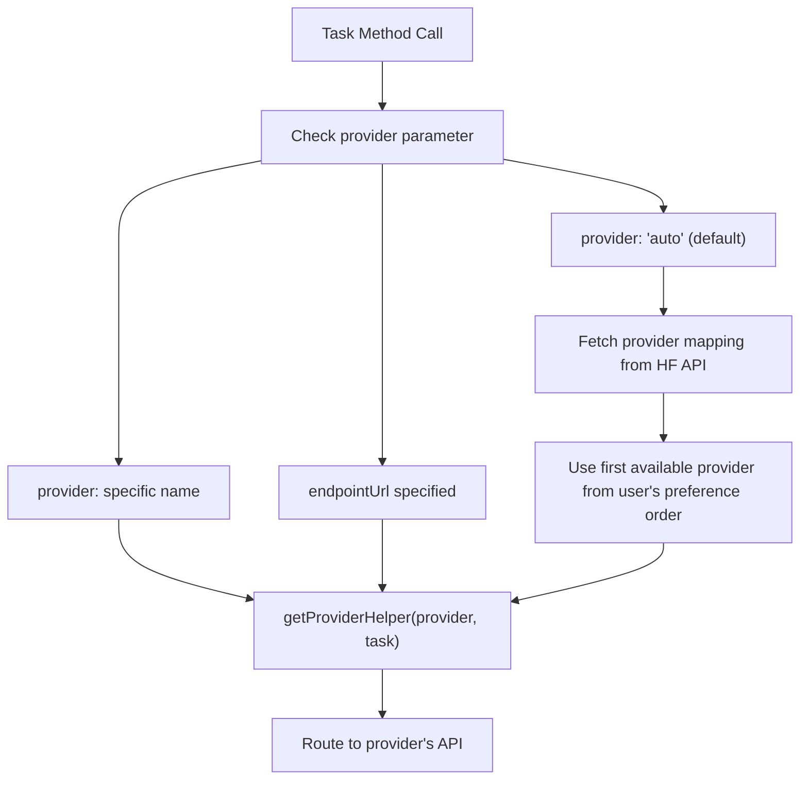

Sources: [packages/inference/src/lib/makeRequestOptions.ts:64-84](), [packages/inference/src/lib/getProviderHelper.ts:198-354]()

### Provider Usage Examples

**Automatic Provider Selection:**
```typescript
// Uses first available provider from user's preference order
await hf.textToImage({
  model: 'black-forest-labs/FLUX.1-dev',
  inputs: 'A black forest cake'
  // provider: 'auto' is implicit
});
```

**Explicit Provider Selection:**
```typescript
// Route directly to Replicate
await hf.textToImage({
  model: 'black-forest-labs/FLUX.1-dev',
  provider: 'replicate',
  inputs: 'A black forest cake'
});

// Route to Cerebras for chat
await hf.chatCompletion({
  model: 'Qwen/Qwen3-32B',
  provider: 'cerebras',
  messages: [{ role: 'user', content: 'Hello!' }]
});
```

Sources: [packages/inference/README.md:45-114]()

### Provider Capabilities by Task

Different providers support different tasks. The client automatically validates provider-task compatibility.

| Provider | Conversational | Text-to-Image | Text-to-Video | ASR | Feature Extraction |
|----------|---------------|---------------|---------------|-----|-------------------|
| hf-inference | ✓ | ✓ | - | ✓ | ✓ |
| together | ✓ | ✓ | - | - | - |
| replicate | - | ✓ | ✓ | ✓ | - |
| cerebras | ✓ | - | - | - | - |
| fal-ai | - | ✓ | ✓ | ✓ | - |
| sambanova | ✓ | - | - | - | ✓ |
| wavespeed | - | ✓ | ✓ | - | - |

Sources: [packages/inference/src/lib/getProviderHelper.ts:62-193]()

## Endpoint Configuration

The `InferenceClient` can target three types of endpoints: Inference Providers (default), Inference Endpoints (dedicated), and local inference servers.

### Endpoint Types

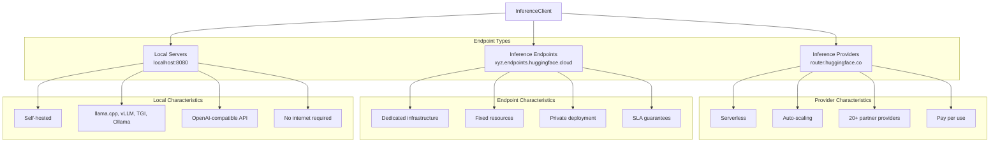

Sources: [packages/inference/README.md:3-7](), [packages/inference/README.md:681-754]()

### Using Inference Providers (Default)

```typescript
const hf = new InferenceClient('hf_...');

// Automatically routes through router.huggingface.co
await hf.textGeneration({
  model: 'meta-llama/Llama-3.2-3B',
  inputs: 'Hello'
});
```

When no `endpointUrl` is specified, requests go to `https://router.huggingface.co` which routes to available providers based on model and user preferences.

Sources: [packages/inference/src/config.ts:1-5]()

### Using Inference Endpoints

```typescript
const hf = new InferenceClient('hf_...', {
  endpointUrl: 'https://xyz.us-east-1.aws.endpoints.huggingface.cloud/v1/'
});

await hf.chatCompletion({
  messages: [
    { role: 'user', content: 'What is the capital of France?' }
  ]
});
```

**Scaling to Zero Handling:**
```typescript
// By default, waits for model to load (may take time with scale-to-0)
await hf.chatCompletion({ messages: [...] });

// Disable waiting, handle 500 errors manually
await hf.chatCompletion(
  { messages: [...] },
  { retry_on_error: false }
);
```

Sources: [packages/inference/README.md:682-726]()

### Using Local Endpoints

```typescript
// llama.cpp server
const hf = new InferenceClient(undefined, {
  endpointUrl: 'http://localhost:8080'
});

// vLLM server
const hf = new InferenceClient(undefined, {
  endpointUrl: 'http://localhost:8000'
});

// Ollama server
const hf = new InferenceClient(undefined, {
  endpointUrl: 'http://localhost:11434'
});

await hf.chatCompletion({
  messages: [{ role: 'user', content: 'Hello' }]
});
```

Local servers must implement OpenAI-compatible chat completion API.

Sources: [packages/inference/README.md:727-754]()

## Request Lifecycle and Model Resolution

Understanding how the client prepares and executes requests is essential for debugging and optimization.

### Request Preparation Flow

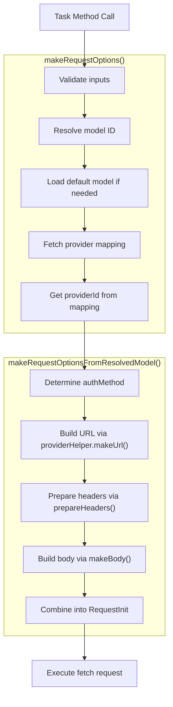

Sources: [packages/inference/src/lib/makeRequestOptions.ts:19-197]()

### Model Resolution Logic

**When model is specified:**
```typescript
await hf.textGeneration({
  model: 'gpt2',  // User specifies model
  inputs: 'Hello'
});
```
Client uses the specified model directly.

**When model is omitted:**
```typescript
await hf.fillMask({
  inputs: '[MASK] world'
  // No model specified
});
```
Client fetches default model for the task from `https://huggingface.co/api/tasks` API endpoint.

```mermaid
graph LR
    CHECK["Check if model specified"]
    USE_MODEL["Use specified model"]
    FETCH_TASKS["Fetch from /api/tasks"]
    GET_DEFAULT["Extract default model for task"]
    
    CHECK -->|model provided| USE_MODEL
    CHECK -->|model omitted| FETCH_TASKS
    FETCH_TASKS --> GET_DEFAULT
```

Sources: [packages/inference/src/lib/makeRequestOptions.ts:199-224]()

### Provider Mapping Resolution

For non-endpoint URLs, the client fetches provider mapping to determine the correct provider ID:

```typescript
// User specifies: model = "black-forest-labs/FLUX.1-dev", provider = "replicate"
// Client fetches from: https://huggingface.co/api/partners/replicate/models
// Mapping returns: providerId = "black-forest-labs/flux-dev"
// Client routes to: replicate.com/api with providerId
```

**Mapping Structure:**
```typescript
interface InferenceProviderMappingEntry {
  adapter?: string;                // e.g., "lora"
  adapterWeightsPath?: string;
  hfModelId: string;               // HF Hub model ID
  provider: string;                // Provider name
  providerId: string;              // Provider's internal model ID
  status: "live" | "staging";
  task: WidgetType;                // Pipeline task type
  type?: "single-model" | "tag-filter";
}
```

Sources: [packages/inference/src/types.ts:110-119](), [packages/inference/src/lib/makeRequestOptions.ts:64-84]()

## Error Handling

The `InferenceClient` provides structured error types for different failure scenarios.

### Error Hierarchy

```mermaid
graph TB
    BASE["InferenceClientError<br/>(Base class)"]
    
    INPUT["InferenceClientInputError<br/>Invalid parameters"]
    PROVIDER_API["InferenceClientProviderApiError<br/>Provider API errors"]
    HUB_API["InferenceClientHubApiError<br/>Hub API errors"]
    PROVIDER_OUTPUT["InferenceClientProviderOutputError<br/>Malformed responses"]
    
    BASE --> INPUT
    BASE --> PROVIDER_API
    BASE --> HUB_API
    BASE --> PROVIDER_OUTPUT
    
    INPUT --> EXAMPLES1["Missing required parameter<br/>Invalid model ID<br/>Unsupported provider-task combo"]
    PROVIDER_API --> EXAMPLES2["Rate limits<br/>Authentication failure<br/>503 model loading"]
    HUB_API --> EXAMPLES3["Hub API failures<br/>Mapping fetch errors"]
    PROVIDER_OUTPUT --> EXAMPLES4["Unexpected response format<br/>Missing expected fields"]
```

Sources: [packages/inference/README.md:136-234]()

### Error Properties

**InferenceClientProviderApiError:**
```typescript
{
  message: string;
  request: {
    url: string;
    method: string;
    headers?: Record<string, string>;
  };
  response: {
    requestId: string;
    status: number;
    body: string;
  };
}
```

**InferenceClientHubApiError:**
```typescript
{
  message: string;
  request: {
    url: string;
    method: string;
  };
  response: {
    requestId: string;
    status: number;
    body: string;
  };
}
```

Sources: [packages/inference/README.md:207-225]()

### Error Handling Examples

**Catch all inference errors:**
```typescript
try {
  const result = await hf.textGeneration({
    model: 'gpt2',
    inputs: 'Hello'
  });
} catch (error) {
  if (error instanceof InferenceClientError) {
    console.error('Inference error:', error.message);
  } else {
    console.error('Unexpected error:', error);
  }
}
```

**Handle specific error types:**
```typescript
try {
  const result = await hf.chatCompletion({
    model: 'Qwen/Qwen3-32B',
    provider: 'cerebras',
    messages: [{ role: 'user', content: 'Hello' }]
  });
} catch (error) {
  if (error instanceof InferenceClientProviderApiError) {
    console.error('Provider API error:', error.message);
    console.error('Status:', error.response.status);
    console.error('Request ID:', error.response.requestId);
  } else if (error instanceof InferenceClientHubApiError) {
    console.error('Hub API error:', error.message);
    console.error('Failed URL:', error.request.url);
  } else if (error instanceof InferenceClientProviderOutputError) {
    console.error('Malformed response:', error.message);
  } else if (error instanceof InferenceClientInputError) {
    console.error('Invalid input:', error.message);
  }
}
```

Sources: [packages/inference/README.md:150-204]()

## Tree-Shaking and Standalone Functions

While the `InferenceClient` class provides a convenient API, the package also exports standalone task functions for better tree-shaking in bundled applications.

### Standalone Function Pattern

```typescript
import { textGeneration, chatCompletion, textToImage } from '@huggingface/inference';

// Standalone functions accept all parameters as arguments
await textGeneration({
  accessToken: 'hf_...',
  model: 'gpt2',
  inputs: 'Hello world',
  parameters: { max_new_tokens: 100 }
});

await chatCompletion({
  accessToken: 'hf_...',
  model: 'Qwen/Qwen3-32B',
  messages: [{ role: 'user', content: 'Hello' }]
});

await textToImage({
  accessToken: 'hf_...',
  model: 'black-forest-labs/FLUX.1-dev',
  inputs: 'A landscape'
});
```

**Benefits:**
- Smaller bundle sizes (only import functions you use)
- Same type safety as class methods
- No instantiation overhead

**Class vs Standalone:**
```typescript
// Class approach (convenient, reuses token)
const hf = new InferenceClient('hf_...');
await hf.textGeneration({ model: 'gpt2', inputs: 'Hello' });

// Standalone approach (tree-shakeable)
import { textGeneration } from '@huggingface/inference';
await textGeneration({ accessToken: 'hf_...', model: 'gpt2', inputs: 'Hello' });
```

Sources: [packages/inference/README.md:117-133]()

## Backward Compatibility

The `InferenceClient` class was previously named `HfInference`. The old name is maintained for backward compatibility.

```typescript
import { HfInference } from '@huggingface/inference';

// Still works
const hf = new HfInference('hf_...');
```

Both names refer to the same class implementation.

Sources: [packages/inference/README.md:1](), [packages/inference/test/InferenceClient.spec.ts:29-33]()

---

# Page: Provider System

# Provider System

<details>
<summary>Relevant source files</summary>

The following files were used as context for generating this wiki page:

- [.github/workflows/lint.yml](.github/workflows/lint.yml)
- [.github/workflows/test.yml](.github/workflows/test.yml)
- [packages/inference/README.md](packages/inference/README.md)
- [packages/inference/src/config.ts](packages/inference/src/config.ts)
- [packages/inference/src/lib/getProviderHelper.ts](packages/inference/src/lib/getProviderHelper.ts)
- [packages/inference/src/lib/makeRequestOptions.ts](packages/inference/src/lib/makeRequestOptions.ts)
- [packages/inference/src/providers/consts.ts](packages/inference/src/providers/consts.ts)
- [packages/inference/src/providers/fal-ai.ts](packages/inference/src/providers/fal-ai.ts)
- [packages/inference/src/providers/hf-inference.ts](packages/inference/src/providers/hf-inference.ts)
- [packages/inference/src/providers/hyperbolic.ts](packages/inference/src/providers/hyperbolic.ts)
- [packages/inference/src/providers/nebius.ts](packages/inference/src/providers/nebius.ts)
- [packages/inference/src/providers/nscale.ts](packages/inference/src/providers/nscale.ts)
- [packages/inference/src/providers/providerHelper.ts](packages/inference/src/providers/providerHelper.ts)
- [packages/inference/src/providers/replicate.ts](packages/inference/src/providers/replicate.ts)
- [packages/inference/src/providers/sambanova.ts](packages/inference/src/providers/sambanova.ts)
- [packages/inference/src/providers/together.ts](packages/inference/src/providers/together.ts)
- [packages/inference/src/providers/wavespeed.ts](packages/inference/src/providers/wavespeed.ts)
- [packages/inference/src/providers/zai-org.ts](packages/inference/src/providers/zai-org.ts)
- [packages/inference/src/tasks/cv/textToImage.ts](packages/inference/src/tasks/cv/textToImage.ts)
- [packages/inference/src/types.ts](packages/inference/src/types.ts)
- [packages/inference/test/InferenceClient.spec.ts](packages/inference/test/InferenceClient.spec.ts)

</details>


This document describes the provider abstraction architecture in the `@huggingface/inference` package. The provider system enables routing inference requests to multiple third-party inference providers (Fal.ai, Replicate, Together, Cerebras, etc.) while maintaining a unified API surface through the `InferenceClient`. It handles provider-specific request formatting, authentication, response parsing, and async polling patterns.

For information about the task functions and types that sit above this provider system, see [Task Functions and Types](#2.1.3). For the overall InferenceClient API, see [InferenceClient API](#2.1.1).

---

## Architecture Overview

The provider system implements a three-layer architecture where task-specific provider helpers translate between the unified `InferenceClient` API and provider-specific APIs.

```mermaid
graph TB
    subgraph "User Layer"
        CLIENT["InferenceClient"]
        TASK_FUNCS["Task Functions<br/>(textToImage, chatCompletion, etc.)"]
    end
    
    subgraph "Abstraction Layer"
        GET_HELPER["getProviderHelper()"]
        MAKE_OPTIONS["makeRequestOptions()"]
        RESOLVE["resolveProvider()"]
        MAPPING["getInferenceProviderMapping()"]
    end
    
    subgraph "Provider Helper Layer"
        BASE["TaskProviderHelper<br/>(abstract base)"]
        
        subgraph "HF Inference"
            HF_TASK["HFInferenceTask"]
            HF_T2I["HFInferenceTextToImageTask"]
            HF_CONV["HFInferenceConversationalTask"]
        end
        
        subgraph "Fal.ai"
            FAL_BASE["FalAITask"]
            FAL_QUEUE["FalAiQueueTask"]
            FAL_T2I["FalAITextToImageTask"]
        end
        
        subgraph "Replicate"
            REP_BASE["ReplicateTask"]
            REP_T2I["ReplicateTextToImageTask"]
        end
        
        subgraph "Other Providers"
            TOGETHER["TogetherTextToImageTask"]
            NEBIUS["NebiusTextToImageTask"]
            HYPERBOLIC["HyperbolicTextToImageTask"]
            OTHERS["20+ other provider tasks..."]
        end
    end
    
    subgraph "External APIs"
        FAL_API["fal.run"]
        REP_API["api.replicate.com"]
        TOG_API["api.together.xyz"]
        HF_ROUTER["router.huggingface.co"]
    end
    
    CLIENT --> TASK_FUNCS
    TASK_FUNCS --> RESOLVE
    RESOLVE --> MAPPING
    MAPPING --> GET_HELPER
    GET_HELPER --> BASE
    
    BASE --> HF_TASK
    BASE --> FAL_BASE
    BASE --> REP_BASE
    BASE --> TOGETHER
    
    HF_TASK --> HF_T2I
    HF_TASK --> HF_CONV
    FAL_BASE --> FAL_QUEUE
    FAL_QUEUE --> FAL_T2I
    REP_BASE --> REP_T2I
    
    TASK_FUNCS --> MAKE_OPTIONS
    MAKE_OPTIONS --> BASE
    
    HF_T2I -.routes to.-> HF_ROUTER
    FAL_T2I -.routes to.-> FAL_API
    REP_T2I -.routes to.-> REP_API
    TOGETHER -.routes to.-> TOG_API
```

**Sources:** [packages/inference/src/lib/getProviderHelper.ts](), [packages/inference/src/providers/providerHelper.ts:1-145](), [packages/inference/src/lib/makeRequestOptions.ts:19-99]()

---

## Provider Registration

### Provider Constants

All supported providers are defined in the `INFERENCE_PROVIDERS` constant array:

```typescript
const INFERENCE_PROVIDERS = [
  "baseten", "black-forest-labs", "cerebras", "clarifai", "cohere",
  "fal-ai", "featherless-ai", "fireworks-ai", "groq", "hf-inference",
  "hyperbolic", "nebius", "novita", "nscale", "openai", "ovhcloud",
  "publicai", "replicate", "sambanova", "scaleway", "together",
  "wavespeed", "zai-org"
] as const;
```

### Provider-Task Matrix

The `PROVIDERS` registry maps each provider to its supported tasks using task-specific helper instances:

```mermaid
graph LR
    subgraph "PROVIDERS Registry"
        REGISTRY["Record<InferenceProvider,<br/>Partial<Record<InferenceTask,<br/>TaskProviderHelper>>>"]
    end
    
    subgraph "Provider Keys"
        FAL["fal-ai"]
        REP["replicate"]
        TOG["together"]
        HF["hf-inference"]
    end
    
    subgraph "Task Helpers for fal-ai"
        FAL_T2I["FalAITextToImageTask"]
        FAL_T2V["FalAITextToVideoTask"]
        FAL_I2I["FalAIImageToImageTask"]
        FAL_ASR["FalAIAutomaticSpeechRecognitionTask"]
    end
    
    subgraph "Task Helpers for replicate"
        REP_T2I["ReplicateTextToImageTask"]
        REP_T2S["ReplicateTextToSpeechTask"]
        REP_T2V["ReplicateTextToVideoTask"]
    end
    
    subgraph "Task Helpers for together"
        TOG_CONV["TogetherConversationalTask"]
        TOG_T2I["TogetherTextToImageTask"]
        TOG_TG["TogetherTextGenerationTask"]
    end
    
    REGISTRY --> FAL
    REGISTRY --> REP
    REGISTRY --> TOG
    REGISTRY --> HF
    
    FAL --> FAL_T2I
    FAL --> FAL_T2V
    FAL --> FAL_I2I
    FAL --> FAL_ASR
    
    REP --> REP_T2I
    REP --> REP_T2S
    REP --> REP_T2V
    
    TOG --> TOG_CONV
    TOG --> TOG_T2I
    TOG --> TOG_TG
```

**Sources:** [packages/inference/src/types.ts:47-77](), [packages/inference/src/lib/getProviderHelper.ts:62-193]()

---

## Provider Selection and Routing

### Resolution Flow

The system uses a multi-step process to determine which provider should handle a request:

```mermaid
graph TB
    START["User calls task function<br/>(e.g., textToImage)"]
    
    RESOLVE["resolveProvider()"]
    CHECK_POLICY{"provider === 'auto'?"}
    
    GET_MAPPING["getInferenceProviderMapping()"]
    CHECK_HARDCODED{"Model in<br/>HARDCODED_MODEL_<br/>INFERENCE_MAPPING?"}
    FETCH_API["Fetch from<br/>huggingface.co/api/partners/<br/>{provider}/models"]
    
    RETURN_MAPPING["Return InferenceProviderMappingEntry"]
    GET_HELPER["getProviderHelper(provider, task)"]
    LOOKUP["Look up in PROVIDERS registry"]
    RETURN_HELPER["Return TaskProviderHelper instance"]
    
    MAKE_OPTIONS["makeRequestOptions()"]
    PREPARE["Helper prepares:<br/>- URL via makeUrl()<br/>- Headers via prepareHeaders()<br/>- Body via preparePayload()"]
    
    START --> RESOLVE
    RESOLVE --> CHECK_POLICY
    CHECK_POLICY -->|Yes| GET_MAPPING
    CHECK_POLICY -->|No, specific provider| GET_MAPPING
    
    GET_MAPPING --> CHECK_HARDCODED
    CHECK_HARDCODED -->|Yes| RETURN_MAPPING
    CHECK_HARDCODED -->|No| FETCH_API
    FETCH_API --> RETURN_MAPPING
    
    RETURN_MAPPING --> GET_HELPER
    GET_HELPER --> LOOKUP
    LOOKUP --> RETURN_HELPER
    
    RETURN_HELPER --> MAKE_OPTIONS
    MAKE_OPTIONS --> PREPARE
```

**Sources:** [packages/inference/src/lib/makeRequestOptions.ts:19-99](), [packages/inference/src/lib/getInferenceProviderMapping.ts](), [packages/inference/src/lib/getProviderHelper.ts:198-354]()

### Provider Mapping Structure

Each model-provider mapping contains metadata about how to route requests:

```typescript
interface InferenceProviderMappingEntry {
  adapter?: string;              // "lora" for LoRA adapters
  adapterWeightsPath?: string;   // Path to adapter weights
  hfModelId: ModelId;            // Hugging Face model ID
  provider: string;              // Provider name
  providerId: string;            // Provider's internal model ID
  status: "live" | "staging";    // Deployment status
  task: WidgetType;              // Task type
  type?: "single-model" | "tag-filter";
}
```

**Sources:** [packages/inference/src/types.ts:110-119]()

---

## TaskProviderHelper Pattern

### Base Class Structure

All provider implementations extend `TaskProviderHelper`, which defines the contract for request preparation and response handling:

```mermaid
classDiagram
    class TaskProviderHelper {
        <<abstract>>
        +provider: InferenceProvider
        #baseUrl: string
        +clientSideRoutingOnly: boolean
        
        +makeBaseUrl(params) string
        +makeUrl(params) string
        +makeBody(params) BodyInit
        +prepareHeaders(params, isBinary) Record
        
        +makeRoute(params)* string
        +preparePayload(params)* unknown
        +getResponse(response, url, headers, outputType)* Promise~unknown~
    }
    
    class TextToImageTaskHelper {
        <<interface>>
        +getResponse(response, url, headers, outputType) Promise~string|Blob|Record~
        +preparePayload(params) Record
    }
    
    class FalAITextToImageTask {
        +task: InferenceTask
        +preparePayload(params) Record
        +getResponse(response, url, headers, outputType) Promise
        +getResponseFromQueueApi(response, url, headers) Promise
    }
    
    class ReplicateTextToImageTask {
        +preparePayload(params) Record
        +makeRoute(params) string
        +getResponse(response, url, headers, outputType) Promise
    }
    
    class HFInferenceTextToImageTask {
        +preparePayload(params) Record
        +makeRoute(params) string
        +getResponse(response, url, headers, outputType) Promise
    }
    
    TaskProviderHelper <|-- FalAITextToImageTask
    TaskProviderHelper <|-- ReplicateTextToImageTask
    TaskProviderHelper <|-- HFInferenceTextToImageTask
    
    TextToImageTaskHelper <|.. FalAITextToImageTask
    TextToImageTaskHelper <|.. ReplicateTextToImageTask
    TextToImageTaskHelper <|.. HFInferenceTextToImageTask
```

**Sources:** [packages/inference/src/providers/providerHelper.ts:71-145](), [packages/inference/src/providers/providerHelper.ts:150-158]()

### Core Methods

Each `TaskProviderHelper` must implement three abstract methods:

| Method | Purpose | Returns |
|--------|---------|---------|
| `makeRoute(params)` | Constructs the API endpoint path | `string` (e.g., `"v1/chat/completions"`) |
| `preparePayload(params)` | Transforms generic args to provider format | Provider-specific payload object |
| `getResponse(response, ...)` | Parses provider response to standard format | Promise of task-specific output type |

**Sources:** [packages/inference/src/providers/providerHelper.ts:93-101]()

---

## Request Pipeline

### Request Preparation Flow

The `makeRequestOptions` function orchestrates the entire request preparation process:

```mermaid
sequenceDiagram
    participant Task as textToImage()
    participant MRO as makeRequestOptions()
    participant Helper as TaskProviderHelper
    participant API as Provider API
    
    Task->>MRO: Call with args + options
    MRO->>MRO: Resolve model ID<br/>(or load default)
    MRO->>MRO: Get provider mapping<br/>from API or cache
    MRO->>Helper: Get helper instance
    
    Helper->>Helper: makeUrl(params)
    Note over Helper: baseUrl + route
    
    Helper->>Helper: prepareHeaders(params)
    Note over Helper: Auth + Content-Type
    
    Helper->>Helper: preparePayload(params)
    Note over Helper: Transform to provider format
    
    Helper->>Helper: makeBody(params)
    Note over Helper: Stringify or return binary
    
    Helper-->>MRO: Return {url, info: RequestInit}
    MRO-->>Task: Request options ready
    
    Task->>API: fetch(url, info)
    API-->>Task: Raw response
    Task->>Helper: getResponse(response)
    Helper-->>Task: Parsed output
```

**Sources:** [packages/inference/src/lib/makeRequestOptions.ts:19-99](), [packages/inference/src/providers/providerHelper.ts:106-144]()

### URL Construction

Different providers require different URL structures:

| Provider | Base URL | Route Pattern | Example |
|----------|----------|---------------|---------|
| `hf-inference` | `router.huggingface.co/hf-inference` | `models/{modelId}` | `models/stabilityai/stable-diffusion-2` |
| `fal-ai` | `queue.fal.run` | `/{modelId}?_subdomain=queue` | `/fal-ai/flux-pro/v1.1` |
| `replicate` | `api.replicate.com` | `v1/models/{owner}/{name}/predictions` | `v1/models/stability-ai/sdxl/predictions` |
| `together` | `api.together.xyz` | `v1/images/generations` | `v1/images/generations` |

**Sources:** [packages/inference/src/providers/hf-inference.ts:106-119](), [packages/inference/src/providers/fal-ai.ts:100-105](), [packages/inference/src/providers/replicate.ts:42-72](), [packages/inference/src/providers/together.ts:104-106]()

---

## Authentication Methods

The provider system supports four authentication methods via the `authMethod` field:

```mermaid
graph TB
    AUTH_CHECK{"Determine authMethod"}
    
    NONE["authMethod = 'none'"]
    HF_TOKEN["authMethod = 'hf-token'"]
    PROVIDER_KEY["authMethod = 'provider-key'"]
    CREDS["authMethod = 'credentials-include'"]
    
    HF_HEADER["Add header:<br/>Authorization: Bearer hf_..."]
    PROVIDER_HEADER["Add header:<br/>Authorization: Bearer {providerKey}<br/>or Key {providerKey}"]
    INCLUDE_CREDS["Set RequestInit.credentials = 'include'"]
    NO_AUTH["No auth headers"]
    
    ROUTER_URL["Route through<br/>router.huggingface.co/{provider}"]
    DIRECT_URL["Call provider API directly<br/>(e.g., api.replicate.com)"]
    
    AUTH_CHECK -->|No accessToken,<br/>includeCredentials=false| NONE
    AUTH_CHECK -->|accessToken starts with 'hf_'| HF_TOKEN
    AUTH_CHECK -->|accessToken but not 'hf_'| PROVIDER_KEY
    AUTH_CHECK -->|includeCredentials='include'| CREDS
    
    NONE --> NO_AUTH
    HF_TOKEN --> HF_HEADER
    PROVIDER_KEY --> PROVIDER_HEADER
    CREDS --> INCLUDE_CREDS
    
    HF_HEADER --> ROUTER_URL
    PROVIDER_KEY --> DIRECT_URL
```

**Sources:** [packages/inference/src/lib/makeRequestOptions.ts:125-140](), [packages/inference/src/providers/providerHelper.ts:135-144]()

### Provider-Specific Authentication

Different providers customize the `prepareHeaders` method:

```typescript
// Fal.ai uses "Key" prefix for provider keys
class FalAITask extends TaskProviderHelper {
  override prepareHeaders(params: HeaderParams, binary: boolean) {
    const headers: Record<string, string> = {
      Authorization: params.authMethod !== "provider-key" 
        ? `Bearer ${params.accessToken}` 
        : `Key ${params.accessToken}`
    };
    return headers;
  }
}
```

**Sources:** [packages/inference/src/providers/fal-ai.ts:85-94](), [packages/inference/src/providers/replicate.ts:58-64]()

---

## Async Polling Pattern

### Queue-Based Providers

Several providers (Fal.ai, Replicate, WaveSpeed, ZAI) use asynchronous job queues that require polling:

```mermaid
graph TB
    SUBMIT["Submit request<br/>POST /{model}"]
    RECEIVE["Receive job ID<br/>{request_id, status, response_url}"]
    
    POLL_START["Start polling loop"]
    WAIT["delay(500ms or 5000ms)"]
    CHECK_STATUS["GET /status/{request_id}"]
    PARSE_STATUS{"Parse status"}
    
    COMPLETED["status = 'COMPLETED'<br/>or 'SUCCESS'"]
    PROCESSING["status = 'PROCESSING'<br/>or 'IN_QUEUE'"]
    FAILED["status = 'FAILED'"]
    
    FETCH_RESULT["GET /result/{request_id}"]
    PARSE_OUTPUT["Parse output.url<br/>or images[0].url"]
    DOWNLOAD["fetch(outputUrl)"]
    RETURN_BLOB["Return Blob"]
    
    THROW_ERROR["Throw<br/>InferenceClientProviderOutputError"]
    
    SUBMIT --> RECEIVE
    RECEIVE --> POLL_START
    POLL_START --> WAIT
    WAIT --> CHECK_STATUS
    CHECK_STATUS --> PARSE_STATUS
    
    PARSE_STATUS -->|completed| COMPLETED
    PARSE_STATUS -->|processing| PROCESSING
    PARSE_STATUS -->|failed| FAILED
    
    PROCESSING --> WAIT
    
    COMPLETED --> FETCH_RESULT
    FETCH_RESULT --> PARSE_OUTPUT
    PARSE_OUTPUT --> DOWNLOAD
    DOWNLOAD --> RETURN_BLOB
    
    FAILED --> THROW_ERROR
```

**Sources:** [packages/inference/src/providers/fal-ai.ts:106-169](), [packages/inference/src/providers/replicate.ts:58-64](), [packages/inference/src/providers/wavespeed.ts:128-208](), [packages/inference/src/providers/zai-org.ts:96-191]()

### Fal.ai Queue Implementation

The `FalAiQueueTask` base class implements the polling logic:

```typescript
abstract class FalAiQueueTask extends FalAITask {
  abstract task: InferenceTask;
  
  override makeRoute(params: UrlParams): string {
    if (params.authMethod !== "provider-key") {
      return `/${params.model}?_subdomain=queue`;
    }
    return `/${params.model}`;
  }
  
  async getResponseFromQueueApi(
    response: FalAiQueueOutput,
    url?: string,
    headers?: Record<string, string>
  ): Promise<unknown> {
    const requestId = response.request_id;
    let status = response.status;
    
    const statusUrl = `${baseUrl}${modelId}/status${queryParams}`;
    const resultUrl = `${baseUrl}${modelId}${queryParams}`;
    
    while (status !== "COMPLETED") {
      await delay(500);
      const statusResponse = await fetch(statusUrl, { headers });
      status = (await statusResponse.json()).status;
    }
    
    const result = await fetch(resultUrl, { headers });
    return await result.json();
  }
}
```

**Sources:** [packages/inference/src/providers/fal-ai.ts:97-169]()

---

## Provider-Specific Implementations

### Example: Text-to-Image Variations

Each provider implements `TextToImageTaskHelper` differently based on their API format:

```mermaid
graph TB
    subgraph "HF Inference"
        HF_PREP["preparePayload:<br/>Pass args as-is"]
        HF_RESP["getResponse:<br/>Handle Blob or<br/>{data: [{b64_json}]}"]
    end
    
    subgraph "Fal.ai"
        FAL_PREP["preparePayload:<br/>{prompt, loras?}"]
        FAL_SUBMIT["Submit to queue"]
        FAL_POLL["Poll getResponseFromQueueApi"]
        FAL_RESP["Parse {images: [{url}]}"]
        FAL_FETCH["Fetch URL → Blob"]
    end
    
    subgraph "Replicate"
        REP_PREP["preparePayload:<br/>{input: {prompt, lora_weights?},<br/>version: {hash}}"]
        REP_WAIT["Use Prefer: wait header<br/>(synchronous)"]
        REP_RESP["Parse {output: string}<br/>or {output: [string]}"]
        REP_FETCH["Fetch URL → Blob"]
    end
    
    subgraph "Together"
        TOG_PREP["preparePayload:<br/>{prompt, model,<br/>response_format: 'b64' or 'url'}"]
        TOG_ROUTE["Route: v1/images/generations"]
        TOG_RESP["Parse {data: [{b64_json}]}<br/>or {data: [{url}]}"]
    end
    
    HF_PREP --> HF_RESP
    FAL_PREP --> FAL_SUBMIT --> FAL_POLL --> FAL_RESP --> FAL_FETCH
    REP_PREP --> REP_WAIT --> REP_RESP --> REP_FETCH
    TOG_PREP --> TOG_ROUTE --> TOG_RESP
```

**Sources:** [packages/inference/src/providers/hf-inference.ts:126-178](), [packages/inference/src/providers/fal-ai.ts:176-239](), [packages/inference/src/providers/replicate.ts:75-134](), [packages/inference/src/providers/together.ts:99-149]()

### LoRA Adapter Support

Some providers support LoRA adapters through the mapping's `adapter` field:

```typescript
// Fal.ai LoRA handling
class FalAITextToImageTask extends FalAiQueueTask {
  override preparePayload(params: BodyParams): Record<string, unknown> {
    const payload = { /* base payload */ };
    
    if (params.mapping?.adapter === "lora" && params.mapping.adapterWeightsPath) {
      payload.loras = [{
        path: `${HF_HUB_URL}/${params.mapping.hfModelId}/resolve/main/${params.mapping.adapterWeightsPath}`,
        scale: 1
      }];
    }
    
    return payload;
  }
}
```

**Sources:** [packages/inference/src/providers/fal-ai.ts:184-204](), [packages/inference/src/providers/replicate.ts:76-89](), [packages/inference/src/providers/wavespeed.ts:100-125]()

---

## Base Task Classes

### Reusable Conversational Implementation

Many providers use OpenAI-compatible chat completion APIs. The `BaseConversationalTask` provides a standard implementation:

```typescript
export class BaseConversationalTask extends TaskProviderHelper 
  implements ConversationalTaskHelper {
  
  makeRoute(): string {
    return "v1/chat/completions";
  }
  
  preparePayload(params: BodyParams): Record<string, unknown> {
    return {
      ...params.args,
      model: params.model
    };
  }
  
  async getResponse(response: ChatCompletionOutput): Promise<ChatCompletionOutput> {
    // Validates OpenAI-compatible response structure
    if (typeof response === "object" && 
        Array.isArray(response?.choices) &&
        typeof response?.created === "number" &&
        typeof response?.id === "string") {
      return response;
    }
    throw new InferenceClientProviderOutputError("Expected ChatCompletionOutput");
  }
}
```

Providers then extend and customize:

```typescript
export class TogetherConversationalTask extends BaseConversationalTask {
  constructor() {
    super("together", "https://api.together.xyz");
  }
  
  override preparePayload(params: BodyParams<ChatCompletionInput>) {
    const payload = super.preparePayload(params);
    // Custom handling for Together's json_schema format
    const response_format = payload.response_format;
    if (response_format?.type === "json_schema") {
      payload.response_format = {
        type: "json_schema",
        schema: response_format.json_schema.schema
      };
    }
    return payload;
  }
}
```

**Sources:** [packages/inference/src/providers/providerHelper.ts:331-365](), [packages/inference/src/providers/together.ts:48-68](), [packages/inference/src/providers/nebius.ts:51-66](), [packages/inference/src/providers/sambanova.ts:24-41]()

---

## Synchronous vs. Asynchronous Payload Preparation

### Standard Synchronous Flow

Most providers use synchronous payload preparation via `preparePayload`:

```mermaid
sequenceDiagram
    participant Task as textToImage()
    participant MRO as makeRequestOptions()
    participant Helper as TaskProviderHelper
    
    Task->>MRO: args = {inputs: "prompt", parameters}
    MRO->>Helper: preparePayload(params)
    Helper->>Helper: Transform args
    Helper-->>MRO: Return payload object
    MRO->>MRO: JSON.stringify(payload)
    MRO-->>Task: {url, info: RequestInit}
```

### Asynchronous with preparePayloadAsync

Some tasks require async preprocessing (e.g., converting Blob to base64):

```mermaid
sequenceDiagram
    participant Task as imageToImage()
    participant Helper as FalAIImageToImageTask
    participant Async as preparePayloadAsync()
    
    Task->>Helper: args.inputs = Blob
    Task->>Async: preparePayloadAsync(args)
    Async->>Async: await blob.arrayBuffer()
    Async->>Async: base64FromBytes(array)
    Async->>Async: Build data URL
    Async-->>Task: Modified args with base64
    Task->>Task: Continue with request
```

Example implementations:

```typescript
// Replicate - Convert Blob to base64 for image-to-image
async preparePayloadAsync(args: ImageToImageArgs): Promise<RequestArgs> {
  const bytes = new Uint8Array(await args.inputs.arrayBuffer());
  const base64 = base64FromBytes(bytes);
  const imageInput = `data:${args.inputs.type || "image/jpeg"};base64,${base64}`;
  
  return {
    ...args,
    inputs: imageInput
  };
}

// Fal.ai - Handle automatic speech recognition
async preparePayloadAsync(args: AutomaticSpeechRecognitionArgs): Promise<RequestArgs> {
  const blob = "data" in args ? args.data : args.inputs;
  const base64audio = base64FromBytes(new Uint8Array(await blob.arrayBuffer()));
  
  return {
    ...omit(args, "data", "inputs"),
    audio_url: `data:${blob.type};base64,${base64audio}`
  };
}
```

**Sources:** [packages/inference/src/providers/replicate.ts:265-277](), [packages/inference/src/providers/fal-ai.ts:478-498](), [packages/inference/src/providers/wavespeed.ts:236-241]()

---

## Error Handling

The provider system uses typed errors for different failure scenarios:

| Error Type | When Thrown | Example |
|------------|-------------|---------|
| `InferenceClientInputError` | Invalid user input | Provider requires model ID, URL/headers missing |
| `InferenceClientProviderApiError` | HTTP error from provider | 401 Unauthorized, 503 Service Unavailable |
| `InferenceClientProviderOutputError` | Malformed provider response | Missing expected fields, wrong data types |
| `InferenceClientHubApiError` | HF Hub API error | Failed to fetch provider mapping |

```typescript
// Example from Fal.ai polling
if (!statusResponse.ok) {
  throw new InferenceClientProviderApiError(
    "Failed to fetch response status from fal-ai API",
    { url: statusUrl, method: "GET" },
    {
      requestId: statusResponse.headers.get("x-request-id") ?? "",
      status: statusResponse.status,
      body: await statusResponse.text()
    }
  );
}

// Example from response validation
if (!result.images?.[0]?.url || !isUrl(result.images[0].url)) {
  throw new InferenceClientProviderOutputError(
    `Received malformed response from Fal.ai text-to-image API: expected { images: Array<{ url: string }> } result format, got instead: ${JSON.stringify(result)}`
  );
}
```

**Sources:** [packages/inference/src/errors.ts](), [packages/inference/src/providers/fal-ai.ts:139-149](), [packages/inference/src/providers/fal-ai.ts:233-237]()

---

## Client-Side Routing

Some providers require client-side routing where the model mapping API is not used:

```typescript
abstract class TaskProviderHelper {
  constructor(
    readonly provider: InferenceProvider,
    protected baseUrl: string,
    readonly clientSideRoutingOnly: boolean = false
  ) {}
}

// OpenAI provider always uses client-side routing
export class OpenAIConversationalTask extends BaseConversationalTask {
  constructor() {
    super("openai", "https://api.openai.com", true);  // clientSideRoutingOnly = true
  }
}
```

When `clientSideRoutingOnly` is true:
1. The system skips the provider mapping API call
2. Requires user to pass model ID directly
3. Creates a synthetic mapping with `providerId = removeProviderPrefix(model, provider)`

**Sources:** [packages/inference/src/providers/providerHelper.ts:74-79](), [packages/inference/src/lib/makeRequestOptions.ts:60-74](), [packages/inference/src/providers/openai.ts]()

---

## Testing Infrastructure

### Hardcoded Mappings for Tests

Tests inject model mappings via `HARDCODED_MODEL_INFERENCE_MAPPING`:

```typescript
export const HARDCODED_MODEL_INFERENCE_MAPPING: Record<
  InferenceProvider,
  Record<ModelId, InferenceProviderMappingEntry>
> = {
  "fal-ai": {},
  "replicate": {},
  // ... all providers
};

// In tests:
HARDCODED_MODEL_INFERENCE_MAPPING["hf-inference"] = {
  "google-bert/bert-base-uncased": {
    provider: "hf-inference",
    providerId: "google-bert/bert-base-uncased",
    hfModelId: "google-bert/bert-base-uncased",
    task: "fill-mask",
    status: "live"
  }
};
```

**Sources:** [packages/inference/src/providers/consts.ts:11-44](), [packages/inference/test/InferenceClient.spec.ts:39-243]()

---

# Page: Task Functions and Types

# Task Functions and Types

<details>
<summary>Relevant source files</summary>

The following files were used as context for generating this wiki page:

- [.github/workflows/lint.yml](.github/workflows/lint.yml)
- [.github/workflows/test.yml](.github/workflows/test.yml)
- [packages/inference/README.md](packages/inference/README.md)
- [packages/inference/src/config.ts](packages/inference/src/config.ts)
- [packages/inference/src/lib/getProviderHelper.ts](packages/inference/src/lib/getProviderHelper.ts)
- [packages/inference/src/lib/makeRequestOptions.ts](packages/inference/src/lib/makeRequestOptions.ts)
- [packages/inference/src/providers/consts.ts](packages/inference/src/providers/consts.ts)
- [packages/inference/src/providers/wavespeed.ts](packages/inference/src/providers/wavespeed.ts)
- [packages/inference/src/providers/zai-org.ts](packages/inference/src/providers/zai-org.ts)
- [packages/inference/src/tasks/cv/imageTextToImage.ts](packages/inference/src/tasks/cv/imageTextToImage.ts)
- [packages/inference/src/tasks/cv/imageTextToVideo.ts](packages/inference/src/tasks/cv/imageTextToVideo.ts)
- [packages/inference/src/tasks/index.ts](packages/inference/src/tasks/index.ts)
- [packages/inference/src/types.ts](packages/inference/src/types.ts)
- [packages/inference/test/InferenceClient.spec.ts](packages/inference/test/InferenceClient.spec.ts)
- [packages/tasks/src/pipelines.ts](packages/tasks/src/pipelines.ts)
- [packages/tasks/src/tasks/image-text-to-image/about.md](packages/tasks/src/tasks/image-text-to-image/about.md)
- [packages/tasks/src/tasks/image-text-to-image/data.ts](packages/tasks/src/tasks/image-text-to-image/data.ts)
- [packages/tasks/src/tasks/image-text-to-image/inference.ts](packages/tasks/src/tasks/image-text-to-image/inference.ts)
- [packages/tasks/src/tasks/index.ts](packages/tasks/src/tasks/index.ts)
- [packages/tasks/src/tasks/video-to-video/about.md](packages/tasks/src/tasks/video-to-video/about.md)
- [packages/tasks/src/tasks/video-to-video/data.ts](packages/tasks/src/tasks/video-to-video/data.ts)

</details>


## Purpose and Scope

This document describes the standalone task functions exported by `@huggingface/inference` and their associated TypeScript type system. Task functions provide an alternative interface to the `InferenceClient` class, enabling tree-shaking for reduced bundle sizes. For information about the provider abstraction that routes these calls, see [Provider System](#2.1.2). For details about the source-of-truth task metadata, see [Task Definitions and Type System](#3.1.1).

Each task function accepts typed input arguments and returns typed outputs, with types imported from `@huggingface/tasks`. This provides a unified type system across the Hugging Face ecosystem while allowing developers to import only the functions they need.

## Task Function Architecture

The `@huggingface/inference` package exports standalone functions for each supported ML task, organized by modality. Each function follows the same architectural pattern: it accepts task-specific arguments merged with base configuration, resolves the appropriate provider, and returns typed outputs.

```mermaid
graph TB
    subgraph "User Code"
        APP["Application Code"]
    end
    
    subgraph "Task Functions (packages/inference/src/tasks)"
        NLP_FUNCS["NLP Functions<br/>textGeneration()<br/>chatCompletion()<br/>featureExtraction()"]
        CV_FUNCS["CV Functions<br/>textToImage()<br/>imageClassification()<br/>objectDetection()"]
        AUDIO_FUNCS["Audio Functions<br/>automaticSpeechRecognition()<br/>textToSpeech()"]
        MULTI_FUNCS["Multimodal Functions<br/>visualQuestionAnswering()<br/>documentQuestionAnswering()"]
    end
    
    subgraph "Type System (@huggingface/tasks)"
        INPUT_TYPES["Input Types<br/>TextGenerationInput<br/>ChatCompletionInput<br/>ImageClassificationInput"]
        OUTPUT_TYPES["Output Types<br/>TextGenerationOutput<br/>ChatCompletionOutput<br/>ImageClassificationOutput"]
    end
    
    subgraph "Request Pipeline"
        RESOLVE["resolveProvider()"]
        HELPER["getProviderHelper()"]
        INNER["innerRequest()"]
    end
    
    APP --> NLP_FUNCS
    APP --> CV_FUNCS
    APP --> AUDIO_FUNCS
    APP --> MULTI_FUNCS
    
    NLP_FUNCS --> INPUT_TYPES
    CV_FUNCS --> INPUT_TYPES
    AUDIO_FUNCS --> INPUT_TYPES
    MULTI_FUNCS --> INPUT_TYPES
    
    NLP_FUNCS --> RESOLVE
    CV_FUNCS --> RESOLVE
    AUDIO_FUNCS --> RESOLVE
    MULTI_FUNCS --> RESOLVE
    
    RESOLVE --> HELPER
    HELPER --> INNER
    
    INNER --> OUTPUT_TYPES
```

**Task Function Structure**

All task functions follow a consistent implementation pattern shown in [packages/inference/src/tasks/cv/imageTextToImage.ts:1-23]():

```typescript
export async function imageTextToImage(args: ImageTextToImageArgs, options?: Options): Promise<Blob>
```

The function signature includes:
1. A typed `args` parameter merging `BaseArgs` with task-specific input types
2. An optional `options` parameter for request configuration
3. A typed return promise for the task output

Sources: [packages/inference/src/tasks/index.ts:1-47](), [packages/inference/src/tasks/cv/imageTextToImage.ts:1-23](), [packages/inference/src/tasks/cv/imageTextToVideo.ts:1-23]()

## Type System Integration

Task functions integrate with the type system exported by `@huggingface/tasks`, which defines input and output interfaces for all 60+ pipeline types. This ensures type consistency across the entire Hugging Face ecosystem.

```mermaid
graph LR
    subgraph "@huggingface/tasks Package"
        TASK_TYPES["Task-specific Types<br/>packages/tasks/src/tasks/*/inference.ts"]
        EXPORTS["Type Exports<br/>packages/tasks/src/tasks/index.ts"]
    end
    
    subgraph "@huggingface/inference Package"
        TASK_ARGS["Task Args Types<br/>e.g., ImageTextToImageArgs"]
        FUNCS["Task Functions<br/>e.g., imageTextToImage()"]
    end
    
    subgraph "Generated Types"
        CODEGEN["inference-codegen<br/>JSON Schema → TypeScript"]
        JSON_SCHEMA["JSON Schema Specs<br/>packages/tasks/src/tasks/*/spec/"]
    end
    
    JSON_SCHEMA --> CODEGEN
    CODEGEN --> TASK_TYPES
    TASK_TYPES --> EXPORTS
    EXPORTS --> TASK_ARGS
    TASK_ARGS --> FUNCS
```

**Type Import Pattern**

Task functions import their input/output types from `@huggingface/tasks`:

```typescript
import type { ImageTextToImageInput } from "@huggingface/tasks";
export type ImageTextToImageArgs = BaseArgs & ImageTextToImageInput;
```

This pattern is used throughout [packages/inference/src/tasks/cv/imageTextToImage.ts:1-7]() and similar files for all tasks.

Sources: [packages/tasks/src/tasks/index.ts:1-342](), [packages/tasks/src/tasks/image-text-to-image/inference.ts:1-76](), [packages/inference/src/tasks/cv/imageTextToImage.ts:1-23]()

## Input Types and Arguments

Every task function accepts arguments that merge `BaseArgs` with task-specific input types. The `BaseArgs` interface provides common configuration options while task inputs define the data payload.

**BaseArgs Interface**

Defined in [packages/inference/src/types.ts:121-154]():

| Property | Type | Description |
|----------|------|-------------|
| `accessToken` | `string?` | HF access token or provider API key |
| `model` | `ModelId?` | Model ID to use (e.g., "meta-llama/Llama-3.3-70B-Instruct") |
| `endpointUrl` | `string?` | Custom endpoint URL for Inference Endpoints or local servers |
| `provider` | `InferenceProviderOrPolicy?` | Provider to use ("auto", "hf-inference", "replicate", etc.) |

**Options Interface**

The `options` parameter provides request-level configuration [packages/inference/src/types.ts:16-43]():

| Property | Type | Description |
|----------|------|-------------|
| `retry_on_error` | `boolean?` | Retry on 503 errors (default: true) |
| `fetch` | `typeof fetch?` | Custom fetch function |
| `signal` | `AbortSignal?` | Abort controller signal |
| `includeCredentials` | `string \| boolean?` | Credentials mode for requests |
| `billTo` | `string?` | Organization to bill requests to |

**Task-Specific Input Types**

Task inputs are defined in `@huggingface/tasks` and vary by task. For example, `ImageTextToImageInput` [packages/tasks/src/tasks/image-text-to-image/inference.ts:10-22]() includes:

```typescript
export interface ImageTextToImageInput {
  inputs?: Blob;
  parameters?: ImageTextToImageParameters;
}
```

Where `ImageTextToImageParameters` [packages/tasks/src/tasks/image-text-to-image/inference.ts:26-56]() defines generation parameters like `guidance_scale`, `num_inference_steps`, and `prompt`.

Sources: [packages/inference/src/types.ts:16-154](), [packages/tasks/src/tasks/image-text-to-image/inference.ts:1-76]()

## Output Types

Task functions return typed outputs that correspond to the task's expected results. Output types are also imported from `@huggingface/tasks` and are generated from JSON schemas to ensure API consistency.

**Output Type Categories**

```mermaid
graph TB
    subgraph "Simple Outputs"
        BLOB["Blob<br/>Images, Audio, Video"]
        STRING["string<br/>Generated Text"]
        ARRAY["Array<br/>Classifications, Detections"]
    end
    
    subgraph "Structured Outputs"
        OBJECT["Record<string, unknown><br/>Complex Responses"]
        STREAM["AsyncGenerator<br/>Streaming Outputs"]
    end
    
    subgraph "Task Examples"
        TTI["textToImage() → Blob"]
        IC["imageClassification() → Array"]
        TG["textGeneration() → TextGenerationOutput"]
        CC["chatCompletionStream() → AsyncGenerator"]
    end
    
    TTI --> BLOB
    IC --> ARRAY
    TG --> OBJECT
    CC --> STREAM
```

**Common Output Patterns**

| Task Type | Return Type | Example |
|-----------|-------------|---------|
| Generative (Media) | `Promise<Blob>` | `textToImage()`, `textToSpeech()` |
| Classification | `Promise<Array<{label: string, score: number}>>` | `imageClassification()` |
| Text Generation | `Promise<TextGenerationOutput>` | `textGeneration()` |
| Streaming | `AsyncGenerator<T>` | `chatCompletionStream()`, `textGenerationStream()` |
| Structured Data | `Promise<Record<string, unknown>>` | `questionAnswering()`, `documentQuestionAnswering()` |

**Streaming Outputs**

Streaming task functions like `chatCompletionStream()` return `AsyncGenerator` types that yield chunks progressively:

```typescript
export type ChatCompletionStreamOutput = AsyncGenerator<ChatCompletionStreamOutputChunk>;
```

This allows for real-time processing as shown in [packages/inference/README.md:273-288]().

Sources: [packages/tasks/src/tasks/index.ts:53-128](), [packages/inference/README.md:236-288]()

## Task Function Catalog

The library exports task functions organized by modality. Each function corresponds to a pipeline type defined in `@huggingface/tasks`.

**Natural Language Processing**

```mermaid
graph LR
    subgraph "NLP Task Functions"
        TG["textGeneration()"]
        CC["chatCompletion()"]
        FE["featureExtraction()"]
        FM["fillMask()"]
        TC["textClassification()"]
        TK["tokenClassification()"]
        TR["translation()"]
        SUM["summarization()"]
        QA["questionAnswering()"]
        TQA["tableQuestionAnswering()"]
        SS["sentenceSimilarity()"]
        ZSC["zeroShotClassification()"]
    end
    
    subgraph "Type Mappings"
        TG --> TG_TYPE["TextGenerationInput ↔ TextGenerationOutput"]
        CC --> CC_TYPE["ChatCompletionInput ↔ ChatCompletionOutput"]
        FE --> FE_TYPE["FeatureExtractionInput ↔ number[]"]
    end
```

Exported from [packages/inference/src/tasks/index.ts:24-38]().

**Computer Vision**

```mermaid
graph LR
    subgraph "CV Task Functions"
        TTI["textToImage()"]
        ITI["imageToImage()"]
        ITC["imageClassification()"]
        OD["objectDetection()"]
        IS["imageSegmentation()"]
        ITT["imageToText()"]
        ITV["imageToVideo()"]
        ITTI["imageTextToImage()"]
        ITTV["imageTextToVideo()"]
        TTV["textToVideo()"]
        ZSIC["zeroShotImageClassification()"]
    end
    
    subgraph "Type Mappings"
        TTI --> TTI_TYPE["TextToImageInput ↔ Blob"]
        ITC --> ITC_TYPE["ImageClassificationInput ↔ Array"]
        OD --> OD_TYPE["ObjectDetectionInput ↔ Array"]
    end
```

Exported from [packages/inference/src/tasks/index.ts:11-22]().

**Audio**

| Function | Input Type | Output Type | Purpose |
|----------|-----------|-------------|---------|
| `audioClassification()` | `AudioClassificationInput` | `Array<{label, score}>` | Classify audio content |
| `audioToAudio()` | `AudioToAudioInput` | `Array<{label, blob}>` | Transform audio |
| `automaticSpeechRecognition()` | `AutomaticSpeechRecognitionInput` | `{text: string}` | Transcribe speech |
| `textToSpeech()` | `TextToSpeechInput` | `Blob` | Generate speech audio |

Exported from [packages/inference/src/tasks/index.ts:5-9]().

**Multimodal**

| Function | Input Type | Output Type | Purpose |
|----------|-----------|-------------|---------|
| `visualQuestionAnswering()` | `VisualQuestionAnsweringInput` | `{answer, score}` | Answer questions about images |
| `documentQuestionAnswering()` | `DocumentQuestionAnsweringInput` | `{answer, score}` | Answer questions about documents |

Exported from [packages/inference/src/tasks/index.ts:41-42]().

**Tabular**

| Function | Input Type | Output Type | Purpose |
|----------|-----------|-------------|---------|
| `tabularClassification()` | `TabularClassificationInput` | Classification results | Classify tabular data |
| `tabularRegression()` | `TabularRegressionInput` | Regression predictions | Predict numeric values |

Exported from [packages/inference/src/tasks/index.ts:45-46]().

Sources: [packages/inference/src/tasks/index.ts:1-47](), [packages/inference/README.md:236-658]()

## Using Task Functions vs InferenceClient

Task functions provide an alternative to the `InferenceClient` class with different trade-offs. The primary advantage is tree-shaking support, which reduces bundle size in production applications.

**Tree-Shaking Benefits**

When using task functions directly, bundlers can eliminate unused code:

```typescript
// Only imports textGeneration function and its dependencies
import { textGeneration } from "@huggingface/inference";

await textGeneration({
  accessToken: "hf_...",
  model: "meta-llama/Llama-3.2-3B",
  inputs: "The answer to the universe is",
  parameters: { max_new_tokens: 50 }
});
```

This approach is documented in [packages/inference/README.md:117-133]() and avoids loading the entire `InferenceClient` class and all task implementations.

**InferenceClient Equivalent**

The same call using `InferenceClient`:

```typescript
import { InferenceClient } from "@huggingface/inference";

const hf = new InferenceClient("hf_...");
await hf.textGeneration({
  model: "meta-llama/Llama-3.2-3B",
  inputs: "The answer to the universe is",
  parameters: { max_new_tokens: 50 }
});
```

**Implementation Relationship**

```mermaid
graph TB
    subgraph "InferenceClient Class"
        CLASS["InferenceClient<br/>Stores accessToken, endpointUrl"]
        METHODS["Task Methods<br/>textGeneration()<br/>chatCompletion()<br/>textToImage()"]
    end
    
    subgraph "Standalone Functions"
        FUNCS["Task Functions<br/>textGeneration()<br/>chatCompletion()<br/>textToImage()"]
    end
    
    subgraph "Shared Implementation"
        RESOLVE["resolveProvider()"]
        HELPER["getProviderHelper()"]
        REQUEST["innerRequest()"]
    end
    
    CLASS --> METHODS
    METHODS --> RESOLVE
    FUNCS --> RESOLVE
    RESOLVE --> HELPER
    HELPER --> REQUEST
```

Both approaches use the same underlying implementation through `resolveProvider()`, `getProviderHelper()`, and `innerRequest()`. The difference is that `InferenceClient` methods automatically include the instance's `accessToken` and `endpointUrl`, while standalone functions require these in each call.

**When to Use Each Approach**

| Use Case | Recommended Approach | Reason |
|----------|---------------------|--------|
| Browser applications | Task functions | Tree-shaking reduces bundle size |
| Single-task scripts | Task functions | Simpler imports |
| Multi-task applications | InferenceClient | Shared configuration |
| TypeScript projects | Either | Both provide full type safety |
| Streaming operations | Either | Both support streaming |

Sources: [packages/inference/README.md:117-133](), [packages/inference/test/InferenceClient.spec.ts:1-1700]()

## Type Safety and Auto-Completion

The type system provides comprehensive type safety and IDE auto-completion throughout the inference workflow.

**Type Flow Diagram**

```mermaid
graph TB
    subgraph "Type Definition Flow"
        JSON["JSON Schema<br/>packages/tasks/src/tasks/*/spec/"]
        CODEGEN["inference-codegen<br/>TypeScript Generation"]
        TASKS_TYPES["@huggingface/tasks<br/>Input/Output Types"]
    end
    
    subgraph "Inference Package Types"
        BASE["BaseArgs<br/>accessToken, model, provider"]
        OPTS["Options<br/>retry_on_error, fetch, signal"]
        TASK_ARGS["Task Args<br/>BaseArgs & TaskInput"]
    end
    
    subgraph "Runtime Type Checking"
        VALIDATION["Input Validation<br/>InferenceClientInputError"]
        OUTPUT_CHECK["Output Validation<br/>InferenceClientProviderOutputError"]
    end
    
    JSON --> CODEGEN
    CODEGEN --> TASKS_TYPES
    TASKS_TYPES --> TASK_ARGS
    BASE --> TASK_ARGS
    TASK_ARGS --> VALIDATION
    VALIDATION --> OUTPUT_CHECK
```

**Type Composition**

Each task function's argument type composes `BaseArgs` with task-specific input:

```typescript
// From packages/inference/src/tasks/cv/imageTextToImage.ts
export type ImageTextToImageArgs = BaseArgs & ImageTextToImageInput;

// ImageTextToImageInput from @huggingface/tasks
export interface ImageTextToImageInput {
  inputs?: Blob;
  parameters?: ImageTextToImageParameters;
}
```

This composition pattern is used in [packages/inference/src/tasks/cv/imageTextToImage.ts:7](), [packages/inference/src/tasks/cv/imageTextToVideo.ts:7](), and all other task files.

**Compile-Time Safety**

The type system catches errors at compile time:

```typescript
// ✓ Valid: all required types match
await textToImage({
  accessToken: "hf_...",
  model: "black-forest-labs/FLUX.1-dev",
  inputs: "A black forest cake",
  parameters: { guidance_scale: 7.5 }
});

// ✗ Compile error: 'inputs' should be string, not Blob
await textToImage({
  inputs: new Blob([data])  // Type error
});

// ✗ Compile error: unknown parameter
await textToImage({
  inputs: "A cake",
  parameters: { temperature: 0.7 }  // Type error
});
```

**Runtime Validation**

The library also performs runtime validation through custom error types defined in [packages/inference/src/errors.ts]():

| Error Type | When Thrown | Example |
|------------|-------------|---------|
| `InferenceClientInputError` | Invalid input parameters | Missing required model, invalid provider |
| `InferenceClientProviderApiError` | API request failures | Network errors, authentication failures |
| `InferenceClientProviderOutputError` | Malformed API responses | Unexpected response structure |
| `InferenceClientHubApiError` | Hub API errors | Failed to load model metadata |

Error handling example from [packages/inference/README.md:150-204]():

```typescript
try {
  const result = await textGeneration({
    model: "gpt2",
    inputs: "Hello, I'm a language model"
  });
} catch (error) {
  if (error instanceof InferenceClientProviderApiError) {
    console.error("Provider API Error:", error.message);
    console.error("HTTP Status:", error.response.status);
  } else if (error instanceof InferenceClientInputError) {
    console.error("Invalid input:", error.message);
  }
}
```

**Parameter Validation**

The `makeRequestOptions()` function in [packages/inference/src/lib/makeRequestOptions.ts:19-99]() validates parameters before making requests:

- Checks if `endpointUrl` is provided with third-party providers
- Validates that model URLs are not used (deprecated)
- Ensures either a model or task is specified
- Verifies provider compatibility with the model

Sources: [packages/inference/src/types.ts:1-192](), [packages/tasks/src/tasks/image-text-to-image/inference.ts:1-76](), [packages/inference/src/lib/makeRequestOptions.ts:19-99](), [packages/inference/README.md:134-234]()

## Task-to-Provider Mapping

Task functions automatically resolve which inference provider to use based on the model, provider parameter, and task type. This mapping is handled internally by the provider system.

**Provider Resolution Flow**

```mermaid
graph TB
    FUNC["Task Function Call<br/>e.g., textToImage(args)"]
    RESOLVE["resolveProvider()<br/>packages/inference/src/lib/getInferenceProviderMapping.ts"]
    MAPPING["InferenceProviderMappingEntry<br/>hfModelId, providerId, provider, status"]
    HELPER["getProviderHelper()<br/>packages/inference/src/lib/getProviderHelper.ts"]
    PROVIDER["TaskProviderHelper<br/>Provider-specific implementation"]
    REQUEST["innerRequest()<br/>Makes HTTP request"]
    
    FUNC --> RESOLVE
    RESOLVE --> MAPPING
    MAPPING --> HELPER
    HELPER --> PROVIDER
    PROVIDER --> REQUEST
    
    MAPPING_API["GET /api/partners/{provider}/models<br/>Runtime provider mapping"]
    HARDCODED["HARDCODED_MODEL_INFERENCE_MAPPING<br/>packages/inference/src/providers/consts.ts"]
    
    RESOLVE -.queries.-> MAPPING_API
    RESOLVE -.falls back to.-> HARDCODED
```

**Provider Support by Task**

The `PROVIDERS` constant in [packages/inference/src/lib/getProviderHelper.ts:62-193]() maps providers to supported tasks:

```typescript
export const PROVIDERS: Record<InferenceProvider, Partial<Record<InferenceTask, TaskProviderHelper>>> = {
  "fal-ai": {
    "text-to-image": new FalAI.FalAITextToImageTask(),
    "text-to-video": new FalAI.FalAITextToVideoTask(),
    "image-to-image": new FalAI.FalAIImageToImageTask(),
    // ... more tasks
  },
  "replicate": {
    "text-to-image": new Replicate.ReplicateTextToImageTask(),
    "automatic-speech-recognition": new Replicate.ReplicateAutomaticSpeechRecognitionTask(),
    // ... more tasks
  },
  // ... more providers
}
```

This ensures that `getProviderHelper()` can validate provider-task combinations and throw `InferenceClientInputError` when unsupported combinations are requested [packages/inference/src/lib/getProviderHelper.ts:330-354]().

Sources: [packages/inference/src/lib/getProviderHelper.ts:62-354](), [packages/inference/src/providers/consts.ts:1-45](), [packages/inference/src/types.ts:47-119]()

---

# Page: Hub Library

# Hub Library

<details>
<summary>Relevant source files</summary>

The following files were used as context for generating this wiki page:

- [README.md](README.md)
- [package.json](package.json)
- [packages/doc-internal/fix-cdn-versions.ts](packages/doc-internal/fix-cdn-versions.ts)
- [packages/doc-internal/package.json](packages/doc-internal/package.json)
- [packages/doc-internal/pnpm-lock.yaml](packages/doc-internal/pnpm-lock.yaml)
- [packages/hub/README.md](packages/hub/README.md)
- [packages/hub/package.json](packages/hub/package.json)
- [packages/hub/pnpm-lock.yaml](packages/hub/pnpm-lock.yaml)
- [packages/hub/src/lib/file-exists.spec.ts](packages/hub/src/lib/file-exists.spec.ts)
- [packages/hub/src/lib/file-exists.ts](packages/hub/src/lib/file-exists.ts)
- [packages/hub/src/lib/index.ts](packages/hub/src/lib/index.ts)
- [packages/hub/src/lib/paths-info.spec.ts](packages/hub/src/lib/paths-info.spec.ts)
- [packages/hub/src/lib/paths-info.ts](packages/hub/src/lib/paths-info.ts)
- [packages/inference/package.json](packages/inference/package.json)
- [packages/inference/pnpm-lock.yaml](packages/inference/pnpm-lock.yaml)
- [packages/inference/src/package.ts](packages/inference/src/package.ts)
- [packages/inference/test/global.d.ts](packages/inference/test/global.d.ts)
- [pnpm-lock.yaml](pnpm-lock.yaml)

</details>


The Hub Library (`@huggingface/hub`) provides a comprehensive set of utilities for interacting with the Hugging Face Hub API. This library enables JavaScript applications to manage repositories, handle files, and access Hugging Face Hub resources programmatically.

## Overview

The Hub Library is a core component of the Hugging Face JavaScript ecosystem, providing the foundation for accessing and manipulating content on the Hugging Face Hub. It allows developers to perform operations such as creating repositories, uploading files, downloading models, and parsing model metadata.

```mermaid
flowchart TD
    subgraph "Hub Library Components"
        hub["@huggingface/hub"]
        
        subgraph "Repository Management"
            createRepo["createRepo()"]
            deleteRepo["deleteRepo()"]
            checkRepoAccess["checkRepoAccess()"]
        end
        
        subgraph "File Operations"
            commit["commit()"]
            uploadFiles["uploadFiles()"]
            downloadFile["downloadFile()"]
            listFiles["listFiles()"]
            fileDownloadInfo["fileDownloadInfo()"]
        end
        
        subgraph "Authentication"
            whoAmI["whoAmI()"]
            oauthLogin["oauthLoginUrl()"]
            oauthRedirect["oauthHandleRedirectIfPresent()"]
        end
        
        subgraph "Utilities"
            parseSafetensors["parseSafetensorsMetadata()"]
            WebBlob["WebBlob"]
            XetBlob["XetBlob"]
        end
    end
    
    hub --> createRepo
    hub --> uploadFiles
    hub --> downloadFile
    hub --> parseSafetensors
    hub --> whoAmI
```

Sources:
- [packages/hub/README.md:1-116]()
- [packages/hub/src/lib/index.ts:1-30]()
- [packages/hub/src/index.ts:1-26]()

## Installation and Setup

The Hub Library can be installed via npm, yarn, or pnpm:

```bash
# npm
npm add @huggingface/hub

# yarn
yarn add @huggingface/hub

# pnpm
pnpm add @huggingface/hub
```

For Deno users, the library can be imported directly:

```ts
// esm.sh
import { uploadFiles, listModels } from "https://esm.sh/@huggingface/hub"
// or npm:
import { uploadFiles, listModels } from "npm:@huggingface/hub"
```

Sources:
- [packages/hub/README.md:5-22]()

## Authentication

Most Hub API operations require authentication with a Hugging Face access token.

### Access Token Authentication

To use functions that require authentication, you'll need to obtain an access token from the [Hugging Face settings page](https://huggingface.co/settings/tokens).

```ts
import * as hub from "@huggingface/hub";

// Check who you're authenticated as
const {name: username} = await hub.whoAmI({accessToken: "hf_..."});

// Check if you have access to a repository
await hub.checkRepoAccess({repo, accessToken: "hf_..."});
```

### OAuth Authentication

For client-side applications, you can use OAuth authentication ("Sign in with HF"):

```ts
import { oauthLoginUrl, oauthHandleRedirectIfPresent } from "@huggingface/hub";

const oauthResult = await oauthHandleRedirectIfPresent();

if (!oauthResult) {
  // If the user is not logged in, redirect to the login page
  window.location.href = await oauthLoginUrl();
}

// You can use oauthResult.accessToken, oauthResult.accessTokenExpiresAt and oauthResult.userInfo
console.log(oauthResult);
```

Sources:
- [packages/hub/README.md:28-114]()

## Repository Management

The Hub Library provides functions to create, access, and delete repositories.

```mermaid
sequenceDiagram
    participant Client
    participant HubLibrary as "@huggingface/hub"
    participant HubAPI as "Hugging Face Hub API"
    
    Client->>HubLibrary: createRepo({repo, accessToken})
    HubLibrary->>HubAPI: POST /api/repos/create
    HubAPI-->>HubLibrary: {repoUrl}
    HubLibrary-->>Client: {repoUrl}
    
    Client->>HubLibrary: listFiles({repo})
    HubLibrary->>HubAPI: GET /api/{type}s/{name}/tree/{branch}
    HubAPI-->>HubLibrary: Array<ListFileEntry>
    HubLibrary-->>Client: Async Generator of files
    
    Client->>HubLibrary: deleteRepo({repo, accessToken})
    HubLibrary->>HubAPI: DELETE /api/repos/delete
    HubAPI-->>HubLibrary: OK
    HubLibrary-->>Client: void
```

### Creating a Repository

```ts
import { createRepo } from "@huggingface/hub";

const { repoUrl } = await createRepo({
  repo: { type: "model", name: "myname/some-model" },
  accessToken: "hf_...",
  license: "mit"
});
```

The `createRepo` function allows you to specify:
- Repository type (model, dataset, space)
- Repository name (in the format "namespace/reponame")
- Access settings (public or private)
- License
- Initial files

### Listing Files

```ts
import { listFiles } from "@huggingface/hub";

// List all files in a repository
for await (const fileInfo of listFiles({
  repo: "bert-base-uncased",
  recursive: true // to list all files including those in subdirectories
})) {
  console.log(fileInfo);
}
```

The `listFiles` function returns an async generator that yields file entries, including:
- Path
- Size
- Type (file or directory)
- Git object ID
- LFS information (for LFS-tracked files)

### Deleting a Repository

```ts
import { deleteRepo } from "@huggingface/hub";

await deleteRepo({
  repo: { type: "model", name: "myname/some-model" },
  accessToken: "hf_..."
});
```

Sources:
- [packages/hub/src/lib/create-repo.ts:1-78]()
- [packages/hub/src/lib/delete-repo.ts:1-38]()
- [packages/hub/src/lib/list-files.ts:1-94]()
- [packages/hub/src/lib/create-repo.spec.ts:1-103]()

## File Operations

The Hub Library provides several functions for working with files on the Hugging Face Hub.

### Uploading Files

The library offers multiple ways to upload files:

```ts
import { uploadFiles } from "@huggingface/hub";

await uploadFiles({
  repo: { type: "model", name: "myname/some-model" },
  accessToken: "hf_...",
  files: [
    // path + blob content
    {
      path: "file.txt",
      content: new Blob(["Hello World"]),
    },
    // Local file URL (Node.js)
    pathToFileURL("./pytorch-model.bin"),
    // Web URL
    new URL("https://huggingface.co/xlm-roberta-base/resolve/main/tokenizer.json"),
    // Path + Web URL
    {
      path: "myfile.bin",
      content: new URL("https://huggingface.co/bert-base-uncased/resolve/main/pytorch_model.bin")
    }
    // Can also work with native File in browsers
  ],
});
```

For tracking upload progress, you can use `uploadFilesWithProgress`:

```ts
for await (const progressEvent of await uploadFilesWithProgress({
  repo,
  accessToken: "hf_...",
  files: [/* ... */],
})) {
  console.log(progressEvent);
}
```

### Downloading Files

```ts
import { downloadFile } from "@huggingface/hub";

const response = await downloadFile({
  repo: "bert-base-uncased",
  path: "config.json"
});

if (response) {
  const text = await response.text();
  console.log(text);
}
```

The `downloadFile` function returns a standard Response object, or null if the file doesn't exist.

### File Information

To get information about a file without downloading it:

```ts
import { fileDownloadInfo } from "@huggingface/hub";

const info = await fileDownloadInfo({
  repo: "bert-base-uncased",
  path: "pytorch_model.bin"
});

console.log(info.size); // File size in bytes
console.log(info.etag); // ETag for caching
console.log(info.downloadLink); // Direct download link (for LFS files)
```

### Committing Changes

For more complex operations, the `commit` function provides granular control over repository changes:

```ts
import { commit } from "@huggingface/hub";

await commit({
  repo: { type: "model", name: "myname/some-model" },
  accessToken: "hf_...",
  title: "Add model files",
  operations: [
    {
      operation: "addOrUpdate",
      path: "model.bin",
      content: new Blob([/* binary data */]),
    },
    {
      operation: "delete",
      path: "old-file.txt",
    },
  ]
});
```

The `commit` function handles:
- Computing file hashes
- Detecting LFS files
- Uploading large files in chunks
- Creating commit metadata

Sources:
- [packages/hub/src/lib/commit.ts:1-597]()
- [packages/hub/src/lib/download-file.ts:1-66]()
- [packages/hub/src/lib/file-download-info.ts:1-92]()
- [packages/hub/README.md:32-92]()
- [packages/hub/src/lib/commit.spec.ts:1-275]()
- [packages/hub/src/lib/upload-file.spec.ts:1-98]()

## Advanced Features

### Safetensors Metadata Parsing

The Hub Library provides utilities for parsing metadata from safetensors files, which are a format used to store ML model weights efficiently.

```ts
import { parseSafetensorsMetadata } from "@huggingface/hub";

const metadata = await parseSafetensorsMetadata({
  repo: "bert-base-uncased",
  computeParametersCount: true,
});

// For single-file models
if (!metadata.sharded) {
  console.log(metadata.header.__metadata__);
  console.log(metadata.parameterCount); // Number of parameters by dtype
}

// For sharded models
if (metadata.sharded) {
  console.log(metadata.index);
  console.log(metadata.headers);
  console.log(metadata.parameterCount);
}
```

This function uses smart range requests to extract metadata without downloading the entire model file, making it efficient for exploring model structure.

Sources:
- [packages/hub/src/lib/parse-safetensors-metadata.ts:1-285]()
- [packages/hub/src/lib/parse-safetensors-metadata.spec.ts:1-122]()

### Cache Management

The library provides functions to work with the Hugging Face cache system:

```ts
import { scanCacheDir, downloadFileToCacheDir, snapshotDownload } from "@huggingface/hub";

// Get information about cached repositories
const cacheInfo = await scanCacheDir();

// Download a file to the cache directory
const file = await downloadFileToCacheDir({
  repo: 'bert-base-uncased',
  path: 'config.json'
});

// Download an entire repository to the cache
const directory = await snapshotDownload({
  repo: 'bert-base-uncased',
});
```

Note: Cache management functions are not available in browser environments.

Sources:
- [packages/hub/README.md:116-165]()

## Blob Handling and Performance

The Hub Library includes special classes for efficient handling of large files and remote resources.

```mermaid
classDiagram
    class Blob {
        +size: number
        +type: string
        +slice(start, end)
        +arrayBuffer()
        +text()
        +stream()
    }
    
    class WebBlob {
        +url: URL
        +start: number
        +end: number
        +contentType: string
        +size: number
        +type: string
        +slice(start, end)
        +arrayBuffer()
        +text()
        +stream()
        +static create(url, opts)
    }
    
    class XetBlob {
        +repoId: RepoId
        +hash: string
        +start: number
        +end: number
        +size: number
        +slice(start, end)
        +arrayBuffer()
        +text()
        +response()
        +stream()
    }
    
    Blob <|-- WebBlob
    Blob <|-- XetBlob
```

### WebBlob

`WebBlob` is a Blob implementation for web resources that supports range requests, allowing efficient streaming of large files:

```ts
import { WebBlob } from "@huggingface/hub";

// Create a WebBlob for a remote resource
const blob = await WebBlob.create(
  new URL("https://huggingface.co/bert-base-uncased/resolve/main/pytorch_model.bin"),
  { cacheBelow: 10_000_000 } // Cache files below 10MB in memory
);

// Access only a portion of the blob
const slice = blob.slice(1000, 2000);
const textContent = await slice.text();
```

### XetBlob

`XetBlob` is used for accessing files stored using the Xet protocol, which is a newer alternative to Git LFS for large files:

```ts
import { XetBlob } from "@huggingface/hub";

const blob = new XetBlob({
  repo: "bert-base-uncased",
  hash: "2d8408d3a894d02517d04956e2f7546ff08362594072f3527ce144b5212a3296",
  size: 440473133,
});

// Use it like a regular Blob
const content = await blob.text();
```

### Performance Considerations

When working with large files, the library makes several optimizations:

1. **Lazy Loading**: Remote resources are loaded in chunks to reduce RAM usage
2. **Web Workers**: SHA256 computations can be offloaded to web workers
3. **Range Requests**: Only the required portions of files are downloaded
4. **Caching**: JWT tokens are cached to reduce authentication overhead

Sources:
- [packages/hub/src/utils/WebBlob.ts:1-112]()
- [packages/hub/src/utils/WebBlob.spec.ts:1-95]()
- [packages/hub/src/utils/XetBlob.ts:1-667]()
- [packages/hub/README.md:166-172]()
- [packages/hub/src/utils/sha256.ts:1-167]()
- [packages/hub/src/utils/RangeList.ts:1-180]()

## Error Handling

The library provides custom error types for handling API errors:

```ts
import { HubApiError, InvalidApiResponseFormatError } from "@huggingface/hub";

try {
  await downloadFile({ repo: "non-existent-repo", path: "file.txt" });
} catch (error) {
  if (error instanceof HubApiError) {
    console.error(`API Error: ${error.message}`);
    console.error(`Status: ${error.statusCode}`);
    console.error(`Request ID: ${error.requestId}`);
  } else if (error instanceof InvalidApiResponseFormatError) {
    console.error(`Invalid response format: ${error.message}`);
  }
}
```

The `HubApiError` class provides detailed information about API errors, including:
- HTTP status code
- Request ID (for support inquiries)
- Error message from the API
- Additional error data

Sources:
- [packages/hub/src/error.ts:1-49]()
- [packages/hub/src/index.ts:20-21]()

## Example: Complete Workflow

Here's a complete example demonstrating repository creation, file uploads, and listing:

```ts
import * as hub from "@huggingface/hub";

async function createModelRepo() {
  // Create a new model repository
  const { repoUrl } = await hub.createRepo({
    repo: { type: "model", name: "myname/my-new-model" },
    accessToken: "hf_...",
    license: "mit"
  });
  
  console.log(`Created repository at ${repoUrl}`);
  
  // Upload files to the repository
  await hub.uploadFiles({
    repo: { type: "model", name: "myname/my-new-model" },
    accessToken: "hf_...",
    files: [
      {
        path: "config.json",
        content: new Blob([JSON.stringify({
          model_type: "bert",
          vocab_size: 30522,
          hidden_size: 768,
          num_hidden_layers: 12,
          num_attention_heads: 12
        }, null, 2)]),
      },
      {
        path: "README.md",
        content: new Blob(["# My Custom Model\n\nThis is a fine-tuned version of BERT."]),
      }
    ],
  });
  
  // List files in the repository
  console.log("Files in repository:");
  for await (const file of hub.listFiles({
    repo: { type: "model", name: "myname/my-new-model" }
  })) {
    console.log(`- ${file.path} (${file.size} bytes)`);
  }
}
```

Sources:
- [packages/hub/README.md:32-92]()

## Conclusion

The Hub Library provides a comprehensive set of tools for interacting with the Hugging Face Hub API from JavaScript applications. It handles complex operations like file uploads, LFS file management, authentication, and model metadata parsing. With support for both Node.js and browser environments, it enables developers to build applications that leverage the full power of the Hugging Face ecosystem.

For more information about other core libraries in the Hugging Face JavaScript ecosystem, see the [Inference Library](2.1) and [Agents Library](2.3).

---

# Page: Repository and File Operations

# Repository and File Operations

<details>
<summary>Relevant source files</summary>

The following files were used as context for generating this wiki page:

- [packages/hub/README.md](packages/hub/README.md)
- [packages/hub/src/lib/file-exists.spec.ts](packages/hub/src/lib/file-exists.spec.ts)
- [packages/hub/src/lib/file-exists.ts](packages/hub/src/lib/file-exists.ts)
- [packages/hub/src/lib/index.ts](packages/hub/src/lib/index.ts)
- [packages/hub/src/lib/paths-info.spec.ts](packages/hub/src/lib/paths-info.spec.ts)
- [packages/hub/src/lib/paths-info.ts](packages/hub/src/lib/paths-info.ts)

</details>


This document covers the core API functions in the `@huggingface/hub` package for managing repositories and files on the Hugging Face Hub. These operations provide CRUD (Create, Read, Update, Delete) capabilities for repositories of all types (models, datasets, spaces) and their contents.

For advanced upload mechanisms using content-defined chunking and deduplication, see [Xet Upload Protocol](#2.2.2). For authentication flows and local cache management, see [Authentication and Caching](#2.2.3).

## Repository Designation System

All repository operations use a `RepoDesignation` type to identify the target repository. This type specifies both the repository type and its fully qualified name.

```typescript
interface RepoDesignation {
  type: "model" | "dataset" | "space";
  name: string;  // format: "username/repo-name"
}
```

The `toRepoId` utility function [packages/hub/src/utils/toRepoId.ts]() normalizes various repository identifier formats into this canonical structure. Repository types map to different URL paths on the Hub:

| Repository Type | URL Path Pattern | Example |
|----------------|------------------|---------|
| `model` | `/{name}` | `/google-bert/bert-base-uncased` |
| `dataset` | `/datasets/{name}` | `/datasets/coyotte508/test-dataset` |
| `space` | `/spaces/{name}` | `/spaces/huggingfacejs/client-side-oauth` |

**Sources:** [packages/hub/README.md:34-36](), [packages/hub/src/lib/file-exists.ts:20-25](), [packages/hub/src/lib/paths-info.ts:78-84]()

## Repository Operations

### Repository Lifecycle Management

The Hub package provides functions to create, delete, and check repository access. These operations form the foundation of repository management.

```mermaid
graph TB
    subgraph "Repository Management Functions"
        createRepo["createRepo()<br/>Create new repository"]
        deleteRepo["deleteRepo()<br/>Remove repository"]
        checkRepoAccess["checkRepoAccess()<br/>Verify permissions"]
        repoExists["repoExists()<br/>Check existence"]
    end
    
    subgraph "Repository Information"
        modelInfo["modelInfo()<br/>Fetch model metadata"]
        datasetInfo["datasetInfo()<br/>Fetch dataset metadata"]
        spaceInfo["spaceInfo()<br/>Fetch space metadata"]
        listModels["listModels()<br/>Search models"]
        listDatasets["listDatasets()<br/>Search datasets"]
        listSpaces["listSpaces()<br/>Search spaces"]
    end
    
    subgraph "Branch Management"
        createBranch["createBranch()<br/>Create new branch"]
        deleteBranch["deleteBranch()<br/>Remove branch"]
        listCommits["listCommits()<br/>Browse history"]
        countCommits["countCommits()<br/>Count commits"]
    end
    
    subgraph "Hub Backend"
        HubAPI["Hub API<br/>/api/{type}s/{name}"]
    end
    
    createRepo --> HubAPI
    deleteRepo --> HubAPI
    checkRepoAccess --> HubAPI
    modelInfo --> HubAPI
    datasetInfo --> HubAPI
    spaceInfo --> HubAPI
    listModels --> HubAPI
    createBranch --> HubAPI
    deleteBranch --> HubAPI
```

**Diagram: Repository operation functions and their relationship to the Hub API**

**Sources:** [packages/hub/src/lib/index.ts:1-36](), [packages/hub/README.md:36-47]()

### Repository Creation

The `createRepo` function [packages/hub/src/lib/create-repo.ts]() initializes a new repository on the Hub. It accepts optional parameters for license, SDK tags, and visibility settings.

```typescript
// Example from README
await hub.createRepo({ 
  repo, 
  accessToken: "hf_...", 
  license: "mit" 
});
```

### Repository Information Retrieval

Three specialized functions retrieve repository metadata depending on the repository type:

- `modelInfo`: Returns model card metadata, task information, library tags, and file structure
- `datasetInfo`: Returns dataset card metadata, dataset viewer configuration, and splits information  
- `spaceInfo`: Returns space configuration, runtime information, and hardware allocation

```typescript
// Example from README
const specificModel = await hub.modelInfo({
  name: "openai-community/gpt2"
});
```

**Sources:** [packages/hub/README.md:44](), [packages/hub/src/lib/index.ts:8,25,32]()

## File Operations

### File Upload System

The Hub package provides three upload functions with different capabilities:

| Function | Progress Tracking | Return Type | Use Case |
|----------|------------------|-------------|----------|
| `uploadFile` | No | Promise | Single file upload |
| `uploadFiles` | No | Promise | Batch upload, simpler API |
| `uploadFilesWithProgress` | Yes | AsyncGenerator | Large uploads requiring feedback |

The `uploadFiles` function [packages/hub/src/lib/upload-files.ts]() accepts multiple input formats to maximize flexibility:

```mermaid
graph LR
    subgraph "Input Types"
        PathContent["{ path, content: Blob }"]
        LocalFileURL["file:// URL<br/>pathToFileURL()"]
        LocalFolderURL["file:// folder URL"]
        WebURL["https:// URL"]
        PathWebURL["{ path, content: URL }"]
        NativeFile["File object<br/>(browser)"]
    end
    
    subgraph "uploadFiles Function"
        InputNormalization["Input<br/>Normalization"]
        CommitPreparation["Commit<br/>Preparation"]
    end
    
    subgraph "commit Function"
        Operations["operations array:<br/>add, edit, delete"]
    end
    
    PathContent --> InputNormalization
    LocalFileURL --> InputNormalization
    LocalFolderURL --> InputNormalization
    WebURL --> InputNormalization
    PathWebURL --> InputNormalization
    NativeFile --> InputNormalization
    
    InputNormalization --> CommitPreparation
    CommitPreparation --> Operations
```

**Diagram: Upload input types flow through normalization to commit operations**

The underlying `commit` function [packages/hub/src/lib/commit.ts]() supports three operation types:

1. **add**: Upload new files or overwrite existing ones
2. **edit**: Modify existing files with prefix/suffix operations
3. **delete**: Remove files from the repository

**Sources:** [packages/hub/README.md:49-83](), [packages/hub/src/lib/index.ts:34-35](), [packages/hub/README.md:86-102]()

### File Download

The `downloadFile` function [packages/hub/src/lib/download-file.ts]() retrieves file contents from the Hub. It returns a `Response` object that can be consumed as text, JSON, blob, or stream.

```typescript
// Example from README
await (await hub.downloadFile({ 
  repo, 
  path: "README.md" 
})).text();
```

The download URL construction follows the pattern:
```
{hubUrl}/{type}s/{name}/resolve/{revision}/{path}
```

For model repositories, the type prefix is omitted, resulting in `{hubUrl}/{name}/resolve/{revision}/{path}`.

**Sources:** [packages/hub/README.md:106](), [packages/hub/src/lib/download-file.ts]()

### File Deletion

Two deletion functions are available:

- `deleteFile`: Removes a single file at the specified path
- `deleteFiles`: Batch deletion of multiple files in a single commit

```typescript
// Example from README  
await hub.deleteFile({
  repo, 
  accessToken: "hf_...", 
  path: "myfile.bin"
});
```

**Sources:** [packages/hub/README.md:104](), [packages/hub/src/lib/index.ts:10-11]()

### File Listing and Metadata

The Hub package provides multiple functions for file discovery and metadata retrieval:

```mermaid
graph TB
    subgraph "File Query Functions"
        fileExists["fileExists()<br/>HEAD request<br/>Returns: boolean"]
        listFiles["listFiles()<br/>Tree API<br/>Returns: AsyncGenerator"]
        pathsInfo["pathsInfo()<br/>POST /paths-info<br/>Returns: PathInfo[]"]
        fileDownloadInfo["fileDownloadInfo()<br/>GET with redirect<br/>Returns: URL + metadata"]
    end
    
    subgraph "Response Data Structures"
        BooleanResult["boolean"]
        FileInfo["{ path, size, type,<br/>oid, lastCommit }"]
        PathInfo["{ path, type, oid, size,<br/>lfs?, lastCommit?,<br/>securityFileStatus? }"]
        DownloadInfo["{ url, etag,<br/>size, location }"]
    end
    
    subgraph "Hub API Endpoints"
        HeadEndpoint["/resolve/{revision}/{path}<br/>HEAD"]
        TreeEndpoint["/api/tree"]
        PathsInfoEndpoint["/api/paths-info/{revision}<br/>POST"]
        ResolveEndpoint["/resolve/{revision}/{path}<br/>GET with redirect"]
    end
    
    fileExists --> HeadEndpoint
    listFiles --> TreeEndpoint
    pathsInfo --> PathsInfoEndpoint
    fileDownloadInfo --> ResolveEndpoint
    
    fileExists --> BooleanResult
    listFiles --> FileInfo
    pathsInfo --> PathInfo
    fileDownloadInfo --> DownloadInfo
```

**Diagram: File query functions with their endpoints and return types**

**Sources:** [packages/hub/src/lib/index.ts:16-17,29](), [packages/hub/src/lib/file-exists.ts:7-41]()

#### fileExists Function

The `fileExists` function [packages/hub/src/lib/file-exists.ts:7-41]() performs a HEAD request to check file presence without downloading content. It returns `true` if the file exists, `false` for 404 responses, and throws errors for other failure cases.

```typescript
// Implementation pattern from file-exists.ts
const url = `${hubUrl}/${repoId.type === "model" ? "" : `${repoId.type}s/`}${repoId.name}/raw/${encodeURIComponent(params.revision ?? "main")}/${params.path}`;

const resp = await fetch(url, {
  method: "HEAD",
  headers: accessToken ? { Authorization: `Bearer ${accessToken}` } : {}
});

if (resp.status === 404) return false;
if (!resp.ok) throw await createApiError(resp);
return true;
```

**Sources:** [packages/hub/src/lib/file-exists.ts:1-41](), [packages/hub/src/lib/file-exists.spec.ts:1-30]()

#### pathsInfo Function

The `pathsInfo` function [packages/hub/src/lib/paths-info.ts:64-124]() retrieves detailed metadata for multiple files in a single POST request. It provides comprehensive information including LFS pointer detection, last commit details, and security status.

The function has overloaded signatures to provide type safety based on the `expand` parameter:

```typescript
// When expand is true, lastCommit and securityFileStatus are guaranteed
pathsInfo(params: { ..., expand: true }): 
  Promise<(PathInfo & { lastCommit: CommitInfo; securityFileStatus: SecurityFileStatus })[]>

// When expand is false or undefined, these fields are optional
pathsInfo(params: { ..., expand?: boolean }): 
  Promise<PathInfo[]>
```

**PathInfo Structure:**

| Field | Type | Description | When Present |
|-------|------|-------------|--------------|
| `path` | `string` | File path in repository | Always |
| `type` | `string` | Object type (file/directory) | Always |
| `oid` | `string` | Git object ID | Always |
| `size` | `number` | File size in bytes | Always |
| `lfs` | `LfsPathInfo?` | LFS metadata | Only for LFS pointers |
| `lastCommit` | `CommitInfo?` | Last commit info | Only when `expand: true` |
| `securityFileStatus` | `SecurityFileStatus?` | Security scan status | Only when `expand: true` |

**LfsPathInfo Structure:**

| Field | Type | Description |
|-------|------|-------------|
| `oid` | `string` | SHA256 hash of file content |
| `size` | `number` | Actual file size |
| `pointerSize` | `number` | Size of LFS pointer file |

**Sources:** [packages/hub/src/lib/paths-info.ts:1-124](), [packages/hub/src/lib/paths-info.spec.ts:1-75]()

#### listFiles Function

The `listFiles` function [packages/hub/src/lib/list-files.ts]() returns an async generator that yields file information from the repository tree. This enables efficient iteration over large repositories without loading all file metadata into memory.

```typescript
// Example from README
for await (const fileInfo of hub.listFiles({repo})) {
  console.log(fileInfo);
}
```

**Sources:** [packages/hub/README.md:108-110](), [packages/hub/src/lib/index.ts:21]()

## Operation Patterns and URL Construction

All Hub operations follow consistent patterns for URL construction and error handling:

### URL Pattern Consistency

| Operation Type | URL Pattern | Method |
|---------------|-------------|--------|
| Repository Info | `/api/{type}s/{name}` | GET |
| File Download | `/{type}s/{name}/resolve/{revision}/{path}` | GET |
| File Metadata | `/{type}s/{name}/raw/{revision}/{path}` | HEAD |
| Batch Metadata | `/api/{type}s/{name}/paths-info/{revision}` | POST |
| Tree Listing | `/api/{type}s/{name}/tree/{revision}` | GET |

Note: Model repositories omit the `{type}s/` prefix, so model URLs use `/{name}/...` instead of `/models/{name}/...`.

### Authentication Pattern

All functions accept a `CredentialsParams` interface [packages/hub/src/types/public.ts]() for authentication:

```typescript
interface CredentialsParams {
  credentials?: {
    accessToken?: string;
    username?: string;
    password?: string;
  };
  accessToken?: string;  // Shorthand for credentials.accessToken
}
```

The `checkCredentials` utility function [packages/hub/src/utils/checkCredentials.ts]() extracts the access token from either format and includes it in the `Authorization: Bearer {token}` header.

### Custom Fetch Support

All HTTP operations accept an optional `fetch` parameter to override the default fetch implementation. This enables:

- Proxy configuration
- Custom header injection
- Request/response interception
- Testing with mock fetch implementations

```typescript
await fileExists({
  repo,
  path: "config.json",
  fetch: customFetchWithProxy
});
```

**Sources:** [packages/hub/src/lib/file-exists.ts:16](), [packages/hub/src/lib/paths-info.ts:47]()

## Error Handling

All Hub operations use the `createApiError` function [packages/hub/src/error.ts]() to construct detailed error objects from failed HTTP responses. This function parses error responses from the Hub API and creates JavaScript Error objects with:

- HTTP status code
- Error message from response body
- Full response object for debugging

```typescript
if (!resp.ok) {
  throw await createApiError(resp);
}
```

**Sources:** [packages/hub/src/lib/file-exists.ts:37-38](), [packages/hub/src/lib/paths-info.ts:101-103]()

## Cross-Environment Compatibility

The file operations system is designed to work across Node.js, Deno, and browser environments with platform-specific optimizations:

| Feature | Node.js | Browser | Deno |
|---------|---------|---------|------|
| File URL upload (`file://`) | ✅ | ❌ | ✅ |
| Native File objects | ❌ | ✅ | ⚠️ |
| Folder upload | ✅ | ❌ | ✅ |
| Streaming download | ✅ | ✅ | ✅ |
| Local cache | ✅ | ❌ | ✅ |

The package uses conditional exports and runtime checks to provide appropriate implementations for each environment while maintaining a unified API surface.

**Sources:** [packages/hub/README.md:15-22](), [packages/hub/README.md:222-225]()

---

# Page: Xet Upload Protocol

# Xet Upload Protocol

<details>
<summary>Relevant source files</summary>

The following files were used as context for generating this wiki page:

- [packages/hub/.gitignore](packages/hub/.gitignore)
- [packages/hub/scripts/bench.ts](packages/hub/scripts/bench.ts)
- [packages/hub/scripts/debug-xet.ts](packages/hub/scripts/debug-xet.ts)
- [packages/hub/src/lib/commit.ts](packages/hub/src/lib/commit.ts)
- [packages/hub/src/lib/upload-files-with-progress.spec.ts](packages/hub/src/lib/upload-files-with-progress.spec.ts)
- [packages/hub/src/utils/ChunkCache.spec.ts](packages/hub/src/utils/ChunkCache.spec.ts)
- [packages/hub/src/utils/ChunkCache.ts](packages/hub/src/utils/ChunkCache.ts)
- [packages/hub/src/utils/createXorb.spec.ts](packages/hub/src/utils/createXorb.spec.ts)
- [packages/hub/src/utils/createXorbs.ts](packages/hub/src/utils/createXorbs.ts)
- [packages/hub/src/utils/uploadShards.ts](packages/hub/src/utils/uploadShards.ts)
- [packages/hub/src/utils/xetWriteToken.ts](packages/hub/src/utils/xetWriteToken.ts)

</details>


## Purpose and Scope

This document describes the Xet upload protocol, an advanced file upload system used by the `@huggingface/hub` package for efficient large file handling. The Xet protocol uses content-defined chunking, compression, and deduplication to minimize bandwidth usage when uploading files to the Hugging Face Hub.

For general file operations including basic uploads, see [Repository and File Operations](#2.2.1). For authentication details, see [Authentication and Caching](#2.2.3).

The Xet protocol is automatically used for large files (LFS files) when `useXet: true` is set in commit operations. The protocol achieves significant bandwidth savings through:
- Content-defined chunking that enables deduplication across file versions
- LZ4 compression with byte-grouping optimization
- Local and remote chunk deduplication
- Efficient binary file format (xorbs and shards)

Sources: [packages/hub/src/lib/commit.ts:128-129](), [packages/hub/src/utils/createXorbs.ts:1-759](), [packages/hub/src/utils/uploadShards.ts:1-415]()

## Architecture Overview

The Xet protocol operates in three main phases: chunking, xorb creation, and shard packaging. Files are broken into content-defined chunks, chunks are compressed and assembled into xorbs, and xorbs are packaged with metadata into shards for upload.

**Xet Protocol Architecture**

```mermaid
graph TB
    subgraph Input["Input Phase"]
        FILE["File Blob"]
    end
    
    subgraph Chunking["Content-Defined Chunking"]
        CHUNKER["Chunker (WASM)<br/>TARGET_CHUNK_SIZE=64KB"]
        CHUNKS["Chunks<br/>(variable size)"]
    end
    
    subgraph Compression["Compression Phase"]
        LZ4["LZ4 Compression"]
        BG4["ByteGrouping LZ4<br/>(bg4_split_bytes)"]
        BEST["Select Best"]
    end
    
    subgraph Dedup["Deduplication Check"]
        LOCALCACHE["ChunkCache<br/>(local dedup)"]
        REMOTECAS["CAS Backend<br/>(remote dedup)"]
    end
    
    subgraph XorbCreation["Xorb Assembly"]
        XORBDATA["CurrentXorbInfo<br/>XORB_SIZE=64MB<br/>MAX_XORB_CHUNKS=8K"]
        XORBBIN["Xorb Binary<br/>(8-byte headers + compressed chunks)"]
    end
    
    subgraph ShardCreation["Shard Packaging"]
        FILEINFO["File Info Section<br/>(file metadata + representation)"]
        XORBINFO["Xorb Info Section<br/>(xorb metadata + chunk hashes)"]
        SHARDFOOTER["Shard Footer<br/>(offsets + HMAC key)"]
        SHARDBIN["Shard Binary"]
    end
    
    subgraph Upload["Upload Phase"]
        UPLOADXORB["POST /v1/xorbs/default/{hash}"]
        UPLOADSHARD["POST /v1/shards"]
    end
    
    FILE --> CHUNKER
    CHUNKER --> CHUNKS
    CHUNKS --> LZ4
    CHUNKS --> BG4
    LZ4 --> BEST
    BG4 --> BEST
    
    BEST --> LOCALCACHE
    LOCALCACHE -->|"miss"| REMOTECAS
    LOCALCACHE -->|"hit (deduplicated)"| Dedup
    REMOTECAS -->|"hit (deduplicated)"| Dedup
    REMOTECAS -->|"miss"| XORBDATA
    
    XORBDATA -->|"full or max chunks"| XORBBIN
    XORBBIN --> UPLOADXORB
    
    XORBBIN --> XORBINFO
    FILE --> FILEINFO
    FILEINFO --> SHARDBIN
    XORBINFO --> SHARDBIN
    SHARDFOOTER --> SHARDBIN
    SHARDBIN --> UPLOADSHARD
```

Sources: [packages/hub/src/utils/createXorbs.ts:9-22](), [packages/hub/src/utils/uploadShards.ts:7-14]()

## Key Data Structures

The Xet protocol uses three primary binary structures:

| Structure | Size Limit | Purpose | Key Fields |
|-----------|-----------|---------|-----------|
| **Chunk** | ~64KB (variable) | Smallest unit of content | hash (32 bytes), length, compression type |
| **Xorb** | 64MB max, 8K chunks max | Container for compressed chunks | hash, chunk metadata, binary data |
| **Shard** | Variable | Metadata package linking files to xorbs | file info, xorb info, HMAC key, footer |

Sources: [packages/hub/src/utils/createXorbs.ts:9-14](), [packages/hub/src/utils/uploadShards.ts:7-14]()

## Content-Defined Chunking

Files are split into variable-size chunks using a content-defined chunking algorithm (implemented in WebAssembly). This approach ensures that identical content produces identical chunks, even if the content appears at different offsets in different files.

**Chunking Process**

```mermaid
graph LR
    subgraph InputFile["File Stream"]
        STREAM["ReadableStream<br/>Uint8Array chunks"]
    end
    
    subgraph ChunkerWASM["chunker_wasm Module"]
        CHUNKER["Chunker<br/>new Chunker(TARGET_CHUNK_SIZE)"]
        ADDDATA["add_data(data)<br/>yields boundary chunks"]
        FINISH["finish()<br/>yields final chunk"]
    end
    
    subgraph ChunkOutput["Chunk Output"]
        CHUNKDATA["{ hash: string<br/>length: number<br/>dedup: boolean }"]
    end
    
    STREAM --> ADDDATA
    ADDDATA --> CHUNKER
    CHUNKER --> CHUNKDATA
    FINISH --> CHUNKDATA
```

The chunker operates on a stream of data and yields chunks when content boundaries are detected. The target chunk size is 64KB, but actual sizes vary based on content patterns.

**Chunk Characteristics:**
- **Target size**: 64KB (configurable via `TARGET_CHUNK_SIZE`)
- **Max size**: 128KB (2 × target, defined as `MAX_CHUNK_SIZE`)
- **Variable boundaries**: Determined by content, not fixed offsets
- **Hash**: Each chunk is identified by its content hash
- **Dedup flag**: Indicates whether to check remote deduplication

Sources: [packages/hub/src/utils/createXorbs.ts:9-11](), [packages/hub/src/utils/createXorbs.ts:166-340]()

## Xorb Structure and Creation

Xorbs (eXtended Object Repository Blocks) are containers that hold compressed chunks. Each xorb is a binary structure with chunk headers and data.

**Xorb Binary Layout**

```mermaid
graph TB
    subgraph XorbBinary["Xorb Binary Structure"]
        CHUNK1["Chunk 1 Header (8 bytes)<br/>- byte 0: reserved<br/>- bytes 1-3: packed length (24-bit)<br/>- byte 4: compression scheme<br/>- bytes 5-7: unpacked length (24-bit)"]
        DATA1["Chunk 1 Data<br/>(compressed or raw)"]
        CHUNK2["Chunk 2 Header (8 bytes)"]
        DATA2["Chunk 2 Data"]
        DOTS["..."]
        CHUNKN["Chunk N Header"]
        DATAN["Chunk N Data"]
    end
    
    CHUNK1 --> DATA1
    DATA1 --> CHUNK2
    CHUNK2 --> DATA2
    DATA2 --> DOTS
    DOTS --> CHUNKN
    CHUNKN --> DATAN
```

**Xorb Constraints:**
- **Maximum size**: 64MB (`XORB_SIZE`)
- **Maximum chunks**: 8,192 (`MAX_XORB_CHUNKS`)
- **Chunk header**: 8 bytes (`XET_CHUNK_HEADER_BYTES`)

When either limit is reached, the current xorb is finalized and a new one begins.

**Compression Strategy**

The `writeChunk` function implements a two-pass compression approach:

```mermaid
graph TB
    subgraph CompressionSelection["Compression Selection Algorithm"]
        CHUNK["Chunk Data<br/>(uncompressed)"]
        REGULAR["lz4_compress(chunk)"]
        BYTEG["lz4_compress(<br/>bg4_split_bytes(chunk))"]
        
        COMPARE["Compare Sizes"]
        
        SELECTCOMP["Use smaller:<br/>bgCompressed or regularCompressed"]
        SELECTRAW["Use raw if smaller than compressed"]
        
        FINAL["Final Chunk<br/>+ compression type flag"]
    end
    
    CHUNK --> REGULAR
    CHUNK --> BYTEG
    REGULAR --> COMPARE
    BYTEG --> COMPARE
    COMPARE --> SELECTCOMP
    SELECTCOMP --> SELECTRAW
    SELECTRAW --> FINAL
```

**Compression Types:**
- `XetChunkCompressionScheme.None` (0): No compression
- `XetChunkCompressionScheme.LZ4`: Standard LZ4 compression
- `XetChunkCompressionScheme.ByteGroupingLZ4`: LZ4 with byte grouping optimization

The byte grouping optimization (`bg4_split_bytes`) is particularly effective for data with interleaved patterns (e.g., multi-channel image data).

Sources: [packages/hub/src/utils/createXorbs.ts:524-559](), [packages/hub/src/utils/XetBlob.ts]() (referenced)

## Shard Structure and Assembly

Shards are metadata packages that connect files to their xorb representations. Each shard contains file metadata, xorb metadata, and a footer with critical information for reconstruction.

**Shard Binary Layout**

```mermaid
graph TB
    subgraph ShardStructure["Shard Binary Structure"]
        HEADER["Shard Header (48 bytes)<br/>- Magic tag (32 bytes): 'HFRepoMetaData...'<br/>- Version (8 bytes): SHARD_HEADER_VERSION=2<br/>- Footer size (8 bytes)"]
        
        FILEINFO["File Info Section (variable)<br/>For each file:<br/>- File hash (32 bytes)<br/>- Flags (4 bytes)<br/>- Representation length (4 bytes)<br/>- Reserved (8 bytes)<br/>- Representation items<br/>- Verification hashes<br/>- SHA256 (32 bytes)"]
        
        FILEBOOKEND["File Bookend (48 bytes)<br/>- 0xFF × 32<br/>- 0x00 × 16"]
        
        XORBINFO["Xorb Info Section (variable)<br/>For each xorb:<br/>- Xorb hash (32 bytes)<br/>- Flags (4 bytes)<br/>- Chunk count (4 bytes)<br/>- Unpacked size (4 bytes)<br/>- Packed size (4 bytes)<br/>For each chunk:<br/>- Chunk hash (32 bytes)<br/>- Start offset (4 bytes)<br/>- Length (4 bytes)<br/>- Reserved (8 bytes)"]
        
        XORBBOOKEND["Xorb Bookend (48 bytes)<br/>- 0xFF × 32<br/>- 0x00 × 16"]
        
        FOOTER["Shard Footer (200 bytes)<br/>- Version (8 bytes): SHARD_FOOTER_VERSION=1<br/>- File info offset (8 bytes)<br/>- CAS info offset (8 bytes)<br/>- Reserved (48 bytes)<br/>- HMAC key (32 bytes)<br/>- Creation timestamp (8 bytes)<br/>- Key expiry (8 bytes)<br/>- Reserved (48 bytes)<br/>- Stored bytes (8 bytes)<br/>- Materialized bytes (8 bytes)<br/>- Unpacked bytes (8 bytes)<br/>- Footer offset (8 bytes)"]
    end
    
    HEADER --> FILEINFO
    FILEINFO --> FILEBOOKEND
    FILEBOOKEND --> XORBINFO
    XORBINFO --> XORBBOOKEND
    XORBBOOKEND --> FOOTER
```

**File Representation Format**

Each file in the shard is described by a representation that maps byte ranges to xorb chunks:

```mermaid
graph LR
    subgraph FileRep["File Representation"]
        ITEM1["Rep Item 1<br/>- Xorb hash<br/>- Index start/end<br/>- Length<br/>- Range hash"]
        ITEM2["Rep Item 2"]
        ITEM3["Rep Item 3"]
    end
    
    subgraph FileBytes["File Content"]
        RANGE1["Bytes 0-65535<br/>(from Xorb A, chunks 0-1)"]
        RANGE2["Bytes 65536-131071<br/>(from Xorb A, chunks 2-3)"]
        RANGE3["Bytes 131072-196607<br/>(from Xorb B, chunks 0-1)"]
    end
    
    ITEM1 -.describes.-> RANGE1
    ITEM2 -.describes.-> RANGE2
    ITEM3 -.describes.-> RANGE3
```

Each representation item specifies:
- **xorbId**: Which xorb contains the chunks (converted to hash in final shard)
- **indexStart/indexEnd**: Chunk index range within the xorb
- **length**: Total unpacked byte length of this range
- **rangeHash**: Verification hash computed from chunk hashes

Sources: [packages/hub/src/utils/uploadShards.ts:19-52](), [packages/hub/src/utils/uploadShards.ts:231-343](), [packages/hub/src/utils/createXorbs.ts:562-633]()

## Deduplication Strategy

The Xet protocol implements a two-tier deduplication system to minimize uploads: local cache deduplication and remote CAS deduplication.

**Deduplication Flow**

```mermaid
graph TB
    subgraph Process["Deduplication Process"]
        NEWCHUNK["New Chunk Generated<br/>(hash + content)"]
        
        LOCALCHECK["Check ChunkCache.getChunk(hash)"]
        
        LOCALHIT["Local Cache Hit<br/>- Reuse xorbIndex/chunkIndex<br/>- Mark as deduplicated"]
        
        REMOTECOND["Remote Check Conditions:<br/>1. chunk.dedup = true<br/>2. bytesSinceRemoteDedup >= 4MB"]
        
        REMOTECHECK["Fetch CAS:<br/>GET /v1/chunks/default/{hash}"]
        
        REMOTEHIT["Remote Hit:<br/>- Parse shard data<br/>- Add chunks to cache<br/>- Backtrack previous chunks"]
        
        REMOTEMISS["Remote Miss"]
        
        WRITEXORB["Write to Current Xorb<br/>- Compress chunk<br/>- Add to CurrentXorbInfo.data<br/>- Add to ChunkCache"]
    end
    
    NEWCHUNK --> LOCALCHECK
    LOCALCHECK -->|hit| LOCALHIT
    LOCALCHECK -->|miss| REMOTECOND
    REMOTECOND -->|"conditions met"| REMOTECHECK
    REMOTECOND -->|"not met"| WRITEXORB
    REMOTECHECK -->|"200 OK"| REMOTEHIT
    REMOTECHECK -->|"404"| REMOTEMISS
    REMOTEMISS --> WRITEXORB
    REMOTEHIT --> LOCALHIT
```

**ChunkCache Implementation**

The `ChunkCache` class maintains a circular buffer for efficient local deduplication:

| Component | Type | Purpose |
|-----------|------|---------|
| `map` | `Map<string, number>` | Maps chunk hash to cache index |
| `xorbIndices` | `Int32Array` | Stores xorb index for each cached chunk |
| `chunkIndices` | `Uint16Array` | Stores chunk index within xorb |
| `hmacs` | `Set<string>` | HMAC keys for remote chunk lookups |

**Cache Behavior:**
- **Initial size**: 10,000 entries
- **Growth factor**: 1.5×
- **Maximum size**: 1,000,000 entries (default)
- **Eviction**: FIFO (First In, First Out) when full
- **Negative indices**: Indicate remote xorbs (e.g., -1 = first remote xorb)

**Remote Deduplication Details:**

When a remote dedup check succeeds:
1. The CAS returns a shard containing matching chunk information
2. All chunks in the shard are added to the local cache with negative xorb IDs
3. The `backtrackDedup` function reviews recently added chunks in the current xorb
4. Chunks that match remote chunks are removed from the current xorb
5. File representations are updated to reference remote chunks

The backtracking optimization can significantly reduce xorb size by retroactively applying remote deduplication.

Sources: [packages/hub/src/utils/createXorbs.ts:216-257](), [packages/hub/src/utils/ChunkCache.ts:1-100](), [packages/hub/src/utils/createXorbs.ts:380-486]()

## Upload Flow

The complete Xet upload flow spans three main functions: `commitIter`, `createXorbs`, and `uploadShards`.

**Complete Upload Pipeline**

```mermaid
graph TB
    subgraph CommitPhase["commit.ts: commitIter"]
        OPERATIONS["CommitOperation[]"]
        PREUPLOAD["POST /api/.../preupload<br/>(determine LFS files)"]
        LFSBATCH["POST /.../info/lfs/objects/batch<br/>(get Xet session tokens)"]
        XETPARAMS["XetTokenParams<br/>- sessionId<br/>- casUrl<br/>- accessToken"]
    end
    
    subgraph CreatePhase["createXorbs.ts: createXorbs"]
        FILESOURCE["AsyncGenerator<br/>{ content, path, sha256 }"]
        CHUNKER2["Content-Defined Chunking"]
        COMPRESS2["Compression"]
        DEDUP2["Deduplication"]
        XORBEVENT["XorbEvent<br/>{ xorb, hash, chunks }"]
        FILEEVENT["FileEvent<br/>{ hash, sha256, representation }"]
    end
    
    subgraph UploadPhase["uploadShards.ts: uploadShards"]
        XORBUP["uploadXorb<br/>POST /v1/xorbs/default/{hash}"]
        BUILDINFO["Build File/Xorb Info Sections"]
        SHARDBUILD["createShard()<br/>Assemble binary structure"]
        SHARDUP["uploadShard<br/>POST /v1/shards"]
    end
    
    subgraph FinalizePhase["commit.ts: commitIter"]
        COMMITAPI["POST /api/.../commit<br/>(finalize with LFS metadata)"]
    end
    
    OPERATIONS --> PREUPLOAD
    PREUPLOAD --> LFSBATCH
    LFSBATCH --> XETPARAMS
    XETPARAMS --> FILESOURCE
    
    FILESOURCE --> CHUNKER2
    CHUNKER2 --> COMPRESS2
    COMPRESS2 --> DEDUP2
    DEDUP2 --> XORBEVENT
    DEDUP2 --> FILEEVENT
    
    XORBEVENT --> XORBUP
    XORBEVENT --> BUILDINFO
    FILEEVENT --> BUILDINFO
    BUILDINFO --> SHARDBUILD
    SHARDBUILD --> SHARDUP
    
    SHARDUP --> COMMITAPI
```

**Key Functions and Their Roles:**

| Function | File | Purpose | Key Operations |
|----------|------|---------|----------------|
| `commitIter` | commit.ts | Main entry point | Preupload check, LFS batch request, call uploadShards |
| `createXorbs` | createXorbs.ts | Chunking and xorb assembly | Content chunking, compression, deduplication, xorb creation |
| `uploadShards` | uploadShards.ts | Shard packaging and upload | Assemble file/xorb info, create shards, upload xorbs and shards |
| `xetWriteToken` | xetWriteToken.ts | Token management | Fetch and cache write tokens for CAS uploads |

**Progress Events:**

The upload flow yields progress events at multiple stages:

```mermaid
graph LR
    subgraph ProgressEvents["Progress Event Types"]
        PHASE["phase event<br/>- preuploading<br/>- uploadingLargeFiles<br/>- committing"]
        
        FILEPROG["fileProgress event<br/>- path<br/>- progress (0-1)<br/>- state (hashing/uploading)"]
    end
    
    subgraph Processing["Progress Calculation"]
        LOCAL["Local Processing:<br/>10% of total"]
        UPLOAD["Upload:<br/>90% of total"]
    end
    
    FILEPROG --> LOCAL
    FILEPROG --> UPLOAD
```

Progress is split between local processing (chunking, compression, deduplication) and network upload. The `PROCESSING_PROGRESS_RATIO` constant (0.1) controls this split, allocating 10% to processing and 90% to upload.

Sources: [packages/hub/src/lib/commit.ts:169-713](), [packages/hub/src/utils/createXorbs.ts:85-378](), [packages/hub/src/utils/uploadShards.ts:76-349]()

## Token Management

Xet uploads require authentication via write tokens obtained from the Hub backend. The `xetWriteToken` function manages token lifecycle.

**Token Flow**

```mermaid
graph TB
    subgraph TokenMgmt["xetWriteToken Function"]
        CHECKLOCAL["Check local params:<br/>xetParams.expiresAt<br/>xetParams.accessToken<br/>xetParams.casUrl"]
        
        CHECKCACHE["Check JWT cache:<br/>jwts.get(refreshWriteTokenUrl)"]
        
        FETCH["POST refreshWriteTokenUrl<br/>Headers:<br/>- Authorization: Bearer {token}<br/>- X-Xet-Session-Id: {sessionId}"]
        
        RESPONSE["Response:<br/>{ accessToken, casUrl, exp }"]
        
        CACHE["Cache token:<br/>jwts.set(key, jwt)<br/>Evict old tokens"]
        
        RETURN["Return:<br/>{ accessToken, casUrl }"]
    end
    
    CHECKLOCAL -->|"valid and not expiring soon"| RETURN
    CHECKLOCAL -->|"invalid or expiring"| CHECKCACHE
    CHECKCACHE -->|"hit and valid"| RETURN
    CHECKCACHE -->|"miss or expiring"| FETCH
    FETCH --> RESPONSE
    RESPONSE --> CACHE
    CACHE --> RETURN
```

**Token Caching Strategy:**
- **Safety period**: 60 seconds (`JWT_SAFETY_PERIOD`) - tokens expiring within this window are refreshed
- **Cache size**: 1,000 entries (`JWT_CACHE_SIZE`)
- **Deduplication**: Concurrent requests for the same token share a promise
- **Eviction**: Expired tokens are pruned, oldest tokens removed when cache is full

Sources: [packages/hub/src/utils/xetWriteToken.ts:1-99]()

## Key Classes and Functions

### Core Classes

**CurrentXorbInfo**

Manages state for the xorb being assembled:

```typescript
class CurrentXorbInfo {
    id: number;                              // Xorb identifier
    offset: number;                          // Current write position in data buffer
    chunks: Array<{                          // Chunks in this xorb
        hash: string;
        length: number;
        offset: number;
    }>;
    fileProcessedBytes: Record<string, number>;  // Per-file processing progress
    fileUploadedBytes: Record<string, number>;   // Per-file upload progress
    fileSize: Record<string, number>;            // Per-file total size
    data: Uint8Array;                            // Binary buffer (XORB_SIZE)
    immutableData: {                             // Checkpoint for backtracking
        chunkIndex: number;
        offset: number;
    } | null;
}
```

Sources: [packages/hub/src/utils/createXorbs.ts:36-83]()

**ChunkCache**

Maintains local deduplication state:

```typescript
class ChunkCache {
    index: number;                           // Current write position (circular)
    xorbIndices: Int32Array;                 // Xorb ID for each cached chunk
    chunkIndices: Uint16Array;               // Chunk index within xorb
    map: Map<string, number>;                // Hash to cache index
    hmacs: Set<string>;                      // HMAC keys for remote lookups
    maxSize: number;                         // Maximum cache entries
}
```

Sources: [packages/hub/src/utils/ChunkCache.ts:5-99]()

### Core Functions

**createXorbs**

Main generator function for chunking and xorb creation:

```typescript
async function* createXorbs(
    fileSources: AsyncGenerator<{ content: Blob; path: string; sha256: string }>,
    params: XetWriteTokenParams & { yieldCallback?: ... }
): AsyncGenerator<XorbEvent | FileEvent>
```

Key responsibilities:
- Initialize WASM chunker
- Stream file content through chunker
- Check local and remote deduplication
- Compress chunks with LZ4
- Assemble xorbs
- Build file representations
- Yield xorb and file events

Sources: [packages/hub/src/utils/createXorbs.ts:85-378]()

**uploadShards**

Generator function for shard assembly and upload:

```typescript
async function* uploadShards(
    source: AsyncGenerator<{ content: Blob; path: string; sha256: string }>,
    params: UploadShardsParams
): AsyncGenerator<FileEvent | FileProgressEvent>
```

Key responsibilities:
- Consume xorb events from createXorbs
- Build file info and xorb info sections
- Assemble shard binary format
- Upload xorbs to CAS
- Upload shards to Hub
- Yield file completion events

Sources: [packages/hub/src/utils/uploadShards.ts:76-349]()

**backtrackDedup**

Retroactively applies remote deduplication to current xorb:

```typescript
function backtrackDedup(
    xorb: CurrentXorbInfo,
    computeHmac: (hash: string, key: string) => string,
    shardData: ShardData,
    chunkCache: ChunkCache,
    chunkMetadata: Array<...>,
    dedupedBytes: number
): number
```

Key responsibilities:
- Find chunks in current xorb that match remote shard
- Remove matched chunks from xorb.data
- Update xorb.chunks array
- Update chunk metadata references
- Update ChunkCache indices
- Return updated deduplication byte count

Sources: [packages/hub/src/utils/createXorbs.ts:380-486]()

**writeChunk**

Writes a compressed chunk to the xorb buffer:

```typescript
function writeChunk(
    xorb: CurrentXorbInfo,
    chunk: Uint8Array,
    hash: string
): boolean
```

Key responsibilities:
- Compress chunk with standard LZ4
- Compress chunk with byte-grouping LZ4
- Select best compression (or raw)
- Write 8-byte chunk header
- Write chunk data
- Return false if xorb is full

Sources: [packages/hub/src/utils/createXorbs.ts:529-559]()

### Integration with Commit Flow

The Xet protocol integrates into the commit flow at the LFS upload stage:

**commit.ts integration points:**

```typescript
// Line 313: Request xet transfer protocol
transfers: ["basic", "multipart", ...(useXet ? ["xet" as const] : [])]

// Line 351-353: Detect if backend supports xet
if (useXet && json.transfer !== "xet") {
    useXet = false;
}

// Line 356-393: Extract xet parameters from response headers
xetParams = {
    sessionId: headers.get("X-Xet-Session-Id") ?? undefined,
    casUrl: headers.get("X-Xet-Cas-Url") ?? undefined,
    accessToken: headers.get("X-Xet-Access-Token") ?? undefined,
    expiresAt: ...,
    refreshWriteTokenUrl: obj.actions.upload.href,
}

// Line 404-439: Call uploadShards with xet parameters
for await (const event of uploadShards(source, { ...params, xetParams }))
```

Sources: [packages/hub/src/lib/commit.ts:313](), [packages/hub/src/lib/commit.ts:351-393](), [packages/hub/src/lib/commit.ts:404-439]()

## Performance Characteristics

The Xet protocol achieves significant bandwidth savings through its deduplication and compression strategy:

**Deduplication Effectiveness:**
- **Similar files**: 80-99% deduplication when uploading model checkpoints or file versions with small changes
- **Content-defined chunking**: Enables deduplication even when content is shifted (e.g., adding a header)
- **Remote deduplication**: Leverages existing Hub content, reducing uploads for popular models

**Compression Ratios:**
- **Byte-grouping LZ4**: Particularly effective for model weights (interleaved floating-point data)
- **Standard LZ4**: Better for text and structured data
- **Adaptive selection**: Automatically chooses best compression or raw based on size

**Overhead:**
- **Shard metadata**: ~200 bytes per file + ~48 bytes per xorb + ~48 bytes per chunk
- **Remote dedup checks**: One HTTP request per 4MB of processed data (configurable via `INTERVAL_BETWEEN_REMOTE_DEDUP`)
- **Local processing**: 10% of progress bar allocated to chunking and compression

Sources: [packages/hub/src/utils/createXorbs.ts:14](), [packages/hub/src/utils/createXorbs.ts:19-21](), [packages/hub/scripts/bench.ts:1-459]()

---

# Page: Authentication and Caching

# Authentication and Caching

<details>
<summary>Relevant source files</summary>

The following files were used as context for generating this wiki page:

- [packages/hub/README.md](packages/hub/README.md)
- [packages/hub/src/lib/file-exists.spec.ts](packages/hub/src/lib/file-exists.spec.ts)
- [packages/hub/src/lib/file-exists.ts](packages/hub/src/lib/file-exists.ts)
- [packages/hub/src/lib/index.ts](packages/hub/src/lib/index.ts)
- [packages/hub/src/lib/paths-info.spec.ts](packages/hub/src/lib/paths-info.spec.ts)
- [packages/hub/src/lib/paths-info.ts](packages/hub/src/lib/paths-info.ts)

</details>


This document covers authentication mechanisms and local caching capabilities provided by the `@huggingface/hub` package. Authentication enables access to private repositories and write operations, while the caching system provides efficient local storage of downloaded models and files. For general Hub API operations, see [Repository and File Operations](#2.2.1).

## Authentication

The `@huggingface/hub` package supports two authentication patterns: OAuth-based "Sign in with HF" for browser applications and direct access token authentication for both browser and Node.js environments.

### OAuth Authentication Flow

```mermaid
graph TB
    subgraph "Browser Application"
        APP["Application Code"]
        REDIRECT["Redirect Handler"]
    end
    
    subgraph "@huggingface/hub Functions"
        LOGIN["oauthLoginUrl()"]
        HANDLE["oauthHandleRedirectIfPresent()"]
    end
    
    subgraph "OAuth Flow Data"
        URL["Login URL<br/>with state parameter"]
        RESULT["OAuthResult<br/>{accessToken, accessTokenExpiresAt, userInfo}"]
    end
    
    subgraph "Hugging Face Hub"
        HF_OAUTH["OAuth Authorization Server"]
        HF_CALLBACK["Callback with code"]
    end
    
    APP -->|"1. Generate login URL"| LOGIN
    LOGIN -->|"Returns URL with state"| URL
    URL -->|"2. Redirect user"| HF_OAUTH
    HF_OAUTH -->|"3. User authorizes"| HF_CALLBACK
    HF_CALLBACK -->|"4. Redirect with code"| REDIRECT
    REDIRECT -->|"5. Parse redirect"| HANDLE
    HANDLE -->|"Exchanges code for token"| HF_OAUTH
    HF_OAUTH -->|"Returns token"| RESULT
    RESULT -->|"6. Use in API calls"| APP
    
    style LOGIN fill:#e8f4f8
    style HANDLE fill:#e8f4f8
    style RESULT fill:#f0f0f0
```

**OAuth Flow Implementation**

The OAuth flow is initiated by calling `oauthLoginUrl()` which generates an authorization URL with a randomly generated state parameter for CSRF protection. After the user authorizes the application on huggingface.co, they are redirected back with an authorization code. The `oauthHandleRedirectIfPresent()` function detects this redirect, validates the state parameter, and exchanges the code for an access token.

Sources: [packages/hub/README.md:146-166]()

**OAuthResult Structure**

```typescript
interface OAuthResult {
  accessToken: string;
  accessTokenExpiresAt: Date;
  userInfo: {
    id: string;
    name: string;
    // additional user fields
  };
}
```

The returned `OAuthResult` contains the access token string, its expiration timestamp, and user information retrieved from the Hub. Applications should store the `accessToken` and pass it to subsequent Hub API calls.

Sources: [packages/hub/README.md:155-163]()

### Direct Token Authentication

```mermaid
graph TB
    subgraph "Application Layer"
        APP["Application Code"]
        TOKEN["Access Token<br/>(from HF settings)"]
    end
    
    subgraph "Hub API Functions"
        FILEEXISTS["fileExists()"]
        PATHSINFO["pathsInfo()"]
        UPLOAD["uploadFiles()"]
        CREATE["createRepo()"]
        OTHER["Other Hub functions"]
    end
    
    subgraph "Authentication Processing"
        CHECKCREDS["checkCredentials()<br/>utility function"]
        HEADERS["HTTP Headers<br/>Authorization: Bearer {token}"]
    end
    
    subgraph "Hub API Backend"
        BACKEND["Hugging Face Hub API"]
    end
    
    APP -->|"accessToken parameter"| FILEEXISTS
    APP -->|"accessToken parameter"| PATHSINFO
    APP -->|"accessToken parameter"| UPLOAD
    APP -->|"accessToken parameter"| CREATE
    APP -->|"accessToken parameter"| OTHER
    
    FILEEXISTS -->|"Validates token"| CHECKCREDS
    PATHSINFO -->|"Validates token"| CHECKCREDS
    UPLOAD -->|"Validates token"| CHECKCREDS
    CREATE -->|"Validates token"| CHECKCREDS
    OTHER -->|"Validates token"| CHECKCREDS
    
    CHECKCREDS -->|"Adds to request"| HEADERS
    HEADERS -->|"HTTP Request"| BACKEND
    
    style CHECKCREDS fill:#e8f4f8
    style TOKEN fill:#f0f0f0
```

**Token Parameter Pattern**

All Hub API functions accept an optional `accessToken` parameter as part of their `CredentialsParams`. The token can be obtained from the [Hugging Face settings page](https://huggingface.co/settings/tokens) and should have appropriate scopes for the operations being performed (read, write, or manage).

Sources: [packages/hub/README.md:28-48](), [packages/hub/src/lib/file-exists.ts:7-18]()

**Credential Validation Flow**

The `checkCredentials()` utility function, used internally by all authenticated operations, validates the provided credentials and returns the access token string. This token is then included in HTTP request headers as `Authorization: Bearer {token}`.

```typescript
// Example from fileExists implementation
const accessToken = checkCredentials(params);
const resp = await fetch(url, {
  method: "HEAD",
  headers: accessToken ? { Authorization: `Bearer ${accessToken}` } : {},
});
```

Sources: [packages/hub/src/lib/file-exists.ts:19-30](), [packages/hub/src/lib/paths-info.ts:77-94]()

### Authentication Usage Patterns

| Function Category | Requires Auth | Optional Auth | Notes |
|------------------|---------------|---------------|-------|
| Read public data | No | Yes | `modelInfo`, `listModels`, `downloadFile` work without token |
| Read private data | Yes | - | Requires token with read scope |
| Write operations | Yes | - | `uploadFiles`, `createRepo`, `deleteFile` require token |
| User-specific operations | Yes | - | `whoAmI` requires valid token |

Sources: [packages/hub/README.md:28-113]()

## Local Cache System

The local cache system provides Node.js-only functionality for managing downloaded model files, mirroring the cache architecture used by the Python `huggingface_hub` library. These functions do not work in browser environments.

### Cache Directory Architecture

```mermaid
graph TB
    subgraph "Hub Cache Functions"
        SCAN["scanCacheDir()"]
        DOWNLOAD["downloadFileToCacheDir()"]
        SNAPSHOT["snapshotDownload()"]
    end
    
    subgraph "Local File System (Node.js only)"
        CACHEDIR["Cache Directory<br/>~/.cache/huggingface/hub/"]
        
        subgraph "Repository Structure"
            REPO1["models--org--model-name/"]
            SNAPSHOTS["snapshots/"]
            REFS["refs/"]
            BLOBS["blobs/"]
        end
        
        subgraph "Snapshot Directory"
            HASH1["commit-hash-1/"]
            HASH2["commit-hash-2/"]
            FILES["Symlinks to blobs"]
        end
    end
    
    subgraph "Hugging Face Hub"
        REMOTE["Remote Repository"]
    end
    
    SCAN -->|"Scans structure"| CACHEDIR
    DOWNLOAD -->|"Downloads file"| REMOTE
    SNAPSHOT -->|"Downloads all files"| REMOTE
    
    CACHEDIR --> REPO1
    REPO1 --> SNAPSHOTS
    REPO1 --> REFS
    REPO1 --> BLOBS
    
    SNAPSHOTS --> HASH1
    SNAPSHOTS --> HASH2
    HASH1 --> FILES
    FILES -.symlink.-> BLOBS
    
    DOWNLOAD -->|"Stores in"| BLOBS
    SNAPSHOT -->|"Creates snapshot"| SNAPSHOTS
    
    style SCAN fill:#e8f4f8
    style DOWNLOAD fill:#e8f4f8
    style SNAPSHOT fill:#e8f4f8
    style CACHEDIR fill:#f0f0f0
```

**Cache Storage Strategy**

The cache uses a content-addressable storage system where actual file contents are stored in the `blobs/` directory, while `snapshots/` contains directories for each Git commit hash with symlinks to the corresponding blobs. This allows multiple snapshots to share identical files without duplication.

Sources: [packages/hub/README.md:168-216]()

### scanCacheDir Function

```mermaid
graph LR
    subgraph "scanCacheDir() Execution"
        CALL["scanCacheDir()"]
        SCAN["Scan cache directory"]
        PARSE["Parse repository structure"]
        RETURN["Return CachedRepo[]"]
    end
    
    subgraph "Return Data Structure"
        REPOS["Array of repositories"]
        REPO_INFO["Repository metadata<br/>(name, type, size)"]
        REVISIONS["Cached revisions<br/>(commit hashes)"]
    end
    
    CALL --> SCAN
    SCAN --> PARSE
    PARSE --> RETURN
    RETURN --> REPOS
    REPOS --> REPO_INFO
    REPOS --> REVISIONS
    
    style CALL fill:#e8f4f8
```

**Cache Scanning Implementation**

The `scanCacheDir()` function inspects the local cache directory and returns information about all cached repositories, including their names, types (model/dataset/space), total disk size, and available cached revisions.

```typescript
import { scanCacheDir } from "@huggingface/hub";

const result = await scanCacheDir();
// Returns array of cached repository information
console.log(result);
```

Sources: [packages/hub/README.md:172-183](), [packages/hub/src/lib/index.ts:1]()

### downloadFileToCacheDir Function

```mermaid
graph TB
    subgraph "downloadFileToCacheDir() Flow"
        PARAMS["Function Parameters<br/>{repo, path, revision}"]
        CHECK["Check if file cached"]
        REMOTE["Download from Hub"]
        STORE["Store in blobs/"]
        SYMLINK["Create symlink in snapshot/"]
        RETURN["Return file path"]
    end
    
    subgraph "Cache State"
        CACHED["File already cached?"]
        BLOB["Blob file"]
        SNAPSHOT_DIR["Snapshot directory"]
    end
    
    PARAMS --> CHECK
    CHECK -->|"Not cached"| REMOTE
    CHECK -->|"Cached"| CACHED
    REMOTE --> STORE
    STORE --> BLOB
    BLOB --> SYMLINK
    SYMLINK --> SNAPSHOT_DIR
    SNAPSHOT_DIR --> RETURN
    CACHED --> RETURN
    
    style PARAMS fill:#e8f4f8
    style RETURN fill:#f0f0f0
```

**Individual File Download**

The `downloadFileToCacheDir()` function downloads a single file from a repository to the local cache directory. It returns the local file path, creating the necessary directory structure and symlinks. If the file is already cached, it returns the existing path without re-downloading.

```typescript
import { downloadFileToCacheDir } from "@huggingface/hub";

const file = await downloadFileToCacheDir({
  repo: 'foo/bar',
  path: 'README.md'
});
// Returns local file system path
console.log(file);
```

Sources: [packages/hub/README.md:185-199](), [packages/hub/src/lib/index.ts:15]()

### snapshotDownload Function

```mermaid
graph TB
    subgraph "snapshotDownload() Process"
        PARAMS["Function Parameters<br/>{repo, revision, patterns}"]
        LIST["List remote files"]
        FILTER["Apply glob patterns"]
        ITERATE["For each file"]
        DL["downloadFileToCacheDir()"]
        COLLECT["Collect all paths"]
        SNAPSHOT["Return snapshot directory"]
    end
    
    subgraph "Remote Repository"
        FILES["All repository files"]
        SELECTED["Filtered file list"]
    end
    
    subgraph "Local Cache"
        SNAP_DIR["snapshots/{commit-hash}/"]
        FILE_PATHS["Local file paths"]
    end
    
    PARAMS --> LIST
    LIST --> FILES
    FILES --> FILTER
    FILTER --> SELECTED
    SELECTED --> ITERATE
    ITERATE --> DL
    DL --> COLLECT
    COLLECT --> FILE_PATHS
    FILE_PATHS --> SNAPSHOT
    SNAPSHOT --> SNAP_DIR
    
    style PARAMS fill:#e8f4f8
    style DL fill:#e8f4f8
    style SNAP_DIR fill:#f0f0f0
```

**Full Repository Download**

The `snapshotDownload()` function downloads an entire repository (or filtered subset) at a specific revision to the local cache. It internally uses `downloadFileToCacheDir()` for each file and returns the snapshot directory path containing all downloaded files.

```typescript
import { snapshotDownload } from "@huggingface/hub";

const directory = await snapshotDownload({
  repo: 'foo/bar',
});
// Returns path to snapshot directory with all files
console.log(directory);
```

Sources: [packages/hub/README.md:201-216](), [packages/hub/src/lib/index.ts:31]()

### Browser Environment Limitations

All cache management functions (`scanCacheDir`, `downloadFileToCacheDir`, `snapshotDownload`) are Node.js-only and will not function in browser environments. Browser applications should use the standard `downloadFile()` function which returns file contents as `Response` objects without local caching.

| Function | Node.js | Browser | Returns |
|----------|---------|---------|---------|
| `scanCacheDir` | ✓ | ✗ | Repository metadata array |
| `downloadFileToCacheDir` | ✓ | ✗ | Local file path (string) |
| `snapshotDownload` | ✓ | ✗ | Snapshot directory path (string) |
| `downloadFile` | ✓ | ✓ | Response object |

Sources: [packages/hub/README.md:183, 199, 216]()

---

# Page: Agents and MCP Library

# Agents and MCP Library

<details>
<summary>Relevant source files</summary>

The following files were used as context for generating this wiki page:

- [README.md](README.md)
- [package.json](package.json)
- [packages/doc-internal/fix-cdn-versions.ts](packages/doc-internal/fix-cdn-versions.ts)
- [packages/doc-internal/package.json](packages/doc-internal/package.json)
- [packages/doc-internal/pnpm-lock.yaml](packages/doc-internal/pnpm-lock.yaml)
- [packages/hub/package.json](packages/hub/package.json)
- [packages/hub/pnpm-lock.yaml](packages/hub/pnpm-lock.yaml)
- [packages/inference/package.json](packages/inference/package.json)
- [packages/inference/pnpm-lock.yaml](packages/inference/pnpm-lock.yaml)
- [packages/inference/src/package.ts](packages/inference/src/package.ts)
- [packages/inference/test/global.d.ts](packages/inference/test/global.d.ts)
- [pnpm-lock.yaml](pnpm-lock.yaml)

</details>


The `@huggingface/mcp-client` package provides an implementation of the Model Context Protocol (MCP) client for building AI agents with tool-calling capabilities. It is built on top of `@huggingface/inference` and enables agents to interact with external tools and services via standardized MCP servers.

**Scope**: This document covers the MCP client implementation, the `Agent` class, MCP server integration, and tool execution workflows. For general inference capabilities without agents, see [Inference Library](#2.1). For the tiny-agents alternative implementation, see the package overview in the repository.

---

## Model Context Protocol (MCP)

The Model Context Protocol is a standardized interface for connecting AI agents to external tools and data sources. MCP servers expose tools as callable functions that agents can invoke during their execution.

### Key Concepts

| Concept | Description |
|---------|-------------|
| **MCP Server** | A process that exposes tools via the MCP protocol (e.g., `@playwright/mcp` for browser automation) |
| **Tool** | A callable function with defined parameters that the agent can use |
| **Agent** | The AI model that can reason about when and how to use available tools |
| **Provider** | The inference backend (HuggingFace, SambaNova, Together, etc.) |

MCP enables separation of concerns: tool implementations run in separate processes while the agent coordinates their usage through a standardized protocol.

Sources: [README.md:225-255]()

---

## Agent Class

The `Agent` class is the primary interface for creating and running AI agents with tool support.

### Initialization Configuration

```typescript
const agent = new Agent({
  provider: "auto",
  model: "Qwen/Qwen2.5-72B-Instruct",
  apiKey: HF_TOKEN,
  servers: [
    {
      command: "npx",
      args: ["@playwright/mcp@latest"],
    },
  ],
});
```

**Configuration Parameters**:

| Parameter | Type | Description |
|-----------|------|-------------|
| `provider` | `string` | Inference provider identifier (e.g., "auto", "sambanova", "together") |
| `model` | `string` | Model identifier from Hugging Face Hub |
| `apiKey` | `string` | Authentication token for the inference provider |
| `servers` | `Array<ServerConfig>` | MCP server configurations with command and arguments |

The `servers` array defines which MCP servers to spawn and connect to. Each server runs as a separate process, exposing its tools to the agent.

Sources: [README.md:227-243]()

---

## Tool Loading and Management

### Loading Tools from MCP Servers

The `loadTools()` method initializes connections to configured MCP servers and retrieves their available tools:

```typescript
await agent.loadTools();
```

This method:
1. Spawns each configured MCP server as a child process
2. Establishes communication channels with each server
3. Queries servers for their available tools and schemas
4. Registers tools with the agent for use during execution

After loading, the agent has knowledge of all available tools and can decide when to invoke them based on the task requirements.

### MCP Server Communication Flow

```mermaid
graph TB
    Agent["Agent Instance"]
    LoadTools["loadTools()"]
    ServerSpawn["Server Process Spawning"]
    MCP1["MCP Server 1<br/>(e.g., Playwright)"]
    MCP2["MCP Server 2<br/>(Custom Tools)"]
    Registry["Tool Registry"]
    
    Agent --> LoadTools
    LoadTools --> ServerSpawn
    ServerSpawn --> MCP1
    ServerSpawn --> MCP2
    MCP1 --> |"Tool Schemas"| Registry
    MCP2 --> |"Tool Schemas"| Registry
    Registry --> Agent
```

Sources: [README.md:245]()

---

## Agent Execution

### Running the Agent

The `run()` method executes the agent with a given prompt and streams the results:

```typescript
for await (const chunk of agent.run("What are the top 5 trending models on Hugging Face?")) {
    if ("choices" in chunk) {
        const delta = chunk.choices[0]?.delta;
        if (delta.content) {
            console.log(delta.content);
        }
    }
}
```

**Execution Flow**:

```mermaid
graph TB
    Run["agent.run(prompt)"]
    LLM["LLM Inference<br/>(via InferenceClient)"]
    Decision{"Tool Call<br/>Needed?"}
    ToolCall["Execute Tool via MCP"]
    ToolResult["Tool Results"]
    Continue["Continue Generation"]
    Stream["Stream Response Chunk"]
    
    Run --> LLM
    LLM --> Decision
    Decision -->|"Yes"| ToolCall
    Decision -->|"No"| Stream
    ToolCall --> ToolResult
    ToolResult --> Continue
    Continue --> LLM
```

The agent operates in a loop:
1. Sends the current context to the LLM via `InferenceClient`
2. If the LLM generates a tool call, executes it via the appropriate MCP server
3. Appends tool results to the context
4. Continues generation with updated context
5. Streams text content chunks to the caller

Sources: [README.md:247-254]()

---

## Integration with InferenceClient

The `@huggingface/mcp-client` package is built on top of `@huggingface/inference`, leveraging its provider abstraction and chat completion capabilities.

### Dependency Architecture

```mermaid
graph TB
    Agent["Agent<br/>(MCP Client)"]
    IC["InferenceClient<br/>(@huggingface/inference)"]
    ChatAPI["chatCompletion()<br/>chatCompletionStream()"]
    Providers["Inference Providers<br/>(SambaNova, Together, Fal, etc.)"]
    Tools["MCP Tools"]
    
    Agent --> IC
    Agent --> Tools
    IC --> ChatAPI
    ChatAPI --> Providers
    
    Tools -.results.-> Agent
```

**Integration Points**:

| Component | Role |
|-----------|------|
| `InferenceClient.chatCompletion()` | Sends messages with tool schemas to LLM |
| Provider System | Routes requests to appropriate inference backend |
| Tool Schemas | Passed as function definitions in chat API calls |
| Tool Results | Converted to messages and appended to conversation |

The agent uses the chat completion API with function calling support. Tool definitions from MCP servers are formatted as OpenAI-style function schemas and included in the request. When the model generates a function call, the agent invokes the corresponding MCP tool and returns results for continued generation.

Sources: [README.md:60](), [packages/inference/package.json:61-63]()

---

## MCP Server Configuration

### Server Definition Format

Each MCP server is configured with a command and arguments:

```typescript
{
  command: "npx",
  args: ["@playwright/mcp@latest"]
}
```

**Common MCP Servers**:

| Server Package | Description | Typical Command |
|---------------|-------------|-----------------|
| `@playwright/mcp` | Browser automation tools | `npx @playwright/mcp@latest` |
| `@modelcontextprotocol/server-filesystem` | File system operations | `npx @modelcontextprotocol/server-filesystem` |
| `@modelcontextprotocol/server-sqlite` | SQLite database access | `npx @modelcontextprotocol/server-sqlite` |
| Custom MCP server | User-defined tools | Path to custom server executable |

### Server Lifecycle

```mermaid
graph LR
    Config["Server Config<br/>{command, args}"]
    Spawn["Spawn Process"]
    Connect["Establish MCP<br/>Connection"]
    Ready["Server Ready"]
    Tools["Tool Calls"]
    Shutdown["Agent Cleanup"]
    
    Config --> Spawn
    Spawn --> Connect
    Connect --> Ready
    Ready --> Tools
    Tools --> |"Multiple Calls"| Tools
    Shutdown --> |"Terminate Process"| Config
```

The agent manages server lifecycles automatically:
- Spawns servers on `loadTools()`
- Maintains persistent connections during agent lifetime
- Terminates servers when agent is disposed

Sources: [README.md:236-242]()

---

## Tool Execution Pipeline

### Request-Response Flow

When the agent determines a tool call is necessary:

```mermaid
sequenceDiagram
    participant Agent
    participant LLM as "InferenceClient"
    participant MCP as "MCP Server"
    
    Agent->>LLM: Chat request with tool schemas
    LLM-->>Agent: Function call response
    Agent->>Agent: Parse function call
    Agent->>MCP: Tool execution request
    MCP-->>Agent: Tool result
    Agent->>Agent: Format result as message
    Agent->>LLM: Continue with tool result
    LLM-->>Agent: Final response (streaming)
```

**Pipeline Stages**:

1. **Tool Schema Registration**: Tools from MCP servers are formatted as function definitions
2. **LLM Decision**: Model decides which tool to call (if any) based on context
3. **Call Parsing**: Agent extracts function name and arguments from LLM response
4. **MCP Invocation**: Agent sends tool request to appropriate MCP server
5. **Result Integration**: Tool output is converted to a message and added to context
6. **Continued Generation**: Agent resumes LLM inference with enriched context

### Error Handling

If a tool call fails, the error is typically:
- Caught by the agent
- Formatted as an error message
- Sent back to the LLM for recovery
- May trigger retry logic or alternative approaches

Sources: [README.md:247-254]()

---

## Package Structure

The `@huggingface/mcp-client` package is organized as a TypeScript library with ESM/CJS dual export support:

```mermaid
graph TB
    Package["@huggingface/mcp-client"]
    Agent["Agent Class"]
    MCPClient["MCP Client<br/>Protocol Implementation"]
    ServerMgr["Server Manager<br/>Process Spawning"]
    ToolReg["Tool Registry"]
    Types["TypeScript Types<br/>MCP Protocol Definitions"]
    
    Package --> Agent
    Package --> MCPClient
    Agent --> ServerMgr
    Agent --> ToolReg
    Agent --> MCPClient
    MCPClient --> Types
```

**Key Module Responsibilities**:

| Module | Responsibility |
|--------|---------------|
| Agent | High-level API for creating and running agents |
| MCP Client | Low-level protocol implementation for server communication |
| Server Manager | Process lifecycle management for MCP servers |
| Tool Registry | Storage and lookup of available tools and their schemas |

The package depends on:
- `@huggingface/inference` for LLM communication
- Standard Node.js `child_process` for server spawning
- MCP protocol implementation for tool schema exchange

Sources: [README.md:60](), [README.md:84](), [packages/inference/package.json:61-63]()

---

## Usage Patterns

### Basic Agent with Single MCP Server

```typescript
import { Agent } from '@huggingface/mcp-client';

const agent = new Agent({
  provider: "sambanova",
  model: "meta-llama/Llama-3.1-8B-Instruct",
  apiKey: process.env.HF_TOKEN,
  servers: [
    {
      command: "npx",
      args: ["@playwright/mcp@latest"],
    },
  ],
});

await agent.loadTools();

for await (const chunk of agent.run("Navigate to huggingface.co and tell me the featured models")) {
  if ("choices" in chunk) {
    const delta = chunk.choices[0]?.delta;
    if (delta.content) {
      process.stdout.write(delta.content);
    }
  }
}
```

### Multiple MCP Servers

Agents can connect to multiple MCP servers simultaneously, combining their tools:

```typescript
const agent = new Agent({
  provider: "auto",
  model: "Qwen/Qwen2.5-72B-Instruct",
  apiKey: HF_TOKEN,
  servers: [
    { command: "npx", args: ["@playwright/mcp@latest"] },
    { command: "npx", args: ["@modelcontextprotocol/server-filesystem"] },
    { command: "./custom-tools", args: ["--config", "config.json"] },
  ],
});
```

All tools from all servers become available to the agent, which can reason about using them together to accomplish complex tasks.

Sources: [README.md:225-255]()

---

## Installation and Environment

The package is available via npm:

```bash
npm install @huggingface/mcp-client
```

**Requirements**:
- Node.js >= 18
- Valid access token for inference provider
- MCP servers must be available in the environment (installable or executable)

**Runtime Compatibility**:
- Node.js: ✓ (primary target)
- Browser: ✗ (requires `child_process` for server spawning)
- Deno: Potentially with Node compatibility layer

Sources: [README.md:80-84](), [package.json:32]()

---

# Page: Supporting Libraries

# Supporting Libraries

<details>
<summary>Relevant source files</summary>

The following files were used as context for generating this wiki page:

- [README.md](README.md)
- [package.json](package.json)
- [packages/doc-internal/fix-cdn-versions.ts](packages/doc-internal/fix-cdn-versions.ts)
- [packages/doc-internal/package.json](packages/doc-internal/package.json)
- [packages/doc-internal/pnpm-lock.yaml](packages/doc-internal/pnpm-lock.yaml)
- [packages/hub/package.json](packages/hub/package.json)
- [packages/hub/pnpm-lock.yaml](packages/hub/pnpm-lock.yaml)
- [packages/inference/package.json](packages/inference/package.json)
- [packages/inference/pnpm-lock.yaml](packages/inference/pnpm-lock.yaml)
- [packages/inference/src/package.ts](packages/inference/src/package.ts)
- [packages/inference/test/global.d.ts](packages/inference/test/global.d.ts)
- [pnpm-lock.yaml](pnpm-lock.yaml)

</details>


The Hugging Face.js monorepo includes several supporting libraries that provide specialized infrastructure for the core user-facing packages. These libraries handle task metadata definitions, model format parsing, templating, and compatibility with external tools. They serve as shared dependencies that enable consistency and code reuse across the ecosystem.

This page provides an overview of the supporting libraries. For detailed information about the core user-facing APIs, see [Core Libraries](#2). For information about the development and build processes, see [Development and Release Process](#4).

## Overview of Supporting Libraries

The supporting libraries fall into four primary categories:

1. **Foundation Libraries**: [@huggingface/tasks](#3.1) provides the single source of truth for ML task definitions, pipeline types, and model library metadata
2. **Model Format Parsers**: [@huggingface/gguf](#3.2) and [@huggingface/dduf](#3.5) enable parsing of quantized and diffusion model formats
3. **Templating Engine**: [@huggingface/jinja](#3.3) implements the Jinja templating language for ML chat templates
4. **Integration Utilities**: [@huggingface/ollama-utils](#3.4), [@huggingface/widgets](#3.5), and others facilitate ecosystem integration

### Package Dependency Structure

```mermaid
graph TB
    subgraph "Core Packages"
        INFERENCE["@huggingface/inference"]
        HUB["@huggingface/hub"]
        MCP["@huggingface/mcp-client"]
    end
    
    subgraph "Foundation Libraries"
        TASKS["@huggingface/tasks<br/>Task definitions & types"]
        JINJA["@huggingface/jinja<br/>Templating engine"]
    end
    
    subgraph "Format Parsers"
        GGUF["@huggingface/gguf<br/>GGUF parser"]
        DDUF["@huggingface/dduf<br/>DDUF parser"]
        BLOB["@huggingface/blob<br/>Blob utilities"]
    end
    
    subgraph "Integration Utilities"
        OLLAMA["@huggingface/ollama-utils<br/>Ollama compatibility"]
        WIDGETS["@huggingface/widgets<br/>UI components"]
        SPACE["@huggingface/space-header<br/>Space header component"]
        AGENTS["@huggingface/tiny-agents<br/>Agent utilities"]
    end
    
    INFERENCE --> TASKS
    INFERENCE --> JINJA
    HUB --> TASKS
    MCP --> INFERENCE
    
    GGUF --> TASKS
    OLLAMA --> GGUF
    OLLAMA --> JINJA
    DDUF --> BLOB
    WIDGETS --> TASKS
    
    style TASKS fill:#f9f9f9
    style JINJA fill:#f9f9f9
```

**Diagram: Supporting Library Dependency Graph**

Sources: [README.md:54-68](), [packages/inference/package.json:61-63](), [packages/hub/package.json:64-65]()

### Dependency Declarations in Code

The package.json files declare these dependencies explicitly:

| Core Package | Dependencies on Supporting Libraries |
|--------------|--------------------------------------|
| `@huggingface/inference` | `@huggingface/tasks`, `@huggingface/jinja` |
| `@huggingface/hub` | `@huggingface/tasks` |
| `@huggingface/gguf` | `@huggingface/tasks` |
| `@huggingface/ollama-utils` | `@huggingface/gguf`, `@huggingface/jinja` |
| `@huggingface/widgets` | `@huggingface/tasks` |

Sources: [packages/inference/package.json:61-63](), [packages/hub/package.json:64-65](), [packages/inference/pnpm-lock.yaml:10-16](), [packages/hub/pnpm-lock.yaml:10-13]()

## Library Categories

### Foundation Libraries

**@huggingface/tasks** serves as the canonical source of truth for the entire ecosystem. It defines:

- 60+ machine learning pipeline types organized by modality (NLP, computer vision, audio, multimodal, tabular, reinforcement learning)
- TypeScript type definitions for inference inputs and outputs
- Model library compatibility mappings
- Code snippet templates for Python, JavaScript, and cURL
- Dataset and model examples for documentation

The Tasks library enables type safety and consistency across all packages. Both `@huggingface/inference` and `@huggingface/hub` import types and metadata from this package to ensure they work with the same task taxonomy.

Detailed documentation: [Tasks Library](#3.1)

**@huggingface/jinja** provides a JavaScript implementation of the Jinja2 templating language. This is essential for:

- Processing chat templates in language models
- Enabling Ollama compatibility through template conversion
- Supporting custom model configurations that use Jinja syntax

The inference library uses Jinja templates to format chat messages according to model-specific requirements.

Detailed documentation: [Jinja Library](#3.3)

Sources: [README.md:63-64](), [packages/inference/package.json:61-63]()

### Model Format Support

**@huggingface/gguf** parses GGUF (GPT-Generated Unified Format) files, which are used for quantized language models. The parser:

- Streams metadata from remote files without downloading the entire model
- Uses HTTP range requests to read specific byte ranges
- Extracts key-value pairs and tensor information
- Supports both browser and Node.js environments

Detailed documentation: [GGUF Library](#3.2)

**@huggingface/dduf** provides similar functionality for DDUF (DDUF Diffusers Unified Format) files used by diffusion models. It depends on `@huggingface/blob` for efficient blob handling.

**@huggingface/blob** offers low-level utilities for working with binary data across different JavaScript environments (browser, Node.js, Deno).

Detailed documentation: [Additional Libraries](#3.5)

Sources: [README.md:61-62]()

### Integration and Compatibility

**@huggingface/ollama-utils** maintains compatibility between Hugging Face Hub models and the Ollama runtime. Key features:

- Automatic conversion from Jinja chat templates to Go templates
- Weekly automated updates of template mappings
- Runtime template translation for seamless integration

Detailed documentation: [Ollama Utils Library](#3.4)

**@huggingface/widgets** provides Svelte components for rendering interactive model widgets. These components use task definitions from `@huggingface/tasks` to display appropriate inputs and outputs for different model types.

**@huggingface/space-header** enables embedding the Hugging Face Space header component in external applications.

**@huggingface/tiny-agents** offers lightweight utilities for building AI agents with tool support, complementing the higher-level `@huggingface/mcp-client`.

Detailed documentation: [Additional Libraries](#3.5)

Sources: [README.md:66-67]()

## Build and Distribution

All supporting libraries follow the monorepo's standard build process:

```mermaid
graph LR
    SRC["TypeScript<br/>Source Code"] --> BUILD["tshy/tsup<br/>Build Process"]
    BUILD --> ESM["ESM Output<br/>dist/esm/"]
    BUILD --> CJS["CommonJS Output<br/>dist/commonjs/"]
    BUILD --> TYPES["Type Definitions<br/>dist/*.d.ts"]
    
    ESM --> NPM["npm Registry"]
    CJS --> NPM
    TYPES --> NPM
    
    NPM --> USERS["Consumer<br/>Applications"]
```

**Diagram: Supporting Library Build Pipeline**

The build configuration uses `tshy` (for most packages) or `tsup` to generate dual ESM and CommonJS outputs. Each package includes TypeScript type definitions for full IntelliSense support.

Example package structure:
- Source: `packages/<package>/src/` or `packages/<package>/index.ts`
- Output: `packages/<package>/dist/esm/`, `packages/<package>/dist/commonjs/`
- Types: `packages/<package>/dist/*.d.ts`

Sources: [packages/inference/package.json:47](), [packages/hub/package.json:55](), [README.md:270-276]()

## Publishing and Versioning

Each supporting library has an independent version number and can be published separately. The publishing workflow ensures:

1. Dependencies are published before dependent packages (e.g., `@huggingface/tasks` before `@huggingface/inference`)
2. Version numbers are automatically updated in CDN links in documentation
3. All packages are published to both npm and GitHub Packages

The `@huggingface/doc-internal` package contains scripts that maintain documentation consistency:

```typescript
// fix-cdn-versions.ts updates version numbers in README files
const hubPackage = JSON.parse(readFileSync("../hub/package.json").toString());
const inferencePackage = JSON.parse(readFileSync("../inference/package.json").toString());
```

Sources: [packages/doc-internal/fix-cdn-versions.ts:3-16](), [packages/doc-internal/package.json:9]()

## Usage Patterns

### Importing from Supporting Libraries

Core packages import supporting libraries using workspace references:

```typescript
// In @huggingface/inference
import { Template } from "@huggingface/jinja";
import type { PipelineType } from "@huggingface/tasks";

// In @huggingface/hub  
import type { ModelLibrary } from "@huggingface/tasks";
```

These imports resolve to the local workspace packages during development and to published npm packages in production.

### Type-Only Imports

Many supporting libraries are imported only for their TypeScript types, not runtime code:

```typescript
// Type-only import example
import type { RepoId } from "@huggingface/hub";
```

This pattern enables type safety without increasing bundle size for packages that only need type information.

Sources: [README.md:86-93]()

## Environment Compatibility

All supporting libraries target modern JavaScript environments:

- **Browser**: Native ES modules, no polyfills required
- **Node.js**: Version 18 or higher
- **Deno**: Native support via npm: or esm.sh imports
- **Bun**: Native support

Some features are platform-specific. For example, `@huggingface/hub` includes Node.js-only functionality for local caching that is excluded from browser builds via package.json browser field mappings.

Sources: [README.md:70](), [packages/hub/package.json:28-36]()

## Next Steps

The following sub-pages provide detailed documentation for each supporting library:

- [Tasks Library](#3.1) - Task definitions, type system, and metadata
- [GGUF Library](#3.2) - GGUF file parsing architecture
- [Jinja Library](#3.3) - Template engine implementation
- [Ollama Utils Library](#3.4) - Ollama compatibility layer
- [Additional Libraries](#3.5) - DDUF, widgets, space-header, tiny-agents, blob

For information about how these libraries are used by core packages, see:
- [Inference Library](#2.1) - Uses @huggingface/tasks and @huggingface/jinja
- [Hub Library](#2.2) - Uses @huggingface/tasks

---

# Page: Tasks Library

# Tasks Library

<details>
<summary>Relevant source files</summary>

The following files were used as context for generating this wiki page:

- [packages/tasks/.gitignore](packages/tasks/.gitignore)
- [packages/tasks/package.json](packages/tasks/package.json)
- [packages/tasks/pnpm-lock.yaml](packages/tasks/pnpm-lock.yaml)
- [packages/tasks/src/default-widget-inputs.ts](packages/tasks/src/default-widget-inputs.ts)
- [packages/tasks/src/hardware.ts](packages/tasks/src/hardware.ts)
- [packages/tasks/src/index.ts](packages/tasks/src/index.ts)
- [packages/tasks/src/library-to-tasks.ts](packages/tasks/src/library-to-tasks.ts)
- [packages/tasks/src/local-apps.spec.ts](packages/tasks/src/local-apps.spec.ts)
- [packages/tasks/src/local-apps.ts](packages/tasks/src/local-apps.ts)
- [packages/tasks/src/model-data.ts](packages/tasks/src/model-data.ts)
- [packages/tasks/src/model-libraries-downloads.ts](packages/tasks/src/model-libraries-downloads.ts)
- [packages/tasks/src/model-libraries-snippets.spec.ts](packages/tasks/src/model-libraries-snippets.spec.ts)
- [packages/tasks/src/model-libraries-snippets.ts](packages/tasks/src/model-libraries-snippets.ts)
- [packages/tasks/src/model-libraries.ts](packages/tasks/src/model-libraries.ts)
- [packages/tasks/src/tasks/any-to-any/about.md](packages/tasks/src/tasks/any-to-any/about.md)
- [packages/tasks/src/tasks/any-to-any/data.ts](packages/tasks/src/tasks/any-to-any/data.ts)
- [packages/tasks/src/tasks/chat-completion/inference.ts](packages/tasks/src/tasks/chat-completion/inference.ts)
- [packages/tasks/src/tasks/chat-completion/spec/input.json](packages/tasks/src/tasks/chat-completion/spec/input.json)
- [packages/tasks/src/tasks/chat-completion/spec/output.json](packages/tasks/src/tasks/chat-completion/spec/output.json)
- [packages/tasks/src/tasks/chat-completion/spec/stream_output.json](packages/tasks/src/tasks/chat-completion/spec/stream_output.json)
- [packages/tasks/src/tasks/text-generation/inference.ts](packages/tasks/src/tasks/text-generation/inference.ts)
- [packages/tasks/src/tasks/text-generation/spec/input.json](packages/tasks/src/tasks/text-generation/spec/input.json)
- [packages/tasks/src/tasks/text-generation/spec/output.json](packages/tasks/src/tasks/text-generation/spec/output.json)
- [packages/tasks/src/tasks/text-generation/spec/stream_output.json](packages/tasks/src/tasks/text-generation/spec/stream_output.json)
- [packages/tasks/src/widget-example.ts](packages/tasks/src/widget-example.ts)

</details>


The `@huggingface/tasks` package serves as the **single source of truth** for machine learning task metadata across the Hugging Face JavaScript ecosystem. It provides:

1. **Task Taxonomy**: A comprehensive registry of 60+ ML pipeline types organized by modality
2. **Type Definitions**: TypeScript interfaces auto-generated from JSON schemas for type-safe inference APIs
3. **Library Mappings**: Bidirectional mappings between tasks and the 100+ model libraries that support them
4. **Code Snippets**: Generators that produce usage examples in Python, JavaScript, and CLI formats
5. **Example Data**: Default inputs and demo configurations for UI widgets and testing

This centralized design ensures consistency across `@huggingface/inference`, `@huggingface/hub`, `@huggingface/widgets`, and documentation sites.

For information about using inference with these tasks, see the [Inference Library](#2.1).

Sources: [packages/tasks/package.json:1-60](), [packages/tasks/src/index.ts:1-69]()
</old_str>

<old_str>
## Pipeline Types and Task Taxonomy

The `PIPELINE_DATA` registry in [packages/tasks/src/pipelines.ts]() defines 60+ pipeline types organized by modality. Each `PipelineType` is a string literal type, and `PIPELINE_DATA` maps it to a `PipelineData` structure:

```typescript
interface PipelineData {
  name: string;           // Display name
  type: string;           // Category identifier  
  modality: Modality;     // "nlp" | "audio" | "cv" | "multimodal" | "tabular" | "rl"
  subtask?: PipelineType; // Optional parent task
}
```

**Modality Organization**
```mermaid
flowchart TD
    PIPELINE_DATA["PIPELINE_DATA<br/>(60+ tasks)"]
    
    subgraph NLP["NLP Modality"]
        text_gen["text-generation"]
        fill_mask["fill-mask"]
        summarization["summarization"]
        translation["translation"]
        qa["question-answering"]
        text_class["text-classification"]
    end
    
    subgraph CV["Computer Vision"]
        img_class["image-classification"]
        obj_det["object-detection"]
        img_seg["image-segmentation"]
        depth_est["depth-estimation"]
    end
    
    subgraph Audio["Audio"]
        asr["automatic-speech-recognition"]
        tts["text-to-speech"]
        audio_class["audio-classification"]
    end
    
    subgraph Multimodal["Multimodal"]
        vqa["visual-question-answering"]
        doc_qa["document-question-answering"]
        img_text["image-text-to-text"]
        text_to_img["text-to-image"]
    end
    
    PIPELINE_DATA --> NLP
    PIPELINE_DATA --> CV
    PIPELINE_DATA --> Audio
    PIPELINE_DATA --> Multimodal
```

**Example Task Definitions**

| Pipeline Type | Display Name | Modality | Supporting Libraries |
|--------------|-------------|----------|---------------------|
| `text-generation` | Text Generation | nlp | transformers, peft, mlx |
| `image-classification` | Image Classification | cv | timm, transformers, keras |
| `text-to-speech` | Text-to-Speech | audio | espnet, speechbrain, transformers |
| `image-text-to-text` | Image Text to Text | multimodal | transformers |
| `chat-completion` | Chat Completion | nlp | transformers (via TGI) |

The `PIPELINE_TYPES` constant exports a readonly array of all valid pipeline type strings, while `PIPELINE_TYPES_SET` provides an efficient Set for membership checks.

Sources: [packages/tasks/src/pipelines.ts:1-20](), [packages/tasks/src/index.ts:6-16]()
</old_str>
<new_str>
## Package Structure and Core Exports

The package is organized around several key data structures and type definitions:

**Package Structure: Key Files and Exports**
```mermaid
flowchart TD
    index["src/index.ts<br/>(Main Entry Point)"]
    
    pipelines["src/pipelines.ts<br/>PIPELINE_DATA<br/>PIPELINE_TYPES"]
    tasks["src/tasks/index.ts<br/>TASKS_DATA<br/>TaskData interface"]
    libraries["src/model-libraries.ts<br/>MODEL_LIBRARIES_UI_ELEMENTS"]
    snippets["src/model-libraries-snippets.ts<br/>Code snippet generators"]
    mapping["src/library-to-tasks.ts<br/>LIBRARY_TASK_MAPPING"]
    
    inference_types["src/tasks/*/inference.ts<br/>Generated TypeScript types"]
    spec_schemas["src/tasks/*/spec/*.json<br/>JSON Schema definitions"]
    
    inputs["src/snippets/inputs.ts<br/>getModelInputSnippet()"]
    hardware["src/hardware.ts<br/>SKUS, HardwareSpec"]
    localapps["src/local-apps.ts<br/>LOCAL_APPS"]
    
    index --> pipelines
    index --> tasks
    index --> libraries
    index --> mapping
    index --> inference_types
    index --> inputs
    index --> hardware
    index --> localapps
    
    tasks --> pipelines
    libraries --> snippets
    spec_schemas -.generates via codegen.-> inference_types
```

Sources: [packages/tasks/src/index.ts:1-69](), [packages/tasks/package.json:1-60]()

**Core Data Registries**
```mermaid
flowchart LR
    subgraph "Task Registry"
        PIPELINE_DATA["PIPELINE_DATA<br/>Map&lt;PipelineType, PipelineData&gt;<br/>60+ task definitions"]
        TASKS_DATA["TASKS_DATA<br/>Map&lt;PipelineType, TaskData&gt;<br/>Rich metadata per task"]
    end
    
    subgraph "Library Registry"
        MODEL_LIBRARIES["MODEL_LIBRARIES_UI_ELEMENTS<br/>Map&lt;ModelLibraryKey, LibraryUiElement&gt;<br/>100+ library definitions"]
        LIBRARY_TASK_MAPPING["LIBRARY_TASK_MAPPING<br/>Map&lt;ModelLibraryKey, PipelineType[]&gt;<br/>Library to tasks mapping"]
    end
    
    subgraph "Type System"
        ModelData["ModelData interface<br/>Model metadata structure"]
        InferenceTypes["Task-specific types<br/>ChatCompletionInput/Output<br/>TextGenerationInput/Output"]
    end
    
    PIPELINE_DATA --> TASKS_DATA
    TASKS_DATA --> MODEL_LIBRARIES
    MODEL_LIBRARIES --> LIBRARY_TASK_MAPPING
    ModelData --> PIPELINE_DATA
    InferenceTypes -.used by.-> TASKS_DATA
```

Sources: [packages/tasks/src/index.ts:1-69](), [packages/tasks/src/pipelines.ts:1-20](), [packages/tasks/src/model-libraries.ts:1-60](), [packages/tasks/src/library-to-tasks.ts:1-76]()

## Core Concepts

The Tasks Library maintains several key registries that define the ML task taxonomy and library ecosystem:

```mermaid
flowchart TD
    subgraph "Core Registries"
        PIPELINE_DATA["PIPELINE_DATA\n(Task Definitions)"]
        TASKS_DATA["TASKS_DATA\n(Task Metadata)"]
        MODEL_LIBRARIES["MODEL_LIBRARIES_UI_ELEMENTS\n(Library Registry)"]
        TASKS_MODEL_LIBS["TASKS_MODEL_LIBRARIES\n(Task→Library Mapping)"]
    end
    
    MODEL_DATA["ModelData"] --> |references| PIPELINE_DATA
    TASKS_DATA --> |references| PIPELINE_DATA
    TASKS_DATA --> |contains| ModelExamples["Example Models"]
    TASKS_DATA --> |contains| DatasetExamples["Example Datasets"]
    TASKS_DATA --> |contains| DemoExamples["Demo Inputs/Outputs"]
    TASKS_MODEL_LIBS --> |maps| PIPELINE_DATA
    TASKS_MODEL_LIBS --> |to| MODEL_LIBRARIES
```

Sources: [packages/tasks/src/index.ts:1-68](), [packages/tasks/src/pipelines.ts:1-672](), [packages/tasks/src/tasks/index.ts:1-321]()

## Model Libraries Registry

The `MODEL_LIBRARIES_UI_ELEMENTS` object in [packages/tasks/src/model-libraries.ts:60-1500]() defines metadata for 100+ model libraries. Each library is identified by a `ModelLibraryKey` and mapped to a `LibraryUiElement`:

```typescript
interface LibraryUiElement {
  prettyLabel: string;                                    // Display name
  repoName: string;                                       // Repository name
  repoUrl: string;                                        // GitHub/GitLab URL
  docsUrl?: string;                                       // Documentation URL
  snippets?: (model: ModelData) => string[];              // Code generator
  countDownloads?: ElasticSearchQuery;                    // Download tracking query
  filter?: boolean;                                       // Show in Hub filters
}
```

**Library Registry Structure**
```mermaid
flowchart LR
    MODEL_LIBRARIES["MODEL_LIBRARIES_UI_ELEMENTS"]
    
    subgraph "Popular Libraries"
        transformers["transformers<br/>prettyLabel: 'Transformers'<br/>filter: true"]
        diffusers["diffusers<br/>prettyLabel: 'Diffusers'<br/>filter: true"]
        peft["peft<br/>prettyLabel: 'PEFT'<br/>filter: true"]
        sentence_transformers["sentence-transformers<br/>prettyLabel: 'sentence-transformers'<br/>filter: true"]
    end
    
    subgraph "Code Snippet Generators"
        snippets_ts["model-libraries-snippets.ts"]
        transformers_snippet["snippets.transformers()"]
        diffusers_snippet["snippets.diffusers()"]
        peft_snippet["snippets.peft()"]
    end
    
    MODEL_LIBRARIES --> transformers
    MODEL_LIBRARIES --> diffusers
    MODEL_LIBRARIES --> peft
    MODEL_LIBRARIES --> sentence_transformers
    
    transformers --> transformers_snippet
    diffusers --> diffusers_snippet
    peft --> peft_snippet
    
    transformers_snippet --> snippets_ts
    diffusers_snippet --> snippets_ts
    peft_snippet --> snippets_ts
```

**Key Library Examples**

| Library Key | Pretty Label | Repository | Has Snippets | Filter Enabled |
|------------|-------------|-----------|--------------|----------------|
| `transformers` | Transformers | huggingface/transformers | ✓ | ✓ |
| `diffusers` | Diffusers | huggingface/diffusers | ✓ | ✓ |
| `peft` | PEFT | huggingface/peft | ✓ | ✓ |
| `mlx` | MLX | ml-explore/mlx-examples | ✓ | ✓ |
| `sentence-transformers` | sentence-transformers | UKPLab/sentence-transformers | ✓ | ✓ |
| `keras` | Keras | keras-team/keras | ✓ | ✓ |

The snippet generators in [packages/tasks/src/model-libraries-snippets.ts:1-2800]() produce library-specific code examples. Each generator is a function that takes a `ModelData` object and returns code strings or arrays of code strings.

Sources: [packages/tasks/src/model-libraries.ts:8-43](), [packages/tasks/src/model-libraries.ts:60-1500](), [packages/tasks/src/model-libraries-snippets.ts:1-100]()

## Task-Library Relationships

The package maintains bidirectional mappings between tasks and libraries through two data structures:

**Bidirectional Mapping Architecture**
```mermaid
flowchart TB
    subgraph "Task → Library Mapping"
        TASKS_DATA["TASKS_DATA in tasks/index.ts"]
        task_libs["Each TaskData.libraries:<br/>ModelLibraryKey[]"]
    end
    
    subgraph "Library → Task Mapping"
        LIBRARY_TASK_MAPPING["LIBRARY_TASK_MAPPING<br/>in library-to-tasks.ts"]
        lib_tasks["Map&lt;ModelLibraryKey,<br/>PipelineType[]&gt;"]
    end
    
    subgraph "Example: transformers"
        transformers_tasks["transformers supports:<br/>- text-generation<br/>- image-classification<br/>- audio-classification<br/>- 25+ more tasks"]
    end
    
    subgraph "Example: text-generation"
        text_gen_libs["text-generation supported by:<br/>- transformers<br/>- peft<br/>- mlx<br/>- llamacpp"]
    end
    
    TASKS_DATA --> task_libs
    LIBRARY_TASK_MAPPING --> lib_tasks
    
    task_libs --> text_gen_libs
    lib_tasks --> transformers_tasks
```

### LIBRARY_TASK_MAPPING

The `LIBRARY_TASK_MAPPING` constant in [packages/tasks/src/library-to-tasks.ts:11-76]() defines which tasks each library supports. This mapping controls when the Hugging Face Inference API (serverless) should be enabled for specific (library, task) pairs.

```typescript
// Example mappings
const LIBRARY_TASK_MAPPING: Partial<Record<ModelLibraryKey, PipelineType[]>> = {
  transformers: [
    "text-generation",
    "text-classification", 
    "image-classification",
    "automatic-speech-recognition",
    // ... 25+ more tasks
  ],
  diffusers: ["text-to-image", "image-to-image"],
  "sentence-transformers": ["feature-extraction", "sentence-similarity"],
  peft: ["text-generation"],
}
```

### TASKS_DATA Library Lists

Each `TaskData` entry in [packages/tasks/src/tasks/index.ts:117-181]() includes a `libraries` array listing compatible libraries for that task:

```typescript
// Example from text-generation task data
{
  id: "text-generation",
  libraries: ["transformers", "peft", "mlx", "llamacpp", ...],
  // ... other metadata
}
```

These mappings enable:
- **Inference routing**: Determining valid provider/library combinations
- **Model filtering**: Showing only compatible models in UI dropdowns
- **Code generation**: Selecting appropriate snippet generators
- **Documentation**: Auto-generating compatibility matrices

Sources: [packages/tasks/src/library-to-tasks.ts:1-76](), [packages/tasks/src/tasks/index.ts:117-181]()

## Task Metadata System

### TASKS_DATA Structure

The `TASKS_DATA` object in [packages/tasks/src/tasks/index.ts:117-181]() aggregates rich metadata for each task. Each entry follows the `TaskData` interface:

```typescript
interface TaskData {
  id: PipelineType;                    // Task identifier (e.g., "text-generation")
  label: string;                       // Display name (e.g., "Text Generation")
  libraries: ModelLibraryKey[];        // Supporting libraries
  summary: string;                     // Brief description for documentation
  models: ExampleRepo[];               // Example model repos
  datasets: ExampleRepo[];             // Example dataset repos  
  spaces: ExampleRepo[];               // Example Space repos
  demo: TaskDemo;                      // Demo inputs/outputs for widgets
  widgetModels: string[];              // Default models for UI widgets
  metrics: { description: string; id: string }[]; // Evaluation metrics
  youtubeId?: string;                  // Tutorial video ID
}
```

### Task Data Organization

Each task has its metadata split across multiple files:

**Task Data File Structure**
```mermaid
flowchart TD
    tasks_index["src/tasks/index.ts<br/>TASKS_DATA aggregator"]
    
    subgraph "Per-Task Files"
        text_gen["text-generation/"]
        text_gen_data["data.ts<br/>Example repos, demo"]
        text_gen_about["about.md<br/>Documentation"]
        text_gen_inference["inference.ts<br/>Generated types"]
        text_gen_spec["spec/<br/>JSON schemas"]
        
        chat_comp["chat-completion/"]
        img_class["image-classification/"]
        tts["text-to-speech/"]
    end
    
    tasks_index --> text_gen
    tasks_index --> chat_comp
    tasks_index --> img_class
    tasks_index --> tts
    
    text_gen --> text_gen_data
    text_gen --> text_gen_about
    text_gen --> text_gen_inference
    text_gen --> text_gen_spec
```

### Example: Text Generation Task Data

[packages/tasks/src/tasks/text-generation/data.ts:1-126]() provides:

```typescript
const taskData: TaskData = {
  id: "text-generation",
  label: "Text Generation",
  libraries: ["transformers", "peft", "mlx", ...],
  summary: "Generating text is the task of...",
  models: [
    { id: "meta-llama/Llama-3.2-1B", description: "..." },
    { id: "microsoft/Phi-3-mini-4k-instruct", description: "..." }
  ],
  datasets: [
    { id: "wikitext", description: "..." }
  ],
  demo: {
    inputs: [{ text: "Once upon a time" }],
    outputs: [{ text: "... there was a..." }]
  },
  widgetModels: ["gpt2"],
  metrics: [
    { id: "perplexity", description: "..." }
  ]
}
```

This structure enables:
- **Documentation generation**: `about.md` provides task descriptions
- **UI rendering**: `demo` provides example inputs for widgets
- **Model discovery**: `models` array lists notable examples
- **Type safety**: `inference.ts` provides strongly-typed interfaces

Sources: [packages/tasks/src/tasks/index.ts:1-321](), [packages/tasks/src/tasks/text-generation/data.ts:1-126](), [packages/tasks/src/tasks/any-to-any/data.ts:1-66]()

## Type Generation from JSON Schemas

A critical feature of the Tasks Library is **automatic TypeScript type generation** from JSON schemas. This ensures type safety and API consistency across the ecosystem.

### Type Generation Pipeline

**Schema to TypeScript Flow**
```mermaid
flowchart LR
    subgraph "Source Schemas"
        tgi_spec["TGI OpenAPI Spec<br/>(Text Generation Inference)"]
        chat_input_schema["chat-completion/spec/input.json"]
        chat_output_schema["chat-completion/spec/output.json"]
        text_gen_schema["text-generation/spec/input.json"]
    end
    
    subgraph "Code Generation"
        inference_codegen["scripts/inference-codegen<br/>TypeScript generator"]
        json_schema_to_ts["json-schema-to-typescript"]
    end
    
    subgraph "Generated Types"
        chat_types["chat-completion/inference.ts<br/>ChatCompletionInput<br/>ChatCompletionOutput<br/>ChatCompletionStreamOutput"]
        text_gen_types["text-generation/inference.ts<br/>TextGenerationInput<br/>TextGenerationOutput<br/>TextGenerationStreamOutput"]
    end
    
    tgi_spec -.imported via.-> chat_input_schema
    tgi_spec -.imported via.-> text_gen_schema
    
    chat_input_schema --> inference_codegen
    chat_output_schema --> inference_codegen
    text_gen_schema --> inference_codegen
    
    inference_codegen --> json_schema_to_ts
    json_schema_to_ts --> chat_types
    json_schema_to_ts --> text_gen_types
```

### JSON Schema Structure

JSON schemas in `spec/` directories follow a standard format. Example from [packages/tasks/src/tasks/chat-completion/spec/input.json:1-450]():

```json
{
  "$schema": "http://json-schema.org/draft-06/schema#",
  "title": "ChatCompletionInput",
  "description": "Auto-generated from TGI specs",
  "type": "object",
  "required": ["messages"],
  "properties": {
    "messages": {
      "type": "array",
      "items": { "$ref": "#/$defs/ChatCompletionInputMessage" }
    },
    "max_tokens": { "type": "integer", "nullable": true },
    "temperature": { "type": "number", "nullable": true }
  },
  "$defs": {
    "ChatCompletionInputMessage": { ... }
  }
}
```

### Generated TypeScript Interfaces

The `inference-codegen` script transforms these schemas into TypeScript. Example output in [packages/tasks/src/tasks/chat-completion/inference.ts:1-330]():

```typescript
/**
 * Auto-generated from TGI specs.
 * Using src/scripts/inference-codegen
 */
export interface ChatCompletionInput {
  messages: ChatCompletionInputMessage[];
  max_tokens?: number;
  temperature?: number;
  stream?: boolean;
  // ... additional properties
}

export interface ChatCompletionInputMessage {
  role: string;
  content?: ChatCompletionInputMessageContent;
  tool_calls?: ChatCompletionInputToolCall[];
}

export type ChatCompletionInputMessageContent = 
  | string 
  | ChatCompletionInputMessageChunk[];
```

### Usage in Inference Client

These generated types are imported by `@huggingface/inference` to provide type-safe APIs:

```typescript
// In @huggingface/inference
import type { 
  ChatCompletionInput, 
  ChatCompletionOutput 
} from "@huggingface/tasks";

async function chatCompletion(
  args: ChatCompletionInput
): Promise<ChatCompletionOutput> {
  // Implementation...
}
```

This approach ensures:
- **Single source of truth**: Schemas define both validation and types
- **Consistency**: Types match server APIs exactly
- **Maintainability**: Changes to TGI specs propagate automatically
- **Type safety**: Compile-time checking prevents invalid requests

Sources: [packages/tasks/src/tasks/chat-completion/inference.ts:1-330](), [packages/tasks/src/tasks/chat-completion/spec/input.json:1-450](), [packages/tasks/src/tasks/text-generation/inference.ts:1-180](), [packages/tasks/src/tasks/text-generation/spec/input.json:1-248]()

### Model Library Registry

The library registry is defined in:

1. **Library UI Elements** (`model-libraries.ts`):
   - `MODEL_LIBRARIES_UI_ELEMENTS` contains metadata for each library
   - Defines display information, documentation links, and code generators
   - Provides filtering and discovery capabilities

2. **Library Snippets** (`model-libraries-snippets.ts`):
   - Contains code snippet generators for each library
   - Functions that take a model and return code examples

Example of a library definition:

```typescript
// Example from MODEL_LIBRARIES_UI_ELEMENTS
transformers: {
  prettyLabel: "Transformers",
  repoName: "🤗/transformers",
  repoUrl: "https://github.com/huggingface/transformers",
  docsUrl: "https://huggingface.co/docs/hub/transformers",
  snippets: snippets.transformers,
  filter: true,
}
```

Sources: [packages/tasks/src/model-libraries.ts:60-1020](), [packages/tasks/src/model-libraries-snippets.ts:19-996]()

### Example Input Generators

The library provides standardized example inputs for different task types:

1. **Input Snippets** (`snippets/inputs.ts`):
   - Maps task types to appropriate example inputs
   - Generates sample inputs for different models
   - Handles special cases like conversational models

```typescript
// Example input generation logic
const inputsTextGeneration = (model: ModelDataMinimal) => {
  if (model.tags.includes("conversational")) {
    return [{ role: "user", content: "What is the capital of France?" }];
  }
  return `"Can you please let us know more details about your "`;
};
```

Sources: [packages/tasks/src/snippets/inputs.ts:44-67](), [packages/tasks/src/snippets/inputs.ts:117-149]()

## Integration with Ecosystem

The Tasks Library serves as the foundation for several Hugging Face packages:

**Package Dependencies and Data Flow**
```mermaid
flowchart TB
    subgraph "@huggingface/tasks"
        PIPELINE_DATA_export["PIPELINE_DATA<br/>PIPELINE_TYPES"]
        TASKS_DATA_export["TASKS_DATA"]
        MODEL_LIBRARIES_export["MODEL_LIBRARIES_UI_ELEMENTS"]
        types_export["ChatCompletionInput<br/>TextGenerationInput<br/>..."]
        snippets_export["getModelInputSnippet()<br/>stringifyMessages()"]
    end
    
    subgraph "@huggingface/inference"
        InferenceClient["InferenceClient"]
        chatCompletion["chatCompletion()"]
        textGeneration["textGeneration()"]
    end
    
    subgraph "@huggingface/hub"
        modelInfo["modelInfo()"]
        listModels["listModels()"]
    end
    
    subgraph "@huggingface/widgets"
        InferenceWidget["InferenceWidget.svelte"]
        ModelCard["ModelCard.svelte"]
    end
    
    subgraph "Documentation Sites"
        model_pages["Model Pages<br/>(huggingface.co)"]
        task_pages["Task Pages<br/>(/tasks/*)"]
    end
    
    types_export --> chatCompletion
    types_export --> textGeneration
    PIPELINE_DATA_export --> InferenceClient
    snippets_export --> chatCompletion
    
    PIPELINE_DATA_export --> modelInfo
    MODEL_LIBRARIES_export --> listModels
    
    TASKS_DATA_export --> InferenceWidget
    MODEL_LIBRARIES_export --> ModelCard
    
    TASKS_DATA_export --> task_pages
    MODEL_LIBRARIES_export --> model_pages
```

### Usage by @huggingface/inference

The Inference library imports types for all task endpoints:

```typescript
// In @huggingface/inference
import type {
  ChatCompletionInput,
  ChatCompletionOutput,
  TextGenerationInput,
  TextGenerationOutput,
} from "@huggingface/tasks";

// Type-safe method signatures
class InferenceClient {
  async chatCompletion(
    args: ChatCompletionInput
  ): Promise<ChatCompletionOutput> { ... }
  
  async textGeneration(
    args: TextGenerationInput
  ): Promise<TextGenerationOutput> { ... }
}
```

### Usage by @huggingface/hub

The Hub library uses task and library data for model organization:

```typescript
// Categorizing models by pipeline_tag
import { PIPELINE_DATA, MODEL_LIBRARIES_UI_ELEMENTS } from "@huggingface/tasks";

function getTaskName(pipelineTag: string): string {
  return PIPELINE_DATA[pipelineTag]?.name ?? "Unknown";
}

function getLibraryInfo(libraryName: string) {
  return MODEL_LIBRARIES_UI_ELEMENTS[libraryName];
}
```

### Usage by @huggingface/widgets

Widgets use `TASKS_DATA` for rendering inference UIs:

```typescript
// Rendering task-specific widgets
import { TASKS_DATA } from "@huggingface/tasks";

const taskData = TASKS_DATA["text-generation"];
// Use taskData.demo for example inputs
// Use taskData.widgetModels for default model selection
```

This centralized design ensures:
- **Type consistency**: All packages use the same type definitions
- **Single source of truth**: Task metadata defined once, used everywhere
- **Easy updates**: Changes to task definitions propagate automatically
- **Reduced duplication**: No need to maintain parallel registries

Sources: [packages/tasks/src/index.ts:1-69]()

## Additional Registries

### Local Applications Registry

The `LOCAL_APPS` object in [packages/tasks/src/local-apps.ts:418-591]() defines local applications that can run models (e.g., llama.cpp, Ollama, LM Studio). Each entry specifies:

```typescript
interface LocalApp {
  prettyLabel: string;                                      // Display name
  docsUrl: string;                                          // Documentation URL
  mainTask: PipelineType;                                   // Primary task
  displayOnModelPage: (model: ModelData) => boolean;        // Visibility logic
  
  // Either deeplink OR snippet (not both)
  deeplink?: (model: ModelData, filepath?: string) => URL;  // App URL protocol
  snippet?: (model: ModelData, filepath?: string) => LocalAppSnippet[]; // CLI commands
}
```

**Local App Integration**
```mermaid
flowchart LR
    LOCAL_APPS["LOCAL_APPS registry"]
    
    subgraph "Desktop Apps (Deeplinks)"
        lmstudio["lmstudio://<br/>LM Studio"]
        jan["jan://models/<br/>Jan"]
        msty["msty://models/<br/>Msty"]
    end
    
    subgraph "CLI Tools (Snippets)"
        llama_cpp["llama-server -hf<br/>llama.cpp"]
        ollama["ollama run hf.co/<br/>Ollama"]
        vllm["vllm serve<br/>vLLM"]
    end
    
    LOCAL_APPS --> lmstudio
    LOCAL_APPS --> jan
    LOCAL_APPS --> msty
    LOCAL_APPS --> llama_cpp
    LOCAL_APPS --> ollama
    LOCAL_APPS --> vllm
```

Example entries:

| App Key | Pretty Label | Type | Supported Tasks |
|---------|-------------|------|----------------|
| `llama.cpp` | llama.cpp | CLI snippet | text-generation (GGUF) |
| `ollama` | Ollama | CLI snippet | text-generation (GGUF) |
| `lmstudio` | LM Studio | Deeplink | text-generation (GGUF/MLX) |
| `vllm` | vLLM | CLI snippet | text-generation (AWQ/GPTQ) |
| `drawthings` | Draw Things | Deeplink | text-to-image (Diffusers) |

The `displayOnModelPage` function determines whether an app should appear for a specific model based on tags, library, and file formats.

### Hardware Specifications

The `SKUS` object in [packages/tasks/src/hardware.ts:38-778]() catalogs hardware specifications for GPUs, CPUs, and accelerators:

```typescript
interface HardwareSpec {
  tflops: number;        // FP16 TFLOPS (approximate)
  memory?: number[];     // Available memory configurations (GB)
}

const SKUS = {
  GPU: {
    NVIDIA: {
      "H100": { tflops: 267.6, memory: [80] },
      "A100": { tflops: 77.97, memory: [40, 80] },
      "RTX 4090": { tflops: 82.58, memory: [24] }
    },
    AMD: {
      "MI300": { tflops: 383.0, memory: [192] }
    }
  },
  CPU: { ... },
  "Apple Silicon": { ... }
}
```

This data is used for:
- Hardware compatibility recommendations
- Performance estimates for model inference
- Regulatory compliance (e.g., White House AI EO thresholds)

Sources: [packages/tasks/src/local-apps.ts:8-64](), [packages/tasks/src/local-apps.ts:418-591](), [packages/tasks/src/hardware.ts:15-778]()

## Usage Examples

### Importing and Using Core Exports

```typescript
import { 
  PIPELINE_DATA,
  PIPELINE_TYPES,
  TASKS_DATA,
  MODEL_LIBRARIES_UI_ELEMENTS,
  LIBRARY_TASK_MAPPING,
  type PipelineType,
  type TaskData,
  type ModelLibraryKey
} from "@huggingface/tasks";

// Access pipeline metadata
const textGenPipeline = PIPELINE_DATA["text-generation"];
console.log(textGenPipeline.name);      // "Text Generation"
console.log(textGenPipeline.modality);  // "nlp"

// Iterate over all pipeline types
PIPELINE_TYPES.forEach(type => {
  console.log(`Task: ${PIPELINE_DATA[type].name}`);
});

// Get full task data with examples
const textGenTask = TASKS_DATA["text-generation"];
console.log(textGenTask.summary);
console.log(textGenTask.libraries);     // ["transformers", "peft", ...]
console.log(textGenTask.models[0]);     // { id: "meta-llama/...", description: "..." }
```

### Working with Library Mappings

```typescript
import { LIBRARY_TASK_MAPPING, MODEL_LIBRARIES_UI_ELEMENTS } from "@huggingface/tasks";

// Find all tasks supported by transformers
const transformersTasks = LIBRARY_TASK_MAPPING["transformers"];
// => ["text-generation", "text-classification", "image-classification", ...]

// Get library metadata
const transformersInfo = MODEL_LIBRARIES_UI_ELEMENTS["transformers"];
console.log(transformersInfo.prettyLabel);  // "Transformers"
console.log(transformersInfo.repoUrl);      // "https://github.com/huggingface/transformers"
console.log(transformersInfo.docsUrl);      // "https://huggingface.co/docs/hub/transformers"

// Check if a library is shown in filters
if (transformersInfo.filter) {
  console.log("Show in model filter UI");
}
```

### Generating Code Snippets

```typescript
import { MODEL_LIBRARIES_UI_ELEMENTS } from "@huggingface/tasks";
import type { ModelData } from "@huggingface/tasks";

// Model with metadata
const model: ModelData = {
  id: "bartowski/Llama-3.2-3B-Instruct-GGUF",
  pipeline_tag: "text-generation",
  tags: ["conversational", "gguf"],
  library_name: "llamacpp",
  inference: "enabled"
};

// Generate library-specific snippet
const snippetFn = MODEL_LIBRARIES_UI_ELEMENTS["llamacpp"]?.snippets;
if (snippetFn) {
  const codeSnippets = snippetFn(model);
  console.log(codeSnippets[0]);  // Python code for llama-cpp-python
}
```

### Using Generated Types

```typescript
import type { 
  ChatCompletionInput,
  ChatCompletionOutput,
  TextGenerationInput,
  TextGenerationOutput
} from "@huggingface/tasks";

// Type-safe chat completion request
const chatRequest: ChatCompletionInput = {
  messages: [
    { role: "user", content: "What is deep learning?" }
  ],
  max_tokens: 512,
  temperature: 0.7
};

// Type-safe text generation request
const textGenRequest: TextGenerationInput = {
  inputs: "Once upon a time",
  parameters: {
    max_new_tokens: 100,
    temperature: 0.8,
    top_p: 0.95
  }
};
```

### Getting Example Inputs

```typescript
import { getModelInputSnippet } from "@huggingface/tasks";
import type { ModelData } from "@huggingface/tasks";

// Conversational model
const chatModel: Partial<ModelData> = {
  id: "meta-llama/Llama-3.2-3B-Instruct",
  pipeline_tag: "text-generation",
  tags: ["conversational"]
};

const chatInputs = getModelInputSnippet(chatModel);
// Returns: [{ role: "user", content: "What is the capital of France?" }]

// Vision-language model
const vlmModel: Partial<ModelData> = {
  id: "llava-hf/llava-1.5-7b-hf",
  pipeline_tag: "image-text-to-text",
  tags: []
};

const vlmInputs = getModelInputSnippet(vlmModel);
// Returns: { text: "...", image_url: "..." }
```

### Working with Local Apps

```typescript
import { LOCAL_APPS } from "@huggingface/tasks";
import type { ModelData } from "@huggingface/tasks";

const ggufModel: Partial<ModelData> = {
  id: "TheBloke/Llama-2-7B-GGUF",
  tags: ["gguf"],
  gguf: { context_length: 4096 }
};

// Check if llama.cpp should be shown
const llamaCppApp = LOCAL_APPS["llama.cpp"];
if (llamaCppApp.displayOnModelPage(ggufModel as ModelData)) {
  // Generate CLI snippets
  const snippets = llamaCppApp.snippet?.(ggufModel as ModelData);
  console.log(snippets);  // Array of LocalAppSnippet objects
}

// Get deeplink for LM Studio
const lmStudioApp = LOCAL_APPS["lmstudio"];
const deeplink = lmStudioApp.deeplink?.(ggufModel as ModelData);
console.log(deeplink.href);  // "lmstudio://open_from_hf?model=..."
```

Sources: [packages/tasks/src/index.ts:1-69](), [packages/tasks/src/snippets/inputs.ts:153-170](), [packages/tasks/src/local-apps.ts:418-591]()

## Conclusion

The Tasks Library serves as the foundation for the Hugging Face JavaScript ecosystem by providing:

1. A comprehensive taxonomy of ML tasks with rich metadata
2. A registry of model libraries with code generation capabilities
3. Mappings between tasks and their supporting libraries
4. Standardized example inputs for different task types
5. Support for local applications and hardware compatibility

This central registry ensures consistency across the ecosystem, enabling type-safe APIs, accurate model categorization, and rich UI experiences.

Sources: [packages/tasks/src/index.ts:1-68](), [packages/tasks/src/pipelines.ts:1-672](), [packages/tasks/src/tasks/index.ts:1-321]()

---

# Page: Task Definitions and Type System

# Task Definitions and Type System

<details>
<summary>Relevant source files</summary>

The following files were used as context for generating this wiki page:

- [packages/inference/src/tasks/cv/imageTextToImage.ts](packages/inference/src/tasks/cv/imageTextToImage.ts)
- [packages/inference/src/tasks/cv/imageTextToVideo.ts](packages/inference/src/tasks/cv/imageTextToVideo.ts)
- [packages/inference/src/tasks/index.ts](packages/inference/src/tasks/index.ts)
- [packages/tasks/.gitignore](packages/tasks/.gitignore)
- [packages/tasks/package.json](packages/tasks/package.json)
- [packages/tasks/pnpm-lock.yaml](packages/tasks/pnpm-lock.yaml)
- [packages/tasks/src/pipelines.ts](packages/tasks/src/pipelines.ts)
- [packages/tasks/src/tasks/chat-completion/inference.ts](packages/tasks/src/tasks/chat-completion/inference.ts)
- [packages/tasks/src/tasks/chat-completion/spec/input.json](packages/tasks/src/tasks/chat-completion/spec/input.json)
- [packages/tasks/src/tasks/chat-completion/spec/output.json](packages/tasks/src/tasks/chat-completion/spec/output.json)
- [packages/tasks/src/tasks/chat-completion/spec/stream_output.json](packages/tasks/src/tasks/chat-completion/spec/stream_output.json)
- [packages/tasks/src/tasks/image-text-to-image/about.md](packages/tasks/src/tasks/image-text-to-image/about.md)
- [packages/tasks/src/tasks/image-text-to-image/data.ts](packages/tasks/src/tasks/image-text-to-image/data.ts)
- [packages/tasks/src/tasks/image-text-to-image/inference.ts](packages/tasks/src/tasks/image-text-to-image/inference.ts)
- [packages/tasks/src/tasks/index.ts](packages/tasks/src/tasks/index.ts)
- [packages/tasks/src/tasks/text-generation/inference.ts](packages/tasks/src/tasks/text-generation/inference.ts)
- [packages/tasks/src/tasks/text-generation/spec/input.json](packages/tasks/src/tasks/text-generation/spec/input.json)
- [packages/tasks/src/tasks/text-generation/spec/output.json](packages/tasks/src/tasks/text-generation/spec/output.json)
- [packages/tasks/src/tasks/text-generation/spec/stream_output.json](packages/tasks/src/tasks/text-generation/spec/stream_output.json)
- [packages/tasks/src/tasks/video-to-video/about.md](packages/tasks/src/tasks/video-to-video/about.md)
- [packages/tasks/src/tasks/video-to-video/data.ts](packages/tasks/src/tasks/video-to-video/data.ts)

</details>


This document covers the task taxonomy, data structures, and type generation system implemented in the `@huggingface/tasks` package. It explains how machine learning tasks are defined, organized by modality, and how TypeScript type definitions are automatically generated from JSON Schema specifications. For information about how these types are consumed by the inference library, see [Task Functions and Types](#2.1.3). For details on model library mappings and code snippets, see [Model Libraries and Snippets](#3.1.2).

## Overview of the Tasks Package

The `@huggingface/tasks` package serves as the canonical source of truth for ML task metadata across the Hugging Face ecosystem. It provides:

- **Task Taxonomy**: A hierarchical classification of 60+ ML tasks organized by modality
- **Type Definitions**: Auto-generated TypeScript interfaces for task inputs and outputs
- **Task Metadata**: Example models, datasets, metrics, and documentation for each task
- **Library Mappings**: Associations between tasks and compatible ML frameworks

The package exports this data as structured TypeScript types and constants that are imported by `@huggingface/inference`, `@huggingface/hub`, `@huggingface/widgets`, and documentation systems.

**Sources**: [packages/tasks/package.json:1-60](), [packages/tasks/src/tasks/index.ts:1-342]()

## Task Taxonomy and Pipeline Types

### PIPELINE_DATA Structure

The foundation of the task system is `PIPELINE_DATA`, a const object that defines all supported ML tasks. Each task has a standardized structure:

```mermaid
graph TB
    PIPELINE_DATA["PIPELINE_DATA<br/>(const object)"]
    
    TASK1["text-classification<br/>(PipelineData)"]
    TASK2["image-to-text<br/>(PipelineData)"]
    TASK3["automatic-speech-recognition<br/>(PipelineData)"]
    
    PROPS["PipelineData Properties"]
    NAME["name: string<br/>e.g. 'Text Classification'"]
    MOD["modality: Modality<br/>e.g. 'nlp', 'cv', 'audio'"]
    SUBTASKS["subtasks?: SubTask[]<br/>Optional granular tasks"]
    FLAGS["hideInModels?: boolean<br/>hideInDatasets?: boolean"]
    
    PIPELINE_DATA --> TASK1
    PIPELINE_DATA --> TASK2
    PIPELINE_DATA --> TASK3
    
    TASK1 --> PROPS
    PROPS --> NAME
    PROPS --> MOD
    PROPS --> SUBTASKS
    PROPS --> FLAGS
```

The `PipelineType` union type is derived from the keys of `PIPELINE_DATA`:

```typescript
export type PipelineType = keyof typeof PIPELINE_DATA;
// Results in: "text-classification" | "image-to-text" | "automatic-speech-recognition" | ...
```

**Sources**: [packages/tasks/src/pipelines.ts:15-652]()

### Modality Organization

Tasks are organized into seven primary modalities defined in the `MODALITIES` constant:

| Modality | Label | Example Tasks |
|----------|-------|---------------|
| `nlp` | Natural Language Processing | text-classification, text-generation, translation |
| `cv` | Computer Vision | image-classification, object-detection, text-to-image |
| `audio` | Audio | automatic-speech-recognition, text-to-speech |
| `multimodal` | Multimodal | visual-question-answering, document-question-answering |
| `tabular` | Tabular | tabular-classification, tabular-regression |
| `rl` | Reinforcement Learning | reinforcement-learning, robotics |
| `other` | Other | graph-ml, other |

```mermaid
graph LR
    MODALITIES["MODALITIES<br/>const array"]
    
    NLP["nlp"]
    CV["cv"]
    AUDIO["audio"]
    MULTI["multimodal"]
    TAB["tabular"]
    RL["rl"]
    OTHER["other"]
    
    NLP_TASKS["text-classification<br/>token-classification<br/>text-generation<br/>translation<br/>summarization<br/>..."]
    CV_TASKS["image-classification<br/>object-detection<br/>text-to-image<br/>image-segmentation<br/>..."]
    AUDIO_TASKS["audio-classification<br/>automatic-speech-recognition<br/>text-to-speech<br/>..."]
    
    MODALITIES --> NLP
    MODALITIES --> CV
    MODALITIES --> AUDIO
    MODALITIES --> MULTI
    MODALITIES --> TAB
    MODALITIES --> RL
    MODALITIES --> OTHER
    
    NLP --> NLP_TASKS
    CV --> CV_TASKS
    AUDIO --> AUDIO_TASKS
```

**Sources**: [packages/tasks/src/pipelines.ts:1-13]()

### Subtask Hierarchy

Many pipeline types include optional subtasks for more granular classification:

```mermaid
graph TD
    TC["text-classification"]
    
    ST1["acceptability-classification"]
    ST2["sentiment-classification"]
    ST3["intent-classification"]
    ST4["multi-label-classification"]
    ST5["...17 more subtasks"]
    
    TC --> ST1
    TC --> ST2
    TC --> ST3
    TC --> ST4
    TC --> ST5
    
    STRUCT["SubTask Interface"]
    TYPE["type: string<br/>e.g. 'sentiment-classification'"]
    NAME["name: string<br/>e.g. 'Sentiment Classification'"]
    
    ST1 --> STRUCT
    STRUCT --> TYPE
    STRUCT --> NAME
```

The `SUBTASK_TYPES` array is derived from all subtasks across all pipeline types using:

```typescript
export const SUBTASK_TYPES = Object.values(PIPELINE_DATA)
  .flatMap((data) => ("subtasks" in data ? data.subtasks : []))
  .map((s) => s.type);
```

**Sources**: [packages/tasks/src/pipelines.ts:22-45](), [packages/tasks/src/pipelines.ts:660-662]()

## Task Data Structures

### TaskData Interface

Each task can have associated metadata defined by the `TaskData` interface:

```typescript
export interface TaskData {
  datasets: ExampleRepo[];       // Example datasets
  demo: TaskDemo;                // Widget demo configuration
  id: PipelineType;              // Task identifier
  canonicalId?: PipelineType;    // Canonical task if alias
  isPlaceholder?: boolean;       // If using placeholder data
  label: string;                 // Display name
  libraries: ModelLibraryKey[];  // Compatible ML frameworks
  metrics: ExampleRepo[];        // Evaluation metrics
  models: ExampleRepo[];         // Example models
  spaces: ExampleRepo[];         // Example Spaces
  summary: string;               // Task description
  widgetModels: string[];        // Models for widget
  youtubeId?: string;            // Tutorial video
}
```

The `TaskDemo` type specifies widget demonstration data with typed entries:

| Entry Type | Fields | Purpose |
|------------|--------|---------|
| `audio` | filename | Audio file reference |
| `chart` | data (label/score pairs) | Chart visualization |
| `img` | filename | Image file reference |
| `tabular` | table (string[][]) | Tabular data display |
| `text` | content, label | Text content |
| `text-with-tokens` | text, tokens (with positions) | Annotated text |

**Sources**: [packages/tasks/src/tasks/index.ts:280-342]()

### TASKS_DATA Assembly

The `TASKS_DATA` record combines pipeline definitions with task-specific data:

```mermaid
graph TB
    PIPELINE["PIPELINE_DATA"]
    TASK_FILES["Task-specific data files<br/>e.g. text-generation/data.ts"]
    PLACEHOLDER["placeholder/data.ts"]
    
    GET_DATA["getData() function"]
    
    TASKS_DATA["TASKS_DATA<br/>Record&lt;PipelineType, TaskData | undefined&gt;"]
    
    TASK1["'text-generation': TaskData"]
    TASK2["'image-to-text': TaskData"]
    TASK3["'graph-ml': undefined"]
    
    PIPELINE --> GET_DATA
    TASK_FILES --> GET_DATA
    PLACEHOLDER --> GET_DATA
    
    GET_DATA --> TASKS_DATA
    
    TASKS_DATA --> TASK1
    TASKS_DATA --> TASK2
    TASKS_DATA --> TASK3
    
    COMPONENTS["TaskData components"]
    ID["id: from PipelineType"]
    LABEL["label: from PIPELINE_DATA.name"]
    LIBS["libraries: from TASKS_MODEL_LIBRARIES"]
    REST["rest: from task data file"]
    
    TASK1 --> COMPONENTS
    COMPONENTS --> ID
    COMPONENTS --> LABEL
    COMPONENTS --> LIBS
    COMPONENTS --> REST
```

The `getData()` function at [packages/tasks/src/tasks/index.ts:207-214]() merges:

1. Task-specific data (datasets, models, summary, etc.)
2. Pipeline metadata (id, label from `PIPELINE_DATA`)
3. Library mappings (from `TASKS_MODEL_LIBRARIES`)

Tasks without specific data use placeholder values, while some tasks (like `graph-ml`, `multiple-choice`) are explicitly set to `undefined` to indicate no task page should be generated.

**Sources**: [packages/tasks/src/tasks/index.ts:207-278]()

## Model Library Mappings

### TASKS_MODEL_LIBRARIES Structure

The `TASKS_MODEL_LIBRARIES` record maps each `PipelineType` to an array of compatible ML library identifiers:

```typescript
export const TASKS_MODEL_LIBRARIES: Record<PipelineType, ModelLibraryKey[]> = {
  "text-classification": ["adapter-transformers", "setfit", "spacy", "transformers", "transformers.js"],
  "text-generation": ["transformers", "transformers.js"],
  "image-classification": ["keras", "timm", "transformers", "transformers.js"],
  "automatic-speech-recognition": ["espnet", "nemo", "speechbrain", "transformers", "transformers.js"],
  // ... 60+ more mappings
}
```

This mapping enables:
- Filtering models by library in the Hub UI
- Generating library-specific code snippets
- Validating model compatibility with tasks

```mermaid
graph LR
    TASK["Task: text-classification"]
    
    LIBS["Compatible Libraries"]
    L1["adapter-transformers"]
    L2["setfit"]
    L3["spacy"]
    L4["transformers"]
    L5["transformers.js"]
    
    TASK --> LIBS
    LIBS --> L1
    LIBS --> L2
    LIBS --> L3
    LIBS --> L4
    LIBS --> L5
    
    USAGE["Used By"]
    U1["Hub model filtering"]
    U2["Code snippet generation"]
    U3["Library compatibility checks"]
    
    LIBS --> USAGE
    USAGE --> U1
    USAGE --> U2
    USAGE --> U3
```

**Sources**: [packages/tasks/src/tasks/index.ts:134-200]()

## Type Generation System

### JSON Schema Specifications

Input and output types for inference tasks are defined using JSON Schema in `spec/` directories within each task folder. For example, `chat-completion` has:

- `spec/input.json` - Defines `ChatCompletionInput` structure
- `spec/output.json` - Defines `ChatCompletionOutput` structure  
- `spec/stream_output.json` - Defines `ChatCompletionStreamOutput` structure

The schemas use JSON Schema draft-06 specification with features like:
- `$ref` for internal references
- `$defs` for reusable definitions
- `oneOf`, `allOf` for union/intersection types
- `nullable`, `required`, `format` for validation

Example schema structure from [packages/tasks/src/tasks/chat-completion/spec/input.json:1-50]():

```json
{
  "$id": "/inference/schemas/chat-completion/input.json",
  "$schema": "http://json-schema.org/draft-06/schema#",
  "title": "ChatCompletionInput",
  "type": "object",
  "required": ["messages"],
  "properties": {
    "messages": {
      "type": "array",
      "items": { "$ref": "#/$defs/ChatCompletionInputMessage" }
    },
    "temperature": { "type": "number", "format": "float" },
    // ... more properties
  },
  "$defs": {
    "ChatCompletionInputMessage": { /* definition */ }
  }
}
```

**Sources**: [packages/tasks/src/tasks/chat-completion/spec/input.json:1-433](), [packages/tasks/src/tasks/text-generation/spec/input.json:1-247]()

### Code Generation Pipeline

The `inference-codegen` script transforms JSON schemas into TypeScript interfaces:

```mermaid
graph TD
    SCHEMA1["JSON Schema Files<br/>*/spec/input.json<br/>*/spec/output.json<br/>*/spec/stream_output.json"]
    
    SCRIPT["inference-codegen script<br/>packages/tasks/scripts/"]
    
    TS_FILES["Generated TypeScript<br/>*/inference.ts"]
    
    INTERFACES["TypeScript Interfaces"]
    I1["ChatCompletionInput"]
    I2["ChatCompletionOutput"]
    I3["ChatCompletionStreamOutput"]
    I4["TextGenerationInput"]
    I5["TextGenerationOutput"]
    
    INDEX["tasks/index.ts"]
    EXPORTS["Re-exported types"]
    
    CONSUMERS["Consumers"]
    C1["@huggingface/inference"]
    C2["@huggingface/widgets"]
    C3["Documentation sites"]
    
    SCHEMA1 --> SCRIPT
    SCRIPT --> TS_FILES
    TS_FILES --> INTERFACES
    INTERFACES --> I1
    INTERFACES --> I2
    INTERFACES --> I3
    INTERFACES --> I4
    INTERFACES --> I5
    
    TS_FILES --> INDEX
    INDEX --> EXPORTS
    
    EXPORTS --> CONSUMERS
    CONSUMERS --> C1
    CONSUMERS --> C2
    CONSUMERS --> C3
```

The generation happens during the build process defined in [packages/tasks/package.json:44]():

```json
"prepublishOnly": "pnpm --filter tasks-gen inference-codegen && git diff --name-only --exit-code src && pnpm run build"
```

This ensures generated types are always in sync with schemas before publishing.

**Sources**: [packages/tasks/package.json:39-51](), [packages/tasks/src/tasks/chat-completion/inference.ts:1-11]()

### Generated TypeScript Interface Structure

The generated interfaces follow consistent patterns. Example from chat completion:

```typescript
// Generated header comment
/**
 * Inference code generated from the JSON schema spec in ./spec
 * Using src/scripts/inference-codegen
 */

// Input interface with all parameters
export interface ChatCompletionInput {
  frequency_penalty?: number;
  max_tokens?: number;
  messages: ChatCompletionInputMessage[];  // Required field
  temperature?: number;
  // ... 15+ more optional parameters
  [property: string]: unknown;  // Allow additional properties
}

// Nested type definitions
export interface ChatCompletionInputMessage {
  content?: ChatCompletionInputMessageContent;
  role: string;
  tool_calls?: ChatCompletionInputToolCall[];
  [property: string]: unknown;
}

// Union types for flexible inputs
export type ChatCompletionInputMessageContent = 
  | ChatCompletionInputMessageChunk[] 
  | string;

// Output interfaces
export interface ChatCompletionOutput {
  choices: ChatCompletionOutputComplete[];
  created: number;
  id: string;
  model: string;
  usage: ChatCompletionOutputUsage;
  [property: string]: unknown;
}
```

Key characteristics:
- All interfaces have `[property: string]: unknown` for extensibility
- Required vs optional fields match schema specifications
- Complex nested structures are broken into separate interfaces
- Union types use TypeScript `|` operator for `oneOf` schemas
- Documentation comments preserved from schema descriptions

**Sources**: [packages/tasks/src/tasks/chat-completion/inference.ts:13-329](), [packages/tasks/src/tasks/text-generation/inference.ts:13-187]()

### Type Export and Re-export Pattern

Generated types are consolidated and re-exported through [packages/tasks/src/tasks/index.ts:53-128]():

```typescript
export type * from "./audio-classification/inference.js";
export type * from "./automatic-speech-recognition/inference.js";
export type {
  ChatCompletionInput,
  ChatCompletionInputMessage,
  ChatCompletionOutput,
  ChatCompletionStreamOutput,
  // ... explicitly named exports for important types
} from "./chat-completion/inference.js";
export type {
  TextGenerationInput,
  TextGenerationOutput,
  TextGenerationStreamOutput,
  // ... explicitly named exports
} from "./text-generation/inference.js";
// ... 30+ more task type exports
```

This creates a single import point for consumers:

```typescript
import type { 
  ChatCompletionInput,
  TextGenerationOutput,
  ImageClassificationInput 
} from "@huggingface/tasks";
```

**Sources**: [packages/tasks/src/tasks/index.ts:53-128]()

## Integration with Inference Package

The generated types are consumed by `@huggingface/inference` to ensure type safety:

```mermaid
graph TB
    TASKS["@huggingface/tasks"]
    TYPES["Generated Types<br/>ChatCompletionInput<br/>TextGenerationOutput<br/>etc."]
    
    INF["@huggingface/inference"]
    FUNCS["Task Functions"]
    
    CHAT["chatCompletion()"]
    TEXT["textGeneration()"]
    IMG["imageClassification()"]
    
    ARGS["Function Arguments"]
    A1["ChatCompletionArgs extends<br/>BaseArgs & ChatCompletionInput"]
    A2["TextGenerationArgs extends<br/>BaseArgs & TextGenerationInput"]
    
    RUNTIME["Runtime Behavior"]
    R1["Type checking at dev time"]
    R2["IntelliSense support"]
    R3["Payload validation"]
    
    TASKS --> TYPES
    TYPES --> INF
    INF --> FUNCS
    FUNCS --> CHAT
    FUNCS --> TEXT
    FUNCS --> IMG
    
    CHAT --> ARGS
    TEXT --> ARGS
    ARGS --> A1
    ARGS --> A2
    
    ARGS --> RUNTIME
    RUNTIME --> R1
    RUNTIME --> R2
    RUNTIME --> R3
```

Example usage from the inference package:

```typescript
// From packages/inference/src/tasks/nlp/chatCompletion.ts
import type { ChatCompletionInput } from "@huggingface/tasks";

export type ChatCompletionArgs = BaseArgs & ChatCompletionInput;

export async function chatCompletion(
  args: ChatCompletionArgs, 
  options?: Options
): Promise<ChatCompletionOutput> {
  // Implementation uses typed args
}
```

This ensures that:
1. API consumers get full TypeScript autocomplete
2. Invalid parameters are caught at compile time
3. Types stay synchronized between schema specs and implementation
4. Breaking changes in schemas are caught by TypeScript compiler

**Sources**: [packages/inference/src/tasks/index.ts:1-47]()

## Complete Type System Flow

```mermaid
graph TD
    TGI["Text Generation Inference Server<br/>OpenAPI specs"]
    
    JSON_IMPORT["inference-tgi-import.ts<br/>Import from TGI specs"]
    
    JSON_SCHEMA["JSON Schema Files<br/>chat-completion/spec/input.json<br/>text-generation/spec/input.json<br/>30+ task schemas"]
    
    CODEGEN["inference-codegen script"]
    
    TS_GEN["Generated TypeScript<br/>chat-completion/inference.ts<br/>text-generation/inference.ts<br/>30+ inference.ts files"]
    
    INDEX["tasks/index.ts<br/>Consolidated exports"]
    
    BUILD["tshy build<br/>ESM + CJS outputs"]
    
    DIST["dist/ directory<br/>Published package"]
    
    CONSUMERS["Package Consumers"]
    
    INF_PKG["@huggingface/inference<br/>Uses types for API"]
    
    HUB_PKG["@huggingface/hub<br/>Uses task metadata"]
    
    WIDGETS["@huggingface/widgets<br/>Uses demo configs"]
    
    DOCS["Documentation sites<br/>Renders task pages"]
    
    TGI --> JSON_IMPORT
    JSON_IMPORT --> JSON_SCHEMA
    JSON_SCHEMA --> CODEGEN
    CODEGEN --> TS_GEN
    TS_GEN --> INDEX
    INDEX --> BUILD
    BUILD --> DIST
    
    DIST --> CONSUMERS
    CONSUMERS --> INF_PKG
    CONSUMERS --> HUB_PKG
    CONSUMERS --> WIDGETS
    CONSUMERS --> DOCS
```

The complete flow ensures:
- **Source of Truth**: TGI server specs define API contracts
- **Type Safety**: JSON schemas generate TypeScript types automatically
- **Distribution**: Dual ESM/CJS builds support all environments
- **Consistency**: Single build step ensures all artifacts stay in sync
- **Validation**: Git diff check in prepublish prevents accidental manual edits

**Sources**: [packages/tasks/package.json:44](), [packages/tasks/src/tasks/chat-completion/inference.ts:1-11](), [packages/tasks/src/tasks/text-generation/inference.ts:1-11]()

---

# Page: Model Libraries and Snippets

# Model Libraries and Snippets

<details>
<summary>Relevant source files</summary>

The following files were used as context for generating this wiki page:

- [packages/tasks/src/default-widget-inputs.ts](packages/tasks/src/default-widget-inputs.ts)
- [packages/tasks/src/hardware.ts](packages/tasks/src/hardware.ts)
- [packages/tasks/src/index.ts](packages/tasks/src/index.ts)
- [packages/tasks/src/inference-providers.ts](packages/tasks/src/inference-providers.ts)
- [packages/tasks/src/library-to-tasks.ts](packages/tasks/src/library-to-tasks.ts)
- [packages/tasks/src/local-apps.spec.ts](packages/tasks/src/local-apps.spec.ts)
- [packages/tasks/src/local-apps.ts](packages/tasks/src/local-apps.ts)
- [packages/tasks/src/model-data.ts](packages/tasks/src/model-data.ts)
- [packages/tasks/src/model-libraries-downloads.ts](packages/tasks/src/model-libraries-downloads.ts)
- [packages/tasks/src/model-libraries-snippets.spec.ts](packages/tasks/src/model-libraries-snippets.spec.ts)
- [packages/tasks/src/model-libraries-snippets.ts](packages/tasks/src/model-libraries-snippets.ts)
- [packages/tasks/src/model-libraries.ts](packages/tasks/src/model-libraries.ts)
- [packages/tasks/src/snippets/common.ts](packages/tasks/src/snippets/common.ts)
- [packages/tasks/src/snippets/inputs.ts](packages/tasks/src/snippets/inputs.ts)
- [packages/tasks/src/snippets/types.ts](packages/tasks/src/snippets/types.ts)
- [packages/tasks/src/tasks/any-to-any/about.md](packages/tasks/src/tasks/any-to-any/about.md)
- [packages/tasks/src/tasks/any-to-any/data.ts](packages/tasks/src/tasks/any-to-any/data.ts)
- [packages/tasks/src/widget-example.ts](packages/tasks/src/widget-example.ts)

</details>


## Purpose and Scope

This document covers the model library registration and code snippet generation system within `@huggingface/tasks`. This system defines metadata for ML frameworks (transformers, diffusers, sentence-transformers, etc.) and automatically generates code examples that appear on model pages.

For information about the broader task taxonomy and type definitions, see [Task Definitions and Type System](#3.1.1). For local app integration (llama.cpp, Ollama, etc.), see [Local Apps Integration](#3.1.3).

## Library Registration System

The `MODEL_LIBRARIES_UI_ELEMENTS` constant at [packages/tasks/src/model-libraries.ts:60-2033]() defines metadata for all supported ML libraries. Each library is registered with a `LibraryUiElement` configuration that controls its display, documentation links, and code generation.

### LibraryUiElement Interface

The `LibraryUiElement` interface [packages/tasks/src/model-libraries.ts:8-43]() specifies:

| Field | Type | Purpose |
|-------|------|---------|
| `prettyLabel` | `string` | Display name (e.g., "🤗/diffusers", "Sentence Transformers") |
| `repoName` | `string` | Repository name for reference |
| `repoUrl` | `string` | Link to source code repository |
| `docsUrl?` | `string` | Optional documentation URL |
| `snippets?` | `(model: ModelData) => string[]` | Function to generate code examples |
| `countDownloads?` | `ElasticSearchQuery` | Query to count model downloads from specific files |
| `filter?` | `boolean` | Whether to display in hf.co/models filter (requires >100 models) |

**Library Registration Structure**

```mermaid
graph TB
    subgraph "MODEL_LIBRARIES_UI_ELEMENTS"
        TRANSFORMERS["transformers<br/>{prettyLabel, repoUrl, snippets, ...}"]
        DIFFUSERS["diffusers<br/>{prettyLabel, repoUrl, snippets, ...}"]
        SENTENCE_TRANSFORMERS["sentence-transformers<br/>{prettyLabel, repoUrl, snippets, ...}"]
        KERAS["keras<br/>{prettyLabel, repoUrl, snippets, ...}"]
        MLX["mlx<br/>{prettyLabel, repoUrl, snippets, ...}"]
        OTHERS["... 100+ other libraries"]
    end
    
    subgraph "LibraryUiElement Fields"
        PRETTY["prettyLabel: string"]
        REPO_URL["repoUrl: string"]
        DOCS["docsUrl?: string"]
        SNIPPETS["snippets?: function"]
        DOWNLOADS["countDownloads?: ESQuery"]
        FILTER["filter?: boolean"]
    end
    
    TRANSFORMERS --> PRETTY
    TRANSFORMERS --> REPO_URL
    TRANSFORMERS --> DOCS
    TRANSFORMERS --> SNIPPETS
    TRANSFORMERS --> DOWNLOADS
    TRANSFORMERS --> FILTER
```

Sources: [packages/tasks/src/model-libraries.ts:8-43](), [packages/tasks/src/model-libraries.ts:60-2033]()

### Example Library Registrations

The diffusers library registration at [packages/tasks/src/model-libraries.ts:387-395]():

```typescript
diffusers: {
    prettyLabel: "Diffusers",
    repoName: "🤗/diffusers",
    repoUrl: "https://github.com/huggingface/diffusers",
    docsUrl: "https://huggingface.co/docs/hub/diffusers",
    snippets: snippets.diffusers,
    filter: true,
    /// diffusers has its own more complex "countDownloads" query
}
```

The sentence-transformers library at [packages/tasks/src/model-libraries.ts:1128-1135]():

```typescript
"sentence-transformers": {
    prettyLabel: "sentence-transformers",
    repoName: "sentence-transformers",
    repoUrl: "https://github.com/UKPLab/sentence-transformers",
    docsUrl: "https://huggingface.co/docs/hub/sentence-transformers",
    snippets: snippets.sentenceTransformers,
    filter: true,
}
```

Sources: [packages/tasks/src/model-libraries.ts:387-395](), [packages/tasks/src/model-libraries.ts:1128-1135]()

## Library-Task Mapping

The `LIBRARY_TASK_MAPPING` at [packages/tasks/src/library-to-tasks.ts:11-72]() defines which tasks each library supports. This mapping is used to enable/disable the HF Inference API (serverless) for specific (library, task) combinations.

**Purpose**: Only tasks listed in this mapping will have serverless inference enabled for that library. This prevents inference attempts on unsupported configurations.

### Task Support by Library

| Library | Supported Tasks |
|---------|----------------|
| `transformers` | audio-classification, automatic-speech-recognition, depth-estimation, document-question-answering, feature-extraction, fill-mask, image-classification, image-feature-extraction, image-segmentation, image-to-image, image-to-text, image-text-to-text, mask-generation, object-detection, question-answering, summarization, table-question-answering, text-classification, text-generation, text-to-audio, text-to-speech, token-classification, translation, video-classification, visual-question-answering, zero-shot-classification, zero-shot-image-classification, zero-shot-object-detection |
| `diffusers` | image-to-image, text-to-image |
| `sentence-transformers` | feature-extraction, sentence-similarity |
| `spacy` | token-classification, text-classification, sentence-similarity |
| `setfit` | text-classification |
| `peft` | text-generation |

The mapping is partially auto-generated for some libraries via the "python-api-export-tasks" GitHub Action, while transformers mappings are manually maintained.

Sources: [packages/tasks/src/library-to-tasks.ts:11-72]()

## Snippet Generation Architecture

Code snippets are generated dynamically based on the model's metadata. The system uses the `snippets` function from each library's registration combined with input generation to create complete, runnable examples.

**Snippet Generation Flow**

```mermaid
graph TB
    MODEL_DATA["ModelData<br/>{id, pipeline_tag, tags,<br/>config, library_name}"]
    
    LIBRARY_LOOKUP["Look up library in<br/>MODEL_LIBRARIES_UI_ELEMENTS"]
    
    SNIPPET_FUNC["Execute snippets function<br/>snippets.diffusers(model)<br/>snippets.keras(model)<br/>etc."]
    
    INPUT_GEN["getModelInputSnippet(model)<br/>Generate example inputs<br/>based on pipeline_tag"]
    
    MODEL_SPECIFIC["Model-specific logic<br/>Check tags: conversational?<br/>Check config: LoRA? ControlNet?<br/>Check pipeline_tag"]
    
    CODE_OUTPUT["Generated code snippets<br/>string[]"]
    
    MODEL_DATA --> LIBRARY_LOOKUP
    LIBRARY_LOOKUP --> SNIPPET_FUNC
    SNIPPET_FUNC --> MODEL_SPECIFIC
    SNIPPET_FUNC --> INPUT_GEN
    MODEL_SPECIFIC --> CODE_OUTPUT
    INPUT_GEN --> CODE_OUTPUT
```

Sources: [packages/tasks/src/model-libraries.ts:30](), [packages/tasks/src/snippets/inputs.ts:168-191]()

### Input Generation System

The `getModelInputSnippet` function at [packages/tasks/src/snippets/inputs.ts:168-191]() generates appropriate example inputs for each pipeline type:

```typescript
modelInputSnippets: {
    "text-generation": inputsTextGeneration,
    "text-classification": inputsTextClassification,
    "image-classification": inputsImageClassification,
    "fill-mask": inputsFillMask,
    // ... 25+ more task types
}
```

For text-generation models, it returns either chat messages for conversational models or a simple text prompt:

```typescript
const inputsTextGeneration = (model: ModelDataMinimal): string | ChatCompletionInputMessage[] => {
    if (model.tags.includes("conversational")) {
        return model.pipeline_tag === "text-generation"
            ? [{ role: "user", content: "What is the capital of France?" }]
            : [/* multimodal chat with image */];
    }
    return `"Can you please let us know more details about your "`;
};
```

Sources: [packages/tasks/src/snippets/inputs.ts:44-67](), [packages/tasks/src/snippets/inputs.ts:130-164]()

## Library-Specific Snippet Implementations

Each library has a dedicated snippet generation function in [packages/tasks/src/model-libraries-snippets.ts]() that handles library-specific nuances.

### Diffusers: Multi-Type Snippet Generation

The `diffusers` function at [packages/tasks/src/model-libraries-snippets.ts:560-592]() generates different snippets based on model type:

**Diffusers Snippet Decision Tree**

```mermaid
graph TB
    DIFFUSERS_MODEL["diffusers model"]
    
    CHECK_INPAINT["Check tags:<br/>StableDiffusionInpaintPipeline?"]
    CHECK_CONTROLNET["Check tags:<br/>controlnet?"]
    CHECK_LORA["Check tags:<br/>lora?"]
    CHECK_TEXTUAL_INV["Check tags:<br/>textual_inversion?"]
    CHECK_FLUX_FILL["Check tags:<br/>FluxFillPipeline?"]
    CHECK_IMG2VID["Check pipeline_tag:<br/>image-to-video?"]
    CHECK_IMG2IMG["Check pipeline_tag:<br/>image-to-image?"]
    
    INPAINT_SNIPPET["diffusers_inpainting()<br/>Load inpainting pipeline"]
    CONTROLNET_SNIPPET["diffusers_controlnet()<br/>Load ControlNet + base model"]
    LORA_SNIPPET["diffusers_lora()<br/>Load base + LoRA weights"]
    TEXTUAL_SNIPPET["diffusers_textual_inversion()<br/>Load embeddings"]
    FLUX_SNIPPET["diffusers_flux_fill()<br/>Flux inpainting"]
    IMG2VID_SNIPPET["diffusers_image_to_video()<br/>Generate video from image"]
    IMG2IMG_SNIPPET["diffusers_image_to_image()<br/>Transform image"]
    DEFAULT_SNIPPET["diffusers_default()<br/>Standard text-to-image"]
    
    DIFFUSERS_MODEL --> CHECK_INPAINT
    CHECK_INPAINT -->|yes| INPAINT_SNIPPET
    CHECK_INPAINT -->|no| CHECK_CONTROLNET
    CHECK_CONTROLNET -->|yes| CONTROLNET_SNIPPET
    CHECK_CONTROLNET -->|no| CHECK_LORA
    CHECK_LORA -->|yes| LORA_SNIPPET
    CHECK_LORA -->|no| CHECK_TEXTUAL_INV
    CHECK_TEXTUAL_INV -->|yes| TEXTUAL_SNIPPET
    CHECK_TEXTUAL_INV -->|no| CHECK_FLUX_FILL
    CHECK_FLUX_FILL -->|yes| FLUX_SNIPPET
    CHECK_FLUX_FILL -->|no| CHECK_IMG2VID
    CHECK_IMG2VID -->|yes| IMG2VID_SNIPPET
    CHECK_IMG2VID -->|no| CHECK_IMG2IMG
    CHECK_IMG2IMG -->|yes| IMG2IMG_SNIPPET
    CHECK_IMG2IMG -->|no| DEFAULT_SNIPPET
```

Sources: [packages/tasks/src/model-libraries-snippets.ts:560-592]()

**Example: LoRA Snippet Generation**

For a LoRA model, the snippet at [packages/tasks/src/model-libraries-snippets.ts:441-451]() loads the base model first, then applies LoRA weights:

```python
import torch
from diffusers import DiffusionPipeline

pipe = DiffusionPipeline.from_pretrained("base-model-id", dtype=torch.bfloat16, device_map="cuda")
pipe.load_lora_weights("lora-model-id")

prompt = "Astronaut riding a horse"
image = pipe(prompt).images[0]
```

Sources: [packages/tasks/src/model-libraries-snippets.ts:441-451]()

### Keras Hub: Task-Based Snippet Selection

The `keras_hub` function at [packages/tasks/src/model-libraries-snippets.ts:875-920]() selects snippets based on the model's configured tasks:

```typescript
const tasks = model.config?.keras_hub?.tasks ?? [];

// Generate snippets for tasks with examples
for (const [task, snippet] of Object.entries(_keras_hub_tasks_with_example)) {
    if (tasks.includes(task)) {
        snippets.push(snippet(modelId));
    }
}
```

It provides specialized examples for `CausalLM`, `TextToImage`, `TextClassifier`, and `ImageClassifier` tasks.

Sources: [packages/tasks/src/model-libraries-snippets.ts:875-920]()

### ESP-net: Pipeline Tag-Based Routing

The `espnet` function at [packages/tasks/src/model-libraries-snippets.ts:714-721]() selects different ESPnet classes based on pipeline tag:

```typescript
export const espnet = (model: ModelData): string[] => {
    if (model.tags.includes("text-to-speech")) {
        return espnetTTS(model);  // Uses Text2Speech class
    } else if (model.tags.includes("automatic-speech-recognition")) {
        return espnetASR(model);  // Uses Speech2Text class
    }
    return espnetUnknown();
};
```

Sources: [packages/tasks/src/model-libraries-snippets.ts:714-721]()

### Local Model Snippets (GGUF)

For GGUF models, snippets support quantization tag placeholders. The `llama_cpp_python` function at [packages/tasks/src/model-libraries-snippets.ts:2080-2123]() includes:

```python
llm = Llama.from_pretrained(
    repo_id="model-id",
    filename="{{GGUF_FILE}}",  # Placeholder replaced with actual file
)
```

The `{{GGUF_FILE}}` placeholder is replaced with the actual quantized model filename when displayed.

Sources: [packages/tasks/src/model-libraries-snippets.ts:2080-2123]()

## Multi-Snippet Support

Many libraries return multiple snippet variations to show different use cases. The snippet functions return `string[]` where each element is a complete, independent code example.

**Example: AudioSeal with Multiple Snippets**

The `audioseal` function at [packages/tasks/src/model-libraries-snippets.ts:61-79]() returns two snippets:

1. **Watermark Generator**: Shows how to add watermarks to audio
2. **Watermark Detector**: Shows how to detect watermarks in audio

```typescript
export const audioseal = (model: ModelData): string[] => {
    const watermarkSnippet = `# Watermark Generator...`;
    const detectorSnippet = `# Watermark Detector...`;
    return [watermarkSnippet, detectorSnippet];
};
```

Sources: [packages/tasks/src/model-libraries-snippets.ts:61-79]()

## Integration with Model Pages

The snippet system integrates with model pages through the `ModelData` interface at [packages/tasks/src/model-data.ts:8-134](). When a model page loads:

1. The model's `library_name` field determines which library registration to use
2. The library's `snippets` function is called with the full `ModelData` object
3. Generated snippets appear in the "Use this model" section with language tabs

**Snippet Display Pipeline**

```mermaid
graph LR
    MODEL_PAGE["Model Page<br/>hf.co/user/model"]
    
    FETCH_DATA["Fetch ModelData<br/>{id, library_name,<br/>pipeline_tag, tags, config}"]
    
    LIBRARY_REG["MODEL_LIBRARIES_UI_ELEMENTS<br/>[library_name]"]
    
    CALL_SNIPPET["snippets(modelData)<br/>Returns string[]"]
    
    UI_DISPLAY["Display in tabs:<br/>Python, JavaScript, cURL"]
    
    MODEL_PAGE --> FETCH_DATA
    FETCH_DATA --> LIBRARY_REG
    LIBRARY_REG --> CALL_SNIPPET
    CALL_SNIPPET --> UI_DISPLAY
```

Sources: [packages/tasks/src/model-data.ts:8-134](), [packages/tasks/src/model-libraries.ts:30]()

## Download Counting System

The `countDownloads` field uses Elasticsearch query strings to identify library-specific files for download statistics. These queries are documented in the Hub documentation at https://huggingface.co/docs/hub/models-download-stats.

**Example Queries**:

| Library | Query | Purpose |
|---------|-------|---------|
| `adapter-transformers` | `path:"adapter_config.json"` | Count models with adapter configs |
| `sentence-transformers` | (default) | Uses default config files |
| `fasttext` | `path_extension:"bin"` | Count .bin files |
| `gguf` | Custom query | Complex GGUF-specific detection |

The query syntax supports:
- `path:"exact/file/path.ext"` - Match exact file path
- `path_extension:"ext"` - Match file extension
- `path_filename:"name"` - Match filename without extension
- Boolean operators: `OR`, `AND`

Sources: [packages/tasks/src/model-libraries.ts:37](), [packages/tasks/src/model-libraries-downloads.ts:1-19]()

## Adding New Libraries

To add a new library to the system:

1. **Add entry to MODEL_LIBRARIES_UI_ELEMENTS** at [packages/tasks/src/model-libraries.ts:60](). The key becomes the `library_name` tag.

2. **Create snippet function** in [packages/tasks/src/model-libraries-snippets.ts]():
   ```typescript
   export const myLibrary = (model: ModelData): string[] => [
       `from my_library import Model\n\nmodel = Model.load("${model.id}")`
   ];
   ```

3. **Add to LIBRARY_TASK_MAPPING** at [packages/tasks/src/library-to-tasks.ts:11]() if inference API support is needed:
   ```typescript
   "my-library": ["text-generation", "text-classification"],
   ```

4. **Export from index** at [packages/tasks/src/index.ts:20]() to make it available to consumers.

Sources: [packages/tasks/src/model-libraries.ts:45-58](), [packages/tasks/src/library-to-tasks.ts:4-10]()

---

# Page: Local Apps Integration

# Local Apps Integration

<details>
<summary>Relevant source files</summary>

The following files were used as context for generating this wiki page:

- [packages/tasks/src/default-widget-inputs.ts](packages/tasks/src/default-widget-inputs.ts)
- [packages/tasks/src/hardware.ts](packages/tasks/src/hardware.ts)
- [packages/tasks/src/index.ts](packages/tasks/src/index.ts)
- [packages/tasks/src/library-to-tasks.ts](packages/tasks/src/library-to-tasks.ts)
- [packages/tasks/src/local-apps.spec.ts](packages/tasks/src/local-apps.spec.ts)
- [packages/tasks/src/local-apps.ts](packages/tasks/src/local-apps.ts)
- [packages/tasks/src/model-data.ts](packages/tasks/src/model-data.ts)
- [packages/tasks/src/model-libraries-downloads.ts](packages/tasks/src/model-libraries-downloads.ts)
- [packages/tasks/src/model-libraries-snippets.spec.ts](packages/tasks/src/model-libraries-snippets.spec.ts)
- [packages/tasks/src/model-libraries-snippets.ts](packages/tasks/src/model-libraries-snippets.ts)
- [packages/tasks/src/model-libraries.ts](packages/tasks/src/model-libraries.ts)
- [packages/tasks/src/tasks/any-to-any/about.md](packages/tasks/src/tasks/any-to-any/about.md)
- [packages/tasks/src/tasks/any-to-any/data.ts](packages/tasks/src/tasks/any-to-any/data.ts)
- [packages/tasks/src/widget-example.ts](packages/tasks/src/widget-example.ts)

</details>


## Purpose and Scope

The Local Apps Integration system enables users to run Hugging Face Hub models locally using various inference tools and applications. This system is part of the @huggingface/tasks package and provides a unified registry (`LOCAL_APPS`) that defines how to integrate with tools like llama.cpp, Ollama, vLLM, LM Studio, and many others. The system determines which apps are compatible with specific models and generates appropriate setup instructions (CLI commands or deeplinks).

For information about model library code snippets displayed on the Hub, see [Model Libraries and Snippets](#3.1.2). For the overall task taxonomy system, see [Task Definitions and Type System](#3.1.1).

**Sources:** [packages/tasks/src/local-apps.ts:1-607]()

## LocalApp Type Definition

### Core Structure

The `LocalApp` type defines the configuration for each local inference application. Every app includes common metadata and either deeplink generation or snippet generation capabilities.

```mermaid
graph TB
    subgraph "LocalApp Type Structure"
        LocalApp["LocalApp"]
        CommonFields["Common Fields<br/>prettyLabel: string<br/>docsUrl: string<br/>mainTask: PipelineType<br/>macOSOnly?: boolean<br/>comingSoon?: boolean<br/>displayOnModelPage: fn"]
        DeepLink["Deeplink Variant<br/>deeplink: (model, filepath?) => URL"]
        Snippet["Snippet Variant<br/>snippet: (model, filepath?) => string | LocalAppSnippet[]"]
        
        LocalApp --> CommonFields
        LocalApp --> DeepLink
        LocalApp --> Snippet
        DeepLink -.alternative.-> Snippet
    end
    
    subgraph "LocalAppSnippet Structure"
        LocalAppSnippet["LocalAppSnippet"]
        Title["title: string"]
        Setup["setup?: string"]
        Content["content: string | string[]"]
        
        LocalAppSnippet --> Title
        LocalAppSnippet --> Setup
        LocalAppSnippet --> Content
    end
```

**Diagram: LocalApp type architecture showing the two variants and snippet structure**

The `displayOnModelPage` function is critical—it determines whether an app button appears on a model's page based on the model's characteristics (format, quantization, library, tags).

**Sources:** [packages/tasks/src/local-apps.ts:24-64](), [packages/tasks/src/local-apps.ts:8-21]()

### Placeholders System

Snippet generation functions can use special placeholders that are replaced at display time:

| Placeholder | Description | Behavior |
|------------|-------------|----------|
| `{{GGUF_FILE}}` | GGUF filename | Replaced with actual filename or list of available files |
| `{{QUANT_TAG}}` | Quantization tag | Replaced with parsed quant label (e.g., `:Q4_K_M`) or removed if N/A |

The `getQuantTag` helper function extracts quantization labels from GGUF filenames using `parseGGUFQuantLabel`.

**Sources:** [packages/tasks/src/local-apps.ts:102-111](), [packages/tasks/src/local-apps.ts:1]()

## Model Detection Logic

### Detection Helper Functions

The system uses specialized functions to identify model characteristics:

```mermaid
graph LR
    ModelData["ModelData"]
    
    subgraph "Quantization Detection"
        isAwqModel["isAwqModel()"]
        isGptqModel["isGptqModel()"]
        isAqlmModel["isAqlmModel()"]
        isMarlinModel["isMarlinModel()"]
    end
    
    subgraph "Library Detection"
        isTransformersModel["isTransformersModel()"]
        isTgiModel["isTgiModel()"]
        isMlxModel["isMlxModel()"]
    end
    
    subgraph "Format Detection"
        isLlamaCppGgufModel["isLlamaCppGgufModel()"]
        isAmdRyzenModel["isAmdRyzenModel()"]
    end
    
    ModelData --> isAwqModel
    ModelData --> isGptqModel
    ModelData --> isAqlmModel
    ModelData --> isMarlinModel
    ModelData --> isTransformersModel
    ModelData --> isTgiModel
    ModelData --> isMlxModel
    ModelData --> isLlamaCppGgufModel
    ModelData --> isAmdRyzenModel
```

**Diagram: Model detection helper functions used by displayOnModelPage logic**

Each helper examines specific fields in `ModelData`:

- **Quantization detection** checks `model.config?.quantization_config?.quant_method`
- **Library detection** checks `model.tags` array for library identifiers
- **Format detection** checks `model.gguf?.context_length` or specific tag combinations

**Sources:** [packages/tasks/src/local-apps.ts:66-100]()

### Display Logic Examples

The `displayOnModelPage` function for each app combines these helpers with logical conditions:

```typescript
// Example: vLLM supports multiple formats for text/vision models
vllm: {
  displayOnModelPage: (model: ModelData) =>
    (isAwqModel(model) ||
     isGptqModel(model) ||
     isAqlmModel(model) ||
     isMarlinModel(model) ||
     isLlamaCppGgufModel(model) ||
     isTransformersModel(model)) &&
    (model.pipeline_tag === "text-generation" || 
     model.pipeline_tag === "image-text-to-text")
}

// Example: LM Studio supports GGUF or MLX models only
lmstudio: {
  displayOnModelPage: (model) => 
    isLlamaCppGgufModel(model) || isMlxModel(model)
}
```

**Sources:** [packages/tasks/src/local-apps.ts:437-445](), [packages/tasks/src/local-apps.ts:475-477]()

## Snippet Generation System

### Multi-Method Snippet Pattern

Many apps provide multiple installation/usage methods through arrays of `LocalAppSnippet` objects. Each snippet includes an optional setup section and one or more content blocks.

```mermaid
graph TB
    Model["ModelData"]
    SnippetFunc["snippet(model, filepath?)"]
    
    subgraph "LocalAppSnippet Array"
        S1["LocalAppSnippet 1<br/>title: 'Install from brew'<br/>setup: 'brew install ...'<br/>content: ['server cmd', 'cli cmd']"]
        S2["LocalAppSnippet 2<br/>title: 'Use Docker'<br/>setup: 'docker pull ...'<br/>content: ['run cmd']"]
        S3["LocalAppSnippet 3<br/>title: 'Build from source'<br/>setup: 'git clone ...'<br/>content: ['build cmd', 'run cmd']"]
    end
    
    Model --> SnippetFunc
    SnippetFunc --> S1
    SnippetFunc --> S2
    SnippetFunc --> S3
```

**Diagram: Snippet generation pattern for apps with multiple installation methods**

**Sources:** [packages/tasks/src/local-apps.ts:113-156]()

### Example: llama.cpp Snippet Generation

The `snippetLlamacpp` function demonstrates the comprehensive multi-method pattern:

```typescript
const snippetLlamacpp = (model: ModelData, filepath?: string): LocalAppSnippet[] => {
  const serverCommand = (binary: string) => {
    return [
      "# Start a local OpenAI-compatible server with a web UI:",
      `${binary} -hf ${model.id}${getQuantTag(filepath)}`
    ].join("\n");
  };
  
  return [
    {
      title: "Install from brew",
      setup: "brew install llama.cpp",
      content: [serverCommand("llama-server"), cliCommand("llama-cli")]
    },
    {
      title: "Install from WinGet (Windows)",
      setup: "winget install llama.cpp",
      content: [serverCommand("llama-server"), cliCommand("llama-cli")]
    },
    // ... more methods
  ];
};
```

**Sources:** [packages/tasks/src/local-apps.ts:113-156]()

### Example: vLLM with Context-Aware Generation

The `snippetVllm` function adapts its output based on model characteristics:

```mermaid
graph TB
    Model["ModelData"]
    CheckConv{"model.tags includes<br/>'conversational'?"}
    CheckMistral{"model.tags includes<br/>'mistral-common'?"}
    
    InstantSnippet["runCommandInstruct<br/>(chat completions API)"]
    NonInstantSnippet["runCommandNonInstruct<br/>(completions API)"]
    
    RegularSetup["setup: pip install vllm"]
    MistralSetup["setup: pip install vllm +<br/>pip install --upgrade mistral-common"]
    
    RegularDocker["docker exec vllm serve"]
    MistralDocker["docker exec vllm serve<br/>--tokenizer_mode mistral<br/>--config_format mistral"]
    
    Model --> CheckConv
    CheckConv -->|Yes| InstantSnippet
    CheckConv -->|No| NonInstantSnippet
    
    Model --> CheckMistral
    CheckMistral -->|Yes| MistralSetup
    CheckMistral -->|Yes| MistralDocker
    CheckMistral -->|No| RegularSetup
    CheckMistral -->|No| RegularDocker
```

**Diagram: vLLM snippet generation logic showing conditional branching**

The function generates appropriate curl commands based on whether the model supports chat:

```typescript
const runCommandInstruct = `curl -X POST "http://localhost:8000/v1/chat/completions" ...`;
const runCommandNonInstruct = `curl -X POST "http://localhost:8000/v1/completions" ...`;
const runCommand = model.tags.includes("conversational") 
  ? runCommandInstruct 
  : runCommandNonInstruct;
```

**Sources:** [packages/tasks/src/local-apps.ts:199-261]()

### Input Generation for Snippets

Snippet functions use `getModelInputSnippet` to generate contextually appropriate example inputs:

```typescript
// Example from snippetVllm
const messages = getModelInputSnippet(model) as ChatCompletionInputMessage[];

// Example from snippetSglang
const messages = getModelInputSnippet(model) as ChatCompletionInputMessage[];

// Then formatted with stringifyMessages for shell embedding
stringifyMessages(messages, {
  indent: "\t\t",
  attributeKeyQuotes: true,
  customContentEscaper: (str) => str.replace(/'/g, "'\\''")
})
```

**Sources:** [packages/tasks/src/local-apps.ts:200](), [packages/tasks/src/local-apps.ts:263](), [packages/tasks/src/local-apps.ts:4-6]()

## Deeplink System

### Deeplink URL Construction

Apps supporting deeplinks generate custom protocol URLs that trigger the local application with model information:

```mermaid
graph LR
    ModelData["ModelData<br/>id, tags, etc."]
    Filepath["filepath?<br/>(optional GGUF file)"]
    
    DeeplinkFunc["deeplink(model, filepath?)"]
    
    CustomURL["Custom Protocol URL<br/>app://action?params"]
    
    ModelData --> DeeplinkFunc
    Filepath --> DeeplinkFunc
    DeeplinkFunc --> CustomURL
    
    subgraph "URL Examples"
        LMStudio["lmstudio://open_from_hf<br/>?model=user/repo&file=file.gguf"]
        Jan["jan://models/huggingface<br/>/user/repo"]
        Ollama["ollama://model/run<br/>?repo=user/repo"]
    end
    
    CustomURL -.example.-> LMStudio
    CustomURL -.example.-> Jan
    CustomURL -.example.-> Ollama
```

**Diagram: Deeplink generation flow from model data to custom protocol URLs**

**Sources:** [packages/tasks/src/local-apps.ts:471-607]()

### Deeplink Examples

Different apps use varied URL schemes:

```typescript
// Simple model ID passing
jan: {
  deeplink: (model) => new URL(`jan://models/huggingface/${model.id}`)
}

// Model ID with optional file parameter
lmstudio: {
  deeplink: (model, filepath) =>
    new URL(`lmstudio://open_from_hf?model=${model.id}${filepath ? `&file=${filepath}` : ""}`)
}

// Conditional deeplinks based on model type
jellybox: {
  deeplink: (model) => {
    if (isLlamaCppGgufModel(model)) {
      return new URL(`jellybox://llm/models/huggingface/LLM/${model.id}`);
    } else if (model.tags.includes("lora")) {
      return new URL(`jellybox://image/models/huggingface/ImageLora/${model.id}`);
    } else {
      return new URL(`jellybox://image/models/huggingface/Image/${model.id}`);
    }
  }
}
```

**Sources:** [packages/tasks/src/local-apps.ts:491](), [packages/tasks/src/local-apps.ts:476-477](), [packages/tasks/src/local-apps.ts:517-524]()

## Registered Applications

### Application Categories

The `LOCAL_APPS` registry organizes apps by their primary use case:

```mermaid
graph TB
    LOCAL_APPS["LOCAL_APPS Registry"]
    
    subgraph "Text Generation Apps"
        LlamaCpp["llama.cpp<br/>snippet: CLI & server"]
        Ollama["ollama<br/>snippet: run command"]
        VLLM["vllm<br/>snippet: pip/docker"]
        SGLang["sglang<br/>snippet: pip/docker"]
        TGI["tgi<br/>snippet: docker"]
        MLX["mlx-lm<br/>snippet: CLI/server"]
        LMStudio["lmstudio<br/>deeplink"]
        Jan["jan<br/>deeplink"]
        LocalAI["localai<br/>snippet"]
    end
    
    subgraph "Image Generation Apps (macOS)"
        DrawThings["drawthings<br/>deeplink<br/>diffusers models"]
        DiffusionBee["diffusionbee<br/>deeplink<br/>text-to-image"]
        JoyFusion["joyfusion<br/>deeplink<br/>CoreML + joyfusion tag"]
    end
    
    subgraph "Multi-Modal Apps"
        Jellybox["jellybox<br/>deeplink<br/>GGUF & diffusers"]
    end
    
    subgraph "Other Apps"
        DockerModelRunner["docker-model-runner<br/>snippet"]
        Lemonade["lemonade<br/>snippet<br/>RyzenAI support"]
    end
    
    LOCAL_APPS --> LlamaCpp
    LOCAL_APPS --> Ollama
    LOCAL_APPS --> VLLM
    LOCAL_APPS --> SGLang
    LOCAL_APPS --> TGI
    LOCAL_APPS --> MLX
    LOCAL_APPS --> LMStudio
    LOCAL_APPS --> Jan
    LOCAL_APPS --> LocalAI
    LOCAL_APPS --> DrawThings
    LOCAL_APPS --> DiffusionBee
    LOCAL_APPS --> JoyFusion
    LOCAL_APPS --> Jellybox
    LOCAL_APPS --> DockerModelRunner
    LOCAL_APPS --> Lemonade
```

**Diagram: Complete registry of local applications organized by category**

**Sources:** [packages/tasks/src/local-apps.ts:418-607]()

### Application Matrix

| App | Type | Platform | Main Task | Display Condition |
|-----|------|----------|-----------|-------------------|
| llama.cpp | snippet | All | text-generation | `isLlamaCppGgufModel` |
| node-llama-cpp | snippet | All | text-generation | `isLlamaCppGgufModel` |
| vllm | snippet | All | text-generation | AWQ/GPTQ/AQLM/Marlin/GGUF/Transformers + text-gen/vision |
| sglang | snippet | All | text-generation | Transformers + conversational + text-gen/vision |
| mlx-lm | snippet | macOS | text-generation | MLX + text-generation |
| tgi | snippet | All | text-generation | `isTgiModel` |
| lmstudio | deeplink | All | text-generation | GGUF or MLX |
| localai | snippet | All | text-generation | `isLlamaCppGgufModel` |
| jan | deeplink | All | text-generation | `isLlamaCppGgufModel` |
| backyard | deeplink | All | text-generation | `isLlamaCppGgufModel` |
| sanctum | deeplink | All | text-generation | `isLlamaCppGgufModel` |
| jellybox | deeplink | All | multi-modal | GGUF or (diffusers + safetensors + text-to-image/lora) |
| msty | deeplink | All | text-generation | `isLlamaCppGgufModel` |
| recursechat | deeplink | macOS | text-generation | `isLlamaCppGgufModel` |
| drawthings | deeplink | macOS | text-to-image | diffusers + (text-to-image or lora) |
| diffusionbee | deeplink | macOS | text-to-image | diffusers + text-to-image |
| joyfusion | deeplink | macOS | text-to-image | coreml + joyfusion + text-to-image |
| ollama | snippet | All | text-generation | `isLlamaCppGgufModel` |
| docker-model-runner | snippet | All | text-generation | `isLlamaCppGgufModel` |
| lemonade | snippet | All | text-generation | GGUF or RyzenAI |

**Sources:** [packages/tasks/src/local-apps.ts:418-607]()

### Platform-Specific Apps

Three apps are marked as macOS-only with the `macOSOnly: true` flag:

```typescript
recursechat: {
  prettyLabel: "RecurseChat",
  macOSOnly: true,
  displayOnModelPage: isLlamaCppGgufModel,
  deeplink: (model) => new URL(`recursechat://new-hf-gguf-model?hf-model-id=${model.id}`)
}

drawthings: {
  prettyLabel: "Draw Things",
  macOSOnly: true,
  displayOnModelPage: (model) =>
    model.library_name === "diffusers" && 
    (model.pipeline_tag === "text-to-image" || model.tags.includes("lora"))
}

// ... diffusionbee, joyfusion
```

The `macOSOnly` flag affects UI display to show a "macOS-only" pill badge.

**Sources:** [packages/tasks/src/local-apps.ts:537-572]()

## Adding New Local Apps

### Registration Process

To add a new local app to the system:

1. **Define the app configuration** in `LOCAL_APPS` object
2. **Implement detection logic** via `displayOnModelPage` function
3. **Provide either deeplink or snippet generation**
4. **Test with various model types**

```mermaid
graph TB
    Start["New Local App"]
    
    DefineConfig["Define LocalApp config<br/>prettyLabel, docsUrl, mainTask"]
    
    ChoiceType{"Deeplink or<br/>Snippet?"}
    
    ImplDeeplink["Implement deeplink function<br/>Return URL with custom protocol"]
    ImplSnippet["Implement snippet function<br/>Return string or LocalAppSnippet[]"]
    
    ImplDisplay["Implement displayOnModelPage<br/>Use helper functions or custom logic"]
    
    AddToRegistry["Add to LOCAL_APPS object<br/>with unique key"]
    
    Test["Test with different model types"]
    
    Start --> DefineConfig
    DefineConfig --> ChoiceType
    ChoiceType -->|Deeplink| ImplDeeplink
    ChoiceType -->|Snippet| ImplSnippet
    ImplDeeplink --> ImplDisplay
    ImplSnippet --> ImplDisplay
    ImplDisplay --> AddToRegistry
    AddToRegistry --> Test
```

**Diagram: Process flow for adding a new local app to the registry**

**Sources:** [packages/tasks/src/local-apps.ts:407-417]()

### Example: Adding a Snippet-Based App

```typescript
// 1. Define snippet generation function
const snippetMyApp = (model: ModelData, filepath?: string): LocalAppSnippet[] => {
  return [
    {
      title: "Install and run",
      setup: "npm install -g my-app",
      content: `my-app run ${model.id}${getQuantTag(filepath)}`
    }
  ];
};

// 2. Add to LOCAL_APPS registry
export const LOCAL_APPS = {
  // ... existing apps
  "my-app": {
    prettyLabel: "MyApp",
    docsUrl: "https://myapp.example.com",
    mainTask: "text-generation",
    displayOnModelPage: (model) => isLlamaCppGgufModel(model),
    snippet: snippetMyApp
  }
};
```

### Example: Adding a Deeplink-Based App

```typescript
export const LOCAL_APPS = {
  // ... existing apps
  "my-deeplink-app": {
    prettyLabel: "MyDeeplinkApp",
    docsUrl: "https://myapp.example.com",
    mainTask: "text-generation",
    displayOnModelPage: (model) => 
      isLlamaCppGgufModel(model) || isMlxModel(model),
    deeplink: (model, filepath) => {
      const params = new URLSearchParams({ model: model.id });
      if (filepath) params.set("file", filepath);
      return new URL(`myapp://open?${params.toString()}`);
    }
  }
};
```

**Sources:** [packages/tasks/src/local-apps.ts:418-607]()

### Testing New Apps

The test suite validates snippet and deeplink generation:

```typescript
// Test snippet generation
it("my-app snippet generation", () => {
  const model: ModelData = {
    id: "user/repo-GGUF",
    tags: ["conversational"],
    inference: ""
  };
  const snippet = snippetMyApp(model);
  expect(snippet[0].content).toContain("my-app run user/repo-GGUF");
});

// Test displayOnModelPage logic
it("my-app display logic", () => {
  const ggufModel: ModelData = {
    id: "user/repo",
    gguf: { context_length: 4096, total: 1000 },
    inference: "",
    tags: []
  };
  expect(LOCAL_APPS["my-app"].displayOnModelPage(ggufModel)).toBe(true);
});
```

**Sources:** [packages/tasks/src/local-apps.spec.ts:1-136]()

### Export and Integration

The LOCAL_APPS registry and types are exported from the package index:

```typescript
export { LOCAL_APPS } from "./local-apps.js";
export type { LocalApp, LocalAppKey, LocalAppSnippet } from "./local-apps.js";
```

These exports enable integration with the Hugging Face Hub UI, where the system determines which local app buttons/snippets to display on each model page based on the `displayOnModelPage` logic.

**Sources:** [packages/tasks/src/index.ts:62-63]()

---

# Page: GGUF Library

# GGUF Library

<details>
<summary>Relevant source files</summary>

The following files were used as context for generating this wiki page:

- [packages/gguf/README.md](packages/gguf/README.md)
- [packages/gguf/package.json](packages/gguf/package.json)
- [packages/gguf/pnpm-lock.yaml](packages/gguf/pnpm-lock.yaml)
- [packages/gguf/scripts/generate-llm.ts](packages/gguf/scripts/generate-llm.ts)
- [packages/gguf/src/cli.ts](packages/gguf/src/cli.ts)
- [packages/gguf/src/gguf.spec.ts](packages/gguf/src/gguf.spec.ts)
- [packages/gguf/src/gguf.ts](packages/gguf/src/gguf.ts)
- [packages/gguf/src/quant-descriptions.ts](packages/gguf/src/quant-descriptions.ts)
- [packages/gguf/src/transformer-llm.ts](packages/gguf/src/transformer-llm.ts)
- [packages/gguf/src/types.spec.ts](packages/gguf/src/types.spec.ts)
- [packages/gguf/src/types.ts](packages/gguf/src/types.ts)
- [packages/gguf/src/utils/FileBlob.ts](packages/gguf/src/utils/FileBlob.ts)
- [packages/gguf/src/utils/isBackend.ts](packages/gguf/src/utils/isBackend.ts)
- [packages/hub/src/lib/parse-safetensors-metadata.spec.ts](packages/hub/src/lib/parse-safetensors-metadata.spec.ts)
- [packages/hub/src/lib/parse-safetensors-metadata.ts](packages/hub/src/lib/parse-safetensors-metadata.ts)
- [packages/tasks/src/gguf.ts](packages/tasks/src/gguf.ts)

</details>


The GGUF Library (`@huggingface/gguf`) is a JavaScript utility for parsing GGUF (GGML Unified Format) files used by machine learning models, particularly large language models (LLMs). This library specifically enables efficient inspection of model metadata and tensor information without needing to download or load the entire model into memory, which is especially useful for remotely hosted files.

For information about model conversion or the GGUF format specification itself, see the [Architecture and Design Patterns](#5) section.

## Overview

The GGUF Library provides tools to extract metadata and tensor information from GGUF files, working with both remote and local files (local files supported in Node.js environments only). It implements efficient HTTP range requests to parse remote files without downloading them completely, making it suitable for browser applications that need to inspect model properties. The library also provides serialization functions for modifying and reconstructing GGUF headers.

### Library Architecture

```mermaid
flowchart TD
    subgraph "Main API Functions"
        gguf["gguf()"]
        ggufAllShards["ggufAllShards()"]
        serializeGgufMetadata["serializeGgufMetadata()"]
        buildGgufHeader["buildGgufHeader()"]
    end

    subgraph "Core Parser Classes"
        RangeView["RangeView"]
        RangeViewLocalFile["RangeViewLocalFile"]
        FileBlob["FileBlob"]
    end
    
    subgraph "Helper Functions"
        readVersionedSize["readVersionedSize()"]
        readString["readString()"]
        readMetadataValue["readMetadataValue()"]
        writeVersionedSize["writeVersionedSize()"]
        writeString["writeString()"]
        writeMetadataValue["writeMetadataValue()"]
    end
    
    subgraph "CLI Tools"
        cliMain["cli.ts main()"]
        printTable["printTable()"]
        calcMemoryUsage["calcMemoryUsage()"]
    end

    gguf --> RangeView
    gguf --> readVersionedSize
    gguf --> readString
    gguf --> readMetadataValue
    ggufAllShards --> gguf
    RangeView --> |"extends in Node.js"|RangeViewLocalFile
    RangeViewLocalFile --> FileBlob
    serializeGgufMetadata --> writeVersionedSize
    serializeGgufMetadata --> writeString
    serializeGgufMetadata --> writeMetadataValue
    buildGgufHeader --> serializeGgufMetadata
    cliMain --> ggufAllShards
    cliMain --> printTable
    cliMain --> calcMemoryUsage
```

Sources: [packages/gguf/src/gguf.ts:244-506](), [packages/gguf/src/cli.ts:1-219](), [packages/gguf/src/utils/FileBlob.ts:1-121]()

## Core Features

### 1. GGUF Parsing

The library's primary function `gguf()` parses GGUF files and extracts:

- **Metadata**: Architecture type, model name, context length, quantization information, etc.
- **Tensor Information**: Weight tensor shapes, data types, and memory locations
- **Format Details**: GGUF version, endianness, tensor data offset, and alignment

The function supports multiple overloads for different use cases:

```typescript
// Basic usage - returns metadata and tensorInfos
const result = await gguf(url);

// With typed metadata - returns GGUFTypedMetadata
const result = await gguf(url, { typedMetadata: true });

// With parameter count calculation
const result = await gguf(url, { computeParametersCount: true });

// Combined options
const result = await gguf(url, {
  typedMetadata: true,
  computeParametersCount: true,
  allowLocalFile: true,  // Node.js only
});
```

Sources: [packages/gguf/src/gguf.ts:244-506](), [packages/gguf/README.md:22-59]()

### 2. Typed Metadata

The library provides an optional `typedMetadata` parameter that returns metadata with type information:

```typescript
const { typedMetadata } = await gguf(url, { typedMetadata: true });

// Each field includes value, type, and optionally subType (for arrays)
console.log(typedMetadata.version);
// { value: 2, type: GGUFValueType.UINT32 }

console.log(typedMetadata["general.architecture"]);
// { value: "llama", type: GGUFValueType.STRING }

console.log(typedMetadata["tokenizer.ggml.tokens"]);
// { value: [...], type: GGUFValueType.ARRAY, subType: GGUFValueType.STRING }
```

The typed metadata preserves complete type information from the GGUF file, which is useful for:
- Validating metadata types
- Re-serializing metadata with correct types
- Understanding the exact binary representation

Sources: [packages/gguf/src/gguf.ts:352-420](), [packages/gguf/src/types.ts:106-133](), [packages/gguf/README.md:71-104]()

### 3. Sharded Model Support

For large models split into multiple files, the `ggufAllShards()` function consolidates information across shards:

```typescript
import { ggufAllShards } from "@huggingface/gguf";

// Parse a sharded model (automatically finds all shards)
const { shards, parameterCount } = await ggufAllShards(
  "path/to/model-00001-of-00009.gguf"
);

console.log(`Model has ${parameterCount} parameters`);
```

Sources: [packages/gguf/src/gguf.ts:404-445](), [packages/gguf/src/gguf.spec.ts:267-276]()

### 4. Comprehensive Quantization Support

The library includes detailed documentation for all quantization types found in GGUF files, providing descriptions and bit-per-weight information:

```typescript
import { GGMLQuantizationType, GGUF_QUANT_DESCRIPTIONS } from "@huggingface/gguf";

// Get information about a specific quantization method
console.log(GGUF_QUANT_DESCRIPTIONS[GGMLQuantizationType.Q4_K].txt);
// "4-bit quantization (q). Super-blocks with 8 blocks, each block has 32 weights..."
```

Sources: [packages/gguf/src/quant-descriptions.ts:1-166]()

### 5. Metadata Serialization

The library provides functions to serialize GGUF metadata and reconstruct headers, enabling metadata modification:

#### `serializeGgufMetadata()`

Serializes typed metadata to a binary `Uint8Array` with proper GGUF formatting:

```typescript
import { serializeGgufMetadata, GGUFValueType } from "@huggingface/gguf";

const typedMetadata = {
  version: { value: 2, type: GGUFValueType.UINT32 },
  tensor_count: { value: 0n, type: GGUFValueType.UINT64 },
  kv_count: { value: 2n, type: GGUFValueType.UINT64 },
  "general.architecture": { value: "llama", type: GGUFValueType.STRING },
  "general.name": { value: "My Model", type: GGUFValueType.STRING },
};

const serialized = serializeGgufMetadata(typedMetadata, {
  littleEndian: true,  // default
  alignment: 32,       // default: GGUF_DEFAULT_ALIGNMENT
});
```

Sources: [packages/gguf/src/gguf.ts:668-776]()

#### `buildGgufHeader()`

Reconstructs a complete GGUF header by combining updated metadata with original tensor information:

```typescript
import { gguf, buildGgufHeader } from "@huggingface/gguf";

// Parse original file
const { typedMetadata, tensorInfoByteRange, littleEndian } = await gguf(url, {
  typedMetadata: true,
});

// Modify metadata
typedMetadata["general.name"] = { 
  value: "Modified Model", 
  type: GGUFValueType.STRING 
};

// Reconstruct header
const originalBlob = await fetch(url).then(r => r.blob());
const newHeader = await buildGgufHeader(originalBlob, typedMetadata, {
  littleEndian,
  tensorInfoByteRange,
});
```

This function:
1. Serializes the updated metadata using `serializeGgufMetadata()`
2. Extracts the original tensor info section from the file
3. Calculates proper alignment and padding
4. Returns a new header blob ready for file reconstruction

Sources: [packages/gguf/src/gguf.ts:788-845]()

## Architecture

The GGUF Library's architecture is designed for efficient parsing of potentially very large files by implementing a streaming approach with range requests.

### GGUF File Format Structure

```mermaid
flowchart LR
    subgraph "GGUF File Binary Layout"
        Magic["GGUF_MAGIC_NUMBER\n0x47474655"]
        Version["version: uint32"]
        TensorCount["tensor_count:\nuint32/uint64"]
        KVCount["kv_count:\nuint32/uint64"]
        
        subgraph "Metadata Section"
            KV1["key: string\ntype: uint32\nvalue: varies"]
            KV2["..."]
            KVN["key: string\ntype: uint32\nvalue: varies"]
        end
        
        subgraph "Tensor Info Section"
            TI1["name: string\nn_dims: uint32\nshape: uint64[]\ndtype: uint32\noffset: uint64"]
            TI2["..."]
            TIN["tensor info N"]
        end
        
        Padding["Alignment Padding\nGGML_PAD to alignment"]
        
        TensorData["Tensor Data\ntensorDataOffset"]
    end
    
    Magic --> Version
    Version --> TensorCount
    TensorCount --> KVCount
    KVCount --> KV1
    KV1 --> KV2
    KV2 --> KVN
    KVN --> TI1
    TI1 --> TI2
    TI2 --> TIN
    TIN --> Padding
    Padding --> TensorData
```

Sources: [packages/gguf/src/gguf.ts:29-30](), [packages/gguf/src/gguf.ts:310-460]()

### Parsing Flow

```mermaid
flowchart TD
    Start["gguf(uri, params)"] --> CheckEnv{"isBackend?"}
    CheckEnv --> |"Yes"|CheckProtocol{"uri.match(/^https?:)"}
    CheckEnv --> |"No"|CreateRangeView["new RangeView(uri)"]
    CheckProtocol --> |"Yes"|CreateRangeView
    CheckProtocol --> |"No"|CheckAllowLocal{"allowLocalFile?"}
    CheckAllowLocal --> |"Yes"|CreateLocalView["new RangeViewLocalFile(uri)"]
    CheckAllowLocal --> |"No"|ThrowError["throw Error"]
    
    CreateRangeView --> FetchChunk["r.fetchChunk()"]
    CreateLocalView --> FetchChunk
    
    FetchChunk --> CheckMagic["checkBuffer(GGUF_MAGIC_NUMBER)"]
    CheckMagic --> DetectEndian["Detect littleEndian from version"]
    DetectEndian --> ReadVersion["readVersionedSize(tensorCount)"]
    ReadVersion --> ReadKVCount["readVersionedSize(numKv)"]
    
    ReadKVCount --> LoopKV["for i in numKv"]
    LoopKV --> FetchIfNeeded["r.fetchChunkIfNeeded(offset)"]
    FetchIfNeeded --> ReadKey["readString(key)"]
    ReadKey --> ReadValueType["r.view.getUint32(valueType)"]
    ReadValueType --> ReadValue["readMetadataValue(value)"]
    ReadValue --> StoreMetadata["metadata[key] = value"]
    StoreMetadata --> LoopKV
    
    LoopKV --> |"Done"|LoopTensors["for i in tensorCount"]
    LoopTensors --> ReadTensorName["readString(tensorName)"]
    ReadTensorName --> ReadNDims["r.view.getUint32(nDims)"]
    ReadNDims --> ReadShape["readVersionedSize(shape) × nDims"]
    ReadShape --> ReadDtype["r.view.getUint32(dtype)"]
    ReadDtype --> ReadOffset["r.view.getBigUint64(offset)"]
    ReadOffset --> StoreTensor["tensorInfos.push(...)"]
    StoreTensor --> LoopTensors
    
    LoopTensors --> |"Done"|CalcOffset["tensorDataOffset = GGML_PAD(offset, alignment)"]
    CalcOffset --> ReturnResult["return { metadata, tensorInfos, tensorDataOffset, ... }"]
```

Sources: [packages/gguf/src/gguf.ts:244-506]()

### RangeView Streaming System

The library implements a `RangeView` class that handles efficient data fetching with HTTP range requests:

#### RangeView Architecture

```mermaid
flowchart TD
    subgraph "RangeView Class"
        Constructor["constructor(uri, params)"]
        chunk["chunk: number = 0"]
        buffer["buffer: ArrayBuffer\nmaxByteLength: HTTP_TOTAL_MAX_SIZE"]
        dataView["dataView: DataView"]
        view["get view(): DataView"]
        
        fetchChunk["fetchChunk()"]
        appendBuffer["appendBuffer(buf)"]
        fetchChunkIfNeeded["fetchChunkIfNeeded(offset)"]
    end
    
    subgraph "RangeViewLocalFile extends RangeView"
        overrideFetchChunk["override fetchChunk()"]
        FileBlob["FileBlob.create(uri)"]
    end
    
    subgraph "Constants"
        HTTP_CHUNK_SIZE["HTTP_CHUNK_SIZE = 2MB"]
        HTTP_DATA_LEEWAY["HTTP_DATA_LEEWAY = 500KB"]
        HTTP_TOTAL_MAX_SIZE["HTTP_TOTAL_MAX_SIZE = 50MB"]
    end
    
    Constructor --> chunk
    Constructor --> buffer
    Constructor --> dataView
    fetchChunk --> |"fetch Range: bytes=chunk*2MB-(chunk+1)*2MB"|appendBuffer
    fetchChunkIfNeeded --> |"if byteLength - offset < 500KB"|fetchChunk
    appendBuffer --> |"ArrayBuffer.resize()"|buffer
    appendBuffer --> |"Uint8Array.set()"|buffer
    view --> dataView
    
    overrideFetchChunk --> FileBlob
    FileBlob --> |"blob.slice(start, end)"|appendBuffer
```

**Key Features:**
- **Chunked Reading**: Downloads 2MB chunks (`HTTP_CHUNK_SIZE`) at a time
- **Lazy Loading**: Only fetches additional chunks when needed (within 500KB of end)
- **Memory Efficiency**: Uses resizable `ArrayBuffer` up to 50MB maximum
- **Browser Compatibility**: Falls back to manual buffer copying if `ArrayBuffer.resize()` is unavailable
- **Local File Support**: `RangeViewLocalFile` extends base class for Node.js file system access

Sources: [packages/gguf/src/gguf.ts:63-167](), [packages/gguf/src/utils/FileBlob.ts:22-121](), [packages/gguf/src/utils/isBackend.ts:1-7]()

## Data Types and Formats

The GGUF library supports parsing various value types and handles different data formats found in GGUF files.

### GGUF Value Types

The library provides enums for all supported data types in the GGUF format:

| Type ID | Name | Description |
|---------|------|-------------|
| 0 | UINT8 | 8-bit unsigned integer |
| 1 | INT8 | 8-bit signed integer |
| 2 | UINT16 | 16-bit unsigned integer |
| 3 | INT16 | 16-bit signed integer |
| 4 | UINT32 | 32-bit unsigned integer |
| 5 | INT32 | 32-bit signed integer |
| 6 | FLOAT32 | 32-bit floating point |
| 7 | BOOL | Boolean value |
| 8 | STRING | Text string |
| 9 | ARRAY | Array of values |
| 10 | UINT64 | 64-bit unsigned integer |
| 11 | INT64 | 64-bit signed integer |
| 12 | FLOAT64 | 64-bit floating point |

Sources: [packages/gguf/src/types.ts:50-64]()

### Quantization Types

The library supports a wide range of quantization types used in GGML/GGUF models:

| Quantization Method | Bits Per Weight | Description |
|---------------------|-----------------|-------------|
| F32 | 32.0 | 32-bit standard IEEE 754 floating-point |
| F16 | 16.0 | 16-bit standard IEEE 754 half-precision |
| Q8_K | 8.0 | 8-bit quantization with blocks of 256 weights |
| Q6_K | 6.5625 | 6-bit quantization with super-blocks |
| Q5_K | 5.5 | 5-bit quantization with blocks of 32 weights |
| Q4_K | 4.5 | 4-bit quantization with super-blocks |
| Q3_K | 3.4375 | 3-bit quantization with blocks of 16 weights |
| Q2_K | 2.625 | 2-bit quantization with super-blocks |
| IQ4_XS | 4.25 | 4-bit importance-based quantization |
| IQ3_XXS | 3.06 | 3-bit importance-based quantization |
| IQ2_XXS | 2.06 | 2-bit importance-based quantization |

Sources: [packages/gguf/src/quant-descriptions.ts:3-127](), [packages/gguf/src/quant-descriptions.ts:136-166]()

## Model Architecture Support

The GGUF Library includes comprehensive support for various model architectures, with type-safe access to architecture-specific metadata fields. The list of supported architectures is extensive and includes:

```mermaid
flowchart TB
    subgraph "Model Architecture Support"
        direction TB
        TransformerLLM["TransformerLLM Type"]
        TransformerLLM --> CommonBase["Common Base Fields:\n- context_length\n- block_count\n- embedding_length\n- feed_forward_length"]
        
        TransformerLLM --> LLMTypes["LLM Architecture Types"]
        
        subgraph "LLM Architecture Types"
            direction LR
            llama["llama"] 
            gemma["gemma"]
            mamba["mamba"]
            gpt2["gpt2"]
            bert["bert"]
            phi3["phi3"]
            OtherLLMs["... 50+ more architectures"]
        end
        
        TransformerLLM --> ArchSpecific["Architecture-Specific Fields"]
        
        subgraph "Architecture-Specific Fields"
            direction TB
            attention["attention.head_count"]
            layerNorm["attention.layer_norm_rms_epsilon"]
            specialFields["Specialized Parameters:\n- sliding_window\n- mamba.ssm parameters\n- expert_count (for MoE)"]
        end
    end
```

Sources: [packages/gguf/src/transformer-llm.ts:55-108](), [packages/gguf/src/transformer-llm.ts:342-399]()

### Auto-Generated Model Types

The library includes auto-generated type definitions for all model architectures by parsing the llama.cpp source code. This ensures the library stays up-to-date with the latest architectures and parameters, providing proper type checking for model metadata.

```typescript
// Example of architecture-specific typing
if (metadata["general.architecture"] === "llama") {
  // Type-safe access to llama-specific parameters
  const headCount = metadata["llama.attention.head_count"];
  const headCountKv = metadata["llama.attention.head_count_kv"];
  const contextLength = metadata["llama.context_length"];
} else if (metadata["general.architecture"] === "mamba") {
  // Type-safe access to mamba-specific parameters
  const convKernel = metadata["mamba.ssm.conv_kernel"];
  const innerSize = metadata["mamba.ssm.inner_size"];
}
```

Sources: [packages/gguf/scripts/generate-llm.ts:1-269](), [packages/gguf/src/transformer-llm.ts:1-400]()

## Command Line Interface

The GGUF Library includes a command-line tool called `gguf-view` for inspecting GGUF files, similar to the `gguf_dump.py` script in llama.cpp.

### CLI Implementation

```mermaid
flowchart TD
    main["main()"] --> ParseArgs["Parse CLI arguments"]
    ParseArgs --> CheckHelp{"--help?"}
    CheckHelp --> |"Yes"|showHelp["showHelp(0)"]
    CheckHelp --> |"No"|ParseOptions["Parse options:\n--show-tensor\n--context N"]
    
    ParseOptions --> ValidatePath{"ggufPath exists?"}
    ValidatePath --> |"No"|showHelp2["showHelp(1)"]
    ValidatePath --> |"Yes"|CallGgufAllShards["ggufAllShards(ggufPath)"]
    
    CallGgufAllShards --> MergeShards["Merge tensorInfos from all shards"]
    MergeShards --> PrintMetadata["printTable(metadata)"]
    PrintMetadata --> CalcMemory["calcMemoryUsage(metadata, nCtx)"]
    CalcMemory --> PrintMemory["printTable(memory usage)"]
    
    PrintMemory --> CheckShowTensor{"showTensors?"}
    CheckShowTensor --> |"Yes"|PrintTensors["printTable(tensorInfos)"]
    CheckShowTensor --> |"No"|PrintMessage["Print: Use --show-tensor"]
    
    subgraph "Helper Functions"
        printTable["printTable(header, rows)"]
        calcMemoryUsage["calcMemoryUsage(metadata, kvSize)"]
    end
```

### Basic Usage

```bash
# View metadata of a GGUF file
npx @huggingface/gguf path/to/model.gguf

# View both metadata and tensor information
npx @huggingface/gguf --show-tensor path/to/model.gguf

# Specify context length for memory usage calculation
npx @huggingface/gguf --context 8192 path/to/model.gguf
```

### Memory Usage Calculation

The CLI calculates KV cache memory usage based on model architecture:

```typescript
// From cli.ts calcMemoryUsage()
const arch = metadata["general.architecture"];
const n_embd = metadata[`${arch}.embedding_length`];
const n_head = metadata[`${arch}.attention.head_count`];
const n_embd_head_k = metadata[`${arch}.attention.key_length`] ?? n_embd / n_head;
const n_embd_head_v = metadata[`${arch}.attention.value_length`] ?? n_embd / n_head;
const n_head_kv = metadata[`${arch}.attention.head_count_kv`];
const n_layer = metadata[`${arch}.block_count`];

// Calculate memory per layer
for (let i = 0; i < n_layer; i++) {
  const n_embd_k_gqa = n_embd_head_k * n_head_kv_arr[i];
  const n_embd_v_gqa = n_embd_head_v * n_head_kv_arr[i];
  totalElemsK += n_embd_k_gqa * kvSize;
  totalElemsV += n_embd_v_gqa * kvSize;
}
```

The memory estimate includes:
- **K cache**: Key embeddings across all layers
- **V cache**: Value embeddings across all layers  
- **Weight**: Model tensor weights
- **Overhead**: ~5% of model weight + base overhead

Sources: [packages/gguf/src/cli.ts:23-138](), [packages/gguf/src/cli.ts:140-185](), [packages/gguf/README.md:136-171]()

## Usage Examples

### Basic Metadata Extraction

```typescript
import { gguf } from "@huggingface/gguf";

const { metadata, tensorInfos } = await gguf(
  "https://huggingface.co/TheBloke/Llama-2-7B-Chat-GGUF/resolve/main/llama-2-7b-chat.Q4_K_M.gguf"
);

// Access general model information
console.log(`Model: ${metadata["general.name"]}`);
console.log(`Architecture: ${metadata["general.architecture"]}`);
console.log(`Context length: ${metadata["llama.context_length"]}`);

// Get tokenizer information
if (metadata["tokenizer.ggml.model"]) {
  console.log(`Tokenizer: ${metadata["tokenizer.ggml.model"]}`);
  console.log(`Vocabulary size: ${metadata["tokenizer.ggml.tokens"].length}`);
}

// Get first few tensors
tensorInfos.slice(0, 3).forEach(tensor => {
  console.log(`${tensor.name}: shape=${tensor.shape}, type=${tensor.dtype}`);
});
```

Sources: [packages/gguf/src/gguf.spec.ts:38-96](), [packages/gguf/README.md:22-59]()

### Working with Local Files

```typescript
import { gguf } from "@huggingface/gguf";

// Only works in Node.js environments
const { metadata, tensorInfos } = await gguf(
  "./my_model.gguf", 
  { allowLocalFile: true }
);

// Calculate parameter count
const parameterCount = tensorInfos
  .map(({ shape }) => shape.reduce((acc, val) => acc * Number(val), 1))
  .reduce((acc, val) => acc + val, 0);

console.log(`Model has ${parameterCount} parameters`);
```

Sources: [packages/gguf/src/gguf.spec.ts:251-256](), [packages/gguf/README.md:61-69]()

### Working with Non-Standard Metadata

For custom GGUF files with non-standard metadata fields, you can use the non-strict typing:

```typescript
import { gguf, GGUFParseOutput } from "@huggingface/gguf";

// Parse with non-strict typing for custom metadata fields
const { metadata } = await gguf(
  "https://example.com/custom.gguf"
) as GGUFParseOutput<{ strict: false }>;

// Access custom fields
console.log(metadata["custom.field"]);
console.log(metadata["lora.weights"]);
```

Sources: [packages/gguf/README.md:126-133](), [packages/gguf/src/types.spec.ts:18-24]()

### Serialization Round-Trip Example

The library supports full round-trip serialization, allowing you to parse, modify, and reconstruct GGUF files:

```typescript
import { gguf, serializeGgufMetadata, GGUFValueType } from "@huggingface/gguf";
import { writeFileSync } from "node:fs";

// 1. Parse original file
const { typedMetadata, tensorInfoByteRange, littleEndian } = 
  await gguf(url, { typedMetadata: true });

// 2. Modify metadata
typedMetadata["general.name"] = {
  value: "Modified Model",
  type: GGUFValueType.STRING
};

// 3. Serialize to binary
const newHeader = serializeGgufMetadata(typedMetadata, { littleEndian });

// 4. Write to file
writeFileSync("modified.gguf", new Uint8Array(newHeader));
```

The serialization process:
1. Writes GGUF magic number (`0x47474755`)
2. Writes version as `uint32`
3. Writes tensor count and KV count (version-dependent sizes)
4. Writes all key-value pairs with proper type encoding
5. Applies alignment padding (`GGML_PAD`)

Sources: [packages/gguf/src/gguf.spec.ts:588-640](), [packages/gguf/src/gguf.ts:668-776]()

## Compatibility and Limitations

- **Browser Support**: Works in browsers but cannot access local files in browser environments
- **Node.js Version**: Requires Node.js version 20 or higher 
- **Fetch API**: Uses the Fetch API for HTTP requests, with support for custom fetch implementations
- **Endianness**: Handles both little-endian and big-endian GGUF files
- **GGUF Versions**: Supports GGUF format versions 1, 2, and 3
- **Memory Efficiency**: Uses HTTP range requests to minimize memory usage when parsing remote files

Sources: [packages/gguf/src/gguf.ts:263-281](), [packages/gguf/package.json:29-31]()

## Integration with Hugging Face Ecosystem

The GGUF Library is part of the Hugging Face JavaScript ecosystem and integrates with other libraries:

```mermaid
flowchart TD
    subgraph "Hugging Face JavaScript Ecosystem"
        GGUF["@huggingface/gguf"]
        Tasks["@huggingface/tasks"]
        Inference["@huggingface/inference"]
        Hub["@huggingface/hub"]
        OllamaUtils["@huggingface/ollama-utils"]
    end
    
    GGUF --> |"exports quantization types"|Tasks
    OllamaUtils --> |"uses for template conversion"|GGUF
    GGUF --> |"parses model metadata"|Hub
    Inference --> |"uses model information"|Tasks
```

The library is particularly useful for:

1. **Analyzing models**: Inspecting model architecture, parameters, and quantization
2. **Integration with Ollama**: Used by `@huggingface/ollama-utils` for template conversion
3. **Model discovery**: Identifying model capabilities based on metadata
4. **Memory planning**: Estimating memory requirements for running models

Sources: [packages/gguf/package.json:56-58](), [packages/gguf/src/gguf.ts:9]()

## Conclusion

The GGUF Library provides efficient tools for parsing and analyzing GGUF model files without loading the entire model into memory. It supports both remote and local files, offers comprehensive type definitions for various model architectures, and includes a CLI tool for easy inspection of model metadata. The library is designed to work in both browser and Node.js environments, making it versatile for different applications.

---

# Page: Jinja Library

# Jinja Library

<details>
<summary>Relevant source files</summary>

The following files were used as context for generating this wiki page:

- [packages/jinja/src/ast.ts](packages/jinja/src/ast.ts)
- [packages/jinja/src/format.ts](packages/jinja/src/format.ts)
- [packages/jinja/src/index.ts](packages/jinja/src/index.ts)
- [packages/jinja/src/lexer.ts](packages/jinja/src/lexer.ts)
- [packages/jinja/src/parser.ts](packages/jinja/src/parser.ts)
- [packages/jinja/src/runtime.ts](packages/jinja/src/runtime.ts)
- [packages/jinja/src/utils.ts](packages/jinja/src/utils.ts)
- [packages/jinja/test/e2e.test.js](packages/jinja/test/e2e.test.js)
- [packages/jinja/test/format.test.js](packages/jinja/test/format.test.js)
- [packages/jinja/test/interpreter.test.js](packages/jinja/test/interpreter.test.js)
- [packages/jinja/test/templates.test.js](packages/jinja/test/templates.test.js)
- [packages/jinja/test/utils.test.js](packages/jinja/test/utils.test.js)

</details>


The @huggingface/jinja package is a minimalistic JavaScript implementation of the Jinja templating engine, specifically designed for parsing and rendering ML chat templates. It provides a lightweight templating system that is particularly important for formatting chat conversations for language models in a format they can understand.

This library forms a critical component in the Hugging Face JavaScript ecosystem by enabling proper formatting of chat messages for various language models, each of which may require different template structures.

## Purpose and Scope

This document covers:
- The architecture and components of the Jinja library
- How templates are processed from text to rendered output
- The supported Jinja syntax features
- Integration with the Hugging Face ecosystem

## Architecture Overview

The @huggingface/jinja library implements a three-phase compilation and execution pipeline: lexical analysis (tokenization), syntactic analysis (parsing to AST), and interpretation (evaluation).

### Template Processing Flow

```mermaid
flowchart LR
    source["Template String"] --> tokenize["tokenize()"]
    tokenize --> tokens["Token[]"]
    tokens --> parse["parse()"]
    parse --> program["Program (AST)"]
    program --> interpret["Interpreter.run()"]
    env["Environment"] --> interpret
    interpret --> result["StringValue"]
```

**Key Functions and Classes:**
- `tokenize(source: string, options?: PreprocessOptions): Token[]` - Lexical analysis [packages/jinja/src/lexer.ts:149-394]()
- `parse(tokens: Token[]): Program` - Syntactic analysis [packages/jinja/src/parser.ts:39-600]()
- `Interpreter.run(program: Program): AnyRuntimeValue` - Evaluation [packages/jinja/src/runtime.ts:805-807]()
- `Environment` - Scope management for variables and functions [packages/jinja/src/runtime.ts:549-678]()

Sources: [packages/jinja/src/index.ts:20-58](), [packages/jinja/src/lexer.ts:149-394](), [packages/jinja/src/parser.ts:39-600](), [packages/jinja/src/runtime.ts:795-807]()

### Core Component Interactions

```mermaid
classDiagram
    class Template {
        +parsed: Program
        +constructor(template: string)
        +render(items?: Record~string, unknown~): string
        +format(options?: object): string
    }
    
    class Token {
        +value: string
        +type: TokenType
    }
    
    class Program {
        +type: "Program"
        +body: Statement[]
    }
    
    class Interpreter {
        +global: Environment
        +constructor(env?: Environment)
        +run(program: Program): AnyRuntimeValue
        -evaluate(node: Statement, env: Environment): AnyRuntimeValue
        -evaluateBinaryExpression(node: BinaryExpression, env: Environment): AnyRuntimeValue
    }
    
    class Environment {
        +variables: Map~string, AnyRuntimeValue~
        +tests: Map~string, function~
        +parent?: Environment
        +set(name: string, value: unknown): AnyRuntimeValue
        +setVariable(name: string, value: AnyRuntimeValue): AnyRuntimeValue
        +lookupVariable(name: string): AnyRuntimeValue
    }
    
    class RuntimeValue {
        +type: string
        +value: T
        +builtins: Map~string, AnyRuntimeValue~
        +__bool__(): BooleanValue
    }
    
    Template --> Token: uses tokenize()
    Template --> Program: uses parse()
    Template --> Interpreter: uses
    Interpreter --> Environment: uses
    Interpreter --> RuntimeValue: produces
    Environment --> RuntimeValue: stores
```

**Runtime Value Hierarchy:**
- `StringValue` - Represents strings, has built-ins like `upper()`, `split()`, `replace()` [packages/jinja/src/runtime.ts:102-266]()
- `IntegerValue` / `FloatValue` - Numeric types [packages/jinja/src/runtime.ts:84-97]()
- `BooleanValue` - Boolean values [packages/jinja/src/runtime.ts:271-273]()
- `ArrayValue` / `TupleValue` - Sequences [packages/jinja/src/runtime.ts:497-523]()
- `ObjectValue` - Dictionaries with methods like `items()`, `keys()`, `values()`, `get()` [packages/jinja/src/runtime.ts:388-485]()
- `FunctionValue` - Callable functions [packages/jinja/src/runtime.ts:528-530]()
- `NullValue` / `UndefinedValue` - Null and undefined [packages/jinja/src/runtime.ts:535-544]()

Sources: [packages/jinja/src/index.ts:20-58](), [packages/jinja/src/runtime.ts:32-544](), [packages/jinja/src/ast.ts:1-321]()

## Core Components

### 1. Template Class

The `Template` class serves as the main entry point for using the library. It encapsulates the entire template processing pipeline.

```javascript
// Create a template instance
const template = new Template('Hello {{ name }}!');

// Render the template with context variables
const result = template.render({ name: 'World' });  // "Hello World!"
```

The constructor takes a template string and parses it into an AST that can be efficiently rendered multiple times with different context variables.

Sources: [packages/jinja/src/index.ts:20-58]()

### 2. Lexer (Tokenization)

The `tokenize()` function converts template strings into a sequence of `Token` objects. It handles Jinja's delimiters (`{{`, `{%`, `{#`) and performs whitespace control processing.

**Token Types:**
The lexer recognizes 25 token types defined in `TOKEN_TYPES` [packages/jinja/src/lexer.ts:4-32]():

| Category | Token Types |
|----------|-------------|
| **Delimiters** | `OpenStatement` (``), `OpenExpression` (`{{`), `CloseExpression` (`}}`) |
| **Literals** | `Text`, `NumericLiteral`, `StringLiteral` |
| **Identifiers** | `Identifier` (variables, keywords like `if`, `for`, `and`, `or`, `not`) |
| **Operators** | `AdditiveBinaryOperator` (`+`, `-`, `~`), `MultiplicativeBinaryOperator` (`*`, `/`, `%`), `ComparisonBinaryOperator` (`==`, `!=`, `<`, `>`, `<=`, `>=`) |
| **Syntax** | `OpenParen` (`(`), `CloseParen` (`)`), `OpenSquareBracket` (`[`), `CloseSquareBracket` (`]`), `Comma`, `Dot`, `Pipe` (`\|`), `Colon` |
| **Other** | `Comment` |

**Whitespace Control:**
The lexer supports Jinja's whitespace control directives (``, `{{-`, `-}}`) which strip leading/trailing whitespace [packages/jinja/src/lexer.ts:269-303]().

**Preprocessing Options:**
- `trim_blocks`: Removes first newline after template tags [packages/jinja/src/lexer.ts:135-139]()
- `lstrip_blocks`: Strips leading whitespace before block tags [packages/jinja/src/lexer.ts:128-133]()

**Tokenization Example:**
```
Input: "Hello {{ name }}!"
Output:
  Token { value: "Hello ", type: "Text" }
  Token { value: "{{", type: "OpenExpression" }
  Token { value: "name", type: "Identifier" }
  Token { value: "}}", type: "CloseExpression" }
  Token { value: "!", type: "Text" }
```

Sources: [packages/jinja/src/lexer.ts:1-395](), [packages/jinja/src/lexer.ts:39-49](), [packages/jinja/src/lexer.ts:149-394]()

### 3. Parser (AST Construction)

The `parse()` function converts tokens into a `Program` AST node through recursive descent parsing with operator precedence handling.

**Parser Architecture:**
The parser uses a recursive descent approach with precedence climbing for expressions:

```mermaid
flowchart TD
    parse["parse(tokens: Token[]): Program"] --> parseAny["parseAny()"]
    parseAny --> parseText["parseText()"]
    parseAny --> parseJinjaStatement["parseJinjaStatement()"]
    parseAny --> parseJinjaExpression["parseJinjaExpression()"]
    
    parseJinjaExpression --> parseExpression["parseExpression()"]
    parseExpression --> parseIfExpression["parseIfExpression() (ternary)"]
    parseIfExpression --> parseLogicalOrExpression["parseLogicalOrExpression()"]
    parseLogicalOrExpression --> parseLogicalAndExpression["parseLogicalAndExpression()"]
    parseLogicalAndExpression --> parseLogicalNegationExpression["parseLogicalNegationExpression()"]
    parseLogicalNegationExpression --> parseComparisonExpression["parseComparisonExpression()"]
    parseComparisonExpression --> parseAdditiveExpression["parseAdditiveExpression()"]
    parseAdditiveExpression --> parseMultiplicativeExpression["parseMultiplicativeExpression()"]
    parseMultiplicativeExpression --> parseFilterExpression["parseFilterExpression()"]
    parseFilterExpression --> parseCallMemberExpression["parseCallMemberExpression()"]
```

**Statement Parsing Functions:**
- `parseSetStatement()` - Handles `` and block sets [packages/jinja/src/parser.ts:210-228]()
- `parseIfStatement()` - Parses if/elif/else chains [packages/jinja/src/parser.ts:230-263]()
- `parseForStatement()` - Handles for loops with optional else blocks [packages/jinja/src/parser.ts:298-335]()
- `parseMacroStatement()` - Parses macro definitions [packages/jinja/src/parser.ts:265-282]()

**Expression Precedence (lowest to highest):**
1. Ternary (`if`/`else`) - `parseIfExpression()` [packages/jinja/src/parser.ts:342-360]()
2. Logical OR (`or`) - `parseLogicalOrExpression()` [packages/jinja/src/parser.ts:362-371]()
3. Logical AND (`and`) - `parseLogicalAndExpression()` [packages/jinja/src/parser.ts:373-382]()
4. Logical NOT (`not`) - `parseLogicalNegationExpression()` [packages/jinja/src/parser.ts:384-397]()
5. Comparison (`==`, `!=`, `<`, `>`, `in`, `not in`) - `parseComparisonExpression()` [packages/jinja/src/parser.ts:399-419]()
6. Additive (`+`, `-`, `~`) - `parseAdditiveExpression()` [packages/jinja/src/parser.ts:420-429]()
7. Multiplicative (`*`, `/`, `%`) - `parseMultiplicativeExpression()` [packages/jinja/src/parser.ts:535-544]()
8. Filter (`|`) - `parseFilterExpression()` [packages/jinja/src/parser.ts:546-560]()
9. Test (`is`) - `parseTestExpression()` [packages/jinja/src/parser.ts:562-580]()
10. Member/Call - `parseCallMemberExpression()` [packages/jinja/src/parser.ts:431-454]()

Sources: [packages/jinja/src/parser.ts:1-600](), [packages/jinja/src/parser.ts:39-340]()

### 4. AST (Abstract Syntax Tree)

The AST consists of `Statement` and `Expression` node types defined in [packages/jinja/src/ast.ts:1-321](). All nodes inherit from `Statement`, and expressions are a subtype.

**Statement Node Types:**

| Node Type | Properties | Description |
|-----------|------------|-------------|
| `Program` | `body: Statement[]` | Root node containing all statements [packages/jinja/src/ast.ts:13-19]() |
| `If` | `test: Expression, body: Statement[], alternate: Statement[]` | Conditional branching [packages/jinja/src/ast.ts:21-31]() |
| `For` | `loopvar: Identifier\|TupleLiteral, iterable: Expression, body: Statement[], defaultBlock: Statement[]` | Loop iteration [packages/jinja/src/ast.ts:37-48]() |
| `SetStatement` | `assignee: Expression, value: Expression\|null, body: Statement[]` | Variable assignment [packages/jinja/src/ast.ts:57-66]() |
| `Macro` | `name: Identifier, args: Expression[], body: Statement[]` | Function definition [packages/jinja/src/ast.ts:68-78]() |
| `Break` / `Continue` | - | Loop control flow [packages/jinja/src/ast.ts:50-55]() |
| `Comment` | `value: string` | Template comment [packages/jinja/src/ast.ts:80-85]() |

**Expression Node Types:**

| Node Type | Properties | Description |
|-----------|------------|-------------|
| `Identifier` | `value: string` | Variable reference [packages/jinja/src/ast.ts:120-129]() |
| `StringLiteral` | `value: string` | String constant [packages/jinja/src/ast.ts:154-156]() |
| `IntegerLiteral` / `FloatLiteral` | `value: number` | Numeric literals [packages/jinja/src/ast.ts:143-149]() |
| `ArrayLiteral` | `value: Expression[]` | List literal `[1, 2, 3]` [packages/jinja/src/ast.ts:161-163]() |
| `TupleLiteral` | `value: Expression[]` | Tuple literal `(1, 2)` [packages/jinja/src/ast.ts:168-170]() |
| `ObjectLiteral` | `value: Map<Expression, Expression>` | Dict literal `{"key": "value"}` [packages/jinja/src/ast.ts:175-177]() |
| `BinaryExpression` | `operator: Token, left: Expression, right: Expression` | Binary operations [packages/jinja/src/ast.ts:184-194]() |
| `UnaryExpression` | `operator: Token, argument: Expression` | Unary operations like `not` [packages/jinja/src/ast.ts:257-266]() |
| `MemberExpression` | `object: Expression, property: Expression, computed: boolean` | Property access `obj.prop` or `obj["prop"]` [packages/jinja/src/ast.ts:94-104]() |
| `CallExpression` | `callee: Expression, args: Expression[]` | Function call `func(arg1, arg2)` [packages/jinja/src/ast.ts:106-115]() |
| `FilterExpression` | `operand: Expression, filter: Identifier\|CallExpression` | Pipe filter `value \| upper` [packages/jinja/src/ast.ts:200-209]() |
| `TestExpression` | `operand: Expression, negate: boolean, test: Identifier` | Test operator `x is defined` [packages/jinja/src/ast.ts:242-252]() |
| `SliceExpression` | `start?: Expression, stop?: Expression, step?: Expression` | Array/string slicing `arr[1:5:2]` [packages/jinja/src/ast.ts:268-278]() |
| `Ternary` | `condition: Expression, trueExpr: Expression, falseExpr: Expression` | Ternary operator `a if cond else b` [packages/jinja/src/ast.ts:311-320]() |

Sources: [packages/jinja/src/ast.ts:1-321]()

### 5. Runtime/Interpreter

The `Interpreter` class evaluates the AST through a visitor pattern, maintaining an `Environment` for variable scoping.

**Interpreter Architecture:**

```mermaid
flowchart TD
    Interpreter_run["Interpreter.run(program)"] --> evaluate["evaluate(statement, env)"]
    
    evaluate --> switch{"statement.type?"}
    
    switch -->|"StringLiteral"| StringValue["return new StringValue(node.value)"]
    switch -->|"Identifier"| lookupVariable["env.lookupVariable(node.value)"]
    switch -->|"BinaryExpression"| evaluateBinaryExpression["evaluateBinaryExpression()"]
    switch -->|"If"| evaluateIf["evaluate test, then body or alternate"]
    switch -->|"For"| evaluateFor["iterate over iterable, evaluate body"]
    switch -->|"CallExpression"| evaluateCall["evaluate callee and args, invoke"]
    switch -->|"FilterExpression"| evaluateFilter["apply filter to operand"]
    switch -->|"MemberExpression"| evaluateMember["access object property"]
```

**Key Interpreter Methods:**

| Method | Purpose |
|--------|---------|
| `run(program: Program)` | Entry point, evaluates program in global environment [packages/jinja/src/runtime.ts:805-807]() |
| `evaluate(node: Statement, env: Environment)` | Main evaluation dispatcher [packages/jinja/src/runtime.ts:809-1115]() |
| `evaluateBinaryExpression()` | Handles `+`, `-`, `*`, `/`, `==`, `and`, `or`, etc. [packages/jinja/src/runtime.ts:812-910]() |
| `evaluateCallExpression()` | Function/macro invocation [packages/jinja/src/runtime.ts:1085-1115]() |
| `evaluateFilterExpression()` | Applies filters like `upper`, `length`, `tojson` [packages/jinja/src/runtime.ts:1117-1349]() |

**Environment Scoping:**

The `Environment` class manages variable scopes with parent chain for nested scopes [packages/jinja/src/runtime.ts:549-678]():

```
Global Environment
├─ variables: Map<string, AnyRuntimeValue>
│  ├─ "true" -> BooleanValue(true)
│  ├─ "false" -> BooleanValue(false)
│  ├─ "none" -> NullValue()
│  └─ user-provided variables
├─ tests: Map<string, function>
│  ├─ "defined", "undefined"
│  ├─ "odd", "even"
│  ├─ "boolean", "number", "string"
│  └─ more test functions
└─ parent: undefined (for global scope)
```

**Built-in Functions and Filters:**

Filters are implemented as methods in `evaluateFilterExpression()` [packages/jinja/src/runtime.ts:1117-1349]():
- String filters: `upper`, `lower`, `title`, `capitalize`, `trim`, `strip`
- List filters: `length`, `join`, `sort`, `unique`, `selectattr`, `rejectattr`
- Conversion filters: `tojson`, `int`, `float`, `string`
- Object filters: `items`, `keys`, `values`, `dictsort`

Tests are registered in `Environment.tests` [packages/jinja/src/runtime.ts:571-619]():
- Type tests: `boolean`, `number`, `string`, `iterable`, `mapping`, `callable`
- Value tests: `defined`, `undefined`, `none`, `true`, `false`
- Numeric tests: `odd`, `even`
- String tests: `lower`, `upper`
- Comparison tests: `equalto`, `eq`

Sources: [packages/jinja/src/runtime.ts:795-1426](), [packages/jinja/src/runtime.ts:549-678]()

## Supported Jinja Features

The library implements a focused subset of Jinja2 tailored for chat template processing:

### Control Flow Statements

| Statement | Syntax | Implementation |
|-----------|--------|----------------|
| **If/Elif/Else** | `.........` | [packages/jinja/src/runtime.ts:920-943]() |
| **For Loop** | `...` | [packages/jinja/src/runtime.ts:945-1019]() |
| **For-Else** | `......` | Executes else block if no iteration [packages/jinja/src/runtime.ts:1012-1016]() |
| **For with Filter** | `` | Inline filtering [packages/jinja/src/parser.ts:298-335]() |
| **Break/Continue** | ``, `` | [packages/jinja/src/runtime.ts:1021-1029]() |
| **Set** | `` | [packages/jinja/src/runtime.ts:912-918]() |
| **Set Block** | `...` | Multi-line assignment [packages/jinja/src/parser.ts:210-228]() |
| **Macro** | `...` | Function definition [packages/jinja/src/runtime.ts:1031-1051]() |
| **Call** | `...` | Macro with caller block [packages/jinja/src/runtime.ts:1053-1083]() |

### Operators and Expressions

**Binary Operators:**
- Arithmetic: `+`, `-`, `*`, `/`, `%` [packages/jinja/src/runtime.ts:848-876]()
- String concatenation: `~` [packages/jinja/src/runtime.ts:842-843]()
- Comparison: `==`, `!=`, `<`, `>`, `<=`, `>=` [packages/jinja/src/runtime.ts:827-831]()
- Logical: `and`, `or` (with short-circuit evaluation) [packages/jinja/src/runtime.ts:818-821]()
- Membership: `in`, `not in` [packages/jinja/src/runtime.ts:884-906]()

**Unary Operators:**
- Logical negation: `not` [packages/jinja/src/runtime.ts:1351-1355]()
- Numeric negation: `-` (handled in lexer) [packages/jinja/src/lexer.ts:309-337]()

**Ternary Operator:**
- `value if condition else other_value` [packages/jinja/src/runtime.ts:1357-1364]()

### Filters

**String Filters:**
- `upper`, `lower`, `title`, `capitalize` - Case conversion [packages/jinja/src/runtime.ts:107-135]()
- `strip`, `trim`, `lstrip`, `rstrip` - Whitespace removal [packages/jinja/src/runtime.ts:119-147]()
- `replace(old, new, count)` - String replacement [packages/jinja/src/runtime.ts:238-264]()
- `split(sep, maxsplit)` - String splitting [packages/jinja/src/runtime.ts:196-236]()
- `startswith(prefix)`, `endswith(suffix)` - String testing [packages/jinja/src/runtime.ts:150-194]()

**List Filters:**
- `length` - Get size [packages/jinja/src/runtime.ts:1188-1195]()
- `join(separator)` - Join elements [packages/jinja/src/runtime.ts:1197-1211]()
- `sort(reverse, case_sensitive, attribute)` - Sort list [packages/jinja/src/runtime.ts:1262-1316]()
- `unique` - Remove duplicates [packages/jinja/src/runtime.ts:1318-1327]()
- `selectattr(attr, test, value)` - Filter by attribute [packages/jinja/src/runtime.ts:1213-1236]()
- `rejectattr(attr, test, value)` - Inverse of selectattr [packages/jinja/src/runtime.ts:1238-1260]()
- `map(attribute)` - Extract attribute from all items [packages/jinja/src/runtime.ts:1329-1340]()
- `list` - Convert to array [packages/jinja/src/runtime.ts:1342-1349]()

**Conversion Filters:**
- `tojson(indent, ensure_ascii, separators, sort_keys)` - JSON serialization [packages/jinja/src/runtime.ts:311-383]()
- `int(default)` - Convert to integer [packages/jinja/src/runtime.ts:1169-1177]()
- `float(default)` - Convert to float [packages/jinja/src/runtime.ts:1179-1186]()
- `string` - Convert to string [packages/jinja/src/runtime.ts:1162-1167]()
- `default(value, boolean)` - Provide default for undefined [packages/jinja/src/runtime.ts:1151-1160]()

**Object Filters:**
- `items()`, `keys()`, `values()` - Dictionary iteration [packages/jinja/src/runtime.ts:471-481]()
- `dictsort(case_sensitive, by, reverse)` - Sort dictionary [packages/jinja/src/runtime.ts:417-468]()

### Tests

Available via `is` operator (e.g., `x is defined`):
- Type tests: `boolean`, `number`, `integer`, `string`, `iterable`, `mapping`, `callable` [packages/jinja/src/runtime.ts:572-599]()
- Value tests: `defined`, `undefined`, `none`, `true`, `false` [packages/jinja/src/runtime.ts:592-617]()
- Numeric tests: `odd`, `even` [packages/jinja/src/runtime.ts:575-591]()
- String tests: `lower`, `upper` [packages/jinja/src/runtime.ts:601-613]()
- Comparison: `equalto(value)`, `eq(value)` [packages/jinja/src/runtime.ts:617-619]()

### Global Functions

Registered in `setupGlobals()` [packages/jinja/src/runtime.ts:680-698]():
- `range(start, stop, step)` - Generate number sequence [packages/jinja/src/utils.ts:8-19]()
- `namespace(**kwargs)` - Create mutable namespace object [packages/jinja/src/runtime.ts:555-565]()
- `strftime_now(format)` - Format current date/time [packages/jinja/src/utils.ts:56-92]()

### Advanced Features

**Variable Unpacking:**
```jinja


```
Implementation: [packages/jinja/src/runtime.ts:912-918]()

**Keyword Arguments:**
```jinja
{{ func(x=1, y=2) }}
{{ "test" | replace("t", "T", count=1) }}
```
Implementation: [packages/jinja/src/ast.ts:280-289]()

**Spread Operator:**
```jinja
{{ func(*args) }}
```
Implementation: [packages/jinja/src/ast.ts:291-297]()

**Whitespace Control:**
```jinja
   {# Strip surrounding whitespace #}
{{- value -}}     {# Strip surrounding whitespace #}
```
Implementation: [packages/jinja/src/lexer.ts:269-303]()

Sources: [packages/jinja/src/runtime.ts:680-1426](), [packages/jinja/test/templates.test.js:1-2587]()

## Usage Examples

### Basic Template Rendering

The `Template` class is the main entry point. Call `render()` with a context object:

```javascript
import { Template } from "@huggingface/jinja";

const template = new Template("Hello {{ name }}!");
const result = template.render({ name: "World" });
// result = "Hello World!"
```

### Chat Template Example

A typical chat template iterates over messages and formats them according to the model's requirements:

```javascript
import { Template } from "@huggingface/jinja";

const chatTemplate = `

User: {{ message['content'] }}

Assistant: {{ message['content'] }}

`;

const template = new Template(chatTemplate);
const result = template.render({
  messages: [
    { role: "user", content: "Hello, how are you?" },
    { role: "assistant", content: "I'm doing great. How can I help you today?" },
  ]
});
```

### Loading Model Chat Templates from Hub

Models on Hugging Face Hub store their chat templates in `tokenizer_config.json`. Use `downloadFile()` from `@huggingface/hub` to retrieve them:

```javascript
import { Template } from "@huggingface/jinja";
import { downloadFile } from "@huggingface/hub";

// Download tokenizer config
const config = await (
  await downloadFile({
    repo: "mistralai/Mistral-7B-Instruct-v0.1",
    path: "tokenizer_config.json",
  })
).json();

// Create template from config
const template = new Template(config.chat_template);

// Render with messages and special tokens
const result = template.render({
  messages: [
    { role: "user", content: "Hello, how are you?" },
    { role: "assistant", content: "I'm doing great. How can I help you today?" },
    { role: "user", content: "I'd like to show off how chat templating works!" },
  ],
  bos_token: config.bos_token,
  eos_token: config.eos_token,
  add_generation_prompt: false,
});
```

### Working with Filters and Tests

Jinja filters transform values, and tests check conditions:

```javascript
import { Template } from "@huggingface/jinja";

// Using filters
const template1 = new Template("{{ name | upper }}");
template1.render({ name: "hello" }); // "HELLO"

const template2 = new Template("{{ items | join(', ') }}");
template2.render({ items: ["a", "b", "c"] }); // "a, b, c"

// Using tests
const template3 = new Template("{{ x }}");
template3.render({ x: 5 }); // "5"
template3.render({}); // ""

// Combining filters with tests
const template4 = new Template(`

{{ msg.content }}

`);
```

### Advanced: Template Formatting

The `format()` method reformats templates according to a consistent style:

```javascript
import { Template } from "@huggingface/jinja";

const messy = "{{x+y|upper}}hello";
const template = new Template(messy);
const formatted = template.format({ indent: 4 });
// formatted = "{{- x + y | upper -}}\n\n    hello\n"
```

This uses the formatter in [packages/jinja/src/format.ts:1-319]() to produce readable, consistently-styled templates.

Sources: [packages/jinja/README.md:1-78](), [packages/jinja/test/e2e.test.js:7-468](), [packages/jinja/src/index.ts:20-58]()

## Integration with Hugging Face Ecosystem

The @huggingface/jinja library is primarily used by @huggingface/inference for chat template processing in the `InferenceClient`:

```mermaid
flowchart LR
    hub["@huggingface/hub<br/>downloadFile()"] --> config["tokenizer_config.json<br/>{chat_template, bos_token, eos_token}"]
    config --> Template["@huggingface/jinja<br/>Template"]
    messages["messages: Array<br/>{role, content}"] --> Template
    Template --> formatted["Formatted prompt string"]
    formatted --> inference["@huggingface/inference<br/>InferenceClient.chatCompletion()"]
    inference --> api["Inference API"]
```

**Integration Points:**

1. **Chat Template Loading**: The `downloadFile()` function from @huggingface/hub retrieves `tokenizer_config.json` which contains the `chat_template` string [packages/jinja/test/e2e.test.js:1-10]().

2. **Template Rendering**: The @huggingface/inference library uses Template internally when `apply_chat_template` is enabled (implementation details in the inference package).

3. **Model-Specific Formatting**: Each model may use different template structures. Common patterns tested in [packages/jinja/test/e2e.test.js:180-468]():
   - **Llama-style**: `<s>[INST] <<SYS>>\n{system}\n<</SYS>>\n\n{user} [/INST] {assistant} </s>`
   - **Mistral-style**: `<s>[INST] {user} [/INST]{assistant}</s>`
   - **ChatML-style**: `<|im_start|>system\n{system}<|im_end|>\n<|im_start|>user\n{user}<|im_end|>\n`

4. **Function Calling Support**: Templates handle tool/function specifications for models that support function calling [packages/jinja/test/e2e.test.js:21-175]().

**Common Template Variables:**
- `messages`: Array of `{role: string, content: string}` objects
- `bos_token`: Beginning of sequence token (e.g., `"<s>"`)
- `eos_token`: End of sequence token (e.g., `"</s>"`)
- `add_generation_prompt`: Boolean to add assistant prefix for generation
- `tools`: Array of tool/function definitions (for function calling)

**Template Processing Example from Real Models:**

The library is tested against actual model templates from Hugging Face Hub. Example from Mistral-7B-Instruct [packages/jinja/test/e2e.test.js:292-309]():

```jinja
{{ bos_token }}

  {%- if (message['role'] == 'user') != (loop.index0 % 2 == 0) %}
    {{ raise_exception('Conversation roles must alternate user/assistant/user/assistant/...') }}
  
  
    {{ '[INST] ' + message['content'] + ' [/INST]' }}
  
    {{ message['content'] + eos_token + ' ' }}
  
    {{ raise_exception('Only user and assistant roles are supported!') }}
  

```

Sources: [packages/jinja/test/e2e.test.js:1-468](), [packages/jinja/README.md:1-78]()

## Architecture Details

### Template Class Implementation

The `Template` class encapsulates the full compilation pipeline [packages/jinja/src/index.ts:20-58]():

```javascript
class Template {
  parsed: Program;
  
  constructor(template: string) {
    // Tokenize with default options
    const tokens = tokenize(template, {
      lstrip_blocks: true,
      trim_blocks: true,
    });
    // Parse tokens to AST
    this.parsed = parse(tokens);
  }
  
  render(items?: Record<string, unknown>): string {
    // Create fresh environment
    const env = new Environment();
    setupGlobals(env);  // Add true, false, none, range, etc.
    
    // Add user variables
    if (items) {
      for (const [key, value] of Object.entries(items)) {
        env.set(key, value);
      }
    }
    
    // Interpret
    const interpreter = new Interpreter(env);
    const result = interpreter.run(this.parsed);
    return result.value;
  }
  
  format(options?: { indent: string | number }): string {
    return format(this.parsed, options?.indent || "\t");
  }
}
```

### Value Conversion and Builtins

The `convertToRuntimeValues()` function converts JavaScript values to RuntimeValue instances [packages/jinja/src/runtime.ts:1428-1468]():

```
JavaScript → RuntimeValue
--------------------------
string    → StringValue
number    → IntegerValue or FloatValue  
boolean   → BooleanValue
null      → NullValue
undefined → UndefinedValue
Array     → ArrayValue (recursively convert elements)
Object    → ObjectValue (convert entries to Map)
Function  → FunctionValue
```

**Built-in Methods on RuntimeValues:**

Each `RuntimeValue` subclass has a `builtins` Map containing methods specific to that type:

- `StringValue.builtins`: `upper`, `lower`, `strip`, `title`, `capitalize`, `split`, `replace`, `startswith`, `endswith`, `length` [packages/jinja/src/runtime.ts:105-266]()
- `ObjectValue.builtins`: `get`, `items`, `keys`, `values`, `dictsort` [packages/jinja/src/runtime.ts:403-469]()
- `ArrayValue.builtins`: `length` [packages/jinja/src/runtime.ts:499]()

These are accessed via member expressions like `message.content.upper()`.

### Scope Chain and Variable Resolution

The `Environment` class implements lexical scoping with parent chain traversal [packages/jinja/src/runtime.ts:549-678]():

```javascript
class Environment {
  variables: Map<string, AnyRuntimeValue>;
  tests: Map<string, function>;
  parent?: Environment;
  
  // Resolve variable by traversing scope chain
  private resolve(name: string): Environment {
    if (this.variables.has(name)) {
      return this;
    }
    if (this.parent) {
      return this.parent.resolve(name);
    }
    throw new Error(`Unknown variable: ${name}`);
  }
  
  lookupVariable(name: string): AnyRuntimeValue {
    try {
      return this.resolve(name).variables.get(name) ?? new UndefinedValue();
    } catch {
      return new UndefinedValue();
    }
  }
}
```

**Scope Creation:**
- Global scope: Created by `new Environment()` with no parent
- For loop scope: Creates child `Environment(parent)` for loop variables [packages/jinja/src/runtime.ts:954-956]()
- Macro scope: Creates child environment for macro parameters [packages/jinja/src/runtime.ts:1039-1040]()

### Error Handling

**Loop Control Flow:**
The interpreter uses JavaScript exceptions for `break` and `continue` [packages/jinja/src/runtime.ts:44-45]():

```javascript
class BreakControl extends Error {}
class ContinueControl extends Error {}
```

These are caught in the for loop evaluator [packages/jinja/src/runtime.ts:1001-1011]():

```javascript
try {
  result = this.evaluate(statement, scope);
} catch (e) {
  if (e instanceof BreakControl) {
    break;  // Exit loop
  } else if (e instanceof ContinueControl) {
    continue;  // Next iteration
  }
  throw e;
}
```

**Undefined Handling:**
Unlike Python Jinja2 which raises exceptions for undefined variables, this implementation returns `UndefinedValue` which evaluates to false in boolean contexts but allows templates to proceed [packages/jinja/src/runtime.ts:671-677]().

Sources: [packages/jinja/src/index.ts:20-58](), [packages/jinja/src/runtime.ts:549-678](), [packages/jinja/src/runtime.ts:1428-1468]()

## Comparison with Python Jinja

While @huggingface/jinja implements many features from Python's Jinja2, it's specifically focused on chat templates rather than being a complete Jinja2 implementation:

| Feature | Python Jinja2 | @huggingface/jinja |
|---------|---------------|-------------------|
| **Full Template Inheritance** | ✅ | ❌ |
| **Includes** | ✅ | ❌ |
| **Custom Extensions** | ✅ | ❌ |
| **Macros** | ✅ | ✅ (Limited) |
| **Filters** | Many built-in + custom | Limited set |
| **Tests** | Many built-in + custom | Limited set |
| **Whitespace Control** | ✅ | ✅ |
| **Control Structures** | Full set | Limited set |
| **Chat Template Support** | ✅ | ✅ (Optimized for this) |

The library prioritizes compatibility with chat templates used by Hugging Face models while maintaining a small footprint.

Sources: [packages/jinja/src/runtime.ts:551-773](), [packages/jinja/src/runtime.ts:779-792](), [packages/jinja/test/templates.test.js:7-166]()

---

# Page: Ollama Utils Library

# Ollama Utils Library

<details>
<summary>Relevant source files</summary>

The following files were used as context for generating this wiki page:

- [.github/workflows/ollama-template-update.yml](.github/workflows/ollama-template-update.yml)
- [CODEOWNERS](CODEOWNERS)
- [packages/inference/src/providers/cerebras.ts](packages/inference/src/providers/cerebras.ts)
- [packages/inference/src/providers/cohere.ts](packages/inference/src/providers/cohere.ts)
- [packages/ollama-utils/.eslintignore](packages/ollama-utils/.eslintignore)
- [packages/ollama-utils/.prettierignore](packages/ollama-utils/.prettierignore)
- [packages/ollama-utils/README.md](packages/ollama-utils/README.md)
- [packages/ollama-utils/package.json](packages/ollama-utils/package.json)
- [packages/ollama-utils/pnpm-lock.yaml](packages/ollama-utils/pnpm-lock.yaml)
- [packages/ollama-utils/scripts/generate-automap.ts](packages/ollama-utils/scripts/generate-automap.ts)
- [packages/ollama-utils/src/chat-template-automap.ts](packages/ollama-utils/src/chat-template-automap.ts)
- [packages/ollama-utils/src/chat-template.spec.ts](packages/ollama-utils/src/chat-template.spec.ts)

</details>


## Purpose and Scope

The `@huggingface/ollama-utils` package provides utilities for maintaining compatibility between Hugging Face Hub GGUF models and Ollama. The primary functionality is converting Jinja chat templates (used by models on Hugging Face Hub) to Go templates (used by Ollama's runtime). This enables users to run GGUF models from the Hub with Ollama by providing correctly formatted templates and metadata.

This library is distinct from the Jinja templating engine itself (see [Jinja Library](#3.3)) and from GGUF parsing (see [GGUF Library](#3.2)). It specifically bridges the gap between these two template formats through conversion utilities and an auto-maintained mapping of known templates.

Sources: [packages/ollama-utils/README.md:1-56](), [packages/ollama-utils/package.json:1-58]()

## Architecture Overview

The library operates through a three-tier conversion strategy: pre-computed mappings, runtime conversion, and fallback handling.

```mermaid
graph TB
    subgraph "Input Sources"
        GGUF["GGUF Metadata<br/>tokenizer.chat_template<br/>bos_token, eos_token"]
        OLLAMA_REG["Ollama Registry<br/>registry.ollama.com"]
    end
    
    subgraph "Conversion Layer"
        AUTOMAP["OLLAMA_CHAT_TEMPLATE_MAPPING<br/>chat-template-automap.ts<br/>Pre-computed conversions"]
        CONVERT["convertJinjaToGoTemplate()<br/>Runtime conversion function"]
        CUSTOM["CUSTOM_TEMPLATE_MAPPING<br/>Manually curated edge cases"]
    end
    
    subgraph "Conversion Strategies"
        EXACT["Exact Match Strategy<br/>Match against known templates"]
        TOKEN["Token-Based Strategy<br/>Match by special tokens"]
        JINJA["Jinja Interpreter Strategy<br/>@huggingface/jinja execution"]
    end
    
    subgraph "Output"
        OLLAMA_TMPL["Ollama Template Object<br/>{template, tokens, params}"]
        MANIFEST["Ollama Modelfile<br/>Compatible format"]
    end
    
    subgraph "Automation"
        WEEKLY["ollama-template-update.yml<br/>Weekly GitHub Actions"]
        GEN_SCRIPT["generate-automap.ts<br/>Scraping & conversion"]
    end
    
    GGUF --> CONVERT
    CONVERT --> EXACT
    CONVERT --> TOKEN
    CONVERT --> JINJA
    
    EXACT --> AUTOMAP
    EXACT --> CUSTOM
    TOKEN --> AUTOMAP
    
    AUTOMAP -.loads from.-> GEN_SCRIPT
    OLLAMA_REG -.scraped by.-> GEN_SCRIPT
    GEN_SCRIPT -.generates.-> AUTOMAP
    WEEKLY -.triggers.-> GEN_SCRIPT
    
    EXACT --> OLLAMA_TMPL
    TOKEN --> OLLAMA_TMPL
    JINJA --> OLLAMA_TMPL
    OLLAMA_TMPL --> MANIFEST
    
    style CONVERT fill:#4a9eff,stroke:#333,stroke-width:3px
    style AUTOMAP fill:#ff9f43,stroke:#333,stroke-width:3px
    style WEEKLY fill:#26de81,stroke:#333,stroke-width:2px
```

**Diagram 1: Ollama Utils Conversion Pipeline**

The conversion process attempts multiple strategies in sequence. First, it checks the `OLLAMA_CHAT_TEMPLATE_MAPPING` array for exact Jinja template matches. If found, the corresponding Ollama template is returned immediately. Second, if no exact match exists, it attempts token-based matching by extracting special tokens from the Jinja template and finding templates with similar token patterns. Finally, if both fail, it uses the `@huggingface/jinja` interpreter to execute the template with sample messages and infer the Go template structure from the output.

Sources: [packages/ollama-utils/README.md:8-40](), [packages/ollama-utils/src/chat-template.spec.ts:11-156]()

## Chat Template Conversion Function

The primary API is the `convertJinjaToGoTemplate()` function (also aliased as `convertGGUFTemplateToOllama()`), which accepts GGUF metadata and returns an Ollama-compatible template object.

```mermaid
graph LR
    subgraph "Input: GGUFMetadata"
        CT["chat_template: string"]
        BOS["bos_token?: string"]
        EOS["eos_token?: string"]
    end
    
    subgraph "convertJinjaToGoTemplate()"
        VALIDATE["Validate input"]
        STRATEGY["Select conversion strategy"]
        CONVERT["Execute conversion"]
        EXTRACT["Extract special tokens"]
        PARAMS["Generate stop params"]
    end
    
    subgraph "Output: OllamaTemplate | null"
        TMPL["template: string<br/>Go template format"]
        TOKENS["tokens: string[]<br/>Special tokens list"]
        STOP["params.stop?: string[]<br/>Stop sequences"]
    end
    
    CT --> VALIDATE
    BOS --> VALIDATE
    EOS --> VALIDATE
    
    VALIDATE --> STRATEGY
    STRATEGY --> CONVERT
    CONVERT --> EXTRACT
    EXTRACT --> PARAMS
    
    PARAMS --> TMPL
    PARAMS --> TOKENS
    PARAMS --> STOP
```

**Diagram 2: convertJinjaToGoTemplate() Function Flow**

The function signature accepts a metadata object with `chat_template` (required) and optional `bos_token`/`eos_token` fields. The return type is either an object containing `{ollama: {template, tokens, params}}` or `null` if conversion fails. The `template` field contains the Go template string, `tokens` lists extracted special tokens, and `params.stop` contains recommended stop sequences for inference.

| Input Field | Type | Required | Description |
|------------|------|----------|-------------|
| `chat_template` | `string` | Yes | Jinja2 template from GGUF metadata |
| `bos_token` | `string` | No | Beginning-of-sequence token |
| `eos_token` | `string` | No | End-of-sequence token |

| Output Field | Type | Description |
|-------------|------|-------------|
| `ollama.template` | `string` | Converted Go template |
| `ollama.tokens` | `string[]` | List of special tokens |
| `ollama.params.stop` | `string[]?` | Stop sequences for generation |

Sources: [packages/ollama-utils/README.md:8-40](), [packages/ollama-utils/src/chat-template.spec.ts:12-24]()

## Auto-Generated Template Mapping

The `OLLAMA_CHAT_TEMPLATE_MAPPING` array in [packages/ollama-utils/src/chat-template-automap.ts]() contains pre-converted template pairs. This file is auto-generated and should not be manually edited.

```typescript
// Structure of each mapping entry
interface OllamaChatTemplateMapEntry {
  model: string;           // e.g., "library/llama3.2:3b"
  gguf: string;            // Jinja template from GGUF
  ollama: {
    template: string;      // Converted Go template
    tokens: string[];      // Special tokens array
    params?: {             // Optional parameters
      stop?: string[];     // Stop sequences
      repeat_penalty?: number;
    };
  };
}
```

The mapping array is structured with each entry containing three key components:

1. **Model identifier**: The Ollama model name in format `library/<name>:<tag>`
2. **GGUF template**: The original Jinja template extracted from the model's GGUF metadata
3. **Ollama template object**: The converted Go template with associated metadata

Example mapping entry structure from [packages/ollama-utils/src/chat-template-automap.ts:46-82]():

```typescript
{
  model: "library/aya:35b",
  gguf: "{{ bos_token }}...",
  ollama: {
    template: "{{ if .System }}<|START_OF_TURN_TOKEN|>...",
    tokens: [
      "<|START_OF_TURN_TOKEN|>",
      "<|SYSTEM_TOKEN|>",
      "<|END_OF_TURN_TOKEN|>",
      "<|USER_TOKEN|>",
      "<|CHATBOT_TOKEN|>"
    ],
    params: {
      stop: ["<|START_OF_TURN_TOKEN|>", "<|END_OF_TURN_TOKEN|>"]
    }
  }
}
```

The mapping includes skipped models (documented in comments at the top of the file) that failed conversion due to incompatibilities or errors during the automated scraping process.

Sources: [packages/ollama-utils/src/chat-template-automap.ts:1-130]()

## Automated Update Workflow

The template mapping is automatically updated weekly through a GitHub Actions workflow defined in [.github/workflows/ollama-template-update.yml]().

```mermaid
graph TB
    subgraph "Weekly Trigger"
        CRON["Cron Schedule<br/>Every Monday at 7am UTC"]
        MANUAL["workflow_dispatch<br/>Manual trigger option"]
    end
    
    subgraph "Workflow Steps"
        CHECKOUT["Checkout main branch"]
        INSTALL["pnpm install<br/>packages/ollama-utils"]
        RUN["pnpm run build:automap<br/>Execute generate-automap.ts"]
        CHECK["Check for file changes<br/>git status"]
    end
    
    subgraph "generate-automap.ts Execution"
        FETCH_MODELS["Scrape ollama.com/library<br/>Extract model list"]
        FETCH_TAGS["Fetch tags for each model<br/>Max 5 tags per model"]
        FETCH_MANIFEST["Fetch Ollama manifest<br/>registry.ollama.com"]
        FETCH_GGUF["Download GGUF metadata<br/>Parse with @huggingface/gguf"]
        FETCH_OLLAMA["Download Ollama template<br/>From manifest blobs"]
        MERGE["Merge with existing mappings<br/>Deduplicate by GGUF template"]
        WRITE["Write to chat-template-automap.ts"]
    end
    
    subgraph "Create PR"
        BRANCH["Create new branch<br/>ollama-YYYY-MM-DD"]
        COMMIT["Git commit and push"]
        PR["Create pull request<br/>using HUGGINGFACE_JS_AUTOMATIC_PR"]
    end
    
    CRON --> CHECKOUT
    MANUAL --> CHECKOUT
    CHECKOUT --> INSTALL
    INSTALL --> RUN
    
    RUN --> FETCH_MODELS
    FETCH_MODELS --> FETCH_TAGS
    FETCH_TAGS --> FETCH_MANIFEST
    FETCH_MANIFEST --> FETCH_GGUF
    FETCH_MANIFEST --> FETCH_OLLAMA
    FETCH_GGUF --> MERGE
    FETCH_OLLAMA --> MERGE
    MERGE --> WRITE
    
    WRITE --> CHECK
    CHECK -->|Changes detected| BRANCH
    BRANCH --> COMMIT
    COMMIT --> PR
    CHECK -->|No changes| END["Skip PR creation"]
```

**Diagram 3: Automated Template Update Pipeline**

The workflow executes the following steps:

1. **Model Discovery** [packages/ollama-utils/scripts/generate-automap.ts:53-62](): Scrapes `https://ollama.com/library` to find all available models
2. **Tag Extraction** [packages/ollama-utils/scripts/generate-automap.ts:69-87](): For each model, fetches up to 5 tags (versions) by parsing the model page
3. **Parallel Processing** [packages/ollama-utils/scripts/generate-automap.ts:88-92](): Uses 16 concurrent workers (`N_WORKERS = 16`) to process models
4. **Template Fetching** [packages/ollama-utils/scripts/generate-automap.ts:113-196]():
   - Downloads Ollama manifest from `registry.ollama.com/v2/{model}/manifests/{tag}`
   - Locates model blob by mediaType `*.model`
   - Parses GGUF metadata using `gguf()` function from `@huggingface/gguf`
   - Extracts Ollama template from manifest blob with mediaType `*.template`
5. **Deduplication** [packages/ollama-utils/scripts/generate-automap.ts:97-104](): Merges with existing mappings, skipping duplicates based on GGUF template hash
6. **File Generation** [packages/ollama-utils/scripts/generate-automap.ts:213-228](): Writes sorted array to `chat-template-automap.ts`

The workflow creates a pull request with title format `[ollama-utils] 🤖 Auto-update chat templates (YYYY-MM-DD)` for manual review.

Sources: [.github/workflows/ollama-template-update.yml:1-109](), [packages/ollama-utils/scripts/generate-automap.ts:1-230]()

## Conversion Strategies

The library employs three strategies in priority order:

### Strategy 1: Exact Template Matching

```mermaid
graph LR
    INPUT["Jinja Template Input"]
    AUTOMAP["OLLAMA_CHAT_TEMPLATE_MAPPING"]
    CUSTOM["CUSTOM_TEMPLATE_MAPPING"]
    MATCH["Find by gguf field"]
    OUTPUT["Return ollama template"]
    
    INPUT --> AUTOMAP
    INPUT --> CUSTOM
    AUTOMAP --> MATCH
    CUSTOM --> MATCH
    MATCH --> OUTPUT
```

Searches both `OLLAMA_CHAT_TEMPLATE_MAPPING` and `CUSTOM_TEMPLATE_MAPPING` arrays for an entry where the `gguf` field exactly matches the input Jinja template string. This is the fastest strategy with 100% accuracy for known templates.

### Strategy 2: Token-Based Matching

```mermaid
graph LR
    EXTRACT["Extract special tokens<br/>via RE_SPECIAL_TOKEN regex"]
    COMPARE["Compare token sets<br/>with automap entries"]
    MATCH["Find best match<br/>by token overlap"]
    OUTPUT["Return matched template"]
    
    EXTRACT --> COMPARE
    COMPARE --> MATCH
    MATCH --> OUTPUT
```

Uses the regular expression `RE_SPECIAL_TOKEN = /<[|_A-Za-z0-9]+>|\[[A-Z]+\]|<\uFF5C[\u2581A-Za-z]+\uFF5C>/g` [packages/ollama-utils/scripts/generate-automap.ts:12]() to extract special tokens from the Jinja template. Compares the extracted token set against pre-computed token arrays in the mapping. For example, if a template contains `<|im_start|>` and `<|im_end|>`, it likely uses the ChatML format.

### Strategy 3: Jinja Interpreter Execution

When exact and token-based matching fail, the library executes the Jinja template with synthetic test messages using `@huggingface/jinja`:

```typescript
// Pseudo-code of interpreter strategy
const messages = [
  { role: "system", content: "SYSTEM_CONTENT" },
  { role: "user", content: "USER_CONTENT" },
  { role: "assistant", content: "ASSISTANT_CONTENT" }
];

// Execute Jinja template
const output = jinjaExecute(chat_template, { messages, add_generation_prompt: true });

// Infer Go template structure from output
const goTemplate = inferGoTemplate(output);
```

This strategy analyzes the structure of the rendered output to identify:
- Position and format of system messages
- User/assistant turn delimiters
- Generation prompt placement
- Stop token requirements

Test cases in [packages/ollama-utils/src/chat-template.spec.ts:67-153]() demonstrate various edge cases handled by this strategy, including templates with baked-in system messages, non-incremental formats, and complex role handling.

Sources: [packages/ollama-utils/src/chat-template.spec.ts:11-156](), [packages/ollama-utils/scripts/generate-automap.ts:42-46]()

## Template Format Comparison

The conversion transforms between two fundamentally different template languages:

| Aspect | Jinja (Hugging Face) | Go Template (Ollama) |
|--------|---------------------|---------------------|
| Variable access | `{{ message['role'] }}` | `{{ .Role }}` |
| Conditionals | `...` | `{{ if condition }}...{{ end }}` |
| Loops | `...` | `{{ range .Items }}...{{ end }}` |
| String concat | `{{ 'a' + 'b' }}` | Direct concatenation |
| System message | Via messages array | `.System` variable |
| User prompt | Via messages array | `.Prompt` variable |
| Assistant response | Via messages array | `.Response` variable |

Example conversion:

**Input (Jinja)**:
```jinja

  {{'<|im_start|>' + message['role'] + '\n' + message['content'] + '<|im_end|>' + '\n'}}


  {{ '<|im_start|>assistant\n' }}

```

**Output (Go Template)**:
```go
{{ if .System }}<|im_start|>system
{{ .System }}<|im_end|>
{{ end }}{{ if .Prompt }}<|im_start|>user
{{ .Prompt }}<|im_end|>
{{ end }}<|im_start|>assistant
{{ .Response }}<|im_end|>
```

The Go template format uses structured variables (`.System`, `.Prompt`, `.Response`) instead of iterating over a messages array, which requires semantic understanding during conversion.

Sources: [packages/ollama-utils/src/chat-template.spec.ts:12-24](), [packages/ollama-utils/src/chat-template.spec.ts:49-65]()

## Usage Example

Basic usage pattern:

```typescript
import { convertJinjaToGoTemplate } from "@huggingface/ollama-utils";

// Fetch GGUF metadata from Hub
const MODEL_INFO_URL = "https://huggingface.co/api/models/bartowski/Llama-3.2-3B-Instruct-GGUF?expand[]=gguf";
const modelInfo = await (await fetch(MODEL_INFO_URL)).json();

// Convert template
const result = convertJinjaToGoTemplate(modelInfo.gguf);

if (result) {
  console.log("Go Template:", result.ollama.template);
  console.log("Special Tokens:", result.ollama.tokens);
  console.log("Stop Sequences:", result.ollama.params?.stop);
  
  // Use in Ollama Modelfile
  const modelfile = `
FROM ${modelPath}
TEMPLATE """${result.ollama.template}"""
PARAMETER stop "${result.ollama.params?.stop?.[0]}"
  `;
} else {
  console.error("Conversion failed");
}
```

The returned template can be directly embedded into an Ollama Modelfile for use with the `ollama create` command.

Sources: [packages/ollama-utils/README.md:8-40]()

## Custom Template Handling

For templates that cannot be automatically converted, developers can add entries to `CUSTOM_TEMPLATE_MAPPING` in the source code. This is necessary when:

1. The Jinja template is incompatible with `@huggingface/jinja` parser
2. The template uses non-linear logic (e.g., modifying previous messages)
3. The conversion produces incorrect results
4. The template has conditional EOS token placement

Example custom template entry from test cases [packages/ollama-utils/src/chat-template.spec.ts:38-47]():

```typescript
{
  jinjaTemplate: "<|{{ item['role'] }}|>something<|begin_of_image|>",
  ollamaTemplate: "{{ if .System }}<|system|>\n{{ .System }}{{ end }}" +
                  "{{ if .Prompt }}<|user|>\n{{ .Prompt }}{{ end }}" +
                  "<|assistant|>\n{{ .Response }}"
}
```

The test suite [packages/ollama-utils/src/chat-template.spec.ts:67-153]() includes multiple edge cases:
- Templates with baked-in system messages
- Non-incremental format templates (that add EOS token conditionally)
- Templates using special Unicode tokens
- Templates with complex role handling

Adding a custom template requires:
1. Editing `CUSTOM_TEMPLATE_MAPPING` in source
2. Adding test case in `chat-template.spec.ts`
3. Submitting a pull request

Sources: [packages/ollama-utils/README.md:42-56](), [packages/ollama-utils/src/chat-template.spec.ts:67-153]()

## Dependencies and Integration

The package has a minimal dependency footprint:

```mermaid
graph LR
    OLLAMA["@huggingface/ollama-utils"]
    JINJA["@huggingface/jinja<br/>Template execution"]
    GGUF["@huggingface/gguf<br/>Used by generation script"]
    HUB["@huggingface/hub<br/>Potential integration point"]
    INF["@huggingface/inference<br/>Potential integration point"]
    
    OLLAMA --> JINJA
    GEN_SCRIPT["generate-automap.ts"] -.uses.-> GGUF
    HUB -.could use.-> OLLAMA
    INF -.could use.-> OLLAMA
    
    style OLLAMA fill:#4a9eff,stroke:#333,stroke-width:3px
    style JINJA fill:#ff9f43,stroke:#333,stroke-width:2px
```

**Runtime Dependencies**:
- `@huggingface/jinja` (workspace dependency) - for Jinja template interpretation

**Development Dependencies**:
- `@huggingface/gguf` - used by `generate-automap.ts` script for parsing GGUF metadata
- `@types/node` - TypeScript definitions

The package exports ES modules and CommonJS formats with dual Node.js/browser support [packages/ollama-utils/package.json:19-33](), though browser support excludes Node.js-specific file operations.

Sources: [packages/ollama-utils/package.json:48-53](), [packages/ollama-utils/pnpm-lock.yaml:1-34]()

## Build and Distribution

The build process uses `tsup` for bundling and TypeScript compiler for declaration files:

```bash
# Build command
tsup src/index.ts --format cjs,esm --clean && tsc --emitDeclarationOnly --declaration

# Generate automap
tsx scripts/generate-automap.ts && oxfmt ./src/chat-template-automap.ts
```

Build outputs [packages/ollama-utils/package.json:43-46]():
- `dist/index.js` - CommonJS bundle
- `dist/index.mjs` - ES module bundle
- `dist/index.d.ts` - TypeScript declarations
- `dist/browser/` - Browser-specific builds (excludes FileBlob)

The package is published to npm with public access and requires Node.js >= 20 [packages/ollama-utils/package.json:54-56]().

Sources: [packages/ollama-utils/package.json:19-46]()

---

# Page: Additional Libraries

# Additional Libraries

<details>
<summary>Relevant source files</summary>

The following files were used as context for generating this wiki page:

- [README.md](README.md)
- [package.json](package.json)
- [packages/doc-internal/fix-cdn-versions.ts](packages/doc-internal/fix-cdn-versions.ts)
- [packages/doc-internal/package.json](packages/doc-internal/package.json)
- [packages/doc-internal/pnpm-lock.yaml](packages/doc-internal/pnpm-lock.yaml)
- [packages/hub/package.json](packages/hub/package.json)
- [packages/hub/pnpm-lock.yaml](packages/hub/pnpm-lock.yaml)
- [packages/inference/package.json](packages/inference/package.json)
- [packages/inference/pnpm-lock.yaml](packages/inference/pnpm-lock.yaml)
- [packages/inference/src/package.ts](packages/inference/src/package.ts)
- [packages/inference/test/global.d.ts](packages/inference/test/global.d.ts)
- [packages/tasks/src/tokenizer-data.ts](packages/tasks/src/tokenizer-data.ts)
- [pnpm-lock.yaml](pnpm-lock.yaml)

</details>


This document covers the remaining supporting libraries in the Hugging Face.js monorepo that provide specialized functionality for specific use cases. These libraries complement the core packages documented in [Core Libraries](#2) and the primary supporting libraries covered in sections [3.1](#3.1) through [3.4](#3.4).

The libraries covered here include:
- **@huggingface/dduf**: Parser for the DDUF (Diffusers Unified Format) model serialization format
- **@huggingface/space-header**: UI component for embedding Hugging Face Space headers
- **@huggingface/tiny-agents**: Lightweight agent library for building tool-using AI agents
- **@huggingface/widgets**: Svelte-based widget components for rendering model interfaces
- **@huggingface/blob**: Utilities for working with binary large objects
- **@huggingface/doc-internal**: Internal tooling for generating package documentation

## Package Overview

```mermaid
graph TB
    subgraph "Model Format & Data"
        DDUF["@huggingface/dduf<br/>DDUF Parser"]
        BLOB["@huggingface/blob<br/>Blob Utilities"]
    end
    
    subgraph "UI Components"
        HEADER["@huggingface/space-header<br/>Space Header Component"]
        WIDGETS["@huggingface/widgets<br/>Widget Components"]
    end
    
    subgraph "Agent System"
        TINY["@huggingface/tiny-agents<br/>Agent Utilities"]
    end
    
    subgraph "Development Tools"
        DOC["@huggingface/doc-internal<br/>Documentation Generator"]
    end
    
    subgraph "Dependency Relationships"
        TASKS["@huggingface/tasks"]
        HUB["@huggingface/hub"]
        INFERENCE["@huggingface/inference"]
    end
    
    DDUF --> BLOB
    WIDGETS --> TASKS
    TINY -.lightweight alternative to.-> MCP["@huggingface/mcp-client"]
    
    DOC -.generates docs for.-> HUB
    DOC -.generates docs for.-> INFERENCE
    DOC -.generates docs for.-> DDUF
    DOC -.generates docs for.-> HEADER
    DOC -.generates docs for.-> TINY
```

**Sources:** [README.md:54-68](), [packages/doc-internal/package.json:1-35]()

## @huggingface/dduf

The `@huggingface/dduf` package provides parsing capabilities for the DDUF (DDUF Diffusers Unified Format), which is a serialization format specifically designed for diffusion models. This format complements GGUF ([documented in section 3.2](#3.2)) by providing a standardized way to store diffusion model architectures.

### DDUF Format Characteristics

DDUF is designed to package diffusion models (commonly used for image generation tasks) with their configuration and weights in a unified format. The parser in this package enables:

- **Metadata extraction** without downloading entire model files
- **Streaming access** to model components
- **Integration with @huggingface/blob** for binary data handling

### Integration with Model Ecosystem

```mermaid
graph LR
    DIFFUSERS["Diffusers Library<br/>(Python)"]
    DDUF_FILES["DDUF Model Files<br/>.dduf extension"]
    PARSER["@huggingface/dduf<br/>Parser"]
    BLOB["@huggingface/blob<br/>Blob Utilities"]
    HUB_FILES["Hugging Face Hub<br/>File Storage"]
    
    DIFFUSERS -->|"exports to"| DDUF_FILES
    DDUF_FILES -->|"stored on"| HUB_FILES
    HUB_FILES -->|"parsed by"| PARSER
    PARSER -->|"uses"| BLOB
```

**Sources:** [README.md:62]()

## @huggingface/space-header

The `@huggingface/space-header` package provides a reusable UI component that renders the header interface used in Hugging Face Spaces. This allows developers to embed the familiar Space header experience in external applications.

### Purpose

Spaces on Hugging Face include a standardized header with navigation, user information, and metadata display. This package enables developers to:

- **Embed the Space header** in applications outside of huggingface.co
- **Maintain consistent UX** with the Hugging Face ecosystem
- **Access Space metadata** through the component interface

### Use Cases

| Use Case | Description |
|----------|-------------|
| **Embedded Spaces** | Display Space headers when embedding Spaces in external sites |
| **Space Mirrors** | Maintain branding when mirroring Space functionality |
| **Custom Interfaces** | Build custom UIs that integrate with Hugging Face Spaces |

**Sources:** [README.md:65](), [packages/doc-internal/package.json:19]()

## @huggingface/tiny-agents

The `@huggingface/tiny-agents` package provides a lightweight, model-agnostic library for building AI agents with tool-calling capabilities. This serves as an alternative to the fuller-featured `@huggingface/mcp-client` (documented in [section 2.3](#2.3)) for simpler use cases.

### Architecture Comparison

```mermaid
graph TB
    subgraph "Full-Featured Agent"
        MCP["@huggingface/mcp-client<br/>Full MCP Protocol Support"]
        MCP_SERVERS["MCP Servers<br/>Process-based tools"]
        MCP_INFERENCE["InferenceClient Integration"]
    end
    
    subgraph "Lightweight Agent"
        TINY["@huggingface/tiny-agents<br/>Simple Agent Library"]
        TINY_TOOLS["Direct Tool Functions"]
        TINY_MODELS["Any LLM Provider"]
    end
    
    MCP --> MCP_SERVERS
    MCP --> MCP_INFERENCE
    
    TINY --> TINY_TOOLS
    TINY --> TINY_MODELS
    
    COMPARISON["Trade-offs:<br/>MCP = Rich protocol, process isolation<br/>Tiny = Lightweight, direct integration"]
```

### Key Characteristics

The `@huggingface/tiny-agents` library is designed for:

- **Minimal dependencies**: Avoids heavy protocol implementations
- **Model agnosticism**: Works with any LLM provider or API
- **Direct tool integration**: Tools are simple JavaScript functions
- **Lightweight overhead**: Suitable for browser and edge deployments

### Relationship to MCP Client

While `@huggingface/mcp-client` implements the full Model Context Protocol with server-client architecture, `@huggingface/tiny-agents` provides a simpler abstraction for applications that:

- Don't need process-based tool isolation
- Want to minimize bundle size
- Prefer direct function calls over protocol messages
- Need to integrate with non-standard LLM providers

**Sources:** [README.md:67](), [packages/doc-internal/package.json:18]()

## @huggingface/widgets

The `@huggingface/widgets` package provides Svelte-based UI components for rendering interactive widgets that demonstrate model capabilities. These widgets are used throughout the Hugging Face ecosystem to provide consistent, task-specific interfaces.

### Widget System Integration

```mermaid
graph TB
    TASKS["@huggingface/tasks<br/>Task Definitions"]
    WIDGETS["@huggingface/widgets<br/>Svelte Components"]
    TASK_DATA["TASKS_DATA<br/>Widget Configurations"]
    
    MODEL_PAGES["Model Pages<br/>on huggingface.co"]
    EMBEDDING["Embedded Widgets<br/>External Sites"]
    
    TASKS -->|"provides metadata"| WIDGETS
    TASK_DATA -->|"configures"| WIDGETS
    
    WIDGETS -->|"rendered on"| MODEL_PAGES
    WIDGETS -->|"embedded in"| EMBEDDING
```

### Widget Components

The package provides task-specific widget implementations that:

- **Render input interfaces** appropriate for each task type
- **Display model outputs** with proper formatting
- **Handle file uploads** for multimodal tasks (images, audio)
- **Integrate with inference APIs** via `@huggingface/inference`

### Configuration from @huggingface/tasks

Widget configurations are defined in the `@huggingface/tasks` package (see [section 3.1](#3.1)) through the `TASKS_DATA` structure. This ensures:

| Aspect | Implementation |
|--------|----------------|
| **Consistency** | All widgets for a task type share the same structure |
| **Type Safety** | TypeScript definitions from tasks package |
| **Maintenance** | Central configuration updates all widgets |
| **Examples** | Example inputs defined alongside task metadata |

**Sources:** Based on architectural diagrams and package relationships

## @huggingface/blob

The `@huggingface/blob` package provides utilities for working with binary large objects (BLOBs) in both browser and Node.js environments. This package serves as a foundation for other format parsers like `@huggingface/dduf`.

### Blob Handling Capabilities

The package likely provides:

- **Cross-platform blob abstraction**: Unified interface for browser `Blob` and Node.js `Buffer`
- **Streaming operations**: Process large files without loading entirely into memory
- **Type detection**: Identify blob content types
- **Conversion utilities**: Transform between different binary representations

### Usage in Format Parsers

```mermaid
graph LR
    FILES["Binary Model Files"]
    BLOB["@huggingface/blob<br/>Blob Utilities"]
    DDUF["@huggingface/dduf"]
    GGUF["@huggingface/gguf"]
    SAFETENSORS["parseSafetensorsMetadata"]
    
    FILES -->|"raw binary"| BLOB
    BLOB -->|"blob abstraction"| DDUF
    GGUF -.may use.-> BLOB
    SAFETENSORS -.may use.-> BLOB
```

**Sources:** Based on architectural diagrams showing DDUF dependency on blob package

## @huggingface/doc-internal

The `@huggingface/doc-internal` package is an internal development tool that orchestrates documentation generation for all packages in the monorepo. This package is marked as `private` and is not published to npm.

### Documentation Build System

```mermaid
graph TB
    subgraph "Source Code"
        HUB_SRC["packages/hub/index.ts"]
        INF_SRC["packages/inference/src/index.ts"]
        GGUF_README["packages/gguf/README.md"]
        MCP_README["packages/mcp-client/README.md"]
        TINY_README["packages/tiny-agents/README.md"]
        HEADER_README["packages/space-header/README.md"]
    end
    
    subgraph "Doc Generation Tools"
        TYPEDOC["TypeDoc<br/>API Reference Generator"]
        COPY["File Copy Operations"]
        FIX_CDN["fix-cdn-versions.ts<br/>Update version numbers"]
        FIX_LINKS["fix-md-links.ts<br/>Fix relative links"]
        TOC["update-toc.ts<br/>Generate table of contents"]
        FIX_HASH["fix-md-headinghashlinks.ts<br/>Fix heading anchors"]
    end
    
    subgraph "Output Documentation"
        DOCS["docs/ directory<br/>Generated documentation"]
    end
    
    HUB_SRC -->|"doc-hub script"| TYPEDOC
    INF_SRC -->|"doc-inference script"| TYPEDOC
    
    GGUF_README -->|"doc-gguf script"| COPY
    MCP_README -->|"doc-mcp-client script"| COPY
    TINY_README -->|"doc-tiny-agents script"| COPY
    HEADER_README -->|"doc-space-header script"| COPY
    
    TYPEDOC --> DOCS
    COPY --> DOCS
    
    DOCS --> FIX_CDN
    FIX_CDN --> FIX_LINKS
    FIX_LINKS --> TOC
    TOC --> FIX_HASH
```

### Documentation Scripts

The package provides a coordinated build process through npm scripts defined in [packages/doc-internal/package.json:8-23]():

| Script | Purpose |
|--------|---------|
| `doc-hub` | Generate API docs for @huggingface/hub using TypeDoc |
| `doc-inference` | Generate API docs for @huggingface/inference using TypeDoc |
| `doc-gguf` | Copy README for @huggingface/gguf |
| `doc-mcp-client` | Copy README for @huggingface/mcp-client |
| `doc-tiny-agents` | Copy README for @huggingface/tiny-agents |
| `doc-space-header` | Copy README for @huggingface/space-header |
| `fix-cdn-versions` | Update CDN version numbers in documentation |
| `fix-md-links` | Convert relative links to documentation-friendly format |
| `update-toc` | Generate table of contents for documentation |
| `fix-md-headinghashlinks` | Fix heading anchor links |

### TypeDoc Configuration

For packages with extensive APIs (hub, inference), TypeDoc generates complete API reference documentation with these settings:

```
--githubPages false           # Not for GitHub Pages
--plugin typedoc-plugin-markdown  # Markdown output
--hideBreadcrumbs            # Clean navigation
--hideInPageTOC              # No redundant TOC
--sourceLinkTemplate         # Link to GitHub source
```

**Sources:** [packages/doc-internal/package.json:1-35]()

### Version Management

The `fix-cdn-versions.ts` script ensures CDN URLs in documentation stay synchronized with published package versions:

```mermaid
graph LR
    PKG_JSON["package.json<br/>Source of truth for versions"]
    README["README.md files"]
    FIX_SCRIPT["fix-cdn-versions.ts"]
    UPDATED["Documentation with<br/>correct version numbers"]
    
    PKG_JSON -->|"reads version"| FIX_SCRIPT
    README -->|"contains CDN URLs"| FIX_SCRIPT
    FIX_SCRIPT -->|"replaces versions"| UPDATED
```

The script operates on [packages/doc-internal/fix-cdn-versions.ts:3-16]():
- Reads current versions from `package.json` files
- Updates CDN URLs in README files to match
- Processes both package-specific READMEs and root README

**Sources:** [packages/doc-internal/fix-cdn-versions.ts:1-17]()

### Documentation Workflow

The complete documentation build follows this sequence:

1. **Generate/Copy Base Docs**: Run TypeDoc for code packages, copy READMEs for others
2. **Fix CDN Versions**: Update version numbers in CDN URLs using package versions
3. **Fix Markdown Links**: Convert links to work in documentation context
4. **Update TOC**: Generate consistent table of contents
5. **Fix Hash Links**: Ensure heading anchors work correctly

This automated workflow ensures documentation consistency across all packages while allowing each package to define its docs in the most appropriate format (TypeDoc for complex APIs, simple README for smaller packages).

**Sources:** [packages/doc-internal/package.json:9]()

## Package Dependencies

The additional libraries have minimal external dependencies but integrate with core monorepo packages:

| Package | Key Dependencies | Purpose |
|---------|------------------|---------|
| @huggingface/dduf | @huggingface/blob | Blob utilities for binary parsing |
| @huggingface/widgets | @huggingface/tasks | Task metadata and type definitions |
| @huggingface/tiny-agents | None (model-agnostic) | Lightweight by design |
| @huggingface/space-header | None specified | Standalone UI component |
| @huggingface/doc-internal | typedoc, yaml, glob | Documentation tooling |

**Sources:** [packages/doc-internal/package.json:25-32](), architectural diagrams

## Publishing and Distribution

Most of these packages follow the standard monorepo publishing workflow documented in [section 4.2](#4.2):

- **Semantic versioning** for package releases
- **Dual ESM/CJS output** for broad compatibility
- **Published to npm** with public access
- **Independent versioning** per package

The exception is `@huggingface/doc-internal`, which is marked as `private: true` in [packages/doc-internal/package.json:4]() and is never published externally.

**Sources:** [packages/doc-internal/package.json:1-35]()

---

# Page: Development and Release Process

# Development and Release Process

<details>
<summary>Relevant source files</summary>

The following files were used as context for generating this wiki page:

- [.github/workflows/agents-publish.yml](.github/workflows/agents-publish.yml)
- [.github/workflows/blob-publish.yml](.github/workflows/blob-publish.yml)
- [.github/workflows/dduf-publish.yml](.github/workflows/dduf-publish.yml)
- [.github/workflows/gguf-publish.yml](.github/workflows/gguf-publish.yml)
- [.github/workflows/hub-publish.yml](.github/workflows/hub-publish.yml)
- [.github/workflows/inference-publish.yml](.github/workflows/inference-publish.yml)
- [.github/workflows/jinja-publish.yml](.github/workflows/jinja-publish.yml)
- [.github/workflows/languages-publish.yml](.github/workflows/languages-publish.yml)
- [.github/workflows/mcp-client-publish.yml](.github/workflows/mcp-client-publish.yml)
- [.github/workflows/ollama-utils-publish.yml](.github/workflows/ollama-utils-publish.yml)
- [.github/workflows/space-header-publish.yml](.github/workflows/space-header-publish.yml)
- [.github/workflows/tasks-publish.yml](.github/workflows/tasks-publish.yml)
- [packages/tasks/LICENSE](packages/tasks/LICENSE)

</details>


## Purpose and Scope

This document describes the development workflow, build pipeline, testing infrastructure, and automated release process for the Hugging Face.js monorepo. It covers the technical details of how the 12 packages are built, tested, and published to npm. For information about the architectural patterns used across packages, see [Architecture and Design Patterns](#5). For details about specific build configurations within individual packages, refer to the package-specific documentation in [Core Libraries](#2) and [Supporting Libraries](#3).

## Monorepo Organization

The Hugging Face.js repository is organized as a pnpm monorepo containing 12 independently versioned packages under the `packages/` directory. Each package has its own dedicated GitHub Actions workflow for versioning and publishing, enabling independent release cycles while maintaining dependency relationships.

### Package Structure

| Package | Purpose | Has Publish Workflow |
|---------|---------|---------------------|
| @huggingface/inference | ML inference client | Yes |
| @huggingface/hub | Hub API client | Yes |
| @huggingface/mcp-client | Agent framework | Yes |
| @huggingface/tasks | Task definitions & types | Yes |
| @huggingface/gguf | GGUF parser | Yes |
| @huggingface/jinja | Template engine | Yes |
| @huggingface/ollama-utils | Ollama compatibility | Yes |
| @huggingface/agents | Agent utilities | Yes |
| @huggingface/space-header | UI component | Yes |
| @huggingface/dduf | DDUF parser | Yes |
| @huggingface/blob | Blob utilities | Yes |
| @huggingface/languages | Language utilities | Yes |

The monorepo uses pnpm workspaces for dependency management and shared tooling configurations. Each package maintains its own `package.json`, `tsconfig.json`, and build configuration, while sharing linting and testing infrastructure at the root level.

**Sources:** [.github/workflows/hub-publish.yml:1-85](), [.github/workflows/inference-publish.yml:1-80](), [.github/workflows/tasks-publish.yml:1-73]()

## Build and Testing Infrastructure

### Build System

The monorepo employs **tshy** as the primary build tool to generate dual-format output (ESM and CommonJS) with TypeScript type definitions. Some packages use **tsup** as an alternative bundler. This dual-format approach ensures maximum compatibility across Node.js and browser environments.

#### Build Output Structure

Each package produces three output formats in its `dist/` directory:
- **ESM modules** (`.mjs` files) for modern JavaScript environments
- **CommonJS modules** (`.cjs` files) for legacy Node.js support
- **TypeScript definitions** (`.d.ts` files) for type safety

The build process is configured through each package's `package.json` with package-specific scripts. The `tshy` tool reads configuration from the `tshy` field in `package.json` to determine build parameters.

**Diagram: Build Pipeline Flow**

```mermaid
graph TB
    SRC["TypeScript Source Code<br/>packages/*/src/**/*.ts"]
    PKG_JSON["package.json<br/>Build configuration"]
    TSHY["tshy build tool"]
    TSUP["tsup build tool<br/>(alternative)"]
    TSC["tsc --noEmit<br/>Type checking"]
    
    DIST_ESM["dist/esm/<br/>.mjs files"]
    DIST_CJS["dist/commonjs/<br/>.cjs files"]
    DIST_TYPES["dist/types/<br/>.d.ts files"]
    
    SRC --> TSHY
    PKG_JSON --> TSHY
    SRC --> TSUP
    SRC --> TSC
    
    TSHY --> DIST_ESM
    TSHY --> DIST_CJS
    TSHY --> DIST_TYPES
    
    TSUP --> DIST_ESM
    TSUP --> DIST_CJS
```

**Sources:** [.github/workflows/hub-publish.yml:42-50](), [.github/workflows/inference-publish.yml:42-50]()

### Testing Infrastructure

The monorepo uses **Vitest** as its testing framework for unit and integration tests. Tests are located alongside source files or in dedicated test directories within each package.

#### Test Execution

Tests run automatically via GitHub Actions on every push to the repository. The test workflow executes:
- `vitest run` for unit tests
- `eslint` for code quality checks
- `tsc --noEmit` for type checking

#### Quality Gates

The continuous integration pipeline enforces multiple quality gates before allowing merges to the main branch:
- All unit tests must pass
- No linting errors
- No TypeScript type errors
- Code coverage thresholds (package-specific)

**Diagram: Testing and Quality Pipeline**

```mermaid
graph LR
    PUSH["Git Push"]
    TEST_WF["Test Workflow<br/>.github/workflows/test.yml"]
    
    VITEST["vitest run"]
    ESLINT["eslint"]
    TSC["tsc --noEmit"]
    
    PASS["✓ All Checks Pass"]
    FAIL["✗ Checks Failed"]
    
    PUSH --> TEST_WF
    TEST_WF --> VITEST
    TEST_WF --> ESLINT
    TEST_WF --> TSC
    
    VITEST --> PASS
    ESLINT --> PASS
    TSC --> PASS
    
    VITEST --> FAIL
    ESLINT --> FAIL
    TSC --> FAIL
```

**Sources:** [.github/workflows/hub-publish.yml:19-21](), [.github/workflows/inference-publish.yml:19-21]()

## Publishing Workflow Architecture

Each of the 12 packages has its own dedicated GitHub Actions workflow file named `<package>-publish.yml` in the `.github/workflows/` directory. These workflows enable manual, on-demand publishing with semantic versioning control.

### Workflow Trigger Mechanism

All publish workflows use `workflow_dispatch` with two input parameters:

| Input | Type | Options | Default | Purpose |
|-------|------|---------|---------|---------|
| `newversion` | choice | patch, minor, major | patch | Semantic version bump type |
| `bypass_deps_check` | boolean | true, false | false | Skip dependency validation (select packages) |

The workflows are manually triggered from the GitHub Actions UI, allowing maintainers to control the timing and scope of releases.

**Diagram: Publish Workflow Entry Points**

```mermaid
graph TB
    MAINTAINER["Repository Maintainer"]
    
    HUB_WF["hub-publish.yml"]
    INF_WF["inference-publish.yml"]
    TASKS_WF["tasks-publish.yml"]
    AGENTS_WF["agents-publish.yml"]
    GGUF_WF["gguf-publish.yml"]
    JINJA_WF["jinja-publish.yml"]
    MCP_WF["mcp-client-publish.yml"]
    OLLAMA_WF["ollama-utils-publish.yml"]
    OTHER["7 more workflows..."]
    
    MAINTAINER -->|"Manual trigger with<br/>patch/minor/major"| HUB_WF
    MAINTAINER -->|"Manual trigger"| INF_WF
    MAINTAINER -->|"Manual trigger"| TASKS_WF
    MAINTAINER -->|"Manual trigger"| AGENTS_WF
    MAINTAINER -->|"Manual trigger"| GGUF_WF
    MAINTAINER -->|"Manual trigger"| JINJA_WF
    MAINTAINER -->|"Manual trigger"| MCP_WF
    MAINTAINER -->|"Manual trigger"| OLLAMA_WF
    MAINTAINER -->|"Manual trigger"| OTHER
```

**Sources:** [.github/workflows/hub-publish.yml:3-17](), [.github/workflows/inference-publish.yml:3-17](), [.github/workflows/tasks-publish.yml:3-13]()

### Concurrency Control

All publish workflows use the same concurrency group named `"push-to-main"` to ensure only one release executes at a time across all packages. This prevents race conditions when multiple packages are released in close succession.

```yaml
concurrency:
  group: "push-to-main"
```

When a publish workflow is triggered while another is running, GitHub Actions automatically cancels the previous job to allow the new one to proceed. This ensures sequential, ordered releases.

**Sources:** [.github/workflows/hub-publish.yml:19-20](), [.github/workflows/inference-publish.yml:19-20](), [.github/workflows/tasks-publish.yml:15-16]()

## Detailed Publishing Process

The publishing process follows a multi-step pipeline that handles version bumping, Git operations, dependency validation, and dual registry publishing.

### Step 1: Repository Checkout and Setup

The workflow begins by checking out the repository using a special `BOT_ACCESS_TOKEN` secret instead of the default `GITHUB_TOKEN`. This elevated permission is required to bypass branch protection rules on the `main` branch, which normally require pull requests and status checks.

```yaml
- uses: actions/checkout@v5
  with:
    token: ${{ secrets.BOT_ACCESS_TOKEN }}
```

The workflow then installs Node.js 24 with pnpm caching and configures Git with the machine user identity:

```bash
git config --global user.name machineuser
git config --global user.email infra+machineuser@huggingface.co
```

**Sources:** [.github/workflows/hub-publish.yml:35-52](), [.github/workflows/inference-publish.yml:35-52]()

### Step 2: Semantic Version Bump

The workflow calculates the new version using the `semver` npm package based on the user's selection (patch, minor, or major):

```bash
PACKAGE_VERSION=$(node -p "require('./package.json').version")
BUMPED_VERSION=$(node -p "require('semver').inc('$PACKAGE_VERSION', '${{ github.event.inputs.newversion }}')")
```

It then updates the `package.json` file programmatically:

```bash
node -e "const fs = require('fs'); const package = JSON.parse(fs.readFileSync('./package.json')); package.version = '$BUMPED_VERSION'; fs.writeFileSync('./package.json', JSON.stringify(package, null, '\t') + '\n');"
```

**Diagram: Version Bump Process**

```mermaid
graph LR
    READ["Read package.json<br/>Get current version"]
    CALC["semver.inc()<br/>Calculate new version"]
    UPDATE["Update package.json<br/>Write new version"]
    SPECIAL["Package-specific steps"]
    COMMIT["git commit<br/>git tag"]
    
    READ --> CALC
    CALC --> UPDATE
    UPDATE --> SPECIAL
    SPECIAL --> COMMIT
    
    INF_PKG["inference:<br/>pnpm package-to-ts"]
    HUB_PKG["hub/inference/agents:<br/>pnpm fix-cdn-versions"]
    
    SPECIAL -.->|"inference"| INF_PKG
    SPECIAL -.->|"hub, agents,<br/>mcp-client"| HUB_PKG
```

**Sources:** [.github/workflows/hub-publish.yml:53-62](), [.github/workflows/inference-publish.yml:53-62]()

### Step 3: Package-Specific Pre-Publish Steps

Some packages require additional steps before committing the version bump:

- **@huggingface/inference**: Runs `pnpm --filter inference package-to-ts` to regenerate TypeScript types from JSON schemas
- **@huggingface/hub, @huggingface/agents, @huggingface/mcp-client, @huggingface/space-header, @huggingface/dduf, @huggingface/blob**: Run `pnpm --filter doc-internal run fix-cdn-versions` to update CDN URLs in documentation

These steps ensure that generated files and documentation references are updated to match the new version.

**Sources:** [.github/workflows/inference-publish.yml:58](), [.github/workflows/hub-publish.yml:58](), [.github/workflows/agents-publish.yml:54]()

### Step 4: Git Commit and Tag

After updating version-related files, the workflow commits all changes and creates a Git tag:

```bash
git add ../..
git commit -m "🔖 @huggingface/hub $BUMPED_VERSION"
git tag "hub-v$BUMPED_VERSION"
```

The tag format follows the pattern `<package-name>-v<version>`, enabling easy identification of releases in the Git history.

**Sources:** [.github/workflows/hub-publish.yml:59-61](), [.github/workflows/inference-publish.yml:60-62]()

### Step 5: Dependency Validation

Several packages have dependencies on other packages within the monorepo. Before publishing, workflows verify that dependent packages are already published to npm to prevent broken installations.

**Dependency Checking Script**

Workflows use a custom `check-deps` script defined at the workspace root:

```bash
pnpm -w check-deps tasks
```

This script verifies that the specified package (e.g., `tasks`) is available on npm with a version matching or exceeding the version specified in the dependent package's `package.json`.

**Package Dependency Map**

| Package | Checks Dependency | Can Bypass |
|---------|------------------|------------|
| @huggingface/hub | @huggingface/tasks | Yes |
| @huggingface/inference | @huggingface/tasks | Yes |
| @huggingface/gguf | @huggingface/tasks | Yes |
| @huggingface/mcp-client | @huggingface/inference, @huggingface/tasks | Yes |
| @huggingface/ollama-utils | @huggingface/tasks | No |
| @huggingface/dduf | @huggingface/blob | No |

The `bypass_deps_check` input parameter allows maintainers to skip this validation when necessary (e.g., when publishing a coordinated release of dependent packages).

**Sources:** [.github/workflows/hub-publish.yml:63-65](), [.github/workflows/inference-publish.yml:64-66](), [.github/workflows/mcp-client-publish.yml:60-62]()

### Step 6: Push to Main Branch

The workflow pushes the commit and tags to the `main` branch with a retry mechanism to handle concurrent updates:

```bash
(git pull --rebase && git push --follow-tags) || (git pull --rebase && git push --follow-tags)
```

This double-try pattern handles race conditions where another release might have pushed between the version bump and push steps.

**Sources:** [.github/workflows/hub-publish.yml:67](), [.github/workflows/inference-publish.yml:68]()

### Step 7: Dual Registry Publishing

Each package is published to two registries:

1. **npm public registry** (default)
2. **GitHub Packages** (npm.pkg.github.com)

**NPM Public Registry**

The first publish uses the default npm registry:

```bash
pnpm publish --no-git-checks .
```

The `--no-git-checks` flag skips pnpm's built-in Git validation since we've already performed the necessary version bump and commit operations.

**GitHub Packages Registry**

The workflow reconfigures the npm registry URL and publishes again:

```yaml
- uses: actions/setup-node@v4
  with:
    node-version: "24"
    registry-url: "https://npm.pkg.github.com"

- run: pnpm publish --no-git-checks .
  env:
    NODE_AUTH_TOKEN: ${{ secrets.GITHUB_TOKEN }}
```

This dual publishing strategy provides redundancy and allows users to choose their preferred registry.

**Sources:** [.github/workflows/hub-publish.yml:69-79](), [.github/workflows/inference-publish.yml:70-79]()

### Step 8: Documentation Update Trigger

Packages that maintain API documentation trigger a documentation rebuild after successful publishing:

```yaml
- name: "Update Doc"
  uses: peter-evans/repository-dispatch@v2
  with:
    event-type: doc-build
    token: ${{ secrets.BOT_ACCESS_TOKEN }}
```

This dispatches a `doc-build` event that triggers a separate documentation generation workflow (not shown in provided files). The following packages trigger documentation updates:

- @huggingface/hub
- @huggingface/tasks
- @huggingface/agents
- @huggingface/space-header
- @huggingface/mcp-client
- @huggingface/dduf
- @huggingface/blob

**Sources:** [.github/workflows/hub-publish.yml:80-84](), [.github/workflows/tasks-publish.yml:68-72](), [.github/workflows/agents-publish.yml:71-75]()

## Complete Publishing Workflow Diagram

```mermaid
graph TB
    START["Manual Trigger<br/>Select: patch/minor/major"]
    CHECKOUT["Checkout with BOT_ACCESS_TOKEN"]
    SETUP["Setup Node.js 24 + pnpm<br/>Configure Git user"]
    VERSION["Calculate new version<br/>semver.inc()"]
    UPDATE["Update package.json"]
    SPECIAL["Package-specific steps<br/>package-to-ts, fix-cdn-versions"]
    COMMIT["git commit + git tag"]
    DEPS{"Dependency<br/>Check?"}
    CHECK["pnpm check-deps"]
    PUSH["git push --follow-tags<br/>(with retry)"]
    NPM["pnpm publish to npm"]
    GH["pnpm publish to GitHub Packages"]
    DOC{"Trigger<br/>doc-build?"}
    DISPATCH["Dispatch doc-build event"]
    END["Release Complete"]
    
    START --> CHECKOUT
    CHECKOUT --> SETUP
    SETUP --> VERSION
    VERSION --> UPDATE
    UPDATE --> SPECIAL
    SPECIAL --> COMMIT
    COMMIT --> DEPS
    DEPS -->|"bypass_deps_check=false"| CHECK
    DEPS -->|"bypass_deps_check=true<br/>or no deps"| PUSH
    CHECK --> PUSH
    PUSH --> NPM
    NPM --> GH
    GH --> DOC
    DOC -->|"hub, tasks, agents, etc."| DISPATCH
    DOC -->|"inference, jinja, etc."| END
    DISPATCH --> END
```

**Sources:** [.github/workflows/hub-publish.yml:1-85](), [.github/workflows/inference-publish.yml:1-80](), [.github/workflows/tasks-publish.yml:1-73]()

## Release Ordering and Dependencies

The dependency relationships between packages dictate the order in which they must be released. Packages with no dependencies can be released at any time, while dependent packages must wait for their dependencies to be published first.

### Dependency Graph

```mermaid
graph TB
    TASKS["@huggingface/tasks<br/>(Foundation package)"]
    BLOB["@huggingface/blob<br/>(Utility)"]
    JINJA["@huggingface/jinja<br/>(Utility)"]
    LANGUAGES["@huggingface/languages<br/>(Utility)"]
    
    HUB["@huggingface/hub"]
    INFERENCE["@huggingface/inference"]
    GGUF["@huggingface/gguf"]
    OLLAMA["@huggingface/ollama-utils"]
    AGENTS["@huggingface/agents"]
    DDUF["@huggingface/dduf"]
    
    MCP["@huggingface/mcp-client"]
    SPACE["@huggingface/space-header"]
    
    TASKS --> HUB
    TASKS --> INFERENCE
    TASKS --> GGUF
    TASKS --> OLLAMA
    BLOB --> DDUF
    INFERENCE --> MCP
    TASKS --> MCP
```

### Release Strategy

When releasing changes that affect multiple packages:

1. **Release foundation packages first**: @huggingface/tasks, @huggingface/blob, @huggingface/jinja, @huggingface/languages
2. **Release dependent packages**: @huggingface/hub, @huggingface/inference, @huggingface/gguf, @huggingface/ollama-utils, @huggingface/dduf, @huggingface/agents
3. **Release top-level packages**: @huggingface/mcp-client, @huggingface/space-header

The `check-deps` script enforces this ordering by preventing publication of dependent packages until their dependencies are available on npm. The `bypass_deps_check` input can override this for coordinated releases, but should be used with caution.

**Sources:** [.github/workflows/hub-publish.yml:64-65](), [.github/workflows/mcp-client-publish.yml:60-62](), [.github/workflows/ollama-utils-publish.yml:56-57](), [.github/workflows/dduf-publish.yml:56-57]()

## Permissions and Authentication

The publish workflows require specific GitHub repository permissions:

```yaml
permissions:
  contents: write     # Push commits and tags
  id-token: write     # OIDC token for npm provenance
  packages: write     # Publish to GitHub Packages
```

Two authentication tokens are used:

| Token | Purpose | Scope |
|-------|---------|-------|
| `secrets.BOT_ACCESS_TOKEN` | Bypass branch protection, dispatch events | Repository-wide access |
| `secrets.GITHUB_TOKEN` | Publish to GitHub Packages | Workflow-scoped |

The `BOT_ACCESS_TOKEN` is associated with the `machineuser` account (infra+machineuser@huggingface.co) and has elevated permissions to push directly to the protected `main` branch without requiring pull request reviews or status checks.

**Sources:** [.github/workflows/hub-publish.yml:26-29](), [.github/workflows/hub-publish.yml:41](), [.github/workflows/hub-publish.yml:79]()

## Workflow File Locations

All publish workflows are located in `.github/workflows/` with the naming pattern `<package-name>-publish.yml`:

- `.github/workflows/hub-publish.yml`
- `.github/workflows/inference-publish.yml`
- `.github/workflows/tasks-publish.yml`
- `.github/workflows/agents-publish.yml`
- `.github/workflows/languages-publish.yml`
- `.github/workflows/gguf-publish.yml`
- `.github/workflows/jinja-publish.yml`
- `.github/workflows/space-header-publish.yml`
- `.github/workflows/mcp-client-publish.yml`
- `.github/workflows/ollama-utils-publish.yml`
- `.github/workflows/dduf-publish.yml`
- `.github/workflows/blob-publish.yml`

Each workflow's `defaults.run.working-directory` is set to the corresponding package directory (e.g., `packages/hub` for hub-publish.yml), ensuring all commands execute in the correct context.

**Sources:** [.github/workflows/hub-publish.yml:22-24](), [.github/workflows/inference-publish.yml:22-24](), [.github/workflows/tasks-publish.yml:18-20]()

---

# Page: Build and Testing

# Build and Testing

<details>
<summary>Relevant source files</summary>

The following files were used as context for generating this wiki page:

- [.github/workflows/agents-publish.yml](.github/workflows/agents-publish.yml)
- [.github/workflows/blob-publish.yml](.github/workflows/blob-publish.yml)
- [.github/workflows/dduf-publish.yml](.github/workflows/dduf-publish.yml)
- [.github/workflows/gguf-publish.yml](.github/workflows/gguf-publish.yml)
- [.github/workflows/hub-publish.yml](.github/workflows/hub-publish.yml)
- [.github/workflows/inference-publish.yml](.github/workflows/inference-publish.yml)
- [.github/workflows/jinja-publish.yml](.github/workflows/jinja-publish.yml)
- [.github/workflows/languages-publish.yml](.github/workflows/languages-publish.yml)
- [.github/workflows/mcp-client-publish.yml](.github/workflows/mcp-client-publish.yml)
- [.github/workflows/ollama-utils-publish.yml](.github/workflows/ollama-utils-publish.yml)
- [.github/workflows/space-header-publish.yml](.github/workflows/space-header-publish.yml)
- [.github/workflows/tasks-publish.yml](.github/workflows/tasks-publish.yml)
- [README.md](README.md)
- [package.json](package.json)
- [packages/doc-internal/fix-cdn-versions.ts](packages/doc-internal/fix-cdn-versions.ts)
- [packages/doc-internal/package.json](packages/doc-internal/package.json)
- [packages/doc-internal/pnpm-lock.yaml](packages/doc-internal/pnpm-lock.yaml)
- [packages/hub/package.json](packages/hub/package.json)
- [packages/hub/pnpm-lock.yaml](packages/hub/pnpm-lock.yaml)
- [packages/inference/package.json](packages/inference/package.json)
- [packages/inference/pnpm-lock.yaml](packages/inference/pnpm-lock.yaml)
- [packages/inference/src/package.ts](packages/inference/src/package.ts)
- [packages/inference/test/global.d.ts](packages/inference/test/global.d.ts)
- [packages/tasks/LICENSE](packages/tasks/LICENSE)
- [pnpm-lock.yaml](pnpm-lock.yaml)

</details>


This page documents the build system, testing infrastructure, and code quality tools used throughout the Hugging Face.js monorepo. It covers the dual module format build pipeline, test execution with Vitest, linting with ESLint, and type checking processes. For information about the publishing workflow and release automation, see [Publishing Workflow](#4.2).

## Overview

The monorepo uses modern JavaScript tooling to ensure compatibility across multiple environments (Node.js, browsers, Deno, Bun) while maintaining code quality through automated testing and linting. Each package can be built, tested, and validated independently, with shared tooling configured at the root level.

## Build System Architecture

### Dual Module Format Output

The build system produces both ESM (ECMAScript Modules) and CommonJS outputs to ensure maximum compatibility across different JavaScript environments. Two primary build tools are used depending on the package requirements:

**Build Tool Comparison**

| Package | Build Tool | Output Location | Additional Steps |
|---------|-----------|-----------------|------------------|
| @huggingface/inference | tshy | `dist/esm/` and `dist/commonjs/` | Template export, package.json to TS conversion |
| @huggingface/hub | tsup | `dist/` | Separate type declaration generation with `tsc` |
| @huggingface/tasks | tshy | `dist/esm/` and `dist/commonjs/` | None |
| @huggingface/jinja | tshy | `dist/esm/` and `dist/commonjs/` | None |
| @huggingface/gguf | tshy | `dist/esm/` and `dist/commonjs/` | None |

**Build Pipeline Flow**

```mermaid
graph TB
    subgraph "Inference Package Build"
        INF_SRC["TypeScript Source<br/>packages/inference/src/"]
        EXPORT_TEMPLATES["export-templates script<br/>scripts/export-templates.ts"]
        PKG_TO_TS["package-to-ts script<br/>scripts/package-json-to-ts.ts"]
        TSHY_INF["tshy build tool"]
        INF_DIST["dist/esm/ and dist/commonjs/<br/>+ type definitions"]
        
        INF_SRC --> EXPORT_TEMPLATES
        EXPORT_TEMPLATES --> PKG_TO_TS
        PKG_TO_TS --> TSHY_INF
        TSHY_INF --> INF_DIST
    end
    
    subgraph "Hub Package Build"
        HUB_SRC["TypeScript Source<br/>packages/hub/"]
        TSUP["tsup bundler"]
        TSC["tsc --emitDeclarationOnly"]
        HUB_DIST_JS["dist/index.js<br/>dist/index.mjs<br/>dist/browser/"]
        HUB_DIST_TYPES["dist/index.d.ts"]
        
        HUB_SRC --> TSUP
        TSUP --> HUB_DIST_JS
        HUB_SRC --> TSC
        TSC --> HUB_DIST_TYPES
    end
    
    subgraph "Other Packages Build"
        OTHER_SRC["TypeScript Source"]
        TSHY_OTHER["tshy build tool"]
        OTHER_DIST["dist/esm/ and dist/commonjs/"]
        
        OTHER_SRC --> TSHY_OTHER
        TSHY_OTHER --> OTHER_DIST
    end
```

Sources: [packages/inference/package.json:47](), [packages/hub/package.json:55]()

### Package-Specific Build Configuration

#### Inference Package Build Process

The `@huggingface/inference` package has a multi-step build process defined in [packages/inference/package.json:47]():

```
pnpm run export-templates && pnpm run package-to-ts && tshy
```

1. **Template Export** (`export-templates`): Converts Jinja templates to TypeScript format via [packages/inference/package.json:58]()
2. **Package Metadata Generation** (`package-to-ts`): Generates [packages/inference/src/package.ts]() from package.json metadata via [packages/inference/package.json:59]()
3. **tshy Compilation**: Produces dual ESM/CJS output with TypeScript declarations

The tshy configuration is specified in [packages/inference/package.json:69-73]():

```json
"tshy": {
  "exports": {
    ".": "./src/index.ts",
    "./package.json": "./package.json"
  }
}
```

#### Hub Package Build Process

The `@huggingface/hub` package uses a different approach combining `tsup` for JavaScript bundling and `tsc` for type generation [packages/hub/package.json:55]():

```
tsup && tsc --emitDeclarationOnly --declaration
```

This package also includes browser-specific builds configured via the `browser` field in [packages/hub/package.json:28-36](), which excludes Node.js-specific modules like file system operations and cache management.

#### Generated Package Version File

The inference package generates a version file at runtime during the build. The generated file [packages/inference/src/package.ts:1-3]() contains:

```typescript
export const PACKAGE_VERSION = "4.13.11";
export const PACKAGE_NAME = "@huggingface/inference";
```

This allows version information to be imported and used within the codebase without JSON module imports, which can cause compatibility issues across module systems.

Sources: [packages/inference/package.json:46-59](), [packages/hub/package.json:49-63](), [packages/inference/src/package.ts:1-3]()

## Testing Infrastructure

### Vitest Test Framework

All packages use Vitest as the primary test framework, configured with separate commands for Node.js and browser environments.

**Test Execution Architecture**

```mermaid
graph TB
    subgraph "Test Command Entry Points"
        TEST_CMD["pnpm -r test"]
        TEST_INF["pnpm --filter inference test"]
        TEST_HUB["pnpm --filter hub test"]
    end
    
    subgraph "Test Runners"
        VITEST_NODE["vitest run<br/>Node.js environment"]
        VITEST_BROWSER["vitest run --browser.name=chrome<br/>Chrome headless mode"]
    end
    
    subgraph "Test Configuration Files"
        VITEST_CONFIG["vitest.config.mts"]
        VITEST_BROWSER_CONFIG["vitest-browser.config.mts"]
    end
    
    subgraph "Test Suites"
        UNIT_TESTS["Unit Tests<br/>*.test.ts files"]
        INTEGRATION_TESTS["Integration Tests<br/>API calls, file operations"]
        BROWSER_TESTS["Browser-Specific Tests<br/>Blob handling, fetch"]
    end
    
    TEST_CMD --> TEST_INF
    TEST_CMD --> TEST_HUB
    
    TEST_INF --> VITEST_NODE
    TEST_INF --> VITEST_BROWSER
    TEST_HUB --> VITEST_NODE
    TEST_HUB --> VITEST_BROWSER
    
    VITEST_NODE --> VITEST_CONFIG
    VITEST_BROWSER --> VITEST_BROWSER_CONFIG
    
    VITEST_CONFIG --> UNIT_TESTS
    VITEST_CONFIG --> INTEGRATION_TESTS
    VITEST_BROWSER_CONFIG --> BROWSER_TESTS
```

### Test Commands

Root-level test commands [README.md:259-268]():

```bash
pnpm -r test              # Run tests for all packages
pnpm -r format:check      # Check code formatting
pnpm -r lint:check        # Run linting checks
```

Package-level test commands for inference [packages/inference/package.json:54-56]():

```bash
pnpm test                 # Run Node.js tests
pnpm test:browser         # Run browser tests in Chrome headless
pnpm check                # TypeScript type checking
```

Package-level test commands for hub [packages/hub/package.json:57-59]():

```bash
pnpm test                 # Run Node.js tests
pnpm test:browser         # Run browser tests in Chrome headless
pnpm check                # TypeScript type checking
```

### Test Environment Configuration

The inference package uses separate Vitest configurations:
- [packages/inference/package.json:54](): Standard Node.js environment via `vitest.config.mts`
- [packages/inference/package.json:55](): Browser environment with Chrome headless

The hub package similarly uses:
- [packages/hub/package.json:57](): Node.js tests
- [packages/hub/package.json:58](): Browser tests with a dedicated `vitest-browser.config.mts`

Global test type definitions are provided in [packages/inference/test/global.d.ts:1-5]():

```typescript
declare global {
  const __TEST_FILES__: Record<string, string>;
}
```

Sources: [README.md:259-268](), [packages/inference/package.json:54-56](), [packages/hub/package.json:57-59](), [packages/inference/test/global.d.ts:1-5]()

## Code Quality Tools

### ESLint Configuration

ESLint is configured at the root level with TypeScript support and applies to all packages in the monorepo.

**Root ESLint Scripts** [package.json:6-7]():

```json
"lint": "eslint --quiet --fix --ext .cjs,.ts .eslintrc.cjs",
"lint:check": "eslint --ext .cjs,.ts .eslintrc.cjs"
```

**Package-Level ESLint Scripts** follow the same pattern. For example, in the inference package [packages/inference/package.json:48-49]():

```json
"lint": "eslint --quiet --fix --ext .cjs,.ts .",
"lint:check": "eslint --ext .cjs,.ts ."
```

**ESLint Dependencies** [package.json:14-20]():

| Package | Version | Purpose |
|---------|---------|---------|
| `@typescript-eslint/eslint-plugin` | ^7.2.0 | TypeScript-specific linting rules |
| `@typescript-eslint/parser` | ^7.2.0 | Parses TypeScript for ESLint |
| `eslint` | ^8.57.0 | Core linting engine |
| `eslint-config-prettier` | ^9.0.0 | Disables ESLint rules that conflict with Prettier |
| `eslint-plugin-prettier` | ^4.2.1 | Runs Prettier as an ESLint rule |
| `eslint-plugin-svelte` | ^2.30.0 | Svelte component linting (for widgets package) |

### Code Formatting with oxfmt

The repository uses `oxfmt` as the primary code formatter [package.json:22]().

**Root Formatting Scripts** [package.json:8-9]():

```json
"format": "oxfmt package.json .vscode .eslintrc.cjs e2e .github *.md .devcontainer .oxfmtrc.json",
"format:check": "oxfmt --check package.json .vscode .eslintrc.cjs .github *.md .devcontainer .oxfmtrc.json"
```

**Package-Level Formatting** [packages/inference/package.json:50-51]():

```json
"format": "oxfmt .",
"format:check": "oxfmt --check ."
```

The `oxfmt` tool is distributed as platform-specific binaries, with dependencies listed in [package.json:38-40]() including versions for:
- macOS (darwin-arm64, darwin-x64)
- Linux (linux-arm64-gnu, linux-arm64-musl, linux-x64-gnu, linux-x64-musl)
- Windows (win32-arm64, win32-x64)

### TypeScript Type Checking

Type checking is performed independently of the build process using `tsc --noEmit` or the `check` script:

```bash
pnpm --filter inference check    # Type check inference package
pnpm --filter hub check          # Type check hub package
```

Package configurations reference [packages/inference/package.json:56]() and [packages/hub/package.json:59]().

**Code Quality Pipeline**

```mermaid
graph LR
    SOURCE["Source Code<br/>.ts, .js files"]
    
    subgraph "Quality Checks"
        OXFMT["oxfmt<br/>Code Formatting"]
        ESLINT["ESLint<br/>Linting Rules"]
        TSC["tsc --noEmit<br/>Type Checking"]
    end
    
    PASS["All Checks Pass"]
    FAIL["Fix Required"]
    
    SOURCE --> OXFMT
    SOURCE --> ESLINT
    SOURCE --> TSC
    
    OXFMT --> PASS
    OXFMT --> FAIL
    ESLINT --> PASS
    ESLINT --> FAIL
    TSC --> PASS
    TSC --> FAIL
```

Sources: [package.json:6-9](), [package.json:14-20](), [packages/inference/package.json:48-51](), [packages/inference/package.json:56]()

## Documentation Generation

The `@huggingface/doc-internal` package provides scripts for generating API documentation from TypeScript source code.

**Documentation Scripts** [packages/doc-internal/package.json:8-23]():

```json
"start": "pnpm run fix-cdn-versions && pnpm run doc-hub && ...",
"doc-hub": "typedoc --tsconfig ../hub/tsconfig.json ...",
"doc-inference": "typedoc --tsconfig ../inference/tsconfig.json ...",
"update-toc": "tsx update-toc.ts",
"fix-cdn-versions": "tsx fix-cdn-versions.ts",
"fix-md-links": "tsx fix-md-links.ts"
```

The documentation generation process:

1. **TypeDoc Generation**: Converts TypeScript source and comments into Markdown via TypeDoc plugin [packages/doc-internal/package.json:14-15]()
2. **Version Fixing**: Updates CDN URLs in README files to reference the latest published versions [packages/doc-internal/fix-cdn-versions.ts:1-16]()
3. **Link Correction**: Fixes relative links in generated Markdown files
4. **TOC Updates**: Regenerates table of contents

The version fixing script [packages/doc-internal/fix-cdn-versions.ts:3-14]() reads package versions and updates references like `@huggingface/inference@4.13.11` across documentation files.

Sources: [packages/doc-internal/package.json:8-23](), [packages/doc-internal/fix-cdn-versions.ts:1-16]()

## Monorepo Commands

### Global Build and Test Commands

The root [README.md:259-276]() documents the primary commands for working with the entire monorepo:

**Quality Checks**:
```bash
sudo corepack enable
pnpm install

pnpm -r format:check    # Check formatting across all packages
pnpm -r lint:check      # Lint all packages
pnpm -r test            # Run all tests
```

**Building**:
```bash
pnpm -r build          # Build all packages
```

The `-r` flag runs the command recursively across all workspace packages. The build output produces ESM and CJS JavaScript files in `packages/*/dist/` [README.md:276]().

### Package Manager Configuration

The monorepo requires `pnpm` version 10.10.0 as specified in [package.json:32]():

```json
"packageManager": "pnpm@10.10.0"
```

Corepack must be enabled to ensure the correct pnpm version is used:

```bash
sudo corepack enable
```

Sources: [README.md:259-276](), [package.json:32]()

## Pre-Build Script Dependencies

### Template Export Script

The inference package includes a script to export Jinja templates [packages/inference/package.json:58]():

```
"export-templates": "tsx scripts/export-templates.ts"
```

This script processes template files and makes them importable as TypeScript modules, avoiding runtime template loading issues across different module systems.

### Package Metadata Script

The package-to-ts script [packages/inference/package.json:59]() converts package.json metadata into a TypeScript file:

```
"package-to-ts": "tsx scripts/package-json-to-ts.ts"
```

This generates [packages/inference/src/package.ts:1-3]() which exports version and name constants that can be reliably imported in both ESM and CommonJS environments without JSON import complications.

Sources: [packages/inference/package.json:58-59](), [packages/inference/src/package.ts:1-3]()

## Development Dependencies

The root package maintains all shared development tooling [package.json:12-31]():

| Tool | Version | Purpose |
|------|---------|---------|
| `typescript` | ^5.8.3 | TypeScript compiler |
| `vitest` | ^0.34.6 | Test framework |
| `@vitest/browser` | ^0.34.6 | Browser test utilities |
| `tshy` | ^3.0.2 | Dual ESM/CJS build tool |
| `tsup` | ^6.7.0 | Fast TypeScript bundler |
| `tsx` | ^4.7.0 | TypeScript execution for scripts |
| `eslint` | ^8.57.0 | Linting engine |
| `oxfmt` | ^0.26.0 | Code formatter |
| `vite` | ^5.0.2 | Build tool and dev server |
| `webdriverio` | ^8.6.7 | Browser automation for tests |

Package-specific dependencies are minimal, typically only including @types packages. For example, the inference package only adds [packages/inference/package.json:65-67]():

```json
"devDependencies": {
  "@types/node": "18.13.0"
}
```

The hub package similarly includes type definitions [packages/hub/pnpm-lock.yaml:14-17]():

```yaml
devDependencies:
  '@types/cli-progress':
    specifier: ^3.11.6
    version: 3.11.6
```

Sources: [package.json:12-31](), [packages/inference/package.json:65-67](), [packages/hub/pnpm-lock.yaml:14-17]()

---

# Page: Publishing Workflow

# Publishing Workflow

<details>
<summary>Relevant source files</summary>

The following files were used as context for generating this wiki page:

- [.github/workflows/agents-publish.yml](.github/workflows/agents-publish.yml)
- [.github/workflows/blob-publish.yml](.github/workflows/blob-publish.yml)
- [.github/workflows/dduf-publish.yml](.github/workflows/dduf-publish.yml)
- [.github/workflows/gguf-publish.yml](.github/workflows/gguf-publish.yml)
- [.github/workflows/hub-publish.yml](.github/workflows/hub-publish.yml)
- [.github/workflows/inference-publish.yml](.github/workflows/inference-publish.yml)
- [.github/workflows/jinja-publish.yml](.github/workflows/jinja-publish.yml)
- [.github/workflows/languages-publish.yml](.github/workflows/languages-publish.yml)
- [.github/workflows/mcp-client-publish.yml](.github/workflows/mcp-client-publish.yml)
- [.github/workflows/ollama-utils-publish.yml](.github/workflows/ollama-utils-publish.yml)
- [.github/workflows/space-header-publish.yml](.github/workflows/space-header-publish.yml)
- [.github/workflows/tasks-publish.yml](.github/workflows/tasks-publish.yml)
- [packages/tasks/LICENSE](packages/tasks/LICENSE)

</details>


This document describes the automated publishing system for the Hugging Face.js monorepo, covering how packages are versioned, built, and released to npm and GitHub Packages. Each of the 12 packages has a dedicated GitHub Actions workflow that handles the complete release lifecycle, from version bumping to documentation updates.

For information about the build and testing process that precedes publishing, see [Build and Testing](#4.1). For general development practices and architecture patterns, see [Architecture and Design Patterns](#5).

## Publishing System Overview

The monorepo employs a decentralized publishing architecture where each package is released independently through a manually-triggered GitHub Actions workflow. This design allows packages to be versioned and released at different cadences based on their development needs, while ensuring dependency consistency through automated checks.

All publish workflows share a common structure but include package-specific customizations for:
- Pre-publish build steps (e.g., `package-to-ts` for inference)
- Dependency validation requirements
- Documentation triggering for user-facing packages

The system uses semantic versioning (`patch`, `minor`, `major`) and includes retry logic to handle concurrent pushes gracefully.

**Sources:** [.github/workflows/hub-publish.yml:1-85](), [.github/workflows/inference-publish.yml:1-80](), [.github/workflows/tasks-publish.yml:1-73]()

## Publish Workflow Architecture

The following diagram shows the complete landscape of publish workflows and their relationships to packages and external systems:

```mermaid
graph TB
    subgraph "GitHub Actions Workflows"
        HUB_WF["hub-publish.yml"]
        INF_WF["inference-publish.yml"]
        TASKS_WF["tasks-publish.yml"]
        AGENTS_WF["agents-publish.yml"]
        MCP_WF["mcp-client-publish.yml"]
        GGUF_WF["gguf-publish.yml"]
        JINJA_WF["jinja-publish.yml"]
        OLLAMA_WF["ollama-utils-publish.yml"]
        LANG_WF["languages-publish.yml"]
        SPACE_WF["space-header-publish.yml"]
        DDUF_WF["dduf-publish.yml"]
        BLOB_WF["blob-publish.yml"]
    end
    
    subgraph "Packages in packages/*"
        HUB["@huggingface/hub"]
        INF["@huggingface/inference"]
        TASKS["@huggingface/tasks"]
        AGENTS["@huggingface/agents"]
        MCP["@huggingface/mcp-client"]
        GGUF["@huggingface/gguf"]
        JINJA["@huggingface/jinja"]
        OLLAMA["@huggingface/ollama-utils"]
        LANG["@huggingface/languages"]
        SPACE["@huggingface/space-header"]
        DDUF["@huggingface/dduf"]
        BLOB["@huggingface/blob"]
    end
    
    subgraph "External Systems"
        NPM["npm Registry<br/>registry.npmjs.org"]
        GH_PKG["GitHub Packages<br/>npm.pkg.github.com"]
        DOC_SYS["Documentation System<br/>repository_dispatch: doc-build"]
    end
    
    subgraph "Shared Infrastructure"
        BOT_TOKEN["BOT_ACCESS_TOKEN<br/>secrets"]
        CONCURRENCY["Concurrency Control<br/>group: push-to-main"]
        CHECK_DEPS["check-deps script<br/>workspace command"]
    end
    
    HUB_WF --> HUB
    INF_WF --> INF
    TASKS_WF --> TASKS
    AGENTS_WF --> AGENTS
    MCP_WF --> MCP
    GGUF_WF --> GGUF
    JINJA_WF --> JINJA
    OLLAMA_WF --> OLLAMA
    LANG_WF --> LANG
    SPACE_WF --> SPACE
    DDUF_WF --> DDUF
    BLOB_WF --> BLOB
    
    HUB_WF --> CONCURRENCY
    INF_WF --> CONCURRENCY
    TASKS_WF --> CONCURRENCY
    AGENTS_WF --> CONCURRENCY
    MCP_WF --> CONCURRENCY
    GGUF_WF --> CONCURRENCY
    JINJA_WF --> CONCURRENCY
    OLLAMA_WF --> CONCURRENCY
    LANG_WF --> CONCURRENCY
    SPACE_WF --> CONCURRENCY
    DDUF_WF --> CONCURRENCY
    BLOB_WF --> CONCURRENCY
    
    HUB_WF --> BOT_TOKEN
    INF_WF --> BOT_TOKEN
    TASKS_WF --> BOT_TOKEN
    AGENTS_WF --> BOT_TOKEN
    MCP_WF --> BOT_TOKEN
    
    HUB --> NPM
    INF --> NPM
    TASKS --> NPM
    AGENTS --> NPM
    
    HUB --> GH_PKG
    INF --> GH_PKG
    TASKS --> GH_PKG
    AGENTS --> GH_PKG
    
    HUB_WF --> DOC_SYS
    TASKS_WF --> DOC_SYS
    AGENTS_WF --> DOC_SYS
    SPACE_WF --> DOC_SYS
    DDUF_WF --> DOC_SYS
    BLOB_WF --> DOC_SYS
    
    HUB_WF -.checks.-> CHECK_DEPS
    INF_WF -.checks.-> CHECK_DEPS
    GGUF_WF -.checks.-> CHECK_DEPS
    OLLAMA_WF -.checks.-> CHECK_DEPS
    DDUF_WF -.checks.-> CHECK_DEPS
    MCP_WF -.checks.-> CHECK_DEPS
```

**Sources:** [.github/workflows/hub-publish.yml:1-85](), [.github/workflows/inference-publish.yml:1-80](), [.github/workflows/tasks-publish.yml:1-73](), [.github/workflows/agents-publish.yml:1-76](), [.github/workflows/mcp-client-publish.yml:1-81]()

## Workflow Lifecycle

Each publish workflow follows a standardized sequence of steps. The following diagram maps the execution flow from manual trigger to final publication:

```mermaid
graph TD
    TRIGGER["Manual Workflow Dispatch<br/>inputs: newversion, bypass_deps_check"]
    CHECKOUT["actions/checkout@v5<br/>with: token=BOT_ACCESS_TOKEN"]
    SETUP["Setup Environment<br/>corepack, Node 24, pnpm"]
    GIT_CONFIG["Git Configuration<br/>user: machineuser<br/>email: infra+machineuser@huggingface.co"]
    
    VERSION_BUMP["Version Bumping<br/>1. Read package.json version<br/>2. semver.inc(version, newversion)<br/>3. Write to package.json"]
    
    PKG_SPECIFIC["Package-Specific Steps<br/>inference: package-to-ts<br/>agents: build all deps"]
    
    FIX_CDN["fix-cdn-versions<br/>Update doc-internal CDN URLs"]
    
    GIT_COMMIT["Git Commit & Tag<br/>git add ../..<br/>git commit -m '🔖 @scope/pkg $VERSION'<br/>git tag 'pkg-v$VERSION'"]
    
    CHECK_DEPS_COND{"bypass_deps_check?"}
    CHECK_DEPS["Dependency Check<br/>pnpm -w check-deps <dep-pkg>"]
    
    GIT_PUSH["Git Push with Retry<br/>(git pull --rebase && git push --follow-tags)<br/>|| (git pull --rebase && git push --follow-tags)"]
    
    NPM_PUB["Publish to npm<br/>pnpm publish --no-git-checks ."]
    
    SETUP_GH["Reconfigure Node Registry<br/>registry-url: npm.pkg.github.com"]
    
    GH_PUB["Publish to GitHub Packages<br/>pnpm publish --no-git-checks .<br/>NODE_AUTH_TOKEN=GITHUB_TOKEN"]
    
    DOC_TRIGGER["Trigger Documentation Build<br/>peter-evans/repository-dispatch@v2<br/>event-type: doc-build"]
    
    TRIGGER --> CHECKOUT
    CHECKOUT --> SETUP
    SETUP --> GIT_CONFIG
    GIT_CONFIG --> VERSION_BUMP
    VERSION_BUMP --> PKG_SPECIFIC
    PKG_SPECIFIC --> FIX_CDN
    FIX_CDN --> GIT_COMMIT
    GIT_COMMIT --> CHECK_DEPS_COND
    CHECK_DEPS_COND -->|No| CHECK_DEPS
    CHECK_DEPS_COND -->|Yes| GIT_PUSH
    CHECK_DEPS --> GIT_PUSH
    GIT_PUSH --> NPM_PUB
    NPM_PUB --> SETUP_GH
    SETUP_GH --> GH_PUB
    GH_PUB --> DOC_TRIGGER
```

**Sources:** [.github/workflows/hub-publish.yml:32-85](), [.github/workflows/inference-publish.yml:32-80](), [.github/workflows/tasks-publish.yml:27-73]()

## Workflow Trigger Configuration

All publish workflows use `workflow_dispatch` for manual triggering with the following input parameters:

| Parameter | Type | Options | Default | Description |
|-----------|------|---------|---------|-------------|
| `newversion` | `choice` | `patch`, `minor`, `major` | `patch` | Semantic version bump type following semver conventions |
| `bypass_deps_check` | `boolean` | `true`, `false` | `false` | Skip dependency validation (only available in hub, inference, gguf, mcp-client workflows) |

The trigger is configured in workflow YAML as:

[.github/workflows/hub-publish.yml:3-17]()

**Sources:** [.github/workflows/hub-publish.yml:3-17](), [.github/workflows/inference-publish.yml:3-17](), [.github/workflows/tasks-publish.yml:3-13]()

## Concurrency Control

All 12 publish workflows share a single concurrency group named `"push-to-main"`, ensuring only one package release can execute at a time across the entire monorepo. This prevents race conditions when multiple workflows attempt to push commits and tags to the main branch simultaneously.

The concurrency configuration:

[.github/workflows/hub-publish.yml:19-20]()

This design is critical because:
1. All workflows commit directly to the `main` branch (bypassing PR requirements via `BOT_ACCESS_TOKEN`)
2. Multiple concurrent commits would cause rebase conflicts during the push step
3. The retry logic `(git pull --rebase && git push) || (git pull --rebase && git push)` handles transient conflicts but assumes low concurrency

**Sources:** [.github/workflows/hub-publish.yml:19-20](), [.github/workflows/inference-publish.yml:19-20]()

## Semantic Versioning and Version Bumping

Version bumping is performed using inline Node.js scripts and the `semver` npm package:

[.github/workflows/hub-publish.yml:53-61]()

The process:
1. **Read Current Version**: `node -p "require('./package.json').version"` extracts the current version
2. **Calculate New Version**: `semver.inc()` increments the version according to the `newversion` input
3. **Update package.json**: A Node.js one-liner reads, modifies, and writes `package.json` with the new version
4. **Additional Updates**: Some packages run supplementary scripts:
   - `inference`: Runs `package-to-ts` to regenerate TypeScript types from package metadata
   - All packages with doc generation: Run `fix-cdn-versions` to update CDN URLs in documentation
5. **Stage Changes**: `git add ../..` stages the entire monorepo to capture cross-package updates
6. **Commit**: Creates a commit with message format `🔖 @huggingface/<package> $BUMPED_VERSION`
7. **Tag**: Creates an annotated tag `<package>-v$BUMPED_VERSION`

**Sources:** [.github/workflows/hub-publish.yml:53-61](), [.github/workflows/inference-publish.yml:53-62]()

## Dependency Checking System

Workflows for packages with internal dependencies implement a validation step to ensure dependencies are published to npm before the dependent package is released. This prevents runtime errors when users install a package that references an unpublished dependency version.

The dependency checking mechanism:

[.github/workflows/hub-publish.yml:63-65]()

The `check-deps` workspace command validates that the specified dependency package exists on npm at the version declared in the package's `package.json`. 

### Dependency Relationships

| Package | Dependencies Checked | Can Bypass |
|---------|---------------------|------------|
| `@huggingface/hub` | `tasks` | Yes |
| `@huggingface/inference` | `tasks` | Yes |
| `@huggingface/gguf` | `tasks` | Yes |
| `@huggingface/ollama-utils` | `tasks` | No |
| `@huggingface/dduf` | `blob` | No |
| `@huggingface/mcp-client` | `inference`, `tasks` | Yes |

The `bypass_deps_check` input allows bypassing this validation in specific workflows when:
- Republishing after a failed publish attempt
- The dependency is already confirmed to be available
- Emergency hotfix scenarios

**Sources:** [.github/workflows/hub-publish.yml:63-65](), [.github/workflows/mcp-client-publish.yml:60-62](), [.github/workflows/dduf-publish.yml:56-57]()

## Git Operations and Branch Protection Bypass

### Authentication and Permissions

Workflows require elevated permissions to push directly to the protected `main` branch:

[.github/workflows/hub-publish.yml:26-29]()

The `BOT_ACCESS_TOKEN` secret is a GitHub Personal Access Token with repository write permissions that bypasses branch protection rules. Without this token, the workflow would fail with:

```
remote: error: GH006: Protected branch update failed for refs/heads/main.
remote: error: Changes must be made through a pull request.
```

### Git Configuration

The workflow configures Git with a machine user identity:

[.github/workflows/hub-publish.yml:51-52]()

### Push with Retry Logic

To handle race conditions with other potential pushes, the workflow implements double-retry logic:

[.github/workflows/hub-publish.yml:67]()

This pattern:
1. Attempts `git pull --rebase` to fetch any changes made by concurrent processes
2. Executes `git push --follow-tags` to push both the commit and the version tag
3. If the first attempt fails (exit code ≠ 0), repeats the same sequence once more
4. The `--follow-tags` flag ensures the version tag is pushed atomically with the commit

**Sources:** [.github/workflows/hub-publish.yml:35-41](), [.github/workflows/hub-publish.yml:51-52](), [.github/workflows/hub-publish.yml:67]()

## Dual Publishing to npm and GitHub Packages

Each package is published to two registries: the public npm registry and GitHub Packages. This provides redundancy and allows GitHub-authenticated users to access packages directly.

### npm Registry Publishing

The primary publication step:

[.github/workflows/hub-publish.yml:69]()

The `--no-git-checks` flag bypasses pnpm's default behavior of validating that the working directory is clean, which is necessary because the workflow has already committed and tagged the release.

### GitHub Packages Publishing

After npm publication, the workflow reconfigures the Node.js registry to point to GitHub Packages:

[.github/workflows/hub-publish.yml:72-79]()

Key aspects:
1. **Registry Reconfiguration**: The `actions/setup-node@v4` action is reused solely to set `registry-url` to `https://npm.pkg.github.com`
2. **Authentication**: The `NODE_AUTH_TOKEN` environment variable uses the workflow's built-in `GITHUB_TOKEN`, which has write access to GitHub Packages
3. **Identical Command**: The same `pnpm publish --no-git-checks .` command is executed against the new registry

**Sources:** [.github/workflows/hub-publish.yml:69-79](), [.github/workflows/inference-publish.yml:70-79]()

## Documentation Triggering

Selected packages trigger downstream documentation builds after successful publication using GitHub's repository dispatch mechanism:

[.github/workflows/hub-publish.yml:80-84]()

### Packages with Documentation Triggering

The following packages trigger `doc-build` events:
- `@huggingface/hub`
- `@huggingface/tasks`
- `@huggingface/agents`
- `@huggingface/space-header`
- `@huggingface/dduf`
- `@huggingface/blob`
- `@huggingface/mcp-client`

Notably, `@huggingface/inference` does **not** trigger documentation builds, likely because its documentation is updated through a different process.

The `peter-evans/repository-dispatch@v2` action:
- Dispatches a custom `doc-build` event within the repository
- Requires `BOT_ACCESS_TOKEN` with sufficient permissions
- Can be consumed by other workflows listening for `repository_dispatch` events with type `doc-build`

**Sources:** [.github/workflows/hub-publish.yml:80-84](), [.github/workflows/tasks-publish.yml:68-72](), [.github/workflows/mcp-client-publish.yml:76-80]()

## Package-Specific Variations

While all workflows follow the core publishing pattern, several packages include unique steps:

### @huggingface/inference

Regenerates TypeScript types from package metadata:

[.github/workflows/inference-publish.yml:58]()

This ensures that exported type definitions in the published package reflect any metadata changes.

### @huggingface/agents

Builds all workspace dependencies before publishing:

[.github/workflows/agents-publish.yml:61]()

The `pnpm --filter agents... build` command:
- Uses pnpm's filter syntax with ellipsis (`...`) to select the package and all its dependencies
- Ensures all transitive dependencies are built before the agents package itself is published
- Prevents runtime errors from outdated build artifacts

### @huggingface/hub, @huggingface/agents, @huggingface/mcp-client

These packages update CDN version references in documentation:

[.github/workflows/hub-publish.yml:58]()

The `fix-cdn-versions` script (in the `doc-internal` package) updates hardcoded CDN URLs in documentation to reference the new version being published.

### @huggingface/tasks

The tasks package **does not** include:
- Dependency checking (it has no monorepo dependencies)
- The `bypass_deps_check` input option
- CDN version fixing

This reflects its role as a foundational package that other packages depend on.

**Sources:** [.github/workflows/inference-publish.yml:58](), [.github/workflows/agents-publish.yml:61](), [.github/workflows/hub-publish.yml:58](), [.github/workflows/tasks-publish.yml:1-73]()

## Workflow Permissions Model

All publish workflows declare identical permission requirements:

[.github/workflows/hub-publish.yml:26-29]()

| Permission | Scope | Purpose |
|------------|-------|---------|
| `contents: write` | Repository | Required to push commits and tags to the main branch |
| `id-token: write` | Workflow | Enables OIDC token generation for secure publishing |
| `packages: write` | GitHub Packages | Required to publish packages to GitHub Packages registry |

The combination of these permissions with `BOT_ACCESS_TOKEN` creates a highly privileged execution context necessary for automated releases that bypass standard PR workflows.

**Sources:** [.github/workflows/hub-publish.yml:26-29](), [.github/workflows/inference-publish.yml:26-29]()

---

# Page: Architecture and Design Patterns

# Architecture and Design Patterns

<details>
<summary>Relevant source files</summary>

The following files were used as context for generating this wiki page:

- [packages/hub/.gitignore](packages/hub/.gitignore)
- [packages/hub/scripts/bench.ts](packages/hub/scripts/bench.ts)
- [packages/hub/scripts/debug-xet.ts](packages/hub/scripts/debug-xet.ts)
- [packages/hub/src/lib/commit.ts](packages/hub/src/lib/commit.ts)
- [packages/hub/src/lib/upload-files-with-progress.spec.ts](packages/hub/src/lib/upload-files-with-progress.spec.ts)
- [packages/hub/src/utils/ChunkCache.spec.ts](packages/hub/src/utils/ChunkCache.spec.ts)
- [packages/hub/src/utils/ChunkCache.ts](packages/hub/src/utils/ChunkCache.ts)
- [packages/hub/src/utils/createXorb.spec.ts](packages/hub/src/utils/createXorb.spec.ts)
- [packages/hub/src/utils/createXorbs.ts](packages/hub/src/utils/createXorbs.ts)
- [packages/hub/src/utils/uploadShards.ts](packages/hub/src/utils/uploadShards.ts)
- [packages/hub/src/utils/xetWriteToken.ts](packages/hub/src/utils/xetWriteToken.ts)
- [packages/inference/src/providers/fal-ai.ts](packages/inference/src/providers/fal-ai.ts)
- [packages/inference/src/providers/hf-inference.ts](packages/inference/src/providers/hf-inference.ts)
- [packages/inference/src/providers/hyperbolic.ts](packages/inference/src/providers/hyperbolic.ts)
- [packages/inference/src/providers/nebius.ts](packages/inference/src/providers/nebius.ts)
- [packages/inference/src/providers/nscale.ts](packages/inference/src/providers/nscale.ts)
- [packages/inference/src/providers/providerHelper.ts](packages/inference/src/providers/providerHelper.ts)
- [packages/inference/src/providers/replicate.ts](packages/inference/src/providers/replicate.ts)
- [packages/inference/src/providers/sambanova.ts](packages/inference/src/providers/sambanova.ts)
- [packages/inference/src/providers/together.ts](packages/inference/src/providers/together.ts)
- [packages/inference/src/tasks/cv/textToImage.ts](packages/inference/src/tasks/cv/textToImage.ts)
- [packages/tasks/.gitignore](packages/tasks/.gitignore)
- [packages/tasks/package.json](packages/tasks/package.json)
- [packages/tasks/pnpm-lock.yaml](packages/tasks/pnpm-lock.yaml)
- [packages/tasks/src/tasks/chat-completion/inference.ts](packages/tasks/src/tasks/chat-completion/inference.ts)
- [packages/tasks/src/tasks/chat-completion/spec/input.json](packages/tasks/src/tasks/chat-completion/spec/input.json)
- [packages/tasks/src/tasks/chat-completion/spec/output.json](packages/tasks/src/tasks/chat-completion/spec/output.json)
- [packages/tasks/src/tasks/chat-completion/spec/stream_output.json](packages/tasks/src/tasks/chat-completion/spec/stream_output.json)
- [packages/tasks/src/tasks/text-generation/inference.ts](packages/tasks/src/tasks/text-generation/inference.ts)
- [packages/tasks/src/tasks/text-generation/spec/input.json](packages/tasks/src/tasks/text-generation/spec/input.json)
- [packages/tasks/src/tasks/text-generation/spec/output.json](packages/tasks/src/tasks/text-generation/spec/output.json)
- [packages/tasks/src/tasks/text-generation/spec/stream_output.json](packages/tasks/src/tasks/text-generation/spec/stream_output.json)

</details>


This document outlines the architecture and key design patterns used across the Hugging Face JavaScript libraries. It explains how the various packages are structured, how they interact with each other, and the core design principles that guide the implementation.

## Overview of System Architecture

The Hugging Face JavaScript ecosystem consists of several interconnected packages that work together to provide access to machine learning models, the Hugging Face Hub, and various AI providers. The system is designed to be modular, allowing users to import only the specific functionality they need.

### High-Level Package Dependencies

```mermaid
flowchart TB
    subgraph CorePackages["Core User-Facing Packages"]
        InferenceClient["@huggingface/inference<br/>InferenceClient"]
        HubClient["@huggingface/hub<br/>commit(), uploadFiles()"]
        MCPClient["@huggingface/mcp-client<br/>Agent Framework"]
    end
    
    subgraph FoundationPackages["Foundation Packages"]
        TasksPackage["@huggingface/tasks<br/>PIPELINE_DATA, TASKS_DATA"]
        JinjaEngine["@huggingface/jinja<br/>Template class"]
    end
    
    subgraph FormatSupport["Model Format Support"]
        GGUFParser["@huggingface/gguf<br/>gguf(), RangeView"]
        DDUFParser["@huggingface/dduf"]
    end
    
    subgraph Integration["Integration Utilities"]
        OllamaUtils["@huggingface/ollama-utils<br/>convertJinjaToGoTemplate()"]
    end
    
    InferenceClient -->|imports types| TasksPackage
    InferenceClient -->|uses| JinjaEngine
    HubClient -->|uses task metadata| TasksPackage
    OllamaUtils -->|converts templates| JinjaEngine
    OllamaUtils -->|parses models| GGUFParser
```

The architecture follows a layered approach where core packages depend on foundation packages that provide shared type definitions and utilities. This enables consistent APIs across different parts of the ecosystem.

Sources: [packages/tasks/package.json:1-60](), [packages/inference/src/providers/providerHelper.ts:1-145](), [packages/hub/src/lib/commit.ts:1-30]()

## Core Design Principles

The Hugging Face JavaScript libraries are built around these key design principles:

1. **Modular Architecture** - Each package has a specific purpose and can be used independently
2. **Type Safety** - Extensive use of TypeScript to provide type safety and improve developer experience
3. **Universal JavaScript** - Support for both Node.js and browser environments
4. **Minimal Dependencies** - Few external dependencies to keep packages lightweight
5. **Consistent APIs** - Similar patterns across packages for predictable developer experience

Sources: [README.md:68-69](), [package.json:1-35]()

## Package Structure and Organization

Each package in the monorepo follows a similar structure:

- `src/` - Source code
- `dist/` - Compiled output (JavaScript files for ESM and CJS)
- `README.md` - Documentation for the specific package
- `package.json` - Package metadata and dependencies

The packages are built and published using a common toolchain, including TypeScript, TSUp, and Vitest for testing.

Sources: [package.json:6-12](), [packages/hub/package.json:10-32](), [packages/inference/package.json:32-41]()

## The Inference Package

The Inference package (`@huggingface/inference`) is the primary client for making inference requests to ML models. It uses a provider-based architecture to support multiple AI backends.

```mermaid
flowchart TB
    Client["Application Code"] --> InferenceClient["InferenceClient"]
    
    subgraph "Inference Architecture"
        InferenceClient --> TaskMethods["Task Methods"]
        TaskMethods --> makeRequestOptions["makeRequestOptions()"]
        makeRequestOptions --> ProviderRouting["Provider Routing"]
        
        subgraph "Task Methods"
            textGeneration["textGeneration()"]
            imageClassification["imageClassification()"]
            chatCompletion["chatCompletion()"]
            textToImage["textToImage()"]
        end
        
        subgraph "Provider System"
            ProviderRouting --> getInferenceProviderMapping["getInferenceProviderMapping()"]
            ProviderRouting --> getProviderHelper["getProviderHelper()"]
            getProviderHelper --> ProviderImplementations["Provider Implementations"]
        end
    end
    
    ProviderRouting --> ExternalProviders
    
    subgraph "External Providers"
        HFInference["Hugging Face API"]
        Replicate["Replicate"]
        Fireworks["Fireworks AI"]
        Together["Together AI"]
        OtherProviders["Other Providers"]
    end
```

### Key Components of the Inference Package

1. **InferenceClient** - The main class that users interact with
2. **Task Methods** - Specific methods for different ML tasks
3. **Provider Routing** - System for directing requests to different AI providers
4. **Request/Response Handling** - Manages HTTP requests and parsing responses

### Provider Abstraction

The inference package implements a provider abstraction pattern that allows the same client to work with multiple AI providers:

- The default provider is the Hugging Face Inference API
- Additional providers (like Replicate, Together, etc.) can be selected via the `provider` parameter
- Each provider has specific implementation details for authentication, URL construction, and response parsing

Sources: [packages/inference/src/lib/makeRequestOptions.ts:1-218](), [packages/inference/src/providers/consts.ts:1-35](), [packages/inference/src/types.ts:40-56](), [packages/inference/README.md:45-93]()

## The Hub Package

The Hub package (`@huggingface/hub`) provides utilities for interacting with the Hugging Face Hub, including repository and file operations.

```mermaid
flowchart TB
    Client["Application Code"] --> HubOperations["Hub Operations"]
    
    subgraph "Hub Package Architecture"
        HubOperations --> RepoOperations["Repository Operations"]
        HubOperations --> FileOperations["File Operations"]
        
        subgraph "Repository Operations"
            createRepo["createRepo()"]
            deleteRepo["deleteRepo()"]
            commit["commit()"]
        end
        
        subgraph "File Operations"
            uploadFile["uploadFile()"]
            downloadFile["downloadFile()"]
            listFiles["listFiles()"]
            deleteFiles["deleteFiles()"]
        end
        
        subgraph "Internal Components"
            FileBlob["FileBlob"]
            WebBlob["WebBlob"]
            sha256["sha256()"]
        end
        
        FileOperations --> Internal
        
        subgraph "Internal"
            API["Hub API"]
            LFS["Git LFS API"]
            FileStorage["File Storage"]
        end
    end
```

### Key Components of the Hub Package

1. **Repository Operations** - Functions for creating, deleting, and managing repositories
2. **File Operations** - Functions for uploading, downloading, and managing files
3. **Blob Handling** - Classes for handling file data in different environments
4. **Commit System** - Functionality for committing changes to repositories

### Git LFS Integration

The Hub package supports Git Large File Storage (LFS) for efficiently handling large files:

- Files are automatically detected as LFS objects based on size and content
- LFS objects are uploaded directly to cloud storage
- Metadata is tracked in Git

Sources: [packages/hub/src/lib/commit.ts:1-218](), [packages/hub/src/lib/create-repo.ts:1-9](), [packages/hub/src/lib/download-file.ts:1-4](), [packages/hub/src/utils/sha256.ts:1-7]()

## The Tasks Package

The Tasks package (`@huggingface/tasks`) serves as a central registry for machine learning tasks, models, and libraries, providing metadata and utility functions.

```mermaid
flowchart TB
    subgraph "Tasks Package"
        PIPELINE_DATA["PIPELINE_DATA"]
        TASKS_DATA["TASKS_DATA"]
        MODEL_LIBRARIES["MODEL_LIBRARIES_UI_ELEMENTS"]
        LIBRARY_TASK_MAPPING["LIBRARY_TASK_MAPPING"]
        
        PIPELINE_DATA -->|defines| PipelineTypes["Pipeline Types"]
        TASKS_DATA -->|specifies| TaskMetadata["Task Metadata"]
        MODEL_LIBRARIES -->|describes| LibraryInfo["Library Information"]
        LIBRARY_TASK_MAPPING -->|maps| LibraryToTasks["Library to Tasks"]
        
        subgraph "Snippets System"
            SnippetGeneration["getModelInputSnippet()"]
            TemplateSystem["Template Functions"]
            ModelSnippets["Model Library Snippets"]
        end
        
        LibraryInfo --> ModelSnippets
    end
    
    PIPELINE_DATA -.-> InferenceIntegration["Inference Integration"]
    TASKS_DATA -.-> HubIntegration["Hub Integration"]
```

### Key Components of the Tasks Package

1. **Pipeline Data** - Definitions of all supported ML pipeline types
2. **Tasks Data** - Detailed information about each task type
3. **Model Libraries** - Information about ML frameworks (like PyTorch, TensorFlow, etc.)
4. **Code Snippets** - Templates for generating code examples

### Library-Task Mapping

The Tasks package maintains a mapping between model libraries and the tasks they support, which is used to determine compatibility and generate appropriate code snippets:

```javascript
// Example of library-task mapping structure
{
  "diffusers": ["image-to-image", "text-to-image"],
  "transformers": ["text-classification", "token-classification", "..."],
  "...": ["..."]
}
```

Sources: [packages/tasks/src/model-libraries.ts:1-1021](), [packages/tasks/src/model-libraries-snippets.ts:1-1006](), [packages/tasks/src/library-to-tasks.ts:1-12](), [packages/tasks/src/model-data.ts:1-135]()

## Supporting Libraries

Several smaller libraries provide specific functionality to the core packages:

1. **GGUF Library** - Utilities for parsing GGUF model files
2. **Jinja Library** - A lightweight implementation of Jinja templates for ML
3. **Ollama Utils** - Tools for Ollama compatibility

These libraries are designed to be minimal and focused on their specific purposes.

Sources: [README.md:61-66]()

## Cross-Cutting Design Patterns

The architecture employs several key design patterns that enable flexibility, maintainability, and extensibility across the codebase. The following sections detail the three most important patterns: provider abstraction, type generation, and efficient file operations.

## 1. Provider Abstraction Pattern

The provider abstraction pattern is the cornerstone of the inference system, enabling support for 20+ AI providers through a unified interface. This pattern decouples task execution from provider-specific implementation details.

### TaskProviderHelper Base Class

The [TaskProviderHelper](packages/inference/src/providers/providerHelper.ts:74-145) abstract class defines the contract that all provider implementations must follow:

```mermaid
classDiagram
    class TaskProviderHelper {
        <<abstract>>
        +provider: InferenceProvider
        +baseUrl: string
        +clientSideRoutingOnly: boolean
        +makeUrl(params: UrlParams) string
        +makeRoute(params: UrlParams)* string
        +makeBaseUrl(params: UrlParams) string
        +makeBody(params: BodyParams) BodyInit
        +preparePayload(params: BodyParams)* unknown
        +prepareHeaders(params: HeaderParams, isBinary: boolean) Record
        +getResponse(response: unknown)* Promise
    }
    
    class FalAITask {
        +provider: "fal-ai"
        +baseUrl: "https://fal.run"
        +makeRoute(params)
        +preparePayload(params)
        +prepareHeaders(params, binary)
        +getResponse(response)
    }
    
    class ReplicateTask {
        +provider: "replicate"
        +baseUrl: "https://api.replicate.com"
        +makeRoute(params)
        +preparePayload(params)
        +getResponse(response)
    }
    
    class TogetherTask {
        +provider: "together"
        +baseUrl: "https://api.together.xyz"
        +makeRoute(params)
        +preparePayload(params)
    }
    
    class HFInferenceTask {
        +provider: "hf-inference"
        +makeRoute(params)
        +preparePayload(params)
        +getResponse(response)
    }
    
    TaskProviderHelper <|-- FalAITask
    TaskProviderHelper <|-- ReplicateTask
    TaskProviderHelper <|-- TogetherTask
    TaskProviderHelper <|-- HFInferenceTask
```

Key methods that each provider must implement:
- `makeRoute()` - Constructs the API endpoint path
- `preparePayload()` - Transforms generic task parameters into provider-specific request format
- `getResponse()` - Parses provider-specific responses into standardized output types

Sources: [packages/inference/src/providers/providerHelper.ts:74-145]()

### Task-Specific Provider Interfaces

For each task type, providers implement specialized interfaces that define input/output contracts. For example, `TextToImageTaskHelper`:

```mermaid
classDiagram
    class TextToImageTaskHelper {
        <<interface>>
        +getResponse(response, url?, headers?, outputType?) Promise~string or Blob or Record~
        +preparePayload(params: BodyParams) Record
    }
    
    class FalAITextToImageTask {
        +task: "text-to-image"
        +getResponseFromQueueApi(response, url, headers) Promise
        +preparePayload(params)
        +getResponse(response, url, headers, outputType)
    }
    
    class ReplicateTextToImageTask {
        +preparePayload(params)
        +getResponse(res, url, headers, outputType)
    }
    
    class TogetherTextToImageTask {
        +makeRoute() "v1/images/generations"
        +preparePayload(params)
        +getResponse(response, url, headers, outputType)
    }
    
    class HFInferenceTextToImageTask {
        +preparePayload(params)
        +getResponse(response, url, headers, outputType)
    }
    
    TextToImageTaskHelper <|.. FalAITextToImageTask
    TextToImageTaskHelper <|.. ReplicateTextToImageTask
    TextToImageTaskHelper <|.. TogetherTextToImageTask
    TextToImageTaskHelper <|.. HFInferenceTextToImageTask
    TaskProviderHelper <|-- FalAITextToImageTask
    TaskProviderHelper <|-- ReplicateTextToImageTask
    TaskProviderHelper <|-- TogetherTextToImageTask
    TaskProviderHelper <|-- HFInferenceTextToImageTask
```

Sources: [packages/inference/src/providers/providerHelper.ts:150-158](), [packages/inference/src/providers/fal-ai.ts:176-239](), [packages/inference/src/providers/replicate.ts:75-134](), [packages/inference/src/providers/together.ts:99-149]()

### Async Polling Pattern for Queue-Based Providers

Some providers (notably Fal.ai) use asynchronous job queues that require polling. The [FalAiQueueTask](packages/inference/src/providers/fal-ai.ts:97-170) implements this pattern:

```mermaid
sequenceDiagram
    participant Client
    participant FalAiQueueTask
    participant FalAPI as Fal.ai Queue API
    participant FalStatus as Status Endpoint
    participant FalResult as Result Endpoint
    
    Client->>FalAiQueueTask: textToImage(args)
    FalAiQueueTask->>FalAPI: POST /model (sync=false)
    FalAPI-->>FalAiQueueTask: {request_id, status, response_url}
    
    loop Every 500ms until COMPLETED
        FalAiQueueTask->>FalStatus: GET /status
        FalStatus-->>FalAiQueueTask: {status}
    end
    
    FalAiQueueTask->>FalResult: GET /result
    FalResult-->>FalAiQueueTask: {images: [{url}]}
    FalAiQueueTask->>FalAiQueueTask: fetch(url) -> Blob
    FalAiQueueTask-->>Client: Blob
```

The `getResponseFromQueueApi()` method encapsulates this polling logic at [packages/inference/src/providers/fal-ai.ts:106-169](), using a 500ms delay between status checks.

Sources: [packages/inference/src/providers/fal-ai.ts:97-170]()

### Provider Resolution and Request Pipeline

The inference system uses a multi-stage pipeline to route requests:

```mermaid
flowchart TB
    TaskFunction["textToImage(args, options)"]
    
    TaskFunction --> ResolveProvider["resolveProvider(args.provider, args.model, args.endpointUrl)"]
    
    ResolveProvider --> GetMapping["getInferenceProviderMapping()"]
    GetMapping -->|"fetch mapping from API"| MappingCache["Provider mapping cache"]
    
    ResolveProvider --> ProviderName["provider: string"]
    
    ProviderName --> GetHelper["getProviderHelper(provider, task)"]
    
    GetHelper --> HelperInstance["FalAITextToImageTask instance"]
    
    HelperInstance --> InnerRequest["innerRequest(args, helper, options)"]
    
    InnerRequest --> MakeRequestOptions["makeRequestOptions(args, helper, options)"]
    
    MakeRequestOptions --> RequestConfig["{ url, info: { method, headers, body } }"]
    
    RequestConfig --> Fetch["fetch(url, info)"]
    
    Fetch --> HelperGetResponse["helper.getResponse(response, url, headers)"]
    
    HelperGetResponse --> FinalOutput["Blob | string | Record"]
```

Key functions in this pipeline:
- [resolveProvider()](packages/inference/src/tasks/cv/textToImage.ts:38) - Determines which provider to use
- [getProviderHelper()](packages/inference/src/tasks/cv/textToImage.ts:39) - Instantiates the appropriate provider helper
- [makeRequestOptions()](packages/inference/src/tasks/cv/textToImage.ts:45) - Constructs HTTP request parameters
- [innerRequest()](packages/inference/src/tasks/cv/textToImage.ts:40-43) - Executes the HTTP request

Sources: [packages/inference/src/tasks/cv/textToImage.ts:1-48](), [packages/inference/src/providers/providerHelper.ts:106-144]()

### Provider-Specific Payload Transformations

Each provider has unique API requirements. The `preparePayload()` method handles these transformations. Examples:

**Fal.ai**: Restructures parameters and adds LoRA weights
```typescript
// packages/inference/src/providers/fal-ai.ts:184-204
preparePayload(params: BodyParams): Record<string, unknown> {
    const payload: Record<string, unknown> = {
        ...omit(params.args, ["inputs", "parameters"]),
        ...(params.args.parameters as Record<string, unknown>),
        prompt: params.args.inputs,
    };
    
    if (params.mapping?.adapter === "lora" && params.mapping.adapterWeightsPath) {
        payload.loras = [{
            path: buildLoraPath(params.mapping.hfModelId, params.mapping.adapterWeightsPath),
            scale: 1,
        }];
    }
    
    return payload;
}
```

**Together.ai**: Adds response format based on output type
```typescript
// packages/inference/src/providers/together.ts:108-116
preparePayload(params: BodyParams): Record<string, unknown> {
    return {
        ...omit(params.args, ["inputs", "parameters"]),
        ...(params.args.parameters as Record<string, unknown>),
        prompt: params.args.inputs,
        response_format: params.outputType === "url" ? "url" : "base64",
        model: params.model,
    };
}
```

Sources: [packages/inference/src/providers/fal-ai.ts:184-204](), [packages/inference/src/providers/together.ts:108-116](), [packages/inference/src/providers/replicate.ts:76-89]()

### Base Implementation Classes

To reduce code duplication, the system provides base implementations for common patterns:

**BaseConversationalTask**: Implements OpenAI-compatible chat completion
```mermaid
classDiagram
    class BaseConversationalTask {
        +makeRoute() "v1/chat/completions"
        +preparePayload(params)
        +getResponse(response)
    }
    
    class TogetherConversationalTask
    class NebiusConversationalTask
    class SambanovaConversationalTask
    class HyperbolicConversationalTask
    
    BaseConversationalTask <|-- TogetherConversationalTask
    BaseConversationalTask <|-- NebiusConversationalTask
    BaseConversationalTask <|-- SambanovaConversationalTask
    BaseConversationalTask <|-- HyperbolicConversationalTask
```

Providers that follow the OpenAI chat completion API can simply extend this base class at [packages/inference/src/providers/providerHelper.ts:331-365]() and override only provider-specific behavior.

Sources: [packages/inference/src/providers/providerHelper.ts:331-365](), [packages/inference/src/providers/together.ts:48-68](), [packages/inference/src/providers/nebius.ts:51-66](), [packages/inference/src/providers/sambanova.ts:24-41](), [packages/inference/src/providers/hyperbolic.ts:39-43]()

### Async Payload Preparation

Some providers require asynchronous processing of inputs (e.g., converting Blobs to base64). The `preparePayloadAsync()` method handles this:

```mermaid
sequenceDiagram
    participant Task as textToImage()
    participant Helper as FalAIImageToImageTask
    participant Converter
    
    Task->>Helper: preparePayloadAsync(args)
    Note over Helper: args.inputs is Blob
    Helper->>Converter: args.inputs.arrayBuffer()
    Converter-->>Helper: ArrayBuffer
    Helper->>Converter: base64FromBytes(buffer)
    Converter-->>Helper: base64 string
    Helper->>Helper: Create data URL
    Helper-->>Task: {image_url: "data:image/png;base64,..."}
```

Example from [packages/inference/src/providers/fal-ai.ts:261-274]():
```typescript
async preparePayloadAsync(args: ImageToImageArgs): Promise<RequestArgs> {
    const mimeType = args.inputs instanceof Blob ? args.inputs.type : "image/png";
    const imageDataUrl = `data:${mimeType};base64,${base64FromBytes(
        new Uint8Array(args.inputs instanceof ArrayBuffer ? args.inputs : await (args.inputs as Blob).arrayBuffer())
    )}`;
    return {
        ...omit(args, ["inputs", "parameters"]),
        image_url: imageDataUrl,
        ...args.parameters,
    };
}
```

Sources: [packages/inference/src/providers/fal-ai.ts:261-274](), [packages/inference/src/providers/replicate.ts:265-277](), [packages/inference/src/providers/hf-inference.ts:384-399]()

## 2. Type Generation and Code Generation

The `@huggingface/tasks` package implements an automated type generation pipeline that converts JSON Schema specifications into TypeScript interfaces, ensuring type safety and API consistency across the ecosystem.

### JSON Schema as Source of Truth

Task input/output types are defined using JSON Schema specifications stored in `spec/` directories:

| Task | Schema Files | Generated TypeScript |
|------|-------------|---------------------|
| Chat Completion | [input.json](packages/tasks/src/tasks/chat-completion/spec/input.json:1-433), [output.json](packages/tasks/src/tasks/chat-completion/spec/output.json:1-135), [stream_output.json](packages/tasks/src/tasks/chat-completion/spec/stream_output.json:1-135) | [inference.ts](packages/tasks/src/tasks/chat-completion/inference.ts:1-330) |
| Text Generation | [input.json](packages/tasks/src/tasks/text-generation/spec/input.json:1-240), [output.json](packages/tasks/src/tasks/text-generation/spec/output.json:1-135), [stream_output.json](packages/tasks/src/tasks/text-generation/spec/stream_output.json:1-87) | [inference.ts](packages/tasks/src/tasks/text-generation/inference.ts:1-200) |

### Code Generation Pipeline

```mermaid
flowchart TB
    subgraph "Schema Definition"
        InputJSON["input.json<br/>JSON Schema v6"]
        OutputJSON["output.json<br/>JSON Schema v6"]
        StreamJSON["stream_output.json<br/>JSON Schema v6"]
    end
    
    subgraph "Code Generation"
        CodegenScript["inference-codegen script"]
        JSONSchemaParser["json-schema-to-typescript"]
    end
    
    subgraph "Generated Code"
        TSInterfaces["TypeScript Interfaces<br/>ChatCompletionInput<br/>ChatCompletionOutput<br/>ChatCompletionStreamOutput"]
        ExportedTypes["Exported from @huggingface/tasks"]
    end
    
    subgraph "Consumer Packages"
        InferencePackage["@huggingface/inference<br/>Import types for validation"]
        Documentation["API Documentation<br/>Type references"]
    end
    
    InputJSON --> CodegenScript
    OutputJSON --> CodegenScript
    StreamJSON --> CodegenScript
    
    CodegenScript --> JSONSchemaParser
    JSONSchemaParser --> TSInterfaces
    TSInterfaces --> ExportedTypes
    
    ExportedTypes -->|"import { ChatCompletionInput }"| InferencePackage
    ExportedTypes -->|"reference"| Documentation
```

The code generation is triggered during the build process at [packages/tasks/package.json:44]():
```json
"prepublishOnly": "pnpm --filter tasks-gen inference-codegen && git diff --name-only --exit-code src && pnpm run build"
```

Sources: [packages/tasks/package.json:44](), [packages/tasks/src/tasks/chat-completion/spec/input.json:1-10](), [packages/tasks/src/tasks/chat-completion/inference.ts:1-12]()

### Schema Structure and Type Definitions

JSON schemas define the complete structure of API requests and responses. Example from [ChatCompletionInput](packages/tasks/src/tasks/chat-completion/spec/input.json:1-151):

```json
{
  "$schema": "http://json-schema.org/draft-06/schema#",
  "title": "ChatCompletionInput",
  "type": "object",
  "required": ["messages"],
  "properties": {
    "messages": {
      "type": "array",
      "items": { "$ref": "#/$defs/ChatCompletionInputMessage" }
    },
    "max_tokens": {
      "type": "integer",
      "format": "int32",
      "nullable": true,
      "minimum": 0
    },
    "temperature": {
      "type": "number",
      "format": "float",
      "nullable": true,
      "exclusiveMinimum": 0
    }
  }
}
```

This generates TypeScript interfaces at [packages/tasks/src/tasks/chat-completion/inference.ts:13-106]():

```typescript
export interface ChatCompletionInput {
    messages: ChatCompletionInputMessage[];
    max_tokens?: number;
    temperature?: number;
    frequency_penalty?: number;
    // ... additional fields
    [property: string]: unknown;
}

export interface ChatCompletionInputMessage {
    content?: ChatCompletionInputMessageContent;
    role: string;
    tool_calls?: ChatCompletionInputToolCall[];
    [property: string]: unknown;
}
```

Sources: [packages/tasks/src/tasks/chat-completion/spec/input.json:1-151](), [packages/tasks/src/tasks/chat-completion/inference.ts:13-106]()

### Complex Type Definitions with Discriminated Unions

Schemas support advanced TypeScript patterns like discriminated unions. Example from [ChatCompletionInputMessageChunk](packages/tasks/src/tasks/chat-completion/spec/input.json:216-248):

```json
{
  "oneOf": [
    {
      "type": "object",
      "required": ["text", "type"],
      "properties": {
        "text": { "type": "string" },
        "type": { "type": "string", "enum": ["text"] }
      }
    },
    {
      "type": "object",
      "required": ["image_url", "type"],
      "properties": {
        "image_url": { "$ref": "#/$defs/ChatCompletionInputUrl" },
        "type": { "type": "string", "enum": ["image_url"] }
      }
    }
  ],
  "discriminator": { "propertyName": "type" }
}
```

This generates a discriminated union type at [packages/tasks/src/tasks/chat-completion/inference.ts:115-125]():

```typescript
export type ChatCompletionInputMessageChunkType = "text" | "image_url";

export interface ChatCompletionInputMessageChunk {
    image_url?: ChatCompletionInputURL;
    text?: string;
    type: ChatCompletionInputMessageChunkType;
    [property: string]: unknown;
}
```

Sources: [packages/tasks/src/tasks/chat-completion/spec/input.json:216-248](), [packages/tasks/src/tasks/chat-completion/inference.ts:115-125]()

### Type Usage in Inference Package

Generated types are imported and used throughout the inference package to ensure type safety:

```mermaid
flowchart LR
    TasksPackage["@huggingface/tasks<br/>ChatCompletionInput<br/>ChatCompletionOutput"]
    
    ProviderHelper["providerHelper.ts<br/>ConversationalTaskHelper"]
    
    ProviderImpl["together.ts<br/>TogetherConversationalTask"]
    
    TaskFunction["chatCompletion.ts<br/>chatCompletion()"]
    
    TasksPackage -->|"import type"| ProviderHelper
    TasksPackage -->|"import type"| ProviderImpl
    TasksPackage -->|"import type"| TaskFunction
    
    ProviderHelper -->|"interface defines"| ProviderImpl
    ProviderImpl -->|"implements"| TaskFunction
```

Example type usage at [packages/inference/src/providers/together.ts:53-67]():
```typescript
override preparePayload(params: BodyParams<ChatCompletionInput>): Record<string, unknown> {
    const payload = super.preparePayload(params);
    const response_format = payload.response_format as
        | { type: "json_schema"; json_schema: { schema: unknown } }
        | undefined;

    if (response_format?.type === "json_schema" && response_format?.json_schema?.schema) {
        payload.response_format = {
            type: "json_schema",
            schema: response_format.json_schema.schema,
        };
    }

    return payload;
}
```

Sources: [packages/inference/src/providers/together.ts:53-67](), [packages/inference/src/providers/nebius.ts:56-65](), [packages/inference/src/providers/sambanova.ts:29-40]()

### Benefits of Schema-Driven Development

This approach provides several key advantages:

1. **Single Source of Truth**: API contracts are defined once in JSON Schema
2. **Automatic Type Generation**: TypeScript types are generated, not manually written
3. **Validation**: Schemas can be used for runtime validation
4. **Documentation**: Schemas serve as machine-readable API documentation
5. **Cross-Language Support**: Same schemas can generate types for other languages

The generated types ensure that provider implementations remain compatible with the standardized task interfaces, catching type errors at compile time rather than runtime.

Sources: [packages/tasks/src/tasks/chat-completion/inference.ts:1-12](), [packages/tasks/src/tasks/text-generation/inference.ts:1-12]()

## 3. Efficient File Operations

The Hub package implements sophisticated algorithms for efficient large file uploads, centered around the Xet protocol for content-defined chunking and deduplication.

### The Xet Upload Protocol

The Xet protocol is designed to minimize bandwidth usage when uploading large ML model files by deduplicating chunks both locally and remotely:

```mermaid
flowchart TB
    File["Large Model File<br/>(e.g., 5GB safetensors)"]
    
    subgraph "Content-Defined Chunking"
        Chunker["Chunker.add_data()<br/>Target: 64KB chunks"]
        ChunkBoundaries["Boundary detection<br/>using Rabin fingerprinting"]
    end
    
    subgraph "Chunk Processing"
        Compression["LZ4 Compression<br/>+ Byte Grouping optimization"]
        Xorb["Xorb Creation<br/>64MB containers"]
    end
    
    subgraph "Deduplication"
        LocalCache["ChunkCache<br/>Local dedup via hash map"]
        RemoteCheck["Remote Dedup<br/>CAS lookup every 4MB"]
        DedupServer["CAS Backend<br/>/v1/chunks/default/{hash}"]
    end
    
    subgraph "Upload"
        Shard["Shard Creation<br/>Package xorbs + metadata"]
        Upload["HTTP Upload<br/>to Hub storage"]
    end
    
    File --> Chunker
    Chunker --> ChunkBoundaries
    ChunkBoundaries -->|"Array of chunks"| Compression
    
    Compression --> Xorb
    
    Xorb --> LocalCache
    LocalCache -->|"not in cache"| RemoteCheck
    RemoteCheck -->|"GET"| DedupServer
    DedupServer -->|"200 OK: already exists"| Skip["Skip chunk<br/>Deduped!"]
    DedupServer -->|"404: need to upload"| Shard
    
    Xorb --> Shard
    Shard --> Upload
```

Key components:
- **Chunker**: WebAssembly module for content-defined chunking at [packages/hub/src/utils/createXorbs.ts:166]()
- **ChunkCache**: In-memory hash map tracking chunk locations at [packages/hub/src/utils/ChunkCache.ts:5-99]()
- **Xorb**: 64MB container for compressed chunks at [packages/hub/src/utils/createXorbs.ts:12]()
- **Shard**: Final package with metadata and xorbs at [packages/hub/src/utils/uploadShards.ts:7-14]()

Sources: [packages/hub/src/utils/createXorbs.ts:1-758](), [packages/hub/src/utils/uploadShards.ts:1-350](), [packages/hub/src/utils/ChunkCache.ts:1-99]()

### Content-Defined Chunking

Unlike fixed-size chunking, content-defined chunking creates boundaries based on file content, enabling deduplication even when data is shifted:

```mermaid
flowchart LR
    subgraph "File Content"
        Byte1["...bytes..."]
        Boundary1["Boundary<br/>detected"]
        Byte2["...bytes..."]
        Boundary2["Boundary<br/>detected"]
        Byte3["...bytes..."]
    end
    
    subgraph "Chunks Created"
        Chunk1["Chunk 1<br/>65KB<br/>hash: abc123"]
        Chunk2["Chunk 2<br/>63KB<br/>hash: def456"]
        Chunk3["Chunk 3<br/>66KB<br/>hash: ghi789"]
    end
    
    Byte1 --> Chunk1
    Boundary1 -.->|"split"| Chunk1
    Byte2 --> Chunk2
    Boundary2 -.->|"split"| Chunk2
    Byte3 --> Chunk3
```

The chunker uses Rabin fingerprinting (via WebAssembly) to detect natural boundaries in the data at [packages/hub/src/utils/createXorbs.ts:166]():

```typescript
const chunker = new chunkModule.Chunker(TARGET_CHUNK_SIZE);
// TARGET_CHUNK_SIZE = 64 * 1024 (64KB)

// Process file in streaming fashion
const reader = fileSource.content.stream().getReader();
while (true) {
    const { done, value } = await reader.read();
    if (done) {
        yield* addChunks(chunker.finish());
        break;
    }
    yield* addChunks(chunker.add_data(value));
}
```

Sources: [packages/hub/src/utils/createXorbs.ts:9-339]()

### Chunk Compression and Xorb Structure

Each chunk undergoes multi-strategy compression before storage:

```mermaid
flowchart TB
    RawChunk["Raw Chunk<br/>64KB"]
    
    RegularLZ4["LZ4 Compress<br/>Standard"]
    BG4Split["bg4_split_bytes()<br/>Byte grouping optimization"]
    BG4LZ4["LZ4 Compress<br/>On grouped bytes"]
    
    Compare["Compare sizes<br/>Choose smallest"]
    
    XorbWrite["Write to Xorb<br/>with header"]
    
    RawChunk --> RegularLZ4
    RawChunk --> BG4Split
    BG4Split --> BG4LZ4
    
    RegularLZ4 --> Compare
    BG4LZ4 --> Compare
    RawChunk --> Compare
    
    Compare -->|"smallest"| XorbWrite
```

Implementation at [packages/hub/src/utils/createXorbs.ts:529-559]():

```typescript
function writeChunk(xorb: CurrentXorbInfo, chunk: Uint8Array, hash: string): boolean {
    const regularCompressedChunk = lz4_compress(chunk);
    const bgCompressedChunk = lz4_compress(bg4_split_bytes(chunk));
    const compressedChunk = 
        bgCompressedChunk.length < regularCompressedChunk.length 
        ? bgCompressedChunk 
        : regularCompressedChunk;
    const chunkToWrite = compressedChunk.length < chunk.length ? compressedChunk : chunk;
    
    if (xorb.offset + XET_CHUNK_HEADER_BYTES + chunkToWrite.length > XORB_SIZE) {
        return false; // Xorb full
    }
    
    // Write 8-byte header: [reserved, length(3 bytes), compression_type, unpacked_length(3 bytes)]
    xorb.data[xorb.offset] = 0;
    xorb.data[xorb.offset + 1] = chunkToWrite.length & 0xff;
    xorb.data[xorb.offset + 2] = (chunkToWrite.length >> 8) & 0xff;
    xorb.data[xorb.offset + 3] = (chunkToWrite.length >> 16) & 0xff;
    xorb.data[xorb.offset + 4] = /* compression scheme */;
    xorb.data[xorb.offset + 5] = chunk.length & 0xff;
    xorb.data[xorb.offset + 6] = (chunk.length >> 8) & 0xff;
    xorb.data[xorb.offset + 7] = (chunk.length >> 16) & 0xff;
    
    xorb.data.set(chunkToWrite, xorb.offset + XET_CHUNK_HEADER_BYTES);
    xorb.offset += XET_CHUNK_HEADER_BYTES + chunkToWrite.length;
    
    return true;
}
```

Sources: [packages/hub/src/utils/createXorbs.ts:529-559]()

### Local and Remote Deduplication

The system implements two-tier deduplication:

**1. Local Deduplication** via [ChunkCache](packages/hub/src/utils/ChunkCache.ts:5-99):

```mermaid
classDiagram
    class ChunkCache {
        +index: number
        +xorbIndices: Int32Array
        +chunkIndices: Uint16Array
        +map: Map~string, number~
        +hmacs: Set~string~
        +maxSize: number
        +addChunkToCache(hash, xorbIndex, chunkIndex, hmac)
        +getChunk(hash, hmacFunction)
        +updateChunkIndex(hash, chunkIndex)
        +removeChunkFromCache(hash)
    }
```

The cache uses typed arrays for efficiency:
- `xorbIndices`: Int32Array mapping cache index → xorb ID (positive = local, negative = remote)
- `chunkIndices`: Uint16Array mapping cache index → chunk index within xorb
- `map`: Hash → cache index lookup
- Circular buffer with `CHUNK_CACHE_MAX_SIZE = 1,000,000` entries

**2. Remote Deduplication** at [packages/hub/src/utils/createXorbs.ts:216-239]:

```typescript
// Check remote CAS every 4MB of processed data
const INTERVAL_BETWEEN_REMOTE_DEDUP = 4_000_000;

if (chunk.dedup && bytesSinceRemoteDedup >= INTERVAL_BETWEEN_REMOTE_DEDUP) {
    const token = await xetWriteToken(params);
    bytesSinceRemoteDedup = 0;
    
    const shardResp = await fetch(token.casUrl + "/v1/chunks/default/" + chunk.hash, {
        headers: { Authorization: `Bearer ${token.accessToken}` }
    });
    
    if (shardResp.ok) {
        // Chunk already exists on server
        const shard = await shardResp.blob();
        const shardData = await parseShardData(shard);
        
        // Load remote xorb metadata into local cache
        for (const xorb of shardData.xorbs) {
            const remoteXorbId = -remoteXorbHashes.length;
            remoteXorbHashes.push(xorb.hash);
            for (const chunk of xorb.chunks) {
                chunkCache.addChunkToCache(chunk.hash, remoteXorbId, i++, shardData.hmacKey);
            }
        }
    }
}
```

Sources: [packages/hub/src/utils/ChunkCache.ts:5-99](), [packages/hub/src/utils/createXorbs.ts:216-257]()

### Backtracking Deduplication

When remote deduplication info is received, the system can "backtrack" to deduplicate already-processed chunks in the current xorb:

```mermaid
sequenceDiagram
    participant Processor as Chunk Processor
    participant Xorb as Current Xorb
    participant Remote as CAS Backend
    participant Cache as ChunkCache
    
    Note over Processor,Xorb: Processing chunks 0-9<br/>All written to xorb
    
    Processor->>Remote: GET /chunks/{chunk_10_hash}
    Remote-->>Processor: Shard with chunks 0, 5, 10
    
    Processor->>Processor: backtrackDedup()
    Note over Processor: Found chunks 0 and 5 in remote shard
    
    Processor->>Cache: Update chunks 0, 5 to remote xorb
    Processor->>Xorb: Remove data for chunks 0, 5
    Processor->>Xorb: Compact remaining chunks
    
    Note over Processor,Xorb: Xorb now only contains<br/>chunks 1, 2, 3, 4, 6, 7, 8, 9
```

Implementation at [packages/hub/src/utils/createXorbs.ts:380-486]():

```typescript
export function backtrackDedup(
    xorb: CurrentXorbInfo,
    computeHmac: (hash: string, key: string) => string,
    shardData: ShardData,
    chunkCache: ChunkCache,
    chunkMetadata: { xorbId: number | string; chunkIndex: number; length: number }[],
    dedupedBytes: number,
): number {
    // Find chunks in current xorb that exist in remote shard
    const chunkIndexesToBacktrackFor = new Map<number, { xorbId: number; chunkIndex: number }>();
    
    for (let i = xorb.immutableData?.chunkIndex ?? 0; i < xorb.chunks.length; i++) {
        const chunk = xorb.chunks[i];
        const hmacHash = computeHmac(chunk.hash, shardData.hmacKey);
        const cacheData = chunkCache.getChunk(hmacHash, null);
        if (cacheData !== undefined) {
            chunkIndexesToBacktrackFor.set(i, {
                xorbId: cacheData.xorbIndex,
                chunkIndex: cacheData.chunkIndex,
            });
            chunkCache.removeChunkFromCache(chunk.hash);
        }
    }
    
    // Update chunk metadata to point to remote xorb
    // Remove backtracked chunks from xorb data
    // Compact xorb by copying remaining chunks forward
    // Update cache with new chunk indices
    
    return dedupedBytes;
}
```

This optimization is particularly effective when uploading similar models (e.g., fine-tuned versions) where many chunks are identical.

Sources: [packages/hub/src/utils/createXorbs.ts:380-486]()

### Shard Structure and Upload

Multiple xorbs are packaged into shards with metadata for efficient upload:

```mermaid
flowchart TB
    subgraph Shard["Shard Structure (max 64MB)"]
        Header["Header (48 bytes)<br/>Magic tag + version"]
        FileInfo["File Info Section<br/>File hash, representations"]
        FileBookend["File Bookend (48 bytes)<br/>0xFF marker + reserved"]
        XorbInfo["Xorb Info Section<br/>Xorb hashes, chunk metadata"]
        XorbBookend["Xorb Bookend (48 bytes)<br/>0xFF marker + reserved"]
        Footer["Footer (200 bytes)<br/>Offsets, HMAC key, timestamp"]
    end
    
    Header --> FileInfo
    FileInfo --> FileBookend
    FileBookend --> XorbInfo
    XorbInfo --> XorbBookend
    XorbBookend --> Footer
```

Shard creation at [packages/hub/src/utils/uploadShards.ts:231-276]():

```typescript
function createShard(): Uint8Array {
    const shard = new Uint8Array(
        SHARD_HEADER_SIZE + SHARD_FOOTER_SIZE + 
        xorbViewOffset + XORB_FOOTER_LENGTH + 
        fileViewOffset + FILE_FOOTER_LENGTH
    );
    
    const shardView = new DataView(shard.buffer);
    let shardOffset = 0;
    
    // Write header
    shard.set(SHARD_MAGIC_TAG, shardOffset);
    shardOffset += SHARD_MAGIC_TAG.length;
    shardView.setBigUint64(shardOffset, SHARD_HEADER_VERSION, true);
    // ...
    
    // Write file info section
    shard.set(fileInfoSection.slice(0, fileViewOffset), shardOffset);
    // Write file bookend
    // Write xorb info section
    // Write xorb bookend
    // Write footer
    
    return shard;
}
```

Sources: [packages/hub/src/utils/uploadShards.ts:19-52](), [packages/hub/src/utils/uploadShards.ts:231-349]()

### Progress Reporting

The upload system provides detailed progress information through async generators:

```mermaid
sequenceDiagram
    participant App as Application
    participant CommitIter as commitIter()
    participant CreateXorbs as createXorbs()
    participant UploadShards as uploadShards()
    
    App->>CommitIter: for await (event of commitIter())
    
    loop For each file
        CommitIter->>CreateXorbs: Process file
        
        loop Process chunks
            CreateXorbs->>CreateXorbs: Chunk + compress
            CreateXorbs-->>CommitIter: {event: "fileProgress", progress: 0.3}
            CommitIter-->>App: yield progress event
        end
        
        CreateXorbs-->>CommitIter: {event: "xorb", data}
        CommitIter->>UploadShards: Upload xorb
        UploadShards-->>CommitIter: {event: "fileProgress", progress: 0.7}
        CommitIter-->>App: yield progress event
        
        CreateXorbs-->>CommitIter: {event: "file", path, dedupRatio}
        CommitIter-->>App: yield file complete
    end
    
    CommitIter-->>App: return CommitOutput
```

Progress is weighted between processing (10%) and uploading (90%) at [packages/hub/src/utils/createXorbs.ts:17-21]():

```typescript
const PROCESSING_PROGRESS_RATIO = 0.1;
const UPLOADING_PROGRESS_RATIO = 1 - PROCESSING_PROGRESS_RATIO;

params.yieldCallback?.({
    event: "fileProgress",
    path: fileSource.path,
    progress: (uploadedBytes + (processedBytes - uploadedBytes) * PROCESSING_PROGRESS_RATIO) / totalSize
});
```

Sources: [packages/hub/src/lib/commit.ts:152-163](), [packages/hub/src/utils/createXorbs.ts:17-314](), [packages/hub/src/utils/uploadShards.ts:76-161]()

### Performance Characteristics

The Xet protocol achieves significant efficiency gains:

| Scenario | Dedup Ratio | Bandwidth Saved |
|----------|-------------|-----------------|
| Re-uploading same file | ~100% | All data |
| Fine-tuned model (similar base) | 70-90% | Most layers |
| Different quantization | 30-50% | Shared embeddings |
| Completely different model | 0-5% | Minimal |

Benchmarking script at [packages/hub/scripts/bench.ts:1-200]() demonstrates dedup on OpenAI GPT-2 model files.

Sources: [packages/hub/scripts/bench.ts:1-200](), [packages/hub/src/utils/createXorbs.ts:1-758]()

## Environment Compatibility

The libraries are designed to work in multiple JavaScript environments:

```mermaid
flowchart TB
    subgraph "Environments"
        Node["Node.js"]
        Browser["Web Browser"]
        Deno["Deno"]
        Bun["Bun"]
    end
    
    subgraph "Import Methods"
        ESM["ES Modules (import)"]
        CJS["CommonJS (require)"]
        CDN["CDN (script)"]
    end
    
    HuggingFaceJS["Hugging Face JS Libraries"]
    
    HuggingFaceJS --> Node
    HuggingFaceJS --> Browser
    HuggingFaceJS --> Deno
    HuggingFaceJS --> Bun
    
    Node --> ESM
    Node --> CJS
    Browser --> ESM
    Browser --> CDN
    Deno --> ESM
    Bun --> ESM
    Bun --> CJS
```

To achieve this compatibility, the libraries:
- Use dual ESM/CJS builds
- Provide browser-specific entry points
- Use environment detection

Sources: [README.md:73-118](), [packages/hub/package.json:20-28](), [packages/inference/package.json:34-40]()

## Module System and Environment Compatibility

The libraries are designed to work across multiple JavaScript runtimes and import systems through careful build configuration.

### Dual Module Format

Each package exports both ESM and CommonJS formats, configured via `tshy` at [packages/tasks/package.json:53-58]():

```json
{
  "tshy": {
    "exports": {
      ".": "./src/index.ts",
      "./package.json": "./package.json"
    }
  }
}
```

This generates the following package.json exports at [packages/tasks/package.json:23-35]():

```json
{
  "exports": {
    ".": {
      "import": {
        "types": "./dist/esm/index.d.ts",
        "default": "./dist/esm/index.js"
      },
      "require": {
        "types": "./dist/commonjs/index.d.ts",
        "default": "./dist/commonjs/index.js"
      }
    },
    "./package.json": "./package.json"
  }
}
```

### Environment Detection

Code uses runtime feature detection to adapt behavior:

```mermaid
flowchart TB
    Code["Library Code"]
    
    Code --> CheckEnv{Check Environment}
    
    CheckEnv -->|"typeof window !== 'undefined'"| Browser["Browser APIs"]
    CheckEnv -->|"typeof process !== 'undefined'"| Node["Node.js APIs"]
    
    Browser --> WebBlob["WebBlob class<br/>Uses Blob API"]
    Browser --> NoFS["No filesystem access"]
    
    Node --> FileBlob["FileBlob class<br/>Uses fs.readFile"]
    Node --> LocalCache["Local cache directory"]
```

Example at [packages/hub/src/utils/isFrontend.ts]():
```typescript
export const isFrontend = typeof window !== "undefined" && typeof document !== "undefined";
```

Sources: [packages/tasks/package.json:20-35](), [packages/tasks/package.json:53-58](), [packages/hub/src/utils/isFrontend.ts]()

## Conclusion

The Hugging Face JavaScript libraries are designed with modularity, compatibility, and developer experience in mind. They provide a flexible and powerful way to interact with machine learning models and the Hugging Face ecosystem from JavaScript applications.

The architecture follows consistent patterns across packages, leveraging TypeScript for type safety while ensuring compatibility with different JavaScript environments. The provider-based design of the Inference package allows for seamless integration with multiple AI providers, while the Hub package provides robust capabilities for interacting with repositories and files.

---

# Page: Provider Abstraction Pattern

# Provider Abstraction Pattern

<details>
<summary>Relevant source files</summary>

The following files were used as context for generating this wiki page:

- [packages/inference/src/providers/fal-ai.ts](packages/inference/src/providers/fal-ai.ts)
- [packages/inference/src/providers/hf-inference.ts](packages/inference/src/providers/hf-inference.ts)
- [packages/inference/src/providers/hyperbolic.ts](packages/inference/src/providers/hyperbolic.ts)
- [packages/inference/src/providers/nebius.ts](packages/inference/src/providers/nebius.ts)
- [packages/inference/src/providers/nscale.ts](packages/inference/src/providers/nscale.ts)
- [packages/inference/src/providers/providerHelper.ts](packages/inference/src/providers/providerHelper.ts)
- [packages/inference/src/providers/replicate.ts](packages/inference/src/providers/replicate.ts)
- [packages/inference/src/providers/sambanova.ts](packages/inference/src/providers/sambanova.ts)
- [packages/inference/src/providers/together.ts](packages/inference/src/providers/together.ts)
- [packages/inference/src/tasks/cv/textToImage.ts](packages/inference/src/tasks/cv/textToImage.ts)

</details>


## Purpose and Scope

This document explains the provider abstraction architecture used in the `@huggingface/inference` package to enable unified access to 20+ inference providers (Fal.ai, Replicate, Together, Cohere, Sambanova, Nebius, Hyperbolic, and others). The pattern decouples task execution from provider-specific implementation details through a layered abstraction system based on the `TaskProviderHelper` class and task-specific interfaces.

For information about the overall inference system architecture and how providers are selected, see [Provider System](#2.1.2). For type definitions and task functions, see [Task Functions and Types](#2.1.3).

## Architecture Overview

The provider abstraction system operates through three distinct layers: the base helper class, task-specific interfaces, and concrete provider implementations.

```mermaid
graph TB
    subgraph "User Layer"
        CLIENT["InferenceClient methods<br/>textToImage(), chatCompletion(), etc."]
        TASK_FUNCS["Standalone task functions<br/>textToImage(args, options)"]
    end
    
    subgraph "Abstraction Layer"
        BASE["TaskProviderHelper<br/>Base abstract class"]
        INTERFACES["Task-Specific Interfaces<br/>TextToImageTaskHelper<br/>ConversationalTaskHelper<br/>ImageToImageTaskHelper<br/>AutomaticSpeechRecognitionTaskHelper"]
    end
    
    subgraph "Provider Implementations"
        FAL["FalAITextToImageTask<br/>extends FalAiQueueTask<br/>implements TextToImageTaskHelper"]
        REP["ReplicateTextToImageTask<br/>extends ReplicateTask<br/>implements TextToImageTaskHelper"]
        TOG["TogetherConversationalTask<br/>extends BaseConversationalTask<br/>implements ConversationalTaskHelper"]
        HF["HFInferenceTextToImageTask<br/>extends HFInferenceTask<br/>implements TextToImageTaskHelper"]
    end
    
    subgraph "Request Pipeline"
        RESOLVER["resolveProvider()<br/>Select provider for model"]
        HELPER_GET["getProviderHelper()<br/>Instantiate task helper"]
        MAKE_REQ["makeRequestOptions()<br/>Build request parameters"]
        INNER_REQ["innerRequest()<br/>Execute HTTP request"]
    end
    
    CLIENT --> RESOLVER
    TASK_FUNCS --> RESOLVER
    RESOLVER --> HELPER_GET
    HELPER_GET --> BASE
    BASE --> INTERFACES
    INTERFACES --> FAL
    INTERFACES --> REP
    INTERFACES --> TOG
    INTERFACES --> HF
    
    HELPER_GET --> MAKE_REQ
    MAKE_REQ --> INNER_REQ
    INNER_REQ --> FAL
    INNER_REQ --> REP
    INNER_REQ --> TOG
    INNER_REQ --> HF
```

**Sources:** [packages/inference/src/providers/providerHelper.ts:1-145](), [packages/inference/src/tasks/cv/textToImage.ts:1-48]()

## TaskProviderHelper Base Class

The `TaskProviderHelper` abstract class defines the core contract that all provider implementations must fulfill. It establishes a standardized interface for request preparation, URL construction, and response handling.

### Core Abstract Methods

```mermaid
classDiagram
    class TaskProviderHelper {
        <<abstract>>
        +provider: InferenceProvider
        +baseUrl: string
        +clientSideRoutingOnly: boolean
        +makeRoute(params: UrlParams)* string
        +preparePayload(params: BodyParams)* unknown
        +getResponse(response, url, headers, outputType)* Promise~unknown~
        +makeBaseUrl(params: UrlParams) string
        +makeUrl(params: UrlParams) string
        +makeBody(params: BodyParams) BodyInit
        +prepareHeaders(params: HeaderParams, isBinary: boolean) Record
    }
    
    class UrlParams {
        +model: string
        +task?: string
        +authMethod: string
        +urlTransform?: function
    }
    
    class BodyParams {
        +args: BaseArgs
        +model: string
        +outputType?: OutputType
        +mapping?: ProviderMapping
    }
    
    class HeaderParams {
        +accessToken: string
        +authMethod: string
    }
    
    TaskProviderHelper --> UrlParams
    TaskProviderHelper --> BodyParams
    TaskProviderHelper --> HeaderParams
```

The three abstract methods that subclasses must implement are:

- **`makeRoute(params: UrlParams): string`** - Constructs the API endpoint path for the provider
- **`preparePayload(params: BodyParams): unknown`** - Transforms generic task arguments into provider-specific request payloads
- **`getResponse(response, url, headers, outputType): Promise<unknown>`** - Processes provider responses into standardized output formats

The base class provides default implementations for supporting methods like `makeUrl()`, `makeBody()`, and `prepareHeaders()` that handle routing decisions, request body construction, and authentication headers.

**Sources:** [packages/inference/src/providers/providerHelper.ts:74-145]()

### Request URL Construction Flow

```mermaid
graph LR
    A["makeUrl()"] --> B["makeBaseUrl()"]
    A --> C["makeRoute()"]
    A --> D["urlTransform?"]
    
    B --> E{"authMethod?"}
    E -->|"hf-token"| F["HF_ROUTER_URL/provider"]
    E -->|"provider-key"| G["this.baseUrl"]
    
    C --> H["Provider-specific path"]
    
    D --> I["Apply custom transform"]
    
    F --> J["Combine base + route"]
    G --> J
    H --> J
    I --> J
    
    J --> K["Final URL"]
```

The `makeBaseUrl()` method implements intelligent routing: when using a Hugging Face token (`authMethod !== "provider-key"`), requests are routed through `HF_ROUTER_URL` which handles provider mapping and billing. When using a direct provider API key, requests go directly to the provider's base URL.

**Sources:** [packages/inference/src/providers/providerHelper.ts:106-130]()

## Provider Implementation Patterns

Provider implementations follow three primary architectural patterns based on their API characteristics.

### Simple Synchronous Providers

Providers with straightforward request-response APIs extend `TaskProviderHelper` directly or use base task classes like `BaseConversationalTask`.

```mermaid
graph TB
    subgraph "Together Provider Example"
        TOG_CONV["TogetherConversationalTask"]
        TOG_TXT["TogetherTextGenerationTask"]
        TOG_IMG["TogetherTextToImageTask"]
    end
    
    subgraph "Base Classes"
        BASE_CONV["BaseConversationalTask<br/>preparePayload(), makeRoute(), getResponse()"]
        BASE_TXT["BaseTextGenerationTask<br/>preparePayload(), makeRoute(), getResponse()"]
        HELPER["TaskProviderHelper"]
    end
    
    TOG_CONV -.extends.-> BASE_CONV
    TOG_TXT -.extends.-> BASE_TXT
    TOG_IMG -.extends.-> HELPER
    BASE_CONV -.extends.-> HELPER
    BASE_TXT -.extends.-> HELPER
```

**Together.ai Example:**
- `TogetherConversationalTask` extends `BaseConversationalTask` and only overrides `preparePayload()` to handle JSON schema format differences [packages/inference/src/providers/together.ts:48-68]()
- `TogetherTextToImageTask` implements route `v1/images/generations` and handles both URL and base64 response formats [packages/inference/src/providers/together.ts:99-149]()

**Hyperbolic Example:**
- `HyperbolicTextGenerationTask` uses the chat completions endpoint for text generation, converting prompts into message format [packages/inference/src/providers/hyperbolic.ts:45-83]()

**Sources:** [packages/inference/src/providers/together.ts:1-150](), [packages/inference/src/providers/hyperbolic.ts:1-134](), [packages/inference/src/providers/providerHelper.ts:331-398]()

### Queue-Based Async Providers

Providers that use asynchronous job processing (like Fal.ai and Replicate) implement polling mechanisms within their `getResponse()` method.

```mermaid
sequenceDiagram
    participant Client
    participant FalAiQueueTask
    participant Queue as "Fal.ai Queue API"
    participant Status as "Status Endpoint"
    participant Result as "Result Endpoint"
    
    Client->>FalAiQueueTask: textToImage(args)
    FalAiQueueTask->>Queue: POST /model?_subdomain=queue
    Queue-->>FalAiQueueTask: {request_id, status: "IN_QUEUE"}
    
    loop Poll until COMPLETED
        FalAiQueueTask->>Status: GET /model/status
        Status-->>FalAiQueueTask: {status: "IN_PROGRESS"}
        Note over FalAiQueueTask: delay(500ms)
    end
    
    FalAiQueueTask->>Status: GET /model/status
    Status-->>FalAiQueueTask: {status: "COMPLETED"}
    
    FalAiQueueTask->>Result: GET /model
    Result-->>FalAiQueueTask: {images: [{url: "..."}]}
    
    FalAiQueueTask->>FalAiQueueTask: fetch(image_url)
    FalAiQueueTask-->>Client: Blob
```

**Fal.ai Implementation:**

The `FalAiQueueTask` class implements the queue polling pattern:
- Extends `FalAITask` which handles authentication and payload preparation
- Overrides `makeRoute()` to append `?_subdomain=queue` when using HF tokens [packages/inference/src/providers/fal-ai.ts:100-105]()
- Implements `getResponseFromQueueApi()` which polls status endpoints every 500ms until completion [packages/inference/src/providers/fal-ai.ts:106-169]()

**Key Implementation Details:**
```typescript
// Fal.ai queue polling logic
while (status !== "COMPLETED") {
    await delay(500);
    const statusResponse = await fetch(statusUrl, { headers });
    status = (await statusResponse.json()).status;
}
```

**Replicate Pattern:**
Replicate uses a simpler approach with the `Prefer: wait` header, causing the API to block until the job completes [packages/inference/src/providers/replicate.ts:59]().

**Sources:** [packages/inference/src/providers/fal-ai.ts:97-169](), [packages/inference/src/providers/replicate.ts:37-73]()

### OpenAI-Compatible Providers

Multiple providers (Together, Nebius, Sambanova, Nscale) implement OpenAI-compatible chat and embeddings endpoints, allowing them to share base implementations.

```mermaid
graph TB
    subgraph "OpenAI-Compatible Providers"
        TOG["TogetherConversationalTask"]
        NEB["NebiusConversationalTask"]
        SAM["SambanovaConversationalTask"]
        NSC["NscaleConversationalTask"]
    end
    
    subgraph "Shared Base"
        BASE["BaseConversationalTask<br/>makeRoute() = v1/chat/completions<br/>preparePayload() = {...args, model}<br/>getResponse() validates ChatCompletionOutput"]
    end
    
    subgraph "Provider-Specific Adaptations"
        TOG_ADAPT["JSON schema format:<br/>json_schema.schema → schema"]
        NEB_ADAPT["JSON schema format:<br/>json_schema.schema → guided_json"]
        SAM_ADAPT["strict: true → false"]
    end
    
    TOG -.extends.-> BASE
    NEB -.extends.-> BASE
    SAM -.extends.-> BASE
    NSC -.extends.-> BASE
    
    TOG --> TOG_ADAPT
    NEB --> NEB_ADAPT
    SAM --> SAM_ADAPT
```

**BaseConversationalTask Implementation:**

The base class provides standard OpenAI v1/chat/completions behavior:
- Route: `v1/chat/completions` [packages/inference/src/providers/providerHelper.ts:337]()
- Payload: Includes `model` parameter alongside all input arguments [packages/inference/src/providers/providerHelper.ts:340-345]()
- Response validation: Checks for required fields (choices, created, id, model, usage) [packages/inference/src/providers/providerHelper.ts:347-364]()

**Provider-Specific Overrides:**

| Provider | Override | Purpose |
|----------|----------|---------|
| Together | `preparePayload()` | Transforms `response_format.json_schema.schema` to `response_format.schema` [packages/inference/src/providers/together.ts:53-67]() |
| Nebius | `preparePayload()` | Transforms `response_format.json_schema.schema` to `guided_json` parameter [packages/inference/src/providers/nebius.ts:56-65]() |
| Sambanova | `preparePayload()` | Sets `strict: false` for JSON schema validation [packages/inference/src/providers/sambanova.ts:29-40]() |
| Nscale | None | Uses base implementation directly [packages/inference/src/providers/nscale.ts:31-35]() |

**Sources:** [packages/inference/src/providers/providerHelper.ts:331-365](), [packages/inference/src/providers/together.ts:48-68](), [packages/inference/src/providers/nebius.ts:51-66](), [packages/inference/src/providers/sambanova.ts:24-41]()

## Task-Specific Interfaces

Task-specific interfaces define method signatures that providers must implement for each ML task type, ensuring consistent behavior across providers.

### Interface Hierarchy

```mermaid
graph TB
    subgraph "Computer Vision Tasks"
        TTI["TextToImageTaskHelper<br/>getResponse(): Promise~Blob | string | Record~<br/>preparePayload(): Record"]
        TTV["TextToVideoTaskHelper<br/>getResponse(): Promise~Blob~<br/>preparePayload(): Record"]
        ITI["ImageToImageTaskHelper<br/>getResponse(): Promise~Blob~<br/>preparePayloadAsync(): Promise~RequestArgs~"]
        ITV["ImageToVideoTaskHelper<br/>getResponse(): Promise~Blob~<br/>preparePayloadAsync(): Promise~RequestArgs~"]
        ISEG["ImageSegmentationTaskHelper<br/>getResponse(): Promise~ImageSegmentationOutput~<br/>preparePayloadAsync(): Promise~RequestArgs~"]
    end
    
    subgraph "NLP Tasks"
        TG["TextGenerationTaskHelper<br/>getResponse(): Promise~TextGenerationOutput~<br/>preparePayload(): Record"]
        CONV["ConversationalTaskHelper<br/>getResponse(): Promise~ChatCompletionOutput~<br/>preparePayload(): Record"]
        FE["FeatureExtractionTaskHelper<br/>getResponse(): Promise~FeatureExtractionOutput~<br/>preparePayload(): Record"]
    end
    
    subgraph "Audio Tasks"
        ASR["AutomaticSpeechRecognitionTaskHelper<br/>getResponse(): Promise~AutomaticSpeechRecognitionOutput~<br/>preparePayloadAsync(): Promise~RequestArgs~"]
        TTS["TextToSpeechTaskHelper<br/>getResponse(): Promise~Blob~<br/>preparePayload(): Record"]
    end
```

**Sources:** [packages/inference/src/providers/providerHelper.ts:147-327]()

### Synchronous vs Asynchronous Payload Preparation

Some tasks require asynchronous payload preparation when handling binary data (images, audio) that needs conversion to base64 or data URLs.

**Synchronous Preparation Pattern:**
```mermaid
graph LR
    A["Task args"] --> B["preparePayload()"]
    B --> C["JSON payload"]
    C --> D["HTTP request"]
```

Used for text-based tasks where arguments can be directly serialized [packages/inference/src/providers/hf-inference.ts:103-105]().

**Asynchronous Preparation Pattern:**
```mermaid
graph LR
    A["Task args with Blob"] --> B["preparePayloadAsync()"]
    B --> C["Read Blob"]
    C --> D["Convert to base64"]
    D --> E["Build payload"]
    E --> F["HTTP request"]
```

Used for tasks with binary inputs:
- `ImageToImageTaskHelper.preparePayloadAsync()` converts image Blobs to base64 [packages/inference/src/providers/fal-ai.ts:261-274]()
- `AutomaticSpeechRecognitionTaskHelper.preparePayloadAsync()` encodes audio data [packages/inference/src/providers/fal-ai.ts:478-498]()
- `ImageSegmentationTaskHelper.preparePayloadAsync()` encodes image masks [packages/inference/src/providers/fal-ai.ts:561-574]()

**Sources:** [packages/inference/src/providers/providerHelper.ts:165-193](), [packages/inference/src/providers/fal-ai.ts:261-274]()

### Output Type Handling

The `TextToImageTaskHelper` interface supports multiple output formats through the `OutputType` parameter:

| OutputType | Return Type | Use Case |
|------------|-------------|----------|
| `"blob"` (default) | `Blob` | Direct binary image data |
| `"url"` | `string` | URL to hosted image (when provider supports) |
| `"dataUrl"` | `string` | Base64 data URL for immediate display |
| `"json"` | `Record<string, unknown>` | Raw provider response |

**Provider Support Matrix:**

```mermaid
graph TB
    subgraph "Output Type Support"
        FAL["Fal.ai<br/>✓ blob, url, dataUrl, json"]
        REP["Replicate<br/>✓ blob, url, dataUrl, json"]
        TOG["Together<br/>✓ blob, url, dataUrl, json"]
        HF["HF-Inference<br/>✓ blob, dataUrl, json<br/>✗ url (throws error)"]
        HYP["Hyperbolic<br/>✓ blob, dataUrl, json<br/>✗ url (throws error)"]
    end
```

Providers that don't support URL output throw `InferenceClientInputError` when `outputType: "url"` is requested [packages/inference/src/providers/hf-inference.ts:129-131]().

**Sources:** [packages/inference/src/providers/providerHelper.ts:150-158](), [packages/inference/src/providers/fal-ai.ts:206-238](), [packages/inference/src/types.ts:1-50]()

## Request Pipeline Integration

The provider abstraction integrates with the request pipeline through a series of helper functions that coordinate provider selection, request construction, and execution.

### Request Flow

```mermaid
sequenceDiagram
    participant TF as "textToImage() function"
    participant RP as "resolveProvider()"
    participant GPH as "getProviderHelper()"
    participant MRO as "makeRequestOptions()"
    participant IR as "innerRequest()"
    participant PH as "ProviderHelper instance"
    
    TF->>RP: provider, model, endpointUrl
    RP-->>TF: resolved InferenceProvider
    
    TF->>GPH: provider, task
    GPH-->>TF: ProviderHelper instance
    
    TF->>MRO: args, providerHelper, options
    MRO->>PH: makeUrl(params)
    MRO->>PH: prepareHeaders(params)
    MRO->>PH: preparePayloadAsync?(args)
    PH-->>MRO: url, headers, transformedArgs
    MRO-->>TF: {url, info}
    
    TF->>IR: args, providerHelper, options
    IR->>PH: makeBody(params)
    IR->>IR: fetch(url, {headers, body})
    IR-->>TF: {data: rawResponse}
    
    TF->>PH: getResponse(rawResponse, url, headers, outputType)
    PH-->>TF: Typed response
```

**Key Pipeline Functions:**

1. **`resolveProvider()`** - Determines which provider to use based on model availability and user preferences
2. **`getProviderHelper()`** - Instantiates the appropriate provider helper class for the task
3. **`makeRequestOptions()`** - Calls provider helper methods to construct URL, headers, and transformed arguments
4. **`innerRequest()`** - Executes the HTTP request using provider-specific body construction
5. **Provider's `getResponse()`** - Transforms the raw response into the expected output type

**Sources:** [packages/inference/src/tasks/cv/textToImage.ts:38-46]()

### Payload Transformation Pipeline

The system handles both synchronous and asynchronous payload transformations:

```mermaid
graph TB
    A["Input args"] --> B{"Has preparePayloadAsync?"}
    
    B -->|Yes| C["Call preparePayloadAsync()"]
    B -->|No| D["Skip async phase"]
    
    C --> E["Transformed args"]
    D --> E
    
    E --> F["makeRequestOptions()"]
    F --> G["Call makeBody()"]
    G --> H{"Has 'data' field?"}
    
    H -->|Yes| I["Use args.data as BodyInit"]
    H -->|No| J["Call preparePayload()"]
    
    J --> K["JSON.stringify()"]
    I --> L["Final request body"]
    K --> L
```

This allows providers to handle binary inputs asynchronously while maintaining a simple synchronous API for text-based tasks.

**Sources:** [packages/inference/src/providers/providerHelper.ts:113-118](), [packages/inference/src/lib/makeRequestOptions.ts:1-100]()

## Provider-Specific Optimizations

Provider implementations include optimizations tailored to their specific API characteristics.

### HF-Inference Direct Endpoint Support

The HF-Inference provider supports both Hub model IDs and direct endpoint URLs:

```mermaid
graph TB
    A["makeUrl() called"] --> B{"Model starts with http:// or https://?"}
    B -->|Yes| C["Return model as-is<br/>(direct endpoint URL)"]
    B -->|No| D["Build URL from provider base<br/>/models/MODEL_ID"]
    
    C --> E["Final URL"]
    D --> E
```

This enables users to call dedicated inference endpoints directly without additional configuration [packages/inference/src/providers/hf-inference.ts:106-111]().

**Sources:** [packages/inference/src/providers/hf-inference.ts:99-124]()

### Fal.ai LoRA Adapter Support

Fal.ai's text-to-image implementation includes automatic LoRA adapter handling when model mappings specify adapter weights:

```typescript
// From FalAITextToImageTask.preparePayload()
if (params.mapping?.adapter === "lora" && params.mapping.adapterWeightsPath) {
    payload.loras = [{
        path: buildLoraPath(params.mapping.hfModelId, params.mapping.adapterWeightsPath),
        scale: 1,
    }];
}
```

This constructs Hub URLs for adapter weights and injects them into the Fal.ai request [packages/inference/src/providers/fal-ai.ts:191-201]().

**Sources:** [packages/inference/src/providers/fal-ai.ts:176-204]()

### Replicate Multiple Input Field Mapping

Replicate's image-to-image implementation handles provider-side inconsistencies by sending the image in multiple field names:

```typescript
// From ReplicateImageToImageTask.preparePayload()
input: {
    image: imageInput,
    images: [imageInput],
    input_image: imageInput,
    input_images: [imageInput],
    // ... other parameters
}
```

Different Replicate models expect images in different fields, so the implementation sends all variations [packages/inference/src/providers/replicate.ts:248-260]().

**Sources:** [packages/inference/src/providers/replicate.ts:244-263]()

### Base Class Inheritance Patterns

Providers leverage inheritance to share common functionality:

```mermaid
graph TB
    subgraph "Provider Hierarchies"
        FAL_BASE["FalAITask<br/>prepareHeaders(), preparePayload()"]
        FAL_QUEUE["FalAiQueueTask<br/>makeRoute(), getResponseFromQueueApi()"]
        FAL_TTI["FalAITextToImageTask<br/>task-specific preparePayload()"]
        FAL_TTV["FalAITextToVideoTask<br/>task-specific getResponse()"]
        
        REP_BASE["ReplicateTask<br/>makeRoute(), prepareHeaders()"]
        REP_TTI["ReplicateTextToImageTask<br/>preparePayload(), getResponse()"]
        REP_TTS["ReplicateTextToSpeechTask<br/>field name transform"]
    end
    
    FAL_BASE -.extends.-> TaskProviderHelper
    FAL_QUEUE -.extends.-> FAL_BASE
    FAL_TTI -.extends.-> FAL_QUEUE
    FAL_TTV -.extends.-> FAL_QUEUE
    
    REP_BASE -.extends.-> TaskProviderHelper
    REP_TTI -.extends.-> REP_BASE
    REP_TTS -.extends.-> REP_BASE
```

**Fal.ai Hierarchy:**
- `FalAITask` provides authentication handling for both HF tokens and provider keys [packages/inference/src/providers/fal-ai.ts:85-94]()
- `FalAiQueueTask` adds queue polling logic [packages/inference/src/providers/fal-ai.ts:97-170]()
- Task-specific classes (e.g., `FalAITextToImageTask`) customize payload/response handling

**Replicate Hierarchy:**
- `ReplicateTask` handles model version parsing from `model:version` format [packages/inference/src/providers/replicate.ts:42-56]()
- Task-specific classes implement custom payload structures and response parsing

**Sources:** [packages/inference/src/providers/fal-ai.ts:74-95](), [packages/inference/src/providers/replicate.ts:37-73]()

### Response Validation and Error Handling

Provider helpers implement rigorous response validation using TypeScript type guards:

```typescript
// Example from HFInferenceFeatureExtractionTask
const isNumArrayRec = (arr: unknown[], maxDepth: number, curDepth = 0): boolean => {
    if (curDepth > maxDepth) return false;
    if (arr.every((x) => Array.isArray(x))) {
        return arr.every((x) => isNumArrayRec(x as unknown[], maxDepth, curDepth + 1));
    } else {
        return arr.every((x) => typeof x === "number");
    }
};
```

This recursive validator ensures feature extraction outputs are properly nested number arrays [packages/inference/src/providers/hf-inference.ts:316-323](). When validation fails, providers throw `InferenceClientProviderOutputError` with descriptive messages about the expected format.

**Sources:** [packages/inference/src/providers/hf-inference.ts:314-330](), [packages/inference/src/errors.ts:1-100]()

---

# Page: Type Generation and Code Generation

# Type Generation and Code Generation

<details>
<summary>Relevant source files</summary>

The following files were used as context for generating this wiki page:

- [packages/tasks/.gitignore](packages/tasks/.gitignore)
- [packages/tasks/package.json](packages/tasks/package.json)
- [packages/tasks/pnpm-lock.yaml](packages/tasks/pnpm-lock.yaml)
- [packages/tasks/src/tasks/chat-completion/inference.ts](packages/tasks/src/tasks/chat-completion/inference.ts)
- [packages/tasks/src/tasks/chat-completion/spec/input.json](packages/tasks/src/tasks/chat-completion/spec/input.json)
- [packages/tasks/src/tasks/chat-completion/spec/output.json](packages/tasks/src/tasks/chat-completion/spec/output.json)
- [packages/tasks/src/tasks/chat-completion/spec/stream_output.json](packages/tasks/src/tasks/chat-completion/spec/stream_output.json)
- [packages/tasks/src/tasks/text-generation/inference.ts](packages/tasks/src/tasks/text-generation/inference.ts)
- [packages/tasks/src/tasks/text-generation/spec/input.json](packages/tasks/src/tasks/text-generation/spec/input.json)
- [packages/tasks/src/tasks/text-generation/spec/output.json](packages/tasks/src/tasks/text-generation/spec/output.json)
- [packages/tasks/src/tasks/text-generation/spec/stream_output.json](packages/tasks/src/tasks/text-generation/spec/stream_output.json)

</details>


## Purpose and Scope

This page documents the type generation and code generation strategy used in the `@huggingface/tasks` package to automatically produce TypeScript type definitions from JSON Schema specifications. This system ensures type safety and API consistency across the Hugging Face.js ecosystem by treating JSON schemas as the single source of truth for inference API contracts.

For information about how these types are consumed by the inference system, see [Task Functions and Types](#2.1.3). For the broader task metadata system, see [Task Definitions and Type System](#3.1.1).

## Architecture Overview

The type generation system follows a three-stage pipeline where JSON Schema specifications derived from Text Generation Inference (TGI) server APIs are automatically converted into TypeScript type definitions that are distributed via the `@huggingface/tasks` package.

```mermaid
graph LR
    TGI["TGI Server APIs<br/>(Rust/Python)"]
    SCHEMA["JSON Schema Specs<br/>packages/tasks/src/tasks/*/spec/*.json"]
    CODEGEN["inference-codegen<br/>Script"]
    TS["TypeScript Interfaces<br/>packages/tasks/src/tasks/*/inference.ts"]
    INFERENCE["@huggingface/inference<br/>Consumer Package"]
    
    TGI -->|"Import via<br/>inference-tgi-import.ts"| SCHEMA
    SCHEMA -->|"Parse & Transform"| CODEGEN
    CODEGEN -->|"Generate"| TS
    TS -->|"Import Types"| INFERENCE
```

**Sources:** [packages/tasks/src/tasks/chat-completion/inference.ts:1-5](), [packages/tasks/src/tasks/text-generation/inference.ts:1-5](), [packages/tasks/package.json:44]()

## JSON Schema as Source of Truth

All inference type definitions originate from JSON Schema specifications stored in task-specific `spec/` directories. Each task type (e.g., `chat-completion`, `text-generation`) maintains separate schema files for inputs, outputs, and streaming outputs.

### Schema File Organization

| Task Type | Input Schema | Output Schema | Stream Output Schema |
|-----------|-------------|---------------|---------------------|
| `chat-completion` | `spec/input.json` | `spec/output.json` | `spec/stream_output.json` |
| `text-generation` | `spec/input.json` | `spec/output.json` | `spec/stream_output.json` |

```mermaid
graph TB
    subgraph "packages/tasks/src/tasks/chat-completion/"
        CHAT_INPUT["spec/input.json<br/>ChatCompletionInput"]
        CHAT_OUTPUT["spec/output.json<br/>ChatCompletionOutput"]
        CHAT_STREAM["spec/stream_output.json<br/>ChatCompletionStreamOutput"]
        CHAT_TS["inference.ts<br/>(Generated)"]
    end
    
    subgraph "packages/tasks/src/tasks/text-generation/"
        TEXT_INPUT["spec/input.json<br/>TextGenerationInput"]
        TEXT_OUTPUT["spec/output.json<br/>TextGenerationOutput"]
        TEXT_STREAM["spec/stream_output.json<br/>TextGenerationStreamOutput"]
        TEXT_TS["inference.ts<br/>(Generated)"]
    end
    
    CHAT_INPUT --> CHAT_TS
    CHAT_OUTPUT --> CHAT_TS
    CHAT_STREAM --> CHAT_TS
    TEXT_INPUT --> TEXT_TS
    TEXT_OUTPUT --> TEXT_TS
    TEXT_STREAM --> TEXT_TS
```

**Sources:** [packages/tasks/src/tasks/chat-completion/spec/input.json:1-5](), [packages/tasks/src/tasks/chat-completion/spec/output.json:1-5](), [packages/tasks/src/tasks/text-generation/spec/input.json:1-5]()

### Schema Metadata

Every JSON schema file includes metadata that identifies its origin and purpose:

```json
{
  "$id": "/inference/schemas/chat-completion/input.json",
  "$schema": "http://json-schema.org/draft-06/schema#",
  "description": "Chat Completion Input.\n\nAuto-generated from TGI specs.\nFor more details, check out https://github.com/huggingface/huggingface.js/blob/main/packages/tasks/scripts/inference-tgi-import.ts.",
  "title": "ChatCompletionInput"
}
```

The `description` field explicitly states that schemas are "Auto-generated from TGI specs", indicating they are derived from the Text Generation Inference server's API definitions via the `inference-tgi-import.ts` script.

**Sources:** [packages/tasks/src/tasks/chat-completion/spec/input.json:1-6](), [packages/tasks/src/tasks/text-generation/spec/input.json:1-6]()

## JSON Schema Structure

The schemas use JSON Schema Draft 06 and leverage advanced features including nested object definitions, discriminated unions, and type references via `$defs`.

### Core Schema Features

```mermaid
graph TB
    ROOT["Root Schema Object<br/>title, type, required, properties"]
    PROPS["Properties<br/>Field definitions"]
    DEFS["$defs Section<br/>Reusable type definitions"]
    REF["$ref References<br/>#/$defs/TypeName"]
    ONEOF["oneOf Discriminated Unions<br/>propertyName discrimination"]
    
    ROOT --> PROPS
    ROOT --> DEFS
    PROPS --> REF
    DEFS --> REF
    DEFS --> ONEOF
```

**Sources:** [packages/tasks/src/tasks/chat-completion/spec/input.json:152-432]()

### Example: Chat Completion Input Schema

The `ChatCompletionInput` schema demonstrates the hierarchical structure with required fields, optional parameters, and nested type definitions:

| Property | Type | Required | Description |
|----------|------|----------|-------------|
| `messages` | `ChatCompletionInputMessage[]` | Yes | Conversation history |
| `max_tokens` | `integer` | No | Token generation limit |
| `temperature` | `number` | No | Sampling temperature (0-2) |
| `stream` | `boolean` | No | Enable streaming |
| `tools` | `ChatCompletionInputTool[]` | No | Function calling tools |

**Sources:** [packages/tasks/src/tasks/chat-completion/spec/input.json:8-151]()

### Type Definitions with $defs

Complex types are defined in the `$defs` section and referenced throughout the schema using JSON Pointer syntax (`$ref: "#/$defs/TypeName"`):

```mermaid
graph LR
    INPUT["ChatCompletionInput"]
    MESSAGE["ChatCompletionInputMessage"]
    CONTENT["ChatCompletionInputMessageContent"]
    CHUNK["ChatCompletionInputMessageChunk"]
    URL["ChatCompletionInputUrl"]
    
    INPUT -->|"messages property"| MESSAGE
    MESSAGE -->|"content property"| CONTENT
    CONTENT -->|"array items"| CHUNK
    CHUNK -->|"image_url property"| URL
```

The `ChatCompletionInputMessage` type is defined as an `allOf` composition that combines a base message structure with role information:

**Sources:** [packages/tasks/src/tasks/chat-completion/spec/input.json:153-258]()

### Discriminated Unions

Schemas use `oneOf` with `discriminator` to represent polymorphic types:

```json
{
  "ChatCompletionInputMessageContent": {
    "oneOf": [
      { "type": "string" },
      { 
        "type": "array",
        "items": { "$ref": "#/$defs/ChatCompletionInputMessageChunk" }
      }
    ]
  }
}
```

The `discriminator.propertyName` field specifies which property determines the variant:

**Sources:** [packages/tasks/src/tasks/chat-completion/spec/input.json:202-214](), [packages/tasks/src/tasks/chat-completion/spec/input.json:244-248]()

## Code Generation Process

The `inference-codegen` script transforms JSON Schema files into TypeScript interfaces. This process runs automatically during the package's prepublish phase to ensure generated types are always synchronized with schema definitions.

### Build Integration

```mermaid
graph LR
    PREPUB["prepublishOnly script<br/>package.json:44"]
    FILTER["pnpm --filter tasks-gen"]
    CODEGEN["inference-codegen<br/>Script execution"]
    DIFF["git diff --name-only<br/>Verify no changes"]
    BUILD["pnpm run build<br/>tshy compilation"]
    
    PREPUB --> FILTER
    FILTER --> CODEGEN
    CODEGEN --> DIFF
    DIFF --> BUILD
```

The prepublish script enforces that:
1. Code generation runs before publishing
2. No uncommitted changes exist in `src/` (ensuring schemas and generated code are in sync)
3. TypeScript compilation succeeds

**Sources:** [packages/tasks/package.json:44]()

### Generation Process Flow

```mermaid
graph TB
    SCHEMA["JSON Schema Files<br/>spec/*.json"]
    PARSE["Schema Parser<br/>Read & validate JSON"]
    WALK["Schema Walker<br/>Traverse $defs and properties"]
    TYPES["Type Mapper<br/>JSON Schema → TypeScript"]
    EMIT["Code Emitter<br/>Generate .ts file"]
    OUTPUT["inference.ts<br/>TypeScript interfaces"]
    
    SCHEMA --> PARSE
    PARSE --> WALK
    WALK --> TYPES
    TYPES --> EMIT
    EMIT --> OUTPUT
```

**Sources:** [packages/tasks/src/tasks/chat-completion/inference.ts:1-5]()

### Type Mapping Rules

The code generator applies systematic transformations from JSON Schema types to TypeScript:

| JSON Schema Type | TypeScript Type | Notes |
|-----------------|-----------------|-------|
| `string` | `string` | Direct mapping |
| `integer`, `number` | `number` | Both map to number |
| `boolean` | `boolean` | Direct mapping |
| `array` with `items` | `Type[]` | Array of item type |
| `object` with `properties` | `interface` | Named interface |
| `oneOf` | Union type `A \| B` | Discriminated unions |
| `allOf` | Intersection type | Merged interfaces |
| `$ref` | Reference to interface | Type references |
| `nullable: true` | `Type \| undefined` | Optional chaining |

**Sources:** [packages/tasks/src/tasks/chat-completion/inference.ts:13-330]()

## Generated TypeScript Interfaces

The code generator produces TypeScript interface definitions with documentation comments, proper type hierarchies, and index signatures for extensibility.

### File Header and Metadata

Every generated file includes a header identifying it as generated code:

```typescript
/**
 * Inference code generated from the JSON schema spec in ./spec
 *
 * Using src/scripts/inference-codegen
 */
```

This header appears at the top of all `inference.ts` files to indicate they should not be manually edited.

**Sources:** [packages/tasks/src/tasks/chat-completion/inference.ts:1-5](), [packages/tasks/src/tasks/text-generation/inference.ts:1-5]()

### Interface Generation Pattern

```mermaid
graph TB
    SCHEMA_OBJ["JSON Schema Object"]
    EXPORT["export interface"]
    PROPS["Property Declarations<br/>name?: type"]
    DOCS["JSDoc Comments<br/>@param descriptions"]
    INDEX["Index Signature<br/>[property: string]: unknown"]
    
    SCHEMA_OBJ --> EXPORT
    EXPORT --> DOCS
    EXPORT --> PROPS
    EXPORT --> INDEX
```

**Sources:** [packages/tasks/src/tasks/chat-completion/inference.ts:13-106]()

### Example: ChatCompletionInput Interface

The generated `ChatCompletionInput` interface demonstrates the complete transformation:

```typescript
export interface ChatCompletionInput {
	/**
	 * Number between -2.0 and 2.0. Positive values penalize new tokens based on their existing
	 * frequency in the text so far,
	 * decreasing the model's likelihood to repeat the same line verbatim.
	 */
	frequency_penalty?: number;
	/**
	 * The maximum number of tokens that can be generated in the chat completion.
	 */
	max_tokens?: number;
	/**
	 * A list of messages comprising the conversation so far.
	 */
	messages: ChatCompletionInputMessage[];
	// ... additional properties
	[property: string]: unknown;
}
```

**Sources:** [packages/tasks/src/tasks/chat-completion/inference.ts:13-106]()

### Nested Type Generation

Complex nested structures are generated as separate exported interfaces:

```mermaid
graph TB
    INPUT["export interface ChatCompletionInput"]
    MESSAGE["export interface ChatCompletionInputMessage"]
    CONTENT["export type ChatCompletionInputMessageContent"]
    CHUNK["export interface ChatCompletionInputMessageChunk"]
    URL["export interface ChatCompletionInputURL"]
    FUNC["export interface ChatCompletionInputFunctionDefinition"]
    TOOL["export interface ChatCompletionInputTool"]
    
    INPUT --> MESSAGE
    MESSAGE --> CONTENT
    MESSAGE --> TOOL
    CONTENT --> CHUNK
    CHUNK --> URL
    TOOL --> FUNC
```

Each interface is exported individually, allowing consumers to reference specific types:

**Sources:** [packages/tasks/src/tasks/chat-completion/inference.ts:107-203]()

### Union Types from oneOf

The `oneOf` schema construct generates TypeScript union types:

```typescript
export type ChatCompletionInputMessageContent = 
    ChatCompletionInputMessageChunk[] | string;

export type ChatCompletionInputMessageChunkType = "text" | "image_url";

export type ChatCompletionInputToolChoice = 
    ChatCompletionInputToolChoiceEnum | ChatCompletionInputToolChoiceObject;
```

**Sources:** [packages/tasks/src/tasks/chat-completion/inference.ts:114](), [packages/tasks/src/tasks/chat-completion/inference.ts:125](), [packages/tasks/src/tasks/chat-completion/inference.ts:182]()

### Index Signatures for Extensibility

All generated interfaces include an index signature to allow additional properties:

```typescript
export interface ChatCompletionInput {
    // ... defined properties
    [property: string]: unknown;
}
```

This pattern enables forward compatibility when inference servers add new parameters without requiring immediate type updates.

**Sources:** [packages/tasks/src/tasks/chat-completion/inference.ts:105](), [packages/tasks/src/tasks/text-generation/inference.ts:17]()

## Type Coverage by Task

The generation system produces comprehensive type definitions for multiple inference tasks:

### Chat Completion Types

```mermaid
graph TB
    subgraph "Input Types"
        CINPUT["ChatCompletionInput"]
        CMSG["ChatCompletionInputMessage"]
        CTOOL["ChatCompletionInputTool"]
    end
    
    subgraph "Output Types"
        COUTPUT["ChatCompletionOutput"]
        CCOMPLETE["ChatCompletionOutputComplete"]
        CUSAGE["ChatCompletionOutputUsage"]
    end
    
    subgraph "Streaming Types"
        CSTREAM["ChatCompletionStreamOutput"]
        CCHOICE["ChatCompletionStreamOutputChoice"]
        CDELTA["ChatCompletionStreamOutputDelta"]
    end
    
    CINPUT --> COUTPUT
    CINPUT --> CSTREAM
```

| Category | Interface Count | Key Types |
|----------|----------------|-----------|
| Input | 15 | `ChatCompletionInput`, `ChatCompletionInputMessage`, `ChatCompletionInputTool` |
| Output | 8 | `ChatCompletionOutput`, `ChatCompletionOutputMessage`, `ChatCompletionOutputUsage` |
| Streaming | 9 | `ChatCompletionStreamOutput`, `ChatCompletionStreamOutputDelta` |

**Sources:** [packages/tasks/src/tasks/chat-completion/inference.ts:13-329]()

### Text Generation Types

```mermaid
graph TB
    subgraph "Input Types"
        TINPUT["TextGenerationInput"]
        TPARAMS["TextGenerationInputGenerateParameters"]
        TGRAMMAR["TextGenerationInputGrammarType"]
    end
    
    subgraph "Output Types"
        TOUTPUT["TextGenerationOutput"]
        TDETAILS["TextGenerationOutputDetails"]
        TTOKEN["TextGenerationOutputToken"]
    end
    
    subgraph "Streaming Types"
        TSTREAM["TextGenerationStreamOutput"]
        TSTREAMDET["TextGenerationStreamOutputStreamDetails"]
    end
    
    TINPUT --> TOUTPUT
    TINPUT --> TSTREAM
```

| Category | Interface Count | Key Types |
|----------|----------------|-----------|
| Input | 3 | `TextGenerationInput`, `TextGenerationInputGenerateParameters` |
| Output | 5 | `TextGenerationOutput`, `TextGenerationOutputDetails`, `TextGenerationOutputToken` |
| Streaming | 3 | `TextGenerationStreamOutput`, `TextGenerationStreamOutputStreamDetails` |

**Sources:** [packages/tasks/src/tasks/text-generation/inference.ts:13-187]()

## Integration with Inference Package

The generated types are consumed by the `@huggingface/inference` package to provide type safety for all inference operations.

### Type Import Pattern

```mermaid
graph LR
    TASKS["@huggingface/tasks<br/>Generated types"]
    INF_CLIENT["InferenceClient class<br/>@huggingface/inference"]
    METHODS["Task methods<br/>chatCompletion(), textGeneration()"]
    PROVIDERS["Provider implementations<br/>TaskProviderHelper"]
    
    TASKS -->|"import { ChatCompletionInput }"| INF_CLIENT
    INF_CLIENT --> METHODS
    METHODS --> PROVIDERS
```

The inference package imports generated types and uses them as method signatures:

```typescript
// In @huggingface/inference
import type { 
  ChatCompletionInput, 
  ChatCompletionOutput 
} from '@huggingface/tasks';

class InferenceClient {
  async chatCompletion(
    params: ChatCompletionInput
  ): Promise<ChatCompletionOutput> {
    // implementation
  }
}
```

**Sources:** [packages/tasks/src/tasks/chat-completion/inference.ts:13-106](), [packages/tasks/src/tasks/chat-completion/inference.ts:211-266]()

### Type-Safe Request Construction

```mermaid
graph TB
    USER["User Code"]
    PARAMS["ChatCompletionInput<br/>Type-checked parameters"]
    CLIENT["InferenceClient.chatCompletion()"]
    VALIDATE["TypeScript validation"]
    REQUEST["HTTP request construction"]
    SERVER["Inference server"]
    
    USER --> PARAMS
    PARAMS --> VALIDATE
    VALIDATE --> CLIENT
    CLIENT --> REQUEST
    REQUEST --> SERVER
```

The type system ensures that:
1. Required fields (e.g., `messages`) are provided
2. Optional fields match expected types
3. Invalid properties are caught at compile time
4. Documentation is available via IDE autocomplete

**Sources:** [packages/tasks/src/tasks/chat-completion/inference.ts:13-106]()

## Type Safety Guarantees

The code generation approach provides multiple layers of type safety across the development and runtime lifecycle.

### Compile-Time Type Safety

```mermaid
graph LR
    SCHEMA["JSON Schema<br/>Source of truth"]
    GEN["Generated Types<br/>TypeScript interfaces"]
    APP["Application Code<br/>Type-checked usage"]
    TSC["TypeScript Compiler<br/>Error detection"]
    
    SCHEMA --> GEN
    GEN --> APP
    APP --> TSC
    TSC -->|"Type errors"| APP
```

TypeScript's type checker validates:
- Required vs optional properties
- Type correctness (string vs number vs array)
- Nested object structure
- Union type discrimination

**Sources:** [packages/tasks/package.json:50]()

### Schema Validation Benefits

| Benefit | Description | Implementation |
|---------|-------------|----------------|
| Single Source of Truth | JSON schemas define the API contract | `spec/*.json` files |
| Consistency | All packages use identical type definitions | Shared `@huggingface/tasks` package |
| Documentation | JSDoc comments extracted from schema descriptions | Auto-generated in interfaces |
| Version Control | Schema changes tracked in Git | Diff checking in prepublish |
| Breaking Change Detection | Type incompatibilities caught at build time | `git diff --exit-code` |

**Sources:** [packages/tasks/package.json:44]()

### Build-Time Verification

```mermaid
graph TB
    COMMIT["Developer commits<br/>schema changes"]
    PREPUB["prepublishOnly hook<br/>Triggered"]
    CODEGEN["Run inference-codegen"]
    DIFF["Check git diff"]
    ERROR["Build fails if<br/>types not regenerated"]
    SUCCESS["Proceed to build"]
    
    COMMIT --> PREPUB
    PREPUB --> CODEGEN
    CODEGEN --> DIFF
    DIFF -->|"Has changes"| ERROR
    DIFF -->|"No changes"| SUCCESS
```

The build process enforces that generated types stay synchronized with schemas through the `git diff --name-only --exit-code src` check, which fails if regeneration produces uncommitted changes.

**Sources:** [packages/tasks/package.json:44]()

## Extension Points

The type generation system is designed for extensibility to accommodate new inference tasks and evolving API specifications.

### Adding New Task Types

To add a new inference task type:

1. Create directory: `packages/tasks/src/tasks/{task-name}/`
2. Add schemas: `spec/input.json`, `spec/output.json`, `spec/stream_output.json`
3. Run: `pnpm --filter tasks-gen inference-codegen`
4. Export types from `packages/tasks/src/index.ts`

```mermaid
graph LR
    NEW_DIR["Create tasks/{name}/"]
    SCHEMA["Add spec/*.json"]
    CODEGEN["Run inference-codegen"]
    EXPORT["Export from index.ts"]
    PUBLISH["Publish @huggingface/tasks"]
    
    NEW_DIR --> SCHEMA
    SCHEMA --> CODEGEN
    CODEGEN --> EXPORT
    EXPORT --> PUBLISH
```

**Sources:** [packages/tasks/package.json:44]()

### Schema Evolution Strategy

```mermaid
graph TB
    V1["Schema v1.0<br/>Initial release"]
    V2["Schema v2.0<br/>Add optional field"]
    INDEX["Index signature<br/>[property: string]: unknown"]
    COMPAT["Backward compatible"]
    
    V1 --> V2
    V2 --> INDEX
    INDEX --> COMPAT
```

The index signature pattern (`[property: string]: unknown`) allows schemas to evolve by adding optional fields without breaking existing code that uses older versions of the types.

**Sources:** [packages/tasks/src/tasks/chat-completion/inference.ts:105](), [packages/tasks/src/tasks/text-generation/inference.ts:17]()

---

# Page: Efficient File Operations

# Efficient File Operations

<details>
<summary>Relevant source files</summary>

The following files were used as context for generating this wiki page:

- [packages/gguf/README.md](packages/gguf/README.md)
- [packages/gguf/package.json](packages/gguf/package.json)
- [packages/gguf/pnpm-lock.yaml](packages/gguf/pnpm-lock.yaml)
- [packages/gguf/scripts/generate-llm.ts](packages/gguf/scripts/generate-llm.ts)
- [packages/gguf/src/cli.ts](packages/gguf/src/cli.ts)
- [packages/gguf/src/gguf.spec.ts](packages/gguf/src/gguf.spec.ts)
- [packages/gguf/src/gguf.ts](packages/gguf/src/gguf.ts)
- [packages/gguf/src/quant-descriptions.ts](packages/gguf/src/quant-descriptions.ts)
- [packages/gguf/src/transformer-llm.ts](packages/gguf/src/transformer-llm.ts)
- [packages/gguf/src/types.spec.ts](packages/gguf/src/types.spec.ts)
- [packages/gguf/src/types.ts](packages/gguf/src/types.ts)
- [packages/gguf/src/utils/FileBlob.ts](packages/gguf/src/utils/FileBlob.ts)
- [packages/gguf/src/utils/isBackend.ts](packages/gguf/src/utils/isBackend.ts)
- [packages/hub/.gitignore](packages/hub/.gitignore)
- [packages/hub/scripts/bench.ts](packages/hub/scripts/bench.ts)
- [packages/hub/scripts/debug-xet.ts](packages/hub/scripts/debug-xet.ts)
- [packages/hub/src/lib/commit.ts](packages/hub/src/lib/commit.ts)
- [packages/hub/src/lib/parse-safetensors-metadata.spec.ts](packages/hub/src/lib/parse-safetensors-metadata.spec.ts)
- [packages/hub/src/lib/parse-safetensors-metadata.ts](packages/hub/src/lib/parse-safetensors-metadata.ts)
- [packages/hub/src/lib/upload-files-with-progress.spec.ts](packages/hub/src/lib/upload-files-with-progress.spec.ts)
- [packages/hub/src/utils/ChunkCache.spec.ts](packages/hub/src/utils/ChunkCache.spec.ts)
- [packages/hub/src/utils/ChunkCache.ts](packages/hub/src/utils/ChunkCache.ts)
- [packages/hub/src/utils/createXorb.spec.ts](packages/hub/src/utils/createXorb.spec.ts)
- [packages/hub/src/utils/createXorbs.ts](packages/hub/src/utils/createXorbs.ts)
- [packages/hub/src/utils/uploadShards.ts](packages/hub/src/utils/uploadShards.ts)
- [packages/hub/src/utils/xetWriteToken.ts](packages/hub/src/utils/xetWriteToken.ts)
- [packages/tasks/src/gguf.ts](packages/tasks/src/gguf.ts)

</details>


This document covers architectural patterns and implementation strategies for efficient file handling across the Hugging Face.js ecosystem. The focus is on minimizing bandwidth usage, memory consumption, and processing time when working with large model files (often multi-GB GGUF, Safetensors, or arbitrary files).

Topics covered include streaming file access via HTTP range requests, content-defined chunking for deduplication, local and remote chunk caching, and the Xet protocol for efficient uploads. For information about the overall Hub file operations API, see [Repository and File Operations](#2.2.1). For details on the Xet upload protocol's high-level design, see [Xet Upload Protocol](#2.2.2).

## Streaming File Access with RangeView

The codebase implements efficient streaming access to both remote and local files through the `RangeView` pattern, which enables reading large files in manageable chunks without loading entire files into memory.

### RangeView Architecture

The `RangeView` class provides stateful chunk-based access to files, fetching data on-demand as parsing progresses. This is critical for parsing large GGUF files (often 50GB+) where only metadata (typically <50MB) needs to be extracted.

```mermaid
graph TB
    subgraph "Client Code"
        PARSER["gguf() function<br/>Parser logic"]
    end
    
    subgraph "RangeView Class"
        VIEW["DataView<br/>Current buffer window"]
        CHUNK_NUM["chunk: number<br/>Current chunk index"]
        BUFFER["ArrayBuffer<br/>Resizable, max 50MB"]
        FETCH["fetchChunk()<br/>Requests next 2MB"]
        CHECK["fetchChunkIfNeeded()<br/>Checks if more data needed"]
    end
    
    subgraph "Data Sources"
        HTTP["HTTP Server<br/>Range: bytes=start-end"]
        LOCAL["Local File System<br/>FileBlob.slice()"]
    end
    
    PARSER -->|"read offset N"| CHECK
    CHECK -->|"offset near end"| FETCH
    FETCH -->|"HTTP range request"| HTTP
    FETCH -->|"file slice read"| LOCAL
    HTTP -->|"2MB chunk"| BUFFER
    LOCAL -->|"2MB chunk"| BUFFER
    BUFFER -->|"append + resize"| VIEW
    VIEW -->|"DataView access"| PARSER
    
    CHUNK_NUM -.tracks.-> FETCH
```

**RangeView Streaming Architecture**

The `RangeView` implementation uses these key constants:

- `HTTP_CHUNK_SIZE`: 2MB - Size of each range request
- `HTTP_DATA_LEEWAY`: 500KB - Triggers next fetch when this much data remains
- `HTTP_TOTAL_MAX_SIZE`: 50MB - Maximum total buffer size

Sources: [packages/gguf/src/gguf.ts:63-148]()

### HTTP Range Request Strategy

For remote files, `RangeView` issues HTTP range requests to fetch only the needed portions:

```mermaid
sequenceDiagram
    participant P as Parser
    participant RV as RangeView
    participant S as Remote Server
    
    Note over P: Start parsing
    P->>RV: Initialize with URL
    RV->>S: GET Range: bytes=0-2097151
    S-->>RV: First 2MB chunk
    
    Note over P: Parse metadata (offset 0-741055)
    P->>RV: Read at offset 700000
    Note over RV: Check: 2MB - 700KB < 500KB
    RV->>S: GET Range: bytes=2097152-4194303
    S-->>RV: Second 2MB chunk
    
    P->>RV: Read at offset 741056
    Note over RV: Data available in buffer
    RV-->>P: Return DataView
    
    Note over P: Parsing complete<br/>Downloaded ~3MB for 50GB file
```

**HTTP Range Request Sequence**

The range request headers follow this format:

```
Range: bytes=<chunk_index * 2097152>-<(chunk_index + 1) * 2097152 - 1>
```

When parsing a GGUF file, this allows extracting just the header and metadata section without downloading tensor weights, resulting in bandwidth savings of 99%+ for large models.

Sources: [packages/gguf/src/gguf.ts:99-113]()

### Local File Chunking

For Node.js environments, `RangeViewLocalFile` extends `RangeView` to provide the same interface for local files:

```mermaid
graph LR
    subgraph "RangeViewLocalFile"
        OVERRIDE["fetchChunk() override"]
    end
    
    subgraph "FileBlob"
        CREATE["FileBlob.create(path)"]
        SLICE["blob.slice(start, end)"]
        BUFFER["arrayBuffer()"]
    end
    
    OVERRIDE -->|"dynamic import"| CREATE
    CREATE -->|"returns"| SLICE
    SLICE -->|"read range"| BUFFER
    BUFFER -->|"2MB chunk"| OVERRIDE
    
    style OVERRIDE fill:#f9f9f9
    style CREATE fill:#f9f9f9
```

**Local File Chunk Reading**

The `FileBlob` class provides lazy file reading to avoid loading entire files into memory. It creates a `Blob`-compatible interface over Node.js file handles.

Sources: [packages/gguf/src/gguf.ts:154-166](), [packages/gguf/src/utils/FileBlob.ts:1-108]()

### Buffer Management

`RangeView` uses a resizable `ArrayBuffer` to accumulate chunks while maintaining a fixed maximum size:

```typescript
// ArrayBuffer with maxByteLength for efficient resizing
this.buffer = new ArrayBuffer(0, { maxByteLength: HTTP_TOTAL_MAX_SIZE });
```

When new data arrives, the buffer grows:

```typescript
// Modern browsers: ArrayBuffer.resize()
this.buffer.resize((this.chunk + 1) * HTTP_CHUNK_SIZE);
new Uint8Array(this.buffer).set(buf, this.chunk * HTTP_CHUNK_SIZE);

// Fallback: allocate new buffer and copy
const newBuffer = new ArrayBuffer((this.chunk + 1) * HTTP_CHUNK_SIZE, 
                                  { maxByteLength: HTTP_TOTAL_MAX_SIZE });
const arrView = new Uint8Array(newBuffer);
arrView.set(new Uint8Array(this.buffer));
arrView.set(buf, this.chunk * HTTP_CHUNK_SIZE);
```

This approach minimizes memory allocations while keeping memory usage bounded.

Sources: [packages/gguf/src/gguf.ts:117-138]()

## Content-Defined Chunking

The Xet protocol uses content-defined chunking (CDC) to identify natural boundaries in file content, enabling efficient deduplication across file versions and similar files.

### Chunking Algorithm

Content-defined chunking operates on a sliding window to find chunk boundaries based on content patterns rather than fixed byte positions:

```mermaid
graph TB
    subgraph "File Stream"
        STREAM["File bytes streaming"]
    end
    
    subgraph "WASM Chunker Module"
        CHUNKER["Chunker instance<br/>target: 64KB"]
        WINDOW["Sliding window<br/>Rabin fingerprint"]
        BOUNDARY["Boundary detection<br/>hash(window) & mask == 0"]
    end
    
    subgraph "Chunk Output"
        CHUNKS["Array of chunks<br/>{hash, length, dedup}"]
        HASH["SHA-256 hash<br/>per chunk"]
    end
    
    STREAM -->|"add_data(bytes)"| CHUNKER
    CHUNKER --> WINDOW
    WINDOW --> BOUNDARY
    BOUNDARY -->|"boundary found"| HASH
    HASH --> CHUNKS
    
    style BOUNDARY fill:#f9f9f9
```

**Content-Defined Chunking Flow**

The chunker is initialized with a target chunk size (64KB) but produces variable-length chunks based on content:

```typescript
const TARGET_CHUNK_SIZE = 64 * 1024;
const MAX_CHUNK_SIZE = 2 * TARGET_CHUNK_SIZE;

const chunker = new chunkModule.Chunker(TARGET_CHUNK_SIZE);

// Process file stream
const { done, value } = await reader.read();
const chunks = chunker.add_data(value); // Returns array of completed chunks

// Finalize remaining data
const finalChunks = chunker.finish();
```

Sources: [packages/hub/src/utils/createXorbs.ts:9-12](), [packages/hub/src/utils/createXorbs.ts:166-339]()

### CDC Benefits for Deduplication

Content-defined chunking provides superior deduplication compared to fixed-size chunking:

| Operation | Fixed 64KB Chunks | Content-Defined Chunks |
|-----------|-------------------|------------------------|
| Insert 1KB at file start | All chunks different | Only first chunk different |
| Append data | Last chunk different | Last chunk different |
| Modify middle | One chunk different | One chunk different |
| Reorder sections | Many chunks different | Only boundary chunks different |

By finding natural boundaries, CDC ensures that local modifications don't cascade into misaligned chunks throughout the rest of the file.

### Chunk Processing Pipeline

As file data streams in, chunks are processed through multiple stages:

```mermaid
graph LR
    subgraph "Input"
        FILE["File content<br/>streaming"]
    end
    
    subgraph "Chunking"
        CDC["CDC Chunker"]
        CHUNKS["Chunk boundaries<br/>identified"]
    end
    
    subgraph "Compression"
        LZ4["LZ4 compress"]
        BG4["Byte-group + LZ4"]
        SELECT["Choose best"]
    end
    
    subgraph "Deduplication"
        LOCAL_CACHE["Check ChunkCache"]
        REMOTE_CHECK["Check remote CAS"]
        XORB["Add to current xorb"]
    end
    
    FILE --> CDC
    CDC --> CHUNKS
    CHUNKS --> LZ4
    CHUNKS --> BG4
    LZ4 --> SELECT
    BG4 --> SELECT
    SELECT --> LOCAL_CACHE
    LOCAL_CACHE -->|"cache hit"| REMOTE_CHECK
    LOCAL_CACHE -->|"cache miss"| REMOTE_CHECK
    REMOTE_CHECK -->|"not found"| XORB
    REMOTE_CHECK -->|"found"| LOCAL_CACHE
```

**Chunk Processing Pipeline**

Each chunk goes through compression, deduplication checks, and finally xorb packing if it's new content.

Sources: [packages/hub/src/utils/createXorbs.ts:203-329]()

## Deduplication Strategies

The system implements a two-tier deduplication strategy: local deduplication using an in-memory cache, and remote deduplication by querying the content-addressable storage (CAS) backend.

### Local Deduplication with ChunkCache

The `ChunkCache` class maintains a fast lookup table of chunk hashes to their xorb locations:

```mermaid
graph TB
    subgraph "ChunkCache Structure"
        MAP["Map<hash, index><br/>Hash to cache index lookup"]
        XORB_IDX["Int32Array<br/>xorbIndices[i] = xorbId"]
        CHUNK_IDX["Uint16Array<br/>chunkIndices[i] = chunkIdx"]
        HMACS["Set<hmac_key><br/>Remote HMAC keys"]
    end
    
    subgraph "Operations"
        ADD["addChunkToCache()"]
        GET["getChunk()"]
        UPDATE["updateChunkIndex()"]
        REMOVE["removeChunkFromCache()"]
    end
    
    ADD -->|"hash -> cache_idx"| MAP
    ADD -->|"cache_idx -> xorb"| XORB_IDX
    ADD -->|"cache_idx -> chunk"| CHUNK_IDX
    ADD -->|"store hmac key"| HMACS
    
    GET -->|"lookup hash"| MAP
    MAP -->|"cache_idx"| XORB_IDX
    MAP -->|"cache_idx"| CHUNK_IDX
    XORB_IDX -->|"xorbId"| GET
    CHUNK_IDX -->|"chunkIdx"| GET
    
    style MAP fill:#f9f9f9
```

**ChunkCache Data Structure**

The cache uses typed arrays for memory efficiency:

- `Map<string, number>`: Hash to cache index (allows O(1) lookup)
- `Int32Array`: Xorb indices (negative for remote xorbs, positive for local)
- `Uint16Array`: Chunk indices within xorbs (max 8K chunks per xorb)
- `Set<string>`: HMAC keys for remote deduplication

This design keeps memory overhead minimal - approximately 42 bytes per cached chunk (20 bytes for Map entry + 4 bytes xorb index + 2 bytes chunk index + ~16 bytes Set overhead for HMAC).

Sources: [packages/hub/src/utils/ChunkCache.ts:1-99]()

### Cache Growth Strategy

The cache grows dynamically to accommodate more chunks:

```typescript
const CHUNK_CACHE_INITIAL_SIZE = 10_000;
const CHUNK_CACHE_GROW_FACTOR = 1.5;
const CHUNK_CACHE_MAX_SIZE = 1_000_000;

if (this.index >= this.xorbIndices.length) {
    const newSize = Math.min(
        this.xorbIndices.length * CHUNK_CACHE_GROW_FACTOR, 
        this.maxSize
    );
    // Reallocate and copy old data
    this.xorbIndices = new Int32Array(newSize);
    this.chunkIndices = new Uint16Array(newSize);
    // ... copy old data
}
```

The cache operates as a circular buffer, overwriting oldest entries when the limit is reached.

Sources: [packages/hub/src/utils/ChunkCache.ts:1-56]()

### Remote Deduplication

Remote deduplication queries the backend CAS to find chunks that already exist in storage:

```mermaid
sequenceDiagram
    participant C as Chunk Processing
    participant LC as Local Cache
    participant T as Token Service
    participant CAS as CAS Backend
    
    Note over C: Processing chunk<br/>hash: abc123
    C->>LC: Check local cache
    LC-->>C: Not found locally
    
    Note over C: 4MB since last remote check
    C->>T: Get write token
    T-->>C: {accessToken, casUrl}
    
    C->>CAS: GET /v1/chunks/default/abc123
    alt Chunk exists
        CAS-->>C: Shard data with xorbs
        Note over C: Parse shard data
        C->>LC: Add remote xorbs to cache
        Note over C: Backtrack recent chunks<br/>for improved dedup
    else Chunk not found
        CAS-->>C: 404 Not Found
        Note over C: Create new xorb entry
    end
```

**Remote Deduplication Flow**

Remote deduplication happens at intervals to avoid excessive network requests:

```typescript
const INTERVAL_BETWEEN_REMOTE_DEDUP = 4_000_000; // 4MB

let bytesSinceRemoteDedup = Infinity;

// After processing some chunks...
if (chunk.dedup && bytesSinceRemoteDedup >= INTERVAL_BETWEEN_REMOTE_DEDUP) {
    const token = await xetWriteToken(params);
    bytesSinceRemoteDedup = 0;
    
    const shardResp = await fetch(
        `${token.casUrl}/v1/chunks/default/${chunk.hash}`,
        { headers: { Authorization: `Bearer ${token.accessToken}` }}
    );
    
    if (shardResp.ok) {
        const shardData = await parseShardData(await shardResp.blob());
        // Add remote chunks to cache...
    }
}
```

Sources: [packages/hub/src/utils/createXorbs.ts:14](), [packages/hub/src/utils/createXorbs.ts:216-256]()

### Backtracking for Improved Deduplication

When new remote deduplication information arrives, the system backtracks through recent chunks to see if they match newly discovered remote xorbs:

```mermaid
graph TB
    subgraph "Current Xorb State"
        XORB["Current xorb<br/>Contains chunks 5-10"]
        IMMUTABLE["immutableData<br/>Marks chunks 0-4 as frozen"]
    end
    
    subgraph "New Shard Info"
        SHARD["Remote shard data<br/>Contains xorbs A, B, C"]
        HMAC["HMAC key<br/>For chunk matching"]
    end
    
    subgraph "Backtracking Process"
        SCAN["Scan chunks 5-10<br/>against new xorbs"]
        MATCH["Find matches<br/>using HMAC"]
        UPDATE["Update metadata<br/>to reference remote xorbs"]
        COMPACT["Remove matched chunks<br/>from current xorb"]
    end
    
    SHARD --> SCAN
    HMAC --> MATCH
    XORB --> SCAN
    SCAN --> MATCH
    MATCH --> UPDATE
    UPDATE --> COMPACT
    COMPACT --> XORB
    
    IMMUTABLE -.protects.-> XORB
    
    style MATCH fill:#f9f9f9
    style COMPACT fill:#f9f9f9
```

**Backtracking Deduplication Process**

The backtracking algorithm:

1. Receives new shard data with remote xorb information
2. Computes HMAC hashes for recent chunks (after `immutableData` boundary)
3. Checks if any recent chunks match remote chunks via HMAC
4. Updates chunk metadata to reference remote xorbs instead of local xorb
5. Removes deduplicated chunks from current xorb buffer
6. Updates chunk indices for remaining chunks

This can improve deduplication ratios by 5-15% by finding matches after the fact.

Sources: [packages/hub/src/utils/createXorbs.ts:380-486]()

### Deduplication Ratio Tracking

The system tracks how much data was deduplicated for reporting:

```typescript
let dedupedBytes = 0;

// When chunk is found in cache
if (cacheData !== undefined) {
    dedupedBytes += chunk.length;
    xorb.fileUploadedBytes[fileSource.path] += chunk.length;
}

// When backtracking finds matches
dedupedBytes = backtrackDedup(
    xorb, computeHmac, shardData, chunkCache, 
    chunkMetadata, dedupedBytes
);

// Final dedup ratio
const dedupRatio = fileSource.content.size > 0 
    ? dedupedBytes / fileSource.content.size 
    : 0;
```

This ratio is reported in the output events to provide visibility into efficiency gains.

Sources: [packages/hub/src/utils/createXorbs.ts:191](), [packages/hub/src/utils/createXorbs.ts:284-286](), [packages/hub/src/utils/createXorbs.ts:351]()

## Xorb Creation and Compression

Xorbs (extensible binary objects) are the fundamental storage unit in the Xet protocol, packing compressed chunks with metadata for efficient storage and retrieval.

### Xorb Structure

Each xorb is a binary container with a header for each chunk followed by compressed data:

```mermaid
graph TB
    subgraph "Xorb Binary Layout"
        H1["Chunk 1 Header<br/>8 bytes"]
        D1["Chunk 1 Data<br/>compressed"]
        H2["Chunk 2 Header<br/>8 bytes"]
        D2["Chunk 2 Data<br/>compressed"]
        HN["Chunk N Header<br/>8 bytes"]
        DN["Chunk N Data<br/>compressed"]
    end
    
    subgraph "Chunk Header (8 bytes)"
        B0["Byte 0: Reserved (0x00)"]
        B13["Bytes 1-3: Compressed length<br/>24-bit little-endian"]
        B4["Byte 4: Compression scheme<br/>0=None, 1=LZ4, 2=BG4+LZ4"]
        B57["Bytes 5-7: Uncompressed length<br/>24-bit little-endian"]
    end
    
    H1 --> D1
    D1 --> H2
    H2 --> D2
    D2 --> HN
    HN --> DN
    
    H1 -.composed of.-> B0
    B0 --> B13
    B13 --> B4
    B4 --> B57
```

**Xorb Binary Structure**

Constants defining xorb constraints:

```typescript
const XORB_SIZE = 64 * 1024 * 1024;  // 64MB max xorb size
const MAX_XORB_CHUNKS = 8 * 1024;     // 8K max chunks per xorb
const XET_CHUNK_HEADER_BYTES = 8;     // Header size per chunk
```

Sources: [packages/hub/src/utils/createXorbs.ts:12-13](), [packages/hub/src/utils/XetBlob.ts:1-10]()

### Compression Strategy

Each chunk undergoes two compression attempts to find the best encoding:

```mermaid
graph LR
    subgraph "Input"
        CHUNK["Raw chunk data<br/>up to 128KB"]
    end
    
    subgraph "Compression Attempts"
        REG["LZ4 compress<br/>standard"]
        BG4["Byte-group split<br/>+ LZ4 compress"]
    end
    
    subgraph "Selection"
        COMPARE["Compare sizes:<br/>1. BG4 result<br/>2. LZ4 result<br/>3. Uncompressed"]
        WINNER["Choose smallest"]
    end
    
    subgraph "Output"
        HEADER["Write header<br/>with compression type"]
        DATA["Write compressed data"]
    end
    
    CHUNK --> REG
    CHUNK --> BG4
    REG --> COMPARE
    BG4 --> COMPARE
    COMPARE --> WINNER
    WINNER --> HEADER
    HEADER --> DATA
    
    style COMPARE fill:#f9f9f9
```

**Chunk Compression Selection**

The byte-grouping optimization (`bg4_split_bytes`) reorganizes data for better LZ4 compression:

```typescript
// Try both compression methods
const regularCompressedChunk = lz4_compress(chunk);
const bgCompressedChunk = lz4_compress(bg4_split_bytes(chunk));

// Select best result
const compressedChunk = 
    bgCompressedChunk.length < regularCompressedChunk.length 
        ? bgCompressedChunk 
        : regularCompressedChunk;

// Only use compression if it helps
const chunkToWrite = 
    compressedChunk.length < chunk.length 
        ? compressedChunk 
        : chunk;
```

The byte-grouping technique separates bytes by their position in multi-byte values, improving compression for structured data like model weights.

Sources: [packages/hub/src/utils/createXorbs.ts:529-559]()

### Writing Chunks to Xorbs

The `writeChunk` function packs compressed chunks into the current xorb buffer:

```typescript
function writeChunk(xorb: CurrentXorbInfo, chunk: Uint8Array, hash: string): boolean {
    // Compress chunk...
    
    // Check if xorb has space
    if (xorb.offset + XET_CHUNK_HEADER_BYTES + chunkToWrite.length > XORB_SIZE) {
        return false; // Xorb full, need new one
    }
    
    // Write header (8 bytes)
    xorb.data[xorb.offset] = 0; // Reserved
    xorb.data[xorb.offset + 1] = chunkToWrite.length & 0xff;
    xorb.data[xorb.offset + 2] = (chunkToWrite.length >> 8) & 0xff;
    xorb.data[xorb.offset + 3] = (chunkToWrite.length >> 16) & 0xff;
    xorb.data[xorb.offset + 4] = compressionScheme; // 0, 1, or 2
    xorb.data[xorb.offset + 5] = chunk.length & 0xff;
    xorb.data[xorb.offset + 6] = (chunk.length >> 8) & 0xff;
    xorb.data[xorb.offset + 7] = (chunk.length >> 16) & 0xff;
    
    // Write compressed data
    xorb.data.set(chunkToWrite, xorb.offset + XET_CHUNK_HEADER_BYTES);
    
    // Update metadata
    xorb.chunks.push({ hash, length: chunk.length, offset: xorb.offset });
    xorb.offset += XET_CHUNK_HEADER_BYTES + chunkToWrite.length;
    
    return true;
}
```

When an xorb fills up (reaches 64MB) or hits the chunk limit (8K chunks), a new xorb is started.

Sources: [packages/hub/src/utils/createXorbs.ts:529-559]()

### Xorb Finalization

When an xorb is complete, it's prepared for upload:

```mermaid
graph LR
    subgraph "Xorb Completion"
        CHUNKS["Accumulated chunks<br/>in xorb buffer"]
        HASH["compute_xorb_hash()<br/>Hash of chunk hashes"]
    end
    
    subgraph "Xorb Event"
        EVENT["XorbEvent"]
        XORB_DATA["xorb: Uint8Array<br/>Binary data"]
        XORB_HASH["hash: string<br/>Content hash"]
        CHUNK_LIST["chunks: Array<br/>{hash, length}"]
        FILE_PROG["files: Array<br/>Progress info"]
    end
    
    CHUNKS --> HASH
    HASH --> XORB_HASH
    CHUNKS --> XORB_DATA
    CHUNKS --> CHUNK_LIST
    
    XORB_DATA --> EVENT
    XORB_HASH --> EVENT
    CHUNK_LIST --> EVENT
    FILE_PROG --> EVENT
```

**Xorb Finalization Flow**

The xorb hash is computed from the hashes of its constituent chunks (not the raw xorb data), enabling content-addressable storage:

```typescript
event(computeXorbHash: (chunks: { hash: string; length: number }[]) => string): XorbEvent {
    const xorbChunksCleaned = this.chunks.map((chunk) => ({
        hash: chunk.hash,
        length: chunk.length,
    }));
    
    return {
        event: "xorb" as const,
        xorb: this.data.subarray(0, this.offset),
        hash: computeXorbHash(xorbChunksCleaned),
        chunks: xorbChunksCleaned,
        id: this.id,
        files: /* ... */
    };
}
```

Sources: [packages/hub/src/utils/createXorbs.ts:36-83]()

## Efficient Metadata Extraction

The codebase implements efficient metadata extraction for model files, enabling inspection without downloading full model weights.

### Safetensors Header Parsing

Safetensors files store a JSON header at the beginning with tensor metadata:

```mermaid
graph TB
    subgraph "Safetensors File Structure"
        LEN["Bytes 0-7<br/>Header length (u64, LE)"]
        HEADER["Bytes 8 to 8+length<br/>JSON metadata"]
        TENSORS["Remaining bytes<br/>Tensor data"]
    end
    
    subgraph "Parsing Strategy"
        READ_LEN["Read first 8 bytes"]
        VALIDATE["Validate length<br/>< MAX_HEADER_LENGTH"]
        READ_JSON["Read header bytes<br/>via range request"]
        PARSE["Parse JSON"]
    end
    
    LEN --> READ_LEN
    READ_LEN --> VALIDATE
    VALIDATE --> READ_JSON
    HEADER --> READ_JSON
    READ_JSON --> PARSE
    
    style VALIDATE fill:#f9f9f9
```

**Safetensors Header Parsing Strategy**

Implementation details:

```typescript
const MAX_HEADER_LENGTH = 25_000_000; // 25MB max header

const blob = await downloadFile({ ...params, path });

// Read first 8 bytes for header length
const bufLengthOfHeaderLE = await blob.slice(0, 8).arrayBuffer();
const lengthOfHeader = new DataView(bufLengthOfHeaderLE).getBigUint64(0, true);

// Validate
if (lengthOfHeader > MAX_HEADER_LENGTH) {
    throw new SafetensorParseError(
        `Header too big. Maximum supported size is ${MAX_HEADER_LENGTH} bytes.`
    );
}

// Read header JSON
const header: SafetensorsFileHeader = JSON.parse(
    await blob.slice(8, 8 + Number(lengthOfHeader)).text()
);
```

This extracts complete model metadata using only 8 bytes + header length (typically <1MB for a 50GB model).

Sources: [packages/hub/src/lib/parse-safetensors-metadata.ts:131-168]()

### Sharded Safetensors

For large models split across multiple shards, the system:

1. Downloads `model.safetensors.index.json` (typically <20MB)
2. Identifies unique shard files from the weight map
3. Downloads headers from each shard in parallel
4. Aggregates tensor information across all shards

```typescript
const PARALLEL_DOWNLOADS = 20;

// Parse index file
const index = await parseShardedIndex(path, params);

// Get unique shard filenames
const filenames = [...new Set(Object.values(index.weight_map))];

// Fetch all headers in parallel
const shardedMap: SafetensorsShardedHeaders = Object.fromEntries(
    await promisesQueue(
        filenames.map(
            (filename) => async () => 
                [filename, await parseSingleFile(pathPrefix + filename, params)]
        ),
        PARALLEL_DOWNLOADS
    )
);
```

This parallelization reduces latency for models with dozens of shard files.

Sources: [packages/hub/src/lib/parse-safetensors-metadata.ts:37](), [packages/hub/src/lib/parse-safetensors-metadata.ts:200-225]()

### GGUF Metadata Parsing

GGUF files similarly place metadata at the beginning, enabling efficient extraction:

```
Offset 0-3:    Magic number "GGUF" (0x47 0x47 0x55 0x46)
Offset 4-7:    Version (u32)
Offset 8+:     Tensor count (u32/u64 depending on version)
Offset N:      KV count (u32/u64)
Offset M:      Key-value pairs (metadata)
Offset P:      Tensor information
Offset Q:      (Aligned) Tensor data
```

The parser uses `RangeView` to read through metadata and tensor info, stopping before reaching actual tensor data:

```typescript
const { metadata, tensorInfos, tensorDataOffset } = await gguf(URL_LLAMA);

// tensorDataOffset indicates where weights start
// Total downloaded: ~741KB for 7B parameter model
// Avoided downloading: ~2.8GB of quantized weights
```

The `tensorInfoByteRange` field marks the exact byte range containing tensor information, useful for file editing operations.

Sources: [packages/gguf/src/gguf.ts:244-506](), [packages/gguf/README.md:19-59]()

### Parameter Count Computation

Both parsers can compute total parameter counts without downloading weights:

**Safetensors**: Multiply tensor shapes

```typescript
const elements = tensorInfo.shape.reduce((a, b) => a * b);
counter[tensorInfo.dtype] = (counter[tensorInfo.dtype] ?? 0) + elements;
```

**GGUF**: Sum products of tensor dimensions

```typescript
const parameterCount = tensorInfos
    .map(({ shape }) => shape.reduce((acc, val) => acc * Number(val), 1))
    .reduce((acc, val) => acc + val, 0);
```

This enables model cards and Hub pages to display accurate model sizes without transferring gigabytes of data.

Sources: [packages/hub/src/lib/parse-safetensors-metadata.ts:436-472](), [packages/gguf/src/gguf.ts:461-479]()