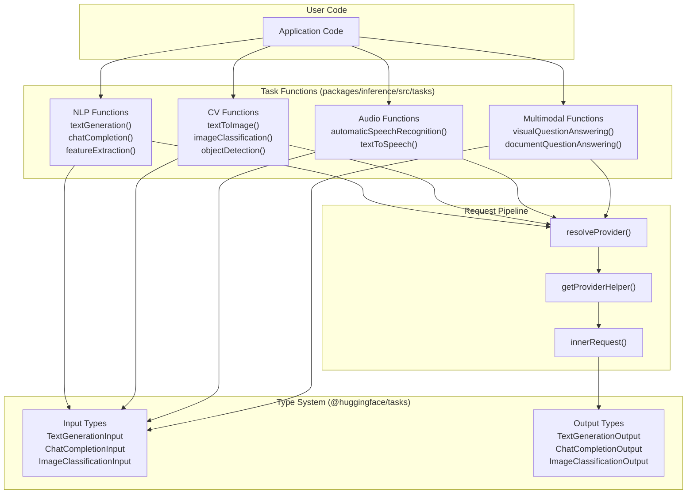
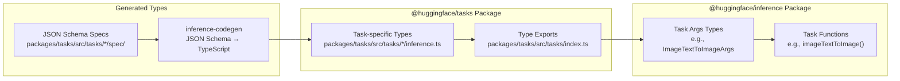
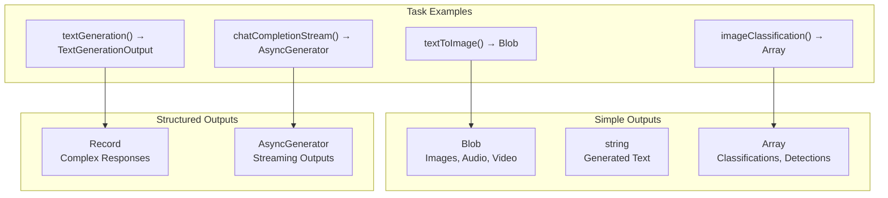
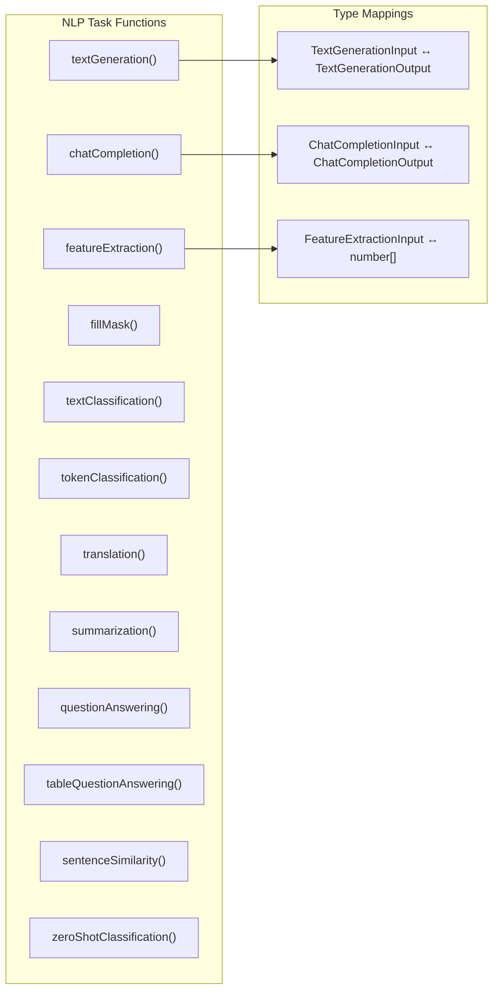
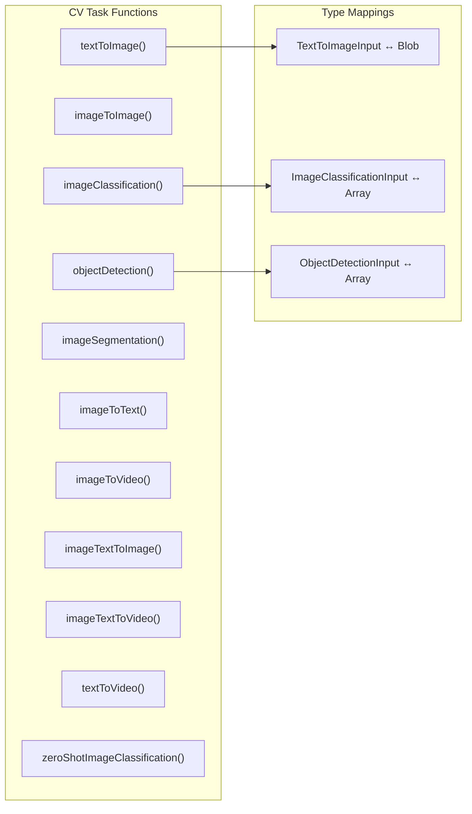
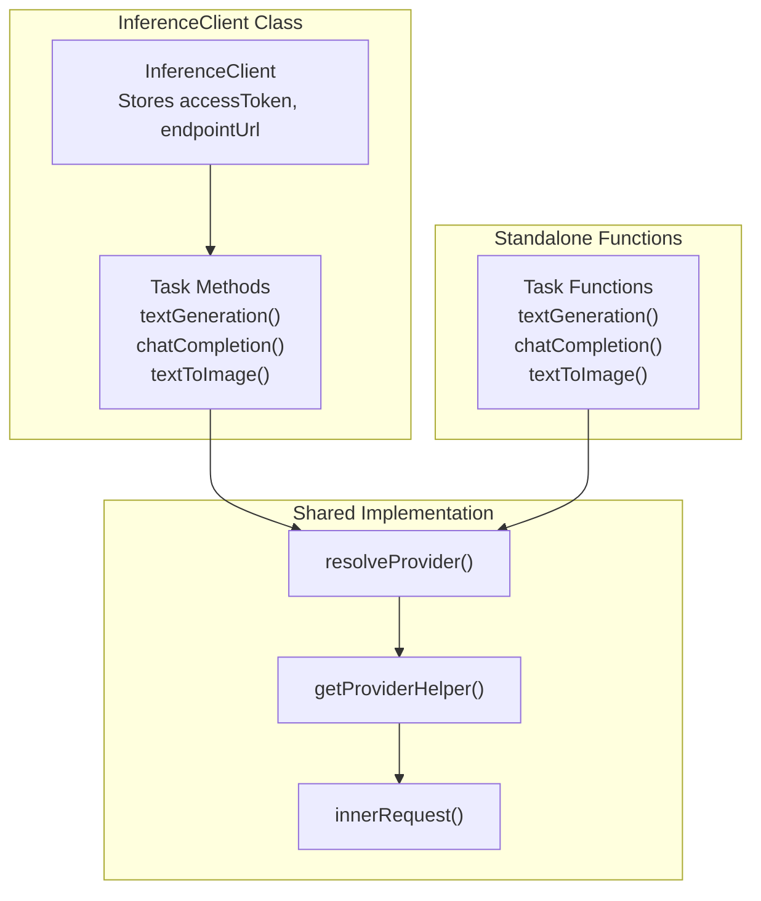
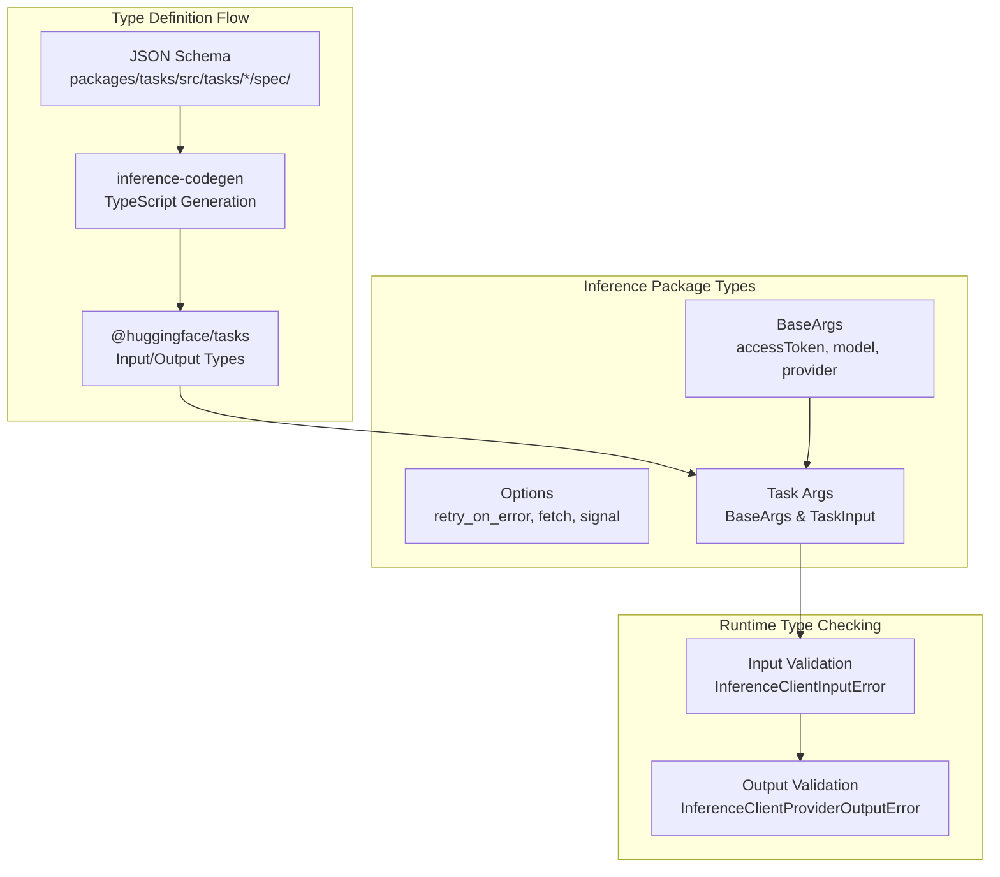
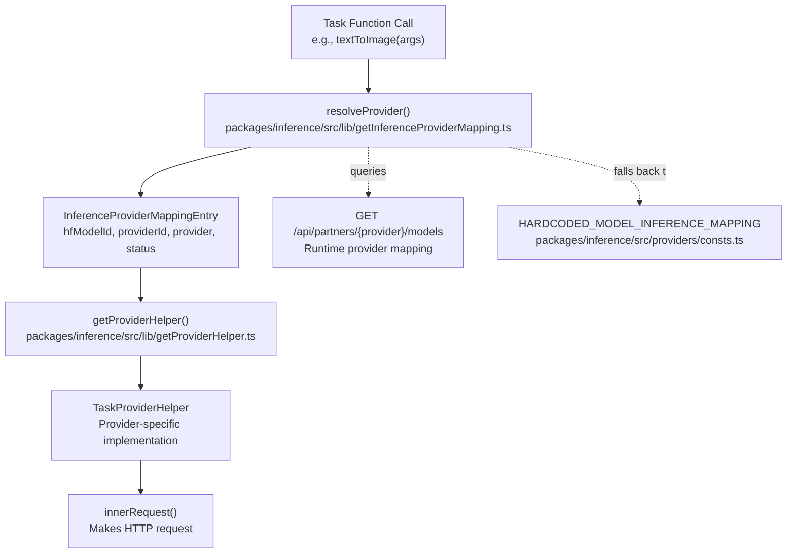

<!-- source: DeepWiki mcp.deepwiki.com · repo huggingface/huggingface.js · extra page Task Functions and Types · fetched 2026-10-26 -->

# Task Functions and Types

<details>
<summary>Relevant source files</summary>

The following files were used as context for generating this wiki page:

- [.github/workflows/lint.yml](.github/workflows/lint.yml)
- [.github/workflows/test.yml](.github/workflows/test.yml)
- [packages/inference/README.md](packages/inference/README.md)
- [packages/inference/src/config.ts](packages/inference/src/config.ts)
- [packages/inference/src/lib/getProviderHelper.ts](packages/inference/src/lib/getProviderHelper.ts)
- [packages/inference/src/lib/makeRequestOptions.ts](packages/inference/src/lib/makeRequestOptions.ts)
- [packages/inference/src/providers/consts.ts](packages/inference/src/providers/consts.ts)
- [packages/inference/src/providers/wavespeed.ts](packages/inference/src/providers/wavespeed.ts)
- [packages/inference/src/providers/zai-org.ts](packages/inference/src/providers/zai-org.ts)
- [packages/inference/src/tasks/cv/imageTextToImage.ts](packages/inference/src/tasks/cv/imageTextToImage.ts)
- [packages/inference/src/tasks/cv/imageTextToVideo.ts](packages/inference/src/tasks/cv/imageTextToVideo.ts)
- [packages/inference/src/tasks/index.ts](packages/inference/src/tasks/index.ts)
- [packages/inference/src/types.ts](packages/inference/src/types.ts)
- [packages/inference/test/InferenceClient.spec.ts](packages/inference/test/InferenceClient.spec.ts)
- [packages/tasks/src/pipelines.ts](packages/tasks/src/pipelines.ts)
- [packages/tasks/src/tasks/image-text-to-image/about.md](packages/tasks/src/tasks/image-text-to-image/about.md)
- [packages/tasks/src/tasks/image-text-to-image/data.ts](packages/tasks/src/tasks/image-text-to-image/data.ts)
- [packages/tasks/src/tasks/image-text-to-image/inference.ts](packages/tasks/src/tasks/image-text-to-image/inference.ts)
- [packages/tasks/src/tasks/index.ts](packages/tasks/src/tasks/index.ts)
- [packages/tasks/src/tasks/video-to-video/about.md](packages/tasks/src/tasks/video-to-video/about.md)
- [packages/tasks/src/tasks/video-to-video/data.ts](packages/tasks/src/tasks/video-to-video/data.ts)

</details>


## Purpose and Scope

This document describes the standalone task functions exported by `@huggingface/inference` and their associated TypeScript type system. Task functions provide an alternative interface to the `InferenceClient` class, enabling tree-shaking for reduced bundle sizes. For information about the provider abstraction that routes these calls, see [Provider System](#2.1.2). For details about the source-of-truth task metadata, see [Task Definitions and Type System](#3.1.1).

Each task function accepts typed input arguments and returns typed outputs, with types imported from `@huggingface/tasks`. This provides a unified type system across the Hugging Face ecosystem while allowing developers to import only the functions they need.

## Task Function Architecture

The `@huggingface/inference` package exports standalone functions for each supported ML task, organized by modality. Each function follows the same architectural pattern: it accepts task-specific arguments merged with base configuration, resolves the appropriate provider, and returns typed outputs.



**Task Function Structure**

All task functions follow a consistent implementation pattern shown in [packages/inference/src/tasks/cv/imageTextToImage.ts:1-23]():

```typescript
export async function imageTextToImage(args: ImageTextToImageArgs, options?: Options): Promise<Blob>
```

The function signature includes:
1. A typed `args` parameter merging `BaseArgs` with task-specific input types
2. An optional `options` parameter for request configuration
3. A typed return promise for the task output

Sources: [packages/inference/src/tasks/index.ts:1-47](), [packages/inference/src/tasks/cv/imageTextToImage.ts:1-23](), [packages/inference/src/tasks/cv/imageTextToVideo.ts:1-23]()

## Type System Integration

Task functions integrate with the type system exported by `@huggingface/tasks`, which defines input and output interfaces for all 60+ pipeline types. This ensures type consistency across the entire Hugging Face ecosystem.



**Type Import Pattern**

Task functions import their input/output types from `@huggingface/tasks`:

```typescript
import type { ImageTextToImageInput } from "@huggingface/tasks";
export type ImageTextToImageArgs = BaseArgs & ImageTextToImageInput;
```

This pattern is used throughout [packages/inference/src/tasks/cv/imageTextToImage.ts:1-7]() and similar files for all tasks.

Sources: [packages/tasks/src/tasks/index.ts:1-342](), [packages/tasks/src/tasks/image-text-to-image/inference.ts:1-76](), [packages/inference/src/tasks/cv/imageTextToImage.ts:1-23]()

## Input Types and Arguments

Every task function accepts arguments that merge `BaseArgs` with task-specific input types. The `BaseArgs` interface provides common configuration options while task inputs define the data payload.

**BaseArgs Interface**

Defined in [packages/inference/src/types.ts:121-154]():

| Property | Type | Description |
|----------|------|-------------|
| `accessToken` | `string?` | HF access token or provider API key |
| `model` | `ModelId?` | Model ID to use (e.g., "meta-llama/Llama-3.3-70B-Instruct") |
| `endpointUrl` | `string?` | Custom endpoint URL for Inference Endpoints or local servers |
| `provider` | `InferenceProviderOrPolicy?` | Provider to use ("auto", "hf-inference", "replicate", etc.) |

**Options Interface**

The `options` parameter provides request-level configuration [packages/inference/src/types.ts:16-43]():

| Property | Type | Description |
|----------|------|-------------|
| `retry_on_error` | `boolean?` | Retry on 503 errors (default: true) |
| `fetch` | `typeof fetch?` | Custom fetch function |
| `signal` | `AbortSignal?` | Abort controller signal |
| `includeCredentials` | `string \| boolean?` | Credentials mode for requests |
| `billTo` | `string?` | Organization to bill requests to |

**Task-Specific Input Types**

Task inputs are defined in `@huggingface/tasks` and vary by task. For example, `ImageTextToImageInput` [packages/tasks/src/tasks/image-text-to-image/inference.ts:10-22]() includes:

```typescript
export interface ImageTextToImageInput {
  inputs?: Blob;
  parameters?: ImageTextToImageParameters;
}
```

Where `ImageTextToImageParameters` [packages/tasks/src/tasks/image-text-to-image/inference.ts:26-56]() defines generation parameters like `guidance_scale`, `num_inference_steps`, and `prompt`.

Sources: [packages/inference/src/types.ts:16-154](), [packages/tasks/src/tasks/image-text-to-image/inference.ts:1-76]()

## Output Types

Task functions return typed outputs that correspond to the task's expected results. Output types are also imported from `@huggingface/tasks` and are generated from JSON schemas to ensure API consistency.

**Output Type Categories**



**Common Output Patterns**

| Task Type | Return Type | Example |
|-----------|-------------|---------|
| Generative (Media) | `Promise<Blob>` | `textToImage()`, `textToSpeech()` |
| Classification | `Promise<Array<{label: string, score: number}>>` | `imageClassification()` |
| Text Generation | `Promise<TextGenerationOutput>` | `textGeneration()` |
| Streaming | `AsyncGenerator<T>` | `chatCompletionStream()`, `textGenerationStream()` |
| Structured Data | `Promise<Record<string, unknown>>` | `questionAnswering()`, `documentQuestionAnswering()` |

**Streaming Outputs**

Streaming task functions like `chatCompletionStream()` return `AsyncGenerator` types that yield chunks progressively:

```typescript
export type ChatCompletionStreamOutput = AsyncGenerator<ChatCompletionStreamOutputChunk>;
```

This allows for real-time processing as shown in [packages/inference/README.md:273-288]().

Sources: [packages/tasks/src/tasks/index.ts:53-128](), [packages/inference/README.md:236-288]()

## Task Function Catalog

The library exports task functions organized by modality. Each function corresponds to a pipeline type defined in `@huggingface/tasks`.

**Natural Language Processing**



Exported from [packages/inference/src/tasks/index.ts:24-38]().

**Computer Vision**



Exported from [packages/inference/src/tasks/index.ts:11-22]().

**Audio**

| Function | Input Type | Output Type | Purpose |
|----------|-----------|-------------|---------|
| `audioClassification()` | `AudioClassificationInput` | `Array<{label, score}>` | Classify audio content |
| `audioToAudio()` | `AudioToAudioInput` | `Array<{label, blob}>` | Transform audio |
| `automaticSpeechRecognition()` | `AutomaticSpeechRecognitionInput` | `{text: string}` | Transcribe speech |
| `textToSpeech()` | `TextToSpeechInput` | `Blob` | Generate speech audio |

Exported from [packages/inference/src/tasks/index.ts:5-9]().

**Multimodal**

| Function | Input Type | Output Type | Purpose |
|----------|-----------|-------------|---------|
| `visualQuestionAnswering()` | `VisualQuestionAnsweringInput` | `{answer, score}` | Answer questions about images |
| `documentQuestionAnswering()` | `DocumentQuestionAnsweringInput` | `{answer, score}` | Answer questions about documents |

Exported from [packages/inference/src/tasks/index.ts:41-42]().

**Tabular**

| Function | Input Type | Output Type | Purpose |
|----------|-----------|-------------|---------|
| `tabularClassification()` | `TabularClassificationInput` | Classification results | Classify tabular data |
| `tabularRegression()` | `TabularRegressionInput` | Regression predictions | Predict numeric values |

Exported from [packages/inference/src/tasks/index.ts:45-46]().

Sources: [packages/inference/src/tasks/index.ts:1-47](), [packages/inference/README.md:236-658]()

## Using Task Functions vs InferenceClient

Task functions provide an alternative to the `InferenceClient` class with different trade-offs. The primary advantage is tree-shaking support, which reduces bundle size in production applications.

**Tree-Shaking Benefits**

When using task functions directly, bundlers can eliminate unused code:

```typescript
// Only imports textGeneration function and its dependencies
import { textGeneration } from "@huggingface/inference";

await textGeneration({
  accessToken: "hf_...",
  model: "meta-llama/Llama-3.2-3B",
  inputs: "The answer to the universe is",
  parameters: { max_new_tokens: 50 }
});
```

This approach is documented in [packages/inference/README.md:117-133]() and avoids loading the entire `InferenceClient` class and all task implementations.

**InferenceClient Equivalent**

The same call using `InferenceClient`:

```typescript
import { InferenceClient } from "@huggingface/inference";

const hf = new InferenceClient("hf_...");
await hf.textGeneration({
  model: "meta-llama/Llama-3.2-3B",
  inputs: "The answer to the universe is",
  parameters: { max_new_tokens: 50 }
});
```

**Implementation Relationship**



Both approaches use the same underlying implementation through `resolveProvider()`, `getProviderHelper()`, and `innerRequest()`. The difference is that `InferenceClient` methods automatically include the instance's `accessToken` and `endpointUrl`, while standalone functions require these in each call.

**When to Use Each Approach**

| Use Case | Recommended Approach | Reason |
|----------|---------------------|--------|
| Browser applications | Task functions | Tree-shaking reduces bundle size |
| Single-task scripts | Task functions | Simpler imports |
| Multi-task applications | InferenceClient | Shared configuration |
| TypeScript projects | Either | Both provide full type safety |
| Streaming operations | Either | Both support streaming |

Sources: [packages/inference/README.md:117-133](), [packages/inference/test/InferenceClient.spec.ts:1-1700]()

## Type Safety and Auto-Completion

The type system provides comprehensive type safety and IDE auto-completion throughout the inference workflow.

**Type Flow Diagram**



**Type Composition**

Each task function's argument type composes `BaseArgs` with task-specific input:

```typescript
// From packages/inference/src/tasks/cv/imageTextToImage.ts
export type ImageTextToImageArgs = BaseArgs & ImageTextToImageInput;

// ImageTextToImageInput from @huggingface/tasks
export interface ImageTextToImageInput {
  inputs?: Blob;
  parameters?: ImageTextToImageParameters;
}
```

This composition pattern is used in [packages/inference/src/tasks/cv/imageTextToImage.ts:7](), [packages/inference/src/tasks/cv/imageTextToVideo.ts:7](), and all other task files.

**Compile-Time Safety**

The type system catches errors at compile time:

```typescript
// ✓ Valid: all required types match
await textToImage({
  accessToken: "hf_...",
  model: "black-forest-labs/FLUX.1-dev",
  inputs: "A black forest cake",
  parameters: { guidance_scale: 7.5 }
});

// ✗ Compile error: 'inputs' should be string, not Blob
await textToImage({
  inputs: new Blob([data])  // Type error
});

// ✗ Compile error: unknown parameter
await textToImage({
  inputs: "A cake",
  parameters: { temperature: 0.7 }  // Type error
});
```

**Runtime Validation**

The library also performs runtime validation through custom error types defined in [packages/inference/src/errors.ts]():

| Error Type | When Thrown | Example |
|------------|-------------|---------|
| `InferenceClientInputError` | Invalid input parameters | Missing required model, invalid provider |
| `InferenceClientProviderApiError` | API request failures | Network errors, authentication failures |
| `InferenceClientProviderOutputError` | Malformed API responses | Unexpected response structure |
| `InferenceClientHubApiError` | Hub API errors | Failed to load model metadata |

Error handling example from [packages/inference/README.md:150-204]():

```typescript
try {
  const result = await textGeneration({
    model: "gpt2",
    inputs: "Hello, I'm a language model"
  });
} catch (error) {
  if (error instanceof InferenceClientProviderApiError) {
    console.error("Provider API Error:", error.message);
    console.error("HTTP Status:", error.response.status);
  } else if (error instanceof InferenceClientInputError) {
    console.error("Invalid input:", error.message);
  }
}
```

**Parameter Validation**

The `makeRequestOptions()` function in [packages/inference/src/lib/makeRequestOptions.ts:19-99]() validates parameters before making requests:

- Checks if `endpointUrl` is provided with third-party providers
- Validates that model URLs are not used (deprecated)
- Ensures either a model or task is specified
- Verifies provider compatibility with the model

Sources: [packages/inference/src/types.ts:1-192](), [packages/tasks/src/tasks/image-text-to-image/inference.ts:1-76](), [packages/inference/src/lib/makeRequestOptions.ts:19-99](), [packages/inference/README.md:134-234]()

## Task-to-Provider Mapping

Task functions automatically resolve which inference provider to use based on the model, provider parameter, and task type. This mapping is handled internally by the provider system.

**Provider Resolution Flow**



**Provider Support by Task**

The `PROVIDERS` constant in [packages/inference/src/lib/getProviderHelper.ts:62-193]() maps providers to supported tasks:

```typescript
export const PROVIDERS: Record<InferenceProvider, Partial<Record<InferenceTask, TaskProviderHelper>>> = {
  "fal-ai": {
    "text-to-image": new FalAI.FalAITextToImageTask(),
    "text-to-video": new FalAI.FalAITextToVideoTask(),
    "image-to-image": new FalAI.FalAIImageToImageTask(),
    // ... more tasks
  },
  "replicate": {
    "text-to-image": new Replicate.ReplicateTextToImageTask(),
    "automatic-speech-recognition": new Replicate.ReplicateAutomaticSpeechRecognitionTask(),
    // ... more tasks
  },
  // ... more providers
}
```

This ensures that `getProviderHelper()` can validate provider-task combinations and throw `InferenceClientInputError` when unsupported combinations are requested [packages/inference/src/lib/getProviderHelper.ts:330-354]().

Sources: [packages/inference/src/lib/getProviderHelper.ts:62-354](), [packages/inference/src/providers/consts.ts:1-45](), [packages/inference/src/types.ts:47-119]()

---

