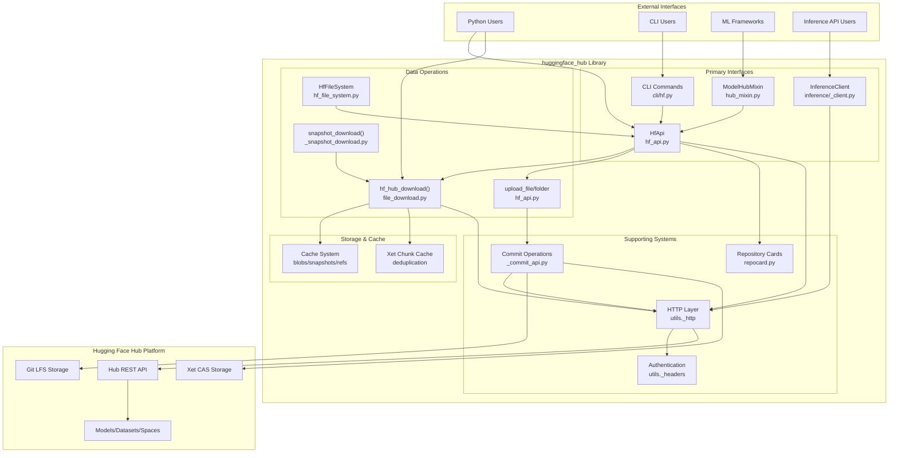
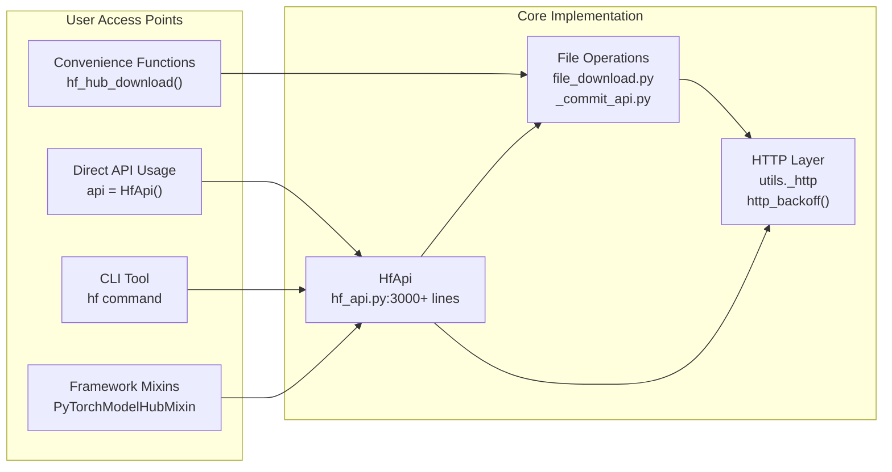
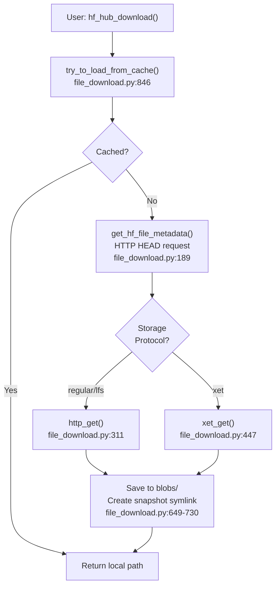
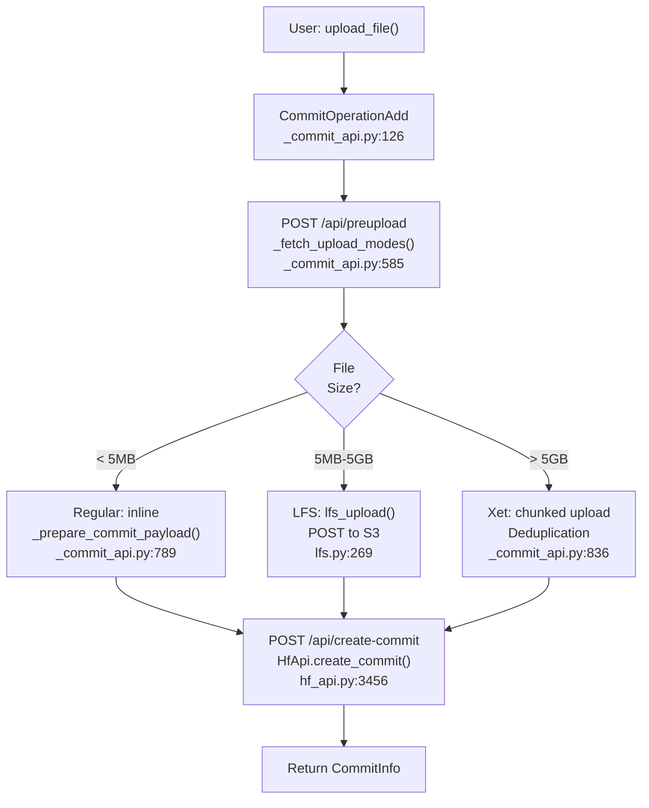
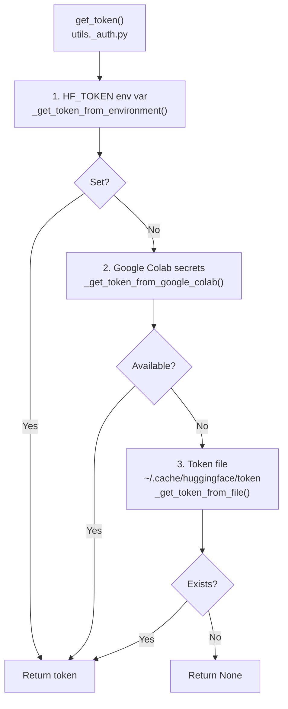
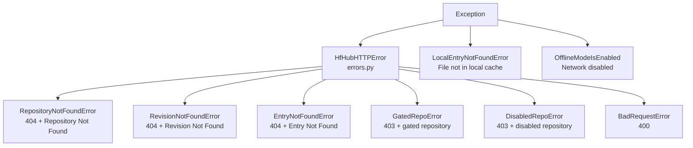
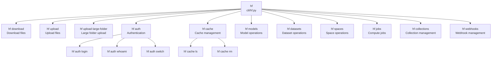

<!-- source: DeepWiki mcp.deepwiki.com · repo huggingface/huggingface_hub · page 1 Overview · fetched 2026-10-26 -->

# Overview

<details>
<summary>Relevant source files</summary>

The following files were used as context for generating this wiki page:

- [.github/workflows/python-quality.yml](.github/workflows/python-quality.yml)
- [.github/workflows/python-tests.yml](.github/workflows/python-tests.yml)
- [CONTRIBUTING.md](CONTRIBUTING.md)
- [Makefile](Makefile)
- [README.md](README.md)
- [docs/source/cn/index.md](docs/source/cn/index.md)
- [docs/source/cn/quick-start.md](docs/source/cn/quick-start.md)
- [setup.py](setup.py)
- [src/huggingface_hub/__init__.py](src/huggingface_hub/__init__.py)
- [src/huggingface_hub/_commit_api.py](src/huggingface_hub/_commit_api.py)
- [src/huggingface_hub/constants.py](src/huggingface_hub/constants.py)
- [src/huggingface_hub/file_download.py](src/huggingface_hub/file_download.py)
- [src/huggingface_hub/hf_api.py](src/huggingface_hub/hf_api.py)
- [src/huggingface_hub/utils/__init__.py](src/huggingface_hub/utils/__init__.py)
- [tests/test_file_download.py](tests/test_file_download.py)
- [tests/test_hf_api.py](tests/test_hf_api.py)
- [tests/testing_utils.py](tests/testing_utils.py)

</details>


The `huggingface_hub` library is the official Python client for the [Hugging Face Hub](https://huggingface.co), a platform for hosting and sharing machine learning models, datasets, and applications. The library provides programmatic access to all Hub functionality, enabling developers to download files, upload models, run inference, and manage repositories directly from Python code or the command line.

## Purpose and Core Functionality

**Primary Use Cases:**
- Download models and datasets with automatic caching
- Upload and version files using Git-based or HTTP-based workflows  
- Run inference on models hosted on the Hub or third-party providers
- Manage repository lifecycle (create, delete, update settings)
- Search and discover models, datasets, and spaces
- Integrate Hub functionality into ML frameworks

The library serves as the foundation for other Hugging Face libraries (`transformers`, `diffusers`, `datasets`) while remaining fully functional as a standalone tool.

**Navigation:** This overview covers the library's architecture and main components. For detailed documentation on specific subsystems, see:
- Repository and file operations → Section 2 (Core API Client)
- File download and caching → Sections 2.2, 2.5
- Model inference → Section 3 (Inference Client)
- ML framework integration → Section 5
- Command-line interface → Section 7
- Authentication → Section 8

**Sources:** [src/huggingface_hub/__init__.py:1-50](), [README.md:1-163](), [setup.py:106-147]()

## Key Features

| Feature | Description | Primary Interface |
|---------|-------------|-------------------|
| **File Download** | Download single files or entire repositories with automatic caching and resume support | `hf_hub_download()`, `snapshot_download()` |
| **File Upload** | Upload files via HTTP or Git, supporting LFS for large files and Xet for deduplication | `upload_file()`, `upload_folder()`, `create_commit()` |
| **Repository Management** | Create, delete, update repos; manage branches, tags, and access controls | `HfApi.create_repo()`, `HfApi.delete_repo()`, etc. |
| **Inference** | Run inference on 35+ ML tasks across multiple providers (HF, Replicate, Together, Fal AI, SambaNova) | `InferenceClient`, `AsyncInferenceClient` |
| **Search & Discovery** | List and filter models, datasets, and spaces with metadata | `HfApi.list_models()`, `HfApi.list_datasets()` |
| **Model Cards** | Create and manage model documentation with structured metadata | `ModelCard`, `DatasetCard`, `SpaceCard` |
| **Framework Integration** | Integrate any ML framework with standardized save/load patterns | `ModelHubMixin`, `PyTorchModelHubMixin` |
| **File System Interface** | Access Hub as a file system using fsspec protocol | `HfFileSystem` |
| **CLI Tools** | Command-line interface for all Hub operations | `hf` command, `tiny-agents` |

**Sources:** [README.md:46-54](), [src/huggingface_hub/__init__.py:54-585]()

## Installation

**Basic Installation:**
```bash
pip install huggingface_hub
```

**With Optional Dependencies:**
```bash
pip install "huggingface_hub[mcp]"      # Model Context Protocol support
pip install "huggingface_hub[torch]"    # PyTorch integration
pip install "huggingface_hub[fastai]"   # FastAI integration
```

**Core Dependencies:**
- `httpx>=0.23.0` - HTTP client with retry logic
- `fsspec>=2023.5.0` - File system abstraction
- `hf-xet>=1.3.2` - Xet CAS storage for large files (platform-specific)
- `pyyaml>=5.1` - YAML parsing for model cards
- `tqdm>=4.42.1` - Progress bars
- `typer` - CLI framework
- `typing-extensions>=4.1.0` - Type hints support

**Sources:** [README.md:56-72](), [setup.py:19-29](), [setup.py:31-105]()

## Architecture Overview

The library is organized into four architectural layers, with `HfApi` serving as the central orchestrator for Hub operations.

**High-Level System Architecture**



**Sources:** Diagram 1 from provided context, [src/huggingface_hub/hf_api.py:1-100](), [src/huggingface_hub/__init__.py:54-585]()

## Core Components

The library's functionality is implemented through several key components, ranked by edit frequency and architectural importance:

**Component Importance Table**

| Component | Importance | Location | Primary Responsibility |
|-----------|-----------|----------|------------------------|
| `HfApi` | 871 | [src/huggingface_hub/hf_api.py]() | Central HTTP-based API client for all Hub operations (create/delete repos, upload/download files, list resources) |
| `InferenceClient` | 305 | [src/huggingface_hub/inference/_client.py]() | Multi-provider inference with 35+ task methods and streaming support |
| `file_download` | 154 | [src/huggingface_hub/file_download.py]() | Core file download with caching, protocol negotiation (HTTP/LFS/Xet), and offline mode |
| `CLI` | 192 | [src/huggingface_hub/cli/]() | Command-line interface for download, upload, cache management, and authentication |
| `_commit_api` | 108 | [src/huggingface_hub/_commit_api.py]() | Commit operations with LFS and Xet upload strategies |
| `RepoCard` | 101 | [src/huggingface_hub/repocard.py]() | Model/dataset card management with YAML metadata parsing |
| `HfFileSystem` | 97 | [src/huggingface_hub/hf_file_system.py]() | fsspec-compatible filesystem interface for Hub repositories |
| `ModelHubMixin` | 97 | [src/huggingface_hub/hub_mixin.py]() | Base class for ML framework integration (save/load patterns) |

**Primary User Interfaces**



**Usage Patterns:**

1. **Direct API Usage**: `api = HfApi()` provides access to 100+ methods for Hub operations
2. **Convenience Functions**: Top-level functions like `hf_hub_download()` offer simpler APIs for common tasks
3. **CLI Tool**: `hf` command provides shell access to all operations
4. **Framework Mixins**: `ModelHubMixin` enables ML libraries to integrate Hub functionality via inheritance

**Sources:** Diagram 1 from provided context, [src/huggingface_hub/hf_api.py:1-100](), [src/huggingface_hub/__init__.py:54-585]()

## Request Flow Examples

**File Download Flow**



**File Upload Flow**



**Upload Strategy Selection:**
- **Regular**: Small files (< 5MB) embedded directly in commit
- **LFS**: Medium/large files (5MB-5GB) use Git LFS with S3 multipart upload
- **Xet**: Very large files (> 5GB) use Xet CAS with chunk-based deduplication

**Sources:** [src/huggingface_hub/file_download.py:311-800](), [src/huggingface_hub/_commit_api.py:126-900](), [src/huggingface_hub/hf_api.py:3400-3600]()

## Authentication System

**Token Resolution Priority**



**Authentication Methods:**

| Method | Command/Function | Token Storage | Use Case |
|--------|------------------|---------------|----------|
| CLI Login | `hf auth login` | `~/.cache/huggingface/token` | Interactive login with token prompt |
| Environment Variable | `export HF_TOKEN=...` | Process environment | CI/CD pipelines, temporary auth |
| Programmatic | `login(token="...")` | `~/.cache/huggingface/token` | Scripted workflows |
| Multi-account | `hf auth switch` | `~/.cache/huggingface/stored_tokens` | Switch between multiple accounts |

**Token Usage:**
- All `HfApi` methods accept an optional `token` parameter to override default token
- Set `HF_HUB_DISABLE_IMPLICIT_TOKEN=1` to prevent automatic token inclusion in requests
- Token types: read-only, write, or fine-grained permissions

**Sources:** [src/huggingface_hub/utils/_auth.py:1-150](), [src/huggingface_hub/_login.py:1-200](), [src/huggingface_hub/constants.py:203-239]()

## Cache System

The library uses a Git-inspired content-addressable storage system with two cache layers: file cache and Xet chunk cache.

**Cache Directory Structure:**

```
HF_HOME (~/.cache/huggingface)
├── hub/                           # File cache (HF_HUB_CACHE)
│   └── models--{namespace}--{repo_name}/
│       ├── refs/
│       │   └── main               # Pointer: commit hash as string
│       ├── blobs/
│       │   └── {sha256}           # Actual file content (deduplicated)
│       ├── snapshots/
│       │   └── {commit_hash}/
│       │       └── file.txt -> ../../blobs/{sha256}  # Symlink
│       └── .no_exist/
│           └── {commit_hash}/file.txt  # Negative cache marker
│
└── xet/                           # Xet chunk cache (HF_XET_CACHE)
    ├── chunk_cache/               # Reusable file chunks
    └── shard_cache/               # File->chunk mapping
```

**Cache Operations:**

| Function | Location | Purpose |
|----------|----------|---------|
| `try_to_load_from_cache()` | [file_download.py:846-900]() | Lookup file in cache by repo + revision + filename |
| `_create_symlink()` | [file_download.py:75-132]() | Create symlink from snapshot to blob (atomic) |
| `scan_cache_dir()` | [utils/_cache_manager.py:1-500]() | Scan and analyze cache usage |

**Dual-Layer Caching:**
1. **File Cache**: Stores complete files by content hash (SHA256), deduplicated across commits
2. **Xet Cache**: Stores file chunks for Xet-backed files, enabling cross-file deduplication

**Benefits:**
- Files stored once regardless of how many branches/commits reference them
- Switching between commits is instantaneous (symlink updates only)
- Xet cache provides additional deduplication for large files split into chunks
- Negative cache prevents repeated 404 lookups for non-existent files

**Sources:** [src/huggingface_hub/file_download.py:75-900](), [src/huggingface_hub/constants.py:131-165](), [src/huggingface_hub/utils/_cache_manager.py:1-100]()

## Configuration

**Environment Variables:**

| Variable | Default | Purpose |
|----------|---------|---------|
| `HF_HOME` | `~/.cache/huggingface` | Base directory for all Hub data |
| `HF_HUB_CACHE` | `$HF_HOME/hub` | File cache directory |
| `HF_XET_CACHE` | `$HF_HOME/xet` | Xet chunk cache directory |
| `HF_TOKEN` | None | Authentication token (read from file if not set) |
| `HF_ENDPOINT` | `https://huggingface.co` | Hub API endpoint URL |
| `HF_HUB_OFFLINE` | `False` | Offline mode (use cache only, no network requests) |
| `HF_HUB_DISABLE_IMPLICIT_TOKEN` | `False` | Disable automatic token inclusion in requests |
| `HF_XET_HIGH_PERFORMANCE` | `False` | Enable high-performance Xet downloads |
| `HF_HUB_DOWNLOAD_TIMEOUT` | `10` | Default HTTP timeout (seconds) |
| `HF_HUB_ETAG_TIMEOUT` | `10` | Timeout for metadata requests (seconds) |
| `HF_HUB_DISABLE_PROGRESS_BARS` | None | Disable all progress bars |
| `HF_DEBUG` | `False` | Enable debug logging and log all HTTP requests as curl commands |

**Configuration Files:**

| File | Purpose | Format |
|------|---------|--------|
| `$HF_HOME/token` | Default authentication token | Plain text |
| `$HF_HOME/stored_tokens` | Named tokens for multi-account | JSON |
| `$HF_HOME/.check_for_update_done` | Update check marker | Touch file |

**Sources:** [src/huggingface_hub/constants.py:1-284]()

## Testing Strategy

**Test Organization:**

| Test Category | Pattern | Environment | Purpose |
|--------------|---------|-------------|---------|
| Unit tests | `tests/test_*.py` | Mocked | Test individual functions in isolation |
| Integration tests | `tests/test_hf_api.py` | Staging Hub | Test full workflows against real Hub |
| Inference tests | `tests/test_inference*.py` | VCR.py cassettes | Test inference API with recorded responses |
| Framework tests | `tests/test_hub_mixin.py` | Staging Hub | Test ML framework integrations |
| Xet tests | `tests/test_xet*.py` | Production/Staging | Test Xet storage functionality |

**CI Test Matrix** (from [.github/workflows/python-tests.yml]()):

| Test Suite | Python Versions | Special Requirements |
|------------|-----------------|---------------------|
| Everything else | 3.9, 3.14 | Excludes inference and Xet |
| Inference only | 3.9, 3.14 | Audio libraries (libsndfile1) |
| Xet only | 3.9, 3.14 | hf_xet installed |
| LFS tests | 3.14 only | Git LFS + Git credentials |
| PyTorch (torch~=1.11) | 3.9 only | Legacy PyTorch support |
| PyTorch (latest) | 3.12 only | Latest PyTorch |
| Gradio integration | 3.13 only | Gradio 5.0+ |

**Test Utilities:**

| Utility | Location | Purpose |
|---------|----------|---------|
| `repo_name()` | [tests/testing_utils.py:64-79]() | Generate unique test repo names |
| `@use_tmp_repo()` | [tests/testing_utils.py:1-50]() | Decorator for temporary test repositories |
| `ENDPOINT_STAGING` | [tests/testing_constants.py]() | Staging Hub URL constant |

**Sources:** [.github/workflows/python-tests.yml:16-206](), [tests/testing_utils.py:1-250](), [tests/test_hf_api.py:126-500]()

## Error Handling

**Exception Hierarchy:**



**Error Enhancement via `hf_raise_for_status()`:**

The function at [src/huggingface_hub/utils/_http.py]() enriches HTTP errors by:
1. Parsing `X-Error-Code` header to determine specific error type
2. Extracting request ID from `X-Request-Id` for support purposes
3. Including server error message from response body
4. Adding contextual hints (e.g., "use `token=...` for private repositories")

**Common Error Patterns:**

| HTTP Status | Error Class | Typical Cause |
|-------------|-------------|---------------|
| 401 | `HfHubHTTPError` | Missing or invalid authentication token |
| 403 | `GatedRepoError` | Attempting to access gated repo without access |
| 403 | `DisabledRepoError` | Repository has been disabled by owner/moderator |
| 404 | `RepositoryNotFoundError` | Repository does not exist or is private |
| 404 | `RevisionNotFoundError` | Git revision (branch/tag/commit) not found |
| 404 | `EntryNotFoundError` | File does not exist in repository |
| 429 | `HfHubHTTPError` | Rate limit exceeded (includes retry info) |

**Sources:** [src/huggingface_hub/errors.py:1-200](), [src/huggingface_hub/utils/_http.py:1-300]()

## Command Line Interface

**CLI Entry Points** (from [setup.py:120-125]()):

| Command | Entry Point | Purpose |
|---------|-------------|---------|
| `hf` | `huggingface_hub.cli.hf:main` | Modern CLI with Typer framework |
| `tiny-agents` | `huggingface_hub.inference._mcp.cli:app` | MCP server for AI agents |

**Command Structure:**



**Common Commands:**

```bash
# Authentication
hf auth login
hf auth whoami

# Download files
hf download gpt2 config.json
hf download stabilityai/stable-diffusion-2-1 --repo-type model

# Upload files
hf upload my-username/my-model ./local/path
hf upload-large-folder my-username/my-model ./large-folder

# Cache management
hf cache ls
hf cache rm --repo gpt2
```

**Sources:** [setup.py:120-125](), [src/huggingface_hub/cli/hf.py:1-100]()

## Development

**Code Quality Tools:**

| Tool | Purpose | Command |
|------|---------|---------|
| `ruff` | Linting and formatting | `ruff check src tests` / `ruff format src tests` |
| `mypy` | Static type checking | `mypy src` |
| `ty` | Runtime type checking | `ty check src` |
| `pytest` | Test execution | `pytest tests/` |
| `pytest-cov` | Coverage reporting | Automatic in CI |

**Development Workflow:**

```bash
# Setup
pip install -e ".[dev]"

# Run quality checks
make quality    # Lint, format check, type check
make style      # Auto-format code
make test       # Run test suite

# Run specific tests
pytest tests/test_hf_api.py -k test_create_repo
pytest tests/ -v -s  # Verbose with print statements
```

**CI/CD Workflows** (from [.github/workflows/]()):

| Workflow | Trigger | Purpose |
|----------|---------|---------|
| `python-tests.yml` | Push, PR | Run test suite on multiple Python versions |
| `python-quality.yml` | Push, PR | Run linters and type checkers |
| `python-release.yml` | Tag push | Build and publish to PyPI |

**Sources:** [Makefile:1-41](), [.github/workflows/python-quality.yml:1-54](), [CONTRIBUTING.md:129-167]()

## Key Design Principles

1. **Lazy Loading**: Modules imported on first use via `__init__.py` lazy loader to minimize import time
2. **Caching by Default**: All downloads cached using content-addressable storage
3. **Resilient HTTP**: Automatic retries with exponential backoff for transient failures
4. **Offline Support**: Graceful degradation when network unavailable
5. **Multi-Protocol**: Supports standard HTTP, LFS, and Xet for different file sizes
6. **Framework Agnostic**: Core functionality independent of ML frameworks
7. **Backward Compatibility**: Legacy interfaces maintained alongside modern ones

**Sources:** [src/huggingface_hub/__init__.py:16-46](), [src/huggingface_hub/utils/_http.py:1-200](), [src/huggingface_hub/file_download.py:1-100]()

---

