<!-- source: DeepWiki mcp.deepwiki.com · repo huggingface/huggingface_hub · page 12 Development and Contributing · fetched 2026-10-26 -->

# Development and Contributing

<details>
<summary>Relevant source files</summary>

The following files were used as context for generating this wiki page:

- [.github/workflows/check-installers.yml](.github/workflows/check-installers.yml)
- [.github/workflows/claude.yml](.github/workflows/claude.yml)
- [.github/workflows/python-prerelease.yml](.github/workflows/python-prerelease.yml)
- [.github/workflows/python-quality.yml](.github/workflows/python-quality.yml)
- [.github/workflows/python-release-hf.yml](.github/workflows/python-release-hf.yml)
- [.github/workflows/python-release.yml](.github/workflows/python-release.yml)
- [.github/workflows/python-tests.yml](.github/workflows/python-tests.yml)
- [.github/workflows/release-conda.yml](.github/workflows/release-conda.yml)
- [.github/workflows/style-bot-action.yml](.github/workflows/style-bot-action.yml)
- [.github/workflows/style-bot.yml](.github/workflows/style-bot.yml)
- [.github/workflows/trufflehog.yml](.github/workflows/trufflehog.yml)
- [.github/workflows/update-inference-types.yaml](.github/workflows/update-inference-types.yaml)
- [CONTRIBUTING.md](CONTRIBUTING.md)
- [Makefile](Makefile)
- [docs/README.md](docs/README.md)
- [setup.py](setup.py)

</details>


## Purpose and Scope

This page documents the development infrastructure, contribution workflows, and release processes for the `huggingface_hub` library. It covers development environment setup, code quality tools, testing infrastructure, CI/CD workflows, and the release pipeline. For information about specific API usage or features, see the relevant component pages in this wiki.

---

## Development Environment Setup

### Repository Structure

The `huggingface_hub` repository follows a standard Python package structure:

| Directory/File | Purpose |
|----------------|---------|
| `src/huggingface_hub/` | Main library source code |
| `tests/` | Test suite using pytest |
| `utils/` | Development utilities and code generation scripts |
| `docs/` | Documentation source files |
| `.github/workflows/` | CI/CD workflow definitions |
| `setup.py` | Package configuration and dependencies |

### Local Development Setup

**Step 1: Fork and Clone**

```bash
git clone git@github.com:<your-handle>/huggingface_hub.git
cd huggingface_hub
git remote add upstream https://github.com/huggingface/huggingface_hub.git
```

**Step 2: Create Virtual Environment**

The project supports Python 3.9-3.14. Use `uv` or standard virtual environments:

```bash
# Using uv (recommended)
pip install --upgrade uv
uv venv
source .venv/bin/activate  # Linux/Mac
.venv\Scripts\activate      # Windows

# Install in editable mode with dev dependencies
uv pip install -e ".[dev]"
```

**Step 3: Verify Installation**

```bash
# Check library is importable
python -c "import huggingface_hub; print(huggingface_hub.__version__)"

# Verify CLI is available
hf --version
```

Sources: [CONTRIBUTING.md:129-134](), [setup.py:1-147](), [.github/workflows/python-tests.yml:44-47]()

---

## Package Dependencies

### Core Dependencies

The library has minimal runtime dependencies defined in `install_requires`:

```python
install_requires = [
    "filelock>=3.10.0",
    "fsspec>=2023.5.0",
    "hf-xet>=1.3.2,<2.0.0",  # Platform-specific
    "httpx>=0.23.0, <1",
    "packaging>=20.9",
    "pyyaml>=5.1",
    "tqdm>=4.42.1",
    "typer",
    "typing-extensions>=4.1.0",
]
```

### Development Extras

| Extra | Purpose | Key Packages |
|-------|---------|--------------|
| `testing` | Test infrastructure | `pytest`, `pytest-cov`, `pytest-xdist`, `pytest-vcr`, `pytest-asyncio` |
| `quality` | Code quality tools | `ruff>=0.9.0`, `mypy==1.15.0`, `libcst`, `ty` |
| `typing` | Type stubs | `types-PyYAML`, `types-tqdm`, `types-urllib3` |
| `oauth` | OAuth integration | `authlib`, `fastapi`, `itsdangerous` |
| `torch` | PyTorch integration | `torch`, `safetensors[torch]` |
| `fastai` | FastAI integration | `fastai>=2.4`, `toml` |
| `mcp` | Model Context Protocol | `mcp>=1.8.0` |
| `gradio` | Webhooks testing | `gradio>=5.0.0` (Python 3.10+) |
| `dev` | All development tools | Combines `testing`, `quality`, `typing` |

Sources: [setup.py:19-104]()

---

## Code Quality Infrastructure

### Quality Tools Overview

```mermaid
graph TB
    Developer["Developer"]
    
    subgraph "Formatting & Linting"
        Ruff["ruff"]
        RuffFormat["ruff format"]
        RuffCheck["ruff check"]
    end
    
    subgraph "Type Checking"
        Mypy["mypy"]
        Ty["ty"]
    end
    
    subgraph "Custom Scripts"
        CheckInference["check_inference_input_params.py"]
        CheckImports["check_static_imports.py"]
        CheckAll["check_all_variable.py"]
        GenAsync["generate_async_inference_client.py"]
        GenCLI["generate_cli_reference.py"]
        GenTypes["generate_inference_types.py"]
        CheckTask["check_task_parameters.py"]
    end
    
    subgraph "Makefile Targets"
        MakeStyle["make style"]
        MakeQuality["make quality"]
    end
    
    Developer --> MakeStyle
    Developer --> MakeQuality
    
    MakeStyle --> RuffFormat
    MakeStyle --> RuffCheck
    MakeStyle --> CheckImports
    MakeStyle --> CheckAll
    MakeStyle --> GenAsync
    MakeStyle --> GenCLI
    
    MakeQuality --> RuffCheck
    MakeQuality --> RuffFormat
    MakeQuality --> CheckInference
    MakeQuality --> CheckImports
    MakeQuality --> CheckAll
    MakeQuality --> GenAsync
    MakeQuality --> GenCLI
    MakeQuality --> Ty
    MakeQuality --> Mypy
```

### Makefile Targets

The repository provides convenient `make` targets for code quality:

```bash
# Apply automatic formatting and fixes
make style

# Check code quality without modifications
make quality

# Check/update inference types
make inference_check
make inference_update

# Run tests
make test
```

**`make style` performs:**
- Format code with `ruff format`
- Auto-fix linting issues with `ruff check --fix`
- Update static imports with `--update` flag
- Regenerate `__all__` variables
- Regenerate `AsyncInferenceClient`
- Update CLI reference documentation

**`make quality` performs:**
- Check code formatting (no changes)
- Check linting issues (no changes)
- Validate inference input parameters
- Verify static imports
- Verify `__all__` variables
- Verify async client is up-to-date
- Verify CLI reference is up-to-date
- Type check with `ty` and `mypy`

Sources: [Makefile:1-41](), [.github/workflows/python-quality.yml:38-53]()

### Pre-commit Hooks

Optional pre-commit hooks apply style checks automatically:

```bash
pip install pre-commit
pre-commit install

# Temporarily disable for a commit
git commit -n
```

Sources: [CONTRIBUTING.md:173-189]()

---

## Testing Infrastructure

### Test Organization

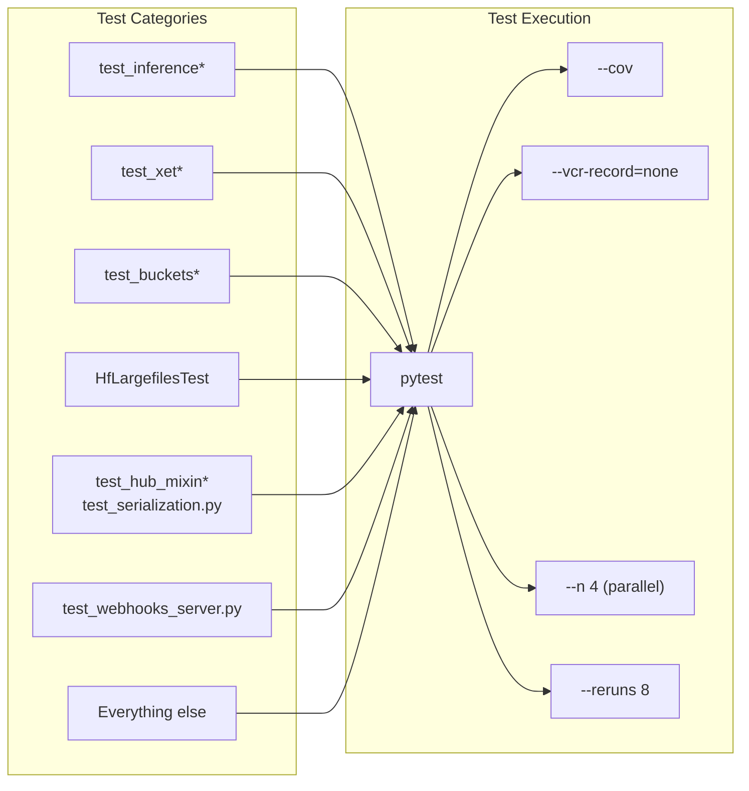

### Running Tests Locally

**Run all tests:**
```bash
pytest ./tests
```

**Run specific test file:**
```bash
pytest ./tests/test_repository.py
```

**Run tests matching pattern:**
```bash
pytest ./tests -k tag
pytest ./tests -k "test_inference"
```

**Run with coverage:**
```bash
pytest --cov=./huggingface_hub --cov-report=xml:coverage.xml ./tests
```

### Test Configuration

Tests use several `pytest` plugins:

| Plugin | Purpose | Configuration |
|--------|---------|---------------|
| `pytest-cov` | Code coverage | Reports to `coverage.xml` |
| `pytest-xdist` | Parallel execution | `-n 4` for 4 workers |
| `pytest-vcr` | HTTP mocking | `--vcr-record=none` in CI |
| `pytest-asyncio` | Async test support | For `AsyncInferenceClient` |
| `pytest-rerunfailures` | Retry flaky tests | `--reruns 8 --reruns-delay 2` |
| `pytest-env` | Environment variables | Test-specific env vars |
| `pytest-mock` | Mocking utilities | Mock external dependencies |

Sources: [.github/workflows/python-tests.yml:89-130](), [setup.py:54-74](), [CONTRIBUTING.md:245-269]()

---

## Continuous Integration Architecture

### CI/CD Workflows Overview

```mermaid
graph TB
    subgraph "Trigger Events"
        PushMain["Push to main"]
        PullRequest["Pull Request"]
        Tag["Tag push (v*)"]
        TagRC["Tag push (v*rc*)"]
        Schedule["Scheduled (daily)"]
        Comment["Issue Comment"]
    end
    
    subgraph "Test Workflows"
        PyTestUbuntu["python-tests.yml<br/>Ubuntu"]
        PyTestWin["python-tests.yml<br/>Windows"]
        PyQuality["python-quality.yml"]
    end
    
    subgraph "Automation Workflows"
        UpdateTypes["update-inference-types.yaml"]
        StyleBot["style-bot.yml"]
        Claude["claude.yml"]
    end
    
    subgraph "Release Workflows"
        PyRelease["python-release.yml"]
        PyReleaseHF["python-release-hf.yml"]
        CondaRelease["release-conda.yml"]
        PreRelease["python-prerelease.yml"]
    end
    
    subgraph "Security & Quality"
        Trufflehog["trufflehog.yml"]
        CheckInstallers["check-installers.yml"]
    end
    
    PushMain --> PyTestUbuntu
    PushMain --> PyTestWin
    PushMain --> PyQuality
    PushMain --> Trufflehog
    
    PullRequest --> PyTestUbuntu
    PullRequest --> PyTestWin
    PullRequest --> PyQuality
    
    Tag --> PyRelease
    Tag --> PyReleaseHF
    Tag --> CondaRelease
    
    TagRC --> PreRelease
    
    Schedule --> UpdateTypes
    
    Comment --> StyleBot
    Comment --> Claude
```

### Python Tests Workflow

The main testing workflow runs on both Ubuntu and Windows with multiple Python versions and test categories:

**Matrix Strategy:**

| Python Version | Test Categories |
|----------------|-----------------|
| 3.9, 3.14 | "Everything else", "Inference only", "Xet only" |
| 3.14 | "lfs" (LFS tests) |
| 3.9 | "Python 3.9, torch_1.11" (legacy torch) |
| 3.12 | "torch_latest" (latest torch) |
| 3.13 | "gradio" (webhooks tests) |

**Test execution by category:**

```bash
# Everything else (default tests, parallel)
pytest ../tests -k 'not test_inference and not test_xet and not test_buckets' -n 4

# Inference only (parallel)
pytest ../tests -k 'test_inference' -n 4

# Xet only (parallel)
pytest ../tests -k 'test_xet or test_buckets' -n 4

# LFS tests (sequential, requires git config)
RUN_GIT_LFS_TESTS=1 pytest ../tests -k 'HfLargefilesTest'

# Gradio tests (requires gradio package)
pytest ../tests/test_webhooks_server.py
```

**Environment Variables:**

| Variable | Purpose | Platform |
|----------|---------|----------|
| `UV_HTTP_TIMEOUT` | Max time to install deps (600s) | Both |
| `DISABLE_SYMLINKS_IN_WINDOWS_TESTS` | Skip symlink tests | Windows |
| `GIT_CLONE_PROTECTION_ACTIVE` | Workaround for LFS issue | Windows |
| `RUN_GIT_LFS_TESTS` | Enable LFS tests | Ubuntu |

Sources: [.github/workflows/python-tests.yml:1-206]()

### Quality Checks Workflow

Runs on every push and PR to verify code quality:

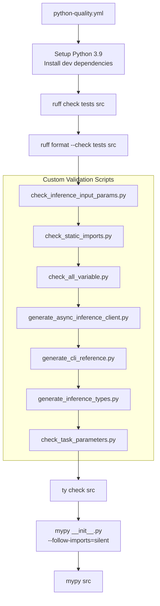

The workflow ensures:
- Code follows `ruff` formatting standards
- No linting violations
- Inference parameters are consistent
- Static imports are properly managed
- `__all__` variables are complete
- `AsyncInferenceClient` is auto-generated correctly
- CLI reference documentation is up-to-date
- Inference types are current
- Task parameters are consistent
- Type annotations pass `ty` checking
- Type annotations pass `mypy` checking

Sources: [.github/workflows/python-quality.yml:1-54]()

---

## Prerelease Testing Workflow

The prerelease testing system validates release candidates against downstream libraries:

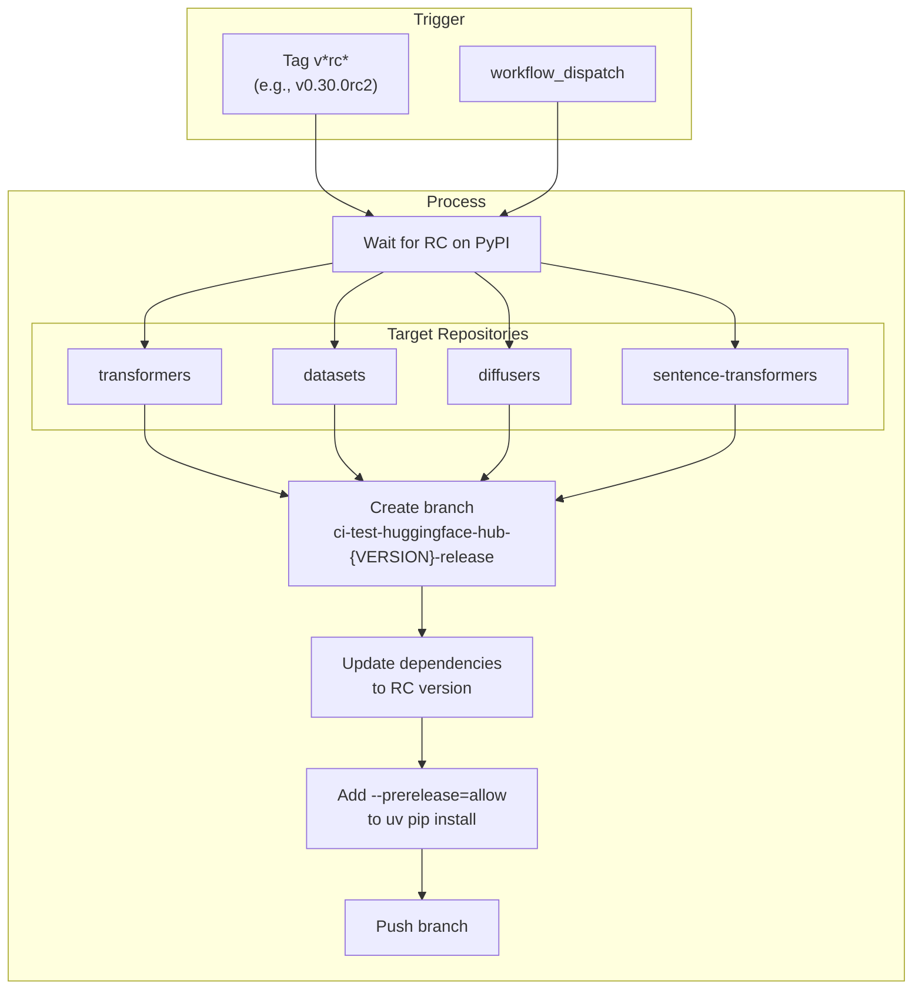

**Dependency Update Logic:**

For each target repository:
1. Update `setup.py` to use RC version: `"huggingface-hub=={VERSION}"`
2. Update framework-specific dependency tables (transformers, diffusers, sentence-transformers)
3. Modify all `uv pip install` commands in `.github/workflows/` to include `--prerelease=allow` flag
4. Create branch and push changes
5. CI in target repository runs automatically

**Modified Files by Repository:**

| Repository | Files Updated |
|------------|---------------|
| transformers | `setup.py`, `src/transformers/dependency_versions_table.py` |
| diffusers | `setup.py`, `src/diffusers/dependency_versions_table.py` |
| sentence-transformers | `pyproject.toml` |
| datasets | `setup.py` |
| All | `.github/workflows/*` (add `--prerelease=allow`) |

Sources: [.github/workflows/python-prerelease.yml:1-103]()

---

## Style Bot Workflow

The Style Bot automates code formatting on PRs via comments:

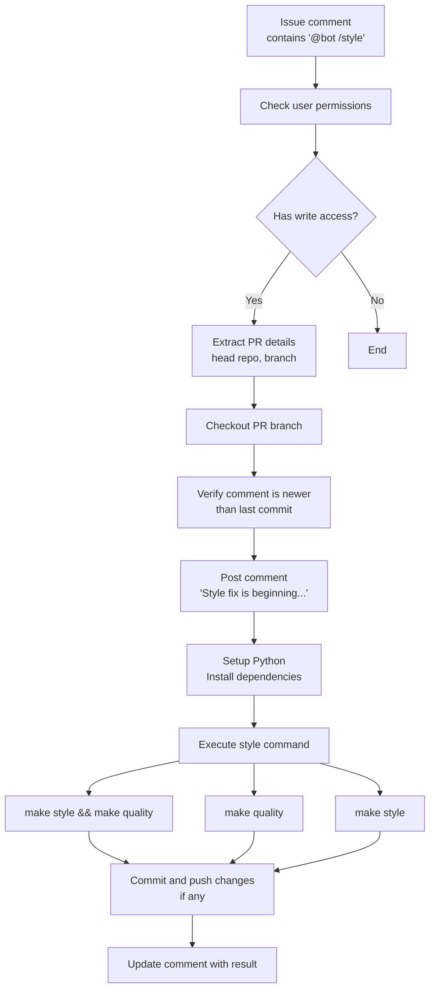

**Usage:**

1. Comment `@bot /style` on a PR
2. Bot checks if commenter has write permissions
3. Bot verifies comment is newer than last PR commit (prevents race conditions)
4. Bot checks out PR branch, runs style fixes, pushes changes
5. Bot updates comment with results

**Configuration Options:**

The workflow is configurable via inputs (see [.github/workflows/style-bot.yml:12-16]()):

- `style_command_type`: "default", "quality_only", or "style_only"
- `python_quality_dependencies`: Package extras to install (e.g., `[quality]`)
- `python_version`: Python version to use (default: 3.10)

Sources: [.github/workflows/style-bot-action.yml:1-243](), [.github/workflows/style-bot.yml:1-18]()

---

## Automated Inference Types Sync

The inference types are automatically synchronized from `huggingface.js`:

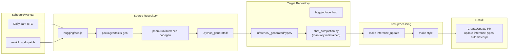

**Process:**

1. Checkout both `huggingface/huggingface.js` and `huggingface/huggingface_hub`
2. Run `pnpm run inference-codegen` in `tasks-gen` package
3. Copy generated Python types from `.python_generated/` to `src/huggingface_hub/inference/_generated/types/`
4. Restore `chat_completion.py` (manually maintained, not auto-generated)
5. Run `make inference_update` to validate and update task parameters
6. Run `make style` to format
7. Create or update PR with changes

**Reviewers:** @Wauplin, @hanouticelina

Sources: [.github/workflows/update-inference-types.yaml:1-101]()

---

## Release Process

### Release Workflows Overview

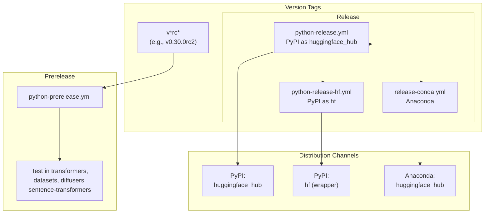

### Version Extraction

All release workflows extract version from `src/huggingface_hub/__init__.py`:

```python
def get_version() -> str:
    rel_path = "src/huggingface_hub/__init__.py"
    with open(rel_path, "r") as fp:
        for line in fp.read().splitlines():
            if line.startswith("__version__"):
                delim = '"' if '"' in line else "'"
                return line.split(delim)[1]
    raise RuntimeError("Unable to find version string.")
```

### PyPI Release

**Workflow:** [.github/workflows/python-release.yml:1-34]()

Triggered by version tags (e.g., `v0.30.0`):

1. Setup Python 3.9
2. Install build tools (`setuptools`, `wheel`)
3. Build distributions: `python setup.py sdist bdist_wheel`
4. Upload to PyPI with `twine`

**Credentials:** `PYPI_TOKEN_DIST_HUGGINGFACE_HUB` secret

### HF Package Release

**Workflow:** [.github/workflows/python-release-hf.yml:1-39]()

Releases a convenience wrapper package named `hf`:

1. Build from `utils/hf/setup.py`
2. Upload to PyPI as separate package
3. Allows installation via `pip install hf`

**Credentials:** `PYPI_TOKEN_DIST_HF` secret

### Conda Release

**Workflow:** [.github/workflows/release-conda.yml:1-47]()

Builds and publishes to Anaconda:

1. Setup miniconda environment
2. Install `anaconda-client` and `conda-build`
3. Build from `.github/conda/` recipe
4. Upload to Anaconda with `anaconda upload`

**Credentials:** `ANACONDA_API_TOKEN` secret

Sources: [setup.py:6-13](), [.github/workflows/python-release.yml:1-34](), [.github/workflows/python-release-hf.yml:1-39](), [.github/workflows/release-conda.yml:1-47]()

---

## Documentation Generation

### Documentation Structure

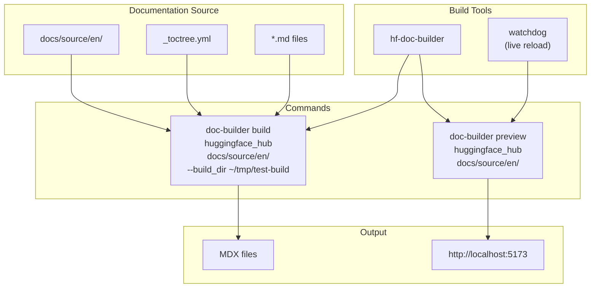

### Building Documentation Locally

**Installation:**

```bash
pip install -e .
pip install git+https://github.com/huggingface/doc-builder@main
pip install watchdog
```

**Build static documentation:**

```bash
doc-builder build huggingface_hub docs/source/en/ --build_dir ~/tmp/test-build
```

This generates MDX files in the build directory.

**Preview with live reload:**

```bash
doc-builder preview huggingface_hub docs/source/en/
```

Access at http://localhost:5173

**Note:** When adding new files, you must:
1. Create the `.md` file in `docs/source/en/`
2. Add it to `_toctree.yml`
3. Restart the preview command

### Documentation Standards

The documentation follows Google-style docstrings:

**Argument documentation:**
```python
Args:
    repo_id (`str`):
        The repository ID in the format `namespace/repo_name`.
    revision (`str`, *optional*):
        The git revision to fetch. Can be a branch, tag, or commit hash.
    token (`str`, *optional*, defaults to `None`):
        Authentication token. If `None`, uses cached token.
```

**Return documentation:**
```python
Returns:
    `List[RepoFile]`: A list of repository files with metadata.
```

**Example documentation:**
```python
Example:

```python
>>> from huggingface_hub import HfApi
>>> api = HfApi()
>>> files = api.list_repo_files("bert-base-uncased")
>>> print(files[0])
'README.md'
```
```

**Linking to code:**
- Classes: `` [`HfApi`] ``
- Methods: `` [`HfApi.create_repo`] ``
- Functions: `` [`snapshot_download`] ``
- Remove path: `` [`~utils.ModelOutput`] `` → displays as `ModelOutput`

**Images:**

Store images in [huggingface/documentation-images](https://huggingface.co/datasets/huggingface/documentation-images) dataset and reference by URL to avoid repository bloat.

Sources: [docs/README.md:1-275](), [CONTRIBUTING.md:239-243]()

---

## Contributing Guidelines

### Pull Request Workflow

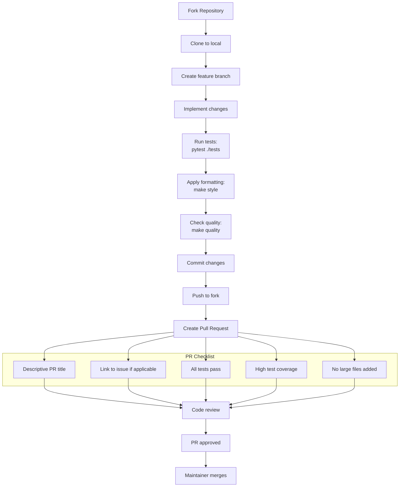

### PR Checklist

Before submitting a pull request:

1. **Title:** Provide a clear, descriptive summary
2. **Issue Reference:** Mention issue number in description if applicable
3. **Work in Progress:** Prefix with `[WIP]` or mark as draft PR
4. **Tests:** All existing tests must pass
5. **New Tests:** Add tests with high coverage for new features
6. **Code Quality:** Run `make style` and `make quality`
7. **No Large Files:** Use [huggingface/documentation-images](https://huggingface.co/datasets/huggingface/documentation-images) for images/videos

### Testing Requirements

**Test Location:** [tests/](tests)

**Framework:** `pytest` with `unittest` base classes

**Coverage Requirement:** High coverage expected - "No quality testing = no merge"

**Running Tests:**
```bash
# All tests
pytest ./tests

# Specific file
pytest ./tests/test_repository.py

# Pattern matching
pytest ./tests -k tag
```

Sources: [CONTRIBUTING.md:84-243]()

---

## Security Scanning

### Secret Detection Workflow

The repository uses TruffleHog for continuous secret scanning:

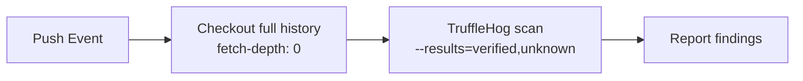

**Configuration:**
- Scans all commits in push
- Reports `verified` and `unknown` results
- Ignores `unverified` results to reduce noise
- Runs on every push to any branch

Sources: [.github/workflows/trufflehog.yml:1-17]()

---

## CLI Installer Testing

The CLI installers for Linux and Windows are tested on every change:

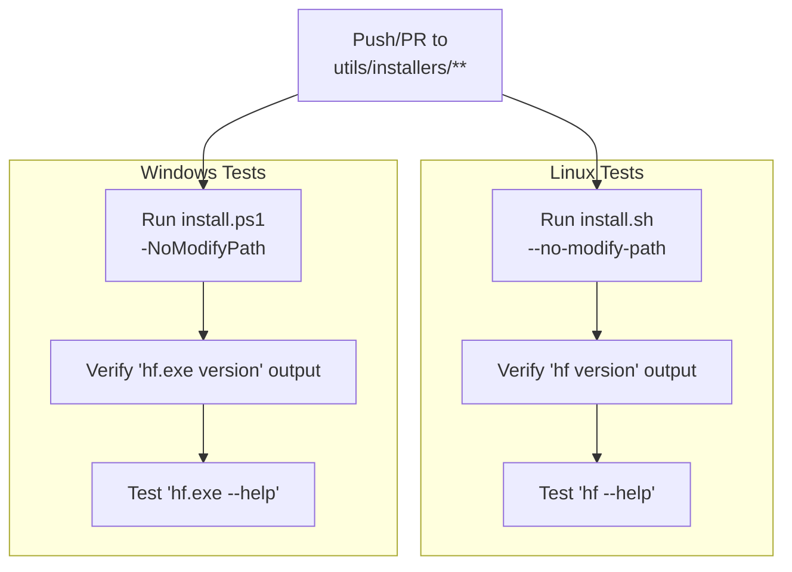

**Test Flow:**

1. Create temporary directories for installation
2. Run installer with `--no-modify-path` flag
3. Verify `hf version` outputs valid version string (regex: `[0-9]+(\.[0-9]+){1,2}(\.[a-zA-Z]+[0-9]+)?`)
4. Test `hf --help` command
5. Clean up temporary directories

**Environment Variables:**
- `HF_HOME`: Installation directory
- `HF_CLI_BIN_DIR`: Binary directory
- `NO_COLOR`: Disable colored output for testing

Sources: [.github/workflows/check-installers.yml:1-88]()

---

## Development Utilities

### Code Generation Scripts

The `utils/` directory contains several code generation and validation scripts:

| Script | Purpose | Usage |
|--------|---------|-------|
| `check_inference_input_params.py` | Validate inference method parameters match API spec | `python utils/check_inference_input_params.py` |
| `check_static_imports.py` | Ensure static imports in `__init__.py` are correct | `python utils/check_static_imports.py --update` |
| `check_all_variable.py` | Verify `__all__` lists are complete | `python utils/check_all_variable.py --update` |
| `generate_async_inference_client.py` | Auto-generate `AsyncInferenceClient` from sync version | `python utils/generate_async_inference_client.py --update` |
| `generate_cli_reference.py` | Generate CLI reference documentation | `python utils/generate_cli_reference.py --update` |
| `generate_inference_types.py` | Generate inference types from specs | `python utils/generate_inference_types.py --update` |
| `check_task_parameters.py` | Validate task parameter consistency | `python utils/check_task_parameters.py --update` |

**Common Pattern:**

All scripts support two modes:
- **Check mode** (default): Verify correctness, exit with error if issues found
- **Update mode** (`--update` flag): Fix issues automatically

Sources: [Makefile:10-32](), [.github/workflows/python-quality.yml:40-47]()

---

## Summary

The `huggingface_hub` development infrastructure provides:

1. **Comprehensive Testing:** Multi-platform, multi-Python-version test matrix with parallel execution
2. **Automated Quality Checks:** Linting, formatting, type checking, and custom validators
3. **Release Automation:** PyPI, Anaconda, and prerelease validation workflows
4. **Developer Tools:** Makefile targets, pre-commit hooks, and code generation scripts
5. **Documentation:** Live preview, automated generation, and Google-style docstrings
6. **Security:** Secret scanning and permission-based automation
7. **Collaboration:** Style bot, Claude PR assistant, and comprehensive contribution guidelines

**Key Resources:**

- Contributing Guide: [CONTRIBUTING.md](CONTRIBUTING.md)
- Documentation Guide: [docs/README.md](docs/README.md)
- Code of Conduct: [CODE_OF_CONDUCT.md](CODE_OF_CONDUCT.md)
- GitHub Issues: https://github.com/huggingface/huggingface_hub/issues
- Good First Issues: https://github.com/huggingface/huggingface_hub/contribute

Sources: [CONTRIBUTING.md:1-270](), [docs/README.md:1-275]()