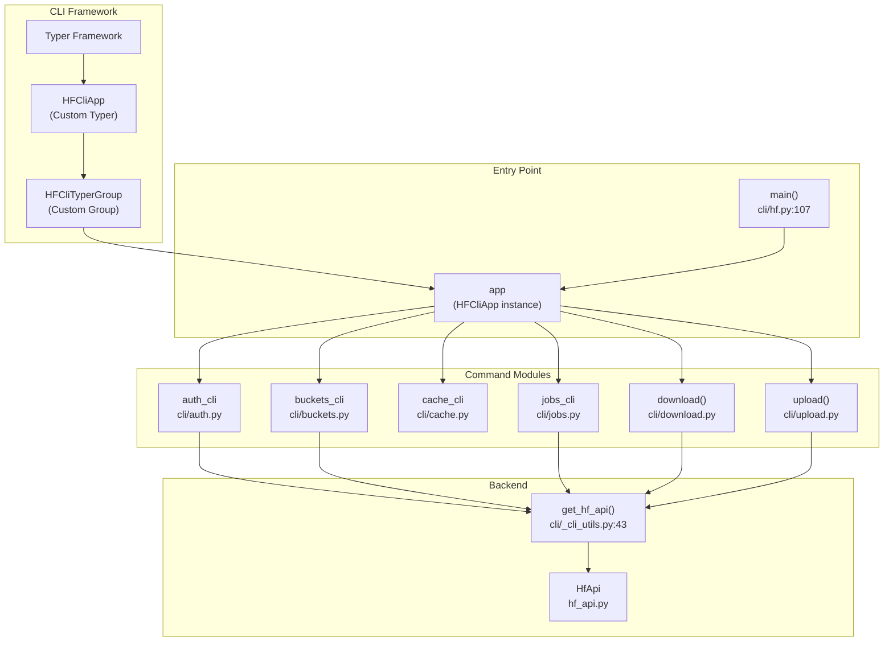
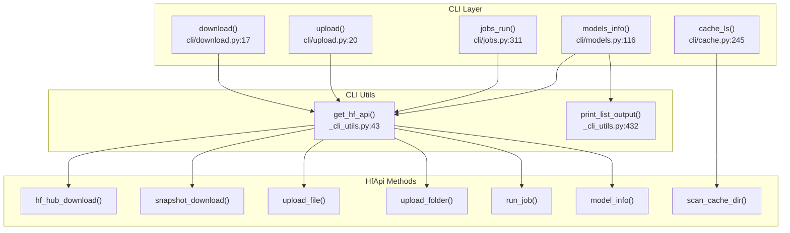
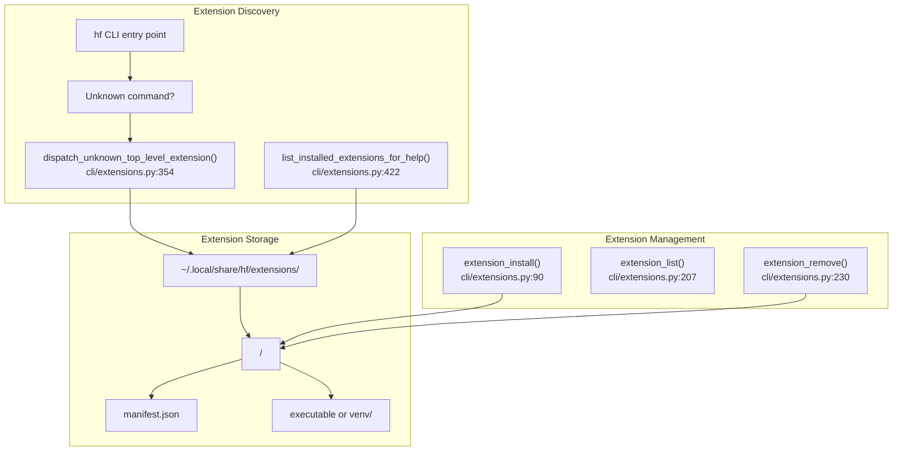
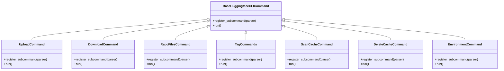

<!-- source: DeepWiki mcp.deepwiki.com · repo huggingface/huggingface_hub · page 7 Command Line Interface · fetched 2026-10-26 -->

# Command Line Interface

<details>
<summary>Relevant source files</summary>

The following files were used as context for generating this wiki page:

- [docs/source/en/_redirects.yml](docs/source/en/_redirects.yml)
- [docs/source/en/_toctree.yml](docs/source/en/_toctree.yml)
- [docs/source/en/guides/cli.md](docs/source/en/guides/cli.md)
- [docs/source/en/guides/jobs.md](docs/source/en/guides/jobs.md)
- [docs/source/en/guides/webhooks.md](docs/source/en/guides/webhooks.md)
- [docs/source/en/package_reference/cli.md](docs/source/en/package_reference/cli.md)
- [docs/source/en/package_reference/jobs.md](docs/source/en/package_reference/jobs.md)
- [src/huggingface_hub/_jobs_api.py](src/huggingface_hub/_jobs_api.py)
- [src/huggingface_hub/cli/_cli_utils.py](src/huggingface_hub/cli/_cli_utils.py)
- [src/huggingface_hub/cli/cache.py](src/huggingface_hub/cli/cache.py)
- [src/huggingface_hub/cli/datasets.py](src/huggingface_hub/cli/datasets.py)
- [src/huggingface_hub/cli/extensions.py](src/huggingface_hub/cli/extensions.py)
- [src/huggingface_hub/cli/hf.py](src/huggingface_hub/cli/hf.py)
- [src/huggingface_hub/cli/jobs.py](src/huggingface_hub/cli/jobs.py)
- [src/huggingface_hub/cli/models.py](src/huggingface_hub/cli/models.py)
- [src/huggingface_hub/cli/spaces.py](src/huggingface_hub/cli/spaces.py)
- [src/huggingface_hub/cli/webhooks.py](src/huggingface_hub/cli/webhooks.py)
- [tests/test_cli.py](tests/test_cli.py)

</details>


The Command Line Interface (CLI) in the Hugging Face Hub library provides a comprehensive set of tools for interacting with the Hugging Face Hub directly from your terminal. The CLI is implemented using [Typer](https://typer.tiangolo.com) and provides a hierarchical command structure with the main `hf` command and numerous subcommands organized into logical groups.

For information about programmatically interacting with the Hub using the Python API, see [Core API Client (HfApi)](#2). For detailed command references and examples, see [CLI Command Reference](../package_reference/cli.md).

## Overview 

The Hugging Face CLI (`hf`) provides access to:

- **Authentication**: Log in, log out, switch between tokens
- **File Operations**: Upload and download files and folders
- **Repository Management**: Create, delete, and manage repositories
- **Cache Management**: Scan, prune, and verify local cache
- **Jobs**: Run compute jobs on Hugging Face infrastructure
- **Buckets**: Manage S3-like object storage with Xet backend
- **Collections**: Organize and curate Hub content
- **Community Features**: Manage discussions, pull requests, and webhooks
- **Extensions**: Install and manage third-party CLI extensions

The CLI is organized into command groups, each handling a specific domain:

**Diagram 1: CLI Command Structure**

```mermaid
graph TB
    subgraph "CLI Entry Point"
        Main["hf<br/>(HFCliApp)"]
    end
    
    subgraph "Top-Level Commands"
        Download["download"]
        Upload["upload"]
        UploadLarge["upload-large-folder"]
        Sync["sync"]
        Env["env"]
        Version["version"]
    end
    
    subgraph "Command Groups"
        Auth["auth<br/>(login/logout/whoami/switch)"]
        Buckets["buckets<br/>(create/ls/cp/sync/rm)"]
        Cache["cache<br/>(ls/rm/prune/verify)"]
        Collections["collections<br/>(create/add-item/delete)"]
        Datasets["datasets<br/>(ls/info/parquet/sql)"]
        Discussions["discussions<br/>(create/comment/close)"]
        Jobs["jobs<br/>(run/logs/stats/ps)"]
        Models["models<br/>(ls/info)"]
        Papers["papers<br/>(ls/info)"]
        Repos["repos<br/>(create/delete/move)"]
        Spaces["spaces<br/>(ls/info/dev-mode/hot-reload)"]
        Webhooks["webhooks<br/>(create/ls/delete)"]
        Extensions["extensions<br/>(install/list/remove)"]
    end
    
    Main --> Download
    Main --> Upload
    Main --> UploadLarge
    Main --> Sync
    Main --> Env
    Main --> Version
    
    Main --> Auth
    Main --> Buckets
    Main --> Cache
    Main --> Collections
    Main --> Datasets
    Main --> Discussions
    Main --> Jobs
    Main --> Models
    Main --> Papers
    Main --> Repos
    Main --> Spaces
    Main --> Webhooks
    Main --> Extensions
```


Sources: [src/huggingface_hub/cli/hf.py:52-105](), [docs/source/en/guides/cli.md:1-66]()

## Installation

The CLI can be installed in several ways depending on your preference:

### Standalone Installer (Recommended)

The quickest way to install the `hf` CLI is with a single command:

**On macOS and Linux:**
```bash
curl -LsSf https://hf.co/cli/install.sh | bash
```

**On Windows:**
```powershell
powershell -ExecutionPolicy ByPass -c "irm https://hf.co/cli/install.ps1 | iex"
```

### Using uv

Run the CLI directly with [`uvx`](https://docs.astral.sh/uv) without installation:

```bash
uvx hf auth login
uvx hf download gpt2
```

### Using pip

Install with the core `huggingface_hub` package:

```bash
pip install -U "huggingface_hub"
```

### Using Homebrew

On macOS, you can install via [Homebrew](https://brew.sh):

```bash
brew install huggingface-cli
```

After installation, verify it's working:

```bash
hf --help
```

Sources: [docs/source/en/guides/cli.md:15-105]()

## CLI Architecture

The `hf` CLI is built using the Typer framework and follows a hierarchical command structure. The main entry point is the `app` object in [src/huggingface_hub/cli/hf.py:52-58]() which uses a custom `HFCliApp` class for consistent styling and behavior.

**Diagram 2: CLI Implementation Architecture**


### Custom CLI Components

The CLI uses several custom components for consistent behavior:

- **`HFCliApp`** [src/huggingface_hub/cli/_cli_utils.py:208-249](): A custom Typer app class that provides consistent help formatting, epilog generation from examples, and command organization by topic.

- **`HFCliTyperGroup`** [src/huggingface_hub/cli/_cli_utils.py:92-171](): A custom Click group that implements alphabetical command sorting, topic-based organization, and command aliasing support.

- **`typer_factory()`** [src/huggingface_hub/cli/_cli_utils.py:251-282](): A factory function that creates Typer apps with consistent settings including help formatting, completion, and context settings.

- **`get_hf_api()`** [src/huggingface_hub/cli/_cli_utils.py:43-48](): A helper that creates an `HfApi` instance with CLI-specific metadata for telemetry.

### Common CLI Patterns

All CLI commands follow consistent patterns:

| Pattern | Implementation | Example |
|---------|----------------|---------|
| Token authentication | `TokenOpt` type annotation | `token: TokenOpt = None` |
| Repository type selection | `RepoTypeOpt` enum | `repo_type: RepoTypeOpt = RepoType.model` |
| Output formatting | `FormatOpt` and `QuietOpt` | `format: FormatOpt = OutputFormat.table` |
| Pagination | `LimitOpt` type annotation | `limit: LimitOpt = 10` |
| Examples in help | `examples=[]` parameter | `@app.command(examples=["hf download gpt2"])` |

Sources: [src/huggingface_hub/cli/_cli_utils.py:50-282](), [src/huggingface_hub/cli/hf.py:52-128]()

## Command Groups Overview

The CLI is organized into command groups, each focusing on a specific aspect of the Hub. Here's a brief overview of the main groups:

### File and Repository Commands

- **`hf download`**: Download files or entire repositories from the Hub. Supports filtering with `--include` and `--exclude`, revision selection, and local directory output. See [File and Repository Commands](#7.1) for details.

- **`hf upload`**: Upload files or folders to repositories. Supports scheduled uploads with `--every`, commit messages, and pattern-based filtering. See [File and Repository Commands](#7.1) for details.

- **`hf upload-large-folder`**: Optimized for uploading very large folders (hundreds of GBs or TBs) with resumable uploads and automatic chunking.

- **`hf sync`**: Bidirectional sync between local directories and buckets (alias for `hf buckets sync`).

### Cache Management

- **`hf cache ls`**: List cached repositories and revisions with filtering and sorting options.
- **`hf cache rm`**: Remove specific repositories or revisions from cache.
- **`hf cache prune`**: Remove detached revisions to free up space.
- **`hf cache verify`**: Verify checksums of cached files against remote versions.

See [Cache Management Commands](#7.2) for details.

### Jobs System

The Jobs system allows you to run compute workloads on Hugging Face infrastructure with various hardware options (CPU, GPU, TPU):

- **`hf jobs run`**: Run a job with a Docker image and command.
- **`hf jobs uv run`**: Run UV scripts with automatic dependency management.
- **`hf jobs logs`**: Fetch logs from running or completed jobs.
- **`hf jobs stats`**: Monitor resource usage and metrics.
- **`hf jobs ps`**: List running and completed jobs.

See [Jobs and Compute System](#7.3) for details.

### Repository and Content Management

- **`hf models`**: List and get info about models (`ls`, `info`).
- **`hf datasets`**: List and get info about datasets, with additional parquet and SQL query support (`ls`, `info`, `parquet`, `sql`).
- **`hf spaces`**: Manage Spaces, including dev-mode and hot-reload features (`ls`, `info`, `dev-mode`, `hot-reload`).
- **`hf collections`**: Create and manage collections of Hub content.
- **`hf papers`**: Interact with papers on the Hub.
- **`hf repos`**: General repository operations (create, delete, move).

### Authentication

- **`hf auth login`**: Log in with a token.
- **`hf auth logout`**: Log out and remove tokens.
- **`hf auth whoami`**: Display current user information.
- **`hf auth switch`**: Switch between multiple saved tokens.
- **`hf auth list`**: List all stored tokens.

See [Authentication Commands](#7.4) for details.

### Community Features

- **`hf discussions`**: Create, comment, close, and manage discussions and pull requests.
- **`hf webhooks`**: Create and manage webhooks for repository events.

### Buckets

The Buckets system provides S3-like object storage with content-addressable deduplication:

- **`hf buckets create`**: Create a new bucket.
- **`hf buckets list`**: List buckets or files in a bucket.
- **`hf buckets cp`**: Copy files to/from buckets.
- **`hf buckets sync`**: Sync directories with buckets.
- **`hf buckets rm`**: Remove files from buckets.

### Extensions

- **`hf extensions install`**: Install third-party CLI extensions from GitHub.
- **`hf extensions list`**: List installed extensions.
- **`hf extensions remove`**: Uninstall extensions.

See [Extensions System](#7.5) for details.

Sources: [src/huggingface_hub/cli/hf.py:76-104](), [docs/source/en/guides/cli.md:1-66]()

## Integration with HfApi Backend

All CLI commands ultimately delegate to methods in the `HfApi` class. The CLI acts as a user-friendly interface that handles argument parsing, formatting, and user interaction, while the heavy lifting is done by `HfApi`.

**Diagram 3: CLI to HfApi Integration**


### Example: Download Command Flow

The `hf download` command demonstrates the typical CLI-to-API flow:

1. **Argument Parsing**: [src/huggingface_hub/cli/download.py:17-87]() parses command-line arguments using Typer annotations.

2. **API Instance Creation**: `get_hf_api(token=token)` creates an `HfApi` instance with CLI-specific library identification.

3. **Backend Delegation**: Depending on whether a filename is specified, the command calls either `hf_hub_download()` for single files or `snapshot_download()` for entire repos.

4. **Output Formatting**: The path to downloaded files is printed to stdout, with optional quiet mode for scripting.

### Example: Jobs Command Flow

The `hf jobs run` command shows how complex operations are handled:

1. **Environment Variable Parsing**: [src/huggingface_hub/cli/jobs.py:326-337]() loads environment variables and secrets from files or command-line options using the `load_dotenv()` utility.

2. **API Call**: `api.run_job()` is called with parsed parameters [src/huggingface_hub/cli/jobs.py:340-349]().

3. **Log Streaming**: If not in detached mode, the command streams logs using `api.fetch_job_logs()` [src/huggingface_hub/cli/jobs.py:357-358]().

### Common Output Patterns

The CLI uses helper functions for consistent output formatting:

| Function | Purpose | Usage |
|----------|---------|-------|
| `print_list_output()` | Format lists as tables or JSON | List commands (models, datasets, etc.) |
| `print_as_table()` | Pretty-print tabular data | Cache listing, job status |
| `api_object_to_dict()` | Convert dataclasses to dicts | Serialize API responses |
| `_format_cell()` | Format individual table cells | Truncate long values, format dates |

Sources: [src/huggingface_hub/cli/_cli_utils.py:43-471](), [src/huggingface_hub/cli/download.py:17-87](), [src/huggingface_hub/cli/upload.py:20-118](), [src/huggingface_hub/cli/jobs.py:302-359]()

## Extension System

The CLI supports a plugin-like extension system that allows third-party developers to add new commands to the `hf` CLI. Extensions can be either binary executables or Python packages.

**Diagram 4: Extension System Architecture**


### Installing Extensions

Extensions are installed from GitHub repositories with the naming pattern `hf-<name>`:

```bash
# Install from default owner (huggingface)
hf extensions install hf-claude

# Install from specific owner
hf extensions install hanouticelina/hf-claude
```

The installation process [src/huggingface_hub/cli/extensions.py:90-148]():

1. Normalizes the repository name and checks for conflicts with built-in commands.
2. Resolves the repository information from GitHub (default branch, description).
3. Checks for a binary executable in the root directory.
4. If a binary exists, installs as a binary extension; otherwise, installs as a Python package in a virtual environment.
5. Saves a manifest file with metadata about the extension.

### Extension Types

**Binary Extensions**: Single executable files downloaded from the repository root. They are made executable and invoked directly when the command is run.

**Python Extensions**: Repositories without a root binary are treated as Python packages. A virtual environment is created, the package is installed, and the entry point is registered.

### Extension Dispatch

When an unknown command is entered, the CLI checks installed extensions [src/huggingface_hub/cli/extensions.py:354-388]():

1. Scans `~/.local/share/hf/extensions/` for installed extensions.
2. Matches the command name against extension short names.
3. Executes the extension binary or Python entry point with remaining arguments.
4. Returns the exit code from the extension process.

### Security Considerations

Extensions are third-party code that runs with the same privileges as the CLI. The CLI displays security warnings when installing extensions and recommends installing only from trusted sources.

Sources: [src/huggingface_hub/cli/extensions.py:1-449](), [docs/source/en/guides/cli.md:950-1005]()

## Common Patterns and Best Practices

### Authentication

Most CLI commands that interact with the Hub require authentication. The CLI supports multiple authentication methods with the following priority:

1. **`--token` option**: Explicitly pass a token via command line
2. **`HF_TOKEN` environment variable**: Set in the current shell session
3. **Saved token file**: Located at `~/.cache/huggingface/token` (saved via `hf auth login`)

For multi-account workflows, use `hf auth switch` to manage multiple named tokens.

### Output Formatting

Many list commands support consistent output formatting options:

| Option | Format | Use Case |
|--------|--------|----------|
| `--format table` | Pretty-printed table | Human-readable terminal output |
| `--format json` | JSON array | Machine parsing, scripting |
| `--quiet` or `-q` | Plain IDs (one per line) | Pipe to other commands |

Example:
```bash
# Human-readable
hf models ls --limit 5

# For scripting
hf models ls --limit 5 --format json | jq '.[].id'

# For piping
hf models ls --limit 5 -q | xargs -I {} hf models info {}
```

### Filtering and Sorting

List commands typically support:

- **`--filter`**: Apply tag-based filters (e.g., `--filter text-classification`)
- **`--search`**: Text search in names and descriptions
- **`--author`**: Filter by author or organization
- **`--sort`**: Sort results by various keys (downloads, likes, etc.)
- **`--limit`**: Limit number of results

### Repository Type Selection

Commands that work with repositories use `--repo-type` or `--type` to specify:
- `model` (default for most commands)
- `dataset`
- `space`

### Revision Selection

Use `--revision` to specify a Git reference:
- Branch name: `--revision main`
- Tag: `--revision v1.0`
- Commit hash: `--revision a1b2c3d4`

### Dry Run and Confirmation

Destructive operations often support:
- **`--dry-run`**: Preview what would happen without making changes
- **`--yes` or `-y`**: Skip confirmation prompts for scripting

Sources: [src/huggingface_hub/cli/_cli_utils.py:284-372](), [docs/source/en/guides/cli.md:108-351]()

## Environment Variables

The CLI behavior can be influenced by several environment variables:

| Variable | Description | Default |
|----------|-------------|---------|
| `HF_HOME` | Base directory for Hugging Face files | `~/.cache/huggingface` |
| `HF_HUB_CACHE` | Directory for cached repositories | `$HF_HOME/hub` |
| `HF_ASSETS_CACHE` | Directory for cached assets | `$HF_HOME/assets` |
| `HF_TOKEN` | User access token for authentication | None |
| `HF_TOKEN_PATH` | Path to the token file | `$HF_HOME/token` |
| `HF_HUB_OFFLINE` | Enables offline mode | `False` |
| `HF_HUB_DISABLE_PROGRESS_BARS` | Disables progress bars | `None` |
| `HF_HUB_ETAG_TIMEOUT` | Timeout for ETag requests | `10` |
| `HF_HUB_DOWNLOAD_TIMEOUT` | Timeout for download requests | `10` |

Sources: [docs/source/en/package_reference/environment_variables.md:16-72]()

## Implementation Details

The CLI is implemented as a set of Python command classes registered with an argument parser in the `huggingface_cli.py` file. Each command (like `upload`, `download`, etc.) is implemented in its own module.



Sources: [src/huggingface_hub/commands/huggingface_cli.py:15-37](), [tests/test_cli.py:1-56]()

## Common Use Cases

### Working with Model Files

```bash
# Download a pre-trained model
huggingface-cli download gpt2

# Upload your fine-tuned model
huggingface-cli upload my-username/my-fine-tuned-gpt2 ./fine-tuned-model .

# Create a tag for your release
huggingface-cli tag my-username/my-fine-tuned-gpt2 v1.0 --message "First release"
```

### Managing Datasets

```bash
# Create a dataset repository
huggingface-cli repo create my-dataset --type dataset

# Upload dataset files
huggingface-cli upload my-username/my-dataset ./data .

# Download a specific revision of a dataset
huggingface-cli download some-dataset --revision v1.0
```

### Cleaning Up Cache

```bash
# See what's in your cache
huggingface-cli scan-cache -v

# Remove old revisions
huggingface-cli delete-cache --max-days 30
```

Sources: [docs/source/en/guides/cli.md:445-500]()

---

