# Page: Overview

# Overview

<details>
<summary>Relevant source files</summary>

The following files were used as context for generating this wiki page:

- [.github/workflows/python-quality.yml](.github/workflows/python-quality.yml)
- [.github/workflows/python-tests.yml](.github/workflows/python-tests.yml)
- [CONTRIBUTING.md](CONTRIBUTING.md)
- [Makefile](Makefile)
- [README.md](README.md)
- [docs/source/cn/index.md](docs/source/cn/index.md)
- [docs/source/cn/quick-start.md](docs/source/cn/quick-start.md)
- [setup.py](setup.py)
- [src/huggingface_hub/__init__.py](src/huggingface_hub/__init__.py)
- [src/huggingface_hub/_commit_api.py](src/huggingface_hub/_commit_api.py)
- [src/huggingface_hub/constants.py](src/huggingface_hub/constants.py)
- [src/huggingface_hub/file_download.py](src/huggingface_hub/file_download.py)
- [src/huggingface_hub/hf_api.py](src/huggingface_hub/hf_api.py)
- [src/huggingface_hub/utils/__init__.py](src/huggingface_hub/utils/__init__.py)
- [tests/test_file_download.py](tests/test_file_download.py)
- [tests/test_hf_api.py](tests/test_hf_api.py)
- [tests/testing_utils.py](tests/testing_utils.py)

</details>


The `huggingface_hub` library is the official Python client for the [Hugging Face Hub](https://huggingface.co), a platform for hosting and sharing machine learning models, datasets, and applications. The library provides programmatic access to all Hub functionality, enabling developers to download files, upload models, run inference, and manage repositories directly from Python code or the command line.

## Purpose and Core Functionality

**Primary Use Cases:**
- Download models and datasets with automatic caching
- Upload and version files using Git-based or HTTP-based workflows  
- Run inference on models hosted on the Hub or third-party providers
- Manage repository lifecycle (create, delete, update settings)
- Search and discover models, datasets, and spaces
- Integrate Hub functionality into ML frameworks

The library serves as the foundation for other Hugging Face libraries (`transformers`, `diffusers`, `datasets`) while remaining fully functional as a standalone tool.

**Navigation:** This overview covers the library's architecture and main components. For detailed documentation on specific subsystems, see:
- Repository and file operations → Section 2 (Core API Client)
- File download and caching → Sections 2.2, 2.5
- Model inference → Section 3 (Inference Client)
- ML framework integration → Section 5
- Command-line interface → Section 7
- Authentication → Section 8

**Sources:** [src/huggingface_hub/__init__.py:1-50](), [README.md:1-163](), [setup.py:106-147]()

## Key Features

| Feature | Description | Primary Interface |
|---------|-------------|-------------------|
| **File Download** | Download single files or entire repositories with automatic caching and resume support | `hf_hub_download()`, `snapshot_download()` |
| **File Upload** | Upload files via HTTP or Git, supporting LFS for large files and Xet for deduplication | `upload_file()`, `upload_folder()`, `create_commit()` |
| **Repository Management** | Create, delete, update repos; manage branches, tags, and access controls | `HfApi.create_repo()`, `HfApi.delete_repo()`, etc. |
| **Inference** | Run inference on 35+ ML tasks across multiple providers (HF, Replicate, Together, Fal AI, SambaNova) | `InferenceClient`, `AsyncInferenceClient` |
| **Search & Discovery** | List and filter models, datasets, and spaces with metadata | `HfApi.list_models()`, `HfApi.list_datasets()` |
| **Model Cards** | Create and manage model documentation with structured metadata | `ModelCard`, `DatasetCard`, `SpaceCard` |
| **Framework Integration** | Integrate any ML framework with standardized save/load patterns | `ModelHubMixin`, `PyTorchModelHubMixin` |
| **File System Interface** | Access Hub as a file system using fsspec protocol | `HfFileSystem` |
| **CLI Tools** | Command-line interface for all Hub operations | `hf` command, `tiny-agents` |

**Sources:** [README.md:46-54](), [src/huggingface_hub/__init__.py:54-585]()

## Installation

**Basic Installation:**
```bash
pip install huggingface_hub
```

**With Optional Dependencies:**
```bash
pip install "huggingface_hub[mcp]"      # Model Context Protocol support
pip install "huggingface_hub[torch]"    # PyTorch integration
pip install "huggingface_hub[fastai]"   # FastAI integration
```

**Core Dependencies:**
- `httpx>=0.23.0` - HTTP client with retry logic
- `fsspec>=2023.5.0` - File system abstraction
- `hf-xet>=1.3.2` - Xet CAS storage for large files (platform-specific)
- `pyyaml>=5.1` - YAML parsing for model cards
- `tqdm>=4.42.1` - Progress bars
- `typer` - CLI framework
- `typing-extensions>=4.1.0` - Type hints support

**Sources:** [README.md:56-72](), [setup.py:19-29](), [setup.py:31-105]()

## Architecture Overview

The library is organized into four architectural layers, with `HfApi` serving as the central orchestrator for Hub operations.

**High-Level System Architecture**

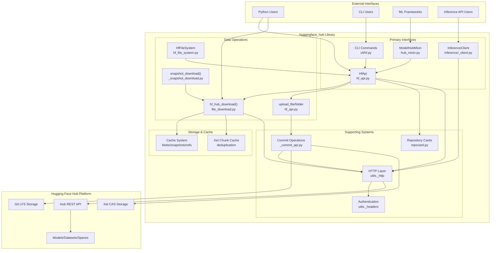

**Sources:** Diagram 1 from provided context, [src/huggingface_hub/hf_api.py:1-100](), [src/huggingface_hub/__init__.py:54-585]()

## Core Components

The library's functionality is implemented through several key components, ranked by edit frequency and architectural importance:

**Component Importance Table**

| Component | Importance | Location | Primary Responsibility |
|-----------|-----------|----------|------------------------|
| `HfApi` | 871 | [src/huggingface_hub/hf_api.py]() | Central HTTP-based API client for all Hub operations (create/delete repos, upload/download files, list resources) |
| `InferenceClient` | 305 | [src/huggingface_hub/inference/_client.py]() | Multi-provider inference with 35+ task methods and streaming support |
| `file_download` | 154 | [src/huggingface_hub/file_download.py]() | Core file download with caching, protocol negotiation (HTTP/LFS/Xet), and offline mode |
| `CLI` | 192 | [src/huggingface_hub/cli/]() | Command-line interface for download, upload, cache management, and authentication |
| `_commit_api` | 108 | [src/huggingface_hub/_commit_api.py]() | Commit operations with LFS and Xet upload strategies |
| `RepoCard` | 101 | [src/huggingface_hub/repocard.py]() | Model/dataset card management with YAML metadata parsing |
| `HfFileSystem` | 97 | [src/huggingface_hub/hf_file_system.py]() | fsspec-compatible filesystem interface for Hub repositories |
| `ModelHubMixin` | 97 | [src/huggingface_hub/hub_mixin.py]() | Base class for ML framework integration (save/load patterns) |

**Primary User Interfaces**

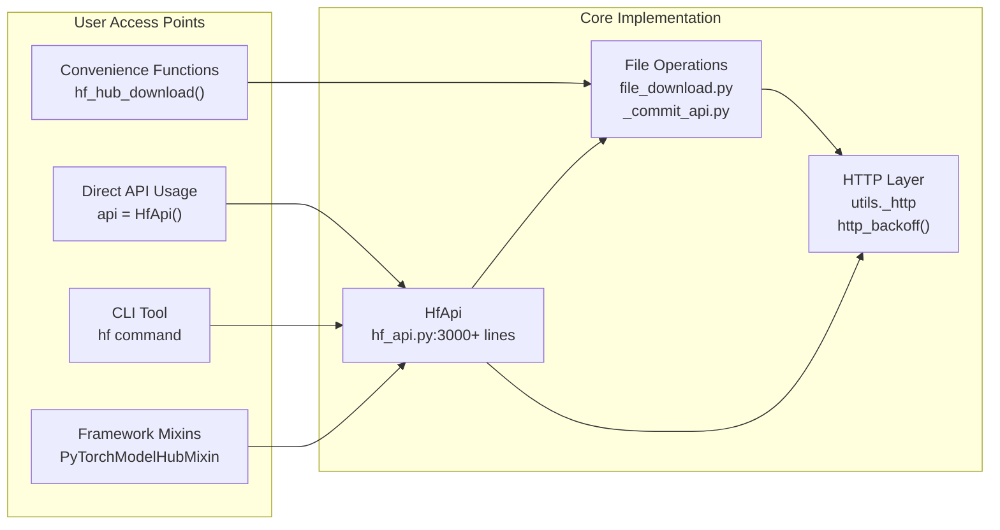

**Usage Patterns:**

1. **Direct API Usage**: `api = HfApi()` provides access to 100+ methods for Hub operations
2. **Convenience Functions**: Top-level functions like `hf_hub_download()` offer simpler APIs for common tasks
3. **CLI Tool**: `hf` command provides shell access to all operations
4. **Framework Mixins**: `ModelHubMixin` enables ML libraries to integrate Hub functionality via inheritance

**Sources:** Diagram 1 from provided context, [src/huggingface_hub/hf_api.py:1-100](), [src/huggingface_hub/__init__.py:54-585]()

## Request Flow Examples

**File Download Flow**

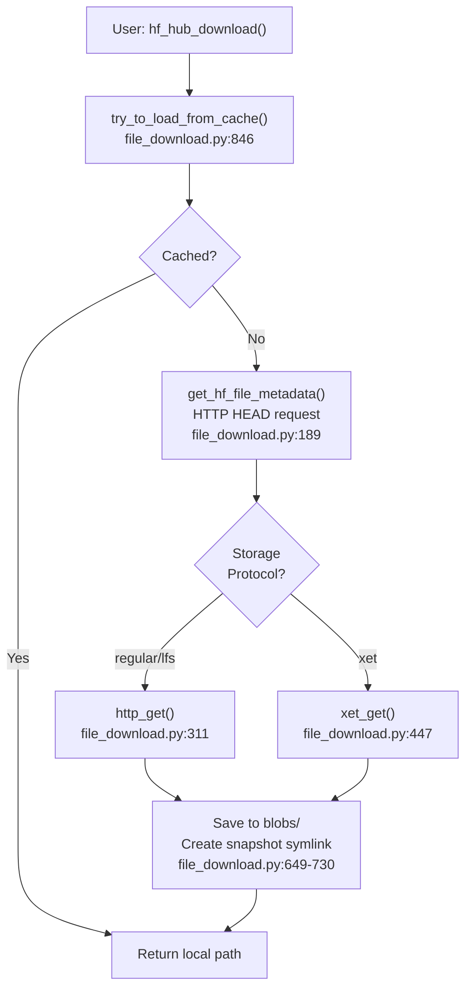

**File Upload Flow**

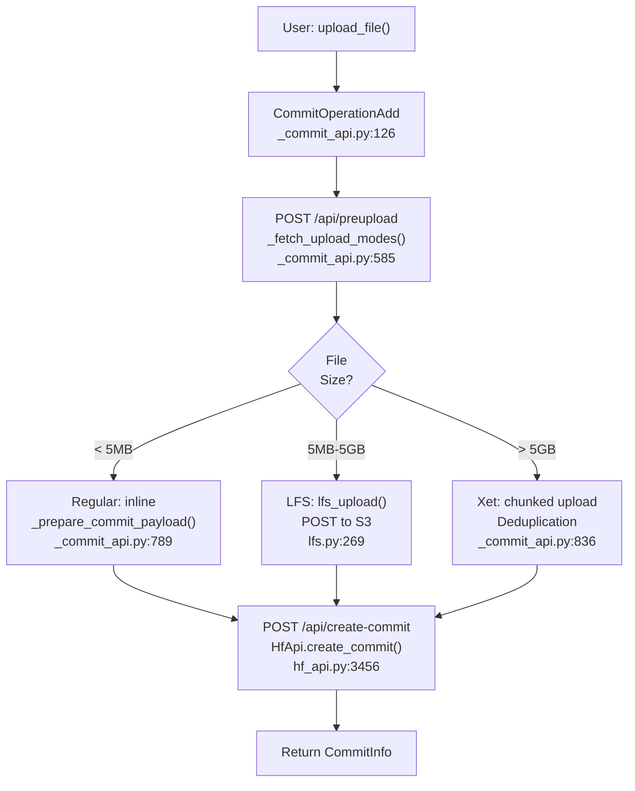

**Upload Strategy Selection:**
- **Regular**: Small files (< 5MB) embedded directly in commit
- **LFS**: Medium/large files (5MB-5GB) use Git LFS with S3 multipart upload
- **Xet**: Very large files (> 5GB) use Xet CAS with chunk-based deduplication

**Sources:** [src/huggingface_hub/file_download.py:311-800](), [src/huggingface_hub/_commit_api.py:126-900](), [src/huggingface_hub/hf_api.py:3400-3600]()

## Authentication System

**Token Resolution Priority**

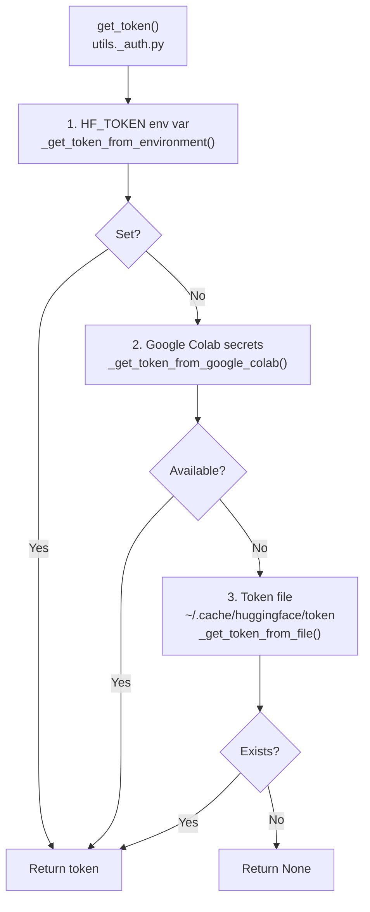

**Authentication Methods:**

| Method | Command/Function | Token Storage | Use Case |
|--------|------------------|---------------|----------|
| CLI Login | `hf auth login` | `~/.cache/huggingface/token` | Interactive login with token prompt |
| Environment Variable | `export HF_TOKEN=...` | Process environment | CI/CD pipelines, temporary auth |
| Programmatic | `login(token="...")` | `~/.cache/huggingface/token` | Scripted workflows |
| Multi-account | `hf auth switch` | `~/.cache/huggingface/stored_tokens` | Switch between multiple accounts |

**Token Usage:**
- All `HfApi` methods accept an optional `token` parameter to override default token
- Set `HF_HUB_DISABLE_IMPLICIT_TOKEN=1` to prevent automatic token inclusion in requests
- Token types: read-only, write, or fine-grained permissions

**Sources:** [src/huggingface_hub/utils/_auth.py:1-150](), [src/huggingface_hub/_login.py:1-200](), [src/huggingface_hub/constants.py:203-239]()

## Cache System

The library uses a Git-inspired content-addressable storage system with two cache layers: file cache and Xet chunk cache.

**Cache Directory Structure:**

```
HF_HOME (~/.cache/huggingface)
├── hub/                           # File cache (HF_HUB_CACHE)
│   └── models--{namespace}--{repo_name}/
│       ├── refs/
│       │   └── main               # Pointer: commit hash as string
│       ├── blobs/
│       │   └── {sha256}           # Actual file content (deduplicated)
│       ├── snapshots/
│       │   └── {commit_hash}/
│       │       └── file.txt -> ../../blobs/{sha256}  # Symlink
│       └── .no_exist/
│           └── {commit_hash}/file.txt  # Negative cache marker
│
└── xet/                           # Xet chunk cache (HF_XET_CACHE)
    ├── chunk_cache/               # Reusable file chunks
    └── shard_cache/               # File->chunk mapping
```

**Cache Operations:**

| Function | Location | Purpose |
|----------|----------|---------|
| `try_to_load_from_cache()` | [file_download.py:846-900]() | Lookup file in cache by repo + revision + filename |
| `_create_symlink()` | [file_download.py:75-132]() | Create symlink from snapshot to blob (atomic) |
| `scan_cache_dir()` | [utils/_cache_manager.py:1-500]() | Scan and analyze cache usage |

**Dual-Layer Caching:**
1. **File Cache**: Stores complete files by content hash (SHA256), deduplicated across commits
2. **Xet Cache**: Stores file chunks for Xet-backed files, enabling cross-file deduplication

**Benefits:**
- Files stored once regardless of how many branches/commits reference them
- Switching between commits is instantaneous (symlink updates only)
- Xet cache provides additional deduplication for large files split into chunks
- Negative cache prevents repeated 404 lookups for non-existent files

**Sources:** [src/huggingface_hub/file_download.py:75-900](), [src/huggingface_hub/constants.py:131-165](), [src/huggingface_hub/utils/_cache_manager.py:1-100]()

## Configuration

**Environment Variables:**

| Variable | Default | Purpose |
|----------|---------|---------|
| `HF_HOME` | `~/.cache/huggingface` | Base directory for all Hub data |
| `HF_HUB_CACHE` | `$HF_HOME/hub` | File cache directory |
| `HF_XET_CACHE` | `$HF_HOME/xet` | Xet chunk cache directory |
| `HF_TOKEN` | None | Authentication token (read from file if not set) |
| `HF_ENDPOINT` | `https://huggingface.co` | Hub API endpoint URL |
| `HF_HUB_OFFLINE` | `False` | Offline mode (use cache only, no network requests) |
| `HF_HUB_DISABLE_IMPLICIT_TOKEN` | `False` | Disable automatic token inclusion in requests |
| `HF_XET_HIGH_PERFORMANCE` | `False` | Enable high-performance Xet downloads |
| `HF_HUB_DOWNLOAD_TIMEOUT` | `10` | Default HTTP timeout (seconds) |
| `HF_HUB_ETAG_TIMEOUT` | `10` | Timeout for metadata requests (seconds) |
| `HF_HUB_DISABLE_PROGRESS_BARS` | None | Disable all progress bars |
| `HF_DEBUG` | `False` | Enable debug logging and log all HTTP requests as curl commands |

**Configuration Files:**

| File | Purpose | Format |
|------|---------|--------|
| `$HF_HOME/token` | Default authentication token | Plain text |
| `$HF_HOME/stored_tokens` | Named tokens for multi-account | JSON |
| `$HF_HOME/.check_for_update_done` | Update check marker | Touch file |

**Sources:** [src/huggingface_hub/constants.py:1-284]()

## Testing Strategy

**Test Organization:**

| Test Category | Pattern | Environment | Purpose |
|--------------|---------|-------------|---------|
| Unit tests | `tests/test_*.py` | Mocked | Test individual functions in isolation |
| Integration tests | `tests/test_hf_api.py` | Staging Hub | Test full workflows against real Hub |
| Inference tests | `tests/test_inference*.py` | VCR.py cassettes | Test inference API with recorded responses |
| Framework tests | `tests/test_hub_mixin.py` | Staging Hub | Test ML framework integrations |
| Xet tests | `tests/test_xet*.py` | Production/Staging | Test Xet storage functionality |

**CI Test Matrix** (from [.github/workflows/python-tests.yml]()):

| Test Suite | Python Versions | Special Requirements |
|------------|-----------------|---------------------|
| Everything else | 3.9, 3.14 | Excludes inference and Xet |
| Inference only | 3.9, 3.14 | Audio libraries (libsndfile1) |
| Xet only | 3.9, 3.14 | hf_xet installed |
| LFS tests | 3.14 only | Git LFS + Git credentials |
| PyTorch (torch~=1.11) | 3.9 only | Legacy PyTorch support |
| PyTorch (latest) | 3.12 only | Latest PyTorch |
| Gradio integration | 3.13 only | Gradio 5.0+ |

**Test Utilities:**

| Utility | Location | Purpose |
|---------|----------|---------|
| `repo_name()` | [tests/testing_utils.py:64-79]() | Generate unique test repo names |
| `@use_tmp_repo()` | [tests/testing_utils.py:1-50]() | Decorator for temporary test repositories |
| `ENDPOINT_STAGING` | [tests/testing_constants.py]() | Staging Hub URL constant |

**Sources:** [.github/workflows/python-tests.yml:16-206](), [tests/testing_utils.py:1-250](), [tests/test_hf_api.py:126-500]()

## Error Handling

**Exception Hierarchy:**

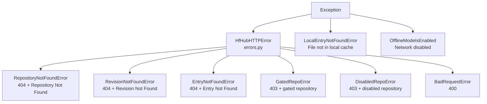

**Error Enhancement via `hf_raise_for_status()`:**

The function at [src/huggingface_hub/utils/_http.py]() enriches HTTP errors by:
1. Parsing `X-Error-Code` header to determine specific error type
2. Extracting request ID from `X-Request-Id` for support purposes
3. Including server error message from response body
4. Adding contextual hints (e.g., "use `token=...` for private repositories")

**Common Error Patterns:**

| HTTP Status | Error Class | Typical Cause |
|-------------|-------------|---------------|
| 401 | `HfHubHTTPError` | Missing or invalid authentication token |
| 403 | `GatedRepoError` | Attempting to access gated repo without access |
| 403 | `DisabledRepoError` | Repository has been disabled by owner/moderator |
| 404 | `RepositoryNotFoundError` | Repository does not exist or is private |
| 404 | `RevisionNotFoundError` | Git revision (branch/tag/commit) not found |
| 404 | `EntryNotFoundError` | File does not exist in repository |
| 429 | `HfHubHTTPError` | Rate limit exceeded (includes retry info) |

**Sources:** [src/huggingface_hub/errors.py:1-200](), [src/huggingface_hub/utils/_http.py:1-300]()

## Command Line Interface

**CLI Entry Points** (from [setup.py:120-125]()):

| Command | Entry Point | Purpose |
|---------|-------------|---------|
| `hf` | `huggingface_hub.cli.hf:main` | Modern CLI with Typer framework |
| `tiny-agents` | `huggingface_hub.inference._mcp.cli:app` | MCP server for AI agents |

**Command Structure:**

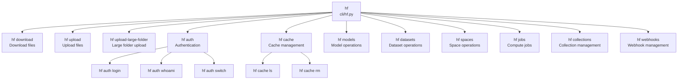

**Common Commands:**

```bash
# Authentication
hf auth login
hf auth whoami

# Download files
hf download gpt2 config.json
hf download stabilityai/stable-diffusion-2-1 --repo-type model

# Upload files
hf upload my-username/my-model ./local/path
hf upload-large-folder my-username/my-model ./large-folder

# Cache management
hf cache ls
hf cache rm --repo gpt2
```

**Sources:** [setup.py:120-125](), [src/huggingface_hub/cli/hf.py:1-100]()

## Development

**Code Quality Tools:**

| Tool | Purpose | Command |
|------|---------|---------|
| `ruff` | Linting and formatting | `ruff check src tests` / `ruff format src tests` |
| `mypy` | Static type checking | `mypy src` |
| `ty` | Runtime type checking | `ty check src` |
| `pytest` | Test execution | `pytest tests/` |
| `pytest-cov` | Coverage reporting | Automatic in CI |

**Development Workflow:**

```bash
# Setup
pip install -e ".[dev]"

# Run quality checks
make quality    # Lint, format check, type check
make style      # Auto-format code
make test       # Run test suite

# Run specific tests
pytest tests/test_hf_api.py -k test_create_repo
pytest tests/ -v -s  # Verbose with print statements
```

**CI/CD Workflows** (from [.github/workflows/]()):

| Workflow | Trigger | Purpose |
|----------|---------|---------|
| `python-tests.yml` | Push, PR | Run test suite on multiple Python versions |
| `python-quality.yml` | Push, PR | Run linters and type checkers |
| `python-release.yml` | Tag push | Build and publish to PyPI |

**Sources:** [Makefile:1-41](), [.github/workflows/python-quality.yml:1-54](), [CONTRIBUTING.md:129-167]()

## Key Design Principles

1. **Lazy Loading**: Modules imported on first use via `__init__.py` lazy loader to minimize import time
2. **Caching by Default**: All downloads cached using content-addressable storage
3. **Resilient HTTP**: Automatic retries with exponential backoff for transient failures
4. **Offline Support**: Graceful degradation when network unavailable
5. **Multi-Protocol**: Supports standard HTTP, LFS, and Xet for different file sizes
6. **Framework Agnostic**: Core functionality independent of ML frameworks
7. **Backward Compatibility**: Legacy interfaces maintained alongside modern ones

**Sources:** [src/huggingface_hub/__init__.py:16-46](), [src/huggingface_hub/utils/_http.py:1-200](), [src/huggingface_hub/file_download.py:1-100]()

---

# Page: Core API Client (HfApi)

# Core API Client (HfApi)

<details>
<summary>Relevant source files</summary>

The following files were used as context for generating this wiki page:

- [src/huggingface_hub/__init__.py](src/huggingface_hub/__init__.py)
- [src/huggingface_hub/_commit_api.py](src/huggingface_hub/_commit_api.py)
- [src/huggingface_hub/_login.py](src/huggingface_hub/_login.py)
- [src/huggingface_hub/constants.py](src/huggingface_hub/constants.py)
- [src/huggingface_hub/file_download.py](src/huggingface_hub/file_download.py)
- [src/huggingface_hub/hf_api.py](src/huggingface_hub/hf_api.py)
- [src/huggingface_hub/utils/__init__.py](src/huggingface_hub/utils/__init__.py)
- [src/huggingface_hub/utils/_headers.py](src/huggingface_hub/utils/_headers.py)
- [src/huggingface_hub/utils/_runtime.py](src/huggingface_hub/utils/_runtime.py)
- [src/huggingface_hub/utils/_xet.py](src/huggingface_hub/utils/_xet.py)
- [tests/test_file_download.py](tests/test_file_download.py)
- [tests/test_hf_api.py](tests/test_hf_api.py)
- [tests/test_utils_headers.py](tests/test_utils_headers.py)
- [tests/test_xet_utils.py](tests/test_xet_utils.py)
- [tests/testing_utils.py](tests/testing_utils.py)

</details>


The `HfApi` class is the primary HTTP-based client for programmatic interaction with the Hugging Face Hub. It provides methods for repository management, file operations, metadata queries, and administrative tasks. This page documents the class structure, initialization patterns, core methods, and design principles. 

For file download and caching mechanisms, see [File Download and Upload](#2.2). For commit operations and LFS integration, see [Commit API and LFS Integration](#2.3). For Git-based workflows, see [Repository Class (Git-based)](#4).

## HfApi Class Structure

The `HfApi` class serves as a stateful wrapper around Hub REST API endpoints, managing authentication tokens, endpoint URLs, and HTTP sessions across multiple operations.

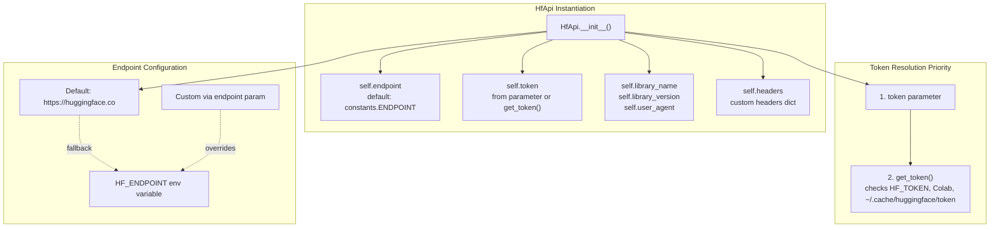

**HfApi Initialization and Configuration**

Sources: [src/huggingface_hub/hf_api.py:1896-1982]()

### Initialization Parameters

The `HfApi` constructor accepts optional configuration that applies to all subsequent method calls:

| Parameter | Type | Purpose | Default |
|-----------|------|---------|---------|
| `endpoint` | `str` | Hub API base URL | `constants.ENDPOINT` |
| `token` | `str \| bool` | Authentication token | `None` (auto-resolved) |
| `library_name` | `str` | Client library identifier for telemetry | `None` |
| `library_version` | `str` | Client library version | `None` |
| `user_agent` | `str \| dict` | Additional user agent info | `None` |
| `headers` | `dict` | Custom HTTP headers | `None` |

Token resolution follows a fallback chain: explicit parameter → `get_token()` helper → environment variable `HF_TOKEN` → Google Colab secrets → token file at `~/.cache/huggingface/token`. Setting `token=False` explicitly disables authentication.

Sources: [src/huggingface_hub/hf_api.py:1896-1982](), [src/huggingface_hub/utils/_headers.py:133-171]()

## Core Method Categories

The `HfApi` class organizes ~150 public methods into functional groups. Methods generally accept `repo_id`, `repo_type`, and `revision` parameters following consistent naming patterns.

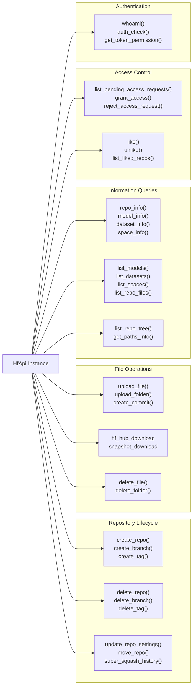

**Method Organization in HfApi**

Sources: [src/huggingface_hub/hf_api.py:1984-5500]()

### Repository Management Methods

| Method | Purpose | Returns |
|--------|---------|---------|
| `create_repo()` | Create new repository | `RepoUrl` |
| `delete_repo()` | Delete repository | `None` |
| `update_repo_settings()` | Modify visibility, gating, Xet settings | `None` |
| `move_repo()` | Rename/relocate repository | `None` |
| `repo_exists()` | Check repository existence | `bool` |
| `revision_exists()` | Check if revision exists | `bool` |
| `file_exists()` | Check if file exists at path | `bool` |

The `create_repo()` method returns a `RepoUrl` object that inherits from `str` but provides structured access to repository metadata:

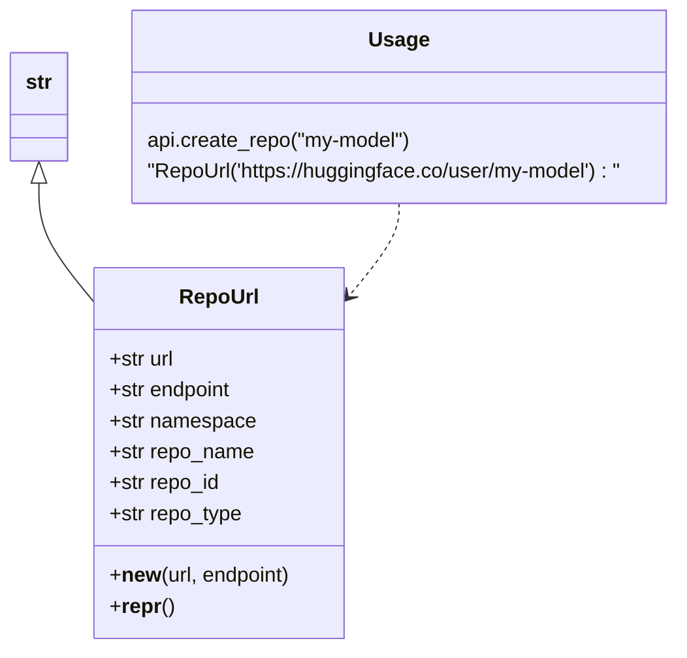

**RepoUrl Data Structure**

Sources: [src/huggingface_hub/hf_api.py:534-593](), [tests/test_hf_api.py:413-419]()

### Information Retrieval Methods

Information methods return rich dataclass objects with optional properties depending on query parameters:

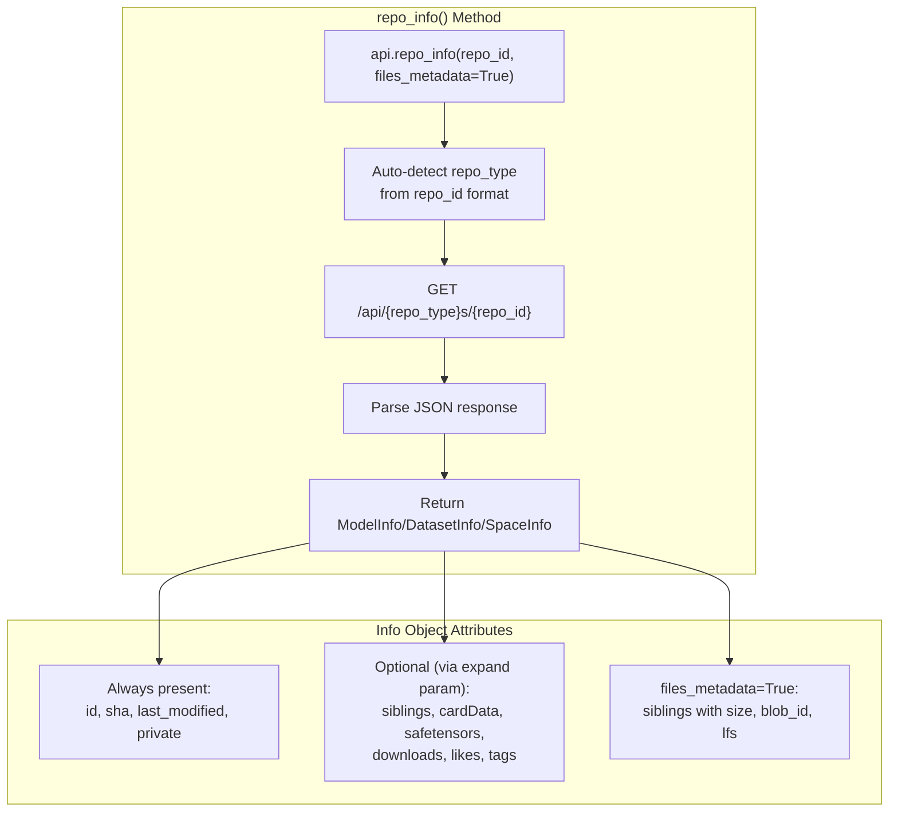

**repo_info() Method Flow**

The `files_metadata` parameter controls whether file details (size, blob_id, LFS metadata) are included in `siblings` list. Without this flag, `siblings` contains only filenames.

Sources: [src/huggingface_hub/hf_api.py:2619-2757]()

### List Methods with Pagination

List methods (`list_models()`, `list_datasets()`, `list_spaces()`) return iterators that automatically handle pagination via the `paginate()` utility:

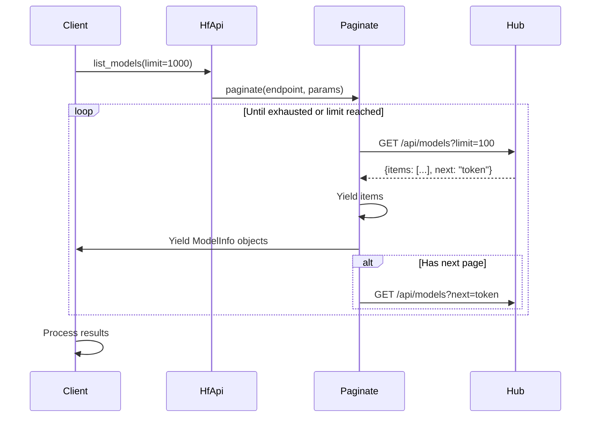

**Pagination in List Methods**

The `paginate()` helper uses response headers (`X-Next`, `Link`) to fetch subsequent pages transparently. The `limit` parameter controls total results, not per-page size.

Sources: [src/huggingface_hub/hf_api.py:2169-2299](), [src/huggingface_hub/utils/_pagination.py:1-100]()

## Data Structures and Return Types

`HfApi` methods return strongly-typed dataclasses that provide both attribute access and dictionary-like behavior for backward compatibility.

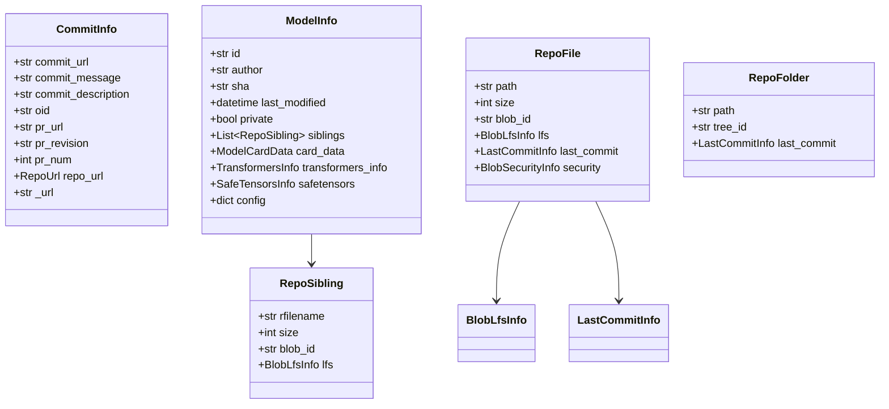

**Core Data Structures Returned by HfApi**

### CommitInfo Object

`CommitInfo` inherits from `str` for backward compatibility (returns commit URL as string) but provides structured fields:

| Attribute | Type | Description |
|-----------|------|-------------|
| `commit_url` | `str` | Full URL to commit on Hub |
| `commit_message` | `str` | First line of commit message |
| `commit_description` | `str` | Remaining lines of commit message |
| `oid` | `str` | 40-character commit hash |
| `pr_url` | `str` | URL to PR if `create_pr=True` |
| `pr_revision` | `str` | Git ref like `refs/pr/1` |
| `pr_num` | `int` | PR discussion number |
| `repo_url` | `RepoUrl` | Parsed repository URL |

Sources: [src/huggingface_hub/hf_api.py:378-455](), [tests/test_hf_api.py:594-607]()

### ModelInfo, DatasetInfo, SpaceInfo

These info objects share common fields but include type-specific attributes:

**Common Fields:**
- `id`, `author`, `sha`, `created_at`, `last_modified`
- `private`, `disabled`, `gated`, `downloads`, `likes`
- `siblings` (list of `RepoSibling` objects)
- `card_data` (typed CardData object)

**ModelInfo-Specific:**
- `transformers_info`: Auto-detection of model class, pipeline tag
- `safetensors`: Parameter counts and tensor info
- `inference_provider_mapping`: Available inference providers
- `library_name`: Detected ML framework

**SpaceInfo-Specific:**
- `runtime`: Current Space execution status
- `sdk`: Gradio, Streamlit, Docker, or Static
- `models`, `datasets`: Linked repositories

Sources: [src/huggingface_hub/hf_api.py:742-1074]()

## HTTP Communication and Error Handling

`HfApi` methods use a resilient HTTP layer with automatic retries, custom error types, and request ID tracking.

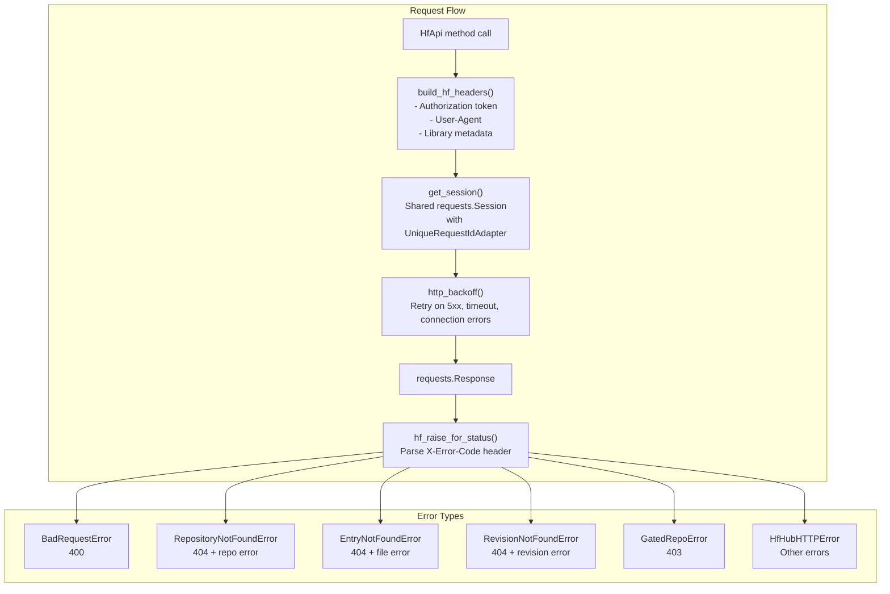

**HTTP Request Flow with Error Handling**

### Request ID Tracking

Every request includes a unique `X-Request-Id` header generated client-side. On error, the server's request ID (from response header) is included in exception messages for debugging.

Sources: [src/huggingface_hub/utils/_http.py:242-316](), [src/huggingface_hub/utils/_errors.py:1-400]()

### Retry Logic

The `http_backoff()` function implements exponential backoff with jitter for transient errors:

| Error Type | Retry? | Max Attempts | Backoff |
|------------|--------|--------------|---------|
| 5xx Server Error | Yes | 5 | Exponential + jitter |
| Connection Error | Yes | 5 | Exponential + jitter |
| Timeout | Yes | 5 | Exponential + jitter |
| 4xx Client Error | No | 0 | - |

File upload operations reset the file cursor on retry to enable re-reading from the beginning.

Sources: [src/huggingface_hub/utils/_http.py:95-162]()

### Specialized Error Types

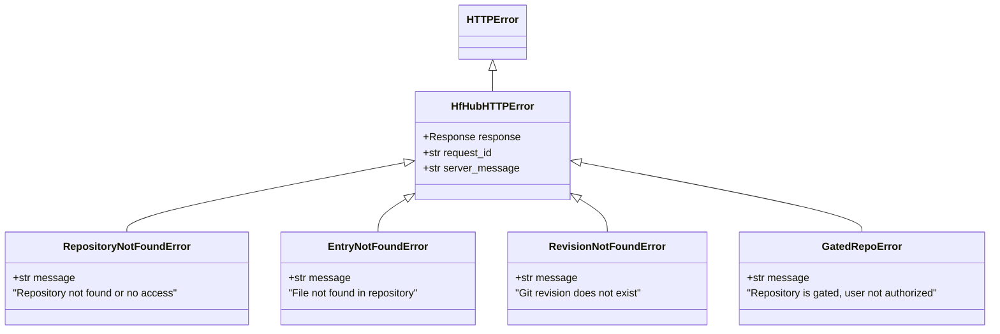

**Error Class Hierarchy**

The `hf_raise_for_status()` function examines the `X-Error-Code` response header to raise specific exception types. This allows client code to handle different failure modes with targeted exception handlers.

Sources: [src/huggingface_hub/utils/_errors.py:80-300](), [src/huggingface_hub/utils/_http.py:399-526]()

## Method Patterns and Conventions

`HfApi` methods follow consistent patterns for parameter naming, validation, and return types.

### Common Parameter Pattern

Most repository-scoped methods accept these parameters:

```python
def method_name(
    repo_id: str,                              # Required: "namespace/repo_name"
    *,
    repo_type: Optional[str] = None,           # "model" (default), "dataset", or "space"
    revision: Optional[str] = None,            # Branch, tag, or commit hash (default: "main")
    token: Optional[Union[str, bool]] = None,  # Auth token (default: instance token)
    headers: Optional[Dict[str, str]] = None,  # Additional HTTP headers
) -> ReturnType:
    ...
```

The `repo_id` parameter accepts multiple formats:
- `"username/repo_name"` (most common)
- `"repo_name"` (uses authenticated user's namespace)
- `"hf://repo_type/username/repo_name"` (explicit format)
- Full Hub URLs (parsed to extract components)

Sources: [src/huggingface_hub/hf_api.py:239-322]()

### Validation Decorator

The `@validate_hf_hub_args` decorator provides automatic parameter validation and normalization:

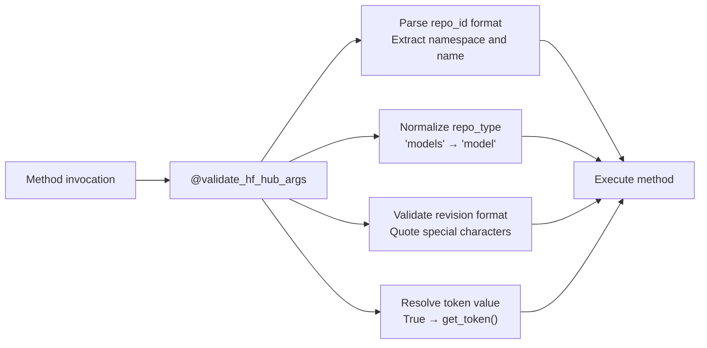

**Parameter Validation Flow**

Sources: [src/huggingface_hub/utils/_validators.py:1-200]()

### Deprecation Handling

Deprecated methods and parameters use the `@_deprecate_arguments` decorator to emit `FutureWarning`:

```python
@_deprecate_arguments(version="1.0", deprecated_args={"use_auth_token": "token"})
def some_method(self, token: Optional[str] = None, use_auth_token: Optional[str] = None):
    # Automatically handles migration and warning
    ...
```

The decorator updates docstrings and emits warnings while maintaining backward compatibility during the deprecation period.

Sources: [src/huggingface_hub/utils/_deprecation.py:1-200]()

## Integration with Other Components

`HfApi` serves as the foundation for higher-level abstractions in the library.

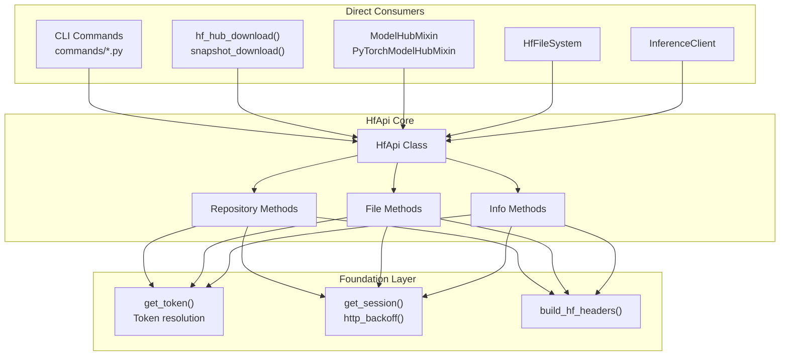

**HfApi in System Architecture**

### CLI Integration

Command classes instantiate `HfApi` with endpoint and token from command arguments:

```python
# In commands/user.py
class WhoamiCommand(BaseUserCommand):
    def run(self):
        token = get_token()
        info = self._api.whoami(token)
        print(info["name"])
```

Sources: [src/huggingface_hub/commands/user.py:188-208]()

### Mixin Integration

`ModelHubMixin` uses `HfApi` methods for `push_to_hub()` and `from_pretrained()`:

```python
def push_to_hub(self, repo_id: str, **kwargs):
    api = HfApi()
    api.create_repo(repo_id, exist_ok=True)
    api.upload_folder(folder_path=local_dir, repo_id=repo_id)
```

Sources: [src/huggingface_hub/hub_mixin.py:200-350]()

### HfFileSystem Integration

`HfFileSystem` delegates metadata operations to `HfApi`:

```python
class HfFileSystem:
    def __init__(self, *args, **kwargs):
        self._api = HfApi(...)
    
    def info(self, path: str):
        # Calls api.get_paths_info() internally
        return self._api.get_paths_info(...)
```

Sources: [src/huggingface_hub/hf_file_system.py:100-200]()

## Authentication and Token Management

`HfApi` supports multiple authentication patterns through its `token` parameter and the global token resolution system.

### Token Parameter Behavior

| `token` Value | Behavior |
|---------------|----------|
| `None` (default) | Use instance token or `get_token()` |
| `"hf_..."` string | Use provided token for this request |
| `True` | Explicitly call `get_token()` |
| `False` | Explicitly disable authentication |

The `token=False` pattern is useful for accessing public repositories without triggering token lookup logic.

Sources: [src/huggingface_hub/hf_api.py:1896-1982]()

### Token Storage Locations

The `get_token()` helper checks multiple sources in priority order:

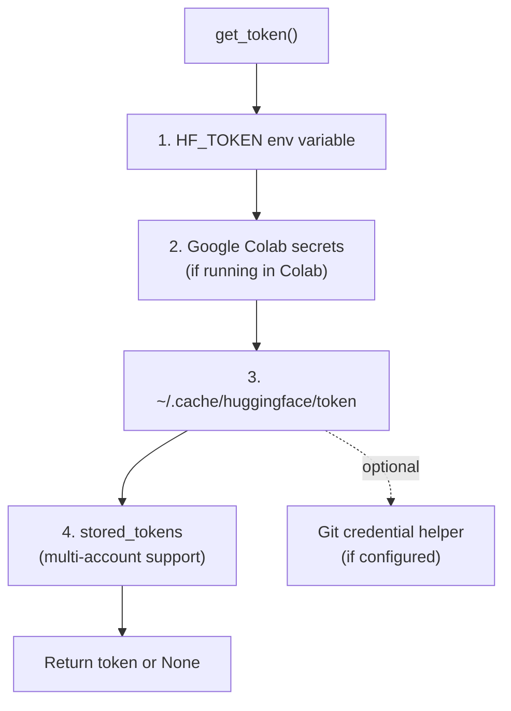

**Token Resolution Priority**

The stored tokens file (introduced in v0.20) allows managing multiple accounts with `auth_switch()` command.

Sources: [src/huggingface_hub/utils/_auth.py:1-200]()

### whoami() Method

The `whoami()` method returns account information for the authenticated user:

```python
{
    "type": "user",
    "name": "username",
    "fullname": "Full Name",
    "email": "user@example.com",
    "orgs": [
        {"name": "org1", "fullname": "Organization 1"},
        {"name": "org2", "fullname": "Organization 2"}
    ],
    "auth": {
        "type": "access_token",  # or "oauth"
        "accessToken": {"role": "write"}
    }
}
```

For OAuth tokens, the response includes expiration information in the `auth.expiresAt` field.

Sources: [src/huggingface_hub/hf_api.py:2051-2080](), [tests/test_hf_api.py:174-208]()

## Performance Considerations

### Session Reuse

`HfApi` uses `get_session()` which returns a singleton `requests.Session` with connection pooling. This reuses TCP connections across multiple API calls, significantly reducing latency for repeated operations.

Sources: [src/huggingface_hub/utils/_http.py:50-90]()

### Parallel Operations

Methods like `upload_folder()` use thread pools for parallel file uploads:

```python
# Internal implementation
with ThreadPoolExecutor(max_workers=num_threads) as executor:
    futures = [
        executor.submit(upload_file, file)
        for file in files
    ]
```

The default thread count is 5 but can be overridden with the `num_threads` parameter in applicable methods.

Sources: [src/huggingface_hub/hf_api.py:4200-4300]()

### Caching Strategy

`HfApi` itself does not implement caching—this is handled by `hf_hub_download()` and the cache system. However, methods like `repo_info()` can be called repeatedly as the overhead is a single HTTP request.

For scenarios requiring frequent metadata queries, consider:
1. Caching `repo_info()` results client-side with a TTL
2. Using `list_repo_tree()` once and filtering locally
3. Using `HfFileSystem` which implements its own caching

Sources: [src/huggingface_hub/hf_file_system.py:1-100]()

---

# Page: Repository Operations

# Repository Operations

<details>
<summary>Relevant source files</summary>

The following files were used as context for generating this wiki page:

- [src/huggingface_hub/__init__.py](src/huggingface_hub/__init__.py)
- [src/huggingface_hub/_commit_api.py](src/huggingface_hub/_commit_api.py)
- [src/huggingface_hub/constants.py](src/huggingface_hub/constants.py)
- [src/huggingface_hub/file_download.py](src/huggingface_hub/file_download.py)
- [src/huggingface_hub/hf_api.py](src/huggingface_hub/hf_api.py)
- [src/huggingface_hub/utils/__init__.py](src/huggingface_hub/utils/__init__.py)
- [tests/test_file_download.py](tests/test_file_download.py)
- [tests/test_hf_api.py](tests/test_hf_api.py)
- [tests/testing_utils.py](tests/testing_utils.py)

</details>


This page documents repository lifecycle management: creating, deleting, moving, updating settings, checking existence, and managing access permissions. These operations are handled through the `HfApi` class and form the foundation for working with repositories on the Hugging Face Hub.

For file download operations, see section 2.2. For file upload operations, see section 2.3.

## Repository Operations Architecture

Repository operations are implemented as methods on the `HfApi` class. All operations communicate with the Hub via HTTP requests:

**HfApi Repository Operations Method Groups**

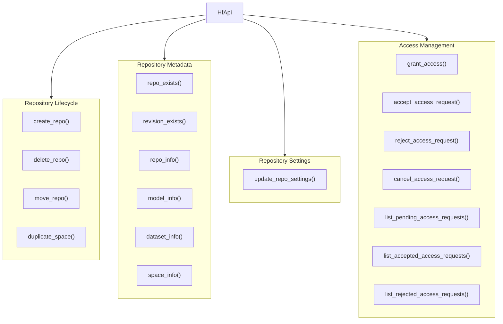

Sources:
- [src/huggingface_hub/hf_api.py:1587-2057]() - HfApi class definition
- [src/huggingface_hub/hf_api.py:4806-4877]() - create_repo
- [src/huggingface_hub/hf_api.py:4878-4948]() - delete_repo
- [src/huggingface_hub/hf_api.py:5036-5142]() - move_repo
- [src/huggingface_hub/hf_api.py:2058-2134]() - repo_info methods
- [src/huggingface_hub/hf_api.py:4949-5035]() - update_repo_settings

## Repository Creation

### Creating Repositories with create_repo

The `create_repo` method handles repository creation for all repository types:

```python
from huggingface_hub import HfApi

api = HfApi()

# Create a model repository (default type)
repo_url = api.create_repo(repo_id="my-awesome-model")

# Create a dataset repository
repo_url = api.create_repo(repo_id="my-dataset", repo_type="dataset")

# Create a space repository with specific SDK
repo_url = api.create_repo(
    repo_id="my-gradio-demo", 
    repo_type="space",
    space_sdk="gradio"
)

# Create a private repository
repo_url = api.create_repo(repo_id="my-private-model", private=True)

# Create with additional settings
repo_url = api.create_repo(
    repo_id="my-model",
    private=True,
    exist_ok=True,  # Don't fail if repo already exists
    license="apache-2.0"
)
```

### RepoUrl Return Object

The `create_repo` method returns a `RepoUrl` object (defined at [src/huggingface_hub/hf_api.py:591-650]()) with these properties:

| Property | Type | Description | Example |
|----------|------|-------------|---------|
| `endpoint` | `str` | Hub endpoint URL | `"https://huggingface.co"` |
| `namespace` | `Optional[str]` | User or organization name | `"username"` or `None` |
| `repo_name` | `str` | Repository name | `"my-model"` |
| `repo_id` | `str` | Full repository identifier | `"username/my-model"` |
| `repo_type` | `str` | Repository type | `"model"`, `"dataset"`, or `"space"` |
| `url` | `str` | Complete repository URL | `"https://huggingface.co/username/my-model"` |

Sources:
- [src/huggingface_hub/hf_api.py:591-650]() - RepoUrl class
- [src/huggingface_hub/hf_api.py:4806-4877]() - create_repo method
- [tests/test_hf_api.py:424-430]() - create_repo tests

## Repository Information and Metadata

### Checking Repository Existence

Use `repo_exists` to verify if a repository exists:

```python
# Check if repository exists
exists = api.repo_exists("username/my-model")

# Check specific repository type
exists = api.repo_exists("username/my-dataset", repo_type="dataset")

# Check with authentication for private repos
exists = api.repo_exists("username/private-model", token="your_token")
```

### Getting Repository Information

The `repo_info` method and its type-specific variants provide detailed repository metadata:

```python
# Generic repository info
info = api.repo_info("username/my-model")

# Type-specific info with rich metadata
model_info = api.model_info("username/my-model")
dataset_info = api.dataset_info("username/my-dataset") 
space_info = api.space_info("username/my-space")

# Get info for specific revision
info = api.model_info("username/my-model", revision="v1.0")

# Expand specific properties
info = api.model_info(
    "username/my-model", 
    expand=["siblings", "config", "cardData"]
)
```

### Information Objects

Repository information methods return dataclass objects with structured metadata:

| Method | Return Type | Key Properties |
|--------|------------|----------------|
| `model_info()` | `ModelInfo` | `id`, `author`, `sha`, `downloads`, `downloads_all_time`, `likes`, `tags`, `pipeline_tag`, `library_name`, `card_data`, `siblings` |
| `dataset_info()` | `DatasetInfo` | `id`, `author`, `sha`, `downloads`, `downloads_all_time`, `likes`, `tags`, `card_data`, `siblings` |
| `space_info()` | `SpaceInfo` | `id`, `author`, `sha`, `likes`, `sdk`, `stage`, `hardware`, `runtime` |

All info objects also include optional fields like `created_at`, `last_modified`, `private`, `gated`, and `disabled`.

Sources:
- [src/huggingface_hub/hf_api.py:803-999]() - ModelInfo dataclass
- [src/huggingface_hub/hf_api.py:1002-1134]() - DatasetInfo dataclass  
- [src/huggingface_hub/hf_api.py:1137-1283]() - SpaceInfo dataclass
- [src/huggingface_hub/hf_api.py:2058-2134]() - info methods implementation

## Repository Settings Management

### Updating Repository Settings

The `update_repo_settings` method allows modification of repository configuration:

```python
# Change repository visibility
api.update_repo_settings(repo_id="username/my-model", private=True)
api.update_repo_settings(repo_id="username/my-model", private=False)

# Configure repository gating
api.update_repo_settings(repo_id="username/my-model", gated="auto")
api.update_repo_settings(repo_id="username/my-model", gated="manual") 
api.update_repo_settings(repo_id="username/my-model", gated=False)

# Enable advanced storage features
api.update_repo_settings(repo_id="username/my-model", xet_enabled=True)

# Update multiple settings simultaneously
api.update_repo_settings(
    repo_id="username/my-model",
    private=True,
    gated="manual"
)
```

### Legacy update_repo_visibility

For backward compatibility, `update_repo_visibility` is available as an alias:

```python
# Legacy method (still supported)
api.update_repo_visibility(repo_id="username/my-model", private=True)
```

### Repository Settings Options

| Setting | Type | Options | Description |
|---------|------|---------|-------------|
| `private` | `bool` | `True`, `False` | Repository visibility |
| `gated` | `Union[bool, str]` | `False`, `"auto"`, `"manual"` | Access control level |
| `xet_enabled` | `bool` | `True`, `False` | Enable Xet storage backend |

Sources:
- [src/huggingface_hub/hf_api.py:4949-5035]()
- [src/huggingface_hub/hf_api.py:5143-5173]()
- [tests/test_hf_api.py:253-283]()

## Repository Lifecycle Operations

### Deleting Repositories

The `delete_repo` method permanently removes repositories from the Hub:

```python
# Delete a repository
api.delete_repo(repo_id="username/my-model")

# Delete specific repository type
api.delete_repo(repo_id="username/my-dataset", repo_type="dataset")

# Skip error if repository doesn't exist
api.delete_repo(repo_id="username/my-model", missing_ok=True)
```

Sources:
- [src/huggingface_hub/hf_api.py:4878-4948]() - delete_repo implementation
- [tests/test_hf_api.py:235-248]() - delete_repo tests

### Moving/Renaming Repositories

The `move_repo` method handles repository renaming and namespace changes:

```python
# Rename a repository
api.move_repo(from_id="username/old-name", to_id="username/new-name")

# Move to different namespace (organization transfer)
api.move_repo(from_id="username/my-model", to_id="org/my-model")

# Move different repository types
api.move_repo(
    from_id="username/my-dataset", 
    to_id="username/renamed-dataset",
    repo_type="dataset"
)
```

**Requirements for move_repo:**
- Both `from_id` and `to_id` must be in format `"namespace/repo_name"`
- Target repository must not already exist
- User must have write access to both source and destination namespaces

Sources:
- [src/huggingface_hub/hf_api.py:5036-5142]() - move_repo implementation
- [tests/test_hf_api.py:250-270]() - move_repo tests

## Access Management

### Repository Gating

Repositories can be gated to control access. The `update_repo_settings` method configures gating:

```python
# Automatic gating - users are automatically granted access
api.update_repo_settings(repo_id="username/my-model", gated="auto")

# Manual gating - users must request access and wait for approval
api.update_repo_settings(repo_id="username/my-model", gated="manual")

# Disable gating
api.update_repo_settings(repo_id="username/my-model", gated=False)
```

Sources:
- [src/huggingface_hub/hf_api.py:4949-5035]() - update_repo_settings
- [tests/test_hf_api.py:281-303]() - gating tests

### Managing Access Requests

For manually gated repositories, use these methods to manage access requests:

```python
# List pending access requests
pending = api.list_pending_access_requests(repo_id="username/my-model")

# Accept an access request
api.accept_access_request(repo_id="username/my-model", user="requesting-user")

# Reject an access request  
api.reject_access_request(repo_id="username/my-model", user="requesting-user")

# Grant access directly (without a request)
api.grant_access(repo_id="username/my-model", user="trusted-user")

# List accepted requests
accepted = api.list_accepted_access_requests(repo_id="username/my-model")

# List rejected requests
rejected = api.list_rejected_access_requests(repo_id="username/my-model")
```

All access request methods return `AccessRequest` objects (defined at [src/huggingface_hub/hf_api.py:515-542]()) with fields:
- `username`: Username of the user
- `fullname`: Full name of the user
- `email`: Email address (optional)
- `timestamp`: When the request was made
- `status`: `"pending"`, `"accepted"`, or `"rejected"`
- `fields`: Additional form fields (optional)

Sources:
- [src/huggingface_hub/hf_api.py:8059-8098]() - grant_access
- [src/huggingface_hub/hf_api.py:8099-8148]() - accept_access_request
- [src/huggingface_hub/hf_api.py:8149-8198]() - reject_access_request
- [src/huggingface_hub/hf_api.py:8199-8237]() - cancel_access_request
- [src/huggingface_hub/hf_api.py:8238-8278]() - list_pending_access_requests
- [src/huggingface_hub/hf_api.py:8279-8319]() - list_accepted_access_requests
- [src/huggingface_hub/hf_api.py:8320-8360]() - list_rejected_access_requests

## Repository Operations Request Flow

**Typical Repository Operation Sequence**

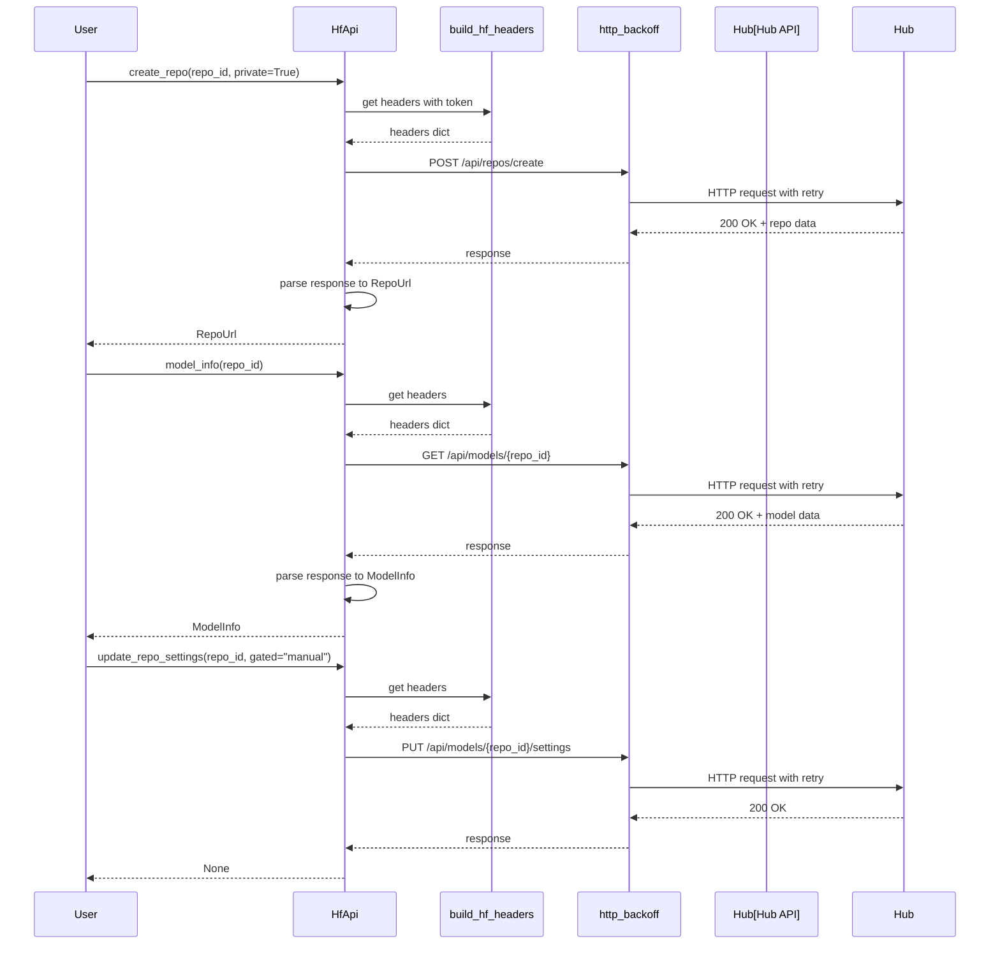

Sources:
- [src/huggingface_hub/hf_api.py:4806-4877]() - create_repo
- [src/huggingface_hub/hf_api.py:2058-2134]() - model_info  
- [src/huggingface_hub/hf_api.py:4949-5035]() - update_repo_settings
- [src/huggingface_hub/utils/_headers.py:119-159]() - build_hf_headers
- [src/huggingface_hub/utils/_http.py:418-489]() - http_backoff

## Repository Types and URL Structure

### Repository Type Constants

The Hub supports three main repository types defined in `constants.py`:

| Constant | Value | URL Prefix | Description |
|----------|-------|------------|-------------|
| `REPO_TYPE_MODEL` | `"model"` | None | Machine learning models (default) |
| `REPO_TYPE_DATASET` | `"dataset"` | `"datasets/"` | Training and evaluation datasets |
| `REPO_TYPE_SPACE` | `"space"` | `"spaces/"` | Interactive applications and demos |

### Repository ID Parsing

The `repo_type_and_id_from_hf_id` function parses repository identifiers:

```mermaid
flowchart TD
    Input["repo_type_and_id_from_hf_id(hf_id)"]
    
    subgraph "Input Formats"
        FullURL["https://huggingface.co/datasets/username/repo"]
        HfProtocol["hf://datasets/username/repo"]
        Typed["datasets/username/repo"]
        Simple["username/repo"]
        Canonical["repo"]
    end
    
    subgraph "Parsing Logic"
        ParseURL["Parse URL components"]
        ExtractType["Extract repo_type"]
        ExtractNamespace["Extract namespace"]
        ExtractName["Extract repo_name"]
    end
    
    subgraph "Output"
        RepoType["repo_type: Optional[str]"]
        Namespace["namespace: Optional[str]"]
        RepoName["repo_name: str"]
    end
    
    Input --> ParseURL
    ParseURL --> ExtractType
    ParseURL --> ExtractNamespace
    ParseURL --> ExtractName
    
    ExtractType --> RepoType
    ExtractNamespace --> Namespace
    ExtractName --> RepoName
    
    FullURL --> Input
    HfProtocol --> Input
    Typed --> Input
    Simple --> Input
    Canonical --> Input
```

### Repository URL Examples

| Repository ID | Parsed Components | Full URL |
|---------------|-------------------|----------|
| `"bert-base-uncased"` | `repo_type=None, namespace=None, repo_name="bert-base-uncased"` | https://huggingface.co/bert-base-uncased |
| `"username/my-model"` | `repo_type=None, namespace="username", repo_name="my-model"` | https://huggingface.co/username/my-model |
| `"datasets/username/data"` | `repo_type="dataset", namespace="username", repo_name="data"` | https://huggingface.co/datasets/username/data |
| `"spaces/username/demo"` | `repo_type="space", namespace="username", repo_name="demo"` | https://huggingface.co/spaces/username/demo |

Sources:
- [src/huggingface_hub/hf_api.py:239-322]()
- [src/huggingface_hub/constants.py:104-118]()
- [src/huggingface_hub/hf_api.py:529-587]()

## Deprecated: Git-based Repository Management

The `Repository` class provides a Git-based approach to repository management. However, it's deprecated and will be removed in version 1.0.

```python
from huggingface_hub import Repository

# Clone a repository
repo = Repository(
    local_dir="path/to/local/directory", 
    clone_from="username/repo-name"
)

# Track large files with Git LFS
repo.lfs_track(["*.bin", "*.pt"])

# Add files
repo.git_add()

# Commit files
repo.git_commit("Add model files")

# Push to Hub
repo.git_push()
```

If you're working with an existing codebase that uses the `Repository` class, consider migrating to the HTTP-based approach with `HfApi`.

Sources:
- [src/huggingface_hub/repository.py:426-1164]()

## Summary

Repository management on the Hugging Face Hub can be done using:

1. **HTTP-based approach** (recommended):
   - Use `HfApi` class for all repository operations
   - No need for Git installation
   - More straightforward and platform-independent
   - Provides methods like `create_repo`, `upload_file`, `upload_folder`, and `create_commit`

2. **Git-based approach** (deprecated):
   - Use `Repository` class which wraps Git commands
   - Requires Git and Git LFS to be installed
   - Will be removed in future versions

For most use cases, the HTTP-based approach is preferred for its simplicity and reliability across different environments.

---

# Page: File Download System

# File Download System

<details>
<summary>Relevant source files</summary>

The following files were used as context for generating this wiki page:

- [src/huggingface_hub/__init__.py](src/huggingface_hub/__init__.py)
- [src/huggingface_hub/_commit_api.py](src/huggingface_hub/_commit_api.py)
- [src/huggingface_hub/_snapshot_download.py](src/huggingface_hub/_snapshot_download.py)
- [src/huggingface_hub/constants.py](src/huggingface_hub/constants.py)
- [src/huggingface_hub/fastai_utils.py](src/huggingface_hub/fastai_utils.py)
- [src/huggingface_hub/file_download.py](src/huggingface_hub/file_download.py)
- [src/huggingface_hub/hf_api.py](src/huggingface_hub/hf_api.py)
- [src/huggingface_hub/utils/__init__.py](src/huggingface_hub/utils/__init__.py)
- [tests/test_cache_layout.py](tests/test_cache_layout.py)
- [tests/test_file_download.py](tests/test_file_download.py)
- [tests/test_hf_api.py](tests/test_hf_api.py)
- [tests/test_snapshot_download.py](tests/test_snapshot_download.py)
- [tests/testing_utils.py](tests/testing_utils.py)

</details>


## Purpose and Scope

This document describes the file download mechanisms in `huggingface_hub`, including single file downloads, repository snapshots, metadata fetching, and offline operation modes. For information about the cache structure where files are stored, see [Cache Architecture](#2.5). For upload mechanisms, see [File Upload System](#2.3). For details on LFS and Xet storage backends, see [Commit API and Storage Backends](#2.4).

## Overview

The file download system provides two primary interfaces:

| Interface | Purpose | Main Function |
|-----------|---------|---------------|
| Single File Download | Download a specific file from a repository | `hf_hub_download` |
| Repository Snapshot | Download all files from a repository revision | `snapshot_download` |

Both interfaces support:
- Automatic caching with content-addressable storage
- Offline mode operation
- Progress tracking
- Resumable downloads
- Multiple storage backends (HTTP, Xet)

**Sources:** [src/huggingface_hub/file_download.py:1-50](), [src/huggingface_hub/_snapshot_download.py:1-30]()

## System Architecture

```mermaid
graph TD
    User["User Code"]
    
    subgraph "Download Entrypoints"
        HfHubDownload["hf_hub_download()"]
        SnapshotDownload["snapshot_download()"]
    end
    
    subgraph "URL & Metadata"
        HfHubUrl["hf_hub_url()"]
        GetMetadata["get_hf_file_metadata()"]
        HfFileMetadata["HfFileMetadata dataclass"]
    end
    
    subgraph "Cache Layer"
        TryCache["try_to_load_from_cache()"]
        CacheCheck{"File in cache?"}
        PointerPath["_get_pointer_path()"]
    end
    
    subgraph "Download Strategies"
        HttpGet["http_get()"]
        XetGet["xet_get()"]
    end
    
    subgraph "Storage"
        BlobsDir["blobs/ directory"]
        SnapshotsDir["snapshots/ directory"]
        RefsDir["refs/ directory"]
        XetCache["xet/chunk-cache/"]
    end
    
    User --> HfHubDownload
    User --> SnapshotDownload
    
    HfHubDownload --> HfHubUrl
    HfHubDownload --> TryCache
    HfHubDownload --> GetMetadata
    
    SnapshotDownload --> HfHubDownload
    
    GetMetadata --> HfFileMetadata
    HfFileMetadata --> CacheCheck
    
    TryCache --> CacheCheck
    CacheCheck -->|Cache Hit| PointerPath
    CacheCheck -->|Cache Miss| GetMetadata
    
    GetMetadata -->|Xet File| XetGet
    GetMetadata -->|Regular/LFS| HttpGet
    
    HttpGet --> BlobsDir
    XetGet --> XetCache
    XetGet --> BlobsDir
    
    BlobsDir --> SnapshotsDir
    SnapshotsDir --> RefsDir
    
    PointerPath --> RefsDir
```

**Sources:** [src/huggingface_hub/file_download.py:189-273](), [src/huggingface_hub/file_download.py:544-745](), [src/huggingface_hub/_snapshot_download.py:104-250]()

## Single File Download

### URL Construction

The `hf_hub_url` function constructs URLs for downloading files from the Hub:

```mermaid
graph LR
    Input["repo_id, filename, revision, subfolder"]
    
    Construct["hf_hub_url()"]
    
    Template["HUGGINGFACE_CO_URL_TEMPLATE"]
    
    Output["https://huggingface.co/{repo_id}/resolve/{revision}/{filename}"]
    
    Input --> Construct
    Construct --> Template
    Template --> Output
```

The URL follows the pattern:
- **Template:** `{endpoint}/{repo_id}/resolve/{revision}/{filename}`
- **Default revision:** `main`
- **URL encoding:** Both `revision` and `filename` are URL-encoded via `quote()`

**Sources:** [src/huggingface_hub/file_download.py:189-273](), [src/huggingface_hub/constants.py:58-73]()

### Metadata Fetching

Before downloading, `get_hf_file_metadata` performs an HTTP HEAD request to retrieve file information:

```mermaid
graph TD
    Start["get_hf_file_metadata(url, headers)"]
    
    HeadRequest["HTTP HEAD request"]
    
    ParseHeaders{"Parse Response Headers"}
    
    XetHeaders{"X-Xet-* headers present?"}
    
    CreateXetData["parse_xet_file_data_from_response()"]
    
    CreateMetadata["Create HfFileMetadata"]
    
    Output["HfFileMetadata object"]
    
    Start --> HeadRequest
    HeadRequest --> ParseHeaders
    
    ParseHeaders --> XetHeaders
    
    XetHeaders -->|Yes| CreateXetData
    XetHeaders -->|No| CreateMetadata
    
    CreateXetData --> CreateMetadata
    CreateMetadata --> Output
```

The `HfFileMetadata` dataclass contains:

| Field | Description | Source Header |
|-------|-------------|---------------|
| `commit_hash` | Git commit SHA | `X-Repo-Commit` |
| `etag` | Entity tag for caching | `ETag` or `X-Linked-Etag` |
| `location` | Download URL | Response URL |
| `size` | File size in bytes | `Content-Length` or `X-Linked-Size` |
| `xet_file_data` | Xet storage metadata (optional) | `X-Xet-*` headers |

**Sources:** [src/huggingface_hub/file_download.py:746-920](), [src/huggingface_hub/file_download.py:134-159]()

### Download Flow

The complete download flow for `hf_hub_download`:

```mermaid
sequenceDiagram
    participant User
    participant hf_hub_download
    participant try_to_load_from_cache
    participant get_hf_file_metadata
    participant http_get or xet_get
    participant Cache
    
    User->>hf_hub_download: repo_id, filename
    
    hf_hub_download->>try_to_load_from_cache: Check cache
    
    alt File cached
        try_to_load_from_cache-->>hf_hub_download: Local path
        hf_hub_download-->>User: Return cached path
    else Cache miss
        hf_hub_download->>get_hf_file_metadata: Fetch metadata
        get_hf_file_metadata-->>hf_hub_download: HfFileMetadata
        
        hf_hub_download->>hf_hub_download: Create lock file
        
        alt Xet storage
            hf_hub_download->>xet_get: Download via Xet
        else Regular/LFS storage
            hf_hub_download->>http_get: Download via HTTP
        end
        
        http_get or xet_get->>Cache: Write to blobs/
        
        hf_hub_download->>Cache: Create symlink in snapshots/
        hf_hub_download->>Cache: Update refs/
        
        hf_hub_download-->>User: Return local path
    end
```

Key steps in the implementation:

1. **Cache lookup** ([src/huggingface_hub/file_download.py:944-982]()): Check `try_to_load_from_cache` for existing file
2. **Metadata fetch** ([src/huggingface_hub/file_download.py:1001-1031]()): Call `get_hf_file_metadata` to get file info
3. **File locking** ([src/huggingface_hub/file_download.py:1064-1071]()): Acquire `WeakFileLock` to prevent concurrent downloads
4. **Download** ([src/huggingface_hub/file_download.py:1084-1165]()): Download to temporary file, then move to cache
5. **Symlink creation** ([src/huggingface_hub/file_download.py:1167-1229]()): Create symlink from snapshot to blob
6. **Ref update** ([src/huggingface_hub/file_download.py:1231-1262]()): Update branch pointer in `refs/` directory

**Sources:** [src/huggingface_hub/file_download.py:544-1300]()

### HTTP Download Strategy

The `http_get` function handles traditional HTTP downloads:

```mermaid
graph TD
    Start["http_get(url, temp_file, resume_size)"]
    
    Headers["Build headers with Range"]
    
    Stream["http_stream_backoff(GET, url)"]
    
    CheckStatus{"Status 200 with resume?"}
    
    ResetFile["Reset file to position 0"]
    
    Iterate["Iterate response chunks"]
    
    WriteChunk["Write chunk to temp_file"]
    
    UpdateProgress["Update progress bar"]
    
    RetryLogic{"Connection error?"}
    
    Retry["Retry with backoff"]
    
    Done["Download complete"]
    
    Start --> Headers
    Headers --> Stream
    Stream --> CheckStatus
    
    CheckStatus -->|Yes| ResetFile
    CheckStatus -->|No| Iterate
    ResetFile --> Iterate
    
    Iterate --> WriteChunk
    WriteChunk --> UpdateProgress
    UpdateProgress --> RetryLogic
    
    RetryLogic -->|Yes, retries left| Retry
    RetryLogic -->|No| Iterate
    Retry --> Start
    
    RetryLogic -->|No errors| Done
```

Features:
- **Resumable downloads**: Uses `Range` header to resume from `resume_size`
- **Progress tracking**: Updates `tqdm` progress bar with chunk size
- **Retry logic**: Handles `ConnectError` and `TimeoutException` with up to 5 retries
- **Chunk size**: Downloads in `DOWNLOAD_CHUNK_SIZE` (10MB) chunks

**Sources:** [src/huggingface_hub/file_download.py:310-445](), [src/huggingface_hub/constants.py:38]()

### Xet Download Strategy

The `xet_get` function handles chunk-based downloads for Xet-stored files:

```mermaid
graph TD
    Start["xet_get(incomplete_path, xet_file_data)"]
    
    Import["Import hf_xet.download_files"]
    
    RefreshToken["refresh_xet_connection_info()"]
    
    CreateInfo["Create PyXetDownloadInfo"]
    
    TokenRefresher["Define token_refresher callback"]
    
    DownloadFiles["download_files(download_info, cas_url, token)"]
    
    ChunkCache["Check chunk_cache/ for existing chunks"]
    
    FetchChunks["Fetch missing chunks from S3"]
    
    AssembleFile["Assemble chunks into file"]
    
    Done["File written to incomplete_path"]
    
    Start --> Import
    Import --> RefreshToken
    RefreshToken --> CreateInfo
    CreateInfo --> TokenRefresher
    TokenRefresher --> DownloadFiles
    
    DownloadFiles --> ChunkCache
    ChunkCache --> FetchChunks
    FetchChunks --> AssembleFile
    AssembleFile --> Done
```

The Xet download process:
1. **Authentication** ([src/huggingface_hub/file_download.py:510-516]()): Refresh connection info and create token refresher
2. **Download info** ([src/huggingface_hub/file_download.py:518-522]()): Create `PyXetDownloadInfo` with file hash and size
3. **Chunk download** ([src/huggingface_hub/file_download.py:543-563]()): `hf_xet.download_files` handles chunk-based download with deduplication
4. **Cache storage**: Chunks stored in `HF_XET_CACHE/chunk-cache/` for reuse

**Sources:** [src/huggingface_hub/file_download.py:447-572](), [src/huggingface_hub/constants.py:273-283]()

## Repository Snapshot Download

### Overview

The `snapshot_download` function downloads all files from a repository at a specific revision:

```mermaid
graph TD
    Start["snapshot_download(repo_id, revision)"]
    
    RepoInfo["api.repo_info() or list_repo_tree()"]
    
    FilterFiles["filter_repo_objects(allow_patterns, ignore_patterns)"]
    
    CheckLocalDir{"local_dir specified?"}
    
    LocalDirMode["Local directory mode"]
    CacheMode["Cache directory mode"]
    
    ParallelDownload["thread_map(download_file, files)"]
    
    DownloadFile["hf_hub_download(file)"]
    
    ReturnPath["Return snapshot path"]
    
    Start --> RepoInfo
    RepoInfo --> FilterFiles
    FilterFiles --> CheckLocalDir
    
    CheckLocalDir -->|Yes| LocalDirMode
    CheckLocalDir -->|No| CacheMode
    
    LocalDirMode --> ParallelDownload
    CacheMode --> ParallelDownload
    
    ParallelDownload --> DownloadFile
    DownloadFile --> ReturnPath
```

**Sources:** [src/huggingface_hub/_snapshot_download.py:104-400]()

### File Discovery

The function discovers files to download using two strategies:

| Strategy | When Used | Implementation |
|----------|-----------|----------------|
| `repo_info.siblings` | Small repos (<1000 files) | Uses cached file list from `repo_info()` |
| `list_repo_tree` | Large repos (≥1000 files) | Paginated API call for file listing |

```mermaid
graph TD
    Start["Determine file list strategy"]
    
    GetRepoInfo["api.repo_info(expand='siblings')"]
    
    CheckSize{"len(siblings) >= 1000?"}
    
    UseSiblings["Use repo_info.siblings"]
    
    UseListTree["api.list_repo_tree(recursive=True)"]
    
    FilterDirs["Filter out directories (RepoFolder)"]
    
    FileList["List of RepoFile objects"]
    
    Start --> GetRepoInfo
    GetRepoInfo --> CheckSize
    
    CheckSize -->|No| UseSiblings
    CheckSize -->|Yes| UseListTree
    
    UseSiblings --> FileList
    UseListTree --> FilterDirs
    FilterDirs --> FileList
```

**Sources:** [src/huggingface_hub/_snapshot_download.py:238-287]()

### Pattern Filtering

Files can be filtered using `allow_patterns` and `ignore_patterns`:

```python
# Example patterns
allow_patterns = ["*.safetensors", "*.json"]
ignore_patterns = ["*.bin", "*.msgpack"]
```

The `filter_repo_objects` function applies these patterns:

```mermaid
graph TD
    Input["List of RepoFile objects"]
    
    FilterFunc["filter_repo_objects(files, allow_patterns, ignore_patterns)"]
    
    AllowCheck{"allow_patterns specified?"}
    
    MatchAllow["Match against allow patterns"]
    
    IgnoreCheck{"ignore_patterns specified?"}
    
    MatchIgnore["Match against ignore patterns"]
    
    Output["Filtered file list"]
    
    Input --> FilterFunc
    FilterFunc --> AllowCheck
    
    AllowCheck -->|Yes| MatchAllow
    AllowCheck -->|No| IgnoreCheck
    
    MatchAllow --> IgnoreCheck
    
    IgnoreCheck -->|Yes| MatchIgnore
    IgnoreCheck -->|No| Output
    
    MatchIgnore --> Output
```

**Sources:** [src/huggingface_hub/_snapshot_download.py:295-308](), [src/huggingface_hub/utils/_paths.py:1-100]()

### Parallel Downloads

Files are downloaded in parallel using `thread_map`:

```mermaid
graph LR
    FileList["List of files to download"]
    
    ThreadMap["thread_map(download_func, files, max_workers=8)"]
    
    subgraph "Worker Threads"
        W1["Worker 1"]
        W2["Worker 2"]
        W3["Worker ..."]
        W4["Worker 8"]
    end
    
    DownloadFunc["hf_hub_download(file)"]
    
    FileList --> ThreadMap
    ThreadMap --> W1
    ThreadMap --> W2
    ThreadMap --> W3
    ThreadMap --> W4
    
    W1 --> DownloadFunc
    W2 --> DownloadFunc
    W3 --> DownloadFunc
    W4 --> DownloadFunc
```

Key parameters:
- **max_workers** (default: 8): Number of concurrent download threads
- **tqdm_class**: Custom progress bar class
- **Progress tracking**: Overall progress bar shows file count, individual file progress handled by `hf_hub_download`

**Sources:** [src/huggingface_hub/_snapshot_download.py:328-366]()

### Dry Run Mode

The `dry_run` parameter allows checking what would be downloaded without actually downloading:

```mermaid
graph TD
    Start["snapshot_download(dry_run=True)"]
    
    GetFileList["Get list of files to download"]
    
    Loop["For each file"]
    
    CheckCache{"File in cache?"}
    
    CreateDryRunInfo["Create DryRunFileInfo"]
    
    SetCached["is_cached=True, will_download=False"]
    SetNotCached["is_cached=False, will_download=True"]
    
    CollectResults["Collect DryRunFileInfo objects"]
    
    ReturnList["Return list of DryRunFileInfo"]
    
    Start --> GetFileList
    GetFileList --> Loop
    Loop --> CheckCache
    
    CheckCache -->|Yes| SetCached
    CheckCache -->|No| SetNotCached
    
    SetCached --> CreateDryRunInfo
    SetNotCached --> CreateDryRunInfo
    
    CreateDryRunInfo --> CollectResults
    CollectResults --> Loop
    
    Loop --> ReturnList
```

The `DryRunFileInfo` dataclass contains:

| Field | Type | Description |
|-------|------|-------------|
| `commit_hash` | str | Commit SHA of the file |
| `file_size` | int | Size in bytes |
| `filename` | str | File path in repo |
| `local_path` | str | Path where file would be stored |
| `is_cached` | bool | Whether file is already cached |
| `will_download` | bool | Whether file would be downloaded |

**Sources:** [src/huggingface_hub/_snapshot_download.py:372-400](), [src/huggingface_hub/file_download.py:161-187]()

## Offline Mode and Local Files

### Offline Mode Operation

The download system supports three offline scenarios:

```mermaid
graph TD
    DownloadRequest["Download request"]
    
    LocalFilesOnly{"local_files_only=True?"}
    
    OfflineMode{"HF_HUB_OFFLINE=1?"}
    
    NetworkError{"Network available?"}
    
    TryCache["try_to_load_from_cache()"]
    
    CacheHit{"File in cache?"}
    
    ReturnCached["Return cached file"]
    
    RaiseError["Raise LocalEntryNotFoundError"]
    
    NetworkDownload["Download from Hub"]
    
    DownloadRequest --> LocalFilesOnly
    
    LocalFilesOnly -->|Yes| TryCache
    LocalFilesOnly -->|No| OfflineMode
    
    OfflineMode -->|Yes| TryCache
    OfflineMode -->|No| NetworkError
    
    NetworkError -->|No| TryCache
    NetworkError -->|Yes| NetworkDownload
    
    TryCache --> CacheHit
    
    CacheHit -->|Yes| ReturnCached
    CacheHit -->|No| RaiseError
```

**Sources:** [src/huggingface_hub/file_download.py:944-1000](), [src/huggingface_hub/constants.py:166-186]()

### Cache Lookup

The `try_to_load_from_cache` function checks for cached files:

```mermaid
graph TD
    Start["try_to_load_from_cache(repo_id, filename, revision)"]
    
    BuildStorageFolder["repo_folder_name(repo_id, repo_type)"]
    
    CheckRefs{"refs/{revision} exists?"}
    
    ReadRef["Read commit hash from refs file"]
    
    CheckSnapshot{"snapshots/{commit_hash}/{filename} exists?"}
    
    CheckNoExist{"Check .no_exist/{commit_hash}/{filename}"}
    
    ReturnPath["Return symlink path"]
    
    ReturnCachedNoExist["Return _CACHED_NO_EXIST"]
    
    ReturnNone["Return None"]
    
    Start --> BuildStorageFolder
    BuildStorageFolder --> CheckRefs
    
    CheckRefs -->|No| ReturnNone
    CheckRefs -->|Yes| ReadRef
    
    ReadRef --> CheckSnapshot
    
    CheckSnapshot -->|Yes| ReturnPath
    CheckSnapshot -->|No| CheckNoExist
    
    CheckNoExist -->|Yes| ReturnCachedNoExist
    CheckNoExist -->|No| ReturnNone
```

Return values:
- **File path (str)**: File exists in cache
- **`_CACHED_NO_EXIST`**: File is known not to exist on Hub
- **`None`**: No information available in cache

**Sources:** [src/huggingface_hub/file_download.py:1302-1420]()

### Local Directory Mode

When `local_dir` is specified, files are stored directly in that directory instead of the cache:

```mermaid
graph TD
    Start["snapshot_download(local_dir=path)"]
    
    CreateLocalDir["Create local_dir"]
    
    CreateMetadataDir["Create .cache/huggingface/"]
    
    DownloadFiles["Download files"]
    
    WriteMetadata["write_download_metadata()"]
    
    CreatePointer["Create pointer file in metadata dir"]
    
    ReturnLocalDir["Return local_dir path"]
    
    Start --> CreateLocalDir
    CreateLocalDir --> CreateMetadataDir
    CreateMetadataDir --> DownloadFiles
    DownloadFiles --> WriteMetadata
    WriteMetadata --> CreatePointer
    CreatePointer --> ReturnLocalDir
```

Metadata stored in `{local_dir}/.cache/huggingface/download/{sha256}.json`:

```json
{
  "url": "https://huggingface.co/...",
  "etag": "...",
  "commit_hash": "..."
}
```

**Sources:** [src/huggingface_hub/file_download.py:1073-1083](), [src/huggingface_hub/_local_folder.py:1-150]()

## Error Handling

The download system raises specific exceptions for different failure scenarios:

```mermaid
graph TD
    Download["Download operation"]
    
    CheckError{"What error occurred?"}
    
    RepoNotFound["RepositoryNotFoundError"]
    RevisionNotFound["RevisionNotFoundError"]
    EntryNotFound["EntryNotFoundError"]
    RemoteEntryNotFound["RemoteEntryNotFoundError"]
    LocalEntryNotFound["LocalEntryNotFoundError"]
    GatedRepo["GatedRepoError"]
    FileMetadataError["FileMetadataError"]
    
    Download --> CheckError
    
    CheckError -->|404 on repo| RepoNotFound
    CheckError -->|404 on revision| RevisionNotFound
    CheckError -->|404 on file| EntryNotFound
    CheckError -->|404 on file remote| RemoteEntryNotFound
    CheckError -->|File not in cache| LocalEntryNotFound
    CheckError -->|403 gated repo| GatedRepo
    CheckError -->|Bad ETag/metadata| FileMetadataError
```

### Exception Hierarchy

| Exception | When Raised | HTTP Status |
|-----------|-------------|-------------|
| `RepositoryNotFoundError` | Repository doesn't exist or no access | 401, 403 |
| `GatedRepoError` | Repository requires access request | 403 with gated info |
| `RevisionNotFoundError` | Branch/tag/commit not found | 404 on revision |
| `EntryNotFoundError` | File doesn't exist in repository | 404 on file |
| `LocalEntryNotFoundError` | File not in cache (offline mode) | N/A |
| `FileMetadataError` | Invalid or missing metadata | N/A |

**Sources:** [src/huggingface_hub/file_download.py:746-920](), [src/huggingface_hub/errors.py:1-500]()

### Retry Logic

HTTP downloads implement automatic retry with exponential backoff:

```mermaid
graph TD
    Download["Start download"]
    
    Attempt["Attempt download"]
    
    CheckError{"Connection error?"}
    
    CheckRetries{"Retries remaining?"}
    
    Sleep["Sleep 1 second"]
    
    IncrementRetries["Decrement retry count"]
    
    Success["Download complete"]
    
    Fail["Raise exception"]
    
    Download --> Attempt
    Attempt --> CheckError
    
    CheckError -->|No| Success
    CheckError -->|Yes| CheckRetries
    
    CheckRetries -->|Yes| Sleep
    CheckRetries -->|No| Fail
    
    Sleep --> IncrementRetries
    IncrementRetries --> Attempt
```

Retry parameters:
- **Default retries**: 5 attempts
- **Retry delay**: 1 second between attempts
- **Errors caught**: `httpx.ConnectError`, `httpx.TimeoutException`
- **Progress preservation**: Download resumes from last successful byte

**Sources:** [src/huggingface_hub/file_download.py:419-437]()

## Configuration

### Environment Variables

| Variable | Default | Description |
|----------|---------|-------------|
| `HF_HUB_CACHE` | `~/.cache/huggingface/hub` | Cache directory for downloaded files |
| `HF_XET_CACHE` | `~/.cache/huggingface/xet` | Cache directory for Xet chunks |
| `HF_HUB_OFFLINE` | `False` | Enable offline mode |
| `HF_HUB_DOWNLOAD_TIMEOUT` | `10` | Timeout for download requests (seconds) |
| `HF_HUB_ETAG_TIMEOUT` | `10` | Timeout for metadata requests (seconds) |
| `HF_HUB_DISABLE_XET` | `False` | Disable Xet downloads, use HTTP only |
| `HF_XET_HIGH_PERFORMANCE` | `False` | Enable high-performance Xet mode |

**Sources:** [src/huggingface_hub/constants.py:130-283]()

### Download Parameters

Common parameters across download functions:

| Parameter | Type | Default | Description |
|-----------|------|---------|-------------|
| `repo_id` | str | Required | Repository identifier |
| `filename` | str | Required | File to download (single file only) |
| `revision` | str | `"main"` | Branch, tag, or commit hash |
| `cache_dir` | str/Path | `HF_HUB_CACHE` | Cache directory |
| `local_dir` | str/Path | None | Download directly to directory |
| `force_download` | bool | False | Re-download even if cached |
| `resume_download` | bool | Deprecated | Resuming is always enabled |
| `token` | str/bool | None | Authentication token |
| `local_files_only` | bool | False | Do not make HTTP requests |
| `etag_timeout` | float | 10 | Timeout for metadata requests |

**Sources:** [src/huggingface_hub/file_download.py:544-650](), [src/huggingface_hub/_snapshot_download.py:104-200]()

---

# Page: File Upload System

# File Upload System

<details>
<summary>Relevant source files</summary>

The following files were used as context for generating this wiki page:

- [docs/source/en/guides/download.md](docs/source/en/guides/download.md)
- [docs/source/en/guides/manage-cache.md](docs/source/en/guides/manage-cache.md)
- [docs/source/en/guides/model-cards.md](docs/source/en/guides/model-cards.md)
- [docs/source/en/guides/upload.md](docs/source/en/guides/upload.md)
- [docs/source/en/package_reference/environment_variables.md](docs/source/en/package_reference/environment_variables.md)
- [docs/source/en/package_reference/file_download.md](docs/source/en/package_reference/file_download.md)
- [docs/source/en/package_reference/utilities.md](docs/source/en/package_reference/utilities.md)
- [docs/source/en/package_reference/webhooks_server.md](docs/source/en/package_reference/webhooks_server.md)
- [src/huggingface_hub/__init__.py](src/huggingface_hub/__init__.py)
- [src/huggingface_hub/_commit_api.py](src/huggingface_hub/_commit_api.py)
- [src/huggingface_hub/_commit_scheduler.py](src/huggingface_hub/_commit_scheduler.py)
- [src/huggingface_hub/_oauth.py](src/huggingface_hub/_oauth.py)
- [src/huggingface_hub/_tensorboard_logger.py](src/huggingface_hub/_tensorboard_logger.py)
- [src/huggingface_hub/constants.py](src/huggingface_hub/constants.py)
- [src/huggingface_hub/file_download.py](src/huggingface_hub/file_download.py)
- [src/huggingface_hub/hf_api.py](src/huggingface_hub/hf_api.py)
- [src/huggingface_hub/utils/__init__.py](src/huggingface_hub/utils/__init__.py)
- [src/huggingface_hub/utils/_telemetry.py](src/huggingface_hub/utils/_telemetry.py)
- [src/huggingface_hub/utils/endpoint_helpers.py](src/huggingface_hub/utils/endpoint_helpers.py)
- [src/huggingface_hub/utils/insecure_hashlib.py](src/huggingface_hub/utils/insecure_hashlib.py)
- [src/huggingface_hub/utils/sha.py](src/huggingface_hub/utils/sha.py)
- [tests/test_commit_scheduler.py](tests/test_commit_scheduler.py)
- [tests/test_endpoint_helpers.py](tests/test_endpoint_helpers.py)
- [tests/test_file_download.py](tests/test_file_download.py)
- [tests/test_hf_api.py](tests/test_hf_api.py)
- [tests/test_utils_sha.py](tests/test_utils_sha.py)
- [tests/test_utils_telemetry.py](tests/test_utils_telemetry.py)
- [tests/testing_utils.py](tests/testing_utils.py)

</details>


## Purpose and Scope

This document describes the file upload system in `huggingface_hub`, which provides mechanisms to upload files and folders to repositories on the Hugging Face Hub. The system handles multiple upload strategies based on file size and type, supports atomic multi-file commits, and provides scheduled upload capabilities.

For downloading files from the Hub, see [File Download System](#2.2). For the underlying commit API and storage backends that power uploads, see [Commit API and Storage Backends](#2.4).

## Upload Architecture Overview

The upload system provides three primary entry points with different use cases and performance characteristics:

| Function | Use Case | Commit Behavior | Resilience |
|----------|----------|-----------------|------------|
| `upload_file` | Single file upload | Single atomic commit | Standard retry |
| `upload_folder` | Standard folder upload | Single atomic commit | Standard retry |
| `upload_large_folder` | Large dataset/model upload | Multiple resumable commits | High resilience with local caching |
| `CommitScheduler` | Periodic background uploads | Commits at intervals | N/A |

```mermaid
graph TB
    User["User Code"]
    
    subgraph "Entry Points"
        UploadFile["upload_file()"]
        UploadFolder["upload_folder()"]
        UploadLargeFolder["upload_large_folder()"]
        CommitSched["CommitScheduler"]
    end
    
    subgraph "Core Upload Logic"
        CreateCommit["create_commit()"]
        CommitOps["CommitOperation classes"]
    end
    
    subgraph "Upload Mode Detection"
        FetchUploadModes["_fetch_upload_modes()"]
        PreUpload["preupload endpoint"]
    end
    
    subgraph "File Upload Handlers"
        UploadFiles["_upload_files()"]
        LFSUpload["lfs_upload()"]
        XetUpload["Xet upload (hf_xet)"]
        RegularUpload["Regular file upload"]
    end
    
    subgraph "Hub Backend"
        HubAPI["Hub REST API"]
        LFSStorage["Git LFS Storage"]
        XetCAS["Xet CAS Storage"]
    end
    
    User --> UploadFile
    User --> UploadFolder
    User --> UploadLargeFolder
    User --> CommitSched
    
    UploadFile --> CreateCommit
    UploadFolder --> CreateCommit
    UploadLargeFolder --> CreateCommit
    CommitSched --> UploadFolder
    
    CreateCommit --> CommitOps
    CommitOps --> FetchUploadModes
    FetchUploadModes --> PreUpload
    
    CommitOps --> UploadFiles
    UploadFiles --> LFSUpload
    UploadFiles --> XetUpload
    UploadFiles --> RegularUpload
    
    LFSUpload --> LFSStorage
    XetUpload --> XetCAS
    RegularUpload --> HubAPI
    
    PreUpload --> HubAPI
```

**Sources:** [src/huggingface_hub/hf_api.py:1-7000](), [src/huggingface_hub/_commit_api.py:1-700]()

## Single File Upload

### upload_file Method

The `upload_file` method uploads a single file to a repository. It accepts either a file path, bytes, or a file-like object.

```mermaid
sequenceDiagram
    participant User
    participant upload_file
    participant CommitOperationAdd
    participant create_commit
    participant Hub
    
    User->>upload_file: path_or_fileobj, path_in_repo, repo_id
    upload_file->>CommitOperationAdd: Create operation
    CommitOperationAdd->>CommitOperationAdd: Validate path_or_fileobj
    CommitOperationAdd->>CommitOperationAdd: Compute UploadInfo (sha256, size)
    upload_file->>create_commit: [CommitOperationAdd]
    create_commit->>Hub: Determine upload mode
    create_commit->>Hub: Upload file (LFS/Xet/regular)
    create_commit->>Hub: Create commit
    Hub-->>User: CommitInfo
```

**Key Parameters:**
- `path_or_fileobj`: Can be a file path (`str`/`Path`), bytes buffer, or file object (`BinaryIO`)
- `path_in_repo`: Destination path within the repository
- `repo_id`: Repository identifier in format `"namespace/repo_name"`
- `repo_type`: One of `"model"`, `"dataset"`, or `"space"`

**Internal Flow:**
1. Creates a `CommitOperationAdd` object which validates the input and computes file metadata
2. Calls `create_commit` with the single operation
3. Returns a `CommitInfo` object containing the commit URL and metadata

**Sources:** [src/huggingface_hub/hf_api.py:3500-3600](), [src/huggingface_hub/_commit_api.py:126-207](), [tests/test_hf_api.py:321-396]()

### Input Types and Validation

The `CommitOperationAdd` class validates inputs in `__post_init__`:

| Input Type | Validation | Internal Representation |
|------------|------------|------------------------|
| `str` or `Path` | Must be existing file | File path stored as string |
| `bytes` | No validation needed | Bytes stored directly |
| `io.BufferedIOBase` | Must support `seek()` and `tell()` | File object stored directly |

**Sources:** [src/huggingface_hub/_commit_api.py:173-206]()

## Folder Upload

### upload_folder Method

The `upload_folder` method uploads an entire local directory to a repository in a single atomic commit.

```mermaid
graph TB
    upload_folder["upload_folder()"]
    
    subgraph "File Collection"
        CollectFiles["Collect files from folder_path"]
        ApplyGitignore["Apply .gitignore patterns"]
        ApplyFilters["Apply allow_patterns/ignore_patterns"]
        ExcludeGit["Exclude .git/ folders"]
    end
    
    subgraph "Operation Creation"
        CreateAdds["Create CommitOperationAdd for each file"]
        CreateDeletes["Create CommitOperationDelete for delete_patterns"]
    end
    
    subgraph "Commit Execution"
        WarnOverwrite["_warn_on_overwriting_operations()"]
        CreateCommit["create_commit()"]
    end
    
    upload_folder --> CollectFiles
    CollectFiles --> ApplyGitignore
    ApplyGitignore --> ApplyFilters
    ApplyFilters --> ExcludeGit
    
    ExcludeGit --> CreateAdds
    ExcludeGit --> CreateDeletes
    
    CreateAdds --> WarnOverwrite
    CreateDeletes --> WarnOverwrite
    WarnOverwrite --> CreateCommit
```

**Key Features:**
- **Filtering:** Supports `.gitignore`, `allow_patterns`, and `ignore_patterns`
- **Deletion:** Can delete remote files using `delete_patterns` before uploading
- **Atomic:** All files committed in a single transaction
- **Automatic exclusion:** Always excludes `.git/` and `.cache/huggingface/` folders

**Example Pattern Usage:**
```python
api.upload_folder(
    folder_path="/path/to/local/folder",
    repo_id="username/my-model",
    allow_patterns="*.safetensors",  # Only upload safetensors files
    ignore_patterns="**/logs/*.txt",  # Ignore text logs in any logs/ folder
    delete_patterns="*.bin",          # Delete all .bin files before upload
)
```

**Sources:** [src/huggingface_hub/hf_api.py:3700-3900](), [docs/source/en/guides/upload.md:29-77](), [tests/test_hf_api.py:509-596]()

### Pattern Filtering System

The filtering system uses `filter_repo_objects` utility with standard wildcard (globbing) patterns:

| Parameter | Priority | Behavior |
|-----------|----------|----------|
| `.gitignore` | 1 (Lowest) | Checked at repo root, remote or local |
| `ignore_patterns` | 2 | Exclude matching files |
| `allow_patterns` | 3 (Highest) | Include only matching files |

**Pattern Syntax:** Standard wildcards (`*`, `**`, `?`, `[...]`) as per [glob patterns](https://tldp.org/LDP/GNU-Linux-Tools-Summary/html/x11655.htm)

**Sources:** [src/huggingface_hub/hf_api.py:3750-3850](), [src/huggingface_hub/utils/_paths.py:1-200]()

## Large Folder Upload

### upload_large_folder Method

The `upload_large_folder` method is designed for uploading large datasets or models with enhanced resilience and resumability.

```mermaid
graph TB
    subgraph "Initialization"
        ScanFolder["Scan folder for files"]
        CreateMetaCache["Create .cache/huggingface metadata folder"]
    end
    
    subgraph "Task Management"
        HashTask["Hash files (multi-threaded)"]
        PreUploadTask["Pre-upload LFS files"]
        CommitTask["Commit in batches"]
    end
    
    subgraph "Resumability"
        CheckMetadata["Check cached metadata"]
        SkipCompleted["Skip completed tasks"]
        RetryFailed["Retry failed tasks indefinitely"]
    end
    
    subgraph "Progress Tracking"
        UpdateProgress["Update progress display"]
        CacheResults["Cache task results locally"]
    end
    
    upload_large_folder --> ScanFolder
    ScanFolder --> CreateMetaCache
    CreateMetaCache --> CheckMetadata
    
    CheckMetadata --> HashTask
    CheckMetadata --> SkipCompleted
    
    HashTask --> PreUploadTask
    PreUploadTask --> CommitTask
    
    HashTask --> CacheResults
    PreUploadTask --> CacheResults
    CommitTask --> CacheResults
    
    HashTask --> UpdateProgress
    PreUploadTask --> UpdateProgress
    CommitTask --> UpdateProgress
    
    HashTask --> RetryFailed
    PreUploadTask --> RetryFailed
    CommitTask --> RetryFailed
```

**Key Characteristics:**

| Feature | Implementation | Benefit |
|---------|---------------|----------|
| **Resumability** | Metadata cached in `./cache/huggingface/` | Restart after interruption without re-work |
| **Multi-threading** | Parallel hashing and pre-upload | Faster processing on multi-core machines |
| **High resilience** | Indefinite retry on each task | Handles transient errors automatically |
| **Multiple commits** | Files committed in batches | Reduces likelihood of timeout |

**Trade-offs:**
- Creates multiple commits instead of one atomic commit
- Higher CPU usage due to multi-threading
- May retry indefinitely on permanent errors (e.g., permission denied)
- Not suitable for small uploads where `upload_folder` is more appropriate

**Batch Sizes:**
- `UPLOAD_BATCH_MAX_NUM_FILES = 256` files per commit
- Adjustable via internal constants

**Sources:** [src/huggingface_hub/_upload_large_folder.py:1-500](), [docs/source/en/guides/upload.md:101-128](), [src/huggingface_hub/hf_api.py:3900-4000]()

## Commit Operations System

### CommitOperation Classes

The upload system uses three operation types to describe changes:

```mermaid
classDiagram
    class CommitOperation {
        <<abstract>>
    }
    
    class CommitOperationAdd {
        +str path_in_repo
        +Union[str, Path, bytes, BinaryIO] path_or_fileobj
        +UploadInfo upload_info
        -Optional[UploadMode] _upload_mode
        -Optional[bool] _should_ignore
        -Optional[str] _remote_oid
        -bool _is_uploaded
        -bool _is_committed
        +as_file() Iterator[BinaryIO]
        +b64content() bytes
        +_local_oid() Optional[str]
    }
    
    class CommitOperationDelete {
        +str path_in_repo
        +Union[bool, Literal["auto"]] is_folder
    }
    
    class CommitOperationCopy {
        +str src_path_in_repo
        +str path_in_repo
        +Optional[str] src_revision
        -Optional[str] _src_oid
        -Optional[str] _dest_oid
    }
    
    CommitOperation <|-- CommitOperationAdd
    CommitOperation <|-- CommitOperationDelete
    CommitOperation <|-- CommitOperationCopy
```

**CommitOperationAdd Details:**

The `CommitOperationAdd` class computes an `UploadInfo` object during initialization:

```python
@dataclass
class UploadInfo:
    sha256: bytes      # SHA-256 hash of file content
    size: int          # File size in bytes
    sample: bytes      # First 512 bytes for LFS detection
```

**Internal State Tracking:**
- `_upload_mode`: Set to `"lfs"` or `"regular"` after mode detection
- `_should_ignore`: Set to `True` if `.gitignore` prevents LFS upload
- `_remote_oid`: OID of file on Hub (to detect if re-upload is needed)
- `_is_uploaded`: Tracks whether LFS file has been pre-uploaded
- `_is_committed`: Tracks whether operation has been committed

**Sources:** [src/huggingface_hub/_commit_api.py:59-289]()

### create_commit Workflow

The `create_commit` method orchestrates the multi-step upload process:

```mermaid
sequenceDiagram
    participant API as HfApi
    participant Fetch as _fetch_upload_modes
    participant Copy as _fetch_files_to_copy
    participant Upload as _upload_files
    participant Commit as Hub /api/commit
    
    API->>API: Validate operations
    API->>API: _warn_on_overwriting_operations()
    
    API->>Fetch: Determine upload mode for each Add operation
    Fetch->>Hub: POST /api/preupload
    Hub-->>Fetch: upload_mode per file
    
    API->>Copy: Fetch LFS metadata for Copy operations
    Copy->>Hub: POST /api/paths-info
    Hub-->>Copy: File metadata
    
    API->>Upload: Upload LFS/Xet files
    Upload->>Hub: Pre-upload large files
    
    API->>API: _prepare_commit_payload()
    API->>Commit: POST /api/commit
    Commit-->>API: CommitInfo
```

**Workflow Steps:**

1. **Validation:** Check operations are valid, warn on potential overwrites
2. **Upload Mode Detection:** Query Hub to determine `"lfs"` vs `"regular"` for each file
3. **Copy Metadata:** For `CommitOperationCopy`, fetch source file metadata
4. **Pre-upload:** Upload large files to LFS or Xet storage
5. **Commit Payload:** Build JSON payload with all operations
6. **Create Commit:** POST to `/api/commit` endpoint

**Sources:** [src/huggingface_hub/hf_api.py:3000-3400](), [src/huggingface_hub/_commit_api.py:400-700]()

## Upload Modes and Storage Backends

### Mode Detection

The Hub determines upload mode based on file size and repository configuration:

```mermaid
graph TD
    File["File to upload"]
    PreUpload["POST /api/preupload"]
    
    File --> PreUpload
    
    PreUpload --> CheckSize{"Size > 10MB?"}
    CheckSize -->|No| Regular["upload_mode: regular"]
    CheckSize -->|Yes| CheckIgnore{"In .gitignore?"}
    
    CheckIgnore -->|Yes| Regular
    CheckIgnore -->|No| CheckXet{"Xet enabled?"}
    
    CheckXet -->|Yes| Xet["upload_mode: xet"]
    CheckXet -->|No| LFS["upload_mode: lfs"]
```

**Mode Characteristics:**

| Mode | File Size | Storage Backend | Upload Method |
|------|-----------|-----------------|---------------|
| `regular` | < 10 MB | Hub storage | Inline in commit payload (base64) |
| `lfs` | ≥ 10 MB | Git LFS (S3) | Pre-upload, then pointer in commit |
| `xet` | ≥ 10 MB | Xet CAS | Chunked upload with deduplication |

**Sources:** [src/huggingface_hub/_commit_api.py:470-550]()

### LFS Upload Flow

Large File Storage (LFS) uploads follow a two-phase process:

```mermaid
sequenceDiagram
    participant Client
    participant LFSBatch as POST /lfs/objects/batch
    participant S3 as S3 Storage
    participant Commit as POST /api/commit
    
    Client->>LFSBatch: Request upload URLs
    LFSBatch-->>Client: Upload URLs + headers
    
    loop For each file
        Client->>S3: PUT file to S3 URL
        S3-->>Client: 200 OK
    end
    
    Client->>Commit: Commit with LFS pointers
    Commit-->>Client: CommitInfo
```

**LFS Upload Functions:**
- `post_lfs_batch_info()`: Request upload URLs from Hub [src/huggingface_hub/lfs.py:1-100]()
- `lfs_upload()`: Upload file to S3 with progress tracking [src/huggingface_hub/lfs.py:100-200]()

**LFS Pointer Format:**
```
version https://git-lfs.github.com/spec/v1
oid sha256:<file_sha256>
size <file_size>
```

**Sources:** [src/huggingface_hub/lfs.py:1-300](), [src/huggingface_hub/_commit_api.py:600-700]()

### Xet Upload Flow

Xet storage provides chunk-based deduplication for efficient uploads:

```mermaid
graph TB
    File["Large file"]
    
    subgraph "Client-side"
        ChunkFile["Split into chunks"]
        ComputeHash["Compute chunk hashes"]
        CheckLocal["Check local chunk cache"]
    end
    
    subgraph "Server-side"
        CAS["Xet CAS Server"]
        QueryChunks["Query existing chunks"]
        S3Upload["Upload missing chunks to S3"]
    end
    
    subgraph "Hub"
        RegisterFile["Register file with chunk refs"]
    end
    
    File --> ChunkFile
    ChunkFile --> ComputeHash
    ComputeHash --> CheckLocal
    CheckLocal --> QueryChunks
    
    QueryChunks --> CAS
    CAS --> S3Upload
    S3Upload --> RegisterFile
```

**Xet Upload Process:**
1. File is split into chunks (typically 4 MB each)
2. Chunks are hashed for deduplication
3. Only new chunks are uploaded to S3
4. File is registered as a collection of chunk references

**Xet Upload Function:**
- Uses `hf_xet` library's `upload_files()` function
- Requires `HF_XET_HIGH_PERFORMANCE=1` or explicit Xet installation
- Cache location: `$HF_XET_CACHE` (default: `~/.cache/huggingface/xet`)

**Benefits:**
- Deduplication across files and repositories
- Faster uploads when similar files exist
- Efficient for large models with incremental updates

**Sources:** [src/huggingface_hub/_commit_api.py:700-900](), [src/huggingface_hub/utils/_xet.py:1-200]()

## Scheduled Uploads

### CommitScheduler

The `CommitScheduler` class provides automatic periodic uploads of a watched folder:

```mermaid
graph TB
    subgraph "User Code"
        WatchedFolder["Watched folder"]
        UserWrites["User writes files"]
    end
    
    subgraph "CommitScheduler"
        Thread["Background thread"]
        Timer["Wake every N minutes"]
        ScanFolder["Scan for changes"]
        CheckEmpty["Check if empty commit"]
        PushToHub["push_to_hub()"]
    end
    
    subgraph "Hub"
        Repo["Repository"]
    end
    
    UserWrites --> WatchedFolder
    
    WatchedFolder --> Thread
    Thread --> Timer
    Timer --> ScanFolder
    ScanFolder --> CheckEmpty
    CheckEmpty -->|Has changes| PushToHub
    CheckEmpty -->|No changes| Timer
    PushToHub --> Repo
    PushToHub --> Timer
```

**Initialization Parameters:**

| Parameter | Purpose | Default |
|-----------|---------|---------|
| `folder_path` | Local folder to watch | Required |
| `repo_id` | Destination repository | Required |
| `every` | Minutes between uploads | 5 |
| `path_in_repo` | Remote folder path | Root |
| `squash_history` | Squash commits to save space | `False` |
| `allow_patterns`/`ignore_patterns` | File filters | All files |

**Usage Patterns:**

**Context Manager (Recommended):**
```python
with CommitScheduler(repo_id="my-repo", folder_path="logs", every=10) as scheduler:
    # Scheduler runs in background
    Path("logs/data.csv").write_text("new data")
    # Auto-uploaded every 10 minutes
# Scheduler stopped, final commit made
```

**Manual Management:**
```python
scheduler = CommitScheduler(repo_id="my-repo", folder_path="logs", every=5)
# ... do work ...
scheduler.stop()  # Stop scheduler, make final commit
```

**Internal Implementation:**
- Runs `upload_folder()` in a background daemon thread
- Skips empty commits (no file changes detected)
- Thread-safe with file locks
- Exposes `last_future` attribute to check upload status

**Sources:** [src/huggingface_hub/_commit_scheduler.py:1-300](), [tests/test_commit_scheduler.py:1-200](), [docs/source/en/guides/upload.md:130-200]()

### PartialFileIO Helper

The `CommitScheduler` provides a special file wrapper for streaming log writes:

```python
class PartialFileIO:
    """File wrapper that uploads only new content since last commit."""
```

This allows appending to files without re-uploading the entire content each time. The scheduler tracks the file size at each commit and only uploads the delta.

**Sources:** [src/huggingface_hub/_commit_scheduler.py:200-300]()

## CLI Upload Commands

### hf upload Command

The CLI provides direct upload functionality:

```bash
# Upload single file
hf upload repo_id local_path path_in_repo

# Upload folder
hf upload repo_id local_folder remote_folder

# With filtering
hf upload repo_id ./models . --include="*.safetensors" --exclude="*.bin"
```

**Command Structure:**

| Argument | Description | Optional |
|----------|-------------|----------|
| `repo_id` | Repository identifier | No |
| `local_path` | Local file or folder | Yes (inferred from repo_id) |
| `path_in_repo` | Destination path | Yes (defaults to root) |

**Options:**
- `--repo-type`: Set to `dataset` or `space`
- `--revision`: Upload to specific branch
- `--private`: Create private repository if new
- `--include`/`--exclude`: Filter patterns
- `--delete`: Delete patterns
- `--commit-message`/`--commit-description`: Custom commit messages

**CLI Implementation:**
- Wraps `upload_file()` or `upload_folder()` based on input type
- Automatically infers repo_id from folder name if not specified
- Provides progress bars by default

**Sources:** [docs/source/en/guides/upload.md:79-99](), CLI implementation in [src/huggingface_hub/commands/upload.py]()

## Upload Error Handling

### Common Error Types

The upload system raises specific exceptions for different failure scenarios:

| Exception | Cause | HTTP Status | Recovery |
|-----------|-------|-------------|----------|
| `RepositoryNotFoundError` | Repository doesn't exist | 404 | Create repo first with `create_repo()` |
| `GatedRepoError` | No access to gated repo | 403 | Request access or use correct token |
| `HfHubHTTPError` | General API error | Various | Check error message and response |
| `EntryNotFoundError` | File not found for copy/delete | 404 | Verify file exists |
| `LocalTokenNotFoundError` | No authentication token | N/A | Run `huggingface-cli login` |

**Retry Behavior:**
- HTTP requests use exponential backoff for transient errors (429, 5xx)
- `upload_large_folder` has indefinite retry with high resilience
- Standard uploads fail after exhausting retries

**Sources:** [src/huggingface_hub/errors.py:1-300](), [src/huggingface_hub/utils/_http.py:1-200]()

### Upload Validation

The system validates several aspects before upload:

**Path Validation:**
- Rejects paths starting with `/` (treated as absolute)
- Rejects `.`, `..`, `../` paths
- Rejects updates to forbidden folders: `.cache/`, `.git/`

**File Validation:**
- For string paths: must point to existing file
- For file objects: must support `seek()` and `tell()`
- For bytes: no validation needed

**Warning on Data Files to Model Repos:**
When uploading `.parquet` or `.arrow` files to a model repository, a warning is raised suggesting `repo_type="dataset"` instead.

**Sources:** [src/huggingface_hub/_commit_api.py:291-305](), [tests/test_hf_api.py:397-423]()

## Performance Considerations

### Upload Optimization Strategies

| Strategy | Implementation | When to Use |
|----------|----------------|-------------|
| **Multi-threading** | `upload_large_folder` uses thread pool | Large folders (1000+ files) |
| **Chunk deduplication** | Xet storage enabled | Large models with versions |
| **Batch commits** | `upload_large_folder` splits into batches | Very large folders |
| **Skip unchanged files** | Compare local vs remote OID | Incremental updates |
| **Progress bars** | Disabled with `HF_HUB_DISABLE_PROGRESS_BARS=1` | Automated scripts |

### File Size Thresholds

```python
# From constants
DOWNLOAD_CHUNK_SIZE = 10 * 1024 * 1024  # 10 MB chunks
MAX_HTTP_DOWNLOAD_SIZE = 50 * 1000 * 1000 * 1000  # 50 GB max via HTTP

# Internal thresholds
LFS_THRESHOLD = 10 * 1024 * 1024  # 10 MB - files above use LFS
UPLOAD_BATCH_MAX_NUM_FILES = 256  # Max files per commit batch
```

**Recommendations:**
- Files < 10 MB: Use `upload_file()` or `upload_folder()` (regular mode)
- Files 10 MB - 1 GB: Use `upload_folder()` (automatic LFS)
- Files > 1 GB: Use `upload_large_folder()` or Xet for deduplication
- Folders > 10,000 files: Use `upload_large_folder()` for resilience

**Sources:** [src/huggingface_hub/constants.py:26-40](), [src/huggingface_hub/_commit_api.py:53-56]()

## Integration Points

### Framework Integration

ML frameworks can integrate upload functionality via the `ModelHubMixin` pattern (see [ModelHubMixin Pattern](#5.1)):

```python
class MyModel(ModelHubMixin):
    def _save_pretrained(self, save_directory: Path) -> None:
        # Save model files to local directory
        pass
    
    # Automatic upload via inherited push_to_hub() method
```

The `push_to_hub()` method internally calls `upload_folder()`.

### TensorBoard Integration

The `HFSummaryWriter` class combines TensorBoard logging with scheduled uploads:

```python
from huggingface_hub import HFSummaryWriter

writer = HFSummaryWriter(
    repo_id="my-training-logs",
    logdir="./runs",
    every=10  # Upload every 10 minutes
)

# Use like regular SummaryWriter
writer.add_scalar("loss", 0.5, step=1)
```

This wraps `CommitScheduler` to automatically upload TensorBoard event files.

**Sources:** [src/huggingface_hub/_tensorboard_logger.py:1-150](), [src/huggingface_hub/hub_mixin.py:1-300]()

---

# Page: Commit API and Storage Backends

# Commit API and Storage Backends

<details>
<summary>Relevant source files</summary>

The following files were used as context for generating this wiki page:

- [src/huggingface_hub/__init__.py](src/huggingface_hub/__init__.py)
- [src/huggingface_hub/_commit_api.py](src/huggingface_hub/_commit_api.py)
- [src/huggingface_hub/cli/_errors.py](src/huggingface_hub/cli/_errors.py)
- [src/huggingface_hub/constants.py](src/huggingface_hub/constants.py)
- [src/huggingface_hub/errors.py](src/huggingface_hub/errors.py)
- [src/huggingface_hub/file_download.py](src/huggingface_hub/file_download.py)
- [src/huggingface_hub/hf_api.py](src/huggingface_hub/hf_api.py)
- [src/huggingface_hub/lfs.py](src/huggingface_hub/lfs.py)
- [src/huggingface_hub/utils/__init__.py](src/huggingface_hub/utils/__init__.py)
- [src/huggingface_hub/utils/_http.py](src/huggingface_hub/utils/_http.py)
- [tests/test_cli_errors.py](tests/test_cli_errors.py)
- [tests/test_file_download.py](tests/test_file_download.py)
- [tests/test_hf_api.py](tests/test_hf_api.py)
- [tests/test_lfs.py](tests/test_lfs.py)
- [tests/test_utils_errors.py](tests/test_utils_errors.py)
- [tests/test_utils_http.py](tests/test_utils_http.py)
- [tests/testing_utils.py](tests/testing_utils.py)

</details>


The commit system provides atomic, multi-file operations for modifying Hub repositories through three operation types: `CommitOperationAdd` (upload files), `CommitOperationCopy` (server-side copy), and `CommitOperationDelete` (remove files). Files are routed to different storage backends based on size and type: regular Git storage for small files, Git LFS for large files, and Xet content-addressable storage for chunked models. Multi-part uploads handle files exceeding 5GB.

Higher-level upload methods (`upload_file`, `upload_folder`) are documented in page 2.3. Repository lifecycle management (`create_repo`, `delete_repo`) is covered in page 2.1.

Sources: [src/huggingface_hub/_commit_api.py:1-44](), [src/huggingface_hub/hf_api.py:3468-3764]()

## CommitOperation Classes

The commit system is built around three operation types that represent atomic changes to a repository.

```mermaid
classDiagram
    class CommitOperation {
        <<union>>
    }
    
    class CommitOperationAdd {
        +str path_in_repo
        +Union[str, Path, bytes, BinaryIO] path_or_fileobj
        +UploadInfo upload_info
        -Optional[UploadMode] _upload_mode
        -Optional[bool] _should_ignore
        -Optional[str] _remote_oid
        -bool _is_uploaded
        -bool _is_committed
        +as_file(with_tqdm) Iterator[BinaryIO]
        +b64content() bytes
        +_local_oid() Optional[str]
    }
    
    class CommitOperationCopy {
        +str src_path_in_repo
        +str path_in_repo
        +Optional[str] src_revision
        -Optional[str] _src_oid
        -Optional[str] _dest_oid
    }
    
    class CommitOperationDelete {
        +str path_in_repo
        +Union[bool, Literal["auto"]] is_folder
    }
    
    class UploadInfo {
        +bytes sha256
        +int size
        +bytes sample
        +from_path(path) UploadInfo
        +from_bytes(data) UploadInfo
        +from_fileobj(fileobj) UploadInfo
    }
    
    CommitOperation <|-- CommitOperationAdd
    CommitOperation <|-- CommitOperationCopy
    CommitOperation <|-- CommitOperationDelete
    CommitOperationAdd --> UploadInfo
```

**CommitOperationAdd** represents a file upload. It accepts file input as a local path (`str` or `Path`), raw bytes, or a binary file object. The `upload_info` attribute contains the file's SHA256 hash, size, and a 512-byte sample used for upload mode detection.

**CommitOperationCopy** enables server-side copying of LFS files within a repository. This is more efficient than downloading and re-uploading for file renaming or duplication. Only LFS files can be copied; regular files must be downloaded and re-uploaded.

**CommitOperationDelete** removes a file or folder from the repository. The `is_folder` parameter can be set to `"auto"` (default) to automatically detect whether the path ends with `/`.

Sources: [src/huggingface_hub/_commit_api.py:57-307]()

## Upload Mode Detection

Before uploading files, the system determines whether each file should use Git LFS (Large File Storage) or the regular Git protocol.

```mermaid
graph TD
    A["Operations: List[CommitOperationAdd]"] --> B["_fetch_upload_modes()"]
    B --> C["POST /api/{repo_type}/{repo_id}/preupload/{revision}"]
    C --> D["Server analyzes files"]
    D --> E["Returns upload_mode per file"]
    E --> F{Upload Mode}
    F -->|"regular"| G["File < 10MB or matches .gitignore"]
    F -->|"lfs"| H["File >= 10MB and not ignored"]
    G --> I["Set operation._upload_mode = 'regular'"]
    H --> J["Set operation._upload_mode = 'lfs'"]
    I --> K["Set operation._should_ignore if applicable"]
    J --> K
```

The `_fetch_upload_modes` function sends file metadata (OID, path, size, sample) to the `/preupload` endpoint, which returns the appropriate mode for each file. The server decides based on:

- **File size**: Files >= 10MB typically use LFS
- **`.gitignore` patterns**: Files matching repository `.gitignore` patterns use regular upload even if large
- **File content**: The 512-byte sample helps detect binary files

Files are batched in groups of 256 to avoid overwhelming the server with large commits.

Sources: [src/huggingface_hub/_commit_api.py:731-830]()

## LFS Batch Protocol

Files designated for LFS upload use the Git LFS Batch API to obtain upload instructions.

```mermaid
sequenceDiagram
    participant Client as huggingface_hub
    participant Batch as LFS Batch Endpoint
    participant Storage as S3/Storage Backend
    
    Client->>Batch: POST /api/{repo_id}.git/info/lfs/objects/batch
    Note over Client,Batch: Payload: oid, size, transfers
    Batch->>Batch: Check if files exist
    Batch->>Client: Response with actions
    Note over Batch,Client: Actions: upload, verify (optional)
    
    alt File already exists
        Batch->>Client: No actions (skip upload)
    else Single-part upload
        Batch->>Client: upload: {href, header}
        Client->>Storage: PUT to upload href
        Storage->>Client: 200 OK
    else Multi-part upload (>5GB)
        Batch->>Client: upload: {href, header with chunk_size}
        Client->>Storage: PUT part 1 to presigned URL
        Client->>Storage: PUT part 2 to presigned URL
        Client->>Storage: PUT part N to presigned URL
        Client->>Batch: POST completion with etags
    end
    
    opt Verify action present
        Client->>Batch: POST verify with oid and size
        Batch->>Client: 200 OK
    end
```

The `post_lfs_batch_info` function sends a batch request containing file OIDs and sizes. The server responds with:

- **No actions**: File already exists in LFS, skip upload
- **Upload action**: Instructions for uploading the file
  - `href`: URL to upload to
  - `header`: Additional headers (may include `chunk_size` for multi-part)
- **Verify action** (optional): Endpoint to confirm successful upload

The client can specify preferred transfer adapters via the `transfers` parameter (e.g., `["basic", "multipart", "xet"]`). The server selects one and returns it in the response.

Sources: [src/huggingface_hub/lfs.py:103-186]()

## File Upload Strategies

### Single-Part Upload

For files <= 5GB, the system uses a single HTTP PUT request to upload the entire file.

```mermaid
graph LR
    A["CommitOperationAdd"] --> B["lfs_upload()"]
    B --> C["_upload_single_part()"]
    C --> D["operation.as_file(with_tqdm=True)"]
    D --> E["http_backoff('PUT', upload_url, data=fileobj)"]
    E --> F["Progress bar via tqdm_stream_file"]
    F --> G["Upload complete"]
```

The `_upload_single_part` function wraps the file in a progress bar using `tqdm_stream_file` to provide upload feedback. The `http_backoff` wrapper automatically retries on transient S3 errors (5xx status codes).

Sources: [src/huggingface_hub/lfs.py:309-329]()

### Multi-Part Upload

Files exceeding 5GB use the multi-part upload protocol, splitting the file into chunks and uploading them in parallel.

```mermaid
graph TD
    A["Large file >5GB"] --> B["lfs_upload() detects chunk_size in header"]
    B --> C["_upload_multi_part()"]
    C --> D["_get_sorted_parts_urls()"]
    D --> E{Use hf_transfer?}
    E -->|Yes| F["_upload_parts_hf_transfer()"]
    E -->|No| G["_upload_parts_iteratively()"]
    
    F --> F1["Import hf_transfer.multipart_upload"]
    F1 --> F2["Rust-based parallel upload"]
    F2 --> H["Collect etags from responses"]
    
    G --> G1["For each part URL"]
    G1 --> G2["SliceFileObj(fileobj, seek_from, read_limit)"]
    G2 --> G3["http_backoff('PUT', part_url, data=slice)"]
    G3 --> G4["Collect etag from response header"]
    G4 --> G1
    G4 --> H
    
    H --> I["_get_completion_payload(etags, oid)"]
    I --> J["POST completion to upload_url"]
    J --> K["Server assembles parts"]
```

The process:

1. **Get part URLs**: Extract numbered presigned URLs from the batch response header (e.g., `"1": "https://...", "2": "https://..."`)
2. **Upload parts**: Either use `hf_transfer` (Rust-based, faster) or Python iteration with `SliceFileObj`
3. **Collect ETags**: Each part upload returns an `etag` header that identifies the uploaded chunk
4. **Send completion**: POST the list of part numbers and etags to finalize the upload

The `SliceFileObj` class wraps a file object to read only a specific byte range, enabling sequential multi-part uploads from a single file handle.

When `HF_HUB_ENABLE_HF_TRANSFER=1`, the system delegates to the `hf_transfer` package for faster parallel uploads. This requires the file to be on disk (not bytes or file objects).

Sources: [src/huggingface_hub/lfs.py:331-467]()

## Storage Backend Selection and Xet Integration

The Hub routes files to three storage backends based on upload mode:

**Storage Backend Routing:**

```mermaid
graph TD
    A["File Upload"] --> B["POST /preupload"]
    B --> C{Server determines upload_mode}
    C -->|"regular"| D["Git Storage<br/>Files < 10MB"]
    C -->|"lfs"| E["Git LFS Storage<br/>Files >= 10MB"]
    C -->|"xet"| F["Xet CAS Storage<br/>Chunked files"]
    
    D --> G["Embedded in commit<br/>as base64"]
    E --> H["LFS batch protocol<br/>+ S3 upload"]
    F --> I["Xet chunk protocol<br/>+ CAS deduplication"]
```

Sources: [src/huggingface_hub/_commit_api.py:731-830]()

### Xet Content-Addressable Storage

Xet provides content-addressable storage (CAS) for models stored in chunked formats. Unlike traditional storage where each file version consumes full storage space, Xet deduplicates chunks across versions:

**Xet Upload Flow:**

```mermaid
sequenceDiagram
    participant Client as huggingface_hub
    participant Hub as Hub API
    participant Xet as Xet CAS Server
    
    Client->>Hub: POST /preupload (file metadata)
    Hub->>Client: upload_mode: "xet" + xet_endpoint
    
    Client->>Client: is_xet_available()
    alt hf_xet installed
        Client->>Client: xet_upload(operation, xet_info)
        Client->>Xet: Upload file chunks
        Note over Client,Xet: Xet auth tokens in headers
        Xet->>Client: Upload complete (deduplicated)
    else hf_xet not installed
        Client->>Client: Raise XetAuthorizationError
    end
    
    opt Token expired during upload
        Client->>Hub: GET xet-refresh-route
        Hub->>Client: Fresh Xet tokens
        Client->>Client: refresh_xet_connection_info()
        Client->>Xet: Retry with new tokens
    end
```

The Xet upload process:

1. **Check availability**: `is_xet_available()` verifies `hf_xet` package is installed
2. **Upload chunks**: `xet_upload()` breaks file into content-addressed chunks and uploads only new chunks
3. **Token management**: Xet tokens expire after a limited time; `refresh_xet_connection_info()` fetches fresh tokens from the Hub if upload fails with `XetAuthorizationError` or `XetRefreshTokenError`

Xet storage is particularly efficient for model checkpoints where consecutive versions share most chunks, reducing storage costs and upload times.

Sources: [src/huggingface_hub/_commit_api.py:832-923](), [src/huggingface_hub/utils/_xet.py:1-150]()

## Complete Create Commit Flow

The following diagram shows the end-to-end process of creating a commit with file uploads.

```mermaid
graph TD
    A["HfApi.create_commit()"] --> B["Validate operations"]
    B --> C["_warn_on_overwriting_operations()"]
    C --> D{Has additions?}
    
    D -->|Yes| E["_fetch_upload_modes()"]
    D -->|No| S["Skip to commit"]
    
    E --> F["Split by upload_mode"]
    F --> G["Regular files"]
    F --> H["LFS files"]
    F --> I["Xet files"]
    
    G --> J["Prepare regular operations"]
    
    H --> K["post_lfs_batch_info()"]
    K --> L{Batch actions?}
    L -->|Upload needed| M["lfs_upload() per file"]
    L -->|Already exists| N["Skip upload"]
    M --> O["Mark _is_uploaded = True"]
    N --> O
    
    I --> P["xet_upload() per file"]
    P --> Q["Mark _is_uploaded = True"]
    
    J --> R["_prepare_commit_payload()"]
    O --> R
    Q --> R
    
    R --> S["POST /create-commit"]
    S --> T["Return CommitInfo"]
    
    T --> U{create_pr?}
    U -->|Yes| V["Create PR from commit"]
    U -->|No| W["Done"]
    V --> W
```

The `create_commit` method orchestrates the entire process:

1. **Validation**: Check operations for conflicts (e.g., adding then deleting same file)
2. **Fetch upload modes**: Determine LFS/regular/Xet for each file
3. **Copy operations**: Fetch source file OIDs via `_fetch_files_to_copy()`
4. **Upload files**:
   - Regular: Embedded in commit payload as base64
   - LFS: Upload via batch protocol, reference by OID
   - Xet: Upload via Xet protocol, reference by OID
5. **Prepare payload**: Build JSON payload with file operations
6. **Create commit**: POST to `/create-commit` endpoint
7. **Optional PR**: If `create_pr=True`, create pull request from commit

The method returns a `CommitInfo` object containing the commit hash, URLs, and PR information (if applicable).

Sources: [src/huggingface_hub/hf_api.py:3468-3764]()

## Upload Optimization and Error Handling

### Deduplication

The system avoids redundant uploads by comparing local and remote file OIDs:

```mermaid
graph LR
    A["CommitOperationAdd"] --> B["Compute _local_oid"]
    B --> C{Upload mode}
    C -->|LFS| D["SHA256 hash"]
    C -->|Regular| E["Git SHA1"]
    D --> F["Compare with _remote_oid"]
    E --> F
    F --> G{OIDs match?}
    G -->|Yes| H["Skip upload, use existing"]
    G -->|No| I["Upload file"]
```

For LFS files, the local OID is the SHA256 hash of file content. For regular files, it's the Git SHA1. If the local OID matches the remote OID (fetched during `_fetch_upload_modes`), the upload is skipped.

### Retry Logic

All HTTP operations use `http_backoff`, which implements exponential backoff for transient errors:

- Retries on 5xx status codes (server errors)
- Retries on connection errors and timeouts
- Resets file cursor position before retry for uploads
- Maximum 5 retry attempts by default

### Progress Tracking

Progress bars are integrated at multiple levels:

- **File-level**: `tqdm_stream_file` wraps file objects for byte-level progress
- **Batch-level**: `thread_map` with tqdm shows progress across multiple file uploads
- **Part-level**: Multi-part uploads show progress per chunk (with `hf_transfer`) or overall (without)

Progress bars respect the `HF_HUB_DISABLE_PROGRESS_BARS` environment variable and can be controlled hierarchically using group names.

Sources: [src/huggingface_hub/_commit_api.py:356-730](), [src/huggingface_hub/lfs.py:201-269]()

## Key Configuration Constants

| Constant | Value | Purpose |
|----------|-------|---------|
| `FETCH_LFS_BATCH_SIZE` | 500 | Max files per LFS batch request |
| `UPLOAD_BATCH_MAX_NUM_FILES` | 256 | Max files per preupload request |
| `HF_HUB_ENABLE_HF_TRANSFER` | env var | Enable Rust-based fast uploads |
| `HF_HUB_DISABLE_XET` | env var | Disable Xet storage integration |
| `DOWNLOAD_CHUNK_SIZE` | 10MB | Chunk size for streaming operations |

Sources: [src/huggingface_hub/_commit_api.py:46-54](), [src/huggingface_hub/constants.py:37-39]()

---

# Page: Cache Architecture

# Cache Architecture

<details>
<summary>Relevant source files</summary>

The following files were used as context for generating this wiki page:

- [docs/source/en/guides/download.md](docs/source/en/guides/download.md)
- [docs/source/en/guides/manage-cache.md](docs/source/en/guides/manage-cache.md)
- [docs/source/en/guides/model-cards.md](docs/source/en/guides/model-cards.md)
- [docs/source/en/guides/upload.md](docs/source/en/guides/upload.md)
- [docs/source/en/package_reference/environment_variables.md](docs/source/en/package_reference/environment_variables.md)
- [docs/source/en/package_reference/file_download.md](docs/source/en/package_reference/file_download.md)
- [docs/source/en/package_reference/utilities.md](docs/source/en/package_reference/utilities.md)
- [src/huggingface_hub/__init__.py](src/huggingface_hub/__init__.py)
- [src/huggingface_hub/_commit_api.py](src/huggingface_hub/_commit_api.py)
- [src/huggingface_hub/_snapshot_download.py](src/huggingface_hub/_snapshot_download.py)
- [src/huggingface_hub/constants.py](src/huggingface_hub/constants.py)
- [src/huggingface_hub/fastai_utils.py](src/huggingface_hub/fastai_utils.py)
- [src/huggingface_hub/file_download.py](src/huggingface_hub/file_download.py)
- [src/huggingface_hub/hf_api.py](src/huggingface_hub/hf_api.py)
- [src/huggingface_hub/utils/__init__.py](src/huggingface_hub/utils/__init__.py)
- [src/huggingface_hub/utils/_telemetry.py](src/huggingface_hub/utils/_telemetry.py)
- [tests/test_cache_layout.py](tests/test_cache_layout.py)
- [tests/test_file_download.py](tests/test_file_download.py)
- [tests/test_hf_api.py](tests/test_hf_api.py)
- [tests/test_snapshot_download.py](tests/test_snapshot_download.py)
- [tests/test_utils_telemetry.py](tests/test_utils_telemetry.py)
- [tests/testing_utils.py](tests/testing_utils.py)

</details>


## Purpose and Scope

This document describes the caching architecture of `huggingface_hub`, which consists of two complementary systems: a **file-based cache** that stores downloaded files in a content-addressable layout, and a **Xet chunk cache** that enables efficient deduplication of file content across repositories. The file-based cache prevents re-downloading files when repository revisions change, while the Xet chunk cache reduces storage and bandwidth by sharing common data chunks across files.

For information about cache management operations (scanning, pruning, deleting cached data), see [Cache Management Commands](#7.2). For file download mechanisms that interact with the cache, see [File Download System](#2.2).

---

## Overview of Dual Cache System

The `huggingface_hub` library implements two distinct caching layers that work together to optimize storage and network usage:

| Cache Type | Purpose | Default Location | Key Features |
|------------|---------|------------------|--------------|
| **File-Based Cache** | Store complete files from Hub repositories | `~/.cache/huggingface/hub` | Content-addressable blobs, symlinked snapshots, revision tracking |
| **Xet Chunk Cache** | Store reusable byte-range chunks | `~/.cache/huggingface/xet` | Cross-file/repo deduplication, optional (disabled by default) |

```mermaid
graph TB
    subgraph "Download Request"
        User["User calls hf_hub_download()"]
    end
    
    subgraph "File-Based Cache"
        CheckCache["Check cache:<br/>try_to_load_from_cache()"]
        Refs["refs/<br/>branch->commit mapping"]
        Snapshots["snapshots/<commit>/<br/>symlinks to blobs"]
        Blobs["blobs/<br/>content by hash"]
        NoExist[".no_exist/<br/>negative cache"]
    end
    
    subgraph "Xet Chunk Cache (Optional)"
        ChunkCache["chunk_cache/<br/>reusable chunks"]
        ShardCache["shard_cache/<br/>file->chunk mapping"]
    end
    
    subgraph "Download Methods"
        HttpGet["http_get()<br/>traditional download"]
        XetGet["xet_get()<br/>chunk-based download"]
    end
    
    User --> CheckCache
    CheckCache -->|"Cache hit"| Snapshots
    CheckCache -->|"Cache miss"| Refs
    Refs -->|"Check file type"| HttpGet
    Refs -->|"Check file type"| XetGet
    
    HttpGet --> Blobs
    XetGet --> ChunkCache
    ChunkCache --> Blobs
    
    Blobs --> Snapshots
    CheckCache -->|"File doesn't exist"| NoExist
    
    style Blobs fill:#e1f5ff
    style ChunkCache fill:#ffe1f5
```

**Cache System Flow**: Downloads first check the file-based cache. On miss, files are downloaded either via standard HTTP (for regular/LFS files) or via Xet chunk-based downloads (for Xet-stored files), then stored in the cache for future use.

Sources: [src/huggingface_hub/file_download.py:1-1000](), [docs/source/en/guides/manage-cache.md:1-300]()

---

## File-Based Cache System

### Cache Directory Structure

The file-based cache organizes files in a hierarchical structure that separates metadata (refs), content (blobs), and version snapshots:

```mermaid
graph TD
    HF_HOME["$HF_HOME<br/>(~/.cache/huggingface)"]
    HubCache["hub/"]
    XetCache["xet/"]
    
    Models["models--namespace--repo_name/"]
    Datasets["datasets--namespace--repo_name/"]
    Spaces["spaces--namespace--repo_name/"]
    
    RefsFolder["refs/"]
    BlobsFolder["blobs/"]
    SnapshotsFolder["snapshots/"]
    NoExistFolder[".no_exist/"]
    
    MainRef["main"]
    BranchRef["other-branch"]
    
    Blob1["sha256-abc123..."]
    Blob2["sha256-def456..."]
    
    Snapshot1["commit-hash-1/"]
    Snapshot2["commit-hash-2/"]
    
    File1["config.json -> ../../blobs/sha256-abc123..."]
    File2["model.safetensors -> ../../blobs/sha256-def456..."]
    
    HF_HOME --> HubCache
    HF_HOME --> XetCache
    HubCache --> Models
    HubCache --> Datasets
    HubCache --> Spaces
    
    Models --> RefsFolder
    Models --> BlobsFolder
    Models --> SnapshotsFolder
    Models --> NoExistFolder
    
    RefsFolder --> MainRef
    RefsFolder --> BranchRef
    
    BlobsFolder --> Blob1
    BlobsFolder --> Blob2
    
    SnapshotsFolder --> Snapshot1
    SnapshotsFolder --> Snapshot2
    
    Snapshot1 --> File1
    Snapshot1 --> File2
```

**File-Based Cache Layout**: Each repository type (models, datasets, spaces) has its own directory containing refs, blobs, snapshots, and negative cache folders. Files are stored as content-addressable blobs and accessed via symlinks in snapshot directories.

Sources: [src/huggingface_hub/file_download.py:543-586](), [docs/source/en/guides/manage-cache.md:17-70]()

### Cache Path Resolution

The cache directory is determined by the following priority order:

| Priority | Configuration Method | Code Reference |
|----------|---------------------|----------------|
| 1 | Function parameter `cache_dir` | [src/huggingface_hub/file_download.py:671]() |
| 2 | Environment variable `HF_HUB_CACHE` | [src/huggingface_hub/constants.py:149-156]() |
| 3 | Legacy `HUGGINGFACE_HUB_CACHE` | [src/huggingface_hub/constants.py:145]() |
| 4 | Default: `$HF_HOME/hub` | [src/huggingface_hub/constants.py:141]() |

The repository folder name is constructed using the pattern `{repo_type}--{namespace}--{repo_name}`:

```python
# Example: "models--lysandre--arxiv-nlp" for repo_id="lysandre/arxiv-nlp"
# Constructed in repo_folder_name() function
```

Sources: [src/huggingface_hub/constants.py:131-165](), [src/huggingface_hub/file_download.py:543-586]()

### Refs Folder: Revision Tracking

The `refs/` folder maps branch names and tags to specific commit hashes, enabling efficient cache lookups without network calls.

```mermaid
graph LR
    RefFile["refs/main"]
    CommitHash["aaaaaa"]
    SnapshotDir["snapshots/aaaaaa/"]
    
    RefFile -->|"contains"| CommitHash
    CommitHash -->|"points to"| SnapshotDir
    
    UpdatedRef["After update:<br/>refs/main"]
    NewHash["bbbbbb"]
    NewSnapshot["snapshots/bbbbbb/"]
    
    UpdatedRef -->|"contains"| NewHash
    NewHash -->|"points to"| NewSnapshot
```

**Refs Update Flow**: When a branch advances, the ref file is updated with the new commit hash, and a new snapshot directory is created. Old snapshots remain cached for rollback.

**Implementation Details:**
- Each ref file contains a single line: the full commit hash (40 characters)
- Updated by [`_cache_commit_hash_for_specific_revision`]() during downloads
- Read by [`try_to_load_from_cache`]() to resolve branch names to commits
- Branch names can contain slashes (e.g., `refs/pr/1`), stored as-is in filenames

Sources: [src/huggingface_hub/file_download.py:820-851](), [docs/source/en/guides/manage-cache.md:58-67]()

### Blobs Folder: Content-Addressable Storage

The `blobs/` folder stores file content using content-addressable naming, ensuring that identical files are stored only once regardless of their location or repository.

```mermaid
graph TD
    subgraph "Multiple Files with Same Content"
        File1["repo1/config.json"]
        File2["repo2/config.json"]
        File3["repo1/backup/config.json"]
    end
    
    subgraph "Single Blob Storage"
        SHA["SHA256 Hash:<br/>abc123...def"]
        BlobFile["blobs/sha256-abc123...def"]
    end
    
    File1 -->|"hash matches"| SHA
    File2 -->|"hash matches"| SHA
    File3 -->|"hash matches"| SHA
    SHA --> BlobFile
```

**Content Deduplication**: Multiple files with identical content share the same blob, reducing storage requirements.

**Blob Naming Convention:**
- Regular files: `sha256-{hex_hash}`
- LFS files: `sha256-{hex_hash}` (from LFS metadata)
- Computed by `UploadInfo` class during file operations

**Blob Lifecycle:**
1. File is downloaded to temporary location in `blobs/` directory
2. Hash is computed (SHA256 for LFS, SHA1 for regular files)
3. File is renamed to `blobs/sha256-{hash}` or moved if already exists
4. If blob already exists, download is skipped (deduplication)

Sources: [src/huggingface_hub/file_download.py:976-1055](), [src/huggingface_hub/lfs.py:29-78](), [docs/source/en/guides/manage-cache.md:69-86]()

### Snapshots Folder: Version-Aware File Access

The `snapshots/` folder contains directories named by commit hash, with symlinks to blobs representing the repository state at that commit.

```mermaid
graph TD
    subgraph "Snapshot Directory"
        SnapshotDir["snapshots/commit-abc123/"]
        ConfigLink["config.json"]
        ModelLink["model.safetensors"]
        ReadmeLink["README.md"]
    end
    
    subgraph "Blob Storage"
        ConfigBlob["blobs/sha256-111..."]
        ModelBlob["blobs/sha256-222..."]
        ReadmeBlob["blobs/sha256-333..."]
    end
    
    subgraph "User Access"
        UserPath["hf_hub_download() returns:"]
        ReturnedPath["snapshots/commit-abc123/config.json"]
    end
    
    SnapshotDir --> ConfigLink
    SnapshotDir --> ModelLink
    SnapshotDir --> ReadmeLink
    
    ConfigLink -->|"symlink"| ConfigBlob
    ModelLink -->|"symlink"| ModelBlob
    ReadmeLink -->|"symlink"| ReadmeBlob
    
    UserPath --> ReturnedPath
    ReturnedPath -.->|"resolves to"| ConfigBlob
```

**Snapshot Symlink Structure**: Each snapshot directory recreates the repository file structure using symlinks to the content-addressable blobs. Users receive paths within snapshot directories.

**Symlink Handling:**
- Created by [`_create_symlink`]() function [src/huggingface_hub/file_download.py:132-170]()
- Uses relative paths: `../../blobs/sha256-{hash}`
- On Windows without symlink support, files are copied instead [src/huggingface_hub/file_download.py:75-131]()
- Symlink support checked per cache directory by [`are_symlinks_supported`]()

**Pointer Files (.json)**: When symlinks are not supported, the library creates `.json` pointer files that contain the blob location:

```json
{
  "blob_id": "sha256-abc123...",
  "pointer_path": "../../blobs/sha256-abc123..."
}
```

Sources: [src/huggingface_hub/file_download.py:75-170](), [docs/source/en/guides/manage-cache.md:88-139]()

### .no_exist Folder: Negative Caching

The `.no_exist/` folder stores markers for files that were confirmed not to exist on the Hub, preventing repeated failed requests.

```mermaid
graph LR
    Download["hf_hub_download(repo, 'missing.txt')"]
    HeadRequest["HTTP HEAD request"]
    Error404["404 Not Found"]
    CreateMarker["Create .no_exist/commit-hash/missing.txt"]
    NextRequest["Subsequent request for 'missing.txt'"]
    CacheCheck["try_to_load_from_cache()"]
    ReturnNoExist["Return _CACHED_NO_EXIST"]
    
    Download --> HeadRequest
    HeadRequest --> Error404
    Error404 --> CreateMarker
    NextRequest --> CacheCheck
    CacheCheck --> ReturnNoExist
```

**Negative Cache Flow**: Failed file lookups create markers to avoid repeated network requests for non-existent files.

**Implementation:**
- Marker files are empty files at `.no_exist/{commit_hash}/{path_in_repo}`
- Created when [`EntryNotFoundError`] is caught during download
- Checked by [`try_to_load_from_cache`]() which returns `_CACHED_NO_EXIST`
- Prevents wasteful network calls in offline or rate-limited scenarios

Sources: [src/huggingface_hub/file_download.py:1442-1576](), [src/huggingface_hub/file_download.py:57-58]()

---

## Xet Chunk Cache System

### Purpose and Architecture

The Xet chunk cache system enables efficient storage and transfer of large files by breaking them into content-addressable chunks that can be deduplicated across files and repositories.

```mermaid
graph TB
    subgraph "File Structure"
        File1["model_v1.safetensors<br/>10GB"]
        File2["model_v2.safetensors<br/>10.1GB"]
    end
    
    subgraph "Chunk Decomposition"
        File1Chunks["Chunks: A, B, C, D, E"]
        File2Chunks["Chunks: A, B, C, D, F<br/>(99% overlap)"]
    end
    
    subgraph "Xet Chunk Cache"
        ChunkA["chunk-hash-A"]
        ChunkB["chunk-hash-B"]
        ChunkC["chunk-hash-C"]
        ChunkD["chunk-hash-D"]
        ChunkE["chunk-hash-E"]
        ChunkF["chunk-hash-F"]
    end
    
    subgraph "Download Efficiency"
        FirstDownload["First download:<br/>Download A,B,C,D,E"]
        SecondDownload["Second download:<br/>Only download F<br/>(reuse A,B,C,D)"]
    end
    
    File1 --> File1Chunks
    File2 --> File2Chunks
    
    File1Chunks --> ChunkA
    File1Chunks --> ChunkB
    File1Chunks --> ChunkC
    File1Chunks --> ChunkD
    File1Chunks --> ChunkE
    
    File2Chunks --> ChunkF
    
    FirstDownload -.-> ChunkA
    SecondDownload -.->|"reused"| ChunkA
    SecondDownload --> ChunkF
```

**Xet Deduplication Benefits**: When file versions share most of their content, only changed chunks need to be downloaded. This dramatically reduces bandwidth and storage for large model updates.

Sources: [src/huggingface_hub/file_download.py:447-556](), [docs/source/en/guides/manage-cache.md:1-10]()

### Xet Cache Components

The Xet cache consists of two main directories:

| Directory | Purpose | Environment Variable | Default Size Limit |
|-----------|---------|---------------------|-------------------|
| **chunk_cache/** | Stores reusable chunks (byte ranges) | `HF_XET_CHUNK_CACHE_SIZE_BYTES` | 0 (disabled by default) |
| **shard_cache/** | Stores file-to-chunk mappings | `HF_XET_SHARD_CACHE_SIZE_LIMIT` | 4GB |

**Chunk Cache:**
- Stores individual chunks identified by content hash
- Disabled by default (`HF_XET_CHUNK_CACHE_SIZE_BYTES=0`)
- Most useful for repeated uploads/downloads with high overlap
- Enable with: `export HF_XET_CHUNK_CACHE_SIZE_BYTES=10000000000` (10GB)

**Shard Cache:**
- Maps file hashes to their constituent chunks
- Improves upload efficiency by avoiding re-uploading cached chunks
- Default 4GB soft limit is sufficient for most workloads

Sources: [src/huggingface_hub/constants.py:281-283](), [docs/source/en/package_reference/environment_variables.md:90-100]()

### Xet Download Flow

```mermaid
sequenceDiagram
    participant User
    participant hf_hub_download
    participant xet_get
    participant XetCAS as Xet CAS Server
    participant S3 as S3 Storage
    participant ChunkCache as chunk_cache/
    participant Blobs as blobs/
    
    User->>hf_hub_download: Download file
    hf_hub_download->>hf_hub_download: Detect Xet storage<br/>(X-Xet-Hash header)
    hf_hub_download->>xet_get: xet_get(xet_file_data)
    
    Note over xet_get,XetCAS: Authenticate and get connection info
    xet_get->>XetCAS: Request file chunk metadata
    XetCAS-->>xet_get: Chunk list + S3 URLs
    
    loop For each chunk
        xet_get->>ChunkCache: Check if chunk cached
        alt Chunk not in cache
            xet_get->>S3: Download chunk
            S3-->>xet_get: Chunk data
            xet_get->>ChunkCache: Store chunk
        end
        xet_get->>Blobs: Assemble chunk into file
    end
    
    xet_get-->>hf_hub_download: Complete file in blobs/
    hf_hub_download-->>User: Return file path
```

**Xet Download Process**: Files stored with Xet are downloaded chunk-by-chunk from S3, with each chunk cached for reuse. Chunks are then assembled in order to recreate the original file in the blobs folder.

**Key Functions:**
- [`xet_get`](): Main entry point for Xet-based downloads [src/huggingface_hub/file_download.py:447-556]()
- [`refresh_xet_connection_info`](): Obtains authentication tokens for Xet CAS [src/huggingface_hub/utils/_xet.py]()
- Requires `hf_xet` package: `pip install hf_xet`

Sources: [src/huggingface_hub/file_download.py:447-556](), [src/huggingface_hub/utils/_xet.py:1-200]()

---

## Cache Operations During Download

### Cache Lookup Flow

```mermaid
graph TD
    Start["hf_hub_download(repo_id, filename, revision)"]
    ResolveRevision["Resolve revision to commit hash"]
    TryCache["try_to_load_from_cache()"]
    
    CheckRefs["Check refs/{revision}"]
    RefsExist{Refs file<br/>exists?}
    CommitHash["Read commit hash"]
    
    CheckSnapshot["Check snapshots/{commit}/{filename}"]
    SnapshotExists{File in<br/>snapshot?}
    
    CheckNoExist["Check .no_exist/{commit}/{filename}"]
    NoExistMarker{Marker<br/>exists?}
    
    ReturnCached["Return cached path"]
    ReturnNoExist["Return _CACHED_NO_EXIST"]
    ReturnNone["Return None (download needed)"]
    
    Download["Download file from Hub"]
    
    Start --> ResolveRevision
    ResolveRevision --> TryCache
    TryCache --> CheckRefs
    CheckRefs --> RefsExist
    
    RefsExist -->|Yes| CommitHash
    RefsExist -->|No| ReturnNone
    
    CommitHash --> CheckSnapshot
    CheckSnapshot --> SnapshotExists
    
    SnapshotExists -->|Yes| ReturnCached
    SnapshotExists -->|No| CheckNoExist
    
    CheckNoExist --> NoExistMarker
    NoExistMarker -->|Yes| ReturnNoExist
    NoExistMarker -->|No| ReturnNone
    
    ReturnNone --> Download
```

**Cache Lookup Decision Tree**: The cache lookup process checks refs, snapshots, and negative cache markers to determine whether a file needs to be downloaded.

**Local-Only Mode:**
- When `local_files_only=True`, downloads are prohibited
- [`try_to_load_from_cache`]() returns `None` if file not found
- Raises [`LocalEntryNotFoundError`] instead of downloading
- Useful for offline scenarios or CI/CD environments

Sources: [src/huggingface_hub/file_download.py:1442-1576](), [src/huggingface_hub/file_download.py:605-1085]()

### File Download and Cache Storage

```mermaid
sequenceDiagram
    participant Download as hf_hub_download()
    participant Metadata as get_hf_file_metadata()
    participant TempFile as Temporary File
    participant Blob as blobs/sha256-xxx
    participant Snapshot as snapshots/commit-xxx/
    participant Refs as refs/branch
    
    Download->>Metadata: Get file metadata (etag, size)
    Metadata-->>Download: HfFileMetadata
    
    Download->>TempFile: Create temp file in blobs/
    
    alt Xet File
        Download->>Download: xet_get() with chunks
    else Regular/LFS File
        Download->>Download: http_get() from CDN
    end
    
    Download->>TempFile: Write content
    Download->>Blob: Move temp to sha256-{hash}
    
    Note over Download,Snapshot: Create symlink in snapshot
    Download->>Snapshot: Create commit directory
    Download->>Snapshot: Create symlink to blob
    
    Download->>Refs: Update refs/{branch} -> commit
    
    Download-->>Download: Return snapshot file path
```

**Download and Storage Sequence**: Files are downloaded to temporary locations, validated, then moved to the blobs directory with symlinks created in the snapshot folder.

**Key Implementation Details:**

1. **Atomic Operations:**
   - Temp files created with suffix `.{uuid}.incomplete` [src/huggingface_hub/file_download.py:999]()
   - Renamed atomically after complete download
   - Prevents corrupted partial downloads

2. **Lock Files:**
   - File locks (`.lock`) prevent concurrent downloads of same file [src/huggingface_hub/file_download.py:1008-1015]()
   - Uses [`WeakFileLock`] for cross-process coordination

3. **Resume Support:**
   - Downloads support resuming from partial transfers [src/huggingface_hub/file_download.py:311-445]()
   - Uses `Range` headers to continue interrupted downloads

Sources: [src/huggingface_hub/file_download.py:605-1085](), [src/huggingface_hub/file_download.py:311-445]()

---

## Environment Variables and Configuration

### Cache Location Configuration

| Variable | Purpose | Default Value |
|----------|---------|---------------|
| `HF_HOME` | Base directory for all HF data | `~/.cache/huggingface` |
| `HF_HUB_CACHE` | File-based cache location | `$HF_HOME/hub` |
| `HF_XET_CACHE` | Xet chunk cache location | `$HF_HOME/xet` |
| `XDG_CACHE_HOME` | XDG base cache directory | `~/.cache` |

**Priority Order:**
1. Explicit `cache_dir` parameter in function calls
2. `HF_HUB_CACHE` environment variable
3. Legacy `HUGGINGFACE_HUB_CACHE`
4. `$HF_HOME/hub` derived from `HF_HOME`
5. Default: `~/.cache/huggingface/hub`

Sources: [src/huggingface_hub/constants.py:131-165](), [docs/source/en/package_reference/environment_variables.md:25-43]()

### Xet Cache Configuration

| Variable | Purpose | Default | Recommended |
|----------|---------|---------|-------------|
| `HF_XET_CHUNK_CACHE_SIZE_BYTES` | Chunk cache size limit | 0 (disabled) | 10GB for heavy use |
| `HF_XET_SHARD_CACHE_SIZE_LIMIT` | Shard cache size limit | 4GB | Keep default |
| `HF_XET_NUM_CONCURRENT_RANGE_GETS` | Parallel chunk downloads | 16 | Increase for fast networks |
| `HF_XET_HIGH_PERFORMANCE` | Enable optimized transfers | False | True for large files |
| `HF_HUB_DISABLE_XET` | Disable Xet entirely | False | True to force HTTP |

**Chunk Cache Recommendations:**
- **Disabled by default** for best general performance
- **Enable for development:** If frequently uploading new model revisions
- **Enable for large models:** If working with >50GB models with frequent updates
- **Disk space:** Chunk cache is in addition to regular cache

Sources: [docs/source/en/package_reference/environment_variables.md:82-106](), [src/huggingface_hub/constants.py:240-283]()

### Cache Behavior Flags

| Variable | Effect | Use Case |
|----------|--------|----------|
| `HF_HUB_OFFLINE` | Disable all network calls | Offline development, testing |
| `HF_HUB_DISABLE_SYMLINKS_WARNING` | Suppress symlink warnings | Windows environments |
| `HF_HUB_ETAG_TIMEOUT` | Metadata request timeout | Slow networks |
| `HF_HUB_DOWNLOAD_TIMEOUT` | File download timeout | Slow networks |

Sources: [src/huggingface_hub/constants.py:166-259](), [docs/source/en/package_reference/environment_variables.md:119-123]()

---

## Programmatic Cache Management

### Cache Inspection

The [`scan_cache_dir`]() function provides detailed information about cached repositories:

```python
from huggingface_hub import scan_cache_dir

# Scan the cache
cache_info = scan_cache_dir()

print(f"Total cache size: {cache_info.size_on_disk_str}")
print(f"Number of repos: {len(cache_info.repos)}")

for repo in cache_info.repos:
    print(f"\nRepo: {repo.repo_id}")
    print(f"  Type: {repo.repo_type}")
    print(f"  Size: {repo.size_on_disk_str}")
    print(f"  Revisions: {len(repo.revisions)}")
    
    for revision in repo.revisions:
        print(f"    {revision.commit_hash[:8]}: {revision.size_on_disk_str}")
```

**Returned Data Structures:**
- [`HFCacheInfo`]: Top-level cache information
- [`CachedRepoInfo`]: Per-repository information
- [`CachedRevisionInfo`]: Per-revision information  
- [`CachedFileInfo`]: Individual file information

Sources: [src/huggingface_hub/utils/_cache_manager.py:1-500](), [docs/source/en/guides/manage-cache.md:200-350]()

### Cache Cleanup

```python
from huggingface_hub import scan_cache_dir

# Scan and build deletion strategy
cache_info = scan_cache_dir()
delete_strategy = cache_info.delete_revisions(
    "models--lysandre--arxiv-nlp:f2c752cfc5c0ab6f4bdec59acea69eefbee381c2"
)

print(f"Will delete {delete_strategy.expected_freed_size_str}")

# Execute deletion
delete_strategy.execute()
```

**Delete Strategies:**
- Delete specific revisions while keeping others
- Delete entire repositories
- Returns [`DeleteCacheStrategy`] with preview of changes
- Safely handles symlink deduplication
- Never deletes currently-in-use files

Sources: [src/huggingface_hub/utils/_cache_manager.py:400-650](), [docs/source/en/guides/manage-cache.md:350-450]()

---

## Cache Integrity and Edge Cases

### Symlink Fallback Mechanisms

When symlinks are not supported (e.g., Windows without Developer Mode), the cache system uses fallback strategies:

```mermaid
graph TD
    CheckSupport["are_symlinks_supported()"]
    SymlinksOK{Symlinks<br/>supported?}
    
    CreateSymlink["Create symlink:<br/>snapshot/file -> ../../blobs/sha"]
    CreatePointer["Create pointer file:<br/>snapshot/file.json"]
    CopyFile["Copy blob to snapshot/<br/>(degraded mode)"]
    
    PointerContent["Pointer contains:<br/>{blob_id, pointer_path}"]
    
    CheckSupport --> SymlinksOK
    SymlinksOK -->|Yes| CreateSymlink
    SymlinksOK -->|No| CreatePointer
    CreatePointer --> PointerContent
    
    Note1["Warning logged about<br/>degraded performance"]
    SymlinksOK -.->|No| Note1
```

**Symlink Compatibility:**
- Checked once per cache directory and cached [src/huggingface_hub/file_download.py:75-131]()
- Creates `.json` pointer files when symlinks unavailable
- Warning displayed unless `HF_HUB_DISABLE_SYMLINKS_WARNING=1`
- Files may be duplicated, increasing disk usage

Sources: [src/huggingface_hub/file_download.py:75-170]()

### Concurrent Download Safety

Multiple processes/threads can safely download the same file simultaneously:

1. **Lock Files:** Each blob has a corresponding `.lock` file
2. **Atomic Renames:** Temp files renamed atomically after completion
3. **Check After Lock:** After acquiring lock, check if file already exists
4. **Early Exit:** If blob exists, skip download even if lock was acquired

This prevents duplicate downloads and ensures cache consistency in concurrent environments.

Sources: [src/huggingface_hub/file_download.py:1008-1015]()

### Cache Corruption Recovery

If cache becomes corrupted:

1. **File-level recovery:** Delete specific blob and re-download
2. **Revision-level recovery:** Delete snapshot directory for specific commit
3. **Repository-level recovery:** Delete entire repo cache directory
4. **Full reset:** Delete entire `$HF_HUB_CACHE` and re-download

**Automatic validation:**
- ETag validation on every download attempt [src/huggingface_hub/file_download.py:773-819]()
- Size validation after downloads
- SHA validation for integrity-critical operations

Sources: [src/huggingface_hub/file_download.py:773-1085]()

---

## Performance Characteristics

### File-Based Cache Benefits

| Scenario | Benefit | Mechanism |
|----------|---------|-----------|
| Same file across revisions | Single storage | Content-addressable blobs |
| Multiple repos with shared files | Deduplicated storage | Shared blobs across repos |
| Revision rollback | Instant | Snapshots retained |
| Offline usage | Full functionality | Complete metadata in refs/ |
| Branch switching | Fast | Snapshot directory switch |

### Xet Cache Benefits

| Scenario | Bandwidth Saved | Storage Saved |
|----------|-----------------|---------------|
| Model v2 with 95% overlap | ~95% | ~0% (disabled by default) |
| Re-uploading similar files | ~90-99% | Depends on cache size |
| Large dataset updates | Proportional to changes | N/A (upload-focused) |

**Xet Trade-offs:**
- **Pros:** Dramatic bandwidth savings for large files with high overlap
- **Cons:** Additional cache management complexity, extra disk space if enabled
- **Recommendation:** Keep chunk cache disabled for most users, enable for specific workflows

Sources: [docs/source/en/guides/manage-cache.md:1-300](), [docs/source/en/package_reference/environment_variables.md:82-106]()

---

# Page: Inference Client

# Inference Client

<details>
<summary>Relevant source files</summary>

The following files were used as context for generating this wiki page:

- [docs/source/en/guides/inference.md](docs/source/en/guides/inference.md)
- [docs/source/en/package_reference/inference_client.md](docs/source/en/package_reference/inference_client.md)
- [src/huggingface_hub/inference/_client.py](src/huggingface_hub/inference/_client.py)
- [src/huggingface_hub/inference/_common.py](src/huggingface_hub/inference/_common.py)
- [src/huggingface_hub/inference/_generated/_async_client.py](src/huggingface_hub/inference/_generated/_async_client.py)
- [src/huggingface_hub/inference/_providers/__init__.py](src/huggingface_hub/inference/_providers/__init__.py)
- [src/huggingface_hub/inference/_providers/_common.py](src/huggingface_hub/inference/_providers/_common.py)
- [src/huggingface_hub/inference/_providers/fal_ai.py](src/huggingface_hub/inference/_providers/fal_ai.py)
- [src/huggingface_hub/inference/_providers/hf_inference.py](src/huggingface_hub/inference/_providers/hf_inference.py)
- [src/huggingface_hub/inference/_providers/replicate.py](src/huggingface_hub/inference/_providers/replicate.py)
- [src/huggingface_hub/inference/_providers/sambanova.py](src/huggingface_hub/inference/_providers/sambanova.py)
- [src/huggingface_hub/inference/_providers/together.py](src/huggingface_hub/inference/_providers/together.py)
- [src/huggingface_hub/inference/_providers/zai_org.py](src/huggingface_hub/inference/_providers/zai_org.py)
- [tests/test_inference_async_client.py](tests/test_inference_async_client.py)
- [tests/test_inference_client.py](tests/test_inference_client.py)
- [tests/test_inference_providers.py](tests/test_inference_providers.py)
- [utils/generate_async_inference_client.py](utils/generate_async_inference_client.py)

</details>


The Inference Client provides a unified interface for running machine learning inference across multiple providers and deployment types. It supports the Hugging Face Inference API, third-party providers (OpenAI, Together, Replicate, etc.), Inference Endpoints, and local servers with a consistent API design.

For information about managing inference endpoints, see [Inference Endpoints](#3.3). For details about the underlying provider routing system, see [Inference Providers](#3.1).

## Architecture Overview

The Inference Client system is built around a provider-agnostic design that routes requests to different inference services while maintaining a consistent interface.

```mermaid
graph TB
    subgraph "Client Layer"
        IC["InferenceClient"]
        AIC["AsyncInferenceClient"]
        Proxy["OpenAI Compatibility Layer"]
    end
    
    subgraph "Provider System"
        PH["get_provider_helper()"]
        TPH["TaskProviderHelper"]
        subgraph "Provider Implementations"
            HFI["HFInferenceTask"]
            OpenAI["OpenAIConversationalTask"]
            Together["TogetherTextToImageTask"]
            Other["Other Provider Tasks..."]
        end
    end
    
    subgraph "Request Processing"
        RP["RequestParameters"]
        Common["_common utilities"]
        Streaming["Streaming utilities"]
    end
    
    subgraph "External Services"
        HFHub["Hugging Face Hub"]
        ThirdParty["Third-party APIs"]
        Endpoints["Inference Endpoints"]
        Local["Local Servers"]
    end
    
    IC --> PH
    AIC --> PH
    Proxy --> IC
    
    PH --> TPH
    TPH --> HFI
    TPH --> OpenAI
    TPH --> Together
    TPH --> Other
    
    HFI --> RP
    OpenAI --> RP
    RP --> Common
    RP --> Streaming
    
    HFI --> HFHub
    OpenAI --> ThirdParty
    Together --> ThirdParty
    HFI --> Endpoints
    HFI --> Local
```

Sources: [src/huggingface_hub/inference/_client.py:120](), [src/huggingface_hub/inference/_generated/_async_client.py:108](), [src/huggingface_hub/inference/_providers/__init__.py:163](), [src/huggingface_hub/inference/_providers/_common.py:66]()

## Core Client Classes

### InferenceClient

The `InferenceClient` class is the primary synchronous interface for inference operations.

```mermaid
graph LR
    subgraph "InferenceClient Methods"
        Init["__init__()"]
        Post["_inner_post()"]
        TaskMethods["Task Methods<br/>chat_completion()<br/>text_generation()<br/>text_to_image()<br/>etc."]
    end
    
    subgraph "Configuration"
        Model["model: Optional[str]"]
        Provider["provider: PROVIDER_OR_POLICY_T"]
        Token["token: Optional[str]"]
        Headers["headers: Dict"]
        Timeout["timeout: Optional[float]"]
    end
    
    subgraph "Internal Components"
        ProviderHelper["get_provider_helper()"]
        RequestParams["RequestParameters"]
        HTTPCall["HTTP Request via requests"]
    end
    
    Init --> Model
    Init --> Provider
    Init --> Token
    
    TaskMethods --> ProviderHelper
    ProviderHelper --> RequestParams
    Post --> HTTPCall
    RequestParams --> Post
```

The client supports both model-specific initialization and per-call model specification:

```python
# Model-specific client
client = InferenceClient(model="meta-llama/Llama-3.1-8B", provider="together")

# Generic client with per-call model
client = InferenceClient(provider="together") 
response = client.chat_completion(messages, model="meta-llama/Llama-3.1-8B")
```

Sources: [src/huggingface_hub/inference/_client.py:120-236](), [src/huggingface_hub/inference/_client.py:162-234]()

### AsyncInferenceClient

The `AsyncInferenceClient` provides asynchronous inference capabilities with the same interface as the synchronous client.

```mermaid
graph LR
    subgraph "AsyncInferenceClient Specifics"
        AsyncPost["_inner_post() async"]
        AsyncMethods["All task methods are async"]
        SessionMgmt["_sessions: Dict[ClientSession, Set[ClientResponse]]"]
        ContextMgr["__aenter__ / __aexit__"]
        Close["close() method"]
    end
    
    subgraph "Async HTTP Handling"
        AioHttp["aiohttp.ClientSession"]
        AsyncStream["_async_yield_from()"]
        AsyncTimeout["asyncio.TimeoutError handling"]
    end
    
    AsyncPost --> AioHttp
    AsyncMethods --> AsyncPost
    SessionMgmt --> AioHttp
    ContextMgr --> Close
    AsyncStream --> SessionMgmt
```

The async client automatically generates from the sync client via [utils/generate_async_inference_client.py]().

Sources: [src/huggingface_hub/inference/_generated/_async_client.py:108-317](), [utils/generate_async_inference_client.py:31-76]()

## Provider System

The provider system abstracts different inference services behind a common interface.

### Provider Registry

```mermaid
graph TB
    subgraph "Provider Types"
        HF["hf-inference"]
        OpenAI["openai"]
        Together["together"]
        Replicate["replicate"]
        Others["cerebras, cohere, fal-ai, etc."]
    end
    
    subgraph "Task Support Matrix"
        Conv["conversational"]
        TextGen["text-generation"]
        TextToImg["text-to-image"]
        Audio["audio tasks"]
        Vision["vision tasks"]
    end
    
    subgraph "Provider Resolution"
        GetHelper["get_provider_helper()"]
        AutoSelect["provider='auto'"]
        Mapping["_fetch_inference_provider_mapping()"]
    end
    
    HF --> Conv
    HF --> TextToImg
    HF --> Audio
    HF --> Vision
    
    OpenAI --> Conv
    Together --> Conv
    Together --> TextGen
    Together --> TextToImg
    
    GetHelper --> AutoSelect
    AutoSelect --> Mapping
    Mapping --> HF
```

Provider selection follows this priority:
1. Explicit provider parameter
2. Auto-selection based on model and user preferences
3. Fallback to `hf-inference` for URLs or when no model specified

Sources: [src/huggingface_hub/inference/_providers/__init__.py:67-160](), [src/huggingface_hub/inference/_providers/__init__.py:163-208]()

### TaskProviderHelper Base Class

All provider implementations inherit from `TaskProviderHelper`:

```mermaid
graph TB
    subgraph "TaskProviderHelper Lifecycle"
        PrepareRequest["prepare_request()"]
        PrepareAPIKey["_prepare_api_key()"]
        PrepareMapping["_prepare_mapping_info()"]
        PrepareHeaders["_prepare_headers()"]
        PrepareURL["_prepare_url()"]
        PreparePayload["_prepare_payload_as_dict()"]
        GetResponse["get_response()"]
    end
    
    PrepareRequest --> PrepareAPIKey
    PrepareRequest --> PrepareMapping
    PrepareRequest --> PrepareHeaders
    PrepareRequest --> PrepareURL
    PrepareRequest --> PreparePayload
    PrepareRequest --> GetResponse
    
    subgraph "Request Building"
        APIKey["API Key Resolution"]
        ModelMapping["Model ID Mapping"]
        URLRouting["URL Routing Logic"]
        PayloadFormat["Provider-specific Formatting"]
    end
    
    PrepareAPIKey --> APIKey
    PrepareMapping --> ModelMapping
    PrepareURL --> URLRouting
    PreparePayload --> PayloadFormat
```

Sources: [src/huggingface_hub/inference/_providers/_common.py:66-235](), [src/huggingface_hub/inference/_providers/_common.py:74-117]()

## Task Methods

The client provides task-specific methods that map to different ML capabilities.

### Chat Completion

The primary conversational interface supporting OpenAI-compatible parameters:

```mermaid
graph LR
    subgraph "chat_completion() Method"
        Messages["messages: List[ChatCompletionInputMessage]"]
        Parameters["max_tokens, temperature, stream, etc."]
        Overloads["@overload for stream=True/False"]
    end
    
    subgraph "Output Types"
        NonStream["ChatCompletionOutput"]
        Stream["Iterable[ChatCompletionStreamOutput]"]
        AsyncStream["AsyncIterable[ChatCompletionStreamOutput]"]
    end
    
    subgraph "Provider Routing"
        ConvTask["conversational task"]
        ProviderImpl["Provider-specific implementation"]
        OpenAICompat["OpenAI compatibility layer"]
    end
    
    Messages --> ConvTask
    Parameters --> ProviderImpl
    Overloads --> NonStream
    Overloads --> Stream
    ProviderImpl --> OpenAICompat
```

The method supports both streaming and non-streaming responses with proper type annotations.

Sources: [src/huggingface_hub/inference/_client.py:523-766](), [src/huggingface_hub/inference/_generated/_async_client.py:557-803]()

### Text Generation

Lower-level text completion interface:

```mermaid
graph LR
    subgraph "text_generation() Parameters"
        Prompt["prompt: str"]
        Details["details: bool"]
        Stream["stream: bool"]
        MaxTokens["max_new_tokens, temperature, etc."]
    end
    
    subgraph "Return Types"
        SimpleStr["str (details=False, stream=False)"]
        DetailedOutput["TextGenerationOutput (details=True)"]
        StreamStr["Iterable[str] (stream=True, details=False)"]
        StreamOutput["Iterable[TextGenerationStreamOutput]"]
    end
    
    subgraph "Error Handling"
        Validation["ValidationError for unsupported params"]
        Retry["Automatic retry for non-TGI servers"]
        ModelKwargs["MODEL_KWARGS_NOT_USED_REGEX"]
    end
    
    Details --> SimpleStr
    Details --> DetailedOutput
    Stream --> StreamStr
    Stream --> StreamOutput
    
    Retry --> ModelKwargs
    Validation --> Retry
```

Sources: [src/huggingface_hub/inference/_client.py:1068-1336]()

### Task Method Pattern

All task methods follow a consistent pattern:

```mermaid
graph TB
    subgraph "Task Method Implementation"
        InputValidation["Input validation"]
        ModelResolution["model = model or self.model"]
        ProviderHelper["get_provider_helper(provider, task, model)"]
        RequestPrep["provider_helper.prepare_request()"]
        HTTPCall["self._inner_post(request_parameters)"]
        ResponseParsing["OutputType.parse_obj_as_*()"]
    end
    
    InputValidation --> ModelResolution
    ModelResolution --> ProviderHelper
    ProviderHelper --> RequestPrep
    RequestPrep --> HTTPCall
    HTTPCall --> ResponseParsing
```

This pattern is implemented across all task methods like `text_to_image()`, `audio_classification()`, `image_segmentation()`, etc.

Sources: [src/huggingface_hub/inference/_client.py:288-343](), [src/huggingface_hub/inference/_client.py:1406-1449]()

## Authentication and Routing

### Authentication Modes

The client supports multiple authentication patterns:

```mermaid
graph LR
    subgraph "Authentication Types"
        HFToken["HF Token (hf_*)"]
        ProviderKey["Provider API Key"]
        NoAuth["No Authentication"]
    end
    
    subgraph "Request Routing"
        HFRouter["Hugging Face Router"]
        DirectAPI["Direct Provider API"]
        LocalServer["Local Server"]
    end
    
    subgraph "Billing"
        HFBilling["Billed to HF Account"]
        ProviderBilling["Billed to Provider Account"]
    end
    
    HFToken --> HFRouter
    HFToken --> HFBilling
    ProviderKey --> DirectAPI
    ProviderKey --> ProviderBilling
    NoAuth --> LocalServer
```

### API Key Resolution

API key resolution follows this hierarchy in `_prepare_api_key()`:

1. Explicit `api_key` parameter
2. Locally saved token via `get_token()`
3. Error if required but not found

Sources: [src/huggingface_hub/inference/_client.py:176-205](), [src/huggingface_hub/inference/_providers/_common.py:129-139]()

## Streaming Support

### Streaming Architecture

```mermaid
graph TB
    subgraph "Streaming Implementation"
        StreamParam["stream=True parameter"]
        InnerPost["_inner_post(stream=True)"]
        HTTPStream["HTTP streaming response"]
        Parsing["Server-Sent Events parsing"]
    end
    
    subgraph "Sync Streaming"
        RequestsIter["requests.Response.iter_lines()"]
        SyncGenerator["Generator[OutputType]"]
    end
    
    subgraph "Async Streaming"
        AioHttpStream["aiohttp streaming"]
        AsyncYield["_async_yield_from()"]
        AsyncGenerator["AsyncGenerator[OutputType]"]
    end
    
    StreamParam --> InnerPost
    InnerPost --> HTTPStream
    HTTPStream --> Parsing
    
    HTTPStream --> RequestsIter
    RequestsIter --> SyncGenerator
    
    HTTPStream --> AioHttpStream
    AioHttpStream --> AsyncYield
    AsyncYield --> AsyncGenerator
```

### Stream Response Parsing

Stream responses use Server-Sent Events format:

```
data: {"choices": [{"delta": {"content": "Hello"}}]}
data: {"choices": [{"delta": {"content": " world"}}]}
data: [DONE]
```

Parsing is handled by specialized functions like `_stream_chat_completion_response()` and `_format_text_generation_stream_output()`.

Sources: [src/huggingface_hub/inference/_common.py:330-391](), [src/huggingface_hub/inference/_common.py:393-448]()

## Error Handling

### Error Hierarchy

```mermaid
graph TB
    subgraph "Client-Level Errors"
        TimeoutError["InferenceTimeoutError"]
        HTTPError["HTTPError / ClientResponseError"]
        ValidationError["ValidationError"]
    end
    
    subgraph "Provider-Level Errors"
        AuthError["Authentication errors"]
        ModelError["Model not supported"]
        TaskError["Task not supported"]
    end
    
    subgraph "Generation-Specific Errors"
        GenerationError["GenerationError"]
        IncompleteError["IncompleteGenerationError"]
        OverloadedError["OverloadedError"]
    end
    
    subgraph "Error Handling Logic"
        RetryLogic["Automatic retry for unsupported params"]
        ErrorMapping["Provider-specific error mapping"]
        GracefulFallback["Graceful degradation"]
    end
    
    HTTPError --> ErrorMapping
    ValidationError --> RetryLogic
    RetryLogic --> GracefulFallback
```

Error handling includes automatic retry logic for text generation when unsupported parameters are detected via regex matching on error messages.

Sources: [src/huggingface_hub/inference/_client.py:274-286](), [src/huggingface_hub/inference/_common.py:44-51](), [src/huggingface_hub/inference/_client.py:1271-1295]()

## OpenAI Compatibility

### Compatible Interface

The client provides OpenAI-compatible access patterns:

```mermaid
graph LR
    subgraph "OpenAI Compatibility"
        BaseURL["base_url parameter"]
        APIKey["api_key parameter"] 
        ChatCompletions["client.chat.completions.create()"]
    end
    
    subgraph "Internal Mapping"
        ModelAlias["model <-> base_url alias"]
        TokenAlias["token <-> api_key alias"]
        ProxyClient["OpenAI-style proxy client"]
    end
    
    subgraph "Shared Implementation"
        ChatCompletion["chat_completion() method"]
        StreamSupport["Streaming support"]
        TypeAnnotations["OpenAI-compatible types"]
    end
    
    BaseURL --> ModelAlias
    APIKey --> TokenAlias
    ChatCompletions --> ProxyClient
    ProxyClient --> ChatCompletion
    ChatCompletion --> StreamSupport
```

This allows drop-in replacement of OpenAI client code with minimal changes.

Sources: [src/huggingface_hub/inference/_client.py:168-183](), [docs/source/en/guides/inference.md:247-276]()

---

# Page: Task Methods and Providers

# Task Methods and Providers

<details>
<summary>Relevant source files</summary>

The following files were used as context for generating this wiki page:

- [docs/source/en/guides/inference.md](docs/source/en/guides/inference.md)
- [docs/source/en/package_reference/inference_client.md](docs/source/en/package_reference/inference_client.md)
- [src/huggingface_hub/inference/_client.py](src/huggingface_hub/inference/_client.py)
- [src/huggingface_hub/inference/_common.py](src/huggingface_hub/inference/_common.py)
- [src/huggingface_hub/inference/_generated/_async_client.py](src/huggingface_hub/inference/_generated/_async_client.py)
- [src/huggingface_hub/inference/_providers/__init__.py](src/huggingface_hub/inference/_providers/__init__.py)
- [src/huggingface_hub/inference/_providers/_common.py](src/huggingface_hub/inference/_providers/_common.py)
- [src/huggingface_hub/inference/_providers/fal_ai.py](src/huggingface_hub/inference/_providers/fal_ai.py)
- [src/huggingface_hub/inference/_providers/hf_inference.py](src/huggingface_hub/inference/_providers/hf_inference.py)
- [src/huggingface_hub/inference/_providers/replicate.py](src/huggingface_hub/inference/_providers/replicate.py)
- [src/huggingface_hub/inference/_providers/sambanova.py](src/huggingface_hub/inference/_providers/sambanova.py)
- [src/huggingface_hub/inference/_providers/together.py](src/huggingface_hub/inference/_providers/together.py)
- [src/huggingface_hub/inference/_providers/zai_org.py](src/huggingface_hub/inference/_providers/zai_org.py)
- [tests/test_inference_async_client.py](tests/test_inference_async_client.py)
- [tests/test_inference_client.py](tests/test_inference_client.py)
- [tests/test_inference_providers.py](tests/test_inference_providers.py)
- [utils/generate_async_inference_client.py](utils/generate_async_inference_client.py)

</details>


This page documents the 35+ task-specific methods available in `InferenceClient` and `AsyncInferenceClient`, and the provider system that routes requests to different inference backends. Each task method (e.g., `text_generation`, `chat_completion`, `text_to_image`) provides a consistent interface while delegating to provider-specific implementations.

## Complete List of Task Methods

Both `InferenceClient` and `AsyncInferenceClient` expose the following task methods:

**Text Tasks**:
- `text_generation()` - Generate text from a prompt
- `chat_completion()` - Complete a conversation with message history
- `summarization()` - Summarize text
- `translation()` - Translate text
- `fill_mask()` - Fill masked tokens in text
- `text_classification()` - Classify text into categories
- `token_classification()` - Tag tokens in text (NER, POS)
- `question_answering()` - Answer questions given context
- `table_question_answering()` - Answer questions about tables
- `document_question_answering()` - Answer questions about documents
- `zero_shot_classification()` - Classify text without training examples

**Image Tasks**:
- `text_to_image()` - Generate images from text prompts
- `image_to_image()` - Transform images
- `image_to_text()` - Generate captions for images
- `image_classification()` - Classify images
- `image_segmentation()` - Segment images into regions
- `object_detection()` - Detect objects in images
- `zero_shot_image_classification()` - Classify images without training examples
- `visual_question_answering()` - Answer questions about images

**Audio Tasks**:
- `automatic_speech_recognition()` - Transcribe audio to text
- `audio_classification()` - Classify audio content
- `audio_to_audio()` - Transform audio (enhancement, separation)
- `text_to_speech()` - Generate speech from text

**Video Tasks**:
- `text_to_video()` - Generate videos from text prompts
- `image_to_video()` - Generate videos from images

**Embedding Tasks**:
- `feature_extraction()` - Extract embeddings/features
- `sentence_similarity()` - Compute similarity between sentences

**Tabular Tasks**:
- `tabular_classification()` - Classify tabular data
- `tabular_regression()` - Predict values from tabular data

Sources: [src/huggingface_hub/inference/_client.py:302-1855](), [src/huggingface_hub/inference/_generated/_async_client.py:319-2167]()

## Architecture Overview

The inference system has two key layers:

1. **Task Methods**: User-facing methods on `InferenceClient`/`AsyncInferenceClient` that provide consistent interfaces for each ML task.

2. **Provider Helpers**: Backend-specific implementations in `TaskProviderHelper` subclasses that handle API differences between providers.

When a task method is called:
1. The client determines which provider to use (via `provider` parameter or "auto" mode)
2. `get_provider_helper()` returns the appropriate `TaskProviderHelper` for that provider and task
3. The helper's `prepare_request()` method builds the HTTP request
4. The client executes the request via `_inner_post()` 
5. The helper's `get_response()` method parses the response

Sources: [src/huggingface_hub/inference/_client.py:123-250](), [src/huggingface_hub/inference/_providers/__init__.py:221-273]()

### Call Flow: From Task Method to Provider

Title: Task Method to Provider Call Flow

```mermaid
sequenceDiagram
    participant User
    participant InferenceClient
    participant get_provider_helper
    participant TaskProviderHelper
    participant _inner_post
    participant ExternalAPI
    
    User->>InferenceClient: "chat_completion(messages, ...)"
    InferenceClient->>get_provider_helper: "get_provider_helper(self.provider, 'conversational', model_id)"
    Note over get_provider_helper: "Lookup in PROVIDERS dict<br/>[_providers/__init__.py:96-218]"
    get_provider_helper->>TaskProviderHelper: "return helper instance"
    
    InferenceClient->>TaskProviderHelper: "prepare_request(inputs, parameters, headers, model, api_key)"
    Note over TaskProviderHelper: "_prepare_api_key()<br/>_prepare_mapping_info()<br/>_prepare_headers()<br/>_prepare_url()<br/>_prepare_payload_as_dict()"
    TaskProviderHelper->>InferenceClient: "RequestParameters(url, headers, json, data, task, model)"
    
    InferenceClient->>_inner_post: "_inner_post(request_parameters, stream=False)"
    _inner_post->>ExternalAPI: "POST request_parameters.url"
    ExternalAPI->>_inner_post: "HTTP response bytes"
    _inner_post->>InferenceClient: "response bytes"
    
    InferenceClient->>TaskProviderHelper: "get_response(response)"
    TaskProviderHelper->>InferenceClient: "parsed response"
    InferenceClient->>User: "ChatCompletionOutput"
```

Sources: [src/huggingface_hub/inference/_client.py:538-758](), [src/huggingface_hub/inference/_providers/__init__.py:221-273](), [src/huggingface_hub/inference/_providers/_common.py:77-128]()

## Provider Selection

The `get_provider_helper()` function determines which provider to use for a given task and model.

### Provider Selection Logic

Title: get_provider_helper() Decision Flow

```mermaid
graph TB
    Start["get_provider_helper(provider, task, model)"]
    CheckModelURL{"model starts with<br/>http:// or https://?"}
    CheckProviderNone{"provider is None<br/>or 'auto'?"}
    SetAuto["provider = 'auto'<br/>Log info message"]
    CheckModelNone{"model is None?"}
    CheckConversational{"task ==<br/>'conversational'?"}
    ReturnAutoRouter["return CONVERSATIONAL_AUTO_ROUTER"]
    FetchMapping["_fetch_inference_provider_mapping(model)"]
    GetFirstProvider["provider = next(iter(provider_mapping)).provider"]
    LookupInPROVIDERS["provider_tasks = PROVIDERS.get(provider)"]
    CheckProviderExists{"provider_tasks<br/>is not None?"}
    CheckTaskExists{"task in<br/>provider_tasks?"}
    ReturnHelper["return provider_tasks[task]"]
    ErrorNoProvider["ValueError: Provider not supported"]
    ErrorNoTask["ValueError: Task not supported for provider"]
    ErrorModelRequired["ValueError: model required when provider='auto'"]
    SetHFInference["provider = 'hf-inference'"]
    
    Start --> CheckModelURL
    CheckModelURL -->|Yes| SetHFInference
    CheckModelURL -->|No| CheckProviderNone
    CheckProviderNone -->|Yes| SetAuto
    CheckProviderNone -->|No| LookupInPROVIDERS
    SetAuto --> CheckModelNone
    CheckModelNone -->|Yes| ErrorModelRequired
    CheckModelNone -->|No| CheckConversational
    CheckConversational -->|Yes| ReturnAutoRouter
    CheckConversational -->|No| FetchMapping
    FetchMapping --> GetFirstProvider
    GetFirstProvider --> LookupInPROVIDERS
    SetHFInference --> LookupInPROVIDERS
    LookupInPROVIDERS --> CheckProviderExists
    CheckProviderExists -->|No| ErrorNoProvider
    CheckProviderExists -->|Yes| CheckTaskExists
    CheckTaskExists -->|No| ErrorNoTask
    CheckTaskExists -->|Yes| ReturnHelper
```

Sources: [src/huggingface_hub/inference/_providers/__init__.py:221-273]()

### Provider Registry

The `PROVIDERS` dictionary ([src/huggingface_hub/inference/_providers/__init__.py:96-218]()) maps provider names to task helper instances:

```python
PROVIDERS: dict[PROVIDER_T, dict[str, TaskProviderHelper]] = {
    "hf-inference": {
        "text-to-image": HFInferenceTask("text-to-image"),
        "conversational": HFInferenceConversational(),
        "text-generation": HFInferenceTask("text-generation"),
        # ... 23 more tasks
    },
    "together": {
        "text-to-image": TogetherTextToImageTask(),
        "conversational": TogetherConversationalTask(),
        "text-generation": TogetherTextGenerationTask(),
    },
    "replicate": {
        "automatic-speech-recognition": ReplicateAutomaticSpeechRecognitionTask(),
        "image-to-image": ReplicateImageToImageTask(),
        "text-to-image": ReplicateTextToImageTask(),
        "text-to-speech": ReplicateTextToSpeechTask(),
        "text-to-video": ReplicateTask("text-to-video"),
    },
    # ... 20 more providers
}
```

**Provider Coverage by Task**:

| Provider | Conversational | Text Gen | Text-to-Image | Feature Extraction | ASR | TTS | Text-to-Video | Image-to-Video |
|----------|----------------|----------|---------------|-------------------|-----|-----|---------------|----------------|
| `hf-inference` | ✓ | ✓ | ✓ | ✓ | ✓ | ✓ | - | - |
| `together` | ✓ | ✓ | ✓ | - | - | - | - | - |
| `replicate` | - | - | ✓ | - | ✓ | ✓ | ✓ | - |
| `fal-ai` | - | - | ✓ | - | ✓ | ✓ | ✓ | ✓ |
| `cerebras` | ✓ | - | - | - | - | - | - | - |
| `cohere` | ✓ | - | - | - | - | - | - | - |
| `sambanova` | ✓ | - | - | ✓ | - | - | - | - |
| `hyperbolic` | ✓ | ✓ | ✓ | - | - | - | - | - |
| `nebius` | ✓ | ✓ | ✓ | ✓ | - | - | - | - |

(Only showing subset of providers and tasks for brevity - see full table in [docs/source/en/guides/inference.md:191-224]())

Sources: [src/huggingface_hub/inference/_providers/__init__.py:96-218](), [docs/source/en/guides/inference.md:191-224]()

## Task Methods in InferenceClient

Each task method in `InferenceClient` follows the same pattern:

1. Determine the model ID (from instance or method parameter)
2. Call `get_provider_helper()` to get the appropriate helper
3. Call `helper.prepare_request()` to build the HTTP request
4. Execute the request via `self._inner_post()`
5. Parse the response using the helper's `get_response()` method

### Task Method Return Types

Each task method has a specific return type defined in [src/huggingface_hub/inference/_generated/types/]():

| Task Method | Return Type | File |
|-------------|-------------|------|
| `audio_classification()` | `list[AudioClassificationOutputElement]` | `AudioClassificationOutputElement` |
| `audio_to_audio()` | `list[AudioToAudioOutputElement]` | `AudioToAudioOutputElement` |
| `automatic_speech_recognition()` | `AutomaticSpeechRecognitionOutput` | `AutomaticSpeechRecognitionOutput` |
| `chat_completion()` | `ChatCompletionOutput` or `Iterable[ChatCompletionStreamOutput]` | `ChatCompletionOutput` |
| `document_question_answering()` | `list[DocumentQuestionAnsweringOutputElement]` | `DocumentQuestionAnsweringOutputElement` |
| `feature_extraction()` | `np.ndarray` | (numpy array) |
| `fill_mask()` | `list[FillMaskOutputElement]` | `FillMaskOutputElement` |
| `image_classification()` | `list[ImageClassificationOutputElement]` | `ImageClassificationOutputElement` |
| `image_segmentation()` | `list[ImageSegmentationOutputElement]` | `ImageSegmentationOutputElement` |
| `image_to_text()` | `ImageToTextOutput` | `ImageToTextOutput` |
| `image_to_image()` | `Image` | (PIL Image) |
| `image_to_video()` | `bytes` | (raw video bytes) |
| `object_detection()` | `list[ObjectDetectionOutputElement]` | `ObjectDetectionOutputElement` |
| `question_answering()` | `QuestionAnsweringOutputElement` | `QuestionAnsweringOutputElement` |
| `sentence_similarity()` | `list[float]` | (list of similarity scores) |
| `summarization()` | `SummarizationOutput` | `SummarizationOutput` |
| `table_question_answering()` | `TableQuestionAnsweringOutputElement` | `TableQuestionAnsweringOutputElement` |
| `text_classification()` | `list[TextClassificationOutputElement]` | `TextClassificationOutputElement` |
| `text_generation()` | `str` or `TextGenerationOutput` or `Iterable[TextGenerationStreamOutput]` | `TextGenerationOutput` |
| `text_to_image()` | `Image` | (PIL Image) |
| `text_to_speech()` | `bytes` | (raw audio bytes) |
| `text_to_video()` | `bytes` | (raw video bytes) |
| `token_classification()` | `list[TokenClassificationOutputElement]` | `TokenClassificationOutputElement` |
| `translation()` | `TranslationOutput` | `TranslationOutput` |
| `visual_question_answering()` | `list[VisualQuestionAnsweringOutputElement]` | `VisualQuestionAnsweringOutputElement` |
| `zero_shot_classification()` | `list[ZeroShotClassificationOutputElement]` | `ZeroShotClassificationOutputElement` |
| `zero_shot_image_classification()` | `list[ZeroShotImageClassificationOutputElement]` | `ZeroShotImageClassificationOutputElement` |

Sources: [src/huggingface_hub/inference/_generated/types/](), [src/huggingface_hub/inference/_client.py:302-1855]()

### Task Method Implementation Pattern

All task methods follow a consistent implementation pattern in `InferenceClient`:

Title: Standard Task Method Implementation Pattern

```mermaid
graph TB
    MethodCall["client.task_method(inputs, model=None, ...)"]
    DetermineModel["model_id = model or self.model"]
    GetHelper["provider_helper = get_provider_helper(self.provider, task, model_id)"]
    PrepareRequest["request_parameters = provider_helper.prepare_request(inputs, parameters, self.headers, model_id, self.token)"]
    ExecuteRequest["response = self._inner_post(request_parameters, stream=stream)"]
    ParseResponse["output = helper.get_response(response) OR OutputType.parse_obj_as_instance(response)"]
    ReturnResult["return output"]
    
    MethodCall --> DetermineModel
    DetermineModel --> GetHelper
    GetHelper --> PrepareRequest
    PrepareRequest --> ExecuteRequest
    ExecuteRequest --> ParseResponse
    ParseResponse --> ReturnResult
    
    style MethodCall fill:#f9f9f9
    style GetHelper fill:#f9f9f9
    style PrepareRequest fill:#f9f9f9
```

**Example: `InferenceClient.audio_classification()`** ([src/huggingface_hub/inference/_client.py:302-357]()):

```python
def audio_classification(
    self,
    audio: ContentT,
    *,
    model: Optional[str] = None,
    top_k: Optional[int] = None,
    function_to_apply: Optional["AudioClassificationOutputTransform"] = None,
) -> list[AudioClassificationOutputElement]:
    model_id = model or self.model
    provider_helper = get_provider_helper(self.provider, task="audio-classification", model=model_id)
    request_parameters = provider_helper.prepare_request(
        inputs=audio,
        parameters={"function_to_apply": function_to_apply, "top_k": top_k},
        headers=self.headers,
        model=model_id,
        api_key=self.token,
    )
    response = self._inner_post(request_parameters)
    return AudioClassificationOutputElement.parse_obj_as_list(response)
```

Sources: [src/huggingface_hub/inference/_client.py:302-357]()

## TaskProviderHelper Architecture

All providers implement the `TaskProviderHelper` base class, which provides the request preparation and response handling interface.

### TaskProviderHelper.prepare_request() Pipeline

The `TaskProviderHelper` class ([src/huggingface_hub/inference/_providers/_common.py:69-128]()) implements a multi-step request preparation pipeline:

Title: TaskProviderHelper.prepare_request() Execution Flow

```mermaid
graph TB
    Start["prepare_request(inputs, parameters, headers, model, api_key, extra_payload)"]
    Step1["api_key = _prepare_api_key(api_key)"]
    Step2["provider_mapping_info = _prepare_mapping_info(model)"]
    Step3["headers = _prepare_headers(headers, api_key)"]
    Step4["url = _prepare_url(api_key, provider_mapping_info.provider_id)"]
    Step5["payload = _prepare_payload_as_dict(inputs, parameters, provider_mapping_info)"]
    Step6["data = _prepare_payload_as_bytes(inputs, parameters, provider_mapping_info, extra_payload)"]
    Check{"Both payload<br/>and data set?"}
    ErrorBoth["ValueError: Both cannot be set"]
    CheckNeither{"Neither payload<br/>nor data set?"}
    ErrorNeither["ValueError: One must be set"]
    Step7["normalized_headers = _normalize_headers(headers, payload, data)"]
    Return["return RequestParameters(url, task, model, payload, data, normalized_headers)"]
    
    Start --> Step1
    Step1 --> Step2
    Step2 --> Step3
    Step3 --> Step4
    Step4 --> Step5
    Step5 --> Step6
    Step6 --> Check
    Check -->|Yes| ErrorBoth
    Check -->|No| CheckNeither
    CheckNeither -->|Yes| ErrorNeither
    CheckNeither -->|No| Step7
    Step7 --> Return
```

Sources: [src/huggingface_hub/inference/_providers/_common.py:77-128]()

### Customization Points for Provider Implementations

When implementing a provider, subclasses override specific methods to customize behavior:

| Method | Base Implementation | When to Override | Example |
|--------|-------------------|------------------|---------|
| `_prepare_api_key()` | Returns `api_key` or `get_token()`, raises if None | When provider allows unauthenticated access | `HFInferenceTask` returns `api_key or get_token()` (optional) |
| `_prepare_mapping_info()` | Fetches model mapping from Hub API | When provider has custom model resolution | `HFInferenceTask` allows URL models, `AutoRouterConversationalTask` returns fake mapping |
| `_prepare_headers()` | Sets `Authorization: Bearer {api_key}` and user-agent | When provider uses different auth format | `FalAITask` uses `Key {api_key}`, `BlackForestLabsTextToImageTask` uses `X-Key` header |
| `_prepare_route()` | Must be implemented (abstract) | Always (required) | `TogetherTask` returns `/v1/chat/completions` for conversational |
| `_prepare_url()` | Calls `_prepare_base_url()` + `_prepare_route()` | When custom URL logic needed | `HFInferenceTask` handles Inference Endpoint URLs directly |
| `_prepare_payload_as_dict()` | Returns `None` (default) | For JSON payloads | Most providers transform inputs/parameters to provider-specific format |
| `_prepare_payload_as_bytes()` | Returns `None` (default) | For binary/multipart payloads | `HFInferenceBinaryInputTask` encodes audio/images as base64 |
| `get_response()` | Returns response unchanged | When provider returns non-standard format | `FalAITextToImageTask` fetches image from URL, `ReplicateTask` handles polling |

Sources: [src/huggingface_hub/inference/_providers/_common.py:141-262]()

### Specialized Base Classes

For common API patterns, there are specialized base classes that reduce boilerplate:

Title: TaskProviderHelper Class Hierarchy

```mermaid
graph TB
    TaskProviderHelper["TaskProviderHelper<br/>[_common.py:69]<br/>Base class for all providers"]
    
    BaseConversationalTask["BaseConversationalTask<br/>[_common.py:274]<br/>OpenAI chat format"]
    BaseTextGenerationTask["BaseTextGenerationTask<br/>[_common.py:297]<br/>OpenAI completions format"]
    AutoRouterConversationalTask["AutoRouterConversationalTask<br/>[_common.py:317]<br/>Auto provider selection"]
    
    HFInferenceTask["HFInferenceTask<br/>[hf_inference.py:20]<br/>HF Inference API tasks"]
    HFInferenceBinaryInputTask["HFInferenceBinaryInputTask<br/>[hf_inference.py:72]<br/>Audio/image tasks"]
    HFInferenceConversational["HFInferenceConversational<br/>[hf_inference.py:104]<br/>Chat with HF"]
    
    TogetherConversationalTask["TogetherConversationalTask<br/>[together.py:50]"]
    CohereConversationalTask["CohereConversationalTask<br/>[cohere.py:8]"]
    GroqConversationalTask["GroqConversationalTask<br/>[groq.py:5]"]
    
    TogetherTextGenerationTask["TogetherTextGenerationTask<br/>[together.py:35]"]
    FeatherlessTextGenerationTask["FeatherlessTextGenerationTask<br/>[featherless_ai.py:13]"]
    
    ReplicateTask["ReplicateTask<br/>[replicate.py:13]<br/>Replicate API base"]
    FalAITask["FalAITask<br/>[fal_ai.py:21]<br/>Fal AI base"]
    FalAIQueueTask["FalAIQueueTask<br/>[fal_ai.py:35]<br/>Async queue tasks"]
    
    TaskProviderHelper --> BaseConversationalTask
    TaskProviderHelper --> BaseTextGenerationTask
    TaskProviderHelper --> AutoRouterConversationalTask
    TaskProviderHelper --> HFInferenceTask
    TaskProviderHelper --> ReplicateTask
    TaskProviderHelper --> FalAITask
    
    HFInferenceTask --> HFInferenceBinaryInputTask
    HFInferenceTask --> HFInferenceConversational
    
    BaseConversationalTask --> TogetherConversationalTask
    BaseConversationalTask --> CohereConversationalTask
    BaseConversationalTask --> GroqConversationalTask
    
    BaseTextGenerationTask --> TogetherTextGenerationTask
    BaseTextGenerationTask --> FeatherlessTextGenerationTask
    
    FalAITask --> FalAIQueueTask
```

**BaseConversationalTask** ([src/huggingface_hub/inference/_providers/_common.py:274-295]()):
- Routes to `/v1/chat/completions`
- Payload format: `{"model": model, "messages": inputs, **parameters}`
- Used by 15+ providers (Together, Cohere, Groq, Fireworks, Hyperbolic, Nebius, etc.)

**BaseTextGenerationTask** ([src/huggingface_hub/inference/_providers/_common.py:297-314]()):
- Routes to `/v1/completions`
- Payload format: `{"model": model, "prompt": inputs, **parameters}`
- Used by 5 providers (Together, Hyperbolic, Nebius, Novita, Featherless)

**AutoRouterConversationalTask** ([src/huggingface_hub/inference/_providers/_common.py:317-348]()):
- Special case for `provider="auto"` with conversational task
- Routes to `https://router.huggingface.co/v1/chat/completions`
- No model mapping required - passes model ID directly

Sources: [src/huggingface_hub/inference/_providers/_common.py:274-348](), [src/huggingface_hub/inference/_providers/hf_inference.py:20-133]()

## Provider Implementations

### HF Inference Provider

The `hf-inference` provider ([src/huggingface_hub/inference/_providers/hf_inference.py]()) is special because it:
- Supports the most tasks (all HF Inference API tasks)
- Can handle URLs (Inference Endpoints, TGI deployments)
- Has recommended models for each task
- Doesn't require provider authentication (uses HF token)

**HFInferenceTask** ([src/huggingface_hub/inference/_providers/hf_inference.py:20-70]()):
- Base class for text-based tasks
- Routes to `{INFERENCE_PROXY}/models/{model_id}`

**HFInferenceBinaryInputTask** ([src/huggingface_hub/inference/_providers/hf_inference.py:72-101]()):
- Handles image/audio inputs
- Encodes binary data as base64 when parameters are present
- Used for: audio-classification, ASR, image-classification, image-segmentation, etc.

**HFInferenceConversational** ([src/huggingface_hub/inference/_providers/hf_inference.py:104-133]()):
- Special handling for chat completion
- Routes to `/v1/chat/completions` endpoint
- Supports URLs (Inference Endpoints)

Sources: [src/huggingface_hub/inference/_providers/hf_inference.py:20-229]()

### Provider Base URLs and Authentication Headers

Title: Provider Configuration Matrix

```mermaid
graph TB
    subgraph OpenAICompatible["OpenAI-Compatible Providers (Bearer Auth)"]
        TogetherAI["together<br/>https://api.together.xyz<br/>Authorization: Bearer"]
        Cerebras["cerebras<br/>https://api.cerebras.ai<br/>Authorization: Bearer"]
        Cohere["cohere<br/>https://api.cohere.com<br/>Authorization: Bearer"]
        FireworksAI["fireworks-ai<br/>https://api.fireworks.ai<br/>Authorization: Bearer"]
        Groq["groq<br/>https://api.groq.com<br/>Authorization: Bearer"]
        Hyperbolic["hyperbolic<br/>https://api.hyperbolic.xyz<br/>Authorization: Bearer"]
        Nebius["nebius<br/>https://api.studio.nebius.ai<br/>Authorization: Bearer"]
        Sambanova["sambanova<br/>https://api.sambanova.ai<br/>Authorization: Bearer"]
    end
    
    subgraph CustomAuth["Custom Authentication"]
        FalAI["fal-ai<br/>https://fal.run<br/>Authorization: Key (direct)<br/>or Bearer (routed)"]
        BlackForestLabs["black-forest-labs<br/>https://api.us1.bfl.ai<br/>X-Key (direct)<br/>or Bearer (routed)"]
        Replicate["replicate<br/>https://api.replicate.com<br/>Authorization: Bearer<br/>Prefer: wait"]
        ZaiOrg["zai-org<br/>https://api.z.ai<br/>Authorization: Bearer<br/>x-source-channel: hugging_face"]
    end
    
    subgraph HFInfrastructure["HF Infrastructure"]
        HFInference["hf-inference<br/>https://api-inference.huggingface.co<br/>Authorization: Bearer (optional)"]
    end
```

**Provider Configuration Details**:

| Provider | Base URL | Auth Header | Special Headers | File |
|----------|----------|-------------|-----------------|------|
| `together` | `api.together.xyz` | `Authorization: Bearer` | - | [together.py:15-16]() |
| `replicate` | `api.replicate.com` | `Authorization: Bearer` | `Prefer: wait` | [replicate.py:9-10]() |
| `fal-ai` | `fal.run` / `queue.fal.run` | `Authorization: Key` (direct) or `Bearer` (routed) | - | [fal_ai.py:21-49]() |
| `black-forest-labs` | `api.us1.bfl.ai` | `X-Key` (direct) or `Authorization: Bearer` (routed) | - | [black_forest_labs.py:19-26]() |
| `hf-inference` | `api-inference.huggingface.co` | `Authorization: Bearer` (optional) | - | [hf_inference.py:24-27]() |
| `zai-org` | `api.z.ai` | `Authorization: Bearer` | `x-source-channel`, `Accept-Language` | [zai_org.py:11-26]() |

Sources: [src/huggingface_hub/inference/_providers/together.py:15-23](), [src/huggingface_hub/inference/_providers/replicate.py:9-20](), [src/huggingface_hub/inference/_providers/fal_ai.py:21-49](), [src/huggingface_hub/inference/_providers/black_forest_labs.py:19-26](), [src/huggingface_hub/inference/_providers/hf_inference.py:20-33](), [src/huggingface_hub/inference/_providers/zai_org.py:11-36]()

### Provider-Specific Features

**Together AI** ([src/huggingface_hub/inference/_providers/together.py]()):
- Tasks: text-generation, conversational, text-to-image
- Text-to-image returns base64-encoded images
- Supports JSON schema via `response_format`

**Replicate** ([src/huggingface_hub/inference/_providers/replicate.py]()):
- Tasks: text-to-image, text-to-speech, image-to-image, text-to-video
- Uses `Prefer: wait` header for synchronous responses
- Supports model versions via `owner/name:version` format
- LoRA support via `lora_weights` parameter

**Fal AI** ([src/huggingface_hub/inference/_providers/fal_ai.py]()):
- Tasks: ASR, text-to-image, text-to-speech, text-to-video, image-to-video, image-to-image
- Uses queue-based system for async tasks (video generation)
- LoRA support via `loras` array parameter
- Polling interval: 0.5 seconds

**Black Forest Labs** ([src/huggingface_hub/inference/_providers/black_forest_labs.py]()):
- Task: text-to-image (FLUX models)
- Asynchronous with polling mechanism
- Custom `X-Key` authentication header
- Polling: up to 6 attempts with 1-second intervals

Sources: [src/huggingface_hub/inference/_providers/together.py:15-89](), [src/huggingface_hub/inference/_providers/replicate.py:1-91](), [src/huggingface_hub/inference/_providers/fal_ai.py:1-216](), [src/huggingface_hub/inference/_providers/black_forest_labs.py:1-70]()

## Task-Specific Behavior

### Conversational Tasks (chat_completion)

The `chat_completion` task is the most widely supported across providers. It follows the OpenAI Chat Completion API format with messages and optional tools.

**Providers supporting conversational**:
- HF Inference, Together, Cerebras, Cohere, Fireworks, Groq, Hyperbolic, Nebius, Novita, Sambanova, Scaleway, Featherless, Nscale, OpenAI, PublicAI, Zai Org

**Common endpoint**: `/v1/chat/completions`

**Input format**: List of messages with roles (`system`, `user`, `assistant`)

**Key parameters**:
- `max_tokens`: Maximum tokens to generate
- `temperature`: Sampling temperature
- `top_p`: Nucleus sampling parameter  
- `stream`: Enable token streaming
- `tools`: Function calling definitions
- `response_format`: JSON schema for structured output

Sources: [src/huggingface_hub/inference/_client.py:520-758](), [src/huggingface_hub/inference/_providers/_common.py:274-295]()

### Text Generation Tasks

Text generation uses the `/v1/completions` endpoint with a single prompt string (vs. message list).

**Providers**: HF Inference, Together, Hyperbolic, Nebius, Novita, Featherless

**Special handling for HF Inference**:
- Detects TGI vs non-TGI servers
- Retries with reduced parameters for non-TGI servers
- Caches unsupported parameters per model

Sources: [src/huggingface_hub/inference/_client.py:1293-1502](), [src/huggingface_hub/inference/_providers/_common.py:297-314]()

### Image Generation Tasks (text_to_image)

**Providers**: HF Inference, Together, Fal AI, Replicate, Nebius, Black Forest Labs, Hyperbolic, Nscale

**Parameter mapping**:
| Standard Parameter | Provider-Specific Mappings |
|--------------------|---------------------------|
| `num_inference_steps` | Together/BFL: `steps`, Hyperbolic: `steps` |
| `guidance_scale` | Together/BFL: `guidance`, Hyperbolic: `cfg_scale` |
| `width`/`height` | Fal AI: `image_size` dict, Hyperbolic: separate params |

**LoRA support**:
- Fal AI: `loras` array with path and scale
- Replicate: `lora_weights` parameter

**Response formats**:
- Most providers: Raw PNG/JPEG bytes
- Together: Base64 in JSON response
- Replicate/Fal AI: URL fetching with polling

Sources: [src/huggingface_hub/inference/_client.py:1504-1583](), [src/huggingface_hub/inference/_providers/fal_ai.py:118-145](), [src/huggingface_hub/inference/_providers/together.py:70-89](), [src/huggingface_hub/inference/_providers/replicate.py:50-61]()

### Audio Tasks

**Automatic Speech Recognition** (ASR):
- Providers: HF Inference, Fal AI
- Accepts audio URLs or binary data
- Fal AI encodes as base64 data URL

**Text-to-Speech**:
- Providers: HF Inference, Fal AI, Replicate
- Returns audio bytes (typically FLAC or MP3)
- Fal AI uses asynchronous processing

**Audio Classification**:
- Provider: HF Inference only
- Binary input with optional top_k parameter

Sources: [src/huggingface_hub/inference/_client.py:394-440](), [src/huggingface_hub/inference/_providers/fal_ai.py:89-116]()

### Video Generation Tasks

**Text-to-Video**:
- Providers: Fal AI, Replicate, Novita
- Asynchronous processing with polling
- Returns video bytes after completion

**Image-to-Video**:
- Provider: Fal AI
- Takes image input (URL or bytes) + prompt
- Queue-based processing

Sources: [src/huggingface_hub/inference/_client.py:1784-1828](), [src/huggingface_hub/inference/_providers/fal_ai.py:164-216]()

## Authentication and Routing

### Authentication Mechanisms

Title: Provider Authentication Patterns

```mermaid
graph TB
    APIKey["api_key parameter"]
    CheckPrefix{"Starts with 'hf_'?"}
    UseBearer["Authorization: Bearer {api_key}"]
    UseCustom["Provider-specific header"]
    RouteThroughHF["Route through HF proxy<br/>router.huggingface.co"]
    DirectToProvider["Direct to provider<br/>base_url"]
    
    APIKey --> CheckPrefix
    CheckPrefix -->|Yes| UseBearer
    CheckPrefix -->|No| UseCustom
    UseBearer --> RouteThroughHF
    UseCustom --> DirectToProvider
    
    subgraph "Custom Auth Headers"
        FalAI["Fal AI: 'Key {api_key}'"]
        BFL["Black Forest Labs: 'X-Key: {api_key}'"]
        Standard["Most others: 'Bearer {api_key}'"]
    end
    
    UseCustom --> FalAI
    UseCustom --> BFL
    UseCustom --> Standard
```

Sources: [src/huggingface_hub/inference/_providers/_common.py:201-218](), [src/huggingface_hub/inference/_providers/fal_ai.py:25-29](), [src/huggingface_hub/inference/_providers/black_forest_labs.py:21-26]()

### HF Token vs Provider Token

When you pass an API key:

**HF Token (starts with `hf_`)**:
- Requests route through `router.huggingface.co/{provider}/{route}`
- Uses Hugging Face's infrastructure
- Billed to your HF account
- Example: `hf_abc123...`

**Provider Token**:
- Requests go directly to provider's `base_url`
- Uses your provider account
- Billed by the provider
- Example: Together AI token starts with provider-specific prefix

The routing decision is made in `_prepare_base_url()` ([src/huggingface_hub/inference/_providers/_common.py:219-228]()):

```python
def _prepare_base_url(self, api_key: str) -> str:
    if api_key.startswith("hf_"):
        return constants.INFERENCE_PROXY_TEMPLATE.format(provider=self.provider)
    return self.base_url
```

Sources: [src/huggingface_hub/inference/_providers/_common.py:208-228]()

## Asynchronous Processing Patterns

Some providers use asynchronous workflows for compute-intensive tasks. Instead of waiting for completion, they return a request ID and require polling.

### Fal AI Queue System

Fal AI's `FalAIQueueTask` ([src/huggingface_hub/inference/_providers/fal_ai.py:35-87]()) implements a queue-based system:

Title: Fal AI Asynchronous Processing Flow

```mermaid
sequenceDiagram
    participant Client as "InferenceClient"
    participant FalAPI as "Fal AI API"
    participant Queue as "queue.fal.run"
    
    Client->>FalAPI: "POST /model with inputs"
    FalAPI->>Client: "{'request_id': '...', 'status_url': '...', 'response_url': '...'}"
    
    loop Polling (0.5s interval)
        Client->>Queue: "GET status_url"
        Queue->>Client: "{'status': 'PROCESSING'}"
        Note over Client: "Sleep 0.5s"
    end
    
    Client->>Queue: "GET status_url"
    Queue->>Client: "{'status': 'COMPLETED'}"
    
    Client->>Queue: "GET response_url"
    Queue->>Client: "{'video': {'url': '...'}}"
    
    Client->>Queue: "GET video URL"
    Queue->>Client: "Video bytes"
```

**Used for**: text-to-video, image-to-video, image-to-image tasks

**Polling interval**: 0.5 seconds (defined in `_POLLING_INTERVAL`)

Sources: [src/huggingface_hub/inference/_providers/fal_ai.py:35-87]()

### Black Forest Labs Polling

Black Forest Labs uses a simpler polling mechanism ([src/huggingface_hub/inference/_providers/black_forest_labs.py:42-70]()):

- **Max attempts**: 6
- **Polling interval**: 1.0 second
- **Status check**: Polls `polling_url` for `status == "Ready"`
- **Result fetch**: Downloads image from `result.sample` URL

Title: Black Forest Labs Polling Pattern

```mermaid
graph TB
    Submit["POST /v1/{model}"]
    GetPollingURL["Response: {'polling_url': '...'}"]
    Poll["GET polling_url"]
    CheckStatus{"status == 'Ready'?"}
    CheckAttempts{"Attempts < 6?"}
    Sleep["Sleep 1.0s"]
    Download["GET result.sample URL"]
    Return["Return image bytes"]
    Timeout["TimeoutError"]
    
    Submit --> GetPollingURL
    GetPollingURL --> Poll
    Poll --> CheckStatus
    CheckStatus -->|No| CheckAttempts
    CheckAttempts -->|Yes| Sleep
    Sleep --> Poll
    CheckAttempts -->|No| Timeout
    CheckStatus -->|Yes| Download
    Download --> Return
```

Sources: [src/huggingface_hub/inference/_providers/black_forest_labs.py:42-70]()

### Replicate Synchronous Wait

Replicate uses a different approach with the `Prefer: wait` header ([src/huggingface_hub/inference/_providers/replicate.py:17-20]()):

- Adds `Prefer: wait` to headers
- API waits up to 60 seconds before returning
- If generation completes within 60s, returns result
- Otherwise, returns timeout error

Sources: [src/huggingface_hub/inference/_providers/replicate.py:17-48]()

## Provider-Specific Features

### LoRA Support

Fal AI and Replicate support LoRA (Low-Rank Adaptation) weights for fine-tuned models:

```python
# Fal AI LoRA integration
if provider_mapping_info.adapter_weights_path is not None:
    lora_path = constants.HUGGINGFACE_CO_URL_TEMPLATE.format(
        repo_id=provider_mapping_info.hf_model_id,
        revision="main", 
        filename=provider_mapping_info.adapter_weights_path,
    )
    payload["loras"] = [{"path": lora_path, "scale": 1}]
```

Sources: [src/huggingface_hub/inference/_providers/fal_ai.py:134-145](), [src/huggingface_hub/inference/_providers/replicate.py:58-60]()

### JSON Schema Support

Several providers support structured output through JSON schemas:

- **Together AI**: Converts OpenAI format to Together's schema format
- **Fireworks AI**: Similar schema conversion
- **Cohere**: Schema-based response formatting
- **SambaNova**: Modified strict mode handling

Sources: [src/huggingface_hub/inference/_providers/together.py:54-67](), [src/huggingface_hub/inference/_providers/fireworks_ai.py:15-27](), [src/huggingface_hub/inference/_providers/cohere.py:19-32](), [src/huggingface_hub/inference/_providers/sambanova.py:12-24]()

### Parameter Mapping

Providers often require parameter name transformations to match their API specifications:

| Standard Parameter | Provider Mappings |
|-------------------|-------------------|
| `num_inference_steps` | Together: `steps`, Black Forest Labs: `steps`, Hyperbolic: `steps` |
| `guidance_scale` | Together: `guidance`, Black Forest Labs: `guidance`, Hyperbolic: `cfg_scale` |
| `width`/`height` | Fal AI: `image_size` object, Hyperbolic: required parameters |

Sources: [src/huggingface_hub/inference/_providers/together.py:79-83](), [src/huggingface_hub/inference/_providers/black_forest_labs.py:35-39](), [src/huggingface_hub/inference/_providers/hyperbolic.py:21-30](), [src/huggingface_hub/inference/_providers/fal_ai.py:129-133]()

---

# Page: Streaming and Chat Completions

# Streaming and Chat Completions

<details>
<summary>Relevant source files</summary>

The following files were used as context for generating this wiki page:

- [docs/source/en/guides/inference.md](docs/source/en/guides/inference.md)
- [docs/source/en/package_reference/inference_client.md](docs/source/en/package_reference/inference_client.md)
- [src/huggingface_hub/inference/_client.py](src/huggingface_hub/inference/_client.py)
- [src/huggingface_hub/inference/_common.py](src/huggingface_hub/inference/_common.py)
- [src/huggingface_hub/inference/_generated/_async_client.py](src/huggingface_hub/inference/_generated/_async_client.py)
- [src/huggingface_hub/inference/_providers/__init__.py](src/huggingface_hub/inference/_providers/__init__.py)
- [src/huggingface_hub/inference/_providers/_common.py](src/huggingface_hub/inference/_providers/_common.py)
- [src/huggingface_hub/inference/_providers/fal_ai.py](src/huggingface_hub/inference/_providers/fal_ai.py)
- [src/huggingface_hub/inference/_providers/hf_inference.py](src/huggingface_hub/inference/_providers/hf_inference.py)
- [src/huggingface_hub/inference/_providers/replicate.py](src/huggingface_hub/inference/_providers/replicate.py)
- [src/huggingface_hub/inference/_providers/sambanova.py](src/huggingface_hub/inference/_providers/sambanova.py)
- [src/huggingface_hub/inference/_providers/together.py](src/huggingface_hub/inference/_providers/together.py)
- [src/huggingface_hub/inference/_providers/zai_org.py](src/huggingface_hub/inference/_providers/zai_org.py)
- [tests/test_inference_async_client.py](tests/test_inference_async_client.py)
- [tests/test_inference_client.py](tests/test_inference_client.py)
- [tests/test_inference_providers.py](tests/test_inference_providers.py)
- [utils/generate_async_inference_client.py](utils/generate_async_inference_client.py)

</details>


This page documents the streaming capabilities and chat completion API of the InferenceClient. The chat completion API provides OpenAI-compatible interfaces for conversational AI, supporting both streaming and non-streaming responses, tool calling, structured outputs, and multi-modal inputs.

For general information about the InferenceClient, see [Inference Client](3). For details about provider selection and task-specific methods, see [Providers and Task Methods](3.1).

## Overview

The `InferenceClient` and `AsyncInferenceClient` provide two complementary methods for working with conversational models:

**Chat Completion Flow**
```mermaid
graph LR
    subgraph "Input"
        Messages["List[ChatCompletionInputMessage]"]
        Params["Parameters<br/>(max_tokens, temperature, etc.)"]
    end
    
    subgraph "Processing"
        Client["InferenceClient.chat_completion()"]
        Provider["Provider Helper<br/>(prepare_request)"]
        Streaming["stream: bool"]
    end
    
    subgraph "Output"
        NonStream["ChatCompletionOutput<br/>(complete response)"]
        Stream["Iterable[ChatCompletionStreamOutput]<br/>(token-by-token)"]
    end
    
    Messages --> Client
    Params --> Client
    Client --> Provider
    Provider --> Streaming
    Streaming -->|False| NonStream
    Streaming -->|True| Stream
```

The API is designed to be OpenAI-compatible, allowing seamless migration from OpenAI's client by changing only two lines of code. Both synchronous and asynchronous clients are available.

Sources: [src/huggingface_hub/inference/_client.py:520-544](), [docs/source/en/guides/inference.md:234-263]()

## Chat Completion API

The chat completion API provides a unified interface for conversational models across all supported providers. The method signature follows OpenAI's pattern with additional provider-specific parameters.

### Method Signature and Parameters

**Core Parameters**
```mermaid
graph TD
    subgraph "Required"
        Messages["messages: List[ChatCompletionInputMessage]"]
    end
    
    subgraph "Generation Control"
        MaxTokens["max_tokens: int"]
        Temp["temperature: float"]
        TopP["top_p: float"]
        Stop["stop: List[str]"]
    end
    
    subgraph "Advanced Features"
        Stream["stream: bool"]
        Tools["tools: List[ChatCompletionInputTool]"]
        ResponseFormat["response_format: ChatCompletionInputGrammarType"]
        StreamOptions["stream_options: ChatCompletionInputStreamOptions"]
    end
    
    subgraph "Sampling"
        Seed["seed: int"]
        FreqPenalty["frequency_penalty: float"]
        PresencePenalty["presence_penalty: float"]
        Logprobs["logprobs: bool"]
    end
    
    Messages --> Output["ChatCompletionOutput or<br/>Iterable[ChatCompletionStreamOutput]"]
    MaxTokens --> Output
    Stream --> Output
    Tools --> Output
```

| Parameter Category | Key Parameters | Description |
|-------------------|----------------|-------------|
| Message Input | `messages` | List of conversation messages with roles (system, user, assistant) |
| Generation | `max_tokens`, `temperature`, `top_p` | Control output length and randomness |
| Streaming | `stream`, `stream_options` | Enable token-by-token streaming |
| Tool Calling | `tools`, `tool_choice`, `tool_prompt` | Function calling capabilities |
| Structured Output | `response_format` | JSON schema or regex constraints |
| Sampling | `seed`, `frequency_penalty`, `presence_penalty` | Reproducibility and diversity control |

Sources: [src/huggingface_hub/inference/_client.py:520-578](), [src/huggingface_hub/inference/_generated/types/chat_completion.py:125-204]()

### Message Format

Messages follow a role-based structure supporting text and multi-modal content:

```python
from huggingface_hub import InferenceClient

# Text-only messages
messages = [
    {"role": "system", "content": "You are a helpful assistant."},
    {"role": "user", "content": "What is the capital of France?"},
]

# Multi-modal messages (vision models)
messages = [
    {
        "role": "user",
        "content": [
            {"type": "image_url", "image_url": {"url": image_url}},
            {"type": "text", "text": "Describe this image."},
        ],
    },
]

client = InferenceClient(model="meta-llama/Llama-3.2-11B-Vision-Instruct")
response = client.chat_completion(messages, max_tokens=100)
```

**Message Roles**: The API supports three standard roles:
- `system`: Instructions for the model's behavior
- `user`: User input or questions
- `assistant`: Model responses (for multi-turn conversations)

Sources: [src/huggingface_hub/inference/_client.py:658-793](), [docs/source/en/guides/inference.md:760-793]()

## Streaming Responses

Streaming enables real-time token-by-token generation, providing a better user experience for conversational applications.

### Streaming vs Non-Streaming

**Non-Streaming Mode** (default):
```python
client = InferenceClient(model="meta-llama/Meta-Llama-3-8B-Instruct")
output = client.chat_completion(messages, max_tokens=100)
# Returns complete ChatCompletionOutput after generation finishes
print(output.choices[0].message.content)
```

**Streaming Mode**:
```python
client = InferenceClient(model="meta-llama/Meta-Llama-3-8B-Instruct")
for chunk in client.chat_completion(messages, max_tokens=100, stream=True):
    # Returns ChatCompletionStreamOutput for each token
    print(chunk.choices[0].delta.content, end="")
```

**Streaming Data Flow**
```mermaid
graph TD
    subgraph "Client Request"
        Request["POST with stream=true"]
    end
    
    subgraph "Server Response"
        SSE["Server-Sent Events<br/>(text/event-stream)"]
        Chunks["data: {...}<br/>data: {...}<br/>data: [DONE]"]
    end
    
    subgraph "Client Processing"
        Parse["_stream_chat_completion_response()"]
        Decode["Parse SSE format"]
        Yield["Yield ChatCompletionStreamOutput"]
    end
    
    Request --> SSE
    SSE --> Chunks
    Chunks --> Parse
    Parse --> Decode
    Decode --> Yield
```

The streaming implementation parses Server-Sent Events (SSE) and yields `ChatCompletionStreamOutput` objects containing delta updates.

Sources: [src/huggingface_hub/inference/_client.py:658-705](), [src/huggingface_hub/inference/_common.py:331-355]()

### Async Streaming

The `AsyncInferenceClient` provides async streaming for better performance in async applications:

```python
import asyncio
from huggingface_hub import AsyncInferenceClient

async def stream_chat():
    client = AsyncInferenceClient(model="meta-llama/Meta-Llama-3-8B-Instruct")
    async for chunk in await client.chat_completion(messages, stream=True):
        print(chunk.choices[0].delta.content, end="")

asyncio.run(stream_chat())
```

The async implementation uses `aiohttp` for non-blocking HTTP requests and async iterators for streaming responses.

Sources: [src/huggingface_hub/inference/_generated/_async_client.py:554-731](), [src/huggingface_hub/inference/_common.py:344-355]()

### Stream Processing Details

**Parsing Server-Sent Events**:
```mermaid
graph LR
    subgraph "Raw Bytes"
        Lines["response.iter_lines()"]
    end
    
    subgraph "SSE Format"
        DataPrefix["data: {...}"]
        DoneSignal["data: [DONE]"]
    end
    
    subgraph "Parsing"
        CheckPrefix["byte_payload.startswith(b'data:')"]
        CheckDone["byte_payload == b'data: [DONE]'"]
        JSONDecode["json.loads(payload)"]
    end
    
    subgraph "Output"
        StreamOutput["ChatCompletionStreamOutput"]
        StopIter["StopIteration"]
    end
    
    Lines --> DataPrefix
    Lines --> DoneSignal
    DataPrefix --> CheckPrefix
    CheckPrefix --> JSONDecode
    JSONDecode --> StreamOutput
    DoneSignal --> CheckDone
    CheckDone --> StopIter
```

The streaming parser handles:
- Empty lines (skipped)
- Data lines starting with `data:` prefix
- Special `[DONE]` signal indicating end of stream
- Error payloads embedded in the stream

Sources: [src/huggingface_hub/inference/_common.py:357-395]()

## Advanced Features

The chat completion API supports advanced features for building sophisticated AI applications.

### Tool Calling (Function Calling)

Tools enable models to call external functions with structured arguments:

```python
tools = [
    {
        "type": "function",
        "function": {
            "name": "get_weather",
            "description": "Get the current weather",
            "parameters": {
                "type": "object",
                "properties": {
                    "location": {"type": "string"},
                    "format": {"type": "string", "enum": ["celsius", "fahrenheit"]},
                },
                "required": ["location", "format"],
            },
        },
    },
]

response = client.chat_completion(
    messages=[{"role": "user", "content": "What's the weather in Paris?"}],
    tools=tools,
    tool_choice="auto",
)

# Check if model called a function
if response.choices[0].message.tool_calls:
    tool_call = response.choices[0].message.tool_calls[0]
    print(f"Function: {tool_call.function.name}")
    print(f"Arguments: {tool_call.function.arguments}")
```

**Tool Calling Flow**:
```mermaid
graph TD
    subgraph "User Request"
        UserMsg["User: 'What's the weather in Paris?'"]
        Tools["Available tools:<br/>get_weather(location, format)"]
    end
    
    subgraph "Model Response"
        Decision["Model decides to call function"]
        ToolCall["tool_calls: [{<br/>  function: 'get_weather',<br/>  arguments: {'location': 'Paris', 'format': 'celsius'}<br/>}]"]
    end
    
    subgraph "Application"
        Execute["Execute get_weather()"]
        Result["Result: '22°C, sunny'"]
        Continue["Continue conversation with result"]
    end
    
    UserMsg --> Decision
    Tools --> Decision
    Decision --> ToolCall
    ToolCall --> Execute
    Execute --> Result
    Result --> Continue
```

Tool choice options:
- `"auto"`: Model decides whether to call functions
- `"none"`: Model won't call any functions
- `{"type": "function", "function": {"name": "...}}`: Force specific function

Sources: [tests/test_inference_client.py:136-195](), [src/huggingface_hub/inference/_client.py:606-608]()

### Structured Output (Response Format)

Constrain model outputs to follow JSON schemas or regex patterns:

```python
# JSON Schema constraint
response_format = {
    "type": "json_object",
    "value": {
        "properties": {
            "location": {"type": "string"},
            "activity": {"type": "string"},
            "animals_seen": {"type": "integer"},
            "animals": {"type": "array", "items": {"type": "string"}},
        },
        "required": ["location", "activity", "animals_seen", "animals"],
    },
}

response = client.chat_completion(
    messages=[{
        "role": "user",
        "content": "I saw a puppy, cat, and raccoon during my bike ride in the park."
    }],
    response_format=response_format,
)

# Output is guaranteed to match the schema
output = json.loads(response.choices[0].message.content)
# {"location": "park", "activity": "biking", "animals_seen": 3, "animals": ["puppy", "cat", "raccoon"]}
```

Sources: [tests/test_inference_client.py:197-215](), [src/huggingface_hub/inference/_generated/types/chat_completion.py:40-87]()

### Multi-Modal Inputs

Vision-language models accept both text and images in messages:

```python
import base64

# Image as URL
image_url = "https://example.com/image.jpg"

# Or as base64
with open("image.jpg", "rb") as f:
    base64_image = base64.b64encode(f.read()).decode("utf-8")
    image_url = f"data:image/jpeg;base64,{base64_image}"

messages = [
    {
        "role": "user",
        "content": [
            {"type": "image_url", "image_url": {"url": image_url}},
            {"type": "text", "text": "What's in this image?"},
        ],
    },
]

client = InferenceClient(model="meta-llama/Llama-3.2-11B-Vision-Instruct")
response = client.chat_completion(messages)
```

Sources: [src/huggingface_hub/inference/_client.py:760-793]()

## OpenAI Compatibility

The chat completion API is designed to be compatible with OpenAI's Python client, allowing easy migration with minimal code changes.

### API Compatibility

**Migration from OpenAI**:
```python
# Before (OpenAI)
from openai import OpenAI
client = OpenAI(api_key="...", base_url="...")

# After (Hugging Face)
from huggingface_hub import InferenceClient
client = InferenceClient(api_key="...", base_url="...")

# Same code works for both
output = client.chat.completions.create(
    model="meta-llama/Meta-Llama-3-8B-Instruct",
    messages=[{"role": "user", "content": "Hello"}],
    stream=True,
    max_tokens=100,
)
```

**Compatibility Features**:
```mermaid
graph LR
    subgraph "OpenAI API"
        OpenAIClient["OpenAI(base_url, api_key)"]
        OpenAICreate["client.chat.completions.create()"]
    end
    
    subgraph "Hugging Face API"
        HFClient["InferenceClient(base_url, api_key)"]
        HFAlias["client.chat.completions.create()<br/>(alias)"]
        HFMethod["client.chat_completion()<br/>(main method)"]
    end
    
    subgraph "Shared Interface"
        Params["Same parameters:<br/>messages, model, stream,<br/>max_tokens, temperature, etc."]
        Output["Same output types:<br/>ChatCompletionOutput<br/>ChatCompletionStreamOutput"]
    end
    
    OpenAICreate --> Params
    HFAlias --> Params
    HFMethod --> Params
    Params --> Output
```

The client provides the `chat.completions.create` alias that behaves identically to the main `chat_completion` method, ensuring compatibility with code written for OpenAI.

Sources: [docs/source/en/guides/inference.md:234-263](), [src/huggingface_hub/inference/_client.py:549-552]()

### Parameter and Type Compatibility

All input parameters and output types match OpenAI's specification:

| Feature | OpenAI Equivalent | Hugging Face Implementation |
|---------|-------------------|----------------------------|
| Messages | `messages: List[Dict]` | Same format with role/content |
| Streaming | `stream=True` | Returns `Iterable[ChatCompletionStreamOutput]` |
| Tools | `tools`, `tool_choice` | Same schema for function definitions |
| Response Format | `response_format` | Supports `json_object` and `json_schema` |
| Token Control | `max_tokens`, `stop` | Same parameter names and behavior |
| Sampling | `temperature`, `top_p`, `seed` | Identical parameter semantics |

The only difference is the model selection: Hugging Face uses Hub model IDs while OpenAI uses their proprietary model names.

Sources: [src/huggingface_hub/inference/_client.py:557-611]()

## Maintenance and Evolution

The inference types system includes automated maintenance tools to keep the types current as the Hub's inference capabilities evolve.

### Automated Updates

```mermaid
graph TD
    subgraph "Continuous Integration"
        PRChecks["PR Quality Checks"]
        StyleChecks["make style"]
        QualityChecks["make quality"]
    end
    
    subgraph "Update Process"
        DetectChanges["detect schema changes"]
        UpdateTypes["regenerate types"]
        UpdateClient["update client methods"]
        UpdateDocs["update documentation"]
    end
    
    subgraph "Validation"
        TypeCheck["type validation"]
        TestSuite["integration tests"]
        DocGen["auto-generate docs"]
    end
    
    PRChecks --> DetectChanges
    DetectChanges --> UpdateTypes
    UpdateTypes --> UpdateClient
    UpdateClient --> UpdateDocs
    UpdateDocs --> TypeCheck
    TypeCheck --> TestSuite
    TestSuite --> DocGen
```

The maintenance system automatically:
- Detects new or changed task schemas
- Regenerates Python types with proper inheritance and naming
- Updates InferenceClient method signatures to match new parameters
- Synchronizes parameter documentation across code and docs
- Validates type consistency across the entire inference pipeline

Sources: [utils/generate_inference_types.py:334-369](), [utils/check_task_parameters.py:701-756]()

### Development Status

The inference types system is actively developed with some tasks still being refined:

**Currently Supported**: Most major ML tasks including text generation, image processing, audio processing, and conversational AI.

**In Development**: Some tasks are temporarily excluded from automatic parameter synchronization while their schemas are stabilized:

- `chat_completion` and `text_generation` (due to complex parameter inheritance)
- `depth_estimation` and `feature_extraction` (missing parameter schemas)
- Audio tasks requiring specialized streaming support

Sources: [utils/check_task_parameters.py:63-73]()

---

# Page: Model Context Protocol (MCP)

# Model Context Protocol (MCP)

<details>
<summary>Relevant source files</summary>

The following files were used as context for generating this wiki page:

- [.github/workflows/python-quality.yml](.github/workflows/python-quality.yml)
- [.github/workflows/python-tests.yml](.github/workflows/python-tests.yml)
- [CONTRIBUTING.md](CONTRIBUTING.md)
- [Makefile](Makefile)
- [docs/source/en/guides/inference.md](docs/source/en/guides/inference.md)
- [docs/source/en/package_reference/inference_client.md](docs/source/en/package_reference/inference_client.md)
- [setup.py](setup.py)
- [src/huggingface_hub/inference/_client.py](src/huggingface_hub/inference/_client.py)
- [src/huggingface_hub/inference/_common.py](src/huggingface_hub/inference/_common.py)
- [src/huggingface_hub/inference/_generated/_async_client.py](src/huggingface_hub/inference/_generated/_async_client.py)
- [src/huggingface_hub/inference/_providers/__init__.py](src/huggingface_hub/inference/_providers/__init__.py)
- [src/huggingface_hub/inference/_providers/_common.py](src/huggingface_hub/inference/_providers/_common.py)
- [src/huggingface_hub/inference/_providers/fal_ai.py](src/huggingface_hub/inference/_providers/fal_ai.py)
- [src/huggingface_hub/inference/_providers/hf_inference.py](src/huggingface_hub/inference/_providers/hf_inference.py)
- [src/huggingface_hub/inference/_providers/replicate.py](src/huggingface_hub/inference/_providers/replicate.py)
- [src/huggingface_hub/inference/_providers/sambanova.py](src/huggingface_hub/inference/_providers/sambanova.py)
- [src/huggingface_hub/inference/_providers/together.py](src/huggingface_hub/inference/_providers/together.py)
- [src/huggingface_hub/inference/_providers/zai_org.py](src/huggingface_hub/inference/_providers/zai_org.py)
- [tests/test_inference_async_client.py](tests/test_inference_async_client.py)
- [tests/test_inference_client.py](tests/test_inference_client.py)
- [tests/test_inference_providers.py](tests/test_inference_providers.py)
- [utils/generate_async_inference_client.py](utils/generate_async_inference_client.py)

</details>


## Purpose and Scope

This document covers the Model Context Protocol (MCP) integration in `huggingface_hub`, which enables AI agents to use Hugging Face's inference capabilities as standardized tools. The MCP integration exposes the [`InferenceClient`](#3) functionality through the Model Context Protocol, allowing agent frameworks like Claude Desktop, Continue, and others to perform inference tasks on Hugging Face models.

For information about using the `InferenceClient` directly without MCP, see [Inference Client](#3). For details on the underlying provider system, see [Task Methods and Providers](#3.1).

---

## Overview

The Model Context Protocol is an open standard that enables seamless integration between AI applications and external data sources. The `huggingface_hub` library implements an MCP server that exposes inference capabilities (chat completion, text generation, image generation, etc.) as MCP tools that can be used by any MCP-compatible AI agent.

### Key Features

- **Standardized Tool Interface**: Exposes 35+ inference tasks as MCP tools
- **Multi-Provider Support**: Works with all providers supported by `InferenceClient` (HF Inference, Replicate, Together AI, etc.)
- **CLI Tool**: `tiny-agents` command for quick setup and testing
- **Async Architecture**: Built on `AsyncInferenceClient` for efficient concurrent operations
- **Authentication**: Supports both Hugging Face tokens and direct provider API keys

---

## Architecture

The MCP integration sits on top of the existing inference infrastructure, translating MCP tool calls into `AsyncInferenceClient` method invocations.

### System Architecture

```mermaid
graph TB
    subgraph "AI Agent / Client"
        Agent["MCP-Compatible Agent<br/>(Claude Desktop, Continue, etc.)"]
    end
    
    subgraph "MCP Layer"
        MCPServer["MCP Server<br/>tiny-agents CLI"]
        ToolRegistry["Tool Registry<br/>Inference Task Tools"]
    end
    
    subgraph "Inference Layer"
        AsyncClient["AsyncInferenceClient"]
        ProviderHelper["Provider Helpers"]
    end
    
    subgraph "Backend Services"
        HFInference["HF Inference API"]
        ThirdParty["Third-Party Providers<br/>(Replicate, Together, etc.)"]
    end
    
    Agent -->|"MCP Protocol"| MCPServer
    MCPServer --> ToolRegistry
    ToolRegistry -->|"async method calls"| AsyncClient
    AsyncClient --> ProviderHelper
    ProviderHelper --> HFInference
    ProviderHelper --> ThirdParty
```

**Sources**: [setup.py:52](), [setup.py:123](), [src/huggingface_hub/inference/_generated/_async_client.py:114-152]()

### Request Flow

```mermaid
sequenceDiagram
    participant Agent as AI Agent
    participant MCP as MCP Server
    participant Tool as Tool Handler
    participant Client as AsyncInferenceClient
    participant Provider as Provider Helper
    participant API as Backend API
    
    Agent->>MCP: tool_call(chat_completion)
    MCP->>Tool: parse_arguments()
    Tool->>Client: chat_completion(messages, model, ...)
    Client->>Provider: prepare_request()
    Provider->>API: POST /v1/chat/completions
    API-->>Provider: response
    Provider-->>Client: ChatCompletionOutput
    Client-->>Tool: result
    Tool-->>MCP: format_response()
    MCP-->>Agent: tool_result
```

**Sources**: [src/huggingface_hub/inference/_generated/_async_client.py:558-762](), [src/huggingface_hub/inference/_providers/__init__.py:221-273]()

---

## Installation

The MCP integration requires the `mcp` extra dependency:

```bash
pip install huggingface_hub[mcp]
```

This installs the `mcp` package (version 1.8.0 or later) which provides the Model Context Protocol server implementation.

**Sources**: [setup.py:52]()

---

## tiny-agents CLI

The `tiny-agents` command-line tool is the primary interface for running MCP servers with Hugging Face inference capabilities.

### CLI Entry Point

The CLI is registered as a console script entry point:

| Entry Point | Module Path | Purpose |
|------------|-------------|---------|
| `tiny-agents` | `huggingface_hub.inference._mcp.cli:app` | Run MCP server for AI agents |

**Sources**: [setup.py:120-124]()

### Basic Usage

```bash
# Start MCP server with default settings
tiny-agents

# Start with specific provider
tiny-agents --provider replicate --api-key "r8_..."

# Start with Hugging Face token for routed inference
tiny-agents --api-key "hf_..."
```

### Configuration Options

The CLI accepts various configuration parameters:

- **Provider Selection**: Choose inference provider (auto, hf-inference, replicate, together, etc.)
- **Authentication**: Pass API keys for providers or HF tokens for routing
- **Model Selection**: Specify default models for different tasks
- **Timeout Settings**: Configure request timeout values

---

## MCP Tools Overview

The MCP server exposes inference capabilities as tools that agents can discover and invoke. Each tool corresponds to an `AsyncInferenceClient` method.

### Available Tools

| Tool Name | Corresponding Method | Task Type | Providers |
|-----------|---------------------|-----------|-----------|
| `chat_completion` | `chat_completion()` | conversational | Multiple |
| `text_generation` | `text_generation()` | text-generation | Multiple |
| `text_to_image` | `text_to_image()` | text-to-image | Multiple |
| `image_to_text` | `image_to_text()` | image-to-text | HF Inference |
| `automatic_speech_recognition` | `automatic_speech_recognition()` | automatic-speech-recognition | Multiple |
| `text_to_speech` | `text_to_speech()` | text-to-speech | Multiple |
| `feature_extraction` | `feature_extraction()` | feature-extraction | Multiple |

And 28+ additional tools for various ML tasks.

**Sources**: [src/huggingface_hub/inference/_generated/_async_client.py](), [docs/source/en/guides/inference.md:193-220]()

### Tool Input Schema

Each MCP tool follows a standardized schema pattern:

```mermaid
graph LR
    subgraph "Tool Input"
        Model["model<br/>(optional string)"]
        Inputs["inputs<br/>(required)"]
        Parameters["parameters<br/>(optional dict)"]
    end
    
    subgraph "Processing"
        Validation["Parameter Validation"]
        ProviderSelection["Provider Selection"]
        ModelMapping["Model Mapping"]
    end
    
    subgraph "Execution"
        AsyncMethod["AsyncInferenceClient Method"]
        ProviderHelper["Provider Helper"]
        HTTPRequest["HTTP Request"]
    end
    
    Model --> ProviderSelection
    Inputs --> Validation
    Parameters --> Validation
    
    ProviderSelection --> ModelMapping
    Validation --> AsyncMethod
    ModelMapping --> AsyncMethod
    
    AsyncMethod --> ProviderHelper
    ProviderHelper --> HTTPRequest
```

**Sources**: [src/huggingface_hub/inference/_providers/_common.py:77-128]()

---

## Using MCP with AI Agents

### Integration with Claude Desktop

To use the MCP server with Claude Desktop:

1. **Start the MCP Server**:
   ```bash
   tiny-agents --api-key "hf_your_token"
   ```

2. **Configure Claude Desktop**: Add the MCP server configuration to Claude's settings

3. **Invoke Tools**: Claude can now discover and use inference tools:
   ```
   User: "Generate an image of a sunset over mountains"
   Claude: [calls text_to_image tool with appropriate parameters]
   ```

### Integration with Other Agents

Any MCP-compatible agent framework can connect to the `tiny-agents` server. The server implements the standard MCP protocol, making it compatible with:

- **Continue**: VS Code extension for AI-assisted coding
- **Custom Agent Frameworks**: Any framework implementing MCP client protocol
- **LangChain**: Via MCP integration layer
- **AutoGPT**: Via MCP tool adapters

**Sources**: [docs/source/en/guides/inference.md:1-21]()

---

## Authentication and Provider Configuration

The MCP integration supports both authentication modes available in `InferenceClient`:

### Authentication Flow

```mermaid
graph TD
    Start["MCP Tool Call"]
    
    CheckKey{"API Key<br/>Provided?"}
    CheckPrefix{"Key Prefix?"}
    
    HFToken["Use HF Token<br/>for Routing"]
    DirectProvider["Direct Provider<br/>Access"]
    
    Router["HF Router"]
    ProviderAPI["Provider API"]
    
    Start --> CheckKey
    CheckKey -->|"Yes"| CheckPrefix
    CheckKey -->|"No"| LocalToken["Use Cached<br/>HF Token"]
    
    CheckPrefix -->|"hf_"| HFToken
    CheckPrefix -->|"other"| DirectProvider
    
    LocalToken --> HFToken
    HFToken --> Router
    DirectProvider --> ProviderAPI
    
    Router --> ProviderAPI
```

**Sources**: [src/huggingface_hub/inference/_generated/_async_client.py:156-230](), [docs/source/en/guides/inference.md:157-190]()

### Provider Selection

The MCP server respects the provider hierarchy:

1. **Explicit Provider**: If specified in tool call or server config
2. **Auto Selection**: Automatically selects based on model availability
3. **Default Provider**: Falls back to `hf-inference` for unknown models

**Sources**: [src/huggingface_hub/inference/_providers/__init__.py:221-273]()

---

## Async Architecture

The MCP server is built on `AsyncInferenceClient` to handle concurrent requests efficiently.

### Async Client Lifecycle

```mermaid
graph TB
    subgraph "Initialization"
        Create["AsyncInferenceClient()"]
        ExitStack["AsyncExitStack()"]
        AsyncSession["httpx.AsyncClient"]
    end
    
    subgraph "Request Handling"
        EnterContext["__aenter__()"]
        GetClient["_get_async_client()"]
        InnerPost["_inner_post()"]
    end
    
    subgraph "Cleanup"
        ExitContext["__aexit__()"]
        Close["close()"]
        Aclose["exit_stack.aclose()"]
    end
    
    Create --> ExitStack
    ExitStack --> AsyncSession
    
    EnterContext --> GetClient
    GetClient --> InnerPost
    
    ExitContext --> Close
    Close --> Aclose
```

**Sources**: [src/huggingface_hub/inference/_generated/_async_client.py:234-256]()

### Concurrent Request Pattern

The async architecture allows the MCP server to handle multiple agent requests concurrently:

| Scenario | Sync Client | Async Client |
|----------|-------------|--------------|
| Single Request | ~100ms | ~100ms |
| 10 Concurrent Requests | ~1000ms (sequential) | ~150ms (parallel) |
| Streaming Response | Blocks thread | Non-blocking |
| Connection Pooling | Per-request | Shared pool |

**Sources**: [src/huggingface_hub/inference/_generated/_async_client.py:247-256](), [utils/generate_async_inference_client.py:73-108]()

---

## Error Handling

The MCP server translates `AsyncInferenceClient` exceptions into MCP-compatible error responses:

### Exception Mapping

```mermaid
graph LR
    subgraph "Client Exceptions"
        Timeout["InferenceTimeoutError"]
        HTTPError["HfHubHTTPError"]
        ValidationError["ValidationError"]
        BadRequest["BadRequestError"]
    end
    
    subgraph "MCP Error Responses"
        TimeoutResp["Tool Error:<br/>Timeout"]
        ServerResp["Tool Error:<br/>Server Error"]
        ValidationResp["Tool Error:<br/>Invalid Parameters"]
        ClientResp["Tool Error:<br/>Bad Request"]
    end
    
    Timeout --> TimeoutResp
    HTTPError --> ServerResp
    ValidationError --> ValidationResp
    BadRequest --> ClientResp
```

**Sources**: [src/huggingface_hub/inference/_generated/_async_client.py:308-318](), [src/huggingface_hub/errors.py]()

---

## Supported Tasks and Providers

The MCP server exposes all tasks supported by the underlying provider system:

### Provider-Task Matrix

The following table shows which providers support which tasks through the MCP server:

| Task | HF Inference | Replicate | Together | Fal AI | SambaNova | Others |
|------|--------------|-----------|----------|--------|-----------|--------|
| Chat Completion | ✅ | ❌ | ✅ | ❌ | ✅ | Multiple |
| Text Generation | ✅ | ❌ | ✅ | ❌ | ❌ | Multiple |
| Text to Image | ✅ | ✅ | ✅ | ✅ | ❌ | Multiple |
| Image to Text | ✅ | ❌ | ❌ | ❌ | ❌ | ❌ |
| ASR | ✅ | ✅ | ❌ | ✅ | ❌ | ❌ |
| Feature Extraction | ✅ | ❌ | ❌ | ❌ | ✅ | Multiple |

For the complete provider-task compatibility matrix, see [Task Methods and Providers](#3.1).

**Sources**: [docs/source/en/guides/inference.md:193-220](), [src/huggingface_hub/inference/_providers/__init__.py:96-218]()

---

## Advanced Configuration

### Custom Provider Configuration

The MCP server can be configured to use specific providers for different tasks:

```python
# Example: Configuring provider preferences (conceptual)
{
    "text-to-image": "replicate",
    "conversational": "together",
    "feature-extraction": "hf-inference"
}
```

### Request Parameters

Each MCP tool accepts provider-specific parameters via the `extra_body` field:

| Provider | Extra Parameters | Example |
|----------|------------------|---------|
| Together | `safety_model` | `{"safety_model": "Meta-Llama/Llama-Guard-7b"}` |
| Fal AI | `num_frames` | `{"num_frames": 16}` |
| Replicate | `lora_weights` | `{"lora_weights": "https://..."}` |

**Sources**: [src/huggingface_hub/inference/_generated/_async_client.py:647-649](), [docs/source/en/guides/inference.md:737-749]()

---

## Testing and Development

### Local Testing

To test the MCP server locally:

```bash
# Install development dependencies
pip install huggingface_hub[mcp,testing]

# Run tests
pytest tests/test_inference_async_client.py
```

**Sources**: [setup.py:54-74](), [.github/workflows/python-tests.yml:89-130]()

### Code Generation

The `AsyncInferenceClient` used by the MCP server is automatically generated from `InferenceClient`:

```bash
# Regenerate async client
make style
# or
python utils/generate_async_inference_client.py --update
```

**Sources**: [utils/generate_async_inference_client.py:73-108](), [Makefile:18-24]()

---

## Implementation Details

### File Structure

The MCP integration consists of the following components:

```
src/huggingface_hub/inference/
├── _mcp/
│   └── cli.py                 # tiny-agents CLI entry point
├── _client.py                 # Sync InferenceClient
├── _generated/
│   └── _async_client.py       # Async InferenceClient (auto-generated)
├── _providers/                # Provider implementations
│   ├── __init__.py
│   ├── hf_inference.py
│   ├── replicate.py
│   ├── together.py
│   └── ...
└── _common.py                 # Shared utilities
```

**Sources**: [setup.py:123](), [src/huggingface_hub/inference/_generated/_async_client.py:1-20]()

### Key Classes and Functions

| Component | Location | Purpose |
|-----------|----------|---------|
| `AsyncInferenceClient` | [_async_client.py:114]() | Async inference interface |
| `get_provider_helper()` | [_providers/__init__.py:221-273]() | Provider selection logic |
| `TaskProviderHelper` | [_providers/_common.py:69-273]() | Base provider class |
| CLI app | [_mcp/cli.py]() | MCP server entry point |

**Sources**: [src/huggingface_hub/inference/_generated/_async_client.py:114-256](), [src/huggingface_hub/inference/_providers/__init__.py:221-273](), [src/huggingface_hub/inference/_providers/_common.py:69-140]()

---

## Limitations and Considerations

### Current Limitations

1. **Streaming Support**: While `AsyncInferenceClient` supports streaming, MCP tool responses are currently non-streaming
2. **Binary Data**: Large binary inputs (images, audio) are base64-encoded, which increases payload size
3. **Provider Differences**: Not all providers support all parameters; unsupported parameters are silently ignored

### Performance Considerations

- **Cold Starts**: First request to a provider may be slower due to model loading
- **Rate Limits**: Provider rate limits apply to MCP requests
- **Connection Pooling**: The async client maintains a connection pool for efficiency

**Sources**: [src/huggingface_hub/inference/_generated/_async_client.py:272-318](), [src/huggingface_hub/inference/_common.py:259-285]()

---

## Related Documentation

- [Inference Client](#3) - Direct usage of `InferenceClient` without MCP
- [Task Methods and Providers](#3.1) - Detailed provider capabilities
- [Streaming and Chat Completions](#3.2) - Streaming response handling
- [Authentication and Security](#8) - Token management and security

**Sources**: [docs/source/en/guides/inference.md](), [docs/source/en/package_reference/inference_client.md]()

---

# Page: File System Interface (HfFileSystem)

# File System Interface (HfFileSystem)

<details>
<summary>Relevant source files</summary>

The following files were used as context for generating this wiki page:

- [src/huggingface_hub/_buckets.py](src/huggingface_hub/_buckets.py)
- [src/huggingface_hub/hf_file_system.py](src/huggingface_hub/hf_file_system.py)
- [tests/test_buckets_hf_file_system.py](tests/test_buckets_hf_file_system.py)
- [tests/test_hf_file_system.py](tests/test_hf_file_system.py)

</details>


## Purpose and Scope

The `HfFileSystem` class provides an `fsspec`-compatible file system interface for accessing Hugging Face Hub repositories and buckets. This allows you to interact with remote Hub content using familiar file system operations (open, read, write, list, etc.) and enables seamless integration with libraries that support `fsspec` backends (e.g., pandas, PyArrow).

> **Note**: While `HfFileSystem` provides convenience through `fsspec` compatibility, it introduces additional overhead. For better performance and reliability, use `HfApi` methods directly when possible. See [Core API Client (HfApi)](#2) for the primary programmatic interface.

For bucket operations specifically, see the bucket sync functionality which provides efficient bulk transfers.

**Sources**: [src/huggingface_hub/hf_file_system.py:147-212]()

## Architecture Overview

`HfFileSystem` extends `fsspec.AbstractFileSystem` and implements the file system abstraction layer for the Hugging Face Hub. The class manages three key concerns: path resolution, caching, and file I/O operations.

### Core Components

```mermaid
graph TB
    subgraph "HfFileSystem Class"
        HfFS["HfFileSystem<br/>(fsspec.AbstractFileSystem)"]
        Cached["_Cached<br/>(Metaclass)"]
        HfFS -.metaclass.-> Cached
    end
    
    subgraph "Path Resolution"
        ResolvedPath["HfFileSystemResolvedPath"]
        RepoPath["HfFileSystemResolvedRepositoryPath"]
        BucketPath["HfFileSystemResolvedBucketPath"]
        ResolvedPath --> RepoPath
        ResolvedPath --> BucketPath
    end
    
    subgraph "File Handles"
        FileHandle["HfFileSystemFile<br/>(buffered)"]
        StreamHandle["HfFileSystemStreamFile<br/>(streaming)"]
    end
    
    subgraph "Backend Services"
        API["HfApi"]
        Cache["dircache<br/>dict[str, list[dict]]"]
        ExistsCache["_repo_and_revision_exists_cache<br/>_bucket_exists_cache"]
    end
    
    HfFS --> API
    HfFS --> Cache
    HfFS --> ExistsCache
    HfFS --> ResolvedPath
    HfFS --> FileHandle
    HfFS --> StreamHandle
```

**Key Classes**:

| Class | Purpose | Location |
|-------|---------|----------|
| `HfFileSystem` | Main file system interface | [src/huggingface_hub/hf_file_system.py:147]() |
| `_Cached` | Metaclass for instance caching | [src/huggingface_hub/hf_file_system.py:97]() |
| `HfFileSystemResolvedRepositoryPath` | Resolved repository path | [src/huggingface_hub/hf_file_system.py:58]() |
| `HfFileSystemResolvedBucketPath` | Resolved bucket path | [src/huggingface_hub/hf_file_system.py:83]() |
| `HfFileSystemFile` | Buffered file handle | [src/huggingface_hub/hf_file_system.py:1068]() |
| `HfFileSystemStreamFile` | Streaming file handle | [src/huggingface_hub/hf_file_system.py:1173]() |

**Sources**: [src/huggingface_hub/hf_file_system.py:46-91](), [src/huggingface_hub/hf_file_system.py:147-243]()

## Path Resolution System

`HfFileSystem` supports multiple path formats for accessing repositories and buckets. The `resolve_path` method parses these paths into structured data objects.

### Supported Path Formats

```mermaid
graph LR
    subgraph "Repository Paths"
        R1["repo_id<br/>(model)"]
        R2["datasets/repo_id"]
        R3["spaces/repo_id"]
        R4["repo_id@revision"]
        R5["hf://repo_id"]
    end
    
    subgraph "Bucket Paths"
        B1["buckets/namespace/bucket"]
        B2["hf://buckets/namespace/bucket"]
    end
    
    subgraph "Resolution"
        Resolve["resolve_path()"]
    end
    
    R1 --> Resolve
    R2 --> Resolve
    R3 --> Resolve
    R4 --> Resolve
    R5 --> Resolve
    B1 --> Resolve
    B2 --> Resolve
    
    Resolve --> RepoPath["HfFileSystemResolvedRepositoryPath<br/>repo_type, repo_id, revision, path_in_repo"]
    Resolve --> BucketPath["HfFileSystemResolvedBucketPath<br/>bucket_id, path"]
```

### Path Resolution Process

The resolution algorithm in `resolve_path` handles:

1. **Protocol stripping**: Removes `hf://` prefix if present
2. **Repository type detection**: Identifies models, datasets, or spaces based on prefix
3. **Revision parsing**: Extracts revision from `@revision` syntax, including special refs like `refs/pr/1` and `refs/convert/parquet`
4. **Namespace disambiguation**: Tries both with and without namespace for compatibility
5. **Existence validation**: Checks repository/bucket existence and caches results

**Example Path Resolution**:

| Input Path | Resolved To |
|------------|-------------|
| `gpt2` | `model`, `gpt2`, `main`, `""` |
| `datasets/squad@dev` | `dataset`, `squad`, `dev`, `""` |
| `username/model@refs/pr/2` | `model`, `username/model`, `refs/pr/2`, `""` |
| `datasets/squad/data.json` | `dataset`, `squad`, `main`, `data.json` |
| `buckets/user/bucket/file.txt` | `user/bucket`, `file.txt` |

**Special Handling**: The regex `SPECIAL_REFS_REVISION_REGEX` at [src/huggingface_hub/hf_file_system.py:36-43]() handles revisions containing forward slashes:
- `refs/convert/parquet` - for parquet conversion refs
- `refs/pr/N` - for pull request refs

**Sources**: [src/huggingface_hub/hf_file_system.py:285-389](), [src/huggingface_hub/hf_file_system.py:36-43]()

### Unresolving Paths

The `unresolve()` method reconstructs user-facing paths from resolved components, preserving the original revision format (quoted or unquoted) using the `_raw_revision` field:

```mermaid
graph LR
    Resolved["HfFileSystemResolvedRepositoryPath<br/>repo_type='dataset'<br/>repo_id='squad'<br/>revision='refs/pr/1'<br/>path_in_repo='data.json'<br/>_raw_revision='refs/pr/1'"]
    
    Unresolve["unresolve()"]
    
    Unresolved["'datasets/squad@refs/pr/1/data.json'"]
    
    Resolved --> Unresolve --> Unresolved
```

**Sources**: [src/huggingface_hub/hf_file_system.py:53-79]()

## Instance Caching and Thread Safety

`HfFileSystem` uses a custom metaclass `_Cached` to implement instance caching, ensuring that multiple calls with the same parameters return the same instance. This improves performance and cache hit rates.

### Caching Strategy

```mermaid
graph TB
    subgraph "Metaclass _Cached"
        TokenFunc["_tokenize()<br/>threading_ident, args, kwargs"]
        CacheDict["_cache: dict[token, instance]"]
        TokenFunc --> CacheDict
    end
    
    subgraph "Thread Handling"
        MainThread["Main Thread<br/>ident=1"]
        WorkerThread["Worker Thread<br/>ident=2"]
        SpawnedProcess["Spawned Process<br/>ident=1"]
    end
    
    subgraph "Instance State"
        Dircache["dircache"]
        ExistsCache["_repo_and_revision_exists_cache<br/>_bucket_exists_cache"]
    end
    
    MainThread -->|"creates"| Instance1["HfFileSystem instance<br/>token=abc123"]
    WorkerThread -->|"creates new, copies state from main"| Instance2["HfFileSystem instance<br/>token=def456"]
    SpawnedProcess -->|"creates new, copies state from main"| Instance3["HfFileSystem instance<br/>token=abc123"]
    
    Instance1 --> Dircache
    Instance2 --> Dircache
    Instance3 --> Dircache
```

**Key Features**:

1. **Deterministic tokenization**: Cache keys based on endpoint and token, not process ID (unlike base fsspec implementation)
2. **Thread-specific instances**: Each thread gets its own instance for thread safety, but shares state from main thread
3. **State inheritance**: New instances copy `dircache` and existence caches from the main thread instance

**Token Generation** at [src/huggingface_hub/hf_file_system.py:244-254]():
```python
def _tokenize(cls, threading_ident: int, *args, **kwargs) -> str:
    kwargs["endpoint"] = kwargs.get("endpoint") or constants.ENDPOINT
    kwargs["token"] = kwargs.get("token")
    kwargs = {key: kwargs[key] for key in sorted(kwargs)}
    tokenize_args = (cls, threading_ident, args, kwargs)
    h = md5(str(tokenize_args).encode())
    return h.hexdigest()
```

**Sources**: [src/huggingface_hub/hf_file_system.py:97-145](), [src/huggingface_hub/hf_file_system.py:244-254]()

## File Operations

`HfFileSystem` supports reading, writing, and deleting files through both standard Python file operations and fsspec-specific methods.

### Reading Files

Two file handle types are available depending on the `block_size` parameter:

```mermaid
graph TB
    Open["open(path, mode)"]
    
    Decision{block_size == 0?}
    
    StreamFile["HfFileSystemStreamFile<br/>_stream_iterator<br/>_stream_buffer<br/>response"]
    BufferedFile["HfFileSystemFile<br/>cache: bytes<br/>loc: int<br/>size: int"]
    
    HTTPGet["http_get()"]
    HTTPBackoff["http_stream_backoff()"]
    
    Open --> Decision
    Decision -->|Yes| StreamFile
    Decision -->|No| BufferedFile
    
    StreamFile --> HTTPBackoff
    BufferedFile --> HTTPGet
```

**Buffered Reading** (`HfFileSystemFile`):

- Downloads entire file or requested range
- Caches content in memory
- Efficient for random access and repeated reads
- Implementation at [src/huggingface_hub/hf_file_system.py:1068-1172]()

**Streaming Reading** (`HfFileSystemStreamFile`):

- Uses Server-Sent Events (SSE) style streaming
- Maintains internal buffer for partial chunk consumption
- Automatically retries on connection failure
- Implementation at [src/huggingface_hub/hf_file_system.py:1173-1298]()

**Stream Buffer Management**:

The streaming implementation maintains a `_stream_buffer` (bytearray) to handle cases where chunks are larger than requested reads:

```mermaid
sequenceDiagram
    participant Client
    participant StreamFile
    participant Buffer as "_stream_buffer"
    participant Iterator as "_stream_iterator"
    
    Client->>StreamFile: read(6)
    StreamFile->>Buffer: check buffer (empty)
    StreamFile->>Iterator: next chunk
    Iterator-->>StreamFile: b"dummy binary data"
    StreamFile->>Buffer: extend("binary data")
    StreamFile-->>Client: b"dummy "
    
    Client->>StreamFile: read(6)
    StreamFile->>Buffer: check buffer ("binary data")
    StreamFile-->>Client: b"binary"
    Note over Buffer: " data" remains
```

**Sources**: [src/huggingface_hub/hf_file_system.py:424-441](), [src/huggingface_hub/hf_file_system.py:1068-1298]()

### Writing Files

Writing creates commits through the underlying `HfApi` instance:

```mermaid
graph TB
    Open["open(path, 'w')"]
    Write["write(data)"]
    Close["close()"]
    
    CommitOp["CommitOperationAdd"]
    CreateCommit["HfApi.create_commit()"]
    InvalidateCache["invalidate_cache()"]
    
    Open --> Write
    Write --> Close
    Close --> CommitOp
    CommitOp --> CreateCommit
    CreateCommit --> InvalidateCache
```

**Multi-chunk writes**: For large files, the implementation buffers data and creates a commit when the file is closed. Large files may be uploaded via LFS or Xet storage backend depending on Hub configuration.

**Sources**: [src/huggingface_hub/hf_file_system.py:1068-1172]()

### Deleting Files

Deletion operations support both single files (`rm_file`) and recursive directory deletion (`rm`):

| Method | Purpose | Implementation |
|--------|---------|----------------|
| `_rm(path)` | Delete single file | Single commit with `CommitOperationDelete` |
| `rm(path, recursive=True)` | Delete directory | Expands paths, creates batch commit |

For buckets, deletion uses `HfApi.batch_bucket_files()` with the `delete` parameter.

**Sources**: [src/huggingface_hub/hf_file_system.py:442-507]()

### Copying Files

The `cp_file` method handles both intra-repository and inter-repository copies:

```mermaid
graph TB
    CopyFile["cp_file(path1, path2)"]
    
    SameRepo{Same repo?}
    
    CommitCopy["create_commit()<br/>CommitOperationCopy"]
    DownloadUpload["open(path1, 'rb')<br/>upload_file(path2)"]
    
    CopyFile --> SameRepo
    SameRepo -->|Yes| CommitCopy
    SameRepo -->|No| DownloadUpload
```

**Intra-repository copy**: Uses `CommitOperationCopy` to copy files efficiently on the server side without downloading/uploading.

**Inter-repository copy**: Downloads content from source and uploads to destination.

**Sources**: [src/huggingface_hub/hf_file_system.py:822-881]()

## Directory Operations

`HfFileSystem` provides multiple methods for traversing and querying directory contents, each optimized for different use cases.

### Listing Directory Contents

The `ls` method lists immediate children of a directory:

```mermaid
graph TB
    LS["ls(path, detail=True)"]
    
    CheckCache{In dircache?}
    
    ReturnCached["Return cached entries"]
    
    FetchTree["_ls_tree(path)"]
    
    RepoTree["HfApi.list_repo_tree()<br/>or<br/>list_bucket_tree()"]
    
    PopulateCache["Populate dircache"]
    
    LS --> CheckCache
    CheckCache -->|Yes| ReturnCached
    CheckCache -->|No| FetchTree
    FetchTree --> RepoTree
    RepoTree --> PopulateCache
    PopulateCache --> ReturnCached
```

**Directory Cache Structure**:

The `dircache` is a dictionary mapping directory paths to lists of file/folder info dictionaries:

```python
dircache = {
    "datasets/squad": [
        {"name": "datasets/squad/README.md", "type": "file", "size": 1234, ...},
        {"name": "datasets/squad/data", "type": "directory", "size": 0, ...}
    ],
    "datasets/squad/data": [
        {"name": "datasets/squad/data/train.json", "type": "file", ...}
    ]
}
```

**Sources**: [src/huggingface_hub/hf_file_system.py:508-547](), [src/huggingface_hub/hf_file_system.py:548-688]()

### Recursive Listing

The `_ls_tree` method with `recursive=True` implements breadth-first traversal with cache optimization:

```mermaid
graph TB
    Start["_ls_tree(path, recursive=True)"]
    
    InCache{Path in dircache?}
    
    BFS["BFS through cached directories<br/>using deque"]
    
    Missing{Missing directories?}
    
    CommonPrefix["Find common prefix<br/>of missing paths"]
    
    FetchSubtree["Recursively fetch<br/>common_path subtree"]
    
    Combine["Combine cached + fetched<br/>results"]
    
    Start --> InCache
    InCache -->|Yes| BFS
    InCache -->|No| FetchSubtree
    BFS --> Missing
    Missing -->|Yes| CommonPrefix
    Missing -->|No| Combine
    CommonPrefix --> FetchSubtree
    FetchSubtree --> Combine
```

**Cache Miss Optimization**: When the cache is incomplete, the implementation finds the common prefix of missing directories and fetches that entire subtree in one API call, minimizing round trips.

**Sources**: [src/huggingface_hub/hf_file_system.py:548-688]()

### Finding and Globbing

| Method | Purpose | Pattern Support |
|--------|---------|-----------------|
| `find(path)` | Recursively list all files | None (lists everything) |
| `glob(path)` | Match files by pattern | Unix-style wildcards (`*`, `?`, `**`) |
| `walk(path)` | Yield (dirpath, dirnames, filenames) tuples | None |

**Glob Pattern Examples**:

```python
fs.glob("datasets/squad/*.json")        # All JSON files in root
fs.glob("datasets/squad/**/*.json")     # All JSON files recursively
fs.glob("datasets/squad/data/train.???") # 3-character extensions
```

**Sources**: [src/huggingface_hub/hf_file_system.py:729-760](), [src/huggingface_hub/hf_file_system.py:761-821]()

## Caching System

`HfFileSystem` maintains three levels of caching to minimize API calls:

### Cache Hierarchy

```mermaid
graph TB
    subgraph "Instance Cache (Metaclass)"
        InstanceCache["_cache: dict[fs_token, HfFileSystem]"]
    end
    
    subgraph "Existence Caches"
        RepoCache["_repo_and_revision_exists_cache<br/>dict[(repo_type, repo_id, revision), (bool, Exception)]"]
        BucketCache["_bucket_exists_cache<br/>dict[bucket_id, (bool, Exception)]"]
    end
    
    subgraph "Directory Cache"
        Dircache["dircache<br/>dict[path, list[file_info]]"]
    end
    
    InstanceCache --> RepoCache
    InstanceCache --> BucketCache
    InstanceCache --> Dircache
```

### Cache Invalidation

The `invalidate_cache` method provides granular cache clearing:

```mermaid
graph TB
    Invalidate["invalidate_cache(path)"]
    
    PathProvided{path provided?}
    
    ClearAll["Clear all caches:<br/>dircache.clear()<br/>_repo_and_revision_exists_cache.clear()<br/>_bucket_exists_cache.clear()"]
    
    ClearPath["Clear path and all parents<br/>from dircache"]
    
    RepoRoot{Path is repo root?}
    
    ClearRepoCache["Clear repo existence cache"]
    
    Invalidate --> PathProvided
    PathProvided -->|No| ClearAll
    PathProvided -->|Yes| ClearPath
    ClearPath --> RepoRoot
    RepoRoot -->|Yes| ClearRepoCache
```

**Cache Invalidation Strategy**:

1. **Partial invalidation**: When a path is provided, clears that path and all parent directories from `dircache`
2. **Existence cache**: Only cleared when invalidating a repository root (empty `path_in_repo`)
3. **Automatic invalidation**: Write operations automatically invalidate affected paths

**Sources**: [src/huggingface_hub/hf_file_system.py:391-423](), [src/huggingface_hub/hf_file_system.py:232-242]()

## File Metadata and Information

The `info` method retrieves detailed metadata about files and directories:

### Information Structure

```mermaid
graph LR
    Info["info(path, expand_info=True)"]
    
    subgraph "Repository Files"
        RepoFile["type: 'file'<br/>name: str<br/>size: int<br/>blob_id: str<br/>lfs: dict<br/>xet_hash: str<br/>last_commit: LastCommitInfo<br/>security: dict"]
    end
    
    subgraph "Repository Folders"
        RepoFolder["type: 'directory'<br/>name: str<br/>size: 0<br/>tree_id: str<br/>last_commit: LastCommitInfo"]
    end
    
    subgraph "Bucket Files"
        BucketFile["type: 'file'<br/>name: str<br/>size: int<br/>xet_hash: str<br/>mtime: datetime<br/>uploaded_at: datetime"]
    end
    
    Info --> RepoFile
    Info --> RepoFolder
    Info --> BucketFile
```

**Expanded vs Non-Expanded Info**:

- **Non-expanded** (`expand_info=False`): Basic info from directory cache (size, type, name)
- **Expanded** (`expand_info=True`): Includes last commit information via `HfApi.get_paths_info()` with `expand=True`

**Implementation Strategy**:

1. Check if parent directory is in `dircache`
2. If not cached or `expand_info=True` and not expanded, call `HfApi.get_paths_info()`
3. Store expanded info in cache for future lookups

**Sources**: [src/huggingface_hub/hf_file_system.py:907-1016]()

## Integration with fsspec and Data Libraries

`HfFileSystem` registers with the `fsspec` protocol registry, enabling seamless integration with data processing libraries.

### Registration and Usage

```mermaid
graph LR
    subgraph "fsspec Registry"
        Registry["fsspec.registry"]
        Protocol["protocol='hf'"]
    end
    
    subgraph "Data Libraries"
        Pandas["pandas.read_csv()"]
        PyArrow["pyarrow.parquet.read_table()"]
        Datasets["datasets.load_dataset()"]
    end
    
    subgraph "HfFileSystem"
        FS["HfFileSystem"]
        Open["open()"]
        GetFile["get_file()"]
    end
    
    Registry --> Protocol
    Protocol --> FS
    
    Pandas --> Registry
    PyArrow --> Registry
    Datasets --> Registry
    
    FS --> Open
    FS --> GetFile
```

**Usage Patterns**:

```python
# Direct instantiation
fs = HfFileSystem(token="hf_...")
with fs.open("datasets/squad/data/train.json") as f:
    data = json.load(f)

# Via fsspec registry
import pandas as pd
df = pd.read_csv(
    "hf://datasets/squad/data.csv",
    storage_options={"token": "hf_..."}
)

# Via fsspec.get_fs_token_paths
import fsspec
fs, _, paths = fsspec.get_fs_token_paths(
    "hf://datasets/squad/data.csv",
    storage_options={"token": "hf_..."}
)
```

**Registration**: The protocol is registered in test setup at [tests/test_hf_file_system.py:44-46]() but should be automatically available when the library is imported.

**Sources**: [tests/test_hf_file_system.py:211-226]()

## Performance Considerations

While `HfFileSystem` provides convenience, it has performance trade-offs compared to direct `HfApi` usage.

### Overhead Analysis

| Operation | HfFileSystem | HfApi | Overhead |
|-----------|--------------|-------|----------|
| List directory | `ls(path)` | `list_repo_tree()` | Path resolution + cache checks |
| Download file | `open(path)` | `hf_hub_download()` | fsspec layer + path resolution |
| Upload file | `open(path, 'w')` | `upload_file()` | fsspec layer + commit creation |
| Get file info | `info(path)` | `get_paths_info()` | Cache lookup + path resolution |
| Batch operations | Multiple calls | `create_commit()` | Multiple commits vs single |

### When to Use HfFileSystem

**Good Use Cases**:
- Integration with libraries requiring fsspec (pandas, PyArrow, etc.)
- Exploratory work with familiar file system metaphors
- Prototyping and scripts where convenience matters more than performance

**Avoid For**:
- High-performance production systems
- Bulk operations (use `HfApi.create_commit()` for batching)
- When you need fine-grained control over uploads (LFS, Xet configuration)

**Warning in Documentation**: The class docstring explicitly warns about this at [src/huggingface_hub/hf_file_system.py:150-154]():

> `HfFileSystem` provides fsspec compatibility, which is useful for libraries that require it (e.g., reading Hugging Face datasets directly with `pandas`). However, it introduces additional overhead due to this compatibility layer. For better performance and reliability, it's recommended to use `HfApi` methods when possible.

**Sources**: [src/huggingface_hub/hf_file_system.py:147-212]()

## Bucket Support

`HfFileSystem` supports both repository-backed and bucket-backed storage through a unified interface.

### Path Formats and Resolution

```mermaid
graph TB
    subgraph "Bucket Paths"
        B1["buckets/namespace/bucket_name"]
        B2["hf://buckets/namespace/bucket_name"]
        B3["buckets/namespace/bucket_name/path/to/file"]
    end
    
    subgraph "Resolution"
        Parse["resolve_path()"]
        Split["_split_bucket_id_and_prefix()"]
    end
    
    subgraph "Result"
        Resolved["HfFileSystemResolvedBucketPath<br/>bucket_id='namespace/bucket_name'<br/>path='path/to/file'"]
    end
    
    B1 --> Parse
    B2 --> Parse
    B3 --> Parse
    
    Parse --> Split
    Split --> Resolved
```

### Bucket-Specific Operations

**Differences from Repository Operations**:

| Aspect | Repository | Bucket |
|--------|-----------|--------|
| Revisions | Supported (via `@revision`) | Not supported (always current) |
| Metadata | `last_commit`, `blob_id`, `lfs` | `mtime`, `uploaded_at`, `xet_hash` |
| List operation | `list_repo_tree()` | `list_bucket_tree()` |
| Delete operation | `delete_file()` + commit | `batch_bucket_files(delete=...)` |
| Copy operation | Not supported between bucket/repo | Only within repositories |

**Bucket File Info Structure** at [src/huggingface_hub/_buckets.py:186-209]():
```python
{
    "name": "buckets/user/bucket/file.txt",
    "size": 1234,
    "type": "file",
    "xet_hash": "...",
    "mtime": datetime(...),
    "uploaded_at": datetime(...)
}
```

**Sources**: [src/huggingface_hub/hf_file_system.py:324-330](), [src/huggingface_hub/_buckets.py:186-232]()

## Error Handling

`HfFileSystem` provides specific error handling for common failure scenarios:

### Error Flow

```mermaid
graph TB
    Operation["File system operation"]
    
    subgraph "Path Resolution Errors"
        RepoNotFound["RepositoryNotFoundError"]
        RevNotFound["RevisionNotFoundError"]
        BucketNotFound["BucketNotFoundError"]
    end
    
    subgraph "File Errors"
        FileNotFound["FileNotFoundError<br/>(from _raise_file_not_found)"]
        EntryNotFound["EntryNotFoundError<br/>(from HfApi)"]
    end
    
    subgraph "Operation Errors"
        NotImplemented["NotImplementedError<br/>(append mode, repo lists)"]
    end
    
    Operation --> RepoNotFound
    Operation --> RevNotFound
    Operation --> BucketNotFound
    Operation --> FileNotFound
    Operation --> EntryNotFound
    Operation --> NotImplemented
```

**Error Conversion**: The `_raise_file_not_found` helper at [src/huggingface_hub/hf_file_system.py:1301-1315]() converts various Hub-specific errors to standard `FileNotFoundError` for fsspec compatibility.

**Not Implemented Operations**:
- Listing root or repository type levels (e.g., `ls("")` or `ls("datasets")`)
- Append mode for files (`mode="a"`)
- Remote-to-remote copy between repository and bucket

**Sources**: [src/huggingface_hub/hf_file_system.py:1301-1315](), [src/huggingface_hub/hf_file_system.py:256-284]()

## Advanced Features

### Revision-Specific Operations

Operations can target specific revisions using either path syntax or the `revision` parameter:

```python
# Via path syntax
fs.ls("datasets/squad@dev")
fs.open("datasets/squad@refs/pr/1/data.json")

# Via parameter
fs.ls("datasets/squad", revision="dev")
fs.open("datasets/squad/data.json", revision="refs/pr/1")
```

**Special Revisions**: The system handles revisions with forward slashes (PR refs, conversion refs) through the `SPECIAL_REFS_REVISION_REGEX` pattern at [src/huggingface_hub/hf_file_system.py:36-43]().

### URL Generation

The `url` method generates direct Hub URLs for files and directories:

```python
fs.url("datasets/squad/data.json")
# Returns: "https://huggingface.co/datasets/squad/resolve/main/data.json"

fs.url("datasets/squad/data")
# Returns: "https://huggingface.co/datasets/squad/tree/main/data"
```

**Sources**: [src/huggingface_hub/hf_file_system.py:1317-1336]()

### Temporary File Optimization

The `get_file` method provides an optimization for downloading to temporary files or paths:

```mermaid
graph TB
    GetFile["get_file(rpath, lpath)"]
    
    IsFile{lpath is file-like?}
    IsTemp{Is TemporaryFile?}
    HasKwargs{Custom kwargs?}
    
    HTTPGet["http_get()<br/>(optimized download)"]
    BaseImpl["fsspec base implementation"]
    
    GetFile --> IsFile
    IsFile -->|No| HasKwargs
    IsFile -->|Yes| IsTemp
    IsTemp -->|Yes| HTTPGet
    IsTemp -->|No| HasKwargs
    HasKwargs -->|No| HTTPGet
    HasKwargs -->|Yes| BaseImpl
```

The optimization uses `http_get` directly when possible, avoiding the fsspec layer overhead.

**Sources**: [src/huggingface_hub/hf_file_system.py:1338-1381]()

## Thread Safety and Pickling

### Thread Safety

`HfFileSystem` instances are thread-safe through the caching metaclass:

1. Each thread gets its own instance (distinguished by `threading.get_ident()`)
2. New thread instances inherit state from the main thread
3. No shared mutable state between threads without proper synchronization

### Pickling Support

Instances can be pickled and unpickled, with automatic cache restoration:

```python
fs = HfFileSystem()
fs.ls("datasets/squad")  # Populate cache

pickled = pickle.dumps(fs)
HfFileSystem.clear_instance_cache()

fs_restored = pickle.loads(pickled)
# Cache is restored, can work offline
fs_restored.ls("datasets/squad")  # Uses cached data
```

**Implementation**: The `_get_instance_state()` and `_set_instance_state()` methods at [src/huggingface_hub/hf_file_system.py:1383-1411]() handle serialization of the cache state.

**Sources**: [src/huggingface_hub/hf_file_system.py:1383-1411](), [tests/test_hf_file_system.py:378-391]()

---

# Page: ML Framework Integration

# ML Framework Integration

<details>
<summary>Relevant source files</summary>

The following files were used as context for generating this wiki page:

- [docs/source/de/guides/integrations.md](docs/source/de/guides/integrations.md)
- [docs/source/en/guides/integrations.md](docs/source/en/guides/integrations.md)
- [docs/source/en/guides/overview.md](docs/source/en/guides/overview.md)
- [docs/source/en/index.md](docs/source/en/index.md)
- [docs/source/en/quick-start.md](docs/source/en/quick-start.md)
- [src/huggingface_hub/_snapshot_download.py](src/huggingface_hub/_snapshot_download.py)
- [src/huggingface_hub/fastai_utils.py](src/huggingface_hub/fastai_utils.py)
- [src/huggingface_hub/hub_mixin.py](src/huggingface_hub/hub_mixin.py)
- [src/huggingface_hub/utils/_auth.py](src/huggingface_hub/utils/_auth.py)
- [tests/test_cache_layout.py](tests/test_cache_layout.py)
- [tests/test_hub_mixin.py](tests/test_hub_mixin.py)
- [tests/test_hub_mixin_pytorch.py](tests/test_hub_mixin_pytorch.py)
- [tests/test_snapshot_download.py](tests/test_snapshot_download.py)

</details>


This document covers the ML framework integration system in `huggingface_hub`, which provides a unified interface for saving, loading, and sharing models from various machine learning frameworks with the Hugging Face Hub. The system enables seamless integration through mixins and utilities that can be added to existing model classes.

For information about the core HTTP-based API client, see [Core API Client (HfApi)](#2). For details about repository cards and metadata, see [Repository Cards](#5).

## Overview

The ML framework integration system provides a standardized way for different ML frameworks to interact with the Hugging Face Hub. It supports PyTorch, TensorFlow/Keras, and FastAI, with extensible patterns for additional frameworks.

```mermaid
graph TB
    subgraph "User Models"
        PyTorchModel["PyTorch Model Class"]
        KerasModel["Keras Model Class"] 
        FastAIModel["FastAI Learner"]
    end
    
    subgraph "Hub Mixins"
        ModelHubMixin["ModelHubMixin<br/>(Base Class)"]
        PyTorchModelHubMixin["PyTorchModelHubMixin"]
        KerasModelHubMixin["KerasModelHubMixin"]
    end
    
    subgraph "Framework Utils"
        FastAIUtils["fastai_utils<br/>push_to_hub_fastai<br/>from_pretrained_fastai"]
    end
    
    subgraph "Core Hub API"
        HfApi["HfApi"]
        FileDownload["hf_hub_download"]
        SnapshotDownload["snapshot_download"]
    end
    
    PyTorchModel --> PyTorchModelHubMixin
    KerasModel --> KerasModelHubMixin
    FastAIModel --> FastAIUtils
    
    PyTorchModelHubMixin --> ModelHubMixin
    KerasModelHubMixin --> ModelHubMixin
    
    ModelHubMixin --> HfApi
    ModelHubMixin --> FileDownload
    KerasModelHubMixin --> SnapshotDownload
    FastAIUtils --> HfApi
    FastAIUtils --> SnapshotDownload
```

**Sources:** [src/huggingface_hub/hub_mixin.py:76-184](), [src/huggingface_hub/keras_mixin.py:420-454](), [src/huggingface_hub/fastai_utils.py:1-23]()

## Hub Mixin Architecture

### Core Mixin Pattern

The `ModelHubMixin` class provides the foundational interface that all framework integrations inherit from. It implements a generic pattern for saving, loading, and sharing models.

```mermaid
classDiagram
    class ModelHubMixin {
        +save_pretrained(save_directory)
        +from_pretrained(pretrained_model_name_or_path)
        +push_to_hub(repo_id)
        +_save_pretrained(save_directory)*
        +_from_pretrained(...)*
        +generate_model_card()
        -_hub_mixin_config
        -_hub_mixin_info
    }
    
    class PyTorchModelHubMixin {
        +_save_pretrained(save_directory)
        +_from_pretrained(...)
        +_load_as_safetensor(model, model_file)
        +_load_as_pickle(model, model_file)
    }
    
    class KerasModelHubMixin {
        +_save_pretrained(save_directory)
        +_from_pretrained(...)
    }
    
    ModelHubMixin <|-- PyTorchModelHubMixin
    ModelHubMixin <|-- KerasModelHubMixin
    
    note for ModelHubMixin "Abstract methods marked with *"
```

**Sources:** [src/huggingface_hub/hub_mixin.py:76-184](), [src/huggingface_hub/hub_mixin.py:715-759](), [src/huggingface_hub/keras_mixin.py:420-454]()

### Configuration and Metadata System

The mixin system includes sophisticated configuration handling with support for custom types and automatic model card generation.

```mermaid
graph LR
    subgraph "Configuration Flow"
        InitParams["__init__ parameters"] --> ConfigExtraction["_hub_mixin_init_parameters"]
        ConfigExtraction --> JSONSerialization["JSON serialization"]
        JSONSerialization --> ConfigFile["config.json"]
    end
    
    subgraph "Custom Type Handling"
        CustomTypes["Custom Types"] --> Encoders["_hub_mixin_coders"]
        Encoders --> EncodedValues["Encoded Values"]
        EncodedValues --> JSONSerialization
    end
    
    subgraph "Model Card Generation"
        MixinInfo["_hub_mixin_info"] --> ModelCardData["ModelCardData"]
        ModelCardData --> ModelCard["README.md"]
    end
```

**Sources:** [src/huggingface_hub/hub_mixin.py:186-196](), [src/huggingface_hub/hub_mixin.py:276-287](), [src/huggingface_hub/hub_mixin.py:703-712]()

## Framework-Specific Implementations

### PyTorch Integration

The `PyTorchModelHubMixin` provides PyTorch-specific functionality with support for both SafeTensors and pickle formats.

Key features:
- **SafeTensors Support**: Primary serialization format for model weights
- **Fallback to Pickle**: Legacy support for `pytorch_model.bin` files  
- **Device Mapping**: Support for loading models on specific devices
- **Strict Loading**: Optional strict mode for state dict loading

```mermaid
graph TB
    subgraph "PyTorch Save Flow"
        PyTorchModel["PyTorch Model"] --> SavePretrained["save_pretrained()"]
        SavePretrained --> SaveWeights["_save_pretrained()"]
        SaveWeights --> SafeTensors["model.safetensors"]
        SavePretrained --> SaveConfig["config.json"]
        SavePretrained --> ModelCard["README.md"]
    end
    
    subgraph "PyTorch Load Flow"
        FromPretrained["from_pretrained()"] --> DownloadSafeTensors["Download model.safetensors"]
        DownloadSafeTensors --> LoadSafeTensors["_load_as_safetensor()"]
        DownloadSafeTensors -.->|"EntryNotFoundError"| DownloadPickle["Download pytorch_model.bin"]
        DownloadPickle --> LoadPickle["_load_as_pickle()"]
        LoadSafeTensors --> ModelInstance["Model Instance"]
        LoadPickle --> ModelInstance
    end
```

**Sources:** [src/huggingface_hub/hub_mixin.py:767-771](), [src/huggingface_hub/hub_mixin.py:794-820](), [src/huggingface_hub/hub_mixin.py:822-842]()

### Keras/TensorFlow Integration

The Keras integration provides specialized handling for TensorFlow SavedModel format and training history.

Key features:
- **SavedModel Format**: Uses TensorFlow's SavedModel for serialization
- **Training History**: Preserves `model.history` in `history.json`
- **Model Plotting**: Automatic model architecture visualization
- **Optimizer State**: Optional inclusion of optimizer state

```mermaid
graph TB
    subgraph "Keras Save Components"
        KerasModel["Keras Model"] --> SavedModelPB["saved_model.pb"]
        KerasModel --> KerasMetadata["keras_metadata.pb"]
        KerasModel --> Variables["variables/"]
        KerasModel --> Assets["assets/"]
        
        OptionalComponents["Optional Components"]
        OptionalComponents --> HistoryJSON["history.json"]
        OptionalComponents --> ModelPNG["model.png"]
        OptionalComponents --> ConfigJSON["config.json"]
    end
    
    subgraph "Keras Validation"
        ModelBuilt["model.built"] -.->|"False"| ValueError["ValueError:<br/>Model should be built"]
        ModelBuilt -.->|"True"| Proceed["Proceed with save"]
    end
```

**Sources:** [src/huggingface_hub/keras_mixin.py:156-238](), [src/huggingface_hub/keras_mixin.py:456-458](), [src/huggingface_hub/keras_mixin.py:459-500]()

### FastAI Integration

FastAI uses a functional approach rather than mixins, providing dedicated utility functions.

Key features:
- **Pickle Serialization**: Uses FastAI's native pickle format
- **Version Compatibility**: Checks FastAI and FastCore versions
- **PyProject Integration**: Generates `pyproject.toml` with dependencies

```mermaid
graph LR
    subgraph "FastAI Functions"
        PushToHub["push_to_hub_fastai()"]
        FromPretrained["from_pretrained_fastai()"]
        SavePretrained["_save_pretrained_fastai()"]
    end
    
    subgraph "FastAI Files"
        ModelPKL["model.pkl"]
        PyProjectTOML["pyproject.toml"]
        ReadmeMD["README.md"]
        ConfigJSON["config.json"]
    end
    
    subgraph "Version Checks"
        FastAIVersion["fastai >= 2.4"]
        FastCoreVersion["fastcore >= 1.3.27"]
    end
    
    PushToHub --> SavePretrained
    SavePretrained --> ModelPKL
    SavePretrained --> PyProjectTOML
    SavePretrained --> ReadmeMD
    
    FromPretrained --> FastAIVersion
    FromPretrained --> FastCoreVersion
```

**Sources:** [src/huggingface_hub/fastai_utils.py:25-72](), [src/huggingface_hub/fastai_utils.py:211-283](), [src/huggingface_hub/fastai_utils.py:285-339]()

## Configuration System

### Configuration Serialization

The mixin system provides sophisticated configuration handling that automatically serializes model initialization parameters to JSON.

```mermaid
graph TB
    subgraph "Config Extraction Process"
        ModelInit["Model.__init__()"] --> InspectSignature["inspect.signature()"]
        InspectSignature --> ExtractParams["_hub_mixin_init_parameters"]
        ExtractParams --> FilterJsonable["Filter JSON-serializable"]
        FilterJsonable --> DefaultValues["_hub_mixin_jsonable_default_values"]
    end
    
    subgraph "Custom Type Handling"
        CustomType["Custom Type"] --> Encoder["Custom Encoder"]
        Encoder --> JSONValue["JSON Value"]
        JSONValue --> Decoder["Custom Decoder"]
        Decoder --> RestoredType["Restored Type"]
    end
    
    subgraph "Configuration Storage"
        ConfigDict["Config Dict"] --> ConfigJSON["config.json"]
        ConfigDict --> HubMixinConfig["_hub_mixin_config"]
    end
```

**Sources:** [src/huggingface_hub/hub_mixin.py:280-287](), [src/huggingface_hub/hub_mixin.py:343-379](), [src/huggingface_hub/hub_mixin.py:197-221]()

### Custom Type Encoding

The system supports custom encoders and decoders for non-JSON-serializable types through the `coders` parameter.

Example custom type configuration:
- **Dataclasses**: Automatically converted using `asdict()`
- **Custom Objects**: User-defined encoder/decoder pairs
- **Optional Types**: Special handling for `Optional[T]` annotations

**Sources:** [src/huggingface_hub/hub_mixin.py:352-379](), [src/huggingface_hub/hub_mixin.py:364-379]()

## Model Card Generation

### Automatic Model Cards

Each framework integration automatically generates model cards with relevant metadata and framework-specific information.

```mermaid
graph TB
    subgraph "Model Card Components"
        CardData["ModelCardData"]
        CardTemplate["model_card_template"]
        CardKwargs["model_card_kwargs"]
    end
    
    subgraph "Metadata Sources"
        LibraryName["library_name"]
        Tags["tags[]"]
        License["license"]
        PipelineTag["pipeline_tag"]
        Language["language[]"]
    end
    
    subgraph "Generated Files"
        ReadmeMD["README.md"]
        ModelPNG["model.png<br/>(Keras only)"]
    end
    
    CardData --> ReadmeMD
    CardTemplate --> ReadmeMD
    CardKwargs --> ReadmeMD
    
    LibraryName --> CardData
    Tags --> CardData
    License --> CardData
    PipelineTag --> CardData
    Language --> CardData
```

**Sources:** [src/huggingface_hub/hub_mixin.py:67-74](), [src/huggingface_hub/hub_mixin.py:703-712](), [src/huggingface_hub/keras_mixin.py:112-153]()

## Usage Patterns

### Framework Integration Examples

Each framework follows a consistent pattern for integration:

#### PyTorch Example Structure
```python
class MyPyTorchModel(nn.Module, PyTorchModelHubMixin):
    def __init__(self, config=None):
        # Model initialization
        
    def forward(self, x):
        # Model forward pass
```

#### Keras Example Structure  
```python
class MyKerasModel(tf.keras.Model, KerasModelHubMixin):
    def __init__(self, config=None):
        # Model initialization
        
    def call(self, inputs):
        # Model call method
```

#### FastAI Example Structure
```python
# FastAI uses functional API
learner = Learner(...)
push_to_hub_fastai(learner, repo_id="my-model")
loaded_learner = from_pretrained_fastai("username/my-model")
```

**Sources:** [tests/test_hub_mixin_pytorch.py:53-60](), [tests/test_keras_integration.py:43-51](), [tests/test_fastai_integration.py:84-92]()

### Common Operations

All frameworks support these core operations:

- **`save_pretrained()`**: Save model locally
- **`from_pretrained()`**: Load model from Hub or local path  
- **`push_to_hub()`**: Upload model to Hub

The operations maintain consistent signatures across frameworks while allowing framework-specific parameters.

**Sources:** [src/huggingface_hub/hub_mixin.py:381-447](), [src/huggingface_hub/hub_mixin.py:460-583](), [src/huggingface_hub/hub_mixin.py:632-701]()

---

# Page: ModelHubMixin Pattern

# ModelHubMixin Pattern

<details>
<summary>Relevant source files</summary>

The following files were used as context for generating this wiki page:

- [docs/source/de/guides/integrations.md](docs/source/de/guides/integrations.md)
- [docs/source/en/guides/integrations.md](docs/source/en/guides/integrations.md)
- [docs/source/en/guides/overview.md](docs/source/en/guides/overview.md)
- [docs/source/en/index.md](docs/source/en/index.md)
- [docs/source/en/quick-start.md](docs/source/en/quick-start.md)
- [src/huggingface_hub/hub_mixin.py](src/huggingface_hub/hub_mixin.py)
- [src/huggingface_hub/utils/_auth.py](src/huggingface_hub/utils/_auth.py)
- [tests/test_hub_mixin.py](tests/test_hub_mixin.py)
- [tests/test_hub_mixin_pytorch.py](tests/test_hub_mixin_pytorch.py)

</details>


## Overview

`ModelHubMixin` is a base class at [src/huggingface_hub/hub_mixin.py:76-184]() that enables any ML framework to integrate with the Hugging Face Hub through multiple inheritance. Classes inheriting from `ModelHubMixin` gain three public methods (`save_pretrained`, `from_pretrained`, `push_to_hub`) and must implement two private methods (`_save_pretrained`, `_from_pretrained`).

**Pattern**: Library maintainers implement framework-specific serialization in `_save_pretrained()` and `_from_pretrained()`. The mixin handles Hub API interactions, repository creation, configuration extraction from `__init__` parameters, and automatic model card generation.

**Key class attributes managed by the mixin**:
- `_hub_mixin_config`: Auto-extracted configuration from initialization parameters
- `_hub_mixin_info`: Model card metadata including `library_name`, `tags`, `license`, etc.
- `_hub_mixin_coders`: Custom encoders/decoders for non-JSON-serializable types

**Related pages**: See page 5.2 for framework-specific implementations (`PyTorchModelHubMixin`, `KerasModelHubMixin`) and page 2 for direct `HfApi` usage without mixins.

Sources: [src/huggingface_hub/hub_mixin.py:76-195](), [docs/source/en/guides/integrations.md:117-145]()
</old_str>

<old_str>
### Minimal Integration Steps

**Step 1: Inherit from ModelHubMixin with metadata**

```python
from huggingface_hub import ModelHubMixin
from pathlib import Path

class MyFrameworkModel(
    ModelHubMixin,
    library_name="my-framework",  # Passed to __init_subclass__
    tags=["custom-task"],
    license="apache-2.0",
):
    def __init__(self, size: int = 512, device: str = "cpu"):
        self.size = size
        self.device = device
        # __new__ will auto-capture size=512, device="cpu" into _hub_mixin_config
```

**Step 2: Implement `_save_pretrained(save_directory: Path) -> None`**

Required abstract method at [src/huggingface_hub/hub_mixin.py:449-458]():

```python
def _save_pretrained(self, save_directory: Path) -> None:
    """Save model weights/files. Do NOT save config.json or README.md."""
    # Example: save to save_directory / constants.SAFETENSORS_SINGLE_FILE
    # The mixin handles config.json [line 424-431] and README.md [line 434-437]
    import pickle
    with open(save_directory / "model.pkl", "wb") as f:
        pickle.dump(self.state, f)
```

**Step 3: Implement `_from_pretrained(**kwargs) -> T` classmethod**

Required abstract method at [src/huggingface_hub/hub_mixin.py:577-616]():

```python
@classmethod
def _from_pretrained(
    cls,
    *,
    model_id: str,
    revision: Optional[str],
    cache_dir: Optional[Union[str, Path]],
    force_download: bool,
    local_files_only: bool,
    token: Optional[Union[str, bool]],
    **model_kwargs,  # Populated from config.json by from_pretrained()
):
    """Load model from Hub or local directory."""
    # Use hf_hub_download to get cached file path
    from huggingface_hub import hf_hub_download
    
    if os.path.isdir(model_id):
        model_file = os.path.join(model_id, "model.pkl")
    else:
        model_file = hf_hub_download(
            repo_id=model_id,
            filename="model.pkl",
            revision=revision,
            cache_dir=cache_dir,
            force_download=force_download,
            token=token,
            local_files_only=local_files_only,
        )
    
    # Initialize model with config values
    model = cls(**model_kwargs)
    with open(model_file, "rb") as f:
        model.state = pickle.load(f)
    return model
```

**Result**: Users can now call `MyFrameworkModel.from_pretrained("user/repo")` and `model.push_to_hub("user/repo")`.

Sources: [src/huggingface_hub/hub_mixin.py:449-458](), [src/huggingface_hub/hub_mixin.py:577-616](), [docs/source/en/guides/integrations.md:217-272]()
</old_str>
<new_str>
### Class Structure and Inheritance

**Inheritance Chain with Actual Code Entities**

```mermaid
graph TB
    subgraph "User Code"
        UserModel["class MyModel(nn.Module,<br/>PyTorchModelHubMixin,<br/>library_name='my-lib',<br/>tags=['cv'])"]
    end
    
    subgraph "Framework Implementations"
        PTMixin["PyTorchModelHubMixin<br/>[hub_mixin.py:701-824]"]
        PTSave["_save_pretrained(save_directory)<br/>→ save_model_as_safetensor()"]
        PTLoad["_from_pretrained(**kwargs)<br/>→ hf_hub_download()<br/>→ _load_as_safetensor()"]
    end
    
    subgraph "Base Mixin [hub_mixin.py:76-699]"
        BaseMixin["ModelHubMixin"]
        
        subgraph "Class Attributes"
            Config["_hub_mixin_config: dict"]
            Info["_hub_mixin_info: MixinInfo"]
            InitParams["_hub_mixin_init_parameters"]
            Coders["_hub_mixin_coders"]
        end
        
        subgraph "Public Methods"
            SavePub["save_pretrained(save_directory,<br/>config=None, push_to_hub=False)<br/>[383-449]"]
            FromPub["from_pretrained(model_id,<br/>revision=None, token=None, **kwargs)<br/>[462-585]"]
            PushHub["push_to_hub(repo_id, token=None,<br/>commit_message=..., **kwargs)<br/>[619-688]"]
            GenCard["generate_model_card(**kwargs)<br/>[689-699]"]
        end
        
        subgraph "Abstract Private Methods"
            SavePriv["_save_pretrained(save_directory)<br/>[449-458] - MUST OVERRIDE"]
            FromPriv["_from_pretrained(model_id, revision,<br/>cache_dir, force_download, token, **kwargs)<br/>[577-616] - MUST OVERRIDE"]
        end
    end
    
    UserModel -->|"multiple inheritance"| PTMixin
    PTMixin -->|"extends"| BaseMixin
    
    BaseMixin --> Config
    BaseMixin --> Info
    BaseMixin --> InitParams
    BaseMixin --> Coders
    
    BaseMixin --> SavePub
    BaseMixin --> FromPub
    BaseMixin --> PushHub
    BaseMixin --> GenCard
    
    BaseMixin --> SavePriv
    BaseMixin --> FromPriv
    
    PTMixin --> PTSave
    PTMixin --> PTLoad
    PTSave -.->|"implements"| SavePriv
    PTLoad -.->|"implements"| FromPriv
    
    SavePub -->|"calls"| SavePriv
    FromPub -->|"calls"| FromPriv
    PushHub -->|"uses"| SavePub
```

Sources: [src/huggingface_hub/hub_mixin.py:76-699](), [src/huggingface_hub/hub_mixin.py:701-824]()
</str>

<old_str>
### Class-Level Metadata Declaration

**`__init_subclass__` Processing Flow [hub_mixin.py:195-289]**

```mermaid
graph TB
    subgraph "Class Definition"
        ClassDecl["class MyModel(ModelHubMixin,<br/>library_name='my-lib',<br/>tags=['cv', 'detection'],<br/>license='apache-2.0',<br/>coders={CustomType: (enc, dec)})"]
    end
    
    subgraph "__init_subclass__ [195-289]"
        Entry["__init_subclass__(cls, **kwargs)"]
        
        AppendTag["tags.append('model_hub_mixin')<br/>[line 225]"]
        
        CreateInfo["info = MixinInfo(<br/>  model_card_template=...,<br/>  model_card_data=ModelCardData())<br/>[line 228]"]
        
        InheritCheck["if hasattr(cls, '_hub_mixin_info'):<br/>  inherit from parent [231-242]"]
        
        UpdateInfo["Update info with kwargs:<br/>- library_name → info.model_card_data.library_name<br/>- tags → info.model_card_data.tags<br/>- license, pipeline_tag, etc. [246-274]"]
        
        SetInfo["cls._hub_mixin_info = info<br/>[line 243]"]
        
        SetupCoders["cls._hub_mixin_coders = coders or {}<br/>cls._hub_mixin_jsonable_custom_types = tuple(coders.keys())<br/>[277-278]"]
        
        InspectInit["cls._hub_mixin_init_parameters =<br/>  dict(inspect.signature(cls.__init__).parameters)<br/>[line 281]"]
        
        ExtractDefaults["cls._hub_mixin_jsonable_default_values = {<br/>  param.name: cls._encode_arg(param.default)<br/>  for param if param.default is not empty<br/>    and cls._is_jsonable(param.default)<br/>}<br/>[282-286]"]
        
        CheckInject["cls._hub_mixin_inject_config =<br/>  'config' in inspect.signature(cls._from_pretrained).parameters<br/>[line 287]"]
    end
    
    subgraph "Class Attributes Set"
        InfoAttr["_hub_mixin_info: MixinInfo<br/>(model_card_data, template, URLs)"]
        Coders["_hub_mixin_coders: Dict[Type, CODER_T]"]
        CustomTypes["_hub_mixin_jsonable_custom_types: Tuple[Type, ...]"]
        InitParams["_hub_mixin_init_parameters: Dict[str, Parameter]"]
        Defaults["_hub_mixin_jsonable_default_values: Dict[str, Any]"]
        InjectFlag["_hub_mixin_inject_config: bool"]
    end
    
    ClassDecl --> Entry
    Entry --> AppendTag
    AppendTag --> CreateInfo
    CreateInfo --> InheritCheck
    InheritCheck --> UpdateInfo
    UpdateInfo --> SetInfo
    SetInfo --> SetupCoders
    SetupCoders --> InspectInit
    InspectInit --> ExtractDefaults
    ExtractDefaults --> CheckInject
    
    SetInfo --> InfoAttr
    SetupCoders --> Coders
    SetupCoders --> CustomTypes
    InspectInit --> InitParams
    ExtractDefaults --> Defaults
    CheckInject --> InjectFlag
```

**Metadata Parameters Table** (keyword arguments to class definition):

| Parameter | Type | Stored In | Line Reference |
|-----------|------|-----------|----------------|
| `library_name` | `str` | `info.model_card_data.library_name` | [257] |
| `tags` | `List[str]` | `info.model_card_data.tags` (merged, sorted) | [224-274] |
| `license` | `str` | `info.model_card_data.license` | [259] |
| `license_name` | `str` | `info.model_card_data.license_name` | [261] |
| `license_link` | `str` | `info.model_card_data.license_link` | [263] |
| `language` | `List[str]` | `info.model_card_data.language` | [255] |
| `pipeline_tag` | `str` | `info.model_card_data.pipeline_tag` | [265] |
| `repo_url` | `str` | `info.repo_url` | [248-249] |
| `paper_url` | `str` | `info.paper_url` | [250-251] |
| `docs_url` | `str` | `info.docs_url` | [252-253] |
| `model_card_template` | `str` | `info.model_card_template` | [246-247] |
| `coders` | `Dict[Type, (Encoder, Decoder)]` | `_hub_mixin_coders` | [277] |

Sources: [src/huggingface_hub/hub_mixin.py:195-289]()
</old_str>
<new_str>
### Method Execution Flow

**Actual Method Call Sequence with File Locations**

```mermaid
sequenceDiagram
    participant User
    participant save_pretrained[383-449]
    participant _save_pretrained[449-458]
    participant push_to_hub[619-688]
    participant HfApi
    participant from_pretrained[462-585]
    participant _from_pretrained[577-616]
    participant hf_hub_download
    
    Note over User,_from_pretrained: SAVE FLOW
    User->>save_pretrained[383-449]: model.save_pretrained(save_directory,<br/>config=None, push_to_hub=False)
    save_pretrained[383-449]->>save_pretrained[383-449]: Path(save_directory).mkdir()
    save_pretrained[383-449]->>save_pretrained[383-449]: config_path.unlink(missing_ok=True)<br/>[line 418]
    save_pretrained[383-449]->>_save_pretrained[449-458]: self._save_pretrained(save_directory)
    _save_pretrained[449-458]-->>save_pretrained[383-449]: Framework files saved
    save_pretrained[383-449]->>save_pretrained[383-449]: if not config_path.exists():<br/>  write config.json [424-431]
    save_pretrained[383-449]->>save_pretrained[383-449]: if not model_card_path.exists():<br/>  generate_model_card().save() [434-437]
    save_pretrained[383-449]-->>User: Optional[str] (commit URL if push_to_hub)
    
    Note over User,_from_pretrained: PUSH FLOW
    User->>push_to_hub[619-688]: model.push_to_hub(repo_id, token=None,<br/>commit_message=..., private=None)
    push_to_hub[619-688]->>HfApi: api.create_repo(repo_id, private, exist_ok=True)
    push_to_hub[619-688]->>push_to_hub[619-688]: with SoftTemporaryDirectory() [674]
    push_to_hub[619-688]->>save_pretrained[383-449]: self.save_pretrained(tmp_path, config, model_card_kwargs)
    push_to_hub[619-688]->>HfApi: api.upload_folder(repo_id, folder_path,<br/>commit_message, revision, create_pr,<br/>allow_patterns, ignore_patterns, delete_patterns)
    push_to_hub[619-688]-->>User: str (commit URL)
    
    Note over User,_from_pretrained: LOAD FLOW
    User->>from_pretrained[462-585]: MyModel.from_pretrained(model_id,<br/>revision=None, token=None, **model_kwargs)
    from_pretrained[462-585]->>from_pretrained[462-585]: if os.path.isdir(model_id) [499]
    from_pretrained[462-585]->>hf_hub_download: hf_hub_download(repo_id=model_id,<br/>filename=constants.CONFIG_NAME) [506-514]
    from_pretrained[462-585]->>from_pretrained[462-585]: config = json.load(f) [522]
    from_pretrained[462-585]->>from_pretrained[462-585]: cls._decode_arg(expected_type, value)<br/>for all config items [525-529]
    from_pretrained[462-585]->>from_pretrained[462-585]: Populate model_kwargs from config [532-557]
    from_pretrained[462-585]->>_from_pretrained[577-616]: cls._from_pretrained(model_id, revision,<br/>cache_dir, force_download, local_files_only,<br/>token, **model_kwargs)
    _from_pretrained[577-616]->>hf_hub_download: Download model weights
    _from_pretrained[577-616]-->>from_pretrained[462-585]: Initialized model instance
    from_pretrained[462-585]->>from_pretrained[462-585]: instance._hub_mixin_config = config [571-572]
    from_pretrained[462-585]-->>User: T (typed model instance)
```

Sources: [src/huggingface_hub/hub_mixin.py:383-449](), [src/huggingface_hub/hub_mixin.py:462-585](), [src/huggingface_hub/hub_mixin.py:619-688]()

## Core Architecture

### Class Structure and Inheritance

```mermaid
graph TB
    subgraph "User's Model Class"
        UserModel["class MyModel(nn.Module, PyTorchModelHubMixin)"]
    end
    
    subgraph "Framework Integration Layer"
        PTMixin["PyTorchModelHubMixin"]
        KMixin["KerasModelHubMixin"]
    end
    
    subgraph "Base Mixin Layer"
        BaseMixin["ModelHubMixin"]
        MixinInfo["MixinInfo dataclass"]
        
        BaseMixin -->|"contains"| MixinInfo
    end
    
    subgraph "Public Methods (user-facing)"
        SavePretrained["save_pretrained()"]
        FromPretrained["from_pretrained()"]
        PushToHub["push_to_hub()"]
        GenerateCard["generate_model_card()"]
    end
    
    subgraph "Private Methods (framework-specific)"
        _SavePretrained["_save_pretrained() - MUST IMPLEMENT"]
        _FromPretrained["_from_pretrained() - MUST IMPLEMENT"]
    end
    
    UserModel -->|"inherits"| PTMixin
    PTMixin -->|"inherits"| BaseMixin
    KMixin -->|"inherits"| BaseMixin
    
    BaseMixin -->|"defines"| SavePretrained
    BaseMixin -->|"defines"| FromPretrained
    BaseMixin -->|"defines"| PushToHub
    BaseMixin -->|"defines"| GenerateCard
    
    PTMixin -->|"implements"| _SavePretrained
    PTMixin -->|"implements"| _FromPretrained
    
    SavePretrained -->|"calls"| _SavePretrained
    FromPretrained -->|"calls"| _FromPretrained
    PushToHub -->|"calls"| SavePretrained
```

Sources: [src/huggingface_hub/hub_mixin.py:76-184](), [src/huggingface_hub/hub_mixin.py:717-767]()

### Method Execution Flow

```mermaid
sequenceDiagram
    participant User
    participant save_pretrained
    participant _save_pretrained
    participant push_to_hub
    participant HfApi
    participant from_pretrained
    participant _from_pretrained
    
    User->>save_pretrained: model.save_pretrained(path)
    save_pretrained->>save_pretrained: Create directory
    save_pretrained->>save_pretrained: Remove existing config.json
    save_pretrained->>_save_pretrained: Call framework-specific save
    _save_pretrained-->>save_pretrained: Model files written
    save_pretrained->>save_pretrained: Save config.json if not exists
    save_pretrained->>save_pretrained: Generate README.md if not exists
    save_pretrained-->>User: Optional push_to_hub
    
    User->>push_to_hub: model.push_to_hub(repo_id)
    push_to_hub->>HfApi: create_repo(exist_ok=True)
    push_to_hub->>save_pretrained: Save to temp directory
    push_to_hub->>HfApi: upload_folder()
    push_to_hub-->>User: Commit URL
    
    User->>from_pretrained: MyModel.from_pretrained(repo_id)
    from_pretrained->>from_pretrained: Download/locate config.json
    from_pretrained->>from_pretrained: Parse and decode config
    from_pretrained->>from_pretrained: Populate model_kwargs from config
    from_pretrained->>_from_pretrained: Call framework-specific load
    _from_pretrained->>_from_pretrained: Download model files
    _from_pretrained->>_from_pretrained: Load weights into model
    _from_pretrained-->>from_pretrained: Initialized model instance
    from_pretrained->>from_pretrained: Set _hub_mixin_config attribute
    from_pretrained-->>User: Model instance
```

Sources: [src/huggingface_hub/hub_mixin.py:383-449](), [src/huggingface_hub/hub_mixin.py:462-585](), [src/huggingface_hub/hub_mixin.py:634-703]()

## Implementation Guide

### Automatic Config Extraction

**`__new__` Method Config Capture [hub_mixin.py:289-342]**

```mermaid
graph TB
    subgraph "Object Creation: __new__(cls, *args, **kwargs)"
        Entry["__new__(cls, *args, **kwargs) [line 289]"]
        
        CreateInstance["instance = super().__new__(cls) [line 297]"]
        
        CheckExisting["if instance._hub_mixin_config is not None:<br/>  return instance [300-301]"]
        
        MapArgs["passed_values = {<br/>  **zip(cls._hub_mixin_init_parameters[1:], args),<br/>  **kwargs<br/>} [304-314]"]
        
        CheckDataclassConfig["if is_dataclass(passed_values.get('config')):<br/>  instance._hub_mixin_config = config<br/>  return instance [317-319]"]
        
        BuildInitConfig["init_config = {<br/>  **cls._hub_mixin_jsonable_default_values,<br/>  **{k: cls._encode_arg(v)<br/>     for k, v in passed_values.items()<br/>     if instance._is_jsonable(v)}<br/>} [322-330]"]
        
        MergePassedConfig["passed_config = init_config.pop('config', {})<br/>if isinstance(passed_config, dict):<br/>  init_config.update(passed_config)<br/>[332-336]"]
        
        SetConfig["if init_config != {}:<br/>  instance._hub_mixin_config = init_config<br/>[339-340]"]
        
        Return["return instance [341]"]
    end
    
    subgraph "Helper Methods"
        IsJsonable["_is_jsonable(value) [344-350]:<br/>- Check if dataclass<br/>- Check if in _hub_mixin_jsonable_custom_types<br/>- Check is_jsonable() utility"]
        
        EncodeArg["_encode_arg(arg) [352-362]:<br/>- If dataclass: asdict(arg)<br/>- If custom type: run encoder<br/>- Else: return as-is"]
    end
    
    Entry --> CreateInstance
    CreateInstance --> CheckExisting
    CheckExisting -->|"No"| MapArgs
    MapArgs --> CheckDataclassConfig
    CheckDataclassConfig -->|"No"| BuildInitConfig
    BuildInitConfig --> MergePassedConfig
    MergePassedConfig --> SetConfig
    SetConfig --> Return
    
    BuildInitConfig -.->|"uses"| IsJsonable
    BuildInitConfig -.->|"uses"| EncodeArg
```

**Config Extraction Example**:

```python
class MyModel(ModelHubMixin):
    def __init__(self, size: int = 512, name: str = "default", custom_obj=None):
        pass

# At instantiation:
model = MyModel(size=256, name="custom")

# __new__ creates _hub_mixin_config:
# {
#   "size": 256,        # From passed arg (overrides default 512)
#   "name": "custom",   # From passed arg (overrides default "default")
#   # custom_obj not included (not jsonable, no custom coder)
# }
```

**Serialization/Deserialization**:
- **Save** [line 424-431]: `json.dumps(config)` → `config.json`
- **Load** [line 518-529]: `json.load()` → decode via `_decode_arg()` → populate `model_kwargs`

Sources: [src/huggingface_hub/hub_mixin.py:289-342](), [src/huggingface_hub/hub_mixin.py:344-381]()

## Custom Type Encoding/Decoding

### Coders System

**Encoding/Decoding Flow for Non-JSON Types**

```mermaid
graph TB
    subgraph "Class Definition with Coders"
        ClassDef["class MyModel(ModelHubMixin,<br/>coders={<br/>  Namespace: (lambda x: vars(x), lambda d: Namespace(**d)),<br/>  CustomType: (encode_fn, decode_fn)<br/>})"]
        
        SetCoders["__init_subclass__ sets:<br/>_hub_mixin_coders = coders<br/>_hub_mixin_jsonable_custom_types = tuple(coders.keys())"]
    end
    
    subgraph "_encode_arg(arg) [352-362]"
        EncodeEntry["_encode_arg(cls, arg)"]
        CheckDataclassEnc["if is_dataclass(arg):<br/>  return asdict(arg) [356]"]
        IterCoders["for type_, (encoder, _) in cls._hub_mixin_coders.items():<br/>  if isinstance(arg, type_):<br/>    return encoder(arg) [357-361]"]
        ReturnAsIs["return arg [362]"]
    end
    
    subgraph "_decode_arg(expected_type, value) [365-379]"
        DecodeEntry["_decode_arg(cls, expected_type, value)"]
        CheckOptional["if is_simple_optional_type(expected_type):<br/>  if value is None: return None<br/>  expected_type = unwrap_simple_optional_type() [367-370]"]
        CheckDataclassDec["if is_dataclass(expected_type):<br/>  return _load_dataclass(expected_type, value) [372-373]"]
        IterDecoders["for type_, (_, decoder) in cls._hub_mixin_coders.items():<br/>  if issubclass(expected_type, type_):<br/>    return decoder(value) [375-377]"]
        ReturnValue["return value [379]"]
    end
    
    subgraph "Usage Points"
        NewMethod["__new__: build init_config<br/>calls _encode_arg for each param [327]"]
        FromMethod["from_pretrained: decode config<br/>calls _decode_arg for each config item [525-529]"]
    end
    
    ClassDef --> SetCoders
    
    EncodeEntry --> CheckDataclassEnc
    CheckDataclassEnc -->|"No"| IterCoders
    IterCoders -->|"No match"| ReturnAsIs
    
    DecodeEntry --> CheckOptional
    CheckOptional --> CheckDataclassDec
    CheckDataclassDec -->|"No"| IterDecoders
    IterDecoders -->|"No match"| ReturnValue
    
    NewMethod -.->|"uses"| EncodeEntry
    FromMethod -.->|"uses"| DecodeEntry
```

**Coder Type Definition**:

```python
# Type aliases from hub_mixin.py:48-50
ENCODER_T = Callable[[ARGS_T], Any]              # CustomType → JSON-able
DECODER_T = Callable[[Any], ARGS_T]              # JSON-able → CustomType
CODER_T = tuple[ENCODER_T, DECODER_T]            # (encoder, decoder)
```

**Real-World Example: argparse.Namespace**

```python
from argparse import Namespace
from huggingface_hub import ModelHubMixin

class VoiceCraftModel(
    ModelHubMixin,
    coders={
        Namespace: (
            lambda x: vars(x),              # Namespace → dict
            lambda data: Namespace(**data),  # dict → Namespace
        )
    }
):
    def __init__(self, args: Namespace):  # Type annotation required!
        self.pattern = args.pattern
        self.hidden_size = args.hidden_size

# Save/load cycle:
model = VoiceCraftModel(Namespace(pattern="delay", hidden_size=512))
model.save_pretrained("path")
# config.json: {"pattern": "delay", "hidden_size": 512}

reloaded = VoiceCraftModel.from_pretrained("path")
assert isinstance(reloaded.args, Namespace)  # Reconstructed correctly
```

Sources: [src/huggingface_hub/hub_mixin.py:352-379](), [src/huggingface_hub/hub_mixin.py:826-831]() (helper function), [tests/test_hub_mixin_pytorch.py:443-457](), [docs/source/en/guides/integrations.md:380-419]()

## Config Management System

## PyTorchModelHubMixin Implementation

### Overview

`PyTorchModelHubMixin` at [src/huggingface_hub/hub_mixin.py:701-824]() is a framework-specific implementation that extends `ModelHubMixin` for PyTorch `nn.Module` classes. It provides:
- **Save format**: SafeTensors (`model.safetensors` via `safetensors.torch.save_model`)
- **Load fallback**: Falls back to pickle (`pytorch_model.bin` via `torch.load(..., weights_only=True)`)
- **Shared tensors**: Preserves shared tensors in memory (e.g., tied embeddings)
- **Device placement**: Supports `map_location` parameter for loading onto specific devices
- **Auto-tagging**: Adds `"pytorch_model_hub_mixin"` tag to model cards

Sources: [src/huggingface_hub/hub_mixin.py:701-824]()

### Config Injection Modes

The mixin supports multiple ways to inject configuration during `from_pretrained()`:

```mermaid
graph TB
    subgraph "Config Loading Decision Tree"
        LoadConfig["Load config.json"]
        DecodeTypes["Decode custom types"]
        
        CheckConfigParam["Does __init__<br/>expect 'config' param?"]
        CheckDataclass["Is class itself<br/>a dataclass?"]
        CheckVarKwargs["Does __init__<br/>accept **kwargs?"]
        CheckFromPretrained["Does _from_pretrained<br/>expect 'config' param?"]
        
        InjectAsConfig["Inject as config parameter"]
        InjectAsKwargs["Inject as individual kwargs"]
        InjectAsDataclassFields["Inject as dataclass fields"]
        InjectToFromPretrained["Inject to _from_pretrained"]
        NoInjection["No injection, individual values<br/>passed as kwargs"]
    end
    
    LoadConfig --> DecodeTypes
    DecodeTypes --> CheckConfigParam
    
    CheckConfigParam -->|"Yes, config param exists"| InjectAsConfig
    CheckConfigParam -->|"No"| CheckDataclass
    
    CheckDataclass -->|"Yes, is dataclass"| InjectAsDataclassFields
    CheckDataclass -->|"No"| CheckVarKwargs
    
    CheckVarKwargs -->|"Yes, has **kwargs"| InjectAsKwargs
    CheckVarKwargs -->|"No"| CheckFromPretrained
    
    CheckFromPretrained -->|"Yes, _from_pretrained<br/>expects config"| InjectToFromPretrained
    CheckFromPretrained -->|"No"| NoInjection
```

**Key attributes controlling config injection**:

- `_hub_mixin_inject_config` (bool): Set to `True` if `_from_pretrained` signature includes `config` parameter
- `_hub_mixin_init_parameters` (dict): Dictionary of `inspect.Parameter` objects from `__init__`

Sources: [src/huggingface_hub/hub_mixin.py:534-566](), [tests/test_hub_mixin.py:265-295]()

## Custom Type Encoding/Decoding

### Coders System

For initialization parameters that are not JSON-serializable (e.g., custom classes, `argparse.Namespace`, `OmegaConf`), the mixin provides a `coders` mechanism:

```mermaid
graph LR
    subgraph "Class Definition with Coders"
        ClassDef["class MyModel(<br/>ModelHubMixin,<br/>coders={<br/>  CustomType: (encoder, decoder)<br/>})"]
    end
    
    subgraph "Encoding (Save)"
        EncodeArg["_encode_arg(value)"]
        CheckDataclass["Is dataclass?"]
        CheckCustom["Is custom type<br/>in _hub_mixin_coders?"]
        RunEncoder["Run encoder(value)"]
        AsIs["Return as-is"]
        
        EncodeArg --> CheckDataclass
        CheckDataclass -->|"Yes"| AsDict["asdict(value)"]
        CheckDataclass -->|"No"| CheckCustom
        CheckCustom -->|"Yes"| RunEncoder
        CheckCustom -->|"No"| AsIs
    end
    
    subgraph "Decoding (Load)"
        DecodeArg["_decode_arg(type, value)"]
        CheckOptional["Is Optional type?"]
        UnwrapOptional["Unwrap to inner type"]
        CheckDataclassType["Is target type dataclass?"]
        CheckCustomType["Is target type<br/>in _hub_mixin_coders?"]
        RunDecoder["Run decoder(value)"]
        ReturnValue["Return value"]
        
        DecodeArg --> CheckOptional
        CheckOptional -->|"Yes"| UnwrapOptional
        CheckOptional -->|"No"| CheckDataclassType
        UnwrapOptional --> CheckDataclassType
        CheckDataclassType -->|"Yes"| LoadDataclass["_load_dataclass()"]
        CheckDataclassType -->|"No"| CheckCustomType
        CheckCustomType -->|"Yes"| RunDecoder
        CheckCustomType -->|"No"| ReturnValue
    end
    
    ClassDef --> EncodeArg
    ClassDef --> DecodeArg
```

**Encoder/Decoder Format**:

```python
coders = {
    CustomType: (
        lambda x: x.to_dict(),           # Encoder: CustomType -> JSON-serializable
        lambda data: CustomType(data),   # Decoder: JSON-serializable -> CustomType
    )
}
```

**Example: Namespace Support**

```python
from argparse import Namespace

class MyModel(
    ModelHubMixin,
    coders={
        Namespace: (
            lambda x: vars(x),              # Convert Namespace to dict
            lambda data: Namespace(**data),  # Reconstruct from dict
        )
    }
):
    def __init__(self, config: Namespace):
        self.config = config
```

Sources: [src/huggingface_hub/hub_mixin.py:354-381](), [tests/test_hub_mixin_pytorch.py:106-120](), [docs/source/en/guides/integrations.md:395-423]()

### Type Checking Utilities

The mixin uses type checking utilities to determine JSON serializability and handle `Optional` types:

| Function | Purpose | Location |
|----------|---------|----------|
| `is_jsonable(value)` | Check if value is JSON-serializable | [src/huggingface_hub/utils/_typing.py:36-78]() |
| `is_simple_optional_type(type_)` | Check if type is `Optional[T]` or `Union[T, None]` | [src/huggingface_hub/utils/_typing.py:81-87]() |
| `unwrap_simple_optional_type(type_)` | Extract `T` from `Optional[T]` | [src/huggingface_hub/utils/_typing.py:90-95]() |

Sources: [src/huggingface_hub/hub_mixin.py:345-352](), [src/huggingface_hub/utils/_typing.py:1-96]()

## Model Card Generation

### MixinInfo Structure

Model card metadata is stored in the `MixinInfo` dataclass:

```python
@dataclass
class MixinInfo:
    model_card_template: str
    model_card_data: ModelCardData
    docs_url: Optional[str] = None
    paper_url: Optional[str] = None
    repo_url: Optional[str] = None
```

This structure is created and populated during `__init_subclass__` and stored in `_hub_mixin_info` class attribute.

Sources: [src/huggingface_hub/hub_mixin.py:67-74]()

### Template System

```mermaid
graph TB
    subgraph "Model Card Generation Pipeline"
        GenCard["generate_model_card()"]
        GetTemplate["Get template from<br/>_hub_mixin_info.model_card_template"]
        GetData["Get metadata from<br/>_hub_mixin_info.model_card_data"]
        GetURLs["Get URLs (repo_url, paper_url, docs_url)"]
        
        RenderTemplate["ModelCard.from_template(<br/>card_data, template_str, **kwargs)"]
        
        SavePretrained["save_pretrained()"]
        CheckExists["README.md exists?"]
        WriteCard["Write README.md"]
    end
    
    GenCard --> GetTemplate
    GenCard --> GetData
    GenCard --> GetURLs
    GetTemplate --> RenderTemplate
    GetData --> RenderTemplate
    GetURLs --> RenderTemplate
    
    SavePretrained --> CheckExists
    CheckExists -->|"No"| GenCard
    GenCard --> WriteCard
    CheckExists -->|"Yes"| Skip["Skip (don't overwrite)"]
```

**Default model card template** (when not customized):

```markdown
---
{{ card_data }}
---

This model has been pushed to the Hub using the [PytorchModelHubMixin](...)
- Code: {{ repo_url | default("[More Information Needed]", true) }}
- Paper: {{ paper_url | default("[More Information Needed]", true) }}
- Docs: {{ docs_url | default("[More Information Needed]", true) }}
```

**Custom template example**:

```python
CUSTOM_TEMPLATE = """
---
{{ card_data }}
---

# My Custom Model

## Citation
@article{...}

## Usage
...
"""

class MyModel(
    ModelHubMixin,
    model_card_template=CUSTOM_TEMPLATE,
    library_name="my-lib",
    tags=["custom-task"]
):
    pass
```

Sources: [src/huggingface_hub/hub_mixin.py:53-64](), [src/huggingface_hub/hub_mixin.py:705-714](), [docs/source/en/guides/integrations.md:282-350]()

### Metadata Inheritance

When subclassing a class that already inherits from `ModelHubMixin`, metadata is inherited:

```mermaid
graph TB
    subgraph "Inheritance Chain"
        BaseClass["BaseModel(<br/>ModelHubMixin,<br/>library_name='base-lib',<br/>tags=['tag1'])"]
        
        DerivedClass["DerivedModel(<br/>BaseModel,<br/>tags=['tag2'])"]
    end
    
    subgraph "MixinInfo Evolution"
        BaseInfo["Base MixinInfo:<br/>- library_name: 'base-lib'<br/>- tags: ['model_hub_mixin', 'tag1']"]
        
        DerivedInfo["Derived MixinInfo:<br/>- library_name: 'base-lib' (inherited)<br/>- tags: ['model_hub_mixin', 'tag1', 'tag2']<br/>(merged and sorted)"]
    end
    
    BaseClass --> BaseInfo
    DerivedClass --> DerivedInfo
    BaseInfo -.->|"copied and extended"| DerivedInfo
```

**Inheritance rules**:
- Template: Inherited if not explicitly overridden
- URLs: Inherited if not explicitly set
- ModelCardData: Deep copied and extended
- Tags: Merged and deduplicated

Sources: [src/huggingface_hub/hub_mixin.py:232-276](), [tests/test_hub_mixin.py:476-481]()

## PyTorchModelHubMixin Implementation

### Overview

`PyTorchModelHubMixin` is a concrete implementation of `ModelHubMixin` for PyTorch models. It handles:
- Saving models as SafeTensors (preferred) or pickle format
- Loading models with device placement
- Shared tensor preservation

Sources: [src/huggingface_hub/hub_mixin.py:717-848]()

### Load Implementation

**`_from_pretrained` Method [hub_mixin.py:759-801]**

```mermaid
graph TB
    Entry["_from_pretrained(cls, *, model_id, revision,<br/>cache_dir, force_download, local_files_only, token,<br/>map_location='cpu', strict=False, **model_kwargs)"]
    
    InitModel["model = cls(**model_kwargs) [line 773]"]
    
    CheckDir["if os.path.isdir(model_id): [line 774]"]
    
    LocalLoad["print('Loading weights from local directory')<br/>model_file = os.path.join(model_id, constants.SAFETENSORS_SINGLE_FILE)<br/>return cls._load_as_safetensor(model, model_file, map_location, strict)<br/>[775-777]"]
    
    TrySafetensors["try:<br/>  model_file = hf_hub_download(<br/>    repo_id=model_id,<br/>    filename=constants.SAFETENSORS_SINGLE_FILE,<br/>    ...<br/>  )<br/>  return cls._load_as_safetensor(...)<br/>[779-789]"]
    
    CatchNotFound["except EntryNotFoundError: [790]"]
    
    FallbackPickle["model_file = hf_hub_download(<br/>  repo_id=model_id,<br/>  filename=constants.PYTORCH_WEIGHTS_NAME,<br/>  ...<br/>)<br/>return cls._load_as_pickle(model, model_file, map_location, strict)<br/>[791-800]"]
    
    Entry --> InitModel
    InitModel --> CheckDir
    CheckDir -->|"Yes"| LocalLoad
    CheckDir -->|"No"| TrySafetensors
    TrySafetensors --> CatchNotFound
    CatchNotFound --> FallbackPickle
```

**Loading Helper Methods**:

1. **`_load_as_safetensor(model, model_file, map_location, strict)` [810-823]**:
```python
if packaging.version.parse(safetensors.__version__) < version.parse("0.4.3"):
    load_model_as_safetensor(model, model_file, strict=strict)
    # Old version: load to CPU, then move to device
    if map_location != "cpu":
        logger.warning("...slower loading time...")
        model.to(map_location)
else:
    # New version: direct device loading
    safetensors.torch.load_model(model, model_file, strict=strict, device=map_location)
```

2. **`_load_as_pickle(model, model_file, map_location, strict)` [803-808]**:
```python
state_dict = torch.load(model_file, map_location=torch.device(map_location), weights_only=True)
model.load_state_dict(state_dict, strict=strict)
model.eval()
return model
```

**Key constants**:
- `constants.SAFETENSORS_SINGLE_FILE = "model.safetensors"`
- `constants.PYTORCH_WEIGHTS_NAME = "pytorch_model.bin"`

**Security note**: `torch.load` uses `weights_only=True` to prevent arbitrary code execution (Python pickle vulnerability).

Sources: [src/huggingface_hub/hub_mixin.py:759-823](), [tests/test_hub_mixin_pytorch.py:196-252]()

### Load Implementation

```mermaid
graph TB
    subgraph "_from_pretrained Flow"
        FromPretrained["_from_pretrained(**kwargs)"]
        InitModel["model = cls(**model_kwargs)"]
        CheckLocal["Is model_id a directory?"]
        
        LocalPath["Load from local path"]
        HubPath["Download from Hub"]
        
        TrySafetensors["Try download<br/>'model.safetensors'"]
        CatchNotFound["EntryNotFoundError?"]
        FallbackPickle["Try download<br/>'pytorch_model.bin'"]
        
        LoadSafetensors["_load_as_safetensor()"]
        LoadPickle["_load_as_pickle()"]
        
        SetEval["model.eval()"]
        Return["return model"]
    end
    
    FromPretrained --> InitModel
    InitModel --> CheckLocal
    
    CheckLocal -->|"Yes"| LocalPath
    CheckLocal -->|"No"| HubPath
    
    LocalPath --> LoadSafetensors
    
    HubPath --> TrySafetensors
    TrySafetensors --> CatchNotFound
    CatchNotFound -->|"Not found"| FallbackPickle
    CatchNotFound -->|"Found"| LoadSafetensors
    
    FallbackPickle --> LoadPickle
    
    LoadSafetensors --> SetEval
    LoadPickle --> SetEval
    SetEval --> Return
```

**Loading strategies**:

1. **SafeTensors loading** (`_load_as_safetensor`):
   - Uses `safetensors.torch.load_model` 
   - Supports device placement via `map_location` (requires safetensors >= 0.4.3)
   - Preserves shared tensors in memory

2. **Pickle loading** (`_load_as_pickle`):
   - Fallback when SafeTensors not available
   - Uses `torch.load` with `weights_only=True` for security
   - Loads `state_dict` and applies with `load_state_dict`

3. **Additional parameters**:
   - `map_location`: Device to load weights onto (default: "cpu")
   - `strict`: Whether to strictly enforce state_dict keys match (default: False)

Sources: [src/huggingface_hub/hub_mixin.py:774-848](), [tests/test_hub_mixin_pytorch.py:400-428]()

### Tag Management

`PyTorchModelHubMixin` automatically adds `"pytorch_model_hub_mixin"` tag via `__init_subclass__`:

```python
def __init_subclass__(cls, *args, tags: Optional[List[str]] = None, **kwargs) -> None:
    tags = tags or []
    tags.append("pytorch_model_hub_mixin")
    kwargs["tags"] = tags
    return super().__init_subclass__(*args, **kwargs)
```

This ensures all PyTorch models using the mixin are tagged appropriately on the Hub.

Sources: [src/huggingface_hub/hub_mixin.py:763-767]()

## Advanced Features

### Dataclass Integration

The mixin supports models that are themselves dataclasses:

```mermaid
graph LR
    subgraph "Dataclass Model Support"
        DataclassModel["@dataclass<br/>class MyModel(ModelHubMixin):<br/>  foo: int<br/>  bar: str"]
        
        ConfigLoad["from_pretrained() loads config"]
        
        CheckDataclassFields["Check __dataclass_fields__"]
        
        InjectFields["Inject config values<br/>as dataclass fields"]
    end
    
    DataclassModel --> ConfigLoad
    ConfigLoad --> CheckDataclassFields
    CheckDataclassFields --> InjectFields
```

**Special handling**:
- When class is a dataclass, config values are injected as dataclass fields
- Dataclass parameters passed to `__init__` are automatically serialized via `asdict()`
- Works with nested dataclasses

Sources: [src/huggingface_hub/hub_mixin.py:555-558](), [tests/test_hub_mixin.py:430-443]()

### Config File Override Protection

The mixin implements special logic to prevent overwriting custom `config.json` files:

```mermaid
graph TB
    subgraph "Config Save Protection"
        SavePretrained["save_pretrained()"]
        RemoveExisting["Unlink existing config.json<br/>(if exists)"]
        CallSave["Call _save_pretrained()"]
        CheckExists["Does config.json exist now?"]
        WriteConfig["Write mixin's config.json"]
        Skip["Skip (don't overwrite custom config)"]
    end
    
    SavePretrained --> RemoveExisting
    RemoveExisting --> CallSave
    CallSave --> CheckExists
    CheckExists -->|"No (not created by _save_pretrained)"| WriteConfig
    CheckExists -->|"Yes (created by _save_pretrained)"| Skip
```

This allows framework-specific implementations to save their own `config.json` without being overwritten by the mixin's automatic config.

Sources: [src/huggingface_hub/hub_mixin.py:416-433](), [tests/test_hub_mixin.py:403-412]()

### Multi-Token Pattern

While not part of the mixin itself, users can leverage the mixin with multiple tokens by passing `token` parameter:

```python
# Use different tokens for different repos
model1.push_to_hub("org1/model", token=token1)
model2.push_to_hub("org2/model", token=token2)
```

All public methods (`save_pretrained`, `from_pretrained`, `push_to_hub`) accept a `token` parameter that overrides the default authentication.

Sources: [src/huggingface_hub/hub_mixin.py:634-703](), [src/huggingface_hub/hub_mixin.py:462-503]()

## Internal Attributes Reference

The `ModelHubMixin` uses several internal class attributes to manage configuration and metadata:

| Attribute | Type | Set By | Purpose |
|-----------|------|--------|---------|
| `_hub_mixin_config` | `Union[dict, DataclassInstance]` | `__new__` | Stores model configuration extracted from `__init__` |
| `_hub_mixin_info` | `MixinInfo` | `__init_subclass__` | Stores model card metadata and template |
| `_hub_mixin_inject_config` | `bool` | `__init_subclass__` | Whether `_from_pretrained` expects `config` parameter |
| `_hub_mixin_init_parameters` | `Dict[str, Parameter]` | `__init_subclass__` | Signature of `__init__` method |
| `_hub_mixin_jsonable_default_values` | `Dict[str, Any]` | `__init_subclass__` | Default values from `__init__` that are JSON-serializable |
| `_hub_mixin_jsonable_custom_types` | `Tuple[Type, ...]` | `__init_subclass__` | Custom types that have encoders/decoders |
| `_hub_mixin_coders` | `Dict[Type, CODER_T]` | `__init_subclass__` | Encoder/decoder functions for custom types |

**Usage example**:
```python
model = MyModel(size=256)
print(model._hub_mixin_config)  # {'size': 256, ...}
print(model._hub_mixin_info.model_card_data.library_name)  # 'my-lib'
```

Sources: [src/huggingface_hub/hub_mixin.py:186-195](), [src/huggingface_hub/hub_mixin.py:283-289]()

---

# Page: Framework-Specific Implementations

# Framework-Specific Implementations

<details>
<summary>Relevant source files</summary>

The following files were used as context for generating this wiki page:

- [docs/source/de/guides/integrations.md](docs/source/de/guides/integrations.md)
- [docs/source/en/guides/integrations.md](docs/source/en/guides/integrations.md)
- [docs/source/en/guides/overview.md](docs/source/en/guides/overview.md)
- [docs/source/en/index.md](docs/source/en/index.md)
- [docs/source/en/quick-start.md](docs/source/en/quick-start.md)
- [src/huggingface_hub/_snapshot_download.py](src/huggingface_hub/_snapshot_download.py)
- [src/huggingface_hub/fastai_utils.py](src/huggingface_hub/fastai_utils.py)
- [src/huggingface_hub/hub_mixin.py](src/huggingface_hub/hub_mixin.py)
- [src/huggingface_hub/utils/_auth.py](src/huggingface_hub/utils/_auth.py)
- [tests/test_cache_layout.py](tests/test_cache_layout.py)
- [tests/test_hub_mixin.py](tests/test_hub_mixin.py)
- [tests/test_hub_mixin_pytorch.py](tests/test_hub_mixin_pytorch.py)
- [tests/test_snapshot_download.py](tests/test_snapshot_download.py)

</details>


This page documents the concrete framework-specific implementations that extend the base `ModelHubMixin` pattern. These implementations provide ready-to-use integrations for PyTorch, TensorFlow/Keras, and FastAI frameworks.

For information about the base mixin pattern and how to create custom integrations, see [ModelHubMixin Pattern](#5.1). For general ML framework integration concepts, see [ML Framework Integration](#5).

## Overview

The `huggingface_hub` library provides three main framework integrations with different implementation strategies:

| Framework | Integration Type | Serialization Format | Location |
|-----------|-----------------|---------------------|----------|
| PyTorch | Mixin class | Safetensors (with pickle fallback) | `PyTorchModelHubMixin` |
| TensorFlow/Keras | Mixin class + functional API | SavedModel format | `KerasModelHubMixin` |
| FastAI | Helper functions | Pickle with version checking | `push_to_hub_fastai` / `from_pretrained_fastai` |

## PyTorchModelHubMixin

`PyTorchModelHubMixin` provides a production-ready integration for PyTorch models using the safetensors format for secure weight serialization.

### Implementation Architecture

```mermaid
graph TB
    UserModel["User's nn.Module<br/>(e.g., MyModel)"]
    PTMixin["PyTorchModelHubMixin"]
    BaseMixin["ModelHubMixin"]
    
    UserModel -->|"inherits"| PTMixin
    PTMixin -->|"inherits"| BaseMixin
    
    subgraph "Public Methods (inherited)"
        SavePretrained["save_pretrained()"]
        FromPretrained["from_pretrained()"]
        PushToHub["push_to_hub()"]
    end
    
    subgraph "Private Implementation"
        SaveImpl["_save_pretrained()"]
        LoadImpl["_from_pretrained()"]
    end
    
    BaseMixin --> SavePretrained
    BaseMixin --> FromPretrained
    BaseMixin --> PushToHub
    
    PTMixin --> SaveImpl
    PTMixin --> LoadImpl
    
    SavePretrained -->|"calls"| SaveImpl
    FromPretrained -->|"calls"| LoadImpl
    
    subgraph "Serialization Strategy"
        SaveImpl -->|"uses"| SafeTensors["save_model_as_safetensor()"]
        LoadImpl -->|"tries first"| LoadSafe["_load_as_safetensor()"]
        LoadImpl -->|"fallback"| LoadPickle["_load_as_pickle()"]
    end
```

**Sources:** [src/huggingface_hub/hub_mixin.py:717-848]()

### Serialization Implementation

The `_save_pretrained` method serializes PyTorch models using safetensors format:

[src/huggingface_hub/hub_mixin.py:769-772]()

Key characteristics:
- Uses `SAFETENSORS_SINGLE_FILE` constant (`"model.safetensors"`)
- Handles `DataParallel` wrapped models via `model.module` attribute
- Saves to single file for simplicity

### Deserialization with Fallback

The loading strategy implements a two-tier fallback mechanism:

```mermaid
graph TD
    Start["from_pretrained() called"]
    CheckLocal{"Local directory?"}
    DownloadSafe["Download model.safetensors"]
    DownloadPickle["Download pytorch_model.bin"]
    LoadSafe["_load_as_safetensor()"]
    LoadPickle["_load_as_pickle()"]
    CheckVersion{"safetensors >= 0.4.3?"}
    MapDevice["model.to(map_location)"]
    Return["Return model in eval mode"]
    
    Start --> CheckLocal
    CheckLocal -->|"Yes"| LoadSafe
    CheckLocal -->|"No"| DownloadSafe
    DownloadSafe -->|"EntryNotFoundError"| DownloadPickle
    DownloadSafe -->|"Success"| LoadSafe
    DownloadPickle --> LoadPickle
    LoadSafe --> CheckVersion
    CheckVersion -->|"No"| MapDevice
    CheckVersion -->|"Yes"| Return
    MapDevice --> Return
    LoadPickle --> Return
```

**Sources:** [src/huggingface_hub/hub_mixin.py:774-823](), [src/huggingface_hub/hub_mixin.py:825-829](), [src/huggingface_hub/hub_mixin.py:832-848]()

The safetensors version check at [src/huggingface_hub/hub_mixin.py:833-842]() ensures optimal device placement:
- Versions < 0.4.3: Load to CPU first, then move to target device
- Versions >= 0.4.3: Direct loading to target device

### Tag Management

`PyTorchModelHubMixin` automatically adds framework-specific tags via `__init_subclass__`:

[src/huggingface_hub/hub_mixin.py:763-767]()

This ensures models are tagged with `"pytorch_model_hub_mixin"` in addition to the base `"model_hub_mixin"` tag, enabling proper Hub categorization.

**Sources:** [src/huggingface_hub/hub_mixin.py:717-848]()

## KerasModelHubMixin

`KerasModelHubMixin` provides TensorFlow/Keras integration with special handling for SavedModel format and version compatibility.

### Dual API Design

Keras integration offers both mixin-based and functional APIs:

```mermaid
graph LR
    subgraph "Mixin API"
        MixinClass["KerasModelHubMixin"]
        MixinSave["_save_pretrained()"]
        MixinLoad["_from_pretrained()"]
        
        MixinClass --> MixinSave
        MixinClass --> MixinLoad
    end
    
    subgraph "Functional API"
        SaveFunc["save_pretrained_keras()"]
        PushFunc["push_to_hub_keras()"]
        LoadFunc["from_pretrained_keras()"]
    end
    
    subgraph "Shared Implementation"
        CreateCard["_create_model_card()"]
        PlotNetwork["_plot_network()"]
        HyperTable["_create_hyperparameter_table()"]
    end
    
    MixinSave -->|"delegates to"| SaveFunc
    MixinLoad -->|"delegates to"| LoadFunc
    
    SaveFunc --> CreateCard
    SaveFunc --> PlotNetwork
    SaveFunc --> HyperTable
    PushFunc --> SaveFunc
```

**Sources:** [src/huggingface_hub/keras_mixin.py:417-498](), [src/huggingface_hub/keras_mixin.py:156-238](), [src/huggingface_hub/keras_mixin.py:240-290]()

### Version Compatibility Enforcement

Keras integration includes version guards due to SavedModel format incompatibility:

[src/huggingface_hub/keras_mixin.py:41-52]()

The `_requires_keras_2_model` decorator prevents usage with Keras 3.x by checking for the `history` attribute (present in Keras 2.x models). Functions decorated with this raise `NotImplementedError` for Keras 3.x models.

**Sources:** [src/huggingface_hub/keras_mixin.py:41-52](), [src/huggingface_hub/keras_mixin.py:156-158](), [src/huggingface_hub/keras_mixin.py:294-295]()

### Model Card Generation

Keras implementation generates rich model cards with training metadata:

| Component | Source | Description |
|-----------|--------|-------------|
| Hyperparameters | `_create_hyperparameter_table()` | Flattened optimizer config + training precision |
| Network diagram | `_plot_network()` | Visual model architecture (requires graphviz/pydot) |
| Training history | `model.history.history` | Loss/metrics from training |

[src/huggingface_hub/keras_mixin.py:84-96]() extracts and flattens optimizer configuration, while [src/huggingface_hub/keras_mixin.py:98-110]() generates the network visualization.

The complete model card assembly occurs at [src/huggingface_hub/keras_mixin.py:112-154](), including metadata tags and training hyperparameters.

### SavedModel Serialization

Keras uses TensorFlow's SavedModel format:

[src/huggingface_hub/keras_mixin.py:237]()

This creates a directory structure with:
- `saved_model.pb`: Model architecture and computation graph
- `variables/`: Model weights
- `assets/`: Additional files
- `keras_metadata.pb`: Keras-specific metadata

**Sources:** [src/huggingface_hub/keras_mixin.py:156-238](), [src/huggingface_hub/keras_mixin.py:84-154]()

## FastAI Integration

FastAI integration uses a functional approach rather than mixins, with emphasis on version compatibility and pickle serialization.

### Helper Function Architecture

```mermaid
graph TB
    subgraph "Public API"
        PushFunc["push_to_hub_fastai()"]
        LoadFunc["from_pretrained_fastai()"]
    end
    
    subgraph "Internal Helpers"
        SaveInternal["_save_pretrained_fastai()"]
        CheckVersions["_check_fastai_fastcore_versions()"]
        CheckPyproject["_check_fastai_fastcore_pyproject_versions()"]
        CreateCard["_create_model_card()"]
        CreatePyproject["_create_model_pyproject()"]
    end
    
    subgraph "Serialization"
        PickleSave["torch.save(learner, 'model.pkl')"]
        PickleLoad["torch.load('model.pkl')"]
    end
    
    subgraph "Version Metadata"
        PyprojectTemplate["PYPROJECT_TEMPLATE"]
        ReadmeTemplate["README_TEMPLATE"]
    end
    
    PushFunc --> CheckVersions
    LoadFunc --> CheckVersions
    LoadFunc --> CheckPyproject
    
    PushFunc --> SaveInternal
    SaveInternal --> PickleSave
    SaveInternal --> CreateCard
    SaveInternal --> CreatePyproject
    
    LoadFunc --> PickleLoad
    
    CreatePyproject --> PyprojectTemplate
    CreateCard --> ReadmeTemplate
```

**Sources:** [src/huggingface_hub/fastai_utils.py:236-329](), [src/huggingface_hub/fastai_utils.py:331-411](), [src/huggingface_hub/fastai_utils.py:25-70]()

### Version Compatibility System

FastAI integration implements strict version checking to prevent pickle deserialization issues:

| Check Function | Purpose | Minimum Versions |
|---------------|---------|------------------|
| `_check_fastai_fastcore_versions()` | Validates local environment | fastai>=2.4, fastcore>=1.3.27 |
| `_check_fastai_fastcore_pyproject_versions()` | Validates remote model | Reads from `pyproject.toml` |

[src/huggingface_hub/fastai_utils.py:25-70]() checks the local environment before saving:

```python
def _check_fastai_fastcore_versions(
    fastai_min_version: str = "2.4",
    fastcore_min_version: str = "1.3.27",
):
    # Validates installed versions against minimums
```

[src/huggingface_hub/fastai_utils.py:72-165]() validates compatibility when loading from Hub by parsing `pyproject.toml`:

```mermaid
graph TD
    Start["from_pretrained_fastai() called"]
    CheckLocal["Check local fastai/fastcore versions"]
    DownloadRepo["snapshot_download()"]
    CheckFile{"pyproject.toml exists?"}
    ParseToml["Parse with toml.load()"]
    ExtractVer["Extract fastai/fastcore versions<br/>from build-system.requires"]
    CompareVer{"Versions compatible?"}
    LoadModel["torch.load('model.pkl')"]
    Warn["Log warning"]
    Error["Raise ImportError"]
    
    Start --> CheckLocal
    CheckLocal --> DownloadRepo
    DownloadRepo --> CheckFile
    CheckFile -->|"No"| Warn
    CheckFile -->|"Yes"| ParseToml
    ParseToml --> ExtractVer
    ExtractVer --> CompareVer
    CompareVer -->|"Yes"| LoadModel
    CompareVer -->|"No"| Error
    Warn --> LoadModel
```

**Sources:** [src/huggingface_hub/fastai_utils.py:25-165]()

### Pyproject Template Generation

FastAI automatically generates `pyproject.toml` to record exact versions used during training:

[src/huggingface_hub/fastai_utils.py:201-204]()

This template captures:
- Python version via `get_python_version()`
- FastAI version via `get_fastai_version()`
- FastCore version via `get_fastcore_version()`

This metadata enables version checking during `from_pretrained_fastai()` to warn users of potential incompatibilities.

**Sources:** [src/huggingface_hub/fastai_utils.py:167-235]()

## Framework Comparison

### Serialization Formats

| Framework | Format | File Name(s) | Safety | Size Efficiency |
|-----------|--------|--------------|--------|-----------------|
| PyTorch | Safetensors | `model.safetensors` | ✓ Secure | High |
| PyTorch (fallback) | Pickle | `pytorch_model.bin` | ⚠ Unsafe code execution | Medium |
| Keras | SavedModel | Directory with `saved_model.pb` | ✓ Secure | Low (includes graph) |
| FastAI | Pickle | `model.pkl` | ⚠ Unsafe code execution | Medium |

### Integration Pattern Comparison

```mermaid
graph TB
    subgraph "Mixin Pattern (PyTorch, Keras)"
        UserClass1["class MyModel(nn.Module,<br/>PyTorchModelHubMixin)"]
        Methods1["Inherits: save_pretrained(),<br/>from_pretrained(), push_to_hub()"]
        Implements1["Implements: _save_pretrained(),<br/>_from_pretrained()"]
        
        UserClass1 --> Methods1
        Methods1 --> Implements1
    end
    
    subgraph "Helper Function Pattern (FastAI)"
        UserClass2["class MyLearner(fastai.Learner)"]
        DirectCall["Direct calls:<br/>push_to_hub_fastai(learner),<br/>from_pretrained_fastai(repo_id)"]
        NoInheritance["No inheritance required"]
        
        UserClass2 --> DirectCall
        DirectCall --> NoInheritance
    end
    
    style UserClass1 fill:#e1f5ff
    style UserClass2 fill:#ffe1e1
```

**Mixin Advantages:**
- Single class provides all Hub operations
- Automatic config handling
- Model card generation built-in
- Type hints and IDE autocomplete

**Helper Function Advantages:**
- No modification of existing class hierarchy
- Simpler for frameworks with complex base classes
- Explicit control over each operation
- Easier to add to existing codebases

**Sources:** [src/huggingface_hub/hub_mixin.py:717-848](), [src/huggingface_hub/keras_mixin.py:417-498](), [src/huggingface_hub/fastai_utils.py:236-411]()

## Extending for New Frameworks

To integrate a new framework, choose between patterns based on these criteria:

| Consideration | Use Mixin | Use Helper Functions |
|---------------|-----------|---------------------|
| Framework has simple base class | ✓ | |
| Need automatic config management | ✓ | |
| Framework uses pickle serialization | | ✓ |
| Complex serialization requirements | | ✓ |
| Want unified API with other frameworks | ✓ | |
| Need version compatibility checks | | ✓ |

### Mixin Extension Template

For mixin-based integration, inherit from `ModelHubMixin` and implement:

1. `_save_pretrained(save_directory: Path)` - Serialize model weights
2. `_from_pretrained(...)` - Deserialize and instantiate model
3. (Optional) Override `__init_subclass__` for framework-specific tags

Example structure:
```python
class MyFrameworkModelHubMixin(ModelHubMixin):
    def _save_pretrained(self, save_directory: Path) -> None:
        # Save weights to save_directory
        pass
    
    @classmethod
    def _from_pretrained(cls, model_id: str, ..., **model_kwargs):
        # Load weights and return instantiated model
        pass
```

### Helper Function Extension Template

For helper function integration, implement:

1. `push_to_hub_<framework>(model, repo_id, ...)` - Upload model
2. `from_pretrained_<framework>(repo_id, ...)` - Download and load model
3. Version checking functions if using pickle
4. Model card generation

Example structure:
```python
def push_to_hub_myframework(model, repo_id: str, **kwargs):
    with TemporaryDirectory() as tmpdir:
        # Save model files
        # Create README.md
        # Upload with api.upload_folder()
        pass

def from_pretrained_myframework(repo_id: str, **kwargs):
    # Download with snapshot_download()
    # Load model files
    # Return model instance
    pass
```

**Sources:** [src/huggingface_hub/hub_mixin.py:76-715](), [src/huggingface_hub/fastai_utils.py:1-411](), [docs/source/en/guides/integrations.md:117-239]()

---

# Page: Repository Cards and Metadata

# Repository Cards and Metadata

<details>
<summary>Relevant source files</summary>

The following files were used as context for generating this wiki page:

- [docs/source/en/package_reference/dataclasses.md](docs/source/en/package_reference/dataclasses.md)
- [src/huggingface_hub/README.md](src/huggingface_hub/README.md)
- [src/huggingface_hub/cli/repo_files.py](src/huggingface_hub/cli/repo_files.py)
- [src/huggingface_hub/cli/upload.py](src/huggingface_hub/cli/upload.py)
- [src/huggingface_hub/dataclasses.py](src/huggingface_hub/dataclasses.py)
- [src/huggingface_hub/repocard.py](src/huggingface_hub/repocard.py)
- [src/huggingface_hub/repocard_data.py](src/huggingface_hub/repocard_data.py)
- [tests/test_repocard.py](tests/test_repocard.py)
- [tests/test_repocard_data.py](tests/test_repocard_data.py)
- [tests/test_utils_strict_dataclass.py](tests/test_utils_strict_dataclass.py)

</details>


Repository cards are structured README.md files that contain both metadata (YAML front matter) and documentation (Markdown body). They provide essential information about models, datasets, and spaces on the Hugging Face Hub, including configuration, evaluation results, licensing, and usage instructions. This page documents the card system for creating, loading, validating, and publishing repository documentation.

For programmatic repository operations beyond cards (creating repos, uploading files, managing access), see [Repository Operations](#2.1). For ML framework integrations that automatically generate cards, see [ML Framework Integration](#5).

## Card Classes and Structure

The repository card system is organized around a base `RepoCard` class with specialized subclasses for different repository types. Each card consists of two parts: a YAML metadata block delimited by `---` markers and a Markdown content body.

```mermaid
classDiagram
    class RepoCard {
        +CardData data
        +str text
        +str content
        +card_data_class
        +default_template_path
        +str repo_type
        +__init__(content, ignore_metadata_errors)
        +load(repo_id_or_path, repo_type, token)
        +save(filepath)
        +validate(repo_type)
        +push_to_hub(repo_id, token, repo_type)
        +from_template(card_data, template_path)
    }
    
    class ModelCard {
        +ModelCardData data
        +card_data_class = ModelCardData
        +repo_type = "model"
        +from_template(card_data, template_path)
    }
    
    class DatasetCard {
        +DatasetCardData data
        +card_data_class = DatasetCardData
        +repo_type = "dataset"
        +from_template(card_data, template_path)
    }
    
    class SpaceCard {
        +SpaceCardData data
        +card_data_class = SpaceCardData
        +repo_type = "space"
    }
    
    RepoCard <|-- ModelCard
    RepoCard <|-- DatasetCard
    RepoCard <|-- SpaceCard
```

**Sources:** [src/huggingface_hub/repocard.py:37-331](), [src/huggingface_hub/repocard.py:333-412](), [src/huggingface_hub/repocard.py:414-476](), [src/huggingface_hub/repocard.py:479-482]()

### Card Content Structure

Each repository card has a structured format with metadata and content clearly separated:

```mermaid
graph TD
    Card["RepoCard"] --> YAML["YAML Metadata Block"]
    Card --> Body["Markdown Body"]
    
    YAML --> Delimiter1["--- (start delimiter)"]
    YAML --> Meta["CardData object<br/>language, license,<br/>tags, etc."]
    YAML --> Delimiter2["--- (end delimiter)"]
    
    Body --> Text["Free-form Markdown<br/>Documentation<br/>Examples<br/>Usage"]
    
    Meta --> Parse["REGEX_YAML_BLOCK<br/>regex parser"]
    Parse --> Dict["Python dict"]
    Dict --> CardDataClass["CardData subclass<br/>initialization"]
```

The `REGEX_YAML_BLOCK` pattern `^(\s*---[\r\n]+)([\S\s]*?)([\r\n]+---(\r\n|\n|$))` extracts the metadata block from card content. The card's `content` property dynamically reconstructs the full file by combining `data.to_yaml()` and `text`.

**Sources:** [src/huggingface_hub/repocard.py:34](), [src/huggingface_hub/repocard.py:79-110]()

### RepoCard Base Class

The `RepoCard` class provides the foundation for all card types:

| Method | Purpose |
|--------|---------|
| `__init__(content, ignore_metadata_errors)` | Parse card content string into data and text |
| `load(repo_id_or_path, repo_type, token)` | Load card from Hub or local file path |
| `save(filepath)` | Write card to local file, preserving line endings |
| `validate(repo_type)` | Validate metadata against Hub schema |
| `push_to_hub(repo_id, token, repo_type, ...)` | Upload card to repository |
| `from_template(card_data, template_path, **kwargs)` | Generate card from Jinja2 template |

The `content` property setter automatically parses the YAML front matter and Markdown body, creating the appropriate `CardData` instance. Line ending detection via `_detect_line_ending()` preserves newline style (LF, CRLF, or CR) to avoid creating large diffs when saving.

**Sources:** [src/huggingface_hub/repocard.py:37-331](), [src/huggingface_hub/repocard.py:485-503]()

### ModelCard Specifics

`ModelCard` extends `RepoCard` for model repositories, with `ModelCardData` as its metadata class. It includes special handling for evaluation results through the `model-index` metadata field:

```python
# Example ModelCard metadata structure
card_data = ModelCardData(
    language="en",
    license="apache-2.0",
    library_name="transformers",
    tags=["text-classification", "sentiment-analysis"],
    datasets=["glue"],
    eval_results=[
        EvalResult(
            task_type="text-classification",
            dataset_type="glue",
            dataset_name="GLUE",
            metric_type="accuracy",
            metric_value=0.95
        )
    ],
    model_name="my-model"
)
```

The default template is located at [src/huggingface_hub/templates/modelcard_template.md]().

**Sources:** [src/huggingface_hub/repocard.py:333-412](), [src/huggingface_hub/repocard.py:29]()

### DatasetCard Specifics

`DatasetCard` uses `DatasetCardData` for dataset-specific metadata fields:

| Field | Description |
|-------|-------------|
| `annotations_creators` | How annotations were created (crowdsourced, expert-generated, etc.) |
| `language_creators` | How text data was created (found, crowdsourced, etc.) |
| `language` | ISO language codes |
| `multilinguality` | Monolingual, multilingual, translation, other |
| `size_categories` | Dataset size ranges (n<1K, 1K<n<10K, etc.) |
| `task_categories` | Task types the dataset supports |
| `train_eval_index` | Evaluation configuration (stored as `train-eval-index` in YAML) |

The default template is at [src/huggingface_hub/templates/datasetcard_template.md]().

**Sources:** [src/huggingface_hub/repocard.py:414-476](), [src/huggingface_hub/repocard.py:30](), [src/huggingface_hub/repocard_data.py:394-472]()

### SpaceCard Specifics

`SpaceCard` uses `SpaceCardData` for Spaces configuration:

| Field | Description |
|-------|-------------|
| `title` | Space title |
| `sdk` | SDK type: gradio, streamlit, docker, static |
| `sdk_version` | SDK version |
| `app_file` | Path to main application file |
| `app_port` | Port for docker spaces |
| `duplicated_from` | Original space if this is a duplicate |

**Sources:** [src/huggingface_hub/repocard.py:479-482](), [src/huggingface_hub/repocard_data.py:474-552]()

## Metadata Data Classes

Metadata is structured using dataclass-based classes that provide dict-like behavior for flexibility while maintaining type safety.

```mermaid
classDiagram
    class CardData {
        +to_dict() dict
        +to_yaml(line_break, original_order) str
        +get(key, default) Any
        +pop(key, default) Any
        +__getitem__(key) Any
        +__setitem__(key, value)
        +__contains__(key) bool
        -_to_dict(data_dict)
    }
    
    class ModelCardData {
        +str base_model
        +list datasets
        +list~EvalResult~ eval_results
        +str language
        +str library_name
        +str license
        +list metrics
        +str model_name
        +str pipeline_tag
        +list tags
        -_to_dict(data_dict)
    }
    
    class DatasetCardData {
        +str annotations_creators
        +str language_creators
        +str language
        +str license
        +str multilinguality
        +str size_categories
        +str task_categories
        +dict train_eval_index
        +str pretty_name
        -_to_dict(data_dict)
    }
    
    class SpaceCardData {
        +str title
        +str sdk
        +str sdk_version
        +str app_file
        +int app_port
        +str license
        +list models
        +list datasets
        +list tags
    }
    
    class EvalResult {
        +str task_type
        +str dataset_type
        +str dataset_name
        +str metric_type
        +Any metric_value
        +str task_name
        +str dataset_config
        +str dataset_split
        +bool verified
        +str source_name
        +str source_url
        +unique_identifier tuple
        +is_equal_except_value(other) bool
    }
    
    CardData <|-- ModelCardData
    CardData <|-- DatasetCardData
    CardData <|-- SpaceCardData
    ModelCardData --> EvalResult
```

**Sources:** [src/huggingface_hub/repocard_data.py:164-246](), [src/huggingface_hub/repocard_data.py:265-392](), [src/huggingface_hub/repocard_data.py:394-472](), [src/huggingface_hub/repocard_data.py:474-552](), [src/huggingface_hub/repocard_data.py:12-162]()

### CardData Base Class

`CardData` behaves like a dictionary while maintaining structure:

```python
# Dict-like operations
card_data = CardData(language="en", license="mit")
card_data["tags"] = ["pytorch"]           # __setitem__
value = card_data.get("license")          # .get()
value = card_data["language"]             # __getitem__
card_data.pop("license")                  # .pop()
if "language" in card_data: ...           # __contains__

# Export operations
yaml_str = card_data.to_yaml()            # YAML string
data_dict = card_data.to_dict()           # Python dict
```

The `to_dict()` method removes `None` values at the top level and calls `_to_dict()` for subclass-specific transformations. The `to_yaml()` method uses `yaml_dump()` from utils and preserves field order if `original_order` is provided.

**Sources:** [src/huggingface_hub/repocard_data.py:164-246]()

### ModelCardData and Evaluation Results

`ModelCardData` includes special handling for evaluation results:

```mermaid
graph LR
    ModelCardData["ModelCardData"] --> EvalResults["eval_results<br/>list[EvalResult]"]
    ModelCardData --> ModelName["model_name<br/>str"]
    
    EvalResults --> ToDictTransform["_to_dict()<br/>transformation"]
    ModelName --> ToDictTransform
    
    ToDictTransform --> ModelIndex["model-index<br/>(YAML field)"]
    
    ModelIndex --> Structure["list[dict]<br/>name: model_name<br/>results: [...]"]
    
    EvalResult["EvalResult"] --> TaskInfo["task_type<br/>dataset_type<br/>metric_type<br/>metric_value"]
    EvalResult --> Optional["Optional fields<br/>verified<br/>source_name<br/>source_url"]
```

The `eval_results` field stores evaluation data as `EvalResult` objects but exports to the `model-index` format in YAML through `eval_results_to_model_index()`. When loading, `model_index_to_eval_results()` converts the YAML structure back to `EvalResult` objects.

**Sources:** [src/huggingface_hub/repocard_data.py:265-392](), [src/huggingface_hub/repocard_data.py:387-392](), [src/huggingface_hub/repocard_data.py:12-162]()

### EvalResult Structure

`EvalResult` represents a single evaluation metric:

| Field | Required | Description |
|-------|----------|-------------|
| `task_type` | Yes | Task identifier (e.g., "text-classification") |
| `dataset_type` | Yes | Dataset identifier (e.g., "glue") |
| `dataset_name` | Yes | Human-readable dataset name |
| `metric_type` | Yes | Metric identifier (e.g., "accuracy") |
| `metric_value` | Yes | Metric value (float or string like "20.0 ± 1.2") |
| `task_name` | No | Human-readable task name |
| `dataset_config` | No | Dataset configuration/subset name |
| `dataset_split` | No | Split used (train, test, validation) |
| `metric_name` | No | Human-readable metric name |
| `metric_config` | No | Metric configuration |
| `verified` | No | Whether verified by HF evaluation service |
| `verify_token` | No | JWT token for verification |
| `source_name` | No | Source of evaluation (e.g., "Open LLM Leaderboard") |
| `source_url` | No | URL of evaluation source |

The `unique_identifier` property returns a tuple of `(task_type, dataset_type, dataset_config, dataset_split, dataset_revision)` for comparison. The `is_equal_except_value()` method checks if two results represent the same metric but with different values.

**Sources:** [src/huggingface_hub/repocard_data.py:12-162]()

## Loading and Saving Cards

```mermaid
graph TB
    subgraph "Load Operations"
        LoadInput["Input:<br/>repo_id or file path"]
        LoadInput --> CheckPath{"Is file path?"}
        CheckPath -->|Yes| LoadFile["Load from<br/>local file"]
        CheckPath -->|No| LoadHub["hf_hub_download()<br/>REPOCARD_NAME"]
        LoadHub --> LoadFile
        LoadFile --> Parse["Parse content:<br/>REGEX_YAML_BLOCK"]
        Parse --> CreateCard["RepoCard(content)"]
    end
    
    subgraph "Save Operations"
        SaveInput["RepoCard instance"]
        SaveInput --> DetectLineEnding["_detect_line_ending()<br/>preserve \\n or \\r\\n"]
        DetectLineEnding --> WriteFile["Write to file<br/>with newline=''"]
    end
    
    subgraph "Push Operations"
        PushInput["card.push_to_hub()"]
        PushInput --> Validate["validate()<br/>POST /api/validate-yaml"]
        Validate --> TempFile["SoftTemporaryDirectory"]
        TempFile --> Upload["upload_file()<br/>README.md"]
    end
```

**Sources:** [src/huggingface_hub/repocard.py:135-187](), [src/huggingface_hub/repocard.py:115-133](), [src/huggingface_hub/repocard.py:226-287](), [src/huggingface_hub/repocard.py:485-503]()

### Loading Cards from Hub or Files

The `load()` class method handles both local files and Hub repositories:

```python
# Load from Hub
card = ModelCard.load("bert-base-uncased", token=token)

# Load from local file
card = ModelCard.load("/path/to/README.md")

# Load with error handling
card = ModelCard.load(repo_id, ignore_metadata_errors=True)
```

The loading process:
1. Check if input is a file path using `Path.is_file()`
2. If not, download README.md using `hf_hub_download()` with `constants.REPOCARD_NAME`
3. Read file content with newline preservation (`newline=""`)
4. Pass content to `RepoCard.__init__()` for parsing

**Sources:** [src/huggingface_hub/repocard.py:135-187]()

### Saving Cards Locally

The `save()` method writes cards to disk while preserving line endings:

```python
card = ModelCard(content)
card.save("/path/to/README.md")
```

Line ending preservation prevents large diffs. The `_detect_line_ending()` function analyzes content to determine if it uses LF (`\n`), CRLF (`\r\n`), or CR (`\r`). The file is opened with `newline=""` to prevent Python from modifying line endings.

**Sources:** [src/huggingface_hub/repocard.py:115-133](), [src/huggingface_hub/repocard.py:485-503]()

### Validating and Publishing Cards

Cards are validated against Hub schemas before publishing:

```python
# Validate card
card.validate(repo_type="model")  # Raises ValueError if invalid

# Push to Hub (validation is automatic)
url = card.push_to_hub(
    repo_id="username/model-name",
    token=token,
    repo_type="model",
    commit_message="Update model card",
    create_pr=False
)
```

The validation flow:
1. Construct request body with `{"repoType": repo_type, "content": str(card)}`
2. POST to `https://huggingface.co/api/validate-yaml`
3. Raise `ValueError` with validation errors if status 400
4. Raise `HfHubHTTPError` for other errors

For publishing, `push_to_hub()` validates first, then creates a temporary file and uses `upload_file()` to upload README.md.

**Sources:** [src/huggingface_hub/repocard.py:189-225](), [src/huggingface_hub/repocard.py:226-287]()

## Template-Based Card Generation

Cards can be generated from Jinja2 templates with dynamic content:

```mermaid
graph LR
    Input["CardData + kwargs"] --> Template["Jinja2 Template"]
    Template --> TemplatePath["template_path or<br/>default_template_path"]
    
    CardData["CardData.to_dict()"] --> MergeKwargs["Merge with kwargs<br/>(kwargs take priority)"]
    MergeKwargs --> Render["template.render()"]
    
    Render --> Content["Rendered content<br/>with metadata"]
    Content --> CreateCard["RepoCard(content)"]
```

**Sources:** [src/huggingface_hub/repocard.py:289-331]()

### Using from_template

The `from_template()` class method generates cards:

```python
# Using default template
card = ModelCard.from_template(
    card_data=ModelCardData(
        language="en",
        license="apache-2.0",
        library_name="transformers",
        tags=["text-classification"]
    ),
    model_description="This model classifies sentiment",
    training_data="IMDB dataset"
)

# Using custom template path
card = ModelCard.from_template(
    card_data=card_data,
    template_path="./my_template.md",
    custom_var="custom_value"
)

# Using template string
template_str = "---\n{{ card_data }}\n---\n# {{ model_name }}"
card = ModelCard.from_template(
    card_data=card_data,
    template_str=template_str,
    model_name="My Model"
)
```

The process:
1. Convert `card_data` to dict and merge with `template_kwargs` (kwargs take priority)
2. Load template from `template_path`, `template_str`, or `default_template_path`
3. Render template with merged variables using `jinja2.Template(template_str).render()`
4. Return new card instance with rendered content

**Sources:** [src/huggingface_hub/repocard.py:289-331](), [src/huggingface_hub/repocard.py:338-411]()

### Default Templates

Default templates are stored in [src/huggingface_hub/templates/]():

- `modelcard_template.md` - Model card template with sections for description, training, evaluation, uses, limitations
- `datasetcard_template.md` - Dataset card template with sections for dataset description, structure, creation

Templates use Jinja2 syntax and have access to:
- `card_data` - YAML string of metadata (via `{{ card_data }}`)
- All CardData fields as variables
- Any additional kwargs passed to `from_template()`

**Sources:** [src/huggingface_hub/repocard.py:29-30]()

## Metadata Management Functions

The module provides standalone functions for metadata operations without full card loading:

```mermaid
graph TB
    subgraph "metadata_load"
        LoadPath["Path to README.md"] --> ReadContent["Read file content"]
        ReadContent --> Extract["REGEX_YAML_BLOCK.search()"]
        Extract --> ParseYAML["yaml.safe_load()"]
        ParseYAML --> ReturnDict["Return dict or None"]
    end
    
    subgraph "metadata_save"
        SavePath["Path + data dict"] --> DetectNL["Detect line breaks"]
        DetectNL --> DumpYAML["yaml_dump(data)"]
        DumpYAML --> ReplaceBlock["Replace YAML block<br/>or prepend"]
        ReplaceBlock --> WriteFile["Write with preserved<br/>line endings"]
    end
    
    subgraph "metadata_update"
        UpdateRepo["repo_id + metadata"] --> LoadCard["Load or create card"]
        LoadCard --> MergeData["Merge metadata<br/>handle eval_results"]
        MergeData --> PushCard["card.push_to_hub()"]
    end
```

**Sources:** [src/huggingface_hub/repocard.py:506-549](), [src/huggingface_hub/repocard.py:679-826]()

### metadata_load and metadata_save

These functions operate directly on files:

```python
# Load metadata from file
metadata = metadata_load("/path/to/README.md")
# Returns: {'language': 'en', 'license': 'mit', ...} or None

# Save metadata to file
metadata_save("/path/to/README.md", {"language": "fr", "license": "apache-2.0"})
```

`metadata_load()` extracts the YAML block using regex and parses it with `yaml.safe_load()`. It returns `None` if no metadata block is found or if the block is empty.

`metadata_save()` preserves existing content while replacing or adding the YAML block. It detects line endings from the existing file and uses them when writing. If a YAML block exists, it replaces it; otherwise, it prepends one.

**Sources:** [src/huggingface_hub/repocard.py:506-549]()

### metadata_update

`metadata_update()` modifies metadata in a Hub repository:

```python
# Update simple metadata
url = metadata_update(
    repo_id="username/model",
    metadata={"language": "en", "tags": ["nlp"]},
    token=token,
    overwrite=False
)

# Add evaluation result
eval_metadata = metadata_eval_result(
    model_pretty_name="My Model",
    task_pretty_name="Text Classification",
    task_id="text-classification",
    metrics_pretty_name="Accuracy",
    metrics_id="accuracy",
    metrics_value=0.95,
    dataset_pretty_name="GLUE",
    dataset_id="glue",
    dataset_config="sst2",
    dataset_split="validation"
)
url = metadata_update(repo_id, eval_metadata, token=token, overwrite=True)
```

The update process:
1. Load existing card with `card_class.load()`, or create new card with `from_template(CardData())`
2. For `model-index` metadata, parse to `EvalResult` objects and merge with existing results
3. For other metadata, update directly (raises `ValueError` if key exists and `overwrite=False`)
4. Push updated card with `card.push_to_hub()`

Special handling for `model-index`:
- Extracts model name from existing card or uses `repo_id`
- Converts to `EvalResult` objects using `model_index_to_eval_results()`
- Merges with existing results, checking for duplicates with `is_equal_except_value()`
- Allows value updates only if `overwrite=True`

**Sources:** [src/huggingface_hub/repocard.py:679-826]()

### metadata_eval_result

Creates properly formatted evaluation metadata:

```python
metadata = metadata_eval_result(
    model_pretty_name="RoBERTa fine-tuned on ReactionGIF",
    task_pretty_name="Text Classification",
    task_id="text-classification",
    metrics_pretty_name="Accuracy",
    metrics_id="accuracy",
    metrics_value=0.266,
    dataset_pretty_name="ReactionGIF",
    dataset_id="julien-c/reactiongif",
    dataset_config="default",
    dataset_split="test",
    metrics_config="default",
    metrics_verified=True
)
# Returns: {'model-index': [...]}
```

This is a convenience wrapper around creating an `EvalResult` and converting it to model-index format with `eval_results_to_model_index()`.

**Sources:** [src/huggingface_hub/repocard.py:551-676]()

## Evaluation Results and Model Index

The model-index system connects model cards to leaderboards like Papers With Code:

```mermaid
graph TB
    subgraph "EvalResult Objects (Python)"
        ER1["EvalResult<br/>task: text-classification<br/>dataset: glue<br/>metric: accuracy=0.95"]
        ER2["EvalResult<br/>task: text-classification<br/>dataset: glue<br/>metric: f1=0.93"]
        ModelName["model_name: 'my-model'"]
    end
    
    subgraph "Transformation"
        ToModelIndex["eval_results_to_model_index()"]
        FromModelIndex["model_index_to_eval_results()"]
    end
    
    subgraph "model-index Format (YAML)"
        MI["model-index:<br/>- name: my-model<br/>  results:<br/>  - task: {...}<br/>    dataset: {...}<br/>    metrics: [{...}, {...}]"]
    end
    
    ER1 --> ToModelIndex
    ER2 --> ToModelIndex
    ModelName --> ToModelIndex
    ToModelIndex --> MI
    MI --> FromModelIndex
    FromModelIndex --> ER1
    FromModelIndex --> ER2
```

**Sources:** [src/huggingface_hub/repocard_data.py:555-676]()

### Converting Between Formats

The conversion functions handle the transformation between Python objects and YAML structures:

```python
# Python objects to YAML
eval_results = [
    EvalResult(
        task_type="image-classification",
        dataset_type="beans",
        dataset_name="Beans",
        metric_type="accuracy",
        metric_value=0.9
    )
]
model_index = eval_results_to_model_index("my-model", eval_results)
# Returns: [{'name': 'my-model', 'results': [...]}]

# YAML to Python objects
model_index = [{
    'name': 'my-model',
    'results': [
        {
            'task': {'type': 'image-classification'},
            'dataset': {'type': 'beans', 'name': 'Beans'},
            'metrics': [{'type': 'accuracy', 'value': 0.9}]
        }
    ]
}]
model_name, eval_results = model_index_to_eval_results(model_index)
# Returns: ('my-model', [EvalResult(...)])
```

The model-index format groups metrics by task and dataset, while `EvalResult` represents individual metrics. Conversion handles:
- Flattening/unflattening the nested structure
- Mapping field names (e.g., `type` to `task_type`)
- Preserving optional fields like `verified`, `source_name`, `source_url`
- Extracting configuration details (`dataset_config`, `metric_config`)

**Sources:** [src/huggingface_hub/repocard_data.py:555-676]()

### Evaluation Result Deduplication

When updating cards with new evaluation results, the system checks for duplicates:

```python
# In metadata_update()
for new_result in new_results:
    result_found = False
    for existing_result in existing_results:
        if new_result.is_equal_except_value(existing_result):
            # Same metric, different value
            if new_result != existing_result and not overwrite:
                raise ValueError("Metric exists. Set overwrite=True")
            result_found = True
            existing_result.metric_value = new_result.metric_value
    if not result_found:
        card.data.eval_results.append(new_result)
```

The `is_equal_except_value()` method compares all fields except `metric_value` and `verify_token` (which is derived from the value). This allows updating metric values while preventing accidental duplicates.

**Sources:** [src/huggingface_hub/repocard.py:790-806](), [src/huggingface_hub/repocard_data.py:145-157]()

## Error Handling and Edge Cases

### Metadata Parsing Errors

When `ignore_metadata_errors=False` (default), parsing errors raise exceptions:

```python
# Invalid metadata type (must be dict)
content = "---\n- item1\n- item2\n---\nContent"
card = RepoCard(content)  # Raises ValueError

# Invalid model-index
content = "---\nmodel-index: invalid\n---\nContent"
card = ModelCard(content)  # Raises ValueError
```

With `ignore_metadata_errors=True`, errors are logged as warnings and problematic fields are skipped:

```python
card = ModelCard(content, ignore_metadata_errors=True)
# Logs warning: "Invalid model-index. Not loading eval results into CardData."
# card.data.eval_results is None
```

**Sources:** [src/huggingface_hub/repocard.py:42-110](), [src/huggingface_hub/repocard_data.py:360-385]()

### Missing Cards

When updating metadata on a repository without a README.md:

```python
# For models and datasets: creates default card
metadata_update(repo_id, metadata, repo_type="model")
# Creates new ModelCard.from_template(CardData()) with metadata

# For spaces: raises error
metadata_update(repo_id, metadata, repo_type="space")
# Raises ValueError: "Cannot update metadata on a Space without README.md"
```

Spaces must have a README.md file, as they're automatically created by the Hub with SDK-specific templates.

**Sources:** [src/huggingface_hub/repocard.py:762-770]()

### Line Ending Preservation

The system detects and preserves line endings to avoid large diffs:

```python
# Detection logic in _detect_line_ending()
cr = content.count("\r")
lf = content.count("\n")
crlf = content.count("\r\n")

if cr + lf == 0: return None
if crlf == cr and crlf == lf: return "\r\n"  # Windows
if cr > lf: return "\r"                      # Old Mac
else: return "\n"                            # Unix
```

Files are opened with `newline=""` to prevent Python from normalizing line endings. The detected line break is used when writing YAML via `yaml_dump(line_break=line_break)`.

**Sources:** [src/huggingface_hub/repocard.py:485-503](), [src/huggingface_hub/repocard.py:80-83](), [src/huggingface_hub/repocard.py:526-548]()

---

# Page: Command Line Interface

# Command Line Interface

<details>
<summary>Relevant source files</summary>

The following files were used as context for generating this wiki page:

- [docs/source/en/_redirects.yml](docs/source/en/_redirects.yml)
- [docs/source/en/_toctree.yml](docs/source/en/_toctree.yml)
- [docs/source/en/guides/cli.md](docs/source/en/guides/cli.md)
- [docs/source/en/guides/jobs.md](docs/source/en/guides/jobs.md)
- [docs/source/en/guides/webhooks.md](docs/source/en/guides/webhooks.md)
- [docs/source/en/package_reference/cli.md](docs/source/en/package_reference/cli.md)
- [docs/source/en/package_reference/jobs.md](docs/source/en/package_reference/jobs.md)
- [src/huggingface_hub/_jobs_api.py](src/huggingface_hub/_jobs_api.py)
- [src/huggingface_hub/cli/_cli_utils.py](src/huggingface_hub/cli/_cli_utils.py)
- [src/huggingface_hub/cli/cache.py](src/huggingface_hub/cli/cache.py)
- [src/huggingface_hub/cli/datasets.py](src/huggingface_hub/cli/datasets.py)
- [src/huggingface_hub/cli/extensions.py](src/huggingface_hub/cli/extensions.py)
- [src/huggingface_hub/cli/hf.py](src/huggingface_hub/cli/hf.py)
- [src/huggingface_hub/cli/jobs.py](src/huggingface_hub/cli/jobs.py)
- [src/huggingface_hub/cli/models.py](src/huggingface_hub/cli/models.py)
- [src/huggingface_hub/cli/spaces.py](src/huggingface_hub/cli/spaces.py)
- [src/huggingface_hub/cli/webhooks.py](src/huggingface_hub/cli/webhooks.py)
- [tests/test_cli.py](tests/test_cli.py)

</details>


The Command Line Interface (CLI) in the Hugging Face Hub library provides a comprehensive set of tools for interacting with the Hugging Face Hub directly from your terminal. The CLI is implemented using [Typer](https://typer.tiangolo.com) and provides a hierarchical command structure with the main `hf` command and numerous subcommands organized into logical groups.

For information about programmatically interacting with the Hub using the Python API, see [Core API Client (HfApi)](#2). For detailed command references and examples, see [CLI Command Reference](../package_reference/cli.md).

## Overview 

The Hugging Face CLI (`hf`) provides access to:

- **Authentication**: Log in, log out, switch between tokens
- **File Operations**: Upload and download files and folders
- **Repository Management**: Create, delete, and manage repositories
- **Cache Management**: Scan, prune, and verify local cache
- **Jobs**: Run compute jobs on Hugging Face infrastructure
- **Buckets**: Manage S3-like object storage with Xet backend
- **Collections**: Organize and curate Hub content
- **Community Features**: Manage discussions, pull requests, and webhooks
- **Extensions**: Install and manage third-party CLI extensions

The CLI is organized into command groups, each handling a specific domain:

**Diagram 1: CLI Command Structure**
```mermaid
graph TB
    subgraph "CLI Entry Point"
        Main["hf<br/>(HFCliApp)"]
    end
    
    subgraph "Top-Level Commands"
        Download["download"]
        Upload["upload"]
        UploadLarge["upload-large-folder"]
        Sync["sync"]
        Env["env"]
        Version["version"]
    end
    
    subgraph "Command Groups"
        Auth["auth<br/>(login/logout/whoami/switch)"]
        Buckets["buckets<br/>(create/ls/cp/sync/rm)"]
        Cache["cache<br/>(ls/rm/prune/verify)"]
        Collections["collections<br/>(create/add-item/delete)"]
        Datasets["datasets<br/>(ls/info/parquet/sql)"]
        Discussions["discussions<br/>(create/comment/close)"]
        Jobs["jobs<br/>(run/logs/stats/ps)"]
        Models["models<br/>(ls/info)"]
        Papers["papers<br/>(ls/info)"]
        Repos["repos<br/>(create/delete/move)"]
        Spaces["spaces<br/>(ls/info/dev-mode/hot-reload)"]
        Webhooks["webhooks<br/>(create/ls/delete)"]
        Extensions["extensions<br/>(install/list/remove)"]
    end
    
    Main --> Download
    Main --> Upload
    Main --> UploadLarge
    Main --> Sync
    Main --> Env
    Main --> Version
    
    Main --> Auth
    Main --> Buckets
    Main --> Cache
    Main --> Collections
    Main --> Datasets
    Main --> Discussions
    Main --> Jobs
    Main --> Models
    Main --> Papers
    Main --> Repos
    Main --> Spaces
    Main --> Webhooks
    Main --> Extensions
```

Sources: [src/huggingface_hub/cli/hf.py:52-105](), [docs/source/en/guides/cli.md:1-66]()

## Installation

The CLI can be installed in several ways depending on your preference:

### Standalone Installer (Recommended)

The quickest way to install the `hf` CLI is with a single command:

**On macOS and Linux:**
```bash
curl -LsSf https://hf.co/cli/install.sh | bash
```

**On Windows:**
```powershell
powershell -ExecutionPolicy ByPass -c "irm https://hf.co/cli/install.ps1 | iex"
```

### Using uv

Run the CLI directly with [`uvx`](https://docs.astral.sh/uv) without installation:

```bash
uvx hf auth login
uvx hf download gpt2
```

### Using pip

Install with the core `huggingface_hub` package:

```bash
pip install -U "huggingface_hub"
```

### Using Homebrew

On macOS, you can install via [Homebrew](https://brew.sh):

```bash
brew install huggingface-cli
```

After installation, verify it's working:

```bash
hf --help
```

Sources: [docs/source/en/guides/cli.md:15-105]()

## CLI Architecture

The `hf` CLI is built using the Typer framework and follows a hierarchical command structure. The main entry point is the `app` object in [src/huggingface_hub/cli/hf.py:52-58]() which uses a custom `HFCliApp` class for consistent styling and behavior.

**Diagram 2: CLI Implementation Architecture**
```mermaid
graph TB
    subgraph "CLI Framework"
        Typer["Typer Framework"]
        HFCliApp["HFCliApp<br/>(Custom Typer)"]
        HFCliTyperGroup["HFCliTyperGroup<br/>(Custom Group)"]
    end
    
    subgraph "Entry Point"
        Main["main()<br/>cli/hf.py:107"]
        App["app<br/>(HFCliApp instance)"]
    end
    
    subgraph "Command Modules"
        AuthCLI["auth_cli<br/>cli/auth.py"]
        BucketsCLI["buckets_cli<br/>cli/buckets.py"]
        CacheCLI["cache_cli<br/>cli/cache.py"]
        JobsCLI["jobs_cli<br/>cli/jobs.py"]
        DownloadCmd["download()<br/>cli/download.py"]
        UploadCmd["upload()<br/>cli/upload.py"]
    end
    
    subgraph "Backend"
        GetHfApi["get_hf_api()<br/>cli/_cli_utils.py:43"]
        HfApi["HfApi<br/>hf_api.py"]
    end
    
    Typer --> HFCliApp
    HFCliApp --> HFCliTyperGroup
    HFCliTyperGroup --> App
    
    Main --> App
    App --> AuthCLI
    App --> BucketsCLI
    App --> CacheCLI
    App --> JobsCLI
    App --> DownloadCmd
    App --> UploadCmd
    
    AuthCLI --> GetHfApi
    BucketsCLI --> GetHfApi
    JobsCLI --> GetHfApi
    DownloadCmd --> GetHfApi
    UploadCmd --> GetHfApi
    
    GetHfApi --> HfApi
```

### Custom CLI Components

The CLI uses several custom components for consistent behavior:

- **`HFCliApp`** [src/huggingface_hub/cli/_cli_utils.py:208-249](): A custom Typer app class that provides consistent help formatting, epilog generation from examples, and command organization by topic.

- **`HFCliTyperGroup`** [src/huggingface_hub/cli/_cli_utils.py:92-171](): A custom Click group that implements alphabetical command sorting, topic-based organization, and command aliasing support.

- **`typer_factory()`** [src/huggingface_hub/cli/_cli_utils.py:251-282](): A factory function that creates Typer apps with consistent settings including help formatting, completion, and context settings.

- **`get_hf_api()`** [src/huggingface_hub/cli/_cli_utils.py:43-48](): A helper that creates an `HfApi` instance with CLI-specific metadata for telemetry.

### Common CLI Patterns

All CLI commands follow consistent patterns:

| Pattern | Implementation | Example |
|---------|----------------|---------|
| Token authentication | `TokenOpt` type annotation | `token: TokenOpt = None` |
| Repository type selection | `RepoTypeOpt` enum | `repo_type: RepoTypeOpt = RepoType.model` |
| Output formatting | `FormatOpt` and `QuietOpt` | `format: FormatOpt = OutputFormat.table` |
| Pagination | `LimitOpt` type annotation | `limit: LimitOpt = 10` |
| Examples in help | `examples=[]` parameter | `@app.command(examples=["hf download gpt2"])` |

Sources: [src/huggingface_hub/cli/_cli_utils.py:50-282](), [src/huggingface_hub/cli/hf.py:52-128]()

## Command Groups Overview

The CLI is organized into command groups, each focusing on a specific aspect of the Hub. Here's a brief overview of the main groups:

### File and Repository Commands

- **`hf download`**: Download files or entire repositories from the Hub. Supports filtering with `--include` and `--exclude`, revision selection, and local directory output. See [File and Repository Commands](#7.1) for details.

- **`hf upload`**: Upload files or folders to repositories. Supports scheduled uploads with `--every`, commit messages, and pattern-based filtering. See [File and Repository Commands](#7.1) for details.

- **`hf upload-large-folder`**: Optimized for uploading very large folders (hundreds of GBs or TBs) with resumable uploads and automatic chunking.

- **`hf sync`**: Bidirectional sync between local directories and buckets (alias for `hf buckets sync`).

### Cache Management

- **`hf cache ls`**: List cached repositories and revisions with filtering and sorting options.
- **`hf cache rm`**: Remove specific repositories or revisions from cache.
- **`hf cache prune`**: Remove detached revisions to free up space.
- **`hf cache verify`**: Verify checksums of cached files against remote versions.

See [Cache Management Commands](#7.2) for details.

### Jobs System

The Jobs system allows you to run compute workloads on Hugging Face infrastructure with various hardware options (CPU, GPU, TPU):

- **`hf jobs run`**: Run a job with a Docker image and command.
- **`hf jobs uv run`**: Run UV scripts with automatic dependency management.
- **`hf jobs logs`**: Fetch logs from running or completed jobs.
- **`hf jobs stats`**: Monitor resource usage and metrics.
- **`hf jobs ps`**: List running and completed jobs.

See [Jobs and Compute System](#7.3) for details.

### Repository and Content Management

- **`hf models`**: List and get info about models (`ls`, `info`).
- **`hf datasets`**: List and get info about datasets, with additional parquet and SQL query support (`ls`, `info`, `parquet`, `sql`).
- **`hf spaces`**: Manage Spaces, including dev-mode and hot-reload features (`ls`, `info`, `dev-mode`, `hot-reload`).
- **`hf collections`**: Create and manage collections of Hub content.
- **`hf papers`**: Interact with papers on the Hub.
- **`hf repos`**: General repository operations (create, delete, move).

### Authentication

- **`hf auth login`**: Log in with a token.
- **`hf auth logout`**: Log out and remove tokens.
- **`hf auth whoami`**: Display current user information.
- **`hf auth switch`**: Switch between multiple saved tokens.
- **`hf auth list`**: List all stored tokens.

See [Authentication Commands](#7.4) for details.

### Community Features

- **`hf discussions`**: Create, comment, close, and manage discussions and pull requests.
- **`hf webhooks`**: Create and manage webhooks for repository events.

### Buckets

The Buckets system provides S3-like object storage with content-addressable deduplication:

- **`hf buckets create`**: Create a new bucket.
- **`hf buckets list`**: List buckets or files in a bucket.
- **`hf buckets cp`**: Copy files to/from buckets.
- **`hf buckets sync`**: Sync directories with buckets.
- **`hf buckets rm`**: Remove files from buckets.

### Extensions

- **`hf extensions install`**: Install third-party CLI extensions from GitHub.
- **`hf extensions list`**: List installed extensions.
- **`hf extensions remove`**: Uninstall extensions.

See [Extensions System](#7.5) for details.

Sources: [src/huggingface_hub/cli/hf.py:76-104](), [docs/source/en/guides/cli.md:1-66]()

## Integration with HfApi Backend

All CLI commands ultimately delegate to methods in the `HfApi` class. The CLI acts as a user-friendly interface that handles argument parsing, formatting, and user interaction, while the heavy lifting is done by `HfApi`.

**Diagram 3: CLI to HfApi Integration**
```mermaid
graph TB
    subgraph "CLI Layer"
        DownloadCLI["download()<br/>cli/download.py:17"]
        UploadCLI["upload()<br/>cli/upload.py:20"]
        JobsRunCLI["jobs_run()<br/>cli/jobs.py:311"]
        CacheLsCLI["cache_ls()<br/>cli/cache.py:245"]
        ModelsInfoCLI["models_info()<br/>cli/models.py:116"]
    end
    
    subgraph "CLI Utils"
        GetHfApi["get_hf_api()<br/>_cli_utils.py:43"]
        PrintOutput["print_list_output()<br/>_cli_utils.py:432"]
    end
    
    subgraph "HfApi Methods"
        HfHubDownload["hf_hub_download()"]
        SnapshotDownload["snapshot_download()"]
        UploadFile["upload_file()"]
        UploadFolder["upload_folder()"]
        RunJob["run_job()"]
        ModelInfo["model_info()"]
        ScanCache["scan_cache_dir()"]
    end
    
    DownloadCLI --> GetHfApi
    UploadCLI --> GetHfApi
    JobsRunCLI --> GetHfApi
    ModelsInfoCLI --> GetHfApi
    
    GetHfApi --> HfHubDownload
    GetHfApi --> SnapshotDownload
    GetHfApi --> UploadFile
    GetHfApi --> UploadFolder
    GetHfApi --> RunJob
    GetHfApi --> ModelInfo
    
    CacheLsCLI --> ScanCache
    
    ModelsInfoCLI --> PrintOutput
```

### Example: Download Command Flow

The `hf download` command demonstrates the typical CLI-to-API flow:

1. **Argument Parsing**: [src/huggingface_hub/cli/download.py:17-87]() parses command-line arguments using Typer annotations.

2. **API Instance Creation**: `get_hf_api(token=token)` creates an `HfApi` instance with CLI-specific library identification.

3. **Backend Delegation**: Depending on whether a filename is specified, the command calls either `hf_hub_download()` for single files or `snapshot_download()` for entire repos.

4. **Output Formatting**: The path to downloaded files is printed to stdout, with optional quiet mode for scripting.

### Example: Jobs Command Flow

The `hf jobs run` command shows how complex operations are handled:

1. **Environment Variable Parsing**: [src/huggingface_hub/cli/jobs.py:326-337]() loads environment variables and secrets from files or command-line options using the `load_dotenv()` utility.

2. **API Call**: `api.run_job()` is called with parsed parameters [src/huggingface_hub/cli/jobs.py:340-349]().

3. **Log Streaming**: If not in detached mode, the command streams logs using `api.fetch_job_logs()` [src/huggingface_hub/cli/jobs.py:357-358]().

### Common Output Patterns

The CLI uses helper functions for consistent output formatting:

| Function | Purpose | Usage |
|----------|---------|-------|
| `print_list_output()` | Format lists as tables or JSON | List commands (models, datasets, etc.) |
| `print_as_table()` | Pretty-print tabular data | Cache listing, job status |
| `api_object_to_dict()` | Convert dataclasses to dicts | Serialize API responses |
| `_format_cell()` | Format individual table cells | Truncate long values, format dates |

Sources: [src/huggingface_hub/cli/_cli_utils.py:43-471](), [src/huggingface_hub/cli/download.py:17-87](), [src/huggingface_hub/cli/upload.py:20-118](), [src/huggingface_hub/cli/jobs.py:302-359]()

## Extension System

The CLI supports a plugin-like extension system that allows third-party developers to add new commands to the `hf` CLI. Extensions can be either binary executables or Python packages.

**Diagram 4: Extension System Architecture**
```mermaid
graph TB
    subgraph "Extension Discovery"
        Main["hf CLI entry point"]
        UnknownCmd["Unknown command?"]
        Dispatcher["dispatch_unknown_top_level_extension()<br/>cli/extensions.py:354"]
        ExtList["list_installed_extensions_for_help()<br/>cli/extensions.py:422"]
    end
    
    subgraph "Extension Storage"
        ExtRoot["~/.local/share/hf/extensions/"]
        ExtDir["<extension_name>/"]
        Manifest["manifest.json"]
        Binary["executable or venv/"]
    end
    
    subgraph "Extension Management"
        Install["extension_install()<br/>cli/extensions.py:90"]
        List["extension_list()<br/>cli/extensions.py:207"]
        Remove["extension_remove()<br/>cli/extensions.py:230"]
    end
    
    Main --> UnknownCmd
    UnknownCmd --> Dispatcher
    Dispatcher --> ExtRoot
    
    ExtList --> ExtRoot
    
    ExtRoot --> ExtDir
    ExtDir --> Manifest
    ExtDir --> Binary
    
    Install --> ExtDir
    Remove --> ExtDir
```

### Installing Extensions

Extensions are installed from GitHub repositories with the naming pattern `hf-<name>`:

```bash
# Install from default owner (huggingface)
hf extensions install hf-claude

# Install from specific owner
hf extensions install hanouticelina/hf-claude
```

The installation process [src/huggingface_hub/cli/extensions.py:90-148]():

1. Normalizes the repository name and checks for conflicts with built-in commands.
2. Resolves the repository information from GitHub (default branch, description).
3. Checks for a binary executable in the root directory.
4. If a binary exists, installs as a binary extension; otherwise, installs as a Python package in a virtual environment.
5. Saves a manifest file with metadata about the extension.

### Extension Types

**Binary Extensions**: Single executable files downloaded from the repository root. They are made executable and invoked directly when the command is run.

**Python Extensions**: Repositories without a root binary are treated as Python packages. A virtual environment is created, the package is installed, and the entry point is registered.

### Extension Dispatch

When an unknown command is entered, the CLI checks installed extensions [src/huggingface_hub/cli/extensions.py:354-388]():

1. Scans `~/.local/share/hf/extensions/` for installed extensions.
2. Matches the command name against extension short names.
3. Executes the extension binary or Python entry point with remaining arguments.
4. Returns the exit code from the extension process.

### Security Considerations

Extensions are third-party code that runs with the same privileges as the CLI. The CLI displays security warnings when installing extensions and recommends installing only from trusted sources.

Sources: [src/huggingface_hub/cli/extensions.py:1-449](), [docs/source/en/guides/cli.md:950-1005]()

## Common Patterns and Best Practices

### Authentication

Most CLI commands that interact with the Hub require authentication. The CLI supports multiple authentication methods with the following priority:

1. **`--token` option**: Explicitly pass a token via command line
2. **`HF_TOKEN` environment variable**: Set in the current shell session
3. **Saved token file**: Located at `~/.cache/huggingface/token` (saved via `hf auth login`)

For multi-account workflows, use `hf auth switch` to manage multiple named tokens.

### Output Formatting

Many list commands support consistent output formatting options:

| Option | Format | Use Case |
|--------|--------|----------|
| `--format table` | Pretty-printed table | Human-readable terminal output |
| `--format json` | JSON array | Machine parsing, scripting |
| `--quiet` or `-q` | Plain IDs (one per line) | Pipe to other commands |

Example:
```bash
# Human-readable
hf models ls --limit 5

# For scripting
hf models ls --limit 5 --format json | jq '.[].id'

# For piping
hf models ls --limit 5 -q | xargs -I {} hf models info {}
```

### Filtering and Sorting

List commands typically support:

- **`--filter`**: Apply tag-based filters (e.g., `--filter text-classification`)
- **`--search`**: Text search in names and descriptions
- **`--author`**: Filter by author or organization
- **`--sort`**: Sort results by various keys (downloads, likes, etc.)
- **`--limit`**: Limit number of results

### Repository Type Selection

Commands that work with repositories use `--repo-type` or `--type` to specify:
- `model` (default for most commands)
- `dataset`
- `space`

### Revision Selection

Use `--revision` to specify a Git reference:
- Branch name: `--revision main`
- Tag: `--revision v1.0`
- Commit hash: `--revision a1b2c3d4`

### Dry Run and Confirmation

Destructive operations often support:
- **`--dry-run`**: Preview what would happen without making changes
- **`--yes` or `-y`**: Skip confirmation prompts for scripting

Sources: [src/huggingface_hub/cli/_cli_utils.py:284-372](), [docs/source/en/guides/cli.md:108-351]()

## Environment Variables

The CLI behavior can be influenced by several environment variables:

| Variable | Description | Default |
|----------|-------------|---------|
| `HF_HOME` | Base directory for Hugging Face files | `~/.cache/huggingface` |
| `HF_HUB_CACHE` | Directory for cached repositories | `$HF_HOME/hub` |
| `HF_ASSETS_CACHE` | Directory for cached assets | `$HF_HOME/assets` |
| `HF_TOKEN` | User access token for authentication | None |
| `HF_TOKEN_PATH` | Path to the token file | `$HF_HOME/token` |
| `HF_HUB_OFFLINE` | Enables offline mode | `False` |
| `HF_HUB_DISABLE_PROGRESS_BARS` | Disables progress bars | `None` |
| `HF_HUB_ETAG_TIMEOUT` | Timeout for ETag requests | `10` |
| `HF_HUB_DOWNLOAD_TIMEOUT` | Timeout for download requests | `10` |

Sources: [docs/source/en/package_reference/environment_variables.md:16-72]()

## Implementation Details

The CLI is implemented as a set of Python command classes registered with an argument parser in the `huggingface_cli.py` file. Each command (like `upload`, `download`, etc.) is implemented in its own module.

```mermaid
classDiagram
    class BaseHuggingfaceCLICommand {
        +register_subcommand(parser)
        +run()
    }
    
    class UploadCommand {
        +register_subcommand(parser)
        +run()
    }
    
    class DownloadCommand {
        +register_subcommand(parser)
        +run()
    }
    
    class RepoFilesCommand {
        +register_subcommand(parser)
        +run()
    }
    
    class TagCommands {
        +register_subcommand(parser)
        +run()
    }
    
    class ScanCacheCommand {
        +register_subcommand(parser)
        +run()
    }
    
    class DeleteCacheCommand {
        +register_subcommand(parser)
        +run()
    }
    
    class EnvironmentCommand {
        +register_subcommand(parser)
        +run()
    }
    
    BaseHuggingfaceCLICommand <|-- UploadCommand
    BaseHuggingfaceCLICommand <|-- DownloadCommand
    BaseHuggingfaceCLICommand <|-- RepoFilesCommand
    BaseHuggingfaceCLICommand <|-- TagCommands
    BaseHuggingfaceCLICommand <|-- ScanCacheCommand
    BaseHuggingfaceCLICommand <|-- DeleteCacheCommand
    BaseHuggingfaceCLICommand <|-- EnvironmentCommand
```

Sources: [src/huggingface_hub/commands/huggingface_cli.py:15-37](), [tests/test_cli.py:1-56]()

## Common Use Cases

### Working with Model Files

```bash
# Download a pre-trained model
huggingface-cli download gpt2

# Upload your fine-tuned model
huggingface-cli upload my-username/my-fine-tuned-gpt2 ./fine-tuned-model .

# Create a tag for your release
huggingface-cli tag my-username/my-fine-tuned-gpt2 v1.0 --message "First release"
```

### Managing Datasets

```bash
# Create a dataset repository
huggingface-cli repo create my-dataset --type dataset

# Upload dataset files
huggingface-cli upload my-username/my-dataset ./data .

# Download a specific revision of a dataset
huggingface-cli download some-dataset --revision v1.0
```

### Cleaning Up Cache

```bash
# See what's in your cache
huggingface-cli scan-cache -v

# Remove old revisions
huggingface-cli delete-cache --max-days 30
```

Sources: [docs/source/en/guides/cli.md:445-500]()

---

# Page: File and Repository Commands

# Core CLI Commands

<details>
<summary>Relevant source files</summary>

The following files were used as context for generating this wiki page:

- [docs/source/en/_redirects.yml](docs/source/en/_redirects.yml)
- [docs/source/en/_toctree.yml](docs/source/en/_toctree.yml)
- [docs/source/en/guides/cli.md](docs/source/en/guides/cli.md)
- [docs/source/en/guides/jobs.md](docs/source/en/guides/jobs.md)
- [docs/source/en/guides/webhooks.md](docs/source/en/guides/webhooks.md)
- [docs/source/en/package_reference/cli.md](docs/source/en/package_reference/cli.md)
- [docs/source/en/package_reference/jobs.md](docs/source/en/package_reference/jobs.md)
- [src/huggingface_hub/__init__.py](src/huggingface_hub/__init__.py)
- [src/huggingface_hub/_commit_api.py](src/huggingface_hub/_commit_api.py)
- [src/huggingface_hub/_jobs_api.py](src/huggingface_hub/_jobs_api.py)
- [src/huggingface_hub/cli/_cli_utils.py](src/huggingface_hub/cli/_cli_utils.py)
- [src/huggingface_hub/cli/cache.py](src/huggingface_hub/cli/cache.py)
- [src/huggingface_hub/cli/datasets.py](src/huggingface_hub/cli/datasets.py)
- [src/huggingface_hub/cli/extensions.py](src/huggingface_hub/cli/extensions.py)
- [src/huggingface_hub/cli/hf.py](src/huggingface_hub/cli/hf.py)
- [src/huggingface_hub/cli/jobs.py](src/huggingface_hub/cli/jobs.py)
- [src/huggingface_hub/cli/models.py](src/huggingface_hub/cli/models.py)
- [src/huggingface_hub/cli/spaces.py](src/huggingface_hub/cli/spaces.py)
- [src/huggingface_hub/cli/webhooks.py](src/huggingface_hub/cli/webhooks.py)
- [src/huggingface_hub/constants.py](src/huggingface_hub/constants.py)
- [src/huggingface_hub/file_download.py](src/huggingface_hub/file_download.py)
- [src/huggingface_hub/hf_api.py](src/huggingface_hub/hf_api.py)
- [src/huggingface_hub/utils/__init__.py](src/huggingface_hub/utils/__init__.py)
- [tests/test_cli.py](tests/test_cli.py)
- [tests/test_file_download.py](tests/test_file_download.py)
- [tests/test_hf_api.py](tests/test_hf_api.py)
- [tests/testing_utils.py](tests/testing_utils.py)

</details>


## Purpose and Scope

This document covers the core CLI commands provided by the `hf` and `huggingface-cli` command-line tools for interacting with the Hugging Face Hub. These commands enable authentication, file download/upload, repository management, and cache operations directly from the terminal without writing Python code.

For information about Jobs-specific commands (`hf jobs`), see [Jobs System](#8.2). For general CLI usage patterns and installation, see [Command Line Interface](#8).

---

## CLI Architecture Overview

The CLI is built on top of the `argparse` library and organized into command groups. Each command is implemented as a class that inherits from `BaseHuggingfaceCLICommand` and registers itself with the argument parser.

### Command Registration System

```mermaid
graph TB
    subgraph "CLI Entry Points"
        hf["hf command<br/>(src/huggingface_hub/cli/hf.py:main)"]
        huggingface_cli["huggingface-cli command<br/>(src/huggingface_hub/commands/huggingface_cli.py:main)"]
    end
    
    subgraph "Command Registration"
        parser["ArgumentParser"]
        subparsers["commands_parser<br/>(add_subparsers)"]
    end
    
    subgraph "Command Classes"
        AuthCommands["AuthCommands<br/>register_subcommand()"]
        CacheCommand["CacheCommand<br/>register_subcommand()"]
        DownloadCommand["DownloadCommand<br/>register_subcommand()"]
        UploadCommand["UploadCommand<br/>register_subcommand()"]
        RepoCommands["RepoCommands<br/>register_subcommand()"]
        RepoFilesCommand["RepoFilesCommand<br/>register_subcommand()"]
        EnvironmentCommand["EnvironmentCommand<br/>register_subcommand()"]
        VersionCommand["VersionCommand<br/>register_subcommand()"]
    end
    
    subgraph "Sub-command Classes"
        AuthLogin["AuthLogin"]
        AuthLogout["AuthLogout"]
        AuthWhoami["AuthWhoami"]
        AuthSwitch["AuthSwitch"]
        AuthList["AuthList"]
    end
    
    hf --> parser
    huggingface_cli --> parser
    parser --> subparsers
    
    subparsers --> AuthCommands
    subparsers --> CacheCommand
    subparsers --> DownloadCommand
    subparsers --> UploadCommand
    subparsers --> RepoCommands
    subparsers --> RepoFilesCommand
    subparsers --> EnvironmentCommand
    subparsers --> VersionCommand
    
    AuthCommands --> AuthLogin
    AuthCommands --> AuthLogout
    AuthCommands --> AuthWhoami
    AuthCommands --> AuthSwitch
    AuthCommands --> AuthList
```

**Sources:** [src/huggingface_hub/cli/hf.py:29-60](), [src/huggingface_hub/commands/huggingface_cli.py:32-62](), [src/huggingface_hub/cli/auth.py:58-115]()

### Command Execution Flow

```mermaid
sequenceDiagram
    participant User
    participant CLI as "CLI Entry Point<br/>(hf.py:main)"
    participant Parser as "ArgumentParser"
    participant Command as "Command Class<br/>(e.g., AuthLogin)"
    participant HfApi
    participant Hub as "Hugging Face Hub"
    
    User->>CLI: hf auth login --token=...
    CLI->>Parser: parse_args()
    Parser->>Parser: Match command to registered func
    Parser-->>CLI: args with func=AuthLogin
    CLI->>Command: AuthLogin(args)
    Command->>Command: __init__(args)
    CLI->>Command: run()
    Command->>HfApi: Operation (e.g., whoami)
    HfApi->>Hub: HTTP Request
    Hub-->>HfApi: Response
    HfApi-->>Command: Result
    Command->>User: Print output
```

**Sources:** [src/huggingface_hub/cli/hf.py:51-59](), [src/huggingface_hub/cli/auth.py:123-129]()

---

## Authentication Commands

Authentication commands manage user tokens for accessing the Hugging Face Hub. All authentication commands are under the `hf auth` namespace.

### Command Structure

| Command | Purpose | Implementation Class |
|---------|---------|---------------------|
| `hf auth login` | Log in with a token | `AuthLogin` |
| `hf auth logout` | Log out and remove tokens | `AuthLogout` |
| `hf auth whoami` | Display current user info | `AuthWhoami` |
| `hf auth switch` | Switch between stored tokens | `AuthSwitch` |
| `hf auth list` | List all stored tokens | `AuthList` |

**Sources:** [src/huggingface_hub/cli/auth.py:58-115]()

### Authentication Flow

```mermaid
graph TB
    subgraph "Login Process"
        LoginCmd["hf auth login<br/>AuthLogin.run()"]
        LoginFunc["login()<br/>from huggingface_hub._login"]
        GetToken["Get token from:<br/>1. --token arg<br/>2. User input"]
        ValidateToken["HfApi.whoami(token)<br/>Validate with Hub"]
        SaveToken["Write to:<br/>~/.cache/huggingface/token"]
        GitCred["Optional: Save to<br/>git credential helper"]
    end
    
    subgraph "Token Storage"
        TokenFile["~/.cache/huggingface/token<br/>(primary token)"]
        StoredTokens["~/.cache/huggingface/stored_tokens<br/>(multi-token support)"]
    end
    
    subgraph "Whoami Process"
        WhoamiCmd["hf auth whoami<br/>AuthWhoami.run()"]
        GetCurrentToken["get_token()<br/>Read from storage"]
        WhoamiCall["HfApi.whoami(token)"]
        PrintInfo["Print username<br/>and organizations"]
    end
    
    LoginCmd --> GetToken
    GetToken --> LoginFunc
    LoginFunc --> ValidateToken
    ValidateToken --> SaveToken
    SaveToken --> TokenFile
    LoginFunc --> GitCred
    
    WhoamiCmd --> GetCurrentToken
    GetCurrentToken --> TokenFile
    GetCurrentToken --> StoredTokens
    GetCurrentToken --> WhoamiCall
    WhoamiCall --> PrintInfo
```

**Sources:** [src/huggingface_hub/cli/auth.py:123-129](), [src/huggingface_hub/cli/auth.py:195-213]()

### Token Management Details

The CLI supports multiple authentication tokens through the `stored_tokens` mechanism:

- **Primary token**: Stored in `~/.cache/huggingface/token` and used by default
- **Named tokens**: Stored in `~/.cache/huggingface/stored_tokens` as a JSON mapping
- **Token switching**: The `switch` command updates the primary token by copying from stored tokens
- **Git credential integration**: Optionally saves tokens to git credential helpers for `git` operations

**Sources:** [src/huggingface_hub/cli/auth.py:138-187](), [docs/source/en/guides/cli.md:84-125]()

### Environment Variable Override

If the `HF_TOKEN` environment variable is set, it takes precedence over all stored tokens. In this case, `hf auth logout` will not remove the token, and users must unset the environment variable manually.

**Sources:** [docs/source/en/guides/cli.md:134-143]()

---

## File Operations

File operation commands handle downloading and uploading files between the local filesystem and the Hugging Face Hub.

### Download Command

The `hf download` command provides a CLI interface to the [`hf_hub_download`] and [`snapshot_download`] functions.

#### Download Command Variants

```mermaid
graph TB
    DownloadCmd["hf download<br/>DownloadCommand"]
    
    subgraph "Single File Download"
        SingleFile["repo_id + filename"]
        HfHubDownload["hf_hub_download()"]
        CachePath["Return cache path"]
    end
    
    subgraph "Multiple Files Download"
        MultiFiles["repo_id + filenames list"]
        SnapshotMulti["snapshot_download()<br/>with allow_patterns"]
        SnapshotPath["Return snapshot path"]
    end
    
    subgraph "Pattern-based Download"
        Patterns["--include / --exclude"]
        SnapshotPattern["snapshot_download()<br/>with patterns"]
    end
    
    subgraph "Full Repository"
        FullRepo["repo_id only"]
        SnapshotFull["snapshot_download()"]
    end
    
    DownloadCmd --> SingleFile
    DownloadCmd --> MultiFiles
    DownloadCmd --> Patterns
    DownloadCmd --> FullRepo
    
    SingleFile --> HfHubDownload
    HfHubDownload --> CachePath
    
    MultiFiles --> SnapshotMulti
    Patterns --> SnapshotPattern
    FullRepo --> SnapshotFull
    
    SnapshotMulti --> SnapshotPath
    SnapshotPattern --> SnapshotPath
    SnapshotFull --> SnapshotPath
```

**Sources:** [src/huggingface_hub/cli/download.py](), [tests/test_cli.py:450-592]()

#### Download Options

| Option | Purpose | Example |
|--------|---------|---------|
| `--repo-type` | Specify dataset/space/model | `--repo-type dataset` |
| `--revision` | Download from specific branch/tag | `--revision v1.0` |
| `--include` | Pattern for files to include | `--include "*.safetensors"` |
| `--exclude` | Pattern for files to exclude | `--exclude "*.fp16.*"` |
| `--local-dir` | Download to specific directory | `--local-dir ./models` |
| `--cache-dir` | Custom cache location | `--cache-dir /tmp/cache` |
| `--token` | Authentication token | `--token hf_****` |
| `--quiet` | Suppress verbose output | `--quiet` |

**Sources:** [docs/source/en/guides/cli.md:145-288](), [tests/test_cli.py:409-448]()

### Upload Command

The `hf upload` command provides a CLI interface to the [`upload_file`] and [`upload_folder`] functions.

#### Upload Path Resolution

```mermaid
graph TB
    UploadCmd["hf upload repo_id [local_path] [path_in_repo]"]
    
    subgraph "Path Resolution Logic"
        CheckArgs["Check arguments"]
        
        ImplicitPath{"local_path<br/>provided?"}
        ExistsCheck{"File/folder with<br/>repo name exists?"}
        IsFolder{"Is folder?"}
        
        UseRepoName["local_path = repo_id<br/>path_in_repo = '.'"]
        UseRepoNameFile["local_path = repo_id<br/>path_in_repo = repo_id"]
        RaiseError["Raise ValueError"]
        
        ExplicitPath{"path_in_repo<br/>provided?"}
        IsFileExplicit{"local_path<br/>is file?"}
        DefaultRoot["path_in_repo = '.'"]
        DefaultFilename["path_in_repo = filename"]
    end
    
    subgraph "Upload Execution"
        CheckWildcard{"Contains<br/>wildcard?"}
        UploadFolder["upload_folder()"]
        UploadFile["upload_file()"]
    end
    
    UploadCmd --> CheckArgs
    CheckArgs --> ImplicitPath
    
    ImplicitPath -->|No| ExistsCheck
    ExistsCheck -->|Yes| IsFolder
    IsFolder -->|Yes| UseRepoName
    IsFolder -->|No| UseRepoNameFile
    ExistsCheck -->|No| RaiseError
    
    ImplicitPath -->|Yes| ExplicitPath
    ExplicitPath -->|No| IsFileExplicit
    IsFileExplicit -->|Yes| DefaultFilename
    IsFileExplicit -->|No| DefaultRoot
    ExplicitPath -->|Yes| CheckWildcard
    DefaultRoot --> CheckWildcard
    DefaultFilename --> CheckWildcard
    
    CheckWildcard -->|Yes| UploadFolder
    CheckWildcard -->|No| UploadFile
    
    UseRepoName --> UploadFolder
    UseRepoNameFile --> UploadFile
```

**Sources:** [src/huggingface_hub/cli/upload.py](), [tests/test_cli.py:184-241]()

#### Wildcard Pattern Support

The upload command supports wildcard patterns in the `local_path` argument. When a wildcard is detected:

1. `local_path` is set to current directory (`.`)
2. The wildcard pattern becomes an `--include` filter
3. `upload_folder()` is called instead of `upload_file()`

Example: `hf upload repo_id "*.safetensors"` uploads all `.safetensors` files from the current directory.

**Sources:** [tests/test_cli.py:98-133]()

#### Upload Options

| Option | Purpose | Example |
|--------|---------|---------|
| `--repo-type` | Specify dataset/space/model | `--repo-type dataset` |
| `--revision` | Upload to specific branch | `--revision dev` |
| `--include` | Pattern for files to include | `--include "*.json"` |
| `--exclude` | Pattern for files to exclude | `--exclude "*.log"` |
| `--delete` | Delete matching remote files | `--delete "*.old"` |
| `--commit-message` | Custom commit message | `--commit-message "Update"` |
| `--commit-description` | Commit description | `--commit-description "Details..."` |
| `--create-pr` | Create pull request | `--create-pr` |
| `--every` | Upload at intervals (seconds) | `--every 600` |
| `--private` | Create private repository | `--private` |

**Sources:** [docs/source/en/guides/cli.md:289-431](), [tests/test_cli.py:134-183]()

#### Revision and Branch Creation

When uploading with `--revision`:

1. If `--create-pr` is set, the revision is used as-is (no branch creation check)
2. Otherwise, the CLI checks if the revision exists using `HfApi.repo_info()`
3. If the revision doesn't exist, a new branch is created from `main` using `HfApi.create_branch()`

**Sources:** [tests/test_cli.py:327-373]()

---

## Repository Management

Repository management commands handle creating, configuring, and organizing repositories on the Hub.

### Repository Commands

| Command | Purpose | Implementation |
|---------|---------|----------------|
| `hf repo create` | Create a new repository | `RepoCreateCommand` |
| `hf repo tag create` | Create a tag on a repository | `TagCreateCommand` |
| `hf repo tag list` | List tags for a repository | `TagListCommand` |
| `hf repo tag delete` | Delete a tag | `TagDeleteCommand` |

**Sources:** [src/huggingface_hub/commands/repo.py:40-152](), [src/huggingface_hub/cli/repo.py]()

### Repository File Operations

The `hf repo-files` command group manages files within repositories:

```mermaid
graph TB
    RepoFilesCmd["hf repo-files<br/>RepoFilesCommand"]
    
    subgraph "Delete Subcommand"
        DeleteCmd["hf repo-files delete<br/>DeleteFilesSubCommand"]
        ParsePatterns["Parse delete patterns<br/>(files, folders, wildcards)"]
        CallHfApi["HfApi.delete_files()"]
        CommitInfo["Return CommitInfo"]
    end
    
    RepoFilesCmd --> DeleteCmd
    DeleteCmd --> ParsePatterns
    ParsePatterns --> CallHfApi
    CallHfApi --> CommitInfo
```

**Sources:** [src/huggingface_hub/cli/repo_files.py](), [tests/test_cli.py:666-761]()

#### File Deletion Examples

```bash
# Delete a single file
hf repo-files delete repo_id file.txt

# Delete a folder
hf repo-files delete repo_id folder/

# Delete multiple files
hf repo-files delete repo_id file1.txt file2.txt folder/

# Delete with wildcards
hf repo-files delete repo_id "*.txt" "folder/*.bin"
```

**Sources:** [docs/source/en/guides/cli.md:433-466]()

### Tag Management

Tags provide immutable references to specific commits, useful for versioning models and datasets.

#### Tag Creation Flow

```mermaid
graph TB
    TagCreateCmd["hf repo tag create<br/>repo_id tag_name"]
    
    subgraph "Options"
        Message["--message: Tag message"]
        Revision["--revision: Target commit<br/>(default: main)"]
        RepoType["--repo-type: model/dataset/space"]
    end
    
    subgraph "Execution"
        CallCreate["HfApi.create_tag()"]
        Confirmation["Print confirmation"]
    end
    
    TagCreateCmd --> Message
    TagCreateCmd --> Revision
    TagCreateCmd --> RepoType
    
    Message --> CallCreate
    Revision --> CallCreate
    RepoType --> CallCreate
    
    CallCreate --> Confirmation
```

**Sources:** [tests/test_cli.py:594-650]()

---

## Cache Management

Cache management commands help users understand and control their local cache, which stores downloaded files from the Hub.

### Cache Commands

| Command | Purpose | Implementation |
|---------|---------|----------------|
| `hf cache scan` | Scan and report cache contents | `ScanCacheCommand` |
| `hf cache delete` | Interactively delete cache entries | `DeleteCacheCommand` |

**Sources:** [src/huggingface_hub/cli/cache.py](), [tests/test_cli.py:22-69]()

### Cache Scan Output

The `hf cache scan` command displays:

- **REPO ID**: Repository identifier
- **REPO TYPE**: model, dataset, or space
- **SIZE ON DISK**: Total disk space used
- **NB FILES**: Number of files in cache
- **LAST_ACCESSED**: Most recent access time
- **LAST_MODIFIED**: Most recent modification time
- **REFS**: Branches/tags cached
- **LOCAL PATH**: Absolute path to cached repository

Example output:

```
REPO ID                     REPO TYPE SIZE ON DISK NB FILES LAST_ACCESSED LAST_MODIFIED REFS                LOCAL PATH
--------------------------- --------- ------------ -------- ------------- ------------- ------------------- --------------
bert-base-cased             model             1.9G       13 1 week ago    2 years ago                       ~/.cache/huggingface/hub/models--bert-base-cased
```

**Sources:** [docs/source/en/guides/cli.md:467-486]()

### Cache Directory Structure

The cache uses a content-addressable storage system:

- **Blobs**: Content-addressed files by SHA hash
- **Snapshots**: Commit-specific directory structures with symlinks to blobs
- **Refs**: Mapping from branch/tag names to commit hashes

This structure enables:
- Deduplication of identical files across revisions
- Fast switching between different revisions
- Efficient storage when multiple revisions share common files

**Sources:** High-level architecture diagram (Diagram 2)

### Cache Deletion Strategy

The `hf cache delete` command provides an interactive interface to:

1. Select repositories to delete
2. Select specific revisions within repositories
3. Confirm deletion before removing files
4. Report freed disk space

The deletion strategy removes:
- Snapshot directories for selected revisions
- Blob files that are no longer referenced by any snapshot
- Ref files for deleted revisions

**Sources:** [docs/source/en/guides/cli.md:488-490]()

---

## System Commands

System commands provide information about the CLI environment and configuration.

### Environment Command

The `hf env` command prints comprehensive environment information useful for debugging:

```mermaid
graph TB
    EnvCmd["hf env<br/>EnvironmentCommand.run()"]
    
    subgraph "Information Gathered"
        Version["huggingface_hub version"]
        Platform["Platform and Python version"]
        Runtime["Runtime detection:<br/>- is_notebook()<br/>- is_google_colab()"]
        Token["Token configuration:<br/>- Token path<br/>- Has saved token<br/>- whoami()"]
        Git["Git credential helpers"]
        Packages["Optional packages:<br/>- torch, tensorflow<br/>- transformers, etc."]
        EnvVars["Environment variables:<br/>- HF_HOME<br/>- HF_HUB_CACHE<br/>- HF_HUB_OFFLINE<br/>- etc."]
    end
    
    EnvCmd --> Version
    EnvCmd --> Platform
    EnvCmd --> Runtime
    EnvCmd --> Token
    EnvCmd --> Git
    EnvCmd --> Packages
    EnvCmd --> EnvVars
```

**Sources:** [docs/source/en/guides/cli.md:554-599](), [src/huggingface_hub/cli/system.py]()

The output includes:

- Library versions (huggingface_hub, torch, tensorflow, etc.)
- Platform information (OS, Python version)
- Runtime context (notebook, Colab, etc.)
- Token configuration and authentication status
- Git credential helpers
- Environment variables affecting behavior

This information is valuable when opening issues or debugging problems.

**Sources:** [docs/source/en/guides/cli.md:554-599]()

### Version Command

The `hf version` command prints the current version of the `huggingface_hub` library:

```bash
$ hf version
0.19.0
```

**Sources:** [src/huggingface_hub/cli/system.py]()

---

## Command Option Patterns

Several patterns are consistent across commands:

### Common Options

| Option | Purpose | Used By |
|--------|---------|---------|
| `--token` | Explicit authentication token | All Hub-interacting commands |
| `--repo-type` | Specify model/dataset/space | Download, upload, repo commands |
| `--revision` | Target specific commit/branch/tag | Download, upload, tag commands |
| `--quiet` | Suppress verbose output | Download, upload |

### Token Resolution Priority

1. `--token` command-line argument
2. `HF_TOKEN` environment variable
3. Primary token from `~/.cache/huggingface/token`
4. Active token from `~/.cache/huggingface/stored_tokens`

**Sources:** High-level architecture diagram (Diagram 5), [src/huggingface_hub/cli/auth.py]()

### Output Modes

Commands support different output verbosity levels:

- **Normal mode**: Progress bars, warnings, file listings, and result URLs/paths
- **Quiet mode** (`--quiet`): Only final result (path or URL) printed to stdout
- **Verbose mode** (`-v`, `-vv`, `-vvv`): Additional debugging information (cache scan)

**Sources:** [docs/source/en/guides/cli.md:266-273](), [docs/source/en/guides/cli.md:424-431]()

---

## CLI Implementation Details

### Command Base Class

All command classes follow a consistent pattern:

```python
class SomeCommand(BaseHuggingfaceCLICommand):
    @staticmethod
    def register_subcommand(parser: _SubParsersAction):
        # Register command with argparse
        some_parser = parser.add_parser("some", help="...")
        some_parser.add_argument("--option", ...)
        some_parser.set_defaults(func=SomeCommand)
    
    def __init__(self, args: Namespace):
        # Parse and store arguments
        self.option = args.option
    
    def run(self):
        # Execute command logic
        api = HfApi(token=self.token)
        result = api.some_operation(...)
        print(result)
```

**Sources:** [src/huggingface_hub/cli/auth.py:117-122](), [src/huggingface_hub/cli/download.py](), [src/huggingface_hub/cli/upload.py]()

### Error Handling

Commands handle errors through:

1. **Argument validation**: In `__init__`, raising `ValueError` for invalid argument combinations
2. **HTTP errors**: Caught in `run()` and converted to user-friendly messages
3. **Exit codes**: Non-zero exit on errors for scripting integration

**Sources:** [tests/test_cli.py:375-382](), [src/huggingface_hub/cli/auth.py:210-213]()

### Mock Testing Strategy

The test suite uses extensive mocking to test CLI commands without hitting the Hub:

```python
@patch("huggingface_hub.cli.upload.HfApi.upload_folder")
@patch("huggingface_hub.cli.upload.HfApi.create_repo")
def test_upload_folder_mock(self, create_mock, upload_mock):
    cmd = UploadCommand(args)
    cmd.run()
    
    create_mock.assert_called_once_with(...)
    upload_mock.assert_called_once_with(...)
```

This approach validates:
- Correct method calls to `HfApi`
- Proper argument transformation from CLI to API
- Branch creation logic and revision handling

**Sources:** [tests/test_cli.py:257-355]()

---

# Page: Cache Management Commands

# Cache Management Commands

<details>
<summary>Relevant source files</summary>

The following files were used as context for generating this wiki page:

- [docs/source/en/_redirects.yml](docs/source/en/_redirects.yml)
- [docs/source/en/_toctree.yml](docs/source/en/_toctree.yml)
- [docs/source/en/guides/cli.md](docs/source/en/guides/cli.md)
- [docs/source/en/guides/jobs.md](docs/source/en/guides/jobs.md)
- [docs/source/en/guides/webhooks.md](docs/source/en/guides/webhooks.md)
- [docs/source/en/package_reference/cli.md](docs/source/en/package_reference/cli.md)
- [docs/source/en/package_reference/jobs.md](docs/source/en/package_reference/jobs.md)
- [src/huggingface_hub/__init__.py](src/huggingface_hub/__init__.py)
- [src/huggingface_hub/_commit_api.py](src/huggingface_hub/_commit_api.py)
- [src/huggingface_hub/_jobs_api.py](src/huggingface_hub/_jobs_api.py)
- [src/huggingface_hub/cli/_cli_utils.py](src/huggingface_hub/cli/_cli_utils.py)
- [src/huggingface_hub/cli/cache.py](src/huggingface_hub/cli/cache.py)
- [src/huggingface_hub/cli/datasets.py](src/huggingface_hub/cli/datasets.py)
- [src/huggingface_hub/cli/extensions.py](src/huggingface_hub/cli/extensions.py)
- [src/huggingface_hub/cli/hf.py](src/huggingface_hub/cli/hf.py)
- [src/huggingface_hub/cli/jobs.py](src/huggingface_hub/cli/jobs.py)
- [src/huggingface_hub/cli/models.py](src/huggingface_hub/cli/models.py)
- [src/huggingface_hub/cli/spaces.py](src/huggingface_hub/cli/spaces.py)
- [src/huggingface_hub/cli/webhooks.py](src/huggingface_hub/cli/webhooks.py)
- [src/huggingface_hub/constants.py](src/huggingface_hub/constants.py)
- [src/huggingface_hub/file_download.py](src/huggingface_hub/file_download.py)
- [src/huggingface_hub/hf_api.py](src/huggingface_hub/hf_api.py)
- [src/huggingface_hub/utils/__init__.py](src/huggingface_hub/utils/__init__.py)
- [tests/test_cli.py](tests/test_cli.py)
- [tests/test_file_download.py](tests/test_file_download.py)
- [tests/test_hf_api.py](tests/test_hf_api.py)
- [tests/testing_utils.py](tests/testing_utils.py)

</details>


## Purpose and Scope

This page documents the CLI commands for managing the local Hugging Face Hub cache directory. These commands allow users to inspect cached repositories, remove unnecessary files, and verify data integrity. The commands operate on the cache structure described in [Cache Architecture](#2.5) and provide both interactive and programmatic interfaces for cache maintenance.

For information about downloading files (which populates the cache), see [File Download System](#2.2). For programmatic cache access without the CLI, see the cache management utilities in [Cache Architecture](#2.5).

## Cache Management Overview

The `hf cache` command group provides four primary operations:

| Command | Purpose | Typical Use Case |
|---------|---------|------------------|
| `hf cache ls` | List cached content | View what's taking up space |
| `hf cache rm` | Remove specific items | Delete unwanted repositories or revisions |
| `hf cache prune` | Remove detached revisions | Clean up old commits no longer referenced |
| `hf cache verify` | Verify file integrity | Check for corruption after download |

All commands respect the `HF_HOME` and `HF_HUB_CACHE` environment variables for locating the cache directory. The default location is `~/.cache/huggingface/hub/`.

Sources: [src/huggingface_hub/cli/cache.py:15-28](), [docs/source/en/guides/cli.md:510-530]()

## Command Architecture

```mermaid
graph TB
    subgraph "CLI Commands"
        CacheCLI["cache_cli<br/>Typer app"]
        LS["cache_ls<br/>List command"]
        RM["cache_rm<br/>Remove command"]
        PRUNE["cache_prune<br/>Prune command"]
        VERIFY["cache_verify<br/>Verify command"]
    end
    
    subgraph "Core Operations"
        Scan["scan_cache_dir()<br/>Scans cache directory"]
        Collect["collect_cache_entries()<br/>Filters and sorts entries"]
        BuildIndex["build_cache_index()<br/>Creates lookup maps"]
        Summarize["summarize_deletions()<br/>Counts deletions"]
    end
    
    subgraph "Data Structures"
        HFCacheInfo["HFCacheInfo<br/>Overall cache state"]
        CachedRepoInfo["CachedRepoInfo<br/>Per-repository info"]
        CachedRevisionInfo["CachedRevisionInfo<br/>Per-revision info"]
        DeleteStrategy["DeleteCacheStrategy<br/>Deletion plan"]
    end
    
    subgraph "Output Formatting"
        TableFormat["print_cache_table()<br/>Table output"]
        JsonFormat["JSON serialization"]
        QuietFormat["Quiet mode<br/>IDs only"]
    end
    
    CacheCLI --> LS
    CacheCLI --> RM
    CacheCLI --> PRUNE
    CacheCLI --> VERIFY
    
    LS --> Scan
    LS --> Collect
    RM --> Scan
    RM --> BuildIndex
    PRUNE --> Scan
    VERIFY --> GetHfApi["get_hf_api()<br/>API client"]
    
    Scan --> HFCacheInfo
    HFCacheInfo --> CachedRepoInfo
    CachedRepoInfo --> CachedRevisionInfo
    RM --> Summarize
    
    Collect --> TableFormat
    Collect --> JsonFormat
    Collect --> QuietFormat
    
    HFCacheInfo --> DeleteStrategy
```

Sources: [src/huggingface_hub/cli/cache.py:34-54](), [src/huggingface_hub/cli/cache.py:79-117]()

## hf cache ls

The `cache_ls` command lists cached repositories or revisions with optional filtering, sorting, and output formatting.

### Basic Usage

```bash
# List all cached repositories
hf cache ls

# List individual revisions instead of aggregated repos
hf cache ls --revisions

# Filter by size (entries larger than 1GB)
hf cache ls --filter "size>1GB"

# Filter by repository type
hf cache ls --filter "type=model"

# Filter by access time (not accessed in 7 days)
hf cache ls --filter "accessed>7d"

# Combine multiple filters
hf cache ls --filter "size>1GB" --filter "type=model"

# Sort by size (descending)
hf cache ls --sort size:desc

# Limit results
hf cache ls --limit 10

# JSON output
hf cache ls --format json

# Quiet mode (IDs only)
hf cache ls --quiet
```

### Command Options

| Option | Type | Description |
|--------|------|-------------|
| `--cache-dir` | Path | Cache directory to scan (defaults to HF cache) |
| `--revisions` / `--no-revisions` | Flag | Include revisions instead of aggregated repos |
| `--filter` / `-f` | String | Filter expression (can be used multiple times) |
| `--format` | Enum | Output format: `table` or `json` |
| `--quiet` / `-q` | Flag | Print only IDs (repo IDs or revision hashes) |
| `--sort` | String | Sort key with optional `:asc` or `:desc` suffix |
| `--limit` | Integer | Limit number of results |

Sources: [src/huggingface_hub/cli/cache.py:79-141](), [docs/source/en/package_reference/cli.md:531-560]()

### Filter Expressions

The `--filter` option accepts expressions in the format `key operator value`:

| Filter Type | Operators | Example | Description |
|-------------|-----------|---------|-------------|
| Size | `>`, `<`, `>=`, `<=`, `=` | `size>1GB` | Filter by disk size |
| Type | `=` | `type=model` | Filter by repo type (model/dataset/space) |
| Access Time | `>`, `<` | `accessed>7d` | Filter by last access time |
| Modified Time | `>`, `<` | `modified>30d` | Filter by last modification time |

Size values support units: `B`, `KB`, `MB`, `GB`, `TB`. Time values support units: `s`, `m`, `h`, `d`.

Sources: [src/huggingface_hub/cli/cache.py:357-511]()

### Sort Keys

Supported sort keys with their default ordering:

| Sort Key | Default Order | Description |
|----------|---------------|-------------|
| `accessed` | `desc` | Sort by last access time (newest first) |
| `modified` | `desc` | Sort by last modification time (newest first) |
| `size` | `desc` | Sort by disk size (largest first) |
| `name` | `asc` | Sort alphabetically by repo ID |

Append `:asc` or `:desc` to explicitly set the order (e.g., `name:desc` or `size:asc`).

Sources: [src/huggingface_hub/cli/cache.py:142-200]()

### Output Formats

**Table Format (default):**
```
REPO ID                             REPO TYPE   SIZE ON DISK   REFS          LAST_ACCESSED   LAST_MODIFIED
----------------------------------- ----------- -------------- ------------- --------------- ---------------
model/gpt2                          model       548.1M         main          5 days ago      5 days ago
dataset/glue                        dataset     120.5M         main          2 weeks ago     2 weeks ago
```

**JSON Format:**
```json
[
  {
    "repo_id": "gpt2",
    "repo_type": "model",
    "size_on_disk": 574668800,
    "refs": ["main"],
    "last_accessed": 1704067200.0,
    "last_modified": 1704067200.0
  }
]
```

**Quiet Format:**
```
gpt2
glue
```

Sources: [src/huggingface_hub/cli/cache.py:202-278](), [src/huggingface_hub/cli/cache.py:280-317]()

### Implementation Flow

```mermaid
sequenceDiagram
    participant User
    participant cache_ls
    participant scan_cache_dir
    participant compile_cache_filter
    participant collect_cache_entries
    participant Output
    
    User->>cache_ls: Execute command
    cache_ls->>scan_cache_dir: scan_cache_dir(cache_dir)
    scan_cache_dir-->>cache_ls: HFCacheInfo
    
    alt Filter provided
        cache_ls->>compile_cache_filter: compile_cache_filter(filter_expr)
        compile_cache_filter-->>cache_ls: filter_func
    end
    
    cache_ls->>collect_cache_entries: collect_cache_entries(cache_info, options)
    collect_cache_entries-->>cache_ls: (entries, repo_refs_map)
    
    alt Table format
        cache_ls->>Output: print_cache_table(entries)
    else JSON format
        cache_ls->>Output: json.dumps(entries)
    else Quiet format
        cache_ls->>Output: print(repo_id)
    end
    
    Output-->>User: Formatted output
```

Sources: [src/huggingface_hub/cli/cache.py:79-141](), [src/huggingface_hub/cli/cache.py:319-355]()

## hf cache rm

The `cache_rm` command removes specific cached repositories or revisions.

### Basic Usage

```bash
# Remove a repository by repo ID
hf cache rm model/user/model-name

# Remove a specific revision by commit hash
hf cache rm abc123def456...

# Remove multiple items
hf cache rm model/repo1 model/repo2 abc123def

# Dry run to preview deletions
hf cache rm model/repo --dry-run

# Skip confirmation prompt
hf cache rm model/repo --yes
```

### Command Options

| Option | Type | Description |
|--------|------|-------------|
| `targets` | List[String] | One or more repo IDs or revision hashes to remove |
| `--cache-dir` | Path | Cache directory to scan |
| `--dry-run` / `--no-dry-run` | Flag | Preview deletions without removing |
| `--yes` / `-y` | Flag | Skip confirmation prompt |

Sources: [src/huggingface_hub/cli/cache.py:513-655](), [docs/source/en/package_reference/cli.md:589-596]()

### Target Resolution

The command accepts two types of targets:

1. **Repository IDs**: Format `type/namespace/repo_name` (e.g., `model/user/model`, `dataset/org/dataset`)
2. **Revision Hashes**: Full or partial commit hashes (e.g., `abc123def456...`)

The command builds lookup indices to resolve these targets:

```mermaid
graph LR
    subgraph "Target Resolution"
        Targets["User Input<br/>Targets"]
        RepoLookup["repo_lookup<br/>Map: type/id -> CachedRepoInfo"]
        RevisionLookup["revision_lookup<br/>Map: hash -> tuple(Repo, Revision)"]
    end
    
    subgraph "Resolution Process"
        ParseTarget["Parse target string"]
        CheckRepo["Check repo_lookup"]
        CheckRev["Check revision_lookup"]
        ResolveRefs["Resolve refs to hashes"]
    end
    
    subgraph "Deletion Strategy"
        DeleteRevisions["delete_revisions(hashes)"]
        Strategy["DeleteCacheStrategy"]
        Execute["execute()"]
    end
    
    Targets --> ParseTarget
    ParseTarget --> CheckRepo
    ParseTarget --> CheckRev
    
    CheckRepo --> RepoLookup
    CheckRev --> RevisionLookup
    
    ResolveRefs --> DeleteRevisions
    DeleteRevisions --> Strategy
    Strategy --> Execute
```

Sources: [src/huggingface_hub/cli/cache.py:657-764]()

### Deletion Summary

Before deletion, the command displays a summary:

```
┌──────────────────────────────────────────────────────────────┐
│ DELETION SUMMARY                                             │
├──────────────────────────────────────────────────────────────┤
│ Repositories to delete entirely:      2                     │
│ Revisions to delete partially:        3                     │
│ Total revisions to delete:             5                     │
│ Expected freed disk space:             1.2 GB               │
└──────────────────────────────────────────────────────────────┘
```

Sources: [src/huggingface_hub/cli/cache.py:897-957]()

### Dry Run Mode

Use `--dry-run` to preview what will be deleted without actually removing anything:

```bash
hf cache rm model/gpt2 --dry-run
```

This scans the cache, builds the deletion strategy, and displays the summary, but skips calling `strategy.execute()`.

Sources: [tests/test_cli.py:188-215]()

## hf cache prune

The `cache_prune` command removes detached revisions (commits no longer referenced by any branch or tag).

### Basic Usage

```bash
# Prune detached revisions
hf cache prune

# Preview what would be pruned
hf cache prune --dry-run

# Skip confirmation prompt
hf cache prune --yes
```

### Command Options

| Option | Type | Description |
|--------|------|-------------|
| `--cache-dir` | Path | Cache directory to scan |
| `--dry-run` / `--no-dry-run` | Flag | Preview deletions without removing |
| `--yes` / `-y` | Flag | Skip confirmation prompt |

Sources: [src/huggingface_hub/cli/cache.py:766-846](), [docs/source/en/package_reference/cli.md:563-586]()

### Detached Revision Detection

A revision is considered "detached" if its `refs` set is empty. This typically happens when:

1. A branch is deleted after files are downloaded
2. Files are downloaded from a specific commit hash (not a branch)
3. A repository is renamed and old revisions remain

The prune command iterates through all cached repositories and identifies revisions with `len(revision.refs) == 0`:

```mermaid
graph TD
    subgraph "Prune Process"
        Start["scan_cache_dir()"]
        Iterate["Iterate repos"]
        CheckRefs["Check revision.refs"]
        Collect["Collect detached hashes"]
        Delete["delete_revisions(hashes)"]
    end
    
    subgraph "Revision States"
        Referenced["Referenced Revision<br/>refs: {'main', 'v1.0'}"]
        Detached["Detached Revision<br/>refs: {}"]
    end
    
    Start --> Iterate
    Iterate --> CheckRefs
    CheckRefs -->|refs not empty| Referenced
    CheckRefs -->|refs empty| Detached
    Detached --> Collect
    Collect --> Delete
```

Sources: [src/huggingface_hub/cli/cache.py:766-846]()

## hf cache verify

The `cache_verify` command verifies the integrity of cached files by comparing their checksums against the Hub.

### Basic Usage

```bash
# Verify a repository
hf cache verify user/model

# Verify a specific revision
hf cache verify user/model --revision main

# Verify a dataset
hf cache verify user/dataset --repo-type dataset

# Specify cache directory
hf cache verify user/model --cache-dir /path/to/cache

# JSON output
hf cache verify user/model --format json
```

### Command Options

| Option | Type | Description |
|--------|------|-------------|
| `repo_id` | String | Repository ID to verify |
| `--revision` | String | Git revision to verify (default: main) |
| `--repo-type` | Enum | Repository type: model, dataset, or space |
| `--cache-dir` | Path | Cache directory containing the files |
| `--format` | Enum | Output format: table or json |
| `--token` | String | Hugging Face access token |

Sources: [src/huggingface_hub/cli/cache.py:848-895](), [docs/source/en/package_reference/cli.md:526-530]()

### Verification Process

The command delegates to `HfApi.verify_repo_checksums()`, which:

1. Locates the snapshot directory for the given revision
2. Computes SHA-256 hashes for all local files
3. Fetches file metadata from the Hub (including ETags)
4. Compares local hashes against Hub hashes
5. Reports mismatches, missing files, and extra files

```mermaid
sequenceDiagram
    participant User
    participant cache_verify
    participant HfApi
    participant LocalCache
    participant Hub
    
    User->>cache_verify: Execute command
    cache_verify->>HfApi: verify_repo_checksums(repo_id, revision)
    HfApi->>LocalCache: Locate snapshot directory
    LocalCache-->>HfApi: snapshot_path
    
    HfApi->>LocalCache: collect_local_files()
    LocalCache-->>HfApi: local_files with hashes
    
    HfApi->>Hub: get_paths_info(repo_id, paths)
    Hub-->>HfApi: file metadata with etags
    
    HfApi->>HfApi: verify_maps(local, remote)
    HfApi-->>cache_verify: FolderVerification
    
    alt Has mismatches or missing
        cache_verify->>User: Display errors
    else All valid
        cache_verify->>User: "All files verified successfully"
    end
```

Sources: [src/huggingface_hub/cli/cache.py:848-895](), [src/huggingface_hub/utils/_verification.py:1-150]()

### Verification Output

**Success:**
```
✓ All 245 files in user/model (revision: main) verified successfully.
```

**With Mismatches:**
```
✗ Verification failed for user/model (revision: main)

Mismatches (2 files):
  - config.json (expected: abc123..., got: def456...)
  - pytorch_model.bin (expected: 789abc..., got: 012def...)

Missing from local (1 file):
  - tokenizer.json

Extra in local (1 file):
  - temp.txt
```

**JSON Output:**
```json
{
  "revision": "main",
  "checked_count": 245,
  "mismatches": [
    {"path": "config.json", "expected": "abc123...", "got": "def456..."}
  ],
  "missing_paths": ["tokenizer.json"],
  "extra_paths": ["temp.txt"],
  "verified_path": "/home/user/.cache/huggingface/hub/models--user--model/snapshots/abc123..."
}
```

Sources: [src/huggingface_hub/cli/cache.py:848-895]()

## Programmatic Cache Management

While the CLI provides convenient commands, the underlying cache management functions can be used programmatically:

### Scanning the Cache

```python
from huggingface_hub.utils import scan_cache_dir

# Scan the default cache directory
cache_info = scan_cache_dir()

# Print summary
print(f"Total repos: {len(cache_info.repos)}")
print(f"Total size: {cache_info.size_on_disk_str}")

# Iterate through repositories
for repo in cache_info.repos:
    print(f"{repo.repo_id}: {repo.size_on_disk_str}")
    for revision in repo.revisions:
        print(f"  {revision.commit_hash}: {revision.refs}")
```

### Deleting Cache Entries

```python
from huggingface_hub.utils import scan_cache_dir

# Scan cache
cache_info = scan_cache_dir()

# Delete specific revisions
strategy = cache_info.delete_revisions("abc123def456", "789012ghi345")

# Preview what will be deleted
print(f"Will free: {strategy.expected_freed_size_str}")

# Execute deletion
strategy.execute()
```

### Building Custom Filters

```python
from huggingface_hub.utils import scan_cache_dir
from datetime import datetime, timedelta

cache_info = scan_cache_dir()

# Find repos not accessed in 30 days
cutoff = datetime.now().timestamp() - (30 * 24 * 3600)
old_repos = [
    repo for repo in cache_info.repos
    if repo.last_accessed < cutoff
]

# Delete old repos
hashes = [
    rev.commit_hash
    for repo in old_repos
    for rev in repo.revisions
]
strategy = cache_info.delete_revisions(*hashes)
strategy.execute()
```

Sources: [src/huggingface_hub/utils/_cache_manager.py:1-500]()

## Implementation Details

### Data Structure Hierarchy

```mermaid
graph TD
    subgraph "Cache Information Hierarchy"
        HFCacheInfo["HFCacheInfo<br/>Top-level cache state"]
        CachedRepoInfo["CachedRepoInfo<br/>Per-repository info"]
        CachedRevisionInfo["CachedRevisionInfo<br/>Per-revision info"]
        CachedFileInfo["CachedFileInfo<br/>Per-file info"]
    end
    
    subgraph "Attributes"
        HFAttrs["repos: frozenset<br/>size_on_disk: int<br/>size_on_disk_str: str"]
        RepoAttrs["repo_id: str<br/>repo_type: str<br/>repo_path: Path<br/>size_on_disk: int<br/>nb_files: int<br/>revisions: frozenset<br/>refs: frozenset<br/>last_accessed: float<br/>last_modified: float"]
        RevAttrs["commit_hash: str<br/>snapshot_path: Path<br/>size_on_disk: int<br/>files: frozenset<br/>refs: frozenset<br/>last_modified: float"]
        FileAttrs["file_name: str<br/>file_path: Path<br/>blob_path: Path<br/>size_on_disk: int<br/>blob_last_accessed: float<br/>blob_last_modified: float"]
    end
    
    HFCacheInfo --> HFAttrs
    HFCacheInfo --> CachedRepoInfo
    CachedRepoInfo --> RepoAttrs
    CachedRepoInfo --> CachedRevisionInfo
    CachedRevisionInfo --> RevAttrs
    CachedRevisionInfo --> CachedFileInfo
    CachedFileInfo --> FileAttrs
```

Sources: [src/huggingface_hub/utils/_cache_manager.py:60-300]()

### Cache Scanning Algorithm

The `scan_cache_dir()` function walks the cache directory structure:

1. **Locate cache root**: `~/.cache/huggingface/hub/` (or `HF_HUB_CACHE`)
2. **Find repository directories**: `models--namespace--repo/`, `datasets--namespace--repo/`
3. **Parse snapshots**: `snapshots/{commit_hash}/` directories
4. **Resolve refs**: `refs/{branch}` files containing commit hashes
5. **Collect file metadata**: Size, access time, modification time
6. **Build hierarchy**: Aggregate data from files → revisions → repos

Sources: [src/huggingface_hub/utils/_cache_manager.py:400-600]()

### Deletion Strategy

The `DeleteCacheStrategy` class implements safe deletion:

```mermaid
graph TD
    subgraph "Deletion Strategy"
        Input["Revision hashes to delete"]
        AnalyzeRefs["Analyze refs"]
        ClassifyRepos["Classify repos"]
        BuildOps["Build operations"]
        Execute["Execute deletions"]
    end
    
    subgraph "Classification"
        FullDelete["Full repo deletion<br/>All revisions deleted"]
        PartialDelete["Partial deletion<br/>Some revisions remain"]
    end
    
    subgraph "Operations"
        DeleteSnapshot["Delete snapshot dir"]
        DeleteRefs["Delete ref files"]
        DeleteBlobs["Delete orphaned blobs"]
        DeleteRepo["Delete repo dir"]
    end
    
    Input --> AnalyzeRefs
    AnalyzeRefs --> ClassifyRepos
    ClassifyRepos --> FullDelete
    ClassifyRepos --> PartialDelete
    
    FullDelete --> BuildOps
    PartialDelete --> BuildOps
    
    BuildOps --> DeleteSnapshot
    BuildOps --> DeleteRefs
    BuildOps --> DeleteBlobs
    BuildOps --> DeleteRepo
    
    DeleteSnapshot --> Execute
    DeleteRefs --> Execute
    DeleteBlobs --> Execute
    DeleteRepo --> Execute
```

The strategy ensures:
- **Ref consistency**: Updates or removes ref files pointing to deleted revisions
- **Blob cleanup**: Removes blobs no longer referenced by any snapshot
- **Directory cleanup**: Removes empty directories after deletion
- **Atomicity**: Operations are grouped to minimize inconsistent states

Sources: [src/huggingface_hub/utils/_cache_manager.py:700-1000]()

### Filter Compilation

The `compile_cache_filter()` function parses filter expressions and returns a callable predicate:

```python
# Filter expression: "size>1GB"
# Compiles to: lambda entry: entry.size_on_disk > 1_000_000_000

# Filter expression: "type=model"
# Compiles to: lambda entry: entry.repo_type == "model"

# Filter expression: "accessed>7d"
# Compiles to: lambda entry: (now - entry.last_accessed) > (7 * 86400)
```

The compiler supports:
- **Size comparisons**: `>`, `<`, `>=`, `<=`, `=` with unit parsing (B, KB, MB, GB, TB)
- **Type matching**: `=` operator for exact string match
- **Time comparisons**: `>`, `<` for relative time with unit parsing (s, m, h, d)
- **Attribute access**: Validates attributes exist on the entry object

Sources: [src/huggingface_hub/cli/cache.py:357-511]()

### Collection and Sorting

The `collect_cache_entries()` function implements the filtering and sorting pipeline:

```mermaid
graph LR
    subgraph "Collection Pipeline"
        HFCacheInfo["HFCacheInfo<br/>Input"]
        ExpandRevs["Expand to revisions<br/>if requested"]
        ApplyFilter["Apply filter predicate"]
        ApplySort["Sort by key"]
        ApplyLimit["Apply limit"]
        Output["Entries list"]
    end
    
    HFCacheInfo --> ExpandRevs
    ExpandRevs --> ApplyFilter
    ApplyFilter --> ApplySort
    ApplySort --> ApplyLimit
    ApplyLimit --> Output
```

The function handles:
- **Aggregation vs. expansion**: Repos can be listed as aggregates or expanded into individual revisions
- **Multi-level sorting**: Supports primary and secondary sort keys
- **Filtering at correct level**: Filters apply to the entry type (repo or revision)
- **Efficient limiting**: Short-circuits iteration after reaching the limit

Sources: [src/huggingface_hub/cli/cache.py:319-355]()

---

# Page: Jobs and Compute System

# Jobs and Compute System

<details>
<summary>Relevant source files</summary>

The following files were used as context for generating this wiki page:

- [docs/source/en/_redirects.yml](docs/source/en/_redirects.yml)
- [docs/source/en/_toctree.yml](docs/source/en/_toctree.yml)
- [docs/source/en/guides/cli.md](docs/source/en/guides/cli.md)
- [docs/source/en/guides/jobs.md](docs/source/en/guides/jobs.md)
- [docs/source/en/guides/webhooks.md](docs/source/en/guides/webhooks.md)
- [docs/source/en/package_reference/cli.md](docs/source/en/package_reference/cli.md)
- [docs/source/en/package_reference/jobs.md](docs/source/en/package_reference/jobs.md)
- [src/huggingface_hub/_jobs_api.py](src/huggingface_hub/_jobs_api.py)
- [src/huggingface_hub/cli/_cli_utils.py](src/huggingface_hub/cli/_cli_utils.py)
- [src/huggingface_hub/cli/cache.py](src/huggingface_hub/cli/cache.py)
- [src/huggingface_hub/cli/datasets.py](src/huggingface_hub/cli/datasets.py)
- [src/huggingface_hub/cli/extensions.py](src/huggingface_hub/cli/extensions.py)
- [src/huggingface_hub/cli/hf.py](src/huggingface_hub/cli/hf.py)
- [src/huggingface_hub/cli/jobs.py](src/huggingface_hub/cli/jobs.py)
- [src/huggingface_hub/cli/models.py](src/huggingface_hub/cli/models.py)
- [src/huggingface_hub/cli/spaces.py](src/huggingface_hub/cli/spaces.py)
- [src/huggingface_hub/cli/webhooks.py](src/huggingface_hub/cli/webhooks.py)
- [tests/test_cli.py](tests/test_cli.py)

</details>


The Jobs system enables running compute workloads on Hugging Face infrastructure through CLI commands (`hf jobs`) or Python API methods. Jobs execute Docker containers with custom commands, run UV scripts (Python scripts with inline dependencies), or operate on recurring schedules. The system manages job lifecycle, hardware provisioning, environment configuration, and log/metrics streaming.

**Availability**: Jobs require [Pro subscription](https://huggingface.co/pro) or [Team/Enterprise organization](https://huggingface.co/enterprise) membership.

**Related Pages**: See [CLI Overview](#7) for general CLI usage. See [Core API Client (HfApi)](#2) for the underlying HTTP client.

## System Architecture

Title: **Jobs System Architecture and Code Entities**

```mermaid
graph TB
    subgraph "CLI Entry Points"
        jobs_cli["jobs_cli<br/>(typer app)"]
        jobs_run["jobs_run()"]
        jobs_uv_run["jobs_uv_run()"]
        scheduled_jobs_cli["scheduled_jobs_cli"]
    end
    
    subgraph "Python API (HfApi)"
        run_job["HfApi.run_job()"]
        run_uv_job["HfApi.run_uv_job()"]
        create_scheduled_job["HfApi.create_scheduled_job()"]
        list_jobs["HfApi.list_jobs()"]
        inspect_job["HfApi.inspect_job()"]
        cancel_job["HfApi.cancel_job()"]
        fetch_job_logs["HfApi.fetch_job_logs()"]
        fetch_job_metrics["HfApi.fetch_job_metrics()"]
    end
    
    subgraph "Core Data Structures"
        JobSpec["JobSpec<br/>docker_image/space_id<br/>command, environment<br/>flavor, timeout"]
        JobInfo["JobInfo<br/>id, status, owner<br/>created_at, url"]
        JobStatus["JobStatus<br/>stage: JobStage<br/>message"]
        ScheduledJobInfo["ScheduledJobInfo<br/>job_spec, schedule<br/>suspend, concurrency"]
    end
    
    subgraph "Hub Backend"
        JobsAPI["Jobs API<br/>/jobs/create<br/>/jobs/{namespace}/{id}<br/>/jobs/{namespace}/{id}/logs"]
        Compute["HF Compute Infrastructure<br/>SpaceHardware flavors<br/>Docker runtime"]
    end
    
    jobs_run --> run_job
    jobs_uv_run --> run_uv_job
    scheduled_jobs_cli --> create_scheduled_job
    
    run_job --> JobSpec
    run_uv_job --> JobSpec
    create_scheduled_job --> JobSpec
    
    JobSpec --> JobsAPI
    JobsAPI --> Compute
    Compute --> JobInfo
    
    list_jobs --> JobsAPI
    inspect_job --> JobsAPI
    fetch_job_logs --> JobsAPI
    
    JobInfo --> JobStatus
```

The system has three layers:

1. **User Interfaces**: CLI commands in `jobs_cli` [src/huggingface_hub/cli/jobs.py:299]() and Python methods in `HfApi`
2. **Data Layer**: `JobSpec` for job configuration [src/huggingface_hub/_jobs_api.py:148-171](), `JobInfo` for job state [src/huggingface_hub/_jobs_api.py:59-146]()
3. **Execution Layer**: Hub's Jobs API and compute infrastructure

**Sources**: [src/huggingface_hub/cli/jobs.py:299-800](), [src/huggingface_hub/_jobs_api.py:25-302](), [docs/source/en/guides/jobs.md:1-450]()

## CLI Command Structure

Title: **Jobs CLI Command Tree with Function Names**

```mermaid
graph TB
    hf["hf CLI"]
    jobs_cli["jobs_cli<br/>(typer app)"]
    
    hf --> jobs_cli
    
    jobs_cli --> jobs_run["run<br/>@jobs_cli.command<br/>jobs_run()"]
    jobs_cli --> jobs_uv_run["uv run<br/>@uv_cli.command<br/>jobs_uv_run()"]
    jobs_cli --> jobs_ps["ps<br/>@jobs_cli.command<br/>jobs_ps()"]
    jobs_cli --> jobs_logs["logs<br/>@jobs_cli.command<br/>jobs_logs()"]
    jobs_cli --> jobs_stats["stats<br/>@jobs_cli.command<br/>jobs_stats()"]
    jobs_cli --> jobs_inspect["inspect<br/>@jobs_cli.command<br/>jobs_inspect()"]
    jobs_cli --> jobs_cancel["cancel<br/>@jobs_cli.command<br/>jobs_cancel()"]
    jobs_cli --> jobs_hardware["hardware<br/>@jobs_cli.command<br/>jobs_hardware()"]
    
    jobs_cli --> scheduled_jobs_cli["scheduled<br/>scheduled_jobs_cli"]
    
    scheduled_jobs_cli --> sched_run["run<br/>scheduled_jobs_run()"]
    scheduled_jobs_cli --> sched_uv["uv run<br/>scheduled_jobs_uv_run()"]
    scheduled_jobs_cli --> sched_ps["ps<br/>scheduled_jobs_ps()"]
    scheduled_jobs_cli --> sched_inspect["inspect<br/>scheduled_jobs_inspect()"]
    scheduled_jobs_cli --> sched_suspend["suspend<br/>scheduled_jobs_suspend()"]
    scheduled_jobs_cli --> sched_resume["resume<br/>scheduled_jobs_resume()"]
    scheduled_jobs_cli --> sched_delete["delete<br/>scheduled_jobs_delete()"]
```

All commands are defined in [src/huggingface_hub/cli/jobs.py]():
- `jobs_cli` created at line 299 using `typer_factory()`
- `uv_cli` (for UV commands) at line 446
- `scheduled_jobs_cli` (for scheduled jobs) at line 548
- Command functions defined throughout the file with `@jobs_cli.command()` decorators

**Sources**: [src/huggingface_hub/cli/jobs.py:299-800](), [src/huggingface_hub/cli/hf.py:95]()

## Running Standard Docker Jobs

Standard jobs execute arbitrary commands in Docker containers. The container image can be sourced from Docker Hub or from Hugging Face Spaces.

### Basic Job Execution

```mermaid
sequenceDiagram
    participant User
    participant RunCommand
    participant HfApi
    participant JobsAPI as "HF Jobs API<br/>/jobs/create"
    participant Infrastructure as "HF Infrastructure"
    
    User->>RunCommand: hf jobs run<br/>image command --env --secrets
    RunCommand->>RunCommand: Parse env/secrets from<br/>--env-file, --secrets-file<br/>load_dotenv()
    RunCommand->>HfApi: run_job(image, command,<br/>env, secrets, flavor, timeout)
    HfApi->>HfApi: _create_job_spec()<br/>Parse image source<br/>Format timeout
    HfApi->>JobsAPI: POST with JobSpec<br/>dockerImage/spaceId<br/>command, environment
    JobsAPI->>Infrastructure: Provision hardware<br/>Pull image<br/>Start container
    Infrastructure-->>HfApi: JobInfo with job.id
    HfApi-->>User: Display job.url
    
    alt Detached Mode (--detach)
        User->>User: Exit immediately
    else Attached Mode
        User->>HfApi: fetch_job_logs(job.id)
        Infrastructure-->>User: Stream logs to stdout
    end
```

**Sources**: [src/huggingface_hub/cli/jobs.py:120-161](), [src/huggingface_hub/_jobs_api.py:263-302](), [docs/source/en/guides/jobs.md:44-104]()

### Image Source Resolution

Jobs support multiple container image sources, distinguished by URL patterns:

| Image Pattern | Resolution | Example |
|--------------|------------|---------|
| `docker/image:tag` | Docker Hub | `python:3.12` |
| `registry.io/image` | Custom registry | `pytorch/pytorch:2.6.0-cuda12.4` |
| `https://huggingface.co/spaces/user/space` | HF Space | `hf.co/spaces/lhoestq/duckdb` |
| `hf.co/spaces/user/space` | HF Space (shorthand) | `hf.co/spaces/lhoestq/duckdb` |

The resolution logic is in [src/huggingface_hub/_jobs_api.py:289-300](). If the image starts with specific HF Space URL prefixes, the `spaceId` field is set instead of `dockerImage` in the `JobSpec`.

**Sources**: [src/huggingface_hub/_jobs_api.py:289-301](), [docs/source/en/guides/cli.md:608-623]()

### Environment and Secrets Management

Jobs distinguish between regular environment variables and secrets:

```mermaid
graph TB
    subgraph "Environment Variables"
        EnvFlag["--env KEY=value"]
        EnvFile["--env-file .env"]
        EnvDict["env: Dict[str, str]"]
    end
    
    subgraph "Secrets (Encrypted)"
        SecretFlag["--secrets KEY=value<br/>--secrets HF_TOKEN"]
        SecretFile["--secrets-file .env.secrets"]
        SecretDict["secrets: Dict[str, str]"]
    end
    
    subgraph "Dotenv Parsing"
        LoadDotenv["load_dotenv()<br/>Supports quotes, comments<br/>export keyword"]
        ExtendedEnviron["_get_extended_environ()<br/>Includes HF_TOKEN from<br/>token file if unset"]
    end
    
    EnvFlag --> LoadDotenv
    EnvFile --> LoadDotenv
    LoadDotenv --> EnvDict
    
    SecretFlag --> ExtendedEnviron
    SecretFile --> ExtendedEnviron
    ExtendedEnviron --> LoadDotenv
    LoadDotenv --> SecretDict
    
    EnvDict --> JobSpec["JobSpec.environment"]
    SecretDict --> JobSpec2["JobSpec.secrets<br/>(server-side encrypted)"]
```

The `_get_extended_environ()` function [src/huggingface_hub/cli/jobs.py:803-821]() extends the environment with the HF token from the token file if the `HF_TOKEN` environment variable is not set. This allows `--secrets HF_TOKEN` to automatically retrieve the locally stored token.

The `load_dotenv()` utility [src/huggingface_hub/utils/_dotenv.py:6-55]() parses dotenv format strings, handling:
- Quoted values (single and double quotes)
- Escape sequences (`\n`, `\t`, `\\`, etc.)
- Comments (lines starting with `#` or inline after `#`)
- Export keyword (`export KEY=value`)
- Key-only entries that retrieve from provided environment

**Sources**: [src/huggingface_hub/cli/jobs.py:120-161](), [src/huggingface_hub/cli/jobs.py:803-821](), [src/huggingface_hub/utils/_dotenv.py:1-56](), [docs/source/en/guides/jobs.md:279-303]()

## UV Script Jobs (Experimental)

UV jobs execute Python scripts that declare their dependencies inline using UV's script format. This eliminates the need for separate `requirements.txt` files and makes scripts self-contained.

### UV Job Workflow

```mermaid
graph TB
    LocalScript["Local UV Script<br/>my_script.py<br/>inline dependencies"]
    RemoteScript["Remote UV Script<br/>URL to .py file"]
    Command["Python Command<br/>python -c '...'"]
    
    subgraph "UV Job Creation"
        UVCommand["UvCommand"]
        RepoCheck{"--repo specified?"}
        CreateRepo["create_repo()<br/>ephemeral or persistent"]
        UploadScript["upload_file()<br/>Upload script to repo"]
        BuildCommand["Build UV command<br/>uv run --with deps script.py"]
    end
    
    subgraph "Job Execution"
        RunJob["run_job()<br/>image: UV base image<br/>command: uv run ..."]
        JobExecution["Execute on HF infrastructure<br/>UV installs dependencies<br/>Runs script"]
    end
    
    LocalScript --> UVCommand
    RemoteScript --> UVCommand
    Command --> UVCommand
    
    UVCommand --> RepoCheck
    RepoCheck -->|No| CreateRepo
    RepoCheck -->|Yes| UploadScript
    CreateRepo --> UploadScript
    UploadScript --> BuildCommand
    BuildCommand --> RunJob
    RunJob --> JobExecution
```

**Sources**: [src/huggingface_hub/cli/jobs.py:517-546](), [docs/source/en/guides/jobs.md:305-331]()

### UV Script Repository Management

UV jobs require the script to be in a Hugging Face repository. The system handles this automatically:

1. **Ephemeral Mode** (no `--repo` specified): Creates a temporary repository with name format `uv-scripts-{unique_id}` under the user's namespace. The repository is created with `private=True` and `exist_ok=True`. [src/huggingface_hub/cli/jobs.py:517-546]()

2. **Persistent Mode** (`--repo my-scripts`): Uses the specified repository, creating it if it doesn't exist. This allows scripts to be organized and reused.

3. **Remote URL Mode**: If the script argument is a URL, it's downloaded and then uploaded to a repository following the ephemeral/persistent logic above.

The script is uploaded with a filename derived from the original script name or a generated name for commands. [src/huggingface_hub/cli/jobs.py:517-546]()

**Sources**: [src/huggingface_hub/cli/jobs.py:517-546](), [docs/source/en/guides/cli.md:730-758]()

### UV Docker Image Selection

By default, UV jobs use the `astral-sh/uv:python3.12-bookworm` image. Users can specify a custom image with `--image` if they need a specific environment (e.g., ML frameworks pre-installed):

```bash
hf jobs uv run --image vllm/vllm-openai:latest script.py
```

The custom image must have `uv` pre-installed. [docs/source/en/guides/jobs.md:333-352]()

**Sources**: [docs/source/en/guides/jobs.md:333-352](), [src/huggingface_hub/cli/jobs.py:451-452]()

## Scheduled Jobs

Scheduled jobs run on a recurring schedule using cron syntax or predefined intervals. They wrap either standard Docker jobs or UV jobs.

### Schedule Expression Format

| Expression | Meaning | CRON Equivalent |
|-----------|---------|-----------------|
| `@annually` / `@yearly` | Once per year | `0 0 1 1 *` |
| `@monthly` | Once per month | `0 0 1 * *` |
| `@weekly` | Once per week | `0 0 * * 0` |
| `@daily` | Once per day | `0 0 * * *` |
| `@hourly` | Once per hour | `0 * * * *` |
| `*/5 * * * *` | Every 5 minutes | Custom CRON |
| `0 9 * * 1` | 9 AM every Monday | Custom CRON |

**Sources**: [docs/source/en/guides/cli.md:763-780](), [docs/source/en/guides/jobs.md:354-387]()

### Scheduled Job Lifecycle

```mermaid
stateDiagram-v2
    [*] --> Created: create_scheduled_job()
    
    Created --> Active: Job created with<br/>suspend=false (default)
    Created --> Suspended: Job created with<br/>suspend=true
    
    Active --> Suspended: suspend_scheduled_job()
    Suspended --> Active: resume_scheduled_job()
    
    Active --> ExecutingJob: Schedule trigger
    ExecutingJob --> Active: Job completes
    
    Active --> Deleted: delete_scheduled_job()
    Suspended --> Deleted: delete_scheduled_job()
    
    Deleted --> [*]
    
    note right of Active
        status.next_job_run_at
        indicates next execution
    end note
    
    note right of ExecutingJob
        status.last_job contains
        ID and timestamp of
        last execution
    end note
```

**Sources**: [src/huggingface_hub/_jobs_api.py:183-261](), [docs/source/en/guides/jobs.md:390-412]()

### Scheduled Job Data Structures

Scheduled jobs use specialized data structures:

- **`ScheduledJobInfo`** [src/huggingface_hub/_jobs_api.py:196-261](): Contains `id`, `created_at`, `job_spec`, `schedule`, `suspend`, `concurrency`, `status`, `owner`
- **`ScheduledJobStatus`** [src/huggingface_hub/_jobs_api.py:184-193](): Contains `last_job` (ID and timestamp of last execution) and `next_job_run_at` (scheduled time for next run)
- **`JobSpec`** [src/huggingface_hub/_jobs_api.py:148-171](): Shared specification for the job to execute, containing `docker_image`/`space_id`, `command`, `environment`, `secrets`, `flavor`, `timeout`

The `concurrency` flag controls whether multiple instances of the job can run simultaneously. [src/huggingface_hub/_jobs_api.py:196-261]()

**Sources**: [src/huggingface_hub/_jobs_api.py:148-261]()

## Job Management Operations

### Listing Jobs

The `hf jobs ps` command lists jobs with Docker-style filtering:

```mermaid
graph TB
    ListJobs["list_jobs(namespace)"]
    Jobs["List of JobInfo"]
    
    Filters["Filters<br/>-f key=value<br/>-f status=running"]
    AllFlag["--all flag<br/>(show completed)"]
    Format["--format template<br/>Custom output format"]
    
    ListJobs --> Jobs
    Jobs --> FilterLogic["Filter Logic<br/>_matches_filters()"]
    Filters --> FilterLogic
    AllFlag --> FilterLogic
    
    FilterLogic --> FilteredJobs["Filtered Jobs"]
    FilteredJobs --> OutputLogic["Output Logic<br/>_print_output()"]
    Format --> OutputLogic
    
    OutputLogic --> Tabular["Tabular Output<br/>_tabulate()<br/>JOB ID | IMAGE | COMMAND | CREATED | STATUS"]
    OutputLogic --> CustomFormat["Custom Format<br/>{{.id}} {{.status}}"]
```

The filtering supports:
- Exact substring matching: `-f status=running`
- Wildcard patterns: `-f image=python*`
- Multiple filters: `-f status=running -f image=pytorch*`

**Sources**: [src/huggingface_hub/cli/jobs.py:216-378](), [tests/test_cli.py:1196-1384]()

### Job Status and Lifecycle

Title: **Job Status Enumeration (JobStage)**

Jobs progress through stages defined in the `JobStage` enum [src/huggingface_hub/_jobs_api.py:25-43]():

| JobStage Value | Description |
|---------------|-------------|
| `RUNNING` | Job is executing |
| `COMPLETED` | Job finished successfully |
| `ERROR` | Job failed with error |
| `CANCELED` | User canceled job |
| `DELETED` | Job was deleted |

The `JobStatus` dataclass [src/huggingface_hub/_jobs_api.py:45-49]() combines `stage` (a `JobStage` enum value) with an optional `message` string for additional context.

**Sources**: [src/huggingface_hub/_jobs_api.py:25-49](), [docs/source/en/package_reference/jobs.md:27-34]()

### Job Inspection, Logs, and Metrics

Title: **Job Monitoring Flow**

```mermaid
sequenceDiagram
    participant User
    participant jobs_inspect["jobs_inspect()"]
    participant jobs_logs["jobs_logs()"]
    participant jobs_stats["jobs_stats()"]
    participant HfApi
    participant JobsAPI["Hub Jobs API"]
    
    User->>jobs_inspect: hf jobs inspect job_id
    jobs_inspect->>jobs_inspect: _parse_namespace_from_job_id()
    jobs_inspect->>HfApi: inspect_job(job_id, namespace)
    HfApi->>JobsAPI: GET /jobs/{namespace}/{job_id}
    JobsAPI-->>HfApi: JobInfo JSON
    HfApi-->>jobs_inspect: JobInfo object
    jobs_inspect->>User: print(json.dumps(asdict(job)))
    
    User->>jobs_logs: hf jobs logs job_id --follow
    jobs_logs->>HfApi: fetch_job_logs(job_id, namespace, follow=True)
    HfApi->>JobsAPI: GET /jobs/{namespace}/{job_id}/logs (SSE)
    
    loop Stream logs
        JobsAPI-->>HfApi: Log line event
        HfApi-->>jobs_logs: Yield log line
        jobs_logs->>User: print(log)
    end
    
    User->>jobs_stats: hf jobs stats job_id
    jobs_stats->>HfApi: fetch_job_metrics(job_id, namespace)
    HfApi->>JobsAPI: GET /jobs/{namespace}/{job_id}/metrics (SSE)
    
    loop Stream metrics
        JobsAPI-->>HfApi: Metrics update
        HfApi-->>jobs_stats: Yield metrics dict
        jobs_stats->>jobs_stats: Format: cpu_usage_pct, memory, gpu, net
        jobs_stats->>User: Display table
    end
```

**Command Functions**:
- `jobs_inspect()` [src/huggingface_hub/cli/jobs.py:431-445]() - Returns complete `JobInfo` as JSON
- `jobs_logs()` [src/huggingface_hub/cli/jobs.py:363-411]() - Streams logs using SSE, supports `--follow` and `--tail`
- `jobs_stats()` [src/huggingface_hub/cli/jobs.py:481-579]() - Streams resource metrics (CPU, memory, GPU, network)

**Namespace Parsing**: `_parse_namespace_from_job_id()` [src/huggingface_hub/cli/jobs.py:100-126]() extracts namespace from `namespace/job_id` format or uses provided `--namespace`.

**Sources**: [src/huggingface_hub/cli/jobs.py:100-126](), [src/huggingface_hub/cli/jobs.py:363-579](), [docs/source/en/guides/jobs.md:106-150]()

## Hardware Selection (Flavors)

Jobs run on hardware configurations called "flavors". Specify via `--flavor` CLI argument or `flavor` Python parameter.

### Available Flavors

| Category | Flavors | Typical Use Cases |
|----------|---------|-------------------|
| **CPU** | `cpu-basic`, `cpu-upgrade` | Scripts, data processing |
| **GPU (NVIDIA T4)** | `t4-small`, `t4-medium` | Light inference, small training |
| **GPU (NVIDIA L4)** | `l4x1`, `l4x4` | ML training, inference |
| **GPU (NVIDIA A10G)** | `a10g-small`, `a10g-large`, `a10g-largex2`, `a10g-largex4` | Model training, fine-tuning |
| **GPU (NVIDIA A100)** | `a100-large` | Large model training |
| **TPU (Google)** | `v5e-1x1`, `v5e-2x2`, `v5e-2x4` | TPU workloads |

**Default**: `cpu-basic`

**Implementation**: Flavors are values from the `SpaceHardware` enum. `SUGGESTED_FLAVORS` [src/huggingface_hub/cli/jobs.py:128]() filters out `zero-a10g` (not available for Jobs). The `jobs_hardware()` command [src/huggingface_hub/cli/jobs.py:845-857]() lists available flavors.

**Sources**: [src/huggingface_hub/cli/jobs.py:128](), [src/huggingface_hub/cli/jobs.py:845-857](), [docs/source/en/guides/jobs.md:164-215]()

## Timeout Configuration

Jobs have a default timeout of 30 minutes. For long-running workloads like model training, the timeout must be explicitly configured.

### Timeout Specification Format

The `timeout` parameter accepts:

1. **Integer/float**: Interpreted as seconds
   ```python
   run_job(..., timeout=7200)  # 2 hours
   ```

2. **String with units**: `s` (seconds), `m` (minutes), `h` (hours), `d` (days)
   ```python
   run_job(..., timeout="2h")    # 2 hours
   run_job(..., timeout="90m")   # 90 minutes
   run_job(..., timeout="1.5h")  # 1.5 hours
   ```

The conversion logic [src/huggingface_hub/_jobs_api.py:283-288]() multiplies the numeric value by the time unit factor to produce seconds, which is stored in `JobSpec.timeoutSeconds`.

**Sources**: [src/huggingface_hub/_jobs_api.py:283-288](), [docs/source/en/guides/jobs.md:201-277]()

## Namespace and Ownership

Jobs belong to a namespace (user or organization):

1. **User namespace** (default): Jobs under your username
2. **Organization namespace**: Jobs under an org where you have write access

Specify namespace via `--namespace` CLI option or `namespace` Python parameter. If omitted, uses current user's namespace.

### Namespace Parsing from Job IDs

The `_parse_namespace_from_job_id()` function [src/huggingface_hub/cli/jobs.py:100-126]() allows copying job IDs from the Hub UI in `namespace/job_id` format:

```python
# Input: "username/abc123" or "abc123"
# Output: job_id="abc123", namespace="username" (or None)
```

If both `namespace/job_id` format and `--namespace` are provided, they must match or a `CLIError` is raised.

**Data Structure**: `JobOwner` [src/huggingface_hub/_jobs_api.py:52-56]() tracks owner `id`, `name`, and `type` (user or org).

**Sources**: [src/huggingface_hub/cli/jobs.py:100-126](), [src/huggingface_hub/_jobs_api.py:52-56](), [docs/source/en/guides/jobs.md:48-77]()

## Job Data Structures Summary

The Jobs API uses several interconnected data structures:

```mermaid
classDiagram
    class JobInfo {
        +str id
        +datetime created_at
        +str docker_image
        +str space_id
        +List[str] command
        +List[str] arguments
        +Dict environment
        +Dict secrets
        +SpaceHardware flavor
        +JobStatus status
        +JobOwner owner
        +str endpoint
        +str url
    }
    
    class JobStatus {
        +JobStage stage
        +str message
    }
    
    class JobStage {
        <<enumeration>>
        COMPLETED
        CANCELED
        ERROR
        DELETED
        RUNNING
    }
    
    class JobOwner {
        +str id
        +str name
        +str type
    }
    
    class JobSpec {
        +str docker_image
        +str space_id
        +List[str] command
        +List[str] arguments
        +Dict environment
        +Dict secrets
        +SpaceHardware flavor
        +int timeout
        +List[str] tags
        +str arch
    }
    
    class ScheduledJobInfo {
        +str id
        +datetime created_at
        +JobSpec job_spec
        +str schedule
        +bool suspend
        +bool concurrency
        +ScheduledJobStatus status
        +JobOwner owner
    }
    
    class ScheduledJobStatus {
        +LastJobInfo last_job
        +datetime next_job_run_at
    }
    
    class LastJobInfo {
        +str id
        +datetime at
    }
    
    JobInfo --> JobStatus
    JobStatus --> JobStage
    JobInfo --> JobOwner
    ScheduledJobInfo --> JobSpec
    ScheduledJobInfo --> ScheduledJobStatus
    ScheduledJobInfo --> JobOwner
    ScheduledJobStatus --> LastJobInfo
```

**Sources**: [src/huggingface_hub/_jobs_api.py:25-261]()

## CLI to Python API Mapping

| CLI Command | Python API Method | Purpose |
|-------------|------------------|---------|
| `hf jobs run` | `run_job()` | Execute Docker job |
| `hf jobs uv run` | `run_uv_job()` | Execute UV script job |
| `hf jobs ps` | `list_jobs()` | List jobs |
| `hf jobs inspect` | `inspect_job()` | Get job details |
| `hf jobs logs` | `fetch_job_logs()` | Stream job logs |
| `hf jobs cancel` | `cancel_job()` | Cancel running job |
| `hf jobs scheduled run` | `create_scheduled_job()` | Create scheduled job |
| `hf jobs scheduled uv run` | `create_scheduled_uv_job()` | Schedule UV script |
| `hf jobs scheduled ps` | `list_scheduled_jobs()` | List schedules |
| `hf jobs scheduled inspect` | `inspect_scheduled_job()` | Get schedule details |
| `hf jobs scheduled suspend` | `suspend_scheduled_job()` | Pause schedule |
| `hf jobs scheduled resume` | `resume_scheduled_job()` | Resume schedule |
| `hf jobs scheduled delete` | `delete_scheduled_job()` | Delete schedule |

**Sources**: [src/huggingface_hub/cli/jobs.py:55-800](), [docs/source/en/package_reference/jobs.md:1-34]()

---

# Page: Authentication Commands

# Authentication Commands

<details>
<summary>Relevant source files</summary>

The following files were used as context for generating this wiki page:

- [docs/source/en/_redirects.yml](docs/source/en/_redirects.yml)
- [docs/source/en/_toctree.yml](docs/source/en/_toctree.yml)
- [docs/source/en/guides/cli.md](docs/source/en/guides/cli.md)
- [docs/source/en/guides/jobs.md](docs/source/en/guides/jobs.md)
- [docs/source/en/guides/webhooks.md](docs/source/en/guides/webhooks.md)
- [docs/source/en/package_reference/cli.md](docs/source/en/package_reference/cli.md)
- [docs/source/en/package_reference/jobs.md](docs/source/en/package_reference/jobs.md)
- [src/huggingface_hub/_jobs_api.py](src/huggingface_hub/_jobs_api.py)
- [src/huggingface_hub/_login.py](src/huggingface_hub/_login.py)
- [src/huggingface_hub/cli/_cli_utils.py](src/huggingface_hub/cli/_cli_utils.py)
- [src/huggingface_hub/cli/cache.py](src/huggingface_hub/cli/cache.py)
- [src/huggingface_hub/cli/datasets.py](src/huggingface_hub/cli/datasets.py)
- [src/huggingface_hub/cli/extensions.py](src/huggingface_hub/cli/extensions.py)
- [src/huggingface_hub/cli/hf.py](src/huggingface_hub/cli/hf.py)
- [src/huggingface_hub/cli/jobs.py](src/huggingface_hub/cli/jobs.py)
- [src/huggingface_hub/cli/models.py](src/huggingface_hub/cli/models.py)
- [src/huggingface_hub/cli/spaces.py](src/huggingface_hub/cli/spaces.py)
- [src/huggingface_hub/cli/webhooks.py](src/huggingface_hub/cli/webhooks.py)
- [src/huggingface_hub/utils/_headers.py](src/huggingface_hub/utils/_headers.py)
- [src/huggingface_hub/utils/_runtime.py](src/huggingface_hub/utils/_runtime.py)
- [src/huggingface_hub/utils/_xet.py](src/huggingface_hub/utils/_xet.py)
- [tests/test_cli.py](tests/test_cli.py)
- [tests/test_utils_headers.py](tests/test_utils_headers.py)
- [tests/test_xet_utils.py](tests/test_xet_utils.py)

</details>


This document describes the CLI commands for managing authentication with the Hugging Face Hub. These commands allow users to log in, log out, switch between multiple accounts, and inspect authentication status from the command line.

For general authentication concepts and programmatic token management, see [Authentication](#8). For details on the broader CLI system, see [Command Line Interface](#7).

## Overview

The `hf auth` command group provides five subcommands for managing authentication tokens:

| Command | Purpose |
|---------|---------|
| `hf auth login` | Authenticate with the Hub using an access token |
| `hf auth logout` | Remove authentication credentials |
| `hf auth whoami` | Display currently authenticated user information |
| `hf auth switch` | Switch between multiple stored access tokens |
| `hf auth list` | List all stored access tokens |

These commands delegate to core authentication functions in [src/huggingface_hub/_login.py]() and manage token storage in the user's cache directory.

**Sources:** [docs/source/en/package_reference/cli.md:50-189](), [src/huggingface_hub/cli/hf.py:89]()

## Authentication System Architecture

```mermaid
graph TD
    subgraph "CLI Commands"
        AuthLogin["hf auth login"]
        AuthLogout["hf auth logout"]
        AuthWhoami["hf auth whoami"]
        AuthSwitch["hf auth switch"]
        AuthList["hf auth list"]
    end
    
    subgraph "Core Functions (src/huggingface_hub/_login.py)"
        LoginFunc["login()"]
        LogoutFunc["logout()"]
        AuthSwitchFunc["auth_switch()"]
        AuthListFunc["auth_list()"]
        InterpreterLogin["interpreter_login()"]
    end
    
    subgraph "Token Storage"
        TokenFile["~/.cache/huggingface/token<br/>(HF_TOKEN_PATH)"]
        StoredTokens["~/.cache/huggingface/stored_tokens<br/>(HF_STORED_TOKENS_PATH)"]
        EnvVars["Environment Variables<br/>(HF_TOKEN, HUGGING_FACE_HUB_TOKEN)"]
        ColabSecrets["Google Colab Secrets"]
    end
    
    subgraph "Token Retrieval (utils/_auth.py)"
        GetToken["get_token()"]
        GetTokenByName["_get_token_by_name()"]
        GetTokenFromFile["_get_token_from_file()"]
        GetTokenFromEnv["_get_token_from_environment()"]
        GetTokenFromColab["_get_token_from_google_colab()"]
    end
    
    subgraph "Git Integration"
        GitCred["Git Credential Helper"]
        SetGitCred["set_git_credential()"]
        UnsetGitCred["unset_git_credential()"]
    end
    
    AuthLogin --> LoginFunc
    AuthLogout --> LogoutFunc
    AuthWhoami --> GetToken
    AuthSwitch --> AuthSwitchFunc
    AuthList --> AuthListFunc
    
    LoginFunc --> InterpreterLogin
    InterpreterLogin --> TokenFile
    InterpreterLogin --> StoredTokens
    InterpreterLogin --> SetGitCred
    
    LogoutFunc --> TokenFile
    LogoutFunc --> StoredTokens
    LogoutFunc --> UnsetGitCred
    
    AuthSwitchFunc --> GetTokenByName
    AuthSwitchFunc --> TokenFile
    
    GetToken --> GetTokenFromEnv
    GetToken --> GetTokenFromColab
    GetToken --> GetTokenFromFile
    
    GetTokenByName --> StoredTokens
    
    SetGitCred --> GitCred
    UnsetGitCred --> GitCred
```

**Sources:** [src/huggingface_hub/_login.py:59-228](), [src/huggingface_hub/utils/_auth.py]()

## Token Priority and Sources

The authentication system checks for tokens in the following priority order:

```mermaid
graph TD
    Start["get_token()"] --> CheckDisable{"HF_HUB_DISABLE_<br/>IMPLICIT_TOKEN?"}
    CheckDisable -->|Yes| ReturnNone["Return None"]
    CheckDisable -->|No| CheckEnv["Check HF_TOKEN env var"]
    CheckEnv --> EnvFound{"Found?"}
    EnvFound -->|Yes| ReturnEnv["Return env token"]
    EnvFound -->|No| CheckColab["Check Google Colab secrets"]
    CheckColab --> ColabFound{"Found?"}
    ColabFound -->|Yes| ReturnColab["Return Colab token"]
    ColabFound -->|No| CheckFile["Check ~/.cache/huggingface/token"]
    CheckFile --> FileFound{"Found?"}
    FileFound -->|Yes| ReturnFile["Return file token"]
    FileFound -->|No| ReturnNone
```

This priority system ensures environment variables and Colab secrets take precedence over stored tokens, allowing temporary overrides without modifying stored credentials.

**Sources:** [src/huggingface_hub/utils/_auth.py]()

## Command Reference

### hf auth login

Authenticates the user with the Hugging Face Hub by storing an access token.

**Syntax:**
```bash
hf auth login [OPTIONS]
```

**Options:**

| Option | Description |
|--------|-------------|
| `--token TEXT` | User access token from https://huggingface.co/settings/tokens |
| `--add-to-git-credential` / `--no-add-to-git-credential` | Save to git credential helper (default: no-add-to-git-credential) |

**Interactive Flow:**

When invoked without `--token`, the command enters interactive mode:

1. Displays ASCII logo and instructions
2. Prompts for token (input hidden)
3. Asks whether to add to git credential
4. Validates token with Hub API
5. Stores token in `~/.cache/huggingface/token`
6. Optionally configures git credential helper

**Examples:**
```bash
# Interactive login
hf auth login

# Non-interactive with token from environment
hf auth login --token $HF_TOKEN

# Login and configure git credentials
hf auth login --token $HF_TOKEN --add-to-git-credential
```

**Implementation Details:**

The command delegates to `login()` in [src/huggingface_hub/_login.py:59-117](), which calls `interpreter_login()` for terminal-based prompts [src/huggingface_hub/_login.py:235-271](). The token is:

1. Validated by calling the Hub API
2. Saved to `HF_TOKEN_PATH` via `_save_token()`
3. Optionally added to git credential store via `set_git_credential()`
4. Added to `HF_STORED_TOKENS_PATH` with a name if using multiple tokens

**Sources:** [src/huggingface_hub/_login.py:59-117](), [src/huggingface_hub/_login.py:235-271](), [docs/source/en/guides/cli.md:108-149]()

### hf auth logout

Removes stored authentication credentials from the machine.

**Syntax:**
```bash
hf auth logout [OPTIONS]
```

**Options:**

| Option | Description |
|--------|-------------|
| `--token-name TEXT` | Name of specific token to logout from (default: all tokens) |

**Behavior:**

- Without `--token-name`: Deletes both `HF_TOKEN_PATH` and `HF_STORED_TOKENS_PATH`
- With `--token-name`: Removes only the named token from `HF_STORED_TOKENS_PATH`
- Always calls `unset_git_credential()` to remove git credential helper entries
- Checks for environment variables and warns if still logged in via `HF_TOKEN` or Google Colab

**Examples:**
```bash
# Logout from all tokens
hf auth logout

# Logout from specific named token
hf auth logout --token-name my-token
```

**Implementation:** The command calls `logout()` in [src/huggingface_hub/_login.py:119-159](), which handles file deletion and git credential cleanup. If environment variables are still set, it raises `EnvironmentError` to inform the user.

**Sources:** [src/huggingface_hub/_login.py:119-159](), [docs/source/en/guides/cli.md:163-168]()

### hf auth whoami

Displays information about the currently authenticated user.

**Syntax:**
```bash
hf auth whoami [OPTIONS]
```

**Options:** None

**Output:**
```
<username>
orgs: <org1>,<org2>,...
```

The command retrieves the current token via `get_token()` and calls the Hub API to fetch user information. If not logged in, it prints an error message.

**Example:**
```bash
hf auth whoami
# Output:
# Wauplin
# orgs:  huggingface,eu-test,OAuthTesters
```

**Sources:** [docs/source/en/guides/cli.md:151-162](), [docs/source/en/package_reference/cli.md:169-189]()

### hf auth switch

Switches the active authentication token when multiple tokens are stored.

**Syntax:**
```bash
hf auth switch [OPTIONS]
```

**Options:**

| Option | Description |
|--------|-------------|
| `--token-name TEXT` | Name of the token to switch to |
| `--add-to-git-credential` / `--no-add-to-git-credential` | Update git credential helper (default: no-add-to-git-credential) |

**Behavior:**

1. Retrieves named token from `HF_STORED_TOKENS_PATH`
2. Writes token to `HF_TOKEN_PATH` (makes it active)
3. Optionally updates git credential helper
4. Warns if `HF_TOKEN` environment variable will override the switch

**Examples:**
```bash
# Switch to named token interactively
hf auth switch

# Switch to specific token
hf auth switch --token-name my-token

# Switch and update git credentials
hf auth switch --token-name my-token --add-to-git-credential
```

**Implementation:** Calls `auth_switch()` in [src/huggingface_hub/_login.py:161-188](), which uses `_get_token_by_name()` to retrieve the token and `_set_active_token()` to make it active.

**Sources:** [src/huggingface_hub/_login.py:161-188](), [docs/source/en/package_reference/cli.md:144-167]()

### hf auth list

Lists all stored access tokens with their names and masked values.

**Syntax:**
```bash
hf auth list [OPTIONS]
```

**Options:** None

**Output Format:**
```
  name                | token
--------------------- | ---------------
* token-name-1        | hf_***abc1234
  token-name-2        | hf_***def5678
```

The asterisk (*) indicates the currently active token. Tokens are masked showing only the first 3 and last 4 characters.

**Example:**
```bash
hf auth list
```

**Warnings:**

- If `HF_TOKEN` environment variable is set, displays: "Environment variable `HF_TOKEN` is set and is the current active token independently from the stored tokens"
- If no active token and no environment variable: "No active token is set... Use `hf auth login` to log in"

**Implementation:** Calls `auth_list()` in [src/huggingface_hub/_login.py:190-228](), which reads from `get_stored_tokens()` and formats the output as a table.

**Sources:** [src/huggingface_hub/_login.py:190-228](), [docs/source/en/package_reference/cli.md:72-92]()

## Token Storage Mechanisms

### File-Based Storage

```mermaid
graph LR
    subgraph "Active Token"
        ActiveFile["~/.cache/huggingface/token<br/>(constants.HF_TOKEN_PATH)"]
    end
    
    subgraph "Named Tokens"
        StoredFile["~/.cache/huggingface/stored_tokens<br/>(constants.HF_STORED_TOKENS_PATH)"]
        StoredFormat["JSON format:<br/>{<br/>  'token-name-1': 'hf_...',<br/>  'token-name-2': 'hf_...'<br/>}"]
    end
    
    Login["login()"] --> SaveToken["_save_token()"]
    SaveToken --> ActiveFile
    SaveToken --> StoredFile
    
    Switch["auth_switch()"] --> SetActive["_set_active_token()"]
    SetActive --> ActiveFile
    
    StoredFile --> StoredFormat
```

The system maintains two files:

1. **Active Token File** (`HF_TOKEN_PATH`): Contains the currently active token as plain text
2. **Stored Tokens File** (`HF_STORED_TOKENS_PATH`): JSON file mapping token names to token values

**File Operations:**

- `_save_token()`: Writes token to `HF_TOKEN_PATH` and adds to `HF_STORED_TOKENS_PATH`
- `_save_stored_tokens()`: Serializes token dictionary to `HF_STORED_TOKENS_PATH`
- `get_stored_tokens()`: Deserializes `HF_STORED_TOKENS_PATH` into dictionary
- `_get_token_from_file()`: Reads single token from `HF_TOKEN_PATH`

**Sources:** [src/huggingface_hub/utils/_auth.py]()

### Git Credential Integration

When `--add-to-git-credential` is specified, the system integrates with Git's credential helper:

```mermaid
graph TD
    SetCred["set_git_credential(token)"]
    CheckHelpers["list_credential_helpers()"]
    ConfigStore{"Helper<br/>configured?"}
    CallGit["subprocess: git credential approve"]
    StdinInput["Write to stdin:<br/>protocol=https<br/>host=huggingface.co<br/>username=user<br/>password=token"]
    
    SetCred --> CheckHelpers
    CheckHelpers --> ConfigStore
    ConfigStore -->|No| WarnUser["Warn: No credential helper configured"]
    ConfigStore -->|Yes| CallGit
    CallGit --> StdinInput
```

The integration uses Git's credential protocol:
- Calls `git credential approve` with token details on stdin
- Allows seamless `git clone` and `git push` operations without re-entering credentials
- Can be removed with `unset_git_credential()` which calls `git credential reject`

**Implementation Functions:**
- `set_git_credential()`: [src/huggingface_hub/utils/__init__.py]()
- `unset_git_credential()`: [src/huggingface_hub/utils/__init__.py]()
- `list_credential_helpers()`: Checks `git config --list` for credential helpers

**Sources:** [src/huggingface_hub/utils/__init__.py](), [src/huggingface_hub/_login.py:112]()

## Programmatic Usage

While this page focuses on CLI commands, the underlying functions can be used programmatically:

```python
from huggingface_hub import login, logout

# Programmatic login
login(token="hf_...", add_to_git_credential=True)

# Check if logged in
from huggingface_hub import get_token
token = get_token()  # Returns None if not logged in

# Logout
logout()
```

The CLI commands in [src/huggingface_hub/cli/auth.py]() are thin wrappers around these core functions.

**Sources:** [src/huggingface_hub/_login.py](), [docs/source/en/guides/cli.md:108-149]()

## Error Handling

The authentication system handles several error scenarios:

| Scenario | Behavior |
|----------|----------|
| Invalid token | Raises `ValueError` with message from Hub API |
| Organization token | Raises `ValueError` - only personal tokens allowed |
| Environment override | Warns user that `HF_TOKEN` env var overrides stored tokens |
| No credential helper | Warns when `--add-to-git-credential` used without git credential helper configured |
| Missing named token | Raises `ValueError` in `auth_switch()` if token name not found |

**Sources:** [src/huggingface_hub/_login.py:95-101](), [src/huggingface_hub/_login.py:177-188]()

## Security Considerations

1. **Token Masking**: `auth_list` masks tokens showing only first 3 and last 4 characters [src/huggingface_hub/_login.py:215]()
2. **Hidden Input**: `interpreter_login()` uses `getpass()` to hide token input [src/huggingface_hub/_login.py:267]()
3. **File Permissions**: Token files are stored in user-only accessible cache directory
4. **Environment Priority**: Environment variables take precedence to prevent accidental token exposure
5. **Validation**: All tokens are validated against Hub API before storage [src/huggingface_hub/_login.py:112]()

**Sources:** [src/huggingface_hub/_login.py:215](), [src/huggingface_hub/_login.py:267]()

---

# Page: Extensions System

# Extensions System

<details>
<summary>Relevant source files</summary>

The following files were used as context for generating this wiki page:

- [docs/source/en/_redirects.yml](docs/source/en/_redirects.yml)
- [docs/source/en/_toctree.yml](docs/source/en/_toctree.yml)
- [docs/source/en/guides/cli.md](docs/source/en/guides/cli.md)
- [docs/source/en/guides/jobs.md](docs/source/en/guides/jobs.md)
- [docs/source/en/guides/webhooks.md](docs/source/en/guides/webhooks.md)
- [docs/source/en/package_reference/cli.md](docs/source/en/package_reference/cli.md)
- [docs/source/en/package_reference/jobs.md](docs/source/en/package_reference/jobs.md)
- [src/huggingface_hub/_jobs_api.py](src/huggingface_hub/_jobs_api.py)
- [src/huggingface_hub/cli/_cli_utils.py](src/huggingface_hub/cli/_cli_utils.py)
- [src/huggingface_hub/cli/cache.py](src/huggingface_hub/cli/cache.py)
- [src/huggingface_hub/cli/datasets.py](src/huggingface_hub/cli/datasets.py)
- [src/huggingface_hub/cli/extensions.py](src/huggingface_hub/cli/extensions.py)
- [src/huggingface_hub/cli/hf.py](src/huggingface_hub/cli/hf.py)
- [src/huggingface_hub/cli/jobs.py](src/huggingface_hub/cli/jobs.py)
- [src/huggingface_hub/cli/models.py](src/huggingface_hub/cli/models.py)
- [src/huggingface_hub/cli/spaces.py](src/huggingface_hub/cli/spaces.py)
- [src/huggingface_hub/cli/webhooks.py](src/huggingface_hub/cli/webhooks.py)
- [tests/test_cli.py](tests/test_cli.py)

</details>


The Extensions System allows third-party developers to extend the `hf` CLI with custom commands. Extensions are installed from GitHub repositories and can be executed as `hf <extension-name> <args>`. This system provides a plugin architecture similar to git extensions or kubectl plugins.

**Security Warning**: Extensions are third-party executables or Python packages. Install only from sources you trust.

For general CLI usage, see [Command Line Interface](#7). For authentication commands, see [Authentication Commands](#7.4).

## Overview

The extensions system enables:
- Installing commands from public GitHub repositories
- Running custom commands as `hf <extension-name> ...`
- Managing extensions via `hf extensions install/list/remove`
- Supporting both binary executables and Python packages
- Displaying installed extensions in CLI help output

Extensions are stored in `~/.local/share/hf/extensions/` with each extension in its own subdirectory containing a manifest file and the extension code.

Sources: [src/huggingface_hub/cli/extensions.py:1-50]()

## Architecture

The extensions system integrates with the main CLI through a custom Typer group that provides fallback command resolution. When a command is not recognized, the system checks for installed extensions before raising an error.

### System Components

```mermaid
graph TB
    subgraph "CLI Entry Point"
        A["app<br/>(HFCliApp)"]
        B["HFCliTyperGroup<br/>(with fallback)"]
    end
    
    subgraph "Extension Discovery"
        C["list_installed_extensions_for_help()"]
        D["dispatch_unknown_top_level_extension()"]
        E["_list_installed_extensions()"]
    end
    
    subgraph "Extension Management"
        F["extension_install()"]
        G["extension_list()"]
        H["extension_remove()"]
    end
    
    subgraph "Extension Storage"
        I["EXTENSIONS_ROOT<br/>~/.local/share/hf/extensions"]
        J["ExtensionManifest<br/>manifest.json"]
        K["Binary Extension<br/>executable file"]
        L["Python Extension<br/>venv + package"]
    end
    
    subgraph "Extension Execution"
        M["_dispatch_to_extension()"]
        N["Binary: subprocess.run()"]
        O["Python: venv python -m"]
    end
    
    A --> B
    B --> C
    B --> D
    D --> M
    C --> E
    E --> I
    F --> I
    G --> E
    H --> I
    I --> J
    I --> K
    I --> L
    M --> N
    M --> O
    J --> M
```

Sources: [src/huggingface_hub/cli/hf.py:52-58](), [src/huggingface_hub/cli/_cli_utils.py:173-194](), [src/huggingface_hub/cli/extensions.py:36-44]()

### Integration with Main CLI

The main CLI application uses a custom Typer group factory that provides two extension hooks:

1. **`dispatch_unknown_top_level_extension`** - Attempts to run unknown commands as extensions
2. **`list_installed_extensions_for_help`** - Lists installed extensions in help output

```mermaid
sequenceDiagram
    participant User
    participant app["app (HFCliApp)"]
    participant FallbackGroup["FallbackTyperGroup"]
    participant dispatch["dispatch_unknown_top_level_extension()"]
    participant exec["_dispatch_to_extension()"]
    participant Extension
    
    User->>app: hf my-extension arg1 arg2
    app->>FallbackGroup: resolve_command(["my-extension", "arg1", "arg2"])
    FallbackGroup->>dispatch: fallback_handler(args, known_commands)
    dispatch->>dispatch: _list_installed_extensions()
    dispatch->>dispatch: Find "my-extension" manifest
    dispatch->>exec: _dispatch_to_extension(manifest, args)
    alt Binary Extension
        exec->>Extension: subprocess.run([executable_path, "arg1", "arg2"])
    else Python Extension
        exec->>Extension: subprocess.run(["venv/bin/python", "-m", "hf_my_extension", "arg1", "arg2"])
    end
    Extension-->>exec: exit_code
    exec-->>dispatch: exit_code
    dispatch-->>FallbackGroup: exit_code
    FallbackGroup-->>app: SystemExit(exit_code)
```

Sources: [src/huggingface_hub/cli/hf.py:52-58](), [src/huggingface_hub/cli/extensions.py:255-291](), [src/huggingface_hub/cli/extensions.py:294-324]()

## Extension Types

Extensions can be either binary executables or Python packages. The installation process detects which type based on repository contents.

### Binary Extensions

Binary extensions are standalone executables that can be run directly. The repository must contain an executable file named `hf-<name>` at the root.

**Characteristics**:
- Direct execution via subprocess
- No Python dependencies required
- Platform-specific (e.g., Linux x86_64)
- Faster startup time

**File Structure**:
```
~/.local/share/hf/extensions/my-extension/
├── manifest.json
└── hf-my-extension (executable)
```

Sources: [src/huggingface_hub/cli/extensions.py:373-408]()

### Python Extensions

Python extensions are Python packages installed in isolated virtual environments. The repository must contain a `setup.py` or `pyproject.toml` file.

**Characteristics**:
- Runs via `python -m <module_name>`
- Managed dependencies in isolated venv
- Cross-platform compatibility
- Slower startup due to Python interpreter

**File Structure**:
```
~/.local/share/hf/extensions/my-extension/
├── manifest.json
└── venv/
    ├── bin/python
    └── lib/python3.x/site-packages/hf_my_extension/
```

Sources: [src/huggingface_hub/cli/extensions.py:411-472]()

## Extension Manifest

Each extension has a `manifest.json` file storing metadata about the installation.

### ExtensionManifest Structure

| Field | Type | Description |
|-------|------|-------------|
| `owner` | str | GitHub repository owner |
| `repo` | str | GitHub repository name |
| `repo_id` | str | Full repo identifier (owner/repo) |
| `short_name` | str | Extension command name (e.g., "claude" for hf-claude) |
| `executable_name` | str | Name of executable/module |
| `executable_path` | str | Full path to executable or venv python |
| `type` | Literal["binary", "python"] | Extension type |
| `installed_at` | datetime | Installation timestamp |
| `source` | str | GitHub raw URL |
| `description` | Optional[str] | Description from GitHub repo |

```mermaid
classDiagram
    class ExtensionManifest {
        +str owner
        +str repo
        +str repo_id
        +str short_name
        +str executable_name
        +str executable_path
        +Literal type
        +datetime installed_at
        +str source
        +Optional~str~ description
        +load(path) ExtensionManifest
        +save(path) None
    }
```

Sources: [src/huggingface_hub/cli/extensions.py:52-79]()

## Installation Process

Extensions are installed from GitHub repositories following a multi-step process that differs for binary and Python extensions.

### Repository Naming Convention

Extensions must follow the naming pattern:
- Repository name: `hf-<name>` (e.g., `hf-claude`, `hf-mem`)
- Command name: `<name>` (e.g., `hf claude`, `hf mem`)
- Owner can be specified: `owner/hf-<name>` (defaults to `huggingface`)

### Installation Flow for Binary Extensions

```mermaid
flowchart TD
    A["extension_install(repo_id)"] --> B["_normalize_repo_id()"]
    B --> C["Parse owner, repo, short_name"]
    C --> D["Check name conflicts"]
    D --> E["_resolve_github_repo_info()"]
    E --> F["Get default branch + description"]
    F --> G["_fetch_remote_binary()"]
    G --> H{Binary exists?}
    H -->|Yes| I["_install_binary_extension()"]
    I --> J["Create extension_dir"]
    J --> K["Save binary to hf-<name>"]
    K --> L["chmod +x hf-<name>"]
    L --> M["Create manifest.json"]
    M --> N["Extension installed"]
    
    H -->|No| O["Try Python installation"]
```

Sources: [src/huggingface_hub/cli/extensions.py:82-165](), [src/huggingface_hub/cli/extensions.py:373-408]()

### Installation Flow for Python Extensions

```mermaid
flowchart TD
    A["_install_python_extension()"] --> B["Create extension_dir"]
    B --> C["_create_venv()"]
    C --> D["python -m venv venv"]
    D --> E["_install_package_in_venv()"]
    E --> F["pip install pip setuptools wheel"]
    F --> G["pip install git+https://github.com/..."]
    G --> H["_find_package_module()"]
    H --> I["List site-packages"]
    I --> J["Find hf_<name> or hf-<name>"]
    J --> K["Create manifest.json"]
    K --> L["Extension installed"]
```

Sources: [src/huggingface_hub/cli/extensions.py:411-472](), [src/huggingface_hub/cli/extensions.py:475-520]()

### GitHub API Interaction

The installation process fetches information from GitHub:

1. **Repository metadata**: GET `/repos/{owner}/{repo}` to get default branch and description
2. **Binary download**: GET `/repos/{owner}/{repo}/contents/hf-{name}` to fetch executable
3. **README download** (optional): GET `/repos/{owner}/{repo}/contents/README.md` for description

Sources: [src/huggingface_hub/cli/extensions.py:524-579]()

## Command Dispatch

When a user runs `hf <unknown-command>`, the system attempts to find and execute a matching extension.

### Dispatch Mechanism

```mermaid
flowchart TD
    A["User: hf my-cmd args"] --> B["HFCliTyperGroup.resolve_command()"]
    B --> C["dispatch_unknown_top_level_extension()"]
    C --> D["_list_installed_extensions()"]
    D --> E{Extension found?}
    E -->|No| F["Return None<br/>(command not found)"]
    E -->|Yes| G["ExtensionManifest.load()"]
    G --> H["_dispatch_to_extension()"]
    H --> I{Extension type?}
    
    I -->|binary| J["subprocess.run([<br/>  executable_path,<br/>  *args<br/>])"]
    I -->|python| K["subprocess.run([<br/>  venv/bin/python,<br/>  '-m', module_name,<br/>  *args<br/>])"]
    
    J --> L["Return exit_code"]
    K --> L
    L --> M["SystemExit(exit_code)"]
```

The dispatch function checks installed extensions and executes them if found:

```python
# Simplified flow from dispatch_unknown_top_level_extension
extensions = _list_installed_extensions()
for ext in extensions:
    if ext.short_name == command_name:
        manifest = ExtensionManifest.load(ext_dir)
        return _dispatch_to_extension(manifest, args)
```

Sources: [src/huggingface_hub/cli/extensions.py:255-291](), [src/huggingface_hub/cli/extensions.py:294-324]()

### Environment Passing

Extensions receive the same environment as the parent CLI process, including:
- `HF_TOKEN` - Hugging Face authentication token
- `PATH` - System PATH
- All other environment variables

Sources: [src/huggingface_hub/cli/extensions.py:314-323]()

## Managing Extensions

The `hf extensions` command group provides subcommands to manage installed extensions.

### Command Reference

| Command | Description | Usage |
|---------|-------------|-------|
| `install` | Install extension from GitHub | `hf extensions install owner/hf-name` |
| `list` | List installed extensions | `hf extensions list [--format table\|json]` |
| `remove` | Remove installed extension | `hf extensions remove <name>` |

### Install Command

```bash
# Install from huggingface org (default)
hf extensions install hf-claude

# Install from specific owner
hf extensions install hanouticelina/hf-claude

# Force reinstall
hf extensions install hf-claude --force
```

The install process:
1. Parses repository identifier
2. Checks for name conflicts with built-in commands
3. Fetches repository metadata from GitHub
4. Downloads and installs binary or Python package
5. Creates manifest file
6. Makes executable (binary) or sets up venv (Python)

Sources: [src/huggingface_hub/cli/extensions.py:82-165](), [docs/source/en/package_reference/cli.md:35]()

### List Command

```bash
# List in table format
hf extensions list

# List in JSON format
hf extensions list --format json

# Quiet mode (names only)
hf extensions list -q
```

Output includes:
- Extension name
- Type (binary/python)
- Repository source
- Installation date
- Description

Sources: [src/huggingface_hub/cli/extensions.py:168-213]()

### Remove Command

```bash
# Remove extension
hf extensions remove claude

# With confirmation prompt
hf extensions remove my-extension
```

The remove process:
1. Checks if extension exists
2. Prompts for confirmation (unless `-y` flag)
3. Deletes extension directory
4. Displays success message

Sources: [src/huggingface_hub/cli/extensions.py:216-252]()

## Help Integration

Installed extensions appear in the main CLI help output under an "Extension commands" section.

### Help Display Flow

```mermaid
sequenceDiagram
    participant User
    participant app["app (HFCliApp)"]
    participant Group["FallbackTyperGroup"]
    participant help["list_installed_extensions_for_help()"]
    participant list["_list_installed_extensions()"]
    
    User->>app: hf --help
    app->>Group: format_commands()
    Group->>help: extra_commands_provider()
    help->>list: Get extensions
    list->>list: Scan EXTENSIONS_ROOT
    list->>list: Load manifests
    list-->>help: List of extensions
    help-->>Group: [(name, description), ...]
    Group->>Group: Format as "Extension commands" section
    Group-->>app: Formatted help
    app-->>User: Display help with extensions
```

Extension commands are displayed after built-in commands in a separate section with their descriptions.

Sources: [src/huggingface_hub/cli/extensions.py:327-350](), [src/huggingface_hub/cli/_cli_utils.py:186-192]()

## File System Layout

Extensions are stored in a standardized directory structure:

```
~/.local/share/hf/extensions/
├── claude/
│   ├── manifest.json
│   └── hf-claude (binary extension)
│
└── mem/
    ├── manifest.json
    └── venv/
        ├── bin/
        │   └── python
        └── lib/
            └── python3.11/
                └── site-packages/
                    └── hf_mem/
                        └── __main__.py
```

### Extension Directory Structure

Each extension directory contains:
- `manifest.json` - Metadata about the extension
- Binary extensions: executable file named `hf-<name>`
- Python extensions: `venv/` directory with isolated environment

Sources: [src/huggingface_hub/cli/extensions.py:37-38]()

## Creating Extensions

To create an extension, developers must:

### For Binary Extensions

1. Create a GitHub repository named `hf-<name>`
2. Provide an executable file named `hf-<name>` at the root
3. Ensure the binary has appropriate permissions
4. Accept command-line arguments via `sys.argv`

**Example repository structure**:
```
hf-claude/
├── hf-claude (executable)
├── README.md
└── LICENSE
```

### For Python Extensions

1. Create a GitHub repository named `hf-<name>`
2. Include `setup.py` or `pyproject.toml`
3. Create a module named `hf_<name>` or `hf-<name>`
4. Implement `__main__.py` for CLI entry point

**Example repository structure**:
```
hf-mem/
├── pyproject.toml
├── hf_mem/
│   ├── __init__.py
│   └── __main__.py
├── README.md
└── LICENSE
```

**Example `__main__.py`**:
```python
import sys

def main():
    args = sys.argv[1:]  # Get arguments
    # Extension logic here
    print(f"Running with args: {args}")

if __name__ == "__main__":
    main()
```

### Package Configuration

For Python extensions using `pyproject.toml`:

```toml
[build-system]
requires = ["setuptools>=45", "wheel"]
build-backend = "setuptools.build_meta"

[project]
name = "hf-mem"
version = "0.1.0"
description = "Memory management extension for hf CLI"

[project.scripts]
# Optional: provides hf-mem as a standalone command
hf-mem = "hf_mem.__main__:main"
```

Sources: [src/huggingface_hub/cli/extensions.py:411-520]()

## Error Handling

The extensions system handles various error scenarios:

### Installation Errors

| Error | Cause | Message |
|-------|-------|---------|
| Name conflict | Extension name matches built-in command | "Cannot install extension ... conflicts with existing command" |
| Already installed | Extension exists without `--force` | "Extension ... already installed. Use --force to overwrite." |
| GitHub fetch failed | Network error or invalid repo | Raises `CLIExtensionInstallError` |
| No valid extension | Neither binary nor Python found | "Could not install extension as binary or Python package" |

### Dispatch Errors

| Error | Cause | Behavior |
|-------|-------|----------|
| Extension not found | Unknown command and no extension | Returns `None`, falls through to normal error |
| Corrupted manifest | Invalid JSON or missing fields | Raises `CLIError` |
| Execution failed | Extension exits with error | Propagates exit code |

Sources: [src/huggingface_hub/cli/extensions.py:82-165](), [src/huggingface_hub/cli/extensions.py:255-291]()

## Security Considerations

The extensions system includes security warnings and safeguards:

### Warning Display

Every installation shows:
```
Security warning: this installs a third-party executable or Python package.
Install only from sources you trust.
```

### Sandboxing Limitations

**Important**: Extensions run with the same permissions as the user and have access to:
- User's Hugging Face token (`HF_TOKEN`)
- File system permissions
- Network access
- All environment variables

**No sandboxing** is applied. Users must trust the extension source.

### Best Practices for Users

1. Only install extensions from trusted sources
2. Review the source code on GitHub before installing
3. Be cautious with extensions requiring secrets/tokens
4. Use `--force` carefully when reinstalling
5. Regularly review installed extensions with `hf extensions list`

Sources: [src/huggingface_hub/cli/extensions.py:39-44](), [src/huggingface_hub/cli/extensions.py:98-102]()

## Implementation Details

### Key Functions and Classes

| Entity | Type | Purpose |
|--------|------|---------|
| `ExtensionManifest` | dataclass | Stores extension metadata |
| `extension_install()` | command | Installs extension from GitHub |
| `extension_list()` | command | Lists installed extensions |
| `extension_remove()` | command | Removes extension |
| `dispatch_unknown_top_level_extension()` | function | Fallback handler for unknown commands |
| `list_installed_extensions_for_help()` | function | Provides extensions for help display |
| `_dispatch_to_extension()` | function | Executes extension |
| `_list_installed_extensions()` | function | Scans extensions directory |

### Constants

| Constant | Value | Purpose |
|----------|-------|---------|
| `DEFAULT_EXTENSION_OWNER` | `"huggingface"` | Default GitHub owner |
| `EXTENSIONS_ROOT` | `Path("~/.local/share/hf/extensions")` | Base directory |
| `MANIFEST_FILENAME` | `"manifest.json"` | Manifest file name |
| `_EXTENSIONS_DOWNLOAD_TIMEOUT` | `10` | GitHub API timeout (seconds) |
| `_EXTENSIONS_PIP_INSTALL_TIMEOUT` | `300` | pip install timeout (seconds) |

Sources: [src/huggingface_hub/cli/extensions.py:36-48]()

### Utility Functions

```mermaid
graph LR
    A["_normalize_repo_id()"] --> B["Parse owner/hf-name"]
    C["_get_extension_dir()"] --> D["EXTENSIONS_ROOT / name"]
    E["_resolve_github_repo_info()"] --> F["GitHub API call"]
    G["_fetch_remote_binary()"] --> H["Download executable"]
    I["_create_venv()"] --> J["Create virtual env"]
    K["_install_package_in_venv()"] --> L["pip install"]
    M["_find_package_module()"] --> N["Locate module"]
```

Sources: [src/huggingface_hub/cli/extensions.py:353-370](), [src/huggingface_hub/cli/extensions.py:475-520]()

---

# Page: Authentication and Security

# Authentication and Security

<details>
<summary>Relevant source files</summary>

The following files were used as context for generating this wiki page:

- [docs/source/en/guides/download.md](docs/source/en/guides/download.md)
- [docs/source/en/guides/manage-cache.md](docs/source/en/guides/manage-cache.md)
- [docs/source/en/guides/model-cards.md](docs/source/en/guides/model-cards.md)
- [docs/source/en/guides/upload.md](docs/source/en/guides/upload.md)
- [docs/source/en/package_reference/environment_variables.md](docs/source/en/package_reference/environment_variables.md)
- [docs/source/en/package_reference/file_download.md](docs/source/en/package_reference/file_download.md)
- [docs/source/en/package_reference/utilities.md](docs/source/en/package_reference/utilities.md)
- [src/huggingface_hub/_login.py](src/huggingface_hub/_login.py)
- [src/huggingface_hub/utils/_headers.py](src/huggingface_hub/utils/_headers.py)
- [src/huggingface_hub/utils/_runtime.py](src/huggingface_hub/utils/_runtime.py)
- [src/huggingface_hub/utils/_telemetry.py](src/huggingface_hub/utils/_telemetry.py)
- [src/huggingface_hub/utils/_xet.py](src/huggingface_hub/utils/_xet.py)
- [tests/test_utils_headers.py](tests/test_utils_headers.py)
- [tests/test_utils_telemetry.py](tests/test_utils_telemetry.py)
- [tests/test_xet_utils.py](tests/test_xet_utils.py)

</details>


This document covers the authentication system in `huggingface_hub`, including token management, login mechanisms, multi-account support, and git credential integration. Authentication is implemented as a cross-cutting concern that supports all Hub API operations, from file downloads to repository management.

For information about HTTP error handling and retry logic, see page [10](#10). For repository management operations that use authentication, see page [2.1](#2.1).

## Token Retrieval Priority

The library implements a four-tier fallback strategy for token retrieval, checked in the following priority order:

```mermaid
graph TB
    Start["get_token()"]
    
    Check1["1. _get_token_from_google_colab()"]
    Found1{{"Google Colab<br/>secret found?"}}
    Return1["Return token"]
    
    Check2["2. _get_token_from_environment()"]
    Found2{{"HF_TOKEN or<br/>HUGGING_FACE_HUB_TOKEN<br/>env var set?"}}
    Return2["Return token"]
    
    Check3["3. _get_token_from_file()"]
    Found3{{"Token file at<br/>HF_TOKEN_PATH<br/>exists?"}}
    Return3["Return token"]
    
    ReturnNone["Return None"]
    
    Start --> Check1
    Check1 --> Found1
    Found1 -->|Yes| Return1
    Found1 -->|No| Check2
    
    Check2 --> Found2
    Found2 -->|Yes| Return2
    Found2 -->|No| Check3
    
    Check3 --> Found3
    Found3 -->|Yes| Return3
    Found3 -->|No| ReturnNone
```

**Sources:** [src/huggingface_hub/utils/_auth.py:35-49]()

The priority system ensures that environment-specific tokens (Google Colab secrets) take precedence over environment variables, which in turn take precedence over the locally saved token file. This design allows users to override the default token in specific execution contexts without modifying the saved configuration.

### Google Colab Secret Integration

In Google Colab notebooks (excluding Colab Enterprise), the library automatically attempts to read the token from Google's userdata vault using `google.colab.userdata.get("HF_TOKEN")`. This access is requested only once per session and stored in the global variable `_GOOGLE_COLAB_SECRET` to avoid repeated vault access requests.

```mermaid
graph TB
    Start["_get_token_from_google_colab()"]
    
    CheckEnv{{"is_google_colab() and<br/>not is_colab_enterprise()?"}}
    ReturnNone1["Return None"]
    
    CheckLock["Acquire _GOOGLE_COLAB_SECRET_LOCK"]
    CheckCached{{"_IS_GOOGLE_COLAB_CHECKED?"}}
    ReturnCached["Return _GOOGLE_COLAB_SECRET"]
    
    TryImport["Import google.colab.userdata"]
    ImportFailed{{"Import failed?"}}
    
    TryGetToken["userdata.get('HF_TOKEN')"]
    GetSuccess{{"Success?"}}
    
    SetGlobal["Set _GOOGLE_COLAB_SECRET"]
    SetChecked["Set _IS_GOOGLE_COLAB_CHECKED = True"]
    
    HandleNotebookAccessError["Warn: Access denied<br/>Set _GOOGLE_COLAB_SECRET = None"]
    HandleSecretNotFound["Warn: Secret not found<br/>Set _GOOGLE_COLAB_SECRET = None"]
    HandleOtherError["Warn: Unknown error<br/>Set _GOOGLE_COLAB_SECRET = None"]
    
    Start --> CheckEnv
    CheckEnv -->|No| ReturnNone1
    CheckEnv -->|Yes| CheckLock
    CheckLock --> CheckCached
    CheckCached -->|Yes| ReturnCached
    CheckCached -->|No| TryImport
    TryImport --> ImportFailed
    ImportFailed -->|Yes| SetChecked
    ImportFailed -->|No| TryGetToken
    TryGetToken --> GetSuccess
    GetSuccess -->|NotebookAccessError| HandleNotebookAccessError
    GetSuccess -->|SecretNotFoundError| HandleSecretNotFound
    GetSuccess -->|Other ColabError| HandleOtherError
    GetSuccess -->|Success| SetGlobal
    SetGlobal --> SetChecked
    HandleNotebookAccessError --> SetChecked
    HandleSecretNotFound --> SetChecked
    HandleOtherError --> SetChecked
    SetChecked --> ReturnCached
```

**Sources:** [src/huggingface_hub/utils/_auth.py:52-113](), [src/huggingface_hub/utils/_runtime.py:275-313]()

The implementation uses a thread lock (`_GOOGLE_COLAB_SECRET_LOCK`) because `google.colab.userdata` is not thread-safe and can deadlock when multiple threads request access simultaneously, such as during parallel file downloads in `snapshot_download()`.

### Environment Variable Tokens

The function `_get_token_from_environment()` checks two environment variables in order: `HF_TOKEN` (preferred) and `HUGGING_FACE_HUB_TOKEN` (for backward compatibility). Both variables are cleaned of trailing/leading whitespace and newlines using `_clean_token()`.

**Sources:** [src/huggingface_hub/utils/_auth.py:116-118](), [src/huggingface_hub/utils/_auth.py:207-214]()

### Token File Storage

The default token file location is `~/.cache/huggingface/token` (configurable via `HF_TOKEN_PATH` constant). The token is stored as plain text and read using `Path(constants.HF_TOKEN_PATH).read_text()`. If the file does not exist, the function returns `None`.

**Sources:** [src/huggingface_hub/utils/_auth.py:121-125]()

## Token Storage Locations

The library uses two file paths for token storage:

| File Path | Environment Variable | Purpose |
|-----------|---------------------|---------|
| `~/.cache/huggingface/token` | `HF_TOKEN_PATH` | Active token for the current session |
| `~/.cache/huggingface/stored_tokens` | `HF_STORED_TOKENS_PATH` | INI-formatted file storing multiple named tokens |

**Sources:** [src/huggingface_hub/constants.py]() (referenced via imports)

### Multi-Token Storage Format

The `stored_tokens` file uses INI format with each token stored under its display name:

```
[my-notebook-token]
hf_token = hf_***

[my-ci-token]
hf_token = hf_***
```

The `get_stored_tokens()` function parses this file using `configparser` and returns a dictionary mapping token names to token values. If parsing fails, an empty dictionary is returned and an error is logged.

**Sources:** [src/huggingface_hub/utils/_auth.py:128-147]()

The `_save_stored_tokens()` function writes the dictionary back to the INI file, creating parent directories if necessary and sorting token names for consistent ordering.

**Sources:** [src/huggingface_hub/utils/_auth.py:150-168]()

## Login and Logout Operations

### Login Flow

The `login()` function provides a unified interface that automatically detects the execution environment and delegates to the appropriate login method:

```mermaid
graph TB
    Start["login(token, add_to_git_credential, new_session)"]
    
    TokenProvided{{"token is not None?"}}
    
    CallLogin["_login(token, add_to_git_credential)"]
    
    CheckNotebook{{"is_notebook()?"}}
    NotebookLogin["notebook_login(new_session)"]
    InterpreterLogin["interpreter_login(new_session)"]
    
    Start --> TokenProvided
    TokenProvided -->|Yes| CallLogin
    TokenProvided -->|No| CheckNotebook
    CheckNotebook -->|Yes| NotebookLogin
    CheckNotebook -->|No| InterpreterLogin
```

**Sources:** [src/huggingface_hub/_login.py:64-124]()

The `_login()` helper function performs the actual login process:

1. Validates that the token is not an organization token (must not start with `"api_org"`)
2. Calls `whoami(token)` to verify token validity and retrieve token metadata
3. Extracts the token's display name from the response
4. Saves the token to `stored_tokens` file using `_save_token()`
5. Sets the token as active using `_set_active_token()`

**Sources:** [src/huggingface_hub/_login.py:389-413]()

### Notebook Login

The `notebook_login()` function displays an ipywidgets-based interface for token entry:

- Password widget for secure token input
- Checkbox for git credential helper integration
- Login button that triggers the authentication flow

After successful login, the widget displays the result message. The token value is immediately cleared from the widget to prevent it from being saved in the notebook file.

**Sources:** [src/huggingface_hub/_login.py:317-381]()

### Interpreter Login

The `interpreter_login()` function provides a terminal-based login flow:

1. Displays the Hugging Face ASCII logo
2. Shows existing login status if already logged in
3. Prompts for token using `getpass()` (hidden input)
4. Asks for git credential confirmation via `_ask_for_confirmation_no_tui()`
5. Calls `_login()` with the provided credentials

**Sources:** [src/huggingface_hub/_login.py:245-284]()

### Logout Flow

```mermaid
graph TB
    Start["logout(token_name)"]
    
    CheckTokenName{{"token_name provided?"}}
    
    DeleteAll["Delete HF_TOKEN_PATH<br/>Delete HF_STORED_TOKENS_PATH"]
    LogAll["Log: Successfully logged out<br/>from all access tokens"]
    
    DeleteOne["_logout_from_token(token_name)"]
    LogOne["Log: Successfully logged out<br/>from {token_name}"]
    
    UnsetGit["unset_git_credential()"]
    
    CheckColab{{"_get_token_from_google_colab()<br/>returns token?"}}
    RaiseColab["Raise EnvironmentError:<br/>Unset HF_TOKEN in Colab secrets"]
    
    CheckEnv{{"_get_token_from_environment()<br/>returns token?"}}
    RaiseEnv["Raise EnvironmentError:<br/>Clear HF_TOKEN env vars"]
    
    End["End"]
    
    Start --> CheckTokenName
    CheckTokenName -->|No| DeleteAll
    CheckTokenName -->|Yes| DeleteOne
    
    DeleteAll --> LogAll
    DeleteOne --> LogOne
    
    LogAll --> UnsetGit
    LogOne --> UnsetGit
    
    UnsetGit --> CheckColab
    CheckColab -->|Yes| RaiseColab
    CheckColab -->|No| CheckEnv
    CheckEnv -->|Yes| RaiseEnv
    CheckEnv -->|No| End
```

**Sources:** [src/huggingface_hub/_login.py:127-166]()

The `_logout_from_token()` helper removes a specific token from `stored_tokens` and deletes the active token file if it matches.

**Sources:** [src/huggingface_hub/_login.py:416-436]()

## Multi-Token Management

The library supports managing multiple named tokens for different contexts (e.g., notebooks, CI/CD, different organizations).

### Token Switching

The `auth_switch()` function changes the active token:

```mermaid
graph TB
    Start["auth_switch(token_name, add_to_git_credential)"]
    
    GetToken["token = _get_token_by_name(token_name)"]
    CheckToken{{"token found?"}}
    RaiseError["Raise ValueError:<br/>Token not found"]
    
    SetActive["_set_active_token(token_name,<br/>add_to_git_credential)"]
    LogSuccess["Log: Active token is {token_name}"]
    
    CheckEnv{{"_get_token_from_environment()<br/>!= token?"}}
    WarnEnv["Warn: HF_TOKEN env var<br/>will override"]
    
    End["End"]
    
    Start --> GetToken
    GetToken --> CheckToken
    CheckToken -->|No| RaiseError
    CheckToken -->|Yes| SetActive
    SetActive --> LogSuccess
    LogSuccess --> CheckEnv
    CheckEnv -->|Yes| WarnEnv
    CheckEnv -->|No| End
    WarnEnv --> End
```

**Sources:** [src/huggingface_hub/_login.py:169-195]()

The `_set_active_token()` function writes the token to `HF_TOKEN_PATH` and optionally sets it as a git credential:

**Sources:** [src/huggingface_hub/_login.py:439-465]()

### Listing Tokens

The `auth_list()` function displays all stored tokens in a formatted table:

```
  name                     | token          
--------------------------|---------------
* my-notebook-token       | hf_***1234
  my-ci-token             | hf_***5678
```

The asterisk (`*`) indicates the currently active token. If the `HF_TOKEN` environment variable is set, a warning is displayed noting that it overrides the active token.

**Sources:** [src/huggingface_hub/_login.py:198-231]()

## Git Credential Integration

The library can store tokens in git credential helpers, allowing them to be used automatically for git operations (push, pull, clone) with Hub repositories.

### Git Credential Helper Detection

```mermaid
graph TB
    Start["_is_git_credential_helper_configured()"]
    
    ListHelpers["helpers = list_credential_helpers()"]
    CheckHelpers{{"len(helpers) > 0?"}}
    ReturnTrue1["Return True"]
    
    CheckColab{{"is_google_colab()?"}}
    SetStore["_set_store_as_git_credential_helper_globally()"]
    ReturnTrue2["Return True"]
    
    WarnUser["Print warning:<br/>No git credential helper configured"]
    ReturnFalse["Return False"]
    
    Start --> ListHelpers
    ListHelpers --> CheckHelpers
    CheckHelpers -->|Yes| ReturnTrue1
    CheckHelpers -->|No| CheckColab
    CheckColab -->|Yes| SetStore
    CheckColab -->|No| WarnUser
    SetStore --> ReturnTrue2
    WarnUser --> ReturnFalse
```

**Sources:** [src/huggingface_hub/_login.py:468-496]()

In Google Colab, the library automatically configures the `store` credential helper globally using `git config --global credential.helper store` to avoid showing warnings to users.

**Sources:** [src/huggingface_hub/_login.py:499-514]()

### Setting Git Credentials

When `add_to_git_credential=True` is passed to `login()` or `auth_switch()`, the token is stored in the configured git credential helpers using `set_git_credential()`. This function is implemented in `src/huggingface_hub/utils/_git_credential.py` (not provided but referenced).

**Sources:** [src/huggingface_hub/_login.py:452-458]()

## Token Usage in HTTP Requests

### Building Authentication Headers

The `build_hf_headers()` function constructs HTTP headers for Hub API calls, including authorization and user-agent:

```mermaid
graph TB
    Start["build_hf_headers(token, library_name,<br/>library_version, user_agent, headers)"]
    
    GetToken["token_to_send = get_token_to_send(token)"]
    
    BuildUA["user_agent_str = _http_user_agent(<br/>library_name, library_version, user_agent)"]
    
    CreateHeaders["hf_headers = {'user-agent': user_agent_str}"]
    
    CheckToken{{"token_to_send<br/>is not None?"}}
    AddAuth["hf_headers['authorization'] =<br/>f'Bearer {token_to_send}'"]
    
    CheckCustom{{"headers<br/>is not None?"}}
    UpdateHeaders["hf_headers.update(headers)"]
    
    Return["Return hf_headers"]
    
    Start --> GetToken
    GetToken --> BuildUA
    BuildUA --> CreateHeaders
    CreateHeaders --> CheckToken
    CheckToken -->|Yes| AddAuth
    CheckToken -->|No| CheckCustom
    AddAuth --> CheckCustom
    CheckCustom -->|Yes| UpdateHeaders
    CheckCustom -->|No| Return
    UpdateHeaders --> Return
```

**Sources:** [src/huggingface_hub/utils/_headers.py:45-140]()

### Token Selection Logic

The `get_token_to_send()` function determines which token to send based on the `token` parameter:

| `token` Value | Behavior |
|---------------|----------|
| `str` (e.g., `"hf_***"`) | Use the provided token directly |
| `True` | Use cached token; raise `LocalTokenNotFoundError` if not found |
| `False` | Explicitly do not send any token |
| `None` | Use cached token unless `HF_HUB_DISABLE_IMPLICIT_TOKEN` is set |

**Sources:** [src/huggingface_hub/utils/_headers.py:143-172]()

The `HF_HUB_DISABLE_IMPLICIT_TOKEN` environment variable allows users to opt out of automatic token sending while still keeping the token saved locally for explicit use cases.

### User Agent Construction

The `_http_user_agent()` function builds a user-agent string containing:

1. Library name and version (if provided)
2. `huggingface_hub` version
3. Python version
4. Installed ML framework versions (torch, tensorflow, fastai, fastcore) if telemetry is enabled
5. Custom user-agent information (dict or string)
6. Origin tag from `HF_HUB_USER_AGENT_ORIGIN` environment variable

The function deduplicates entries to avoid redundancy when user-agent information is passed through multiple layers.

**Sources:** [src/huggingface_hub/utils/_headers.py:175-228]()

## Security Considerations

### Token Validation

The library performs several security checks during login:

1. **Organization Token Rejection**: Tokens starting with `"api_org"` are rejected. Only personal account tokens are valid for login operations.

**Sources:** [src/huggingface_hub/_login.py:395-396]()

2. **Token Verification**: The `whoami(token)` API call validates the token with the Hub server before saving it locally.

**Sources:** [src/huggingface_hub/_login.py:398-400]()

### Token Cleanup

Tokens are cleaned using `_clean_token()` to remove trailing/leading whitespace and newlines. Empty strings after cleaning are converted to `None`.

**Sources:** [src/huggingface_hub/utils/_auth.py:207-214]()

### Notebook Security

In `notebook_login()`, the token widget value is immediately cleared after login to prevent the token from being saved in the notebook file:

```python
token_widget.value = ""  # Erase token
```

**Sources:** [src/huggingface_hub/_login.py:369]()

### Environment Variable Priority

The priority system prevents accidental token exposure by allowing environment-specific overrides:

- Google Colab secrets (highest priority) ensure tokens are stored in Google's secure vault
- Environment variables allow temporary overrides in CI/CD or container environments
- File-based tokens (lowest priority) are used as the default for local development

This design ensures that more secure, context-specific tokens automatically take precedence over general-purpose saved tokens.

## Integration with Other Components

Authentication is used throughout the library:

| Component | Usage |
|-----------|-------|
| `HfApi` | All API methods call `build_hf_headers()` to include authentication |
| `Repository` | Git operations use git credential helpers configured by `set_git_credential()` |
| `InferenceClient` | Provider-specific authentication is handled separately, but HF Inference API uses standard token authentication |
| `hf_hub_download` / `upload_file` | File operations include authentication headers for LFS endpoints |
| `snapshot_download` | Parallel downloads share the same token retrieved once per session |

**Sources:** Cross-cutting concern referenced in [Diagram 5]() from architecture diagrams

## Environment Detection

The library uses several runtime detection functions to adapt authentication behavior:

| Function | Purpose |
|----------|---------|
| `is_google_colab()` | Detect Google Colab to enable secret vault integration |
| `is_colab_enterprise()` | Exclude Colab Enterprise from secret vault flow |
| `is_notebook()` | Determine whether to show widget or terminal login |

**Sources:** [src/huggingface_hub/utils/_runtime.py:286-312]()

These functions enable the library to provide appropriate authentication UX for each environment without requiring explicit configuration from users.

---

# Page: HTTP Layer and Error Handling

# HTTP Layer and Error Handling

<details>
<summary>Relevant source files</summary>

The following files were used as context for generating this wiki page:

- [src/huggingface_hub/cli/_errors.py](src/huggingface_hub/cli/_errors.py)
- [src/huggingface_hub/errors.py](src/huggingface_hub/errors.py)
- [src/huggingface_hub/lfs.py](src/huggingface_hub/lfs.py)
- [src/huggingface_hub/utils/_http.py](src/huggingface_hub/utils/_http.py)
- [tests/test_cli_errors.py](tests/test_cli_errors.py)
- [tests/test_lfs.py](tests/test_lfs.py)
- [tests/test_utils_errors.py](tests/test_utils_errors.py)
- [tests/test_utils_http.py](tests/test_utils_http.py)

</details>


This page documents the HTTP infrastructure and error handling mechanisms used throughout `huggingface_hub`. The HTTP layer provides a robust foundation for all network communication with the Hugging Face Hub, implementing retry logic, rate limit handling, and structured error reporting.

**Scope**: This page covers HTTP client management, retry mechanisms, rate limiting, and error type hierarchy. For authentication and token management, see [Authentication and Security](#8). For repository operations that use this HTTP layer, see [Core API Client (HfApi)](#2).

---

## HTTP Client Architecture

The library uses `httpx` as its HTTP client, with a singleton pattern for the synchronous client and factory-based creation for async clients.

### Client Lifecycle

```mermaid
graph TB
    User["User Code"]
    GetSession["get_session()"]
    ClientFactory["_GLOBAL_CLIENT_FACTORY"]
    GlobalClient["_GLOBAL_CLIENT"]
    DefaultFactory["default_client_factory()"]
    CustomFactory["Custom Factory<br/>(via set_client_factory)"]
    HttpxClient["httpx.Client"]
    CloseSession["close_session()"]
    
    User --> GetSession
    GetSession --> |"First call"| ClientFactory
    GetSession --> |"Subsequent calls"| GlobalClient
    ClientFactory --> DefaultFactory
    ClientFactory --> CustomFactory
    DefaultFactory --> HttpxClient
    CustomFactory --> HttpxClient
    HttpxClient --> GlobalClient
    User --> CloseSession
    CloseSession --> |"Closes and nullifies"| GlobalClient
    
    style GlobalClient fill:#f9f9f9,stroke:#333
    style HttpxClient fill:#f9f9f9,stroke:#333
```

**Sources**: [src/huggingface_hub/utils/_http.py:268-391]()

The singleton client (`_GLOBAL_CLIENT`) is created on first use and shared across all synchronous operations. This design optimizes connection pooling and resource usage.

| Function | Purpose | Shared |
|----------|---------|--------|
| `get_session()` | Returns the shared synchronous `httpx.Client` | Yes |
| `get_async_session()` | Creates a new `httpx.AsyncClient` | No |
| `set_client_factory()` | Configures custom client creation logic | N/A |
| `close_session()` | Closes the global client and clears the singleton | N/A |

### Event Hooks and Request Instrumentation

Every HTTP request passes through event hooks that add instrumentation and enforce policies:

```mermaid
sequenceDiagram
    participant Client as httpx.Client
    participant Hook as hf_request_event_hook
    participant OfflineCheck as Offline Mode Check
    participant RequestID as Request ID
    participant Logger as Debug Logger
    participant Hub as Hugging Face Hub
    
    Client->>Hook: Request about to be sent
    Hook->>OfflineCheck: Check constants.is_offline_mode()
    alt Offline mode enabled
        OfflineCheck-->>Client: Raise OfflineModeIsEnabled
    end
    Hook->>RequestID: Add X-Amzn-Trace-Id (UUID)
    Hook->>Logger: Log request details
    Hook-->>Client: Return modified request
    Client->>Hub: Send HTTP request
```

**Sources**: [src/huggingface_hub/utils/_http.py:214-252]()

**Key behaviors**:
- **Offline mode enforcement**: Blocks all requests if `HF_HUB_OFFLINE=1` is set
- **Request ID injection**: Adds unique identifier (`X-Amzn-Trace-Id`) to every request for server-side debugging
- **Debug logging**: Logs request method, URL, authentication status, and curl equivalent when `HF_DEBUG=True`

---

## Retry Logic and Exponential Backoff

All HTTP operations use automatic retry with exponential backoff to handle transient failures.

### Backoff Algorithm

```mermaid
graph TD
    Start["http_backoff(method, url, ...)"]
    Attempt["Make HTTP Request"]
    CheckStatus{"Response Status<br/>in retry_on_status_codes?"}
    CheckException{"Exception<br/>in retry_on_exceptions?"}
    CheckRetries{"Retries < max_retries?"}
    RateLimitCheck{"Status == 429<br/>with rate limit headers?"}
    RateLimitSleep["Sleep for ratelimit.reset_in_seconds + 1"]
    ExponentialSleep["Sleep for min(max_wait_time, sleep_time)"]
    UpdateSleep["sleep_time *= 2"]
    Success["Return Response"]
    Fail["Raise Exception"]
    
    Start --> Attempt
    Attempt --> CheckException
    CheckException --> |"No exception"| CheckStatus
    CheckException --> |"Exception caught"| CheckRetries
    CheckStatus --> |"No"| Success
    CheckStatus --> |"Yes"| CheckRetries
    CheckRetries --> |"Yes"| RateLimitCheck
    CheckRetries --> |"No"| Fail
    RateLimitCheck --> |"Yes"| RateLimitSleep
    RateLimitCheck --> |"No"| ExponentialSleep
    RateLimitSleep --> UpdateSleep
    ExponentialSleep --> UpdateSleep
    UpdateSleep --> Attempt
```

**Sources**: [src/huggingface_hub/utils/_http.py:397-492]()

### Configuration Parameters

| Parameter | Default | Description |
|-----------|---------|-------------|
| `max_retries` | `5` | Maximum number of retry attempts |
| `base_wait_time` | `1.0` | Initial wait time in seconds |
| `max_wait_time` | `8.0` | Maximum wait time (plateau for exponential growth) |
| `retry_on_exceptions` | `(httpx.TimeoutException, httpx.NetworkError)` | Exception types that trigger retry |
| `retry_on_status_codes` | `(429, 500, 502, 503, 504)` | HTTP status codes that trigger retry |

### Functions

**`http_backoff(method, url, **kwargs)`**: Standard HTTP request with retry logic
- Returns: `httpx.Response`
- Used for: Single request/response operations
- Example use: [src/huggingface_hub/lfs.py:165]() - LFS batch endpoint calls

**`http_stream_backoff(method, url, **kwargs)`**: Context manager for streaming requests with retry
- Returns: Generator yielding `httpx.Response`
- Used for: Streaming downloads or uploads
- Example: Large file transfers that need to be streamed

**Sources**: [src/huggingface_hub/utils/_http.py:494-654]()

---

## Rate Limit Handling

The HTTP layer implements IETF draft-compliant rate limit handling.

### Rate Limit Headers

The library parses rate limit information from response headers following the [IETF RateLimit Fields draft](https://www.ietf.org/archive/id/draft-ietf-httpapi-ratelimit-headers-09.html):

```mermaid
classDiagram
    class RateLimitInfo {
        +str resource_type
        +int remaining
        +int reset_in_seconds
        +Optional~int~ limit
        +Optional~int~ window_seconds
    }
    
    class ResponseHeaders {
        "ratelimit": "api";r=0;t=55
        "ratelimit-policy": "fixed window";"api";q=500;w=300
    }
    
    class parse_ratelimit_headers {
        +parse_ratelimit_headers(headers) RateLimitInfo
    }
    
    ResponseHeaders --> parse_ratelimit_headers: Input
    parse_ratelimit_headers --> RateLimitInfo: Output
```

**Sources**: [src/huggingface_hub/utils/_http.py:54-138]()

**Example headers**:
```
ratelimit: "api";r=0;t=55
ratelimit-policy: "fixed window";"api";q=500;w=300
```

Parsed into:
- `resource_type`: `"api"`
- `remaining`: `0` requests left
- `reset_in_seconds`: `55` seconds until reset
- `limit`: `500` total requests allowed
- `window_seconds`: `300` second window

### Integration with Retry Logic

When a `429 Too Many Requests` response includes rate limit headers, the retry logic:
1. Parses the headers using `parse_ratelimit_headers()`
2. Waits for `reset_in_seconds + 1` (adding 1 second buffer)
3. Logs a detailed warning with rate limit information
4. Retries the request

**Sources**: [src/huggingface_hub/utils/_http.py:454-483]()

---

## Error Handling Architecture

### Error Type Hierarchy

```mermaid
graph TB
    HTTPError["httpx.HTTPError"]
    OSError["OSError"]
    HfHubHTTPError["HfHubHTTPError"]
    RepositoryNotFoundError["RepositoryNotFoundError"]
    GatedRepoError["GatedRepoError"]
    RevisionNotFoundError["RevisionNotFoundError"]
    RemoteEntryNotFoundError["RemoteEntryNotFoundError"]
    BadRequestError["BadRequestError"]
    DisabledRepoError["DisabledRepoError"]
    BucketNotFoundError["BucketNotFoundError"]
    
    HTTPError --> HfHubHTTPError
    OSError --> HfHubHTTPError
    HfHubHTTPError --> RepositoryNotFoundError
    HfHubHTTPError --> RevisionNotFoundError
    HfHubHTTPError --> RemoteEntryNotFoundError
    HfHubHTTPError --> BadRequestError
    HfHubHTTPError --> DisabledRepoError
    HfHubHTTPError --> BucketNotFoundError
    RepositoryNotFoundError --> GatedRepoError
    
    style HfHubHTTPError fill:#f9f9f9,stroke:#333,stroke-width:2px
```

**Sources**: [src/huggingface_hub/errors.py:1-475]()

All HTTP errors inherit from `HfHubHTTPError`, which itself inherits from both `httpx.HTTPError` and `OSError`. This dual inheritance ensures compatibility with existing error handling code while providing rich error information.

### The `hf_raise_for_status` Function

This is the central error handling function used throughout the library. It converts raw HTTP responses into structured, informative exceptions.

```mermaid
sequenceDiagram
    participant Caller
    participant hf_raise_for_status
    participant Parse as URL Parser
    participant Format as Error Formatter
    participant Exception as Custom Exception
    
    Caller->>hf_raise_for_status: response
    hf_raise_for_status->>hf_raise_for_status: response.raise_for_status()
    alt No HTTP error
        hf_raise_for_status-->>Caller: Return (no error)
    end
    hf_raise_for_status->>Parse: Extract repo_type, repo_id from URL
    hf_raise_for_status->>hf_raise_for_status: Check X-Error-Code header
    alt RevisionNotFound
        hf_raise_for_status->>Format: Create RevisionNotFoundError
        Format->>Exception: Set repo_type, repo_id
        Exception-->>Caller: Raise
    else GatedRepo
        hf_raise_for_status->>Format: Create GatedRepoError
        Format->>Exception: Set repo_type, repo_id
        Exception-->>Caller: Raise
    else RepoNotFound
        hf_raise_for_status->>Format: Create RepositoryNotFoundError
        Format->>Exception: Set repo_type, repo_id
        Exception-->>Caller: Raise
    else 400 Bad Request
        hf_raise_for_status->>Format: Create BadRequestError
        Exception-->>Caller: Raise
    else Other
        hf_raise_for_status->>Format: Create HfHubHTTPError
        Exception-->>Caller: Raise
    end
```

**Sources**: [src/huggingface_hub/utils/_http.py:721-889]()

### Error Detection Logic

The function uses multiple signals to determine the appropriate error type:

| Error Type | Detection Method | URL Pattern Required |
|------------|------------------|----------------------|
| `RevisionNotFoundError` | `X-Error-Code: RevisionNotFound` | Any |
| `RemoteEntryNotFoundError` | `X-Error-Code: EntryNotFound` | Any |
| `GatedRepoError` | `X-Error-Code: GatedRepo` | Any |
| `DisabledRepoError` | `X-Error-Message: Access to this resource is disabled.` | Any |
| `BucketNotFoundError` | `X-Error-Code: RepoNotFound` | `/api/buckets/` |
| `RepositoryNotFoundError` | `X-Error-Code: RepoNotFound` OR `401` status | `/api/(models\|datasets\|spaces)/` |
| `BadRequestError` | `400` status code | Any |
| `HfHubHTTPError` | Any other HTTP error | Any |

**Sources**: [src/huggingface_hub/utils/_http.py:775-853]()

### Error Message Enrichment

Each error is enriched with contextual information:

1. **Request ID**: Extracted from headers (`X-Request-Id`, `X-Amzn-Trace-Id`, or `X-Amz-Cf-Id`)
2. **Server messages**: Parsed from `X-Error-Message` header and response body (JSON or plain text)
3. **Repository context**: `repo_type` and `repo_id` extracted from URL
4. **Bucket context**: `bucket_id` extracted from URL for bucket errors

```mermaid
graph LR
    Response["HTTP Response"]
    Headers["Headers"]
    Body["Response Body"]
    URL["Request URL"]
    
    Headers --> RequestID["Request ID<br/>(X-Request-Id, X-Amzn-Trace-Id)"]
    Headers --> ErrorMessage["X-Error-Message"]
    Body --> JSONError["JSON: {error: ...}"]
    Body --> PlainText["Plain Text"]
    URL --> RepoInfo["_parse_repo_info_from_url()"]
    URL --> BucketInfo["_parse_bucket_id_from_url()"]
    
    RequestID --> EnrichedError["Enriched Exception"]
    ErrorMessage --> EnrichedError
    JSONError --> EnrichedError
    PlainText --> EnrichedError
    RepoInfo --> EnrichedError
    BucketInfo --> EnrichedError
```

**Sources**: [src/huggingface_hub/utils/_http.py:922-984]()

---

## Custom Error Types Reference

### HfHubHTTPError

Base class for all HTTP errors. Contains:
- `response`: The `httpx.Response` object
- `request_id`: Extracted from response headers
- `server_message`: Error message from server (header or body)
- `append_to_message()`: Method to add context after raising

**Sources**: [src/huggingface_hub/errors.py:40-100]()

### RepositoryNotFoundError

Raised when a repository cannot be found or accessed.

**Attributes**:
- `repo_id`: The repository identifier (e.g., `"username/reponame"`)
- `repo_type`: One of `"model"`, `"dataset"`, or `"space"`

**Common causes**:
- Repository doesn't exist
- Repository is private and user is not authenticated
- Incorrect `repo_type` specified

**Sources**: [src/huggingface_hub/errors.py:219-247]()

### GatedRepoError

Raised when accessing a gated repository without authorization. Inherits from `RepositoryNotFoundError`.

**Attributes**: Same as `RepositoryNotFoundError`

**Sources**: [src/huggingface_hub/errors.py:249-268]()

### RevisionNotFoundError

Raised when a specified revision (branch, tag, commit SHA) doesn't exist.

**Attributes**:
- `repo_id`: The repository identifier
- `repo_type`: One of `"model"`, `"dataset"`, or `"space"`

**Sources**: [src/huggingface_hub/errors.py:292-317]()

### RemoteEntryNotFoundError

Raised when a file or path doesn't exist in the repository.

**Attributes**:
- `repo_id`: The repository identifier
- `repo_type`: One of `"model"`, `"dataset"`, or `"space"`

**Sources**: [src/huggingface_hub/errors.py:338-363]()

### BucketNotFoundError

Raised when a bucket cannot be found in the buckets API.

**Attributes**:
- `bucket_id`: The bucket identifier (`"namespace/name"`)

**Sources**: [src/huggingface_hub/errors.py:191-214]()

### BadRequestError

Raised for HTTP 400 errors. Inherits from `ValueError` for backward compatibility.

**Sources**: [src/huggingface_hub/errors.py:385-397]()

### DisabledRepoError

Raised when attempting to access a repository that has been disabled.

**Sources**: [src/huggingface_hub/errors.py:271-286]()

---

## Helper Utilities

### URL Parsing and Manipulation

**`_parse_repo_info_from_url(url: str) -> tuple[Optional[str], Optional[str]]`**

Extracts repository type and ID from API URLs.

Examples:
- `"https://huggingface.co/api/models/user/repo"` → `("model", "user/repo")`
- `"https://huggingface.co/api/datasets/bert-base-cased"` → `("dataset", "bert-base-cased")`
- `"https://huggingface.co/gpt2/resolve/main/config.json"` → `("model", "gpt2")`

**Sources**: [src/huggingface_hub/utils/_http.py:183-205]()

**`_parse_bucket_id_from_url(url: str) -> Optional[str]`**

Extracts bucket ID from bucket API URLs.

Example:
- `"https://huggingface.co/api/buckets/namespace/name"` → `"namespace/name"`

**Sources**: [src/huggingface_hub/utils/_http.py:208-211]()

**`fix_hf_endpoint_in_url(url: str, endpoint: Optional[str]) -> str`**

Replaces the default HF endpoint with a custom endpoint (useful for proxies).

Example:
- URL: `"https://huggingface.co/api/models"`, endpoint: `"https://mirror.co"` → `"https://mirror.co/api/models"`

**Sources**: [src/huggingface_hub/utils/_http.py:708-718]()

### Warning Header Handling

**`_warn_on_warning_headers(response: httpx.Response)`**

Parses and logs server warnings from `X-HF-Warning` headers. Each warning has a topic, and only the first warning for each topic is shown (to avoid spam).

Header format: `X-HF-Warning: topic; message`

**Sources**: [src/huggingface_hub/utils/_http.py:895-916]()

---

## Integration Points

### Usage in File Operations

The HTTP layer is used throughout the codebase for all network operations:

```mermaid
graph TB
    HfApi["HfApi"]
    FileDownload["File Download<br/>(hf_hub_download)"]
    FileUpload["File Upload<br/>(upload_file)"]
    LFS["LFS Operations<br/>(lfs.py)"]
    Inference["InferenceClient"]
    
    HTTPBackoff["http_backoff()"]
    HTTPStreamBackoff["http_stream_backoff()"]
    HfRaiseForStatus["hf_raise_for_status()"]
    GetSession["get_session()"]
    
    HfApi --> FileDownload
    HfApi --> FileUpload
    FileUpload --> LFS
    
    FileDownload --> HTTPBackoff
    FileDownload --> HTTPStreamBackoff
    FileUpload --> HTTPBackoff
    LFS --> HTTPBackoff
    Inference --> HTTPBackoff
    
    HTTPBackoff --> GetSession
    HTTPBackoff --> HfRaiseForStatus
    HTTPStreamBackoff --> GetSession
    HTTPStreamBackoff --> HfRaiseForStatus
```

**Sources**: 
- File download: [src/huggingface_hub/utils/_http.py:657-705]()
- LFS operations: [src/huggingface_hub/lfs.py:165-166](), [src/huggingface_hub/lfs.py:256-262]()
- General API calls: Used throughout `HfApi` methods

### Custom Client Configuration

Users can customize the HTTP client for specific environments (proxies, certificates):

```python
import httpx
from huggingface_hub.utils import set_client_factory

def custom_client_factory():
    return httpx.Client(
        proxies="http://proxy.example.com:8080",
        verify="/path/to/cert.pem",
        timeout=30.0
    )

set_client_factory(custom_client_factory)
```

After calling `set_client_factory()`, all subsequent HTTP operations use the custom configuration. The global client cache is cleared and recreated with the new factory.

**Sources**: [src/huggingface_hub/utils/_http.py:299-314]()

---

## Error Handling Best Practices

### Catching Specific Errors

```python
from huggingface_hub import hf_hub_download
from huggingface_hub.errors import (
    RepositoryNotFoundError,
    GatedRepoError,
    RevisionNotFoundError,
    RemoteEntryNotFoundError
)

try:
    hf_hub_download(repo_id="user/repo", filename="config.json", revision="main")
except GatedRepoError:
    # Handle gated repositories (requires approval)
    pass
except RepositoryNotFoundError as e:
    # Handle missing or private repositories
    print(f"Repository {e.repo_id} not found")
except RevisionNotFoundError as e:
    # Handle invalid revision
    print(f"Revision not found in {e.repo_id}")
except RemoteEntryNotFoundError as e:
    # Handle missing files
    print(f"File not found in {e.repo_id}")
```

### CLI Error Formatting

The CLI uses specialized error formatters to provide user-friendly messages:

**Sources**: [src/huggingface_hub/cli/_errors.py:32-114]()

| Error Type | CLI Message Pattern |
|------------|---------------------|
| `RepositoryNotFoundError` | `"Model 'user/repo' not found. If the repo is private, make sure you are authenticated."` |
| `GatedRepoError` | `"Access denied. Repository 'user/repo' requires approval."` |
| `RevisionNotFoundError` | `"Revision not found in model 'user/repo'."` |
| `RemoteEntryNotFoundError` | `"File not found in dataset 'user/repo'.\nURL: ..."` |
| `BucketNotFoundError` | `"Bucket 'ns/name' not found. If the bucket is private, make sure you are authenticated."` |

---

## Testing and Debugging

### Debug Logging

Set `HF_DEBUG=1` environment variable to enable detailed HTTP logging:

```bash
export HF_DEBUG=1
```

This logs:
- Request ID for each request
- HTTP method and URL
- Authentication status
- Equivalent curl command

**Sources**: [src/huggingface_hub/utils/_http.py:241-242]()

### Request ID Tracking

Every request includes a unique request ID (`X-Amzn-Trace-Id`), which is:
- Generated as a UUID v4 if not provided
- Included in error messages
- Logged in debug mode
- Returned by the server in response headers

This enables correlation between client-side and server-side logs for debugging.

**Sources**: [src/huggingface_hub/utils/_http.py:229-231]()

### Offline Mode

Set `HF_HUB_OFFLINE=1` to disable all HTTP requests:

```bash
export HF_HUB_OFFLINE=1
```

All network requests will immediately raise `OfflineModeIsEnabled`. This is useful for:
- Testing code that should work offline
- Ensuring no unexpected network calls
- Air-gapped environments

**Sources**: [src/huggingface_hub/utils/_http.py:223-226]()

---

# Page: Configuration and Environment Variables

# Configuration and Environment Variables

<details>
<summary>Relevant source files</summary>

The following files were used as context for generating this wiki page:

- [.github/workflows/python-quality.yml](.github/workflows/python-quality.yml)
- [.github/workflows/python-tests.yml](.github/workflows/python-tests.yml)
- [CONTRIBUTING.md](CONTRIBUTING.md)
- [Makefile](Makefile)
- [docs/source/en/guides/download.md](docs/source/en/guides/download.md)
- [docs/source/en/guides/manage-cache.md](docs/source/en/guides/manage-cache.md)
- [docs/source/en/guides/model-cards.md](docs/source/en/guides/model-cards.md)
- [docs/source/en/guides/upload.md](docs/source/en/guides/upload.md)
- [docs/source/en/package_reference/environment_variables.md](docs/source/en/package_reference/environment_variables.md)
- [docs/source/en/package_reference/file_download.md](docs/source/en/package_reference/file_download.md)
- [docs/source/en/package_reference/utilities.md](docs/source/en/package_reference/utilities.md)
- [setup.py](setup.py)
- [src/huggingface_hub/utils/_telemetry.py](src/huggingface_hub/utils/_telemetry.py)
- [tests/test_utils_telemetry.py](tests/test_utils_telemetry.py)

</details>


## Purpose and Scope

This document provides a complete reference for configuring the `huggingface_hub` library through environment variables and runtime settings. Environment variables control cache locations, authentication, network behavior, feature flags, and logging levels. Understanding these configuration options is essential for deploying the library in production environments, CI/CD pipelines, and specialized computing setups.

For authentication methods beyond environment variables, see [Authentication and Security](#8). For cache management operations, see [Cache Architecture](#2.5).

## Overview

The `huggingface_hub` library reads configuration from environment variables at import time. These variables control:

- **Path Configuration**: Where files are cached and stored locally
- **Authentication**: How tokens are loaded and used
- **Network Behavior**: Timeouts, endpoints, and offline modes
- **Feature Flags**: Enable/disable specific functionality
- **Xet Storage**: Chunk-based deduplication settings
- **Development**: Logging, debugging, and telemetry

Environment variables follow a consistent naming pattern: `HF_*` for Hugging Face-specific settings and `HF_HUB_*` for Hub-specific configuration.

Sources: [docs/source/en/package_reference/environment_variables.md:1-229]()

## Configuration Loading Architecture

The following diagram shows how environment variables are loaded into the system and where they are used:

```mermaid
graph TB
    subgraph "Environment Variables"
        HF_HOME["HF_HOME"]
        HF_HUB_CACHE["HF_HUB_CACHE"]
        HF_TOKEN["HF_TOKEN"]
        HF_HUB_OFFLINE["HF_HUB_OFFLINE"]
        XDG_CACHE_HOME["XDG_CACHE_HOME"]
        HF_XET_VARS["HF_XET_*"]
        OTHER_VARS["Other HF_HUB_* vars"]
    end
    
    subgraph "Constants Module"
        constants_py["constants.py"]
        HF_HOME_CONST["HF_HOME constant"]
        HF_HUB_CACHE_CONST["HF_HUB_CACHE constant"]
        OFFLINE_MODE["is_offline_mode()"]
        DISABLE_TELEMETRY["HF_HUB_DISABLE_TELEMETRY"]
    end
    
    subgraph "Core Modules"
        HfApi["HfApi"]
        hf_hub_download["hf_hub_download()"]
        snapshot_download["snapshot_download()"]
        get_token["get_token()"]
        build_hf_headers["build_hf_headers()"]
        send_telemetry["send_telemetry()"]
    end
    
    subgraph "Xet Integration"
        hf_xet["hf_xet binary"]
        xet_config["Xet configuration"]
    end
    
    HF_HOME --> constants_py
    XDG_CACHE_HOME --> constants_py
    HF_HUB_CACHE --> constants_py
    HF_HUB_OFFLINE --> constants_py
    HF_TOKEN --> get_token
    OTHER_VARS --> build_hf_headers
    
    constants_py --> HF_HOME_CONST
    constants_py --> HF_HUB_CACHE_CONST
    constants_py --> OFFLINE_MODE
    constants_py --> DISABLE_TELEMETRY
    
    HF_HOME_CONST --> hf_hub_download
    HF_HUB_CACHE_CONST --> hf_hub_download
    HF_HOME_CONST --> snapshot_download
    HF_HUB_CACHE_CONST --> snapshot_download
    
    get_token --> build_hf_headers
    build_hf_headers --> HfApi
    OFFLINE_MODE --> HfApi
    DISABLE_TELEMETRY --> send_telemetry
    
    HF_XET_VARS --> xet_config
    xet_config --> hf_xet
    hf_xet --> hf_hub_download
    hf_xet --> snapshot_download
```

Sources: [docs/source/en/package_reference/environment_variables.md:1-229](), [src/huggingface_hub/utils/_telemetry.py:20-74]()

## Path and Cache Configuration

### HF_HOME

The root directory for all Hugging Face data, including tokens and caches.

**Default**: `~/.cache/huggingface` (or `$XDG_CACHE_HOME/huggingface` if `XDG_CACHE_HOME` is set)

**Usage**:
```bash
export HF_HOME=/data/huggingface
```

**What it contains**:
- `hub/` - File-based cache for models, datasets, and spaces
- `xet/` - Xet chunk cache
- `assets/` - Downstream library assets
- `token` - Default token file location
- `stored_tokens` - Named tokens for multi-account scenarios

Sources: [docs/source/en/package_reference/environment_variables.md:25-30]()

### HF_HUB_CACHE

Location for caching repositories (models, datasets, spaces) from the Hub.

**Default**: `$HF_HOME/hub`

**Structure**:
```
HF_HUB_CACHE/
├── models--username--repo-name/
│   ├── refs/
│   │   └── main
│   ├── blobs/
│   │   └── <hash>
│   └── snapshots/
│       └── <commit-hash>/
│           └── file.bin -> ../../blobs/<hash>
├── datasets--username--dataset-name/
└── spaces--username--space-name/
```

Sources: [docs/source/en/package_reference/environment_variables.md:32-37](), [docs/source/en/guides/manage-cache.md:10-155]()

### HF_XET_CACHE

Location for Xet chunk cache, used for chunk-based deduplication during downloads and uploads.

**Default**: `$HF_HOME/xet`

**Structure**:
```
HF_XET_CACHE/
└── <environment_identifier>/
    ├── chunk_cache/
    ├── shard_cache/
    └── staging/
```

Sources: [docs/source/en/package_reference/environment_variables.md:39-43](), [docs/source/en/guides/manage-cache.md:175-298]()

### HF_ASSETS_CACHE

Location for assets created by downstream libraries (preprocessed data, logs, downloaded files from GitHub).

**Default**: `$HF_HOME/assets`

**Example**:
```python
from huggingface_hub import cached_assets_path

assets_path = cached_assets_path(library_name="datasets", namespace="SQuAD", subfolder="download")
# Returns: ~/.cache/huggingface/assets/datasets/SQuAD/download
```

Sources: [docs/source/en/package_reference/environment_variables.md:45-51](), [docs/source/en/guides/manage-cache.md:300-323]()

### HF_TOKEN_PATH

Location where the authentication token is stored after login.

**Default**: `$HF_HOME/token`

Sources: [docs/source/en/package_reference/environment_variables.md:60-62]()

## Authentication Configuration

### Token Resolution Flow

The following diagram shows how authentication tokens are resolved with priority order:

```mermaid
graph TD
    Start["get_token() called"]
    
    CheckEnv["Check HF_TOKEN env var"]
    EnvSet{"HF_TOKEN set?"}
    ReturnEnv["Return HF_TOKEN value"]
    
    CheckColab["Check Google Colab secrets"]
    ColabSet{"Colab secret exists?"}
    ReturnColab["Return Colab secret"]
    
    CheckFile["Check HF_TOKEN_PATH"]
    FileExists{"Token file exists?"}
    ReadFile["Read token from file"]
    ReturnFile["Return file token"]
    
    CheckDefault["Check default path<br/>$HF_HOME/token"]
    DefaultExists{"Default file exists?"}
    ReadDefault["Read from default path"]
    ReturnDefault["Return default token"]
    
    ReturnNone["Return None"]
    
    Start --> CheckEnv
    CheckEnv --> EnvSet
    EnvSet -->|Yes| ReturnEnv
    EnvSet -->|No| CheckColab
    
    CheckColab --> ColabSet
    ColabSet -->|Yes| ReturnColab
    ColabSet -->|No| CheckFile
    
    CheckFile --> FileExists
    FileExists -->|Yes| ReadFile
    ReadFile --> ReturnFile
    FileExists -->|No| CheckDefault
    
    CheckDefault --> DefaultExists
    DefaultExists -->|Yes| ReadDefault
    ReadDefault --> ReturnDefault
    DefaultExists -->|No| ReturnNone
```

### HF_TOKEN

User Access Token for authenticating with the Hub. When set, this overrides any token stored on disk.

**Usage**:
```bash
export HF_TOKEN=hf_xxxxxxxxxxxxxxxxxxxxx
```

**Security Note**: Tokens are sensitive credentials. In production environments, use secure secret management systems rather than hardcoding tokens in scripts or committing them to version control.

Sources: [docs/source/en/package_reference/environment_variables.md:53-58]()

## Network and API Configuration

### HF_INFERENCE_ENDPOINT

The base URL for the Inference API.

**Default**: `https://api-inference.huggingface.co`

**Usage**: Configure this when your organization uses an API Gateway or custom inference endpoint:
```bash
export HF_INFERENCE_ENDPOINT=https://inference.company.internal
```

Sources: [docs/source/en/package_reference/environment_variables.md:18-23]()

### HF_HUB_ETAG_TIMEOUT

Timeout (in seconds) for fetching latest metadata before downloading a file. If the metadata request times out, the library falls back to cached files.

**Default**: `10` seconds

**Usage**:
```bash
export HF_HUB_ETAG_TIMEOUT=30  # Increase for slow connections
```

This is useful for machines with slow connections that already have cached files. Lower values speed up workflows by failing fast, while higher values ensure metadata calls succeed in poor network conditions.

Sources: [docs/source/en/package_reference/environment_variables.md:74-76]()

### HF_HUB_DOWNLOAD_TIMEOUT

Timeout (in seconds) for downloading files. If exceeded, a `TimeoutError` is raised.

**Default**: `10` seconds

**Usage**:
```bash
export HF_HUB_DOWNLOAD_TIMEOUT=300  # 5 minutes for large files
```

Sources: [docs/source/en/package_reference/environment_variables.md:78-80]()

## Logging and Debugging

### HF_HUB_VERBOSITY

Controls the verbosity level of the library's logger.

**Valid values**: `debug`, `info`, `warning`, `error`, `critical`

**Default**: `warning`

**Usage**:
```bash
export HF_HUB_VERBOSITY=debug
```

**Levels**:
- `error`: Only critical errors
- `warning`: Warnings and important information
- `info`: Verbose logging including internal operations
- `debug`: All logs including internal implementation details

Sources: [docs/source/en/package_reference/environment_variables.md:65-72](), [docs/source/en/package_reference/utilities.md:8-48]()

### HF_DEBUG

Enables debug mode with detailed logging and HTTP request logging.

**Type**: Boolean

**Default**: `False`

When enabled, this:
1. Sets the log level to `DEBUG` for `huggingface_hub`
2. Logs all HTTP requests as equivalent cURL commands for debugging and reproducibility

**Usage**:
```bash
export HF_DEBUG=1
```

Sources: [docs/source/en/package_reference/environment_variables.md:114-116]()

## Boolean Configuration Flags

Boolean environment variables accept `1`, `ON`, `YES`, or `TRUE` (case-insensitive) as true values. Any other value or undefined variable is considered false.

### Feature Control Flags

| Variable | Default | Purpose |
|----------|---------|---------|
| `HF_HUB_OFFLINE` | `False` | Disable all HTTP calls; use only cached files |
| `HF_HUB_DISABLE_IMPLICIT_TOKEN` | `False` | Only send token for write operations, not reads |
| `HF_HUB_DISABLE_PROGRESS_BARS` | `False` | Hide all progress bars |
| `HF_HUB_DISABLE_SYMLINKS_WARNING` | `False` | Suppress symlink warnings on Windows |
| `HF_HUB_DISABLE_EXPERIMENTAL_WARNING` | `False` | Suppress experimental feature warnings |
| `HF_HUB_DISABLE_TELEMETRY` | `False` | Disable usage telemetry collection |
| `HF_HUB_DISABLE_XET` | `False` | Disable Xet storage even if available |

Sources: [docs/source/en/package_reference/environment_variables.md:108-175]()

### HF_HUB_OFFLINE

Enables offline mode where no HTTP calls are made to the Hub.

**Behavior**:
- Only cached files are accessed
- If a file is not cached, an error is raised
- Calling any `HfApi` method raises `OfflineModeIsEnabled` exception
- Skips HTTP requests to check for newer file versions (speeds up loading)

**Usage**:
```bash
export HF_HUB_OFFLINE=1
python my_script.py
```

**Programmatic check**:
```python
from huggingface_hub import is_offline_mode

if is_offline_mode():
    # Use only cached data
    pass
```

Sources: [docs/source/en/package_reference/environment_variables.md:118-126](), [docs/source/en/package_reference/utilities.md:188-191]()

### HF_HUB_DISABLE_IMPLICIT_TOKEN

Disables automatic token sending for read operations. When enabled, tokens are only sent for write-access operations (e.g., creating commits).

**Use case**: Privacy-sensitive environments where you want explicit control over when authentication tokens are transmitted.

**Side effect**: Private and gated repositories won't be accessible in read operations unless you explicitly pass `token=True`.

**Example**:
```python
from huggingface_hub import list_models

# With HF_HUB_DISABLE_IMPLICIT_TOKEN=1, private models won't be listed
models = list_models()  # Only public models

# Explicitly pass token to include private models
models = list_models(token=True)  # Includes private models
```

Sources: [docs/source/en/package_reference/environment_variables.md:128-139]()

### HF_HUB_DISABLE_TELEMETRY

Disables telemetry data collection. Telemetry helps debug issues and prioritize features but respects user privacy.

**Implementation**: The telemetry system uses a background thread to send data asynchronously, minimizing performance impact.

**Alternative**: Set `DO_NOT_TRACK=1` to disable telemetry across all Hugging Face libraries.

Sources: [docs/source/en/package_reference/environment_variables.md:165-170](), [src/huggingface_hub/utils/_telemetry.py:20-74]()

## Xet Configuration

Xet is a chunk-based storage backend that enables efficient deduplication across files and repositories. These environment variables control Xet behavior.

### Xet Configuration Table

| Variable | Default | Purpose |
|----------|---------|---------|
| `HF_HUB_DISABLE_XET` | `False` | Disable Xet even if installed |
| `HF_XET_HIGH_PERFORMANCE` | `False` | Maximize network and CPU usage |
| `HF_XET_RECONSTRUCT_WRITE_SEQUENTIALLY` | `False` | Use sequential disk writes (for HDDs) |
| `HF_XET_CHUNK_CACHE_SIZE_BYTES` | `0` | Size of chunk cache in bytes (0 = disabled) |
| `HF_XET_SHARD_CACHE_SIZE_LIMIT` | `4000000000` | Shard cache size limit (4GB) |
| `HF_XET_NUM_CONCURRENT_RANGE_GETS` | `16` | Concurrent chunk downloads per file |

Sources: [docs/source/en/package_reference/environment_variables.md:82-106]()

### HF_HUB_DISABLE_XET

Explicitly disables Xet storage backend even if `hf_xet` is installed.

**When to use**: If experiencing issues with Xet or needing to test legacy LFS behavior.

**Note**: If you disable Xet, please [file an issue with diagnostics](https://github.com/huggingface/xet-core?tab=readme-ov-file#issues-diagnostics--debugging) to help improve Xet.

Sources: [docs/source/en/package_reference/environment_variables.md:172-174]()

### HF_XET_HIGH_PERFORMANCE

Enables high-performance mode that maximizes network bandwidth and CPU utilization.

**Behavior**:
- Saturates network bandwidth
- Uses all CPU cores for parallel operations
- Similar to the legacy `HF_HUB_ENABLE_HF_TRANSFER` behavior

**Usage**:
```bash
export HF_XET_HIGH_PERFORMANCE=1
```

**When to use**: Production environments with fast networks and multi-core machines where maximum throughput is needed.

Sources: [docs/source/en/package_reference/environment_variables.md:183-189](), [docs/source/en/guides/upload.md:158]()

### HF_XET_RECONSTRUCT_WRITE_SEQUENTIALLY

Switches disk writes from parallel (default) to sequential mode.

**When to use**: When using HDDs (spinning disks) instead of SSDs/NVMe. Sequential writes avoid disk seek overhead on mechanical drives.

**Default behavior**: Xet is optimized for SSDs using parallel writes with direct addressing.

Sources: [docs/source/en/package_reference/environment_variables.md:191-193]()

### HF_XET_CHUNK_CACHE_SIZE_BYTES

Controls the size of the chunk cache in bytes. The chunk cache stores byte ranges from files to enable deduplication.

**Default**: `0` (disabled)

**Recommended**: `10000000000` (10GB) or larger when generating new revisions of existing models/datasets.

**Trade-offs**:
- **Enabled**: Better deduplication across repos, beneficial when uploading similar content
- **Disabled**: Better download performance for new data (default behavior)

**Usage**:
```bash
export HF_XET_CHUNK_CACHE_SIZE_BYTES=10000000000  # 10GB
```

Sources: [docs/source/en/package_reference/environment_variables.md:90-94]()

### HF_XET_SHARD_CACHE_SIZE_LIMIT

Controls the size of the shard cache, which improves upload efficiency by avoiding re-uploading known chunks.

**Default**: `4000000000` (4GB)

**Note**: The default soft limit is sufficient for most workloads.

Sources: [docs/source/en/package_reference/environment_variables.md:96-100]()

### HF_XET_NUM_CONCURRENT_RANGE_GETS

Number of concurrent chunk downloads from S3 per file.

**Default**: `16`

**Tuning**: Increase this value if you have available network bandwidth and want faster downloads.

Sources: [docs/source/en/package_reference/environment_variables.md:102-106]()

### Xet Cache for Distributed Filesystems

When uploading from cluster or distributed filesystems (NFS, EBS, Lustre, FSx), Xet chunks files and writes blocks locally before uploading. For better performance:

**Set `HF_XET_CACHE` to a local disk**:
```bash
export HF_XET_CACHE=/local/nvme/xet_cache
```

This avoids writing temporary data to the distributed filesystem, which can be slow.

Sources: [docs/source/en/guides/upload.md:181-184]()

## External Environment Variables

These variables are not specific to `huggingface_hub` but are respected by the library.

### XDG_CACHE_HOME

Standard Linux environment variable for user-specific cache location.

**Behavior**: Only used when `HF_HOME` is not set.

**Default home becomes**: `$XDG_CACHE_HOME/huggingface` instead of `~/.cache/huggingface`

Sources: [docs/source/en/package_reference/environment_variables.md:220-228]()

### DO_NOT_TRACK

Global telemetry disable flag following the [Console Do Not Track](https://consoledonottrack.com) standard.

**Behavior**: Equivalent to `HF_HUB_DISABLE_TELEMETRY=1` but applies across all Hugging Face Python libraries (transformers, diffusers, gradio, etc.).

Sources: [docs/source/en/package_reference/environment_variables.md:211-213]()

### NO_COLOR

Standard environment variable to disable ANSI color codes.

**Behavior**: When set, the `hf` CLI will not print ANSI color codes.

**Reference**: [no-color.org](https://no-color.org)

Sources: [docs/source/en/package_reference/environment_variables.md:215-218]()

## Deprecated Variables

The following variables are deprecated but still functional for backward compatibility. They are overridden by their replacements:

| Deprecated | Replacement |
|------------|-------------|
| `HUGGINGFACE_HUB_CACHE` | `HF_HUB_CACHE` |
| `HUGGINGFACE_ASSETS_CACHE` | `HF_ASSETS_CACHE` |
| `HUGGING_FACE_HUB_TOKEN` | `HF_TOKEN` |
| `HUGGINGFACE_HUB_VERBOSITY` | `HF_HUB_VERBOSITY` |

**Migration**: Update your scripts and deployment configurations to use the new variable names.

Sources: [docs/source/en/package_reference/environment_variables.md:195-206]()

### HF_HUB_ENABLE_HF_TRANSFER (Deprecated)

This variable is deprecated and no longer functional. The Hugging Face Hub now uses Xet storage for all file transfers, which provides chunk-based deduplication automatically.

**For high performance**: Use `HF_XET_HIGH_PERFORMANCE=1` instead.

Sources: [docs/source/en/package_reference/environment_variables.md:176-181]()

## Setting Environment Variables

### Linux/macOS (bash/zsh)

**Temporary (session-only)**:
```bash
export HF_HOME=/data/huggingface
export HF_TOKEN=hf_xxxxx
```

**Persistent** (add to `~/.bashrc` or `~/.zshrc`):
```bash
echo 'export HF_HOME=/data/huggingface' >> ~/.bashrc
source ~/.bashrc
```

### Windows (Command Prompt)

**Temporary**:
```cmd
set HF_HOME=C:\data\huggingface
set HF_TOKEN=hf_xxxxx
```

**Persistent**:
```cmd
setx HF_HOME "C:\data\huggingface"
setx HF_TOKEN "hf_xxxxx"
```

### Windows (PowerShell)

**Temporary**:
```powershell
$env:HF_HOME = "C:\data\huggingface"
$env:HF_TOKEN = "hf_xxxxx"
```

**Persistent**:
```powershell
[System.Environment]::SetEnvironmentVariable('HF_HOME', 'C:\data\huggingface', 'User')
```

### Python Runtime

Set environment variables programmatically before importing `huggingface_hub`:

```python
import os
os.environ['HF_HOME'] = '/data/huggingface'
os.environ['HF_TOKEN'] = 'hf_xxxxx'

# Now import huggingface_hub
from huggingface_hub import hf_hub_download
```

### Docker

In `Dockerfile`:
```dockerfile
ENV HF_HOME=/data/huggingface
ENV HF_TOKEN=hf_xxxxx
```

Or with `docker run`:
```bash
docker run -e HF_HOME=/data/huggingface -e HF_TOKEN=hf_xxxxx myimage
```

### CI/CD Environments

Store sensitive variables like `HF_TOKEN` in secret management systems:

**GitHub Actions**:
```yaml
env:
  HF_HOME: /tmp/huggingface
  HF_TOKEN: ${{ secrets.HF_TOKEN }}
```

**GitLab CI**:
```yaml
variables:
  HF_HOME: /cache/huggingface
  HF_TOKEN: $HF_TOKEN  # Set in GitLab CI/CD settings
```

Sources: [.github/workflows/python-tests.yml:18-19, 143-145]()

## Environment Variable Priority and Precedence

### Cache Location Priority

The cache location is determined with the following priority (highest to lowest):

1. `cache_dir` parameter in function calls (e.g., `hf_hub_download(cache_dir=...`)
2. `HF_HUB_CACHE` environment variable
3. `HF_HOME` environment variable (used as `$HF_HOME/hub`)
4. `XDG_CACHE_HOME` environment variable (used as `$XDG_CACHE_HOME/huggingface/hub`)
5. Default: `~/.cache/huggingface/hub`

### Token Priority

Token resolution follows this priority:

1. `token` parameter in function calls
2. `HF_TOKEN` environment variable
3. Google Colab secrets (if running in Colab)
4. File at `$HF_TOKEN_PATH`
5. File at `$HF_HOME/token`
6. None

### Boolean Flag Evaluation

Boolean flags are evaluated as:
- **True**: `1`, `ON`, `YES`, `TRUE` (case-insensitive)
- **False**: Any other value, empty string, or undefined

Sources: [docs/source/en/package_reference/environment_variables.md:108-112]()

## Configuration in CI/CD

The test workflows demonstrate production configuration patterns:

```mermaid
graph LR
    subgraph "Test Matrix Configuration"
        PythonVersions["Python 3.9, 3.14"]
        TestGroups["Test Groups:<br/>- Everything else<br/>- Inference only<br/>- Xet only<br/>- LFS tests<br/>- Gradio"]
    end
    
    subgraph "Environment Setup"
        UV_HTTP_TIMEOUT["UV_HTTP_TIMEOUT=600"]
        DISABLE_SYMLINKS["DISABLE_SYMLINKS_IN_WINDOWS_TESTS=1"]
        GIT_CLONE_PROTECTION["GIT_CLONE_PROTECTION_ACTIVE=false"]
    end
    
    subgraph "Conditional Logic"
        UninstallXet["Uninstall hf_xet<br/>if not 'Xet only'"]
        InstallXet["Install hf_xet<br/>if 'Xet only'"]
        GitConfig["git config for LFS tests"]
    end
    
    TestGroups --> UV_HTTP_TIMEOUT
    TestGroups --> DISABLE_SYMLINKS
    TestGroups --> GIT_CLONE_PROTECTION
    TestGroups --> UninstallXet
    TestGroups --> InstallXet
    TestGroups --> GitConfig
```

**Key patterns**:

1. **Long timeouts for dependency installation**: `UV_HTTP_TIMEOUT=600` (10 minutes)
2. **Windows-specific**: `DISABLE_SYMLINKS_IN_WINDOWS_TESTS=1` for testing degraded cache mode
3. **LFS on Windows**: `GIT_CLONE_PROTECTION_ACTIVE=false` to work around Git LFS issues
4. **Selective Xet installation**: Install/uninstall based on test group to ensure proper coverage

Sources: [.github/workflows/python-tests.yml:18-130, 143-198]()

## Summary Table of All Variables

| Category | Variable | Type | Default |
|----------|----------|------|---------|
| **Paths** | `HF_HOME` | Path | `~/.cache/huggingface` |
| | `HF_HUB_CACHE` | Path | `$HF_HOME/hub` |
| | `HF_XET_CACHE` | Path | `$HF_HOME/xet` |
| | `HF_ASSETS_CACHE` | Path | `$HF_HOME/assets` |
| | `HF_TOKEN_PATH` | Path | `$HF_HOME/token` |
| **Auth** | `HF_TOKEN` | String | None |
| **Network** | `HF_INFERENCE_ENDPOINT` | URL | `https://api-inference.huggingface.co` |
| | `HF_HUB_ETAG_TIMEOUT` | Integer | `10` |
| | `HF_HUB_DOWNLOAD_TIMEOUT` | Integer | `10` |
| **Logging** | `HF_HUB_VERBOSITY` | Enum | `warning` |
| | `HF_DEBUG` | Boolean | `False` |
| **Features** | `HF_HUB_OFFLINE` | Boolean | `False` |
| | `HF_HUB_DISABLE_IMPLICIT_TOKEN` | Boolean | `False` |
| | `HF_HUB_DISABLE_PROGRESS_BARS` | Boolean | `False` |
| | `HF_HUB_DISABLE_SYMLINKS_WARNING` | Boolean | `False` |
| | `HF_HUB_DISABLE_EXPERIMENTAL_WARNING` | Boolean | `False` |
| | `HF_HUB_DISABLE_TELEMETRY` | Boolean | `False` |
| **Xet** | `HF_HUB_DISABLE_XET` | Boolean | `False` |
| | `HF_XET_HIGH_PERFORMANCE` | Boolean | `False` |
| | `HF_XET_RECONSTRUCT_WRITE_SEQUENTIALLY` | Boolean | `False` |
| | `HF_XET_CHUNK_CACHE_SIZE_BYTES` | Integer | `0` |
| | `HF_XET_SHARD_CACHE_SIZE_LIMIT` | Integer | `4000000000` |
| | `HF_XET_NUM_CONCURRENT_RANGE_GETS` | Integer | `16` |
| **External** | `XDG_CACHE_HOME` | Path | None |
| | `DO_NOT_TRACK` | Boolean | `False` |
| | `NO_COLOR` | Boolean | `False` |

Sources: [docs/source/en/package_reference/environment_variables.md:1-229]()

---

# Page: Community Features

# Community Features

<details>
<summary>Relevant source files</summary>

The following files were used as context for generating this wiki page:

- [docs/source/ko/_toctree.yml](docs/source/ko/_toctree.yml)
- [docs/source/ko/guides/collections.md](docs/source/ko/guides/collections.md)
- [docs/source/ko/guides/integrations.md](docs/source/ko/guides/integrations.md)
- [docs/source/ko/guides/manage-cache.md](docs/source/ko/guides/manage-cache.md)
- [docs/source/ko/package_reference/cards.md](docs/source/ko/package_reference/cards.md)
- [docs/source/ko/package_reference/community.md](docs/source/ko/package_reference/community.md)
- [docs/source/ko/package_reference/hf_file_system.md](docs/source/ko/package_reference/hf_file_system.md)
- [docs/source/ko/package_reference/webhooks_server.md](docs/source/ko/package_reference/webhooks_server.md)
- [src/huggingface_hub/__init__.py](src/huggingface_hub/__init__.py)
- [src/huggingface_hub/_commit_api.py](src/huggingface_hub/_commit_api.py)
- [src/huggingface_hub/constants.py](src/huggingface_hub/constants.py)
- [src/huggingface_hub/file_download.py](src/huggingface_hub/file_download.py)
- [src/huggingface_hub/hf_api.py](src/huggingface_hub/hf_api.py)
- [src/huggingface_hub/utils/__init__.py](src/huggingface_hub/utils/__init__.py)
- [tests/test_file_download.py](tests/test_file_download.py)
- [tests/test_hf_api.py](tests/test_hf_api.py)
- [tests/testing_utils.py](tests/testing_utils.py)

</details>


This page documents the community interaction APIs provided by `huggingface_hub` for collaborative workflows on the Hugging Face Hub. These features enable programmatic management of discussions, pull requests, collections, and webhooks.

For repository management operations (creating repos, uploading files, etc.), see [Repository Operations](#2.1). For authentication and token management, see [Authentication and Security](#8).

## Overview

The Hub provides several community-oriented features accessible through the [`HfApi`](#2) class:

| Feature | Purpose | Key Methods |
|---------|---------|-------------|
| **Discussions** | Thread-based conversations on repositories | `get_repo_discussions`, `create_discussion`, `comment_discussion` |
| **Pull Requests** | Propose changes to repositories | `create_pull_request`, `merge_pull_request` |
| **Collections** | Curated lists of models, datasets, and spaces | `get_collection`, `create_collection`, `add_collection_item` |
| **Webhooks** | Receive notifications on repository events | `create_webhook`, `list_webhooks` |
| **Social Interactions** | Likes, followers, access requests | `like`, `unlike`, `grant_access`, `list_liked_repos` |

All community features are accessed through the `HfApi` client and return structured data classes for type-safe interaction.

Sources: [src/huggingface_hub/hf_api.py:89-96](), [src/huggingface_hub/__init__.py:134-142]()

## Discussions and Pull Requests

Discussions provide a commenting system for repositories, while Pull Requests are specialized discussions that propose file changes. Both share the same underlying data structures and API patterns.

### Discussion Workflow

```mermaid
graph TD
    User[User] --> CreateDiscussion[create_discussion]
    CreateDiscussion --> Discussion[Discussion Object]
    
    Discussion --> GetDetails[get_discussion_details]
    Discussion --> AddComment[comment_discussion]
    Discussion --> EditComment[edit_discussion_comment]
    Discussion --> ChangeStatus[change_discussion_status]
    Discussion --> Rename[rename_discussion]
    
    GetDetails --> DiscussionWithDetails[DiscussionWithDetails]
    DiscussionWithDetails --> Events[DiscussionEvent List]
    
    Events --> DiscussionComment
    Events --> DiscussionStatusChange
    Events --> DiscussionTitleChange
    Events --> DiscussionCommit
    
    User --> CreatePR[create_pull_request]
    CreatePR --> PullRequest[Pull Request Discussion]
    PullRequest --> MergePR[merge_pull_request]
```

**Diagram: Discussion and Pull Request Lifecycle**

Sources: [src/huggingface_hub/hf_api.py:89-96](), [src/huggingface_hub/community.py]()

### Data Structures

The discussion system uses several key data classes:

**`Discussion`**: Basic discussion metadata returned by `get_repo_discussions`. Contains `num`, `title`, `status`, `author`, `created_at`, `is_pull_request`.

**`DiscussionWithDetails`**: Extended discussion information returned by `get_discussion_details`. Includes all `Discussion` fields plus a list of `DiscussionEvent` objects representing the discussion timeline.

**`DiscussionEvent`**: Base class for timeline events. Subtypes include:
- `DiscussionComment`: Comment added by a user
- `DiscussionStatusChange`: Status changed (open/closed)
- `DiscussionTitleChange`: Title renamed
- `DiscussionCommit`: Commit pushed to a PR

Sources: [src/huggingface_hub/community.py](), [docs/source/ko/package_reference/community.md:19-34]()

### Key API Methods

**Listing Discussions**

```python
from huggingface_hub import HfApi

api = HfApi()
discussions = api.get_repo_discussions(repo_id="username/repo-name")
for discussion in discussions:
    print(f"#{discussion.num}: {discussion.title}")
```

The `get_repo_discussions` method supports filtering by `author`, `discussion_type` (all/discussion/pull_request), and `discussion_status` (all/open/closed).

**Creating Discussions**

```python
discussion = api.create_discussion(
    repo_id="username/repo-name",
    title="Reporting an issue",
    description="I found a bug in...",
    repo_type="model"
)
# Returns Discussion with discussion.num
```

**Managing Discussion Content**

```python
# Get full discussion details
details = api.get_discussion_details(
    repo_id="username/repo-name",
    discussion_num=1
)

# Add a comment
api.comment_discussion(
    repo_id="username/repo-name",
    discussion_num=1,
    comment="Thanks for reporting this!"
)

# Edit existing comment
api.edit_discussion_comment(
    repo_id="username/repo-name",
    discussion_num=1,
    comment_id="comment-id",
    new_content="Updated comment"
)

# Change status
api.change_discussion_status(
    repo_id="username/repo-name",
    discussion_num=1,
    new_status="closed",
    comment="Resolved in latest commit"
)
```

**Pull Request Operations**

Pull requests are created similarly to discussions but include commit operations:

```python
# Create a PR
pr = api.create_pull_request(
    repo_id="username/repo-name",
    title="Add new feature",
    description="This PR adds...",
)

# Merge a PR
api.merge_pull_request(
    repo_id="username/repo-name",
    discussion_num=pr.num,
    comment="LGTM, merging now"
)
```

Note that file changes in a PR are handled through the commit API (see [Commit API and Storage Backends](#2.4)), using `create_pr=True` when creating commits.

Sources: [src/huggingface_hub/hf_api.py](), [tests/test_hf_api.py](), [docs/source/ko/package_reference/community.md:6-17]()

## Collections

Collections group related items (models, datasets, spaces, papers) into curated lists. Each collection has a unique slug identifier and can be public or private.

### Collection Architecture

```mermaid
graph TB
    subgraph "Collection Structure"
        Collection[Collection Object]
        Collection --> Metadata[slug, title, owner, description]
        Collection --> Items[items: List of CollectionItem]
        Collection --> Properties[theme, private, upvotes]
    end
    
    subgraph "Collection Item"
        CollectionItem[CollectionItem Object]
        CollectionItem --> ItemMeta[item_object_id, item_id, item_type]
        CollectionItem --> Position[position, note]
    end
    
    Items --> CollectionItem
    
    subgraph "Item Types"
        Model[model]
        Dataset[dataset]
        Space[space]
        Paper[paper]
    end
    
    CollectionItem --> Model
    CollectionItem --> Dataset
    CollectionItem --> Space
    CollectionItem --> Paper
    
    subgraph "API Operations"
        GetCollection[get_collection]
        ListCollections[list_collections]
        CreateCollection[create_collection]
        UpdateMeta[update_collection_metadata]
        DeleteCollection[delete_collection]
        
        AddItem[add_collection_item]
        UpdateItem[update_collection_item]
        DeleteItem[delete_collection_item]
    end
```

**Diagram: Collection Data Model and Operations**

Sources: [src/huggingface_hub/hf_api.py](), [docs/source/ko/guides/collections.md:10-58]()

### Working with Collections

**Fetching Collections**

```python
# Get a specific collection by slug
collection = api.get_collection("username/collection-name-123abc")

# Access collection metadata
print(collection.title)
print(collection.description)
print(f"Upvotes: {collection.upvotes}")

# Iterate over items
for item in collection.items:
    print(f"{item.item_type}: {item.item_id}")
    if item.note:
        print(f"  Note: {item.note}")
```

The slug format is `{owner}/{title-slug}-{unique-id}` and can be found in the collection's URL on the Hub.

**Listing Collections**

```python
# List collections by owner
collections = api.list_collections(owner="username")

# Filter and sort
collections = api.list_collections(
    owner="username",
    item="TheBloke/some-model-id",  # Collections containing this item
    sort="trending",  # or "lastModified", "upvotes"
    limit=10
)

# Iterate (returns a generator)
for collection in collections:
    print(f"{collection.title}: {collection.upvotes} upvotes")
```

Note: Listed collections only include up to 4 items. Use `get_collection` to retrieve all items.

**Creating and Managing Collections**

```python
# Create a new collection
collection = api.create_collection(
    title="My Awesome Models",
    description="A curated list of models for...",
    namespace="username",  # Optional: defaults to personal namespace
    private=False,
    theme="blue"
)

# Update metadata
api.update_collection_metadata(
    collection_slug=collection.slug,
    title="Updated Title",
    description="New description"
)

# Delete collection
api.delete_collection(collection_slug=collection.slug)
```

**Managing Collection Items**

```python
# Add items to collection
api.add_collection_item(
    collection_slug=collection.slug,
    item_id="username/model-name",
    item_type="model",
    note="Great for text generation"
)

# Update item (reorder or change note)
api.update_collection_item(
    collection_slug=collection.slug,
    item_object_id="item-object-id-123",
    position=0,  # Move to top
    note="Updated note"
)

# Remove item
api.delete_collection_item(
    collection_slug=collection.slug,
    item_object_id="item-object-id-123"
)
```

The `item_object_id` is a unique identifier for each item in the collection, found in the `CollectionItem.item_object_id` attribute.

Sources: [src/huggingface_hub/hf_api.py](), [docs/source/ko/guides/collections.md:10-141](), [tests/test_hf_api.py]()

## Webhooks

Webhooks enable real-time notifications when events occur in repositories. They can trigger HTTP endpoints or Jobs on the Hub infrastructure.

### Webhook System Overview

```mermaid
graph LR
    subgraph "Hub Events"
        RepoUpdate[Repository Updates]
        DiscussionEvents[Discussion Events]
    end
    
    subgraph "Webhook Configuration"
        WebhookInfo[WebhookInfo Object]
        WebhookInfo --> Target[url or job]
        WebhookInfo --> Watched[watched items]
        WebhookInfo --> Domains[domains: repo/discussions]
        WebhookInfo --> Secret[secret for validation]
    end
    
    RepoUpdate --> WebhookInfo
    DiscussionEvents --> WebhookInfo
    
    subgraph "Delivery Targets"
        HTTPEndpoint[HTTP Endpoint<br/>url field]
        JobSpec[Job Specification<br/>job field]
    end
    
    WebhookInfo --> HTTPEndpoint
    WebhookInfo --> JobSpec
    
    subgraph "Watched Items"
        Model[type: model]
        Dataset[type: dataset]
        Space[type: space]
        User[type: user]
        Org[type: org]
    end
    
    Watched --> Model
    Watched --> Dataset
    Watched --> Space
    Watched --> User
    Watched --> Org
```

**Diagram: Webhook Configuration and Flow**

Sources: [src/huggingface_hub/hf_api.py:544-589](), [docs/source/ko/package_reference/webhooks_server.md:6-26]()

### Webhook Data Structures

**`WebhookInfo`**: Represents a configured webhook with the following key attributes:

- `id`: Unique webhook identifier
- `url`: Target HTTP endpoint (mutually exclusive with `job`)
- `job`: Job specification to trigger (mutually exclusive with `url`)
- `watched`: List of `WebhookWatchedItem` specifying what to monitor
- `domains`: List of event domains (`"repo"`, `"discussions"`)
- `secret`: Optional secret for payload validation
- `disabled`: Whether the webhook is currently active

**`WebhookWatchedItem`**: Specifies items to watch with `type` (model/dataset/space/user/org) and `name`.

Sources: [src/huggingface_hub/hf_api.py:544-589]()

### Managing Webhooks

**Creating Webhooks**

```python
from huggingface_hub import HfApi

api = HfApi()

# Create webhook targeting HTTP endpoint
webhook = api.create_webhook(
    repo_id="username/repo-name",
    url="https://my-server.com/webhook-handler",
    watched=[
        {"type": "model", "name": "username/specific-model"},
        {"type": "user", "name": "username"}  # All repos from user
    ],
    domains=["repo", "discussions"],
    secret="my-secret-token"
)

# Create webhook triggering a Job
webhook = api.create_webhook(
    repo_id="username/repo-name",
    job={
        "command": "python process_update.py",
        "hardware": "cpu-basic"
    },
    watched=[{"type": "dataset", "name": "username/dataset"}],
    domains=["repo"]
)
```

**Listing and Managing Webhooks**

```python
# List all webhooks for user
webhooks = api.list_webhooks()

# Get specific webhook
webhook = api.get_webhook(webhook_id="webhook-id")

# Update webhook configuration
api.update_webhook(
    webhook_id="webhook-id",
    url="https://new-endpoint.com/webhook",
    domains=["repo"]  # Only repo events
)

# Disable/enable without deleting
api.disable_webhook(webhook_id="webhook-id")
api.enable_webhook(webhook_id="webhook-id")

# Delete webhook
api.delete_webhook(webhook_id="webhook-id")
```

**Webhook Payloads**

When events occur, the Hub sends `WebhookPayload` objects to the configured endpoint. The payload structure includes:

- `event`: Event type and scope
- `repo`: Repository information
- `discussion`: Discussion details (for discussion events)
- `webhook`: Information about the webhook that triggered
- `movedTo`: New location (for repo moves)

See [Webhooks Server](#7) for information on implementing webhook receivers.

Sources: [src/huggingface_hub/hf_api.py](), [docs/source/ko/package_reference/webhooks_server.md:27-69]()

## Social Interactions

The Hub supports social features including likes, follows, and repository access management.

### Likes and Favorites

```mermaid
graph TD
    User[User] --> Like[like repo_id, repo_type]
    User --> Unlike[unlike repo_id, repo_type]
    User --> ListLiked[list_liked_repos user, repo_type]
    
    Repo[Repository] --> ListLikers[list_repo_likers repo_id, repo_type]
    
    Like --> UpdateCount[Update Like Count]
    Unlike --> UpdateCount
    
    ListLiked --> UserLikes[UserLikes Object]
    UserLikes --> Models[models: List of ModelInfo]
    UserLikes --> Datasets[datasets: List of DatasetInfo]
    UserLikes --> Spaces[spaces: List of SpaceInfo]
    
    ListLikers --> UserList[List of User Objects]
```

**Diagram: Like System Architecture**

**Managing Likes**

```python
# Like a repository
api.like(repo_id="username/model-name", repo_type="model")

# Unlike a repository
api.unlike(repo_id="username/model-name", repo_type="model")

# Check if liked (via repo_info)
info = api.model_info("username/model-name")
print(f"Likes: {info.likes}")

# List user's liked repos
likes = api.list_liked_repos(user="username")
for model in likes.models:
    print(f"Model: {model.id}")
for dataset in likes.datasets:
    print(f"Dataset: {dataset.id}")

# List users who liked a repo
likers = api.list_repo_likers(repo_id="username/model-name")
for user in likers:
    print(f"Liked by: {user.name}")
```

Sources: [src/huggingface_hub/hf_api.py](), [tests/test_hf_api.py]()

### Access Request Management

For gated repositories, owners can manage access requests programmatically:

```python
from huggingface_hub import AccessRequest

# List pending access requests
pending = api.list_pending_access_requests(repo_id="username/gated-model")
for request in pending:
    print(f"{request.username} ({request.email})")
    print(f"  Requested: {request.timestamp}")
    if request.fields:
        print(f"  Additional info: {request.fields}")

# Grant access
api.grant_access(
    repo_id="username/gated-model",
    user="requesting-user"
)

# Accept a specific request
api.accept_access_request(
    repo_id="username/gated-model",
    user="requesting-user"
)

# Reject a request
api.reject_access_request(
    repo_id="username/gated-model",
    user="requesting-user"
)

# Cancel own access request (as requester)
api.cancel_access_request(repo_id="username/gated-model")

# List accepted requests
accepted = api.list_accepted_access_requests(repo_id="username/gated-model")

# List rejected requests
rejected = api.list_rejected_access_requests(repo_id="username/gated-model")
```

The `AccessRequest` data class includes:
- `username`: Requesting user's username
- `fullname`: User's full name
- `email`: User's email (may be None for accepted list if granted manually)
- `timestamp`: Request timestamp
- `status`: "pending", "accepted", or "rejected"
- `fields`: Optional dict of additional form fields

Sources: [src/huggingface_hub/hf_api.py:515-542](), [tests/test_hf_api.py]()

### User and Organization Information

```python
# Get current user info
user_info = api.whoami()
print(f"Username: {user_info['name']}")
print(f"Organizations: {[org['name'] for org in user_info['orgs']]}")

# List organization members
members = api.list_organization_members(org="organization-name")
for member in members:
    print(f"{member.name}: {member.role}")

# List followers
followers = api.list_user_followers(user="username")
following = api.list_user_following(user="username")

# List organization followers
org_followers = api.list_organization_followers(org="organization-name")
```

Sources: [src/huggingface_hub/hf_api.py](), [tests/test_hf_api.py:171-191]()

## Integration Patterns

### Combining Community Features with Repository Operations

Community features are often used in conjunction with repository operations:

```python
# Create repo and collection together
repo_url = api.create_repo(repo_id="username/new-model")

# Add to a collection
api.add_collection_item(
    collection_slug="username/my-models-123abc",
    item_id=repo_url.repo_id,
    item_type="model"
)

# Create PR with discussion
commit = api.create_commit(
    repo_id="username/repo-name",
    operations=[...],
    commit_message="Add new feature",
    create_pr=True
)

# Comment on the PR
api.comment_discussion(
    repo_id="username/repo-name",
    discussion_num=commit.pr_num,
    comment="Please review this change"
)
```

### Webhook-Driven Workflows

Webhooks enable automated workflows:

```python
# Set up webhook for CI/CD
api.create_webhook(
    repo_id="username/model-repo",
    job={
        "command": "python run_tests.py",
        "hardware": "cpu-basic"
    },
    watched=[{"type": "model", "name": "username/model-repo"}],
    domains=["repo"]  # Trigger on commits
)

# Set up webhook for notifications
api.create_webhook(
    repo_id="username/model-repo",
    url="https://notifications.example.com/webhook",
    watched=[{"type": "model", "name": "username/model-repo"}],
    domains=["discussions"],  # Trigger on new discussions
    secret="webhook-secret"
)
```

Sources: [src/huggingface_hub/hf_api.py](), [tests/test_hf_api.py]()

## Error Handling

Community operations can raise specific exceptions:

- `RepositoryNotFoundError`: Repository doesn't exist or no access
- `GatedRepoError`: Repository is gated and user not authorized
- `HfHubHTTPError`: General HTTP errors (404, 403, etc.)
- `BadRequestError`: Invalid request parameters

Example error handling:

```python
from huggingface_hub import (
    HfApi, 
    RepositoryNotFoundError, 
    GatedRepoError
)

api = HfApi()

try:
    discussions = api.get_repo_discussions(repo_id="username/repo")
except RepositoryNotFoundError:
    print("Repository not found or private")
except GatedRepoError:
    print("Repository is gated")
```

Sources: [src/huggingface_hub/errors.py](), [tests/test_hf_api.py]()

---

# Page: Development and Contributing

# Development and Contributing

<details>
<summary>Relevant source files</summary>

The following files were used as context for generating this wiki page:

- [.github/workflows/check-installers.yml](.github/workflows/check-installers.yml)
- [.github/workflows/claude.yml](.github/workflows/claude.yml)
- [.github/workflows/python-prerelease.yml](.github/workflows/python-prerelease.yml)
- [.github/workflows/python-quality.yml](.github/workflows/python-quality.yml)
- [.github/workflows/python-release-hf.yml](.github/workflows/python-release-hf.yml)
- [.github/workflows/python-release.yml](.github/workflows/python-release.yml)
- [.github/workflows/python-tests.yml](.github/workflows/python-tests.yml)
- [.github/workflows/release-conda.yml](.github/workflows/release-conda.yml)
- [.github/workflows/style-bot-action.yml](.github/workflows/style-bot-action.yml)
- [.github/workflows/style-bot.yml](.github/workflows/style-bot.yml)
- [.github/workflows/trufflehog.yml](.github/workflows/trufflehog.yml)
- [.github/workflows/update-inference-types.yaml](.github/workflows/update-inference-types.yaml)
- [CONTRIBUTING.md](CONTRIBUTING.md)
- [Makefile](Makefile)
- [docs/README.md](docs/README.md)
- [setup.py](setup.py)

</details>


## Purpose and Scope

This page documents the development infrastructure, contribution workflows, and release processes for the `huggingface_hub` library. It covers development environment setup, code quality tools, testing infrastructure, CI/CD workflows, and the release pipeline. For information about specific API usage or features, see the relevant component pages in this wiki.

---

## Development Environment Setup

### Repository Structure

The `huggingface_hub` repository follows a standard Python package structure:

| Directory/File | Purpose |
|----------------|---------|
| `src/huggingface_hub/` | Main library source code |
| `tests/` | Test suite using pytest |
| `utils/` | Development utilities and code generation scripts |
| `docs/` | Documentation source files |
| `.github/workflows/` | CI/CD workflow definitions |
| `setup.py` | Package configuration and dependencies |

### Local Development Setup

**Step 1: Fork and Clone**

```bash
git clone git@github.com:<your-handle>/huggingface_hub.git
cd huggingface_hub
git remote add upstream https://github.com/huggingface/huggingface_hub.git
```

**Step 2: Create Virtual Environment**

The project supports Python 3.9-3.14. Use `uv` or standard virtual environments:

```bash
# Using uv (recommended)
pip install --upgrade uv
uv venv
source .venv/bin/activate  # Linux/Mac
.venv\Scripts\activate      # Windows

# Install in editable mode with dev dependencies
uv pip install -e ".[dev]"
```

**Step 3: Verify Installation**

```bash
# Check library is importable
python -c "import huggingface_hub; print(huggingface_hub.__version__)"

# Verify CLI is available
hf --version
```

Sources: [CONTRIBUTING.md:129-134](), [setup.py:1-147](), [.github/workflows/python-tests.yml:44-47]()

---

## Package Dependencies

### Core Dependencies

The library has minimal runtime dependencies defined in `install_requires`:

```python
install_requires = [
    "filelock>=3.10.0",
    "fsspec>=2023.5.0",
    "hf-xet>=1.3.2,<2.0.0",  # Platform-specific
    "httpx>=0.23.0, <1",
    "packaging>=20.9",
    "pyyaml>=5.1",
    "tqdm>=4.42.1",
    "typer",
    "typing-extensions>=4.1.0",
]
```

### Development Extras

| Extra | Purpose | Key Packages |
|-------|---------|--------------|
| `testing` | Test infrastructure | `pytest`, `pytest-cov`, `pytest-xdist`, `pytest-vcr`, `pytest-asyncio` |
| `quality` | Code quality tools | `ruff>=0.9.0`, `mypy==1.15.0`, `libcst`, `ty` |
| `typing` | Type stubs | `types-PyYAML`, `types-tqdm`, `types-urllib3` |
| `oauth` | OAuth integration | `authlib`, `fastapi`, `itsdangerous` |
| `torch` | PyTorch integration | `torch`, `safetensors[torch]` |
| `fastai` | FastAI integration | `fastai>=2.4`, `toml` |
| `mcp` | Model Context Protocol | `mcp>=1.8.0` |
| `gradio` | Webhooks testing | `gradio>=5.0.0` (Python 3.10+) |
| `dev` | All development tools | Combines `testing`, `quality`, `typing` |

Sources: [setup.py:19-104]()

---

## Code Quality Infrastructure

### Quality Tools Overview

```mermaid
graph TB
    Developer["Developer"]
    
    subgraph "Formatting & Linting"
        Ruff["ruff"]
        RuffFormat["ruff format"]
        RuffCheck["ruff check"]
    end
    
    subgraph "Type Checking"
        Mypy["mypy"]
        Ty["ty"]
    end
    
    subgraph "Custom Scripts"
        CheckInference["check_inference_input_params.py"]
        CheckImports["check_static_imports.py"]
        CheckAll["check_all_variable.py"]
        GenAsync["generate_async_inference_client.py"]
        GenCLI["generate_cli_reference.py"]
        GenTypes["generate_inference_types.py"]
        CheckTask["check_task_parameters.py"]
    end
    
    subgraph "Makefile Targets"
        MakeStyle["make style"]
        MakeQuality["make quality"]
    end
    
    Developer --> MakeStyle
    Developer --> MakeQuality
    
    MakeStyle --> RuffFormat
    MakeStyle --> RuffCheck
    MakeStyle --> CheckImports
    MakeStyle --> CheckAll
    MakeStyle --> GenAsync
    MakeStyle --> GenCLI
    
    MakeQuality --> RuffCheck
    MakeQuality --> RuffFormat
    MakeQuality --> CheckInference
    MakeQuality --> CheckImports
    MakeQuality --> CheckAll
    MakeQuality --> GenAsync
    MakeQuality --> GenCLI
    MakeQuality --> Ty
    MakeQuality --> Mypy
```

### Makefile Targets

The repository provides convenient `make` targets for code quality:

```bash
# Apply automatic formatting and fixes
make style

# Check code quality without modifications
make quality

# Check/update inference types
make inference_check
make inference_update

# Run tests
make test
```

**`make style` performs:**
- Format code with `ruff format`
- Auto-fix linting issues with `ruff check --fix`
- Update static imports with `--update` flag
- Regenerate `__all__` variables
- Regenerate `AsyncInferenceClient`
- Update CLI reference documentation

**`make quality` performs:**
- Check code formatting (no changes)
- Check linting issues (no changes)
- Validate inference input parameters
- Verify static imports
- Verify `__all__` variables
- Verify async client is up-to-date
- Verify CLI reference is up-to-date
- Type check with `ty` and `mypy`

Sources: [Makefile:1-41](), [.github/workflows/python-quality.yml:38-53]()

### Pre-commit Hooks

Optional pre-commit hooks apply style checks automatically:

```bash
pip install pre-commit
pre-commit install

# Temporarily disable for a commit
git commit -n
```

Sources: [CONTRIBUTING.md:173-189]()

---

## Testing Infrastructure

### Test Organization

```mermaid
graph LR
    subgraph "Test Categories"
        Inference["test_inference*"]
        Xet["test_xet*"]
        Buckets["test_buckets*"]
        LFS["HfLargefilesTest"]
        Torch["test_hub_mixin*<br/>test_serialization.py"]
        Gradio["test_webhooks_server.py"]
        Everything["Everything else"]
    end
    
    subgraph "Test Execution"
        PyTest["pytest"]
        Coverage["--cov"]
        VCR["--vcr-record=none"]
        Xdist["--n 4 (parallel)"]
        Reruns["--reruns 8"]
    end
    
    Inference --> PyTest
    Xet --> PyTest
    Buckets --> PyTest
    LFS --> PyTest
    Torch --> PyTest
    Gradio --> PyTest
    Everything --> PyTest
    
    PyTest --> Coverage
    PyTest --> VCR
    PyTest --> Xdist
    PyTest --> Reruns
```

### Running Tests Locally

**Run all tests:**
```bash
pytest ./tests
```

**Run specific test file:**
```bash
pytest ./tests/test_repository.py
```

**Run tests matching pattern:**
```bash
pytest ./tests -k tag
pytest ./tests -k "test_inference"
```

**Run with coverage:**
```bash
pytest --cov=./huggingface_hub --cov-report=xml:coverage.xml ./tests
```

### Test Configuration

Tests use several `pytest` plugins:

| Plugin | Purpose | Configuration |
|--------|---------|---------------|
| `pytest-cov` | Code coverage | Reports to `coverage.xml` |
| `pytest-xdist` | Parallel execution | `-n 4` for 4 workers |
| `pytest-vcr` | HTTP mocking | `--vcr-record=none` in CI |
| `pytest-asyncio` | Async test support | For `AsyncInferenceClient` |
| `pytest-rerunfailures` | Retry flaky tests | `--reruns 8 --reruns-delay 2` |
| `pytest-env` | Environment variables | Test-specific env vars |
| `pytest-mock` | Mocking utilities | Mock external dependencies |

Sources: [.github/workflows/python-tests.yml:89-130](), [setup.py:54-74](), [CONTRIBUTING.md:245-269]()

---

## Continuous Integration Architecture

### CI/CD Workflows Overview

```mermaid
graph TB
    subgraph "Trigger Events"
        PushMain["Push to main"]
        PullRequest["Pull Request"]
        Tag["Tag push (v*)"]
        TagRC["Tag push (v*rc*)"]
        Schedule["Scheduled (daily)"]
        Comment["Issue Comment"]
    end
    
    subgraph "Test Workflows"
        PyTestUbuntu["python-tests.yml<br/>Ubuntu"]
        PyTestWin["python-tests.yml<br/>Windows"]
        PyQuality["python-quality.yml"]
    end
    
    subgraph "Automation Workflows"
        UpdateTypes["update-inference-types.yaml"]
        StyleBot["style-bot.yml"]
        Claude["claude.yml"]
    end
    
    subgraph "Release Workflows"
        PyRelease["python-release.yml"]
        PyReleaseHF["python-release-hf.yml"]
        CondaRelease["release-conda.yml"]
        PreRelease["python-prerelease.yml"]
    end
    
    subgraph "Security & Quality"
        Trufflehog["trufflehog.yml"]
        CheckInstallers["check-installers.yml"]
    end
    
    PushMain --> PyTestUbuntu
    PushMain --> PyTestWin
    PushMain --> PyQuality
    PushMain --> Trufflehog
    
    PullRequest --> PyTestUbuntu
    PullRequest --> PyTestWin
    PullRequest --> PyQuality
    
    Tag --> PyRelease
    Tag --> PyReleaseHF
    Tag --> CondaRelease
    
    TagRC --> PreRelease
    
    Schedule --> UpdateTypes
    
    Comment --> StyleBot
    Comment --> Claude
```

### Python Tests Workflow

The main testing workflow runs on both Ubuntu and Windows with multiple Python versions and test categories:

**Matrix Strategy:**

| Python Version | Test Categories |
|----------------|-----------------|
| 3.9, 3.14 | "Everything else", "Inference only", "Xet only" |
| 3.14 | "lfs" (LFS tests) |
| 3.9 | "Python 3.9, torch_1.11" (legacy torch) |
| 3.12 | "torch_latest" (latest torch) |
| 3.13 | "gradio" (webhooks tests) |

**Test execution by category:**

```bash
# Everything else (default tests, parallel)
pytest ../tests -k 'not test_inference and not test_xet and not test_buckets' -n 4

# Inference only (parallel)
pytest ../tests -k 'test_inference' -n 4

# Xet only (parallel)
pytest ../tests -k 'test_xet or test_buckets' -n 4

# LFS tests (sequential, requires git config)
RUN_GIT_LFS_TESTS=1 pytest ../tests -k 'HfLargefilesTest'

# Gradio tests (requires gradio package)
pytest ../tests/test_webhooks_server.py
```

**Environment Variables:**

| Variable | Purpose | Platform |
|----------|---------|----------|
| `UV_HTTP_TIMEOUT` | Max time to install deps (600s) | Both |
| `DISABLE_SYMLINKS_IN_WINDOWS_TESTS` | Skip symlink tests | Windows |
| `GIT_CLONE_PROTECTION_ACTIVE` | Workaround for LFS issue | Windows |
| `RUN_GIT_LFS_TESTS` | Enable LFS tests | Ubuntu |

Sources: [.github/workflows/python-tests.yml:1-206]()

### Quality Checks Workflow

Runs on every push and PR to verify code quality:

```mermaid
graph TB
    Start["python-quality.yml"]
    
    Setup["Setup Python 3.9<br/>Install dev dependencies"]
    
    RuffLint["ruff check tests src"]
    RuffFormat["ruff format --check tests src"]
    
    subgraph "Custom Validation Scripts"
        CheckInference["check_inference_input_params.py"]
        CheckImports["check_static_imports.py"]
        CheckAll["check_all_variable.py"]
        GenAsync["generate_async_inference_client.py"]
        GenCLI["generate_cli_reference.py"]
        GenTypes["generate_inference_types.py"]
        CheckTask["check_task_parameters.py"]
    end
    
    TyCheck["ty check src"]
    MypyInit["mypy __init__.py<br/>--follow-imports=silent"]
    MypyFull["mypy src"]
    
    Start --> Setup
    Setup --> RuffLint
    RuffLint --> RuffFormat
    RuffFormat --> CheckInference
    CheckInference --> CheckImports
    CheckImports --> CheckAll
    CheckAll --> GenAsync
    GenAsync --> GenCLI
    GenCLI --> GenTypes
    GenTypes --> CheckTask
    CheckTask --> TyCheck
    TyCheck --> MypyInit
    MypyInit --> MypyFull
```

The workflow ensures:
- Code follows `ruff` formatting standards
- No linting violations
- Inference parameters are consistent
- Static imports are properly managed
- `__all__` variables are complete
- `AsyncInferenceClient` is auto-generated correctly
- CLI reference documentation is up-to-date
- Inference types are current
- Task parameters are consistent
- Type annotations pass `ty` checking
- Type annotations pass `mypy` checking

Sources: [.github/workflows/python-quality.yml:1-54]()

---

## Prerelease Testing Workflow

The prerelease testing system validates release candidates against downstream libraries:

```mermaid
graph TB
    subgraph "Trigger"
        TagRC["Tag v*rc*<br/>(e.g., v0.30.0rc2)"]
        Manual["workflow_dispatch"]
    end
    
    subgraph "Process"
        WaitPyPI["Wait for RC on PyPI"]
        
        subgraph "Target Repositories"
            Transformers["transformers"]
            Datasets["datasets"]
            Diffusers["diffusers"]
            SentenceTransformers["sentence-transformers"]
        end
        
        CreateBranch["Create branch<br/>ci-test-huggingface-hub-{VERSION}-release"]
        UpdateDeps["Update dependencies<br/>to RC version"]
        UpdateUV["Add --prerelease=allow<br/>to uv pip install"]
        Push["Push branch"]
    end
    
    TagRC --> WaitPyPI
    Manual --> WaitPyPI
    
    WaitPyPI --> Transformers
    WaitPyPI --> Datasets
    WaitPyPI --> Diffusers
    WaitPyPI --> SentenceTransformers
    
    Transformers --> CreateBranch
    Datasets --> CreateBranch
    Diffusers --> CreateBranch
    SentenceTransformers --> CreateBranch
    
    CreateBranch --> UpdateDeps
    UpdateDeps --> UpdateUV
    UpdateUV --> Push
```

**Dependency Update Logic:**

For each target repository:
1. Update `setup.py` to use RC version: `"huggingface-hub=={VERSION}"`
2. Update framework-specific dependency tables (transformers, diffusers, sentence-transformers)
3. Modify all `uv pip install` commands in `.github/workflows/` to include `--prerelease=allow` flag
4. Create branch and push changes
5. CI in target repository runs automatically

**Modified Files by Repository:**

| Repository | Files Updated |
|------------|---------------|
| transformers | `setup.py`, `src/transformers/dependency_versions_table.py` |
| diffusers | `setup.py`, `src/diffusers/dependency_versions_table.py` |
| sentence-transformers | `pyproject.toml` |
| datasets | `setup.py` |
| All | `.github/workflows/*` (add `--prerelease=allow`) |

Sources: [.github/workflows/python-prerelease.yml:1-103]()

---

## Style Bot Workflow

The Style Bot automates code formatting on PRs via comments:

```mermaid
graph TB
    Trigger["Issue comment<br/>contains '@bot /style'"]
    
    CheckPerms["Check user permissions"]
    Authorized{"Has write access?"}
    
    ExtractPR["Extract PR details<br/>head repo, branch"]
    Checkout["Checkout PR branch"]
    CheckTime["Verify comment is newer<br/>than last commit"]
    
    Comment["Post comment<br/>'Style fix is beginning...'"]
    
    Setup["Setup Python<br/>Install dependencies"]
    
    RunStyle["Execute style command"]
    
    Default["make style && make quality"]
    QualityOnly["make quality"]
    StyleOnly["make style"]
    
    CommitPush["Commit and push changes<br/>if any"]
    
    UpdateComment["Update comment with result"]
    
    Trigger --> CheckPerms
    CheckPerms --> Authorized
    Authorized -->|No| End["End"]
    Authorized -->|Yes| ExtractPR
    ExtractPR --> Checkout
    Checkout --> CheckTime
    CheckTime --> Comment
    Comment --> Setup
    Setup --> RunStyle
    
    RunStyle --> Default
    RunStyle --> QualityOnly
    RunStyle --> StyleOnly
    
    Default --> CommitPush
    QualityOnly --> CommitPush
    StyleOnly --> CommitPush
    
    CommitPush --> UpdateComment
```

**Usage:**

1. Comment `@bot /style` on a PR
2. Bot checks if commenter has write permissions
3. Bot verifies comment is newer than last PR commit (prevents race conditions)
4. Bot checks out PR branch, runs style fixes, pushes changes
5. Bot updates comment with results

**Configuration Options:**

The workflow is configurable via inputs (see [.github/workflows/style-bot.yml:12-16]()):

- `style_command_type`: "default", "quality_only", or "style_only"
- `python_quality_dependencies`: Package extras to install (e.g., `[quality]`)
- `python_version`: Python version to use (default: 3.10)

Sources: [.github/workflows/style-bot-action.yml:1-243](), [.github/workflows/style-bot.yml:1-18]()

---

## Automated Inference Types Sync

The inference types are automatically synchronized from `huggingface.js`:

```mermaid
graph LR
    subgraph "Schedule/Manual"
        Daily["Daily 3am UTC"]
        Manual["workflow_dispatch"]
    end
    
    subgraph "Source Repository"
        HFJSRepo["huggingface.js"]
        TasksGen["packages/tasks-gen"]
        Codegen["pnpm run inference-codegen"]
        PythonGen[".python_generated/"]
    end
    
    subgraph "Target Repository"
        HFHubRepo["huggingface_hub"]
        Types["inference/_generated/types/"]
        ChatCompletion["chat_completion.py<br/>(manually maintained)"]
    end
    
    subgraph "Post-processing"
        InferenceUpdate["make inference_update"]
        Style["make style"]
    end
    
    subgraph "Result"
        PR["Create/Update PR<br/>update-inference-types-automated-pr"]
    end
    
    Daily --> HFJSRepo
    Manual --> HFJSRepo
    
    HFJSRepo --> TasksGen
    TasksGen --> Codegen
    Codegen --> PythonGen
    
    PythonGen --> Types
    Types --> ChatCompletion
    ChatCompletion --> InferenceUpdate
    
    InferenceUpdate --> Style
    Style --> PR
```

**Process:**

1. Checkout both `huggingface/huggingface.js` and `huggingface/huggingface_hub`
2. Run `pnpm run inference-codegen` in `tasks-gen` package
3. Copy generated Python types from `.python_generated/` to `src/huggingface_hub/inference/_generated/types/`
4. Restore `chat_completion.py` (manually maintained, not auto-generated)
5. Run `make inference_update` to validate and update task parameters
6. Run `make style` to format
7. Create or update PR with changes

**Reviewers:** @Wauplin, @hanouticelina

Sources: [.github/workflows/update-inference-types.yaml:1-101]()

---

## Release Process

### Release Workflows Overview

```mermaid
graph TB
    subgraph "Version Tags"
        RC["v*rc*<br/>(e.g., v0.30.0rc2)"]
        Release["v*<br/>(e.g., v0.30.0)"]
    end
    
    subgraph "Prerelease"
        RC --> PreRelease["python-prerelease.yml"]
        PreRelease --> TestDownstream["Test in transformers,<br/>datasets, diffusers,<br/>sentence-transformers"]
    end
    
    subgraph "Release"
        Release --> PyPI["python-release.yml<br/>PyPI as huggingface_hub"]
        Release --> HF["python-release-hf.yml<br/>PyPI as hf"]
        Release --> Conda["release-conda.yml<br/>Anaconda"]
    end
    
    subgraph "Distribution Channels"
        PyPIPkg["PyPI:<br/>huggingface_hub"]
        HFPkg["PyPI:<br/>hf (wrapper)"]
        CondaPkg["Anaconda:<br/>huggingface_hub"]
    end
    
    PyPI --> PyPIPkg
    HF --> HFPkg
    Conda --> CondaPkg
```

### Version Extraction

All release workflows extract version from `src/huggingface_hub/__init__.py`:

```python
def get_version() -> str:
    rel_path = "src/huggingface_hub/__init__.py"
    with open(rel_path, "r") as fp:
        for line in fp.read().splitlines():
            if line.startswith("__version__"):
                delim = '"' if '"' in line else "'"
                return line.split(delim)[1]
    raise RuntimeError("Unable to find version string.")
```

### PyPI Release

**Workflow:** [.github/workflows/python-release.yml:1-34]()

Triggered by version tags (e.g., `v0.30.0`):

1. Setup Python 3.9
2. Install build tools (`setuptools`, `wheel`)
3. Build distributions: `python setup.py sdist bdist_wheel`
4. Upload to PyPI with `twine`

**Credentials:** `PYPI_TOKEN_DIST_HUGGINGFACE_HUB` secret

### HF Package Release

**Workflow:** [.github/workflows/python-release-hf.yml:1-39]()

Releases a convenience wrapper package named `hf`:

1. Build from `utils/hf/setup.py`
2. Upload to PyPI as separate package
3. Allows installation via `pip install hf`

**Credentials:** `PYPI_TOKEN_DIST_HF` secret

### Conda Release

**Workflow:** [.github/workflows/release-conda.yml:1-47]()

Builds and publishes to Anaconda:

1. Setup miniconda environment
2. Install `anaconda-client` and `conda-build`
3. Build from `.github/conda/` recipe
4. Upload to Anaconda with `anaconda upload`

**Credentials:** `ANACONDA_API_TOKEN` secret

Sources: [setup.py:6-13](), [.github/workflows/python-release.yml:1-34](), [.github/workflows/python-release-hf.yml:1-39](), [.github/workflows/release-conda.yml:1-47]()

---

## Documentation Generation

### Documentation Structure

```mermaid
graph TB
    subgraph "Documentation Source"
        DocsSource["docs/source/en/"]
        TOC["_toctree.yml"]
        MDFiles["*.md files"]
    end
    
    subgraph "Build Tools"
        DocBuilder["hf-doc-builder"]
        Watchdog["watchdog<br/>(live reload)"]
    end
    
    subgraph "Commands"
        Build["doc-builder build<br/>huggingface_hub<br/>docs/source/en/<br/>--build_dir ~/tmp/test-build"]
        Preview["doc-builder preview<br/>huggingface_hub<br/>docs/source/en/"]
    end
    
    subgraph "Output"
        MDX["MDX files"]
        LocalServer["http://localhost:5173"]
    end
    
    DocsSource --> Build
    TOC --> Build
    MDFiles --> Build
    
    DocBuilder --> Build
    DocBuilder --> Preview
    Watchdog --> Preview
    
    Build --> MDX
    Preview --> LocalServer
```

### Building Documentation Locally

**Installation:**

```bash
pip install -e .
pip install git+https://github.com/huggingface/doc-builder@main
pip install watchdog
```

**Build static documentation:**

```bash
doc-builder build huggingface_hub docs/source/en/ --build_dir ~/tmp/test-build
```

This generates MDX files in the build directory.

**Preview with live reload:**

```bash
doc-builder preview huggingface_hub docs/source/en/
```

Access at http://localhost:5173

**Note:** When adding new files, you must:
1. Create the `.md` file in `docs/source/en/`
2. Add it to `_toctree.yml`
3. Restart the preview command

### Documentation Standards

The documentation follows Google-style docstrings:

**Argument documentation:**
```python
Args:
    repo_id (`str`):
        The repository ID in the format `namespace/repo_name`.
    revision (`str`, *optional*):
        The git revision to fetch. Can be a branch, tag, or commit hash.
    token (`str`, *optional*, defaults to `None`):
        Authentication token. If `None`, uses cached token.
```

**Return documentation:**
```python
Returns:
    `List[RepoFile]`: A list of repository files with metadata.
```

**Example documentation:**
```python
Example:

```python
>>> from huggingface_hub import HfApi
>>> api = HfApi()
>>> files = api.list_repo_files("bert-base-uncased")
>>> print(files[0])
'README.md'
```
```

**Linking to code:**
- Classes: `` [`HfApi`] ``
- Methods: `` [`HfApi.create_repo`] ``
- Functions: `` [`snapshot_download`] ``
- Remove path: `` [`~utils.ModelOutput`] `` → displays as `ModelOutput`

**Images:**

Store images in [huggingface/documentation-images](https://huggingface.co/datasets/huggingface/documentation-images) dataset and reference by URL to avoid repository bloat.

Sources: [docs/README.md:1-275](), [CONTRIBUTING.md:239-243]()

---

## Contributing Guidelines

### Pull Request Workflow

```mermaid
graph TB
    Fork["Fork Repository"]
    Clone["Clone to local"]
    Branch["Create feature branch"]
    Develop["Implement changes"]
    
    Test["Run tests:<br/>pytest ./tests"]
    Style["Apply formatting:<br/>make style"]
    Quality["Check quality:<br/>make quality"]
    
    Commit["Commit changes"]
    Push["Push to fork"]
    PR["Create Pull Request"]
    
    subgraph "PR Checklist"
        Title["Descriptive PR title"]
        Description["Link to issue if applicable"]
        TestsPass["All tests pass"]
        Coverage["High test coverage"]
        NoLargeFiles["No large files added"]
    end
    
    Review["Code review"]
    Approved["PR approved"]
    Merge["Maintainer merges"]
    
    Fork --> Clone
    Clone --> Branch
    Branch --> Develop
    
    Develop --> Test
    Test --> Style
    Style --> Quality
    
    Quality --> Commit
    Commit --> Push
    Push --> PR
    
    PR --> Title
    PR --> Description
    PR --> TestsPass
    PR --> Coverage
    PR --> NoLargeFiles
    
    Title --> Review
    Description --> Review
    TestsPass --> Review
    Coverage --> Review
    NoLargeFiles --> Review
    
    Review --> Approved
    Approved --> Merge
```

### PR Checklist

Before submitting a pull request:

1. **Title:** Provide a clear, descriptive summary
2. **Issue Reference:** Mention issue number in description if applicable
3. **Work in Progress:** Prefix with `[WIP]` or mark as draft PR
4. **Tests:** All existing tests must pass
5. **New Tests:** Add tests with high coverage for new features
6. **Code Quality:** Run `make style` and `make quality`
7. **No Large Files:** Use [huggingface/documentation-images](https://huggingface.co/datasets/huggingface/documentation-images) for images/videos

### Testing Requirements

**Test Location:** [tests/](tests)

**Framework:** `pytest` with `unittest` base classes

**Coverage Requirement:** High coverage expected - "No quality testing = no merge"

**Running Tests:**
```bash
# All tests
pytest ./tests

# Specific file
pytest ./tests/test_repository.py

# Pattern matching
pytest ./tests -k tag
```

Sources: [CONTRIBUTING.md:84-243]()

---

## Security Scanning

### Secret Detection Workflow

The repository uses TruffleHog for continuous secret scanning:

```mermaid
graph LR
    PushEvent["Push Event"]
    Checkout["Checkout full history<br/>fetch-depth: 0"]
    Scan["TruffleHog scan<br/>--results=verified,unknown"]
    Results["Report findings"]
    
    PushEvent --> Checkout
    Checkout --> Scan
    Scan --> Results
```

**Configuration:**
- Scans all commits in push
- Reports `verified` and `unknown` results
- Ignores `unverified` results to reduce noise
- Runs on every push to any branch

Sources: [.github/workflows/trufflehog.yml:1-17]()

---

## CLI Installer Testing

The CLI installers for Linux and Windows are tested on every change:

```mermaid
graph TB
    subgraph "Linux Tests"
        LinuxInstall["Run install.sh<br/>--no-modify-path"]
        LinuxCheck["Verify 'hf version' output"]
        LinuxHelp["Test 'hf --help'"]
    end
    
    subgraph "Windows Tests"
        WinInstall["Run install.ps1<br/>-NoModifyPath"]
        WinCheck["Verify 'hf.exe version' output"]
        WinHelp["Test 'hf.exe --help'"]
    end
    
    Trigger["Push/PR to<br/>utils/installers/**"]
    
    Trigger --> LinuxInstall
    Trigger --> WinInstall
    
    LinuxInstall --> LinuxCheck
    LinuxCheck --> LinuxHelp
    
    WinInstall --> WinCheck
    WinCheck --> WinHelp
```

**Test Flow:**

1. Create temporary directories for installation
2. Run installer with `--no-modify-path` flag
3. Verify `hf version` outputs valid version string (regex: `[0-9]+(\.[0-9]+){1,2}(\.[a-zA-Z]+[0-9]+)?`)
4. Test `hf --help` command
5. Clean up temporary directories

**Environment Variables:**
- `HF_HOME`: Installation directory
- `HF_CLI_BIN_DIR`: Binary directory
- `NO_COLOR`: Disable colored output for testing

Sources: [.github/workflows/check-installers.yml:1-88]()

---

## Development Utilities

### Code Generation Scripts

The `utils/` directory contains several code generation and validation scripts:

| Script | Purpose | Usage |
|--------|---------|-------|
| `check_inference_input_params.py` | Validate inference method parameters match API spec | `python utils/check_inference_input_params.py` |
| `check_static_imports.py` | Ensure static imports in `__init__.py` are correct | `python utils/check_static_imports.py --update` |
| `check_all_variable.py` | Verify `__all__` lists are complete | `python utils/check_all_variable.py --update` |
| `generate_async_inference_client.py` | Auto-generate `AsyncInferenceClient` from sync version | `python utils/generate_async_inference_client.py --update` |
| `generate_cli_reference.py` | Generate CLI reference documentation | `python utils/generate_cli_reference.py --update` |
| `generate_inference_types.py` | Generate inference types from specs | `python utils/generate_inference_types.py --update` |
| `check_task_parameters.py` | Validate task parameter consistency | `python utils/check_task_parameters.py --update` |

**Common Pattern:**

All scripts support two modes:
- **Check mode** (default): Verify correctness, exit with error if issues found
- **Update mode** (`--update` flag): Fix issues automatically

Sources: [Makefile:10-32](), [.github/workflows/python-quality.yml:40-47]()

---

## Summary

The `huggingface_hub` development infrastructure provides:

1. **Comprehensive Testing:** Multi-platform, multi-Python-version test matrix with parallel execution
2. **Automated Quality Checks:** Linting, formatting, type checking, and custom validators
3. **Release Automation:** PyPI, Anaconda, and prerelease validation workflows
4. **Developer Tools:** Makefile targets, pre-commit hooks, and code generation scripts
5. **Documentation:** Live preview, automated generation, and Google-style docstrings
6. **Security:** Secret scanning and permission-based automation
7. **Collaboration:** Style bot, Claude PR assistant, and comprehensive contribution guidelines

**Key Resources:**

- Contributing Guide: [CONTRIBUTING.md](CONTRIBUTING.md)
- Documentation Guide: [docs/README.md](docs/README.md)
- Code of Conduct: [CODE_OF_CONDUCT.md](CODE_OF_CONDUCT.md)
- GitHub Issues: https://github.com/huggingface/huggingface_hub/issues
- Good First Issues: https://github.com/huggingface/huggingface_hub/contribute

Sources: [CONTRIBUTING.md:1-270](), [docs/README.md:1-275]()