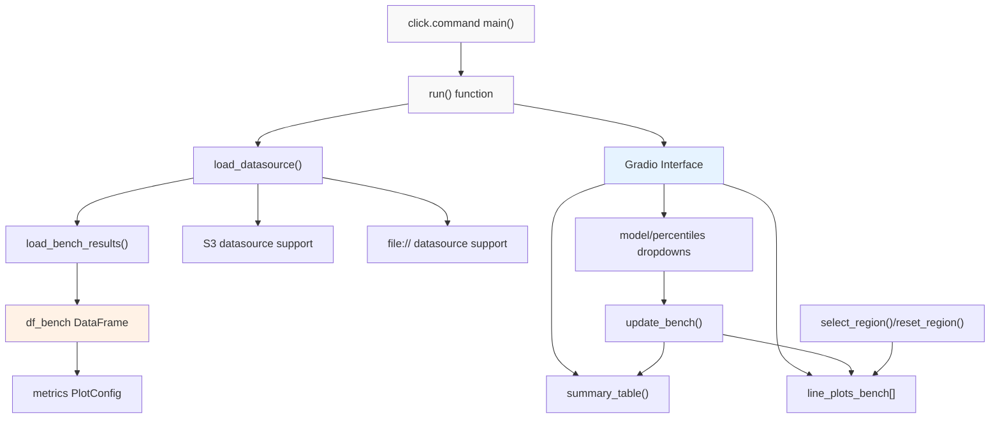
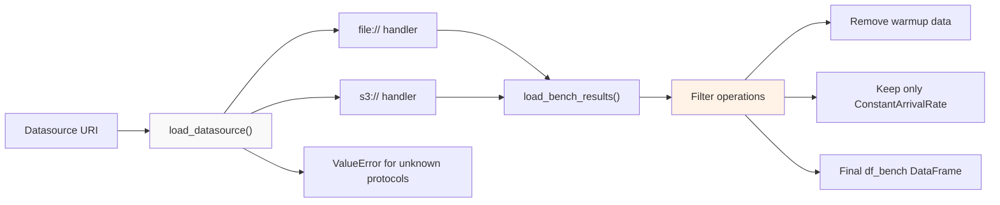
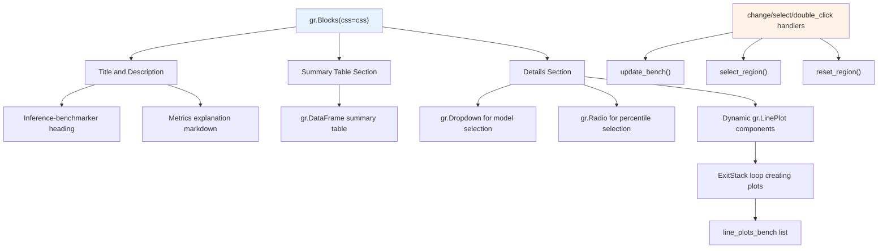
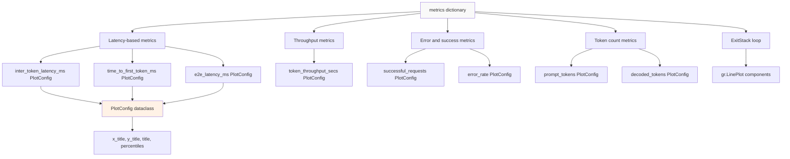
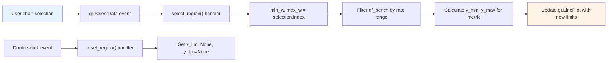
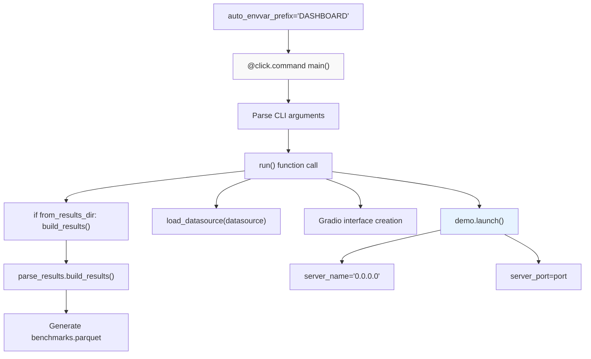

<!-- source: DeepWiki mcp.deepwiki.com · repo huggingface/inference-benchmarker · page 5.1 Interactive Dashboard · fetched 2026-10-26 -->

# Interactive Dashboard

Relevant source files

The following files were used as context for generating this wiki page:

- [extra/dashboard/app.py](extra/dashboard/app.py)

## Purpose and Scope

This page covers the Gradio-based web dashboard that provides interactive visualization and analysis of benchmark results generated by the inference-benchmarker system. The dashboard allows users to explore performance metrics, compare different models and configurations, and analyze benchmark data through an intuitive web interface.

For information about processing raw benchmark results into analysis-ready formats, see [Data Processing Pipeline](#5.2). For details about the core benchmark execution system that generates the data visualized by this dashboard, see [Benchmark Execution System](#3.3).

## Dashboard Architecture

The interactive dashboard is implemented as a standalone Python application using the Gradio framework. It operates independently from the core Rust benchmarking system, consuming processed benchmark results to provide visualization capabilities.

### Core Dashboard Components

Sources: [extra/dashboard/app.py:1-210]()

## Data Loading and Processing

The dashboard supports multiple data sources and processes benchmark results into visualization-ready formats.

### Data Source Configuration

| Data Source Type | Format | Description |
|------------------|---------|-------------|
| `file://` | Parquet file | Local parquet file containing processed benchmark results |
| `s3://` | S3 URI | S3-hosted parquet file for distributed access |
| Results directory | Raw JSON | Directory containing raw benchmark JSON files (processed via `build_results`) |

The `load_datasource()` function handles different source types through a simple protocol-based routing mechanism:

Sources: [extra/dashboard/app.py:112-123](), [extra/dashboard/app.py:85-91]()

## User Interface Components

The dashboard interface is built using Gradio components organized into logical sections for data exploration and visualization.

### Interface Layout Structure

The interface includes interactive controls for:
- **Model Selection**: Dropdown populated from unique model names in the dataset ([extra/dashboard/app.py:166]())
- **Percentile Selection**: Radio buttons for different statistical percentiles ([extra/dashboard/app.py:168]())
- **Regional Selection**: Click-and-drag on charts to zoom into specific data ranges ([extra/dashboard/app.py:93-104]())

Sources: [extra/dashboard/app.py:153-196](), [extra/dashboard/app.py:166-168]()

## Metrics and Visualizations

The dashboard provides comprehensive visualization of key performance metrics through configurable plot components and summary tables.

### Metrics Configuration System

### Core Performance Metrics

| Metric | Purpose | Target Range |
|--------|---------|--------------|
| `inter_token_latency_ms` | Time between output tokens, user-perceived speed | < 150ms (300 words/min reading speed) |
| `time_to_first_token_ms` | Initial response latency for interactive feel | Lower for real-time, flexible for batch |
| `e2e_latency_ms` | Total request processing time | Varies by use case |
| `token_throughput_secs` | System-wide token generation rate | Higher is better |
| `successful_requests` | Completed requests count | Higher is better |
| `error_rate` | Failed request percentage | Lower is better |

Sources: [extra/dashboard/app.py:126-140](), [extra/dashboard/app.py:29-43]()

## Interactive Features

The dashboard provides several interactive capabilities for detailed data exploration beyond static visualization.

### Region Selection and Zooming

The dashboard implements coordinate-based selection allowing users to focus on specific data ranges:

### Dynamic Data Updates

The `update_bench()` function handles real-time updates when users change model or percentile selections:

- **Model Filtering**: Filters `df_bench` DataFrame by selected model ([extra/dashboard/app.py:65]())
- **Percentile Mapping**: Maps percentile selection to appropriate column names ([extra/dashboard/app.py:62-64]())
- **Component Updates**: Returns updated data for all plot components and summary table ([extra/dashboard/app.py:67]())

Sources: [extra/dashboard/app.py:93-110](), [extra/dashboard/app.py:59-67](), [extra/dashboard/app.py:187-195]()

## Launch and Configuration

The dashboard provides flexible configuration options for different deployment scenarios through command-line arguments and environment variable support.

### Configuration Options

| Parameter | Default | Purpose |
|-----------|---------|---------|
| `--from-results-dir` | None | Process raw benchmark JSON files from directory |
| `--datasource` | `file://benchmarks.parquet` | Specify parquet data source (file:// or s3:) |
| `--port` | 7860 | HTTP server port for dashboard access |

### Launch Process

The dashboard supports environment variable configuration with the `DASHBOARD_` prefix, allowing deployment-time configuration without command-line modification.

Sources: [extra/dashboard/app.py:200-209](), [extra/dashboard/app.py:20-21](), [extra/dashboard/app.py:120-123](), [extra/dashboard/app.py:197]()

---

