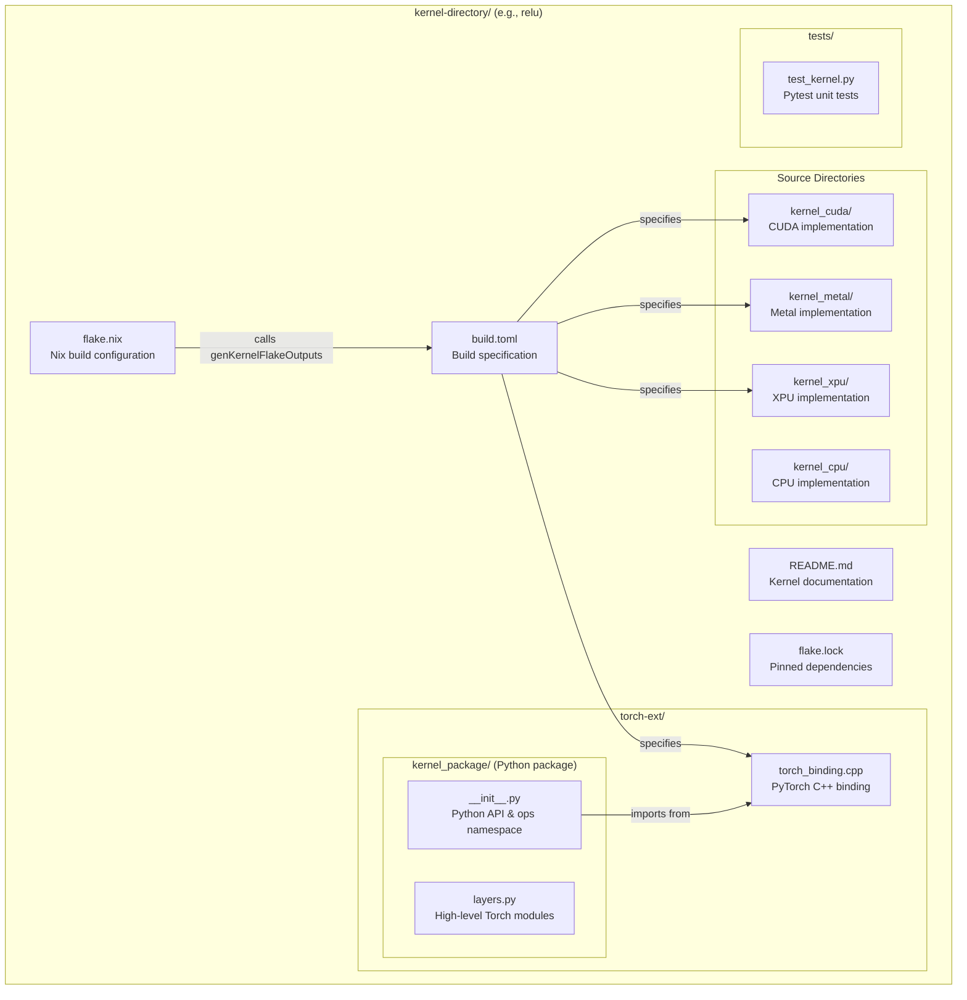
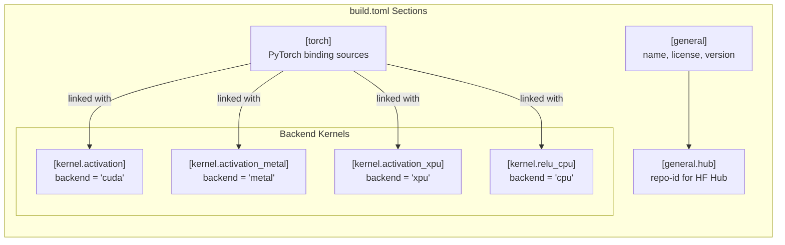

<!-- source: DeepWiki mcp.deepwiki.com · repo huggingface/kernels-community · page 6.2 Adding a New Kernel · fetched 2026-10-26 -->

# Adding a New Kernel

<details>
<summary>Relevant source files</summary>

The following files were used as context for generating this wiki page:

- [CONTRIBUTING.md](CONTRIBUTING.md)
- [relu/build.toml](relu/build.toml)
- [relu/flake.lock](relu/flake.lock)
- [relu/flake.nix](relu/flake.nix)
- [relu/relu_cpu/relu_cpu.cpp](relu/relu_cpu/relu_cpu.cpp)
- [relu/tests/test_relu.py](relu/tests/test_relu.py)
- [relu/torch-ext/relu/__init__.py](relu/torch-ext/relu/__init__.py)
- [relu/torch-ext/relu/layers/__init__.py](relu/torch-ext/relu/layers/__init__.py)
- [relu/torch-ext/torch_binding.cpp](relu/torch-ext/torch_binding.cpp)
- [rmsnorm/build.toml](rmsnorm/build.toml)
- [rmsnorm/flake.lock](rmsnorm/flake.lock)
- [rmsnorm/flake.nix](rmsnorm/flake.nix)
- [rmsnorm/rmsnorm_cpu/rmsnorm_cpu_torch.cpp](rmsnorm/rmsnorm_cpu/rmsnorm_cpu_torch.cpp)
- [rmsnorm/rmsnorm_xpu/RMSNorm.cpp](rmsnorm/rmsnorm_xpu/RMSNorm.cpp)
- [rmsnorm/tests/test_rmsnorm.py](rmsnorm/tests/test_rmsnorm.py)
- [rmsnorm/torch-ext/rmsnorm/__init__.py](rmsnorm/torch-ext/rmsnorm/__init__.py)
- [rmsnorm/torch-ext/rmsnorm/layers.py](rmsnorm/torch-ext/rmsnorm/layers.py)
- [rmsnorm/torch-ext/torch_binding.cpp](rmsnorm/torch-ext/torch_binding.cpp)

</details>


## Purpose and Scope

This document provides a step-by-step technical guide for adding a new kernel to the `kernels-community` repository. It covers the required directory structure, configuration files (`flake.nix`, `build.toml`), source code organization, and PyTorch extension bindings needed to integrate a kernel into the build system.

For information about contribution eligibility criteria and when to contribute to `kernels-community` versus your own Hub space, see [Contribution Guidelines (6.1)](). For testing your kernel locally and understanding the validation process, see [Testing and Validation (6.3)]().

## Required Directory Structure

Each kernel in the repository must follow a standardized directory structure. The kernel-builder system expects specific files to be present for successful compilation and deployment.

### Kernel Directory Layout



**Sources:** [CONTRIBUTING.md:24-31](), [relu/build.toml:1-68](), [relu/flake.nix:1-17]()

### Mandatory Files

| File | Purpose | Required |
|------|---------|----------|
| `README.md` | Documentation with source link, yaml tag, and benchmarks | Yes |
| `flake.nix` | Nix flake configuration calling `genKernelFlakeOutputs` | Yes |
| `build.toml` | Build specification for backends, sources, and flags | Yes |
| `torch-ext/torch_binding.cpp` | PyTorch C++ extension registration via `TORCH_LIBRARY_EXPAND` | Yes |
| `torch-ext/kernel-name/__init__.py` | Python API exposing the `._ops` namespace | Yes |
| `kernel-name_backend/` | Backend-specific source directories | At least one |

**Sources:** [CONTRIBUTING.md:24-31]()

## build.toml Configuration

The `build.toml` file defines how the kernel is compiled for different backends. It specifies source files, dependencies, and backend-specific compilation options like `cxx-flags` or `rocm-archs`.

### Configuration Structure



**Sources:** [relu/build.toml:1-68](), [rmsnorm/build.toml:1-104]()

### Section Definitions

#### [general] and [general.hub]

```toml
[general]
name = "relu"
license = "Apache-2.0"
version = 1
backends = ["cpu", "cuda", "metal", "rocm", "xpu"]

[general.hub]
repo-id = "kernels-community/relu"
```

- `name`: Kernel identifier used for package naming.
- `backends`: List of supported hardware backends.
- `repo-id`: The destination repository on the Hugging Face Hub.

**Sources:** [relu/build.toml:1-15]()

#### [torch] Section

```toml
[torch]
src = [
    "torch-ext/torch_binding.cpp",
    "torch-ext/torch_binding.h",
]
```

Specifies the PyTorch extension binding source files. These files are compiled and linked with all backend kernels to expose them to Python.

**Sources:** [relu/build.toml:17-21]()

#### [kernel.*] Sections

Each implementation variant requires a `[kernel.NAME]` section. You can define multiple variants for the same backend (e.g., optimized for different CPU instruction sets).

**Example: Specialized CPU Kernels (RMSNorm)**
```toml
[kernel.rmsnorm_cpu_avx512]
backend = "cpu"
cxx-flags = ["-mfma", "-mavx512f", "-mavx512bf16", "-mavx512vl"]
depends = ["torch"]
src = ["rmsnorm_cpu/rmsnorm_avx512.cpp"]
```

**Sources:** [rmsnorm/build.toml:87-103]()

## flake.nix and flake.lock

The `flake.nix` file integrates the kernel with the Nix build system through the `kernel-builder` infrastructure.

### Standard Template

```nix
{
  description = "Flake for ReLU kernel";
  inputs = {
    kernel-builder.url = "github:huggingface/kernels";
  };
  outputs = { self, kernel-builder }:
    kernel-builder.lib.genKernelFlakeOutputs {
      inherit self;
      path = ./.;
    };
}
```

**Sources:** [relu/flake.nix:1-17]()

### Platform Filtering
In some cases, you may need to restrict builds to specific architectures. For example, `rmsnorm` filters its `torchVersions` to only build for `x86_64-linux` using a mapping function.

**Sources:** [rmsnorm/flake.nix:12-20]()

## PyTorch Extension Bindings

### torch_binding.cpp Registration

The C++ binding file uses `TORCH_LIBRARY_EXPAND` to register operations. It typically uses preprocessor macros (defined by the build system based on the `backend` in `build.toml`) to dispatch to the correct implementation.

```cpp
#include <torch/library.h>
#include "registration.h"

TORCH_LIBRARY_EXPAND(TORCH_EXTENSION_NAME, ops) {
  ops.def("relu(Tensor! out, Tensor input) -> ()");
#if defined(CPU_KERNEL)
  ops.impl("relu", torch::kCPU, &relu);
#elif defined(CUDA_KERNEL) || defined(ROCM_KERNEL)
  ops.impl("relu", torch::kCUDA, &relu);
#elif defined(XPU_KERNEL)
  ops.impl("relu", torch::kXPU, &relu);
#endif
}

REGISTER_EXTENSION(TORCH_EXTENSION_NAME)
```

**Sources:** [relu/torch-ext/torch_binding.cpp:6-19](), [rmsnorm/torch-ext/torch_binding.cpp:78-86]()

### The __init__.py Ops Namespace Pattern

The Python package inside `torch-ext` must expose the kernel through the `._ops` namespace. This allows the kernel to be called via `ops.kernel_name`.

```python
# torch-ext/relu/__init__.py
from ._ops import ops

def relu(x: torch.Tensor, out: Optional[torch.Tensor] = None) -> torch.Tensor:
    if out is None:
        out = torch.empty_like(x)
    ops.relu(out, x)
    return out
```

**Sources:** [relu/torch-ext/relu/__init__.py:1-14]()

## Testing and Validation

Kernels must include a `tests/` directory with `pytest` scripts. Tests should use device detection logic to run on available hardware (MPS for Mac, XPU for Intel, CUDA for NVIDIA, or CPU).

### Test Implementation Pattern
Tests should compare the custom kernel output against a reference implementation (usually standard PyTorch functions).

```python
@pytest.mark.kernels_ci
def test_relu():
    device = get_test_device() # Logic to detect cuda/mps/xpu/cpu
    x = torch.randn(1024, 1024, device=device)
    torch.testing.assert_close(F.relu(x), relu.relu(x))
```

**Sources:** [relu/tests/test_relu.py:10-21](), [rmsnorm/tests/test_rmsnorm.py:7-22]()

## Summary Checklist for Adding a Kernel

1.  **Directory**: Create `kernel-name/`.
2.  **Metadata**: Add `README.md` and `build.toml`.
3.  **Build**: Add `flake.nix` calling `genKernelFlakeOutputs`.
4.  **Source**: Implement kernel logic in backend-specific folders (e.g., `relu_cuda/`).
5.  **Binding**: Create `torch-ext/torch_binding.cpp` using `TORCH_LIBRARY_EXPAND`.
6.  **Python API**: Implement `torch-ext/kernel-name/__init__.py` using the `ops` namespace.
7.  **Tests**: Add `tests/test_kernel.py` and verify with `kernel-builder`.
8.  **PR**: Submit PR with title `kernel-name: description`.

**Sources:** [CONTRIBUTING.md:22-36]()

---

