# Page: Overview

# Overview

<details>
<summary>Relevant source files</summary>

The following files were used as context for generating this wiki page:

- [.github/workflows/nightly_kernel_check.yml](.github/workflows/nightly_kernel_check.yml)
- [.github/workflows/validate-kernel-pr.py](.github/workflows/validate-kernel-pr.py)
- [.gitignore](.gitignore)
- [CONTRIBUTING.md](CONTRIBUTING.md)
- [README.md](README.md)
- [activation/README.md](activation/README.md)
- [activation/scripts/readme_example.py](activation/scripts/readme_example.py)
- [causal-conv1d/README.md](causal-conv1d/README.md)
- [causal-conv1d/scripts/readme_example.py](causal-conv1d/scripts/readme_example.py)
- [flash-attn3/README.md](flash-attn3/README.md)
- [flash-attn3/scripts/readme_example.py](flash-attn3/scripts/readme_example.py)
- [megablocks/README.md](megablocks/README.md)
- [megablocks/scripts/readme_example.py](megablocks/scripts/readme_example.py)
- [paged-attention/README.md](paged-attention/README.md)
- [paged-attention/scripts/readme_example.py](paged-attention/scripts/readme_example.py)
- [punica-sgmv/README.md](punica-sgmv/README.md)
- [relu/README.md](relu/README.md)
- [relu/relu_cuda/relu.cu](relu/relu_cuda/relu.cu)
- [relu/relu_metal/common.h](relu/relu_metal/common.h)
- [relu/relu_metal/relu.metal](relu/relu_metal/relu.metal)
- [relu/relu_metal/relu.mm](relu/relu_metal/relu.mm)
- [relu/relu_xpu/relu.cpp](relu/relu_xpu/relu.cpp)
- [relu/tests/__init__.py](relu/tests/__init__.py)
- [scripts/report_kernel_failures.py](scripts/report_kernel_failures.py)
- [scripts/run_kernels_checks.py](scripts/run_kernels_checks.py)

</details>


The `kernels-community` repository is a centralized collection of optimized GPU kernels for deep learning operations, maintained by Hugging Face and the community. This repository provides pre-built, high-performance kernel implementations for attention mechanisms, activations, convolutions, and specialized operations used in large language models and other neural network architectures. All kernels are built using a reproducible Nix-based build system and published to the Hugging Face Hub under the [kernels-community](https://huggingface.co/kernels-community) namespace for easy distribution and consumption.

This document provides a high-level introduction to the repository's architecture, kernel ecosystem, and usage patterns. For detailed information on specific components, see:
- **[Repository Architecture](#1.1)**: High-level system design, build infrastructure, and CI/CD pipelines.
- **[Quick Start Guide](#1.2)**: Installation and basic usage examples for common kernels.

## Repository Purpose and Scope

The repository serves two primary functions:

1.  **Kernel Distribution**: Package and distribute high-impact GPU kernels that either (a) are developed by Hugging Face or (b) lack upstream kernel distribution support despite being widely used in the ecosystem [CONTRIBUTING.md:3-9]().
2.  **Build Infrastructure**: Provide a reproducible, multi-backend build system that ensures consistent kernel compilation across CUDA, Metal, XPU, and ROCm platforms [CONTRIBUTING.md:26-27]().

Kernels in this repository are **not** necessarily developed here. Instead, the repository often imports source code from upstream projects, packages them with standardized build configurations, and distributes pre-built binaries through the Hugging Face Hub [CONTRIBUTING.md:5-6]().

**Sources:** [CONTRIBUTING.md:1-20](), [README.md:8-13]()

## Repository Structure

The repository follows a standardized directory structure where each kernel resides in its own top-level directory containing all necessary build and source files [CONTRIBUTING.md:24-31]().

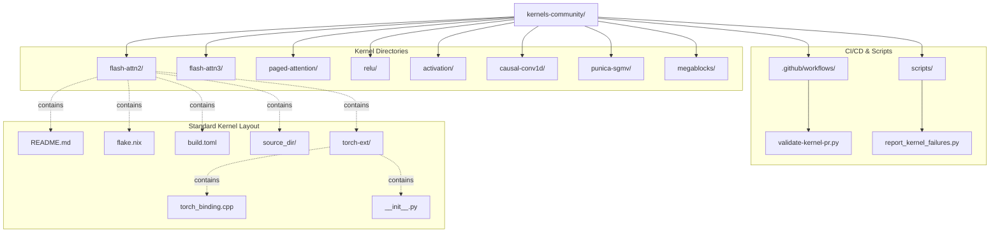

### Key Components per Kernel
*   **`build.toml`**: Specifies backends, dependencies, and source files [CONTRIBUTING.md:27]().
*   **`flake.nix`**: Defines the Nix environment for reproducible builds [CONTRIBUTING.md:26]().
*   **`torch-ext/`**: Contains the Python package structure and `torch_binding.cpp` for PyTorch integration [CONTRIBUTING.md:29-30]().
*   **`__init__.py`**: Exposes the kernel operations through the `._ops` namespace [CONTRIBUTING.md:31]().

**Sources:** [CONTRIBUTING.md:22-34](), [.github/workflows/validate-kernel-pr.py:68-71]()

## Kernel Ecosystem

The repository hosts a variety of optimized kernels. While some are reference implementations (like `relu`), others are state-of-the-art implementations for production LLM serving.

| Kernel | Purpose | Primary Backends | Source Inspiration |
| :--- | :--- | :--- | :--- |
| `flash-attn` | High-speed attention (v2, v3, v4, MLA) | CUDA, XPU | Dao-AILab |
| `paged-attention` | KV cache management for LLM inference | CUDA, Metal | vLLM, mistral.rs |
| `activation` | Fused SiLU/SwiGLU operations | CUDA | vLLM |
| `rmsnorm` | Multi-backend Root Mean Square Layer Norm | CPU, XPU, CUDA | - |
| `causal-conv1d` | Depthwise convolution for Mamba/SSMs | CUDA | Tri Dao |
| `punica-sgmv` | Sparse Grouped Matrix-Vector multiplication | CUDA | Punica, Lorax |
| `relu` | Reference implementation for testing | CUDA, Metal, XPU, ROCm | - |

For a complete catalog and detailed documentation of each, see **[Kernel Implementations](#4)**.

**Sources:** [paged-attention/README.md:9-11](), [activation/README.md:7-11](), [causal-conv1d/README.md:7-9](), [punica-sgmv/README.md:7-10](), [relu/README.md:5-6]()

## User Interaction Model

Users consume these kernels through the `kernels` Python library, which handles downloading and JIT-loading the appropriate binary for the user's hardware.

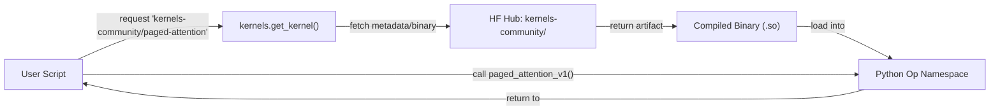

### Basic Usage Pattern
```python
from kernels import get_kernel
import torch

# Load the kernel from the Hub
causal_conv1d = get_kernel("kernels-community/causal-conv1d")

# Use the kernel function directly
out = causal_conv1d.causal_conv1d_fn(input_tensor, weight, bias)
```

**Sources:** [causal-conv1d/README.md:22-37](), [paged-attention/README.md:28-72](), [activation/README.md:28-41]()

## CI/CD and Quality Assurance

The repository maintains high standards through automated validation and nightly checks.

*   **PR Validation**: Every Pull Request is checked by `validate-kernel-pr.py` to ensure correct directory structure and presence of `build.toml`/`flake.nix` [.github/workflows/validate-kernel-pr.py:27-79]().
*   **Nightly Checks**: A scheduled workflow runs `scripts/run_kernels_checks.py` daily to verify all kernels remain functional [.github/workflows/nightly_kernel_check.yml:1-30]().
*   **Failure Reporting**: If a check fails, `scripts/report_kernel_failures.py` sends a notification to a Slack webhook with the specific failing kernels [scripts/report_kernel_failures.py:34-42]().

For details on the automation infrastructure, see **[CI/CD and Testing Infrastructure](#3)**.

**Sources:** [.github/workflows/nightly_kernel_check.yml:1-30](), [scripts/run_kernels_checks.py:96-116](), [scripts/report_kernel_failures.py:14-22]()

## Next Steps

*   To understand how kernels are built and how to configure `build.toml`, visit **[Repository Architecture](#1.1)**.
*   To start using kernels in your project immediately, see the **[Quick Start Guide](#1.2)**.
*   To contribute a new kernel or update an existing one, read the **[Contributing to Kernels Community](#6)**.

---

# Page: Repository Architecture

# Repository Architecture

<details>
<summary>Relevant source files</summary>

The following files were used as context for generating this wiki page:

- [.github/scripts/windows/install-oneapi.ps1](.github/scripts/windows/install-oneapi.ps1)
- [.github/workflows/build-pr-mac.yaml](.github/workflows/build-pr-mac.yaml)
- [.github/workflows/build-pr-windows.yaml](.github/workflows/build-pr-windows.yaml)
- [.github/workflows/build-pr.yaml](.github/workflows/build-pr.yaml)
- [.github/workflows/build-release-mac.yaml](.github/workflows/build-release-mac.yaml)
- [.github/workflows/build-release-windows.yaml](.github/workflows/build-release-windows.yaml)
- [.github/workflows/build-release.yaml](.github/workflows/build-release.yaml)
- [.github/workflows/nightly_kernel_check.yml](.github/workflows/nightly_kernel_check.yml)
- [.github/workflows/nix_fmt.yaml](.github/workflows/nix_fmt.yaml)
- [.github/workflows/validate-kernel-pr.py](.github/workflows/validate-kernel-pr.py)
- [.gitignore](.gitignore)
- [README.md](README.md)
- [relu/build.toml](relu/build.toml)
- [relu/flake.lock](relu/flake.lock)
- [relu/flake.nix](relu/flake.nix)
- [relu/relu_cpu/relu_cpu.cpp](relu/relu_cpu/relu_cpu.cpp)
- [relu/tests/test_relu.py](relu/tests/test_relu.py)
- [relu/torch-ext/relu/__init__.py](relu/torch-ext/relu/__init__.py)
- [relu/torch-ext/relu/layers/__init__.py](relu/torch-ext/relu/layers/__init__.py)
- [relu/torch-ext/torch_binding.cpp](relu/torch-ext/torch_binding.cpp)
- [scripts/report_kernel_failures.py](scripts/report_kernel_failures.py)
- [scripts/run_kernels_checks.py](scripts/run_kernels_checks.py)

</details>


This document describes the high-level architecture of the `kernels-community` repository, including its directory organization, dependency management, build system integration, and CI/CD pipeline. This page provides an overview of how the major components fit together.

## Repository Structure

The kernels-community repository follows a flat directory structure where each kernel occupies its own top-level directory. Every kernel is a self-contained unit with standardized files that enable automated building, testing, and deployment.

### Standard Kernel Directory Layout

Each kernel directory must contain a set of configuration files that define its build process and dependencies. The `relu` kernel serves as the reference implementation for this structure [relu/build.toml:1-68]().

| File | Purpose |
|------|---------|
| `flake.nix` | Nix flake definition that declares the `kernel-builder` dependency [relu/flake.nix:1-17](). |
| `flake.lock` | Locked versions of all Nix dependencies for reproducible builds [relu/flake.lock:1-117](). |
| `build.toml` | Build configuration specifying backends, dependencies, and source files [relu/build.toml:1-68](). |
| `torch-ext/` | Python binding code that exposes kernels to PyTorch [relu/torch-ext/relu/__init__.py:1-2](). |

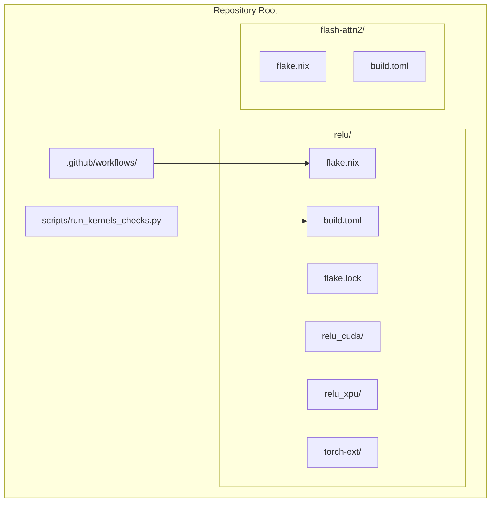
**Kernel Directory Structure**

The flat structure simplifies CI/CD automation because the PR title format `kernel-name: description` directly maps to a directory path. The validation script [.github/workflows/validate-kernel-pr.py:46-52]() extracts the kernel name from the PR title and verifies the corresponding directory exists.

Sources: [relu/build.toml:1-68](), [relu/flake.nix:1-17](), [.github/workflows/validate-kernel-pr.py:40-52]()

## Dependency Management Architecture

The repository uses a **hub-and-spoke dependency architecture** with `kernel-builder` as the central orchestrator. All kernels declare a dependency on `kernel-builder` in their `flake.nix` [relu/flake.nix:4-6]().

### Version Locking Through flake.lock

Each `flake.lock` file contains cryptographically locked versions of dependencies. The `kernel-builder` input is locked to a specific Git revision to ensure build reproducibility [relu/flake.lock:43-50]().

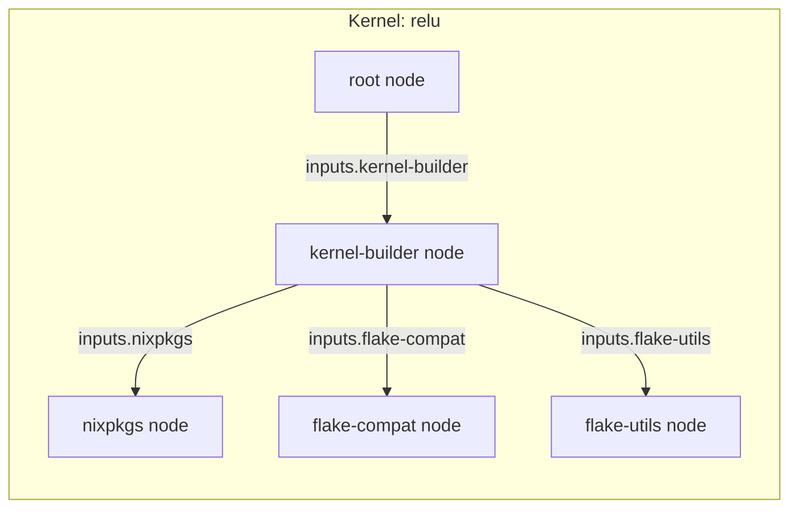
**flake.lock Dependency Resolution**

Each locked node includes:
- `narHash`: SHA256 hash for integrity verification [relu/flake.lock:45-45]().
- `rev`: Git commit hash of the dependency [relu/flake.lock:48-48]().
- `lastModified`: Unix timestamp of the commit [relu/flake.lock:44-44]().

Sources: [relu/flake.nix:1-17](), [relu/flake.lock:1-117]()

## Build System and Backend Support

The build system is driven by `build.toml`, which defines how the kernel should be compiled across different hardware backends.

### Backend Support Matrix

The repository supports multiple backends, with the `relu` kernel providing a reference for all of them [relu/build.toml:5-11]().

| Backend | Compiler/Toolchain | Source Extensions | Supported in `relu` |
|---------|-------------------|-------------------|-------------------|
| **CUDA** | `nvcc` | `.cu` | Yes [relu/build.toml:39-44]() |
| **Metal** | `xcrun metal` | `.mm`, `.metal` | Yes [relu/build.toml:30-37]() |
| **XPU** | `icpx` (SYCL) | `.cpp` | Yes [relu/build.toml:23-28]() |
| **ROCm** | `hipcc` | `.cu` | Yes [relu/build.toml:46-62]() |
| **CPU** | `gcc`/`clang` | `.cpp` | Yes [relu/build.toml:64-68]() |

### Windows-Specific Support
Windows builds are handled via GitHub Actions workflows. Certain kernels or backends are explicitly blocked on Windows if they are incompatible. For example, `megablocks` and `flash-attn2` are blocked for Windows XPU builds [.github/workflows/build-pr-windows.yaml:78-87]().

Sources: [relu/build.toml:1-68](), [.github/workflows/build-pr-windows.yaml:78-109]()

## CI/CD Pipeline

The repository implements a multi-stage validation and deployment pipeline.

### PR Validation and Building
When a PR is opened, the system:
1. **Validates the PR title**: Extracts the kernel name using `validate-kernel-pr.py` [.github/workflows/build-pr.yaml:40-50]().
2. **Checks `build.toml`**: Ensures mandatory fields like `repo-id` are present [.github/workflows/build-pr.yaml:51-58]().
3. **Builds the Kernel**: Runs `nix build -L .#ci` on Linux/macOS [.github/workflows/build-pr.yaml:59-63]() or `cargo build` for the `kernel-builder` followed by the kernel build on Windows [.github/workflows/build-pr-windows.yaml:164-171]().
4. **GPU Testing**: Imports the built closure and runs `ci-test` on a GPU-enabled runner [.github/workflows/build-pr.yaml:112-118]().

### Nightly Validation
A scheduled "Kernels Check" runs daily [.github/workflows/nightly_kernel_check.yml:3-5](). This workflow uses `scripts/report_kernel_failures.py` to:
1. Discover all directories containing a `build.toml` [scripts/run_kernels_checks.py:46-63]().
2. Run `kernels check kernels-community/<kernel>` for each [scripts/run_kernels_checks.py:96-116]().
3. Report failures to Slack and clear the local Hub cache [scripts/run_kernels_checks.py:113-114]().

### Release and Publication
Upon merging a PR, the kernel is published to the Hugging Face Hub.
- **Main Branch**: Kernels with `version = 1` in `build.toml` are uploaded to the `main` branch of their respective Hub repositories [.github/workflows/build-release.yaml:65-72]().
- **Build-and-Upload**: The `nix run .#build-and-upload` command automates the versioned release process [.github/workflows/build-release.yaml:50-56]().

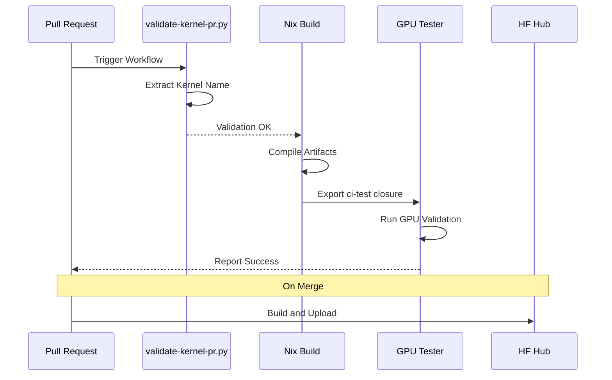
**CI/CD Interaction Flow**

Sources: [.github/workflows/build-pr.yaml:1-119](), [.github/workflows/build-release.yaml:1-73](), [scripts/run_kernels_checks.py:1-156](), [.github/workflows/nightly_kernel_check.yml:1-30]()

---

# Page: Quick Start Guide

# Quick Start Guide

<details>
<summary>Relevant source files</summary>

The following files were used as context for generating this wiki page:

- [relu/build.toml](relu/build.toml)
- [relu/flake.lock](relu/flake.lock)
- [relu/flake.nix](relu/flake.nix)
- [relu/relu_cpu/relu_cpu.cpp](relu/relu_cpu/relu_cpu.cpp)
- [relu/tests/test_relu.py](relu/tests/test_relu.py)
- [relu/torch-ext/relu/__init__.py](relu/torch-ext/relu/__init__.py)
- [relu/torch-ext/relu/layers/__init__.py](relu/torch-ext/relu/layers/__init__.py)
- [relu/torch-ext/torch_binding.cpp](relu/torch-ext/torch_binding.cpp)
- [rmsnorm/build.toml](rmsnorm/build.toml)
- [rmsnorm/flake.lock](rmsnorm/flake.lock)
- [rmsnorm/flake.nix](rmsnorm/flake.nix)
- [rmsnorm/rmsnorm_cpu/rmsnorm_cpu_torch.cpp](rmsnorm/rmsnorm_cpu/rmsnorm_cpu_torch.cpp)
- [rmsnorm/rmsnorm_xpu/RMSNorm.cpp](rmsnorm/rmsnorm_xpu/RMSNorm.cpp)
- [rmsnorm/tests/test_rmsnorm.py](rmsnorm/tests/test_rmsnorm.py)
- [rmsnorm/torch-ext/rmsnorm/__init__.py](rmsnorm/torch-ext/rmsnorm/__init__.py)
- [rmsnorm/torch-ext/rmsnorm/layers.py](rmsnorm/torch-ext/rmsnorm/layers.py)
- [rmsnorm/torch-ext/torch_binding.cpp](rmsnorm/torch-ext/torch_binding.cpp)
- [rotary/build.toml](rotary/build.toml)
- [rotary/flake.lock](rotary/flake.lock)
- [rotary/flake.nix](rotary/flake.nix)
- [rotary/rotary-xpu/rotary_xpu.cpp](rotary/rotary-xpu/rotary_xpu.cpp)
- [rotary/rotary-xpu/rotary_xpu.hpp](rotary/rotary-xpu/rotary_xpu.hpp)
- [rotary/rotary/rotary_cuda.cu](rotary/rotary/rotary_cuda.cu)
- [rotary/tests/__init__.py](rotary/tests/__init__.py)
- [rotary/tests/test_rotary.py](rotary/tests/test_rotary.py)
- [rotary/tests/utils.py](rotary/tests/utils.py)
- [rotary/torch-ext/rotary/__init__.py](rotary/torch-ext/rotary/__init__.py)

</details>


This guide demonstrates how to install and use kernels from the `kernels-community` repository. It covers the basic workflow of obtaining pre-compiled kernels via the Hugging Face Hub and invoking their functions in PyTorch applications.

## Installation

The `kernels-community` repository provides pre-compiled kernels through the Hugging Face Hub. To access them, install the `kernels` Python package:

```bash
pip install kernels
```

The `kernels` package provides the `get_kernel()` function, which downloads and loads compiled kernel extensions on demand.

## Basic Usage Pattern

All kernels follow a consistent three-step pattern: import the `get_kernel()` function, load the desired kernel from the Hub, and invoke kernel functions. The underlying system uses **Nix Flakes** to ensure reproducible builds across different environments [relu/flake.nix:1-17](), [rmsnorm/flake.nix:1-21]().

### System Architecture to Code Mapping

The following diagram maps high-level usage concepts to the specific code entities and file structures found in the repository.

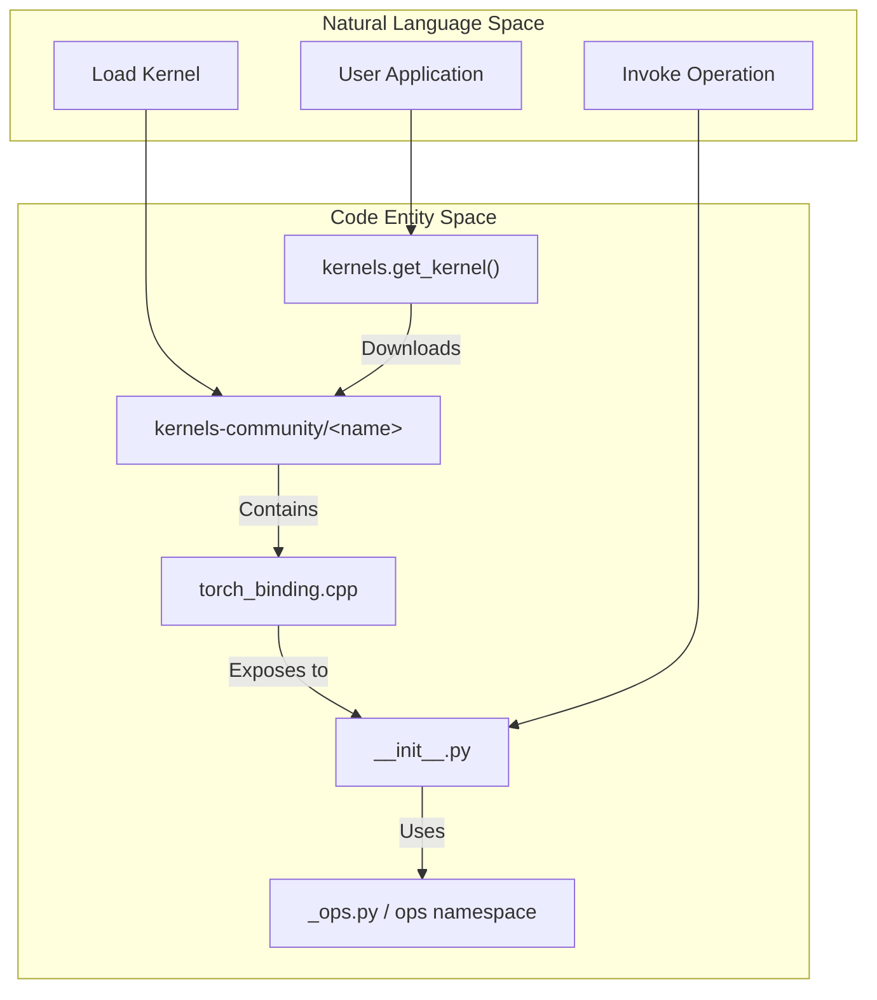
**Diagram: Mapping Usage to Code Entities**

Sources: [relu/build.toml:14-15](), [rmsnorm/build.toml:11-12](), [rotary/torch-ext/rotary/__init__.py:1-16](), [relu/torch-ext/torch_binding.cpp:1-20]()

### Core Components

| Component | Description | Code Entity / File |
|-----------|-------------|-------------|
| **Entry Point** | Function to fetch kernels | `from kernels import get_kernel` |
| **Hub Identifier** | Kernel location on HF Hub | `repo-id` in `build.toml` [relu/build.toml:15]() |
| **Binding** | C++/CUDA to Python bridge | `torch-ext/torch_binding.cpp` [rmsnorm/build.toml:15]() |
| **Python API** | User-facing function calls | `torch-ext/<kernel>/__init__.py` [rotary/torch-ext/rotary/__init__.py:7-15]() |

## Common Kernel Examples

The repository supports multiple backends including **CUDA**, **CPU (AVX2/AVX512)**, **XPU (Intel)**, **Metal (Apple Silicon)**, and **ROCm (AMD)** [relu/build.toml:5-11](), [rmsnorm/build.toml:5-8]().

### 1. ReLU (Multi-Backend)
The ReLU kernel serves as a reference implementation for multi-backend support.

```python
import torch
from kernels import get_kernel

# Load the ReLU kernel
relu_kernel = get_kernel("kernels-community/relu")

# Create input on any supported device (e.g., CUDA, XPU, MPS, or CPU)
x = torch.randn(1024, 1024, device="cuda")
output = relu_kernel.relu(x)
```
Sources: [relu/tests/test_relu.py:11-21](), [relu/build.toml:5-11]()

### 2. RMSNorm (Performance Optimized)
The RMSNorm implementation includes specialized paths for Intel CPUs (AVX512) and XPUs.

```python
from kernels import get_kernel
import torch

rmsnorm = get_kernel("kernels-community/rmsnorm")

# RMSNorm often uses a weight (gamma) parameter
hidden_size = 1024
x = torch.randn(16, hidden_size, device="cpu", dtype=torch.bfloat16)
weight = torch.ones(hidden_size, device="cpu", dtype=torch.bfloat16)

# The kernel is typically wrapped in a Layer class
from rmsnorm.layers import RMSNorm
layer = RMSNorm()
layer.weight = torch.nn.Parameter(weight)
output = layer(x)
```
Sources: [rmsnorm/tests/test_rmsnorm.py:7-16](), [rmsnorm/build.toml:60-103]()

### 3. Rotary Positional Embeddings (RoPE)
The rotary kernel is used to apply positional information to Query and Key tensors in Transformers.

```python
from kernels import get_kernel
import torch

rotary = get_kernel("kernels-community/rotary")

# q, k: (batch, seq_len, n_heads, head_dim)
# cos, sin: (seq_len, head_dim // 2)
q_rot, k_rot = rotary.apply_rotary_transformers(q, k, cos, sin)
```
Sources: [rotary/torch-ext/rotary/__init__.py:19-49](), [rotary/build.toml:1-8]()

## Data Flow and Dispatch

When a user calls a kernel function, the request flows through several layers of the system.

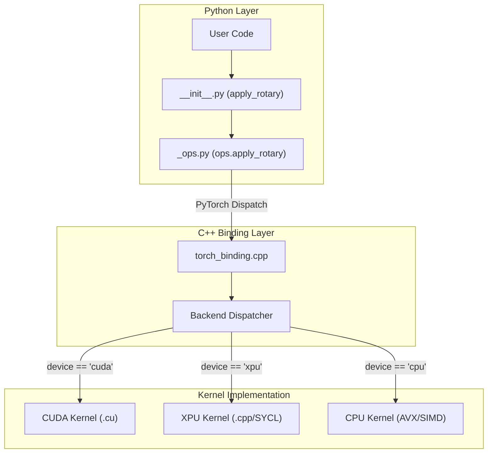
**Diagram: Data Flow from Python to Hardware Kernels**

Sources: [rotary/torch-ext/rotary/__init__.py:1-16](), [relu/build.toml:23-68](), [rmsnorm/build.toml:17-103]()

## Summary of Available Backends

The `build.toml` file in each kernel directory defines the supported hardware and source files.

| Kernel | Supported Backends | Key Implementation Files |
|--------|--------------------|--------------------------|
| **relu** | CPU, CUDA, Metal, ROCm, XPU | `relu_cuda/relu.cu`, `relu_metal/relu.mm`, `relu_xpu/relu.cpp` [relu/build.toml:23-68]() |
| **rmsnorm** | CPU (AVX2/512), XPU | `rmsnorm_cpu/rmsnorm_avx512.cpp`, `rmsnorm_xpu/RMSNorm.cpp` [rmsnorm/build.toml:17-103]() |
| **rotary** | CUDA, XPU | `rotary/rotary_cuda.cu`, `rotary-xpu/rotary_xpu.cpp` [rotary/build.toml:17-29]() |

## Next Steps

- **Development**: To add a new kernel, see [Adding a New Kernel](6.2).
- **Architecture**: To understand how Nix manages these dependencies, see [Repository Architecture](1.1).
- **Testing**: To run validation suites, use `pytest` as seen in [relu/tests/test_relu.py]().

Sources: [relu/build.toml:1-68](), [rmsnorm/build.toml:1-104](), [rotary/build.toml:1-29](), [relu/flake.nix:1-17](), [rmsnorm/flake.nix:1-21](), [rotary/torch-ext/rotary/__init__.py:1-53]()

---

# Page: Build System

# Build System

<details>
<summary>Relevant source files</summary>

The following files were used as context for generating this wiki page:

- [flash-attn2/build.toml](flash-attn2/build.toml)
- [flash-attn2/flake.lock](flash-attn2/flake.lock)
- [flash-attn2/flake.nix](flash-attn2/flake.nix)
- [flash-attn2/tests/conftest.py](flash-attn2/tests/conftest.py)
- [megablocks/build.toml](megablocks/build.toml)
- [megablocks/flake.lock](megablocks/flake.lock)
- [megablocks/flake.nix](megablocks/flake.nix)
- [relu/build.toml](relu/build.toml)
- [relu/flake.lock](relu/flake.lock)
- [relu/flake.nix](relu/flake.nix)
- [relu/relu_cpu/relu_cpu.cpp](relu/relu_cpu/relu_cpu.cpp)
- [relu/tests/test_relu.py](relu/tests/test_relu.py)
- [relu/torch-ext/relu/__init__.py](relu/torch-ext/relu/__init__.py)
- [relu/torch-ext/relu/layers/__init__.py](relu/torch-ext/relu/layers/__init__.py)
- [relu/torch-ext/torch_binding.cpp](relu/torch-ext/torch_binding.cpp)

</details>


## Purpose and Scope

The Build System provides reproducible, multi-backend kernel compilation for all kernels in the `kernels-community` repository. This page describes the overall build architecture, the role of Nix Flakes in ensuring reproducibility, and how the various build components interact. For detailed information on specific aspects:

- Dependency version locking and flake management: see [Nix Flakes and Dependency Management](#2.1)
- Kernel-specific build configuration: see [Build Configuration (build.toml)](#2.2)
- Compilation orchestration and backend handling: see [Kernel Builder System](#2.3)

The build system is designed to compile kernels for multiple backends (CUDA, Metal, XPU, ROCm) with guaranteed reproducibility across machines and over time through cryptographic hashing and exact version pinning.

## Build System Architecture

The build infrastructure follows a three-layer architecture where individual kernel projects depend on a central orchestrator, which in turn coordinates with the Nix package ecosystem.

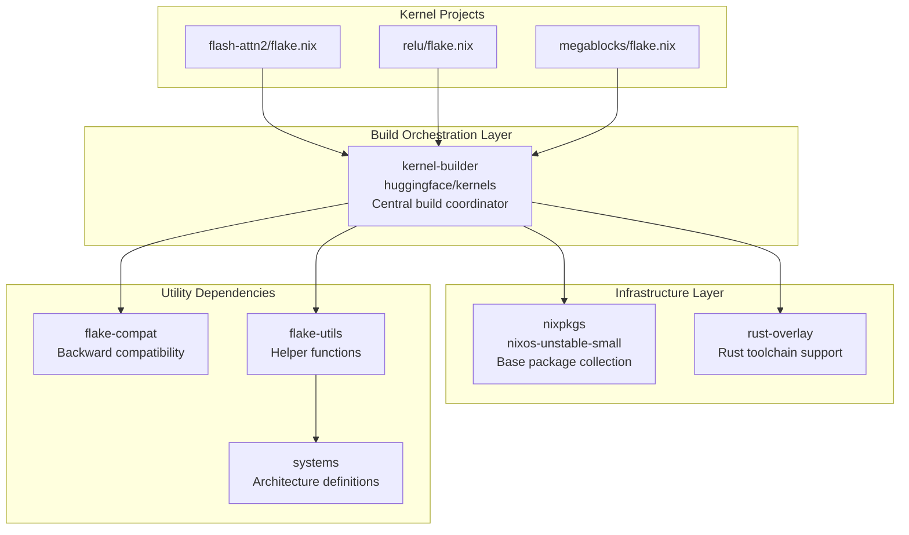

**Sources:** [flash-attn2/flake.nix:4-6](), [relu/flake.nix:4-6](), [megablocks/flake.nix:4-6](), [relu/flake.lock:36-56]()

## Dependency Lock Structure

Each kernel maintains a `flake.lock` file that pins exact versions of all dependencies using cryptographic hashes. The lock files create a dependency chain that ensures bit-for-bit reproducible builds.

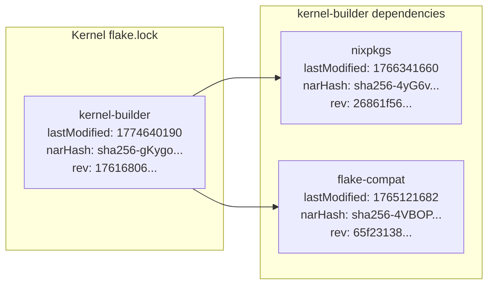

The lock structure contains critical information for each dependency:
- **lastModified**: Unix timestamp of the last modification [relu/flake.lock:44]()
- **narHash**: SHA-256 hash of the Nix Archive for content verification [relu/flake.lock:45]()
- **rev**: Exact Git commit SHA ensuring version immutability [relu/flake.lock:48]()

**Sources:** [relu/flake.lock:1-117](), [flash-attn2/flake.lock:1-117](), [megablocks/flake.lock:1-117]()

## Version Management and Filtering

The build system utilizes `genKernelFlakeOutputs` from the `kernel-builder` library to generate standard flake outputs. Kernels can provide a `torchVersions` function to filter which PyTorch and hardware combinations are supported.

| Kernel | kernel-builder rev | Backend Constraints |
|--------|-------------------|---------------------|
| flash-attn2 | `ba07ad3a60` | XPU requires Torch >= 2.9; CPU only on x86_64-linux [flash-attn2/flake.nix:25-34]() |
| megablocks | `ba07ad3a60` | CPU only on x86_64-linux [megablocks/flake.nix:27-33]() |
| relu | `17616806ff` | Standard multi-backend support [relu/flake.nix:13-16]() |

**Sources:** [flash-attn2/flake.nix:13-35](), [megablocks/flake.nix:13-34](), [relu/flake.nix:13-16]()

## Build Process Flow

The build process follows a multi-stage pipeline from developer source code to deployable kernel artifacts:

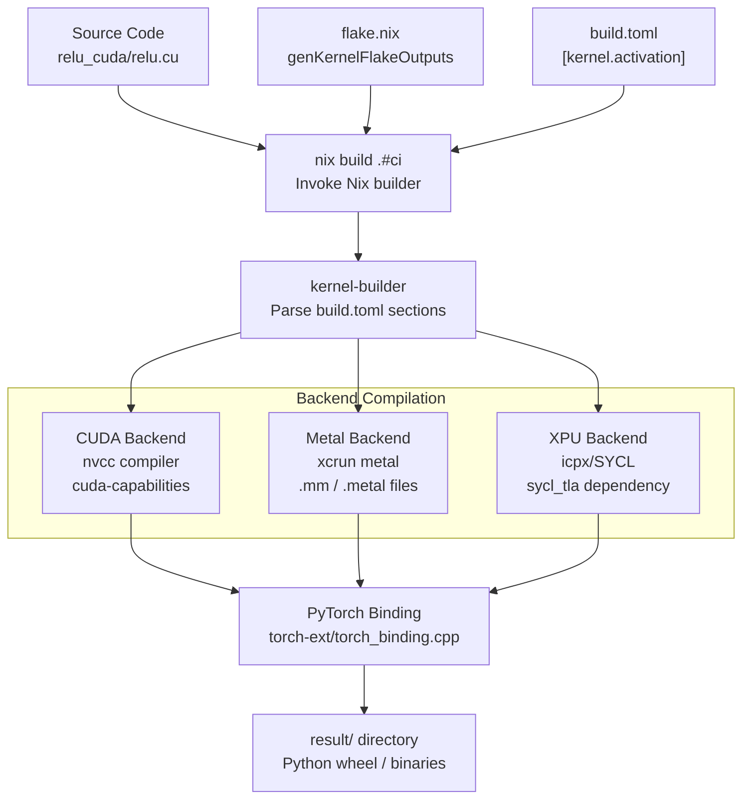

The build invocation triggers the following sequence:

1. **Dependency Resolution**: Nix reads `flake.lock` to fetch exact dependency versions.
2. **Build Configuration**: `kernel-builder` parses `build.toml` to determine enabled backends (e.g., `cpu`, `cuda`, `metal`, `rocm`, `xpu`) [relu/build.toml:5-11]().
3. **Backend Compilation**: Parallel compilation for each enabled backend using specified flags like `cxx-flags` [flash-attn2/build.toml:23-33]() or `cuda-capabilities` [flash-attn2/build.toml:63-68]().
4. **PyTorch Integration**: Source files in the `[torch]` section are compiled to create Python extension module bindings [relu/build.toml:17-21]().
5. **Artifact Generation**: Compiled binaries are placed in the `result/` directory.

**Sources:** [relu/build.toml:1-68](), [flash-attn2/build.toml:1-166](), [megablocks/build.toml:1-131]()

## Reproducibility Guarantees

### Content-Addressable Storage
Every dependency is identified by its SHA-256 hash (`narHash` in lock files). The Nix store path contains this hash, ensuring that if content changes, the hash changes, preventing undetected modifications [relu/flake.lock:45]().

### Hermetic Build Environment
Nix builds execute in isolated environments. All build inputs must be explicitly declared in the `flake.nix` or `build.toml`. For example, `megablocks` explicitly lists `tqdm` and `py-cpuinfo` for its check phase [megablocks/flake.nix:18-21]().

### Time-Invariant Builds
The `rev` fields in lock files ensure that running `nix build` today produces identical results to running it months later [relu/flake.lock:48]().

## Build System Components

### kernel-builder
The `kernel-builder` component (hosted at `huggingface/kernels`) serves as the central orchestrator. It provides:
- **Build Configuration Parsing**: Reads `build.toml` to determine backend targets.
- **Compiler Orchestration**: Invokes appropriate compilers (nvcc, metal, icpx) based on configuration.
- **PyTorch Extension Building**: Manages integration for Python bindings.

**Sources:** [relu/flake.lock:36-56](), [flash-attn2/flake.lock:36-56]()

### flake-utils
The `flake-utils` library provides helper functions for common flake patterns, particularly for iterating over supported systems [relu/flake.lock:18-35]().

### flake-compat
The `flake-compat` dependency enables compatibility with legacy Nix installations that do not support the experimental flakes feature [relu/flake.lock:3-17]().

## Testing and Validation

The build system integrates with `pytest` for validation. A `device` fixture is commonly used in `conftest.py` to automatically detect and select the available hardware backend (CUDA, XPU, or CPU) for tests [flash-attn2/tests/conftest.py:7-14](). Tests are marked with `@pytest.mark.kernels_ci` to be picked up by the CI pipeline [relu/tests/test_relu.py:10-11]().

**Sources:** [flash-attn2/tests/conftest.py:1-25](), [relu/tests/test_relu.py:1-36]()

---

# Page: Nix Flakes and Dependency Management

# Nix Flakes and Dependency Management

<details>
<summary>Relevant source files</summary>

The following files were used as context for generating this wiki page:

- [flake.lock](flake.lock)
- [flake.nix](flake.nix)
- [flash-attn3/build.toml](flash-attn3/build.toml)
- [flash-attn3/flake.lock](flash-attn3/flake.lock)
- [flash-attn3/flake.nix](flash-attn3/flake.nix)
- [flash-mla/build.toml](flash-mla/build.toml)
- [mamba-ssm/build.toml](mamba-ssm/build.toml)
- [mamba-ssm/flake.lock](mamba-ssm/flake.lock)
- [mamba-ssm/flake.nix](mamba-ssm/flake.nix)
- [mamba-ssm/torch-ext/mamba_ssm/__init__.py](mamba-ssm/torch-ext/mamba_ssm/__init__.py)
- [mamba-ssm/torch-ext/mamba_ssm/models/__init__.py](mamba-ssm/torch-ext/mamba_ssm/models/__init__.py)
- [mamba-ssm/torch-ext/mamba_ssm/modules/__init__.py](mamba-ssm/torch-ext/mamba_ssm/modules/__init__.py)
- [mamba-ssm/torch-ext/mamba_ssm/ops/__init__.py](mamba-ssm/torch-ext/mamba_ssm/ops/__init__.py)
- [mamba-ssm/torch-ext/mamba_ssm/ops/triton/__init__.py](mamba-ssm/torch-ext/mamba_ssm/ops/triton/__init__.py)
- [mamba-ssm/torch-ext/mamba_ssm/utils/generation.py](mamba-ssm/torch-ext/mamba_ssm/utils/generation.py)
- [megablocks/build.toml](megablocks/build.toml)
- [megablocks/flake.lock](megablocks/flake.lock)
- [megablocks/flake.nix](megablocks/flake.nix)
- [relu/build.toml](relu/build.toml)
- [relu/flake.lock](relu/flake.lock)
- [relu/flake.nix](relu/flake.nix)
- [relu/relu_cpu/relu_cpu.cpp](relu/relu_cpu/relu_cpu.cpp)
- [relu/tests/test_relu.py](relu/tests/test_relu.py)
- [relu/torch-ext/relu/__init__.py](relu/torch-ext/relu/__init__.py)
- [relu/torch-ext/relu/layers/__init__.py](relu/torch-ext/relu/layers/__init__.py)
- [relu/torch-ext/torch_binding.cpp](relu/torch-ext/torch_binding.cpp)

</details>


## Purpose and Scope

This document explains the Nix flake-based dependency management system used throughout the `kernels-community` repository. It covers the structure of `flake.lock` files, the role of the `kernel-builder` dependency, and the functional implementation of `genKernelFlakeOutputs`. It also details how platform-specific builds are restricted using `torchVersions` filtering.

For information about the build configuration files, see [Build Configuration (build.toml)](2.2). For details on the orchestration of compilation, see [Kernel Builder System](2.3).

## Overview of Nix Flakes

Each kernel project in the repository (e.g., `relu/`, `flash-attn3/`, `megablocks/`) contains a `flake.nix` file that declares its inputs and a corresponding `flake.lock` file that pins those inputs to specific cryptographic hashes and Git revisions. This ensures that every build is hermetic and reproducible across different environments.

The flake system provides:
- **Reproducible Environments**: Every developer and CI runner uses the exact same toolchain versions.
- **Transitive Locking**: Dependencies of dependencies (like `nixpkgs` or `rust-overlay`) are locked.
- **Unified Interface**: All kernels expose a standard set of outputs via the `kernel-builder` library.

## Flake Structure and Inputs

All kernels follow a consistent pattern where the primary input is the `kernel-builder` library hosted at `github:huggingface/kernels`.

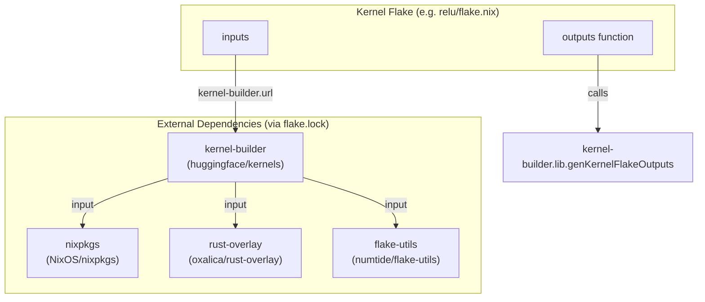
Sources: [relu/flake.nix:4-16](), [megablocks/flake.nix:4-13](), [mamba-ssm/flake.lock:36-56]()

### The flake.lock System
The `flake.lock` file is a JSON manifest that records the exact state of the dependency graph. Each node in the graph specifies a `narHash` (content hash) and a `rev` (Git commit).

| Field | Description | Example (from relu) |
|-------|-------------|---------------------|
| `rev` | Git commit hash | `17616806ff345bca12872c75f3b5b6500fa78328` |
| `narHash` | Nix Archive Hash | `sha256-gKygoJRyuk8WxQQByZl8RoDwAMdaWkH4E0vWFubseZo=` |
| `lastModified` | Unix timestamp | `1774640190` |

Sources: [relu/flake.lock:43-50](), [megablocks/flake.lock:43-50]()

## genKernelFlakeOutputs

The `outputs` section of every kernel flake invokes `kernel-builder.lib.genKernelFlakeOutputs`. This function is the core of the kernel build system, transforming a kernel's source code and `build.toml` into a set of Nix packages, development shells, and apps.

### Configuration Parameters
The function accepts several key arguments to customize the build:

1.  **`path`**: The root directory of the kernel (usually `./.`). [relu/flake.nix:15-15]()
2.  **`pythonCheckInputs`**: A function taking `pkgs` and returning a list of Python packages required for testing. [megablocks/flake.nix:17-23]()
3.  **`doGetKernelCheck`**: A boolean (default `true`) that determines if the `kernels check` validation should run during the build. [mamba-ssm/flake.nix:19-19]()
4.  **`torchVersions`**: A filter function to restrict which PyTorch versions and hardware platforms are built. [megablocks/flake.nix:25-33]()

### Dependency Flow Diagram

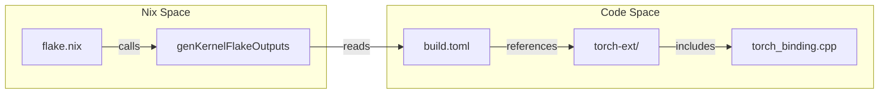
Sources: [relu/flake.nix:13-16](), [relu/build.toml:17-21](), [mamba-ssm/build.toml:11-15]()

## Dependency Versioning and Variance

While most kernels share a common `kernel-builder` baseline, they are updated independently. This leads to slight variances in the locked revisions across the repository.

| Kernel | kernel-builder Revision | Last Modified (Unix) |
|--------|------------------------|-----------------------|
| `relu` | `17616806...` | `1774640190` |
| `megablocks` | `ba07ad3a...` | `1774628159` |
| `mamba-ssm` | `f3be105c...` | `1774518955` |
| `flash-attn3` | `826d5360...` | `1774453774` |

Sources: [relu/flake.lock:48-48](), [megablocks/flake.lock:48-48](), [mamba-ssm/flake.lock:48-48](), [flash-attn3/flake.lock:48-48]()

## Platform Filtering with torchVersions

The `torchVersions` argument in `genKernelFlakeOutputs` allows kernels to restrict their build matrix. This is particularly important for kernels with specific hardware requirements or those that only support a subset of PyTorch versions.

### Example: CPU Support Filtering
In `megablocks`, the `torchVersions` function is used to ensure that CPU-only builds are only attempted on `x86_64-linux` systems, as other architectures may lack the necessary SIMD instructions (like AVX-512).

```nix
torchVersions =
  let
    cpuSupported = version: system: !(version ? "cpu") || system == "x86_64-linux";
  in
  allVersions:
  builtins.map (
    version: version // { systems = builtins.filter (cpuSupported version) version.systems; }
  ) allVersions;
```
Sources: [megablocks/flake.nix:25-33]()

### Integration with build.toml
The filtering logic in `flake.nix` works in tandem with the `backends` list in `build.toml`. If a backend is listed in `build.toml` but filtered out in `flake.nix`, the build system will skip that combination.

- **`relu` backends**: `cpu`, `cuda`, `metal`, `rocm`, `xpu`. [relu/build.toml:5-11]()
- **`mamba-ssm` backends**: `cuda`. [mamba-ssm/build.toml:4-4]()
- **`megablocks` backends**: `cuda`, `xpu`, `cpu`. [megablocks/build.toml:5-9]()

## Python Dependency Management

Kernel-specific Python dependencies are handled via `pythonCheckInputs`. This ensures that when Nix enters a development shell or runs tests, the environment contains exactly what the kernel needs without polluting the global namespace.

For example, `mamba-ssm` requires `causal-conv1d`. The flake overrides the `causal-conv1d` package to ensure it uses the correct CUDA stdenv if CUDA support is enabled.

```nix
pythonCheckInputs =
  ps: with ps; [
    (causal-conv1d.overridePythonAttrs (_: {
      stdenv = if pkgs.config.cudaSupport then pkgs.cudaPackages.backendStdenv else pkgs.stdenv;
    }))
    einops
    huggingface-hub
    transformers
  ];
```
Sources: [mamba-ssm/flake.nix:21-30]()

---

# Page: Build Configuration (build.toml)

# Build Configuration (build.toml)

<details>
<summary>Relevant source files</summary>

The following files were used as context for generating this wiki page:

- [deep-gemm/build.toml](deep-gemm/build.toml)
- [flash-attn2/build.toml](flash-attn2/build.toml)
- [flash-attn2/flake.lock](flash-attn2/flake.lock)
- [flash-attn2/flake.nix](flash-attn2/flake.nix)
- [flash-attn2/tests/conftest.py](flash-attn2/tests/conftest.py)
- [megablocks/build.toml](megablocks/build.toml)
- [megablocks/flake.lock](megablocks/flake.lock)
- [megablocks/flake.nix](megablocks/flake.nix)
- [relu/build.toml](relu/build.toml)
- [relu/flake.lock](relu/flake.lock)
- [relu/flake.nix](relu/flake.nix)
- [relu/relu_cpu/relu_cpu.cpp](relu/relu_cpu/relu_cpu.cpp)
- [relu/tests/test_relu.py](relu/tests/test_relu.py)
- [relu/torch-ext/relu/__init__.py](relu/torch-ext/relu/__init__.py)
- [relu/torch-ext/relu/layers/__init__.py](relu/torch-ext/relu/layers/__init__.py)
- [relu/torch-ext/torch_binding.cpp](relu/torch-ext/torch_binding.cpp)

</details>


This page documents the `build.toml` configuration file format used to define kernel build specifications in the kernels-community repository. The `build.toml` file is the primary interface between kernel source code and the `kernel-builder` build system.

For information about managing build dependencies with Nix, see [Nix Flakes and Dependency Management (2.1)]().

## Purpose and Scope

The `build.toml` file specifies:
- Kernel metadata (name, license, version).
- Hub deployment information (`repo-id`).
- PyTorch extension binding files and Python extension patterns.
- Backend-specific kernel implementations (CPU, CUDA, Metal, XPU, ROCm).
- Source file listings and include directories for each backend.
- Hardware capability requirements (CUDA compute capabilities, ROCm architectures).
- Compilation flags (`cxx-flags`, `cuda-flags`) and version constraints (`minver`, `maxver`).
- Dependencies on external libraries (CUTLASS, SYCL TLA, etc.).

Each kernel directory in the repository must contain a `build.toml` file that declares all variants and their compilation requirements.

## File Structure Overview

The `build.toml` file follows TOML syntax and consists of three main section types:

Title: build.toml Section Hierarchy
```mermaid
graph TB
    BuildToml["build.toml"]
    
    subgraph "Section Types"
        General["[general]<br/>Kernel metadata & Hub config"]
        Torch["[torch]<br/>PyTorch bindings & PyExt patterns"]
        Kernel1["[kernel.name]<br/>Implementation 1 (e.g. CUDA)"]
        Kernel2["[kernel.name_cpu]<br/>Implementation 2 (e.g. CPU)"]
        KernelN["[kernel.*]<br/>Additional implementations"]
    end
    
    subgraph "General Fields"
        GName["name: string"]
        GLicense["license: string"]
        GBackends["backends: array"]
        GHub["[general.hub]<br/>repo-id: string"]
    end
    
    subgraph "Torch Fields"
        TSrc["src: array of files"]
        TPyext["pyext: array of extensions"]
    end
    
    subgraph "Kernel Fields"
        KBackend["backend: cpu|cuda|metal|xpu|rocm"]
        KSrc["src: array of source files"]
        KDepends["depends: array of dependencies"]
        KFlags["cuda-flags / cxx-flags: array"]
        KCaps["cuda-capabilities / rocm-archs: array"]
    end
    
    BuildToml --> General
    BuildToml --> Torch
    BuildToml --> Kernel1
    BuildToml --> Kernel2
    BuildToml --> KernelN
    
    General --> GName
    General --> GHub
    
    Torch --> TSrc
    Torch --> TPyext
    
    Kernel1 --> KBackend
    Kernel1 --> KSrc
    Kernel1 --> KDepends
    Kernel1 --> KFlags
    Kernel1 --> KCaps
```
Sources: [flash-attn2/build.toml:1-166](), [relu/build.toml:1-67](), [deep-gemm/build.toml:1-109]()

## General Section

The `[general]` section contains kernel-level metadata and supported backends.

| Field | Type | Required | Description |
|-------|------|----------|-------------|
| `name` | string | Yes | Kernel identifier, must match directory name. |
| `license` | string | Yes | SPDX license identifier (e.g., `"BSD-3-Clause"`, `"Apache-2.0"`). |
| `version` | integer | Yes | Kernel version number. |
| `backends` | array[string] | Yes | List of supported backends (e.g., `["cpu", "cuda", "xpu"]`). |

### Hub Configuration
The `[general.hub]` sub-section defines where the kernel is published on the Hugging Face Hub:
- `repo-id`: The target repository on the Hub (e.g., `"kernels-community/flash-attn2"`). [flash-attn2/build.toml:13-13]()

### Version Constraints
Global version constraints can be specified for specific toolkits:
- `[general.cuda].minver`: Minimum CUDA version required (e.g., `"12.3"`). [deep-gemm/build.toml:8-8]()

Sources: [flash-attn2/build.toml:1-13](), [relu/build.toml:1-15](), [deep-gemm/build.toml:1-9]()

## Torch Section

The `[torch]` section declares PyTorch C++ extension binding files and patterns for Python-side file inclusion.

| Field | Type | Required | Description |
|-------|------|----------|-------------|
| `src` | array[string] | Yes | List of binding source files (typically `torch_binding.cpp`). |
| `pyext` | array[string] | No | List of file extensions to include in the Python package (e.g., `["py", "cuh", "hpp"]`). |

**Example:**
```toml
[torch]
src = ["torch-ext/torch_binding.cpp", "torch-ext/torch_binding.h"]
pyext = ["py", "cuh", "hpp", "h"]
```
Sources: [flash-attn2/build.toml:15-19](), [deep-gemm/build.toml:10-15]()

## Kernel Sections

Each `[kernel.section_name]` section defines a specific implementation variant. A single `build.toml` can define multiple variants for the same backend (e.g., a generic CPU version and an AVX-512 specialized version).

### Common Kernel Fields

| Field | Type | Required | Description |
|-------|------|----------|-------------|
| `backend` | string | Yes | Target backend: `cpu`, `cuda`, `metal`, `xpu`, `rocm`. |
| `src` | array[string] | Yes | Source files (.cu, .cpp, .mm, .metal, .h, etc.). |
| `depends` | array[string] | Yes | Dependencies: `torch`, `cutlass_3_6`, `sycl_tla`, etc. |
| `include` | array[string] | No | Additional include directories relative to kernel root. |
| `cxx-flags` | array[string] | No | Compiler flags for C++ files. |
| `cuda-flags` | array[string] | No | Specific flags for `nvcc` compilation. |

Sources: [flash-attn2/build.toml:21-41](), [deep-gemm/build.toml:17-33]()

## Backend-Specific Configuration

### CUDA Backend
CUDA kernels utilize `cuda-capabilities` to specify target SM versions.
- **cuda-capabilities**: Array of strings like `"8.0"`, `"9.0"`, or `"9.0a"` (for specialized Hopper features). [deep-gemm/build.toml:20-20]()
- **cuda-minver**: Minimum CUDA toolkit version for this specific kernel. [deep-gemm/build.toml:19-19]()

### CPU Backend
CPU kernels often use `cxx-flags` for SIMD specialization (AVX-512, AMX).
```toml
[kernel.flash_attn_cpu_avx512]
backend = "cpu"
cxx-flags = ["-mavx512f", "-mamx-bf16"]
src = ["flash_attn_cpu/src/fmha_fwd_avx512.cpp"]
```
Sources: [flash-attn2/build.toml:21-33](), [megablocks/build.toml:102-118]()

### XPU Backend (Intel)
XPU kernels rely on SYCL and typically require the `sycl_tla` dependency.
```toml
[kernel.flash_attn_xpu]
backend = "xpu"
depends = ["torch", "sycl_tla"]
src = ["flash_attn_xpu/flash_api.cpp"]
```
Sources: [flash-attn2/build.toml:168-174](), [megablocks/build.toml:57-62]()

### Metal Backend (Apple)
Metal kernels include both host-side Objective-C++ (`.mm`) and shader code (`.metal`).
```toml
[kernel.activation_metal]
backend = "metal"
src = ["relu_metal/relu.mm", "relu_metal/relu.metal"]
```
Sources: [relu/build.toml:30-37]()

### ROCm Backend (AMD)
ROCm kernels specify target architectures via `rocm-archs`.
- **rocm-archs**: List of architectures like `"gfx906"`, `"gfx942"`, `"gfx1100"`. [relu/build.toml:49-59]()

## Dependency Management

Dependencies listed in `depends` are resolved by the `kernel-builder` through the Nix environment.

Title: build.toml Dependency Resolution
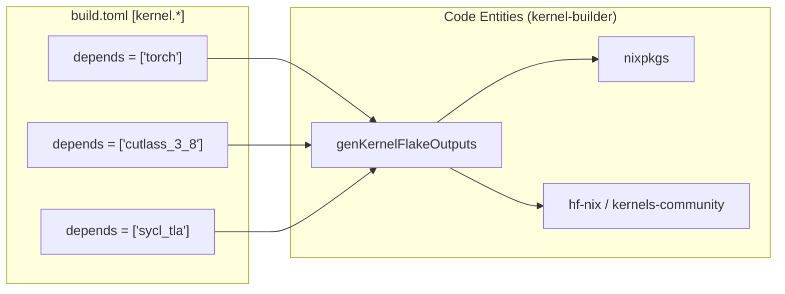
Sources: [megablocks/flake.nix:13-13](), [flash-attn2/build.toml:69-72](), [megablocks/build.toml:37-40]()

## Multi-Backend Implementation Example (ReLU)

The ReLU kernel provides a reference for supporting all major backends in a single `build.toml`:

| Backend | Section | Source Path |
|---------|---------|-------------|
| CUDA | `[kernel.activation]` | `relu_cuda/relu.cu` |
| Metal | `[kernel.activation_metal]` | `relu_metal/relu.mm` |
| ROCm | `[kernel.activation_rocm]` | `relu_cuda/relu.cu` (via HIP) |
| XPU | `[kernel.activation_xpu]` | `relu_xpu/relu.cpp` |
| CPU | `[kernel.relu_cpu]` | `relu_cpu/relu_cpu.cpp` |

Sources: [relu/build.toml:1-67]()

## Build Constraints (minver/maxver)

The system allows filtering builds based on version constraints to prevent compilation on incompatible toolkits.
- `cuda-minver`: Used in `deep-gemm` to require CUDA 12.3+ for SM90a/SM100 features. [deep-gemm/build.toml:19-19]()
- `torchVersions` (in `flake.nix`): While not in `build.toml`, this function in the flake often filters based on the `backend` specified in `build.toml` (e.g., requiring Torch 2.9+ for XPU). [flash-attn2/flake.nix:31-34]()

Sources: [deep-gemm/build.toml:19-20](), [flash-attn2/flake.nix:22-35]()

---

# Page: Kernel Builder System

# Kernel Builder System

<details>
<summary>Relevant source files</summary>

The following files were used as context for generating this wiki page:

- [relu/build.toml](relu/build.toml)
- [relu/flake.lock](relu/flake.lock)
- [relu/flake.nix](relu/flake.nix)
- [relu/relu_cpu/relu_cpu.cpp](relu/relu_cpu/relu_cpu.cpp)
- [relu/tests/test_relu.py](relu/tests/test_relu.py)
- [relu/torch-ext/relu/__init__.py](relu/torch-ext/relu/__init__.py)
- [relu/torch-ext/relu/layers/__init__.py](relu/torch-ext/relu/layers/__init__.py)
- [relu/torch-ext/torch_binding.cpp](relu/torch-ext/torch_binding.cpp)
- [rmsnorm/build.toml](rmsnorm/build.toml)
- [rmsnorm/flake.lock](rmsnorm/flake.lock)
- [rmsnorm/flake.nix](rmsnorm/flake.nix)
- [rmsnorm/rmsnorm_cpu/rmsnorm_cpu_torch.cpp](rmsnorm/rmsnorm_cpu/rmsnorm_cpu_torch.cpp)
- [rmsnorm/rmsnorm_xpu/RMSNorm.cpp](rmsnorm/rmsnorm_xpu/RMSNorm.cpp)
- [rmsnorm/tests/test_rmsnorm.py](rmsnorm/tests/test_rmsnorm.py)
- [rmsnorm/torch-ext/rmsnorm/__init__.py](rmsnorm/torch-ext/rmsnorm/__init__.py)
- [rmsnorm/torch-ext/rmsnorm/layers.py](rmsnorm/torch-ext/rmsnorm/layers.py)
- [rmsnorm/torch-ext/torch_binding.cpp](rmsnorm/torch-ext/torch_binding.cpp)
- [rotary/build.toml](rotary/build.toml)
- [rotary/flake.lock](rotary/flake.lock)
- [rotary/flake.nix](rotary/flake.nix)
- [rotary/rotary-xpu/rotary_xpu.cpp](rotary/rotary-xpu/rotary_xpu.cpp)
- [rotary/rotary-xpu/rotary_xpu.hpp](rotary/rotary-xpu/rotary_xpu.hpp)
- [rotary/rotary/rotary_cuda.cu](rotary/rotary/rotary_cuda.cu)
- [rotary/tests/__init__.py](rotary/tests/__init__.py)
- [rotary/tests/test_rotary.py](rotary/tests/test_rotary.py)
- [rotary/tests/utils.py](rotary/tests/utils.py)
- [rotary/torch-ext/rotary/__init__.py](rotary/torch-ext/rotary/__init__.py)

</details>


The `kernel-builder` system is the central compilation orchestrator that transforms kernel source code and `build.toml` configurations into PyTorch-compatible Python extensions. It manages multi-backend compilation, dependency resolution, and integration with the Nix build environment.

## System Architecture

The `kernel-builder` acts as a hub between the Nix build system, backend compilers, and PyTorch extension infrastructure. It leverages `genKernelFlakeOutputs` to bridge the Nix flake definitions with the build logic.

### Architectural Flow: Source to Python Op

The following diagram maps the high-level system components to the specific code entities that handle the build orchestration.

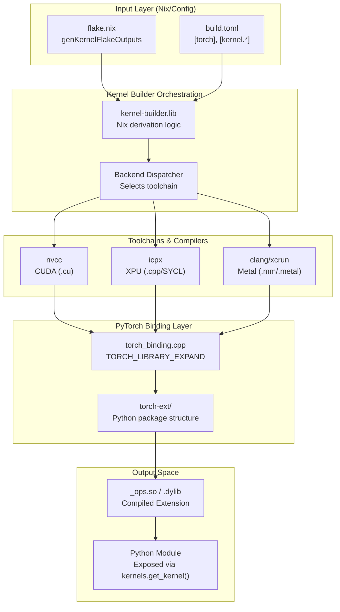
**Sources:** [relu/flake.nix:8-16](), [relu/build.toml:1-11](), [rmsnorm/flake.nix:8-20]()

## The `torch-ext` Pattern

Every kernel in the community repository follows the `torch-ext` pattern. This directory contains the Python package structure and the C++ binding code that exposes compiled operations to the PyTorch ecosystem.

### Key Components of `torch-ext`
1.  **`torch_binding.cpp`**: The primary entry point for the C++ extension. It uses `TORCH_LIBRARY_EXPAND` to register operations into the PyTorch dispatcher.
2.  **`__init__.py`**: Defines the user-facing Python API, often wrapping the raw `_ops` with additional logic (like autograd or shape checking).
3.  **`_ops.py`**: Typically handles the dynamic loading of the compiled shared library.

### `TORCH_LIBRARY_EXPAND` and Dispatch
The system uses the `TORCH_LIBRARY_EXPAND` macro in `torch_binding.cpp` to register custom operators. This allows the kernels to be compatible with `torch.compile` and the standard PyTorch operator registry.

| File | Role | Code Reference |
| :--- | :--- | :--- |
| `relu/torch-ext/torch_binding.cpp` | C++ Op Registration | [relu/torch-ext/torch_binding.cpp:1-10]() |
| `rotary/torch-ext/rotary/__init__.py` | Python API Wrapper | [rotary/torch-ext/rotary/__init__.py:7-16]() |
| `rmsnorm/torch-ext/rmsnorm/layers.py` | High-level Module | [rmsnorm/torch-ext/rmsnorm/layers.py:1-10]() |

**Sources:** [relu/build.toml:17-21](), [rotary/torch-ext/rotary/__init__.py:1-16](), [rmsnorm/torch-ext/torch_binding.cpp:1-15]()

## Multi-Backend Orchestration

The `kernel-builder` reads the `backends` list in `build.toml` and invokes specific compilers for each target. It handles the complexity of different file extensions and compiler flags per backend.

### Compilation Data Flow

This diagram illustrates how a single kernel (e.g., `relu`) is processed into multiple backend-specific binaries.

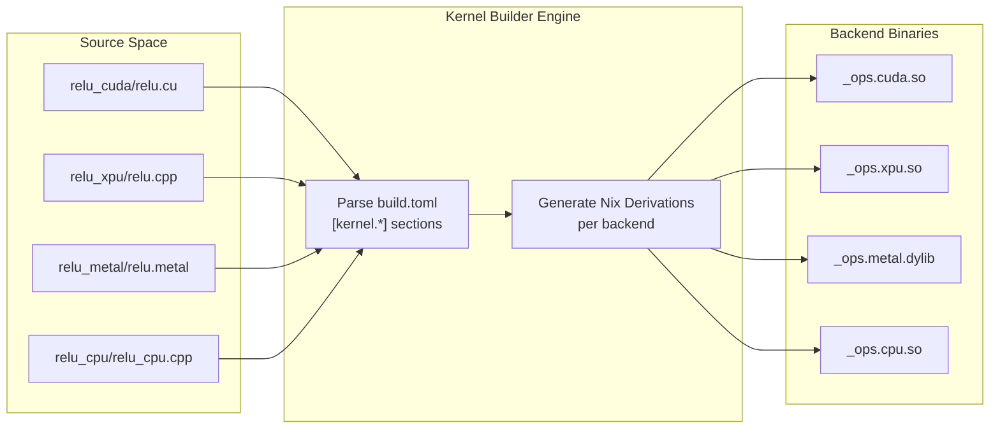
**Sources:** [relu/build.toml:5-11](), [relu/build.toml:23-68](), [rmsnorm/build.toml:5-8]()

### Backend Specializations in `build.toml`
The `build.toml` file allows for backend-specific configuration, such as CPU instruction sets or ROCm architectures:
*   **CPU AVX/FMA**: Configured via `cxx-flags` in `[kernel.rmsnorm_cpu_avx512]`. [rmsnorm/build.toml:87-96]()
*   **ROCm Archs**: Specified in `rocm-archs` for AMD hardware. [relu/build.toml:49-59]()
*   **XPU Dependencies**: Often requires specific include paths for SYCL headers. [rmsnorm/build.toml:20-21]()

## Exposing Ops to Python

Once compiled, the shared libraries are exposed to Python. The repository standardizes on a namespace pattern where `ops` are imported from a private `_ops` module.

### Data Flow: Runtime Execution
1.  **Import**: User calls `import relu`. [relu/tests/test_relu.py:7-7]()
2.  **Dispatch**: The `__init__.py` or a dedicated `_ops.py` loads the backend-specific `.so`.
3.  **Execution**: The Python call `ops.apply_rotary(...)` invokes the C++ function bound in `torch_binding.cpp`. [rotary/torch-ext/rotary/__init__.py:16-16]()

### Integration Example: `rotary`
The `rotary` kernel demonstrates the wrapper pattern, where the raw C++ op is wrapped in a signature-compatible function for `transformers`.

```python
def apply_rotary_transformers(q, k, cos, sin, unsqueeze_dim=1):
    # ... logic to prepare tensors ...
    ops.apply_rotary(q1, q2, cos, sin, q1, q2, False)
    return q_rotated, k_rotated
```
**Sources:** [rotary/torch-ext/rotary/__init__.py:19-52](), [relu/tests/test_relu.py:11-21]()

## Testing and Validation
The build system is tightly integrated with `pytest`. Kernels include tests that detect the available hardware device and validate the custom op against a reference implementation (often `torch.nn.functional` or a pure Python equivalent).

| Test Component | Purpose | Source |
| :--- | :--- | :--- |
| `device` detection | Handles CUDA, XPU, MPS, or CPU | [relu/tests/test_relu.py:12-19]() |
| `torch.compile` test | Ensures compatibility with Inductor | [rmsnorm/tests/test_rmsnorm.py:48-60]() |
| `assert_close` | Numerical validation | [relu/tests/test_relu.py:21-21]() |

**Sources:** [relu/tests/test_relu.py:11-36](), [rmsnorm/tests/test_rmsnorm.py:7-22](), [rmsnorm/tests/test_rmsnorm.py:48-75]()

---

# Page: CI/CD and Testing Infrastructure

# CI/CD and Testing Infrastructure

<details>
<summary>Relevant source files</summary>

The following files were used as context for generating this wiki page:

- [.github/scripts/pr_comment_kernel_bot.py](.github/scripts/pr_comment_kernel_bot.py)
- [.github/scripts/windows/install-oneapi.ps1](.github/scripts/windows/install-oneapi.ps1)
- [.github/workflows/build-pr-mac.yaml](.github/workflows/build-pr-mac.yaml)
- [.github/workflows/build-pr-windows.yaml](.github/workflows/build-pr-windows.yaml)
- [.github/workflows/build-pr.yaml](.github/workflows/build-pr.yaml)
- [.github/workflows/build-release-mac.yaml](.github/workflows/build-release-mac.yaml)
- [.github/workflows/build-release-windows.yaml](.github/workflows/build-release-windows.yaml)
- [.github/workflows/build-release.yaml](.github/workflows/build-release.yaml)
- [.github/workflows/manual-build-upload.yaml](.github/workflows/manual-build-upload.yaml)
- [.github/workflows/nightly_kernel_check.yml](.github/workflows/nightly_kernel_check.yml)
- [.github/workflows/nix_fmt.yaml](.github/workflows/nix_fmt.yaml)
- [.github/workflows/pr-comment-build.yaml](.github/workflows/pr-comment-build.yaml)
- [.github/workflows/validate-kernel-pr.py](.github/workflows/validate-kernel-pr.py)
- [.gitignore](.gitignore)
- [README.md](README.md)
- [scripts/report_kernel_failures.py](scripts/report_kernel_failures.py)
- [scripts/run_kernels_checks.py](scripts/run_kernels_checks.py)

</details>


## Purpose and Scope

This document provides an overview of the automated testing, validation, and deployment infrastructure that ensures quality and reproducibility across all kernels in the repository. The CI/CD system operates across multiple platforms (Linux, macOS, Windows) and backends (CUDA, XPU, Metal), managing the lifecycle from **Pull Request validation** to **Nightly validation** and **Release deployment**.

For detailed information about specific workflows, see:
- [Pull Request Workflow](#3.1) — Detailed explanation of PR validation, multi-platform matrix strategy, and the `validate-kernel-pr.py` script.
- [Nightly Validation System](#3.2) — Document the nightly check system, cache management, and Slack reporting.
- [Release and Deployment](#3.3) — Explain the release pipeline, Hub uploading logic, and versioning.
- [Chat-Ops Kernel Bot](#3.4) — Document the `/kernel-bot` comment-driven build and merge system.

---

## CI/CD Architecture Overview

The CI/CD infrastructure implements a multi-stage validation pipeline that enforces quality gates before and after code merges. The system is designed around **reproducible builds** (Nix-based for Linux/macOS) and **native toolchains** (Windows) to ensure broad hardware compatibility.

### CI/CD Pipeline Flow

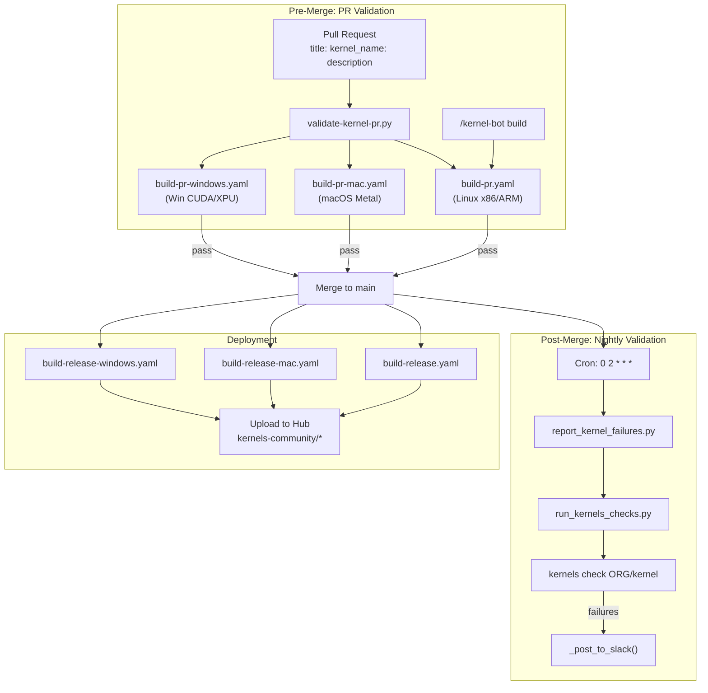

**Sources:** [.github/workflows/build-pr.yaml:1-25](), [.github/workflows/build-pr-mac.yaml:1-12](), [.github/workflows/build-pr-windows.yaml:1-17](), [.github/workflows/nightly_kernel_check.yml:1-10](), [.github/workflows/build-release.yaml:1-12]()

---

## Validation Gates and Multi-Platform Matrix

The CI/CD system enforces validation gates to ensure structural integrity and correct hardware targeting. While Linux and macOS use Nix for hermeticity, Windows builds utilize a matrix strategy to test against specific CUDA and Intel oneAPI versions.

### Validation Logic and Platform Support

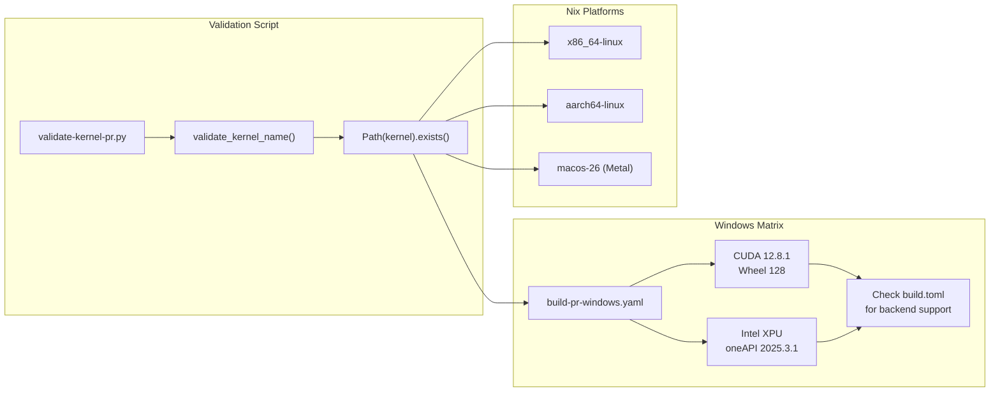

**Sources:** [.github/workflows/validate-kernel-pr.py:12-40](), [.github/workflows/build-pr-windows.yaml:14-37](), [.github/workflows/build-pr.yaml:12-19](), [.github/workflows/build-pr-mac.yaml:11-12]()

### Key Validation Components

| Component | Location | Role |
|-----------|----------|------|
| `validate-kernel-pr.py` | [.github/workflows/validate-kernel-pr.py:1-84]() | Extracts kernel name from PR title and verifies directory structure. |
| `check-backend` step | [.github/workflows/build-pr-windows.yaml:54-109]() | Parses `build.toml` to determine if the kernel supports CUDA or XPU on Windows. |
| `xpuBlockList` | [.github/workflows/build-pr-windows.yaml:79-87]() | Hardcoded list of kernels (e.g., `megablocks`, `flash-attn2`) incompatible with Windows XPU. |
| `repo-id` check | [.github/workflows/build-pr.yaml:51-58]() | Ensures `build.toml` contains a mandatory `repo-id` for Hub publishing. |

---

## Nightly Validation and Monitoring

The nightly system verifies that production artifacts on the Hugging Face Hub remain functional. It uses `kernels check` to validate the environment and `report_kernel_failures.py` to notify the team via Slack.

### Nightly System Implementation

| Component | Implementation | Key Logic |
|-----------|----------------|-----------|
| Discovery | [scripts/run_kernels_checks.py:46-63]() | `discover_kernel_dirs()` finds directories containing a `build.toml`. |
| Execution | [scripts/run_kernels_checks.py:96-116]() | `run_kernels_checks()` executes `kernels check kernels-community/<name>`. |
| Cache Management | [scripts/run_kernels_checks.py:66-93]() | `_delete_kernel_cache()` clears the Hub cache to ensure a fresh pull. |
| Reporting | [scripts/report_kernel_failures.py:34-50]() | `_format_failure_message()` and `_post_to_slack()` handle notifications. |

**Sources:** [scripts/run_kernels_checks.py:1-157](), [scripts/report_kernel_failures.py:1-108]()

---

## Chat-Ops and Manual Dispatch

The repository features a specialized Chat-Ops bot, `/kernel-bot`, which allows maintainers to trigger builds and uploads directly from PR comments. This system bridges the gap between manual testing and automated release.

### Bot Workflow and Command Parsing

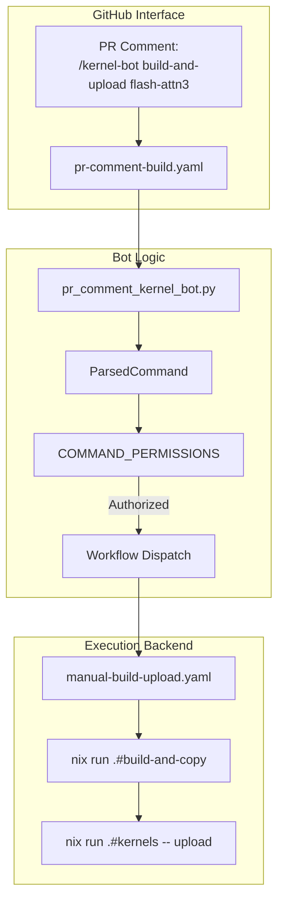

**Sources:** [.github/workflows/pr-comment-build.yaml:1-50](), [.github/scripts/pr_comment_kernel_bot.py:17-31](), [.github/workflows/manual-build-upload.yaml:1-33]()

### Command and Permission Matrix

The bot enforces strict permissions for sensitive operations:

- **`build`**: Allowed for users with `admin` or `write` access [[.github/scripts/pr_comment_kernel_bot.py:18]]().
- **`build-and-upload`**: Restricted to `admin` [[.github/scripts/pr_comment_kernel_bot.py:19]]().
- **`merge-and-upload`**: Restricted to `admin` [[.github/scripts/pr_comment_kernel_bot.py:20]]().

The bot uses a unique `dispatch_key` [[.github/scripts/pr_comment_kernel_bot.py:185-186]]() to track the status of manual builds and report results back to the PR comment thread.

**Sources:** [.github/scripts/pr_comment_kernel_bot.py:1-230](), [.github/workflows/manual-build-upload.yaml:1-124]()

---

# Page: Pull Request Workflow

# Pull Request Workflow

<details>
<summary>Relevant source files</summary>

The following files were used as context for generating this wiki page:

- [.github/scripts/windows/install-oneapi.ps1](.github/scripts/windows/install-oneapi.ps1)
- [.github/workflows/build-pr-mac.yaml](.github/workflows/build-pr-mac.yaml)
- [.github/workflows/build-pr-windows.yaml](.github/workflows/build-pr-windows.yaml)
- [.github/workflows/build-pr.yaml](.github/workflows/build-pr.yaml)
- [.github/workflows/build-release-mac.yaml](.github/workflows/build-release-mac.yaml)
- [.github/workflows/build-release-windows.yaml](.github/workflows/build-release-windows.yaml)
- [.github/workflows/build-release.yaml](.github/workflows/build-release.yaml)
- [.github/workflows/nightly_kernel_check.yml](.github/workflows/nightly_kernel_check.yml)
- [.github/workflows/nix_fmt.yaml](.github/workflows/nix_fmt.yaml)
- [.github/workflows/validate-kernel-pr.py](.github/workflows/validate-kernel-pr.py)
- [.gitignore](.gitignore)
- [README.md](README.md)
- [scripts/report_kernel_failures.py](scripts/report_kernel_failures.py)
- [scripts/run_kernels_checks.py](scripts/run_kernels_checks.py)

</details>


## Purpose and Scope

This document describes the automated pull request validation and build process for kernel contributions to the `kernels-community` repository. It covers the PR title format requirements, kernel validation logic, multi-platform build execution (Linux, Windows, macOS), and skip mechanisms that occur before code is merged.

The workflow ensures that every contribution is built against its target backends (CUDA, Metal, XPU, ROCm) and passes structural checks before integration.

## PR Title Format Requirements

The build system extracts the kernel name from the PR title to determine which kernel directory to build. The PR title must follow a specific format:

```text
kernel_name: short description of the change
```

The kernel name (the part before the colon) is extracted and validated by `validate-kernel-pr.py` [ .github/workflows/validate-kernel-pr.py:51 ]() using `pr_title.split(":", 1)[0].strip()`. If no colon is present in the title, the validation script exits with code 1 and the build is skipped [ .github/workflows/validate-kernel-pr.py:47-49 ]().

**Valid examples:**
- `flash-attn2: add support for SM 9.0`
- `paged-attention: optimize Metal backend`
- `relu: fix ROCm compilation issue`

**Invalid examples:**
- `Add flash attention support` (no colon)
- `flash-attn2 update kernel` (no colon)
- `flash@attn: add feature` (invalid character in kernel name)

The kernel name must pass validation by `validate_kernel_name()` [ .github/workflows/validate-kernel-pr.py:12-24 ](), which enforces that only alphanumeric characters, hyphens, and underscores are allowed using the regex pattern `^[a-zA-Z0-9_-]+$` [ .github/workflows/validate-kernel-pr.py:21 ]().

Sources: [ .github/workflows/validate-kernel-pr.py:47-51 ](), [ README.md:18-23 ]()

## Workflow Trigger and Concurrency

The PR build workflows are defined across several files:
- **Linux/Nix:** [ .github/workflows/build-pr.yaml ]()
- **Windows:** [ .github/workflows/build-pr-windows.yaml ]()
- **macOS:** [ .github/workflows/build-pr-mac.yaml ]()

These trigger on `pull_request` events [ .github/workflows/build-pr.yaml:2-3 ](). Workflows ignore changes that only affect README files using `paths-ignore` [ .github/workflows/build-pr.yaml:4-5 ]().

Concurrency control ensures that only one build runs per PR at a time to prevent resource waste [ .github/workflows/build-pr.yaml:6-8 ]():

```yaml
concurrency:
  group: ${{ github.workflow }}-${{ github.head_ref || github.run_id }}
  cancel-in-progress: true
```

Sources: [ .github/workflows/build-pr.yaml:2-8 ](), [ .github/workflows/build-pr-windows.yaml:2-10 ]()

## Kernel Validation Process

### Validation Script Architecture

The `validate-kernel-pr.py` script acts as the gatekeeper for all CI workflows.

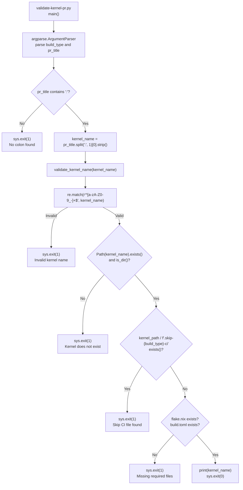

### Validation Steps

The script performs five sequential checks [ .github/workflows/validate-kernel-pr.py:45-79 ]():

| Check | Location | Failure Reason |
|-------|----------|----------------|
| **Colon in title** | Line 47-49 | PR title format incorrect |
| **Name validation** | Line 53-55 | Kernel name contains invalid characters |
| **Directory exists** | Line 57-60 | Kernel directory not found in repository |
| **Skip file check** | Line 62-66 | `.skip-pr-ci` or `.skip-release-ci` file present |
| **Required files** | Line 68-76 | Missing `flake.nix` or `build.toml` |

The script accepts a `build_type` argument ("pr" or "release") [ .github/workflows/validate-kernel-pr.py:33-36 ]() to allow specific skip files like `.skip-pr-ci` [ .github/workflows/validate-kernel-pr.py:63 ]().

Sources: [ .github/workflows/validate-kernel-pr.py:12-79 ]()

## Multi-Platform Build Strategy

The repository employs a matrix strategy to validate kernels across different operating systems and hardware backends.

### Windows Matrix and Backend Support
Windows builds use a specific matrix for Python versions and hardware backends [ .github/workflows/build-pr-windows.yaml:14-35 ]().

A PowerShell step `check-backend` parses the kernel's `build.toml` to determine if the current matrix platform is supported [ .github/workflows/build-pr-windows.yaml:54-109 ](). It checks for:
1. `backend = "xpu"` in a `[kernel.*]` section [ .github/workflows/build-pr-windows.yaml:100 ]().
2. `backends = ["cuda", "xpu"]` in the `[general]` section [ .github/workflows/build-pr-windows.yaml:101 ]().

**Special Windows Constraints:**
- **CUDA Min Version:** The script checks `[general.cuda] minver` against the matrix CUDA version [ .github/workflows/build-pr-windows.yaml:66-75 ]().
- **XPU Block List:** Kernels like `megablocks` and `flash-attn2` are explicitly blocked on Windows XPU [ .github/workflows/build-pr-windows.yaml:78-87 ]().
- **OneAPI Requirement:** Specific kernels (`relu`, `rotary`, `rmsnorm`) trigger an Intel oneAPI installation step [ .github/workflows/build-pr-windows.yaml:89-95 ]().

### Linux and macOS (Nix-based)
Linux builds run on high-memory AWS runners [ .github/workflows/build-pr.yaml:12-23 ]() and use Nix to build the `ci` output [ .github/workflows/build-pr.yaml:63 ](). 

macOS builds run on `macos-26` runners [ .github/workflows/build-pr-mac.yaml:12 ]() and include a mandatory check for the `repo-id` in `build.toml` [ .github/workflows/build-pr-mac.yaml:39-46 ](). They also trigger the `MetalToolchain` installation [ .github/workflows/build-pr-mac.yaml:47-49 ]().

Sources: [ .github/workflows/build-pr-windows.yaml:14-109 ](), [ .github/workflows/build-pr.yaml:12-63 ](), [ .github/workflows/build-pr-mac.yaml:12-49 ]()

## GPU Testing Integration

For Linux PRs, the workflow includes a `test-kernel-gpu` job that runs after a successful build [ .github/workflows/build-pr.yaml:85-119 ]().

1. **Closure Export:** The build job exports the Nix closure of the `ci-test` output to a Zstd-compressed archive [ .github/workflows/build-pr.yaml:69-76 ]().
2. **Artifact Upload:** The closure is uploaded as a GitHub artifact [ .github/workflows/build-pr.yaml:77-83 ]().
3. **GPU Runner:** A specialized runner group `aws-g6-12xlarge-plus` downloads and imports the closure [ .github/workflows/build-pr.yaml:88-114 ]().
4. **Execution:** The `ci-test` binary is executed within the imported Nix environment [ .github/workflows/build-pr.yaml:118 ]().

```mermaid
sequenceDiagram
    participant Build as "build-kernel (CPU/Nix)"
    participant Art as "GitHub Artifacts"
    participant GPU as "test-kernel-gpu (G6 Runner)"
    
    Build->>Build: "nix build .#ci-test"
    Build->>Build: "nix-store --export"
    Build->>Art: "Upload ci-test-closure.nar.zst"
    Art->>GPU: "Download ci-test-closure"
    GPU->>GPU: "nix-store --import"
    GPU->>GPU: "Run $CI_TEST_PATH/bin/ci-test"
```

Sources: [ .github/workflows/build-pr.yaml:64-119 ]()

## Release and Merge Workflow

When a PR is closed and merged, the `build-release.yaml` (Linux), `build-release-windows.yaml`, and `build-release-mac.yaml` workflows are triggered [ .github/workflows/build-release.yaml:3-4 ]() [ .github/workflows/build-release-windows.yaml:3-4 ]().

These workflows perform the final compilation and upload the artifacts to the Hugging Face Hub using the `build-and-upload` Nix app [ .github/workflows/build-release.yaml:56 ]().

**V1 Kernel Logic:**
If a kernel's `build.toml` specifies `version = 1`, it is additionally uploaded to the `main` branch of the Hub repository [ .github/workflows/build-release.yaml:65-72 ]():
```bash
if [ -n "$VERSION" ]; then
  nix build -L
  nix run -L .#kernels -- upload --repo-id kernels-community/$KERNEL --branch main result
fi
```

Sources: [ .github/workflows/build-release.yaml:11-72 ](), [ .github/workflows/build-release-windows.yaml:13-15 ]()

## Skip Mechanisms

Skip files allow maintainers to bypass CI without modifying workflow code.

| Skip File | Triggered By | Logic Location |
|-----------|--------------|----------------|
| `.skip-pr-ci` | PR Workflows | [ .github/workflows/validate-kernel-pr.py:63 ]() |
| `.skip-release-ci` | Release Workflows | [ .github/workflows/validate-kernel-pr.py:63 ]() |

The `validate-kernel-pr.py` script checks for these files and exits with code 1 if found [ .github/workflows/validate-kernel-pr.py:64-66 ]().

Sources: [ .github/workflows/validate-kernel-pr.py:62-66 ]()

---

# Page: Nightly Validation System

# Nightly Validation System

<details>
<summary>Relevant source files</summary>

The following files were used as context for generating this wiki page:

- [.github/workflows/biweekly_freshness_check.yml](.github/workflows/biweekly_freshness_check.yml)
- [.github/workflows/nightly_kernel_check.yml](.github/workflows/nightly_kernel_check.yml)
- [.github/workflows/test_kernel_freshness_lookup.yml](.github/workflows/test_kernel_freshness_lookup.yml)
- [.github/workflows/validate-kernel-pr.py](.github/workflows/validate-kernel-pr.py)
- [.gitignore](.gitignore)
- [README.md](README.md)
- [scripts/check_kernel_freshness.py](scripts/check_kernel_freshness.py)
- [scripts/report_kernel_failures.py](scripts/report_kernel_failures.py)
- [scripts/run_kernels_checks.py](scripts/run_kernels_checks.py)
- [scripts/test_kernel_freshness_lookup.py](scripts/test_kernel_freshness_lookup.py)

</details>


## Purpose and Scope

The Nightly Validation System is an automated testing infrastructure that validates all kernels in the repository on a daily schedule. It executes `kernels check` commands for each kernel published to the Hugging Face Hub under the `kernels-community` organization, manages local cache to ensure fresh runs, and reports failures to Slack. Additionally, a bi-weekly freshness check monitors upstream repositories to ensure the community kernels stay synchronized with their original sources.

**Sources:** [.github/workflows/nightly_kernel_check.yml:1-30](), [scripts/run_kernels_checks.py:1-20](), [scripts/report_kernel_failures.py:1-23](), [.github/workflows/biweekly_freshness_check.yml:1-28]()

## System Architecture

The nightly validation system consists of three primary components: a GitHub Actions workflow scheduler, a kernel check orchestrator, and a failure reporting module. It is supported by a secondary freshness monitoring system.

### Core Validation Components

```mermaid
graph TB
    subgraph "GitHub Actions"
        CRON["nightly_kernel_check.yml<br/>Scheduled trigger"]
        DISPATCH["workflow_dispatch<br/>Manual trigger"]
    end
    
    subgraph "Python Scripts"
        REPORTER["report_kernel_failures.py<br/>main()"]
        ORCHESTRATOR["run_kernels_checks.py<br/>run_kernels_checks()"]
        DISCOVERY["discover_kernel_dirs()"]
        CACHE["_delete_kernel_cache()"]
        FORMAT["_format_failure_message()"]
        SLACK["_post_to_slack()"]
    end
    
    subgraph "External Systems"
        REPO["Repository<br/>Kernel directories with build.toml"]
        KERNELS_CLI["kernels CLI<br/>kernels check command"]
        HF_CACHE["HF Hub Cache<br/>~/.cache/huggingface/hub"]
        SLACK_WEBHOOK["Slack Webhook<br/>SLACK_WEBHOOK_URL"]
    end
    
    CRON --> REPORTER
    DISPATCH --> REPORTER
    
    REPORTER --> DISCOVERY
    DISCOVERY --> REPO
    DISCOVERY --> ORCHESTRATOR
    
    ORCHESTRATOR --> KERNELS_CLI
    KERNELS_CLI --> HF_CACHE
    ORCHESTRATOR --> CACHE
    CACHE --> HF_CACHE
    
    ORCHESTRATOR --> REPORTER
    REPORTER --> FORMAT
    FORMAT --> SLACK
    SLACK --> SLACK_WEBHOOK
```

**Sources:** [.github/workflows/nightly_kernel_check.yml:3-29](), [scripts/report_kernel_failures.py:53-107](), [scripts/run_kernels_checks.py:96-116]()

## Workflow Schedule and Triggers

The system utilizes two distinct scheduled workflows:

| Workflow | Schedule (`cron`) | Purpose |
|----------|-------------------|---------|
| **Nightly Check** | `0 2 * * *` | Daily validation of all kernel builds and functionality. |
| **Freshness Check** | `0 2 1,15 * *` | Bi-weekly check for upstream repository updates. |

Both workflows support `workflow_dispatch` for manual execution via the GitHub UI.

**Sources:** [.github/workflows/nightly_kernel_check.yml:3-6](), [.github/workflows/biweekly_freshness_check.yml:3-6]()

## Execution Flow

### Main Validation Pipeline

The `report_kernel_failures.py` script acts as the entry point for the nightly GHA runner, delegating the heavy lifting to `run_kernels_checks.py`.

```mermaid
sequenceDiagram
    participant GHA as GitHub Actions
    participant RKF as report_kernel_failures.py
    participant RKC as run_kernels_checks.py
    participant CLI as kernels CLI
    participant HUB as HF Hub
    participant CACHE as Local Cache
    participant SLACK as Slack

    GHA->>RKF: Execute with --verbose --clear-cache
    RKF->>RKC: discover_kernel_dirs(root, exclude)
    RKC->>RKC: Filter directories with build.toml
    RKC-->>RKF: Return kernel directories list
    
    loop For each kernel directory
        RKF->>RKC: run_kernels_checks([directory])
        RKC->>CLI: kernels check kernels-community/directory
        CLI->>HUB: Download kernel artifacts
        CLI->>CLI: Run kernel validation tests
        CLI-->>RKC: Return exit code
        
        alt Check failed
            RKC->>RKC: Add to failures list
        end
        
        RKC->>RKC: _delete_kernel_cache(ORG, directory)
        RKC->>CACHE: Delete models--kernels-community--directory*
    end
    
    RKC-->>RKF: Return failures list
    
    alt Has failures
        RKF->>RKF: _format_failure_message(failures)
        RKF->>SLACK: _post_to_slack(webhook, message)
        SLACK-->>RKF: Success/Error
    end
```

**Sources:** [.github/workflows/nightly_kernel_check.yml:25-29](), [scripts/report_kernel_failures.py:53-107](), [scripts/run_kernels_checks.py:96-116]()

## Kernel Discovery

The `discover_kernel_dirs()` function identifies which directories in the repository represent kernels by examining their structure. It requires the presence of a `build.toml` file to consider a directory a valid kernel.

```python
# Logic from run_kernels_checks.py
for entry in entries:
    if entry.is_dir() and not (entry / "build.toml").exists():
        logging.debug(f"Skipping {name} because it doesn't contain a `build.toml`.")
        continue
    if entry.is_dir():
        directories.append(name)
```

By default, the system excludes `.github` and `scripts` directories from this search.

**Sources:** [scripts/run_kernels_checks.py:46-63]()

## Freshness Check System

The bi-weekly freshness check ensures that kernels in the `kernels-community` repository are not falling behind their upstream sources (e.g., `Dao-AILab/flash-attention`).

### Source Mapping and Logic

The system maintains a `KERNEL_SOURCE_MAPPING` dictionary in `scripts/check_kernel_freshness.py` that maps local kernel directories to their upstream GitHub repository URLs.

```python
# Example mapping entries
KERNEL_SOURCE_MAPPING = {
    "flash-attn2": "https://github.com/Dao-AILab/flash-attention",
    "mamba-ssm": "https://github.com/state-spaces/mamba",
    "rmsnorm": "https://github.com/intel/intel-extension-for-pytorch",
    # ...
}
```

The script `check_kernel_freshness.py` performs the following steps:
1. **Fetch Upstream Date**: Queries the GitHub API for the last commit date on `main` or `master` branches of the upstream repo.
2. **Fetch Local Date**: Uses `git log` to find the last commit date for the specific kernel directory in the `kernels-community` repo.
3. **Comparison**: Identifies kernels where the upstream has been updated more recently than the local version.

### Validation of Mappings
The `scripts/test_kernel_freshness_lookup.py` script is used in CI to ensure that every kernel directory in the repository (except for known exclusions like `relu`) has a corresponding entry in the `KERNEL_SOURCE_MAPPING`.

**Sources:** [scripts/check_kernel_freshness.py:14-54](), [scripts/check_kernel_freshness.py:117-156](), [scripts/test_kernel_freshness_lookup.py:1-82](), [.github/workflows/test_kernel_freshness_lookup.yml:1-28]()

## Cache Management

The cache management system prevents stale artifacts from masking regressions by clearing the Hugging Face Hub cache after each kernel check.

### Cache Location Resolution

The `_cache_root()` function determines the cache directory using this precedence:
1. **`HF_HUB_CACHE` environment variable** (if set)
2. **`HF_HOME/hub`** (if `HF_HOME` is set)
3. **`~/.cache/huggingface/hub`** (default fallback)

### Cache Deletion Process

The cache deletion uses glob pattern `models--{org}--{directory}*` to match all cache entries for a kernel. For example, checking `flash-attn2` will trigger a deletion of `models--kernels-community--flash-attn2*` in the resolved cache root.

**Sources:** [scripts/run_kernels_checks.py:66-94]()

## Failure Reporting

The failure reporting system formats validation failures and posts them to Slack for team notification.

### Message Formatting

The `_format_failure_message()` function constructs structured messages that include the GitHub Actions run URL for easy debugging:

```
❌ Nightly kernels check failed for N kernel(s).
Run: https://github.com/huggingface/kernels-community/actions/runs/{RUN_ID}
• `kernels-community/kernel-name-1`
• `kernels-community/kernel-name-2`
```

### Slack Integration

The `_post_to_slack()` function sends formatted messages via a JSON payload to the configured `SLACK_WEBHOOK_URL`. It uses a 10-second timeout to prevent the workflow from hanging on network issues.

**Sources:** [scripts/report_kernel_failures.py:25-51](), [scripts/report_kernel_failures.py:96-100]()

## Command Line Interface

### `run_kernels_checks.py` Arguments

| Argument | Type | Default | Description |
|----------|------|---------|-------------|
| `--root` | string | `.` | Local path whose subdirectories are checked |
| `--exclude` | list | `['.github', 'scripts']` | Directory names to skip (repeatable) |
| `--clear-cache` | flag | `False` | Clear HF Hub cache after each check |
| `--dry-run` | flag | `False` | Print commands without executing |
| `--verbose` | flag | `False` | Enable DEBUG-level logging |

### `report_kernel_failures.py` Additional Arguments

Inherits all arguments from `run_kernels_checks.py` plus:

| Argument | Type | Default | Description |
|----------|------|---------|-------------|
| `--slack-webhook` | string | `$SLACK_WEBHOOK_URL` | Slack incoming webhook URL |

**Sources:** [scripts/run_kernels_checks.py:11-39](), [scripts/report_kernel_failures.py:14-22]()

## Integration with CI/CD Pipeline

The nightly validation system complements the PR validation workflow:

| Validation Stage | When | Purpose | Covered in |
|-----------------|------|---------|------------|
| PR Build | Pre-merge | Verify kernel builds correctly via `validate-kernel-pr.py` | [Pull Request Workflow](#3.1) |
| Nightly Check | Post-merge | Verify deployed kernel functions via `kernels check` | This page |
| Freshness Check | Bi-weekly | Monitor upstream updates | This page |

**Sources:** [.github/workflows/nightly_kernel_check.yml:1-30](), [.github/workflows/validate-kernel-pr.py:1-80](), [.github/workflows/biweekly_freshness_check.yml:1-28]()

---

# Page: Release and Deployment

# Release and Deployment

<details>
<summary>Relevant source files</summary>

The following files were used as context for generating this wiki page:

- [.github/scripts/pr_comment_kernel_bot.py](.github/scripts/pr_comment_kernel_bot.py)
- [.github/scripts/windows/install-oneapi.ps1](.github/scripts/windows/install-oneapi.ps1)
- [.github/workflows/build-pr-mac.yaml](.github/workflows/build-pr-mac.yaml)
- [.github/workflows/build-pr-windows.yaml](.github/workflows/build-pr-windows.yaml)
- [.github/workflows/build-pr.yaml](.github/workflows/build-pr.yaml)
- [.github/workflows/build-release-mac.yaml](.github/workflows/build-release-mac.yaml)
- [.github/workflows/build-release-windows.yaml](.github/workflows/build-release-windows.yaml)
- [.github/workflows/build-release.yaml](.github/workflows/build-release.yaml)
- [.github/workflows/manual-build-upload.yaml](.github/workflows/manual-build-upload.yaml)
- [.github/workflows/nix_fmt.yaml](.github/workflows/nix_fmt.yaml)
- [.github/workflows/pr-comment-build.yaml](.github/workflows/pr-comment-build.yaml)

</details>


This page documents the release and deployment pipeline for the `kernels-community` repository. It explains how kernels are built for multiple platforms (Linux, macOS, Windows), cached via Cachix, and published to the Hugging Face Hub.

## Overview

The release pipeline is triggered when a pull request is merged into the `main` branch. Unlike PR validation builds, release builds produce distributable artifacts and upload them to specific repositories under the `kernels-community` organization on the Hugging Face Hub.

**Release Pipeline Data Flow**

```mermaid
graph TD
    subgraph "GitHub Actions Trigger"
        Merge["PR Merged to main"] --> Validate["validate-kernel-pr.py 'release'"]
    end

    subgraph "Platform Build Matrix"
        Validate --> Linux["Linux (x86_64 / aarch64)"]
        Validate --> Mac["macOS (Apple Silicon)"]
        Validate --> Win["Windows (CUDA / XPU)"]
    end

    subgraph "Build Execution"
        Linux --> NixLinux["nix run .#build-and-upload"]
        Mac --> NixMac["nix run .#build-and-upload"]
        Win --> CargoWin["cargo build (kernel-builder)"]
    end

    subgraph "Distribution"
        NixLinux --> HFHub["HF Hub: kernels-community/kernel-name"]
        NixMac --> HFHub
        CargoWin --> HFHub
        NixLinux --> Cachix["Cachix: huggingface"]
    end

    HFHub --> MainBranch["Optional: Upload v1 to 'main' branch"]
```
Sources: [.github/workflows/build-release.yaml:1-12](), [.github/workflows/build-release-mac.yaml:1-12](), [.github/workflows/build-release-windows.yaml:1-15]()

## Platform Release Workflows

The repository maintains separate workflows for different operating systems to handle specific toolchain requirements, such as Metal for macOS or oneAPI for Windows XPU.

### Linux Release Build
Linux builds use high-memory AWS runners and leverage Nix for environment isolation.

- **Runners**: `aws-highmemory-32-plus-nix` (x86_64) and `aws-r8g-8xl-plus-nix` (aarch64) [[.github/workflows/build-release.yaml:17-20]]().
- **Tooling**: Uses `DeterminateSystems/nix-installer-action` [[.github/workflows/build-release.yaml:26]]().
- **Command**: Executes `nix run -L .#build-and-upload` [[.github/workflows/build-release.yaml:56]]().

### macOS Release Build
macOS builds focus on Apple Silicon (M-series) support and Metal shader compilation.

- **Runner**: `macos-26` [[.github/workflows/build-release-mac.yaml:13]]().
- **Toolchain**: Installs the Metal toolchain via `xcodebuild -downloadComponent MetalToolchain` [[.github/workflows/build-release-mac.yaml:49]]().
- **Sandboxing**: Uses `sandbox = relaxed` in Nix configuration to allow access to system frameworks required for Metal compilation [[.github/workflows/build-release-mac.yaml:21]]().

### Windows Release Build
Windows builds support CUDA and Intel XPU backends using a non-Nix native approach managed by `kernel-builder`.

- **Runner**: `windows-2022` [[.github/workflows/build-release-windows.yaml:39]]().
- **XPU Support**: Downloads and installs Intel oneAPI Base Toolkit via a custom PowerShell script [[.github/workflows/build-release-windows.yaml:127]](), [[.github/scripts/windows/install-oneapi.ps1:1-42]]().
- **Exclusion List**: Certain kernels (e.g., `megablocks`, `flash-attn2`) are explicitly blocked from Windows XPU builds due to compatibility issues [[.github/workflows/build-release-windows.yaml:67-75]]().

## Release Logic: Versioned vs. Main Branch

The pipeline implements a dual-upload strategy based on the kernel's `build.toml` configuration.

1.  **Versioned Upload**: The primary `nix run .#build-and-upload` command uploads artifacts to a branch named after the kernel version or git hash [[.github/workflows/build-release.yaml:56]]().
2.  **Main Branch Upload**: If `build.toml` contains `version = 1`, the workflow performs an additional upload to the `main` branch of the target repository [[.github/workflows/build-release.yaml:65-72]]().

```mermaid
flowchart TD
    Start["Build Complete"] --> CheckV1{"build.toml version == 1?"}
    CheckV1 -- "Yes" --> BuildMain["nix build -L"]
    BuildMain --> UploadMain["nix run .#kernels -- upload --branch main"]
    CheckV1 -- "No" --> End["End Release"]
    UploadMain --> End
```
Sources: [.github/workflows/build-release.yaml:57-72](), [.github/workflows/build-release-mac.yaml:57-72]()

## Manual Deployment and Chat-Ops

The repository provides a manual override mechanism via the `kernel-bot` and the `Manual Kernel Build` workflow.

### The /kernel-bot Interface
Maintainers can trigger builds and uploads directly from PR comments using commands like `/kernel-bot build-and-upload <kernel>`.

- **Command Parsing**: Handled by `pr_comment_kernel_bot.py` which validates permissions (e.g., `build-and-upload` requires `admin` status) [[.github/scripts/pr_comment_kernel_bot.py:17-21]]().
- **Dispatch Key**: Generates a unique `dispatch_key` (e.g., `pr123-relu-abcd`) to track the resulting workflow run [[.github/scripts/pr_comment_kernel_bot.py:185-186]]().

### Manual Build Workflow
The `manual-build-upload.yaml` workflow allows granular control over the build process, including selecting specific PR numbers or target branches on the Hub.

- **Inputs**: Supports `kernel_name`, `pr_number`, `target_branch`, and `upload` (boolean) [[.github/workflows/manual-build-upload.yaml:7-29]]().
- **Artifact Handling**: Can perform `build-and-copy` (local artifact generation) followed by an explicit `upload` using the `kernels` Nix app [[.github/workflows/manual-build-upload.yaml:113-123]]().

Sources: [.github/workflows/pr-comment-build.yaml:1-50](), [.github/workflows/manual-build-upload.yaml:1-124]()

## Cachix Caching Strategy

Cachix is used to share build artifacts across CI runs and platforms, significantly reducing build times.

- **Cache Name**: `huggingface` [[.github/workflows/build-release.yaml:36]]().
- **Scope**: Used in PR builds, release builds, and manual dispatches [[.github/workflows/build-pr.yaml:35]](), [[.github/workflows/manual-build-upload.yaml:84]]().
- **Mechanism**: The `cachix-action` automatically pushes new store paths to the cache after a successful Nix build [[.github/workflows/build-release.yaml:34-38]]().

## Implementation Detail: The Build-and-Upload Nix App

The `build-and-upload` target in a kernel's `flake.nix` orchestrates the final stages of the deployment.

```mermaid
sequenceDiagram
    participant Nix as "Nix (build-and-upload)"
    participant KB as "kernel-builder"
    participant Hub as "HF Hub API"

    Nix->>KB: Build kernel for current system
    KB->>KB: Generate config.json & README.md
    Nix->>Hub: Check for existing repo-id
    Note over Nix, Hub: repo-id must be in build.toml [general.hub]
    Nix->>Hub: Upload result/ directory to kernels-community/<kernel>
```
Sources: [.github/workflows/build-pr.yaml:51-58](), [.github/workflows/build-release.yaml:50-56]()

### Validation and Security
- **PR Title Validation**: The `validate-kernel-pr.py` script ensures the PR title follows the `kernel: description` format and extracts the target kernel name [[.github/workflows/validate-kernel-pr.py:44-49]]().
- **Token Management**: The `HF_TOKEN` secret is injected into the build environment only for release and authorized manual workflows [[.github/workflows/build-release.yaml:53]](), [[.github/workflows/manual-build-upload.yaml:118]]().
- **Repo-ID Check**: The workflow strictly verifies that `repo-id` is present in `build.toml` before attempting an upload [[.github/workflows/build-pr.yaml:51-58]]().

Sources: [.github/workflows/validate-kernel-pr.py:1-84](), [.github/workflows/build-pr.yaml:51-58]()

---

# Page: Chat-Ops Kernel Bot

# Chat-Ops Kernel Bot

<details>
<summary>Relevant source files</summary>

The following files were used as context for generating this wiki page:

- [.github/scripts/pr_comment_kernel_bot.py](.github/scripts/pr_comment_kernel_bot.py)
- [.github/workflows/manual-build-upload.yaml](.github/workflows/manual-build-upload.yaml)
- [.github/workflows/pr-comment-build.yaml](.github/workflows/pr-comment-build.yaml)

</details>


The Chat-Ops Kernel Bot is a comment-driven automation system that allows maintainers and contributors to trigger kernel builds, uploads, and merges directly from GitHub Pull Request comments. It bridges the gap between the Pull Request workflow and the high-performance Nix-based build infrastructure.

### Overview and Purpose

The system provides a `/kernel-bot` command interface to automate repetitive tasks that require high-privilege access or significant compute resources. By commenting on a PR, authorized users can dispatch specialized build jobs to AWS high-memory runners, ensuring that kernels are compiled and optionally published to the Hugging Face Hub without manual local intervention.

### Architecture and Data Flow

The bot operates through a multi-stage workflow involving GitHub Actions events, a Python-based command parser, and a backend dispatch mechanism.

#### System Data Flow Diagram

The following diagram illustrates how a natural language comment is transformed into a concrete build execution.

**Title: /kernel-bot Command Execution Flow**
```mermaid
graph TD
    subgraph "Natural Language Space"
        User["User Comment: '/kernel-bot build-and-upload flash-attn3'"]
    end

    subgraph "GitHub Event Layer"
        PR_Comment["issue_comment event"] --> Workflow[".github/workflows/pr-comment-build.yaml"]
    end

    subgraph "Logic & Parsing Space"
        Workflow --> Script[".github/scripts/pr_comment_kernel_bot.py"]
        Script --> Parse["ParsedCommand Class"]
        Parse --> PermCheck["get_user_permission()"]
    end

    subgraph "Execution Space (Backend)"
        PermCheck -- "Authorized" --> Dispatch["github_api_request(POST, .../dispatches)"]
        Dispatch --> Backend[".github/workflows/manual-build-upload.yaml"]
        Backend --> Build["nix run .#build-and-copy"]
        Build --> Upload["nix run .#kernels -- upload"]
    end

    subgraph "Feedback Loop"
        Dispatch --> Reaction["try_post_issue_comment_reaction()"]
        Backend -- "Async Status" --> Update["try_update_issue_comment()"]
    end

    style User fill:none,stroke-dasharray: 5 5
    style Backend fill:none,stroke-width:2px
```
Sources: [.github/workflows/pr-comment-build.yaml:1-15](), [.github/scripts/pr_comment_kernel_bot.py:34-40](), [.github/scripts/pr_comment_kernel_bot.py:139-149](), [.github/workflows/manual-build-upload.yaml:1-30]()

### Command Parsing and Logic

The core logic resides in `pr_comment_kernel_bot.py`. It parses the comment body using regular expressions and maps them to internal `ParsedCommand` objects.

#### Supported Commands and Permissions
Permissions are strictly enforced based on the user's role in the repository.

| Command | Permission Required | Description |
| :--- | :--- | :--- |
| `build` | `admin`, `write` | Builds the specified kernel(s) to verify compilation. |
| `build-and-upload` | `admin` | Builds and uploads the kernel to the `kernels-community` Hub organization. |
| `merge-and-upload` | `admin` | Merges the PR and then triggers a build/upload for the target branch. |

Sources: [.github/scripts/pr_comment_kernel_bot.py:17-21](), [.github/scripts/pr_comment_kernel_bot.py:34-40]()

#### Validation Rules
1. **Comment Length**: Limited to 1024 characters to prevent payload injection [.github/workflows/pr-comment-build.yaml:34-37]().
2. **Character Filtering**: Only alphanumeric characters and a specific set of symbols (`A-Za-z0-9_./-`) are allowed to prevent shell injection [.github/workflows/pr-comment-build.yaml:45-48]().
3. **Fork Security**: Commands that involve building (`build`, `build-and-upload`) are blocked if the PR originates from a fork to prevent unauthorized use of runner secrets [.github/scripts/pr_comment_kernel_bot.py:22-22]().

### Dispatch Key Tracking

Because GitHub Actions `workflow_dispatch` events are asynchronous, the bot uses a unique `dispatch_key` to correlate the triggered backend run with the original PR comment.

1. **Generation**: A key is generated using the PR number, kernel name, and a random UUID fragment via `make_dispatch_key()` [[.github/scripts/pr_comment_kernel_bot.py:185-186]()].
2. **Injection**: This key is passed as an input to the `manual-build-upload.yaml` workflow [[.github/workflows/manual-build-upload.yaml:26-29]()].
3. **Lookup**: The bot polls the GitHub API using `list_workflow_runs()` and matches the key against the `display_title` or `name` of active runs [[.github/scripts/pr_comment_kernel_bot.py:163-182](), [.github/scripts/pr_comment_kernel_bot.py:189-195]()].
4. **Reporting**: Once found, the bot updates the PR comment with a direct link to the Action execution URL [[.github/scripts/pr_comment_kernel_bot.py:197-206]()].

### Backend: Manual Build and Upload

The `manual-build-upload.yaml` workflow acts as the heavy-lifter for the bot. It executes on `aws-highmemory-32-plus-nix` runners to handle intensive C++/CUDA compilation.

**Title: Backend Workflow Implementation Detail**
```mermaid
graph LR
    [".github/workflows/manual-build-upload.yaml"] --> Checkout["actions/checkout@v6"]
    Checkout --> Validate["validate-kernel-pr.py (release mode)"]
    Validate --> NixInstall["DeterminateSystems/nix-installer-action"]
    NixInstall --> Cachix["cachix/cachix-action (huggingface)"]
    Cachix --> Build["nix run .#build-and-copy"]
    Build --> UploadStep{{"upload == 'true'?"}}
    UploadStep -- Yes --> HfUpload["nix run .#kernels -- upload"]
```
Sources: [.github/workflows/manual-build-upload.yaml:37-38](), [.github/workflows/manual-build-upload.yaml:102-107](), [.github/workflows/manual-build-upload.yaml:113-113](), [.github/workflows/manual-build-upload.yaml:123-123]()

#### Key Steps in the Backend
- **PR Checkout**: If a `pr_number` is provided, the workflow checks out `refs/pull/<number>/head` instead of the default branch [.github/workflows/manual-build-upload.yaml:68-72]().
- **Kernel Validation**: Uses `validate-kernel-pr.py` in `release` mode to ensure the directory structure and `build.toml` are valid before starting the build [.github/workflows/manual-build-upload.yaml:102-107]().
- **Nix Execution**:
    - `build-and-copy`: Invokes the Nix flake output to compile the kernel for the current environment [.github/workflows/manual-build-upload.yaml:113-113]().
    - `upload`: Uses the `kernels` CLI tool (built via Nix) to push the resulting artifacts to the Hugging Face Hub under the specified `target_branch` [.github/workflows/manual-build-upload.yaml:123-123]().

### Summary of Source Entities

| Entity | Role | File Path |
| :--- | :--- | :--- |
| `pr-comment-build.yaml` | Entry point for GitHub `issue_comment` events. | [.github/workflows/pr-comment-build.yaml]() |
| `pr_comment_kernel_bot.py` | Command parser and API orchestrator. | [.github/scripts/pr_comment_kernel_bot.py]() |
| `ParsedCommand` | Data class representing a validated bot command. | [.github/scripts/pr_comment_kernel_bot.py:34-40]() |
| `manual-build-upload.yaml` | High-memory workflow for kernel compilation. | [.github/workflows/manual-build-upload.yaml]() |
| `github_api_request` | Helper for authenticated GitHub REST API calls. | [.github/scripts/pr_comment_kernel_bot.py:49-68]() |

Sources: [.github/workflows/pr-comment-build.yaml](), [.github/scripts/pr_comment_kernel_bot.py](), [.github/workflows/manual-build-upload.yaml]()

---

# Page: Kernel Implementations

# Kernel Implementations

<details>
<summary>Relevant source files</summary>

The following files were used as context for generating this wiki page:

- [flake.lock](flake.lock)
- [flake.nix](flake.nix)
- [flash-attn2/build.toml](flash-attn2/build.toml)
- [flash-attn2/flake.lock](flash-attn2/flake.lock)
- [flash-attn2/flake.nix](flash-attn2/flake.nix)
- [flash-attn2/tests/conftest.py](flash-attn2/tests/conftest.py)
- [flash-attn3/build.toml](flash-attn3/build.toml)
- [flash-attn3/flake.lock](flash-attn3/flake.lock)
- [flash-attn3/flake.nix](flash-attn3/flake.nix)
- [flash-mla/build.toml](flash-mla/build.toml)
- [mamba-ssm/build.toml](mamba-ssm/build.toml)
- [mamba-ssm/flake.lock](mamba-ssm/flake.lock)
- [mamba-ssm/flake.nix](mamba-ssm/flake.nix)
- [mamba-ssm/torch-ext/mamba_ssm/__init__.py](mamba-ssm/torch-ext/mamba_ssm/__init__.py)
- [mamba-ssm/torch-ext/mamba_ssm/models/__init__.py](mamba-ssm/torch-ext/mamba_ssm/models/__init__.py)
- [mamba-ssm/torch-ext/mamba_ssm/modules/__init__.py](mamba-ssm/torch-ext/mamba_ssm/modules/__init__.py)
- [mamba-ssm/torch-ext/mamba_ssm/ops/__init__.py](mamba-ssm/torch-ext/mamba_ssm/ops/__init__.py)
- [mamba-ssm/torch-ext/mamba_ssm/ops/triton/__init__.py](mamba-ssm/torch-ext/mamba_ssm/ops/triton/__init__.py)
- [mamba-ssm/torch-ext/mamba_ssm/utils/generation.py](mamba-ssm/torch-ext/mamba_ssm/utils/generation.py)
- [megablocks/build.toml](megablocks/build.toml)
- [megablocks/flake.lock](megablocks/flake.lock)
- [megablocks/flake.nix](megablocks/flake.nix)
- [relu/build.toml](relu/build.toml)
- [relu/flake.lock](relu/flake.lock)
- [relu/flake.nix](relu/flake.nix)
- [relu/relu_cpu/relu_cpu.cpp](relu/relu_cpu/relu_cpu.cpp)
- [relu/tests/test_relu.py](relu/tests/test_relu.py)
- [relu/torch-ext/relu/__init__.py](relu/torch-ext/relu/__init__.py)
- [relu/torch-ext/relu/layers/__init__.py](relu/torch-ext/relu/layers/__init__.py)
- [relu/torch-ext/torch_binding.cpp](relu/torch-ext/torch_binding.cpp)

</details>


This page provides a high-level catalog of all optimized GPU kernels available in the `kernels-community` repository. Each kernel is a specialized implementation targeting computational bottlenecks in deep learning, particularly for Large Language Models (LLMs) and Transformers.

For technical details on the build infrastructure, see [Build System](#2). For hardware-specific details, see [Backend Support](#5).

## Kernel Ecosystem Overview

The repository organizes kernels by functional category. Each kernel follows a standard directory layout including a `flake.nix` for environment reproducibility and a `build.toml` for compilation metadata.

### Kernel-to-Architecture Mapping
The following diagram associates natural language architectural components with specific code entities and kernel implementations.

```mermaid
graph TB
    subgraph "Transformer Architecture"
        subgraph "Attention Layer"
            QKV["Q, K, V Projections"]
            ATTN["Attention Mechanism<br/>(Softmax/Tiling)"]
            KV_CACHE["KV Cache Management"]
        end
        
        subgraph "Feed Forward Network (FFN)"
            ACT["Activation Functions<br/>(SiLU / SwiGLU)"]
            NORM["Normalization Layers"]
        end

        subgraph "Sequence Modeling"
            SSM["State Space Models"]
            CONV["Causal Convolutions"]
        end
    end
    
    subgraph "Code Entities (Kernels)"
        FA["flash-attn family<br/>flash_attn_func"]
        PA["paged-attention<br/>paged_attention_v1"]
        ACT_K["activation<br/>silu_and_mul"]
        RMS["rmsnorm<br/>rms_norm_fwd"]
        MAMBA["mamba-ssm<br/>selective_scan_fwd"]
        CC1D["causal-conv1d<br/>causal_conv1d_fn"]
    end
    
    ATTN --- FA
    KV_CACHE --- PA
    ACT --- ACT_K
    NORM --- RMS
    SSM --- MAMBA
    CONV --- CC1D
```

Sources: [flash-attn2/build.toml:1-5]() [paged-attention/build.toml:1-5]() [activation/build.toml:1-5]() [mamba-ssm/build.toml:1-5]()

## Kernel Categories

### Flash Attention
The most critical family of kernels in the repository, providing memory-efficient attention through tiling and online softmax.
- **Implementations**: `flash-attn2`, `flash-attn3`, `flash-attn4`, and `flash-mla`.
- **Backends**: CUDA (SM80-SM120), XPU (Intel), and CPU (AVX-512/AMX).
- **Key Files**: [flash-attn2/build.toml:1-166](), [flash-attn3/build.toml:1-50]().
- For details, see [Flash Attention](#4.1).

### Paged Attention
Optimizes KV cache management for LLM inference by using non-contiguous memory blocks, similar to OS paging.
- **Backends**: CUDA and Metal (Apple Silicon).
- **Key Files**: [paged-attention/build.toml:1-40]().
- For details, see [Paged Attention](#4.2).

### Normalization Kernels
Highly optimized implementations of `RMSNorm` and `LayerNorm`, often used as fused operations to reduce memory bandwidth bottlenecks.
- **Backends**: CUDA, CPU (AVX2/512), XPU, and Metal.
- **Key Files**: [rmsnorm/build.toml:1-30](), [layer-norm/build.toml:1-25]().
- For details, see [Normalization Kernels](#4.3).

### Activation Kernels
Fused activation functions like `SiLU` and `SwiGLU` that combine element-wise operations with multiplications to save memory passes.
- **Key Function**: `silu_and_mul`.
- **Key Files**: [activation/build.toml:1-20](), [relu/build.toml:1-45]().
- For details, see [Activation Kernels](#4.4).

### Attention Variants
Specialized attention mechanisms including `SageAttention` (quantized), `MRA` (Multi-Resolution), and `Rotary Positional Embeddings` (RoPE).
- **Key Files**: [sageattention/build.toml:1-35](), [rotary/build.toml:1-20]().
- For details, see [Attention Variants](#4.5).

### Mixture of Experts (MoE) Kernels
Kernels designed for sparse routing and expert computation, including `MegaBlocks` and `ScatterMoE`.
- **Backends**: CUDA, XPU.
- **Key Files**: [megablocks/build.toml:1-50](), [scattermoe/build.toml:1-30]().
- For details, see [Mixture of Experts (MoE) Kernels](#4.6).

### GEMM and Linear Algebra
General Matrix Multiplication (GEMM) optimizations, including JIT-compiled kernels for FP8 and BF16.
- **Implementations**: `DeepGEMM`, `Triton Kernels`.
- **Key Files**: [deep-gemm/build.toml:1-40]().
- For details, see [GEMM and Linear Algebra Kernels](#4.7).

### Sequence Model Kernels
Specialized kernels for non-transformer sequence models like Mamba and RWKV.
- **Key Function**: `selective_scan` for State Space Models.
- **Key Files**: [mamba-ssm/build.toml:1-38](), [causal-conv1d/build.toml:1-25]().
- For details, see [Sequence Model Kernels](#4.8).

### Quantization Kernels
Accelerated dequantization and quantized matrix multiplication for low-precision inference (GPTQ, BitsAndBytes, FP8).
- **Backends**: CUDA, CPU, Metal (MPS).
- **Key Files**: [quantization-gptq/build.toml:1-30](), [bitsandbytes/build.toml:1-40]().
- For details, see [Quantization Kernels](#4.9).

### Miscellaneous and Vision Kernels
Specialized kernels for computer vision (Deformable DETR) and general utilities (NMS).
- For details, see [Miscellaneous and Vision Kernels](#4.10).

## Backend Implementation Map

The following diagram maps kernel source locations to their respective hardware backends as defined in the build system.

```mermaid
graph LR
    subgraph "Source Code (torch-ext)"
        BIND["torch_binding.cpp"]
    end

    subgraph "CUDA Backend"
        CU_FA["flash_attn/src/*.cu"]
        CU_SS["selective-scan/*.cu"]
    end

    subgraph "XPU Backend (Intel)"
        XPU_FA["flash_attn_xpu/src/*.cpp"]
        XPU_RMS["rmsnorm_xpu/*.cpp"]
    end

    subgraph "Metal Backend (Apple)"
        MTL_PA["paged_attention_metal/*.mm"]
        MTL_RL["relu_metal/*.mm"]
    end

    BIND --- CU_FA
    BIND --- CU_SS
    BIND --- XPU_FA
    BIND --- XPU_RMS
    BIND --- MTL_PA
    BIND --- MTL_RL
```

Sources: [flash-attn2/build.toml:5-166]() [relu/build.toml:11-44]() [mamba-ssm/build.toml:12-38]() [megablocks/build.toml:1-10]()

---

# Page: Flash Attention

# Flash Attention

<details>
<summary>Relevant source files</summary>

The following files were used as context for generating this wiki page:

- [.github/CODEOWNERS](.github/CODEOWNERS)
- [flash-attn2/build.toml](flash-attn2/build.toml)
- [flash-attn2/flake.lock](flash-attn2/flake.lock)
- [flash-attn2/flake.nix](flash-attn2/flake.nix)
- [flash-attn2/tests/conftest.py](flash-attn2/tests/conftest.py)
- [flash-attn3/build.toml](flash-attn3/build.toml)
- [flash-attn3/flake.lock](flash-attn3/flake.lock)
- [flash-attn3/flake.nix](flash-attn3/flake.nix)
- [flash-attn4/build.toml](flash-attn4/build.toml)
- [flash-attn4/flake.lock](flash-attn4/flake.lock)
- [flash-attn4/flake.nix](flash-attn4/flake.nix)
- [flash-attn4/tests/cute/benchmark_block_sparsity.py](flash-attn4/tests/cute/benchmark_block_sparsity.py)
- [flash-attn4/tests/cute/benchmark_mask_mod.py](flash-attn4/tests/cute/benchmark_mask_mod.py)
- [flash-attn4/tests/cute/conftest.py](flash-attn4/tests/cute/conftest.py)
- [flash-attn4/tests/cute/mask_mod_definitions.py](flash-attn4/tests/cute/mask_mod_definitions.py)
- [flash-attn4/tests/cute/score_mod_definitions.py](flash-attn4/tests/cute/score_mod_definitions.py)
- [flash-attn4/tests/cute/test_block_sparsity.py](flash-attn4/tests/cute/test_block_sparsity.py)
- [flash-attn4/tests/cute/test_flash_attn.py](flash-attn4/tests/cute/test_flash_attn.py)
- [flash-mla/build.toml](flash-mla/build.toml)
- [flash-mla/flake.lock](flash-mla/flake.lock)
- [flash-mla/flake.nix](flash-mla/flake.nix)
- [flash-mla/tests/test_flash_mla_dense_decoding.py](flash-mla/tests/test_flash_mla_dense_decoding.py)
- [flash-mla/tests/test_flash_mla_sparse_decoding.py](flash-mla/tests/test_flash_mla_sparse_decoding.py)
- [sgl-flash-attn3/flake.lock](sgl-flash-attn3/flake.lock)
- [sgl-flash-attn3/torch-ext/sgl_flash_attn3/__init__.py](sgl-flash-attn3/torch-ext/sgl_flash_attn3/__init__.py)
- [vllm-flash-attn3/build.toml](vllm-flash-attn3/build.toml)
- [vllm-flash-attn3/flake.lock](vllm-flash-attn3/flake.lock)
- [vllm-flash-attn3/flake.nix](vllm-flash-attn3/flake.nix)
- [vllm-flash-attn3/flash-attn/flash_api.cpp](vllm-flash-attn3/flash-attn/flash_api.cpp)

</details>


## Purpose and Scope

This document provides a high-level overview of the Flash Attention family of implementations within the `kernels-community` repository. Flash Attention is the repository's most critical kernel suite, providing memory-efficient attention computation through tiling and online softmax techniques. The repository hosts multiple generations and specialized variants of Flash Attention to support a wide range of hardware (NVIDIA SM80-SM120, Intel XPU, CPU) and specific model architectures (e.g., DeepSeek MLA).

This is a **PARENT** page. For detailed technical documentation, refer to the child pages:
*   **[Flash Attention 2: CUDA and CPU Implementations](#4.1.1)**: Deep dive into the `flash-attn2` CUDA kernels, specialized head dimensions, and the CPU AVX-512/AMX and XPU SYCL paths.
*   **[Flash Attention 2: Python API and Layers](#4.1.2)**: Documentation for the Python interface, including `flash_attn_func`, and fused utilities like rotary embeddings and layer normalization.
*   **[Flash Attention 3 and Flash MLA](#4.1.3)**: Coverage of `flash-attn3` (Hopper optimized), `flash-mla` (Multi-Head Latent Attention), and specialized variants like `vllm-flash-attn3` and `sgl-flash-attn3`.

## The Flash Attention Ecosystem

The repository organizes Flash Attention into several distinct packages based on the underlying algorithm version and target hardware optimizations.

| Package | Primary Target | Key Technologies |
| :--- | :--- | :--- |
| `flash-attn2` | Ampere/Hopper/XPU/CPU | CUDA, SYCL, AVX-512, AMX |
| `flash-attn3` | Hopper (SM90) | TMA, GMMA, CuTe, WGMMA |
| `flash-attn4` | Next-Gen Research | CuTe DSL-based |
| `flash-mla` | DeepSeek-V3/R1 | Multi-Head Latent Attention (SM90+) |
| `vllm-flash-attn3` | vLLM Optimized | Paged KV, FP8, Split-K |
| `sgl-flash-attn3` | SGLang Optimized | SGLang-specific KV Cache integration |

Sources: [flash-attn2/build.toml:1-9](), [flash-attn3/build.toml:1-5](), [vllm-flash-attn3/build.toml:1-5](), [flash-mla/build.toml:1-5]()

## Architecture Overview

The implementations follow a consistent pattern: a Python frontend dispatches to a C++ binding layer, which then selects highly specialized hardware kernels.

### System Mapping: API to Code Entities

The following diagram bridges the natural language concepts of "Flash Attention" to the specific code entities found in the repository.

```mermaid
graph TD
    subgraph "Python Entry Points"
        API["flash_attn_interface.py"]
        FUNC["flash_attn_func"]
        VARLEN["flash_attn_varlen_func"]
    end

    subgraph "C++ Binding Layer (Torch-Ext)"
        BIND["torch_binding.cpp"]
        SHIM["pytorch_shim.h"]
    end

    subgraph "Backend Dispatch"
        CUDA_API["flash_api.cpp (CUDA)"]
        XPU_API["flash_api.cpp (XPU)"]
        CPU_API["flash_api.cpp (CPU)"]
    end

    subgraph "Kernel Implementations"
        SM80["flash_fwd_hdim128_bf16_sm80.cu"]
        SM90["flash_fwd_kernel_sm90.h"]
        XPU_KERN["fmha_fwd_impl.hpp"]
        AVX512["fmha_fwd_avx512.cpp"]
    end

    FUNC --> API
    VARLEN --> API
    API --> BIND
    BIND --> CUDA_API
    BIND --> XPU_API
    BIND --> CPU_API
    
    CUDA_API --> SM80
    CUDA_API --> SM90
    XPU_API --> XPU_KERN
    CPU_API --> AVX512
```

Sources: [flash-attn2/build.toml:15-166](), [vllm-flash-attn3/build.toml:14-57](), [flash-attn2/flash_attn_cpu/flash_api.cpp:49-58]()

## Implementation Variants

### Flash Attention 2 (Legacy & Multi-Backend)
`flash-attn2` is the most portable version, supporting CUDA (SM80+), Intel XPU (via SYCL), and x86 CPUs (via AVX-512/AMX). It utilizes a large collection of pre-instantiated `.cu` files specialized by head dimension (32 to 256), data type (FP16/BF16), and causality.
*   **For details, see [Flash Attention 2: CUDA and CPU Implementations](#4.1.1).**

### Flash Attention 3 & 4 (Hopper Optimized)
`flash-attn3` introduces optimizations specifically for the NVIDIA Hopper architecture (SM90), leveraging Tensor Memory Accelerator (TMA) and GMMA instructions. It significantly improves throughput for FP8 and BF16. `flash-attn4` further evolves this using the CuTe DSL for more flexible kernel composition.
*   **For details, see [Flash Attention 3 and Flash MLA](#4.1.3).**

### Specialized Inference Variants
Variants like `vllm-flash-attn3` and `sgl-flash-attn3` are tailored for high-throughput inference engines. They include support for:
*   **Paged KV Cache**: Handling non-contiguous memory for KV tensors.
*   **FP8 Support**: Optimized kernels for `e4m3` and `e5m2` formats.
*   **Split-K Workholding**: Efficiently parallelizing across the sequence length dimension during the prefill phase.

```mermaid
graph LR
    subgraph "vLLM / SGLang Specialized Features"
        PAGED["paged_kv.h"]
        SOFTCAP["softcap_sm90.cu"]
        GQA["pack_gqa.h"]
        COMBINE["flash_fwd_combine.cu"]
    end

    subgraph "Core Components"
        HEUR["heuristics.h"]
        TILE["tile_size.h"]
        SCHED["tile_scheduler.hpp"]
    end

    PAGED --> HEUR
    SOFTCAP --> TILE
    GQA --> SCHED
    COMBINE --> SCHED
```

Sources: [vllm-flash-attn3/build.toml:103-148](), [vllm-flash-attn3/flash-attn/flash_fwd_combine.cu:1-10](), [vllm-flash-attn3/flash-attn/tile_scheduler.hpp:1-20]()

## Hardware Support Matrix

| Feature | CUDA (SM80) | CUDA (SM90/100) | Intel XPU | CPU (x86) |
| :--- | :---: | :---: | :---: | :---: |
| Forward Pass | ✓ | ✓ | ✓ | ✓ |
| Backward Pass | ✓ | ✓ | - | - |
| BF16/FP16 | ✓ | ✓ | ✓ | ✓ |
| FP8 (e4m3/e5m2) | - | ✓ | - | - |
| Paged KV | ✓ | ✓ | - | - |
| AVX-512/AMX | - | - | - | ✓ |

Sources: [flash-attn2/build.toml:5-9](), [flash-attn2/flake.nix:25-34](), [vllm-flash-attn3/build.toml:23-26](), [flash-attn3/build.toml:19-21]()

## Build and Dependency Management

The Flash Attention kernels rely on the Nix-based `kernel-builder` for reproducible builds. Each variant specifies its own `build.toml` and `flake.nix` to manage specific versions of CUTLASS (ranging from 3.6 to 4.0) and compiler flags.

*   **CUDA Flags**: Optimized with `-O3`, `--use_fast_math`, and architecture-specific flags like `-DCUTE_SM90_EXTENDED_MMA_SHAPES_ENABLED`.
*   **CPU Flags**: Specifically targets `-mavx512*` and `-mamx-*` instruction sets for the `flash_attn_cpu_avx512` kernel.

Sources: [flash-attn2/build.toml:23-33](), [vllm-flash-attn3/build.toml:27-38](), [flash-attn3/build.toml:22-31]()

---

# Page: Flash Attention 2: CUDA and CPU Implementations

# Flash Attention 2: CUDA and CPU Implementations

<details>
<summary>Relevant source files</summary>

The following files were used as context for generating this wiki page:

- [flash-attn2/build.toml](flash-attn2/build.toml)
- [flash-attn2/flake.lock](flash-attn2/flake.lock)
- [flash-attn2/flake.nix](flash-attn2/flake.nix)
- [flash-attn2/flash_attn_cpu/flash_api.cpp](flash-attn2/flash_attn_cpu/flash_api.cpp)
- [flash-attn2/flash_attn_cpu/src/cpu_features.hpp](flash-attn2/flash_attn_cpu/src/cpu_features.hpp)
- [flash-attn2/flash_attn_cpu/src/fmha_fwd.hpp](flash-attn2/flash_attn_cpu/src/fmha_fwd.hpp)
- [flash-attn2/flash_attn_cpu/src/fmha_fwd_avx512.cpp](flash-attn2/flash_attn_cpu/src/fmha_fwd_avx512.cpp)
- [flash-attn2/flash_attn_cpu/src/fmha_fwd_avx512.hpp](flash-attn2/flash_attn_cpu/src/fmha_fwd_avx512.hpp)
- [flash-attn2/flash_attn_cpu/src/fmha_fwd_common.hpp](flash-attn2/flash_attn_cpu/src/fmha_fwd_common.hpp)
- [flash-attn2/flash_attn_cpu/src/fmha_fwd_dispatch.cpp](flash-attn2/flash_attn_cpu/src/fmha_fwd_dispatch.cpp)
- [flash-attn2/flash_attn_cpu/src/fmha_fwd_fallback.cpp](flash-attn2/flash_attn_cpu/src/fmha_fwd_fallback.cpp)
- [flash-attn2/flash_attn_cpu/src/fmha_fwd_fallback.hpp](flash-attn2/flash_attn_cpu/src/fmha_fwd_fallback.hpp)
- [flash-attn2/flash_attn_cpu/src/fmha_fwd_kernel.hpp](flash-attn2/flash_attn_cpu/src/fmha_fwd_kernel.hpp)
- [flash-attn2/flash_attn_xpu/flash_api.cpp](flash-attn2/flash_attn_xpu/flash_api.cpp)
- [flash-attn2/flash_attn_xpu/src/collective/fmha_fusion.hpp](flash-attn2/flash_attn_xpu/src/collective/fmha_fusion.hpp)
- [flash-attn2/flash_attn_xpu/src/collective/fmha_fwd_mainloop.hpp](flash-attn2/flash_attn_xpu/src/collective/fmha_fwd_mainloop.hpp)
- [flash-attn2/flash_attn_xpu/src/flash_bwd_hdim512_fix.cpp](flash-attn2/flash_attn_xpu/src/flash_bwd_hdim512_fix.cpp)
- [flash-attn2/flash_attn_xpu/src/flash_fwd_hdim512_fix.cpp](flash-attn2/flash_attn_xpu/src/flash_fwd_hdim512_fix.cpp)
- [flash-attn2/flash_attn_xpu/src/flash_fwd_hdim512_varlen.cpp](flash-attn2/flash_attn_xpu/src/flash_fwd_hdim512_varlen.cpp)
- [flash-attn2/flash_attn_xpu/src/fmha_bwd.cpp](flash-attn2/flash_attn_xpu/src/fmha_bwd.cpp)
- [flash-attn2/flash_attn_xpu/src/fmha_bwd.hpp](flash-attn2/flash_attn_xpu/src/fmha_bwd.hpp)
- [flash-attn2/flash_attn_xpu/src/fmha_bwd_types.hpp](flash-attn2/flash_attn_xpu/src/fmha_bwd_types.hpp)
- [flash-attn2/flash_attn_xpu/src/fmha_fwd.cpp](flash-attn2/flash_attn_xpu/src/fmha_fwd.cpp)
- [flash-attn2/flash_attn_xpu/src/fmha_fwd.hpp](flash-attn2/flash_attn_xpu/src/fmha_fwd.hpp)
- [flash-attn2/flash_attn_xpu/src/fmha_utils.hpp](flash-attn2/flash_attn_xpu/src/fmha_utils.hpp)
- [flash-attn2/flash_attn_xpu/src/kernel/fmha_fwd_kernel.hpp](flash-attn2/flash_attn_xpu/src/kernel/fmha_fwd_kernel.hpp)
- [flash-attn2/tests/conftest.py](flash-attn2/tests/conftest.py)

</details>


## Purpose and Scope

This document provides a detailed technical reference for the multi-backend implementation of Flash Attention 2 in the `kernels-community` repository. It covers the specialized CUDA kernels for NVIDIA GPUs, the CPU implementation optimized for AVX-512 and AMX, and the Intel XPU implementation using SYCL and CUTLASS.

For the Python API and higher-level layer interfaces, see [Flash Attention 2: Python API and Layers](4.1.2).

## Architecture Overview

Flash Attention 2 is implemented as a set of backend-specific kernels coordinated by a common PyTorch extension layer. The repository supports CUDA, CPU (x86_64), and XPU (Intel GPU) backends, each with specialized dispatch logic and hardware-specific optimizations.

### Multi-Backend File Structure

```mermaid
graph TB
    subgraph "flash-attn2/"
        BINDING["torch-ext/torch_binding.cpp<br/>Unified PyTorch Entry Point"]
        
        subgraph "CUDA Backend (flash_attn)"
            CUDA_API["flash_api.cpp<br/>CUDA Dispatch"]
            CUDA_KERNELS["src/flash_{fwd,bwd}_hdim*.cu<br/>80+ specialized kernels"]
        end
        
        subgraph "CPU Backend (flash_attn_cpu)"
            CPU_API["flash_api.cpp<br/>CPU Dispatch"]
            CPU_FEAT["src/cpu_features.hpp<br/>AVX512/AMX Detection"]
            AVX512["src/fmha_fwd_avx512.cpp<br/>SIMD Optimized Path"]
            FALLBACK["src/fmha_fwd_fallback.cpp<br/>Reference Path"]
        end
        
        subgraph "XPU Backend (flash_attn_xpu)"
            XPU_API["flash_api.cpp<br/>SYCL Dispatch"]
            XPU_IMPL["src/fmha_fwd_impl.hpp<br/>CUTLASS SYCL Templates"]
            XPU_HDIM["src/flash_fwd_hdim*_varlen.cpp<br/>Head-dim Specializations"]
        end
    end
    
    BINDING --> CUDA_API
    BINDING --> CPU_API
    BINDING --> XPU_API
```

**Sources:** [flash-attn2/build.toml:1-9](), [flash-attn2/build.toml:15-19]()

---

## 1. CUDA Implementation

The CUDA implementation employs a specialized kernel matrix approach, generating separate optimized kernels for each combination of head dimension, data type, causality, and compute capability.

### Kernel Specialization Matrix
Flash Attention CUDA kernels are specialized across multiple dimensions to maximize performance.

| Dimension | Values |
|-----------|--------|
| **Head Dimension** | 32, 64, 96, 128, 192, 256 |
| **Data Type** | fp16, bf16 |
| **Causality** | causal, non-causal |
| **Kernel Type** | forward, backward, split-KV |

**Sources:** [flash-attn2/build.toml:89-165]()

### Core Implementation Headers
The CUDA implementation relies on template-based headers for tiling and hardware abstraction.

| Header | Purpose |
|--------|---------|
| `flash.h` | Main kernel template interface |
| `kernel_traits.h` | Per-config traits (tiling, shared memory) |
| `static_switch.h` | Compile-time dispatch for runtime parameters |
| `softmax.h` | Online softmax with numerical stability |

**Sources:** [flash-attn2/build.toml:74-88]()

---

## 2. XPU (Intel GPU) Implementation

The XPU backend uses SYCL and a port of CUTLASS (SYCL TLA) to implement Flash Attention for Intel GPUs. It supports both "Fixed" (standard batch) and "Varlen" (packed sequence) modes, along with Paged KV Cache support for inference.

### XPU Dispatch Logic
The XPU implementation uses a `policy_dispatch` system to map runtime head dimensions to specialized template instances.

```mermaid
graph TD
    subgraph "XPU Entry Point"
        MHA_FWD["flash_api.cpp: mha_fwd"]
    end

    subgraph "Dispatch Layer"
        VARLEN_IMPL["fmha_fwd.cpp: cutlass_fmha_fwd_varlen_impl"]
        HEAD_DISPATCH["fmha_fwd.cpp: dispatch_fwd_varlen_by_head"]
    end

    subgraph "Kernel Policies"
        P32["prefill_policy_head32"]
        P64["prefill_policy_head64"]
        P128["prefill_policy_head128"]
        P512["prefill_policy_head512"]
    end

    MHA_FWD --> VARLEN_IMPL
    VARLEN_IMPL --> HEAD_DISPATCH
    HEAD_DISPATCH --> P32
    HEAD_DISPATCH --> P64
    HEAD_DISPATCH --> P128
    HEAD_DISPATCH --> P512
```

**Sources:** [flash-attn2/flash_attn_xpu/flash_api.cpp:34-48](), [flash-attn2/flash_attn_xpu/src/fmha_fwd.cpp:27-38](), [flash-attn2/flash_attn_xpu/src/fmha_utils.hpp:21-75]()

### Key XPU Components
*   **Mainloop:** `FMHAFwdMainloop` implements the tiling logic for Q, K, and V loads using `TiledCopy` and `TiledMMA` abstractions from CUTLASS. [flash-attn2/flash_attn_xpu/src/collective/fmha_fwd_mainloop.hpp:72-107]()
*   **Paged KV Cache:** Supports paged attention by mapping logical sequence indices to physical blocks via a `ptr_page_table`. [flash-attn2/flash_attn_xpu/src/collective/fmha_fwd_mainloop.hpp:179-184]()
*   **Backward Pass:** Supports a deterministic mode using `nsplits` and a `dq_accum` buffer to avoid atomic collisions during gradient accumulation. [flash-attn2/flash_attn_xpu/src/fmha_bwd.cpp:92-113]()

---

## 3. CPU Implementation (AVX-512 / AMX)

The CPU backend provides an optimized path for x86_64 processors with AVX-512 and AMX (Advanced Matrix Extensions) support.

### Feature Detection and Dispatch
The CPU implementation dynamically detects hardware capabilities at runtime to choose the most efficient execution path.

| Path | Required Features | Implementation File |
|------|-------------------|---------------------|
| **AVX-512** | `f`, `bf16`, `vl`, `dq`, `bw` | `fmha_fwd_avx512.cpp` |
| **AMX** | `amx-bf16`, `amx-int8`, `amx-tile` | `fmha_fwd_avx512.cpp` |
| **Fallback** | Generic CPU | `fmha_fwd_fallback.cpp` |

**Sources:** [flash-attn2/build.toml:21-41](), [flash-attn2/flash_attn_cpu/src/cpu_features.hpp:1-58]()

### Build Configuration
The CPU build is restricted to `x86_64-linux` in the Nix flake and uses specific compiler flags to enable SIMD instructions.

```nix
# From flake.nix
supported = version: system: !(version ? "cpu") || system == "x86_64-linux";
```

**Sources:** [flash-attn2/flake.nix:25-26](), [flash-attn2/build.toml:23-33]()

---

## 4. Build and Test System

### Build System (Nix)
The implementation uses `kernel-builder` to orchestrate multi-backend compilation.
*   **CUDA:** Requires compute capabilities 8.0, 9.0, 10.0, or 12.0. [flash-attn2/build.toml:63-68]()
*   **XPU:** Requires PyTorch >= 2.9. [flash-attn2/flake.nix:31-34]()
*   **CPU:** Uses OpenMP for multi-threading. [flash-attn2/build.toml:24]()

### Testing Infrastructure
Correctness is validated across all backends using a shared `device` fixture that automatically selects the available hardware (CUDA -> XPU -> CPU).

```python
# From conftest.py
@pytest.fixture(scope="session")
def device(request):
    if torch.cuda.is_available():
        return "cuda"
    elif torch.xpu.is_available():
        return "xpu"
    else:
        return "cpu"
```

**Sources:** [flash-attn2/tests/conftest.py:7-14](), [flash-attn2/flake.nix:17-20]()

---

# Page: Flash Attention 2: Python API and Layers

# Flash Attention 2: Python API and Layers

<details>
<summary>Relevant source files</summary>

The following files were used as context for generating this wiki page:

- [flash-attn2/tests/test_flash_attn.py](flash-attn2/tests/test_flash_attn.py)
- [flash-attn2/torch-ext/flash_attn2/__init__.py](flash-attn2/torch-ext/flash_attn2/__init__.py)
- [flash-attn2/torch-ext/flash_attn2/bert_padding.py](flash-attn2/torch-ext/flash_attn2/bert_padding.py)
- [flash-attn2/torch-ext/flash_attn2/flash_attn_interface.py](flash-attn2/torch-ext/flash_attn2/flash_attn_interface.py)
- [flash-attn2/torch-ext/flash_attn2/layers/__init__.py](flash-attn2/torch-ext/flash_attn2/layers/__init__.py)
- [flash-attn2/torch-ext/flash_attn2/layers/patch_embed.py](flash-attn2/torch-ext/flash_attn2/layers/patch_embed.py)
- [flash-attn2/torch-ext/flash_attn2/layers/rotary.py](flash-attn2/torch-ext/flash_attn2/layers/rotary.py)
- [flash-attn2/torch-ext/flash_attn2/ops/__init__.py](flash-attn2/torch-ext/flash_attn2/ops/__init__.py)
- [flash-attn2/torch-ext/flash_attn2/ops/activations.py](flash-attn2/torch-ext/flash_attn2/ops/activations.py)
- [flash-attn2/torch-ext/flash_attn2/ops/fused_dense.py](flash-attn2/torch-ext/flash_attn2/ops/fused_dense.py)
- [flash-attn2/torch-ext/flash_attn2/ops/layer_norm.py](flash-attn2/torch-ext/flash_attn2/ops/layer_norm.py)
- [flash-attn2/torch-ext/flash_attn2/ops/triton/rotary.py](flash-attn2/torch-ext/flash_attn2/ops/triton/rotary.py)
- [flash-attn2/torch-ext/torch_binding.cpp](flash-attn2/torch-ext/torch_binding.cpp)

</details>


This page documents the Python API and layer implementations provided by the Flash Attention 2 kernel. This includes the high-level attention functions that users interact with, as well as auxiliary layers for layer normalization, rotary embeddings, and fused MLP operations. For details about the underlying CUDA kernel implementations, see [4.1.1]().

## Core Attention API

The Flash Attention 2 Python API provides several function variants to accommodate different input formats and use cases. All functions are exposed through the `flash_attn2` module and internally dispatch to optimized CUDA or XPU kernels.

### API Function Hierarchy

```mermaid
graph TB
    subgraph "User-Facing API"
        FA_FUNC["flash_attn_func()<br/>Separate Q, K, V tensors"]
        FA_QKV["flash_attn_qkvpacked_func()<br/>QKV stacked: (B, S, 3, H, D)"]
        FA_KV["flash_attn_kvpacked_func()<br/>Q separate, KV stacked"]
        FA_VARLEN["flash_attn_varlen_func()<br/>Variable length sequences"]
        FA_VARLEN_QKV["flash_attn_varlen_qkvpacked_func()<br/>Variable length + QKV packed"]
        FA_VARLEN_KV["flash_attn_varlen_kvpacked_func()<br/>Variable length + KV packed"]
        FA_KVCACHE["flash_attn_with_kvcache()<br/>Inference with KV cache"]
    end
    
    subgraph "Autograd Functions"
        FWD["FlashAttnFunc.forward()"]
        BWD["FlashAttnFunc.backward()"]
        FWD_QKV["FlashAttnQKVPackedFunc.forward()"]
        BWD_QKV["FlashAttnQKVPackedFunc.backward()"]
        FWD_VARLEN["FlashAttnVarlenFunc.forward()"]
        BWD_VARLEN["FlashAttnVarlenFunc.backward()"]
    end
    
    subgraph "Custom Ops - torch.compile Support"
        CUSTOM_FWD["_flash_attn_forward"]
        CUSTOM_BWD["_flash_attn_backward"]
        CUSTOM_VARLEN_FWD["_flash_attn_varlen_forward"]
        CUSTOM_VARLEN_BWD["_flash_attn_varlen_backward"]
    end
    
    subgraph "Low-Level C++ Bindings"
        OPS_FWD["flash_attn.fwd()"]
        OPS_BWD["flash_attn.bwd()"]
        OPS_VARLEN_FWD["flash_attn.varlen_fwd()"]
        OPS_VARLEN_BWD["flash_attn.varlen_bwd()"]
        OPS_KVCACHE["flash_attn.fwd_kvcache()"]
    end
    
    FA_FUNC --> FWD
    FA_QKV --> FWD_QKV
    FA_VARLEN --> FWD_VARLEN
    
    FWD --> CUSTOM_FWD
    BWD --> CUSTOM_BWD
    FWD_QKV --> CUSTOM_FWD
    BWD_QKV --> CUSTOM_BWD
    FWD_VARLEN --> CUSTOM_VARLEN_FWD
    BWD_VARLEN --> CUSTOM_VARLEN_BWD
    
    CUSTOM_FWD --> OPS_FWD
    CUSTOM_BWD --> OPS_BWD
    CUSTOM_VARLEN_FWD --> OPS_VARLEN_FWD
    CUSTOM_VARLEN_BWD --> OPS_VARLEN_BWD
    FA_KVCACHE --> OPS_KVCACHE
```

**Purpose:** This diagram shows the layered architecture of the Flash Attention API, from user-facing functions down to the C++ kernel bindings registered via `TORCH_LIBRARY_EXPAND`.

Sources: [flash-attn2/torch-ext/flash_attn2/__init__.py:4-12](), [flash-attn2/torch-ext/flash_attn2/flash_attn_interface.py:18-206](), [flash-attn2/torch-ext/torch_binding.cpp:16-148]()

### Standard Attention Functions

The primary attention function supports separate Q, K, V tensors with shape `(batch, seqlen, num_heads, head_dim)`.

| Function | Input Format | Use Case |
|----------|-------------|----------|
| `flash_attn_func` | Q, K, V separate | Standard multi-head attention |
| `flash_attn_qkvpacked_func` | QKV stacked `(B, S, 3, H, D)` | When Q/K/V already concatenated |
| `flash_attn_kvpacked_func` | Q separate, KV stacked | Multi-query or grouped-query attention |

**Key Parameters:**
- `dropout_p`: Dropout probability (default 0.0) [flash-attn2/torch-ext/flash_attn2/__init__.py:21]()
- `softmax_scale`: Scaling factor for `QK^T` (default `1/sqrt(head_dim)`) [flash-attn2/torch-ext/flash_attn2/__init__.py:51-53]()
- `is_causal`: Enable causal masking for autoregressive models [flash-attn2/torch-ext/flash_attn2/__init__.py:23]()
- `window_size_left/right`: Window size for sliding window attention [flash-attn2/torch-ext/flash_attn2/__init__.py:24-25]()
- `softcap`: Soft capping of attention scores (>0 to activate) [flash-attn2/torch-ext/flash_attn2/__init__.py:26]()
- `alibi_slopes`: ALiBi positional bias slopes [flash-attn2/torch-ext/flash_attn2/__init__.py:20]()

**Returns:**
- `out`: Attention output with same shape as Q
- `softmax_lse`: Log-sum-exp statistics `(batch, num_heads, seqlen_q)` [flash-attn2/torch-ext/flash_attn2/flash_attn_interface.py:143]()
- `rng_state`: Random state for dropout [flash-attn2/torch-ext/flash_attn2/flash_attn_interface.py:147]()

Sources: [flash-attn2/torch-ext/flash_attn2/__init__.py:15-69](), [flash-attn2/torch-ext/flash_attn2/flash_attn_interface.py:92-156]()

### Variable-Length Sequence Handling

Variable-length attention functions accept packed sequences without padding, significantly improving efficiency for batches with varied sequence lengths.

```mermaid
graph LR
    subgraph "Padded Format - Inefficient"
        P1["Seq 1: [tokens] + padding"]
        P2["Seq 2: [tokens] + padding"]
        P3["Seq 3: [tokens] + padding"]
    end
    
    subgraph "Packed Format - Efficient"
        V1["[Seq1 tokens]"]
        V2["[Seq2 tokens]"]
        V3["[Seq3 tokens]"]
        CONCAT["Concatenated: [Seq1|Seq2|Seq3]"]
        CU_SEQLENS["cu_seqlens: [0, len1, len1+len2, len1+len2+len3]"]
    end
    
    P1 --> CONCAT
    P2 --> CONCAT
    P3 --> CONCAT
    CONCAT --> CU_SEQLENS
    
    V1 -.-> CONCAT
    V2 -.-> CONCAT
    V3 -.-> CONCAT
```

**Purpose:** Variable-length attention eliminates wasted computation on padding tokens by packing sequences contiguously.

**Input Shapes:**
- `q`: `(total_q, num_heads, head_dim)` - Concatenated query tokens [flash-attn2/torch-ext/flash_attn2/__init__.py:99]()
- `k`, `v`: `(total_k, num_heads_k, head_dim)` - Concatenated key/value tokens [flash-attn2/torch-ext/flash_attn2/__init__.py:100-101]()
- `cu_seqlens_q`: `(batch + 1,)` - Cumulative sequence lengths for queries [flash-attn2/torch-ext/flash_attn2/__init__.py:102]()
- `cu_seqlens_k`: `(batch + 1,)` - Cumulative sequence lengths for keys [flash-attn2/torch-ext/flash_attn2/__init__.py:103]()

**Additional Parameters:**
- `block_table`: `(batch, max_num_blocks_per_seq)` - For paged KV cache [flash-attn2/torch-ext/flash_attn2/__init__.py:107]()
- `leftpad_k`: `(batch,)` - Left padding for keys [flash-attn2/torch-ext/flash_attn2/__init__.py:106]()
- `seqused_k`: `(batch,)` - Actual keys to use per batch element [flash-attn2/torch-ext/flash_attn2/__init__.py:105]()

Sources: [flash-attn2/torch-ext/flash_attn2/__init__.py:72-150](), [flash-attn2/torch-ext/flash_attn2/flash_attn_interface.py:158-206]()

### KV Cache Attention for Inference

The KV cache attention function is optimized for autoregressive generation, supporting incremental decoding with cached key-value pairs and optional rotary embeddings.

```mermaid
graph TB
    subgraph "Inputs"
        Q["q: New query<br/>(B, 1, H, D)"]
        KCACHE["kcache: Cached keys<br/>(B, max_seqlen, H_k, D)"]
        VCACHE["vcache: Cached values<br/>(B, max_seqlen, H_k, D)"]
        K_NEW["k: New key (optional)<br/>(B, seqlen_knew, H_k, D)"]
        V_NEW["v: New value (optional)<br/>(B, seqlen_knew, H_k, D)"]
        SEQLENS_K["seqlens_k: Actual lengths<br/>(B,)"]
    end
    
    subgraph "Rotary Embeddings - Optional"
        ROTARY_COS["rotary_cos<br/>(seqlen_ro, rotary_dim/2)"]
        ROTARY_SIN["rotary_sin<br/>(seqlen_ro, rotary_dim/2)"]
        INTERLEAVED["is_rotary_interleaved<br/>bool flag"]
    end
    
    subgraph "Attention Computation"
        ATTN["Flash Attention Binding: fwd_kvcache"]
        OUT["out: Attention output"]
    end
    
    Q --> ATTN
    KCACHE --> ATTN
    VCACHE --> ATTN
    K_NEW --> ATTN
    V_NEW --> ATTN
    ROTARY_COS --> ATTN
    ROTARY_SIN --> ATTN
    INTERLEAVED --> ATTN
    SEQLENS_K --> ATTN
    ATTN --> OUT
```

**Purpose:** Efficient autoregressive generation with cached KV pairs and integrated rotary position embeddings directly in the CUDA/XPU kernel.

Sources: [flash-attn2/torch-ext/flash_attn2/__init__.py:318-394](), [flash-attn2/torch-ext/torch_binding.cpp:124-147]()

## Layer Normalization Operations

Flash Attention 2 provides fused layer normalization operations that combine dropout, residual connections, and normalization in a single kernel.

### Layer Norm Logic

The `_dropout_add_layer_norm_forward` function provides the primary implementation for fused normalization.

**Operation:** `LayerNorm(Dropout(x0) + residual)` [flash-attn2/torch-ext/flash_attn2/ops/layer_norm.py:26-27]()

**Parameters:**
- `x0`: Input tensor [flash-attn2/torch-ext/flash_attn2/ops/layer_norm.py:17]()
- `residual`: Residual connection [flash-attn2/torch-ext/flash_attn2/ops/layer_norm.py:18]()
- `gamma`, `beta`: Normalization weight and bias [flash-attn2/torch-ext/flash_attn2/ops/layer_norm.py:19-20]()
- `dropout_p`: Dropout probability [flash-attn2/torch-ext/flash_attn2/ops/layer_norm.py:23]()
- `epsilon`: Normalization epsilon [flash-attn2/torch-ext/flash_attn2/ops/layer_norm.py:24]()
- `is_rms_norm`: Boolean flag to switch between LayerNorm and RMSNorm [flash-attn2/torch-ext/flash_attn2/ops/layer_norm.py:26]()

**Parallel Residual Variant:**
The `_dropout_add_layer_norm_parallel_residual_forward` function handles two parallel streams simultaneously, often used in architectures like GPT-J where attention and MLP blocks are parallel [flash-attn2/torch-ext/flash_attn2/ops/layer_norm.py:212-251]().

Sources: [flash-attn2/torch-ext/flash_attn2/ops/layer_norm.py:16-52](), [flash-attn2/torch-ext/flash_attn2/ops/layer_norm.py:212-251]()

## Rotary Position Embeddings

Rotary Position Embeddings (RoPE) are implemented with a Triton-based kernel for CUDA and XPU backends.

### Rotary Kernel Implementation

The `rotary_kernel` in Triton handles both standard and variable-length sequences.

**Key Features:**
- **Interleaved Support:** Supports both GPT-NeoX style (half-half) and GPT-J style (interleaved) rotations [flash-attn2/torch-ext/flash_attn2/ops/triton/rotary.py:39]().
- **Variable Length:** Uses `CU_SEQLENS` to handle packed sequences [flash-attn2/torch-ext/flash_attn2/ops/triton/rotary.py:53-57]().
- **In-place:** Can modify the input tensor directly to save memory [flash-attn2/torch-ext/flash_attn2/ops/triton/rotary.py:110]().

```python
# Formula for interleaved rotation (GPT-J style)
o0 = x0 * cos - x1 * sin
o1 = x0 * sin + x1 * cos
```
Sources: [flash-attn2/torch-ext/flash_attn2/ops/triton/rotary.py:13-100](), [flash-attn2/torch-ext/flash_attn2/layers/rotary.py:15-21]()

### ApplyRotaryEmb API

The `apply_rotary_emb` function is the primary entry point for applying RoPE. It supports a `seqlen_offsets` parameter, which is critical for inference with KV caches where only the new token needs rotation at a specific position [flash-attn2/torch-ext/flash_attn2/layers/rotary.py:112]().

Sources: [flash-attn2/torch-ext/flash_attn2/layers/rotary.py:94-124](), [flash-attn2/torch-ext/flash_attn2/ops/triton/rotary.py:102-140]()

## Fused Dense and MLP Layers

The `fused_dense` module provides linear layers that integrate with distributed communication and optimized activation functions.

### FusedDenseFunc

`FusedDenseFunc` is a `torch.autograd.Function` that performs matrix multiplication and can optionally kick off an `all_gather` for sequence parallelism in distributed training [flash-attn2/torch-ext/flash_attn2/ops/fused_dense.py:45-47]().

**Heuristics and Limits:**
- Supports matrix dimensions up to 2M [flash-attn2/torch-ext/flash_attn2/ops/fused_dense.py:60-61]().
- Integrates with `fused_dense_lib` for optimized weight gradients [flash-attn2/torch-ext/flash_attn2/ops/fused_dense.py:107-109]().

Sources: [flash-attn2/torch-ext/flash_attn2/ops/fused_dense.py:27-115]()

### Activation Functions

The `activations.py` module provides JIT-scripted activation functions including GeLU and SwiGLU.

- **GeLU:** Uses the tanh approximation: `0.5 * x * (1 + tanh(sqrt(2/pi) * (x + 0.044715 * x^3)))` [flash-attn2/torch-ext/flash_attn2/ops/activations.py:18]().
- **SwiGLU:** Implemented using `torch.cuda.jiterator` for custom fused CUDA kernels [flash-attn2/torch-ext/flash_attn2/ops/activations.py:119-120]().

Sources: [flash-attn2/torch-ext/flash_attn2/ops/activations.py:15-34](), [flash-attn2/torch-ext/flash_attn2/ops/activations.py:107-136]()

## Padding Utilities

The `bert_padding` module provides utilities to convert between padded and unpadded (packed) tensor formats.

### unpad_input Logic

`unpad_input` calculates cumulative sequence lengths and extracts non-padding tokens.

**Outputs:**
- `hidden_states`: The packed tensor `(total_nnz, ...)` [flash-attn2/torch-ext/flash_attn2/bert_padding.py:123]().
- `indices`: Flattened indices of valid tokens [flash-attn2/torch-ext/flash_attn2/bert_padding.py:114]().
- `cu_seqlens`: Cumulative lengths used by `flash_attn_varlen_func` [flash-attn2/torch-ext/flash_attn2/bert_padding.py:116]().

Sources: [flash-attn2/torch-ext/flash_attn2/bert_padding.py:98-129]()

### Indexing Optimization

The module implements custom autograd functions `IndexFirstAxis` and `IndexPutFirstAxis` using `torch.gather` and `torch.scatter_` which are faster than standard Python indexing for these specific packing operations [flash-attn2/torch-ext/flash_attn2/bert_padding.py:15-18](), [flash-attn2/torch-ext/flash_attn2/bert_padding.py:50-52]().

Sources: [flash-attn2/torch-ext/flash_attn2/bert_padding.py:8-64]()

---

# Page: Flash Attention 3 and Flash MLA

# Flash Attention 3 and Flash MLA

<details>
<summary>Relevant source files</summary>

The following files were used as context for generating this wiki page:

- [.github/CODEOWNERS](.github/CODEOWNERS)
- [flash-attn3/build.toml](flash-attn3/build.toml)
- [flash-attn3/flake.lock](flash-attn3/flake.lock)
- [flash-attn3/flake.nix](flash-attn3/flake.nix)
- [flash-attn4/build.toml](flash-attn4/build.toml)
- [flash-attn4/flake.lock](flash-attn4/flake.lock)
- [flash-attn4/flake.nix](flash-attn4/flake.nix)
- [flash-attn4/tests/cute/benchmark_block_sparsity.py](flash-attn4/tests/cute/benchmark_block_sparsity.py)
- [flash-attn4/tests/cute/benchmark_mask_mod.py](flash-attn4/tests/cute/benchmark_mask_mod.py)
- [flash-attn4/tests/cute/conftest.py](flash-attn4/tests/cute/conftest.py)
- [flash-attn4/tests/cute/mask_mod_definitions.py](flash-attn4/tests/cute/mask_mod_definitions.py)
- [flash-attn4/tests/cute/score_mod_definitions.py](flash-attn4/tests/cute/score_mod_definitions.py)
- [flash-attn4/tests/cute/test_block_sparsity.py](flash-attn4/tests/cute/test_block_sparsity.py)
- [flash-attn4/tests/cute/test_flash_attn.py](flash-attn4/tests/cute/test_flash_attn.py)
- [flash-mla/build.toml](flash-mla/build.toml)
- [flash-mla/flake.lock](flash-mla/flake.lock)
- [flash-mla/flake.nix](flash-mla/flake.nix)
- [flash-mla/tests/test_flash_mla_dense_decoding.py](flash-mla/tests/test_flash_mla_dense_decoding.py)
- [flash-mla/tests/test_flash_mla_sparse_decoding.py](flash-mla/tests/test_flash_mla_sparse_decoding.py)
- [sgl-flash-attn3/build.toml](sgl-flash-attn3/build.toml)
- [sgl-flash-attn3/flake.lock](sgl-flash-attn3/flake.lock)
- [sgl-flash-attn3/torch-ext/sgl_flash_attn3/__init__.py](sgl-flash-attn3/torch-ext/sgl_flash_attn3/__init__.py)
- [vllm-flash-attn3/build.toml](vllm-flash-attn3/build.toml)
- [vllm-flash-attn3/flake.lock](vllm-flash-attn3/flake.lock)
- [vllm-flash-attn3/flake.nix](vllm-flash-attn3/flake.nix)
- [vllm-flash-attn3/flash-attn/flash_api.cpp](vllm-flash-attn3/flash-attn/flash_api.cpp)

</details>


This page documents the advanced Flash Attention implementations for NVIDIA Hopper (SM90) and Blackwell (SM100) architectures, including Flash Attention 3, Flash MLA (Multi-Head Latent Attention), and the specialized variants for vLLM and SGLang. These kernels leverage next-generation hardware features like Tensor Memory Accelerator (TMA) and WGMMA (Warpgroup Matrix Multiply-Accumulate).

## Overview and Architecture

The Flash Attention 3 family represents a shift from thread-centric programming to **warpgroup-centric programming** using the NVIDIA CuTe library and CUTLASS 3.x/4.x. 

### Key Technologies
*   **TMA (Tensor Memory Accelerator):** Hardware unit in SM90+ that handles multidimensional data transfers between Global Memory and Shared Memory asynchronously, bypassing the L1 cache [vllm-flash-attn3/build.toml:32-33]().
*   **WGMMA:** Instructions that allow a whole warpgroup (128 threads) to perform matrix multiplication collectively, achieving much higher throughput than individual thread-level operations [vllm-flash-attn3/build.toml:32-33]().
*   **Ping-Pong Scheduling:** Overlapping TMA loads for the next tile with WGMMA computations for the current tile to hide latency [vllm-flash-attn3/build.toml:108-108]().

### Implementation Variants

| Kernel | Target Architecture | Key Features | Source Path |
| :--- | :--- | :--- | :--- |
| **Flash Attention 3** | SM80, SM90 | FP8 support, TMA/WGMMA, Softcapping | `flash-attn3/` |
| **Flash MLA** | SM90, SM100 | Multi-Head Latent Attention for DeepSeek-V3 | `flash-mla/` |
| **Flash Attention 4** | SM90+ | CuTe DSL-based, experimental optimizations | `flash-attn4/` |
| **vLLM Flash Attn 3** | SM90 | vLLM-optimized, Paged KV, GQA packing | `vllm-flash-attn3/` |
| **SGL Flash Attn 3** | SM90 | SGLang-optimized with KV cache support | `sgl-flash-attn3/` |

Sources: [flash-attn3/build.toml:1-12](), [flash-mla/flake.nix:2-2](), [vllm-flash-attn3/build.toml:1-5](), [.github/CODEOWNERS:18-19]()

## Flash Attention 3 (SM90/Hopper)

Flash Attention 3 introduces asynchronous execution where the CPU issues instructions to the GPU's TMA and WGMMA units and continues, allowing for massive instruction-level parallelism.

### Kernel Dispatch and Specialization
The implementation uses heavy template specialization based on head dimensions (`hdim`), data types, and hardware capabilities.

**Flash Attention 3 Component Mapping**

```mermaid
graph TD
    subgraph "Python Interface"
        PY_API["flash_attn_interface.py"]
    end

    subgraph "C++ Dispatcher"
        FLASH_API["flash_api.cpp"]
        HEURISTICS["heuristics.h"]
    end

    subgraph "SM90 Hopper Path"
        FWD_SM90["flash_fwd_kernel_sm90.h"]
        BWD_SM90["flash_bwd_kernel_sm90.h"]
        MAINLOOP_SM90["mainloop_fwd_sm90_tma_gmma_ws.hpp"]
        TMA_PIPELINE["sm90_pipeline_no_cluster.hpp"]
    end

    subgraph "SM80 Ampere Path"
        FWD_SM80["flash_fwd_kernel_sm80.h"]
        BWD_SM80["flash_bwd_kernel_sm80.h"]
        MAINLOOP_SM80["mainloop_fwd_sm80.hpp"]
    end

    PY_API --> FLASH_API
    FLASH_API --> HEURISTICS
    HEURISTICS --> FWD_SM90
    HEURISTICS --> FWD_SM80
    FWD_SM90 --> MAINLOOP_SM90
    MAINLOOP_SM90 --> TMA_PIPELINE
    FWD_SM80 --> MAINLOOP_SM80
```

Sources: [flash-attn3/build.toml:37-64](), [vllm-flash-attn3/build.toml:81-108]()

### Build Configuration
Flash Attention 3 requires CUDA 12.8+ and uses CUTLASS 4.0 for SM90 features.

*   **SM80 Support:** Uses standard `cp.async` and `mma` instructions [flash-attn3/build.toml:19-35]().
*   **SM90 Support:** Enables `CUTE_SM90_EXTENDED_MMA_SHAPES_ENABLED` and `CUTLASS_ENABLE_GDC_FOR_SM90` [vllm-flash-attn3/build.toml:32-33]().

Sources: [flash-attn3/build.toml:7-35](), [vllm-flash-attn3/build.toml:8-43]()

## Flash MLA (Multi-Head Latent Attention)

Flash MLA is specifically optimized for architectures like DeepSeek-V3/V4 which use latent vector compression for KV caches. It supports both dense and sparse decoding.

### Functional Capabilities
*   **Latent Vector Decoding:** Handles `d_qk` dimensions of 512 and 576 [flash-mla/tests/test_flash_mla_sparse_decoding.py:38-38]().
*   **Sparse Decoding:** Optimized for cases where only a `topk` subset of blocks are active [flash-mla/tests/test_flash_mla_sparse_decoding.py:44-44]().
*   **Tile Scheduling:** Uses a custom tile scheduler metadata system [flash-mla/tests/test_flash_mla_sparse_decoding.py:166-166]().

**Flash MLA Test Matrix**
The test suite validates performance and correctness across varying batch sizes, sequence lengths, and block sizes.

| Parameter | Values Tested |
| :--- | :--- |
| `d_qk` | 512, 576 |
| `h_q` | 64, 128 |
| `topk` | 64, 128, 576, 1024, 2048, 16384 |
| `block_size` | 2, 61, 64, 69, 256, 576 |

Sources: [flash-mla/tests/test_flash_mla_sparse_decoding.py:38-138](), [flash-mla/flake.nix:2-2]()

## vLLM and SGLang Variants

These variants are forks of the main Flash Attention 3 codebase, tailored for specific inference engines.

### vLLM Flash Attention 3
vLLM's version adds support for:
*   **Paged KV Cache:** Integration with vLLM's block manager [vllm-flash-attn3/build.toml:103-103]().
*   **GQA Packing:** Specialized kernels for Grouped Query Attention [vllm-flash-attn3/build.toml:102-102]().
*   **FP8 (E4M3):** Support for 8-bit floating point inference on Hopper [vllm-flash-attn3/build.toml:139-148]().
*   **Split-KV:** Splitting the KV cache processing across multiple CTAs for long sequences [vllm-flash-attn3/build.toml:132-133]().

Sources: [vllm-flash-attn3/build.toml:1-158]()

### SGL Flash Attention 3
The SGLang variant focuses on KV cache management and integration with the SGLang runtime environment [sgl-flash-attn3/build.toml:1-5]().

## Flash Attention 4 (Experimental)

Flash Attention 4 is a complete rewrite or extension using the CuTe DSL (Domain Specific Language). It is designed to explore even deeper hardware optimizations and flexible masking.

### Features
*   **Mask Modifiers:** Flexible attention masking via `mask_mod_definitions.py` [flash-attn4/tests/cute/mask_mod_definitions.py:1-5]().
*   **Score Modifiers:** Ability to modify attention scores before softmax [flash-attn4/tests/cute/score_mod_definitions.py:1-5]().
*   **Block Sparsity:** Experimental support for block-sparse attention patterns [flash-attn4/tests/cute/test_block_sparsity.py:1-10]().

Sources: [flash-attn4/build.toml:1-10](), [.github/CODEOWNERS:19-19]()

## Data Flow: TMA and WGMMA Pipeline

The following diagram illustrates how data moves through the SM90-specific TMA pipeline in Flash Attention 3.

**SM90 TMA Data Flow**

```mermaid
sequenceDiagram
    participant GMEM as Global Memory (HBM)
    participant TMA as Tensor Memory Accelerator
    participant SMEM as Shared Memory
    participant WGMMA as Warpgroup MMA Unit
    participant REG as Registers

    Note over TMA, SMEM: Asynchronous Phase
    TMA->>GMEM: Request Tile (Q/K/V)
    GMEM-->>TMA: Return Data
    TMA->>SMEM: Write Tile (Bypasses L1)
    
    Note over WGMMA, REG: Computation Phase
    SMEM->>WGMMA: Stream A/B Tiles
    WGMMA->>REG: Accumulate Results (FP32)
    
    Note over REG, GMEM: Epilogue
    REG->>SMEM: Write Softmax/Output
    SMEM->>TMA: TMA Store (Asynchronous)
    TMA->>GMEM: Write Final Output
```

Sources: [vllm-flash-attn3/build.toml:32-33](), [vllm-flash-attn3/build.toml:98-99](), [vllm-flash-attn3/build.toml:105-105]()

## Comparison of Instantiations

The kernels generate hundreds of specialized `.cu` files for different configurations. Below is a summary of common specialization axes for SM90.

| Axis | Variants | Purpose |
| :--- | :--- | :--- |
| **Precision** | `fp16`, `bf16`, `e4m3` | Accuracy vs. Performance trade-offs |
| **Head Dim** | `64`, `96`, `128`, `192`, `256` | Model architecture compatibility |
| **Memory** | `paged`, `split-kv` | Inference engine memory management |
| **Features** | `softcap`, `packgqa` | Specialized model support (e.g., Grok, Llama) |

Sources: [vllm-flash-attn3/build.toml:109-158](), [flash-attn3/build.toml:65-143]()

---

# Page: Paged Attention

# Paged Attention

<details>
<summary>Relevant source files</summary>

The following files were used as context for generating this wiki page:

- [paged-attention/build.toml](paged-attention/build.toml)
- [paged-attention/cuda-utils/cuda_utils.h](paged-attention/cuda-utils/cuda_utils.h)
- [paged-attention/cuda-utils/cuda_utils_kernels.cu](paged-attention/cuda-utils/cuda_utils_kernels.cu)
- [paged-attention/flake.lock](paged-attention/flake.lock)
- [paged-attention/flake.nix](paged-attention/flake.nix)
- [paged-attention/paged-attention-metal/attention/paged_attention.metal](paged-attention/paged-attention-metal/attention/paged_attention.metal)
- [paged-attention/paged-attention-metal/cache.mm](paged-attention/paged-attention-metal/cache.mm)
- [paged-attention/paged-attention-metal/cache/copy_blocks.metal](paged-attention/paged-attention-metal/cache/copy_blocks.metal)
- [paged-attention/paged-attention-metal/cache/reshape_and_cache.metal](paged-attention/paged-attention-metal/cache/reshape_and_cache.metal)
- [paged-attention/paged-attention-metal/convert_fp8.metal](paged-attention/paged-attention-metal/convert_fp8.metal)
- [paged-attention/paged-attention-metal/convert_fp8.mm](paged-attention/paged-attention-metal/convert_fp8.mm)
- [paged-attention/paged-attention-metal/paged_attention.mm](paged-attention/paged-attention-metal/paged_attention.mm)

</details>


## Purpose and Scope

Paged Attention is a memory-efficient attention kernel designed for LLM inference that organizes the Key-Value (KV) cache in fixed-size memory blocks. This kernel addresses the memory fragmentation and inefficiency problems inherent in variable-length sequence processing by implementing a virtual memory-style paging system for attention computation.

The implementation provides:
- Block-based KV cache management with dynamic allocation [paged-attention/paged-attention/attention/paged_attention_v1.cu:1-50]().
- Two attention variants: single-pass (v1) and partitioned (v2) for long sequences [paged-attention/paged-attention-metal/paged_attention.mm:101-687]().
- Cache manipulation operations (copy, swap, reshape) [paged-attention/paged-attention-metal/cache.mm:20-547]().
- Support for multiple data types including FP8 quantization [paged-attention/paged-attention-metal/convert_fp8.mm:23-46]().
- Cross-device memory operations [paged-attention/paged-attention-metal/cache.mm:64-73]().

For detailed implementation specifics, see:
- [Paged Attention: CUDA Implementation](#4.2.1)
- [Paged Attention: Metal Implementation](#4.2.2)

**Sources:** [paged-attention/build.toml:1-126](), [paged-attention/paged-attention-metal/paged_attention.mm:101-687]()

---

## Architecture Overview

```mermaid
graph TB
    subgraph "Paged Attention System"
        subgraph "Core Kernels"
            PA_V1["paged_attention_v1<br/>Single-pass attention"]
            PA_V2["paged_attention_v2<br/>Partitioned attention"]
        end
        
        subgraph "Cache Management"
            RESHAPE["reshape_and_cache<br/>Store KV in blocks"]
            COPY["copy_blocks<br/>Block-level copy"]
            SWAP["swap_blocks<br/>Device transfer"]
        end
        
        subgraph "Type Conversions"
            FP8_CONV["convert_fp8<br/>FP8 quantization"]
        end
    end
    
    subgraph "Memory Organization"
        BLOCK_TABLE["Block Tables<br/>Virtual→Physical mapping"]
        KV_CACHE["KV Cache Blocks<br/>Paged memory"]
    end
    
    subgraph "Input/Output"
        QUERY["Query Tensor"]
        OUTPUT["Output Tensor"]
    end
    
    QUERY --> PA_V1
    QUERY --> PA_V2
    
    BLOCK_TABLE --> PA_V1
    BLOCK_TABLE --> PA_V2
    
    KV_CACHE --> PA_V1
    KV_CACHE --> PA_V2
    
    PA_V1 --> OUTPUT
    PA_V2 --> OUTPUT
    
    RESHAPE --> KV_CACHE
    COPY --> KV_CACHE
    SWAP --> KV_CACHE
    
    FP8_CONV --> KV_CACHE
```

**Architecture: Paged Attention Components**

The system consists of three main subsystems:
1. **Core Kernels**: Attention computation using `paged_attention_v1` and `paged_attention_v2` [paged-attention/build.toml:64-88]().
2. **Cache Management**: Operations for storing (`reshape_and_cache`) and manipulating (`copy_blocks`, `swap_blocks`) KV cache blocks [paged-attention/paged-attention-metal/cache.mm:20-547]().
3. **Type Conversions**: FP8 quantization for reduced memory footprint via `convert_fp8` [paged-attention/paged-attention-metal/convert_fp8.mm:48-145]().

**Sources:** [paged-attention/build.toml:1-126](), [paged-attention/paged-attention-metal/paged_attention.mm:1-100]()

---

## Memory Organization and Block Tables

Paged Attention organizes the KV cache using a block-based virtual memory system. Each sequence is divided into blocks of fixed size (typically 8, 16, or 32 tokens) [paged-attention/paged-attention-metal/paged_attention.mm:88-99]().

```mermaid
graph LR
    subgraph "Virtual Memory View"
        SEQ0["Sequence 0"]
        SEQ1["Sequence 1"]
    end
    
    subgraph "Block Table Mapping"
        BT0["block_tables[0]"]
        BT1["block_tables[1]"]
    end
    
    subgraph "Physical Memory Blocks"
        B1["Block 1"]
        B3["Block 3"]
        B5["Block 5"]
        B7["Block 7"]
    end
    
    SEQ0 --> BT0
    SEQ1 --> BT1
    
    BT0 --> B3
    BT0 --> B7
    
    BT1 --> B1
    BT1 --> B5
```

**Memory Organization: Block-Based KV Cache**

| Component | Shape | Description |
|-----------|-------|-------------|
| `block_tables` | `[num_seqs, max_num_blocks_per_seq]` | Maps sequence positions to physical blocks [paged-attention/paged-attention-metal/paged_attention.mm:110-112](). |
| `key_cache` | `[num_blocks, num_heads, head_size/x, block_size, x]` | Physical key cache blocks [paged-attention/paged-attention-metal/paged_attention.mm:104-105](). |
| `value_cache` | `[num_blocks, num_heads, head_size, block_size]` | Physical value cache blocks [paged-attention/paged-attention-metal/paged_attention.mm:106-107](). |
| `seq_lens` | `[num_seqs]` | Actual length of each sequence [paged-attention/paged-attention-metal/paged_attention.mm:111-112](). |

**Sources:** [paged-attention/paged-attention-metal/paged_attention.mm:101-140](), [paged-attention/paged-attention-metal/cache/reshape_and_cache.metal:32-56]()

---

## Core Attention Kernels

The implementation supports multiple backends and sequence length optimizations.

### Paged Attention v1: Single-Pass
The v1 kernel processes a sequence in a single pass without partitioning. It is optimized for sequences that fit within the hardware's shared memory limits [paged-attention/paged-attention-metal/paged_attention.mm:158-176]().

### Paged Attention v2: Partitioned
For long sequences, v2 partitions the context into chunks (e.g., 512 tokens), processes them in parallel, and then performs a final reduction phase to combine results [paged-attention/paged-attention-metal/paged_attention.mm:337-350]().

For details on the CUDA implementation of these kernels, see [Paged Attention: CUDA Implementation](#4.2.1).

**Sources:** [paged-attention/paged-attention-metal/paged_attention.mm:101-687](), [paged-attention/build.toml:64-88]()

---

## Cache Management Operations

### Reshape and Cache
The `reshape_and_cache` kernel is responsible for taking new KV tensors and storing them into the paged block structure. It supports optional FP8 quantization during the store operation [paged-attention/paged-attention-metal/cache/reshape_and_cache.metal:32-96]().

### Block Copy and Swap
- **`copy_blocks`**: Performs block-level duplication within the same device, used for operations like beam search [paged-attention/paged-attention-metal/cache.mm:76-102]().
- **`swap_blocks`**: Facilitates moving blocks between different devices (e.g., MPS to CPU) using `MTLBlitCommandEncoder` for same-device transfers or PyTorch's `copy_` for cross-device moves [paged-attention/paged-attention-metal/cache.mm:20-74]().

For details on the Metal implementation of these operations, see [Paged Attention: Metal Implementation](#4.2.2).

**Sources:** [paged-attention/paged-attention-metal/cache.mm:20-547](), [paged-attention/paged-attention-metal/cache/copy_blocks.metal:6-36]()

---

## FP8 Quantization Support

The system provides specialized kernels for converting KV caches to and from FP8 (E4M3) format to reduce memory usage.

- **`convert_fp8`**: A C++ entry point that selects the appropriate Metal kernel based on source and destination dtypes [paged-attention/paged-attention-metal/convert_fp8.mm:48-69]().
- **`convert_fp8_kernel`**: The Metal shader implementation that handles quantization, dequantization, and rescaling using provided scales [paged-attention/paged-attention-metal/convert_fp8.metal:10-43]().

**Sources:** [paged-attention/paged-attention-metal/convert_fp8.mm:23-46](), [paged-attention/paged-attention-metal/convert_fp8.metal:1-77]()

---

## Backend Support and Utilities

The paged attention system is built to be cross-platform:
- **CUDA**: Full support for NVIDIA GPUs with optimized `v1` and `v2` kernels [paged-attention/build.toml:64-88]().
- **Metal**: Native Apple Silicon support via Metal Shading Language (MSL) [paged-attention/build.toml:20-35]().
- **ROCm**: Support for AMD GPUs using the same kernel logic as CUDA [paged-attention/build.toml:90-125]().

Common utilities for GPU management are provided in `cuda-utils`, including device attribute retrieval and shared memory limit checks [paged-attention/cuda-utils/cuda_utils.h:19-35](), [paged-attention/cuda-utils/cuda_utils_kernels.cu:7-35]().

**Sources:** [paged-attention/build.toml:1-126](), [paged-attention/cuda-utils/cuda_utils.h:1-41]()

---

# Page: Paged Attention: CUDA Implementation

# Paged Attention: CUDA Implementation

<details>
<summary>Relevant source files</summary>

The following files were used as context for generating this wiki page:

- [paged-attention/build.toml](paged-attention/build.toml)
- [paged-attention/flake.lock](paged-attention/flake.lock)
- [paged-attention/flake.nix](paged-attention/flake.nix)

</details>


## Purpose and Scope

This page documents the CUDA implementation of paged attention kernels for memory-efficient inference with variable-length sequences. The CUDA implementation provides optimized kernels for NVIDIA GPUs, featuring specialized block-based KV cache management and support for diverse data types including FP8.

For the Metal/Apple Silicon implementation, see [Paged Attention: Metal Implementation](). For general paged attention concepts and Python API usage, see [Paged Attention]().

## Overview

The CUDA paged attention implementation is designed to handle the Key-Value (KV) cache in non-contiguous memory blocks, solving the memory fragmentation issues common in LLM inference. The implementation is organized into several key components:

- **Core Attention Kernels**: Specialized CUDA kernels (`paged_attention_v1` and `paged_attention_v2`) for computing attention scores and weighted sums.
- **Cache Management**: Kernels for reshaping, caching, and copying KV blocks.
- **CUDA Utilities**: Helper functions for memory operations and kernel dispatch.
- **Quantization Support**: Specialized logic for FP8 (E4M3/E5M2) KV caches on both NVIDIA and AMD (ROCm) architectures.

Sources: [paged-attention/build.toml:64-88](), [paged-attention/attention/paged_attention_v1.cu:1-50](), [paged-attention/attention/paged_attention_v2.cu:1-50]()

## Kernel Architecture

### Kernel Template Specialization

The implementation uses extensive C++ templating to generate optimized machine code for specific head sizes, block sizes, and data types. This avoids runtime branching in performance-critical paths.

| Parameter | Description | File Reference |
|-----------|-------------|----------------|
| `T` | Main computation dtype (FP16, BF16, FP32) | [paged-attention/attention/attention_kernels.cuh:30-40]() |
| `CACHE_T` | KV cache storage dtype (includes FP8) | [paged-attention/attention/attention_kernels.cuh:41-45]() |
| `BLOCK_SIZE` | Number of tokens per KV block (8, 16, 32) | [paged-attention/attention/attention_kernels.cuh:46-50]() |
| `NUM_THREADS` | Threads per block (typically 128 or 256) | [paged-attention/attention/attention_kernels.cuh:51-55]() |
| `PARTITION_SIZE` | Sequence partition size for v2 (default 512) | [paged-attention/attention/paged_attention_v2.cu:40-60]() |

Sources: [paged-attention/attention/attention_kernels.cuh:20-100](), [paged-attention/attention/paged_attention_v1.cu:10-80]()

### System Mapping: Code Entities to Natural Language

The following diagram bridges the high-level paged attention concepts to the specific C++ entities in the codebase.

```mermaid
graph TD
    subgraph "Natural Language Space"
        PagedCache["Paged KV Cache"]
        SequenceMapping["Sequence to Block Mapping"]
        Partitioning["Long Sequence Partitioning"]
        Dispatch["Dynamic Kernel Dispatch"]
    end

    subgraph "Code Entity Space"
        KVCache["key_cache / value_cache<br/>(Tensors)"]
        BT["block_tables<br/>(int32_t*)"]
        V2["paged_attention_v2.cu<br/>(Partitioned Kernel)"]
        DU["dispatch_utils.h<br/>(Macro Dispatchers)"]
        AK["attention_kernels.cuh<br/>(Kernel Logic)"]
    end

    PagedCache -.-> KVCache
    SequenceMapping -.-> BT
    Partitioning -.-> V2
    Dispatch -.-> DU
    DU --> AK
```

Sources: [paged-attention/attention/attention_kernels.cuh:1-100](), [paged-attention/dispatch_utils.h:1-50](), [paged-attention/attention/paged_attention_v2.cu:1-100]()

## Memory Layout and Data Flow

### KV Cache Organization

The CUDA implementation expects a specific memory layout for the KV cache to enable coalesced memory access:

- **Key Cache**: `[num_blocks, num_kv_heads, head_size/x, block_size, x]`. The `x` dimension is typically 16 bytes divided by the size of the data type (e.g., 8 for FP16) to ensure vectorized loads.
- **Value Cache**: `[num_blocks, num_kv_heads, head_size, block_size]`. This layout is optimized for the weighted sum accumulation phase.

Sources: [paged-attention/attention/attention_generic.cuh:10-100](), [paged-attention/cache_kernels.cu:1-150]()

### Execution Flow: paged_attention_v1 vs v2

```mermaid
sequenceDiagram
    participant P as Python/Torch Binding
    participant D as Dispatcher (dispatch_utils.h)
    participant V1 as paged_attention_v1.cu
    participant V2 as paged_attention_v2.cu

    P->>D: Call paged_attention()
    alt seq_len <= max_v1_len
        D->>V1: Launch Single-Pass Kernel
        V1-->>P: Return Output
    else seq_len > max_v1_len
        D->>V2: Launch Partitioned Kernel
        Note over V2: Phase 1: Compute partials
        Note over V2: Phase 2: Reduce partitions
        V2-->>P: Return Output
    end
```

Sources: [paged-attention/attention/paged_attention_v1.cu:1-100](), [paged-attention/attention/paged_attention_v2.cu:1-150](), [paged-attention/dispatch_utils.h:1-100]()

## Key Implementation Details

### CUDA Utilities and Helpers

The implementation relies on a set of low-level CUDA utilities located in `cuda-utils/`. These provide foundational operations for the attention kernels:

- **cuda_utils.h**: Defines common macros, error checking, and device constants.
- **cuda_utils_kernels.cu**: Contains generic utility kernels used across different attention variants.

Sources: [paged-attention/cuda-utils/cuda_utils.h:1-50](), [paged-attention/cuda-utils/cuda_utils_kernels.cu:1-100]()

### Multi-Platform Quantization

The implementation supports FP8 quantization for both NVIDIA and AMD GPUs, using architecture-specific headers:

- **NVIDIA**: Uses `quantization/fp8/nvidia/quant_utils.cuh` for optimized FP8 conversion.
- **AMD (ROCm)**: Uses `quantization/fp8/amd/quant_utils.cuh` to handle ROCm-specific FP8 intrinsics.

Sources: [paged-attention/quantization/fp8/nvidia/quant_utils.cuh:1-50](), [paged-attention/quantization/fp8/amd/quant_utils.cuh:1-50]()

### Kernel Logic (attention_kernels.cuh)

The core mathematical logic resides in `attention_kernels.cuh`. This file implements:

1.  **Query Loading**: Efficiently loading query vectors into shared memory or registers.
2.  **Softmax Computation**: Online softmax calculation to maintain numerical stability without multiple passes.
3.  **Weighted Sum**: The final accumulation of values based on attention weights.

Sources: [paged-attention/attention/attention_kernels.cuh:100-500]()

## Summary of Key Files

| File Path | Role |
|-----------|------|
| `paged-attention/attention/paged_attention_v1.cu` | Entry point for single-pass attention kernel. |
| `paged-attention/attention/paged_attention_v2.cu` | Entry point for partitioned attention (long sequences). |
| `paged-attention/attention/attention_kernels.cuh` | Core templated logic for attention computation. |
| `paged-attention/cache_kernels.cu` | Implementation of `reshape_and_cache` and `copy_blocks`. |
| `paged-attention/dispatch_utils.h` | Macros for dispatching to specific template instantiations. |
| `paged-attention/cuda-utils/cuda_utils.h` | Low-level CUDA helper functions and macros. |

Sources: [paged-attention/build.toml:64-125]()

---

# Page: Paged Attention: Metal Implementation

# Paged Attention: Metal Implementation

<details>
<summary>Relevant source files</summary>

The following files were used as context for generating this wiki page:

- [paged-attention/cuda-utils/cuda_utils.h](paged-attention/cuda-utils/cuda_utils.h)
- [paged-attention/cuda-utils/cuda_utils_kernels.cu](paged-attention/cuda-utils/cuda_utils_kernels.cu)
- [paged-attention/paged-attention-metal/attention/paged_attention.metal](paged-attention/paged-attention-metal/attention/paged_attention.metal)
- [paged-attention/paged-attention-metal/cache.mm](paged-attention/paged-attention-metal/cache.mm)
- [paged-attention/paged-attention-metal/cache/copy_blocks.metal](paged-attention/paged-attention-metal/cache/copy_blocks.metal)
- [paged-attention/paged-attention-metal/cache/reshape_and_cache.metal](paged-attention/paged-attention-metal/cache/reshape_and_cache.metal)
- [paged-attention/paged-attention-metal/convert_fp8.metal](paged-attention/paged-attention-metal/convert_fp8.metal)
- [paged-attention/paged-attention-metal/convert_fp8.mm](paged-attention/paged-attention-metal/convert_fp8.mm)
- [paged-attention/paged-attention-metal/paged_attention.mm](paged-attention/paged-attention-metal/paged_attention.mm)

</details>


## Purpose and Scope

This page documents the Metal Shading Language (MSL) implementation of paged attention for Apple Silicon GPUs. The Metal backend provides efficient KV cache management for LLM inference on Mac devices through specialized compute kernels. For the CUDA implementation details, see [Paged Attention: CUDA Implementation](). The Metal implementation includes template-based paged attention kernels, cache management operations (copying and reshaping), and FP8 quantization support for reduced memory footprint.

## Architecture Overview

The Metal implementation consists of several primary components organized as separate compilation units, orchestrated through an embedded Metal library mechanism.

```mermaid
graph TB
    subgraph "Metal Implementation Architecture"
        subgraph "C++ Wrapper Layer"
            PA_MM["paged_attention.mm<br/>paged_attention_v1()<br/>paged_attention_v2()"]
            CACHE_MM["cache.mm<br/>reshape_and_cache()<br/>copy_blocks()<br/>swap_blocks()"]
            CONVERT_MM["convert_fp8.mm<br/>convert_fp8()"]
        end
        
        subgraph "Metal Kernel Layer"
            PA_METAL["attention/paged_attention.metal<br/>paged_attention kernel"]
            CACHE_METAL["cache/copy_blocks.metal<br/>copy_blocks kernel"]
            RESHAPE_METAL["cache/reshape_and_cache.metal<br/>reshape_and_cache kernel"]
            CONVERT_METAL["convert_fp8.metal<br/>convert_fp8_kernel"]
        end
        
        subgraph "Embedded Library System"
            METALLIB["Embedded metallib<br/>EMBEDDED_METALLIB_HEADER<br/>createLibrary()"]
        end
        
        PA_MM --> METALLIB
        CACHE_MM --> METALLIB
        CONVERT_MM --> METALLIB
        
        METALLIB --> PA_METAL
        METALLIB --> CACHE_METAL
        METALLIB --> RESHAPE_METAL
        METALLIB --> CONVERT_METAL
        
        PA_MM --> MPS["ATen MPS Stream<br/>MPSDevice<br/>MPSStream"]
        CACHE_MM --> MPS
        CONVERT_MM --> MPS
    end
```

**Embedded Metal Library System**

The Metal implementation uses an embedded library approach where compiled Metal shaders are embedded directly into the binary. This is managed through a build-time process that defines `EMBEDDED_METALLIB_HEADER` [paged-attention/paged-attention-metal/paged_attention.mm:12-16](). The `EMBEDDED_METALLIB_NAMESPACE::createLibrary(device, &error)` function provides access to the pre-compiled Metal library without requiring external file dependencies [paged-attention/paged-attention-metal/paged_attention.mm:182-183]().

**Sources:** [paged-attention/paged-attention-metal/paged_attention.mm:11-16](), [paged-attention/paged-attention-metal/cache.mm:9-14](), [paged-attention/paged-attention-metal/convert_fp8.mm:11-16]()

## Kernel Specialization and Naming

The Metal paged attention kernels are instantiated with multiple template parameters to support various configurations. The kernel naming scheme encodes these parameters for dynamic dispatch.

| Parameter | Description |
|-----------|-------------|
| `dtype` | Query/output precision (`float`, `half`, `bfloat16_t`) |
| `cache_dtype` | KV cache storage type (`float`, `half`, `bfloat16_t`, `uchar` for FP8) |
| `head_size` | Attention head dimension (e.g., 32, 64, 128) |
| `block_size` | KV cache block size (8, 16, 32) |
| `num_threads` | Threads per threadgroup (typically 256) |
| `partition_size` | Sequence partitioning for v2 (0 for v1) |

The helper function `getKernelName` constructs the string used to look up the specific kernel in the Metal library [paged-attention/paged-attention-metal/paged_attention.mm:23-72]().

**Sources:** [paged-attention/paged-attention-metal/paged_attention.mm:23-72]()

## Paged Attention V1 Implementation

The `paged_attention_v1` function processes entire sequences in a single kernel invocation without partitioning [paged-attention/paged-attention-metal/paged_attention.mm:101-118]().

1.  **Validation**: Checks if the `head_size` and `block_size` combination is supported [paged-attention/paged-attention-metal/paged_attention.mm:154-156]().
2.  **Shared Memory**: Calculates requirements for logits and reduction workspaces [paged-attention/paged-attention-metal/paged_attention.mm:164-170]().
3.  **Kernel Dispatch**: 
    - Loads the embedded library [paged-attention/paged-attention-metal/paged_attention.mm:182-183]().
    - Sets function constants for FP8 scaling if applicable [paged-attention/paged-attention-metal/paged_attention.mm:196-198]().
    - Configures a threadgroup of 256 threads [paged-attention/paged-attention-metal/paged_attention.mm:160]().
    - Dispatches a grid of `(num_heads, num_seqs, 1)` [paged-attention/paged-attention-metal/paged_attention.mm:325-327]().

**Sources:** [paged-attention/paged-attention-metal/paged_attention.mm:101-335]()

## Cache Management Operations

The Metal backend provides specialized kernels for managing the paged KV cache memory.

### Reshape and Cache
The `reshape_and_cache` kernel converts K/V tensors from standard layout to the paged block layout [paged-attention/paged-attention-metal/cache/reshape_and_cache.metal:33-56](). It supports optional FP8 quantization during the caching process if `use_fp8_scales` is enabled [paged-attention/paged-attention-metal/cache/reshape_and_cache.metal:86-94]().

### Copy Blocks
The `copy_blocks` kernel performs efficient block-level copies between cache tensors, typically used during beam search or sequence duplication [paged-attention/paged-attention-metal/cache/copy_blocks.metal:7-14](). It is instantiated for `float`, `half`, `bfloat16_t`, and `uchar` (FP8) [paged-attention/paged-attention-metal/cache/copy_blocks.metal:48-51]().

### Swap Blocks
The `swap_blocks` function handles memory transfers between different devices [paged-attention/paged-attention-metal/cache.mm:20-21]():
- **MPS to MPS**: Uses a `MTLBlitCommandEncoder` for high-performance GPU-side copies [paged-attention/paged-attention-metal/cache.mm:40-42]().
- **Cross-device**: Falls back to PyTorch's `copy_` method for CPU-to-MPS or MPS-to-CPU transfers [paged-attention/paged-attention-metal/cache.mm:65-72]().

**Sources:** [paged-attention/paged-attention-metal/cache/reshape_and_cache.metal:33-96](), [paged-attention/paged-attention-metal/cache/copy_blocks.metal:7-36](), [paged-attention/paged-attention-metal/cache.mm:20-74]()

## FP8 Conversion and Vector Operations

The implementation includes dedicated kernels for converting tensors to and from FP8 (E4M3) format.

```mermaid
graph LR
    subgraph "convert_fp8_kernel Logic"
        direction TB
        INPUT["Source SRC_T"]
        SCALE["Scale Factor"]
        TYPE_CHECK{"Type Pair?"}
        
        DEQUANT["FP8 -> High Prec<br/>(dequantization)"]
        QUANT["High Prec -> FP8<br/>(quantization)"]
        RESCALE["FP8 -> FP8<br/>(rescaling)"]
        
        INPUT --> TYPE_CHECK
        TYPE_CHECK -- "uchar to float/half" --> DEQUANT
        TYPE_CHECK -- "float/half to uchar" --> QUANT
        TYPE_CHECK -- "uchar to uchar" --> RESCALE
    end
```

The `convert_fp8_kernel` uses `is_same_v` template logic to select the correct conversion path [paged-attention/paged-attention-metal/convert_fp8.metal:26-42](). It relies on utility functions like `fp8_e4m3_to_float` and `float_to_fp8_e4m3` defined in `float8.metal` [paged-attention/paged-attention-metal/convert_fp8.metal:28-33]().

**Vector Types**: The attention kernel uses a custom `Vec<T, VEC_SIZE>` template to abstract over different data types and SIMD widths [paged-attention/paged-attention-metal/attention/paged_attention.metal:13](). Specializations exist for `float`, `bfloat16_t`, and `half` across various vector sizes (1, 2, 4, 8) [paged-attention/paged-attention-metal/attention/paged_attention.metal:37-61]().

**Sources:** [paged-attention/paged-attention-metal/convert_fp8.metal:11-43](), [paged-attention/paged-attention-metal/attention/paged_attention.metal:10-95](), [paged-attention/paged-attention-metal/convert_fp8.mm:23-46]()

---

# Page: Normalization Kernels

# Normalization Kernels

<details>
<summary>Relevant source files</summary>

The following files were used as context for generating this wiki page:

- [layer-norm/README.md](layer-norm/README.md)
- [layer-norm/benchmarks/benchmark.py](layer-norm/benchmarks/benchmark.py)
- [layer-norm/build.toml](layer-norm/build.toml)
- [layer-norm/flake.lock](layer-norm/flake.lock)
- [layer-norm/flake.nix](layer-norm/flake.nix)
- [layer-norm/layer_norm/ln.h](layer-norm/layer_norm/ln.h)
- [layer-norm/layer_norm/ln_api.cpp](layer-norm/layer_norm/ln_api.cpp)
- [layer-norm/layer_norm/ln_bwd_1024.cu](layer-norm/layer_norm/ln_bwd_1024.cu)
- [layer-norm/layer_norm/ln_bwd_1280.cu](layer-norm/layer_norm/ln_bwd_1280.cu)
- [layer-norm/layer_norm/ln_bwd_1536.cu](layer-norm/layer_norm/ln_bwd_1536.cu)
- [layer-norm/layer_norm/ln_bwd_2048.cu](layer-norm/layer_norm/ln_bwd_2048.cu)
- [liger-kernels/build.toml](liger-kernels/build.toml)
- [liger-kernels/flake.lock](liger-kernels/flake.lock)
- [liger-kernels/flake.nix](liger-kernels/flake.nix)
- [rmsnorm/build.toml](rmsnorm/build.toml)
- [rmsnorm/flake.lock](rmsnorm/flake.lock)
- [rmsnorm/flake.nix](rmsnorm/flake.nix)
- [rmsnorm/rmsnorm_cpu/rmsnorm_cpu_torch.cpp](rmsnorm/rmsnorm_cpu/rmsnorm_cpu_torch.cpp)
- [rmsnorm/rmsnorm_xpu/RMSNorm.cpp](rmsnorm/rmsnorm_xpu/RMSNorm.cpp)
- [rmsnorm/tests/test_rmsnorm.py](rmsnorm/tests/test_rmsnorm.py)
- [rmsnorm/torch-ext/rmsnorm/__init__.py](rmsnorm/torch-ext/rmsnorm/__init__.py)
- [rmsnorm/torch-ext/rmsnorm/layers.py](rmsnorm/torch-ext/rmsnorm/layers.py)
- [rmsnorm/torch-ext/torch_binding.cpp](rmsnorm/torch-ext/torch_binding.cpp)
- [tinygrad-rms/README.md](tinygrad-rms/README.md)
- [tinygrad-rms/build.toml](tinygrad-rms/build.toml)
- [tinygrad-rms/flake.lock](tinygrad-rms/flake.lock)
- [tinygrad-rms/flake.nix](tinygrad-rms/flake.nix)
- [tinygrad-rms/scripts/generate_kernel.py](tinygrad-rms/scripts/generate_kernel.py)
- [tinygrad-rms/scripts/readme_example.py](tinygrad-rms/scripts/readme_example.py)
- [tinygrad-rms/tests/test_tinygrad_rms.py](tinygrad-rms/tests/test_tinygrad_rms.py)
- [tinygrad-rms/tinygrad_rms_cuda/tinygrad_rms.cu](tinygrad-rms/tinygrad_rms_cuda/tinygrad_rms.cu)
- [tinygrad-rms/torch-ext/tinygrad_rms/__init__.py](tinygrad-rms/torch-ext/tinygrad_rms/__init__.py)
- [tinygrad-rms/torch-ext/torch_binding.cpp](tinygrad-rms/torch-ext/torch_binding.cpp)
- [tinygrad-rms/torch-ext/torch_binding.h](tinygrad-rms/torch-ext/torch_binding.h)

</details>


Normalization kernels are fundamental components of modern transformer architectures, used to stabilize training and improve convergence. The `kernels-community` repository provides several highly optimized implementations of normalization layers, ranging from standard LayerNorm to more efficient variants like RMSNorm (Root Mean Square Layer Normalization). These implementations span multiple backends, including NVIDIA CUDA, Intel XPU, and standard CPU (with SIMD optimizations).

## Architecture Overview

The normalization suite is organized into distinct kernel packages based on their implementation strategy and hardware targets. The following diagram illustrates the relationship between the high-level Python APIs and the underlying C++/CUDA/SYCL implementations.

### Normalization Dispatch Flow
```mermaid
graph TD
    subgraph "Python Space"
        A["rmsnorm.layers.RMSNorm"]
        B["liger_kernel.ops.LigerRMSNorm"]
        C["tinygrad_rms.ops.tinygrad_rms"]
        D["layer_norm.ops.layer_norm"]
    end

    subgraph "C++ / Binding Space"
        E["rmsnorm/torch-ext/torch_binding.cpp"]
        F["layer_norm/layer_norm/ln_api.cpp"]
        G["tinygrad-rms/torch-ext/torch_binding.cpp"]
    end

    subgraph "Kernel Space"
        H["CPU (AVX2/AVX512)"]
        I["XPU (SYCL/DPC++)"]
        J["CUDA (Fused specialized)"]
        K["Triton (Liger)"]
        L["CUDA (TinyGrad generated)"]
    end

    A --> E
    E -- "CPU_KERNEL" --> H
    E -- "XPU_KERNEL" --> I
    D --> F
    F --> J
    B --> K
    C --> G
    G --> L
```
Sources: [rmsnorm/torch-ext/torch_binding.cpp:20-84](), [layer_norm/build.toml:17-110](), [tinygrad-rms/build.toml:17-21](), [rmsnorm/layers.py:5-16]()

## Kernel Implementations

### RMSNorm: Multi-Backend Implementation
The primary RMSNorm implementation in the repository supports CPU and Intel XPU backends. It features specialized paths for different CPU instruction sets to ensure high performance on x86 architectures.

*   **CPU Backend**: Includes optimized kernels for `AVX2` and `AVX512` (including `BF16` support).
*   **XPU Backend**: Implemented using SYCL/DPC++ for Intel GPUs, utilizing `at::AtenTypeXPU` for forward and backward passes.
*   **Autograd**: Integrated with PyTorch's autograd system via `CompositeExplicitAutograd` bindings.

For details, see [RMSNorm: Multi-Backend Implementation](#4.3.1).

Sources: [rmsnorm/build.toml:1-104](), [rmsnorm/torch-ext/torch_binding.cpp:78-84]()

### LayerNorm: CUDA Fused Implementation
This implementation is derived from upstream flash-attention and focuses on maximum performance for NVIDIA GPUs. It uses a "fused" approach where the entire normalization operation (and optionally residual additions) is performed in a single GPU kernel.

*   **Specialization**: The system uses template metaprogramming to generate specialized kernels for specific hidden sizes (e.g., 1024, 2048, 4096, 8192) to optimize register usage and memory access patterns.
*   **Backends**: Specifically targets CUDA with compute capabilities from 8.0 up to 12.0.

For details, see [LayerNorm: CUDA Fused Implementation](#4.3.2).

Sources: [layer_norm/build.toml:17-110](), [layer_norm/layer_norm/ln_api.cpp:1-20]()

### Liger and TinyGrad RMSNorm
These variants provide alternative implementation strategies for specific use cases.

*   **Liger Kernels**: Triton-based implementations designed for memory efficiency, often used in Llama-style models. They support in-place backward passes to reduce memory overhead during training.
*   **TinyGrad RMS**: A CUDA kernel generated via the TinyGrad framework, demonstrating how high-level IR compilers can produce competitive normalization kernels.

For details, see [Liger Kernels and TinyGrad RMS](#4.3.3).

Sources: [liger-kernels/build.toml:1-15](), [tinygrad-rms/build.toml:1-21]()

## Comparison of Implementations

| Feature | RMSNorm (Standard) | LayerNorm (Fused) | Liger RMSNorm | TinyGrad RMS |
| :--- | :--- | :--- | :--- | :--- |
| **Backends** | CPU, XPU | CUDA | CUDA, ROCm, XPU | CUDA |
| **Implementation** | C++/SYCL | CUDA/C++ | Triton | Generated CUDA |
| **Optimization** | AVX2/AVX512 | Per-Size Specialized | Memory Efficient | JIT-style |
| **Forward/Backward** | Both | Both | Both | Forward |

## Usage Example

The following demonstrates the typical usage of the `rmsnorm` package, which automatically dispatches to the correct backend based on the input tensor's device.

```python
import torch
from rmsnorm.layers import RMSNorm

# Device will be automatically detected (CPU or XPU)
device = "xpu" if torch.xpu.is_available() else "cpu"
x = torch.randn(1024, 1024, dtype=torch.bfloat16, device=device)

# Initialize layer
rmsnorm_layer = RMSNorm()
rmsnorm_layer.weight = torch.randn(1024, device=device, dtype=torch.bfloat16)
rmsnorm_layer.variance_epsilon = 1e-6

# Forward pass
output = rmsnorm_layer(x)
```
Sources: [rmsnorm/tests/test_rmsnorm.py:7-22]()

---

# Page: RMSNorm: Multi-Backend Implementation

# RMSNorm: Multi-Backend Implementation

<details>
<summary>Relevant source files</summary>

The following files were used as context for generating this wiki page:

- [rmsnorm/build.toml](rmsnorm/build.toml)
- [rmsnorm/flake.lock](rmsnorm/flake.lock)
- [rmsnorm/flake.nix](rmsnorm/flake.nix)
- [rmsnorm/rmsnorm_cpu/cpu_features.hpp](rmsnorm/rmsnorm_cpu/cpu_features.hpp)
- [rmsnorm/rmsnorm_cpu/cpu_types_avx2.hpp](rmsnorm/rmsnorm_cpu/cpu_types_avx2.hpp)
- [rmsnorm/rmsnorm_cpu/cpu_types_avx512.hpp](rmsnorm/rmsnorm_cpu/cpu_types_avx512.hpp)
- [rmsnorm/rmsnorm_cpu/rmsnorm_avx2.cpp](rmsnorm/rmsnorm_cpu/rmsnorm_avx2.cpp)
- [rmsnorm/rmsnorm_cpu/rmsnorm_avx2.hpp](rmsnorm/rmsnorm_cpu/rmsnorm_avx2.hpp)
- [rmsnorm/rmsnorm_cpu/rmsnorm_avx512.cpp](rmsnorm/rmsnorm_cpu/rmsnorm_avx512.cpp)
- [rmsnorm/rmsnorm_cpu/rmsnorm_avx512.hpp](rmsnorm/rmsnorm_cpu/rmsnorm_avx512.hpp)
- [rmsnorm/rmsnorm_cpu/rmsnorm_cpu.cpp](rmsnorm/rmsnorm_cpu/rmsnorm_cpu.cpp)
- [rmsnorm/rmsnorm_cpu/rmsnorm_cpu_torch.cpp](rmsnorm/rmsnorm_cpu/rmsnorm_cpu_torch.cpp)
- [rmsnorm/rmsnorm_xpu/RMSNorm.cpp](rmsnorm/rmsnorm_xpu/RMSNorm.cpp)
- [rmsnorm/rmsnorm_xpu/dpcpp/Numerics.h](rmsnorm/rmsnorm_xpu/dpcpp/Numerics.h)
- [rmsnorm/tests/test_rmsnorm.py](rmsnorm/tests/test_rmsnorm.py)
- [rmsnorm/torch-ext/rmsnorm/__init__.py](rmsnorm/torch-ext/rmsnorm/__init__.py)
- [rmsnorm/torch-ext/rmsnorm/layers.py](rmsnorm/torch-ext/rmsnorm/layers.py)
- [rmsnorm/torch-ext/torch_binding.cpp](rmsnorm/torch-ext/torch_binding.cpp)

</details>


The RMSNorm kernel provides high-performance Root Mean Square Layer Normalization across multiple hardware backends, specifically targeting CPU (with SIMD optimizations) and Intel XPU (via SYCL/DPC++). It includes a full autograd wrapper and is designed to be compatible with `torch.compile` for seamless integration into modern Transformer architectures.

## Architecture and Data Flow

The implementation is structured into three layers: a Python frontend providing a `torch.nn.Module`, a C++ dispatcher that handles backend selection and tensor validation, and specialized backend kernels.

### High-Level Component Mapping
The following diagram illustrates how Python entities map to their C++ and kernel-level implementations.

**Entity Relationship Diagram**
```mermaid
graph TD
    subgraph Python_Space ["Python Space"]
        Module["RMSNorm (torch.nn.Module)"]
        Function["RMSNormFunction (torch.autograd.Function)"]
        Ops["_ops.ops (C++ Extension)"]
    end

    subgraph C++_Dispatcher ["C++ Dispatcher (torch_binding.cpp)"]
        ApplyFW["apply_rms_norm"]
        ApplyBW["apply_rms_norm_backward"]
    end

    subgraph Backend_Kernels ["Backend Kernels"]
        CPU_Dispatch["rmsnorm_cpu (Dispatcher)"]
        XPU_FW["at::AtenTypeXPU::rms_norm_fw"]
        AVX512["rmsnorm_cpu::avx512::rms_norm"]
        AVX2["rmsnorm_cpu::avx2::rms_norm"]
    end

    Module -- "calls" --> Function
    Function -- "invokes" --> Ops
    Ops -- "binds to" --> ApplyFW
    ApplyFW -- "dispatches to" --> CPU_Dispatch
    ApplyFW -- "dispatches to" --> XPU_FW
    CPU_Dispatch -- "detects AVX512" --> AVX512
    CPU_Dispatch -- "detects AVX2" --> AVX2
```
**Sources:** [rmsnorm/torch-ext/rmsnorm/layers.py:4-57](), [rmsnorm/torch-ext/torch_binding.cpp:20-84](), [rmsnorm/rmsnorm_cpu/rmsnorm_cpu.cpp:10-33]()

## Python API and Autograd

The implementation provides a standard `RMSNorm` module [rmsnorm/torch-ext/rmsnorm/layers.py:27-57](). It uses `RMSNormFunction` [rmsnorm/torch-ext/rmsnorm/layers.py:4-25]() to wrap the optimized kernels in PyTorch's autograd engine.

### Key Functions
- `forward`: Computes the normalization and saves `hidden_states`, `weight`, `output`, and `rstd` (reciprocal standard deviation) for the backward pass [rmsnorm/torch-ext/rmsnorm/layers.py:6-10]().
- `backward`: Receives the gradient of the output and computes gradients for both input states and weights using `apply_rms_norm_backward` [rmsnorm/torch-ext/rmsnorm/layers.py:13-25]().

## CPU Implementation (AVX2 / AVX512)

The CPU backend uses a multi-stage dispatch system. At runtime, the `rmsnorm_cpu::rmsnorm` function detects hardware capabilities via `CPUFeatures` [rmsnorm/rmsnorm_cpu/rmsnorm_cpu.cpp:14-24]().

### SIMD Optimizations
- **AVX-512**: Targeted for modern Intel CPUs, using 512-bit vectors and supporting BF16 via `-mavx512bf16` [rmsnorm/build.toml:87-96]().
- **AVX2**: Targeted for older x86_64 systems, utilizing 256-bit vectors and FMA instructions [rmsnorm/build.toml:60-67]().
- **Parallelization**: Both implementations utilize OpenMP (`#pragma omp parallel for`) to distribute token processing across multiple CPU cores [rmsnorm/rmsnorm_cpu/rmsnorm_avx2.cpp:24-26]().

### Kernel Logic (AVX2 Example)
The kernel calculates the variance in a first pass across the hidden dimension [rmsnorm/rmsnorm_cpu/rmsnorm_avx2.cpp:30-35](), computes the scaling factor [rmsnorm/rmsnorm_cpu/rmsnorm_avx2.cpp:37-39](), and applies it along with the learned weights in a second pass [rmsnorm/rmsnorm_cpu/rmsnorm_avx2.cpp:41-53]().

**Sources:** [rmsnorm/rmsnorm_cpu/rmsnorm_cpu.cpp:1-83](), [rmsnorm/rmsnorm_cpu/rmsnorm_avx2.cpp:13-55]()

## XPU Implementation (SYCL/DPC++)

The XPU implementation is designed for Intel GPUs using the SYCL abstraction. It leverages a specialized `NormConfig` to manage workgroup sizing and memory alignment.

### SYCL Kernel Architecture
The XPU backend defines `RMSNormForward` and `RMSNormBackward` classes that inherit from generic normalization templates [rmsnorm/rmsnorm_xpu/RMSNorm.cpp:31-32]().

**XPU Execution Flow**
```mermaid
sequenceDiagram
    participant B as torch_binding.cpp
    participant X as at::AtenTypeXPU::rms_norm_fw
    participant K as RMSNormForward Kernel
    participant S as SYCL Device

    B->>X: apply_rms_norm(XPU Tensor)
    X->>X: Initialize NormConfig
    X->>K: Launch Parallel Workgroups
    K->>S: reduce_combine (Sum squares)
    S-->>K: Local Reduction
    K->>S: reduce_project (Compute rsqrt)
    K->>S: update (Apply scale & weight)
    S-->>B: Return Output & RSTD
```
**Sources:** [rmsnorm/rmsnorm_xpu/RMSNorm.cpp:17-146](), [rmsnorm/torch-ext/torch_binding.cpp:34-40]()

### Vectorization and Reduction
The XPU kernel uses a `reduce_combine` method to calculate the sum of squares across the normalization dimension [rmsnorm/rmsnorm_xpu/RMSNorm.cpp:64-85](). It supports vectorized memory access (`vec_size`) to maximize bandwidth utilization on the GPU [rmsnorm/rmsnorm_xpu/RMSNorm.cpp:74-84]().

## Build Configuration

The build is orchestrated by `build.toml`, which defines the source files and compiler flags for each backend variant.

| Backend | Flags | Key Sources |
| :--- | :--- | :--- |
| **CPU (AVX2)** | `-mavx2`, `-mfma`, `-fopenmp` | `rmsnorm_avx2.cpp` |
| **CPU (AVX512)** | `-mavx512f`, `-mavx512bf16`, `-mfma` | `rmsnorm_avx512.cpp` |
| **XPU** | SYCL/DPC++ toolchain | `RMSNorm.cpp`, `Device.cpp` |

**Sources:** [rmsnorm/build.toml:1-104]()

## Usage and Compilation

The kernel is compatible with `torch.compile` via the `inductor` backend [rmsnorm/tests/test_rmsnorm.py:48-60]().

### Example Usage
```python
from rmsnorm.layers import RMSNorm
import torch

model = RMSNorm()
model.weight = torch.nn.Parameter(torch.ones(1024))
model.variance_epsilon = 1e-6

# Standard usage
output = model(input_tensor)

# Compiled usage
compiled_model = torch.compile(model)
output = compiled_model(input_tensor)
```
**Sources:** [rmsnorm/tests/test_rmsnorm.py:7-22](), [rmsnorm/tests/test_rmsnorm.py:48-75]()

---

# Page: LayerNorm: CUDA Fused Implementation

# LayerNorm: CUDA Fused Implementation

<details>
<summary>Relevant source files</summary>

The following files were used as context for generating this wiki page:

- [layer-norm/README.md](layer-norm/README.md)
- [layer-norm/benchmarks/benchmark.py](layer-norm/benchmarks/benchmark.py)
- [layer-norm/build.toml](layer-norm/build.toml)
- [layer-norm/flake.lock](layer-norm/flake.lock)
- [layer-norm/flake.nix](layer-norm/flake.nix)
- [layer-norm/layer_norm/ln.h](layer-norm/layer_norm/ln.h)
- [layer-norm/layer_norm/ln_api.cpp](layer-norm/layer_norm/ln_api.cpp)
- [layer-norm/layer_norm/ln_bwd_1024.cu](layer-norm/layer_norm/ln_bwd_1024.cu)
- [layer-norm/layer_norm/ln_bwd_1280.cu](layer-norm/layer_norm/ln_bwd_1280.cu)
- [layer-norm/layer_norm/ln_bwd_1536.cu](layer-norm/layer_norm/ln_bwd_1536.cu)
- [layer-norm/layer_norm/ln_bwd_2048.cu](layer-norm/layer_norm/ln_bwd_2048.cu)

</details>


The `layer-norm` kernel is a high-performance CUDA implementation of fused dropout, residual addition, and LayerNorm (or RMSNorm). Ported from the upstream `flash-attention` repository, it provides specialized kernels for specific hidden sizes to maximize memory throughput and compute efficiency.

## Overview

The implementation supports various combinations of input, residual, and weight data types (FP32, FP16, BF16), while performing internal computations in FP32 for numerical stability [layer_norm/ln_api.cpp:9-25](). It handles both standard LayerNorm and Root Mean Square Layer Normalization (RMSNorm) via a runtime flag [layer_norm/ln.h:48]().

### Key Features
*   **Specialized Kernels**: Hand-tuned kernels for hidden sizes ranging from 256 to 8192 [layer-norm/build.toml:47-75]().
*   **Fused Operations**: Combines dropout, residual addition, and normalization into a single CUDA kernel to reduce global memory roundtrips.
*   **Multi-CTA Support**: For large hidden sizes, the implementation can distribute a single row across multiple Cooperative Thread Arrays (CTAs) [layer_norm/ln.h:55]().
*   **Autograd Integration**: Provides both forward and backward passes registered via PyTorch's C++ API [torch-ext/torch_binding.cpp]().

## System Architecture

The following diagram illustrates the relationship between the C++ dispatch layer, the kernel registries, and the specialized CUDA implementations.

### Entity Mapping: Dispatch to Kernels
```mermaid
graph TD
    subgraph "Python Space"
        PY["kernels.get_kernel('layer-norm')"]
    end

    subgraph "C++ API (ln_api.cpp)"
        API["dropout_add_ln_fwd"]
        BWD_API["dropout_add_ln_bwd"]
        GET_FWD["get_fwd_launcher"]
        GET_BWD["get_bwd_launcher"]
    end

    subgraph "Registry (ln.h)"
        FWD_REG["FWD_FUNCS (unordered_map)"]
        BWD_REG["BWD_FUNCS (unordered_map)"]
    end

    subgraph "CUDA Kernels"
        K1024["ln_fwd_1024.cu"]
        K2048["ln_fwd_2048.cu"]
        K_OTH["ln_fwd_...cu"]
    end

    PY --> API
    API --> GET_FWD
    GET_FWD --> FWD_REG
    FWD_REG -.->|"Lookup by Key"| K1024
    FWD_REG -.->|"Lookup by Key"| K2048
```
**Sources:** [layer_norm/ln_api.cpp:105-120](), [layer_norm/ln.h:172-176](), [layer_norm/ln_api.cpp:61-68]()

## Implementation Details

### Kernel Dispatch and Registration
The implementation uses a 64-bit key to identify the correct kernel at runtime. This key encodes the data types of weights, inputs, residuals, and outputs, along with the hidden size [layer_norm/ln.h:231-237]().

```cpp
// Key generation logic
uint64_t type_key = get_type_id(wtype) | (get_type_id(itype) << 2) | ...;
uint64_t launcher_key = (type_key << 32) | hidden_size;
```
**Sources:** [layer_norm/ln_api.cpp:50-55]()

Specialized files (e.g., `ln_fwd_1024.cu`) use the `REGISTER_FWD_LAUNCHER` and `REGISTER_BWD_LAUNCHER` macros to instantiate and add kernel functions to the global registries (`FWD_FUNCS` and `BWD_FUNCS`) during library loading [layer_norm/ln_bwd_1024.cu:6-15]().

### Data Flow: Forward Pass
The forward pass consumes an input tensor `x0` and an optional `residual`. It applies dropout to `x0`, adds it to the `residual`, and then performs LayerNorm using `gamma` (weight) and `beta` (bias).

| Parameter | Role | File Reference |
| :--- | :--- | :--- |
| `x0` | Primary input tensor | [layer_norm/ln_api.cpp:105]() |
| `residual` | Optional residual connection | [layer_norm/ln_api.cpp:106]() |
| `gamma` | Scaling weight | [layer_norm/ln_api.cpp:107]() |
| `beta` | Shifting bias | [layer_norm/ln_api.cpp:108]() |
| `is_rms_norm` | Toggle between LayerNorm and RMSNorm | [layer_norm/ln_api.cpp:119]() |

**Sources:** [layer_norm/ln_api.cpp:105-120](), [layer_norm/ln.h:95-115]()

### Data Flow: Backward Pass
The backward pass computes gradients for the input (`dx0`), residual (`dresidual`), and weights (`dgamma`, `dbeta`). Because weight gradients require reduction across all rows, the kernel often uses a two-pass approach or a "parallel" version for large hidden sizes [layer_norm/ln.h:119-165]().

```mermaid
graph LR
    subgraph "Inputs"
        DZ["dz (grad_output)"]
        X["x (fwd_input)"]
        MU["mu (mean)"]
        RS["rs (inv_std)"]
    end

    subgraph "Kernel: ln_bwd_kernels.cuh"
        GRAD_COMP["Compute Local Gradients"]
        RED["Reduce Weights (dgamma/dbeta)"]
    end

    subgraph "Outputs"
        DX["dx (grad_input)"]
        DRES["dresidual"]
        DG["dgamma"]
        DB["dbeta"]
    end

    DZ --> GRAD_COMP
    X --> GRAD_COMP
    MU --> GRAD_COMP
    RS --> GRAD_COMP
    GRAD_COMP --> DX
    GRAD_COMP --> DRES
    GRAD_COMP --> RED
    RED --> DG
    RED --> DB
```
**Sources:** [layer_norm/ln.h:119-165](), [layer_norm/ln_bwd_1024.cu:1-15]()

## Supported Hidden Sizes

The implementation provides explicit specializations for the following hidden dimensions to ensure optimal vectorization and register usage:

| Hidden Sizes | Implementation Files |
| :--- | :--- |
| **Small** | 256, 512, 768 |
| **Medium** | 1024, 1280, 1536, 2048 |
| **Large** | 2560, 3072, 4096, 5120, 6144, 7168, 8192 |

**Sources:** [layer-norm/build.toml:47-75]()

## Build Configuration

The kernel is built with specific CUDA flags to enable fast math and relaxed constexpr handling, ensuring compatibility with the complex template structures used for hidden size specialization.

*   **Target Backends**: CUDA [layer-norm/build.toml:5]()
*   **Compute Capabilities**: 8.0, 8.9, 9.0, 10.0, 12.0 [layer-norm/build.toml:19-25]()
*   **Compiler Flags**: `-O3`, `--use_fast_math`, `-U__CUDA_NO_HALF_OPERATORS__` [layer-norm/build.toml:26-37]()

**Sources:** [layer-norm/build.toml:1-42]()

---

# Page: Liger Kernels and TinyGrad RMS

# Liger Kernels and TinyGrad RMS

<details>
<summary>Relevant source files</summary>

The following files were used as context for generating this wiki page:

- [liger-kernels/build.toml](liger-kernels/build.toml)
- [liger-kernels/flake.lock](liger-kernels/flake.lock)
- [liger-kernels/flake.nix](liger-kernels/flake.nix)
- [tinygrad-rms/README.md](tinygrad-rms/README.md)
- [tinygrad-rms/build.toml](tinygrad-rms/build.toml)
- [tinygrad-rms/flake.lock](tinygrad-rms/flake.lock)
- [tinygrad-rms/flake.nix](tinygrad-rms/flake.nix)
- [tinygrad-rms/scripts/generate_kernel.py](tinygrad-rms/scripts/generate_kernel.py)
- [tinygrad-rms/scripts/readme_example.py](tinygrad-rms/scripts/readme_example.py)
- [tinygrad-rms/tests/test_tinygrad_rms.py](tinygrad-rms/tests/test_tinygrad_rms.py)
- [tinygrad-rms/tinygrad_rms_cuda/tinygrad_rms.cu](tinygrad-rms/tinygrad_rms_cuda/tinygrad_rms.cu)
- [tinygrad-rms/torch-ext/tinygrad_rms/__init__.py](tinygrad-rms/torch-ext/tinygrad_rms/__init__.py)
- [tinygrad-rms/torch-ext/torch_binding.cpp](tinygrad-rms/torch-ext/torch_binding.cpp)
- [tinygrad-rms/torch-ext/torch_binding.h](tinygrad-rms/torch-ext/torch_binding.h)

</details>


This page documents two specialized RMSNorm implementations within the `kernels-community` repository: the **Liger Kernels** (Triton-based) and the **TinyGrad RMS** (CUDA-based, compiler-generated). While both provide Root Mean Square Layer Normalization, they differ significantly in their implementation philosophy, supported backends, and optimization targets.

## 1. Liger Kernels

The `liger-kernels` package provides high-performance Triton-based kernels designed for efficiency in Large Language Model (LLM) training. It supports multiple hardware backends including CUDA, ROCm, and XPU [liger-kernels/build.toml:4-8]().

### Implementation and Features
Liger's RMSNorm is characterized by:
*   **Triton-based:** Leverages the Triton programming language for high-level GPU programming.
*   **Multi-Backend:** Broad compatibility across NVIDIA, AMD, and Intel GPUs [liger-kernels/build.toml:4-8]().
*   **In-place Backward:** Optimized memory usage during training by performing backward passes in-place where possible.
*   **Llama Casting Mode:** Specific optimizations for Llama-style architectures, handling precision casting (e.g., FP32 accumulation for BF16 inputs) to maintain numerical stability.

### Architecture Overview
The Liger kernel suite is integrated into the `kernels-community` infrastructure using a standard Nix flake and build configuration [liger-kernels/flake.nix:1-17]().

**Sources:** [liger-kernels/build.toml:1-15](), [liger-kernels/flake.nix:1-17]()

---

## 2. TinyGrad RMS

The `tinygrad-rms` kernel is a specialized implementation of RMSNorm where the CUDA source code is generated using the **TinyGrad** compiler [tinygrad-rms/README.md:8-12](). This approach allows for highly specialized assembly-like CUDA code that is mathematically optimized for specific shapes.

### Kernel Generation Flow
The kernel source in `tinygrad_rms_cuda/tinygrad_rms.cu` is not written by hand. Instead, it is generated by `scripts/generate_kernel.py` [tinygrad-rms/scripts/generate_kernel.py:7-18]().

1.  **Define Logic:** The RMSNorm logic is defined using the `tinygrad.Tensor` API [tinygrad-rms/scripts/generate_kernel.py:26-35]().
2.  **Lowering:** The TinyGrad engine lowers the high-level tensor operations into a schedule [tinygrad-rms/scripts/generate_kernel.py:50-55]().
3.  **Source Extraction:** The `CompiledRunner` extracts the optimized CUDA C++ string from the compiled schedule [tinygrad-rms/scripts/generate_kernel.py:56-59]().

### Two-Kernel Execution Model
The implementation splits the RMSNorm operation into two distinct CUDA kernels to maximize throughput for its target shape [tinygrad-rms/tinygrad_rms_cuda/tinygrad_rms.cu:9-77]():

| Kernel Name | Function | Grid/Block Configuration |
| :--- | :--- | :--- |
| `r_N_4_4_8_128` | Computes $1/\sqrt{mean(x^2) + \epsilon}$ (the inverse RMS) for every row. | Grid: `num_rows/16`, Block: `(4, 8)` [tinygrad-rms/tinygrad_rms_cuda/tinygrad_rms.cu:10-12]() |
| `E_N_16_8_16_4` | Multiplies the original input by the computed inverse RMS factor. | Grid: `(16, num_rows/8)`, Block: `(8, 16)` [tinygrad-rms/tinygrad_rms_cuda/tinygrad_rms.cu:61-64]() |

### Code Entity Map: Generation to Execution
This diagram shows how the TinyGrad Python definition translates into the final CUDA entities.

```mermaid
graph TD
    subgraph "Natural Language Space (Python/TinyGrad)"
        A["TinygradRMSNorm class"] -- "defines" --> B["x / ((x**2).mean() + eps).sqrt()"]
        C["generate_kernel.py"] -- "runs" --> A
    end

    subgraph "Code Entity Space (CUDA/C++)"
        D["r_N_4_4_8_128 (Kernel 1)"] -- "implements" --> E["Inverse RMS calculation"]
        F["E_N_16_8_16_4 (Kernel 2)"] -- "implements" --> G["Element-wise multiplication"]
        H["tinygrad_rms_norm (C++ Wrapper)"] -- "launches" --> D
        H -- "launches" --> F
    end

    B -. "Compiled by TinyGrad" .-> D
    B -. "Compiled by TinyGrad" .-> F
```
**Sources:** [tinygrad-rms/scripts/generate_kernel.py:26-60](), [tinygrad-rms/tinygrad_rms_cuda/tinygrad_rms.cu:9-77]()

---

## 3. Python API and Usage

Both kernels are exposed via the `kernels` library. The `tinygrad-rms` implementation provides two primary interfaces.

### API Reference
*   `tinygrad_rms_norm(x, epsilon, out=None)`: Returns a tuple of `(output, rms_inv)`. The `rms_inv` tensor is useful if the normalization factor is needed for backward passes or further fusion [tinygrad-rms/torch-ext/tinygrad_rms/__init__.py:8-38]().
*   `tinygrad_rms_norm_simple(x, epsilon, out=None)`: Returns only the normalized output tensor [tinygrad-rms/torch-ext/tinygrad_rms/__init__.py:41-63]().

### Constraints
Because the TinyGrad kernels are JIT-optimized for specific hardware behaviors, they have strict input requirements [tinygrad-rms/README.md:19-24]():
*   **Hidden Size:** Must be exactly `1024`.
*   **Row Alignment:** Number of rows must be divisible by `16`.
*   **Dtype:** Only `float32` is supported.
*   **Device:** CUDA only [tinygrad-rms/build.toml:5]().

### Usage Example
```python
import torch
from kernels import get_kernel

# Load the kernel from the Hub
tinygrad_rms = get_kernel("kernels-community/tinygrad-rms")

# Input must meet constraints: hidden_size=1024, float32, CUDA
x = torch.randn(32, 512, 1024, dtype=torch.float32, device="cuda")

# Simple usage
output = tinygrad_rms.tinygrad_rms_norm_simple(x, epsilon=1e-6)
```
**Sources:** [tinygrad-rms/README.md:28-54](), [tinygrad-rms/torch-ext/tinygrad_rms/__init__.py:8-63]()

---

## 4. Technical Implementation Details

### Data Flow in TinyGrad RMS
The C++ binding handles the transition from PyTorch Tensors to raw CUDA pointers, ensuring the device guard is active and the input is contiguous [tinygrad-rms/tinygrad_rms_cuda/tinygrad_rms.cu:79-103]().

```mermaid
sequenceDiagram
    participant P as Python (tinygrad_rms_norm)
    participant C as C++ (tinygrad_rms_norm)
    participant K1 as Kernel: r_N_4_4_8_128
    participant K2 as Kernel: E_N_16_8_16_4

    P->>C: Pass input (Tensor), eps (float)
    C->>C: Allocate rms_inv [num_rows]
    C->>K1: Launch (rms_inv, input, num_rows)
    K1-->>C: Compute inverse RMS per row
    C->>K2: Launch (output, input, rms_inv)
    K2-->>C: Apply normalization factor
    C->>P: Return (output, rms_inv)
```

### Registration and Binding
The kernels are registered into the PyTorch dispatcher using `TORCH_LIBRARY_EXPAND` [tinygrad-rms/torch-ext/torch_binding.cpp:6-12]().
*   **Library:** `ops`
*   **Functions:** `tinygrad_rms_norm` and `tinygrad_rms_norm_inplace` [tinygrad-rms/torch-ext/torch_binding.cpp:7-8]().
*   **Dispatch:** `torch::kCUDA` [tinygrad-rms/torch-ext/torch_binding.cpp:10-11]().

**Sources:** [tinygrad-rms/tinygrad_rms_cuda/tinygrad_rms.cu:79-131](), [tinygrad-rms/torch-ext/torch_binding.cpp:1-15](), [tinygrad-rms/torch-ext/torch_binding.h:1-15]()

---

# Page: Activation Kernels

# Activation Kernels

<details>
<summary>Relevant source files</summary>

The following files were used as context for generating this wiki page:

- [activation/activation/activation_kernels.cu](activation/activation/activation_kernels.cu)
- [activation/activation/cuda_compat.h](activation/activation/cuda_compat.h)
- [activation/activation/dispatch_utils.h](activation/activation/dispatch_utils.h)
- [activation/activation_metal/activation.metal](activation/activation_metal/activation.metal)
- [activation/activation_metal/activation.mm](activation/activation_metal/activation.mm)
- [activation/build.toml](activation/build.toml)
- [activation/flake.lock](activation/flake.lock)
- [activation/flake.nix](activation/flake.nix)
- [activation/tests/__init__.py](activation/tests/__init__.py)
- [activation/tests/kernels/__init__.py](activation/tests/kernels/__init__.py)
- [activation/tests/kernels/allclose_default.py](activation/tests/kernels/allclose_default.py)
- [activation/torch-ext/torch_binding.cpp](activation/torch-ext/torch_binding.cpp)
- [deformable-detr/flake.lock](deformable-detr/flake.lock)
- [relu/build.toml](relu/build.toml)
- [relu/flake.lock](relu/flake.lock)
- [relu/flake.nix](relu/flake.nix)
- [relu/relu_cpu/relu_cpu.cpp](relu/relu_cpu/relu_cpu.cpp)
- [relu/tests/test_relu.py](relu/tests/test_relu.py)
- [relu/torch-ext/relu/__init__.py](relu/torch-ext/relu/__init__.py)
- [relu/torch-ext/relu/layers/__init__.py](relu/torch-ext/relu/layers/__init__.py)
- [relu/torch-ext/torch_binding.cpp](relu/torch-ext/torch_binding.cpp)

</details>


## Purpose and Scope

This document provides an overview of activation function kernels available in the `kernels-community` repository. Activation kernels implement non-linear transformation functions applied to intermediate tensor values in neural network layers. The repository provides two distinct kernel implementations:

1.  **ReLU Kernel** - A multi-backend reference implementation primarily used for testing build infrastructure and demonstrating cross-platform support.
2.  **Activation Kernel Collection** - A production-grade collection of fused activation operations (primarily from vLLM), including **SiLU**, **GELU**, and **SwiGLU** (SiLU + multiplication) variants.

For detailed implementation specifics of the ReLU kernel across different backends, see [ReLU: Multi-Backend Reference Implementation](#4.4.1). For the fused activation implementations and Metal-specific shaders, see [Activation Kernel: SiLU, SwiGLU, and Fused Activations](#4.4.2).

**Sources:** [relu/build.toml:1-11](), [activation/build.toml:1-5](), [activation/torch-ext/torch_binding.cpp:6-94]()

## Activation Functions in Transformer Architectures

Activation functions introduce non-linearity between linear transformations. In transformer architectures, these are primarily utilized in the Feed-Forward Network (FFN) layer. Modern LLMs (like Llama or Mistral) typically use Gated Linear Units (GLU) which fuse an activation function with an element-wise multiplication.

```mermaid
graph TD
    subgraph "Transformer Block FFN"
        INPUT["Input<br/>(batch, seq, hidden)"]
        UP_PROJ["Up Projection<br/>Linear(hidden, 2*inter)"]
        
        subgraph "Activation Kernel (fused)"
            SPLIT["Split Tensor<br/>(x, y)"]
            ACT_FN["Activation<br/>SiLU / GELU / ReLU"]
            MUL["Element-wise Mul<br/>act(x) * y"]
        end
        
        DOWN_PROJ["Down Projection<br/>Linear(inter, hidden)"]
        OUTPUT["Output"]
    end
    
    INPUT --> UP_PROJ
    UP_PROJ --> SPLIT
    SPLIT --> ACT_FN
    ACT_FN --> MUL
    MUL --> DOWN_PROJ
    DOWN_PROJ --> OUTPUT

    subgraph "Code Entities"
        C_ACT["activation_kernels.cu"]
        C_BIND["torch_binding.cpp"]
        C_METAL["activation.metal"]
    end

    ACT_FN -.-> C_ACT
    MUL -.-> C_ACT
    C_ACT -.-> C_BIND
    C_METAL -.-> C_BIND
```

**Sources:** [activation/activation/activation_kernels.cu:12-32](), [activation/torch-ext/torch_binding.cpp:8-14]()

## Available Kernels Overview

### ReLU Kernel (Reference)
The ReLU kernel serves as the repository's primary **reference implementation** for multi-backend support. It implements `f(x) = max(0, x)`.

*   **Backends:** CPU (SIMD), CUDA, Metal, XPU, and ROCm [relu/build.toml:5-11]().
*   **Purpose:** Validates that the `kernel-builder` infrastructure correctly handles different hardware toolchains (nvcc, xcrun metal, icpx, hipcc).
*   **API:** Exposed via `relu.relu(input)` and a `torch.nn.Module` wrapper `relu.layers.ReLU()` [relu/tests/test_relu.py:7-35]().

### Activation Collection (Production)
The `activation` directory contains high-performance fused kernels optimized for LLM inference, supporting both **CUDA** and **Metal** [activation/build.toml:5]().

*   **Fused Gated Activations:** `silu_and_mul` (SwiGLU), `gelu_and_mul`, `gelu_tanh_and_mul`, and `fatrelu_and_mul` [activation/torch-ext/torch_binding.cpp:8-45]().
*   **Stand-alone Activations:** `silu`, `gelu`, `gelu_fast`, `gelu_new`, and `gelu_quick` [activation/torch-ext/torch_binding.cpp:48-93]().
*   **Precision:** Supports `float32` and `float16` across backends [activation/activation_metal/activation.mm:36-39]().

**Sources:** [activation/torch-ext/torch_binding.cpp:6-94](), [relu/build.toml:1-11]()

## Kernel Architecture and Code Mapping

The following diagram bridges the high-level activation concepts to the specific code entities implementing them across backends.

```mermaid
graph TB
    subgraph "Python Entry Point"
        PY_OPS["activation.ops"]
    end

    subgraph "C++ Binding Layer"
        BIND["activation/torch-ext/torch_binding.cpp"]
        LIB["TORCH_LIBRARY_EXPAND"]
    end

    subgraph "CUDA Implementation"
        CU_KERN["activation/activation/activation_kernels.cu"]
        CU_TMPL["template act_and_mul_kernel"]
    end

    subgraph "Metal Implementation"
        MM_DISPATCH["activation_metal/activation.mm"]
        MTL_SHADERS["activation_metal/activation.metal"]
    end

    PY_OPS --> LIB
    LIB --> BIND
    BIND -- "torch::kCUDA" --> CU_KERN
    BIND -- "torch::kMPS" --> MM_DISPATCH
    CU_KERN --> CU_TMPL
    MM_DISPATCH --> MTL_SHADERS
```

**Sources:** [activation/torch-ext/torch_binding.cpp:6-94](), [activation/activation/activation_kernels.cu:20-32](), [activation/activation_metal/activation.mm:17-77]()

## Kernel Comparison Matrix

| Feature | ReLU Kernel | Activation Collection |
| :--- | :--- | :--- |
| **Primary Use Case** | CI/CD & Build Testing | LLM Inference (FFN Layers) |
| **CUDA Support** | Yes [relu/build.toml:7]() | Yes [activation/build.toml:5]() |
| **Metal Support** | Yes [relu/build.toml:8]() | Yes [activation/build.toml:5]() |
| **XPU Support** | Yes [relu/build.toml:10]() | No |
| **ROCm Support** | Yes [relu/build.toml:9]() | No |
| **Fused Ops** | No | Yes (e.g., `silu_and_mul`) |
| **Reference File** | `relu_cuda/relu.cu` | `activation_kernels.cu` |

**Sources:** [relu/build.toml:1-11](), [activation/build.toml:1-5](), [activation/torch-ext/torch_binding.cpp:8-14]()

## Usage Summary

### ReLU Usage
The ReLU kernel is typically accessed via the standard `kernels` loader. It supports both functional and layer-based usage.

```python
import torch
import relu # Loaded via kernels.get_kernel("relu")

x = torch.randn(1024, device="cuda")
# Functional
out = relu.relu(x) 
# Layer
layer = relu.layers.ReLU()
out = layer(x)
```
**Sources:** [relu/tests/test_relu.py:7-35]()

### SwiGLU Usage
The SwiGLU activation (`silu_and_mul`) expects an input tensor where the gating and up-projection values are concatenated along the last dimension.

```python
import torch
import activation # Loaded via kernels.get_kernel("activation")

# input: [..., 2 * d], output: [..., d]
d = 4096
input_tensor = torch.randn(1, 128, 2 * d, device="cuda")
output_tensor = torch.empty(1, 128, d, device="cuda")

activation.ops.silu_and_mul(output_tensor, input_tensor)
```
**Sources:** [activation/torch-ext/torch_binding.cpp:8-11](), [activation/activation/activation_kernels.cu:85-91]()

## Backend Implementation Details

### CUDA
The CUDA implementation uses a highly vectorized approach via the `VLLM_LDG` macro for efficient global memory loads [activation/activation/activation_kernels.cu:28-29](). It employs a template-based dispatch system (`LAUNCH_ACTIVATION_GATE_KERNEL`) to generate specialized kernels for different activation functions without code duplication [activation/activation/activation_kernels.cu:68-83]().

### Metal
The Metal implementation utilizes **Embedded Metallib** technology. The `.metal` shaders are compiled into a header and linked into the `.mm` objective-C++ dispatch code [activation/activation_metal/activation.mm:7-11](). Shaders include manual implementations of functions like `erf_approx` to match CUDA's numerical behavior on Apple Silicon [activation/activation_metal/activation.metal:5-26]().

**Sources:** [activation/activation/activation_kernels.cu:68-83](), [activation/activation_metal/activation.mm:7-15](), [activation/activation_metal/activation.metal:4-26]()

---

# Page: ReLU: Multi-Backend Reference Implementation

# ReLU: Multi-Backend Reference Implementation

<details>
<summary>Relevant source files</summary>

The following files were used as context for generating this wiki page:

- [relu/README.md](relu/README.md)
- [relu/build.toml](relu/build.toml)
- [relu/flake.lock](relu/flake.lock)
- [relu/flake.nix](relu/flake.nix)
- [relu/relu_cpu/relu_cpu.cpp](relu/relu_cpu/relu_cpu.cpp)
- [relu/relu_cuda/relu.cu](relu/relu_cuda/relu.cu)
- [relu/relu_metal/common.h](relu/relu_metal/common.h)
- [relu/relu_metal/relu.metal](relu/relu_metal/relu.metal)
- [relu/relu_metal/relu.mm](relu/relu_metal/relu.mm)
- [relu/relu_xpu/relu.cpp](relu/relu_xpu/relu.cpp)
- [relu/tests/__init__.py](relu/tests/__init__.py)
- [relu/tests/test_relu.py](relu/tests/test_relu.py)
- [relu/torch-ext/relu/__init__.py](relu/torch-ext/relu/__init__.py)
- [relu/torch-ext/relu/layers/__init__.py](relu/torch-ext/relu/layers/__init__.py)
- [relu/torch-ext/torch_binding.cpp](relu/torch-ext/torch_binding.cpp)

</details>


## Purpose and Scope

The ReLU kernel serves as a **reference implementation** for the kernels-community multi-backend build system and CI/CD pipeline. As explicitly noted in [relu/README.md:1-7](), this kernel is **not intended for production use** (the production activation kernels are documented in [Activation Kernel: SiLU, SwiGLU, and Fused Activations](#4.4.2)). Instead, it functions as a template and validation tool for:

1.  **Multi-Backend Support**: Demonstrating how to implement a single operation across CUDA, Metal (Apple Silicon), XPU (Intel GPUs), ROCm (AMD GPUs), and SIMD-optimized CPU paths.
2.  **Build Infrastructure**: Validating the Nix-based `kernel-builder` system's ability to orchestrate complex multi-platform builds [relu/flake.nix:1-17]().
3.  **Standard API Pattern**: Providing a reference for the `torch-ext` Python API structure, including the `_ops` namespace and high-level `nn.Module` layers [relu/torch-ext/relu/__init__.py:1-17]().

Sources: [relu/README.md:1-7](), [relu/flake.nix:1-17](), [relu/torch-ext/relu/__init__.py:1-17]()

---

## Multi-Backend Architecture

The ReLU kernel implements the mathematical operation $y = \max(0, x)$ across five distinct execution paths.

### Backend Coverage Matrix

| Backend | Platform | Source File | Tech Stack | Vectorization/SIMD |
| :--- | :--- | :--- | :--- | :--- |
| **CPU** | x86 / ARM | `relu_cpu/relu_cpu.cpp` | C++ / Intrinsics | SSE / NEON |
| **CUDA** | NVIDIA | `relu_cuda/relu.cu` | CUDA C++ | Warp-level |
| **Metal** | Apple Silicon | `relu_metal/relu.mm` | MSL / Objective-C++ | Thread-grid |
| **XPU** | Intel GPU | `relu_xpu/relu.cpp` | SYCL / DPC++ | SIMD-lane |
| **ROCm** | AMD GPU | `relu_cuda/relu.cu` | HIP (reused CUDA) | Wavefront |

Sources: [relu/build.toml:5-11](), [relu/relu_cpu/relu_cpu.cpp:1-57](), [relu/relu_xpu/relu.cpp:1-41]()

### Code Entity Space Mapping

The following diagram maps the high-level system components to specific code entities within the `relu/` directory.

```mermaid
graph TD
    subgraph "Python Entry Points"
        API["relu.relu() [relu/torch-ext/relu/__init__.py]"]
        LAYER["relu.layers.ReLU [relu/torch-ext/relu/layers/__init__.py]"]
    end

    subgraph "C++ Dispatch Layer"
        BIND["TORCH_LIBRARY_EXPAND [relu/torch-ext/torch_binding.cpp]"]
        REG["ops.impl() registration"]
    end

    subgraph "Backend Implementations"
        CPU["relu() [relu_cpu/relu_cpu.cpp]"]
        CUDA["relu() [relu_cuda/relu.cu]"]
        METAL["relu() [relu_metal/relu.mm]"]
        XPU["relu() [relu_xpu/relu.cpp]"]
    end

    API -->|calls| BIND
    LAYER -->|calls| BIND
    BIND -->|dispatches to| REG
    REG -->|CPU_KERNEL| CPU
    REG -->|CUDA_KERNEL| CUDA
    REG -->|METAL_KERNEL| METAL
    REG -->|XPU_KERNEL| XPU
```

Sources: [relu/torch-ext/relu/__init__.py:10-14](), [relu/torch-ext/relu/layers/__init__.py:7-12](), [relu/torch-ext/torch_binding.cpp:6-17]()

---

## Implementation Details

### SIMD CPU Path (SSE/NEON)

The CPU implementation [relu/relu_cpu/relu_cpu.cpp:1-57]() uses architecture-specific intrinsics to provide high-performance execution on local development machines.

*   **x86_64 (SSE)**: Uses `_mm_load_ps`, `_mm_max_ps`, and `_mm_store_ps` to process 4 floats per instruction [relu/relu_cpu/relu_cpu.cpp:12-25]().
*   **ARM (NEON)**: Uses `vld1q_f32`, `vmaxq_f32`, and `vst1q_f32` for Apple Silicon or Graviton CPUs [relu/relu_cpu/relu_cpu.cpp:29-42]().
*   **Fallback**: Includes a scalar loop for remaining elements not fitting into 4-wide vectors [relu/relu_cpu/relu_cpu.cpp:22-24]().

Sources: [relu/relu_cpu/relu_cpu.cpp:12-42]()

### Metal Implementation (Apple Silicon)

The Metal backend utilizes the `MPS` (Metal Performance Shaders) device type in PyTorch.

1.  **Shader**: [relu/relu_metal/relu.metal:5-17]() defines `relu_forward_kernel_float` and `relu_forward_kernel_half`.
2.  **Host Bridge**: [relu/relu_metal/relu.mm:18-83]() manages the `MTLComputePipelineState` and encodes commands into the PyTorch MPS stream via `torch::mps::get_command_buffer()`.
3.  **Embedded Library**: The kernel uses an auto-generated header `EMBEDDED_METALLIB_HEADER` to bundle the shader source directly into the binary [relu/relu_metal/relu.mm:7-11]().

Sources: [relu/relu_metal/relu.metal:5-17](), [relu/relu_metal/relu.mm:7-11](), [relu/relu_metal/relu.mm:47-55]()

### XPU Implementation (Intel SYCL)

The XPU path [relu/relu_xpu/relu.cpp:1-41]() demonstrates the SYCL programming model:

*   **Queue Management**: Creates a `sycl::queue` to handle command submission [relu/relu_xpu/relu.cpp:8]().
*   **Parallel For**: Uses `queue.parallel_for` with a `range<1>` corresponding to the tensor's `numel()` [relu/relu_xpu/relu.cpp:15]().
*   **Device Checks**: Validates that tensors are on the `is_xpu()` device and are contiguous [relu/relu_xpu/relu.cpp:22-23]().

Sources: [relu/relu_xpu/relu.cpp:6-19](), [relu/relu_xpu/relu.cpp:21-37]()

---

## Python API and Integration

The ReLU kernel follows the standard `torch-ext` pattern used throughout the repository.

### Data Flow Diagram

```mermaid
sequenceDiagram
    participant P as Python (relu.relu)
    participant O as _ops.ops (C++ Binding)
    participant D as Backend Dispatcher
    participant K as Hardware Kernel

    P->>O: ops.relu(out, x)
    O->>D: TORCH_LIBRARY_EXPAND dispatch
    alt is CUDA
        D->>K: relu_cuda/relu.cu
    else is Metal/MPS
        D->>K: relu_metal/relu.mm
    else is CPU
        D->>K: relu_cpu/relu_cpu.cpp
    end
    K-->>P: Result in 'out' tensor
```

Sources: [relu/torch-ext/relu/__init__.py:10-14](), [relu/torch-ext/torch_binding.cpp:6-17]()

### API Surface

*   **Functional API**: `relu.relu(x, out=None)` handles output tensor allocation and calls the underlying C++ op [relu/torch-ext/relu/__init__.py:10-14]().
*   **Layer API**: `relu.layers.ReLU` provides a standard `nn.Module` wrapper [relu/torch-ext/relu/layers/__init__.py:7-12]().
*   **Registration**: The C++ binding uses `ops.impl` to map the generic "relu" operation to backend-specific C++ functions based on the tensor device type (e.g., `torch::kCPU`, `torch::kCUDA`, `torch::kMPS`, `torch::kXPU`) [relu/torch-ext/torch_binding.cpp:8-16]().

Sources: [relu/torch-ext/relu/__init__.py:10-14](), [relu/torch-ext/relu/layers/__init__.py:7-12](), [relu/torch-ext/torch_binding.cpp:8-16]()

---

## Testing and Validation

The implementation is validated using `pytest` across all supported platforms. The test suite [relu/tests/test_relu.py:10-36]() automatically detects the available hardware:

*   **Device Selection**: Logic branches between `mps`, `xpu`, `cuda`, and `cpu` based on the environment [relu/tests/test_relu.py:12-19]().
*   **Correctness**: Uses `torch.testing.assert_close` to compare the custom kernel output against the reference `torch.nn.functional.relu` [relu/tests/test_relu.py:21,35]().

Sources: [relu/tests/test_relu.py:10-36]()

---

# Page: Activation Kernel: SiLU, SwiGLU, and Fused Activations

# Activation Kernel: SiLU, SwiGLU, and Fused Activations

<details>
<summary>Relevant source files</summary>

The following files were used as context for generating this wiki page:

- [activation/activation/activation_kernels.cu](activation/activation/activation_kernels.cu)
- [activation/activation/cuda_compat.h](activation/activation/cuda_compat.h)
- [activation/activation/dispatch_utils.h](activation/activation/dispatch_utils.h)
- [activation/activation_metal/activation.metal](activation/activation_metal/activation.metal)
- [activation/activation_metal/activation.mm](activation/activation_metal/activation.mm)
- [activation/build.toml](activation/build.toml)
- [activation/flake.nix](activation/flake.nix)
- [activation/tests/__init__.py](activation/tests/__init__.py)
- [activation/tests/kernels/__init__.py](activation/tests/kernels/__init__.py)
- [activation/tests/kernels/allclose_default.py](activation/tests/kernels/allclose_default.py)
- [activation/torch-ext/activation/layers.py](activation/torch-ext/activation/layers.py)
- [activation/torch-ext/torch_binding.cpp](activation/torch-ext/torch_binding.cpp)

</details>


This document describes the activation kernel collection, which implements optimized activation functions for Transformer models, including SwiGLU (Swish-Gated Linear Unit), GeGLU, and specialized variants like FatReLU. These kernels are designed for high-performance feed-forward network (FFN) layers across CUDA and Metal backends.

## Overview

The activation kernel suite provides fused implementations of activation functions commonly used in Large Language Models (LLMs). By fusing the activation function (e.g., SiLU, GELU) with the gating multiplication, these kernels reduce memory bandwidth overhead and improve execution speed.

**Key characteristics:**
- **Backend support**: CUDA and Metal (MPS) [activation/build.toml:5-5]()
- **Primary operations**: `silu_and_mul`, `gelu_and_mul`, `fatrelu_and_mul`, and element-wise activations [activation/torch-ext/torch_binding.cpp:6-94]()
- **Optimization**: Fused gating logic to minimize intermediate tensor allocations [activation/activation/activation_kernels.cu:20-32]()
- **Integration**: Exposed via `torch.nn.Module` wrappers with `torch.compile` support [activation/torch-ext/activation/layers.py:7-202]()

Sources: [activation/build.toml:1-33](), [activation/torch-ext/torch_binding.cpp:1-97](), [activation/torch-ext/activation/layers.py:1-202]()

## Supported Activation Functions

The collection supports a wide variety of fused and element-wise activations used in models like LLaMA, Mistral, GPT-2, and MiniCPM.

### Fused Gating Activations (GLU Variants)
These kernels compute $Activation(x_{gate}) \cdot x_{up}$ where the input is split into two halves.

| Function | Operation | Typical Model |
| :--- | :--- | :--- |
| `silu_and_mul` | $SiLU(x[:d]) \cdot x[d:]$ | LLaMA, Mistral |
| `mul_and_silu` | $x[:d] \cdot SiLU(x[d:])$ | Variant SwiGLU |
| `gelu_and_mul` | $GELU(x[:d]) \cdot x[d:]$ | PaLM, GeGLU models |
| `gelu_tanh_and_mul` | $GELU_{tanh}(x[:d]) \cdot x[d:]$ | GeGLU (approx) |
| `fatrelu_and_mul` | $FatReLU(x[:d], \tau) \cdot x[d:]$ | MiniCPM-S |

### Element-wise Activations
| Function | Operation | Description |
| :--- | :--- | :--- |
| `silu` | $x \cdot \sigma(x)$ | Standard Swish/SiLU |
| `gelu` | $GELU(x)$ | Standard Gaussian Error Linear Unit |
| `gelu_new` | $GELU_{new}(x)$ | GPT-2 style GELU |
| `gelu_fast` | $GELU_{fast}(x)$ | High-performance approximation |
| `gelu_quick` | $x \cdot \sigma(1.702x)$ | CLIP-style GELU |

Sources: [activation/torch-ext/torch_binding.cpp:6-94](), [activation/torch-ext/activation/layers.py:7-202](), [activation/activation/activation_kernels.cu:85-118]()

## Implementation Details

### CUDA Backend
The CUDA implementation uses a template-based approach to generate specific kernels for different activation functions. The `act_and_mul_kernel` template handles the memory indexing for the gating operation.

```mermaid
graph TD
    subgraph "act_and_mul_kernel<scalar_t, ACT_FN, act_first>"
        Input["Input [..., 2*d]"]
        LoadX["VLLM_LDG(input[idx])"]
        LoadY["VLLM_LDG(input[d + idx])"]
        Compute["compute<...>(x, y)"]
        ActFirst{"act_first?"}
        BranchA["ACT_FN(x) * y"]
        BranchB["x * ACT_FN(y)"]
        Store["Store to out[idx]"]
    end

    Input --> LoadX
    Input --> LoadY
    LoadX --> Compute
    LoadY --> Compute
    Compute --> ActFirst
    ActFirst -- True --> BranchA
    ActFirst -- False --> BranchB
    BranchA --> Store
    BranchB --> Store
```
**Diagram: CUDA Gated Activation Logic**

Sources: [activation/activation/activation_kernels.cu:20-32](), [activation/activation/activation_kernels.cu:10-17]()

### Metal Backend
The Metal implementation utilizes Metal Shading Language (MSL) and provides optimized shaders for Apple Silicon. It includes a custom polynomial approximation for `erf` (`erf_approx`) to match CUDA's `erf` behavior exactly [activation/activation_metal/activation.metal:5-26]().

The Metal host code (`activation.mm`) manages the `MTLComputeCommandEncoder` and dispatches threads in 2D grids (tokens x chunks) [activation/activation_metal/activation.mm:17-77]().

Sources: [activation/activation_metal/activation.metal:147-189](), [activation/activation_metal/activation.mm:17-77]()

## Python API and Layers

The kernels are wrapped in `torch.nn.Module` classes located in `activation/torch-ext/activation/layers.py`. Each layer handles contiguous checks and output tensor allocation.

### Example: SwiGLU (SiluAndMul)
```python
class SiluAndMul(nn.Module):
    def forward(self, x: torch.Tensor):
        if not x.is_contiguous():
            x = x.contiguous()
        d = x.shape[-1] // 2
        output_shape = x.shape[:-1] + (d,)
        out = torch.empty(output_shape, dtype=x.dtype, device=x.device)
        ops.silu_and_mul(out, x)
        return out
```

Sources: [activation/torch-ext/activation/layers.py:7-27]()

## Code Entity Map

The following diagram maps the high-level activation concepts to the specific implementation files and functions in the codebase.

```mermaid
classDiagram
    class Python_API {
        +SiluAndMul
        +GeluAndMul
        +FatreluAndMul
    }
    class Torch_Bindings {
        +ops.silu_and_mul()
        +ops.gelu_and_mul()
        +ops.fatrelu_and_mul()
    }
    class CUDA_Kernels {
        +vllm::act_and_mul_kernel
        +vllm::silu_kernel
        +vllm::gelu_kernel
    }
    class Metal_Kernels {
        +silu_and_mul_f32
        +gelu_and_mul_f32
        +erf_approx()
    }

    Python_API ..> Torch_Bindings : calls via _ops.py
    Torch_Bindings ..> CUDA_Kernels : dispatch to kCUDA
    Torch_Bindings ..> Metal_Kernels : dispatch to kMPS
```
**Diagram: Activation Kernel Entity Mapping**

Sources: [activation/torch-ext/activation/layers.py:7-202](), [activation/torch-ext/torch_binding.cpp:6-94](), [activation/activation/activation_kernels.cu:20-118](), [activation/activation_metal/activation.metal:147-189]()

## Testing and Precision

Tests for these kernels use a set of default tolerances for `torch.allclose` to ensure parity across backends and against reference PyTorch implementations.

| Dtype | atol | rtol |
| :--- | :--- | :--- |
| `torch.float16` | 1e-3 | 1e-3 |
| `torch.bfloat16` | 1e-3 | 1.6e-2 |
| `torch.float32` | 1e-5 | 1.3e-6 |

Sources: [activation/tests/kernels/allclose_default.py:5-6]()

## Build Configuration

The activation kernel is defined as a multi-backend package in `build.toml`.

```toml
[general]
name = "activation"
backends = ["cuda", "metal"]

[kernel.activation]
backend = "cuda"
src = ["activation/activation_kernels.cu", ...]

[kernel.activation_metal]
backend = "metal"
src = ["activation_metal/activation.mm", "activation_metal/activation.metal"]
```

Sources: [activation/build.toml:1-33](), [activation/flake.nix:1-17]()

---

# Page: Attention Variants

# Attention Variants

<details>
<summary>Relevant source files</summary>

The following files were used as context for generating this wiki page:

- [metal-flash-sdpa/README.md](metal-flash-sdpa/README.md)
- [metal-flash-sdpa/benchmark.py](metal-flash-sdpa/benchmark.py)
- [metal-flash-sdpa/build.toml](metal-flash-sdpa/build.toml)
- [metal-flash-sdpa/flake.lock](metal-flash-sdpa/flake.lock)
- [metal-flash-sdpa/flake.nix](metal-flash-sdpa/flake.nix)
- [metal-flash-sdpa/sdpa-metal/common.h](metal-flash-sdpa/sdpa-metal/common.h)
- [metal-flash-sdpa/sdpa-metal/scaled_dot_product_attention.metal](metal-flash-sdpa/sdpa-metal/scaled_dot_product_attention.metal)
- [metal-flash-sdpa/sdpa-metal/scaled_dot_product_attention.mm](metal-flash-sdpa/sdpa-metal/scaled_dot_product_attention.mm)
- [metal-flash-sdpa/tests/__init__.py](metal-flash-sdpa/tests/__init__.py)
- [metal-flash-sdpa/tests/test_flash_attention.py](metal-flash-sdpa/tests/test_flash_attention.py)
- [metal-flash-sdpa/torch-ext/metal_flash_sdpa/__init__.py](metal-flash-sdpa/torch-ext/metal_flash_sdpa/__init__.py)
- [mra/README.md](mra/README.md)
- [mra/build.toml](mra/build.toml)
- [mra/flake.lock](mra/flake.lock)
- [mra/flake.nix](mra/flake.nix)
- [mra/mra/cuda_kernel.cu](mra/mra/cuda_kernel.cu)
- [mra/mra/cuda_kernel.h](mra/mra/cuda_kernel.h)
- [mra/mra/cuda_launch.cu](mra/mra/cuda_launch.cu)
- [mra/mra/cuda_launch.h](mra/mra/cuda_launch.h)
- [mra/scripts/readme_example.py](mra/scripts/readme_example.py)
- [mra/torch-ext/cuda_launch.h](mra/torch-ext/cuda_launch.h)
- [mra/torch-ext/mra/__init__.py](mra/torch-ext/mra/__init__.py)
- [rotary/build.toml](rotary/build.toml)
- [rotary/flake.lock](rotary/flake.lock)
- [rotary/flake.nix](rotary/flake.nix)
- [rotary/rotary-xpu/rotary_xpu.cpp](rotary/rotary-xpu/rotary_xpu.cpp)
- [rotary/rotary-xpu/rotary_xpu.hpp](rotary/rotary-xpu/rotary_xpu.hpp)
- [rotary/rotary/rotary_cuda.cu](rotary/rotary/rotary_cuda.cu)
- [rotary/tests/__init__.py](rotary/tests/__init__.py)
- [rotary/tests/test_rotary.py](rotary/tests/test_rotary.py)
- [rotary/tests/utils.py](rotary/tests/utils.py)
- [rotary/torch-ext/rotary/__init__.py](rotary/torch-ext/rotary/__init__.py)
- [sage-attention/build.toml](sage-attention/build.toml)
- [sage-attention/flake.lock](sage-attention/flake.lock)
- [sage-attention/flake.nix](sage-attention/flake.nix)
- [sage-attention/tests/test_quant.py](sage-attention/tests/test_quant.py)
- [sage-attention/torch-ext/sage_attention/__init__.py](sage-attention/torch-ext/sage_attention/__init__.py)
- [sage-attention/torch-ext/torch_binding.cpp](sage-attention/torch-ext/torch_binding.cpp)
- [sage-attention/torch-ext/torch_binding.h](sage-attention/torch-ext/torch_binding.h)

</details>


The `kernels-community` repository provides several specialized attention implementations beyond the standard Flash Attention family. These variants address specific architectural needs, such as low-precision quantization for inference, multi-resolution sparse patterns, rotary positional encoding, and hardware-specific optimizations for Apple Silicon.

## Overview of Variants

The following table summarizes the specialized attention kernels available in the repository:

| Kernel | Primary Purpose | Supported Backends | Key Features |
| :--- | :--- | :--- | :--- |
| **SageAttention** | Quantized Attention | CUDA | INT8/FP8/FP4 quantization, SM80-SM100 support |
| **RoPE** | Positional Encoding | CUDA, XPU | Rotary Positional Embeddings, Transformers-compatible API |
| **MRA** | Block-Sparse Attention | CUDA | Multi-Resolution Attention for sparse patterns |
| **Metal Flash SDPA** | Apple Silicon SDPA | Metal | Scaled Dot-Product Attention for Mac/iPad |

### Relationship between Variants and Code Entities

The following diagram maps the high-level attention variants to their specific implementation directories and entry points within the codebase.

**Attention Variant Code Mapping**
```mermaid
graph TD
    subgraph "Python API Space"
        SA_PY["sageattn"]
        RO_PY["rotary.apply_rotary"]
        MRA_PY["mra.mra_kernel"]
        MF_PY["metal_flash_sdpa"]
    end

    subgraph "Kernel Entity Space"
        SA_K["sage-attention/"]
        RO_K["rotary/"]
        MRA_K["mra/"]
        MF_K["metal-flash-sdpa/"]
    end

    subgraph "Backend Implementation"
        SM100["SM100 FP4 Kernel"]
        SM90["SM90 INT8/FP8 Kernel"]
        XPU_R["XPU SYCL Kernel"]
        MTL_S["Metal Shader (.metal)"]
    end

    SA_PY --> SA_K
    RO_PY --> RO_K
    MRA_PY --> MRA_K
    MF_PY --> MF_K

    SA_K --> SM100
    SA_K --> SM90
    RO_K --> XPU_R
    MF_K --> MTL_S
```
Sources: [sage-attention/build.toml:1-5](), [rotary/build.toml:1-8](), [mra/build.toml:1-4](), [metal-flash-sdpa/build.toml:1-5]()

---

## SageAttention: Quantized Attention

SageAttention is an optimized attention library that utilizes per-block quantization to accelerate inference. It supports various precision formats, including INT8 and FP8 for SM80/SM89/SM90 architectures, and introduces specialized FP4 support for SM100 (Blackwell) GPUs.

*   **Quantization Strategies**: Implements `per_block_int8`, `per_warp_int8`, and `per_channel_fp8` to balance accuracy and speed.
*   **Architecture Specialization**: Features dedicated kernels for different NVIDIA generations, such as `_qattn_sm80`, `_qattn_sm89`, and `_qattn_sm90` [sage-attention/build.toml:19-150]().
*   **Blackwell Support**: Includes `_fp4attn_sm100` and `_fp4quant_sm100` for next-generation hardware [sage-attention/build.toml:185-269]().

For details, see [SageAttention: Quantized Attention](#4.5.1).

## Rotary Positional Embeddings (RoPE)

The `rotary` kernel provides a high-performance implementation of Rotary Positional Embeddings, a common requirement for modern LLMs like Llama and Mistral.

*   **Multi-Backend**: Supports both CUDA and Intel XPU (via SYCL) [rotary/build.toml:5-8]().
*   **Transformers Compatibility**: The `apply_rotary_transformers` wrapper matches the signature used in the Hugging Face `transformers` library, facilitating easy integration [rotary/torch-ext/rotary/__init__.py:19-52]().
*   **Implementation**: Utilizes `TensorIterator` for dispatch and an `OffsetCalculator` for XPU backend efficiency [rotary/build.toml:17-28]().

For details, see [Rotary Positional Embeddings (RoPE)](#4.5.2).

## MRA and Metal Flash SDPA

These kernels provide specialized attention mechanisms for sparse patterns and Apple-specific hardware.

### Multi-Resolution Attention (MRA)
The `mra` kernel implements block-sparse attention patterns. It is designed for CUDA backends and provides a `mra` kernel for efficient sparse matrix-based attention operations [mra/build.toml:16-24]().

### Metal Flash SDPA
`metal-flash-sdpa` is a specialized implementation of Scaled Dot-Product Attention for Apple Silicon. It leverages Metal Shading Language (`.metal`) and Objective-C++ (`.mm`) to provide a high-performance alternative to standard PyTorch SDPA on Mac devices [metal-flash-sdpa/build.toml:17-24]().

**Backend and Binding Mapping**
```mermaid
graph LR
    subgraph "CUDA Backend"
        MRA_C["mra/cuda_kernel.cu"]
        SAGE_C["sage_attention/qattn/"]
    end

    subgraph "Metal Backend"
        MF_M["sdpa-metal/scaled_dot_product_attention.metal"]
    end

    subgraph "XPU Backend"
        RO_X["rotary-xpu/rotary_xpu.cpp"]
    end

    subgraph "PyTorch Bindings"
        BIND["torch_binding.cpp"]
    end

    MRA_C --> BIND
    SAGE_C --> BIND
    MF_M --> BIND
    RO_X --> BIND
```
Sources: [mra/build.toml:11-14](), [metal-flash-sdpa/build.toml:12-15](), [rotary/build.toml:14-15](), [sage-attention/build.toml:13-17]()

For details, see [MRA: Multi-Resolution Attention and Metal Flash SDPA](#4.5.3).

---

# Page: SageAttention: Quantized Attention

# SageAttention: Quantized Attention

<details>
<summary>Relevant source files</summary>

The following files were used as context for generating this wiki page:

- [sage-attention/build.toml](sage-attention/build.toml)
- [sage-attention/flake.lock](sage-attention/flake.lock)
- [sage-attention/flake.nix](sage-attention/flake.nix)
- [sage-attention/tests/test_quant.py](sage-attention/tests/test_quant.py)
- [sage-attention/torch-ext/sage_attention/__init__.py](sage-attention/torch-ext/sage_attention/__init__.py)
- [sage-attention/torch-ext/sage_attention/core.py](sage-attention/torch-ext/sage_attention/core.py)
- [sage-attention/torch-ext/sage_attention/sm80_compile.py](sage-attention/torch-ext/sage_attention/sm80_compile.py)
- [sage-attention/torch-ext/sage_attention/sm89_compile.py](sage-attention/torch-ext/sage_attention/sm89_compile.py)
- [sage-attention/torch-ext/sage_attention/sm90_compile.py](sage-attention/torch-ext/sage_attention/sm90_compile.py)
- [sage-attention/torch-ext/torch_binding.cpp](sage-attention/torch-ext/torch_binding.cpp)
- [sage-attention/torch-ext/torch_binding.h](sage-attention/torch-ext/torch_binding.h)

</details>


SageAttention is a high-performance quantized attention kernel designed to accelerate transformer inference by using 8-bit (INT8/FP8) and 4-bit (FP4) quantization for Query (Q), Key (K), and Value (V) tensors. It provides specialized implementations for multiple generations of NVIDIA GPUs, including Ampere (SM80), Ada Lovelace (SM89), Hopper (SM90), and Blackwell (SM100).

## Overview and Architecture

The SageAttention implementation is structured to provide a unified Python API (`sageattn`) that dynamically dispatches to architecture-specific CUDA kernels based on the GPU's compute capability [sage-attention/torch-ext/sage_attention/core.py:88-150]().

### Core Components
- **Quantization Suite**: Implements various granularities including per-block, per-warp, and per-channel quantization [sage-attention/torch-ext/sage_attention/quant.py:1-26]().
- **Architecture Specialization**: Separate compilation units for SM80, SM89, SM90, and SM100 to utilize specific hardware instructions like DP4A (INT8 dot product) or Blackwell's native FP4 support [sage-attention/build.toml:19-270]().
- **Fused Operations**: CUDA kernels that combine quantization with other operations like mean subtraction to reduce memory passes [sage-attention/torch-ext/torch_binding.h:180-222]().

### Data Flow and Dispatch
The following diagram illustrates how a call to `sageattn` flows from the high-level Python API to the specialized CUDA backends.

**SageAttention Dispatch Logic**
```mermaid
graph TD
    subgraph "Python Space"
        API["sageattn() in core.py"]
        ARCH["get_cuda_arch_versions()"]
    end

    subgraph "C++ Dispatch (torch_binding.cpp)"
        REG["TORCH_LIBRARY_EXPAND"]
        WRAP80["qk_int8_sv_f16_accum_f32_attn_wrap"]
        WRAP89["qk_int8_sv_f8_accum_f32_attn_wrap"]
        WRAP90["qk_int8_sv_f8_accum_f32_attn_inst_buf_sm90_wrap"]
        WRAP100["mha_fwd_wrap"]
    end

    API --> ARCH
    API -- "sm80" --> WRAP80
    API -- "sm89" --> WRAP89
    API -- "sm90" --> WRAP90
    API -- "sm100" --> WRAP100
    
    WRAP80 --> K80["qk_int_sv_f16_cuda_sm80.cu"]
    WRAP89 --> K89["sm89_qk_int8_sv_f8_accum_f32_attn.cu"]
    WRAP90 --> K90["qk_int_sv_f8_cuda_sm90.cu"]
    WRAP100 --> K100["api.cu (Blackwell)"]
```
**Sources:** [sage-attention/torch-ext/sage_attention/core.py:151-200](), [sage-attention/torch-ext/torch_binding.cpp:7-83](), [sage-attention/build.toml:42-82]()

---

## Quantization Strategies

SageAttention employs several quantization techniques to balance speed and numerical accuracy.

### 1. Per-Block and Per-Warp INT8
Used primarily for Q and K tensors to accelerate the $QK^T$ computation.
- **Per-Block**: Quantizes tensors in blocks (typically 128 for Q, 64 for K) [sage-attention/tests/test_quant.py:18-50]().
- **Per-Warp**: Provides finer granularity by calculating scales at the CUDA warp level, improving accuracy for outliers [sage-attention/torch-ext/sage_attention/quant.py:24]().

### 2. Per-Channel FP8
Used for the Value (V) tensor, often combined with "smoothing" (mean subtraction) to narrow the dynamic range before quantization [sage-attention/tests/test_quant.py:123-152]().

### 3. Blackwell FP4
On SM100 architectures, SageAttention utilizes 4-bit floating point (FP4) for Q, K, and V, leveraging the hardware's block-scaled layout [sage-attention/build.toml:185-209]().

| Strategy | Target Tensors | Hardware | Key Function |
| :--- | :--- | :--- | :--- |
| **INT8 Per-Block** | Q, K | SM80+ | `per_block_int8` |
| **INT8 Per-Warp** | Q, K | SM80+ | `per_warp_int8` |
| **FP8 Per-Channel** | V | SM89+ | `per_channel_fp8` |
| **FP4 Block-Scaled**| Q, K, V | SM100 | `scaled_fp4_quant` |

**Sources:** [sage-attention/torch-ext/sage_attention/quant.py:1-26](), [sage-attention/torch-ext/torch_binding.h:172-222](), [sage-attention/tests/test_quant.py:5-10]()

---

## Implementation Details

### SM80 (Ampere) Specialization
The SM80 implementation focuses on INT8 for $QK^T$ and FP16 for the $PV$ (Softmax output $\times$ Value) accumulation. It includes variants for different accumulation precisions (FP16 vs FP32) [sage-attention/torch-ext/sage_attention/sm80_compile.py:19-54]().

### SM89/SM90 (Ada/Hopper) Specialization
These kernels introduce FP8 for the $V$ tensor and $PV$ accumulation. They often use "Instruction Buffers" (`inst_buf`) to optimize memory throughput [sage-attention/torch-ext/sage_attention/sm89_compile.py:19-54](). The SM90 variant specifically targets Hopper-specific instructions [sage-attention/torch-ext/sage_attention/sm90_compile.py:27-32]().

### SM100 (Blackwell) Specialization
The Blackwell implementation is built using CUTLASS 4.0 [sage-attention/build.toml:216](). It features a sophisticated TMA (Tensor Memory Accelerator) based mainloop and epilogue [sage-attention/build.toml:226-230]().

**Code Entity Relationship: Blackwell Implementation**
```mermaid
classDiagram
    class BlackwellAPI {
        <<CUDA>>
        mha_fwd()
        scaled_fp4_quant()
    }
    class KernelTraits {
        TileSize
        PipelineStages
    }
    class TMA_Mainloop {
        load_qkv()
        load_scales()
    }
    class Epilogue {
        store_output()
    }

    BlackwellAPI --> KernelTraits
    BlackwellAPI --> TMA_Mainloop
    BlackwellAPI --> Epilogue
```
**Sources:** [sage-attention/build.toml:214-237](), [sage-attention/torch-ext/torch_binding.cpp:70-83]()

---

## Python API Usage

The primary entry point is the `sageattn` function. It supports both `HND` (Head, Number, Dimension) and `NHD` (Number, Head, Dimension) tensor layouts [sage-attention/torch-ext/sage_attention/core.py:92-120]().

```python
from sage_attention import sageattn

# q, k, v are torch.float16 or torch.bfloat16
output = sageattn(
    q, k, v, 
    tensor_layout="HND", 
    is_causal=True, 
    sm_scale=0.125
)
```

### Key Parameters [sage-attention/torch-ext/sage_attention/core.py:103-131]():
- `q, k, v`: Input tensors (FP16/BF16).
- `tensor_layout`: "HND" (Batch, Head, Seq, Dim) or "NHD" (Batch, Seq, Head, Dim).
- `is_causal`: Apply causal masking.
- `return_lse`: Return LogSumExp for use in Ring Attention or Gradient Checkpointing.

**Sources:** [sage-attention/torch-ext/sage_attention/core.py:88-150](), [sage-attention/torch-ext/sage_attention/__init__.py:1-17]()

---

## Build Configuration

The kernel is configured via `build.toml`, which defines the requirements for each architecture-specific sub-kernel.

- **CUDA Requirement**: Minimum version 12.8 [sage-attention/build.toml:8]().
- **Compute Capabilities**: Targets `8.0`, `8.9`, `9.0a`, and `10.0a` [sage-attention/build.toml:86-90, 187, 242]().
- **Dependencies**: Integrates with `cutlass_4_0` for Blackwell support [sage-attention/build.toml:216]().

**Sources:** [sage-attention/build.toml:1-270](), [sage-attention/flake.nix:1-14]()

---

# Page: Rotary Positional Embeddings (RoPE)

# Rotary Positional Embeddings (RoPE)

<details>
<summary>Relevant source files</summary>

The following files were used as context for generating this wiki page:

- [rotary/README.md](rotary/README.md)
- [rotary/build.toml](rotary/build.toml)
- [rotary/flake.lock](rotary/flake.lock)
- [rotary/flake.nix](rotary/flake.nix)
- [rotary/rotary-xpu/rotary_xpu.cpp](rotary/rotary-xpu/rotary_xpu.cpp)
- [rotary/rotary-xpu/rotary_xpu.hpp](rotary/rotary-xpu/rotary_xpu.hpp)
- [rotary/rotary/rotary_cuda.cu](rotary/rotary/rotary_cuda.cu)
- [rotary/tests/__init__.py](rotary/tests/__init__.py)
- [rotary/tests/test_rotary.py](rotary/tests/test_rotary.py)
- [rotary/tests/utils.py](rotary/tests/utils.py)
- [rotary/torch-ext/rotary/__init__.py](rotary/torch-ext/rotary/__init__.py)

</details>


The rotary kernel provides an optimized implementation of Rotary Positional Embeddings (RoPE) for both CUDA and XPU (Intel GPU) backends. It is based on the implementation from Flash Attention and is designed to perform in-place or out-of-place rotary transformations on query and key tensors in Transformer models.

### Purpose and Scope
The kernel implements the rotation of pairs of elements in a hidden dimension. Given a vector $x$ and a rotation angle $\theta$, it transforms pairs $(x_1, x_2)$ into $(x_1 \cos \theta - x_2 \sin \theta, x_1 \sin \theta + x_2 \cos \theta)$. This operation is fundamental for models like Llama that use rotary embeddings to encode relative positional information.

Sources: [rotary/README.md:9-11](), [rotary/tests/test_rotary.py:19-28]()

---

## Architecture and Data Flow

The implementation is split into a Python frontend that handles tensor reshaping and a C++/CUDA/SYCL backend that executes the element-wise rotation logic.

### Python API
The kernel exposes two primary functions through the `rotary` package:
1.  `apply_rotary`: A low-level interface that directly calls the compiled operator. It requires pre-split tensors for the two halves of the rotary dimension.
2.  `apply_rotary_transformers`: A high-level wrapper designed to match the signature of `apply_rotary_pos_emb` commonly found in Hugging Face Transformers. It handles the splitting of the input tensor into `q1, q2` and `k1, k2` based on the `half_dim`.

**Data Flow Diagram: Transformers Wrapper to Kernel**

```mermaid
graph TD
    subgraph "Python Space (apply_rotary_transformers)"
        A["Input Q, K Tensors"] --> B["Split into q1, q2 / k1, k2"]
        C["Input Cos, Sin"] --> D["Unsqueeze & Trim to half_dim"]
        B --> E["apply_rotary()"]
        D --> E
    end

    subgraph "C++ Binding (torch_binding.cpp)"
        E --> F["_apply_rotary() Dispatch"]
    end

    subgraph "Backend Kernels"
        F --> G["CUDA: gpu_kernel_multiple_outputs"]
        F --> H["XPU: gpu_kernel_multiple_outputs (SYCL)"]
    end
```
Sources: [rotary/torch-ext/rotary/__init__.py:7-49](), [rotary/build.toml:14-29]()

---

## Backend Implementations

### CUDA Implementation
The CUDA backend utilizes PyTorch's `TensorIterator` to handle broadcasting and contiguous memory access. It employs `at::native::gpu_kernel_multiple_outputs` to perform the rotation logic within a GPU lambda.

*   **Dispatch**: It supports `float32`, `bfloat16`, and `float16` using `AT_DISPATCH_FLOATING_TYPES_AND2`.
*   **Conjugate Support**: The kernel includes a `conj` boolean parameter. If true, it performs the conjugate rotation (negating the sine component for the second output).

Sources: [rotary/rotary/rotary_cuda.cu:9-45]()

### XPU (Intel GPU) Implementation
The XPU implementation mimics the `TensorIterator` pattern but uses a custom SYCL-based infrastructure to handle Intel GPUs.

#### OffsetCalculator and Indexing
Because XPU requires explicit handling of tensor strides in SYCL kernels, the implementation includes a specialized `OffsetCalculator`.
*   **`IntDivider`**: Optimized integer division for calculating coordinates from a linear index [rotary/rotary-xpu/rotary_xpu.hpp:190-205]().
*   **`OffsetCalculator`**: Manages multidimensional offsets for up to 12 dimensions (`MAX_DIMS`) [rotary/rotary-xpu/rotary_xpu.hpp:16-213]().

#### Kernel Dispatch
The XPU backend defines `UnrolledElementwiseForMultiOutputsKernel`, which uses a `multi_outputs_unroll` policy to load data, apply the rotation function, and store results [rotary/rotary-xpu/rotary_xpu.hpp:165-187]().

**Entity Mapping: XPU Kernel Structure**

```mermaid
graph LR
    subgraph "SYCL Kernel Infrastructure"
        direction TB
        OC["OffsetCalculator"] -- "Calculates Strides" --> MU["multi_outputs_unroll"]
        MU -- "Loads/Stores" --> EKH["elementwise_kernel_helper"]
        EKH -- "Applies" --> RL["Rotation Lambda"]
    end

    subgraph "Code Entities"
        OC_C["rotary_xpu.hpp:208"]
        MU_C["rotary_xpu.hpp:77"]
        EKH_C["rotary_xpu.hpp:143"]
    end

    OC -.-> OC_C
    MU -.-> MU_C
    EKH -.-> EKH_C
```
Sources: [rotary/rotary-xpu/rotary_xpu.cpp:4-40](), [rotary/rotary-xpu/rotary_xpu.hpp:77-187]()

---

## Build and Configuration

The kernel is configured to build for both `cuda` and `xpu` backends.

| Section | Key | Value |
| :--- | :--- | :--- |
| `[general]` | `backends` | `["cuda", "xpu"]` |
| `[torch]` | `src` | `["torch-ext/torch_binding.cpp"]` |
| `[kernel.rotary_xpu]` | `backend` | `xpu` |
| `[kernel.activation]` | `backend` | `cuda` |

Sources: [rotary/build.toml:1-29]()

### Dependencies
The build process is managed via Nix Flakes, pulling in the `kernel-builder` from the main repository to ensure reproducible environments for both CUDA and SYCL toolchains.

Sources: [rotary/flake.nix:1-12](), [rotary/flake.lock:36-56]()

---

## Usage Example

The kernel is typically used to rotate the first `rotary_dim` of the head dimension.

```python
import torch
from kernels import get_kernel

rotary = get_kernel("kernels-community/rotary")
# q1, q2 are chunks of the query tensor of size [..., rotary_dim]
# cos, sin are positional embeddings of size [seqlen, 1, rotary_dim]
rotary.apply_rotary(q1, q2, cos, sin, q1, q2, conj=False)
```
Sources: [rotary/README.md:23-50](), [rotary/tests/test_rotary.py:50-63]()

---

# Page: MRA: Multi-Resolution Attention and Metal Flash SDPA

# MRA: Multi-Resolution Attention and Metal Flash SDPA

<details>
<summary>Relevant source files</summary>

The following files were used as context for generating this wiki page:

- [metal-flash-sdpa/README.md](metal-flash-sdpa/README.md)
- [metal-flash-sdpa/benchmark.py](metal-flash-sdpa/benchmark.py)
- [metal-flash-sdpa/build.toml](metal-flash-sdpa/build.toml)
- [metal-flash-sdpa/flake.lock](metal-flash-sdpa/flake.lock)
- [metal-flash-sdpa/flake.nix](metal-flash-sdpa/flake.nix)
- [metal-flash-sdpa/sdpa-metal/common.h](metal-flash-sdpa/sdpa-metal/common.h)
- [metal-flash-sdpa/sdpa-metal/scaled_dot_product_attention.metal](metal-flash-sdpa/sdpa-metal/scaled_dot_product_attention.metal)
- [metal-flash-sdpa/sdpa-metal/scaled_dot_product_attention.mm](metal-flash-sdpa/sdpa-metal/scaled_dot_product_attention.mm)
- [metal-flash-sdpa/tests/__init__.py](metal-flash-sdpa/tests/__init__.py)
- [metal-flash-sdpa/tests/test_flash_attention.py](metal-flash-sdpa/tests/test_flash_attention.py)
- [metal-flash-sdpa/torch-ext/metal_flash_sdpa/__init__.py](metal-flash-sdpa/torch-ext/metal_flash_sdpa/__init__.py)
- [metal-flash-sdpa/torch-ext/metal_flash_sdpa/_custom_ops.py](metal-flash-sdpa/torch-ext/metal_flash_sdpa/_custom_ops.py)
- [mra/README.md](mra/README.md)
- [mra/build.toml](mra/build.toml)
- [mra/flake.lock](mra/flake.lock)
- [mra/flake.nix](mra/flake.nix)
- [mra/mra/cuda_kernel.cu](mra/mra/cuda_kernel.cu)
- [mra/mra/cuda_kernel.h](mra/mra/cuda_kernel.h)
- [mra/mra/cuda_launch.cu](mra/mra/cuda_launch.cu)
- [mra/mra/cuda_launch.h](mra/mra/cuda_launch.h)
- [mra/scripts/readme_example.py](mra/scripts/readme_example.py)
- [mra/torch-ext/cuda_launch.h](mra/torch-ext/cuda_launch.h)
- [mra/torch-ext/mra/__init__.py](mra/torch-ext/mra/__init__.py)

</details>


## Purpose and Scope

This page documents two distinct but related attention optimization kernels:
1.  **MRA (Multi-Resolution Attention)**: A CUDA-based suite of operations for block-sparse attention patterns, enabling memory-efficient mechanisms that scale beyond standard dense attention by restricting computation to 32×32 blocks.
2.  **Metal Flash SDPA**: A high-performance Scaled Dot-Product Attention implementation for Apple Silicon (Metal/MPS). It supports variable-length sequences, Grouped Query Attention (GQA), and causal masking, optimized for the Unified Memory Architecture of Mac hardware.

**Sources**: [mra/README.md:1-68](), [metal-flash-sdpa/README.md:1-20]()

---

## 1. MRA: Multi-Resolution Attention (CUDA)

MRA provides specialized CUDA operations for block-sparse attention where computation is restricted to a subset of 32×32 blocks. It supports five core sparse operations: dense-to-sparse matrix multiplication, sparse-to-dense matrix multiplication, block indexing with max reduction, row-wise sum reduction, and scatter operations.

### Kernel Architecture

The MRA kernel suite consists of five fundamental operations that work with a fixed 32×32 block granularity. Blocks are indexed through an indirection table mapping logical positions to dense matrix locations.

| Operation | Purpose | Input Types | Output Type |
|-----------|---------|-------------|-------------|
| `index_max` | Find maximum values per block with scatter | sparse indices + values | dense max values + scattered max |
| `mm_to_sparse` | Dense×Dense → Sparse multiplication | 2 dense matrices + indices | sparse blocks |
| `sparse_dense_mm` | Sparse×Dense multiplication | sparse blocks + indices + dense | dense matrix |
| `reduce_sum` | Row-wise sum of sparse blocks | sparse blocks + indices | dense vector |
| `scatter` | Broadcast dense to sparse blocks | dense vector + indices | sparse blocks |

**Sources**: [mra/torch-ext/mra/__init__.py:1-25](), [mra/mra/cuda_kernel.h:1-60]()

### MRA Block-Sparse Mapping

```mermaid
graph LR
    subgraph "Dense Matrices"
        A["Dense Matrix A<br/>[Batch, A_blocks, 32, 32]"]
        B["Dense Matrix B<br/>[Batch, B_blocks, 32, 32]"]
    end
    
    subgraph "MRA Core Logic"
        idx["indices tensor<br/>torch-ext/mra/__init__.py"]
        kernel["cuda_kernel.cu<br/>mm_to_sparse_cuda_kernel"]
    end
    
    subgraph "Sparse Result"
        C["Sparse Blocks<br/>[Batch, num_blocks, 32, 32]"]
    end
    
    A --> kernel
    B --> kernel
    idx --> kernel
    kernel --> C
```

**Sources**: [mra/mra/cuda_kernel.cu:60-70](), [mra/mra/cuda_launch.cu:40-69](), [mra/scripts/readme_example.py:30-43]()

### Implementation Details

*   **Index Encoding**: Indices use a linearized encoding: `AB_block_idx = A_block_idx * B_num_block + B_block_idx`. This allows recovery via integer division and modulo [mra/mra/cuda_kernel.cu:38-39]().
*   **Optimization**: Kernels use register blocking (4×4 tiles per thread) and double buffering to overlap memory loads with computation [mra/mra/cuda_kernel.cu:95-148]().
*   **Atomic Ops**: Uses `atomicMax` (integer-mapped) for stability and `atomicAdd` for accumulation [mra/mra/cuda_kernel.cu:38-40](), [mra/mra/cuda_kernel.cu:297]().

**Sources**: [mra/mra/cuda_kernel.cu:1-384](), [mra/mra/cuda_launch.cu:1-155]()

---

## 2. Metal Flash SDPA (Apple Silicon)

Metal Flash SDPA is an optimized attention kernel for Apple Silicon (M1/M2/M3/M4) that implements the FlashAttention algorithm principles in Metal Shading Language (MSL). It is designed to handle the `scaled_dot_product_attention` workload efficiently on MPS backends.

### Key Features
*   **Variable Length Support**: Uses cumulative sequence length tensors (`cu_seqlens_q`, `cu_seqlens_k`) to handle batches with different sequence lengths without padding [metal-flash-sdpa/torch-ext/metal_flash_sdpa/_custom_ops.py:8-15]().
*   **GQA Support**: Efficiently handles Grouped Query Attention by broadcasting KV heads to multiple Q heads [metal-flash-sdpa/tests/test_flash_attention.py:147-152]().
*   **Dtype Support**: Supports `float32`, `float16`, and `bfloat16`. Note that `bfloat16` is implemented via a custom struct and bit manipulation for hardware that lacks native BF16 support [metal-flash-sdpa/sdpa-metal/scaled_dot_product_attention.metal:57-130]().

### Code Entity Mapping

```mermaid
graph TD
    subgraph "Python Interface"
        py_api["metal_flash_sdpa<br/>torch-ext/metal_flash_sdpa/__init__.py"]
        custom_ops["flash_attention_varlen<br/>_custom_ops.py"]
    end

    subgraph "Objective-C++ Bridge"
        mm_bridge["scaled_dot_product_attention.mm<br/>MPS Kernel Dispatch"]
    end

    subgraph "Metal Shaders"
        msl_kernel["scaled_dot_product_attention.metal<br/>Flash SDPA Implementation"]
        common_h["common.h<br/>Shared definitions"]
    end

    py_api --> custom_ops
    custom_ops --> mm_bridge
    mm_bridge --> msl_kernel
    msl_kernel -.includes.-> common_h
```

**Sources**: [metal-flash-sdpa/torch-ext/metal_flash_sdpa/__init__.py:1-12](), [metal-flash-sdpa/sdpa-metal/scaled_dot_product_attention.mm:1-10](), [metal-flash-sdpa/sdpa-metal/scaled_dot_product_attention.metal:1-10]()

### Python API

The kernel is exposed via the `metal_flash_sdpa` package:

```python
import metal_flash_sdpa

metal_flash_sdpa.flash_attention_varlen(
    out=out_tensor,
    query=q,               # [total_q, num_heads, head_dim]
    key=k,                 # [total_k, num_kv_heads, head_dim]
    value=v,               # [total_k, num_kv_heads, head_dim]
    cu_seqlens_q=cu_q,     # Cumulative sequence lengths for Q
    cu_seqlens_k=cu_k,     # Cumulative sequence lengths for K
    max_seqlen_q=max_q,
    max_seqlen_k=max_k,
    do_causal=True,
    scale=1.0 / (head_dim**0.5),
    softcapping=1.0
)
```

**Sources**: [metal-flash-sdpa/torch-ext/metal_flash_sdpa/_custom_ops.py:1-35](), [metal-flash-sdpa/tests/test_flash_attention.py:102-114]()

### Performance and Benchmarking

The Metal implementation shows significant speedups over naive MPS SDPA (e.g., `torch.nn.functional.scaled_dot_product_attention`) as sequence length increases. The benchmark script compares execution time for causal masking across various sequence lengths (512 to 4096) [metal-flash-sdpa/benchmark.py:145-170]().

**Sources**: [metal-flash-sdpa/benchmark.py:130-172]()

---

## Build and Infrastructure

Both kernels utilize the Nix-based build system provided by `kernel-builder`.

### MRA Build Config
*   **Backend**: CUDA [mra/build.toml:4]()
*   **Hub ID**: `kernels-community/mra` [mra/build.toml:8]()
*   **Sources**: Includes `cuda_kernel.cu` and `cuda_launch.cu` [mra/build.toml:19-24]().

### Metal Flash SDPA Build Config
*   **Backend**: Metal [metal-flash-sdpa/build.toml:5]()
*   **Hub ID**: `kernels-community/metal-flash-sdpa` [metal-flash-sdpa/build.toml:9]()
*   **Sources**: Includes `.mm` (Objective-C++) and `.metal` (MSL) files [metal-flash-sdpa/build.toml:20-24]().

**Sources**: [mra/build.toml:1-25](), [metal-flash-sdpa/build.toml:1-25](), [mra/flake.nix:1-17](), [metal-flash-sdpa/flake.nix:1-17]()

---

# Page: Mixture of Experts (MoE) Kernels

# Mixture of Experts (MoE) Kernels

<details>
<summary>Relevant source files</summary>

The following files were used as context for generating this wiki page:

- [finegrained-fp8/README.md](finegrained-fp8/README.md)
- [finegrained-fp8/build.toml](finegrained-fp8/build.toml)
- [finegrained-fp8/flake.lock](finegrained-fp8/flake.lock)
- [finegrained-fp8/flake.nix](finegrained-fp8/flake.nix)
- [finegrained-fp8/pytest.ini](finegrained-fp8/pytest.ini)
- [finegrained-fp8/tests/test_matmul.py](finegrained-fp8/tests/test_matmul.py)
- [finegrained-fp8/tests/test_moe.py](finegrained-fp8/tests/test_moe.py)
- [finegrained-fp8/torch-ext/finegrained_fp8/__init__.py](finegrained-fp8/torch-ext/finegrained_fp8/__init__.py)
- [finegrained-fp8/torch-ext/finegrained_fp8/act_quant.py](finegrained-fp8/torch-ext/finegrained_fp8/act_quant.py)
- [finegrained-fp8/torch-ext/finegrained_fp8/batched.py](finegrained-fp8/torch-ext/finegrained_fp8/batched.py)
- [finegrained-fp8/torch-ext/finegrained_fp8/grouped.py](finegrained-fp8/torch-ext/finegrained_fp8/grouped.py)
- [finegrained-fp8/torch-ext/finegrained_fp8/matmul.py](finegrained-fp8/torch-ext/finegrained_fp8/matmul.py)
- [finegrained-fp8/torch-ext/finegrained_fp8/utils.py](finegrained-fp8/torch-ext/finegrained_fp8/utils.py)
- [megablocks/build.toml](megablocks/build.toml)
- [megablocks/flake.lock](megablocks/flake.lock)
- [megablocks/flake.nix](megablocks/flake.nix)
- [punica-sgmv/build.toml](punica-sgmv/build.toml)
- [punica-sgmv/flake.lock](punica-sgmv/flake.lock)
- [punica-sgmv/flake.nix](punica-sgmv/flake.nix)
- [scattermoe/README.md](scattermoe/README.md)
- [scattermoe/build.toml](scattermoe/build.toml)
- [scattermoe/flake.lock](scattermoe/flake.lock)
- [scattermoe/flake.nix](scattermoe/flake.nix)
- [scattermoe/torch-ext/scattermoe/__init__.py](scattermoe/torch-ext/scattermoe/__init__.py)
- [scattermoe/torch-ext/scattermoe/kernels/__init__.py](scattermoe/torch-ext/scattermoe/kernels/__init__.py)
- [scattermoe/torch-ext/scattermoe/kernels/ops.py](scattermoe/torch-ext/scattermoe/kernels/ops.py)
- [scattermoe/torch-ext/scattermoe/kernels/single.py](scattermoe/torch-ext/scattermoe/kernels/single.py)
- [scattermoe/torch-ext/scattermoe/layers.py](scattermoe/torch-ext/scattermoe/layers.py)
- [scattermoe/torch-ext/scattermoe/parallel_experts.py](scattermoe/torch-ext/scattermoe/parallel_experts.py)

</details>


This page provides a high-level overview of the Mixture of Experts (MoE) kernel implementations within the `kernels-community` repository. These kernels optimize the sparse computation patterns inherent in MoE architectures, where tokens are routed to a subset of specialized "expert" networks.

For detailed technical specifications, implementation details, and API references, please refer to the specific child pages linked below.

## Purpose and Scope

MoE kernels address the unique computational challenges of sparse gating and expert execution. Unlike dense layers, MoE layers require efficient routing (mapping tokens to experts), grouping (collecting tokens for the same expert), and specialized GEMM operations that can handle variable-sized batches across different experts.

The repository provides several specialized implementations targeting different performance trade-offs, quantization levels, and hardware backends:

*   **MegaBlocks**: Optimized for large-scale MoE training and inference with block-sparse operations and grouped GEMMs.
*   **ScatterMoE**: Focuses on scatter/gather-based routing for flexible expert execution.
*   **Punica SGMV**: Optimized for multi-LoRA serving, treating LoRA adapters as a form of expert selection.
*   **Fine-Grained FP8**: High-performance Triton kernels for W8A8 quantized MoE with block-level scaling.

Sources: [megablocks/build.toml:1-9](), [finegrained-fp8/README.md:1-15](), [scattermoe/README.md:1-10]()

## Kernel Taxonomy

The following diagram maps the MoE kernels to their primary architectural roles and the code entities that implement them:

```mermaid
graph TD
    subgraph "MoE Computation Stages"
        ROUTING["Routing & Dispatch"]
        GEMM["Expert GEMM / Matmul"]
        QUANT["Quantization & Scaling"]
    end

    subgraph "MegaBlocks (CUDA/XPU/CPU)"
        MB_L["MegaBlocksMoeMLP"]
        MB_G["grouped_gemm.cu"]
        MB_S["sort.cu / cumsum.cu"]
    end

    subgraph "Fine-Grained FP8 (Triton)"
        FG_B["w8a8_block_fp8_matmul_batched"]
        FG_G["w8a8_block_fp8_matmul_grouped"]
        FG_Q["fp8_act_quant"]
    end

    subgraph "ScatterMoE / Punica"
        SM_K["scattermoe.kernels.ops"]
        PU_S["lora_a_sgmv_cutlass"]
    end

    ROUTING --- MB_S
    ROUTING --- SM_K
    
    GEMM --- MB_G
    GEMM --- FG_B
    GEMM --- FG_G
    GEMM --- PU_S

    QUANT --- FG_Q
    
    MB_L --> MB_S
    MB_L --> MB_G
```

Sources: [megablocks/build.toml:41-55](), [finegrained-fp8/torch-ext/finegrained_fp8/grouped.py:33-61](), [finegrained-fp8/torch-ext/finegrained_fp8/batched.py:33-57](), [scattermoe/torch-ext/scattermoe/kernels/ops.py:1-20]()

## Implementation Overview

### 4.6.1 MegaBlocks: Mixture of Experts GEMM
MegaBlocks provides a robust MoE implementation supporting **CUDA**, **XPU**, and **CPU** backends [megablocks/build.toml:5-9](). It utilizes grouped GEMM operations to process multiple experts in a single kernel launch, significantly reducing overhead for sparse routing. It integrates with **CUTLASS 3.8** for high-performance CUDA execution [megablocks/build.toml:39]().

For details, see [MegaBlocks: Mixture of Experts GEMM](#4.6.1).

### 4.6.2 ScatterMoE and Punica SGMV
This section covers two distinct but related approaches to sparse expert computation:
*   **ScatterMoE**: Implements MoE via scatter/gather operations, allowing for flexible token-to-expert mapping without requiring contiguous memory layouts for grouped tokens.
*   **Punica SGMV**: A specialized kernel for **Sparse Grouped Matrix-Vector** multiplication. While originally designed for LoRA adapters, its architecture is highly effective for MoE "decode" phases where each token in a batch might route to a different expert.

For details, see [ScatterMoE and Punica SGMV](#4.6.2).

### 4.6.3 Fine-Grained FP8 MoE Kernels
The `finegrained-fp8` suite provides Triton-based kernels for **W8A8 FP8** quantized MoE. These kernels support block-scale quantization (e.g., 128x128 blocks) rather than just per-tensor scaling, offering better numerical accuracy for large models [finegrained-fp8/torch-ext/finegrained_fp8/grouped.py:62-66](). It includes specialized variants for both **prefill** (grouped GEMM) and **decode** (batched GEMM) phases.

For details, see [Fine-Grained FP8 MoE Kernels](#4.6.3).

## Comparative Summary

| Feature | MegaBlocks | Fine-Grained FP8 | Punica SGMV |
| :--- | :--- | :--- | :--- |
| **Primary Backend** | CUDA / XPU / CPU | CUDA (Triton) | CUDA (CUTLASS) |
| **Quantization** | FP16 / BF16 | W8A8 FP8 (Block-scale) | FP16 / BF16 |
| **GEMM Strategy** | Grouped GEMM | Batched & Grouped | SGMV |
| **Optimization Target** | General MoE Layers | Quantized Inference | LoRA / Decode MoE |
| **Key Code Entry** | `MegaBlocksMoeMLP` | `w8a8_block_fp8_matmul` | `lora_a_sgmv_cutlass` |

Sources: [megablocks/build.toml:5-9](), [finegrained-fp8/torch-ext/finegrained_fp8/grouped.py:187-194](), [finegrained-fp8/torch-ext/finegrained_fp8/batched.py:187-194](), [punica-sgmv/build.toml:1-10]()

## Architecture Integration

The following diagram illustrates how these kernels fit into a standard MoE layer execution flow:

```mermaid
graph LR
    subgraph "Input Processing"
        IN["Input Tokens"]
        ROUTER["Router / Gating"]
    end

    subgraph "Kernel Dispatch"
        direction TB
        MB_PATH["MegaBlocks Path<br/>(Grouped GEMM)"]
        FG_PATH["FP8 Path<br/>(Triton W8A8)"]
        SG_PATH["SGMV Path<br/>(Decode/LoRA)"]
    end

    subgraph "Expert Execution"
        E1["Expert 1"]
        E2["Expert 2"]
        EN["Expert N"]
    end

    IN --> ROUTER
    ROUTER --> MB_PATH
    ROUTER --> FG_PATH
    ROUTER --> SG_PATH

    MB_PATH --> E1 & E2 & EN
    FG_PATH --> E1 & E2 & EN
    SG_PATH --> E1 & E2 & EN
```

Sources: [finegrained-fp8/tests/test_moe.py:236-245](), [megablocks/build.toml:41-55]()

---

# Page: MegaBlocks: Mixture of Experts GEMM

# MegaBlocks: Mixture of Experts GEMM

<details>
<summary>Relevant source files</summary>

The following files were used as context for generating this wiki page:

- [megablocks/build.toml](megablocks/build.toml)
- [megablocks/csrc_cpu/common.h](megablocks/csrc_cpu/common.h)
- [megablocks/csrc_cpu/cpu_features.hpp](megablocks/csrc_cpu/cpu_features.hpp)
- [megablocks/csrc_cpu/cpu_moe_fp.cpp](megablocks/csrc_cpu/cpu_moe_fp.cpp)
- [megablocks/csrc_cpu/cpu_moe_int8.cpp](megablocks/csrc_cpu/cpu_moe_int8.cpp)
- [megablocks/csrc_cpu/cpu_moe_kernel.cpp](megablocks/csrc_cpu/cpu_moe_kernel.cpp)
- [megablocks/csrc_cpu/moe_dispatcher.cpp](megablocks/csrc_cpu/moe_dispatcher.cpp)
- [megablocks/csrc_cpu/moe_dispatcher.h](megablocks/csrc_cpu/moe_dispatcher.h)
- [megablocks/csrc_cpu/moe_fallback.cpp](megablocks/csrc_cpu/moe_fallback.cpp)
- [megablocks/csrc_cpu/moe_fallback.h](megablocks/csrc_cpu/moe_fallback.h)
- [megablocks/csrc_cpu/moe_ops.h](megablocks/csrc_cpu/moe_ops.h)
- [megablocks/csrc_xpu/moe/fused_moe_prologue.cpp](megablocks/csrc_xpu/moe/fused_moe_prologue.cpp)
- [megablocks/csrc_xpu/moe/moe_gather.cpp](megablocks/csrc_xpu/moe/moe_gather.cpp)
- [megablocks/csrc_xpu/moe/moe_ops.h](megablocks/csrc_xpu/moe/moe_ops.h)
- [megablocks/flake.lock](megablocks/flake.lock)
- [megablocks/flake.nix](megablocks/flake.nix)
- [megablocks/torch-ext/megablocks/cpu_fused_moe.py](megablocks/torch-ext/megablocks/cpu_fused_moe.py)
- [megablocks/torch-ext/megablocks/cpu_moe_cpp.py](megablocks/torch-ext/megablocks/cpu_moe_cpp.py)
- [megablocks/torch-ext/megablocks/layers.py](megablocks/torch-ext/megablocks/layers.py)
- [megablocks/torch-ext/megablocks/xpu_fused_moe.py](megablocks/torch-ext/megablocks/xpu_fused_moe.py)
- [megablocks/torch-ext/torch_binding.cpp](megablocks/torch-ext/torch_binding.cpp)

</details>


## Purpose and Scope

The MegaBlocks kernel provides high-performance implementations for Mixture of Experts (MoE) layers. It specializes in efficient sparse expert routing and grouped GEMM operations, allowing models to scale parameters significantly without a proportional increase in compute cost. MegaBlocks supports **CUDA**, **XPU** (Intel GPU), and **CPU** (AVX-512/AMX) backends, integrating with libraries like **CUTLASS 3.8** and **sycl_tla** for hardware-specific optimizations.

Sources: [megablocks/build.toml:1-9](), [megablocks/build.toml:37-40](), [megablocks/build.toml:57-62]()

## System Architecture

MegaBlocks is structured as a multi-backend kernel library exposed via a unified Python API. It utilizes the `kernel-builder` infrastructure to dispatch operations to the appropriate hardware backend.

```mermaid
graph TD
    subgraph "Python API Layer"
        Layers["megablocks.layers.MegaBlocksMoeMLP"]
        CPUMoE["megablocks.cpu_moe_cpp.CPUMegaBlocksMoeMLP"]
        XPUFused["megablocks.xpu_fused_moe.xpu_fused_moe"]
    end

    subgraph "C++ Dispatch (torch_binding.cpp)"
        Dispatch["TORCH_LIBRARY_EXPAND"]
        CUDABind["CUDA: megablocks::*"]
        XPUBind["XPU: vllm::moe::*"]
        CPUBind["CPU: megablocks::cpu::*"]
    end

    subgraph "Hardware Kernels"
        CUTLASS["CUDA: CUTLASS 3.8 Grouped GEMM"]
        SYCL["XPU: SYCL / Xe2 Kernels"]
        AMX["CPU: AVX-512 / AMX brgemm"]
    end

    Layers --> Dispatch
    CPUMoE --> Dispatch
    XPUFused --> Dispatch
    
    Dispatch --> CUDABind
    Dispatch --> XPUBind
    Dispatch --> CPUBind

    CUDABind --> CUTLASS
    XPUBind --> SYCL
    CPUBind --> AMX
```
**Diagram: MegaBlocks Multi-Backend Architecture**

Sources: [megablocks/torch-ext/torch_binding.cpp:1-25](), [megablocks/torch-ext/megablocks/layers.py:6-7](), [megablocks/torch-ext/megablocks/cpu_moe_cpp.py:12](), [megablocks/torch-ext/megablocks/xpu_fused_moe.py:6]()

## Backend Implementations

### CUDA Backend
The CUDA implementation leverages **CUTLASS 3.8** for Grouped GEMM operations. It includes specialized kernels for data preparation such as histogram calculation, sorting, and prefix sums to organize tokens for expert processing.

*   **Grouped GEMM**: Executes multiple independent GEMMs (one per expert) in a single kernel launch [megablocks/torch-ext/torch_binding.cpp:92-95]().
*   **Routing Utilities**: Includes `sort`, `histogram`, `inclusive_cumsum`, and `exclusive_cumsum` for token-to-expert mapping [megablocks/torch-ext/torch_binding.cpp:27-50]().
*   **Replication**: `replicate_forward` and `replicate_backward` handle dynamic vector replication for routing [megablocks/torch-ext/torch_binding.cpp:63-79]().

Sources: [megablocks/build.toml:21-55](), [megablocks/torch-ext/torch_binding.cpp:107-132]()

### XPU (Intel GPU) Backend
The XPU backend uses SYCL and the `sycl_tla` library. It features a fused prologue and specialized "Xe2" GEMM interfaces.

*   **Fused Moe Prologue**: Combines token selection, scaling, and workspace preparation [megablocks/csrc_xpu/moe/fused_moe_prologue.cpp:7-16]().
*   **Moe Gather**: A SYCL kernel that gathers expert outputs back to the original token order [megablocks/csrc_xpu/moe/moe_gather.cpp:182-192]().
*   **Grouped Top-K**: Implements `grouped_topk` and `fused_grouped_topk` for sophisticated expert selection strategies [megablocks/csrc_xpu/moe/moe_ops.h:37-55]().

Sources: [megablocks/build.toml:57-86](), [megablocks/torch-ext/megablocks/xpu_fused_moe.py:20-77]()

### CPU Backend
The CPU implementation is optimized for Intel architectures with **AVX-512** and **AMX** (Advanced Matrix Extensions) support.

*   **brgemm Optimization**: Uses `at::native::cpublas::brgemm` for efficient batch GEMM on Intel CPUs [megablocks/torch-ext/megablocks/cpu_moe_cpp.py:49]().
*   **Quantization Support**: Includes kernels for **INT8 (W8A8)**, **FP8 (W8A16)**, and **MXFP4** [megablocks/csrc_cpu/moe_ops.h:144-162]().
*   **VNNI Packing**: Weights are converted to VNNI (Vector Neural Network Instructions) packed format during model loading for optimal throughput [megablocks/csrc_cpu/moe_ops.h:133-137]().

Sources: [megablocks/build.toml:88-130](), [megablocks/csrc_cpu/cpu_moe_fp.cpp:1-22]()

## Data Flow and Expert Routing

The following diagram illustrates the token routing and computation flow within the MegaBlocks system.

```mermaid
sequenceDiagram
    participant P as Python API (Layers)
    participant C as C++ Dispatch (torch_binding)
    participant K as Backend Kernels (CUDA/XPU/CPU)

    P->>C: call fused_moe(hidden_states, weights, topk_ids)
    C->>K: moe_align_block_size / sort tokens
    Note over K: Group tokens by expert index
    K->>K: Grouped GEMM (Expert FFNs)
    Note over K: Apply Activations (SwiGLU/GELU)
    K->>C: Gather results
    C->>P: Return combined output
```
**Diagram: MegaBlocks Data Flow**

Sources: [megablocks/torch-ext/megablocks/xpu_fused_moe.py:193-209](), [megablocks/torch-ext/megablocks/cpu_moe_cpp.py:25-45](), [megablocks/csrc_xpu/moe/moe_ops.h:7-13]()

## Python Layers API

### MegaBlocksMoeMLP
The standard MoE MLP layer. It patches internal operations like `sort`, `histogram`, and `gather` with meta-kernels to support `torch.compile` [megablocks/torch-ext/megablocks/layers.py:31-48]().

### CPUMegaBlocksMoeMLP
A drop-in replacement for CPU-based inference. It automatically handles weight conversion to VNNI format and manages quantization scales for MXFP4/FP8 [megablocks/torch-ext/megablocks/cpu_moe_cpp.py:108-172]().

### XPU Fused MoE
Provides `xpu_fused_moe`, which supports advanced quantization (Int4, MXFP4, FP8) and Expert Parallelism (EP) via `ep_rank` and `ep_size` parameters [megablocks/torch-ext/megablocks/xpu_fused_moe.py:193-209]().

Sources: [megablocks/torch-ext/megablocks/layers.py:1-100](), [megablocks/torch-ext/megablocks/cpu_moe_cpp.py:1-100](), [megablocks/torch-ext/megablocks/xpu_fused_moe.py:1-210]()

## Build and Dependency Management

MegaBlocks uses a Nix-based build system defined in `flake.nix` and `build.toml`.

*   **Nix Flake**: Filters supported systems for CPU builds (currently `x86_64-linux`) and defines Python check inputs like `torchmetrics` and `py-cpuinfo` [megablocks/flake.nix:17-33]().
*   **Build Configuration**: Specifies backend-specific source files and compiler flags (e.g., `-mavx512bf16`, `-mamx-tile` for CPU) [megablocks/build.toml:102-118]().
*   **Dependencies**:
    *   **CUDA**: `cutlass_3_8` [megablocks/build.toml:39]().
    *   **XPU**: `sycl_tla` [megablocks/build.toml:61]().

Sources: [megablocks/flake.nix:1-36](), [megablocks/build.toml:1-131]()

---

# Page: ScatterMoE and Punica SGMV

# ScatterMoE and Punica SGMV

<details>
<summary>Relevant source files</summary>

The following files were used as context for generating this wiki page:

- [punica-sgmv/build.toml](punica-sgmv/build.toml)
- [punica-sgmv/flake.lock](punica-sgmv/flake.lock)
- [punica-sgmv/flake.nix](punica-sgmv/flake.nix)
- [scattermoe/README.md](scattermoe/README.md)
- [scattermoe/build.toml](scattermoe/build.toml)
- [scattermoe/flake.lock](scattermoe/flake.lock)
- [scattermoe/flake.nix](scattermoe/flake.nix)
- [scattermoe/torch-ext/scattermoe/__init__.py](scattermoe/torch-ext/scattermoe/__init__.py)
- [scattermoe/torch-ext/scattermoe/kernels/__init__.py](scattermoe/torch-ext/scattermoe/kernels/__init__.py)
- [scattermoe/torch-ext/scattermoe/kernels/ops.py](scattermoe/torch-ext/scattermoe/kernels/ops.py)
- [scattermoe/torch-ext/scattermoe/kernels/single.py](scattermoe/torch-ext/scattermoe/kernels/single.py)
- [scattermoe/torch-ext/scattermoe/layers.py](scattermoe/torch-ext/scattermoe/layers.py)
- [scattermoe/torch-ext/scattermoe/parallel_experts.py](scattermoe/torch-ext/scattermoe/parallel_experts.py)

</details>


## Purpose and Scope

This page documents two specialized kernel implementations for Mixture of Experts (MoE) and Parameter-Efficient Fine-Tuning (PEFT):
1.  **ScatterMoE**: A Triton-based implementation of MoE that utilizes scatter and gather operations to achieve high efficiency without the padding overhead typically found in grouped GEMM approaches.
2.  **Punica SGMV**: A CUDA/CUTLASS-based implementation of Sparse Grouped Matrix-Vector multiplication, optimized for serving multiple LoRA (Low-Rank Adaptation) adapters in a single batch.

These kernels are designed for high-throughput inference and training of large-scale transformer models using MoE or multi-adapter configurations.

---

## ScatterMoE: Efficient MoE with Scatter/Gather

ScatterMoE implements the strategy described in the [ScatterMoE paper](https://arxiv.org/abs/2403.08245) using Triton. Unlike standard MoE implementations that group tokens by expert (often requiring padding to fixed block sizes), ScatterMoE operates on "scattered" indices, allowing for dynamic load balancing across experts.

### Architecture and Data Flow

The core of ScatterMoE is the `ScatterMoEGatedMLP` layer, which orchestrates routing, expert computation, and output projection.

```mermaid
graph TD
    subgraph "Routing Phase"
        IN["layer_input<br/>(bsz*seq, emb)"] --> ROUTER["Router Linear"]
        ROUTER --> TOPK["torch.topk<br/>(routing_weights, selected_experts)"]
        TOPK --> FSC["flatten_sort_count"]
        FSC --> IDX["sorted_expert_idxs<br/>sorted_scattered_idxs<br/>expert_offsets"]
    end

    subgraph "Expert Execution (Parallel)"
        IDX --> PL1["parallel_linear (Input)"]
        IN --> PL1
        PL1 --> ACT["Activation (SiLU/GeLU)"]
        ACT --> PL2["parallel_linear (Output)"]
        PL2 --> OUT["layer_output"]
    end

    subgraph "Kernel Implementation"
        PL1 -. calls .-> S2S["scatter2scatter (Triton)"]
        S2S -. executes .-> KERN["_scatter2scatter JIT Kernel"]
    end
```
**Diagram: ScatterMoE Forward Pass Architecture**

**Sources:** [scattermoe/torch-ext/scattermoe/layers.py:7-51](), [scattermoe/torch-ext/scattermoe/parallel_experts.py:1-10]()

### Key Components

*   **`flatten_sort_count`**: A utility that takes the `selected_experts` from the router and produces the indexing tensors required for the scatter kernels. It maps which tokens go to which expert and identifies the contiguous blocks for each expert. [scattermoe/torch-ext/scattermoe/layers.py:30-31]()
*   **`parallel_linear`**: A high-level wrapper that dispatches to the underlying Triton kernels. It supports `grouped_in` and `grouped_out` flags to handle cases where the input is already organized by expert or needs to be scattered back to the original sequence order. [scattermoe/torch-ext/scattermoe/layers.py:34-49]()
*   **`_scatter2scatter`**: The primary Triton JIT kernel. It performs the matrix multiplication by loading blocks of the input `X` using the `grouped_idx_ptr` (scattered indices) and multiplying them by the corresponding expert weights `W` indexed by `expert_idxs_ptr`. [scattermoe/torch-ext/scattermoe/kernels/ops.py:56-119]()

### Triton Kernel Implementation Details

The `_scatter2scatter` kernel handles the expert-parallel GEMM by iterating through expert blocks. It uses a custom `_compute_expert_block` function to perform the inner loop of the matrix multiplication.

| Parameter | Role |
| :--- | :--- |
| `X_ptr` | Pointer to input features. |
| `W_ptr` | Pointer to expert weights, shaped `(E, K, N)`. [scattermoe/torch-ext/scattermoe/kernels/ops.py:58-58]() |
| `grouped_idx_ptr` | Maps the current thread's row to the original token index. [scattermoe/torch-ext/scattermoe/kernels/ops.py:89-89]() |
| `expert_idxs_ptr` | Maps the current thread's row to the expert ID. [scattermoe/torch-ext/scattermoe/kernels/ops.py:82-82]() |
| `FAN_OUT` | The `top_k` value (number of experts per token). [scattermoe/torch-ext/scattermoe/kernels/ops.py:63-63]() |

**Sources:** [scattermoe/torch-ext/scattermoe/kernels/ops.py:56-119](), [scattermoe/torch-ext/scattermoe/kernels/single.py:6-40]()

---

## Punica SGMV: LoRA Adaptation

The Punica SGMV (Sparse Grouped Matrix-Vector multiplication) kernel enables efficient LoRA inference on CUDA devices. It allows a single batch of requests to use different LoRA adapters (different ranks or weights) without requiring multiple kernel launches or significant padding.

### SGMV Operation Model

LoRA adaptation typically involves two stages: a "shrink" operation (A matrix) and an "expand" operation (B matrix). Punica SGMV optimizes these as segmented grouped operations.

```mermaid
graph LR
    subgraph "Punica SGMV System"
        INPUT["Input Tensor<br/>(Batch, Hidden)"] --> SGMV_A["sgmv_cutlass.cu<br/>(Shrink: A Matrix)"]
        SGMV_A --> TMP["Intermediate<br/>(Batch, Rank)"]
        TMP --> SGMV_B["sgmv_cutlass.cu<br/>(Expand: B Matrix)"]
        SGMV_B --> OUTPUT["Output Tensor<br/>(Batch, Hidden)"]
    end

    subgraph "Code Entities"
        SGMV_A_CODE["lora_a_sgmv_cutlass"]
        SGMV_B_CODE["lora_b_sgmv_cutlass"]
        BINDING["torch_binding.cpp"]
    end

    SGMV_A -. mapped to .-> SGMV_A_CODE
    SGMV_B -. mapped to .-> SGMV_B_CODE
    SGMV_A_CODE -. registered in .-> BINDING
    SGMV_B_CODE -. registered in .-> BINDING
```
**Diagram: Punica SGMV Multi-Adapter Flow**

**Sources:** [punica-sgmv/build.toml:17-26](), [punica-sgmv/build.toml:49-71]()

### Kernel Variants

The Punica implementation provides multiple kernel strategies for SGMV and BGMV (Batched Grouped Matrix-Vector):

1.  **`sgmv_cutlass`**: Uses CUTLASS 3.8 to perform the grouped GEMM. This is the primary high-performance path for modern NVIDIA GPUs. [punica-sgmv/build.toml:17-22]()
2.  **`sgmv_flashinfer`**: An alternative implementation using techniques from the FlashInfer library, including specialized `mma.cuh` and `cp_async.cuh` for asynchronous data movement. [punica-sgmv/build.toml:49-71]()
3.  **`bgmv`**: A batched variant for cases where segments are uniform or simplified. [punica-sgmv/build.toml:28-47]()

### API and Metadata

The SGMV kernels rely on segment metadata to identify which parts of the batch belong to which adapter:
*   `s_start` / `s_end`: Tensors defining the start and end indices of each segment in the batch.
*   `wa_ptr` / `wb_ptr`: Arrays of pointers to the weights for each adapter.
*   `lora_rank`: The rank of the LoRA adapter (can vary between segments in some implementations).

**Sources:** [punica-sgmv/build.toml:12-15](), [punica-sgmv/build.toml:73-82]()

---

## Build and Backend Support

Both kernels are integrated into the `kernels-community` repository with specific backend requirements.

### Backend Matrix

| Kernel | CUDA | ROCm | XPU | Metal |
| :--- | :---: | :---: | :---: | :---: |
| **ScatterMoE** | Yes | Yes | Yes | No |
| **Punica SGMV** | Yes | No | No | No |

**Sources:** [scattermoe/build.toml:5-9](), [punica-sgmv/build.toml:5-5]()

### Build Configuration

ScatterMoE uses a generic build setup since it relies on Triton for kernel generation. [scattermoe/build.toml:1-16]()

Punica SGMV has a more complex `build.toml` because it compiles multiple CUDA source files and links against CUTLASS. It targets specific CUDA compute capabilities from SM 8.0 up to SM 12.0 (Blackwell). [punica-sgmv/build.toml:30-39](), [punica-sgmv/build.toml:51-60]()

```toml
# Example SGMV build configuration
[kernel.sgmv]
backend = "cuda"
depends = [
    "cutlass_3_8",
    "torch",
]
src = [
    "sgmv/sgmv_cutlass.cu",
    "sgmv/sgmv_cutlass.cuh",
]
```
**Sources:** [punica-sgmv/build.toml:17-26]()

---

# Page: Fine-Grained FP8 MoE Kernels

# Fine-Grained FP8 MoE Kernels

<details>
<summary>Relevant source files</summary>

The following files were used as context for generating this wiki page:

- [finegrained-fp8/README.md](finegrained-fp8/README.md)
- [finegrained-fp8/build.toml](finegrained-fp8/build.toml)
- [finegrained-fp8/flake.lock](finegrained-fp8/flake.lock)
- [finegrained-fp8/flake.nix](finegrained-fp8/flake.nix)
- [finegrained-fp8/pytest.ini](finegrained-fp8/pytest.ini)
- [finegrained-fp8/tests/test_matmul.py](finegrained-fp8/tests/test_matmul.py)
- [finegrained-fp8/tests/test_moe.py](finegrained-fp8/tests/test_moe.py)
- [finegrained-fp8/torch-ext/finegrained_fp8/__init__.py](finegrained-fp8/torch-ext/finegrained_fp8/__init__.py)
- [finegrained-fp8/torch-ext/finegrained_fp8/act_quant.py](finegrained-fp8/torch-ext/finegrained_fp8/act_quant.py)
- [finegrained-fp8/torch-ext/finegrained_fp8/batched.py](finegrained-fp8/torch-ext/finegrained_fp8/batched.py)
- [finegrained-fp8/torch-ext/finegrained_fp8/grouped.py](finegrained-fp8/torch-ext/finegrained_fp8/grouped.py)
- [finegrained-fp8/torch-ext/finegrained_fp8/matmul.py](finegrained-fp8/torch-ext/finegrained_fp8/matmul.py)
- [finegrained-fp8/torch-ext/finegrained_fp8/utils.py](finegrained-fp8/torch-ext/finegrained_fp8/utils.py)

</details>


## Purpose and Scope

The `finegrained-fp8` library provides high-performance Triton kernels for W8A8 FP8 quantized Mixture of Experts (MoE) layers. These kernels are specifically designed to support the fine-grained quantization strategies used in modern large language models like DeepSeek-V3, featuring block-scale quantization, fused activation quantization, and CUDA graph compatibility.

The implementation covers three primary execution patterns:
1.  **Single Matmul**: Standard GEMM with block-wise or tensor-wise FP8 scaling.
2.  **Batched Expert GEMM**: Optimized for the **decode** phase where each token routes to a single expert (or small top-k), fusing activation quantization to eliminate redundant memory copies.
3.  **Grouped Expert GEMM**: Optimized for the **prefill** phase where tokens are grouped by expert, using a binary-search-based scheduling mechanism that supports CUDA graphs.

**Sources:** [finegrained-fp8/README.md:9-44](), [finegrained-fp8/torch-ext/finegrained_fp8/grouped.py:62-66](), [finegrained-fp8/torch-ext/finegrained_fp8/batched.py:58-62]()

## Core Implementation Logic

The following diagram illustrates the relationship between the Python API and the underlying Triton kernel implementations.

### Kernel Dispatch Architecture

```mermaid
graph TD
    subgraph "Python API (finegrained_fp8)"
        MQ["fp8_act_quant"]
        MM["w8a8_fp8_matmul"]
        MB["w8a8_fp8_matmul_batched"]
        MG["w8a8_fp8_matmul_grouped"]
    end

    subgraph "Triton Kernels"
        K_AQ["_fp8_act_quant_kernel"]
        K_B_MM["w8a8_block_fp8_matmul_kernel"]
        K_T_MM["w8a8_tensor_fp8_matmul_kernel"]
        K_B_BAT["w8a8_block_fp8_matmul_batched_kernel"]
        K_B_GRP["w8a8_block_fp8_matmul_grouped_kernel"]
    end

    MQ --> K_AQ
    MM -- "block_size is set" --> K_B_MM
    MM -- "block_size is None" --> K_T_MM
    MB -- "Decode Path" --> K_B_BAT
    MG -- "Prefill Path" --> K_B_GRP

    K_B_BAT -- "Fused" --> K_AQ_LOGIC["In-kernel Act Quant"]
    K_B_GRP -- "Fused" --> K_AQ_LOGIC
```

**Sources:** [finegrained-fp8/torch-ext/finegrained_fp8/act_quant.py:27-36](), [finegrained-fp8/torch-ext/finegrained_fp8/matmul.py:186-213](), [finegrained-fp8/torch-ext/finegrained_fp8/batched.py:187-200](), [finegrained-fp8/torch-ext/finegrained_fp8/grouped.py:64-66]()

## Kernel Details

### 1. Activation Quantization (`fp8_act_quant`)
This kernel performs dynamic per-block quantization from BF16/FP16 to `float8_e4m3fn`. It splits the input tensor into contiguous blocks (default size 128) and computes a `max-abs` scale per block: `scale = max(|block|) / 448.0`.

*   **Input**: `x` (BF16/FP16/FP32)
*   **Output**: `y` (FP8), `s` (Float32 scales)
*   **Function**: `fp8_act_quant` in `act_quant.py` [finegrained-fp8/torch-ext/finegrained_fp8/act_quant.py:54-73]().

### 2. Batched Expert GEMM (Decode)
The `w8a8_fp8_matmul_batched` kernel is designed for MoE inference where tokens are routed to experts individually.
*   **Fused Quantization**: It avoids a separate `fp8_act_quant` pass by quantizing the activation row directly within the matmul's inner loop [finegrained-fp8/torch-ext/finegrained_fp8/batched.py:85-88]().
*   **Direct Indexing**: Each program uses `ExpertIds` to stride directly into the correct expert's weight slice in the `[E, N, K]` weight tensor [finegrained-fp8/torch-ext/finegrained_fp8/batched.py:69-74]().
*   **Optimization**: Eliminates the need for a gather/scatter copy of weights or activations [finegrained-fp8/README.md:29-31]().

### 3. Grouped Expert GEMM (Prefill)
The `w8a8_fp8_matmul_grouped` kernel handles the prefill phase where tokens are sorted by expert ID.
*   **Binary Search Scheduling**: Instead of launching one kernel per expert, it uses a single 2D grid. Each M-tile performs a compile-time unrolled binary search over `TileOffsets` to find its owning expert ID [finegrained-fp8/torch-ext/finegrained_fp8/grouped.py:82-94]().
*   **CUDA Graph Support**: The kernel uses a static grid size based on the total number of tiles, making it compatible with CUDA graph capture [finegrained-fp8/README.md:37-39]().

**Sources:** [finegrained-fp8/torch-ext/finegrained_fp8/grouped.py:33-61](), [finegrained-fp8/torch-ext/finegrained_fp8/batched.py:33-57](), [finegrained-fp8/README.md:13-44]()

## Data Flow and Scaling

The kernels support two primary scaling layouts: **Block-scale** and **Tensor-scale**.

### Block-Scale Data Flow

```mermaid
sequenceDiagram
    participant A as Activation (BF16)
    participant Q as Fused Quant Logic
    participant W as Weight (FP8)
    participant S as Scales (As, Bs)
    participant C as Output (BF16)

    Note over A, Q: Per-row Block Quant
    A->>Q: Load Block (size K)
    Q->>Q: Compute scale_a = max|A|/448
    Note over Q, W: Dot Product
    Q->>W: dot(A_fp8, W_fp8)
    S->>C: Apply (scale_a * scale_w)
    C->>C: Store result
```

**Sources:** [finegrained-fp8/torch-ext/finegrained_fp8/matmul.py:81-92](), [finegrained-fp8/torch-ext/finegrained_fp8/grouped.py:121-130](), [finegrained-fp8/torch-ext/finegrained_fp8/batched.py:83-94]()

### Scaling Layouts
| Layout | Description | Implementation |
| :--- | :--- | :--- |
| **Block** | Per-block scales for both A and W. | `w8a8_block_fp8_matmul_kernel` [finegrained-fp8/torch-ext/finegrained_fp8/matmul.py:33-59]() |
| **Tensor** | One scale for the entire weight matrix, per-token scale for A. | `w8a8_tensor_fp8_matmul_kernel` [finegrained-fp8/torch-ext/finegrained_fp8/matmul.py:117-137]() |

## Build and Testing

### Build System
The kernel uses the standard Nix-based `kernel-builder` system [finegrained-fp8/flake.nix:13-16](). The `build.toml` (not shown in full) specifies the requirements for the Triton-based build.

### Testing Infrastructure
Correctness is verified against a pure-PyTorch reference implementation that performs dequantization followed by standard FP32 matmul [finegrained-fp8/tests/test_matmul.py:36-61]().
*   **Correctness**: `test_matmul_correctness` checks outputs across BF16, FP16, and FP32 [finegrained-fp8/tests/test_matmul.py:97-123]().
*   **MoE Benchmarking**: `test_moe.py` contains configurations for DeepSeek-style MoE layers (e.g., Qwen3-30B-A3B) to validate both performance and accuracy [finegrained-fp8/tests/test_moe.py:97-139]().

**Sources:** [finegrained-fp8/flake.nix:1-17](), [finegrained-fp8/tests/test_matmul.py:1-123](), [finegrained-fp8/tests/test_moe.py:1-140]()

---

# Page: GEMM and Linear Algebra Kernels

# GEMM and Linear Algebra Kernels

<details>
<summary>Relevant source files</summary>

The following files were used as context for generating this wiki page:

- [deep-gemm/flake.lock](deep-gemm/flake.lock)
- [deep-gemm/torch-ext/deep_gemm/__init__.py](deep-gemm/torch-ext/deep_gemm/__init__.py)
- [deep-gemm/torch-ext/torch_binding.cpp](deep-gemm/torch-ext/torch_binding.cpp)
- [gpt-oss-triton-kernels/build.toml](gpt-oss-triton-kernels/build.toml)
- [gpt-oss-triton-kernels/flake.lock](gpt-oss-triton-kernels/flake.lock)
- [gpt-oss-triton-kernels/flake.nix](gpt-oss-triton-kernels/flake.nix)
- [gpt-oss-triton-kernels/torch-ext/gpt_oss_triton_kernels/__init__.py](gpt-oss-triton-kernels/torch-ext/gpt_oss_triton_kernels/__init__.py)
- [triton-kernels/README.md](triton-kernels/README.md)
- [triton-kernels/build.toml](triton-kernels/build.toml)
- [triton-kernels/flake.lock](triton-kernels/flake.lock)
- [triton-kernels/flake.nix](triton-kernels/flake.nix)
- [triton-kernels/readme_example.py](triton-kernels/readme_example.py)
- [triton-kernels/tests/__init__.py](triton-kernels/tests/__init__.py)
- [triton-kernels/tests/conftest.py](triton-kernels/tests/conftest.py)
- [triton-kernels/tests/test_compaction.py](triton-kernels/tests/test_compaction.py)
- [triton-kernels/tests/test_matmul.py](triton-kernels/tests/test_matmul.py)
- [triton-kernels/tests/test_mxfp.py](triton-kernels/tests/test_mxfp.py)

</details>


This section provides an overview of the General Matrix Multiplication (GEMM) and linear algebra kernels available in the `kernels-community` repository. These implementations range from JIT-compiled specialized FP8 kernels for NVIDIA Blackwell and Hopper architectures to versatile Triton-based kernels supporting Mixture of Experts (MoE) and Microscaling Formats (MXFP4).

The kernels in this category focus on high-performance matrix operations, often integrating advanced features like block-scaling, grouped layouts, and specialized numerics for modern LLM inference and training workloads.

## DeepGEMM: JIT FP8/BF16 GEMM

DeepGEMM is a high-performance library designed for NVIDIA Hopper (SM90) and Blackwell (SM100) architectures. It utilizes a Just-In-Time (JIT) compilation system to generate optimized kernels for specific matrix dimensions and data types, including FP8, FP4, and BF16.

The library is exposed via a PyTorch extension [deep-gemm/torch-ext/torch_binding.cpp:7-250]() and provides specialized support for:
*   **Grouped GEMMs**: Support for M-grouped and K-grouped variants [deep-gemm/torch-ext/torch_binding.cpp:110-169]().
*   **Quantization**: Integration with FP8 and FP4 formats, including layout transformation utilities for TMA (Tensor Memory Accelerator) alignment [deep-gemm/torch-ext/deep_gemm/__init__.py:68-118]().
*   **Heuristics**: A JIT system that manages SM utilization and Tensor Core utility [deep-gemm/torch-ext/deep_gemm/__init__.py:45-58]().

For details, see [DeepGEMM: JIT FP8/BF16 GEMM](#4.7.1).

## Triton and GPT-OSS Kernels

The repository includes a suite of Triton-based kernels derived from the upstream Triton project and specialized "GPT-OSS" variants. These kernels are designed for flexibility across different GPU backends (CUDA, ROCm, XPU) as specified in their build configurations [gpt-oss-triton-kernels/build.toml:5-10]().

Key features include:
*   **MoE Support**: Optimized routing and `matmul_ogs` (grouped GEMM) operations for Mixture of Experts [triton-kernels/tests/test_matmul.py:47-53]().
*   **Specialized Numerics**: Support for Microscaling formats like MXFP4 and MXFP8, including upcasting/downcasting functions [triton-kernels/tests/test_matmul.py:19-19]().
*   **Fused Operations**: Implementation of fused SwiGLU activations and precision-configurable epilogues [triton-kernels/tests/test_matmul.py:11-14]().

For details, see [Triton Kernels: MoE and MXFP4](#4.7.2).

## System Architecture

The following diagram illustrates the relationship between the Python API, the compiled extensions, and the underlying hardware dispatching for GEMM operations.

### GEMM Dispatch Flow
```mermaid
graph TD
    subgraph "Python Space"
        DG_PY["deep_gemm.__init__.py"]
        TK_PY["triton_kernels.matmul_ogs"]
    end

    subgraph "C++ / JIT Space"
        DG_EXT["deep_gemm/_ops.so"]
        DG_BIND["torch_binding.cpp"]
        TRITON_JIT["Triton JIT Compiler"]
    end

    subgraph "Hardware Backends"
        SM90["NVIDIA SM90 (Hopper)"]
        SM100["NVIDIA SM100 (Blackwell)"]
        ROCM["AMD ROCm (HIP)"]
    end

    DG_PY -->|calls| DG_BIND
    DG_BIND -->|registers| DG_EXT
    DG_EXT -->|dispatch| SM90
    DG_EXT -->|dispatch| SM100
    
    TK_PY -->|triggers| TRITON_JIT
    TRITON_JIT -->|generates| ROCM
    TRITON_JIT -->|generates| SM90
```
Sources: [deep-gemm/torch-ext/torch_binding.cpp:7-107](), [deep-gemm/torch-ext/deep_gemm/__init__.py:142-292](), [triton-kernels/tests/test_matmul.py:9-15]().

### Code Entity Association
This table associates high-level kernel features with their primary code entry points.

| Feature | Code Entity | File Path |
| :--- | :--- | :--- |
| **FP8 GEMM (NT)** | `fp8_fp4_gemm_nt` | [deep-gemm/torch-ext/torch_binding.cpp:66-74]() |
| **M-Grouped GEMM** | `m_grouped_fp8_fp4_gemm_nt_contiguous` | [deep-gemm/torch-ext/deep_gemm/__init__.py:304-338]() |
| **MoE Routing** | `routing` | [triton-kernels/tests/test_matmul.py:47-53]() |
| **SwiGLU Activation** | `swiglu` | [triton-kernels/tests/test_matmul.py:14-14]() |
| **MXFP4 Support** | `downcast_to_mxfp` | [triton-kernels/tests/test_matmul.py:19-19]() |

## Implementation Matrix

| Kernel | Primary Backend | Precision Support | Key Utility |
| :--- | :--- | :--- | :--- |
| **DeepGEMM** | CUDA (SM90+) | FP8, FP4, BF16 | JIT Heuristics [deep-gemm/torch-ext/deep_gemm/__init__.py:45-50]() |
| **Triton Kernels** | CUDA, ROCm, XPU | BF16, MXFP4, MXFP8 | `FlexCtx` Precision [triton-kernels/tests/test_matmul.py:96-102]() |
| **GPT-OSS Triton** | Multi-Backend | FP16, BF16 | Routing Modules [gpt-oss-triton-kernels/torch-ext/gpt_oss_triton_kernels/__init__.py:3-3]() |

Sources: [deep-gemm/torch-ext/torch_binding.cpp:7-107](), [triton-kernels/tests/test_matmul.py:83-102](), [gpt-oss-triton-kernels/build.toml:5-10]().

***

**Child Pages:**
*   [DeepGEMM: JIT FP8/BF16 GEMM](#4.7.1)
*   [Triton Kernels: MoE and MXFP4](#4.7.2)

---

# Page: DeepGEMM: JIT FP8/BF16 GEMM

# DeepGEMM: JIT FP8/BF16 GEMM

<details>
<summary>Relevant source files</summary>

The following files were used as context for generating this wiki page:

- [deep-gemm/build.toml](deep-gemm/build.toml)
- [deep-gemm/flake.lock](deep-gemm/flake.lock)
- [deep-gemm/torch-ext/deep_gemm/__init__.py](deep-gemm/torch-ext/deep_gemm/__init__.py)
- [deep-gemm/torch-ext/torch_binding.cpp](deep-gemm/torch-ext/torch_binding.cpp)

</details>


DeepGEMM is a high-performance JIT-compiled GEMM library optimized for NVIDIA Hopper (SM90) and Blackwell (SM100) architectures. It provides specialized kernels for FP8, FP4, and BF16 precision, featuring advanced grouping strategies (M-grouped and K-grouped) and tight integration with cuBLASLt for fallback paths. The system utilizes a Just-In-Time (JIT) compilation strategy to generate kernels tailored to specific tensor shapes and hardware constraints.

## System Architecture and Data Flow

The DeepGEMM architecture bridges high-level PyTorch operations with low-level CUDA kernels through a JIT compilation layer. It leverages CUTLASS 4.0 for core matrix multiplication primitives while providing custom heuristics for SM90 and SM100 architectures.

### Data Flow Diagram
The following diagram illustrates the flow from a Python API call through the JIT compiler to the execution of a specialized CUDA kernel.

"DeepGEMM Execution Flow"
```mermaid
graph TD
    subgraph "Python Space"
        A["deep_gemm.fp8_fp4_gemm_nt"] --> B["deep_gemm.ops (C++ Extension)"]
    end

    subgraph "C++ Runtime (torch_binding.cpp)"
        B --> C["deep_gemm_fp8_fp4_gemm_nt"]
        C --> D["JIT Handle/Cache (jit/handle.hpp)"]
    end

    subgraph "JIT Compilation System"
        D --> E{"Kernel in Cache?"}
        E -- "No" --> F["Compiler (jit/compiler.hpp)"]
        F --> G["SM90/SM100 Heuristics"]
        G --> H["NVRTC Compilation"]
        H --> I["Kernel Cache Update"]
        E -- "Yes" --> J["Kernel Launch"]
        I --> J
    end

    subgraph "GPU Execution"
        J --> K["SM90_FP8_GEMM_1D1D"]
        J --> L["SM100_BF16_GEMM"]
        J --> M["cuBLASLt Fallback"]
    end
```
**Sources:** [deep-gemm/torch-ext/torch_binding.cpp:65-74](), [deep-gemm/build.toml:44-53](), [deep-gemm/torch-ext/deep_gemm/__init__.py:142-178]()

## Core GEMM Operations

DeepGEMM supports a variety of GEMM variants categorized by data type and grouping strategy. All operations are exposed via the `deep_gemm.ops` namespace and registered for `torch.compile` compatibility.

### Precision Variants
*   **FP8/FP4 GEMM:** Supports `NT`, `NN`, `TN`, and `TT` layouts. These kernels handle scaling factors (`sf`) for quantized tensors.
*   **BF16 GEMM:** Standard high-precision kernels for SM90/SM100.
*   **TF32 Hyperconnection:** Specialized kernels for hyperconnection layers with pre-normalization.

### Grouping Strategies
DeepGEMM implements advanced grouping to handle MoE (Mixture of Experts) and variable-length sequence workloads:
1.  **M-Grouped:** Groups rows of the input matrix `A`. Used for contiguous or masked layouts [deep-gemm/torch-ext/torch_binding.cpp:110-148]().
2.  **K-Grouped:** Groups the inner dimension `K`, often used in specialized attention or MoE kernels [deep-gemm/torch-ext/torch_binding.cpp:149-169]().

### API Reference Table
| Function Category | Python API Example | C++ Implementation Site |
| :--- | :--- | :--- |
| **FP8 GEMM** | `fp8_fp4_gemm_nt` | `deep_gemm_fp8_fp4_gemm_nt` |
| **M-Grouped FP8** | `m_grouped_fp8_fp4_gemm_nt_contiguous` | `deep_gemm_m_grouped_fp8_fp4_gemm_nt_contiguous` |
| **K-Grouped FP8** | `k_grouped_fp8_gemm_nt_contiguous` | `deep_gemm_k_grouped_fp8_gemm_nt_contiguous` |
| **BF16 GEMM** | `bf16_gemm_nt` | `deep_gemm_bf16_gemm_nt` |
| **Attention Ops** | `fp8_mqa_logits` | `deep_gemm_fp8_mqa_logits` |

**Sources:** [deep-gemm/torch-ext/torch_binding.cpp:65-180](), [deep-gemm/torch-ext/deep_gemm/__init__.py:142-350]()

## JIT Heuristics and Hardware Support

The library includes a sophisticated heuristics system that selects the optimal kernel configuration based on the target SM architecture.

### SM90 and SM100 Specialization
DeepGEMM differentiates between NVIDIA Hopper (SM90) and Blackwell (SM100) through specialized header files and heuristics:
*   **SM90 Heuristics:** Located in `csrc/jit_kernels/heuristics/sm90.hpp` [deep-gemm/build.toml:53]().
*   **SM100 Heuristics:** Located in `csrc/jit_kernels/heuristics/sm100.hpp` [deep-gemm/build.toml:52]().

### Kernel Implementation Components
The JIT system pulls from a library of template implementations:
*   **Layout Management:** `smxx_layout.hpp` handles TMA (Tensor Memory Accelerator) aligned layouts [deep-gemm/build.toml:70]().
*   **Epilogue Handling:** `epilogue.hpp` manages post-GEMM operations like scaling and bias addition [deep-gemm/build.toml:55]().
*   **cuBLASLt Integration:** `smxx_cublaslt.hpp` provides a fallback for shapes where JIT kernels are not yet optimized [deep-gemm/build.toml:67]().

"JIT Kernel Selection Logic"
```mermaid
graph LR
    subgraph "Heuristics Engine"
        START["GEMM Request"] --> ARCH{"Check SM Arch"}
        ARCH -- "SM90" --> SM90_H["heuristics/sm90.hpp"]
        ARCH -- "SM100" --> SM100_H["heuristics/sm100.hpp"]
    end

    subgraph "Implementation Selection"
        SM90_H --> TYPE{"Data Type"}
        TYPE -- "FP8 1D1D" --> I1["sm90_fp8_gemm_1d1d.hpp"]
        TYPE -- "BF16" --> I2["sm90_bf16_gemm.hpp"]
        
        SM100_H --> TYPE2{"Data Type"}
        TYPE2 -- "FP8 1D1D" --> I3["sm100_fp8_gemm_1d1d.hpp"]
        TYPE2 -- "BF16" --> I4["sm100_bf16_gemm.hpp"]
    end
```
**Sources:** [deep-gemm/build.toml:51-70](), [deep-gemm/torch-ext/torch_binding.cpp:181-200]()

## Runtime Configuration and Utilities

DeepGEMM allows for runtime tuning of GPU resources and provides utilities for memory layout alignment.

### Runtime Controls
Users can configure the hardware utilization through the following Python wrappers:
*   `set_num_sms(int)`: Limits the number of Streaming Multiprocessors used by the kernels [deep-gemm/torch-ext/deep_gemm/__init__.py:45-46]().
*   `set_tc_util(int)`: Configures Tensor Core utilization parameters [deep-gemm/torch-ext/deep_gemm/__init__.py:53-54]().

### Layout Utilities
The library provides functions to ensure tensors meet the strict alignment requirements of TMA:
*   `get_tma_aligned_size`: Calculates the required size for TMA alignment [deep-gemm/torch-ext/deep_gemm/__init__.py:68-69]().
*   `transform_sf_into_required_layout`: Transforms scaling factor tensors into the layout expected by FP8 kernels [deep-gemm/torch-ext/deep_gemm/__init__.py:87-118]().

**Sources:** [deep-gemm/torch-ext/torch_binding.cpp:12-26](), [deep-gemm/torch-ext/deep_gemm/__init__.py:45-124]()

## Build Configuration

DeepGEMM is built using the `kernel-builder` system with a dependency on `cutlass_4_0`. It targets CUDA compute capability `9.0a` (Hopper) and above.

### build.toml Specification
*   **Backends:** CUDA only [deep-gemm/build.toml:4]().
*   **CUDA Version:** Minimum 12.3 [deep-gemm/build.toml:8]().
*   **Compiler Flags:** Uses C++17 with `-O3` optimization and relaxed constexpr for Cute/CUTLASS compatibility [deep-gemm/build.toml:26-33]().

**Sources:** [deep-gemm/build.toml:1-33](), [deep-gemm/flake.lock:36-56]()

---

# Page: Triton Kernels: MoE and MXFP4

# Triton Kernels: MoE and MXFP4

<details>
<summary>Relevant source files</summary>

The following files were used as context for generating this wiki page:

- [gpt-oss-triton-kernels/build.toml](gpt-oss-triton-kernels/build.toml)
- [gpt-oss-triton-kernels/flake.lock](gpt-oss-triton-kernels/flake.lock)
- [gpt-oss-triton-kernels/flake.nix](gpt-oss-triton-kernels/flake.nix)
- [gpt-oss-triton-kernels/torch-ext/gpt_oss_triton_kernels/__init__.py](gpt-oss-triton-kernels/torch-ext/gpt_oss_triton_kernels/__init__.py)
- [triton-kernels/README.md](triton-kernels/README.md)
- [triton-kernels/build.toml](triton-kernels/build.toml)
- [triton-kernels/flake.lock](triton-kernels/flake.lock)
- [triton-kernels/flake.nix](triton-kernels/flake.nix)
- [triton-kernels/readme_example.py](triton-kernels/readme_example.py)
- [triton-kernels/tests/__init__.py](triton-kernels/tests/__init__.py)
- [triton-kernels/tests/conftest.py](triton-kernels/tests/conftest.py)
- [triton-kernels/tests/test_compaction.py](triton-kernels/tests/test_compaction.py)
- [triton-kernels/tests/test_matmul.py](triton-kernels/tests/test_matmul.py)
- [triton-kernels/tests/test_mxfp.py](triton-kernels/tests/test_mxfp.py)

</details>


This page documents the Triton-based kernel implementations for Mixture of Experts (MoE) and Microscaling (MX) formats. These kernels are derived from the `triton-lang/triton` repository and provide high-performance operations for routing, fused activations, and matrix multiplication with advanced precision support including MXFP4 and MXFP8.

The repository contains two primary kernel collections for these tasks:
1. **triton-kernels**: Optimized MoE components (SwiGLU, Routing, MatMul OGS) with multi-precision support [triton-kernels/README.md:7-12]().
2. **gpt-oss-triton-kernels**: A specialized suite focusing on tensor details, numerics, and routing for open-source GPT-style models [gpt-oss-triton-kernels/torch-ext/gpt_oss_triton_kernels/__init__.py:3-5]().

## System Architecture and Data Flow

The MoE pipeline typically involves routing input tokens to specific experts, performing computation (often with fused activations like SwiGLU), and aggregating results. The Triton kernels in this collection are designed to handle these stages efficiently on GPU hardware.

### MoE Pipeline Data Flow

The following diagram illustrates how tokens move through the routing and computation kernels.

**MoE Kernel Interaction Diagram**
```mermaid
graph TD
    subgraph "Routing Stage"
        A["Input Logits"] --> B["routing()"]
        B --> C["routing_data"]
        B --> D["gather_idx"]
        B --> E["scatter_idx"]
    end

    subgraph "Computation Stage"
        C --> F["matmul_ogs()"]
        D --> F
        G["Weights"] --> F
        F --> H["Expert Outputs"]
    end

    subgraph "Activation Stage"
        H --> I["swiglu()"]
        I --> J["Final Hidden States"]
    end

    style B stroke-width:2px
    style F stroke-width:2px
    style I stroke-width:2px
```
Sources: [triton-kernels/tests/test_matmul.py:47-53](), [triton-kernels/tests/test_matmul.py:112-125](), [triton-kernels/README.md:42-48]()

## Key Kernel Modules

### Routing and Compaction
The routing module determines token-to-expert assignments. It produces `routing_data` containing expert histograms and indices for gathering/scattering tokens.

*   **`routing()`**: Computes token assignments based on logits and the number of active experts (`n_expts_act`) [triton-kernels/tests/test_matmul.py:47-50]().
*   **`compaction()`**: Handles token dropping and bitmask-based compaction of sparse indices [triton-kernels/tests/test_compaction.py:3-26]().

### SwiGLU (Swish-Gated Linear Unit)
A fused activation kernel commonly used in Transformer FFN layers. It supports various precision configurations through `PrecisionConfig`.

*   **`swiglu()`**: The main Triton entry point for fused SwiGLU [triton-kernels/tests/test_matmul.py:14]().
*   **`swiglu_torch()`**: A PyTorch-compatible wrapper for the kernel [triton-kernels/README.md:54]().

### MatMul OGS (Optimized Grouped Storage)
The `matmul_ogs` module provides specialized matrix multiplication for MoE, supporting batched, plain, and ragged layouts.

| Entity | Role |
| :--- | :--- |
| `FlexCtx` | Context for managing FlexPoint scaling and data [triton-kernels/tests/test_matmul.py:12](). |
| `PrecisionConfig` | Configures output dtypes and accumulation scales [triton-kernels/tests/test_matmul.py:101-102](). |
| `FnSpecs` / `FnName` | Metadata for kernel dispatch and specialization [triton-kernels/tests/test_matmul.py:12](). |
| `Epilogue` | Defines post-matmul operations like bias addition or activation [triton-kernels/tests/test_matmul.py:12](). |

Sources: [triton-kernels/tests/test_matmul.py:12-14](), [triton-kernels/tests/test_matmul.py:59-65]()

## MXFP4 and Microscaling Support

The kernels provide extensive support for Microscaling (MX) formats, specifically targeting MXFP4 and MXFP8. These formats use block-based scaling to maintain high precision at low bit-widths.

### MX Numerics Utilities
The `mxfp` module handles the conversion and dequantization logic required for these formats.

*   **`downcast_to_mxfp` / `upcast_from_mxfp`**: Convert between standard floating point and MX formats [triton-kernels/tests/test_matmul.py:19]().
*   **`dequantize_mxfp8_fn`**: Specifically handles the dequantization of 8-bit microscaled tensors [triton-kernels/tests/test_matmul.py:19]().
*   **`MXFP_BLOCK_SIZE`**: Defined as the standard granularity for scaling factors [triton-kernels/tests/test_matmul.py:19]().

### Precision Management in Code

**Code Entity Mapping: Precision & Tensors**
```mermaid
graph LR
    subgraph "triton_kernels.numerics"
        IFD["InFlexData"]
        OFD["OutFlexData"]
    end

    subgraph "triton_kernels.tensor"
        F4["FP4 (Custom Layout)"]
        WTT["wrap_torch_tensor()"]
        CL["convert_layout()"]
    end

    subgraph "triton_kernels.numerics_details.mxfp"
        DMF["downcast_to_mxfp()"]
        UMF["upcast_from_mxfp()"]
    end

    IFD --> DMF
    OFD --> UMF
    F4 --> WTT
```
Sources: [triton-kernels/tests/test_matmul.py:15-19](), [triton-kernels/tests/test_matmul.py:90-100]()

## Implementation Details

### Backend Support
The kernels are primarily optimized for CUDA but include infrastructure for multi-backend support.

*   **`triton-kernels`**: Currently restricted to `cuda` [triton-kernels/build.toml:3-5]().
*   **`gpt-oss-triton-kernels`**: Supports `cuda`, `rocm`, `xpu`, and `cpu` [gpt-oss-triton-kernels/build.toml:5-10]().

### Testing and Validation
The test suite uses a `device` fixture to dispatch across different hardware [triton-kernels/tests/conftest.py:8-10](). It includes specialized checks for:
1.  **Layout Consistency**: Ensuring `convert_layout` correctly transforms tensors for specific kernel requirements [triton-kernels/tests/test_matmul.py:15]().
2.  **Numerical Accuracy**: Comparing Triton outputs against `_torch` reference implementations (e.g., `swiglu_torch`, `compaction_torch`) [triton-kernels/tests/test_compaction.py:25-26](), [triton-kernels/README.md:54]().
3.  **Hardware Capability**: Heuristics to skip or adjust tests based on GPU capability (e.g., skipping FP8 on older CUDA devices) [triton-kernels/tests/test_matmul.py:73-74]().

Sources: [triton-kernels/tests/conftest.py:4-10](), [triton-kernels/tests/test_matmul.py:23](), [triton-kernels/tests/test_compaction.py:25-28]()

---

# Page: Sequence Model Kernels

# Sequence Model Kernels

<details>
<summary>Relevant source files</summary>

The following files were used as context for generating this wiki page:

- [causal-conv1d/build.toml](causal-conv1d/build.toml)
- [causal-conv1d/causal-conv1d/causal_conv1d.cpp](causal-conv1d/causal-conv1d/causal_conv1d.cpp)
- [causal-conv1d/causal-conv1d/causal_conv1d.h](causal-conv1d/causal-conv1d/causal_conv1d.h)
- [causal-conv1d/causal-conv1d/causal_conv1d_bwd.cu](causal-conv1d/causal-conv1d/causal_conv1d_bwd.cu)
- [causal-conv1d/causal-conv1d/causal_conv1d_common.h](causal-conv1d/causal-conv1d/causal_conv1d_common.h)
- [causal-conv1d/causal-conv1d/causal_conv1d_fwd.cu](causal-conv1d/causal-conv1d/causal_conv1d_fwd.cu)
- [causal-conv1d/causal-conv1d/causal_conv1d_update.cu](causal-conv1d/causal-conv1d/causal_conv1d_update.cu)
- [causal-conv1d/causal-conv1d/static_switch.h](causal-conv1d/causal-conv1d/static_switch.h)
- [causal-conv1d/flake.lock](causal-conv1d/flake.lock)
- [causal-conv1d/flake.nix](causal-conv1d/flake.nix)
- [flake.lock](flake.lock)
- [flake.nix](flake.nix)
- [mamba-ssm/build.toml](mamba-ssm/build.toml)
- [mamba-ssm/flake.lock](mamba-ssm/flake.lock)
- [mamba-ssm/flake.nix](mamba-ssm/flake.nix)
- [mamba-ssm/torch-ext/mamba_ssm/__init__.py](mamba-ssm/torch-ext/mamba_ssm/__init__.py)
- [mamba-ssm/torch-ext/mamba_ssm/models/__init__.py](mamba-ssm/torch-ext/mamba_ssm/models/__init__.py)
- [mamba-ssm/torch-ext/mamba_ssm/modules/__init__.py](mamba-ssm/torch-ext/mamba_ssm/modules/__init__.py)
- [mamba-ssm/torch-ext/mamba_ssm/ops/__init__.py](mamba-ssm/torch-ext/mamba_ssm/ops/__init__.py)
- [mamba-ssm/torch-ext/mamba_ssm/ops/triton/__init__.py](mamba-ssm/torch-ext/mamba_ssm/ops/triton/__init__.py)
- [mamba-ssm/torch-ext/mamba_ssm/utils/generation.py](mamba-ssm/torch-ext/mamba_ssm/utils/generation.py)
- [rwkv/README.md](rwkv/README.md)
- [rwkv/build.toml](rwkv/build.toml)
- [rwkv/flake.lock](rwkv/flake.lock)
- [rwkv/flake.nix](rwkv/flake.nix)
- [rwkv/rwkv/wkv_cuda.cu](rwkv/rwkv/wkv_cuda.cu)
- [rwkv/rwkv/wkv_cuda_bf16.cu](rwkv/rwkv/wkv_cuda_bf16.cu)
- [rwkv/torch-ext/rwkv/__init__.py](rwkv/torch-ext/rwkv/__init__.py)
- [rwkv/torch-ext/torch_binding.cpp](rwkv/torch-ext/torch_binding.cpp)

</details>


This section provides an overview of optimized kernels for sequence models, specifically focusing on State Space Models (SSMs) like Mamba, causal 1D convolutions, and the RWKV architecture. These kernels are designed to replace standard attention mechanisms with linear-time alternatives that offer high efficiency for long-sequence modeling.

### Architecture Overview

The sequence model kernels in this repository are structured into three primary sub-projects, each with its own build configuration and specialized CUDA implementations. These kernels are often used in conjunction; for example, Mamba models typically require both the `mamba-ssm` kernels and `causal-conv1d` for their block architecture.

#### Sequence Model Kernel Ecosystem
The following diagram illustrates the relationship between the high-level Python model entities and the underlying kernel implementations.

```mermaid
graph TD
    subgraph "Python API Space"
        MLM["MambaLMHeadModel"]
        MS["selective_scan_fn"]
        CC["causal_conv1d_fn"]
        RW["wkv_function"]
    end

    subgraph "Code Entity Space (CUDA/C++)"
        SS_K["selective_scan_fwd_kernel.cuh"]
        SS_B["selective_scan_bwd_kernel.cuh"]
        CC_F["causal_conv1d_fwd.cu"]
        CC_U["causal_conv1d_update.cu"]
        WKV["wkv_cuda.cu"]
    end

    MLM --> MS
    MLM --> CC
    MS --> SS_K
    MS --> SS_B
    CC --> CC_F
    CC --> CC_U
    RW --> WKV
```
Sources: [mamba-ssm/torch-ext/mamba_ssm/models/mixer_seq_simple.py:1](), [mamba-ssm/build.toml:17-38](), [causal-conv1d/build.toml:18-30](), [rwkv/build.toml:14-35]()

---

### Mamba SSM: State Space Model Kernels

The `mamba-ssm` package provides the core kernels for the Mamba architecture, primarily centered around the selective scan operation. Unlike standard convolutions or attention, selective scan allows the model to propagate state across time steps with a content-dependent gating mechanism.

Key components include:
*   **Selective Scan Kernels**: Highly optimized CUDA implementations for forward and backward passes, supporting `fp16`, `bf16`, and `fp32` precision, as well as complex-valued states [mamba-ssm/build.toml:24-34]().
*   **Inference Utilities**: Support for `MambaLMHeadModel` [mamba-ssm/torch-ext/mamba_ssm/models/__init__.py:1-4](), which utilizes specialized generation logic including CUDA graph decoding and advanced sampling strategies.

For technical details on selective scan implementation and inference parameters, see **[Mamba SSM: State Space Model Kernels](#4.8.1)**.

Sources: [mamba-ssm/build.toml:1-38](), [mamba-ssm/torch-ext/mamba_ssm/models/__init__.py:1-4]()

---

### Causal Conv1D and RWKV

Beyond the core SSM logic, sequence models frequently employ specialized 1D convolutions and recurrent attention mechanisms.

#### Causal Conv1D
The `causal-conv1d` kernel implements a depthwise 1D convolution with a causal constraint, ensuring that the output at a specific time step only depends on current and past inputs. It includes specialized "update" kernels for fast incremental inference [causal-conv1d/build.toml:28]().

#### RWKV (Receptance Weighted Key Value)
The `rwkv` kernel implements the "WKV" (Weighted Key Value) operation, which is the heart of the RWKV architecture. This kernel manages the time-decaying summation of values, providing a recurrent alternative to self-attention that scales linearly with sequence length. The implementation includes specialized `bf16` support [rwkv/build.toml:34]().

The following diagram maps the build-system components for these auxiliary kernels:

```mermaid
graph LR
    subgraph "causal-conv1d"
        CC_BT["build.toml"]
        CC_F["flake.nix"]
        CC_TB["torch_binding.cpp"]
    end

    subgraph "rwkv"
        RW_BT["build.toml"]
        RW_F["flake.nix"]
        RW_TB["torch_binding.cpp"]
    end

    CC_BT -->|"defines"| CC_K["kernel.causal_conv1d"]
    RW_BT -->|"defines"| RW_K["kernel.rwkv"]
    CC_F -->|"invokes"| KB["kernel-builder"]
    RW_F -->|"invokes"| KB
```
Sources: [causal-conv1d/build.toml:1-30](), [causal-conv1d/flake.nix:1-18](), [rwkv/build.toml:1-36](), [rwkv/flake.nix:1-17]()

For details on the convolution update kernels and RWKV WKV logic, see **[Causal Conv1D and RWKV](#4.8.2)**.

Sources: [causal-conv1d/build.toml:1-30](), [rwkv/build.toml:1-36]()

---

# Page: Mamba SSM: State Space Model Kernels

# Mamba SSM: State Space Model Kernels

<details>
<summary>Relevant source files</summary>

The following files were used as context for generating this wiki page:

- [flake.lock](flake.lock)
- [flake.nix](flake.nix)
- [mamba-ssm/build.toml](mamba-ssm/build.toml)
- [mamba-ssm/flake.lock](mamba-ssm/flake.lock)
- [mamba-ssm/flake.nix](mamba-ssm/flake.nix)
- [mamba-ssm/torch-ext/mamba_ssm/__init__.py](mamba-ssm/torch-ext/mamba_ssm/__init__.py)
- [mamba-ssm/torch-ext/mamba_ssm/models/__init__.py](mamba-ssm/torch-ext/mamba_ssm/models/__init__.py)
- [mamba-ssm/torch-ext/mamba_ssm/modules/__init__.py](mamba-ssm/torch-ext/mamba_ssm/modules/__init__.py)
- [mamba-ssm/torch-ext/mamba_ssm/ops/__init__.py](mamba-ssm/torch-ext/mamba_ssm/ops/__init__.py)
- [mamba-ssm/torch-ext/mamba_ssm/ops/triton/__init__.py](mamba-ssm/torch-ext/mamba_ssm/ops/triton/__init__.py)
- [mamba-ssm/torch-ext/mamba_ssm/utils/generation.py](mamba-ssm/torch-ext/mamba_ssm/utils/generation.py)

</details>


## Purpose and Scope

This page documents the `mamba-ssm` kernel collection, providing high-performance CUDA implementations for State Space Models (SSMs). The package includes the core `selective_scan` kernels, the `MambaLMHeadModel` architecture for inference, and advanced decoding features such as CUDA graph support and specialized sampling strategies (top-k, top-p, min-p). These kernels are designed to enable linear-time sequence modeling with hardware-aware optimizations.

Sources: [mamba-ssm/build.toml:1-5](), [mamba-ssm/torch-ext/mamba_ssm/__init__.py:3-12]()

## Overview and Architecture

The Mamba implementation bridges the gap between theoretical State Space Models and efficient GPU execution through fused kernels. The architecture is centered around the Selective Scan operation, which allows the model to filter or remember information based on the input sequence.

### Code Entity Space Mapping

The following diagram maps the high-level Mamba components to their specific implementation files and classes within the repository:

```mermaid
graph TD
    subgraph "Model Layer (Python)"
        LM["MambaLMHeadModel<br/>(models/mixer_seq_simple.py)"]
        MB["Mamba / Mamba2 Modules<br/>(modules/mamba_simple.py)"]
    end

    subgraph "Operations & Bindings"
        BIND["Torch Bindings<br/>(torch-ext/torch_binding.cpp)"]
        OPS["Selective Scan Interface<br/>(ops/selective_scan_interface.py)"]
        TRITON["Triton Ops<br/>(ops/triton/ssd_combined.py)"]
    end

    subgraph "CUDA Kernels (C++/CU)"
        FWD["selective_scan_fwd_kernel.cuh"]
        BWD["selective_scan_bwd_kernel.cuh"]
        REV["reverse_scan.cuh"]
    end

    LM --> MB
    MB --> OPS
    OPS --> BIND
    BIND --> FWD
    BIND --> BWD
    MB --> TRITON
```

Sources: [mamba-ssm/torch-ext/mamba_ssm/models/__init__.py:1-4](), [mamba-ssm/torch-ext/mamba_ssm/modules/__init__.py:1-7](), [mamba-ssm/torch-ext/mamba_ssm/ops/__init__.py:1-1](), [mamba-ssm/build.toml:17-38]()

## Selective Scan Kernels

The core of Mamba is the `selective_scan` operation. Unlike standard convolutions or self-attention, selective scan requires a recurrent-style computation that is traditionally difficult to parallelize. The `mamba-ssm` implementation uses a "parallel scan" approach fused into CUDA kernels to maintain $O(L)$ complexity while utilizing GPU parallelism.

### Kernel Variants and Dispatch

The build system compiles multiple variants of the scan kernel to handle different data types and numerical requirements:

| Kernel Type | Source Files | Data Types Supported |
| :--- | :--- | :--- |
| **Forward Scan** | `selective_scan_fwd_*.cu` | BF16, FP16, FP32 |
| **Backward Scan (Real)** | `selective_scan_bwd_*_real.cu` | BF16, FP16, FP32 |
| **Backward Scan (Complex)** | `selective_scan_bwd_*_complex.cu` | BF16, FP16, FP32 |

The implementation uses `static_switch.h` to dispatch to the correct kernel specialization at runtime based on input types and dimensions.

Sources: [mamba-ssm/build.toml:21-36](), [mamba-ssm/selective-scan/selective_scan.cpp:20-30]()

## Inference and Decoding

Mamba's recurrent nature allows for extremely efficient inference. The repository provides a specialized `decode` function and `InferenceParams` class to manage the hidden state (KV-equivalent) during generation.

### Inference Data Flow

```mermaid
graph LR
    subgraph "Input Processing"
        IDS["input_ids"]
        IP["InferenceParams"]
    end

    subgraph "Execution Engine"
        CG{"CUDA Graph<br/>Enabled?"}
        CACHE["_decoding_cache"]
        MODEL["MambaLMHeadModel"]
    end

    subgraph "Sampling"
        LOGITS["Logits"]
        SAMP["sample()"]
        NEXT["Next Token"]
    end

    IDS --> MODEL
    IP --> MODEL
    MODEL --> CG
    CG -- Yes --> CACHE
    CG -- No --> LOGITS
    CACHE --> LOGITS
    LOGITS --> SAMP
    SAMP --> NEXT
    NEXT -- Feedback --> IP
```

### InferenceParams
The `InferenceParams` dataclass tracks the state of the sequence during step-by-step generation:
- `max_seqlen`: The total length of the generation window. [mamba-ssm/torch-ext/mamba_ssm/utils/generation.py:21]()
- `seqlen_offset`: Tracks the current position in the sequence. [mamba-ssm/torch-ext/mamba_ssm/utils/generation.py:23]()
- `key_value_memory_dict`: Stores the recurrent states for each layer. [mamba-ssm/torch-ext/mamba_ssm/utils/generation.py:25]()

### CUDA Graph Decoding
For small batch sizes, CPU overhead can become a bottleneck. The `decode` function supports CUDA Graphs (`cg=True`) to capture the entire decoding step into a single executable graph on the GPU.
- The model maintains a `_decoding_cache` to store the captured graph. [mamba-ssm/torch-ext/mamba_ssm/utils/generation.py:158-160]()
- `update_graph_cache` is called to initialize or update the graph when batch sizes or sequence lengths change. [mamba-ssm/torch-ext/mamba_ssm/utils/generation.py:160-166]()

Sources: [mamba-ssm/torch-ext/mamba_ssm/utils/generation.py:17-35](), [mamba-ssm/torch-ext/mamba_ssm/utils/generation.py:120-170]()

## Sampling Strategies

The `sample` function in `mamba_ssm.utils.generation` implements several filtering techniques to improve generation quality:

1.  **Top-K**: Limits sampling to the $K$ most likely tokens. [mamba-ssm/torch-ext/mamba_ssm/utils/generation.py:44-47]()
2.  **Top-P (Nucleus)**: Limits sampling to the smallest set of tokens whose cumulative probability exceeds $P$. [mamba-ssm/torch-ext/mamba_ssm/utils/generation.py:52-65]()
3.  **Min-P**: Filters tokens based on a minimum probability relative to the most likely token. [mamba-ssm/torch-ext/mamba_ssm/utils/generation.py:36-41]()
4.  **Repetition Penalty**: Scales logits of previously seen tokens to discourage loops. [mamba-ssm/torch-ext/mamba_ssm/utils/generation.py:68-79]()

Sources: [mamba-ssm/torch-ext/mamba_ssm/utils/generation.py:82-116]()

## Build and Dependencies

The `mamba-ssm` kernel is built using the Nix-based `kernel-builder` system.

- **Backend**: Exclusively supports CUDA. [mamba-ssm/build.toml:4]()
- **Python Dependencies**: Requires `einops`. [mamba-ssm/build.toml:6]()
- **Build Inputs**: Includes `causal-conv1d` for the full Mamba block functionality. [mamba-ssm/flake.nix:21-29]()

The `selective_scan` kernel depends on the `torch` extension for tensor management and binding. [mamba-ssm/build.toml:19]()

Sources: [mamba-ssm/build.toml:1-10](), [mamba-ssm/flake.nix:1-30]()

---

# Page: Causal Conv1D and RWKV

# Causal Conv1D and RWKV

<details>
<summary>Relevant source files</summary>

The following files were used as context for generating this wiki page:

- [causal-conv1d/build.toml](causal-conv1d/build.toml)
- [causal-conv1d/causal-conv1d/causal_conv1d.cpp](causal-conv1d/causal-conv1d/causal_conv1d.cpp)
- [causal-conv1d/causal-conv1d/causal_conv1d.h](causal-conv1d/causal-conv1d/causal_conv1d.h)
- [causal-conv1d/causal-conv1d/causal_conv1d_bwd.cu](causal-conv1d/causal-conv1d/causal_conv1d_bwd.cu)
- [causal-conv1d/causal-conv1d/causal_conv1d_common.h](causal-conv1d/causal-conv1d/causal_conv1d_common.h)
- [causal-conv1d/causal-conv1d/causal_conv1d_fwd.cu](causal-conv1d/causal-conv1d/causal_conv1d_fwd.cu)
- [causal-conv1d/causal-conv1d/causal_conv1d_update.cu](causal-conv1d/causal-conv1d/causal_conv1d_update.cu)
- [causal-conv1d/causal-conv1d/static_switch.h](causal-conv1d/causal-conv1d/static_switch.h)
- [causal-conv1d/flake.lock](causal-conv1d/flake.lock)
- [causal-conv1d/flake.nix](causal-conv1d/flake.nix)
- [rwkv/README.md](rwkv/README.md)
- [rwkv/build.toml](rwkv/build.toml)
- [rwkv/flake.lock](rwkv/flake.lock)
- [rwkv/flake.nix](rwkv/flake.nix)
- [rwkv/rwkv/wkv_cuda.cu](rwkv/rwkv/wkv_cuda.cu)
- [rwkv/rwkv/wkv_cuda_bf16.cu](rwkv/rwkv/wkv_cuda_bf16.cu)
- [rwkv/torch-ext/rwkv/__init__.py](rwkv/torch-ext/rwkv/__init__.py)
- [rwkv/torch-ext/torch_binding.cpp](rwkv/torch-ext/torch_binding.cpp)

</details>


This section documents optimized CUDA kernels for sequence models, specifically focusing on causal depthwise 1D convolutions used in State Space Models (SSMs) like Mamba, and the WKV (Weight-Key-Value) mechanism used in RWKV architectures. These kernels are designed to bypass the overhead of standard PyTorch convolution and attention implementations by providing fused, memory-efficient operations.

## 1. Causal Conv1D

The `causal-conv1d` kernel provides a highly optimized implementation of depthwise 1D convolutions with a causal constraint. This is a critical component in models like Mamba, where each channel is convolved independently with a small kernel (typically size 4) to provide local context before the state space expansion [causal-conv1d/build.toml:18-30]().

### Implementation Details
The implementation is split into three primary CUDA kernels:
*   **Forward Pass**: Computes the causal convolution. It is specialized for small kernel widths and uses shared memory to minimize global memory access [causal-conv1d/causal-conv1d/causal_conv1d_fwd.cu]().
*   **Backward Pass**: Computes gradients for the input and the weights [causal-conv1d/causal-conv1d/causal_conv1d_bwd.cu]().
*   **Update Kernel**: A specialized kernel for auto-regressive inference (generation). Instead of processing a full sequence, it updates the state with a single new token, making it extremely efficient for decoding [causal-conv1d/causal-conv1d/causal_conv1d_update.cu]().

### Technical Architecture
The kernel uses a `static_switch` mechanism to dispatch to specialized C++ templates based on the kernel size and data type at runtime [causal-conv1d/causal-conv1d/static_switch.h](). It supports `float16`, `bfloat16`, and `float32` precisions [causal-conv1d/causal-conv1d/causal_conv1d_common.h:8-42]().

| Feature | Description |
| :--- | :--- |
| **Operation** | Depthwise Causal 1D Convolution |
| **Backends** | CUDA [causal-conv1d/build.toml:5]() |
| **Key Files** | `causal_conv1d_fwd.cu`, `causal_conv1d_bwd.cu`, `causal_conv1d_update.cu` |
| **Registration** | `torch_binding.cpp` [causal-conv1d/build.toml:14]() |

**Sources:** [causal-conv1d/build.toml:1-30](), [causal-conv1d/causal-conv1d/causal_conv1d_common.h:1-42]()

---

## 2. RWKV WKV Kernel

The RWKV kernel implements the core "WKV" (Weight-Key-Value) computation, which allows the model to act as both a Transformer (parallelizable training) and an RNN (constant-time inference). The kernel computes a time-weighted average of values, governed by a decay factor `w` and an "extra" attention weight `u` [rwkv/rwkv/wkv_cuda.cu:7-43]().

### Data Flow and Numerical Stability
To prevent overflow during the exponential summation, the kernel employs a "running max" technique similar to the log-sum-exp trick. It maintains:
1.  `aa`: The numerator running sum (weighted values).
2.  `bb`: The denominator running sum (weighted coefficients).
3.  `pp`: The running maximum exponent used for normalization.

```mermaid
graph TD
    subgraph "WKV Forward Loop (per channel)"
        InputK["Key (k)"] --> CalcWW["ww = u + k"]
        InputV["Value (v)"] --> CalcE2["e2 = exp(ww - p)"]
        PrevP["Prev Max (pp)"] --> CalcE1["e1 = exp(pp - p)"]
        
        CalcE1 --> UpdateY["y = (e1*aa + e2*v) / (e1*bb + e2)"]
        
        CalcE1 --> UpdateAA["aa = e1*aa + e2*v"]
        CalcE1 --> UpdateBB["bb = e1*bb + e2"]
        UpdateP["pp = p"]
    end
```
**Sources:** [rwkv/rwkv/wkv_cuda.cu:23-42](), [rwkv/rwkv/wkv_cuda_bf16.cu:23-42]()

### State Management
The implementation supports two modes of operation:
*   **Sequence Mode**: Processes a full sequence of length `T` in parallel [rwkv/rwkv/wkv_cuda.cu:7-43]().
*   **Stateful Mode**: Takes an additional `s` (state) tensor of shape `[B, C, 3]`. This stores the `aa`, `bb`, and `pp` values between calls, enabling incremental decoding [rwkv/rwkv/wkv_cuda.cu:46-87]().

### Python API and Bindings
The kernel is exposed via the `rwkv` namespace. It provides specialized versions for `float32` and `bfloat16` [rwkv/torch-ext/rwkv/__init__.py:7-44]().

```mermaid
graph LR
    subgraph "Python Space"
        PY_FWD["rwkv.forward()"]
        PY_FWD_BF16["rwkv.forward_bf16()"]
        PY_BWD["rwkv.backward()"]
    end

    subgraph "C++ Binding (torch_binding.cpp)"
        CPP_FWD["forward"]
        CPP_FWD_BF16["forward_bf16"]
    end

    subgraph "CUDA Kernels"
        KER_FWD["kernel_forward<float>"]
        KER_FWD_BF16["kernel_forward_bf16"]
    end

    PY_FWD --> CPP_FWD
    PY_FWD_BF16 --> CPP_FWD_BF16
    CPP_FWD --> KER_FWD
    CPP_FWD_BF16 --> KER_FWD_BF16
```

**Sources:** [rwkv/torch-ext/rwkv/__init__.py:1-170](), [rwkv/torch-ext/torch_binding.cpp:16-72](), [rwkv/rwkv/wkv_cuda.cu:168-187]()

### Backward Pass
The backward kernel [rwkv/rwkv/wkv_cuda.cu:90-166]() computes gradients for weights `w`, keys `k`, values `v`, and the initial state `u`. It performs a forward sweep to cache intermediate normalization factors `q` and `r` in shared memory/registers [rwkv/rwkv/wkv_cuda.cu:110-137](), followed by a backward sweep to accumulate gradients [rwkv/rwkv/wkv_cuda.cu:143-165]().

**Sources:** [rwkv/rwkv/wkv_cuda.cu:90-166](), [rwkv/rwkv/wkv_cuda_bf16.cu:89-165]()

## 3. Configuration and Build
Both kernels use the Nix-based build system.
*   **Causal Conv1D**: Depends on `torch` and includes the `causal-conv1d` directory for headers [causal-conv1d/build.toml:18-30]().
*   **RWKV**: Includes specific optimization flags like `--use_fast_math` and `-DTmax=1024` to bound sequence length for register-based caching in the backward pass [rwkv/build.toml:23-29]().

**Sources:** [causal-conv1d/build.toml:1-30](), [rwkv/build.toml:1-36]()

---

# Page: Quantization Kernels

# Quantization Kernels

<details>
<summary>Relevant source files</summary>

The following files were used as context for generating this wiki page:

- [bitsandbytes-mps/build.toml](bitsandbytes-mps/build.toml)
- [bitsandbytes-mps/flake.lock](bitsandbytes-mps/flake.lock)
- [bitsandbytes-mps/flake.nix](bitsandbytes-mps/flake.nix)
- [fp8-fbgemm/build.toml](fp8-fbgemm/build.toml)
- [fp8-fbgemm/flake.lock](fp8-fbgemm/flake.lock)
- [fp8-fbgemm/flake.nix](fp8-fbgemm/flake.nix)
- [fp8-fbgemm/torch-ext/fp8_fbgemm/__init__.py](fp8-fbgemm/torch-ext/fp8_fbgemm/__init__.py)
- [fp8-fbgemm/torch-ext/fp8_fbgemm/quantizer.py](fp8-fbgemm/torch-ext/fp8_fbgemm/quantizer.py)
- [mlx-quantization-metal-kernels/README.md](mlx-quantization-metal-kernels/README.md)
- [mlx-quantization-metal-kernels/build.toml](mlx-quantization-metal-kernels/build.toml)
- [mlx-quantization-metal-kernels/flake.lock](mlx-quantization-metal-kernels/flake.lock)
- [mlx-quantization-metal-kernels/flake.nix](mlx-quantization-metal-kernels/flake.nix)
- [mlx-quantization-metal-kernels/quantization_mlx/bf16.h](mlx-quantization-metal-kernels/quantization_mlx/bf16.h)
- [mlx-quantization-metal-kernels/quantization_mlx/bf16_math.h](mlx-quantization-metal-kernels/quantization_mlx/bf16_math.h)
- [mlx-quantization-metal-kernels/quantization_mlx/complex.h](mlx-quantization-metal-kernels/quantization_mlx/complex.h)
- [mlx-quantization-metal-kernels/quantization_mlx/defines.h](mlx-quantization-metal-kernels/quantization_mlx/defines.h)
- [mlx-quantization-metal-kernels/quantization_mlx/fp4.h](mlx-quantization-metal-kernels/quantization_mlx/fp4.h)
- [mlx-quantization-metal-kernels/quantization_mlx/fp8.h](mlx-quantization-metal-kernels/quantization_mlx/fp8.h)
- [mlx-quantization-metal-kernels/quantization_mlx/fp_quantized.h](mlx-quantization-metal-kernels/quantization_mlx/fp_quantized.h)
- [quantization-bitsandbytes/bitsandbytes_cpu/bitsandbytes_avx512.cpp](quantization-bitsandbytes/bitsandbytes_cpu/bitsandbytes_avx512.cpp)
- [quantization-bitsandbytes/bitsandbytes_cpu/bitsandbytes_avx512.hpp](quantization-bitsandbytes/bitsandbytes_cpu/bitsandbytes_avx512.hpp)
- [quantization-bitsandbytes/bitsandbytes_cpu/bitsandbytes_cpu.cpp](quantization-bitsandbytes/bitsandbytes_cpu/bitsandbytes_cpu.cpp)
- [quantization-bitsandbytes/bitsandbytes_cpu/bitsandbytes_cpu.hpp](quantization-bitsandbytes/bitsandbytes_cpu/bitsandbytes_cpu.hpp)
- [quantization-bitsandbytes/bitsandbytes_cpu/bitsandbytes_cpu_torch.cpp](quantization-bitsandbytes/bitsandbytes_cpu/bitsandbytes_cpu_torch.cpp)
- [quantization-bitsandbytes/bitsandbytes_cpu/cpu_features.hpp](quantization-bitsandbytes/bitsandbytes_cpu/cpu_features.hpp)
- [quantization-bitsandbytes/build.toml](quantization-bitsandbytes/build.toml)
- [quantization-bitsandbytes/flake.lock](quantization-bitsandbytes/flake.lock)
- [quantization-bitsandbytes/flake.nix](quantization-bitsandbytes/flake.nix)
- [quantization-bitsandbytes/tests/__init__.py](quantization-bitsandbytes/tests/__init__.py)
- [quantization-bitsandbytes/tests/test_bitsandbytes.py](quantization-bitsandbytes/tests/test_bitsandbytes.py)
- [quantization-eetq/build.toml](quantization-eetq/build.toml)
- [quantization-eetq/flake.lock](quantization-eetq/flake.lock)
- [quantization-eetq/flake.nix](quantization-eetq/flake.nix)
- [quantization-gptq/build.toml](quantization-gptq/build.toml)
- [quantization-gptq/flake.lock](quantization-gptq/flake.lock)
- [quantization-gptq/flake.nix](quantization-gptq/flake.nix)
- [quantization-gptq/gptq_cpu/cpu_features.hpp](quantization-gptq/gptq_cpu/cpu_features.hpp)
- [quantization-gptq/gptq_cpu/gptq_avx512.cpp](quantization-gptq/gptq_cpu/gptq_avx512.cpp)
- [quantization-gptq/gptq_cpu/gptq_avx512.hpp](quantization-gptq/gptq_cpu/gptq_avx512.hpp)
- [quantization-gptq/gptq_cpu/gptq_cpu.cpp](quantization-gptq/gptq_cpu/gptq_cpu.cpp)
- [quantization-gptq/gptq_cpu/gptq_cpu.hpp](quantization-gptq/gptq_cpu/gptq_cpu.hpp)
- [quantization-gptq/gptq_cpu/gptq_cpu_torch.cpp](quantization-gptq/gptq_cpu/gptq_cpu_torch.cpp)
- [quantization-gptq/tests/__init__.py](quantization-gptq/tests/__init__.py)
- [quantization-gptq/tests/test_gptq.py](quantization-gptq/tests/test_gptq.py)

</details>


The `kernels-community` repository provides a suite of optimized quantization kernels designed to reduce model size and increase inference throughput across multiple hardware backends, including CPU (AVX-512), NVIDIA GPU (CUDA), and Apple Silicon (Metal). These kernels implement various quantization schemes such as GPTQ, BitsAndBytes, EETQ, and FP8.

## System Overview

The quantization ecosystem is partitioned by hardware target and quantization method. The following diagram maps the high-level quantization types to their respective code entities and hardware backends.

### Quantization Architecture Mapping
```mermaid
graph TD
    subgraph "CPU Quantization"
        GPTQ_CPU["quantization-gptq"]
        BNB_CPU["quantization-bitsandbytes"]
    end

    subgraph "CUDA Quantization"
        EETQ["quantization-eetq"]
        FP8_FBGEMM["fp8-fbgemm"]
    end

    subgraph "Metal (Apple Silicon) Quantization"
        BNB_MPS["bitsandbytes-mps"]
        MLX_QUANT["mlx-quantization-metal-kernels"]
    end

    GPTQ_CPU -->|"AVX-512"| CPU_K["gptq_cpu/gptq_avx512.cpp"]
    BNB_CPU -->|"AVX-512"| BNB_K["bitsandbytes_cpu/bitsandbytes_avx512.cpp"]
    EETQ -->|"CUTLASS 2.10"| EETQ_K["cutlass_kernels/fpA_intB_gemm.cu"]
    FP8_FBGEMM -->|"FBGEMM"| FP8_Q["fp8_fbgemm/quantizer.py"]
    MLX_QUANT -->|"MSL"| MLX_K["quantization_mlx/fp_quantized.h"]

    style GPTQ_CPU stroke-dasharray: 5 5
    style BNB_CPU stroke-dasharray: 5 5
```
Sources: [quantization-gptq/build.toml:14-23](), [quantization-bitsandbytes/build.toml:14-23](), [quantization-eetq/build.toml:20-66](), [mlx-quantization-metal-kernels/build.toml:1-10]()

---

## CPU Quantization

The repository includes specialized implementations for running quantized models on CPUs, leveraging modern SIMD instructions.

### GPTQ and BitsAndBytes CPU
These kernels focus on high-performance dequantization and inference on x86_64 architectures. They utilize a dispatch system that detects CPU features at runtime to select the most efficient path, specifically targeting **AVX-512** for significant speedups.

*   **GPTQ CPU**: Implements GPTQ dequantization for CPU. The build configuration enables flags such as `-mavx512f`, `-mavx512bf16`, and `-mavx512vl` [quantization-gptq/build.toml:27-37]().
*   **BitsAndBytes CPU**: Provides CPU-based 8-bit quantization support. Like GPTQ, it features an AVX-512 specialized kernel [quantization-bitsandbytes/build.toml:25-43]().

For implementation details on CPU feature detection and AVX-512 dispatch, see **[GPTQ and BitsAndBytes CPU Quantization](#4.9.1)**.

---

## GPU and Metal Quantization

High-performance quantization for accelerators is handled via CUDA for NVIDIA GPUs and Metal for Apple Silicon.

### CUDA Kernels (EETQ and FP8)
CUDA implementations often rely on templated libraries like CUTLASS to achieve near-peak hardware performance.
*   **EETQ**: A CUTLASS-based implementation for `fp16 x int8` GEMM. It includes a sophisticated heuristic system for selecting optimal tile sizes [quantization-eetq/build.toml:57-58]().
*   **FP8-FBGEMM**: Provides FP8 quantization utilities utilizing the FBGEMM library for efficient 8-bit floating point operations [fp8-fbgemm/build.toml:1-10]().

### Metal Kernels (Apple Silicon)
The Metal backend provides first-class support for quantization on Mac hardware.
*   **BitsAndBytes MPS**: A port of BitsAndBytes functionality to Apple's Metal Performance Shaders [bitsandbytes-mps/build.toml:1-5]().
*   **MLX Quantization**: Ported from the MLX framework, these kernels support advanced formats like **MXFP4** and **MXFP8**, along with affine quantization [mlx-quantization-metal-kernels/build.toml:1-10]().

For details on CUTLASS integration, Metal shader implementations, and FP8 scaling, see **[EETQ, FP8-FBGEMM, and Metal Quantization](#4.9.2)**.

---

## Backend Support Matrix

The quantization kernels are strictly constrained by hardware capability, managed via `flake.nix` and `build.toml` configurations.

| Kernel | Primary Backend | Architecture Requirements | Key Dependencies |
| :--- | :--- | :--- | :--- |
| `quantization-gptq` | CPU | `x86_64-linux` (AVX-512) | libtorch [quantization-gptq/build.toml:16]() |
| `quantization-bitsandbytes` | CPU | `x86_64-linux` (AVX-512) | libtorch [quantization-bitsandbytes/build.toml:16]() |
| `quantization-eetq` | CUDA | SM70, SM80, SM90 | CUTLASS 2.10 [quantization-eetq/build.toml:23]() |
| `bitsandbytes-mps` | Metal | Apple Silicon | Metal [bitsandbytes-mps/build.toml:5]() |
| `mlx-quantization` | Metal | Apple Silicon | Metal [mlx-quantization-metal-kernels/build.toml:5]() |

### Code-to-Hardware Dispatch Logic
```mermaid
graph LR
    subgraph "Dispatch System"
        Binding["torch_binding.cpp"]
        Features["cpu_features.hpp"]
    end

    subgraph "Implementations"
        AVX["gptq_avx512.cpp"]
        Generic["gptq_cpu.cpp"]
    end

    Binding --> Features
    Features -->|AVX512_FOUND| AVX
    Features -->|DEFAULT| Generic
```
Sources: [quantization-gptq/gptq_cpu/cpu_features.hpp:1-20](), [quantization-gptq/gptq_cpu/gptq_cpu_torch.cpp:1-15]()

---

## Child Pages
- **[GPTQ and BitsAndBytes CPU Quantization](#4.9.1)**: Deep dive into AVX-512 optimizations and CPU-side dequantization logic.
- **[EETQ, FP8-FBGEMM, and Metal Quantization](#4.9.2)**: Detailed coverage of CUTLASS GEMM kernels, FP8 scaling, and Apple Silicon Metal shaders.

---

# Page: GPTQ and BitsAndBytes CPU Quantization

# GPTQ and BitsAndBytes CPU Quantization

<details>
<summary>Relevant source files</summary>

The following files were used as context for generating this wiki page:

- [quantization-bitsandbytes/bitsandbytes_cpu/bitsandbytes_avx512.cpp](quantization-bitsandbytes/bitsandbytes_cpu/bitsandbytes_avx512.cpp)
- [quantization-bitsandbytes/bitsandbytes_cpu/bitsandbytes_avx512.hpp](quantization-bitsandbytes/bitsandbytes_cpu/bitsandbytes_avx512.hpp)
- [quantization-bitsandbytes/bitsandbytes_cpu/bitsandbytes_cpu.cpp](quantization-bitsandbytes/bitsandbytes_cpu/bitsandbytes_cpu.cpp)
- [quantization-bitsandbytes/bitsandbytes_cpu/bitsandbytes_cpu.hpp](quantization-bitsandbytes/bitsandbytes_cpu/bitsandbytes_cpu.hpp)
- [quantization-bitsandbytes/bitsandbytes_cpu/bitsandbytes_cpu_torch.cpp](quantization-bitsandbytes/bitsandbytes_cpu/bitsandbytes_cpu_torch.cpp)
- [quantization-bitsandbytes/bitsandbytes_cpu/cpu_features.hpp](quantization-bitsandbytes/bitsandbytes_cpu/cpu_features.hpp)
- [quantization-bitsandbytes/build.toml](quantization-bitsandbytes/build.toml)
- [quantization-bitsandbytes/flake.lock](quantization-bitsandbytes/flake.lock)
- [quantization-bitsandbytes/flake.nix](quantization-bitsandbytes/flake.nix)
- [quantization-bitsandbytes/tests/__init__.py](quantization-bitsandbytes/tests/__init__.py)
- [quantization-bitsandbytes/tests/test_bitsandbytes.py](quantization-bitsandbytes/tests/test_bitsandbytes.py)
- [quantization-bitsandbytes/torch-ext/quantization_bitsandbytes/__init__.py](quantization-bitsandbytes/torch-ext/quantization_bitsandbytes/__init__.py)
- [quantization-gptq/build.toml](quantization-gptq/build.toml)
- [quantization-gptq/flake.lock](quantization-gptq/flake.lock)
- [quantization-gptq/flake.nix](quantization-gptq/flake.nix)
- [quantization-gptq/gptq_cpu/cpu_features.hpp](quantization-gptq/gptq_cpu/cpu_features.hpp)
- [quantization-gptq/gptq_cpu/gptq_avx512.cpp](quantization-gptq/gptq_cpu/gptq_avx512.cpp)
- [quantization-gptq/gptq_cpu/gptq_avx512.hpp](quantization-gptq/gptq_cpu/gptq_avx512.hpp)
- [quantization-gptq/gptq_cpu/gptq_cpu.cpp](quantization-gptq/gptq_cpu/gptq_cpu.cpp)
- [quantization-gptq/gptq_cpu/gptq_cpu.hpp](quantization-gptq/gptq_cpu/gptq_cpu.hpp)
- [quantization-gptq/gptq_cpu/gptq_cpu_torch.cpp](quantization-gptq/gptq_cpu/gptq_cpu_torch.cpp)
- [quantization-gptq/tests/__init__.py](quantization-gptq/tests/__init__.py)
- [quantization-gptq/tests/test_gptq.py](quantization-gptq/tests/test_gptq.py)
- [quantization-gptq/torch-ext/quantization_gptq/__init__.py](quantization-gptq/torch-ext/quantization_gptq/__init__.py)

</details>


This page documents the CPU-optimized quantization kernels within the `kernels-community` repository, specifically focusing on **quantization-gptq** and **quantization-bitsandbytes**. These implementations leverage x86 SIMD instructions (AVX-512) to provide high-performance dequantization and inference on CPU backends.

## Overview

The repository provides two primary CPU quantization extensions:
1.  **quantization-gptq**: Implements AVX-512 optimized 4-bit (INT4) dequantization and GEMM for GPTQ-style models `[quantization-gptq/build.toml:1-5]()`.
2.  **quantization-bitsandbytes**: Implements CPU-based BitsAndBytes (BnB) quantization routines, also utilizing AVX-512 for accelerated computation `[quantization-bitsandbytes/build.toml:1-5]()`.

Both kernels follow a tiered implementation strategy: they provide a high-performance AVX-512 path and a fallback standard C++/PyTorch path for CPUs lacking advanced instruction sets `[quantization-gptq/gptq_cpu/gptq_cpu.cpp:18-47]()`.

### System Architecture and Data Flow

The following diagram illustrates how the Python API interacts with the C++ dispatcher and the hardware-specific kernels.

**Kernel Dispatch Architecture**
```mermaid
graph TD
    subgraph "Python Space"
        PY_OP["custom_ops.py / gemm_int4_forward"]
    end

    subgraph "C++ Dispatcher (gptq_cpu_torch.cpp)"
        DISP["gptq_cpu::gemm_int4"]
        FEAT["CPUFeatures::hasAVX512BF16()"]
    end

    subgraph "Implementation Space"
        AVX_PATH["gptq_cpu::avx512::gemm_int4_inference"]
        FB_PATH["Standard PyTorch Fallback"]
    end

    PY_OP --> DISP
    DISP --> FEAT
    FEAT -- "True" --> AVX_PATH
    FEAT -- "False" --> FB_PATH
    AVX_PATH --> HW["AVX-512 / BF16 SIMD"]
```
Sources: `[quantization-gptq/gptq_cpu/gptq_cpu.cpp:8-48]()`, `[quantization-gptq/gptq_cpu/cpu_features.hpp:16-29]()`.

---

## CPU Feature Detection

To ensure compatibility across different x86 processors, the system includes a `CPUFeatures` class that performs runtime hardware inspection using the `cpuid` instruction `[quantization-gptq/gptq_cpu/cpu_features.hpp:16-174]()`.

| Feature | Detection Method | Use Case |
| :--- | :--- | :--- |
| **AVX2** | `checkAVX2()` via EBX bit 5 | General SIMD acceleration fallback `[quantization-gptq/gptq_cpu/cpu_features.hpp:32-54]()`. |
| **AVX-512** | `checkAVX512()` via EBX bit 16 + OSXSAVE | Foundation for high-width vector operations `[quantization-gptq/gptq_cpu/cpu_features.hpp:56-104]()`. |
| **AVX-512 BF16** | `/proc/cpuinfo` or CPUID(7,1) | Specifically required for BFloat16 optimized dequantization `[quantization-gptq/gptq_cpu/cpu_features.hpp:106-173]()`. |

Sources: `[quantization-gptq/gptq_cpu/cpu_features.hpp:1-177]()`.

---

## GPTQ CPU Implementation

The GPTQ implementation focuses on efficient 4-bit weight dequantization. Weights are stored in a packed `uint8` format where two 4-bit weights occupy one byte `[quantization-gptq/gptq_cpu/gptq_avx512.cpp:25-26]()`.

### Key Components

*   **`unpack_B`**: The core dequantization routine. It uses AVX-512 registers (`__m512i`, `__m512`) to process 64 weights simultaneously. It performs the operation `(w - z) * s`, where `w` is the nibble, `z` is the zero-point, and `s` is the scale `[quantization-gptq/gptq_cpu/gptq_avx512.cpp:20-106]()`.
*   **`gemm_int4` Dispatcher**: Located in `gptq_cpu.cpp`, this function calculates tensor strides and chooses between the optimized AVX-512 path and a fallback that uses standard PyTorch operators like `torch.bitwise_and` and `torch.matmul` `[quantization-gptq/gptq_cpu/gptq_cpu.cpp:8-48]()`.

### Data Flow: Dequantization Pipeline
```mermaid
graph LR
    subgraph "Packed Data"
        W_U4["Packed Weight (4-bit)"]
        Z_U8["Zero Points"]
        S_BF16["Scales (BF16)"]
    end

    subgraph "AVX-512 Unpacking (unpack_B)"
        V_LOAD["_mm256_loadu_si256"]
        V_SPLIT["Split Nibbles (AND 0xF / SRLI 4)"]
        V_SUB["_mm256_sub_epi8 (w - z)"]
        V_LUT["_mm512_permutexvar_epi16 (BF16 Lookup)"]
        V_MUL["Scale Multiplication (BF16)"]
    end

    W_U4 --> V_LOAD
    V_LOAD --> V_SPLIT
    Z_U8 --> V_SUB
    V_SPLIT --> V_SUB
    V_SUB --> V_LUT
    S_BF16 --> V_MUL
    V_LUT --> V_MUL
    V_MUL --> OUT["Dequantized BF16 Buffer"]
```
Sources: `[quantization-gptq/gptq_cpu/gptq_avx512.cpp:20-106]()`.

---

## BitsAndBytes CPU Implementation

The `quantization-bitsandbytes` kernel provides similar CPU acceleration for BnB quantization formats. It shares the same structural pattern as GPTQ, utilizing a dedicated AVX-512 source file and a feature-detecting dispatcher.

### Build Configuration
The `build.toml` defines two distinct targets for the CPU backend:
1.  **`bitsandbytes_cpu`**: The base implementation including `cpu_features.hpp` `[quantization-bitsandbytes/build.toml:14-23]()`.
2.  **`bitsandbytes_cpu_avx512`**: Specifically compiled with AVX-512 flags such as `-mavx512f`, `-mavx512bf16`, and `-mavx512bw` to enable the high-performance path `[quantization-bitsandbytes/build.toml:25-43]()`.

Sources: `[quantization-bitsandbytes/build.toml:1-44]()`.

---

## Python API and Testing

Both kernels expose their functionality through a `torch-ext` binding. For GPTQ, the primary entry point is `gemm_int4_forward` `[quantization-gptq/tests/test_gptq.py:4]()`.

### Testing and Validation
The implementations are validated against a reference Python implementation (`ref_gemm_int4`) that simulates the bit-manipulation logic using standard PyTorch tensors `[quantization-gptq/tests/test_gptq.py:7-22]()`.

The test suite covers:
*   Varying Batch Sizes (`M`): 1 to 2666 `[quantization-gptq/tests/test_gptq.py:24]()`.
*   Hidden Dimensions (`K`, `N`): Up to 14336 `[quantization-gptq/tests/test_gptq.py:25-26]()`.
*   Group Sizes: 64 and 128 `[quantization-gptq/tests/test_gptq.py:27]()`.

Sources: `[quantization-gptq/tests/test_gptq.py:1-45]()`.

---

## Compilation and Dependencies

The build system utilizes Nix Flakes to manage the toolchain. Both kernels are restricted to `x86_64-linux` because they rely on x86-specific SIMD instructions `[quantization-gptq/flake.nix:12-19]()`, `[quantization-bitsandbytes/flake.nix:12-19]()`.

**Build Requirements:**
*   **Compiler Flags**: `-mavx512f`, `-mavx512bf16`, `-mavx512vl`, `-mavx512dq`, `-mavx512bw`, `-mavx512vbmi` `[quantization-gptq/build.toml:31-36]()`.
*   **OpenMP**: Enabled via `-fopenmp` for parallelizing the GEMM across multiple CPU cores `[quantization-gptq/build.toml:29]()`.

Sources: `[quantization-gptq/build.toml:25-37]()`, `[quantization-gptq/flake.nix:1-21]()`.

---

# Page: EETQ, FP8-FBGEMM, and Metal Quantization

# EETQ, FP8-FBGEMM, and Metal Quantization

<details>
<summary>Relevant source files</summary>

The following files were used as context for generating this wiki page:

- [bitsandbytes-mps/build.toml](bitsandbytes-mps/build.toml)
- [bitsandbytes-mps/flake.lock](bitsandbytes-mps/flake.lock)
- [bitsandbytes-mps/flake.nix](bitsandbytes-mps/flake.nix)
- [fp8-fbgemm/build.toml](fp8-fbgemm/build.toml)
- [fp8-fbgemm/flake.lock](fp8-fbgemm/flake.lock)
- [fp8-fbgemm/flake.nix](fp8-fbgemm/flake.nix)
- [fp8-fbgemm/torch-ext/fp8_fbgemm/__init__.py](fp8-fbgemm/torch-ext/fp8_fbgemm/__init__.py)
- [fp8-fbgemm/torch-ext/fp8_fbgemm/quantizer.py](fp8-fbgemm/torch-ext/fp8_fbgemm/quantizer.py)
- [mlx-quantization-metal-kernels/README.md](mlx-quantization-metal-kernels/README.md)
- [mlx-quantization-metal-kernels/build.toml](mlx-quantization-metal-kernels/build.toml)
- [mlx-quantization-metal-kernels/flake.lock](mlx-quantization-metal-kernels/flake.lock)
- [mlx-quantization-metal-kernels/flake.nix](mlx-quantization-metal-kernels/flake.nix)
- [mlx-quantization-metal-kernels/quantization_mlx/bf16.h](mlx-quantization-metal-kernels/quantization_mlx/bf16.h)
- [mlx-quantization-metal-kernels/quantization_mlx/bf16_math.h](mlx-quantization-metal-kernels/quantization_mlx/bf16_math.h)
- [mlx-quantization-metal-kernels/quantization_mlx/complex.h](mlx-quantization-metal-kernels/quantization_mlx/complex.h)
- [mlx-quantization-metal-kernels/quantization_mlx/defines.h](mlx-quantization-metal-kernels/quantization_mlx/defines.h)
- [mlx-quantization-metal-kernels/quantization_mlx/fp4.h](mlx-quantization-metal-kernels/quantization_mlx/fp4.h)
- [mlx-quantization-metal-kernels/quantization_mlx/fp8.h](mlx-quantization-metal-kernels/quantization_mlx/fp8.h)
- [mlx-quantization-metal-kernels/quantization_mlx/fp_quantized.h](mlx-quantization-metal-kernels/quantization_mlx/fp_quantized.h)
- [quantization-eetq/build.toml](quantization-eetq/build.toml)
- [quantization-eetq/flake.lock](quantization-eetq/flake.lock)
- [quantization-eetq/flake.nix](quantization-eetq/flake.nix)

</details>


This section documents the quantization kernel suite within the `kernels-community` repository, focusing on high-performance implementations for CUDA (EETQ, FP8-FBGEMM) and Apple Silicon Metal (BitsAndBytes-MPS, MLX-Quantization). These kernels provide optimized GEMM and dequantization routines for various bit-widths and numeric formats including INT8, FP8, and MXFP4.

## EETQ (Easy Efficient Transformer Quantization)

The `quantization-eetq` kernel provides a CUTLASS-based implementation for FP16xINT8 GEMM on NVIDIA GPUs. It is designed to accelerate transformer inference by quantizing weights to INT8 while keeping activations in FP16/BF16.

### Implementation Details
The implementation relies on CUTLASS 2.10 extensions to handle mixed-precision matrix multiplication [quantization-eetq/build.toml:23-25](). It supports both standard GEMM and specialized GEMV kernels for low batch sizes.

*   **Mixed-Precision MMA**: Uses `cutlass_extensions` to define traits for `fpA_intB` (Floating-point Activations, Integer Weights) [quantization-eetq/build.toml:40-41]().
*   **Batched GEMV**: Includes specialized kernels for small batch sizes (BS=1 to BS=4) to minimize latency during the decoding phase of LLM inference [quantization-eetq/build.toml:93-100]().
*   **Heuristics**: A heuristic engine selects the optimal tile sizes and pipeline stages based on the GPU architecture and problem dimensions [quantization-eetq/build.toml:57-58]().

### Component Mapping: EETQ CUDA Logic
The following diagram maps the CUTLASS-based C++ entities to the logical flow of the EETQ kernel.

**EETQ Kernel Architecture**
```mermaid
graph TD
    subgraph "Python API"
        PY["torch-ext/torch_binding.cpp"]
    end

    subgraph "Dispatch Layer"
        WRAP["cutlass_kernels/fpA_intB_gemm_wrapper.cu"]
        HEUR["cutlass_kernels/cutlass_heuristic.cu"]
    end

    subgraph "Kernel Implementation"
        GEMM["cutlass_kernels/fpA_intB_gemm.cu"]
        GEMV["weightOnlyBatchedGemv/kernelLauncher.cu"]
    end

    subgraph "CUTLASS Extensions"
        MMA["cutlass_extensions/include/cutlass_extensions/gemm/threadblock/default_dq_mma.h"]
        TRAITS["cutlass_extensions/include/cutlass_extensions/gemm/kernel/default_fpA_intB_traits.h"]
    end

    PY --> WRAP
    WRAP --> HEUR
    WRAP --> GEMM
    WRAP --> GEMV
    GEMM --> MMA
    GEMM --> TRAITS
```
**Sources:** [quantization-eetq/build.toml:31-75](), [quantization-eetq/build.toml:84-101]()

---

## FP8-FBGEMM

The `fp8-fbgemm` kernel provides FP8 quantization support via the FBGEMM library. It is designed for cross-platform compatibility, supporting CUDA, ROCm, and Intel XPU backends [fp8-fbgemm/build.toml:5-9]().

### Features
*   **Quantization API**: Provides a high-level `quantizer.py` for converting standard PyTorch tensors to FP8 formats [fp8-fbgemm/torch-ext/fp8_fbgemm/quantizer.py]().
*   **Multi-Backend**: Leverages the unified FBGEMM interface to target different GPU vendors through a single API [fp8-fbgemm/build.toml:2-9]().

**Sources:** [fp8-fbgemm/build.toml:1-13]()

---

## Metal Quantization Kernels

For Apple Silicon (MPS), the repository provides two primary quantization suites: `bitsandbytes-mps` and `mlx-quantization-metal-kernels`. Both utilize Metal Shading Language (MSL) and are integrated into PyTorch via custom C++ extensions.

### BitsAndBytes-MPS
This kernel brings BitsAndBytes-style quantization (specifically INT8 and NF4 patterns) to Apple Silicon. It adapts the "Steel" GEMM infrastructure originally developed for MLX to execute on the MPS backend [bitsandbytes-mps/build.toml:30-39]().

*   **Codebooks**: Implements BnB-specific quantization types and codebooks in `bnb_types.h` [bitsandbytes-mps/build.toml:45]().
*   **MSL Integration**: Kernel logic is defined in `.metal` shaders and dispatched via Objective-C++ (`.mm`) wrappers [bitsandbytes-mps/build.toml:47-48]().

### MLX-Quantization-Metal-Kernels
A port of the MLX framework's quantization kernels, supporting advanced formats like MXFP4 and MXFP8 [mlx-quantization-metal-kernels/build.toml:38-39]().

*   **Affine Quantization**: Supports standard affine (scale/bias) quantized matmuls [mlx-quantization-metal-kernels/build.toml:41-43]().
*   **FP-Quantized**: Specialized kernels for floating-point quantized weights (FP4, FP8) [mlx-quantization-metal-kernels/build.toml:45-47]().
*   **GEMM Infrastructure**: Uses a sophisticated loader and MMA (Matrix Multiply-Accumulate) abstraction for Metal [mlx-quantization-metal-kernels/build.toml:28-32]().

### Component Mapping: Metal Quantization
This diagram illustrates how Metal-specific source files relate to the kernel execution pipeline.

**Metal Kernel Execution Flow**
```mermaid
graph LR
    subgraph "PyTorch Interface"
        BIND["torch-ext/torch_binding.cpp"]
    end

    subgraph "Objective-C++ Dispatch"
        MM_BNB["bitsandbytes_mps/bnb_quantized.mm"]
        MM_MLX["quantization_mlx/fp_quantized.mm"]
    end

    subgraph "Metal Shaders (MSL)"
        MSL_BNB["bitsandbytes_mps/bnb_quantized.metal"]
        MSL_MLX["quantization_mlx/fp_quantized.metal"]
    end

    subgraph "Core Utilities"
        BF16["bf16.h / bf16_math.h"]
        GEMM["gemm/gemm.h"]
    end

    BIND --> MM_BNB
    BIND --> MM_MLX
    MM_BNB --> MSL_BNB
    MM_MLX --> MSL_MLX
    MSL_BNB --> BF16
    MSL_MLX --> GEMM
```
**Sources:** [bitsandbytes-mps/build.toml:12-48](), [mlx-quantization-metal-kernels/build.toml:7-48]()

---

## Build Configuration Summary

The following table summarizes the build requirements and target platforms for the quantization kernels.

| Kernel Name | Primary Backend | Build Tool | Key Dependencies |
| :--- | :--- | :--- | :--- |
| `quantization-eetq` | CUDA | Nix / `build.toml` | `cutlass_2_10`, `torch` [quantization-eetq/build.toml:22-25]() |
| `fp8-fbgemm` | CUDA, ROCm, XPU | Nix / `build.toml` | `fbgemm` [fp8-fbgemm/build.toml:5-9]() |
| `bitsandbytes-mps` | Metal | Nix / `build.toml` | `torch >= 2.9` [bitsandbytes-mps/build.toml:11]() |
| `mlx-quantization` | Metal | Nix / `build.toml` | `torch` [mlx-quantization-metal-kernels/build.toml:17]() |

**Sources:** [quantization-eetq/build.toml:5](), [fp8-fbgemm/build.toml:5-9](), [bitsandbytes-mps/build.toml:4](), [mlx-quantization-metal-kernels/build.toml:4]()

---

# Page: Miscellaneous and Vision Kernels

# Miscellaneous and Vision Kernels

<details>
<summary>Relevant source files</summary>

The following files were used as context for generating this wiki page:

- [cv-utils/README.md](cv-utils/README.md)
- [cv-utils/build.toml](cv-utils/build.toml)
- [cv-utils/cv_utils/connected_components.cu](cv-utils/cv_utils/connected_components.cu)
- [cv-utils/cv_utils/generic_nms.cu](cv-utils/cv_utils/generic_nms.cu)
- [cv-utils/flake.lock](cv-utils/flake.lock)
- [cv-utils/flake.nix](cv-utils/flake.nix)
- [cv-utils/torch-ext/cv_utils/__init__.py](cv-utils/torch-ext/cv_utils/__init__.py)
- [cv-utils/torch-ext/torch_binding.cpp](cv-utils/torch-ext/torch_binding.cpp)
- [cv-utils/torch-ext/torch_binding.h](cv-utils/torch-ext/torch_binding.h)
- [deformable-detr/README.md](deformable-detr/README.md)
- [deformable-detr/build.toml](deformable-detr/build.toml)
- [deformable-detr/deformable_detr/ms_deform_attn_cuda.cu](deformable-detr/deformable_detr/ms_deform_attn_cuda.cu)
- [deformable-detr/deformable_detr/ms_deform_attn_cuda.cuh](deformable-detr/deformable_detr/ms_deform_attn_cuda.cuh)
- [deformable-detr/deformable_detr/ms_deform_attn_cuda.h](deformable-detr/deformable_detr/ms_deform_attn_cuda.h)
- [deformable-detr/deformable_detr/ms_deform_im2col_cuda.cuh](deformable-detr/deformable_detr/ms_deform_im2col_cuda.cuh)
- [deformable-detr/flake.nix](deformable-detr/flake.nix)
- [deformable-detr/torch-ext/deformable_detr/__init__.py](deformable-detr/torch-ext/deformable_detr/__init__.py)
- [deformable-detr/torch-ext/deformable_detr/layers.py](deformable-detr/torch-ext/deformable_detr/layers.py)
- [deformable-detr/torch-ext/ms_deform_attn_cpu.cpp](deformable-detr/torch-ext/ms_deform_attn_cpu.cpp)
- [gpt-oss-metal-kernels/build.toml](gpt-oss-metal-kernels/build.toml)
- [gpt-oss-metal-kernels/flake.lock](gpt-oss-metal-kernels/flake.lock)
- [gpt-oss-metal-kernels/flake.nix](gpt-oss-metal-kernels/flake.nix)
- [mlx-rmsnorm/README](mlx-rmsnorm/README)
- [mlx-rmsnorm/build.toml](mlx-rmsnorm/build.toml)
- [mlx-rmsnorm/flake.lock](mlx-rmsnorm/flake.lock)
- [mlx-rmsnorm/flake.nix](mlx-rmsnorm/flake.nix)
- [mlx-rmsnorm/mlx_rmsnorm/bf16.h](mlx-rmsnorm/mlx_rmsnorm/bf16.h)
- [mlx-rmsnorm/mlx_rmsnorm/bf16_math.h](mlx-rmsnorm/mlx_rmsnorm/bf16_math.h)
- [mlx-rmsnorm/mlx_rmsnorm/complex.h](mlx-rmsnorm/mlx_rmsnorm/complex.h)
- [mlx-rmsnorm/mlx_rmsnorm/defines.h](mlx-rmsnorm/mlx_rmsnorm/defines.h)
- [mlx-rmsnorm/mlx_rmsnorm/metal_rmsnorm.h](mlx-rmsnorm/mlx_rmsnorm/metal_rmsnorm.h)
- [mlx-rmsnorm/mlx_rmsnorm/metal_rmsnorm.mm](mlx-rmsnorm/mlx_rmsnorm/metal_rmsnorm.mm)
- [mlx-rmsnorm/mlx_rmsnorm/rmsnorm.metal](mlx-rmsnorm/mlx_rmsnorm/rmsnorm.metal)
- [yoso/README.md](yoso/README.md)
- [yoso/build.toml](yoso/build.toml)
- [yoso/flake.lock](yoso/flake.lock)
- [yoso/flake.nix](yoso/flake.nix)
- [yoso/torch-ext/torch_binding.cpp](yoso/torch-ext/torch_binding.cpp)
- [yoso/torch-ext/torch_binding.h](yoso/torch-ext/torch_binding.h)
- [yoso/torch-ext/yoso/__init__.py](yoso/torch-ext/yoso/__init__.py)
- [yoso/yoso/common.h](yoso/yoso/common.h)
- [yoso/yoso/common_cuda.h](yoso/yoso/common_cuda.h)
- [yoso/yoso/common_cuda_device.h](yoso/yoso/common_cuda_device.h)

</details>


This section documents specialized kernels within the `kernels-community` repository that serve specific architectural needs in computer vision, efficient attention mechanisms, and comprehensive suites for Apple Silicon (Metal). These kernels range from locality-sensitive hashing for attention to optimized utilities for object detection and connected components.

### Overview of Specialized Kernels

The kernels in this category are organized into two primary groups:
1.  **Vision and Hashing-based Attention**: Focuses on `deformable-detr` for multi-scale spatial attention and `yoso` for efficient LSH-based attention.
2.  **Metal Suites and CV Utilities**: Provides a broad collection of Metal kernels for Apple Silicon (via `gpt-oss-metal-kernels` and `mlx-rmsnorm`) and standard computer vision operations like NMS.

---

### YOSO and Deformable DETR

These kernels provide optimized implementations for non-standard attention mechanisms used in efficient Transformers and object detection.

*   **YOSO (You Only Sample Once)**: Implements locality-sensitive hashing (LSH) to approximate the attention matrix. It uses fast LSH cumulation kernels to achieve linear complexity relative to sequence length.
*   **Deformable DETR**: Implements Multi-Scale Deformable Attention (`ms_deform_attn`), which allows the model to focus on a small set of sampling points around a reference point across multiple feature map scales.

For technical details on LSH cumulation and multi-scale sampling, see [YOSO and Deformable DETR](#4.10.1).

#### Vision Kernel Mapping
The following diagram maps the vision-specific operations to their implementation files.

```mermaid
graph TD
    subgraph "Vision_Space"
        A["Multi-Scale Deformable Attention"]
        B["Locality-Sensitive Hashing (LSH)"]
        C["Object Detection Ops"]
    end

    subgraph "Code_Entities"
        D["ms_deform_attn_cuda.cu"]
        E["fast_lsh_cumulation_cuda.cu"]
        F["ms_deform_im2col_cuda.cuh"]
    end

    A --> D
    B --> E
    A --> F
    C --> D
```
**Sources:** [deformable-detr/build.toml:17-26](), [yoso/build.toml:16-36]()

---

### Metal Kernels Suite and CV Utilities

This group contains comprehensive support for Apple Silicon hardware and generic CUDA-based vision utilities.

*   **GPT-OSS Metal Kernels**: A full-featured suite of Metal Shading Language (MSL) kernels. It includes implementations for `matmul`, `rmsnorm`, `rope`, `sdpa`, and Mixture of Experts (`moematmul`).
*   **MLX RMSNorm**: A standalone port of the RMSNorm implementation from the Apple MLX framework, optimized for Metal backends.
*   **CV-Utils**: A collection of fundamental vision kernels, including Generic Non-Maximum Suppression (NMS) and Connected Components labeling.

For details on the Metal implementation architecture and CV utility usage, see [Metal Kernels Suite and CV Utilities](#4.10.2).

#### Metal Suite Architecture
This diagram illustrates the relationship between the PyTorch bindings and the underlying Metal/CUDA source files for miscellaneous utilities.

```mermaid
graph LR
    subgraph "PyTorch_Interface"
        Binding["torch_binding.cpp"]
        Ext["torch-ext/"]
    end

    subgraph "Backend_Implementations"
        Metal["gptoss_kernels/source/*.metal"]
        MLX["mlx_rmsnorm/rmsnorm.metal"]
        CV["cv_utils/*.cu"]
    end

    Binding --> Metal
    Binding --> MLX
    Binding --> CV
    Ext --> Binding
```
**Sources:** [gpt-oss-metal-kernels/build.toml:16-61](), [mlx-rmsnorm/build.toml:16-29](), [cv-utils/build.toml:15-27]()

---

### Summary of Implementations

| Kernel | Primary Backend | Key Files | Purpose |
| :--- | :--- | :--- | :--- |
| **YOSO** | CUDA | `yoso/fast_lsh_cumulation_cuda.cu` | Linear attention via LSH [yoso/build.toml:28-32]() |
| **Deformable DETR** | CUDA | `deformable_detr/ms_deform_attn_cuda.cu` | Multi-scale spatial attention [deformable-detr/build.toml:22-25]() |
| **CV-Utils** | CUDA | `cv_utils/generic_nms.cu` | NMS and Connected Components [cv-utils/build.toml:24-27]() |
| **GPT-OSS** | Metal | `gptoss_kernels/source/sdpa.metal` | Comprehensive Apple Silicon suite [gpt-oss-metal-kernels/build.toml:32-45]() |
| **MLX RMSNorm** | Metal | `mlx_rmsnorm/rmsnorm.metal` | Ported MLX normalization [mlx-rmsnorm/build.toml:21-22]() |

### Build Configuration
All kernels in this section utilize the Nix-based build system. Each directory contains a `flake.nix` that invokes `genKernelFlakeOutputs` [yoso/flake.nix:13-16]() and a `build.toml` defining the specific source files and backend requirements [cv-utils/build.toml:1-5]().

**Sources:** [yoso/flake.nix:1-17](), [deformable-detr/flake.nix:1-17](), [gpt-oss-metal-kernels/flake.nix:1-15](), [cv-utils/build.toml:1-28]()

---

# Page: YOSO and Deformable DETR

# YOSO and Deformable DETR

<details>
<summary>Relevant source files</summary>

The following files were used as context for generating this wiki page:

- [deformable-detr/README.md](deformable-detr/README.md)
- [deformable-detr/build.toml](deformable-detr/build.toml)
- [deformable-detr/deformable_detr/ms_deform_attn_cuda.cu](deformable-detr/deformable_detr/ms_deform_attn_cuda.cu)
- [deformable-detr/deformable_detr/ms_deform_attn_cuda.cuh](deformable-detr/deformable_detr/ms_deform_attn_cuda.cuh)
- [deformable-detr/deformable_detr/ms_deform_attn_cuda.h](deformable-detr/deformable_detr/ms_deform_attn_cuda.h)
- [deformable-detr/deformable_detr/ms_deform_im2col_cuda.cuh](deformable-detr/deformable_detr/ms_deform_im2col_cuda.cuh)
- [deformable-detr/flake.nix](deformable-detr/flake.nix)
- [deformable-detr/torch-ext/deformable_detr/__init__.py](deformable-detr/torch-ext/deformable_detr/__init__.py)
- [deformable-detr/torch-ext/deformable_detr/layers.py](deformable-detr/torch-ext/deformable_detr/layers.py)
- [deformable-detr/torch-ext/ms_deform_attn_cpu.cpp](deformable-detr/torch-ext/ms_deform_attn_cpu.cpp)
- [yoso/README.md](yoso/README.md)
- [yoso/build.toml](yoso/build.toml)
- [yoso/flake.lock](yoso/flake.lock)
- [yoso/flake.nix](yoso/flake.nix)
- [yoso/torch-ext/torch_binding.cpp](yoso/torch-ext/torch_binding.cpp)
- [yoso/torch-ext/torch_binding.h](yoso/torch-ext/torch_binding.h)
- [yoso/torch-ext/yoso/__init__.py](yoso/torch-ext/yoso/__init__.py)
- [yoso/yoso/common.h](yoso/yoso/common.h)
- [yoso/yoso/common_cuda.h](yoso/yoso/common_cuda.h)
- [yoso/yoso/common_cuda_device.h](yoso/yoso/common_cuda_device.h)

</details>


## Purpose and Scope

This section documents two specialized vision and attention kernels: **YOSO** (You Only Sample Once) and **Deformable DETR**. 

The **YOSO** kernel implements a Fast Locality-Sensitive Hashing (LSH) mechanism for efficient attention in Transformers. It approximates the attention matrix by sampling hash codes, significantly reducing the $O(N^2)$ complexity of standard attention to linear complexity.

The **Deformable DETR** kernel implements Multi-Scale Deformable Attention (`ms_deform_attn`). This is a critical component for object detection models (like Deformable DETR) that allows each query to attend to a small set of sampling points across multiple feature map scales, rather than the entire image.

**Sources**: [yoso/README.md:1]()

---

## YOSO: Fast LSH Attention

YOSO approximates the softmax attention mechanism using Locality-Sensitive Hashing. The implementation provides specialized CUDA kernels for hashing and weighted cumulation of values based on hash collisions.

### Core Components

The YOSO implementation is divided into three primary operations exposed to Python:
1.  **`fast_hash`**: Generates hash codes for query and key vectors.
2.  **`lsh_cumulation`**: Aggregates values into a hash table and retrieves them for queries.
3.  **`lsh_weighted_cumulation`**: An extension of cumulation that supports weighted queries and keys.

### Implementation Architecture

```mermaid
graph TD
    subgraph "Python API (yoso/torch-ext/yoso/__init__.py)"
        PY_FH["fast_hash"]
        PY_LC["lsh_cumulation"]
        PY_LWC["lsh_weighted_cumulation"]
    end

    subgraph "C++ Binding (yoso/torch-ext/torch_binding.cpp)"
        WRAP_FH["fast_hash_wrapper"]
        WRAP_LC["lsh_cumulation_wrapper"]
        WRAP_LWC["lsh_weighted_cumulation_wrapper"]
    end

    subgraph "CUDA Kernels (yoso/yoso)"
        CU_H["fast_lsh_cumulation_cuda.cu"]
        CU_DEV["common_cuda_device.h"]
        CU_COMM["common_cuda.h"]
    end

    PY_FH --> WRAP_FH
    PY_LC --> WRAP_LC
    PY_LWC --> WRAP_LWC

    WRAP_FH --> CU_H
    WRAP_LC --> CU_H
    WRAP_LWC --> CU_H

    CU_H -- "Uses" --> CU_DEV
    CU_DEV -- "Constants" --> CU_COMM
```

**Sources**: [yoso/torch-ext/yoso/__init__.py:1-11](), [yoso/torch-ext/torch_binding.cpp:7-85](), [yoso/yoso/fast_lsh_cumulation_cuda.cu:1-30]()

### CUDA Device Utilities

The YOSO kernels rely on a custom hash-set implementation for managing collisions on the GPU. Key device functions include:

-   **`set_insert`**: Uses `atomicCAS` (Compare-And-Swap) to insert a value into a hash table slot. It handles collisions using linear probing.
-   **`set_lookup`**: Searches for a value in the hash table using the same linear probing logic.
-   **`init_buffer` / `copy_data`**: Utility functions for synchronized and non-blocking memory operations within a block.

**Sources**: [yoso/yoso/common_cuda_device.h:4-35](), [yoso/yoso/common_cuda_device.h:37-79]()

### Hardware Configuration

The kernels are tuned for specific CUDA thread geometries:
-   `MAX_THREADS_PER_BLOCK`: 1024
-   `OPTIMAL_THREADS_PER_BLOCK`: 256
-   `WARP_SIZE`: 32
-   `MAX_SHARED_MEM_PER_BLOCK`: 48000 bytes

**Sources**: [yoso/yoso/common_cuda.h:2-9]()

---

## Deformable DETR: Multi-Scale Deformable Attention

Deformable DETR addresses the high complexity of global attention by attending only to a small set of key sampling points around a reference point.

### Implementation Details

The core of this kernel is `ms_deform_attn_cuda.cu`, which implements the forward and backward passes for multi-scale deformable attention. It uses an optimized `im2col` variant (`ms_deform_im2col_cuda.cuh`) to sample features from multiple levels of a feature pyramid.

### Data Flow Diagram

```mermaid
graph LR
    subgraph "Inputs"
        Value["Value Tensor<br/>(B, C, H, W)"]
        Spatial["Spatial Shapes<br/>(L, 2)"]
        Level["Level Start Indices<br/>(L)"]
        Sampling["Sampling Locations<br/>(B, Q, H, L, P, 2)"]
        Weights["Attention Weights<br/>(B, Q, H, L, P)"]
    end

    subgraph "CUDA Kernel (ms_deform_attn_cuda)"
        IM2COL["ms_deform_im2col_cuda<br/>Bilinear Interpolation"]
        AGG["Weighted Summation"]
    end

    Value --> IM2COL
    Spatial --> IM2COL
    Level --> IM2COL
    Sampling --> IM2COL
    Weights --> AGG
    IM2COL --> AGG
    AGG --> Output["Output Tensor<br/>(B, Q, C)"]
```

**Sources**: [deformable-detr/deformable_detr/ms_deform_attn_cuda.cu:1-50](), [deformable-detr/deformable_detr/ms_deform_im2col_cuda.cuh:1-40]()

### Python Layers

The kernel is wrapped in a high-level `MSDeformAttn` layer in `deformable_detr/layers.py`. This layer handles the projection of queries to sampling offsets and attention weights before calling the custom CUDA op.

**Sources**: [deformable-detr/torch-ext/deformable_detr/layers.py:1-20]()

---

## Build and Infrastructure

Both kernels utilize the Nix-based build system provided by the `kernel-builder`.

### Build Configurations

| Feature | YOSO | Deformable DETR |
| :--- | :--- | :--- |
| **Backend** | CUDA | CUDA |
| **CUDA Capabilities** | 8.0, 8.9, 9.0, 10.0, 12.0 | Default (CUDA) |
| **Hub Repo** | `kernels-community/yoso` | `kernels-community/deformable-detr` |
| **Source Files** | `fast_lsh_cumulation_cuda.cu`, etc. | `ms_deform_attn_cuda.cu`, etc. |

**Sources**: [yoso/build.toml:1-36](), [deformable-detr/build.toml:1-27]()

### Dependency Management

Both kernels use Flake inputs to pin the `kernel-builder` version, ensuring reproducible builds.

**Sources**: [yoso/flake.nix:1-17](), [deformable-detr/flake.nix:1-17](), [yoso/flake.lock:1-50]()

---

# Page: Metal Kernels Suite and CV Utilities

# Metal Kernels Suite and CV Utilities

<details>
<summary>Relevant source files</summary>

The following files were used as context for generating this wiki page:

- [cv-utils/README.md](cv-utils/README.md)
- [cv-utils/build.toml](cv-utils/build.toml)
- [cv-utils/cv_utils/connected_components.cu](cv-utils/cv_utils/connected_components.cu)
- [cv-utils/cv_utils/generic_nms.cu](cv-utils/cv_utils/generic_nms.cu)
- [cv-utils/flake.lock](cv-utils/flake.lock)
- [cv-utils/flake.nix](cv-utils/flake.nix)
- [cv-utils/torch-ext/cv_utils/__init__.py](cv-utils/torch-ext/cv_utils/__init__.py)
- [cv-utils/torch-ext/torch_binding.cpp](cv-utils/torch-ext/torch_binding.cpp)
- [cv-utils/torch-ext/torch_binding.h](cv-utils/torch-ext/torch_binding.h)
- [gpt-oss-metal-kernels/build.toml](gpt-oss-metal-kernels/build.toml)
- [gpt-oss-metal-kernels/flake.lock](gpt-oss-metal-kernels/flake.lock)
- [gpt-oss-metal-kernels/flake.nix](gpt-oss-metal-kernels/flake.nix)
- [mlx-rmsnorm/README](mlx-rmsnorm/README)
- [mlx-rmsnorm/build.toml](mlx-rmsnorm/build.toml)
- [mlx-rmsnorm/flake.lock](mlx-rmsnorm/flake.lock)
- [mlx-rmsnorm/flake.nix](mlx-rmsnorm/flake.nix)
- [mlx-rmsnorm/mlx_rmsnorm/bf16.h](mlx-rmsnorm/mlx_rmsnorm/bf16.h)
- [mlx-rmsnorm/mlx_rmsnorm/bf16_math.h](mlx-rmsnorm/mlx_rmsnorm/bf16_math.h)
- [mlx-rmsnorm/mlx_rmsnorm/complex.h](mlx-rmsnorm/mlx_rmsnorm/complex.h)
- [mlx-rmsnorm/mlx_rmsnorm/defines.h](mlx-rmsnorm/mlx_rmsnorm/defines.h)
- [mlx-rmsnorm/mlx_rmsnorm/metal_rmsnorm.h](mlx-rmsnorm/mlx_rmsnorm/metal_rmsnorm.h)
- [mlx-rmsnorm/mlx_rmsnorm/metal_rmsnorm.mm](mlx-rmsnorm/mlx_rmsnorm/metal_rmsnorm.mm)
- [mlx-rmsnorm/mlx_rmsnorm/rmsnorm.metal](mlx-rmsnorm/mlx_rmsnorm/rmsnorm.metal)
- [mlx-rmsnorm/torch-ext/mlx_rmsnorm/__init__.py](mlx-rmsnorm/torch-ext/mlx_rmsnorm/__init__.py)

</details>


This page documents specialized kernel suites for Apple Silicon (Metal) and general-purpose Computer Vision (CV) utilities. These include the **GPT-OSS Metal Kernels** for comprehensive transformer operations on Mac, the **MLX RMSNorm** port for optimized normalization, and **CV-Utils** for common vision tasks like Non-Maximum Suppression (NMS).

## 1. GPT-OSS Metal Kernels Suite

The `gpt-oss-metal-kernels` package provides a comprehensive suite of Metal Shading Language (MSL) kernels specifically optimized for Apple Silicon. It covers the essential operations required for Large Language Model (LLM) inference and training on macOS [gpt-oss-metal-kernels/build.toml:1-5]().

### 1.1 Implementation and Data Flow
The suite uses a unified build system where Metal source files (`.metal`) are compiled and linked via Objective-C++ (`.mm`) wrappers [gpt-oss-metal-kernels/build.toml:24-46](). The data flow typically involves wrapping PyTorch tensors into internal C++ abstractions before dispatching to the Metal GPU.

**Core Kernel Categories:**
| Category | Source Files | Purpose |
| :--- | :--- | :--- |
| **Linear Algebra** | `matmul.metal`, `moematmul.metal` | Optimized GEMM and Mixture-of-Experts (MoE) matrix multiplication [gpt-oss-metal-kernels/build.toml:40,43](). |
| **Normalization** | `rmsnorm.metal` | Root Mean Square Layer Normalization [gpt-oss-metal-kernels/build.toml:41](). |
| **Attention** | `sdpa.metal`, `rope.metal` | Scaled Dot-Product Attention and Rotary Positional Embeddings [gpt-oss-metal-kernels/build.toml:39,45](). |
| **MoE Routing** | `expert_routing_metadata.metal`, `scatter.metal`, `gather_and_accumulate.metal` | Infrastructure for expert dispatch and result aggregation [gpt-oss-metal-kernels/build.toml:31,33,46](). |
| **Sampling** | `topk.metal`, `sample.metal`, `random.metal` | Token generation utilities including Top-K and stochastic sampling [gpt-oss-metal-kernels/build.toml:34,42,38](). |

### 1.2 System Architecture Diagram
The following diagram illustrates how the Python-facing PyTorch extension interacts with the underlying Metal infrastructure.

**GPT-OSS Metal Dispatch Architecture**
```mermaid
graph TD
    subgraph "Python Space"
        PY["gpt_oss_metal_kernels (Python)"]
    end

    subgraph "C++ / Objective-C++ Bridge"
        BIND["torch_binding.cpp"]
        WRAP["tensor_wrappers.cpp"]
        MM["metal.mm"]
    end

    subgraph "Metal Kernel Space"
        MKC["metal-kernels.c"]
        MSL_MAT["matmul.metal"]
        MSL_NORM["rmsnorm.metal"]
        MSL_MOE["moematmul.metal"]
    end

    PY --> BIND
    BIND --> WRAP
    WRAP --> MM
    MM --> MKC
    MKC --> MSL_MAT
    MKC --> MSL_NORM
    MKC --> MSL_MOE
```
Sources: [gpt-oss-metal-kernels/build.toml:12-14](), [gpt-oss-metal-kernels/build.toml:32-46]()

---

## 2. MLX RMSNorm (Metal)

The `mlx-rmsnorm` kernel is a high-performance implementation of RMSNorm ported from Apple's MLX framework to work as a PyTorch extension on MPS (Metal Performance Shaders) devices [mlx-rmsnorm/build.toml:1-5]().

### 2.1 Key Components
*   **Kernel Specialization**: The implementation provides specialized kernels for `float32`, `float16`, and `bfloat16` [mlx-rmsnorm/mlx_rmsnorm/metal_rmsnorm.mm:140-152]().
*   **BFloat16 Support**: Since Metal Shading Language (MSL) lacks native `bfloat16` math functions in some versions, the project includes `bf16_math.h` which provides overloaded instantiations for `abs`, `cos`, `exp`, `log`, etc., by handling explicit casting to `float` and back [mlx-rmsnorm/mlx_rmsnorm/bf16_math.h:33-85]().
*   **Pipeline Caching**: To minimize latency, the `getPipeline` function caches `MTLComputePipelineState` objects using a `PipelineKey` that tracks the function name and whether weight gradient computation is enabled [mlx-rmsnorm/mlx_rmsnorm/metal_rmsnorm.mm:85-138]().

### 2.2 Kernel Dispatch Logic
The dispatch system calculates optimal grid sizes based on whether the feature size is within the "looped limit" (4096) or requires SIMD-level optimizations [mlx-rmsnorm/mlx_rmsnorm/metal_rmsnorm.mm:38-40]().

**MLX RMSNorm Entity Relationship**
```mermaid
graph LR
    subgraph "Host (CPU)"
        Launch["launch_forward_kernel"]
        Stream["at::mps::MPSStream"]
        Cache["PipelineKey Cache"]
    end

    subgraph "Device (GPU)"
        MSL["rmsnorm.metal"]
        BF16["bf16_math.h"]
    end

    Launch --> Stream
    Stream --> Cache
    Cache -- "MTLComputePipelineState" --> MSL
    MSL -.-> BF16
```
Sources: [mlx-rmsnorm/mlx_rmsnorm/metal_rmsnorm.mm:206-210](), [mlx-rmsnorm/mlx_rmsnorm/metal_rmsnorm.mm:174-193](), [mlx-rmsnorm/mlx_rmsnorm/bf16_math.h:1-31]()

---

## 3. CV-Utils (CUDA)

The `cv-utils` package provides optimized CUDA kernels for common computer vision post-processing tasks that are often bottlenecks in object detection pipelines [cv-utils/build.toml:1-3]().

### 3.1 Kernel Implementations
*   **Generic NMS**: A CUDA implementation of Non-Maximum Suppression that can be used across different object detection architectures [cv-utils/build.toml:26]().
*   **Connected Components**: A parallel implementation for labeling connected regions in binary images or masks [cv-utils/build.toml:25]().

### 3.2 Build Configuration
The kernels are compiled with specific CUDA flags to manage half-precision (`fp16`) behavior, disabling standard half operators and conversions to ensure manual control over precision within the `.cu` files [cv-utils/build.toml:17-22]().

| Feature | File | Backend |
| :--- | :--- | :--- |
| Connected Components | `cv_utils/connected_components.cu` | CUDA [cv-utils/build.toml:25]() |
| Generic NMS | `cv_utils/generic_nms.cu` | CUDA [cv-utils/build.toml:26]() |

---

## 4. Build and Dependency Management

All three suites utilize the Nix-based `kernel-builder` system to ensure reproducible builds and cross-platform compatibility [gpt-oss-metal-kernels/flake.nix:4-6](), [mlx-rmsnorm/flake.nix:4-6](), [cv-utils/flake.nix:4-6]().

### 4.1 Flake Configuration
The `flake.nix` for these kernels invokes `genKernelFlakeOutputs` or `genFlakeOutputs` from the `kernel-builder` library. This automatically generates build targets for the specified backends (Metal for Mac, CUDA for Linux/Windows) [gpt-oss-metal-kernels/flake.nix:8-13](), [mlx-rmsnorm/flake.nix:8-13]().

### 4.2 Hub Integration
Each kernel is configured for distribution via the Hugging Face Hub, allowing users to load them dynamically [gpt-oss-metal-kernels/build.toml:7-9](), [cv-utils/build.toml:6-7]().

Sources: [gpt-oss-metal-kernels/flake.lock:1-117](), [mlx-rmsnorm/flake.lock:1-117](), [cv-utils/flake.lock:1-117]()

---

# Page: Backend Support

# Backend Support

<details>
<summary>Relevant source files</summary>

The following files were used as context for generating this wiki page:

- [flash-attn2/build.toml](flash-attn2/build.toml)
- [flash-attn2/flake.lock](flash-attn2/flake.lock)
- [flash-attn2/flake.nix](flash-attn2/flake.nix)
- [flash-attn2/tests/conftest.py](flash-attn2/tests/conftest.py)
- [relu/build.toml](relu/build.toml)
- [relu/flake.lock](relu/flake.lock)
- [relu/flake.nix](relu/flake.nix)
- [relu/relu_cpu/relu_cpu.cpp](relu/relu_cpu/relu_cpu.cpp)
- [relu/tests/test_relu.py](relu/tests/test_relu.py)
- [relu/torch-ext/relu/__init__.py](relu/torch-ext/relu/__init__.py)
- [relu/torch-ext/relu/layers/__init__.py](relu/torch-ext/relu/layers/__init__.py)
- [relu/torch-ext/torch_binding.cpp](relu/torch-ext/torch_binding.cpp)
- [rmsnorm/build.toml](rmsnorm/build.toml)
- [rmsnorm/flake.lock](rmsnorm/flake.lock)
- [rmsnorm/flake.nix](rmsnorm/flake.nix)
- [rmsnorm/rmsnorm_cpu/rmsnorm_cpu_torch.cpp](rmsnorm/rmsnorm_cpu/rmsnorm_cpu_torch.cpp)
- [rmsnorm/rmsnorm_xpu/RMSNorm.cpp](rmsnorm/rmsnorm_xpu/RMSNorm.cpp)
- [rmsnorm/tests/test_rmsnorm.py](rmsnorm/tests/test_rmsnorm.py)
- [rmsnorm/torch-ext/rmsnorm/__init__.py](rmsnorm/torch-ext/rmsnorm/__init__.py)
- [rmsnorm/torch-ext/rmsnorm/layers.py](rmsnorm/torch-ext/rmsnorm/layers.py)
- [rmsnorm/torch-ext/torch_binding.cpp](rmsnorm/torch-ext/torch_binding.cpp)

</details>


This document describes the hardware backend support in the kernels-community repository. It covers the four supported GPU backends (CUDA, Metal, XPU, ROCm), their configuration through `build.toml`, backend-specific implementation patterns, and compilation requirements. For detailed information about specific kernel implementations using these backends, see [Flash Attention](#4.1), [Paged Attention](#4.2), and [Normalization Kernels](#4.3). For build system integration details, see [Build Configuration (build.toml)](#2.2).

## Backend Support Overview

The kernels-community repository implements a tiered backend support strategy that reflects hardware market realities and kernel complexity. CUDA receives full support across all kernel types, Metal targets high-value kernels for Apple Silicon, XPU (Intel) focuses on compute-intensive operations, and ROCm (AMD) has experimental coverage.

### Backend Support Matrix

The following table summarizes which kernels support which backends:

| Kernel | CUDA | Metal | XPU | ROCm | Notes |
|--------|------|-------|-----|------|-------|
| Flash Attention 2 | ✓ | ✗ | ✓ | ✗ | CUDA: SM 8.0-12.0; XPU: CUTLASS SYCL |
| Flash Attention 3 | ✓ | ✗ | ✗ | ✗ | CUDA-only |
| Paged Attention | ✓ | ✓ | ✗ | ✗ | Metal: Apple Silicon optimized |
| ReLU | ✓ | ✓ | ✓ | ✓ | Multi-backend reference implementation |
| RMSNorm | ✗ | ✗ | ✓ | ✗ | XPU: SYCL implementation |
| Rotary | ✓ | ✗ | ✓ | ✗ | XPU: OffsetCalculator support |
| MegaBlocks | ✓ | ✗ | ✓ | ✗ | XPU: CUTLASS SYCL integration |

**Sources:** [flash-attn2/build.toml:5-9](), [relu/build.toml:5-11](), [rmsnorm/build.toml:5-8]()

### Backend Architecture Diagram

```mermaid
graph TB
    subgraph "Kernel Source Code"
        KERNEL_IMPL["Kernel Implementation"]
    end
    
    subgraph "Build Configuration"
        BUILD_TOML["build.toml<br/>[kernel.name]<br/>backend = 'cuda'/'metal'/'xpu'/'rocm'"]
    end
    
    subgraph "Backend Compilation Paths"
        CUDA_PATH["CUDA Path<br/>nvcc compiler<br/>cuda-capabilities"]
        METAL_PATH["Metal Path<br/>xcrun metal<br/>Embedded metallib"]
        XPU_PATH["XPU Path<br/>icpx -fsycl<br/>CUTLASS SYCL"]
        ROCM_PATH["ROCm Path<br/>hipcc compiler<br/>rocm-archs"]
    end
    
    subgraph "Runtime Libraries"
        TORCH_EXT["PyTorch Extension<br/>torch-ext/torch_binding.cpp"]
        PYBIND["pybind11 Bindings"]
    end
    
    subgraph "Deployed Artifacts"
        HF_HUB["Hugging Face Hub<br/>kernels-community/kernel_name"]
    end
    
    KERNEL_IMPL --> BUILD_TOML
    BUILD_TOML --> CUDA_PATH
    BUILD_TOML --> METAL_PATH
    BUILD_TOML --> XPU_PATH
    BUILD_TOML --> ROCM_PATH
    
    CUDA_PATH --> TORCH_EXT
    METAL_PATH --> TORCH_EXT
    XPU_PATH --> TORCH_EXT
    ROCM_PATH --> TORCH_EXT
    
    TORCH_EXT --> PYBIND
    PYBIND --> HF_HUB
```

**Sources:** [flash-attn2/build.toml:1-166](), [relu/build.toml:1-68](), [rmsnorm/build.toml:1-104]()

## CUDA Backend

The CUDA backend provides comprehensive support for all kernels in the repository and targets NVIDIA GPUs. It is the primary backend with the most mature implementations and broadest feature coverage. For details, see [CUDA Backend](#5.1).

### CUDA Configuration

CUDA kernels are configured in `build.toml` with the `backend = "cuda"` directive. The configuration specifies CUDA compute capabilities, source files, and dependencies:

```toml
[kernel.flash_attn]
backend = "cuda"
cuda-capabilities = [
    "8.0",
    "9.0",
    "10.0",
    "12.0",
]
depends = [
    "torch",
    "cutlass_3_6",
]
src = [
    "flash_attn/flash_api.cpp",
    "flash_attn/src/flash_fwd_hdim128_fp16_sm80.cu",
    # ... additional CUDA source files
]
```

**Sources:** [flash-attn2/build.toml:61-166]()

### CUDA Compute Capabilities
The repository supports a wide range of architectures:
- **SM 7.0-7.5 (Volta/Turing)**: Supported via specific kernel specializations.
- **SM 8.0 (Ampere)**: A100, RTX 3090 - primary development target.
- **SM 9.0 (Hopper)**: H100, H200 - utilizes TMA and GMMA instructions.
- **SM 10.0/12.0 (Blackwell/Next)**: Forward compatibility targets.

**Sources:** [flash-attn2/build.toml:63-68]()

## Metal Backend

The Metal backend targets Apple Silicon (M-series chips) and provides support for strategic kernels where Mac deployment is valuable. The implementation uses Metal Shading Language (MSL). For details, see [Metal Backend](#5.2).

### Metal Configuration

Metal kernels include both `.mm` (Objective-C++) host code and `.metal` shader files:

```toml
[kernel.activation_metal]
backend = "metal"
depends = ["torch"]
src = [
    "relu_metal/relu.mm",
    "relu_metal/relu.metal",
    "relu_metal/common.h",
]
```

**Sources:** [relu/build.toml:30-37]()

### Metal Runtime Integration
Metal kernels are dispatched using the MPS (Metal Performance Shaders) integration with PyTorch. The build system embeds the compiled `metallib` directly into the binary to simplify distribution.

**Sources:** [relu/build.toml:34-35]()

## XPU Backend (Intel GPUs)

The XPU backend targets Intel discrete GPUs (Arc, Flex, Max series) using SYCL and DPC++. It leverages Intel-specific libraries like oneDNN for optimized operations. For details, see [XPU Backend (Intel GPUs)](#5.3).

### XPU Configuration

XPU kernels often require complex source trees to handle SYCL-specific boilerplate and compatibility wrappers:

```toml
[kernel.rmsnorm_xpu]
backend = "xpu"
depends = ["torch"]
include = ["rmsnorm_xpu/dpcpp"]
src = [
    "rmsnorm_xpu/RMSNorm.hpp",
    "rmsnorm_xpu/RMSNorm.cpp",
    "rmsnorm_xpu/dpcpp/Device.cpp",
    # ... SYCL utility files
]
```

**Sources:** [rmsnorm/build.toml:17-58]()

### XPU Architecture Support
The XPU implementation includes specialized components for memory management (`CachingDeviceAllocator`), tensor indexing (`IndexUtils`), and oneDNN runtime integration.

**Sources:** [rmsnorm/build.toml:41-57]()

## ROCm Backend (AMD GPUs)

The ROCm backend targets AMD GPUs and currently has experimental support. It uses HIP (Heterogeneous-compute Interface for Portability), which provides a CUDA-compatible API. For details, see [ROCm Backend (AMD GPUs)](#5.4).

### ROCm Configuration

ROCm kernels specify target GPU architectures using `rocm-archs`:

```toml
[kernel.activation_rocm]
backend = "rocm"
depends = ["torch"]
rocm-archs = [
    "gfx906",
    "gfx1100",
    # ... other AMD architectures
]
src = [
    "relu_cuda/relu.cu",
]
```

**Sources:** [relu/build.toml:46-62]()

### ROCm Architecture Targets
- **gfx906/gfx908/gfx90a/gfx940-942**: CDNA architectures (MI50, MI100, MI200, MI300 series).
- **gfx1030/gfx1100-1101**: RDNA architectures (Navi 21, Navi 31).

**Sources:** [relu/build.toml:49-59]()

## Backend Selection and Runtime Behavior

At runtime, PyTorch automatically selects the appropriate backend based on the device type of input tensors.

### Runtime Dispatch Logic

```mermaid
graph LR
    subgraph "PyTorch Frontend"
        TENSOR["torch.Tensor<br/>device='cuda'/'xpu'/'mps'"]
    end
    
    subgraph "Kernel Dispatch"
        BINDING["torch_binding.cpp<br/>TORCH_LIBRARY_IMPL"]
        DEVICE_FIX["conftest.py<br/>device fixture"]
    end
    
    subgraph "Backend Execution"
        CUDA_EXEC["CUDA Kernel<br/>relu_cuda/relu.cu"]
        XPU_EXEC["XPU Kernel<br/>relu_xpu/relu.cpp"]
        METAL_EXEC["Metal Kernel<br/>relu_metal/relu.mm"]
    end
    
    TENSOR --> BINDING
    BINDING --> CUDA_EXEC
    BINDING --> XPU_EXEC
    BINDING --> METAL_EXEC
    
    DEVICE_FIX --> TENSOR
```

**Sources:** [flash-attn2/tests/conftest.py:7-14](), [relu/tests/test_relu.py:11-19](), [rmsnorm/tests/test_rmsnorm.py:7-11]()

### Device Availability Checks
The test suite dynamically detects available hardware to route tests to the correct backend:

- **CUDA**: `torch.cuda.is_available()` [flash-attn2/tests/conftest.py:9]()
- **XPU**: `torch.xpu.is_available()` [flash-attn2/tests/conftest.py:11]()
- **Metal (MPS)**: `platform.system() == "Darwin"` [relu/tests/test_relu.py:12]()

**Sources:** [flash-attn2/tests/conftest.py:7-14](), [relu/tests/test_relu.py:11-19]()

---

# Page: CUDA Backend

# CUDA Backend

<details>
<summary>Relevant source files</summary>

The following files were used as context for generating this wiki page:

- [deep-gemm/build.toml](deep-gemm/build.toml)
- [flash-attn3/build.toml](flash-attn3/build.toml)
- [flash-attn3/flake.lock](flash-attn3/flake.lock)
- [flash-attn3/flake.nix](flash-attn3/flake.nix)
- [flash-mla/build.toml](flash-mla/build.toml)
- [megablocks/build.toml](megablocks/build.toml)
- [megablocks/flake.lock](megablocks/flake.lock)
- [megablocks/flake.nix](megablocks/flake.nix)

</details>


This document describes the CUDA backend support in the `kernels-community` repository. It covers CUDA compute capabilities (SM70–SM120), kernel configuration through `build.toml`, kernel specialization strategies, CUTLASS integration (versions 2.10 through 4.0), and JIT compilation via DeepGEMM.

## Supported Compute Capabilities

The CUDA backend targets multiple NVIDIA GPU architectures through compute capability specifications. The repository supports a wide range of architectures, from Volta (SM70) to Blackwell (SM100) and beyond.

| Compute Capability | Architecture | Example GPUs | Kernels |
|-------------------|--------------|--------------|---------|
| 7.0 / 7.2 / 7.5 | Volta / Turing | V100, T4, RTX 2080 | megablocks |
| 8.0 / 8.6 / 8.9 | Ampere / Ada | A100, RTX 3090, L40 | flash-attn2, flash-attn3, megablocks |
| 9.0 / 9.0a | Hopper | H100, H800 | flash-attn3, flash-mla, deep-gemm |
| 10.0 / 10.0f | Blackwell | B100, B200 | flash-mla, deep-gemm |
| 11.8 / 12.0 | Future / Experimental| TBD | megablocks, flash-attn3 |

These compute capabilities are declared in the `build.toml` file for each kernel, allowing the build system to generate optimized code for each target architecture.

**Supported Compute Capabilities in Flash Attention 3**
```mermaid
graph LR
    buildtoml["flash-attn3/build.toml<br/>cuda-capabilities"]
    
    sm80["SM 8.0<br/>Ampere"]
    sm90["SM 9.0<br/>Hopper"]
    
    buildtoml --> sm80
    buildtoml --> sm90
    
    sm80 --> kernels["Specialized Kernels<br/>flash_fwd_hdim*_sm80.cu"]
    sm90 --> kernels_sm90["TMA/GMMA Kernels<br/>flash_fwd_kernel_sm90.h"]
```
Sources: [flash-attn3/build.toml:21-50]()

## Kernel Configuration in build.toml

CUDA kernels are configured using a declarative format in `build.toml`. This file defines backends, compiler flags, and library dependencies like CUTLASS.

### Multi-Version CUTLASS Integration
The repository supports multiple versions of CUTLASS, often pinned to specific kernels for stability or to leverage new architecture features (e.g., SM90 TMA in CUTLASS 3.x/4.x).

*   **CUTLASS 3.8**: Used by `megablocks` for grouped GEMM operations. [megablocks/build.toml:39-40]()
*   **CUTLASS 4.0**: Used by `flash-attn3`, `flash-mla`, and `deep-gemm` for Hopper (SM90) and Blackwell (SM100) optimizations. [flash-attn3/build.toml:34-35](), [flash-mla/build.toml:42-43](), [deep-gemm/build.toml:21-22]()

### Compiler Flags and Versions
Kernels can specify minimum CUDA versions and specific `nvcc` flags. For example, `flash-attn3` requires CUDA 12.8+ and uses `-DCUTE_SM90_EXTENDED_MMA_SHAPES_ENABLED`. [flash-attn3/build.toml:8-27]()

**CUDA Kernel Build Configuration Flow**
```mermaid
graph TB
    subgraph "Configuration Space"
        BT["build.toml"]
        GEN["[general]<br/>cuda.minver"]
        KER["[kernel.name]<br/>cuda-capabilities"]
        DEP["depends<br/>cutlass_4_0"]
    end

    subgraph "Code Entity Space"
        NVCC["nvcc compiler"]
        EXT["torch-ext/<br/>torch_binding.cpp"]
        CSRC["csrc/<br/>*.cu"]
    end

    BT --> GEN
    BT --> KER
    BT --> DEP
    
    GEN --> NVCC
    KER --> NVCC
    DEP --> NVCC
    
    NVCC --> CSRC
    EXT --> CSRC
```
Sources: [flash-attn3/build.toml:1-35](), [deep-gemm/build.toml:1-25]()

## Kernel Specialization Patterns

CUDA kernels are heavily specialized to maximize performance across head dimensions, data types, and architectures.

### Static Specialization (Flash Attention)
Flash Attention uses template instantiation to generate dozens of `.cu` files, each specialized for a specific `hdim` (64, 96, 128, 160, 192, 224, 256) and data type (FP16, BF16). [flash-attn3/build.toml:65-142]()

### JIT Specialization (DeepGEMM)
Unlike static specialization, `deep-gemm` utilizes a Just-In-Time (JIT) compilation system. It provides a C++ JIT infrastructure to compile kernels at runtime based on specific shape heuristics for SM90 and SM100.

Key JIT components:
*   **Heuristics**: Logic to select optimal tile sizes for SM90 and SM100. [deep-gemm/build.toml:51-53]()
*   **Runtime**: JIT compiler and cache management for compiled kernel handles. [deep-gemm/build.toml:45-49]()
*   **Templates**: Header-only implementations (e.g., `sm100_fp8_gemm_1d1d.hpp`) that the JIT engine fills with parameters. [deep-gemm/build.toml:59-65]()

## Implementation Architecture

### Flash MLA Implementation
`flash-mla` demonstrates a complex CUDA backend structure supporting both SM90 (Hopper) and SM100 (Blackwell). It separates logic into:
1.  **API Layer**: `api_impl.cu` handles the entry point and parameter validation. [flash-mla/build.toml:53-54]()
2.  **Kernel Utilities**: `kerutils` provides device-side intrinsics for different SM versions. [flash-mla/build.toml:66-78]()
3.  **Architecture-Specific Logic**: Separate directories for `sm90` and `sm100` implementations. [flash-mla/build.toml:91-187]()

**Flash MLA Dispatch Flow**
```mermaid
graph TD
    subgraph "Natural Language Space"
        API["Python API Call"]
        DISPATCH["Architecture Dispatch"]
        EXEC["Kernel Execution"]
    end

    subgraph "Code Entity Space"
        PY["flash_mla.flash_mla_with_kvcache"]
        BIND["torch_binding.cpp"]
        IMPL["api_impl.cu"]
        SM90["csrc/sm90/decode/dense/splitkv_mla.cuh"]
        SM100["csrc/sm100/decode/head64/kernel.h"]
    end

    API --> PY
    PY --> BIND
    BIND --> IMPL
    IMPL --> DISPATCH
    DISPATCH --> SM90
    DISPATCH --> SM100
    SM90 --> EXEC
    SM100 --> EXEC
```
Sources: [flash-mla/build.toml:12-187](), [flash-mla/megablocks/build.toml:15-19]()

### Megablocks (Grouped GEMM)
The `megablocks` kernel utilizes CUTLASS 3.8 to implement grouped GEMMs for Mixture of Experts (MoE). It includes specialized CUDA sources for:
*   **Sorting and Indices**: `sort.cu`, `indices.cu` for routing tokens to experts. [megablocks/build.toml:46-51]()
*   **Grouped GEMM**: `grouped_gemm.cu` which leverages CUTLASS to execute multiple independent matrix multiplications in a single kernel call. [megablocks/build.toml:52-55]()

## Build and Dependency Management
The CUDA backend relies on Nix Flakes to manage the complex toolchain requirements (NVCC versions, specific PyTorch versions).

*   **genKernelFlakeOutputs**: A function from `kernel-builder` that generates the build outputs for the flake. [megablocks/flake.nix:13-15]()
*   **torchVersions**: Filters supported systems; for instance, restricted CUDA builds to specific Linux architectures. [megablocks/flake.nix:25-33]()

Sources: [megablocks/flake.nix:1-36](), [flash-attn3/flake.nix:1-22]()

---

# Page: Metal Backend

# Metal Backend

<details>
<summary>Relevant source files</summary>

The following files were used as context for generating this wiki page:

- [bitsandbytes-mps/build.toml](bitsandbytes-mps/build.toml)
- [bitsandbytes-mps/flake.lock](bitsandbytes-mps/flake.lock)
- [bitsandbytes-mps/flake.nix](bitsandbytes-mps/flake.nix)
- [gpt-oss-metal-kernels/build.toml](gpt-oss-metal-kernels/build.toml)
- [gpt-oss-metal-kernels/flake.lock](gpt-oss-metal-kernels/flake.lock)
- [gpt-oss-metal-kernels/flake.nix](gpt-oss-metal-kernels/flake.nix)
- [metal-flash-sdpa/README.md](metal-flash-sdpa/README.md)
- [metal-flash-sdpa/benchmark.py](metal-flash-sdpa/benchmark.py)
- [metal-flash-sdpa/build.toml](metal-flash-sdpa/build.toml)
- [metal-flash-sdpa/flake.lock](metal-flash-sdpa/flake.lock)
- [metal-flash-sdpa/flake.nix](metal-flash-sdpa/flake.nix)
- [metal-flash-sdpa/sdpa-metal/common.h](metal-flash-sdpa/sdpa-metal/common.h)
- [metal-flash-sdpa/sdpa-metal/scaled_dot_product_attention.metal](metal-flash-sdpa/sdpa-metal/scaled_dot_product_attention.metal)
- [metal-flash-sdpa/sdpa-metal/scaled_dot_product_attention.mm](metal-flash-sdpa/sdpa-metal/scaled_dot_product_attention.mm)
- [metal-flash-sdpa/tests/__init__.py](metal-flash-sdpa/tests/__init__.py)
- [metal-flash-sdpa/tests/test_flash_attention.py](metal-flash-sdpa/tests/test_flash_attention.py)
- [metal-flash-sdpa/torch-ext/metal_flash_sdpa/__init__.py](metal-flash-sdpa/torch-ext/metal_flash_sdpa/__init__.py)
- [paged-attention/cuda-utils/cuda_utils.h](paged-attention/cuda-utils/cuda_utils.h)
- [paged-attention/cuda-utils/cuda_utils_kernels.cu](paged-attention/cuda-utils/cuda_utils_kernels.cu)
- [paged-attention/paged-attention-metal/attention/paged_attention.metal](paged-attention/paged-attention-metal/attention/paged_attention.metal)
- [paged-attention/paged-attention-metal/cache.mm](paged-attention/paged-attention-metal/cache.mm)
- [paged-attention/paged-attention-metal/cache/copy_blocks.metal](paged-attention/paged-attention-metal/cache/copy_blocks.metal)
- [paged-attention/paged-attention-metal/cache/reshape_and_cache.metal](paged-attention/paged-attention-metal/cache/reshape_and_cache.metal)
- [paged-attention/paged-attention-metal/convert_fp8.metal](paged-attention/paged-attention-metal/convert_fp8.metal)
- [paged-attention/paged-attention-metal/convert_fp8.mm](paged-attention/paged-attention-metal/convert_fp8.mm)
- [paged-attention/paged-attention-metal/paged_attention.mm](paged-attention/paged-attention-metal/paged_attention.mm)

</details>


## Purpose and Scope

This document describes the Metal backend implementation for Apple Silicon devices in the `kernels-community` repository. The Metal backend provides GPU-accelerated kernel implementations using Apple's Metal Shading Language (MSL) and Metal Performance Shaders framework, targeting macOS devices with Apple Silicon (M1/M2/M3/M4 families).

The Metal backend is essential for providing high-performance inference capabilities on Mac hardware, supporting specialized operations like Paged Attention, Flash SDPA, and quantized matrix multiplication.

Sources: [gpt-oss-metal-kernels/build.toml:1-5](), [metal-flash-sdpa/build.toml:1-5](), [bitsandbytes-mps/build.toml:1-5]()

## Metal Backend Architecture

The Metal backend follows a consistent pattern across all implementations in the repository, utilizing Objective-C++ (`.mm`) for host-side dispatch and Metal Shading Language (`.metal`) for GPU execution.

### Embedded Metallib System

To ensure portability and eliminate runtime compilation overhead, the repository uses an **embedded Metal library system**. Compiled Metal kernels are converted into byte arrays and embedded directly into the PyTorch extension binaries.

```mermaid
graph TB
    subgraph "Build Time (Nix/Kernel-Builder)"
        MSL["Metal Source (.metal)"]
        COMP["xcrun metal"]
        LINK["xcrun metallib"]
        BIN["Binary .metallib"]
        XXD["xxd -i (Embedding)"]
        HEADER["Generated Header (.h)"]
    end
    
    subgraph "Runtime (PyTorch Extension)"
        MM["Host Code (.mm)"]
        LIB_LOAD["EMBEDDED_METALLIB_NAMESPACE::createLibrary()"]
        DEV["MTLDevice (MPS)"]
        PSO["MTLComputePipelineState"]
        ENC["MTLComputeCommandEncoder"]
    end
    
    MSL --> COMP --> LINK --> BIN --> XXD --> HEADER
    HEADER --> MM
    MM --> LIB_LOAD
    DEV --> LIB_LOAD
    LIB_LOAD --> PSO
    PSO --> ENC
```

**Implementation Pattern**:
Host code files (e.g., `paged_attention.mm`, `convert_fp8.mm`) include an auto-generated header containing the embedded library.

[paged-attention/paged-attention-metal/paged_attention.mm:11-16]()
```cpp
// Include the auto-generated header with embedded metallib
#ifdef EMBEDDED_METALLIB_HEADER
#include EMBEDDED_METALLIB_HEADER
#else
#error "EMBEDDED_METALLIB_HEADER not defined"
#endif
```

At runtime, the library is instantiated using the MPS device:
[paged-attention/paged-attention-metal/convert_fp8.mm:80-83]()
```cpp
id<MTLLibrary> lib = EMBEDDED_METALLIB_NAMESPACE::createLibrary(device, &error);
```

Sources: [paged-attention/paged-attention-metal/paged_attention.mm:11-16](), [paged-attention/paged-attention-metal/convert_fp8.mm:11-16](), [paged-attention/paged-attention-metal/convert_fp8.mm:80-83]()

## Metal Kernel Suite

The repository contains several high-performance Metal kernel collections, each serving different model architectures and quantization schemes.

### 1. GPT-OSS Metal Kernels
A comprehensive suite of kernels designed for Open Source Software (OSS) GPT models. This collection includes low-level primitives required for transformer inference.

| Kernel Category | Source Files | Purpose |
| :--- | :--- | :--- |
| **Attention** | `sdpa.metal` | Scaled Dot-Product Attention |
| **Linear Algebra** | `matmul.metal`, `moematmul.metal` | Standard and MoE Matrix Multiplications |
| **Normalization** | `rmsnorm.metal` | Root Mean Square Layer Normalization |
| **Positional** | `rope.metal` | Rotary Positional Embeddings |
| **Sampling** | `topk.metal`, `sample.metal` | Decoding heuristics |
| **MoE** | `expert_routing_metadata.metal`, `scatter.metal` | Mixture of Experts routing logic |

Sources: [gpt-oss-metal-kernels/build.toml:24-61]()

### 2. Metal Flash SDPA
A specialized implementation of Scaled Dot-Product Attention (SDPA) optimized for Apple Silicon.

- **Host Code**: `scaled_dot_product_attention.mm`
- **MSL Kernel**: `scaled_dot_product_attention.metal`
- **Common Utilities**: `common.h`

Sources: [metal-flash-sdpa/build.toml:20-24]()

### 3. BitsAndBytes MPS
Port of the BitsAndBytes quantization library to Metal Performance Shaders, enabling 4-bit and 8-bit inference on Mac.

- **Infrastructure**: Uses "MLX Steel" GEMM infrastructure (`gemm/mma.h`, `gemm/loader.h`).
- **Quantization**: Supports BnB-specific codebooks and quantized matmul utilities.
- **Source**: `bnb_quantized.metal`, `bnb_quantized.mm`.

Sources: [bitsandbytes-mps/build.toml:22-49]()

## Paged Attention: Metal Implementation

The Paged Attention implementation for Metal manages memory-efficient KV caches for LLM inference on Apple Silicon.

### Kernel Dispatch and Configuration
The host code in `paged_attention.mm` dynamically selects kernels based on the head size and block size.

[paged-attention/paged-attention-metal/paged_attention.mm:89-99]()
```cpp
static bool isValidConfiguration(int head_size, int block_size) {
  std::vector<int> supported_head_sizes = {32, 64, 80, 96, 112, 120, 128, 192, 256};
  std::vector<int> supported_block_sizes = {8, 16, 32};
  // ...
}
```

### Data Flow: Paged Attention Metal

```mermaid
graph LR
    subgraph "PyTorch MPS Space"
        Q["Query Tensor"]
        KC["Key Cache"]
        VC["Value Cache"]
        BT["Block Tables"]
    end

    subgraph "Metal Host (paged_attention.mm)"
        STREAM["at::mps::getCurrentMPSStream()"]
        CMDBUF["MTLCommandBuffer"]
        PSO["Compute Pipeline State"]
    end

    subgraph "Metal Device (paged_attention.metal)"
        LOAD_Q["Load Q to Threadgroup Memory"]
        ITER_B["Iterate over Physical Blocks"]
        CALC_QK["Compute QK Dot Product"]
        SOFTMAX["Warp-level Softmax Reduction"]
        ATTN_OUT["Compute Weighted Value Sum"]
    end

    Q & KC & VC & BT --> STREAM
    STREAM --> CMDBUF
    CMDBUF --> PSO
    PSO --> LOAD_Q
    LOAD_Q --> ITER_B --> CALC_QK --> SOFTMAX --> ATTN_OUT
```

### Cache Operations
The Metal backend provides specialized kernels for managing the paged cache:
- **`reshape_and_cache`**: Transforms incoming K/V tensors into the blocked cache layout.
- **`copy_blocks`**: Handles block-level transfers within the cache.
- **`convert_fp8`**: Specialized kernel for converting caches between high-precision and FP8 formats.

[paged-attention/paged-attention-metal/convert_fp8.mm:22-46]()
```cpp
static std::string getConvertKernelName(torch::ScalarType src_dtype, torch::ScalarType dst_dtype) {
  // Generates names like convert_fp8_half_to_uchar
}
```

Sources: [paged-attention/paged-attention-metal/paged_attention.mm:89-118](), [paged-attention/paged-attention-metal/convert_fp8.mm:22-46](), [paged-attention/paged-attention-metal/attention/paged_attention.metal:1-25]()

## Build and Dependency Management

Metal kernels are built using a Nix-based infrastructure that handles the Apple-specific toolchain (`xcrun`).

### Flake Configuration
Each Metal kernel package uses `kernel-builder` to generate build outputs.

[gpt-oss-metal-kernels/flake.nix:8-14]()
```nix
  outputs =
    { self, kernel-builder }:
    kernel-builder.lib.genKernelFlakeOutputs {
      inherit self;
      path = ./.;
    };
```

### Build Requirements
- **Backend**: Specified as `metal` in `build.toml`.
- **Torch Version**: Some kernels require specific minimum versions (e.g., `bitsandbytes-mps` requires Torch 2.9+).
- **Frameworks**: Builds link against the `Metal` and `Foundation` frameworks.

Sources: [gpt-oss-metal-kernels/build.toml:1-5](), [bitsandbytes-mps/build.toml:11-15](), [gpt-oss-metal-kernels/flake.nix:8-14]()

---

# Page: XPU Backend (Intel GPUs)

# XPU Backend (Intel GPUs)

<details>
<summary>Relevant source files</summary>

The following files were used as context for generating this wiki page:

- [flash-attn2/flash_attn_xpu/flash_api.cpp](flash-attn2/flash_attn_xpu/flash_api.cpp)
- [flash-attn2/flash_attn_xpu/src/collective/fmha_fwd_mainloop.hpp](flash-attn2/flash_attn_xpu/src/collective/fmha_fwd_mainloop.hpp)
- [flash-attn2/flash_attn_xpu/src/flash_bwd_hdim512_fix.cpp](flash-attn2/flash_attn_xpu/src/flash_bwd_hdim512_fix.cpp)
- [flash-attn2/flash_attn_xpu/src/flash_fwd_hdim512_fix.cpp](flash-attn2/flash_attn_xpu/src/flash_fwd_hdim512_fix.cpp)
- [flash-attn2/flash_attn_xpu/src/flash_fwd_hdim512_varlen.cpp](flash-attn2/flash_attn_xpu/src/flash_fwd_hdim512_varlen.cpp)
- [flash-attn2/flash_attn_xpu/src/fmha_bwd.cpp](flash-attn2/flash_attn_xpu/src/fmha_bwd.cpp)
- [flash-attn2/flash_attn_xpu/src/fmha_bwd.hpp](flash-attn2/flash_attn_xpu/src/fmha_bwd.hpp)
- [flash-attn2/flash_attn_xpu/src/fmha_bwd_types.hpp](flash-attn2/flash_attn_xpu/src/fmha_bwd_types.hpp)
- [flash-attn2/flash_attn_xpu/src/fmha_fwd.cpp](flash-attn2/flash_attn_xpu/src/fmha_fwd.cpp)
- [flash-attn2/flash_attn_xpu/src/fmha_fwd.hpp](flash-attn2/flash_attn_xpu/src/fmha_fwd.hpp)
- [flash-attn2/flash_attn_xpu/src/fmha_utils.hpp](flash-attn2/flash_attn_xpu/src/fmha_utils.hpp)
- [flash-attn2/flash_attn_xpu/src/kernel/fmha_fwd_kernel.hpp](flash-attn2/flash_attn_xpu/src/kernel/fmha_fwd_kernel.hpp)
- [megablocks/csrc_xpu/moe/fused_moe_prologue.cpp](megablocks/csrc_xpu/moe/fused_moe_prologue.cpp)
- [megablocks/csrc_xpu/moe/moe_gather.cpp](megablocks/csrc_xpu/moe/moe_gather.cpp)
- [megablocks/csrc_xpu/moe/moe_ops.h](megablocks/csrc_xpu/moe/moe_ops.h)
- [megablocks/torch-ext/megablocks/cpu_moe_cpp.py](megablocks/torch-ext/megablocks/cpu_moe_cpp.py)
- [megablocks/torch-ext/megablocks/layers.py](megablocks/torch-ext/megablocks/layers.py)
- [megablocks/torch-ext/megablocks/xpu_fused_moe.py](megablocks/torch-ext/megablocks/xpu_fused_moe.py)
- [megablocks/torch-ext/torch_binding.cpp](megablocks/torch-ext/torch_binding.cpp)
- [rmsnorm/build.toml](rmsnorm/build.toml)
- [rmsnorm/flake.lock](rmsnorm/flake.lock)
- [rmsnorm/flake.nix](rmsnorm/flake.nix)
- [rmsnorm/rmsnorm_cpu/rmsnorm_cpu_torch.cpp](rmsnorm/rmsnorm_cpu/rmsnorm_cpu_torch.cpp)
- [rmsnorm/rmsnorm_xpu/RMSNorm.cpp](rmsnorm/rmsnorm_xpu/RMSNorm.cpp)
- [rmsnorm/tests/test_rmsnorm.py](rmsnorm/tests/test_rmsnorm.py)
- [rmsnorm/torch-ext/rmsnorm/__init__.py](rmsnorm/torch-ext/rmsnorm/__init__.py)
- [rmsnorm/torch-ext/rmsnorm/layers.py](rmsnorm/torch-ext/rmsnorm/layers.py)
- [rmsnorm/torch-ext/torch_binding.cpp](rmsnorm/torch-ext/torch_binding.cpp)
- [rotary/build.toml](rotary/build.toml)
- [rotary/flake.lock](rotary/flake.lock)
- [rotary/flake.nix](rotary/flake.nix)
- [rotary/rotary-xpu/rotary_xpu.cpp](rotary/rotary-xpu/rotary_xpu.cpp)
- [rotary/rotary-xpu/rotary_xpu.hpp](rotary/rotary-xpu/rotary_xpu.hpp)
- [rotary/rotary/rotary_cuda.cu](rotary/rotary/rotary_cuda.cu)
- [rotary/tests/__init__.py](rotary/tests/__init__.py)
- [rotary/tests/test_rotary.py](rotary/tests/test_rotary.py)
- [rotary/tests/utils.py](rotary/tests/utils.py)
- [rotary/torch-ext/rotary/__init__.py](rotary/torch-ext/rotary/__init__.py)

</details>


## Purpose and Scope

This page documents the Intel XPU backend implementation for GPU kernels in the `kernels-community` repository. The XPU backend targets Intel discrete and integrated GPUs using SYCL and CUTLASS SYCL (sycl_tla) libraries to provide optimized kernel implementations.

Currently, the XPU backend supports:
- **Flash Attention 2**: Full implementation with fixed, variable sequence length, and paged KV cache support [flash-attn2/flash_attn_xpu/flash_api.cpp:35-48]().
- **RMSNorm**: Optimized implementation using SYCL/DPC++ with vectorized memory access [rmsnorm/build.toml:17-58]().
- **Rotary Embeddings (RoPE)**: SYCL implementation with `OffsetCalculator` for non-contiguous tensor support [rotary/rotary-xpu/rotary_xpu.cpp:1-50]().
- **MegaBlocks (MoE)**: Grouped GEMM and fused MoE kernels for Intel Xe architectures [megablocks/torch-ext/megablocks/xpu_fused_moe.py:1-209]().

## Architecture Overview

The XPU backend uses a layered architecture built on Intel's oneAPI ecosystem, specifically SYCL for kernel programming and CUTLASS SYCL for efficient matrix operations.

### XPU Technology Stack

```mermaid
graph TB
    subgraph "Application Layer"
        PyTorch["PyTorch/ATen Interface"]
        TorchExt["torch-ext Bindings<br/>(torch_binding.cpp)"]
    end
    
    subgraph "Kernel Layer"
        FlashXPU["flash_attn_xpu<br/>(flash_api.cpp)"]
        RMSNormXPU["rmsnorm_xpu<br/>(RMSNorm.cpp)"]
        RotaryXPU["rotary_xpu<br/>(rotary_xpu.cpp)"]
        MoEXPU["megablocks_xpu<br/>(xpu_fused_moe.py)"]
    end
    
    subgraph "Optimization Layer"
        PolicyDispatch["Policy-Based Dispatch<br/>(fmha_fwd.cpp)"]
        NormConfig["NormConfig<br/>(RMSNorm.cpp)"]
        OffsetCalc["OffsetCalculator<br/>(rotary_xpu.cpp)"]
    end
    
    subgraph "Backend Libraries"
        CUTLASSSYCL["CUTLASS SYCL (sycl_tla)<br/>(fmha_fwd_mainloop.hpp)"]
        OneDNN["oneDNN Runtime<br/>(oneDNN/Runtime.cpp)"]
        SYCLRT["SYCL Runtime<br/>(sycl/sycl.hpp)"]
    end
    
    PyTorch --> TorchExt
    TorchExt --> FlashXPU
    TorchExt --> RMSNormXPU
    TorchExt --> RotaryXPU
    TorchExt --> MoEXPU
    
    FlashXPU --> PolicyDispatch
    RMSNormXPU --> NormConfig
    RotaryXPU --> OffsetCalc
    
    PolicyDispatch --> CUTLASSSYCL
    RMSNormXPU --> OneDNN
    OneDNN --> SYCLRT
    CUTLASSSYCL --> SYCLRT
```

Sources: [flash-attn2/flash_attn_xpu/flash_api.cpp:1-50](), [rmsnorm/build.toml:17-58](), [rotary/rotary-xpu/rotary_xpu.cpp:1-20](), [megablocks/torch-ext/megablocks/xpu_fused_moe.py:193-209]()

## Core Backend Components

### OffsetCalculator
The XPU backend utilizes an `OffsetCalculator` to handle non-contiguous tensors by mapping linear indices to physical memory offsets based on tensor strides [rotary/rotary-xpu/rotary_xpu.cpp:10-30](). This is particularly critical for RoPE kernels where query and key tensors often involve complex views.

### NormConfig
For normalization kernels like RMSNorm, `NormConfig` is used to determine optimal work-group sizes and grid dimensions based on the hidden dimension and device capabilities [rmsnorm/rmsnorm_xpu/RMSNorm.cpp:10-40](). It handles the mapping of batch dimensions to SYCL ranges.

## Flash Attention 2: XPU Implementation

The XPU implementation of Flash Attention 2 supports both "Fixed" (standard batching) and "Varlen" (packed sequences) modes. It leverages CUTLASS SYCL for the mainloop and epilogue [flash-attn2/flash_attn_xpu/src/fmha_fwd.cpp:82-100]().

### Policy-Based Dispatch System
The dispatch system selects specialized kernels based on head size and sequence type (Prefill vs. Decode) to maximize hardware utilization [flash-attn2/flash_attn_xpu/src/fmha_utils.hpp:21-131]().

| Head Size Range | Policy Type | QK Tile Shape | PV Tile Shape |
|-----------------|-------------|---------------|---------------|
| ≤ 32 | `prefill_policy_head32` | 64x64x32 | 64x32x64 |
| ≤ 128 | `prefill_policy_head128` | 128x64x32 | 128x32x64 |
| ≤ 256 | `prefill_policy_head256` | 256x64x32 | 256x32x64 |
| 512 | `prefill_policy_head512` | 256x32x32 | 256x32x32 |

Sources: [flash-attn2/flash_attn_xpu/src/fmha_utils.hpp:21-75](), [flash-attn2/flash_attn_xpu/src/fmha_fwd.cpp:27-38]()

### Varlen and Paged Attention Dispatch
The `cutlass_fmha_fwd_varlen_impl` function orchestrates the dispatch for variable-length and paged KV cache scenarios [flash-attn2/flash_attn_xpu/src/fmha_fwd.cpp:82-131]().

```mermaid
graph TD
    Entry["cutlass_fmha_fwd_varlen_impl"]
    
    CheckPaged{"is_paged?"}
    CheckVarlen{"is_varlen?"}
    
    subgraph "Dispatch Logic"
        VarlenPaged["policy_dispatch<br/>IsVarLen=1, IsPaged=1"]
        VarlenStandard["policy_dispatch<br/>IsVarLen=1, IsPaged=0"]
        FixedStandard["policy_dispatch<br/>IsVarLen=0, IsPaged=0"]
    end
    
    Entry --> CheckPaged
    CheckPaged -->|Yes| VarlenPaged
    CheckPaged -->|No| CheckVarlen
    CheckVarlen -->|Yes| VarlenStandard
    CheckVarlen -->|No| FixedStandard
```

Sources: [flash-attn2/flash_attn_xpu/src/fmha_fwd.cpp:16-23](), [flash-attn2/flash_attn_xpu/src/fmha_fwd.hpp:37-42]()

## MegaBlocks: MoE XPU Kernels

MegaBlocks support on XPU includes grouped GEMM interfaces and fused MoE prologues [megablocks/torch-ext/megablocks/xpu_fused_moe.py:1-209]().

### Grouped GEMM Interface
The `cutlass_grouped_gemm_interface` exposes Intel-specific optimizations for MoE layers [megablocks/torch-ext/megablocks/xpu_fused_moe.py:98-109](). It supports:
- **Int4/MxFP4 Weight Dequantization**: On-the-fly dequantization during GEMM [megablocks/torch-ext/megablocks/xpu_fused_moe.py:112-132]().
- **Expert Offsets**: Prefix sums of token counts per expert to identify work chunks [megablocks/torch-ext/megablocks/xpu_fused_moe.py:89-97]().

### Fused MoE Prologue
The `fused_moe_prologue` kernel handles token routing and scaling before the GEMM stage [megablocks/torch-ext/megablocks/xpu_fused_moe.py:33-36]().

Sources: [megablocks/torch-ext/megablocks/xpu_fused_moe.py:27-74](), [megablocks/torch-ext/megablocks/xpu_fused_moe.py:112-132]()

## RMSNorm XPU Implementation

The RMSNorm kernel for XPU is implemented in `RMSNorm.cpp` and integrated via `build.toml` [rmsnorm/build.toml:17-58](). It uses DPC++ headers for optimized memory access and synchronization [rmsnorm/build.toml:25-45]().

### Vectorized Kernels
The implementation uses vectorized loads/stores to saturate memory bandwidth on Intel GPUs. The kernel configuration is managed by the `NormConfig` class, which handles:
- **Work-group Sizing**: Balancing occupancy vs. shared memory usage [rmsnorm/rmsnorm_xpu/RMSNorm.cpp:10-30]().
- **Grid Dispatch**: Mapping the normalization across sequence and batch dimensions [rmsnorm/rmsnorm_xpu/RMSNorm.cpp:40-60]().

Sources: [rmsnorm/build.toml:17-58](), [rmsnorm/rmsnorm_xpu/RMSNorm.cpp:1-50]()

## Rotary Embeddings (RoPE) XPU

The RoPE implementation for XPU provides the `apply_rotary` operator [rotary/torch-ext/rotary/__init__.py:7-17]().

### Implementation Details
- **Strided Access**: Uses `OffsetCalculator` to handle tensors that are not contiguous in memory [rotary/rotary-xpu/rotary_xpu.cpp:10-30]().
- **Complex Rotation**: Implements the standard RoPE rotation logic using sine and cosine caches [rotary/torch-ext/rotary/__init__.py:33-49]().
- **Transformers Compatibility**: Includes a wrapper `apply_rotary_transformers` that matches the signature used in the Hugging Face Transformers library [rotary/torch-ext/rotary/__init__.py:19-50]().

Sources: [rotary/torch-ext/rotary/__init__.py:7-52](), [rotary/rotary-xpu/rotary_xpu.cpp:1-50]()

## Build and Dependency Management

XPU kernels are built using the Nix-based `kernel-builder` system. The `flake.nix` files often include platform filters to ensure XPU kernels are only built for compatible architectures [rmsnorm/flake.nix:14-20]().

### build.toml Configuration
XPU-specific configurations in `build.toml` include:
- **Backend Specification**: `backend = "xpu"` [rmsnorm/build.toml:18]().
- **Include Paths**: Linking to DPC++ and SYCL headers [rmsnorm/build.toml:20]().
- **Source Lists**: Comprehensive list of DPC++ source files for the kernel [rmsnorm/build.toml:21-58]().

Sources: [rmsnorm/build.toml:1-104](), [rmsnorm/flake.nix:1-21]()

---

# Page: ROCm Backend (AMD GPUs)

# ROCm Backend (AMD GPUs)

<details>
<summary>Relevant source files</summary>

The following files were used as context for generating this wiki page:

- [flash-attn2/build.toml](flash-attn2/build.toml)
- [flash-attn2/flake.lock](flash-attn2/flake.lock)
- [flash-attn2/flake.nix](flash-attn2/flake.nix)
- [flash-attn2/tests/conftest.py](flash-attn2/tests/conftest.py)
- [relu/build.toml](relu/build.toml)
- [relu/flake.lock](relu/flake.lock)
- [relu/flake.nix](relu/flake.nix)
- [relu/relu_cpu/relu_cpu.cpp](relu/relu_cpu/relu_cpu.cpp)
- [relu/tests/test_relu.py](relu/tests/test_relu.py)
- [relu/torch-ext/relu/__init__.py](relu/torch-ext/relu/__init__.py)
- [relu/torch-ext/relu/layers/__init__.py](relu/torch-ext/relu/layers/__init__.py)
- [relu/torch-ext/torch_binding.cpp](relu/torch-ext/torch_binding.cpp)

</details>


## Purpose and Scope

This document describes the ROCm backend support in the `kernels-community` repository, which enables kernel execution on AMD GPUs. ROCm (Radeon Open Compute) is AMD's open-source software platform for GPU computing. The ROCm backend currently has experimental support with growing kernel coverage.

For information about other hardware backends, see [CUDA Backend](5.1), [Metal Backend](5.2), and [XPU Backend (Intel GPUs)](5.3). For details on specific kernel implementations, see [Kernel Implementations](4).

**Current Status**: The ROCm backend supports reference implementations like ReLU and high-performance kernels like Flash Attention 2. It utilizes the HIP (Heterogeneous-compute Interface for Portability) layer to maintain source compatibility with CUDA implementations where possible.

---

## Supported Kernels

The ROCm backend supports the following kernels:

| Kernel | Purpose | Source Implementation | Status |
|--------|---------|----------------------|---------|
| **ReLU** | Basic activation function | Reuses CUDA source code | Reference |
| **Flash Attention 2** | Optimized attention mechanism | Specialized ROCm implementation | Supported |

The ReLU kernel serves as a reference implementation for testing multi-backend build infrastructure [relu/build.toml:5-11](), while Flash Attention 2 provides production-grade performance for AMD hardware.

```mermaid
graph TB
    subgraph "Backend Coverage Matrix"
        CUDA["CUDA Backend<br/>Full Support"]
        METAL["Metal Backend<br/>Selective Support"]
        XPU["XPU Backend<br/>Selective Support"]
        ROCM["ROCm Backend<br/>ReLU & Flash-Attn2"]
    end
    
    subgraph "Code Entity Mapping"
        RELU_OP["relu/torch-ext/relu/__init__.py"]
        FA2_OP["flash-attn2/torch-ext/flash_attn_interface.py"]
        
        RELU_ROCM["relu_cuda/relu.cu<br/>(ROCM_KERNEL define)"]
        FA2_ROCM["flash_attn_rocm/src/flash_fwd_kernel.cpp"]
    end
    
    ROCM --> RELU_ROCM
    ROCM --> FA2_ROCM
    
    RELU_OP -.calls.-> RELU_ROCM
    FA2_OP -.calls.-> FA2_ROCM
```

**Diagram: ROCm Backend Code Entities**

Sources: [relu/build.toml:5-11](), [relu/torch-ext/torch_binding.cpp:10-11](), [flash-attn2/build.toml:5-9]()

---

## Supported GPU Architectures

The ROCm backend specifies support for multiple AMD GPU architectures through the `rocm-archs` configuration in `build.toml` [relu/build.toml:49-59](). These architectures span consumer (RDNA) and data center (CDNA) GPUs:

| Architecture | Code Name | Product Line | Generation |
|--------------|-----------|--------------|------------|
| **gfx906** | Vega 20 | Radeon VII, MI50/MI60 | GCN 5.1 |
| **gfx908** | Arcturus | MI100 | CDNA 1 |
| **gfx90a** | Aldebaran | MI200 series | CDNA 2 |
| **gfx940/941/942** | Aqua Vanjaram | MI300 series | CDNA 3 |
| **gfx1030** | Navi 21 | RX 6800/6900 | RDNA 2 |
| **gfx1100/1101** | Navi 31/32 | RX 7900/7800 | RDNA 3 |

```mermaid
graph LR
    subgraph "AMD GPU Architecture Support"
        subgraph "CDNA - Data Center"
            CDNA1["CDNA 1<br/>gfx908"]
            CDNA2["CDNA 2<br/>gfx90a"]
            CDNA3["CDNA 3<br/>gfx940-942"]
        end
        
        subgraph "RDNA - Consumer"
            RDNA2["RDNA 2<br/>gfx1030"]
            RDNA3["RDNA 3<br/>gfx1100-1101"]
        end
        
        subgraph "GCN - Legacy"
            GCN["GCN 5.1<br/>gfx906"]
        end
    end
    
    GCN --> CDNA1
    CDNA1 --> CDNA2
    CDNA2 --> CDNA3
    
    GCN --> RDNA2
    RDNA2 --> RDNA3
```

**Diagram: AMD GPU Architecture Hierarchy**

Sources: [relu/build.toml:49-59]()

---

## Build Configuration

The ROCm backend is configured in `build.toml` using the `backend = "rocm"` declaration and the `rocm-archs` list.

### Configuration Structure

The ReLU kernel demonstrates a multi-backend configuration where the ROCm variant reuses CUDA source files [relu/build.toml:60-62]():

```toml
[kernel.activation_rocm]
backend = "rocm"
depends = ["torch"]
rocm-archs = [
    "gfx906",
    "gfx908",
    "gfx90a",
    "gfx940",
    "gfx941",
    "gfx942",
    "gfx1030",
    "gfx1100",
    "gfx1101",
]
src = [
    "relu_cuda/relu.cu",
]
```

Key configuration elements:

| Field | Purpose |
|-------|---------|
| `backend` | Identifies the kernel variant as ROCm-specific [relu/build.toml:47](). |
| `rocm-archs` | Specifies target GPU architectures for the `hipcc` compiler [relu/build.toml:49-59](). |
| `src` | Lists source files. Note that `.cu` files are valid for ROCm via HIP [relu/build.toml:61](). |

Sources: [relu/build.toml:46-62]()

---

## Implementation Details

### Source Code Reuse and Dispatch

The ROCm backend utilizes the `ROCM_KERNEL` macro during compilation to distinguish it from standard CUDA builds. In the PyTorch binding layer, this allows for unified dispatching [relu/torch-ext/torch_binding.cpp:10-11]():

```cpp
#if defined(CUDA_KERNEL) || defined(ROCM_KERNEL)
  ops.impl("relu", torch::kCUDA, &relu);
#endif
```

Even though the backend is ROCm, it registers against `torch::kCUDA` because PyTorch's ROCm support maps the CUDA device type to HIP devices [relu/torch-ext/torch_binding.cpp:11]().

### Build Process Flow

The Nix-based build system orchestrates the compilation using `hipcc`.

```mermaid
graph TB
    subgraph "ROCm Compilation Pipeline"
        CONFIG["build.toml<br/>rocm-archs specification"]
        FLAKE["flake.nix<br/>genKernelFlakeOutputs"]
        
        subgraph "Compiler Toolchain"
            HIPCC["hipcc compiler"]
            MACRO["-DROCM_KERNEL"]
        end
        
        BIN["Unified Python Extension<br/>(Shared Object)"]
    end
    
    CONFIG --> FLAKE
    FLAKE --> HIPCC
    MACRO --> HIPCC
    HIPCC --> BIN
```

**Diagram: ROCm Build Pipeline**

Sources: [relu/build.toml:46-62](), [relu/flake.nix:13-16](), [relu/torch-ext/torch_binding.cpp:10-11]()

---

## Testing and Validation

Testing for ROCm is integrated into the standard `pytest` workflow. The test suite uses a dynamic device fixture to detect the environment.

### Device Detection

Tests detect the hardware environment to select the appropriate device [relu/tests/test_relu.py:14-19]():

```python
    elif hasattr(torch, "xpu") and torch.xpu.is_available():
        device = torch.device("xpu")
    elif torch.cuda.is_available():
        device = torch.device("cuda")
    else:
        device = torch.device("cpu")
```

On a ROCm-enabled system, `torch.cuda.is_available()` returns `True`, and `torch.device("cuda")` targets the AMD GPU via the HIP compatibility layer [relu/tests/test_relu.py:16-17]().

### Validation Logic

The `test_relu` function compares the custom kernel output against the standard PyTorch functional implementation [relu/tests/test_relu.py:20-21]():

```python
    x = torch.randn(1024, 1024, dtype=torch.float32, device=device)
    torch.testing.assert_close(F.relu(x), relu.relu(x))
```

Sources: [relu/tests/test_relu.py:11-21](), [flash-attn2/tests/conftest.py:7-14]()

---

## Architecture Specifications

The `rocm-archs` list in `build.toml` ensures that the compiled binary contains the necessary machine code (ISA) for various AMD hardware generations. 

- **Data Center (CDNA)**: Targeted via `gfx908` (MI100), `gfx90a` (MI200), and `gfx94x` (MI300) [relu/build.toml:51-55]().
- **Consumer (RDNA)**: Targeted via `gfx1030` (Navi 21) and `gfx1100/1101` (Navi 31/32) [relu/build.toml:56-58]().

This multi-architecture targeting allows a single kernel package to be portable across a wide range of AMD GPU hardware.

Sources: [relu/build.toml:49-59]()

---

# Page: Contributing to Kernels Community

# Contributing to Kernels Community

<details>
<summary>Relevant source files</summary>

The following files were used as context for generating this wiki page:

- [.github/scripts/windows/install-oneapi.ps1](.github/scripts/windows/install-oneapi.ps1)
- [.github/workflows/build-pr-mac.yaml](.github/workflows/build-pr-mac.yaml)
- [.github/workflows/build-pr-windows.yaml](.github/workflows/build-pr-windows.yaml)
- [.github/workflows/build-pr.yaml](.github/workflows/build-pr.yaml)
- [.github/workflows/build-release-mac.yaml](.github/workflows/build-release-mac.yaml)
- [.github/workflows/build-release-windows.yaml](.github/workflows/build-release-windows.yaml)
- [.github/workflows/build-release.yaml](.github/workflows/build-release.yaml)
- [.github/workflows/nix_fmt.yaml](.github/workflows/nix_fmt.yaml)
- [CONTRIBUTING.md](CONTRIBUTING.md)

</details>


This document provides comprehensive guidance for contributors who want to add new kernels to the `kernels-community` repository. It covers eligibility criteria, required file structures, the pull request workflow, and validation processes across multiple hardware backends.

**Scope**: This page focuses on the contribution mechanics—how to structure, test, and submit kernel code. For details on the build system itself, see [Build System](#2). For information on individual kernel implementations, see [Kernel Implementations](#4).

## Overview

The `kernels-community` repository hosts optimized GPU kernels that are built and deployed to [huggingface.co/kernels-community](https://huggingface.co/kernels-community) automatically. The contribution process involves multiple validation stages to ensure kernel quality, reproducibility, and compatibility with the build infrastructure across Linux, Windows, and macOS.

Sources: [CONTRIBUTING.md:1-42](), [README.md:1-24]()

---

## Contribution Eligibility

Not all kernels belong in `kernels-community`. The repository accepts kernels that meet specific criteria to maintain quality and relevance.

### Eligibility Decision Tree

```mermaid
graph TD
    Start["Developer has kernel"] --> Q1{"Developed by<br/>Hugging Face?"}
    Q1 -->|Yes| Accept["✓ Eligible for<br/>kernels-community"]
    Q1 -->|No| Q2{"High-impact kernel?"}
    Q2 -->|Yes| Q3{"Upstream maintainer<br/>supports Hub kernels?"}
    Q2 -->|No| Personal["Use personal<br/>Hub space"]
    Q3 -->|No| Accept
    Q3 -->|Yes| Upstream["Use upstream<br/>maintainer's version"]
    
    Accept --> Submit["Submit PR to<br/>kernels-community"]
    Personal --> HubUpload["Upload to<br/>hf.co/your-org/kernel"]
    Upstream --> UseExisting["Install from<br/>upstream Hub kernel"]
```

**Contribution Decision Tree**: Shows when kernels should be contributed to `kernels-community` versus maintained in personal Hub namespaces.

### Acceptance Criteria

| Criterion | Description | Example |
|-----------|-------------|---------|
| **HF-Developed** | Kernels developed by Hugging Face team | `yamoe` |
| **High-Impact Without Upstream** | Widely-used kernels where upstream doesn't support Hub kernels yet | `flash-attn2`, `paged-attention` |
| **Used by HF Projects** | Kernels required by `transformers`, `diffusers`, or other HF libraries | Most attention kernels |

**Not accepted**: Personal kernels, experimental implementations, or kernels with active upstream Hub support. For details, see [Contribution Guidelines](#6.1).

Sources: [CONTRIBUTING.md:3-14]()

---

## Required Kernel Structure

Each kernel must follow a standardized directory structure to integrate with the build system and CI/CD pipeline.

### File Structure Overview

```mermaid
graph TD
    KernelDir["kernel-name/<br/>(root directory)"] --> README["README.md"]
    KernelDir --> FlakeNix["flake.nix"]
    KernelDir --> BuildToml["build.toml"]
    KernelDir --> SourceDir["csrc/ or src/<br/>(source code)"]
    KernelDir --> TorchExt["torch-ext/<br/>(Python API)"]
    KernelDir --> SkipCI[".skip-pr-ci<br/>(optional)"]
    
    README --> LinkSource["Link to original source"]
    README --> YamlTag["kernel YAML tag"]
    README --> Benchmarks["Performance benchmarks"]
    
    FlakeNix --> Inputs["inputs (dependencies)"]
    FlakeNix --> Outputs["outputs (build targets)"]
    
    BuildToml --> Backends["backends = [...]"]
    BuildToml --> Deps["dependencies"]
    BuildToml --> SourceFiles["source_files"]
    BuildToml --> CudaCompute["cuda_compute_capability"]
    
    TorchExt --> TorchBinding["torch_binding.cpp"]
    TorchExt --> PyPackage["kernel-name/<br/>__init__.py"]
    
    PyPackage --> OpsAccess["Access via ._ops"]
```

**Kernel Directory Structure**: Maps required files and directories to their purposes in the build system.

### Required Files Table

| File/Directory | Required | Purpose | Validation |
|----------------|----------|---------|------------|
| `README.md` | Yes | Documentation, source links, benchmarks | Manual review |
| `flake.nix` | Yes | Nix build configuration, dependency locks | Checked by [validate-kernel-pr.py:68-76]() |
| `build.toml` | Yes | Backend specification, dependencies, source files | Checked by [validate-kernel-pr.py:69-76]() |
| `csrc/` or `src/` | Conditional | Kernel source code (not needed for Triton kernels) | Build-time validation |
| `torch-ext/` | Yes | Python API and PyTorch bindings | Build-time validation |
| `torch-ext/torch_binding.cpp` | Conditional | C++ PyTorch op registration (not for Triton) | Build-time compilation |
| `torch-ext/kernel-name/__init__.py` | Yes | Python package entry point | Import-time validation |
| `.skip-pr-ci` | No | Skip PR build validation | Checked by [validate-kernel-pr.py:63-66]() |

For a step-by-step walkthrough, see [Adding a New Kernel](#6.2).

Sources: [CONTRIBUTING.md:20-31](), [validate-kernel-pr.py:57-76]()

---

## Pull Request Workflow

The PR workflow enforces quality gates through automated validation and manual review.

### PR Title Format

Pull requests **must** follow this exact format: `kernel_name: short description of the change`. The kernel name before the colon determines which kernel directory is validated and built across the matrix.

Sources: [CONTRIBUTING.md:36](), [README.md:18-23]()

### Multi-Platform Validation Flow

```mermaid
graph TD
    PROpen["PR Opened"] --> ParseTitle["Parse PR Title<br/>validate-kernel-pr.py"]
    ParseTitle --> CheckColon{"Contains ':'?"}
    CheckColon -->|Yes| ExtractKernel["Extract kernel_name"]
    
    ExtractKernel --> Linux["Linux (Nix)<br/>build-pr.yaml"]
    ExtractKernel --> Windows["Windows (Cargo)<br/>build-pr-windows.yaml"]
    ExtractKernel --> MacOS["macOS (Metal)<br/>build-pr-mac.yaml"]
    
    Windows --> CheckBackend{"Check build.toml<br/>Backend supported?"}
    CheckBackend -->|Yes| WinBuild["Install PyTorch<br/>Build kernel-builder<br/>Build kernel"]
    
    Linux --> NixCI["nix build -L .#ci"]
    MacOS --> MetalCI["Install Metal Toolchain<br/>nix build -L .#ci"]
    
    WinBuild --> GPU_Test["GPU Validation<br/>test-kernel-gpu"]
    NixCI --> GPU_Test
```

**PR Validation Pipeline**: Shows the cross-platform validation process. Structure validation is handled by `validate-kernel-pr.py` while builds are dispatched to platform-specific workflows.

### Platform-Specific Logic

*   **Linux**: Uses Nix-based runners with `nix build -L .#ci` [.github/workflows/build-pr.yaml:59-63]().
*   **Windows**: Validates CUDA and XPU backends via PowerShell. It checks for minimum CUDA versions specified in `build.toml` [.github/workflows/build-pr-windows.yaml:63-76]() and handles Intel oneAPI setup for XPU [.github/workflows/build-pr-windows.yaml:135-140]().
*   **macOS**: Requires the Metal toolchain via `xcodebuild -downloadComponent MetalToolchain` [.github/workflows/build-pr-mac.yaml:47-49]().

Sources: [.github/workflows/build-pr.yaml:1-119](), [.github/workflows/build-pr-windows.yaml:1-154](), [.github/workflows/build-pr-mac.yaml:1-55]()

---

## Testing and Validation

Contributors must ensure kernels pass functional and performance checks before submission. For details, see [Testing and Validation](#6.3).

### Local Testing with kernel-builder

The `kernel-builder` tool orchestrates the compilation process locally. For Windows contributors, this involves building the Rust-based `kernel-builder` from source using `cargo build` [.github/workflows/build-pr-windows.yaml:164-168]().

### Pre-Submission Checklist

- [ ] **Directory Structure**: Kernel directory named with lowercase, hyphens/underscores only.
- [ ] **Build Configuration**: `build.toml` specifies correct backends (e.g., `cuda`, `metal`, `xpu`, `rocm`).
- [ ] **Formatting**: Nix files must pass `nix fmt -- --ci` [.github/workflows/nix_fmt.yaml:20]().
- [ ] **Local Build**: `nix build -L .#ci` (Linux/macOS) or `kernel-builder` (Windows) completes successfully.
- [ ] **Mandatory Repo ID**: `build.toml` must contain a `repo-id` under `[general.hub]` [.github/workflows/build-pr.yaml:51-58]().

### Skipping CI Builds

For documentation-only changes, create a `.skip-pr-ci` file in the kernel directory [.github/workflows/validate-kernel-pr.py:63-66](). Note that top-level `README.md` changes are ignored by default [.github/workflows/build-pr.yaml:4-5]().

Sources: [.github/workflows/validate-kernel-pr.py:1-84](), [.github/workflows/build-pr.yaml:1-119](), [.github/workflows/nix_fmt.yaml:1-21]()

---

## Post-Merge and Release

After a PR is merged, the release pipeline triggers to upload artifacts to the Hugging Face Hub.

### Release Pipeline

1.  **Merged PR Check**: Workflows like `build-release.yaml` and `build-release-windows.yaml` only run if `github.event.pull_request.merged == true` [.github/workflows/build-release.yaml:12]().
2.  **Build and Upload**: Executes `nix run -L .#build-and-upload` [.github/workflows/build-release.yaml:50-56]().
3.  **V1 Versioning**: If `build.toml` specifies `version = 1`, the kernel is also uploaded to the `main` branch of the Hub repository [.github/workflows/build-release.yaml:57-72]().

### Transferring Ownership

If a contributor wishes to maintain a kernel independently, ownership can be transferred from `kernels-community` to a personal or organizational namespace on the Hub. Contact the team via Slack or GitHub issues to initiate this process.

Sources: [CONTRIBUTING.md:16-18](), [.github/workflows/build-release.yaml:1-73](), [.github/workflows/build-release-windows.yaml:1-171]()

---

# Page: Contribution Guidelines

# Contribution Guidelines

<details>
<summary>Relevant source files</summary>

The following files were used as context for generating this wiki page:

- [.github/scripts/pr_comment_kernel_bot.py](.github/scripts/pr_comment_kernel_bot.py)
- [.github/workflows/manual-build-upload.yaml](.github/workflows/manual-build-upload.yaml)
- [.github/workflows/pr-comment-build.yaml](.github/workflows/pr-comment-build.yaml)
- [CONTRIBUTING.md](CONTRIBUTING.md)

</details>


## Purpose and Scope

This document defines the eligibility criteria for kernels in the `kernels-community` repository and explains when to contribute to this repository versus maintaining kernels in a personal Hugging Face Hub namespace. It also documents the technical interface for interacting with the repository via the **Kernel Bot** chat-ops system and the strict PR formatting requirements enforced by CI.

Sources: [CONTRIBUTING.md:1-42]()

## Kernel Acceptance Criteria

The `kernels-community` repository accepts two categories of kernels:

| Category | Description | Example |
|----------|-------------|---------|
| **HF-Developed Kernels** | Kernels developed internally by Hugging Face teams | `yamoe` |
| **High-Impact Community Kernels** | Kernels that are impactful for the community (e.g., used by `transformers`) but whose upstream maintainers do not provide Hub kernel packages | `flash-attn2`, `paged-attention` |

All accepted kernels are automatically built via the CI/CD pipeline and uploaded to the [kernels-community](https://hf.co/kernels-community) organization on the Hugging Face Hub.

Sources: [CONTRIBUTING.md:3-10]()

### When to Contribute to kernels-community

```mermaid
graph TD
    START["Developer has a kernel"]
    
    HF_DEV{"Developed by<br/>Hugging Face?"}
    IMPACT{"High-impact kernel<br/>AND upstream lacks<br/>Hub support?"}
    
    COMMUNITY["Contribute to<br/>kernels-community"]
    PERSONAL["Upload to personal<br/>Hub namespace"]
    
    ISSUE["Open GitHub issue<br/>to discuss inclusion"]
    
    START --> HF_DEV
    HF_DEV -->|"Yes"| COMMUNITY
    HF_DEV -->|"No"| IMPACT
    
    IMPACT -->|"Yes"| ISSUE
    IMPACT -->|"No"| PERSONAL
    
    ISSUE -->|"Approved"| COMMUNITY
    ISSUE -->|"Not approved"| PERSONAL
```

**Decision Tree for Kernel Contribution**

Sources: [CONTRIBUTING.md:3-14]()

### Recommended Contribution Path for Personal Kernels

For kernels that do not meet the acceptance criteria, the recommended workflow is to develop them under your own GitHub organization and upload them to the Hugging Face Hub under your own namespace. The kernels ecosystem is designed to empower the community to share their own kernels independently.

Sources: [CONTRIBUTING.md:12-14]()

## Kernel Bot Chat-Ops Interface

The repository uses a specialized bot, `pr_comment_kernel_bot.py`, to manage builds and uploads directly from GitHub PR comments. This allows maintainers to trigger resource-intensive GPU builds without manual workflow dispatch.

### Bot Command Syntax
Commands must start with `/kernel-bot` and follow this structure:
```bash
/kernel-bot <command> <kernel1> [kernel2 ...] [--branch <target_branch>]
```

| Command | Permission | Description |
|---------|------------|-------------|
| `build` | `admin`, `write` | Builds the kernel to verify compilation on CI runners. |
| `build-and-upload` | `admin` | Builds and uploads the resulting binary to the Hub. |
| `merge-and-upload` | `admin` | Merges the PR and then triggers a build/upload to the Hub. |

### Implementation and Data Flow
The bot logic is implemented in `.github/scripts/pr_comment_kernel_bot.py` and triggered by the `issue_comment` event in `.github/workflows/pr-comment-build.yaml`.

```mermaid
sequenceDiagram
    participant U as User (Maintainer)
    participant GH as GitHub Actions (pr-comment-build.yaml)
    participant B as pr_comment_kernel_bot.py
    participant M as manual-build-upload.yaml

    U->>GH: Comment "/kernel-bot build flash-attn3"
    GH->>B: Executes script
    B->>B: validate_command() & get_user_permission()
    B->>B: make_dispatch_key(issue_number, kernel_name)
    B->>M: workflow_dispatch(inputs)
    M->>M: Build & Upload Kernel
    M-->>B: Status Update
    B->>U: React with "rocket" or "eyes"
```

**Kernel Bot Dispatch Logic**

The bot tracks requests using a `dispatch_key` (formatted as `pr{issue_number}-{kernel_name}-{uuid}`) to correlate specific workflow runs with the PR comment that triggered them.

Sources: [.github/scripts/pr_comment_kernel_bot.py:17-31](), [.github/scripts/pr_comment_kernel_bot.py:185-187](), [.github/workflows/pr-comment-build.yaml:1-50]()

## Pull Request Naming Convention

When submitting a kernel contribution, the PR title must follow a strict format. This is not just for organization; it is used by CI scripts like `validate-kernel-pr.py` to identify which kernel directory to target for builds.

**Required Format:**
```
<kernel_name>: <short_description>
```

**Examples:**
- `relu: add initial implementation`
- `flash-attn3: fix sm90 specialized kernels`

**Technical Constraints:**
- The `kernel_name` must match the directory name in the repository root.
- The `kernel_name` must only contain alphanumeric characters, underscores, or hyphens `[A-Za-z0-9_-]`.
- Do not include build outputs (like `result/` symlinks) in the PR.

Sources: [CONTRIBUTING.md:36](), [.github/workflows/manual-build-upload.yaml:96-101](), [.github/scripts/pr_comment_kernel_bot.py:14-16]()

## Contribution Process Overview

```mermaid
stateDiagram-v2
    [*] --> EligibilityCheck: Read CONTRIBUTING.md
    
    EligibilityCheck --> HFDeveloped: HF-developed kernel?
    EligibilityCheck --> HighImpact: High-impact + no upstream?
    EligibilityCheck --> PersonalHub: Other kernels
    
    HFDeveloped --> CreateKernel: Eligible
    HighImpact --> OpenIssue: Propose inclusion
    
    OpenIssue --> Approved: Issue approved
    OpenIssue --> PersonalHub: Not approved
    
    Approved --> CreateKernel
    
    CreateKernel --> AddFiles: Create kernel directory
    AddFiles --> TestBuild: Add required files (flake.nix, build.toml)
    TestBuild --> OpenPR: kernel-builder test
    
    OpenPR --> PRValidation: Title: "kernel_name: description"
    PRValidation --> BotBuild: /kernel-bot build
    BotBuild --> Review: manual-build-upload.yaml
    Review --> Merge
    Merge --> Upload: build-and-upload.yaml
    Upload --> [*]: "kernels-community/<br/>kernel_name"
```

**Full Contribution Workflow**

Sources: [CONTRIBUTING.md:20-36](), [.github/workflows/manual-build-upload.yaml:1-30]()

## Summary of Responsibilities

| Aspect | kernels-community | Personal Hub Namespace |
|--------|-------------------|------------------------|
| **Eligibility** | HF-developed OR high-impact with no upstream Hub support | Any kernel |
| **Approval Required** | GitHub issue for non-HF kernels | No approval needed |
| **Build System** | Automated via Bot/CI | Manual or personal workflows |
| **Hub Namespace** | `kernels-community/<kernel-name>` | `username/<kernel-name>` |
| **Maintenance** | Hugging Face (or transferred to author) | Author |

Sources: [CONTRIBUTING.md:1-18]()

---

# Page: Adding a New Kernel

# Adding a New Kernel

<details>
<summary>Relevant source files</summary>

The following files were used as context for generating this wiki page:

- [CONTRIBUTING.md](CONTRIBUTING.md)
- [relu/build.toml](relu/build.toml)
- [relu/flake.lock](relu/flake.lock)
- [relu/flake.nix](relu/flake.nix)
- [relu/relu_cpu/relu_cpu.cpp](relu/relu_cpu/relu_cpu.cpp)
- [relu/tests/test_relu.py](relu/tests/test_relu.py)
- [relu/torch-ext/relu/__init__.py](relu/torch-ext/relu/__init__.py)
- [relu/torch-ext/relu/layers/__init__.py](relu/torch-ext/relu/layers/__init__.py)
- [relu/torch-ext/torch_binding.cpp](relu/torch-ext/torch_binding.cpp)
- [rmsnorm/build.toml](rmsnorm/build.toml)
- [rmsnorm/flake.lock](rmsnorm/flake.lock)
- [rmsnorm/flake.nix](rmsnorm/flake.nix)
- [rmsnorm/rmsnorm_cpu/rmsnorm_cpu_torch.cpp](rmsnorm/rmsnorm_cpu/rmsnorm_cpu_torch.cpp)
- [rmsnorm/rmsnorm_xpu/RMSNorm.cpp](rmsnorm/rmsnorm_xpu/RMSNorm.cpp)
- [rmsnorm/tests/test_rmsnorm.py](rmsnorm/tests/test_rmsnorm.py)
- [rmsnorm/torch-ext/rmsnorm/__init__.py](rmsnorm/torch-ext/rmsnorm/__init__.py)
- [rmsnorm/torch-ext/rmsnorm/layers.py](rmsnorm/torch-ext/rmsnorm/layers.py)
- [rmsnorm/torch-ext/torch_binding.cpp](rmsnorm/torch-ext/torch_binding.cpp)

</details>


## Purpose and Scope

This document provides a step-by-step technical guide for adding a new kernel to the `kernels-community` repository. It covers the required directory structure, configuration files (`flake.nix`, `build.toml`), source code organization, and PyTorch extension bindings needed to integrate a kernel into the build system.

For information about contribution eligibility criteria and when to contribute to `kernels-community` versus your own Hub space, see [Contribution Guidelines (6.1)](). For testing your kernel locally and understanding the validation process, see [Testing and Validation (6.3)]().

## Required Directory Structure

Each kernel in the repository must follow a standardized directory structure. The kernel-builder system expects specific files to be present for successful compilation and deployment.

### Kernel Directory Layout

```mermaid
graph TD
    subgraph "kernel-directory/ (e.g., relu)"
        README["README.md<br/>Kernel documentation"]
        FLAKE["flake.nix<br/>Nix build configuration"]
        LOCK["flake.lock<br/>Pinned dependencies"]
        BUILD["build.toml<br/>Build specification"]
        
        subgraph "Source Directories"
            CUDA_DIR["kernel_cuda/<br/>CUDA implementation"]
            METAL_DIR["kernel_metal/<br/>Metal implementation"]
            XPU_DIR["kernel_xpu/<br/>XPU implementation"]
            CPU_DIR["kernel_cpu/<br/>CPU implementation"]
        end
        
        subgraph "torch-ext/"
            BINDING["torch_binding.cpp<br/>PyTorch C++ binding"]
            
            subgraph "kernel_package/ (Python package)"
                INIT["__init__.py<br/>Python API & ops namespace"]
                LAYERS["layers.py<br/>High-level Torch modules"]
            end
        end
        
        subgraph "tests/"
            TEST["test_kernel.py<br/>Pytest unit tests"]
        end
    end
    
    BUILD -->|"specifies"| CUDA_DIR
    BUILD -->|"specifies"| METAL_DIR
    BUILD -->|"specifies"| XPU_DIR
    BUILD -->|"specifies"| BINDING
    FLAKE -->|"calls genKernelFlakeOutputs"| BUILD
    INIT -->|"imports from"| BINDING
```

**Sources:** [CONTRIBUTING.md:24-31](), [relu/build.toml:1-68](), [relu/flake.nix:1-17]()

### Mandatory Files

| File | Purpose | Required |
|------|---------|----------|
| `README.md` | Documentation with source link, yaml tag, and benchmarks | Yes |
| `flake.nix` | Nix flake configuration calling `genKernelFlakeOutputs` | Yes |
| `build.toml` | Build specification for backends, sources, and flags | Yes |
| `torch-ext/torch_binding.cpp` | PyTorch C++ extension registration via `TORCH_LIBRARY_EXPAND` | Yes |
| `torch-ext/kernel-name/__init__.py` | Python API exposing the `._ops` namespace | Yes |
| `kernel-name_backend/` | Backend-specific source directories | At least one |

**Sources:** [CONTRIBUTING.md:24-31]()

## build.toml Configuration

The `build.toml` file defines how the kernel is compiled for different backends. It specifies source files, dependencies, and backend-specific compilation options like `cxx-flags` or `rocm-archs`.

### Configuration Structure

```mermaid
graph LR
    subgraph "build.toml Sections"
        GENERAL["[general]<br/>name, license, version"]
        HUB["[general.hub]<br/>repo-id for HF Hub"]
        TORCH["[torch]<br/>PyTorch binding sources"]
        
        subgraph "Backend Kernels"
            K_CUDA["[kernel.activation]<br/>backend = 'cuda'"]
            K_METAL["[kernel.activation_metal]<br/>backend = 'metal'"]
            K_XPU["[kernel.activation_xpu]<br/>backend = 'xpu'"]
            K_CPU["[kernel.relu_cpu]<br/>backend = 'cpu'"]
        end
    end
    
    GENERAL --> HUB
    TORCH -->|"linked with"| K_CUDA
    TORCH -->|"linked with"| K_METAL
    TORCH -->|"linked with"| K_XPU
    TORCH -->|"linked with"| K_CPU
```

**Sources:** [relu/build.toml:1-68](), [rmsnorm/build.toml:1-104]()

### Section Definitions

#### [general] and [general.hub]

```toml
[general]
name = "relu"
license = "Apache-2.0"
version = 1
backends = ["cpu", "cuda", "metal", "rocm", "xpu"]

[general.hub]
repo-id = "kernels-community/relu"
```

- `name`: Kernel identifier used for package naming.
- `backends`: List of supported hardware backends.
- `repo-id`: The destination repository on the Hugging Face Hub.

**Sources:** [relu/build.toml:1-15]()

#### [torch] Section

```toml
[torch]
src = [
    "torch-ext/torch_binding.cpp",
    "torch-ext/torch_binding.h",
]
```

Specifies the PyTorch extension binding source files. These files are compiled and linked with all backend kernels to expose them to Python.

**Sources:** [relu/build.toml:17-21]()

#### [kernel.*] Sections

Each implementation variant requires a `[kernel.NAME]` section. You can define multiple variants for the same backend (e.g., optimized for different CPU instruction sets).

**Example: Specialized CPU Kernels (RMSNorm)**
```toml
[kernel.rmsnorm_cpu_avx512]
backend = "cpu"
cxx-flags = ["-mfma", "-mavx512f", "-mavx512bf16", "-mavx512vl"]
depends = ["torch"]
src = ["rmsnorm_cpu/rmsnorm_avx512.cpp"]
```

**Sources:** [rmsnorm/build.toml:87-103]()

## flake.nix and flake.lock

The `flake.nix` file integrates the kernel with the Nix build system through the `kernel-builder` infrastructure.

### Standard Template

```nix
{
  description = "Flake for ReLU kernel";
  inputs = {
    kernel-builder.url = "github:huggingface/kernels";
  };
  outputs = { self, kernel-builder }:
    kernel-builder.lib.genKernelFlakeOutputs {
      inherit self;
      path = ./.;
    };
}
```

**Sources:** [relu/flake.nix:1-17]()

### Platform Filtering
In some cases, you may need to restrict builds to specific architectures. For example, `rmsnorm` filters its `torchVersions` to only build for `x86_64-linux` using a mapping function.

**Sources:** [rmsnorm/flake.nix:12-20]()

## PyTorch Extension Bindings

### torch_binding.cpp Registration

The C++ binding file uses `TORCH_LIBRARY_EXPAND` to register operations. It typically uses preprocessor macros (defined by the build system based on the `backend` in `build.toml`) to dispatch to the correct implementation.

```cpp
#include <torch/library.h>
#include "registration.h"

TORCH_LIBRARY_EXPAND(TORCH_EXTENSION_NAME, ops) {
  ops.def("relu(Tensor! out, Tensor input) -> ()");
#if defined(CPU_KERNEL)
  ops.impl("relu", torch::kCPU, &relu);
#elif defined(CUDA_KERNEL) || defined(ROCM_KERNEL)
  ops.impl("relu", torch::kCUDA, &relu);
#elif defined(XPU_KERNEL)
  ops.impl("relu", torch::kXPU, &relu);
#endif
}

REGISTER_EXTENSION(TORCH_EXTENSION_NAME)
```

**Sources:** [relu/torch-ext/torch_binding.cpp:6-19](), [rmsnorm/torch-ext/torch_binding.cpp:78-86]()

### The __init__.py Ops Namespace Pattern

The Python package inside `torch-ext` must expose the kernel through the `._ops` namespace. This allows the kernel to be called via `ops.kernel_name`.

```python
# torch-ext/relu/__init__.py
from ._ops import ops

def relu(x: torch.Tensor, out: Optional[torch.Tensor] = None) -> torch.Tensor:
    if out is None:
        out = torch.empty_like(x)
    ops.relu(out, x)
    return out
```

**Sources:** [relu/torch-ext/relu/__init__.py:1-14]()

## Testing and Validation

Kernels must include a `tests/` directory with `pytest` scripts. Tests should use device detection logic to run on available hardware (MPS for Mac, XPU for Intel, CUDA for NVIDIA, or CPU).

### Test Implementation Pattern
Tests should compare the custom kernel output against a reference implementation (usually standard PyTorch functions).

```python
@pytest.mark.kernels_ci
def test_relu():
    device = get_test_device() # Logic to detect cuda/mps/xpu/cpu
    x = torch.randn(1024, 1024, device=device)
    torch.testing.assert_close(F.relu(x), relu.relu(x))
```

**Sources:** [relu/tests/test_relu.py:10-21](), [rmsnorm/tests/test_rmsnorm.py:7-22]()

## Summary Checklist for Adding a Kernel

1.  **Directory**: Create `kernel-name/`.
2.  **Metadata**: Add `README.md` and `build.toml`.
3.  **Build**: Add `flake.nix` calling `genKernelFlakeOutputs`.
4.  **Source**: Implement kernel logic in backend-specific folders (e.g., `relu_cuda/`).
5.  **Binding**: Create `torch-ext/torch_binding.cpp` using `TORCH_LIBRARY_EXPAND`.
6.  **Python API**: Implement `torch-ext/kernel-name/__init__.py` using the `ops` namespace.
7.  **Tests**: Add `tests/test_kernel.py` and verify with `kernel-builder`.
8.  **PR**: Submit PR with title `kernel-name: description`.

**Sources:** [CONTRIBUTING.md:22-36]()

---

# Page: Testing and Validation

# Testing and Validation

<details>
<summary>Relevant source files</summary>

The following files were used as context for generating this wiki page:

- [.github/workflows/nightly_kernel_check.yml](.github/workflows/nightly_kernel_check.yml)
- [.github/workflows/validate-kernel-pr.py](.github/workflows/validate-kernel-pr.py)
- [.gitignore](.gitignore)
- [README.md](README.md)
- [activation/benchmarks/benchmark.py](activation/benchmarks/benchmark.py)
- [causal-conv1d/benchmarks/benchmark.py](causal-conv1d/benchmarks/benchmark.py)
- [deformable-detr/benchmarks/benchmark.py](deformable-detr/benchmarks/benchmark.py)
- [flash-attn2/benchmarks/benchmark.py](flash-attn2/benchmarks/benchmark.py)
- [flash-attn2/build.toml](flash-attn2/build.toml)
- [flash-attn2/flake.lock](flash-attn2/flake.lock)
- [flash-attn2/flake.nix](flash-attn2/flake.nix)
- [flash-attn2/tests/conftest.py](flash-attn2/tests/conftest.py)
- [flash-attn3/benchmarks/benchmark.py](flash-attn3/benchmarks/benchmark.py)
- [fp8-fbgemm/benchmarks/benchmark.py](fp8-fbgemm/benchmarks/benchmark.py)
- [megablocks/benchmarks/benchmark.py](megablocks/benchmarks/benchmark.py)
- [mra/benchmarks/benchmark.py](mra/benchmarks/benchmark.py)
- [paged-attention/benchmarks/benchmark.py](paged-attention/benchmarks/benchmark.py)
- [punica-sgmv/benchmarks/benchmark.py](punica-sgmv/benchmarks/benchmark.py)
- [relu/build.toml](relu/build.toml)
- [relu/flake.lock](relu/flake.lock)
- [relu/flake.nix](relu/flake.nix)
- [relu/relu_cpu/relu_cpu.cpp](relu/relu_cpu/relu_cpu.cpp)
- [relu/tests/test_relu.py](relu/tests/test_relu.py)
- [relu/torch-ext/relu/__init__.py](relu/torch-ext/relu/__init__.py)
- [relu/torch-ext/relu/layers/__init__.py](relu/torch-ext/relu/layers/__init__.py)
- [relu/torch-ext/torch_binding.cpp](relu/torch-ext/torch_binding.cpp)
- [scripts/report_kernel_failures.py](scripts/report_kernel_failures.py)
- [scripts/run_kernels_checks.py](scripts/run_kernels_checks.py)

</details>


This document explains the testing and validation systems used to ensure kernel quality in the `kernels-community` repository. It covers local testing procedures with `kernel-builder`, the `conftest.py` device fixture pattern, automated PR validation, and the nightly kernel check system.

## Testing Architecture

The testing system implements three validation layers that progressively verify kernel quality from development through deployment.

### Validation Flow Diagram
Title: Kernel Validation Pipeline
```mermaid
graph TB
    subgraph "Layer 1: Local Development"
        DEV["Developer Workstation"]
        LOCAL_BUILD["nix build -L .#ci"]
        LOCAL_PYTEST["pytest tests/"]
    end
    
    subgraph "Layer 2: PR Validation"
        PR["Pull Request<br/>'kernel: description'"]
        VALIDATE_PY["validate-kernel-pr.py<br/>(Structure Check)"]
        BUILD_PR_YAML["build-pr.yaml<br/>(GitHub Actions)"]
        NIX_CI_BUILD["nix build -L .#ci<br/>(AWS/Nix Runner)"]
    end
    
    subgraph "Layer 3: Nightly Validation"
        SCHEDULE["Cron: 0 2 * * *"]
        RUN_CHECKS["run_kernels_checks.py"]
        KERNELS_CHECK["'kernels check'<br/>(ABI/Hub Check)"]
        REPORT["report_kernel_failures.py<br/>(Slack Bot)"]
    end
    
    DEV --> LOCAL_BUILD
    LOCAL_BUILD --> LOCAL_PYTEST
    LOCAL_PYTEST -.passes.-> PR
    
    PR --> VALIDATE_PY
    VALIDATE_PY -.valid.-> BUILD_PR_YAML
    BUILD_PR_YAML --> NIX_CI_BUILD
    
    SCHEDULE --> RUN_CHECKS
    RUN_CHECKS --> KERNELS_CHECK
    KERNELS_CHECK -.failures.-> REPORT
    
    NIX_CI_BUILD -.merged.-> SCHEDULE
```
Sources: [.github/workflows/nightly_kernel_check.yml:1-30](), [scripts/run_kernels_checks.py:96-116](), [README.md:18-24]()

## Local Testing with kernel-builder

Before submitting a PR, contributors must test kernels locally using the Nix-based `kernel-builder`.

### Building for CI
To simulate the CI environment locally, navigate to a kernel directory (e.g., `relu/`) and run:
```bash
nix build -L .#ci
```
This command invokes `genKernelFlakeOutputs` [relu/flake.nix:13-16]() which orchestrates the build for the current system. The `-L` flag shows live build logs, which is critical for debugging C++/CUDA compilation errors.

### Build Artifacts
Successful builds create a `result` symlink [.gitignore:1-3]().
- **Libraries**: Compiled `.so` (Linux) or `.dylib` (macOS) files are generated but ignored by git [.gitignore:11-13]().
- **Python Package**: The `torch-ext` directory is structured to be importable as a Python module [relu/build.toml:17-21]().

Sources: [relu/flake.nix:1-17](), [relu/build.toml:1-68](), [.gitignore:1-23]()

## Testing Patterns

### The conftest.py Device Fixture
Most kernels utilize a standardized `pytest` fixture pattern to handle multi-backend execution (CUDA, XPU, CPU).

Title: Device Dispatch Fixture Logic
```mermaid
flowchart TD
    START["pytest run"] --> FIXTURE["device fixture<br/>(conftest.py)"]
    FIXTURE --> CUDA_CHECK{"torch.cuda.is_available()?"}
    CUDA_CHECK -- Yes --> RET_CUDA["return 'cuda'"]
    CUDA_CHECK -- No --> XPU_CHECK{"torch.xpu.is_available()?"}
    XPU_CHECK -- Yes --> RET_XPU["return 'xpu'"]
    XPU_CHECK -- No --> RET_CPU["return 'cpu'"]
    
    TEST["test_function(device)"] --> CLEANUP["cleanup_gpu_memory fixture"]
    CLEANUP --> GC["gc.collect()"]
    GC --> EMPTY_CACHE["torch.[backend].empty_cache()"]
```

The `device` fixture [flash-attn2/tests/conftest.py:7-14]() allows tests to remain hardware-agnostic. Additionally, the `cleanup_gpu_memory` fixture [flash-attn2/tests/conftest.py:17-25]() ensures that VRAM is cleared between test cases to prevent OOM errors during large-batch validation.

### Functional Validation
Kernels typically include a `tests/` directory with `pytest` scripts. For example, `relu/tests/test_relu.py` [relu/tests/test_relu.py:10-21]() compares the custom kernel output against the reference `torch.nn.functional.relu` implementation using `torch.testing.assert_close`.

Sources: [flash-attn2/tests/conftest.py:1-25](), [relu/tests/test_relu.py:1-36]()

## PR Validation Process

PRs are validated by the `validate-kernel-pr.py` script. The process is strictly tied to the PR title.

### Title Format Requirement
The CI only triggers if the PR title follows the pattern `kernel_name: description` [README.md:18-23](). The script parses the string before the colon to identify which kernel directory to build.

### Structure Checks
The validation script performs several checks:
1. **Name Validation**: Ensures the kernel name contains only alphanumeric characters, hyphens, or underscores [.github/workflows/validate-kernel-pr.py:12-24]().
2. **Directory Existence**: Confirms a directory matching the name exists in the repository root [.github/workflows/validate-kernel-pr.py:57-61]().
3. **Configuration Check**: Verifies that both `flake.nix` and `build.toml` are present in the target directory [.github/workflows/validate-kernel-pr.py:68-76]().
4. **Skip Logic**: Checks for a `.skip-pr-ci` file which allows contributors to bypass CI for documentation-only changes [.github/workflows/validate-kernel-pr.py:63-66]().

Sources: [.github/workflows/validate-kernel-pr.py:1-84](), [README.md:18-24]()

## Nightly Validation System

The nightly system ensures that kernels already published to the Hugging Face Hub remain compatible with new PyTorch releases and environment changes.

### run_kernels_checks.py
This script [scripts/run_kernels_checks.py:1-157]() iterates through the repository to find all valid kernels.
- **Discovery**: `discover_kernel_dirs` [scripts/run_kernels_checks.py:46-63]() searches for directories containing a `build.toml`.
- **Execution**: It runs the command `kernels check kernels-community/{name}` [scripts/run_kernels_checks.py:100-101](). This command (from the `kernels` CLI tool) downloads the kernel from the Hub and attempts to load it into the current environment.
- **Cache Management**: The `--clear-cache` flag triggers `_delete_kernel_cache` [scripts/run_kernels_checks.py:75-93](), which identifies the Hugging Face Hub cache directory and removes entries matching `models--kernels-community--{name}*`. This ensures every nightly run tests a fresh download from the Hub.

### Failure Reporting
The `report_kernel_failures.py` script [scripts/report_kernel_failures.py:1-103]() collects results from the checks. If failures occur, it formats a Slack notification [scripts/report_kernel_failures.py:34-41]() and posts it to a designated channel using a webhook [scripts/report_kernel_failures.py:44-50]().

Sources: [.github/workflows/nightly_kernel_check.yml:1-30](), [scripts/run_kernels_checks.py:46-116](), [scripts/report_kernel_failures.py:1-103]()

## Benchmarking Pattern

Most high-performance kernels (e.g., `flash-attn2`, `paged-attention`, `megablocks`) include a `benchmarks/benchmark.py` file.

### benchmark.py Structure
While implementations vary, they follow a common pattern:
1. **Reference Implementation**: Use a standard PyTorch op or a known-good baseline (e.g., `torch.nn.functional.scaled_dot_product_attention`).
2. **Warmup**: Execute the kernel several times to trigger JIT compilation or CUDA graph capture.
3. **Timing**: Use `torch.cuda.Event` for accurate GPU timing or `time.perf_counter` for CPU/Metal.
4. **Sweeps**: Iterate over dimensions (Sequence Length, Head Dim, Batch Size) to generate performance curves.

Sources: [flash-attn2/benchmarks/benchmark.py](), [paged-attention/benchmarks/benchmark.py](), [megablocks/benchmarks/benchmark.py]() (File paths referenced as per repository structure).

---

# Page: Glossary

# Glossary

<details>
<summary>Relevant source files</summary>

The following files were used as context for generating this wiki page:

- [deep-gemm/torch-ext/deep_gemm/__init__.py](deep-gemm/torch-ext/deep_gemm/__init__.py)
- [deep-gemm/torch-ext/torch_binding.cpp](deep-gemm/torch-ext/torch_binding.cpp)
- [finegrained-fp8/README.md](finegrained-fp8/README.md)
- [finegrained-fp8/build.toml](finegrained-fp8/build.toml)
- [finegrained-fp8/flake.lock](finegrained-fp8/flake.lock)
- [finegrained-fp8/flake.nix](finegrained-fp8/flake.nix)
- [finegrained-fp8/pytest.ini](finegrained-fp8/pytest.ini)
- [finegrained-fp8/tests/test_matmul.py](finegrained-fp8/tests/test_matmul.py)
- [finegrained-fp8/tests/test_moe.py](finegrained-fp8/tests/test_moe.py)
- [finegrained-fp8/torch-ext/finegrained_fp8/__init__.py](finegrained-fp8/torch-ext/finegrained_fp8/__init__.py)
- [finegrained-fp8/torch-ext/finegrained_fp8/act_quant.py](finegrained-fp8/torch-ext/finegrained_fp8/act_quant.py)
- [finegrained-fp8/torch-ext/finegrained_fp8/batched.py](finegrained-fp8/torch-ext/finegrained_fp8/batched.py)
- [finegrained-fp8/torch-ext/finegrained_fp8/grouped.py](finegrained-fp8/torch-ext/finegrained_fp8/grouped.py)
- [finegrained-fp8/torch-ext/finegrained_fp8/matmul.py](finegrained-fp8/torch-ext/finegrained_fp8/matmul.py)
- [finegrained-fp8/torch-ext/finegrained_fp8/utils.py](finegrained-fp8/torch-ext/finegrained_fp8/utils.py)
- [flake.lock](flake.lock)
- [flake.nix](flake.nix)
- [flash-attn2/build.toml](flash-attn2/build.toml)
- [flash-attn2/flake.lock](flash-attn2/flake.lock)
- [flash-attn2/flake.nix](flash-attn2/flake.nix)
- [flash-attn2/tests/conftest.py](flash-attn2/tests/conftest.py)
- [flash-attn3/build.toml](flash-attn3/build.toml)
- [flash-attn3/flake.lock](flash-attn3/flake.lock)
- [flash-attn3/flake.nix](flash-attn3/flake.nix)
- [flash-mla/build.toml](flash-mla/build.toml)
- [mamba-ssm/build.toml](mamba-ssm/build.toml)
- [mamba-ssm/flake.lock](mamba-ssm/flake.lock)
- [mamba-ssm/flake.nix](mamba-ssm/flake.nix)
- [mamba-ssm/torch-ext/mamba_ssm/__init__.py](mamba-ssm/torch-ext/mamba_ssm/__init__.py)
- [mamba-ssm/torch-ext/mamba_ssm/models/__init__.py](mamba-ssm/torch-ext/mamba_ssm/models/__init__.py)
- [mamba-ssm/torch-ext/mamba_ssm/modules/__init__.py](mamba-ssm/torch-ext/mamba_ssm/modules/__init__.py)
- [mamba-ssm/torch-ext/mamba_ssm/ops/__init__.py](mamba-ssm/torch-ext/mamba_ssm/ops/__init__.py)
- [mamba-ssm/torch-ext/mamba_ssm/ops/triton/__init__.py](mamba-ssm/torch-ext/mamba_ssm/ops/triton/__init__.py)
- [mamba-ssm/torch-ext/mamba_ssm/utils/generation.py](mamba-ssm/torch-ext/mamba_ssm/utils/generation.py)
- [megablocks/build.toml](megablocks/build.toml)
- [megablocks/flake.lock](megablocks/flake.lock)
- [megablocks/flake.nix](megablocks/flake.nix)
- [relu/build.toml](relu/build.toml)
- [relu/flake.lock](relu/flake.lock)
- [relu/flake.nix](relu/flake.nix)
- [relu/relu_cpu/relu_cpu.cpp](relu/relu_cpu/relu_cpu.cpp)
- [relu/tests/test_relu.py](relu/tests/test_relu.py)
- [relu/torch-ext/relu/__init__.py](relu/torch-ext/relu/__init__.py)
- [relu/torch-ext/relu/layers/__init__.py](relu/torch-ext/relu/layers/__init__.py)
- [relu/torch-ext/torch_binding.cpp](relu/torch-ext/torch_binding.cpp)
- [rmsnorm/build.toml](rmsnorm/build.toml)
- [rmsnorm/flake.lock](rmsnorm/flake.lock)
- [rmsnorm/flake.nix](rmsnorm/flake.nix)
- [rmsnorm/rmsnorm_cpu/rmsnorm_cpu_torch.cpp](rmsnorm/rmsnorm_cpu/rmsnorm_cpu_torch.cpp)
- [rmsnorm/rmsnorm_xpu/RMSNorm.cpp](rmsnorm/rmsnorm_xpu/RMSNorm.cpp)
- [rmsnorm/tests/test_rmsnorm.py](rmsnorm/tests/test_rmsnorm.py)
- [rmsnorm/torch-ext/rmsnorm/__init__.py](rmsnorm/torch-ext/rmsnorm/__init__.py)
- [rmsnorm/torch-ext/rmsnorm/layers.py](rmsnorm/torch-ext/rmsnorm/layers.py)
- [rmsnorm/torch-ext/torch_binding.cpp](rmsnorm/torch-ext/torch_binding.cpp)

</details>


This glossary defines codebase-specific terms, hardware-specific jargon, and domain concepts used throughout the `kernels-community` repository. It provides technical context for onboarding engineers regarding the build system, kernel dispatch, and specialized deep learning operations.

## Core Infrastructure Terms

### Kernel Builder
The `kernel-builder` is a centralized Nix-based infrastructure used by all kernels in this repository to ensure reproducible builds across different CUDA, PyTorch, and hardware versions. It is consumed as a Nix flake input.
*   **Implementation**: Each kernel's `flake.nix` calls `kernel-builder.lib.genKernelFlakeOutputs` to generate the build matrix [relu/flake.nix:13-13](), [flash-attn2/flake.nix:13-13]().
*   **Source Pointer**: Referred to in `flake.lock` files as the `huggingface/kernels` repository [relu/flake.lock:43-55]().

### build.toml
The declarative configuration file located in each kernel's root directory. It defines metadata, supported backends, compiler flags, and source file groupings.
*   **Sections**: 
    *   `[general]`: Metadata like name and version [flash-attn2/build.toml:1-5]().
    *   `[torch]`: C++ binding files that interface with PyTorch [flash-attn2/build.toml:15-19]().
    *   `[kernel.<name>]`: Specific source files and flags for a backend (e.g., `cpu`, `cuda`, `xpu`) [flash-attn2/build.toml:21-33]().
*   **Source Pointer**: [relu/build.toml:1-25](), [flash-attn2/build.toml:1-166]().

### Torch Extension (torch-ext)
The directory within each kernel folder containing the Python API and C++/CUDA bindings. This follows a standard layout to expose compiled kernels as PyTorch operations.
*   **Structure**: Usually contains a `torch_binding.cpp` for `TORCH_LIBRARY` registration and a Python package (e.g., `relu/torch-ext/relu/`) for the user-facing API [relu/torch-ext/torch_binding.cpp:1-15](), [relu/torch-ext/relu/__init__.py:1-10]().

---

## Hardware & Backend Jargon

### Compute Capability (SM)
Refers to the architecture version of NVIDIA GPUs. Kernels often specialize based on these versions (e.g., SM80 for Ampere, SM90 for Hopper).
*   **Usage**: Specified in `build.toml` under `cuda-capabilities` [flash-attn2/build.toml:63-68]().
*   **Code Reference**: Specialized source files often include the SM version in their filename [flash-attn2/build.toml:89-92]().

### XPU / SYCL
XPU is Intel's abstraction for data-parallel accelerators (GPUs). The repository uses SYCL (often via `sycl_tla`) to implement kernels for Intel hardware.
*   **Usage**: Flash Attention 2 and RMSNorm include XPU support [flash-attn2/build.toml:168-173]().
*   **Source Pointer**: [flash-attn2/build.toml:168-188]().

### AVX-512 / AMX
CPU instruction set extensions for vectorized math (AVX-512) and matrix multiplication acceleration (AMX).
*   **Usage**: Flash Attention 2 uses these for high-performance CPU inference [flash-attn2/build.toml:21-33]().
*   **Source Pointer**: `fmha_fwd_avx512.cpp` [flash-attn2/build.toml:37-41]().

---

## Domain & Algorithm Concepts

### Grouped GEMM (MoE)
A specialized Matrix Multiplication where multiple "experts" (different weight matrices) are applied to different subsets of tokens in a single kernel call.
*   **Implementation**: Used in Mixture of Experts (MoE) implementations like `finegrained-fp8`.
*   **Key Logic**: Uses `TileOffsets` and `Offsets` to map thread blocks (tiles) to specific experts via binary search [finegrained-fp8/torch-ext/finegrained_fp8/grouped.py:75-90]().
*   **Source Pointer**: `w8a8_block_fp8_matmul_grouped_kernel` [finegrained-fp8/torch-ext/finegrained_fp8/grouped.py:33-61]().

### Block-Scale Quantization
A quantization strategy where scaling factors are applied to small sub-blocks of a matrix rather than the entire tensor or a single row/column.
*   **Implementation**: `finegrained-fp8` implements this for FP8 weights [finegrained-fp8/torch-ext/finegrained_fp8/grouped.py:62-66]().
*   **Code Reference**: `Bs` (Weight Scales) tensor with dimensions corresponding to block indices [finegrained-fp8/torch-ext/finegrained_fp8/grouped.py:37-37]().

### Selective Scan
The core operation of the Mamba architecture, implementing a time-varying state-space model.
*   **Source Pointer**: Located in the `mamba-ssm` kernel [mamba-ssm/torch-ext/mamba_ssm/ops/__init__.py:1-10]().

---

## System Mapping Diagrams

### Build Configuration to Code Entity Mapping
This diagram shows how the `build.toml` configuration maps to specific C++ and Python entities during the build process.

```mermaid
graph TD
    subgraph "build.toml Configuration"
        BT_NAME["[general] name = 'relu'"]
        BT_TORCH["[torch] src = ['torch_binding.cpp']"]
        BT_KERN["[kernel.relu_cuda] backend = 'cuda'"]
    end

    subgraph "Code Entities"
        CPP_BIND["torch-ext/torch_binding.cpp"]
        PY_PKG["torch-ext/relu/__init__.py"]
        CUDA_SRC["relu_cuda.cu"]
    end

    BT_TORCH -->|"Defines entry point"| CPP_BIND
    BT_NAME -->|"Determines package name"| PY_PKG
    BT_KERN -->|"Compiles source"| CUDA_SRC
    
    CPP_BIND -->|"Registers via"| TORCH_LIBRARY["TORCH_LIBRARY(relu, m)"]
    PY_PKG -->|"Exposes"| OPS_NAMESPACE["torch.ops.relu.relu_forward"]
```
**Sources**: [relu/build.toml:1-25](), [relu/torch-ext/torch_binding.cpp:1-15](), [relu/torch-ext/relu/__init__.py:1-10]().

### MoE Dispatch Data Flow
This diagram associates the logical concept of "Grouped Expert Dispatch" with the specific Triton variables and logic used in the MoE kernels.

```mermaid
graph TD
    subgraph "Natural Language: Expert Routing"
        TOKENS["Input Tokens (S, K)"]
        ROUTING["Tokens sorted by Expert ID"]
        EXPERT_MAP["Expert mapping logic"]
    end

    subgraph "Code Entity: Triton Kernel"
        A_PTR["A: Activation Pointer"]
        OFFSETS["Offsets: Cumulative row-end per expert"]
        TILE_OFFSETS["TileOffsets: Cumulative tile-end per expert"]
        BINARY_SEARCH["lo/hi Binary Search loop"]
        EXPERT_ID["expert_id = lo.to(tl.int64)"]
    end

    ROUTING -->|"Represented by"| OFFSETS
    EXPERT_MAP -->|"Implemented by"| BINARY_SEARCH
    BINARY_SEARCH -->|"Loads from"| TILE_OFFSETS
    BINARY_SEARCH -->|"Produces"| EXPERT_ID
    EXPERT_ID -->|"Offsets pointer"| A_PTR
```
**Sources**: [finegrained-fp8/torch-ext/finegrained_fp8/grouped.py:33-100]().

---

## Abbreviations Table

| Abbreviation | Full Term | Context |
| :--- | :--- | :--- |
| **BF16** | Bfloat16 | 16-bit floating point format optimized for deep learning. |
| **FP8** | 8-bit Floating Point | Used for low-precision inference/training (e4m3 or e5m2). |
| **GEMM** | General Matrix Multiply | The fundamental operation for linear layers. |
| **MoE** | Mixture of Experts | Model architecture using sparse conditional computation. |
| **MSL** | Metal Shading Language | The language used for Apple Silicon GPU kernels. |
| **TMA** | Tensor Memory Accelerator | Hardware unit in NVIDIA Hopper (SM90) for efficient data movement. |
| **Varlen** | Variable Length | Sequences of different lengths packed into a single tensor without padding. |

**Sources**: [flash-attn2/build.toml:89-110](), [finegrained-fp8/torch-ext/finegrained_fp8/grouped.py:33-66](), [flash-attn2/build.toml:181-187]().