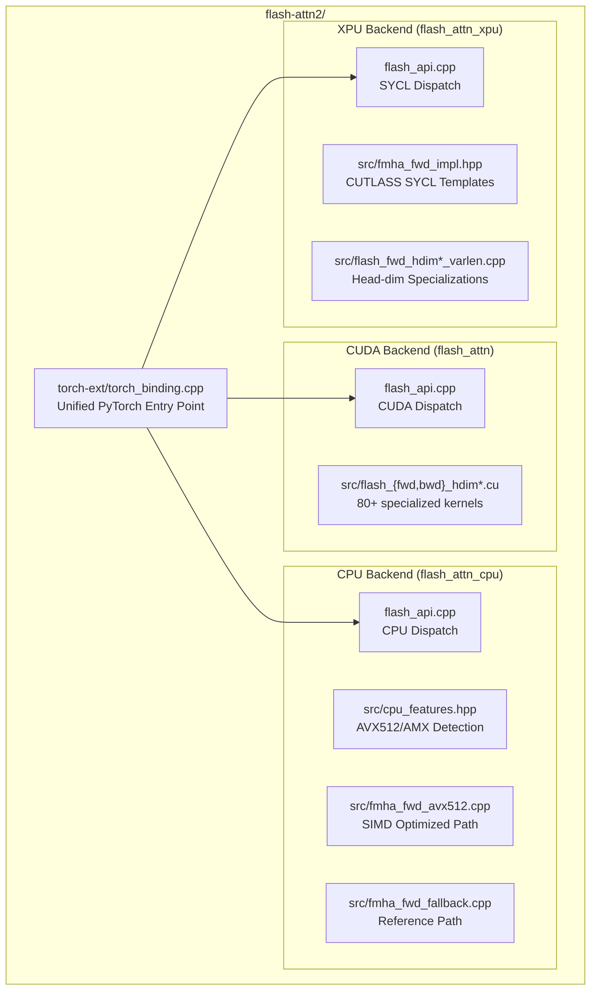
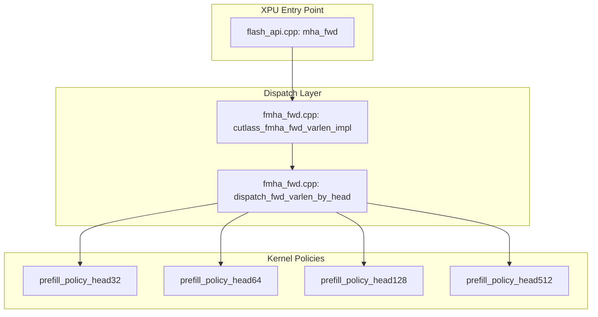

<!-- source: DeepWiki mcp.deepwiki.com · repo huggingface/kernels-community · extra page Flash Attention 2: CUDA and CPU Implementations · fetched 2026-10-26 -->

# Flash Attention 2: CUDA and CPU Implementations

<details>
<summary>Relevant source files</summary>

The following files were used as context for generating this wiki page:

- [flash-attn2/build.toml](flash-attn2/build.toml)
- [flash-attn2/flake.lock](flash-attn2/flake.lock)
- [flash-attn2/flake.nix](flash-attn2/flake.nix)
- [flash-attn2/flash_attn_cpu/flash_api.cpp](flash-attn2/flash_attn_cpu/flash_api.cpp)
- [flash-attn2/flash_attn_cpu/src/cpu_features.hpp](flash-attn2/flash_attn_cpu/src/cpu_features.hpp)
- [flash-attn2/flash_attn_cpu/src/fmha_fwd.hpp](flash-attn2/flash_attn_cpu/src/fmha_fwd.hpp)
- [flash-attn2/flash_attn_cpu/src/fmha_fwd_avx512.cpp](flash-attn2/flash_attn_cpu/src/fmha_fwd_avx512.cpp)
- [flash-attn2/flash_attn_cpu/src/fmha_fwd_avx512.hpp](flash-attn2/flash_attn_cpu/src/fmha_fwd_avx512.hpp)
- [flash-attn2/flash_attn_cpu/src/fmha_fwd_common.hpp](flash-attn2/flash_attn_cpu/src/fmha_fwd_common.hpp)
- [flash-attn2/flash_attn_cpu/src/fmha_fwd_dispatch.cpp](flash-attn2/flash_attn_cpu/src/fmha_fwd_dispatch.cpp)
- [flash-attn2/flash_attn_cpu/src/fmha_fwd_fallback.cpp](flash-attn2/flash_attn_cpu/src/fmha_fwd_fallback.cpp)
- [flash-attn2/flash_attn_cpu/src/fmha_fwd_fallback.hpp](flash-attn2/flash_attn_cpu/src/fmha_fwd_fallback.hpp)
- [flash-attn2/flash_attn_cpu/src/fmha_fwd_kernel.hpp](flash-attn2/flash_attn_cpu/src/fmha_fwd_kernel.hpp)
- [flash-attn2/flash_attn_xpu/flash_api.cpp](flash-attn2/flash_attn_xpu/flash_api.cpp)
- [flash-attn2/flash_attn_xpu/src/collective/fmha_fusion.hpp](flash-attn2/flash_attn_xpu/src/collective/fmha_fusion.hpp)
- [flash-attn2/flash_attn_xpu/src/collective/fmha_fwd_mainloop.hpp](flash-attn2/flash_attn_xpu/src/collective/fmha_fwd_mainloop.hpp)
- [flash-attn2/flash_attn_xpu/src/flash_bwd_hdim512_fix.cpp](flash-attn2/flash_attn_xpu/src/flash_bwd_hdim512_fix.cpp)
- [flash-attn2/flash_attn_xpu/src/flash_fwd_hdim512_fix.cpp](flash-attn2/flash_attn_xpu/src/flash_fwd_hdim512_fix.cpp)
- [flash-attn2/flash_attn_xpu/src/flash_fwd_hdim512_varlen.cpp](flash-attn2/flash_attn_xpu/src/flash_fwd_hdim512_varlen.cpp)
- [flash-attn2/flash_attn_xpu/src/fmha_bwd.cpp](flash-attn2/flash_attn_xpu/src/fmha_bwd.cpp)
- [flash-attn2/flash_attn_xpu/src/fmha_bwd.hpp](flash-attn2/flash_attn_xpu/src/fmha_bwd.hpp)
- [flash-attn2/flash_attn_xpu/src/fmha_bwd_types.hpp](flash-attn2/flash_attn_xpu/src/fmha_bwd_types.hpp)
- [flash-attn2/flash_attn_xpu/src/fmha_fwd.cpp](flash-attn2/flash_attn_xpu/src/fmha_fwd.cpp)
- [flash-attn2/flash_attn_xpu/src/fmha_fwd.hpp](flash-attn2/flash_attn_xpu/src/fmha_fwd.hpp)
- [flash-attn2/flash_attn_xpu/src/fmha_utils.hpp](flash-attn2/flash_attn_xpu/src/fmha_utils.hpp)
- [flash-attn2/flash_attn_xpu/src/kernel/fmha_fwd_kernel.hpp](flash-attn2/flash_attn_xpu/src/kernel/fmha_fwd_kernel.hpp)
- [flash-attn2/tests/conftest.py](flash-attn2/tests/conftest.py)

</details>


## Purpose and Scope

This document provides a detailed technical reference for the multi-backend implementation of Flash Attention 2 in the `kernels-community` repository. It covers the specialized CUDA kernels for NVIDIA GPUs, the CPU implementation optimized for AVX-512 and AMX, and the Intel XPU implementation using SYCL and CUTLASS.

For the Python API and higher-level layer interfaces, see [Flash Attention 2: Python API and Layers](4.1.2).

## Architecture Overview

Flash Attention 2 is implemented as a set of backend-specific kernels coordinated by a common PyTorch extension layer. The repository supports CUDA, CPU (x86_64), and XPU (Intel GPU) backends, each with specialized dispatch logic and hardware-specific optimizations.

### Multi-Backend File Structure



**Sources:** [flash-attn2/build.toml:1-9](), [flash-attn2/build.toml:15-19]()

---

## 1. CUDA Implementation

The CUDA implementation employs a specialized kernel matrix approach, generating separate optimized kernels for each combination of head dimension, data type, causality, and compute capability.

### Kernel Specialization Matrix
Flash Attention CUDA kernels are specialized across multiple dimensions to maximize performance.

| Dimension | Values |
|-----------|--------|
| **Head Dimension** | 32, 64, 96, 128, 192, 256 |
| **Data Type** | fp16, bf16 |
| **Causality** | causal, non-causal |
| **Kernel Type** | forward, backward, split-KV |

**Sources:** [flash-attn2/build.toml:89-165]()

### Core Implementation Headers
The CUDA implementation relies on template-based headers for tiling and hardware abstraction.

| Header | Purpose |
|--------|---------|
| `flash.h` | Main kernel template interface |
| `kernel_traits.h` | Per-config traits (tiling, shared memory) |
| `static_switch.h` | Compile-time dispatch for runtime parameters |
| `softmax.h` | Online softmax with numerical stability |

**Sources:** [flash-attn2/build.toml:74-88]()

---

## 2. XPU (Intel GPU) Implementation

The XPU backend uses SYCL and a port of CUTLASS (SYCL TLA) to implement Flash Attention for Intel GPUs. It supports both "Fixed" (standard batch) and "Varlen" (packed sequence) modes, along with Paged KV Cache support for inference.

### XPU Dispatch Logic
The XPU implementation uses a `policy_dispatch` system to map runtime head dimensions to specialized template instances.



**Sources:** [flash-attn2/flash_attn_xpu/flash_api.cpp:34-48](), [flash-attn2/flash_attn_xpu/src/fmha_fwd.cpp:27-38](), [flash-attn2/flash_attn_xpu/src/fmha_utils.hpp:21-75]()

### Key XPU Components
*   **Mainloop:** `FMHAFwdMainloop` implements the tiling logic for Q, K, and V loads using `TiledCopy` and `TiledMMA` abstractions from CUTLASS. [flash-attn2/flash_attn_xpu/src/collective/fmha_fwd_mainloop.hpp:72-107]()
*   **Paged KV Cache:** Supports paged attention by mapping logical sequence indices to physical blocks via a `ptr_page_table`. [flash-attn2/flash_attn_xpu/src/collective/fmha_fwd_mainloop.hpp:179-184]()
*   **Backward Pass:** Supports a deterministic mode using `nsplits` and a `dq_accum` buffer to avoid atomic collisions during gradient accumulation. [flash-attn2/flash_attn_xpu/src/fmha_bwd.cpp:92-113]()

---

## 3. CPU Implementation (AVX-512 / AMX)

The CPU backend provides an optimized path for x86_64 processors with AVX-512 and AMX (Advanced Matrix Extensions) support.

### Feature Detection and Dispatch
The CPU implementation dynamically detects hardware capabilities at runtime to choose the most efficient execution path.

| Path | Required Features | Implementation File |
|------|-------------------|---------------------|
| **AVX-512** | `f`, `bf16`, `vl`, `dq`, `bw` | `fmha_fwd_avx512.cpp` |
| **AMX** | `amx-bf16`, `amx-int8`, `amx-tile` | `fmha_fwd_avx512.cpp` |
| **Fallback** | Generic CPU | `fmha_fwd_fallback.cpp` |

**Sources:** [flash-attn2/build.toml:21-41](), [flash-attn2/flash_attn_cpu/src/cpu_features.hpp:1-58]()

### Build Configuration
The CPU build is restricted to `x86_64-linux` in the Nix flake and uses specific compiler flags to enable SIMD instructions.

```nix
# From flake.nix
supported = version: system: !(version ? "cpu") || system == "x86_64-linux";
```

**Sources:** [flash-attn2/flake.nix:25-26](), [flash-attn2/build.toml:23-33]()

---

## 4. Build and Test System

### Build System (Nix)
The implementation uses `kernel-builder` to orchestrate multi-backend compilation.
*   **CUDA:** Requires compute capabilities 8.0, 9.0, 10.0, or 12.0. [flash-attn2/build.toml:63-68]()
*   **XPU:** Requires PyTorch >= 2.9. [flash-attn2/flake.nix:31-34]()
*   **CPU:** Uses OpenMP for multi-threading. [flash-attn2/build.toml:24]()

### Testing Infrastructure
Correctness is validated across all backends using a shared `device` fixture that automatically selects the available hardware (CUDA -> XPU -> CPU).

```python
# From conftest.py
@pytest.fixture(scope="session")
def device(request):
    if torch.cuda.is_available():
        return "cuda"
    elif torch.xpu.is_available():
        return "xpu"
    else:
        return "cpu"
```

**Sources:** [flash-attn2/tests/conftest.py:7-14](), [flash-attn2/flake.nix:17-20]()

---

