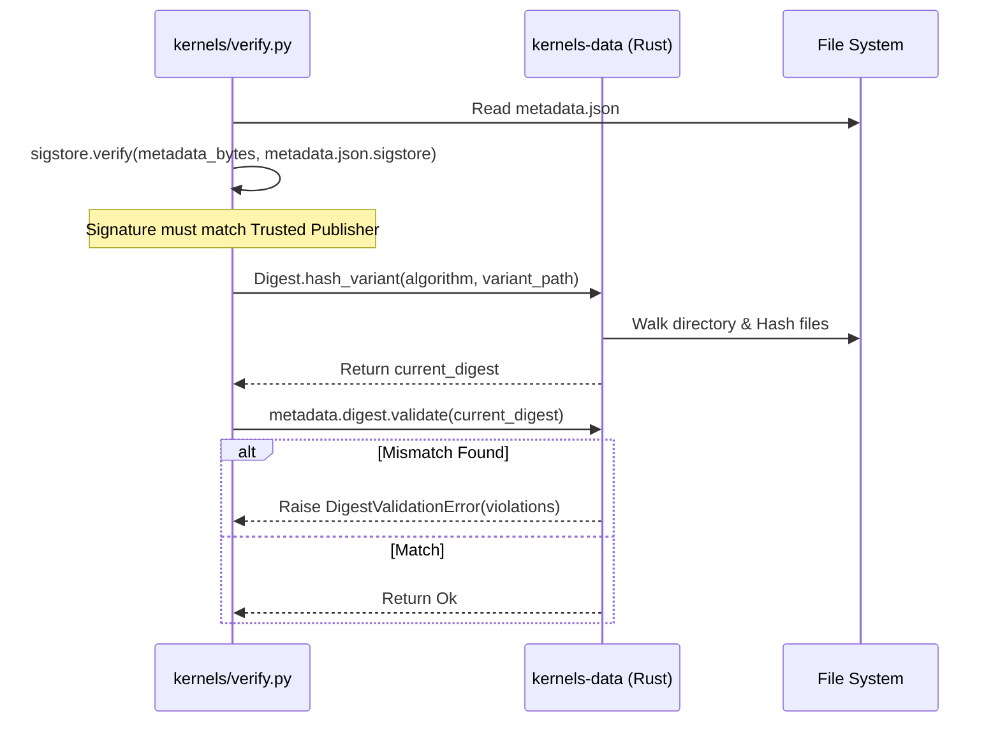

<!-- source: DeepWiki mcp.deepwiki.com · repo huggingface/kernels · page 10.1 Data Models and Configuration · fetched 2026-10-26 -->

# Data Models and Configuration

<details>
<summary>Relevant source files</summary>

The following files were used as context for generating this wiki page:

- [kernel-builder/src/hash.rs](kernel-builder/src/hash.rs)
- [kernel-builder/src/pyproject/templates/torch/noarch/setup.py](kernel-builder/src/pyproject/templates/torch/noarch/setup.py)
- [kernels-data/bindings/python/kernels_data.pyi](kernels-data/bindings/python/kernels_data.pyi)
- [kernels-data/bindings/python/src/lib.rs](kernels-data/bindings/python/src/lib.rs)
- [kernels-data/bindings/python/src/lock.rs](kernels-data/bindings/python/src/lock.rs)
- [kernels-data/bindings/python/src/version.rs](kernels-data/bindings/python/src/version.rs)
- [kernels-data/bindings/python/stubtest-allowlist.txt](kernels-data/bindings/python/stubtest-allowlist.txt)
- [kernels-data/bindings/python/tests/test_digest.py](kernels-data/bindings/python/tests/test_digest.py)
- [kernels-data/bindings/python/tests/test_kernel_lock.py](kernels-data/bindings/python/tests/test_kernel_lock.py)
- [kernels-data/bindings/python/tests/test_kernels_data.py](kernels-data/bindings/python/tests/test_kernels_data.py)
- [kernels-data/bindings/python/tests/test_version.py](kernels-data/bindings/python/tests/test_version.py)
- [kernels-data/src/config/kernel_deps.rs](kernels-data/src/config/kernel_deps.rs)
- [kernels-data/src/config/mod.rs](kernels-data/src/config/mod.rs)
- [kernels-data/src/config/v2.rs](kernels-data/src/config/v2.rs)
- [kernels-data/src/config/v3.rs](kernels-data/src/config/v3.rs)
- [kernels-data/src/config/v4.rs](kernels-data/src/config/v4.rs)
- [kernels-data/src/config/v5.rs](kernels-data/src/config/v5.rs)
- [kernels-data/src/digest.rs](kernels-data/src/digest.rs)
- [kernels-data/src/lib.rs](kernels-data/src/lib.rs)
- [kernels-data/src/lock.rs](kernels-data/src/lock.rs)
- [kernels-data/src/metadata.rs](kernels-data/src/metadata.rs)
- [kernels-data/src/version.rs](kernels-data/src/version.rs)
- [kernels/src/kernels/verify.py](kernels/src/kernels/verify.py)
- [nix-builder/pkgs/hash-kernel-hook/default.nix](nix-builder/pkgs/hash-kernel-hook/default.nix)

</details>


The `kernels-data` Rust crate serves as the core data layer for the entire kernels ecosystem. It defines the schemas for kernel metadata, build configurations (`build.toml`), and versioned lockfiles. By providing a shared library with Python bindings via PyO3, it ensures that both the Rust-based `kernel-builder` and the Python-based `kernels` runtime package operate on a single source of truth for kernel identification and verification.

## Core Data Schema: Metadata

The `Metadata` struct represents the definitive state of a specific kernel variant. It is serialized as `metadata.json` and bundled within every kernel distribution [kernels-data/src/metadata.rs:92-109]().

### Metadata Structure
| Field | Type | Description |
| :--- | :--- | :--- |
| `name` | `KernelName` | Validated name (e.g., `flash-attention`) [kernels-data/src/metadata.rs:93](). |
| `id` | `String` | Unique identifier for the specific build variant [kernels-data/src/metadata.rs:94](). |
| `version` | `usize` | The integer version of the kernel [kernels-data/src/metadata.rs:95](). |
| `backend` | `BackendInfo` | Hardware target (CUDA, ROCm, XPU, etc.) and architectures [kernels-data/src/metadata.rs:104](). |
| `digest` | `Option<Digest>` | SHA-based file manifest for integrity verification [kernels-data/src/metadata.rs:106](). |
| `provenance` | `Option<Provenance>` | Git state of the builder and source code [kernels-data/src/metadata.rs:108](). |

### Provenance and Reproducibility
Provenance tracks the exact environment used to produce a build. The `Provenance` struct captures the `GitStatus` (commit OID and "dirty" flag) for both the `kernel-builder` tool and the kernel source code [kernels-data/src/metadata.rs:71-79](). A build is considered "dirty" if either the builder or the source had uncommitted changes [kernels-data/src/metadata.rs:83-87]().

**Sources:** [kernels-data/src/metadata.rs:71-109](), [kernels-data/src/git.rs:1-10]()

---

## Build Configuration (`build.toml`)

The `build.toml` file defines how a kernel should be built across different backends and frameworks. The crate implements a versioned configuration system (v1 through v5) with a compatibility layer for seamless migration.

### Versioned Config Architecture
The system uses an `Edition` field to distinguish between schema versions. The current stable version is **Edition 5** [kernels-data/src/config/mod.rs:37-38]().

| Edition | Key Changes |
| :--- | :--- |
| **v3** | Introduced `Framework` enum (Torch, TvmFfi) and per-backend `Kernel` definitions [kernels-data/src/config/v3.rs:25-30](). |
| **v4** | Added explicit `TorchNoarch` framework and `stable-abi` versioning [kernels-data/src/config/v4.rs:25-27, 93](). |
| **v5** | Current standard. Supports `kernel-depends` for inter-kernel dependencies and multi-backend `stable-abi` tables [kernels-data/src/config/v5.rs:61, 120](). |

### Framework Abstraction
The `Framework` enum determines the build logic applied to the source files [kernels-data/src/config/mod.rs:65-69]():
*   **Torch**: C++ extensions for PyTorch with optional Stable ABI support.
*   **TorchNoarch**: Python-only or Triton-based kernels that are architecture-independent but may target specific GPU capabilities.
*   **TvmFfi**: Kernels utilizing the TVM Foreign Function Interface.

### Configuration Entity Mapping
The following diagram maps the logical configuration concepts to their implementation in `kernels-data`.

**Diagram: Build Configuration Entity Map**
```mermaid
graph TD
    subgraph "Logic Space"
        "Kernel Definition"
        "Hardware Target"
        "Build Requirements"
    end

    subgraph "Code Entity Space (kernels-data/src/config)"
        "Build[v5::Build]" --> "General[v5::General]"
        "Build[v5::Build]" --> "Framework[v5::Framework]"
        "Build[v5::Build]" --> "Kernel[v5::Kernel]"
        
        "General[v5::General]" --> "KernelName[name.rs]"
        "General[v5::General]" --> "GitUrl[git_url.rs]"
        "General[v5::General]" --> "KernelDependency[kernel_deps.rs]"
        
        "Kernel[v5::Kernel]" --> "Backend[mod.rs]"
        "Kernel[v5::Kernel]" --> "Dependency[deps.rs]"
    end

    "Kernel Definition" -.-> "Build[v5::Build]"
    "Hardware Target" -.-> "Backend[mod.rs]"
    "Build Requirements" -.-> "Dependency[deps.rs]"
```
**Sources:** [kernels-data/src/config/mod.rs:40-69](), [kernels-data/src/config/v5.rs:20-70](), [kernels-data/src/config/kernel_deps.rs:11-16]()

---

## Integrity and Hashing

Integrity is maintained via the `Digest` struct, which contains a `BTreeMap` of relative file paths to their base64-encoded hashes [kernels-data/src/digest.rs:14-18]().

### Hashing Implementation
The `hash_variant` function performs the following steps [kernels-data/src/digest.rs:84-135]():
1.  Walks the variant directory recursively.
2.  **Excludes** `metadata.json` and `metadata.json.sigstore` (as they contain or sign the hashes).
3.  **Excludes** Python artifacts like `__pycache__` and `.pyc` files.
4.  Normalizes Windows path separators to `/` for cross-platform consistency.
5.  Computes SHA256 or SHA512 hashes for all included files.

### Verification Flow
When a kernel is loaded, the `verify_variant` function in the Python runtime calls the Rust `Digest::validate` method.

**Diagram: Kernel Verification Data Flow**

**Sources:** [kernels-data/src/digest.rs:147-184](), [kernels/src/kernels/verify.py:156-225]()

---

## Python Bindings (`kernels_data`)

The Rust structures are exposed to Python using PyO3. This allows the high-level `kernels` package to perform complex version resolution and dependency validation using the performant Rust implementation.

### Key Python-Exposed Classes
*   **`KernelName`**: Ensures names follow the regex `^[a-z][-a-z0-9]*[a-z0-9]$` [kernels-data/bindings/python/src/lib.rs:23-53]().
*   **`Version`**: Implements dotted numeric versioning (e.g., `12.8.0`) with normalization of trailing zeros [kernels-data/bindings/python/kernels_data.pyi:135-157]().
*   **`KernelDependency`**: Manages requirements for other kernels on the Hub, supporting both integer `version` and string `revision` (git hash) [kernels-data/src/config/kernel_deps.rs:3-16]().
*   **`KernelLocks`**: Parses `kernels.lock` files to ensure reproducible kernel loading [kernels-data/bindings/python/src/lock.rs]().

### Compatibility Layer
The `compat.rs` module handles the transformation of legacy configuration formats into the current internal representation (`v5`). This allows the system to build kernels defined with older `build.toml` versions without requiring manual updates to the source repositories [kernels-data/src/config/compat.rs](), [kernels-data/src/config/v3.rs:162-188]().

**Sources:** [kernels-data/bindings/python/src/lib.rs:1-136](), [kernels-data/bindings/python/kernels_data.pyi:1-200](), [kernels-data/src/config/mod.rs:15-31]()

---

