# Page: Overview

# Overview

<details>
<summary>Relevant source files</summary>

The following files were used as context for generating this wiki page:

- [README.md](README.md)
- [docs/source/basic-usage.md](docs/source/basic-usage.md)
- [docs/source/blog.md](docs/source/blog.md)
- [docs/source/index.md](docs/source/index.md)
- [docs/source/integrating-kernels.md](docs/source/integrating-kernels.md)
- [docs/source/kernel-requirements.md](docs/source/kernel-requirements.md)
- [docs/source/layers.md](docs/source/layers.md)
- [docs/source/locking.md](docs/source/locking.md)
- [docs/source/migration.md](docs/source/migration.md)
- [docs/source/talks.md](docs/source/talks.md)
- [docs/source/why_kernels.md](docs/source/why_kernels.md)
- [examples/basic.py](examples/basic.py)

</details>


This document provides an overview of the `kernels` repository, a comprehensive system for managing and utilizing optimized compute kernels from the Hugging Face Hub. The kernels system enables Python applications to dynamically load high-performance compute kernels that can replace standard PyTorch operations with optimized implementations, solving common issues like ABI fragmentation and "CUDA version hell".

The scope of this documentation covers the complete kernels ecosystem, including kernel discovery, the Nix-based build system, PyTorch layer integration, and the Rust-powered metadata engine.

## What are Kernels?

Kernels in this context are optimized compute implementations (typically C++, CUDA, ROCm, or Triton) that can replace standard PyTorch operations. Unlike traditional Python packages, Hub kernels are designed to be:

- **Portable**: A kernel can be loaded from paths outside `PYTHONPATH` [README.md:25-25]().
- **Unique**: Multiple versions of the same kernel can be loaded in the same Python process [README.md:26-27]().
- **Compatible**: Kernels must support all recent versions of Python and different PyTorch build configurations (various CUDA versions and C++ ABIs) [README.md:28-30]().

*Sources: [README.md:20-31](), [docs/source/index.md:10-21]()*

## Two-Component Architecture

The repository is split into two primary components that bridge the gap between kernel development and user consumption:

1.  **`kernels` Python Package**: A user-facing library that lets users load compatible compute kernels from the Hub, manage local caches, and perform "kernelization" of PyTorch models [docs/source/index.md:28-29]().
2.  **`kernel-builder` CLI**: A Rust-based tool for kernel authors to build, package, and distribute kernels. It enforces reproducibility via Nix and generates the necessary `metadata.json` for Hub compatibility [docs/source/index.md:27-27]().

### System Component Interaction

The following diagram illustrates how the Python package, the Rust-based `kernels-data` library, and the `kernel-builder` interact with the Hugging Face Hub.

**System Architecture Overview**
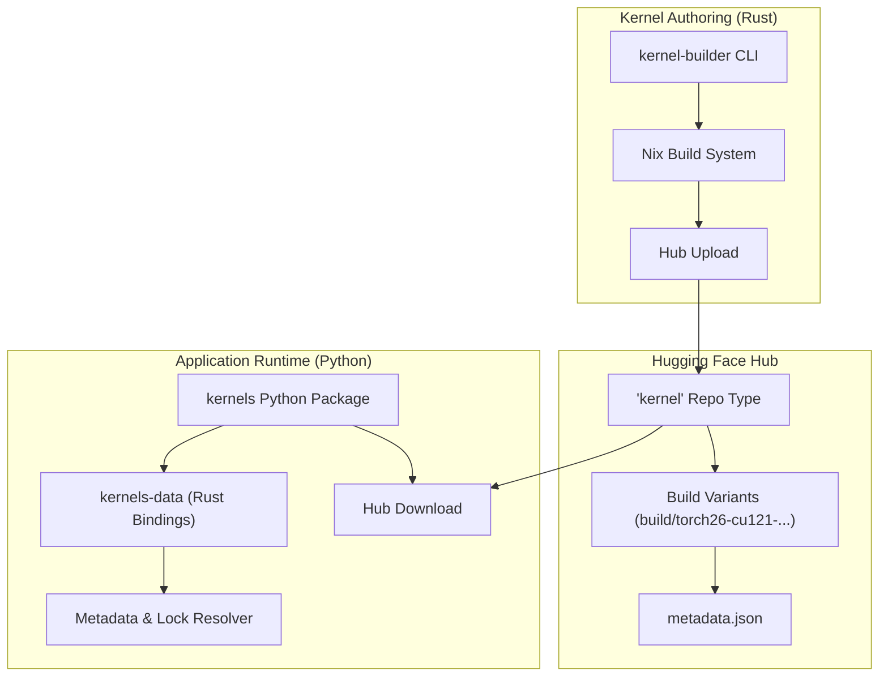
*Sources: [docs/source/index.md:25-29](), [docs/source/kernel-requirements.md:34-40](), [docs/source/kernel-requirements.md:63-64]()*

## The Problem Solved: ABI and Versioning

Traditional Python wheels for CUDA kernels are often tied to a specific `torch` version and CUDA toolkit version. Upgrading `torch` frequently breaks local kernel builds. The `kernels` system solves this by:
- **Build Variants**: Providing a matrix of pre-compiled binaries for different `torch`, `cuda`, `rocm`, and `xpu` versions [docs/source/kernel-requirements.md:54-59]().
- **ABI Stability**: Enforcing `manylinux_2_28` and Python Limited API (`abi3`) to ensure binaries work across different Linux distributions [docs/source/kernel-requirements.md:4-5]().
- **Dynamic Selection**: `get_kernel()` automatically detects the host environment (e.g., `torch` version, C++ ABI, and GPU capability) to pull the correct binary [docs/source/basic-usage.md:40-49]().

## Key Concepts and Architecture

To navigate the codebase effectively, it is essential to understand the underlying data models and the lifecycle of a kernel from source to execution.

- **For a deep dive into vocabulary (Variants, Trusted Publishers, Backends), see [Key Concepts](#1.1).**
- **For details on the multi-language structure (Rust + Python) and the Nix build lifecycle, see [Architecture Overview](#1.2).**

### Core Entity Mapping

This diagram maps high-level concepts to the specific code entities that implement them.

**Entity Mapping: Natural Language to Code**
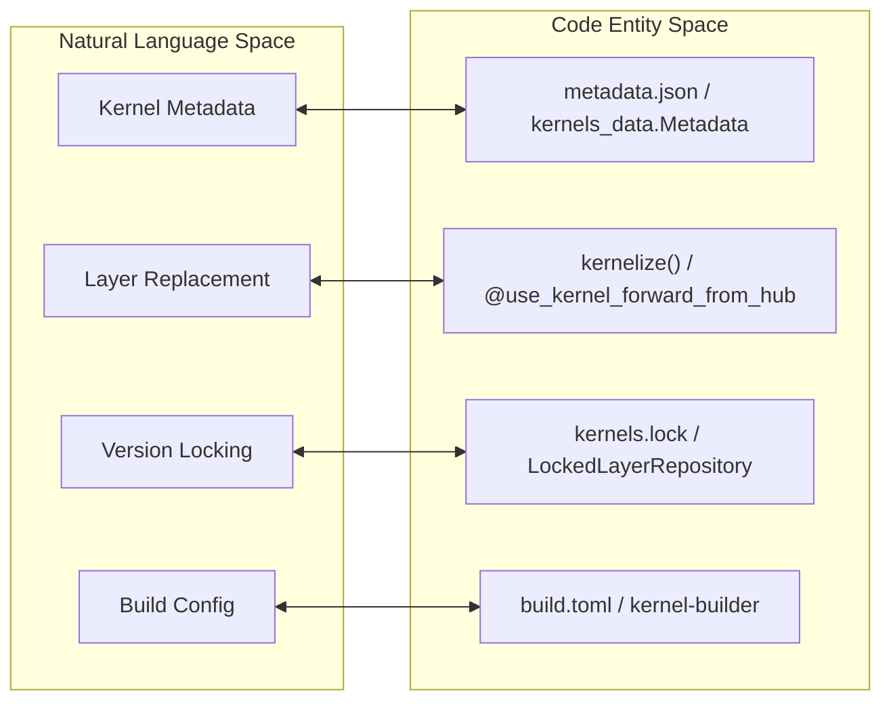
*Sources: [docs/source/kernel-requirements.md:63-70](), [docs/source/layers.md:15-19](), [docs/source/locking.md:12-16](), [docs/source/layers.md:88-95]()*

## Quick Summary of Interfaces

| Interface | Primary Symbols | Purpose |
| :--- | :--- | :--- |
| **Loader API** | `get_kernel`, `has_kernel` | Discovery and dynamic loading of Hub kernels [docs/source/basic-usage.md:9-12](). |
| **Layer API** | `kernelize`, `LayerRepository` | Injecting kernels into existing `nn.Module` graphs [docs/source/layers.md:88-95](). |
| **Locking API** | `get_locked_kernel`, `kernels.lock` | Reproducibility and version pinning [docs/source/locking.md:16-24](). |
| **Builder CLI** | `build-and-upload`, `create-pyproject` | Compiling and publishing new kernels [docs/source/migration.md:90-94](). |

For installation instructions and basic usage examples, see [Getting Started](#2). For detailed technical information about specific components, refer to the relevant sections in [Kernel Management](#3) and [Layer Kernelization](#4).

---

# Page: Key Concepts

# Key Concepts

<details>
<summary>Relevant source files</summary>

The following files were used as context for generating this wiki page:

- [README.md](README.md)
- [docs/source/basic-usage.md](docs/source/basic-usage.md)
- [docs/source/blog.md](docs/source/blog.md)
- [docs/source/cli-versions.md](docs/source/cli-versions.md)
- [docs/source/index.md](docs/source/index.md)
- [docs/source/integrating-kernels.md](docs/source/integrating-kernels.md)
- [docs/source/kernel-requirements.md](docs/source/kernel-requirements.md)
- [docs/source/layers.md](docs/source/layers.md)
- [docs/source/locking.md](docs/source/locking.md)
- [docs/source/migration.md](docs/source/migration.md)
- [docs/source/talks.md](docs/source/talks.md)
- [docs/source/why_kernels.md](docs/source/why_kernels.md)
- [examples/basic.py](examples/basic.py)
- [kernels/src/kernels/variants.py](kernels/src/kernels/variants.py)
- [kernels/tests/test_variants.py](kernels/tests/test_variants.py)

</details>


This document defines the fundamental concepts and terminology used throughout the `kernels` system. It covers the core abstractions that enable portable, versioned, and optimized compute kernels to be loaded from Hugging Face Hub and integrated into PyTorch models.

## Kernels

A **kernel** is a precompiled, optimized compute implementation that can be dynamically loaded from the Hugging Face Hub. Kernels differ from traditional Python packages in three key ways:

| Property | Description |
|----------|-------------|
| **Portable** | Can be loaded from paths outside `PYTHONPATH` [README.md:25](). |
| **Unique** | Multiple versions of the same kernel can be loaded in the same Python process [README.md:26-27](). |
| **Compatible** | Support all recent PyTorch versions and build configurations (various CUDA versions and C++ ABIs) [README.md:28-30](). |

Kernels are accessed through the `get_kernel()` function, which downloads and caches them locally [kernels/src/kernels/basic-usage.md:12]().

```python
# Load a kernel from the Hub
activation = get_kernel("kernels-community/activation", version=1)

# Use kernel functions directly
y = torch.empty_like(x)
activation.gelu_fast(y, x)
```

**Kernel Lifecycle**
Title: "Kernel Distribution and Execution Flow"
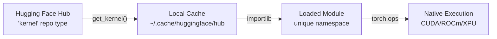
Sources: [README.md:20-31](), [docs/source/basic-usage.md:5-22](), [docs/source/kernel-requirements.md:12-15]()

## Kernel Variants

**Kernel variants** are different builds of the same kernel optimized for specific hardware and software configurations. Each variant follows a naming convention that encodes the target environment [docs/source/kernel-requirements.md:36-40]():

```
<framework><version>-cxx<abiver>-<backend><ver>-<arch>-<os>
```

**Example Variants:**
- `torch26-cxx11-cu118-x86_64-linux`: PyTorch 2.6, C++11 ABI, CUDA 11.8, x86_64 Linux.
- `torch27-cxx98-rocm61-x86_64-linux`: PyTorch 2.7, C++98 ABI, ROCm 6.1, x86_64 Linux.
- `torch-universal`: Fallback variant for generic environments [docs/source/kernel-requirements.md:50-52]().

**Variant Selection Logic**
Title: "Variant Selection (Code Entity Space)"
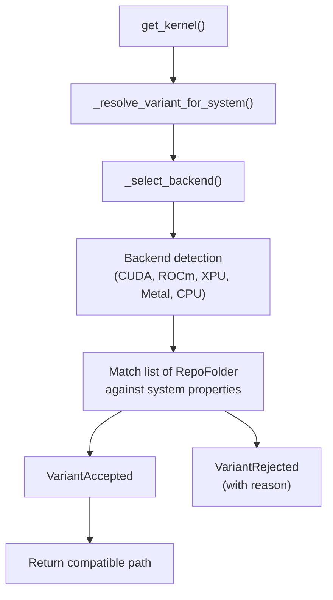
Sources: [kernels/src/kernels/variants.py:201-215](), [kernels/src/kernels/variants.py:24-26](), [docs/source/kernel-requirements.md:36-40]()

## Hub Integration

Kernels are first-class repository types on the Hugging Face Hub [docs/source/index.md:11-12]().

### Trusted Publishers
By default, `kernels` only loads from a curated set of trusted publishers (e.g., `kernels-community`). Loading from other organizations requires an explicit `trust_remote_code=True` flag [docs/source/kernel-requirements.md:19-29]().

### Version vs. Revision
- **Version**: A major integer (e.g., `version=1`). Kernel maintainers must ensure no breaking changes within a major version [docs/source/basic-usage.md:25-32]().
- **Revision**: A specific Git ref (branch name or commit hash). Revisions are used for exact pinning [docs/source/basic-usage.md:31]().

Sources: [docs/source/kernel-requirements.md:17-32](), [docs/source/basic-usage.md:24-36]()

## Layer Kernelization

**Layer kernelization** replaces the `forward` method of an existing `torch.nn.Module` with an optimized Hub kernel [docs/source/layers.md:3-6]().

### Key Classes
- `LayerRepository`: Defines a Hub-backed replacement (repo, layer name, version/revision) [docs/source/layers.md:167-171]().
- `LocalLayerRepository`: Points to a local path for development.
- `LockedLayerRepository`: Uses a `kernels.lock` file for resolution [docs/source/locking.md:37-40]().

### Mode and Device
- **Mode**: Defines the context, such as `Mode.INFERENCE`, `Mode.TRAINING`, or `Mode.TORCH_COMPILE` [docs/source/layers.md:94-123]().
- **Device**: The compute backend (e.g., `cuda`, `rocm`, `xpu`, `metal`, `cpu`) [docs/source/layers.md:127-137]().

**Layer Replacement Logic**
Title: "Layer Kernelization (Code Entity Space)"
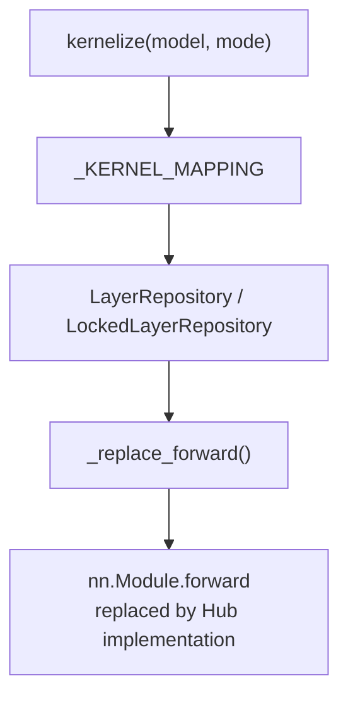
Sources: [docs/source/layers.md:84-110](), [docs/source/layers.md:160-188](), [docs/source/locking.md:31-45]()

## Extensible Layers

An **extensible layer** is a module designed to be intercepted. 
- **Decorator**: `@use_kernel_forward_from_hub("Name")` marks a class or function as extensible [docs/source/layers.md:19-24]().
- **Function Kernelization**: Functions can be made extensible using the same decorator and then attached to a module via `@use_kernelized_func(func)` [docs/source/layers.md:54-79]().

**Pure Layer Requirements:**
To ensure portability, kernel layers must be "pure":
1. No constructor (`__init__`) logic that changes state [docs/source/kernel-requirements.md:183]().
2. Stateless implementations.
3. Only `forward()` implementation is provided by the kernel.

Sources: [docs/source/layers.md:13-83](), [docs/source/kernel-requirements.md:183]()

## Version Locking

Version locking provides reproducible builds by pinning exact Git commit hashes in a `kernels.lock` file [docs/source/locking.md:16-19]().

1. **Dependency Definition**: Defined in `pyproject.toml` under `[tool.kernels.dependencies]` [docs/source/locking.md:7-14]().
2. **Lock Generation**: The `kernels lock .` command resolves constraints to exact revisions [docs/source/locking.md:16]().
3. **Consumption**: `get_locked_kernel()` or `load_kernel()` uses the lockfile to ensure the exact same code is used across different environments [docs/source/locking.md:18-24]().

Sources: [docs/source/locking.md:3-24](), [docs/source/locking.md:72-78]()

## Compute Backends

The system supports a wide matrix of compute backends, each with specific architecture requirements defined in `metadata.json` [docs/source/kernel-requirements.md:142-157]().

| Backend | Metadata `type` | Description |
|---------|-----------------|-------------|
| **CUDA** | `cuda` | NVIDIA GPUs (archs like `8.0`, `9.0+PTX`) |
| **ROCm** | `rocm` | AMD GPUs |
| **XPU** | `xpu` | Intel GPUs |
| **Metal** | `metal` | Apple Silicon (requires macOS 15+) [kernels/src/kernels/variants.py:33]() |
| **CPU** | `cpu` | Standard x86_64 or aarch64 |

Sources: [docs/source/kernel-requirements.md:142-157](), [kernels/src/kernels/variants.py:17-26]()

---

# Page: Architecture Overview

# Architecture Overview

<details>
<summary>Relevant source files</summary>

The following files were used as context for generating this wiki page:

- [Cargo.lock](Cargo.lock)
- [docs/source/builder-cli.md](docs/source/builder-cli.md)
- [kernel-builder/Cargo.toml](kernel-builder/Cargo.toml)
- [kernel-builder/src/hf.rs](kernel-builder/src/hf.rs)
- [kernel-builder/src/main.rs](kernel-builder/src/main.rs)
- [kernel-builder/src/pyproject/mod.rs](kernel-builder/src/pyproject/mod.rs)
- [kernel-builder/src/pyproject/ops_identifier.rs](kernel-builder/src/pyproject/ops_identifier.rs)
- [kernel-builder/src/upload.rs](kernel-builder/src/upload.rs)
- [kernels-data/Cargo.toml](kernels-data/Cargo.toml)
- [kernels-data/bindings/python/Cargo.toml](kernels-data/bindings/python/Cargo.toml)
- [kernels-data/bindings/python/kernels_data.pyi](kernels-data/bindings/python/kernels_data.pyi)
- [kernels-data/bindings/python/src/lib.rs](kernels-data/bindings/python/src/lib.rs)
- [kernels-data/src/git.rs](kernels-data/src/git.rs)
- [kernels-data/src/lib.rs](kernels-data/src/lib.rs)
- [kernels-data/src/metadata.rs](kernels-data/src/metadata.rs)
- [kernels/pyproject.toml](kernels/pyproject.toml)
- [kernels/uv.lock](kernels/uv.lock)
- [nix-builder/pkgs/crate-dirs.nix](nix-builder/pkgs/crate-dirs.nix)
- [nix-builder/pkgs/kernel-builder/default.nix](nix-builder/pkgs/kernel-builder/default.nix)
- [nix-builder/pkgs/python-modules/kernels-data/default.nix](nix-builder/pkgs/python-modules/kernels-data/default.nix)

</details>


This document provides a high-level overview of the kernels system architecture, covering the core components and their interactions. The system is designed to manage optimized compute kernels from Hugging Face Hub and integrate them seamlessly into PyTorch models. It utilizes a multi-language structure (Rust + Python) to balance performance, metadata integrity, and developer ergonomics.

## System Components

The kernels architecture consists of four primary layers that work together to provide seamless kernel management and integration:

1.  **User Interface Layer**: CLI tools (`kernels` in Python, `kernel-builder` in Rust) and Python APIs for kernel operations.
2.  **Kernel Management Layer**: Core utilities for downloading, caching, and loading kernels.
3.  **Layer Integration Layer**: System for replacing PyTorch layer implementations via `kernelize()`.
4.  **Hub Integration Layer**: Interface with Hugging Face Hub for kernel distribution and Nix-based build infrastructure.

## Multi-Language Structure

The repository is structured to use Rust for heavy-duty metadata management and build orchestration, while providing a rich Python API for end-users.

*   **`kernels` (Python)**: The primary package for users. Handles runtime loading, PyTorch layer injection, and Hub interaction [kernels/pyproject.toml:1-21]().
*   **`kernels-data` (Rust)**: The source of truth for data models. It defines the schema for `metadata.json`, `build.toml`, and lockfiles [kernels-data/src/metadata.rs:92-109]().
*   **`kernels_data` (PyO3 Bindings)**: Exposes Rust data structures to Python, ensuring consistent parsing and validation across the stack [kernels-data/bindings/python/src/lib.rs:11-22]().
*   **`kernel-builder` (Rust)**: A CLI tool for kernel developers. It orchestrates Nix builds, generates boilerplate, and handles Hub uploads [kernel-builder/src/main.rs:81-256]().

## Build-to-Load Lifecycle

The lifecycle of a kernel flows from source code through a strictly defined build process to dynamic loading at runtime.

### 1. Build Phase (`kernel-builder`)
Developers use `kernel-builder` to compile kernels. The tool generates a `pyproject.toml` for the extension and invokes Nix to ensure a reproducible environment [kernel-builder/src/main.rs:174-202]().

```mermaid
graph TD
    subgraph "Source Space"
        BT["build.toml"]
        SRC["Kernel Source (C++/Cuda/Triton)"]
    end

    subgraph "kernel-builder (Rust)"
        CP["create_pyproject()"]
        KI["KernelIdentifier"]
        PV["Provenance"]
    end

    subgraph "Nix Build System"
        NB["nix-builder"]
        VAR["Build Variants"]
    end

    BT --> CP
    SRC --> CP
    CP --> KI [kernel-builder/src/pyproject/mod.rs:76-76]
    CP --> PV [kernel-builder/src/pyproject/mod.rs:71-74]
    KI --> NB
    NB --> VAR
```
Sources: [kernel-builder/src/pyproject/mod.rs:48-81](), [kernel-builder/src/main.rs:89-110]()

### 2. Distribution Phase (Hub Integration)
Built artifacts (variants) are uploaded to the Hugging Face Hub. The system uses a specific branch structure (`v{version}`) and includes `metadata.json` for each variant [kernel-builder/src/upload.rs:169-175]().

```mermaid
graph LR
    subgraph "Local Artifacts"
        V1["Variant A (CUDA 12.4)"]
        V2["Variant B (ROCm 6.1)"]
        META["metadata.json"]
    end

    subgraph "HF Hub Repository"
        RB["Branch: v1"]
        MD["Model Card (CARD.md)"]
    end

    V1 --> RB
    V2 --> RB
    META --> RB [kernel-builder/src/upload.rs:184-210]
    MD --> RB
```
Sources: [kernel-builder/src/upload.rs:10-14](), [kernel-builder/src/metadata.rs:92-109]()

### 3. Loading Phase (Python Runtime)
The `kernels` Python package resolves the correct variant for the user's hardware and loads the shared library.

| Code Entity | Role |
| :--- | :--- |
| `get_kernel()` | Main entry point for fetching/loading a kernel. |
| `Metadata` | Rust-backed class describing kernel backend and dependencies [kernels-data/src/metadata.rs:92-109](). |
| `Provenance` | Records the `kernel-builder` version and git SHA of the source [kernels-data/src/metadata.rs:69-79](). |
| `Backend` | Enum for hardware targets (CUDA, ROCm, XPU, etc.) [kernels-data/bindings/python/src/lib.rs:56-75](). |

## Core Data Models (`kernels-data`)

The `kernels-data` crate ensures that metadata is validated and consistent.

*   **`Metadata`**: Contains the kernel name, version, license, and backend-specific info like supported architectures [kernels-data/src/metadata.rs:92-109]().
*   **`Digest`**: Stores SHA-based hashes of all files in a build variant to prevent tampering [kernels-data/bindings/python/kernels_data.pyi:192-232]().
*   **`Provenance`**: Tracks the "ancestry" of a build, including whether the build was "dirty" (had uncommitted changes) [kernels-data/src/metadata.rs:81-87]().

```mermaid
classDiagram
    class Metadata {
        +KernelName name
        +String id
        +usize version
        +BackendInfo backend
        +Provenance provenance
        +Digest digest
    }
    class Provenance {
        +KernelBuilderVersion kernel_builder
        +GitStatus kernel
        +is_dirty() bool
    }
    class BackendInfo {
        +Backend backend_type
        +Option~Vec~String~~ archs
    }
    Metadata *-- Provenance : [kernels-data/src/metadata.rs:108]
    Metadata *-- BackendInfo : [kernels-data/src/metadata.rs:104]
    Provenance *-- GitStatus : [kernels-data/src/metadata.rs:78]
```
Sources: [kernels-data/src/metadata.rs:10-109](), [kernels-data/bindings/python/src/lib.rs:139-174]()

## CLI Command Architecture

The system provides two primary CLI entry points:

### Python `kernels` CLI
Focuses on end-user operations like locking and downloading [kernels/pyproject.toml:63-64]().
*   `kernels lock`: Generates `kernels.lock` using `kernels-data` models.
*   `kernels download`: Fetches variants from the Hub.

### Rust `kernel-builder` CLI
Focuses on the development and build lifecycle [kernel-builder/src/main.rs:81-256]().
*   `init`: Scaffolds a new project [kernel-builder/src/main.rs:86-86]().
*   `build`: Invokes Nix to compile variants [kernel-builder/src/main.rs:89-100]().
*   `upload`: Pushes artifacts to HF Hub [kernel-builder/src/main.rs:156-156]().
*   `check-abi`: Validates that the built library adheres to `manylinux_2_28` or other standards [kernel-builder/src/main.rs:165-165]().

Sources: [kernel-builder/src/main.rs:1-256](), [docs/source/builder-cli.md:1-52]()

---

# Page: Getting Started

# Getting Started

<details>
<summary>Relevant source files</summary>

The following files were used as context for generating this wiki page:

- [README.md](README.md)
- [docs/source/blog.md](docs/source/blog.md)
- [docs/source/builder/why-nix.md](docs/source/builder/why-nix.md)
- [docs/source/index.md](docs/source/index.md)
- [docs/source/installation.md](docs/source/installation.md)
- [docs/source/talks.md](docs/source/talks.md)
- [docs/source/why_kernels.md](docs/source/why_kernels.md)
- [examples/basic.py](examples/basic.py)
- [nix-builder/README.md](nix-builder/README.md)

</details>


This guide provides step-by-step instructions for installing and using the kernels system to load optimized compute kernels from Hugging Face Hub. It covers basic installation, your first kernel execution, and introduces core concepts needed for everyday usage.

For detailed installation requirements, see [Installation](#2.1). For more practical code samples, see [Basic Usage Examples](#2.2).

## Prerequisites and Installation

The `kernels` package requires `torch>=2.5` [README.md:40-40]() and is designed to support various compute backends including CUDA, ROCm, XPU, and Metal [nix-builder/README.md:49-57]().

### Installation

Install the core `kernels` package using `pip` or `uv`:

```bash
pip install kernels
# OR
uv pip install kernels
```

For specific environments, you can use curated dependency groups:
* **Standard Curated**: Includes common dependencies like CUTLASS DSL and einops [docs/source/installation.md:38-41]().
* **XPU Curated**: Optimized for Intel GPU platforms [docs/source/installation.md:47-51]().

```bash
pip install "kernels[curated]"
```

**Sources:** [README.md:40-44](), [docs/source/installation.md:18-52]()

## Core Workflow Overview

The system bridges the gap between the Hugging Face Hub and your local PyTorch runtime by managing the lifecycle of portable, unique, and compatible kernel binaries [docs/source/index.md:13-21]().

### System Component Mapping

This diagram maps Natural Language concepts to the specific code entities and files that implement them.

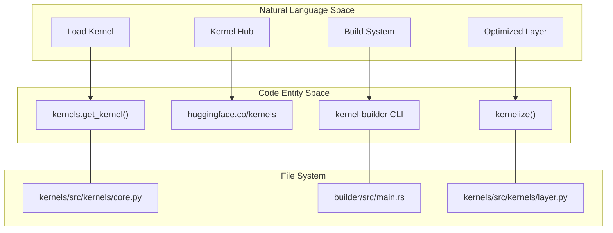

**Sources:** [README.md:32-37](), [docs/source/index.md:25-29]()

## Your First Kernel

The primary way to interact with the system is through the `get_kernel` function, which resolves a Hub repository to a local, usable object [examples/basic.py:8-8]().

### Basic Kernel Execution Example

```python
import torch
from kernels import get_kernel

# 1. Resolve and download kernel from Hub
# Reference: [examples/basic.py:8]
activation = get_kernel("kernels-community/activation", version=1)

# 2. Prepare data
x = torch.randn((10, 10), dtype=torch.float16, device="cuda")
y = torch.empty_like(x)

# 3. Execute optimized function
# Reference: [examples/basic.py:18]
activation.gelu_fast(y, x)
```

### Kernel Loading Lifecycle

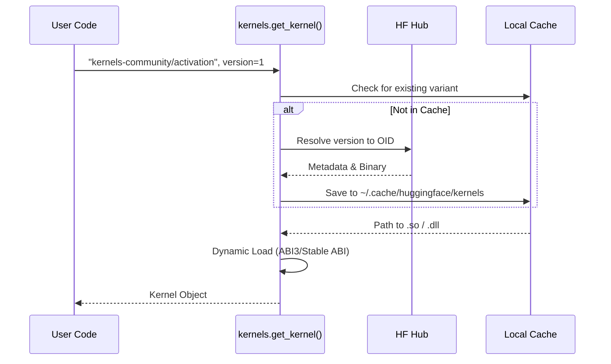

**Sources:** [README.md:48-64](), [examples/basic.py:1-30]()

## Key Features

*   **Portability**: Kernels are loaded from paths outside the standard `PYTHONPATH` [README.md:25-25]().
*   **Uniqueness**: You can load multiple versions of the same kernel in one process without naming collisions [README.md:26-27]().
*   **Compatibility**: Supports a matrix of Python versions, C++ ABIs, and CUDA versions [README.md:28-30]().
*   **Reproducibility**: Uses Nix for the build system to ensure deterministic outputs [docs/source/builder/why-nix.md:7-10]().

## Next Steps

To dive deeper into specific areas of the ecosystem:

1.  **[Installation](#2.1)**: Learn about environment variables, hardware-specific extras (like `curated-xpu`), and version pinning [docs/source/installation.md:1-66]().
2.  **[Basic Usage Examples](#2.2)**: See more patterns for tensor operations and variant discovery [examples/basic.py:1-30]().
3.  **[Kernel Management](#3)**: Learn how to use `kernels.lock` for reproducible production deployments.
4.  **[Kernel Development](#5)**: Start building your own kernels using the `kernel-builder` and Nix [nix-builder/README.md:1-45]().

**Sources:** [README.md:68-70](), [docs/source/index.md:25-30]()

---

# Page: Installation

# Installation

<details>
<summary>Relevant source files</summary>

The following files were used as context for generating this wiki page:

- [Cargo.lock](Cargo.lock)
- [docs/source/builder/why-nix.md](docs/source/builder/why-nix.md)
- [docs/source/installation.md](docs/source/installation.md)
- [kernel-builder/Cargo.toml](kernel-builder/Cargo.toml)
- [kernel-builder/src/hf.rs](kernel-builder/src/hf.rs)
- [kernels-data/Cargo.toml](kernels-data/Cargo.toml)
- [kernels-data/bindings/python/Cargo.toml](kernels-data/bindings/python/Cargo.toml)
- [kernels/pyproject.toml](kernels/pyproject.toml)
- [kernels/uv.lock](kernels/uv.lock)
- [nix-builder/README.md](nix-builder/README.md)
- [nix-builder/pkgs/crate-dirs.nix](nix-builder/pkgs/crate-dirs.nix)
- [nix-builder/pkgs/kernel-builder/default.nix](nix-builder/pkgs/kernel-builder/default.nix)
- [nix-builder/pkgs/python-modules/kernels-data/default.nix](nix-builder/pkgs/python-modules/kernels-data/default.nix)

</details>


This page provides comprehensive installation instructions for the Hugging Face `kernels` ecosystem. It covers the core Python package, hardware-specific dependencies, and the `kernel-builder` CLI tool used for creating new kernels.

## System Requirements

The `kernels` package has specific requirements for optimal functionality, particularly regarding the PyTorch ABI and Python version.

| Component | Requirement | Notes |
|-----------|-------------|-------|
| Python | >= 3.10 | Required for modern type safety and `kernels-data` bindings [kernels/pyproject.toml:11]() |
| PyTorch | >= 2.5 | Minimum version for ABI stability and modern loading [kernels/pyproject.toml:36]() |
| kernels-data | >= 0.14.0.dev1 | Rust-based metadata and lockfile parser [kernels/pyproject.toml:14]() |
| Operating System | Linux, macOS, Windows | Linux (WSL 2 for Windows) is recommended for GPU support [docs/source/installation.md:54-60]() |

> [!IMPORTANT]
> **Free-threaded Python:** It is strongly recommended to avoid free-threaded Python builds (experimental), as they do not support the stable ABI on Python versions before 3.15. Kernels rely on the stable ABI for portability [docs/source/installation.md:62-66]().

## Python Package Installation

### Basic Installation

Install the core package via `pip` or `uv`. This includes the `kernels` CLI and basic Hub integration.

```bash
pip install kernels
# OR
uv pip install kernels
```

Sources: [docs/source/installation.md:18-28](), [kernels/pyproject.toml:63-64]()

### Optional Dependency Groups

The `kernels` package provides several "extras" to install dependencies for specific use cases:

| Extra | Dependencies | Purpose |
|-------|--------------|---------|
| `torch` | `torch` | Ensures PyTorch is present for execution [kernels/pyproject.toml:49]() |
| `curated` | `nvidia-cutlass-dsl`, `einops`, `apache-tvm-ffi` | Standard runtime for many community kernels [kernels/pyproject.toml:50-54]() |
| `curated-xpu`| `einops`, `apache-tvm-ffi` | Runtime for Intel GPU (XPU) platforms [kernels/pyproject.toml:55-58]() |
| `benchmark` | `matplotlib`, `numpy`, `tabulate`, `torch` | Required for running `kernels benchmark` CLI [kernels/pyproject.toml:43-48]() |

```bash
# Example: Install for a standard GPU environment
pip install "kernels[curated,torch]"
```

Sources: [docs/source/installation.md:36-52](), [kernels/pyproject.toml:42-61]()

## The Installation Lifecycle

The following diagram illustrates how the Python package interacts with the Rust-based `kernels-data` library during installation and runtime.

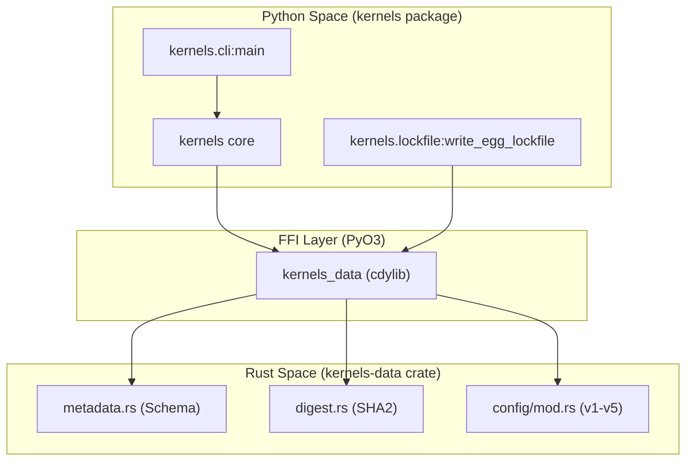
**Architecture: Association of Python Entities to Rust Data Models**

Sources: [kernels/pyproject.toml:14](), [kernels-data/bindings/python/Cargo.toml:10-15](), [kernels-data/Cargo.toml:1-8]()

## Kernel-Builder Installation

The `kernel-builder` is a Rust-based CLI tool used to compile kernels into portable, Hub-compatible artifacts. It is not required for just *running* kernels, only for *developing* them.

### Method 1: Cargo (From Source)
Ensure you have a Rust toolchain installed.

```bash
git clone https://github.com/huggingface/kernels.git
cd kernels/kernel-builder
cargo install --path .
```
Sources: [kernel-builder/Cargo.toml:1-9]()

### Method 2: Nix (Recommended)
Nix provides a sandboxed environment that guarantees reproducible builds by explicitly managing CUDA, PyTorch, and C++ toolchain versions.

```bash
# Install kernel-builder using Nix
nix profile install github:huggingface/kernels#kernel-builder
```

To speed up builds, enable the Hugging Face binary cache:
```bash
nix run nixpkgs#cachix -- use huggingface
```
Sources: [nix-builder/README.md:21-31](), [docs/source/builder/why-nix.md:7-15]()

## Dependency Flow Diagram

This diagram maps the installation requirements from high-level user commands to the specific code entities that handle them.

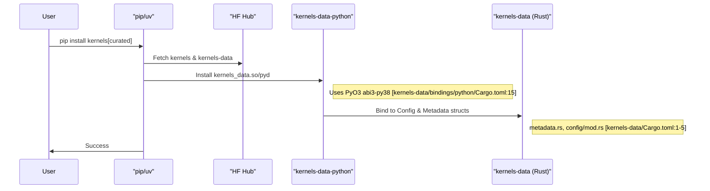
**Code Entity Space: Dependency Resolution and Binding**

Sources: [kernels/pyproject.toml:12-21](), [kernels-data/bindings/python/Cargo.toml:10-20](), [kernels-data/Cargo.toml:10-25]()

## Verification

### CLI Verification
Verify that the `kernels` CLI is installed and can communicate with the Hub:
```bash
kernels --version
kernels info
```
Sources: [kernels/pyproject.toml:63-64]()

### Library Verification
Check if the Python package and its Rust bindings are working correctly:
```python
import kernels
import kernels_data
from kernels import get_kernel

print(f"Kernels version: {kernels.__version__}")
# Test that the Rust-backed metadata parser is functional
print(f"Data bindings version: {kernels_data.__version__}")
```
Sources: [kernels-data/bindings/python/Cargo.toml:1-5](), [kernels/pyproject.toml:1-4]()

---

# Page: Basic Usage Examples

# Basic Usage Examples

<details>
<summary>Relevant source files</summary>

The following files were used as context for generating this wiki page:

- [README.md](README.md)
- [docs/source/basic-usage.md](docs/source/basic-usage.md)
- [docs/source/blog.md](docs/source/blog.md)
- [docs/source/index.md](docs/source/index.md)
- [docs/source/integrating-kernels.md](docs/source/integrating-kernels.md)
- [docs/source/kernel-requirements.md](docs/source/kernel-requirements.md)
- [docs/source/layers.md](docs/source/layers.md)
- [docs/source/locking.md](docs/source/locking.md)
- [docs/source/migration.md](docs/source/migration.md)
- [docs/source/talks.md](docs/source/talks.md)
- [docs/source/why_kernels.md](docs/source/why_kernels.md)
- [examples/basic.py](examples/basic.py)
- [kernels/src/kernels/_versions.py](kernels/src/kernels/_versions.py)
- [kernels/src/kernels/cli/info.py](kernels/src/kernels/cli/info.py)
- [kernels/src/kernels/cli/versions.py](kernels/src/kernels/cli/versions.py)
- [kernels/src/kernels/hf_hub.py](kernels/src/kernels/hf_hub.py)
- [kernels/src/kernels/locking.py](kernels/src/kernels/locking.py)
- [kernels/tests/test_basic.py](kernels/tests/test_basic.py)

</details>


This page provides practical examples of loading and using optimized compute kernels from the Hugging Face Hub. It covers the fundamental operations needed to get started with the `kernels` system, including loading kernels, calling kernel functions, and inspecting kernel variants.

## Overview

The `kernels` package provides several key functions for interacting with the Hub. These functions manage the complexity of variant resolution (matching your PyTorch version, CUDA version, and CPU architecture to a specific build on the Hub) and dynamic loading.

*   `get_kernel()`: The primary entry point for downloading and loading a kernel.
*   `has_kernel()`: Checks if a compatible variant exists for the current environment.
*   `get_kernel_variants()`: Provides a detailed trace of which variants were accepted or rejected and why.
*   `get_loaded_kernels()`: Returns a list of all kernels currently loaded in the Python process.

## Basic Usage Pattern

The most common pattern is to load a kernel by its repository ID and a major version number.

### Loading and Calling a Kernel

The following example shows how to use the optimized activation kernels from the `kernels-community/activation` repository.

```python
import torch
from kernels import get_kernel

# 1. Load the kernel from the Hub. 
# Using version=1 fetches the latest compatible build from the v1 branch.
activation = get_kernel("kernels-community/activation", version=1)

# 2. Create tensors on the appropriate device (e.g., CUDA)
x = torch.randn((10, 10), dtype=torch.float16, device="cuda")
y = torch.empty_like(x)

# 3. Call the kernel function. 
# Many kernels use an in-place pattern where the output tensor is passed as the first argument.
activation.gelu_fast(y, x)

print(y)
```

**Sources:** [README.md:46-64](), [docs/source/basic-usage.md:5-22](), [examples/basic.py:8-20]()

### Versioning and Compatibility

Kernels use major versioning (e.g., `version=1`). A maintainer guarantees that within a major version, the API will not break and support for specific PyTorch versions will not be removed [docs/source/basic-usage.md:25-31](). Version `0` is reserved for experimental kernels where the API may change rapidly [docs/source/basic-usage.md:33-36]().

## System Architecture: From Hub to Tensor

The following diagrams illustrate how the `kernels` package bridges the gap between the Hugging Face Hub and execution on hardware.

### Natural Language to Code Entity Space: Kernel Loading

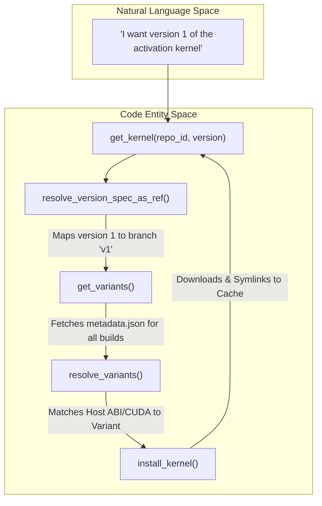
**Sources:** [kernels/src/kernels/_versions.py:64-91](), [kernels/src/kernels/cli/versions.py:12-22](), [kernels/src/kernels/locking.py:58-71]()

### Data Flow: Executing a Kernel Function

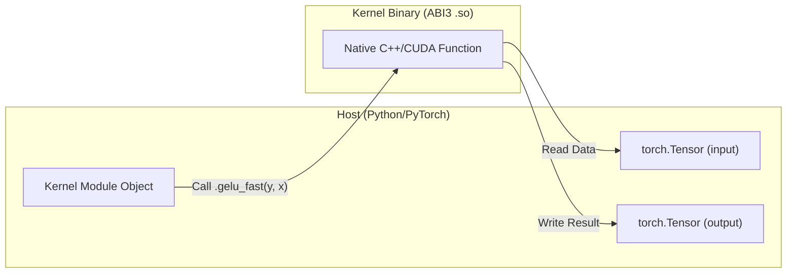
**Sources:** [README.md:60-61](), [examples/basic.py:17-18](), [docs/source/kernel-requirements.md:126-135]()

## Advanced Discovery and Inspection

### Checking Availability (`has_kernel`)

Before attempting to load a kernel, you can check if a compatible build exists for your specific hardware and software environment.

```python
from kernels import has_kernel

# Returns True if a compatible variant exists for the current Torch/CUDA/OS/Arch
if has_kernel("kernels-community/activation", version=1):
    activation = get_kernel("kernels-community/activation", version=1)
```
**Sources:** [docs/source/basic-usage.md:40-49](), [kernels/tests/test_basic.py:94-110]()

### Troubleshooting Variants (`get_kernel_variants`)

If `has_kernel` returns `False`, you can use `get_kernel_variants` to see the full resolution trace. This helps identify if the failure is due to an unsupported PyTorch version, a missing CUDA capability, or an incompatible OS.

```python
from kernels import get_kernel_variants, VariantAccepted

# Inspect every variant defined in the Hub repository
for decision in get_kernel_variants("kernels-community/activation", version=1):
    name = decision.variant.variant_str
    if isinstance(decision, VariantAccepted):
        print(f"{name}: compatible ✅")
    else:
        # decision.reason contains human-readable rejection info
        print(f"{name}: rejected ❌ ({decision.reason})")
```
**Sources:** [docs/source/basic-usage.md:51-66]()

### Inspecting Loaded Kernels

To see which kernels are currently resident in memory and where they originated from, use `get_loaded_kernels`.

```python
from kernels import get_loaded_kernels

for loaded in get_loaded_kernels():
    # LoadedKernel(module, package_name, repo_infos)
    print(f"Package: {loaded.package_name}")
    if loaded.repo_infos:
        print(f"  Source: {loaded.repo_infos.repo_id} @ {loaded.repo_infos.revision}")
```
**Sources:** [docs/source/basic-usage.md:70-86]()

## Kernel Metadata and Requirements

Every kernel variant on the Hub contains a `metadata.json` file. This file is generated by `kernel-builder` and defines the unique identity and hardware requirements of the binary.

| Key | Description |
| :--- | :--- |
| `id` | Unique Python module name (e.g., `_mykernel_cuda_7a4e5a7`). |
| `version` | The integer major version. |
| `backend` | Dictionary specifying type (`cuda`, `xpu`, `metal`, etc.) and architectures (e.g., `["8.0", "8.6"]`). |
| `digest` | SHA-256 hashes of all files in the variant for security verification. |
| `python-depends` | List of required Python packages (e.g., `["einops"]`). |

**Sources:** [docs/source/kernel-requirements.md:61-98](), [docs/source/kernel-requirements.md:113-136]()

---

# Page: Kernel Management

# Kernel Management

<details>
<summary>Relevant source files</summary>

The following files were used as context for generating this wiki page:

- [kernels/src/kernels/_versions.py](kernels/src/kernels/_versions.py)
- [kernels/src/kernels/cli/__init__.py](kernels/src/kernels/cli/__init__.py)
- [kernels/src/kernels/cli/info.py](kernels/src/kernels/cli/info.py)
- [kernels/src/kernels/cli/verify_signature.py](kernels/src/kernels/cli/verify_signature.py)
- [kernels/src/kernels/cli/versions.py](kernels/src/kernels/cli/versions.py)
- [kernels/src/kernels/hf_hub.py](kernels/src/kernels/hf_hub.py)
- [kernels/src/kernels/layer/func.py](kernels/src/kernels/layer/func.py)
- [kernels/src/kernels/layer/layer.py](kernels/src/kernels/layer/layer.py)
- [kernels/src/kernels/locking.py](kernels/src/kernels/locking.py)
- [kernels/tests/test_basic.py](kernels/tests/test_basic.py)
- [kernels/tests/test_verify.py](kernels/tests/test_verify.py)

</details>


This document covers the core kernel management system that handles downloading, installing, caching, and loading optimized compute kernels from the Hugging Face Hub. It explains the fundamental workflows for acquiring kernels and making them available to Python applications.

For detailed information about loading specific kernels, see [Loading Kernels](#3.1). For dependency management and reproducible builds, see [Version Locking](#3.2). For command-line usage, see [CLI Tools](#3.3).

## Overview

The kernel management system provides a complete lifecycle for working with Hub-hosted kernels, from discovery to execution. The system automatically detects the local environment configuration and selects compatible kernel variants, handling the complexity of PyTorch versions, CUDA versions, CPU architectures, and C++ ABI compatibility.

**Kernel Discovery and Resolution Pipeline**

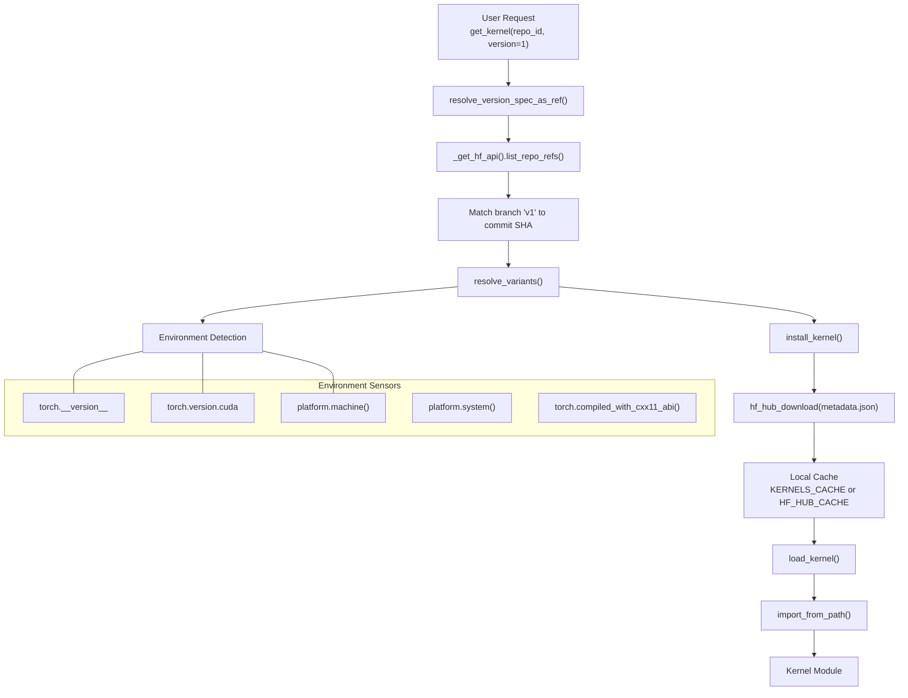

Sources: [kernels/src/kernels/_versions.py:64-91](), [kernels/src/kernels/hf_hub.py:13-69](), [kernels/src/kernels/load.py:46-95]()

## Environment-Based Variant Selection

The kernel system uses a sophisticated variant selection mechanism to ensure compatibility across different system configurations. Each kernel repository contains multiple build variants targeting specific combinations of PyTorch versions, compute backends, and system architectures.

The `_get_hf_api` function constructs a specialized `user_agent` string that informs the Hub of the local environment, including `python` version, `backend` (CUDA/ROCm/XPU/Metal/CPU), `platform`, and `glibc` version.

**Variant Selection Logic**

| Component | Code Entity / Logic | Source |
|-----------|---------------------|--------|
| **Backend Detection** | `_select_backend(None)` | [kernels/src/kernels/hf_hub.py:42-42]() |
| **OS/Arch Detection** | `_platform()` | [kernels/src/kernels/hf_hub.py:13-22]() |
| **Glibc Version** | `glibc_version()` | [kernels/src/kernels/hf_hub.py:63-65]() |
| **Local Overrides** | `LOCAL_KERNELS` env var | [kernels/tests/test_basic.py:185-200]() |

Sources: [kernels/src/kernels/hf_hub.py:13-69](), [kernels/src/kernels/variants.py:5-9]()

## Kernel Loading and Versioning

The system provides several APIs for loading kernels. A key feature is the distinction between **versions** (stable integer identifiers like `version=1`) and **revisions** (git refs like `revision="main"` or a specific commit hash).

*   `get_kernel(repo_id, version=None, revision=None)`: The primary entry point. It resolves the version to a commit hash and downloads the best-matching variant.
*   `install_kernel(repo_id, revision)`: Downloads the kernel to the local cache without importing it.
*   `has_kernel(repo_id, version=None, revision=None)`: Checks if a compatible variant exists for the current environment.

**Version Resolution Entity Mapping**

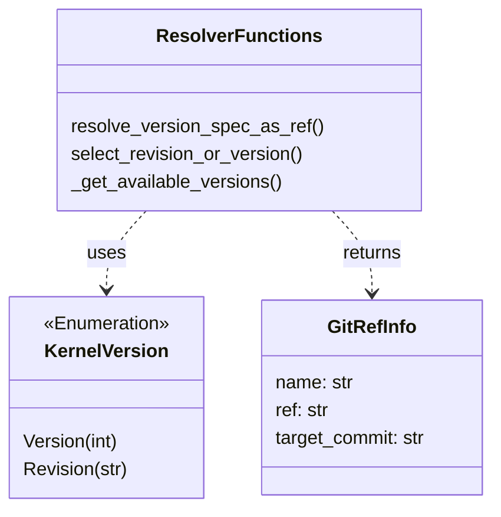

Sources: [kernels/src/kernels/_versions.py:13-31](), [kernels/src/kernels/_versions.py:95-108](), [kernels/src/kernels/load.py:46-95]()

## Security and Trusted Publishers

To protect against malicious code, the system implements a `_check_trust_remote_code` mechanism. By default, kernels are only loaded if the publisher organization has the `trustedKernelPublisher` flag enabled on the Hugging Face Hub.

Users can bypass this by setting `trust_remote_code=True` in `get_kernel()` or via environment variables. The system also supports signature verification via the `verify-signature` CLI command, which checks kernel integrity using Sigstore and OIDC identities.

Sources: [kernels/src/kernels/hf_hub.py:95-148](), [kernels/src/kernels/cli/verify_signature.py:17-67]()

## CLI Toolset

The `kernel` command-line tool provides utilities for managing the kernel lifecycle outside of Python code.

| Command | Function | File |
|---------|----------|------|
| `download` | Pre-fetches kernels for offline use or all variants for distribution. | [kernels/src/kernels/cli/download.py]() |
| `lock` | Generates a `kernels.lock` file for reproducible environments. | [kernels/src/kernels/cli/lock.py]() |
| `info` | Displays metadata, supported backends, and dependencies for a kernel. | [kernels/src/kernels/cli/info.py]() |
| `versions` | Lists all available versions and their compatibility status. | [kernels/src/kernels/cli/versions.py]() |
| `verify-signature` | Validates the cryptographic signature of a kernel variant. | [kernels/src/kernels/cli/verify_signature.py]() |
| `benchmark` | Runs performance tests on a kernel and generates visual reports. | [kernels/src/kernels/cli/benchmark.py]() |

Sources: [kernels/src/kernels/cli/__init__.py:12-122]()

## Cache Management

Kernels are stored in a local cache directory to avoid redundant downloads. The location is determined by the `KERNELS_CACHE` environment variable, falling back to the standard `HF_HUB_CACHE`.

**Cache Structure**
1.  **Metadata Cache**: Stores `GitRefInfo` and version mappings.
2.  **Snapshot Cache**: Stores the actual kernel files (shared libraries, Python stubs) organized by commit hash and variant string (e.g., `build/torch25-cxx11-cu124-x86_64-linux/`).

Sources: [kernels/src/kernels/_versions.py:34-61](), [kernels/src/kernels/hf_hub.py:72-77]()

---

# Page: Loading Kernels

# Loading Kernels

<details>
<summary>Relevant source files</summary>

The following files were used as context for generating this wiki page:

- [docs/source/cli-versions.md](docs/source/cli-versions.md)
- [kernels/src/kernels/__init__.py](kernels/src/kernels/__init__.py)
- [kernels/src/kernels/_versions.py](kernels/src/kernels/_versions.py)
- [kernels/src/kernels/cli/benchmark.py](kernels/src/kernels/cli/benchmark.py)
- [kernels/src/kernels/cli/info.py](kernels/src/kernels/cli/info.py)
- [kernels/src/kernels/cli/versions.py](kernels/src/kernels/cli/versions.py)
- [kernels/src/kernels/deps.py](kernels/src/kernels/deps.py)
- [kernels/src/kernels/hf_hub.py](kernels/src/kernels/hf_hub.py)
- [kernels/src/kernels/importer.py](kernels/src/kernels/importer.py)
- [kernels/src/kernels/install.py](kernels/src/kernels/install.py)
- [kernels/src/kernels/load.py](kernels/src/kernels/load.py)
- [kernels/src/kernels/locking.py](kernels/src/kernels/locking.py)
- [kernels/src/kernels/variants.py](kernels/src/kernels/variants.py)
- [kernels/tests/test_basic.py](kernels/tests/test_basic.py)
- [kernels/tests/test_deps.py](kernels/tests/test_deps.py)
- [kernels/tests/test_dirty_provenance.py](kernels/tests/test_dirty_provenance.py)
- [kernels/tests/test_loaded_kernels.py](kernels/tests/test_loaded_kernels.py)
- [kernels/tests/test_variants.py](kernels/tests/test_variants.py)

</details>


This document covers the core mechanisms for discovering, downloading, and loading optimized compute kernels from the Hugging Face Hub. It explains the version resolution pipeline, variant selection based on host environment, and the internal installation/import flow.

## Kernel Loading Functions Overview

The `kernels` package provides several entry points for loading kernels. These functions handle the transition from a repository identifier (e.g., `kernels-community/relu`) to a live Python module containing optimized operators.

| Function | Purpose | Caching Behavior |
|----------|---------|------------------|
| `get_kernel()` | High-level API to download and load a kernel by version or revision. | Downloads to HF cache; uses `SequentialResolver`. |
| `load_kernel()` | Loads a kernel using the current environment's detected backend. | Wrapper around `get_kernel`. |
| `get_local_kernel()` | Imports a kernel from a specific local file system path. | Overrides Hub resolution for the specified path. |
| `get_locked_kernel()` | Loads a kernel based on a `kernels.lock` file. | Ensures reproducible builds by pinning to a specific commit. |

**Kernel Discovery and Loading Pipeline**

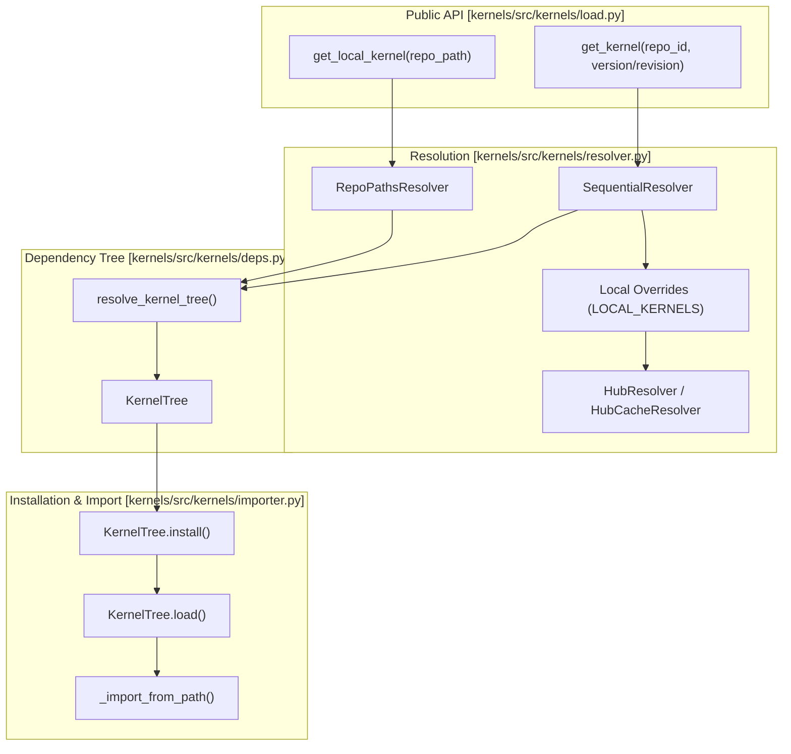
Sources: [kernels/src/kernels/load.py:87-95](), [kernels/src/kernels/load.py:157-163](), [kernels/src/kernels/deps.py:76-81](), [kernels/src/kernels/importer.py:131]()

## Version Resolution Pipeline

When a user requests a kernel via `version=N`, the system must resolve this integer to a specific Git reference (commit SHA) on the Hugging Face Hub.

1.  **Branch Discovery**: The system lists repository references, looking for branches named with a `v` prefix (e.g., `v1`, `v2`) [kernels/src/kernels/_versions.py:20-31]().
2.  **Version Selection**: It maps the integer version to the corresponding branch. If a user requests an older version while a newer one is available, a warning is logged [kernels/src/kernels/_versions.py:82-91]().
3.  **Offline Resolution**: If `HF_HUB_OFFLINE` is enabled, the system attempts to resolve the version by inspecting the local Hugging Face cache directory (`refs` folder) [kernels/src/kernels/_versions.py:34-61]().

Sources: [kernels/src/kernels/_versions.py:13-31](), [kernels/src/kernels/_versions.py:64-91]()

## Variant Selection

Kernels are distributed as multiple "variants" within a single repository to handle ABI fragmentation (PyTorch versions, C++ ABI) and hardware diversity.

### The Variant Selection Algorithm
The `_resolve_variant_for_system` function in `kernels.variants` filters available variants based on the host environment:

*   **Framework**: Matches PyTorch version (e.g., `torch210`) or `torch-stable-abi` [kernels/src/kernels/variants.py:48-71]().
*   **ABI**: Matches Linux C++11 ABI (`cxx11` vs `cxx98`) [kernels/src/kernels/variants.py:48-58]().
*   **Backend**: Selects the best hardware backend (CUDA, ROCm, XPU, Metal, or CPU) [kernels/src/kernels/variants.py:237-240]().
*   **Architecture/OS**: Matches CPU architecture (e.g., `x86_64`) and OS (e.g., `linux`) [kernels/src/kernels/variants.py:144-152]().

**Backend Selection Logic**
For GPU backends like CUDA, the system prefers an exact match for the installed toolkit version (e.g., `cu128`). If an exact match isn't found, it falls back to the highest compatible version lower than the host version [kernels/tests/test_variants.py:186-200](). If no specific arch-variant matches, it falls back to a `noarch` variant (e.g., `torch-cuda`) [kernels/tests/test_variants.py:203-218]().

Sources: [kernels/src/kernels/variants.py:173-198](), [kernels/src/kernels/variants.py:218-241](), [kernels/tests/test_variants.py:169-200]()

## Trusted Publisher Checks

Security is enforced via the `trust_remote_code` mechanism. By default, only kernels from "trusted organizations" (e.g., `kernels-community`, `kernels-test`) are allowed to load [kernels/src/kernels/hf_hub.py:53-64]().

*   **Verification**: Before downloading or loading, the system checks the `repo_id`.
*   **Override**: Users must explicitly set `trust_remote_code=True` to load kernels from other organizations [kernels/src/kernels/load.py:94-95]().
*   **Local Files**: The trust check is also performed in offline mode to prevent loading untrusted cached code [kernels/src/kernels/hf_hub.py:66-70]().

Sources: [kernels/src/kernels/hf_hub.py:46-73](), [kernels/src/kernels/load.py:138-147]()

## Development Overrides: `LOCAL_KERNELS`

For local development, the `LOCAL_KERNELS` environment variable allows redirecting Hub `repo_id` lookups to local disk paths.

*   **Format**: `repo_id_1=path_1:repo_id_2=path_2`
*   **Mechanism**: The `_get_local_kernel_overrides` function parses this variable and injects a `RepoPathsResolver` at the start of the resolution chain [kernels/src/kernels/load.py:28-34]().
*   **Precedence**: Local overrides take precedence over Hub-based resolution, allowing developers to test kernel changes without uploading to the Hub [kernels/src/kernels/load.py:140-141]().

Sources: [kernels/src/kernels/load.py:28-49](), [kernels/tests/test_basic.py:185-200]()

## The Install/Load/Import Pipeline

Once a variant and its dependencies are resolved, the system executes the following pipeline:

1.  **Installation**: `KernelTree.install()` ensures all required files for the selected variant are present in the local cache [kernels/src/kernels/deps.py:172]().
2.  **Dependency Injection**: The `use_kernel_deps` context manager makes dependency modules available to the kernel being loaded [kernels/src/kernels/deps.py:168-172]().
3.  **Import**: `_import_from_path()` uses `importlib` to dynamically load the kernel's `__init__.py`.
4.  **Provenance Warning**: If a kernel was built from a "dirty" git tree (uncommitted changes), a `UserWarning` is emitted during import to alert the user [kernels/src/kernels/importer.py:131]().
5.  **Registry**: Loaded kernels are stored in a process-wide registry, accessible via `get_loaded_kernels()` [kernels/src/kernels/importer.py:41-52]().

**Code Entity Space: Import Logic**

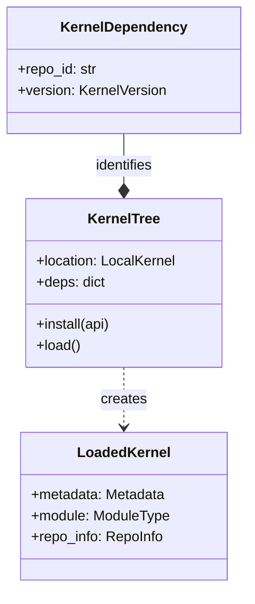
Sources: [kernels/src/kernels/deps.py:38-58](), [kernels/src/kernels/importer.py:25-30](), [kernels/src/kernels/importer.py:131]()

---

# Page: Version Locking

# Version Locking

<details>
<summary>Relevant source files</summary>

The following files were used as context for generating this wiki page:

- [kernels-data/bindings/python/src/lock.rs](kernels-data/bindings/python/src/lock.rs)
- [kernels-data/bindings/python/stubtest-allowlist.txt](kernels-data/bindings/python/stubtest-allowlist.txt)
- [kernels-data/bindings/python/tests/test_kernel_lock.py](kernels-data/bindings/python/tests/test_kernel_lock.py)
- [kernels-data/src/config/kernel_deps.rs](kernels-data/src/config/kernel_deps.rs)
- [kernels-data/src/lock.rs](kernels-data/src/lock.rs)
- [kernels/src/kernels/_versions.py](kernels/src/kernels/_versions.py)
- [kernels/src/kernels/cli/__init__.py](kernels/src/kernels/cli/__init__.py)
- [kernels/src/kernels/cli/download.py](kernels/src/kernels/cli/download.py)
- [kernels/src/kernels/cli/info.py](kernels/src/kernels/cli/info.py)
- [kernels/src/kernels/cli/lock.py](kernels/src/kernels/cli/lock.py)
- [kernels/src/kernels/cli/verify_signature.py](kernels/src/kernels/cli/verify_signature.py)
- [kernels/src/kernels/cli/versions.py](kernels/src/kernels/cli/versions.py)
- [kernels/src/kernels/hf_hub.py](kernels/src/kernels/hf_hub.py)
- [kernels/src/kernels/layer/func.py](kernels/src/kernels/layer/func.py)
- [kernels/src/kernels/layer/layer.py](kernels/src/kernels/layer/layer.py)
- [kernels/src/kernels/locking.py](kernels/src/kernels/locking.py)
- [kernels/tests/kernel_locking/kernels.lock](kernels/tests/kernel_locking/kernels.lock)
- [kernels/tests/kernel_locking/pyproject.toml](kernels/tests/kernel_locking/pyproject.toml)
- [kernels/tests/layer_locking/kernels.lock](kernels/tests/layer_locking/kernels.lock)
- [kernels/tests/test_basic.py](kernels/tests/test_basic.py)
- [kernels/tests/test_kernel_locking.py](kernels/tests/test_kernel_locking.py)
- [kernels/tests/test_verify.py](kernels/tests/test_verify.py)

</details>


Version locking provides reproducible kernel dependency management by pinning exact kernel versions and variant hashes. This ensures consistent builds across different environments and time periods. The system utilizes a `kernels.lock` file containing SHA commits and cryptographic hashes for each kernel variant, enabling verifiable and reproducible execution.

## Locking Lifecycle

The version locking system follows a multi-step process from dependency specification to kernel loading:

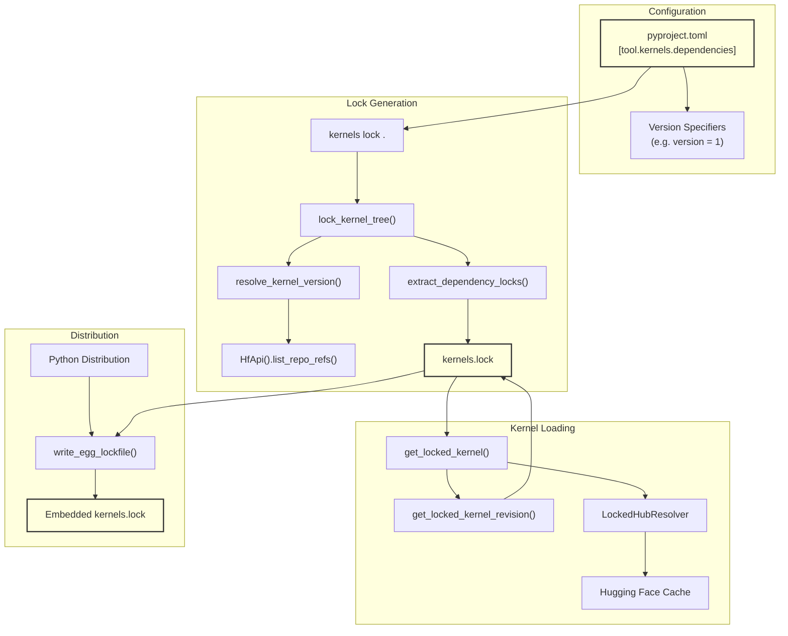

Sources: [kernels/src/kernels/locking.py:21-98](), [kernels/src/kernels/locking.py:101-125](), [kernels/src/kernels/locking.py:144-162]()

## Dependency Configuration

Kernel dependencies are specified in `pyproject.toml`. The configuration allows pinning to a major version (integer) or a specific Git revision.

| Configuration Field | Type | Description |
|---------------------|------|-------------|
| `repo-id` | `str` | The Hugging Face Hub repository ID (e.g., `kernels-community/relu`). |
| `version` | `int` | A stable kernel API version (e.g., `1`). Mutually exclusive with `revision`. |
| `revision` | `str` | An explicit Hub revision (branch, tag, or commit). Mutually exclusive with `version`. |

These are represented in code by the `KernelDependency` struct and `KernelVersion` enum.

Sources: [kernels-data/src/config/kernel_deps.rs:4-16](), [kernels-data/src/config/kernel_deps.rs:39-63]()

## The Locking Process

### Recursive Tree Locking
The `lock_kernel_tree` function performs a recursive exploration of the dependency graph. Unlike standard resolution which picks one variant, locking explores **all** variants of a kernel to ensure every potential environment dependency is pinned.

1. **Resolution**: Converts a version specifier to a specific Git commit SHA using `resolve_kernel_version` [kernels/src/kernels/locking.py:58]().
2. **Metadata Inspection**: Downloads `metadata.json` for every variant of the kernel at that revision [kernels/src/kernels/locking.py:60-71]().
3. **Recursion**: For every dependency listed in `metadata.kernel_depends`, the process repeats [kernels/src/kernels/locking.py:73-75]().
4. **Cycle Detection**: Maintains a `seen` set to prevent infinite loops in cyclic dependencies [kernels/src/kernels/locking.py:47-49]().

### Lock File Format
The `kernels.lock` file is a JSON array of objects, where each object pairs a `KernelDependency` with its resolved `KernelLock` (the specific commit SHA).

```json
[
  {
    "dependency": {
      "repo-id": "kernels-community/relu",
      "version": 1
    },
    "lock": {
      "commit": "d649efb56fb249ac8f7a57fa1866728ad0c60e52"
    }
  }
]
```

Sources: [kernels/src/kernels/locking.py:21-83](), [kernels/tests/kernel_locking/kernels.lock:1-38]()

## Loading Locked Kernels

For library authors and reproducible applications, `kernels` provides mechanisms to load kernels based on the lockfile rather than dynamic Hub resolution.

### Resolution Logic
When loading a locked kernel, the system uses specialized resolvers:
- **`LockedHubResolver`**: Resolves the kernel revision by looking it up in a provided `kernels.lock` file [kernels/src/kernels/layer/layer.py:15]().
- **`LockedHubCacheResolver`**: A variant that enforces usage of the local cache, typically used when kernels have been pre-downloaded [kernels/src/kernels/layer/layer.py:15]().

### API for Library Authors
Library authors can use `get_caller_locked_kernel_revision` to automatically discover a `kernels.lock` file embedded in their package distribution.

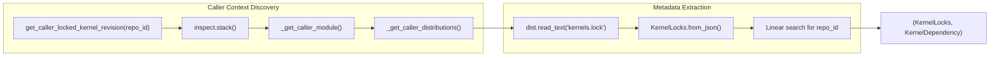

Sources: [kernels/src/kernels/locking.py:149-162](), [kernels/src/kernels/locking.py:164-186]()

## Distribution and Packaging

To ensure that locked versions persist when a package is installed via `pip`, the lockfile must be embedded in the Python distribution.

1. **`write_egg_lockfile`**: This utility is designed for integration with build systems (like `setuptools`). It reads the local `kernels.lock` and writes it into the package metadata directory (e.g., `.egg-info` or `.dist-info`) [kernels/src/kernels/locking.py:101-125]().
2. **Installation**: When a user installs the library, the `kernels.lock` file is included in the site-packages metadata.
3. **Runtime Discovery**: At runtime, `get_caller_locked_kernel_revision` finds this file, ensuring the library uses the exact kernel versions it was tested against [kernels/src/kernels/locking.py:152-157]().

Sources: [kernels/src/kernels/locking.py:101-125](), [kernels/src/kernels/locking.py:149-162]()

---

# Page: CLI Tools

# CLI Tools

<details>
<summary>Relevant source files</summary>

The following files were used as context for generating this wiki page:

- [docs/source/_toctree.yml](docs/source/_toctree.yml)
- [docs/source/builder/build.md](docs/source/builder/build.md)
- [docs/source/builder/github-actions.md](docs/source/builder/github-actions.md)
- [docs/source/builder/local-dev.md](docs/source/builder/local-dev.md)
- [docs/source/builder/writing-kernels.md](docs/source/builder/writing-kernels.md)
- [docs/source/cli-info.md](docs/source/cli-info.md)
- [docs/source/cli.md](docs/source/cli.md)
- [kernels/src/kernels/cli/__init__.py](kernels/src/kernels/cli/__init__.py)
- [kernels/src/kernels/cli/verify_signature.py](kernels/src/kernels/cli/verify_signature.py)
- [kernels/src/kernels/layer/func.py](kernels/src/kernels/layer/func.py)
- [kernels/src/kernels/layer/layer.py](kernels/src/kernels/layer/layer.py)
- [kernels/tests/test_cli_info.py](kernels/tests/test_cli_info.py)
- [kernels/tests/test_verify.py](kernels/tests/test_verify.py)

</details>


The `kernels` CLI provides a suite of tools for managing compute kernels throughout their lifecycle—from dependency locking and downloading to benchmarking and security verification. It is the primary interface for ensuring reproducible environments and verifying kernel integrity.

## CLI Command Overview

The CLI is structured using `argparse` subparsers, providing specialized tools for different management tasks.

| Command | Purpose | Implementation |
| :--- | :--- | :--- |
| `info` | Describes a kernel's metadata, backends, and dependencies. | `print_kernel_info` |
| `versions` | Lists all available versions for a specific kernel on the Hub. | `print_kernel_versions` |
| `lock` | Generates a `kernels.lock` file for reproducible builds. | `lock_kernels` |
| `download` | Fetches locked kernels into the local Hugging Face cache. | `download_kernels` |
| `verify-signature` | Validates kernel integrity using Sigstore/OIDC signatures. | `verify_signature` |
| `benchmark` | Executes performance tests and generates visual reports. | `run_benchmark` |

Sources: [kernels/src/kernels/cli/__init__.py:12-122](), [docs/source/cli.md:7-14]()

## Command Reference

### `kernels info`
Describes a kernel repository, including its supported backends, license, and upstream source. It can query both remote Hub repositories and local build directories.

**Usage:**
```bash
kernels info <repo_id_or_path> [--version <int> | --revision <str>] [--json]
```
**Options:**
- `--version`: Specify an integer version (e.g., `1`).
- `--revision`: Specify a git ref (branch, tag, or commit).
- `--json`: Output machine-readable JSON instead of a formatted table.

Sources: [kernels/src/kernels/cli/__init__.py:33-54](), [kernels/tests/test_cli_info.py:8-28]()

### `kernels lock`
Scans a project directory for kernel dependencies and generates a `kernels.lock` file. This file pins every kernel to a specific Git SHA and records metadata for all available variants, ensuring that every environment uses the exact same kernel code.

**Usage:**
```bash
kernels lock <project_dir>
```

Sources: [kernels/src/kernels/cli/__init__.py:60-66](), [kernels/src/kernels/cli/lock.py:7-7]()

### `kernels download`
Downloads the kernels defined in a `kernels.lock` file. By default, it only downloads the variant compatible with the host system (e.g., CUDA 12.4 on Linux x86_64).

**Usage:**
```bash
kernels download <project_dir> [--all-variants]
```
**Options:**
- `--all-variants`: Downloads every build variant (all CUDA versions, ROCm, XPU, etc.) defined in the lockfile. Useful for preparing containers or air-gapped deployments.

Sources: [kernels/src/kernels/cli/__init__.py:20-31](), [kernels/src/kernels/cli/download.py:5-5]()

### `kernels verify-signature`
Verifies the cryptographic integrity of a kernel. It checks that the kernel metadata has not been tampered with and that the signature matches a trusted OIDC identity (e.g., a GitHub Actions workflow).

**Usage:**
```bash
kernels verify-signature <repo_id> <version> [--all-variants] [--filter-unsigned]
```

**Implementation Flow:**
```mermaid
graph TD
    subgraph "Verification Pipeline"
        Start["verify-signature command"] --> Install["install_kernel()"]
        Install --> Verify["verify_variant(path)"]
        Verify --> SigCheck["Sigstore Bundle Check"]
        SigCheck --> DigestCheck["Metadata Digest Check"]
        DigestCheck --> Result["VerificationResult"]
    end

    subgraph "Code Entities"
        VerifyFunc["kernels.verify.verify_variant"]
        SigBundle["VerificationResult.SignatureBundleMissing"]
        DigestFail["VerificationResult.DigestVerificationFailure"]
        Success["VerificationResult.Success"]
    end

    Verify --- VerifyFunc
    Result --- SigBundle
    Result --- DigestFail
    Result --- Success
```
Sources: [kernels/src/kernels/cli/verify_signature.py:17-65](), [kernels/tests/test_verify.py:17-32]()

### `kernels benchmark`
Runs performance benchmarks for a kernel and compares it against baselines (typically standard PyTorch operations). It can generate JSON results or visual plots.

**Usage:**
```bash
kernels benchmark <repo_id> [--version <int>] [--visual <path>] [--rasterized]
```
**Options:**
- `--visual`: Generates SVG plots of the benchmark results.
- `--rasterized`: If specified, outputs PNG/GIF instead of SVG.
- `--iterations`: Number of timed loops (default: 100).

Sources: [kernels/src/kernels/cli/__init__.py:68-103](), [kernels/src/kernels/cli/benchmark.py:152-162]()

## Data Flow: CLI to Hub Integration

The CLI acts as the bridge between the user's local environment and the Hugging Face Hub's specialized `kernel` repository type.

```mermaid
sequenceDiagram
    participant User as "Developer CLI"
    participant Resolver as "kernels.resolver"
    participant Hub as "HF Hub (repo_type='kernel')"
    participant Cache as "Local HF Cache"

    User->>Resolver: kernels info --version 1
    Resolver->>Hub: GET refs/heads/v1
    Hub-->>Resolver: Git SHA (e.g. 5a3f2b...)
    Resolver->>Hub: Download metadata.json
    Hub-->>User: Display Kernel Metadata

    User->>Resolver: kernels download .
    Resolver->>Cache: Check for cached SHA
    alt Not in Cache
        Resolver->>Hub: snapshot_download(revision=SHA)
        Hub-->>Cache: Download .so / .bc files
    end
    Cache-->>User: Done
```
Sources: [kernels/src/kernels/cli/__init__.py:128-139](), [kernels/src/kernels/resolver.py:10-15](), [kernels/src/kernels/hf_hub.py:8-13]()

## Summary of Subcommand Functions

| Subcommand | Function Mapping | File Reference |
| :--- | :--- | :--- |
| `download` | `download_kernels` | [kernels/src/kernels/cli/download.py]() |
| `info` | `print_kernel_info` | [kernels/src/kernels/cli/info.py]() |
| `lock` | `lock_kernels` | [kernels/src/kernels/cli/lock.py]() |
| `verify-signature` | `verify_signature` | [kernels/src/kernels/cli/verify_signature.py]() |
| `versions` | `print_kernel_versions` | [kernels/src/kernels/cli/versions.py]() |
| `benchmark` | `run_benchmark` | [kernels/src/kernels/cli/benchmark.py]() |

Sources: [kernels/src/kernels/cli/__init__.py:5-9]()

---

# Page: Layer Kernelization

# Layer Kernelization

<details>
<summary>Relevant source files</summary>

The following files were used as context for generating this wiki page:

- [docs/source/basic-usage.md](docs/source/basic-usage.md)
- [docs/source/integrating-kernels.md](docs/source/integrating-kernels.md)
- [docs/source/kernel-requirements.md](docs/source/kernel-requirements.md)
- [docs/source/layers.md](docs/source/layers.md)
- [docs/source/locking.md](docs/source/locking.md)
- [docs/source/migration.md](docs/source/migration.md)
- [kernels/src/kernels/cli/__init__.py](kernels/src/kernels/cli/__init__.py)
- [kernels/src/kernels/cli/verify_signature.py](kernels/src/kernels/cli/verify_signature.py)
- [kernels/src/kernels/layer/func.py](kernels/src/kernels/layer/func.py)
- [kernels/src/kernels/layer/layer.py](kernels/src/kernels/layer/layer.py)
- [kernels/tests/test_verify.py](kernels/tests/test_verify.py)

</details>


Layer kernelization is the process of replacing PyTorch layer `forward` methods with optimized kernel implementations from the Hugging Face Hub. This system allows transparent acceleration of neural network layers without changing user code, enabling automatic selection of device-specific optimized kernels at runtime.

This document covers the layer kernelization subsystem. For details on specific topics, see the child pages:
- **[Using kernelize()](#4.1)**: Detailed guide on the `kernelize()` function, `LayerRepository` types, and mapping configurations.
- **[Creating Extensible Layers](#4.2)**: How to use decorators like `@use_kernel_forward_from_hub` to make your models kernel-ready.
- **[Environment Variables](#4.3)**: Configuration flags like `LOCAL_KERNELS` and `HF_HUB_OFFLINE`.

## Core Architecture

The layer kernelization system consists of several key components that work together to replace PyTorch layer implementations with Hub-based kernels:

### Layer Kernelization Flow

```mermaid
graph TD
    PyTorchModel["PyTorch Model with<br/>Extensible Layers"]
    KernelizeFunc["kernelize()"]
    DeviceDetect["Device.from_torch()"]
    KernelMapping["_KERNEL_MAPPING<br/>ContextVar"]
    LayerRepo["LayerRepository / LockedLayerRepository"]
    GetKernelLayer["_get_kernel_layer()"]
    ValidateLayer["_validate_layer()"]
    ReplaceForward["_replace_forward()"]
    KernelizedModel["Kernelized Model"]
    
    PyTorchModel --> KernelizeFunc
    KernelizeFunc --> DeviceDetect
    KernelizeFunc --> KernelMapping
    KernelMapping --> LayerRepo
    LayerRepo --> GetKernelLayer
    GetKernelLayer --> ValidateLayer
    ValidateLayer --> ReplaceForward
    ReplaceForward --> KernelizedModel
```
Sources: [kernels/src/kernels/layer/layer.py:447-533](), [kernels/src/kernels/layer/device.py:33-52]()

### Data Structures

The system uses several key data structures to manage kernel mappings and device compatibility:

| Class | Purpose | Key Fields |
|-------|---------|------------|
| `Device` | Represents device type and properties (e.g., CUDA capability) | `type: str`, `properties: CUDAProperties` |
| `LayerRepository` | Points to a kernel implementation on the Hub via version/revision | `repo_id`, `layer_name`, `version` |
| `LockedLayerRepository` | Points to a kernel revision locked in a `kernels.lock` file | `repo_id`, `lockfile`, `layer_name` |
| `Mode` | Enum defining the target execution environment | `INFERENCE`, `TRAINING`, `TORCH_COMPILE` |

Sources: [kernels/src/kernels/layer/device.py:12-31](), [kernels/src/kernels/layer/layer.py:42-137](), [kernels/src/kernels/layer/layer.py:190-225](), [kernels/src/kernels/layer/mode.py:6-15]()

## Making Layers Extensible

Layers are made extensible by annotating them with a unique name that the kernelization system can look up in a mapping.

### Using the Decorator
The `@use_kernel_forward_from_hub` decorator marks a `nn.Module` or a function as replaceable. When applied to a function, the system wraps it in a singleton `nn.Module` to allow standard layer injection.

```python
@use_kernel_forward_from_hub("SiluAndMul")
class SiluAndMul(nn.Module):
    def forward(self, input: torch.Tensor) -> torch.Tensor:
        ...
```
For details on pure layer requirements and function-to-layer conversion, see **[Creating Extensible Layers](#4.2)**.

Sources: [kernels/src/kernels/layer/layer.py:284-306](), [docs/source/layers.md:15-24]()

## The kernelize() Function

The `kernelize()` function is the primary API for applying optimizations to a model. It performs an in-place traversal of the model's module tree.

### Kernelization Logic
1. **Device Inference**: If no device is provided, it attempts to infer the device from model parameters using `Device.from_torch()`.
2. **Traversal**: It inspects every submodule for the `kernel_layer_name` attribute.
3. **Resolution**: It looks up the appropriate `LayerRepository` in the current `_KERNEL_MAPPING`.
4. **Injection**: It replaces the `forward` method using `_replace_forward()`.

```mermaid
graph TD
    Start["kernelize(model, mode)"]
    MapLookup["Lookup Mapping for<br/>kernel_layer_name"]
    VersionRes["Resolve Version/Revision<br/>(select_revision_or_version)"]
    Load["load_kernel() / get_kernel()"]
    Inject["_replace_forward()"]
    
    Start --> MapLookup
    MapLookup --> VersionRes
    VersionRes --> Load
    Load --> Inject
```
Sources: [kernels/src/kernels/layer/layer.py:447-533](), [kernels/src/kernels/layer/layer.py:587-632]()

## Kernel Mapping and Repositories

Mappings associate abstract layer names with specific Hub repositories.

### Global vs. Scoped Mappings
- **`register_kernel_mapping()`**: Sets a global mapping used by all subsequent `kernelize()` calls.
- **`use_kernel_mapping()`**: A context manager for temporary mappings, useful for testing or local overrides.

### Repository Types
- **`LayerRepository`**: Standard Hub-backed repository requiring a `version` (e.g., `1`) or `revision` (e.g., `main`).
- **`LocalLayerRepository`**: Points to a local directory, primarily used for development via the `LOCAL_KERNELS` environment variable.
- **`LockedLayerRepository`**: Ensures reproducibility by reading specific commit SHAs from a `kernels.lock` file.

For detailed usage examples, see **[Using kernelize()](#4.1)** and **[Version Locking](#3.2)**.

Sources: [kernels/src/kernels/layer/layer.py:246-281](), [kernels/src/kernels/layer/layer.py:42-188](), [docs/source/locking.md:31-46]()

## Validation and Compatibility

To ensure system stability, kernels must pass strict validation before being injected into a model:
- **Statelessness**: Kernels must not override `__init__` or maintain internal state.
- **Signature Matching**: The kernel's `forward` signature must match the original layer's signature.
- **Mode Compatibility**: If `Mode.TORCH_COMPILE` is requested, the kernel must explicitly set `can_torch_compile = True`.

Sources: [kernels/src/kernels/layer/layer.py:536-584](), [docs/source/kernel-requirements.md:63-138]()

---

# Page: Using kernelize()

# Using kernelize()

<details>
<summary>Relevant source files</summary>

The following files were used as context for generating this wiki page:

- [docs/source/api/kernels.md](docs/source/api/kernels.md)
- [docs/source/api/layers.md](docs/source/api/layers.md)
- [docs/source/basic-usage.md](docs/source/basic-usage.md)
- [docs/source/integrating-kernels.md](docs/source/integrating-kernels.md)
- [docs/source/kernel-requirements.md](docs/source/kernel-requirements.md)
- [docs/source/layers.md](docs/source/layers.md)
- [docs/source/locking.md](docs/source/locking.md)
- [docs/source/migration.md](docs/source/migration.md)
- [kernels/src/kernels/cli/__init__.py](kernels/src/kernels/cli/__init__.py)
- [kernels/src/kernels/cli/benchmark_graphics.py](kernels/src/kernels/cli/benchmark_graphics.py)
- [kernels/src/kernels/cli/verify_signature.py](kernels/src/kernels/cli/verify_signature.py)
- [kernels/src/kernels/layer/__init__.py](kernels/src/kernels/layer/__init__.py)
- [kernels/src/kernels/layer/device.py](kernels/src/kernels/layer/device.py)
- [kernels/src/kernels/layer/func.py](kernels/src/kernels/layer/func.py)
- [kernels/src/kernels/layer/kernelize.py](kernels/src/kernels/layer/kernelize.py)
- [kernels/src/kernels/layer/layer.py](kernels/src/kernels/layer/layer.py)
- [kernels/src/kernels/layer/repos.py](kernels/src/kernels/layer/repos.py)
- [kernels/tests/test_func.py](kernels/tests/test_func.py)
- [kernels/tests/test_layer.py](kernels/tests/test_layer.py)
- [kernels/tests/test_verify.py](kernels/tests/test_verify.py)

</details>


This document explains how to use the `kernelize()` function to replace PyTorch layer forward methods with optimized kernels from Hugging Face Hub. The `kernelize()` function is the primary interface for applying kernel optimizations to existing PyTorch models.

For information about creating extensible layers, see [Creating Extensible Layers](4.2). For environment variable configuration, see [Environment Variables](4.3).

## Overview

The `kernelize()` function traverses a PyTorch model and replaces the `forward` methods of extensible layers with optimized kernel implementations. This process requires three components:

1.  **Extensible layers** - PyTorch layers decorated with `@use_kernel_forward_from_hub` [kernels/src/kernels/layer/layer.py:233-248]()
2.  **Kernel mappings** - Configuration that maps layer names to Hub repositories [kernels/src/kernels/layer/layer.py:29-31]()
3.  **Hub kernels** - Optimized implementations available on Hugging Face Hub [docs/source/kernel-requirements.md:12-15]()

```mermaid
graph TD
    Model["PyTorch Model"] --> Kernelize["kernelize()"]
    Decorator["@use_kernel_forward_from_hub"] --> Layer["Extensible Layer"]
    Mapping["Kernel Mapping"] --> Kernelize
    Hub["Hugging Face Hub"] --> Kernel["Optimized Kernel"]
    
    Layer --> Model
    Kernelize --> Enhanced["Enhanced Model"]
    Kernel --> Enhanced
    
    Kernelize --> Detect["Detect extensible layers"]
    Detect --> Lookup["Lookup kernel mapping"]
    Lookup --> Download["Download from Hub"]
    Download --> Validate["Validate compatibility"]  
    Validate --> Replace["Replace forward() method"]
```

**kernelize() Workflow**

Sources: [kernels/src/kernels/layer/kernelize.py:113-199](), [kernels/src/kernels/layer/layer.py:408-439]()

## Basic Usage

### Simple Kernelization

The most basic usage of `kernelize()` requires only a model with extensible layers and registered kernel mappings:

```python
from kernels import kernelize, register_kernel_mapping, LayerRepository

# Register kernel mapping
kernel_mapping = {
    "SiluAndMul": {
        "cuda": LayerRepository(
            repo_id="kernels-community/activation",
            layer_name="SiluAndMul",
            version=1
        )
    }
}
register_kernel_mapping(kernel_mapping)

# Kernelize model
model = MyModel()
kernelized_model = kernelize(model, mode=Mode.INFERENCE)
```

The `kernelize()` function modifies the model in-place and returns it for convenience [kernels/src/kernels/layer/kernelize.py:113-134]().

Sources: [kernels/src/kernels/layer/kernelize.py:113-134](), [kernels/tests/test_layer.py:170-185]()

### Device-Specific Kernelization

When the model's device cannot be inferred from parameters, specify the device explicitly using the `Device` abstraction or a string:

```python
from kernels import Device
model = MyModel()  # Model with no parameters
kernelized_model = kernelize(model, device="cuda", mode=Mode.INFERENCE)
# Or using the Device class
kernelized_model = kernelize(model, device=Device(type="cuda"), mode=Mode.INFERENCE)
```

Sources: [kernels/src/kernels/layer/kernelize.py:136-141](), [kernels/src/kernels/layer/device.py:7-25]()

## Modes and Compatibility

### Mode Enum

The `Mode` enum controls how kernels are selected and applied based on the intended use case [kernels/src/kernels/layer/mode.py:4-15]():

| Mode | Description |
| :--- | :--- |
| `Mode.INFERENCE` | Optimized for forward-only passes. |
| `Mode.TRAINING` | Requires kernels that support backward passes. |
| `Mode.TORCH_COMPILE` | Requires kernels compatible with `torch.compile` (FakeTensor support). |

Modes can be combined using the bitwise OR operator (e.g., `Mode.TRAINING | Mode.TORCH_COMPILE`) [docs/source/layers.md:113-123]().

Sources: [kernels/src/kernels/layer/mode.py:4-15](), [docs/source/layers.md:98-123]()

### Fallback Behavior

If a registered kernel does not support the requested `Mode` (e.g., training requested but kernel is forward-only), `kernelize()` defaults to the original layer unless `use_fallback=False` is passed [kernels/src/kernels/layer/kernelize.py:175-181]().

Sources: [kernels/src/kernels/layer/kernelize.py:175-181](), [docs/source/layers.md:142-150]()

## Kernel Mappings

### Mapping Repositories

Three main repository classes are used to configure where kernels are loaded from:

*   **`LayerRepository`**: Points to a Hub repository. Requires a `version` (major version number) or a specific `revision` [kernels/src/kernels/layer/layer.py:42-81]().
*   **`LocalLayerRepository`**: Points to a local directory containing a kernel [kernels/src/kernels/layer/layer.py:139-170]().
*   **`LockedLayerRepository`**: Uses a `kernels.lock` file to ensure reproducible kernel loading [kernels/src/kernels/layer/layer.py:190-219]().

### Registration and Scoping

*   **`register_kernel_mapping(mapping)`**: Registers a global mapping of layer names to repositories [kernels/src/kernels/layer/layer.py:120-131]().
*   **`use_kernel_mapping(mapping)`**: A context manager for temporary mappings. By default, it inherits from the global mapping unless `inherit_mapping=False` [kernels/src/kernels/layer/layer.py:84-117]().

```mermaid
graph LR
    subgraph "Mapping Scopes"
        Global["_KERNEL_MAPPING (Global Dict)"]
        Context["use_kernel_mapping() Context"]
    end
    
    Mapping["Kernel Mapping Data Structure"] -->|register_kernel_mapping| Global
    Mapping -->|with use_kernel_mapping| Context
    
    Context -->|Lookup| Kernelize["kernelize()"]
    Global -->|Lookup| Kernelize
```

Sources: [kernels/src/kernels/layer/layer.py:84-131](), [kernels/tests/test_layer.py:197-215]()

## Hardware Abstractions

### Device and CUDAProperties

The system uses a `Device` class to abstract hardware types (`cuda`, `rocm`, `xpu`, `metal`, `cpu`) [kernels/src/kernels/layer/device.py:7-25](). For filtering based on hardware capabilities, `CUDAProperties` (and similar for other backends) can be used to filter variants based on compute capability [kernels/src/kernels/layer/device.py:35-50]().

Sources: [kernels/src/kernels/layer/device.py:7-50](), [docs/source/kernel-requirements.md:142-157]()

## Implementation Detail: Forward Injection

When a layer is kernelized, `kernelize()` replaces the layer's `forward` method with a specialized wrapper. If the kernel supports backward passes, it also overrides the `train()` method to swap between the optimized kernel and the original implementation depending on whether the module is in training or evaluation mode [kernels/src/kernels/layer/kernelize.py:270-289]().

```mermaid
sequenceDiagram
    participant K as kernelize()
    participant M as nn.Module
    participant L as Hub Kernel
    
    K->>M: Identify extensible layer
    K->>L: Load kernel variant
    K->>M: Replace forward() with Hub wrapper
    alt has_backward == True
        K->>M: Wrap train() to switch implementations
    end
    Note over M: Model now calls Hub kernel
```

Sources: [kernels/src/kernels/layer/kernelize.py:254-289](), [kernels/src/kernels/layer/layer.py:408-439]()

---

# Page: Creating Extensible Layers

# Creating Extensible Layers

<details>
<summary>Relevant source files</summary>

The following files were used as context for generating this wiki page:

- [docs/source/api/kernels.md](docs/source/api/kernels.md)
- [docs/source/api/layers.md](docs/source/api/layers.md)
- [docs/source/basic-usage.md](docs/source/basic-usage.md)
- [docs/source/integrating-kernels.md](docs/source/integrating-kernels.md)
- [docs/source/kernel-requirements.md](docs/source/kernel-requirements.md)
- [docs/source/layers.md](docs/source/layers.md)
- [docs/source/locking.md](docs/source/locking.md)
- [docs/source/migration.md](docs/source/migration.md)
- [kernels/src/kernels/cli/__init__.py](kernels/src/kernels/cli/__init__.py)
- [kernels/src/kernels/cli/benchmark_graphics.py](kernels/src/kernels/cli/benchmark_graphics.py)
- [kernels/src/kernels/cli/verify_signature.py](kernels/src/kernels/cli/verify_signature.py)
- [kernels/src/kernels/layer/__init__.py](kernels/src/kernels/layer/__init__.py)
- [kernels/src/kernels/layer/device.py](kernels/src/kernels/layer/device.py)
- [kernels/src/kernels/layer/func.py](kernels/src/kernels/layer/func.py)
- [kernels/src/kernels/layer/kernelize.py](kernels/src/kernels/layer/kernelize.py)
- [kernels/src/kernels/layer/layer.py](kernels/src/kernels/layer/layer.py)
- [kernels/src/kernels/layer/repos.py](kernels/src/kernels/layer/repos.py)
- [kernels/tests/test_func.py](kernels/tests/test_func.py)
- [kernels/tests/test_layer.py](kernels/tests/test_layer.py)
- [kernels/tests/test_verify.py](kernels/tests/test_verify.py)

</details>


This document explains how to create PyTorch layers that can be optimized with kernels from the Hugging Face Hub. It covers the decorator-based approach for new layers, function-based extensibility, validation requirements, and the `_replace_forward` injection mechanism.

## Overview

Extensible layers are PyTorch `nn.Module` classes or functions that can have their implementation dynamically replaced with optimized kernels from the Hub. The system uses annotations to mark entities as extensible and a mapping system to locate appropriate kernels for different device types.

## Making Layers Extensible with Decorators

The primary method for creating extensible layers is the `@use_kernel_forward_from_hub` decorator. This decorator annotates a layer class with a kernel name that will be used for Hub kernel lookup during `kernelize()`.

### Basic Usage

```python
@use_kernel_forward_from_hub("SiluAndMul")
class SiluAndMul(nn.Module):
    def forward(self, input: torch.Tensor) -> torch.Tensor:
        d = input.shape[-1] // 2
        return F.silu(input[..., :d]) * input[..., d:]
```

The decorator stores the kernel name in the `kernel_layer_name` attribute of the class. [docs/source/layers.md:19-24]().

### Decorator Implementation

```mermaid
graph TD
    UserClass["@use_kernel_forward_from_hub('LayerName')<br/>class MyLayer(nn.Module)"]
    Decorator["use_kernel_forward_from_hub()"]
    InternalFunc["replace_kernel_forward_from_hub()"]
    ClassAttr["cls.kernel_layer_name = 'LayerName'"]
    
    UserClass --> Decorator
    Decorator --> InternalFunc
    InternalFunc --> ClassAttr
    
    KernelizeFunc["kernelize()"]
    HasAttr["hasattr(cls, 'kernel_layer_name')"]
    LookupKernel["_KERNEL_MAPPING.get()[layer_name]"]
    
    ClassAttr --> KernelizeFunc
    KernelizeFunc --> HasAttr
    HasAttr --> LookupKernel
```
**Sources:** [kernels/src/kernels/layer/layer.py:249-258](), [kernels/src/kernels/layer/layer.py:130-146](), [kernels/tests/test_layer.py:91-93]()

## Using Functions as Extensible Layers

Starting with version 0.16, functions can also be made extensible using the same `@use_kernel_forward_from_hub` decorator. [docs/source/migration.md:107-118]().

### Function Kernelization Pattern

1. **Decorate the function**: Assign a name for Hub lookup.
2. **Annotate the Module**: Use `@use_kernelized_func` on the `nn.Module` that calls the function to make it discoverable by `kernelize()`.

```python
@use_kernel_forward_from_hub("silu_and_mul")
def silu_and_mul(x: torch.Tensor) -> torch.Tensor:
    return F.silu(x[..., :d]) * x[..., d:]

@use_kernelized_func(silu_and_mul)
class FeedForward(nn.Module):
    def forward(self, x: torch.Tensor) -> torch.Tensor:
        return silu_and_mul(x)
```

**Sources:** [docs/source/layers.md:54-79](), [kernels/src/kernels/layer/layer.py:348-353]()

## External Layer Support

For existing layers that cannot be modified to include the decorator, use the `replace_kernel_forward_from_hub()` function:

```python
from somelibrary import ExistingLayer
replace_kernel_forward_from_hub(ExistingLayer, "LayerName")
```
**Sources:** [docs/source/layers.md:30-44](), [kernels/src/kernels/layer/layer.py:261-276]()

## Layer Requirements and Validation

Hub kernel layers must be "pure" to ensure safe replacement. The `_validate_layer` function enforces these constraints. [kernels/src/kernels/layer/layer.py:279-317]().

### Validation Logic

| Requirement | Implementation Check | Reason |
| :--- | :--- | :--- |
| **Module Type** | `issubclass(cls, nn.Module)` | Must be a PyTorch module. |
| **Stateless** | `cls.__init__ is nn.Module.__init__` | Must not have a custom constructor or state. |
| **No Extra Members** | No additional attributes except allowed ones | Prevents side effects. |
| **Allowed Attributes** | `can_torch_compile`, `has_backward` | Only metadata attributes allowed. |
| **Signature** | `inspect.signature` check | Must match original layer's `forward`. |

**Sources:** [kernels/src/kernels/layer/layer.py:287-308](), [kernels/tests/test_layer.py:151-166]()

## The Kernelization Process

The `kernelize()` function traverses the model graph and performs the injection. [kernels/src/kernels/layer/kernelize.py:126-150]().

### Kernelization Flow

```mermaid
sequenceDiagram
    participant Model as "nn.Module Model"
    participant Kernelize as "kernelize()"
    participant Mapping as "_KERNEL_MAPPING"
    participant Resolver as "LayerRepository.load()"
    participant Injection as "_replace_forward()"
    
    Model->>Kernelize: kernelize(model, mode)
    loop For each child module
        Kernelize->>Kernelize: Check for 'kernel_layer_name'
        Kernelize->>Mapping: Lookup LayerRepository by name + device
        Mapping-->>Kernelize: Repository Instance
        Kernelize->>Resolver: load() (fetches from Hub)
        Resolver-->>Kernelize: Kernel Module Class
        Kernelize->>Injection: Inject Kernel Forward
    end
```
**Sources:** [kernels/src/kernels/layer/layer.py:148-246](), [kernels/src/kernels/layer/layer.py:319-327](), [kernels/src/kernels/layer/layer.py:356-375]()

### Injection Mechanism (`_replace_forward`)

The core injection logic uses `MethodType` to bind the kernel's `forward` to the original module instance. [kernels/src/kernels/layer/layer.py:356-375]().

1. **Detection**: It checks if the kernel supports the requested `Mode` (e.g., `Mode.TRAINING` requires `has_backward=True`). [kernels/src/kernels/layer/layer.py:221-235]().
2. **Binding**: It binds the kernel class `forward` method to the existing module instance. [kernels/src/kernels/layer/layer.py:364-372]().
3. **Fallback**: If requirements aren't met (e.g., no backward support in training), it restores the original class's `forward`. [kernels/src/kernels/layer/layer.py:237-243]().

## Best Practices for Extensible Layers

* **Statelessness**: Ensure the kernel layer does not require any `self.attribute` that isn't present in the original layer. [kernels/src/kernels/layer/layer.py:291-294]().
* **Versioned Repositories**: Use `LayerRepository` with a major `version` (e.g., `version=1`) to ensure API stability within a branch. [docs/source/layers.md:183-187]().
* **Validation**: Always run `kernel-builder check-abi` during development to catch violations early. [kernels/src/kernels/cli/__init__.py:141-146]().

**Sources:** [docs/source/layers.md:165-178](), [kernels/src/kernels/layer/layer.py:42-72]()

---

# Page: Environment Variables

# Environment Variables

<details>
<summary>Relevant source files</summary>

The following files were used as context for generating this wiki page:

- [.github/workflows/build_documentation.yaml](.github/workflows/build_documentation.yaml)
- [.github/workflows/build_pr_documentation.yaml](.github/workflows/build_pr_documentation.yaml)
- [.github/workflows/upload_pr_documentation.yaml](.github/workflows/upload_pr_documentation.yaml)
- [docs/source/_toctree.yml](docs/source/_toctree.yml)
- [docs/source/builder/build.md](docs/source/builder/build.md)
- [docs/source/builder/github-actions.md](docs/source/builder/github-actions.md)
- [docs/source/builder/local-dev.md](docs/source/builder/local-dev.md)
- [docs/source/builder/writing-kernels.md](docs/source/builder/writing-kernels.md)
- [docs/source/cli.md](docs/source/cli.md)
- [docs/source/env.md](docs/source/env.md)
- [docs/source/faq.md](docs/source/faq.md)
- [kernels/src/kernels/_versions.py](kernels/src/kernels/_versions.py)
- [kernels/src/kernels/cli/info.py](kernels/src/kernels/cli/info.py)
- [kernels/src/kernels/cli/versions.py](kernels/src/kernels/cli/versions.py)
- [kernels/src/kernels/hf_hub.py](kernels/src/kernels/hf_hub.py)
- [kernels/src/kernels/locking.py](kernels/src/kernels/locking.py)
- [kernels/tests/test_basic.py](kernels/tests/test_basic.py)

</details>


This document covers the environment variables that control the behavior of the kernels system, including local development overrides, offline mode, authentication, and security settings. These variables allow for runtime configuration of kernel discovery, loading, and layer kernelization.

## Overview

The kernels system leverages environment variables to manage how the library interacts with the Hugging Face Hub and the local filesystem. These configurations are critical for developers working on new kernels, users in restricted network environments, and for maintaining security when loading remote code.

## Available Environment Variables

### LOCAL_KERNELS
Used for local development to override Hub-based kernels with local directory paths.

| Variable | Type | Format | Purpose |
|----------|------|--------|---------|
| `LOCAL_KERNELS` | String | `repo_id=path:repo_id2=path2` | Maps Hub repository IDs to local filesystem paths |

When `get_kernel` or `LayerRepository` is called, the system checks this variable. If a match is found for the requested `repo_id`, it loads the kernel from the specified local path instead of the Hub [kernels/src/kernels/cli/local_dev.md:70-75](). This is essential for testing kernels before they are published [kernels/src/kernels/cli/local_dev.md:68-69]().

**Implementation:**
The override logic is tested in the test suite to ensure that local paths take precedence over Hub versions [kernels/tests/test_basic.py:185-200]().

### HF_HUB_OFFLINE
Controls whether the library attempts to contact the Hugging Face Hub.

| Variable | Type | Default | Purpose |
|----------|------|---------|---------|
| `HF_HUB_OFFLINE` | Boolean (0/1) | `0` | Disables all outgoing Hub requests when set to `1` |

When enabled, `_get_available_versions` will only look for kernels in the local cache [kernels/src/kernels/_versions.py:13-18](). If a requested version is missing from the cache while offline, a `ValueError` is raised [kernels/src/kernels/_versions.py:72-77]().

### KERNELS_CACHE
Specifies a custom directory for storing downloaded kernels.

| Variable | Type | Default | Purpose |
|----------|------|---------|---------|
| `KERNELS_CACHE` | String (path) | `HF_HUB_CACHE` | Overrides the default Hub cache location |

The system resolves the cache path by checking `KERNELS_CACHE` first, falling back to the standard Hugging Face Hub cache directory [kernels/src/kernels/_versions.py:36]().

### HF_TOKEN
Used for authentication when accessing private or gated kernel repositories.

| Variable | Type | Default | Purpose |
|----------|------|---------|---------|
| `HF_TOKEN` | String | None | Hub authentication token |

This token is used by the underlying `HfApi` to authorize downloads and uploads [kernels/src/kernels/hf_hub.py:1-20]().

### HF_ENDPOINT
Allows redirecting Hub requests to a custom endpoint (e.g., a local mirror or enterprise Hub).

| Variable | Type | Default | Purpose |
|----------|------|---------|---------|
| `HF_ENDPOINT` | String (URL) | `https://huggingface.co` | Custom Hub endpoint URL |

### HF_HUB_DISABLE_TELEMETRY
Disables the collection of usage information.

| Variable | Type | Default | Purpose |
|----------|------|---------|---------|
| `HF_HUB_DISABLE_TELEMETRY` | String | None | Disables telemetry when set to `yes` |

By default, the library reports the `kernels` version, `torch` version, and kernel build info during `get_kernel` calls [docs/source/faq.md:45-51]().

## Trust Remote Code Behavior

The system includes a security check for "remote code" (custom Python logic bundled with kernels).

- **Default Behavior**: The library checks if a repository is trusted before downloading [kernels/src/kernels/locking.py:51-56]().
- **trust_remote_code Flag**: Functions like `get_kernel` and `kernelize` accept a `trust_remote_code` boolean. If `False` (default), the system will verify the repository against a list of trusted publishers or local configurations [kernels/src/kernels/hf_hub.py:17]().

## Data Flow: Kernel Resolution

The following diagram shows how environment variables influence the `get_kernel` and `kernelize` logic.

```mermaid
graph TD
    A["Request Kernel (repo_id)"] --> B{"LOCAL_KERNELS set?"}
    B -- "Yes (Match)" --> C["Load from Local Path"]
    B -- "No/No Match" --> D{"HF_HUB_OFFLINE == 1?"}
    D -- "Yes" --> E["Scan KERNELS_CACHE / HF_HUB_CACHE"]
    D -- "No" --> F["Query HF_ENDPOINT using HF_TOKEN"]
    F --> G["Download to KERNELS_CACHE"]
    E --> H["Return Kernel Object"]
    G --> H
    C --> H
```
Sources: [kernels/src/kernels/_versions.py:13-61](), [kernels/src/kernels/cli/local_dev.md:70-86](), [kernels/src/kernels/hf_hub.py:17]()

## Code Entity Mapping

This diagram bridges the environment variables to the specific internal functions that consume them.

```mermaid
classDiagram
    class EnvironmentVariables {
        +LOCAL_KERNELS
        +HF_HUB_OFFLINE
        +KERNELS_CACHE
        +HF_TOKEN
    }
    class VersionResolver {
        +_get_available_versions()
        +_get_available_versions_from_cache()
    }
    class HubInterface {
        +_get_hf_api()
        +_check_trust_remote_code()
    }
    class LocalDev {
        +get_local_kernel()
    }

    EnvironmentVariables --> VersionResolver : "HF_HUB_OFFLINE / KERNELS_CACHE"
    EnvironmentVariables --> HubInterface : "HF_TOKEN / HF_ENDPOINT"
    EnvironmentVariables --> LocalDev : "LOCAL_KERNELS"
```
Sources: [kernels/src/kernels/_versions.py:34-61](), [kernels/src/kernels/hf_hub.py:1-20](), [kernels/src/kernels/locking.py:149-161]()

## Usage Examples

### Local Development Override
```bash
# Force the app to use a local build of the relu kernel
export LOCAL_KERNELS="kernels-community/relu=/home/user/dev/relu-kernel"
python main.py
```
Sources: [docs/source/builder/local-dev.md:75-78]()

### Offline Execution
```bash
# Prevent any Hub access, use only cached kernels
export HF_HUB_OFFLINE=1
python main.py
```
Sources: [kernels/src/kernels/_versions.py:72-77]()

### Custom Cache for CI/CD
```bash
# Redirect downloads to a workspace-specific folder
export KERNELS_CACHE="./.kernel_cache"
python -m pytest tests/
```
Sources: [kernels/src/kernels/_versions.py:36]()

Sources:
- [kernels/src/kernels/_versions.py:13-140]()
- [kernels/src/kernels/cli/local_dev.md:68-86]()
- [kernels/src/kernels/hf_hub.py:1-20]()
- [kernels/src/kernels/locking.py:51-56]()
- [docs/source/faq.md:45-51]()
- [kernels/tests/test_basic.py:185-200]()

---

# Page: Kernel Development

# Kernel Development

<details>
<summary>Relevant source files</summary>

The following files were used as context for generating this wiki page:

- [docs/source/_toctree.yml](docs/source/_toctree.yml)
- [docs/source/builder-cli.md](docs/source/builder-cli.md)
- [docs/source/builder/build.md](docs/source/builder/build.md)
- [docs/source/builder/github-actions.md](docs/source/builder/github-actions.md)
- [docs/source/builder/local-dev.md](docs/source/builder/local-dev.md)
- [docs/source/builder/writing-kernels.md](docs/source/builder/writing-kernels.md)
- [docs/source/cli.md](docs/source/cli.md)
- [kernel-builder/src/main.rs](kernel-builder/src/main.rs)
- [kernel-builder/src/pyproject/mod.rs](kernel-builder/src/pyproject/mod.rs)
- [kernel-builder/src/pyproject/ops_identifier.rs](kernel-builder/src/pyproject/ops_identifier.rs)
- [kernel-builder/src/upload.rs](kernel-builder/src/upload.rs)
- [kernels-data/src/git.rs](kernels-data/src/git.rs)

</details>


This document provides a guide for developers creating and distributing optimized compute kernels through the Hugging Face Hub. It covers technical requirements, the Nix-based build system, and the lifecycle of kernel development from initialization to Hub distribution.

For detailed specifications, see the child pages:
- [Kernel Requirements](#5.1) — Technical constraints, ABI standards, and namespace isolation.
- [Build System](#5.2) — Configuration via `build.toml`, Nix sandboxing, and variant generation.
- [Documentation Generation](#5.3) — Automated README/Kernel Card creation.
- [Security and Agent-Assisted Development](#5.4) — Security best practices and AI coding skills.

## Overview

Kernel development in this ecosystem involves creating portable, version-isolated native extensions. Unlike traditional Python packages, these kernels are designed to be dynamically loaded from the Hub, allowing multiple versions of the same kernel to coexist in a single process without symbol conflicts [docs/source/builder/writing-kernels.md:9-30]().

The development workflow typically involves:
1. **Initialization**: Using `kernel-builder init` to scaffold a project [kernel-builder/src/main.rs:85-86]().
2. **Implementation**: Writing C++/CUDA/Triton code and registering Torch operators [docs/source/builder/writing-kernels.md:134-155]().
3. **Local Development**: Generating CMake/Python project files for IDE support via `create-pyproject` [kernel-builder/src/main.rs:174-202]().
4. **Multi-variant Building**: Using Nix to build for the entire matrix of PyTorch, CUDA, and C++ ABI versions [docs/source/builder/build.md:54-67]().
5. **Distribution**: Uploading build artifacts to `kernel`-type repositories on the Hub [kernel-builder/src/upload.rs:177-182]().

## System Architecture: Code Entity Mapping

The following diagrams bridge the gap between high-level development concepts and the specific code entities that implement them.

### Project Lifecycle and Build Entities

This diagram maps the development commands to the internal Rust modules and data structures in `kernel-builder`.

```mermaid
graph TD
    subgraph "User Commands"
        init["kernel-builder init"]
        build["kernel-builder build"]
        upload["kernel-builder upload"]
        dev["kernel-builder devshell"]
    end

    subgraph "Code Entity Space (kernel-builder)"
        InitArgs["InitArgs<br/>(init.rs)"]
        BuildCmd["run_build<br/>(build.rs)"]
        UploadArgs["UploadArgs<br/>(upload.rs)"]
        DevShell["devshell<br/>(develop.rs)"]
        
        BuildToml["Build Struct<br/>(kernels-data/config/mod.rs)"]
        KernelID["KernelIdentifier<br/>(pyproject/ops_identifier.rs)"]
    end

    init --> InitArgs
    build --> BuildCmd
    upload --> UploadArgs
    dev --> DevShell

    BuildCmd --> BuildToml
    BuildCmd --> KernelID
    UploadArgs --> BuildToml
```
Sources: [kernel-builder/src/main.rs:81-162](), [kernel-builder/src/pyproject/mod.rs:28-46](), [kernel-builder/src/upload.rs:144-150]()

### Build Provenance and Identity

This diagram shows how the system uniquely identifies a kernel revision to prevent namespace collisions, mapping source control entities to build metadata.

```mermaid
graph TD
    subgraph "Natural Language Space"
        "Git Commit SHA"
        "Dirty Flag"
        "Kernel Name"
        "Unique Build ID"
    end

    subgraph "Code Entity Space"
        Oid["Oid<br/>(kernels-data/src/git.rs)"]
        GitStatus["GitStatus<br/>(kernels-data/src/git.rs)"]
        KernelIdentifier["KernelIdentifier<br/>(pyproject/ops_identifier.rs)"]
        Provenance["Provenance<br/>(kernels-data/src/metadata.rs)"]
    end

    "Git Commit SHA" --> Oid
    Oid --> GitStatus
    "Dirty Flag" --> GitStatus
    
    "Kernel Name" --> KernelIdentifier
    "Unique Build ID" --> KernelIdentifier
    
    GitStatus --> Provenance
    KernelIdentifier --> Provenance
```
Sources: [kernels-data/src/git.rs:16-17](), [kernels-data/src/git.rs:75-87](), [kernel-builder/src/pyproject/ops_identifier.rs:55-58](), [kernel-builder/src/pyproject/mod.rs:65-74]()

## Project Layout

A standard kernel project created by `kernel-builder` follows a specific structure to support both local development and the Nix build system.

| Path | Description |
| :--- | :--- |
| `build.toml` | The primary configuration file defining backends, versions, and sources [docs/source/builder/writing-kernels.md:163-189](). |
| `flake.nix` | Nix configuration for reproducible builds and dev shells [docs/source/builder/build.md:149-170](). |
| `torch-ext/` | Contains C++ bindings and the Python package wrapper [docs/source/builder/writing-kernels.md:144-151](). |
| `CARD.md` | A template for the Hugging Face Hub model card [docs/source/builder/writing-kernels.md:153-154](). |
| `metadata.json` | Generated during build; contains variant-specific ABI and dependency metadata [kernel-builder/src/upload.rs:169-172](). |

## Development Workflow

### 1. Initialization
Start by running `kernel-builder init`. This command allows you to specify the target Hub repository name and the compute backends (e.g., `cuda`, `rocm`, `xpu`) you intend to support [docs/source/builder/writing-kernels.md:87-115]().

### 2. Local Development & IDE Setup
To enable autocompletion and linting in IDEs, use `kernel-builder create-pyproject`. This generates standard `CMakeLists.txt` and `setup.py` files [docs/source/builder/local-dev.md:19-25](). Developers can then enter a `devshell` which provides a pre-configured environment with all necessary dependencies like PyTorch and hardware toolchains [docs/source/builder/build.md:70-82]().

### 3. Building Variants
The `build-and-copy` command triggers the Nix build system. It builds the kernel in a sandbox for the current environment's variant (e.g., `torch211-cxx11-cu126-x86_64-linux`) and places the artifacts in a local `build/` directory [docs/source/builder/build.md:56-67]().

### 4. Hub Distribution
Once verified, `build-and-upload` compiles all configured variants and pushes them to the Hugging Face Hub [kernel-builder/src/main.rs:113-153](). The system supports multi-branch synchronization, typically uploading to a branch named `v{version}` (e.g., `v1`) as defined in `build.toml` [kernel-builder/src/upload.rs:169-175]().

For details on distribution and PR-based workflows, see [Build System](#5.2).

---

# Page: Kernel Requirements

# Kernel Requirements

<details>
<summary>Relevant source files</summary>

The following files were used as context for generating this wiki page:

- [docs/source/basic-usage.md](docs/source/basic-usage.md)
- [docs/source/integrating-kernels.md](docs/source/integrating-kernels.md)
- [docs/source/kernel-requirements.md](docs/source/kernel-requirements.md)
- [docs/source/layers.md](docs/source/layers.md)
- [docs/source/locking.md](docs/source/locking.md)
- [docs/source/migration.md](docs/source/migration.md)
- [kernel-abi-check/Cargo.toml](kernel-abi-check/Cargo.toml)
- [kernel-abi-check/src/manylinux/manylinux-policy.json](kernel-abi-check/src/manylinux/manylinux-policy.json)
- [kernel-abi-check/src/python_abi/stable_abi.toml](kernel-abi-check/src/python_abi/stable_abi.toml)
- [kernel-abi-check/src/torch_stable_abi/shim_function_versions.txt](kernel-abi-check/src/torch_stable_abi/shim_function_versions.txt)

</details>


This document defines the technical requirements and constraints for creating Hub-compatible kernels that can be distributed through the Hugging Face Hub and consumed by the `kernels` system. These requirements ensure kernels work across diverse Linux environments and PyTorch builds while maintaining compatibility with the kernel management infrastructure.

## Repository Type and Trust

Compliant kernels must be published as `kernel`-type repositories on the Hugging Face Hub [docs/source/kernel-requirements.md:10-15]().

By default, the `kernels` package only loads from a curated set of **trusted publishers**. Loading from any other publisher requires an explicit opt-in using `trust_remote_code=True` in functions like `get_kernel()` [docs/source/kernel-requirements.md:17-29]().

## Directory Layout

A kernel repository on the Hub must contain a `build` directory. This directory contains build variants following the template: `<framework><version>-cxx<abiver>-<cu><cudaver>-<arch>-<os>` [docs/source/kernel-requirements.md:34-40]().

### Variant Structure
```mermaid
graph TD
    HubRepo["Hub Repository<br/>(e.g., kernels-community/activation)"]
    HubRepo --> BuildDir["build/"]
    
    BuildDir --> Var1["torch26-cxx98-cu118-x86_64-linux/"]
    BuildDir --> Var2["torch27-cxx11-cu124-x86_64-linux/"]
    
    Var1 --> Init1["__init__.py"]
    Var1 --> Meta1["metadata.json"]
    Var1 --> Compat1["activation/<br/>(Compatibility Directory)"]
    
    Compat1 --> Init2["__init__.py<br/>(Exports same symbols)"]
```

**Layout Requirements**
- Each variant directory must contain an `__init__.py` [docs/source/kernel-requirements.md:42-43]().
- **Compatibility Directory**: To support older `kernels` package versions, each variant must contain a subdirectory named after the repository (with hyphens replaced by underscores) containing its own `__init__.py` [docs/source/kernel-requirements.md:43-52]().

Sources: [docs/source/kernel-requirements.md:34-52]()

## Kernel Metadata (`metadata.json`)

Every build variant directory must include a `metadata.json` file. This file is automatically generated by `kernel-builder` [docs/source/kernel-requirements.md:63-64]().

### Metadata Schema
| Key | Type | Requirement | Description |
|:---|:---|:---|:---|
| `id` | `str` | Required | Unique identifier (valid Python module name). Torch ops must be registered as `torch.ops.<id>` [docs/source/kernel-requirements.md:66-68](). |
| `name` | `str` | Required | Kernel name (dashes replaced by underscores = module name) [docs/source/kernel-requirements.md:69-70](). |
| `version` | `int` | Required | Major kernel version number [docs/source/kernel-requirements.md:71](). |
| `license` | `str` | Required | Supported Hub license identifier [docs/source/kernel-requirements.md:72-73](). |
| `backend` | `dict` | Required | Compute backend info (type: `cuda`, `rocm`, `xpu`, etc.) and supported `archs` [docs/source/kernel-requirements.md:79-80](), [docs/source/kernel-requirements.md:142-157](). |
| `digest` | `dict` | Required | SHA-256 hash of all files in the variant [docs/source/kernel-requirements.md:81](). |
| `python-depends`| `list` | Optional | Curated list of Python dependencies (e.g., `einops`) [docs/source/kernel-requirements.md:82-83](). |
| `provenance` | `dict` | Optional | Metadata about `kernel-builder` version and source `dirty` status [docs/source/kernel-requirements.md:84-98](). |

Sources: [docs/source/kernel-requirements.md:63-136]()

## ABI and Library Standards

To ensure portability across Linux distributions, kernels must adhere to strict Binary Interface (ABI) standards.

### Linux Compatibility (Manylinux)
Kernels must be compatible with `manylinux_2_28` [docs/source/kernel-requirements.md:3-5](). The `kernel-abi-check` tool enforces this by checking symbol versions for:
- **GLIBC**: e.g., versions up to 2.28 [kernel-abi-check/src/manylinux/manylinux-policy.json:115-125]().
- **CXXABI** and **GLIBCXX**: Standard C++ library versioning.

### Python Limited API (ABI3)
Native extensions should target the Python Limited API (ABI3) to remain compatible across multiple Python minor versions (e.g., 3.9 through 3.13) without recompilation [kernel-abi-check/src/python_abi/stable_abi.toml:1-33]().

### Torch Stable ABI
For PyTorch integration, kernels should use the stable shim functions. The `kernel-abi-check` tool validates that kernels do not use functions newer than the targeted PyTorch version [kernel-abi-check/src/torch_stable_abi/shim_function_versions.txt:1-6]().

Sources: [kernel-abi-check/src/manylinux/manylinux-policy.json:1-125](), [kernel-abi-check/src/python_abi/stable_abi.toml:1-156](), [kernel-abi-check/src/torch_stable_abi/shim_function_versions.txt:1-138]()

## Python Code and Layer Requirements

### Namespace Isolation
To allow multiple versions of the same kernel to coexist in one process, kernels must use **relative imports** for internal modules [docs/source/kernel-requirements.md:66-68]().

### Pure Layer Constraints
Kernel layers are intended to replace the `forward` method of existing `nn.Module` objects. To be compliant, they must be "pure":
1. **No custom `__init__`**: The layer must be instantiable without arguments or rely on state provided by the original module [docs/source/layers.md:160-167]().
2. **State Access**: Access parameters (like `self.weight`) via type annotations to signal requirements to the `kernelize()` function [docs/source/layers.md:1-9]().
3. **Compatibility**: Annotate classes with `@use_kernel_forward_from_hub("Name")` to signal intent for Hub-based optimization [docs/source/layers.md:19-24]().

```mermaid
graph LR
    subgraph "Natural Language Space"
        Req1["Stateful Layer"]
        Req2["Optimization Target"]
    end

    subgraph "Code Entity Space"
        Entity1["@use_kernel_forward_from_hub"]
        Entity2["nn.Module.forward"]
        Entity3["kernelize()"]
    end

    Req1 --> Entity2
    Req2 --> Entity1
    Entity1 -.-> Entity3
```

Sources: [docs/source/layers.md:11-82](), [docs/source/layers.md:160-188]()

## The `kernel-abi-check` Tool

This Rust-based utility performs static analysis on the compiled `.so` files to ensure they meet the requirements.

### Key Checks
- **ManylinuxViolation**: Checks if the binary links against GLIBC symbols newer than the `manylinux_2_28` standard [kernel-abi-check/src/manylinux/manylinux-policy.json:115-125]().
- **PythonAbiViolation**: Ensures the binary only uses symbols defined in the Python Stable ABI [kernel-abi-check/src/python_abi/stable_abi.toml:98-156]().
- **TorchStableAbiViolation**: Checks usage of `aoti_torch_*` or `torch_*` shim functions against the version matrix in `shim_function_versions.txt` [kernel-abi-check/src/torch_stable_abi/shim_function_versions.txt:8-61]().

Sources: [kernel-abi-check/Cargo.toml:1-20](), [kernel-abi-check/src/torch_stable_abi/shim_function_versions.txt:1-61]()

---

# Page: Build System

# Build System

<details>
<summary>Relevant source files</summary>

The following files were used as context for generating this wiki page:

- [docs/source/_toctree.yml](docs/source/_toctree.yml)
- [docs/source/builder-cli.md](docs/source/builder-cli.md)
- [docs/source/builder/build.md](docs/source/builder/build.md)
- [docs/source/builder/github-actions.md](docs/source/builder/github-actions.md)
- [docs/source/builder/local-dev.md](docs/source/builder/local-dev.md)
- [docs/source/builder/writing-kernels.md](docs/source/builder/writing-kernels.md)
- [docs/source/cli.md](docs/source/cli.md)
- [kernel-builder/src/build.rs](kernel-builder/src/build.rs)
- [kernel-builder/src/develop.rs](kernel-builder/src/develop.rs)
- [kernel-builder/src/list_variants.rs](kernel-builder/src/list_variants.rs)
- [kernel-builder/src/main.rs](kernel-builder/src/main.rs)
- [kernel-builder/src/nix.rs](kernel-builder/src/nix.rs)
- [kernel-builder/src/pyproject/common.rs](kernel-builder/src/pyproject/common.rs)
- [kernel-builder/src/pyproject/mod.rs](kernel-builder/src/pyproject/mod.rs)
- [kernel-builder/src/pyproject/ops_identifier.rs](kernel-builder/src/pyproject/ops_identifier.rs)
- [kernel-builder/src/pyproject/templates/kernel.cmake](kernel-builder/src/pyproject/templates/kernel.cmake)
- [kernel-builder/src/pyproject/templates/torch/preamble.cmake](kernel-builder/src/pyproject/templates/torch/preamble.cmake)
- [kernel-builder/src/pyproject/templates/tvm_ffi/preamble.cmake](kernel-builder/src/pyproject/templates/tvm_ffi/preamble.cmake)
- [kernel-builder/src/pyproject/templates/utils.cmake](kernel-builder/src/pyproject/templates/utils.cmake)
- [kernel-builder/src/pyproject/templates/xpu/dep-sycl-tla.cmake](kernel-builder/src/pyproject/templates/xpu/dep-sycl-tla.cmake)
- [kernel-builder/src/pyproject/torch/mod.rs](kernel-builder/src/pyproject/torch/mod.rs)
- [kernel-builder/src/pyproject/torch/noarch.rs](kernel-builder/src/pyproject/torch/noarch.rs)
- [kernel-builder/src/pyproject/tvm_ffi/mod.rs](kernel-builder/src/pyproject/tvm_ffi/mod.rs)
- [kernel-builder/src/upload.rs](kernel-builder/src/upload.rs)
- [kernel-builder/tests/arch-intersection.cmake](kernel-builder/tests/arch-intersection.cmake)
- [kernels-data/src/git.rs](kernels-data/src/git.rs)
- [nix-builder/lib/cache.nix](nix-builder/lib/cache.nix)
- [nix-builder/lib/checks.nix](nix-builder/lib/checks.nix)
- [nix-builder/pkgs/xpu-packages/sycl-tla.nix](nix-builder/pkgs/xpu-packages/sycl-tla.nix)

</details>


The `kernels` build system is a multi-layered infrastructure designed to solve the fragmentation of Deep Learning environments (CUDA versions, C++ ABIs, and PyTorch versions). It centers around the `kernel-builder` CLI, which leverages Nix for hermetic builds and a CMake template system for cross-platform compatibility.

## Build Directory Layout

Kernel repositories on the Hugging Face Hub follow a standardized directory structure. The build artifacts are organized into a `build/` directory containing multiple variants, each tailored for a specific environment.

### Repository Structure

```mermaid
graph TD
    Repo["kernels-community/activation"]
    BuildDir["build/"]
    
    Repo --> BuildDir
    Repo --> Files["README.md, LICENSE, CARD.md, build.toml"]
    
    BuildDir --> V1["torch211-cxx11-cu126-x86_64-linux/"]
    BuildDir --> V2["torch212-cxx11-rocm71-x86_64-linux/"]
    BuildDir --> V3["torch211-cxx11-xpu20253-x86_64-linux/"]
    BuildDir --> Universal["torch-universal/"]
    
    V1 --> P1["activation/"]
    V2 --> P2["activation/"]
    V3 --> P3["activation/"]
    Universal --> P4["activation/"]
    
    P1 --> Init1["__init__.py"]
    P1 --> Ext1["_activation_cuda_abc123.abi3.so"]
    P1 --> Meta1["metadata-cuda.json"]
    
    P2 --> Init2["__init__.py"]
    P2 --> Ext2["_activation_rocm_def456.abi3.so"]
    P2 --> Meta2["metadata-rocm.json"]
```

Each variant directory contains a Python package. A key component is the `metadata-<backend>.json` file, which describes the specific build provenance and capabilities (e.g., CUDA compute capabilities).

**Sources:** [docs/source/builder/writing-kernels.md:119-140](), [kernel-builder/src/pyproject/common.rs:34-51]()

### Variant Naming Convention
Variants are named using a precise schema: `<framework><version>-cxx<abiver>-<backend><backendver>-<arch>-<os>`.
- **Framework**: e.g., `torch211`
- **ABI**: `cxx11` (Standard for modern PyTorch) or `cxx98`
- **Backend**: `cu128`, `rocm71`, `xpu20253`, `cpu`, or `metal`
- **Arch/OS**: `x86_64-linux`, `aarch64-linux`, `arm64-macos`

**Sources:** [docs/source/builder/build.md:111-127]()

## Build Configuration (`build.toml`)

The `build.toml` file is the source of truth for the build system. It defines the kernel's identity, supported backends, and source file mappings.

### Key Sections
- `[general]`: Defines `name`, `version`, and `edition` (currently `5`). [docs/source/builder/writing-kernels.md:164-171]()
- `[torch]`: Specifies the C++ entry points and headers for the Torch extension. [docs/source/builder/writing-kernels.md:175-179]()
- `[kernel.<name>]`: Defines backend-specific source files and hardware requirements (e.g., `cuda-capabilities`). [docs/source/builder/writing-kernels.md:181-189]()

**Sources:** [docs/source/builder/writing-kernels.md:158-190]()

## kernel-builder CLI

The `kernel-builder` is a Rust-based tool that orchestrates the build, validation, and distribution lifecycle.

### Command Lifecycle

```mermaid
graph LR
    Init["init"] --> Dev["devshell"]
    Dev --> Project["create-pyproject"]
    Project --> Build["build-and-copy"]
    Build --> Check["check-abi / check-builds"]
    Check --> Upload["build-and-upload"]
```

| Command | Role |
|---------|------|
| `init` | Scaffolds a new project from templates. [kernel-builder/src/main.rs:85-86]() |
| `create-pyproject` | Generates the `CMakeLists.txt` and `setup.py` using Jinja2-style templates. [kernel-builder/src/main.rs:174-202]() |
| `build-and-copy` | Executes Nix builds for all supported variants and copies artifacts to `./build`. [kernel-builder/src/main.rs:103-110]() |
| `devshell` | Spawns a shell with the exact dependencies (compiler, Torch, CUDA) for a variant. [kernel-builder/src/main.rs:205-215]() |
| `upload` | Synchronizes the `./build` directory with the Hugging Face Hub. [kernel-builder/src/upload.rs:177-182]() |

**Sources:** [kernel-builder/src/main.rs:81-255](), [docs/source/builder-cli.md:33-52]()

## Unique Naming and `KernelIdentifier`

To allow multiple versions of the same kernel to coexist in one Python process, the build system uses a `KernelIdentifier`.

1. **Unique ID**: A suffix (often a Git SHA or unique string) is generated. [kernel-builder/src/main.rs:187-191]()
2. **Namespace Injection**: This ID is passed to the CMake template.
3. **Symbol Renaming**: The internal Torch op name becomes `_{kernel_name}_{backend}_{unique_id}`. [kernel-builder/src/pyproject/templates/torch/preamble.cmake:51-51]()

**Sources:** [kernel-builder/src/pyproject/ops_identifier.rs:5-15](), [kernel-builder/src/pyproject/templates/torch/preamble.cmake:51-51]()

## Hardware Backend Templates

The build system uses a specialized CMake template system to handle backend-specific complexities.

### CUDA / ROCm (Torch Backend)
- **Gencode Management**: Automatically manages `-gencode` (CUDA) and `--offload-arch` (ROCm) flags based on `build.toml` capabilities. [kernel-builder/src/pyproject/templates/torch/preamble.cmake:132-152]()
- **ABI Stability**: Injects `-DTORCH_TARGET_VERSION` for Stable ABI support. [kernel-builder/src/pyproject/templates/torch/preamble.cmake:73-95]()

### XPU / SYCL (Intel Backend)
- **Compiler**: Uses `icpx` (Linux) or `icx` (Windows). [kernel-builder/src/pyproject/templates/xpu/dep-sycl-tla.cmake:94-94]()
- **Fat Binaries**: Configures AOT (Ahead-of-Time) images for devices like `pvc` and `xe-lpg`. [kernel-builder/src/pyproject/templates/xpu/dep-sycl-tla.cmake:74-79]()
- **SPIR-V Extensions**: Probes the compiler to append required extensions like `SPV_INTEL_2d_block_io`. [kernel-builder/src/pyproject/templates/xpu/dep-sycl-tla.cmake:81-107]()

**Sources:** [kernel-builder/src/pyproject/templates/torch/preamble.cmake:1-180](), [kernel-builder/src/pyproject/templates/xpu/dep-sycl-tla.cmake:1-111]()

## Upload Lifecycle

The `upload` process (`run_upload`) ensures that builds are correctly synchronized with the Hub.

1. **Variant Discovery**: Scans the local build directory for valid variants. [kernel-builder/src/upload.rs:190-195]()
2. **Dirty Check**: Warns if variants were built from a "dirty" Git state. [kernel-builder/src/upload.rs:197-198]()
3. **Branch Mapping**: Maps the build to a version branch (e.g., `v1`). [kernel-builder/src/upload.rs:200-200]()
4. **Hub Sync**: Uses `HFRepositorySync` to perform atomic commits. If `--create-pr` is used, it opens a Pull Request instead of committing to `main`. [kernel-builder/src/upload.rs:97-100](), [kernel-builder/src/upload.rs:206-215]()

**Sources:** [kernel-builder/src/upload.rs:177-220](), [docs/source/builder/build.md:215-224]()

## Nix Sandbox Execution

The build system relies on Nix to provide a reproducible environment.
- **Hermeticity**: Nix ensures that system libraries (like `glibc`) are pinned to compatible versions (Manylinux 2.28). [docs/source/builder/writing-kernels.md:24-27]()
- **Binary Cache**: The Hugging Face binary cache is used to avoid rebuilding large dependencies like PyTorch or the CUDA toolkit. [docs/source/builder/build.md:20-38]()
- **Multi-platform**: Nix flakes (`flake.nix`) handle the matrix of Torch versions and backends. [docs/source/builder/build.md:144-170]()

**Sources:** [docs/source/builder/build.md:1-46](), [docs/source/builder/writing-kernels.md:51-73]()

---

# Page: Documentation Generation

# Documentation Generation

<details>
<summary>Relevant source files</summary>

The following files were used as context for generating this wiki page:

- [docs/source/_toctree.yml](docs/source/_toctree.yml)
- [docs/source/builder-cli.md](docs/source/builder-cli.md)
- [docs/source/builder/build.md](docs/source/builder/build.md)
- [docs/source/builder/github-actions.md](docs/source/builder/github-actions.md)
- [docs/source/builder/local-dev.md](docs/source/builder/local-dev.md)
- [docs/source/builder/writing-kernels.md](docs/source/builder/writing-kernels.md)
- [docs/source/cli.md](docs/source/cli.md)
- [kernel-builder/src/card.rs](kernel-builder/src/card.rs)
- [kernel-builder/src/main.rs](kernel-builder/src/main.rs)
- [kernel-builder/src/pyproject/mod.rs](kernel-builder/src/pyproject/mod.rs)
- [kernel-builder/src/pyproject/ops_identifier.rs](kernel-builder/src/pyproject/ops_identifier.rs)
- [kernel-builder/src/upload.rs](kernel-builder/src/upload.rs)
- [kernel-builder/src/util.rs](kernel-builder/src/util.rs)
- [kernels-data/bindings/python/src/config.rs](kernels-data/bindings/python/src/config.rs)
- [kernels-data/bindings/python/tests/test_config.py](kernels-data/bindings/python/tests/test_config.py)
- [kernels-data/src/config/compat.rs](kernels-data/src/config/compat.rs)
- [kernels-data/src/git.rs](kernels-data/src/git.rs)

</details>


This page covers the automated documentation generation system for kernel repositories. The system manages the lifecycle of documentation from source templates to the final Model Card (README.md) on the Hugging Face Hub, integrating build-time metadata and Python introspection.

## Overview

The documentation generation system automatically creates comprehensive README files for kernel repositories by:

1. **Template Rendering**: Filling a `CARD.md` template with dynamic kernel information during the build process.
2. **Metadata Population**: Injecting build-time provenance, hardware requirements, and versioning into the Hub metadata.
3. **Python Introspection**: Extracting docstrings and function signatures from the `torch-ext` or `tvm-ffi-ext` modules.
4. **Hub Synchronization**: Automatically uploading the rendered README to the Hugging Face Hub during the `upload` or `build-and-upload` lifecycle.

## Kernel Card Template (`CARD.md`)

Kernel projects include a `CARD.md` file in their root directory [docs/source/builder/writing-kernels.md:153-154](). This file acts as a Jinja2 template that is rendered into the final `README.md`.

### Template Variables
The `kernel-builder` uses `minijinja` to render the card [kernel-builder/src/card.rs:9, 132-145](). The following variables are available to the template:

| Variable | Source | Description |
| :--- | :--- | :--- |
| `repo_id` | `build.toml` | The Hugging Face Hub repository ID. |
| `version` | `build.toml` | The major version of the kernel. |
| `functions` | Introspection | List of public functions exported in `__all__`. |
| `layers` | Introspection | List of classes defined in the `layers` submodule. |
| `has_benchmark` | Filesystem | Boolean indicating if `benchmarks/benchmark.py` exists. |
| `upstream` | `build.toml` | URL of the original upstream repository. |
| `source` | `build.toml` | URL of the kernel source code. |
| `license` | `build.toml` | The license type (e.g., Apache-2.0). |

Sources: [kernel-builder/src/card.rs:134-143](), [kernel-builder/src/card.rs:124-130]()

### Introspection Logic
The builder performs static analysis of the Python source code using `rustpython_parser` to populate the template without executing the code [kernel-builder/src/card.rs:10, 26-59]().

```mermaid
graph TD
    subgraph "Natural Language Space (CARD.md)"
        T1["{{ functions }}"]
        T2["{{ layers }}"]
    end

    subgraph "Code Entity Space (kernel-builder)"
        Extractor["card.rs: extract_all()"]
        Parser["rustpython_parser::ast"]
        InitPy["torch-ext/&lt;name&gt;/__init__.py"]
        LayersPy["torch-ext/&lt;name&gt;/layers.py"]
    end

    InitPy --> Parser
    Parser --> Extractor
    Extractor --> T1
    LayersPy --> Extractor
    Extractor --> T2
```
Sources: [kernel-builder/src/card.rs:14-60](), [kernel-builder/src/card.rs:73-105]()

## Metadata and Hub Integration

During the build and upload process, `kernel-builder` generates a `metadata.json` for every variant and uses it to populate the Hub's repository metadata.

### Data Flow: Build to Hub Card

The `kernel-builder upload` command manages the transition from local build artifacts to Hub documentation.

```mermaid
graph TD
    Build["build.toml"] --> Builder["kernel-builder build-and-upload"]
    CardTemplate["CARD.md"] --> Render["card::render_card()"]
    
    subgraph "Hub Repository"
        README["README.md (Rendered Card)"]
        Metadata["Hub Tags / Metadata"]
    end

    Render --> README
    Builder --> Metadata
    
    subgraph "Metadata Injection"
        Prov["Provenance (Git SHA, Builder Version)"]
        Vars["Build Variants (CUDA, ROCm, etc.)"]
    end
    
    Prov --> Metadata
    Vars --> Metadata
```
Sources: [kernel-builder/src/upload.rs:200-227](), [kernel-builder/src/card.rs:147-150]()

### Automated Metadata Fields
When a kernel is uploaded, the following metadata is synchronized:
- **Provenance**: The specific Git SHA of the kernel source and the version of `kernel-builder` used are recorded [kernel-builder/src/pyproject/mod.rs:71-74]().
- **Variants**: The Hub repository is updated to reflect supported hardware backends (e.g., CUDA capabilities, ROCm versions) based on the discovered build variants [kernel-builder/src/upload.rs:190-200]().

## CLI Reference Generation

The `kernel-builder` documentation itself is partially self-documenting. The project maintains a reference for its own CLI commands.

- **Builder CLI Reference**: The `docs/source/builder-cli.md` file provides a complete mapping of subcommands like `init`, `build`, `upload`, and `create-pyproject` [docs/source/builder-cli.md:7-25]().
- **Kernels CLI Overview**: The `docs/source/cli.md` file summarizes the Python-side management tools like `benchmark`, `lock`, and `verify-signature` [docs/source/cli.md:7-14]().

## Implementation Details

### `fill-card` Command
While usually called internally during upload, the `fill-card` command can be used manually to preview the documentation:
```bash
kernel-builder fill-card --kernel-dir ./my-kernel --output README.md
```
Sources: [kernel-builder/src/main.rs:219-227](), [kernel-builder/src/card.rs:147-166]()

### Function and Layer Extraction
- **Functions**: Extracted by looking at the `__all__` list in the extension's `__init__.py`. It filters out the string `"layers"` to separate functional entry points from module structures [kernel-builder/src/card.rs:62-71]().
- **Layers**: Extracted by parsing `layers.py` or `layers/__init__.py` and identifying all `ClassDef` nodes in the AST [kernel-builder/src/card.rs:73-105]().

Sources: [kernel-builder/src/card.rs:14-105]()

---

# Page: Security and Agent-Assisted Development

# Security and Agent-Assisted Development

<details>
<summary>Relevant source files</summary>

The following files were used as context for generating this wiki page:

- [docs/source/builder/agents-guide.md](docs/source/builder/agents-guide.md)
- [docs/source/builder/design-nix-builder.md](docs/source/builder/design-nix-builder.md)
- [docs/source/builder/design-overview.md](docs/source/builder/design-overview.md)
- [docs/source/builder/ide-setup.md](docs/source/builder/ide-setup.md)
- [docs/source/builder/metal.md](docs/source/builder/metal.md)
- [docs/source/builder/security.md](docs/source/builder/security.md)
- [docs/source/cli-skills.md](docs/source/cli-skills.md)
- [kernel-builder/skills/cuda-kernels/SKILL.md](kernel-builder/skills/cuda-kernels/SKILL.md)
- [kernel-builder/skills/cuda-kernels/references/a100-optimization-guide.md](kernel-builder/skills/cuda-kernels/references/a100-optimization-guide.md)
- [kernel-builder/skills/cuda-kernels/references/diffusers-h100.md](kernel-builder/skills/cuda-kernels/references/diffusers-h100.md)
- [kernel-builder/skills/cuda-kernels/references/diffusers-integration.md](kernel-builder/skills/cuda-kernels/references/diffusers-integration.md)
- [kernel-builder/skills/cuda-kernels/references/h100-optimization-guide.md](kernel-builder/skills/cuda-kernels/references/h100-optimization-guide.md)
- [kernel-builder/skills/cuda-kernels/references/huggingface-kernels-integration.md](kernel-builder/skills/cuda-kernels/references/huggingface-kernels-integration.md)
- [kernel-builder/skills/cuda-kernels/references/kernel-templates.md](kernel-builder/skills/cuda-kernels/references/kernel-templates.md)
- [kernel-builder/skills/cuda-kernels/references/t4-optimization-guide.md](kernel-builder/skills/cuda-kernels/references/t4-optimization-guide.md)
- [kernel-builder/skills/cuda-kernels/references/transformers-integration.md](kernel-builder/skills/cuda-kernels/references/transformers-integration.md)
- [kernel-builder/skills/cuda-kernels/references/troubleshooting.md](kernel-builder/skills/cuda-kernels/references/troubleshooting.md)
- [kernel-builder/skills/cuda-kernels/scripts/benchmark_example.py](kernel-builder/skills/cuda-kernels/scripts/benchmark_example.py)
- [kernel-builder/skills/triton-kernels/CHANGELOG.md](kernel-builder/skills/triton-kernels/CHANGELOG.md)
- [kernel-builder/skills/triton-kernels/SKILL.md](kernel-builder/skills/triton-kernels/SKILL.md)
- [kernel-builder/skills/triton-kernels/examples/fused_softmax.py](kernel-builder/skills/triton-kernels/examples/fused_softmax.py)
- [kernel-builder/skills/triton-kernels/examples/skill_test_layernorm.py](kernel-builder/skills/triton-kernels/examples/skill_test_layernorm.py)
- [kernel-builder/skills/triton-kernels/manifest.txt](kernel-builder/skills/triton-kernels/manifest.txt)
- [kernel-builder/skills/triton-kernels/references/autotune-guide.md](kernel-builder/skills/triton-kernels/references/autotune-guide.md)
- [kernel-builder/skills/triton-kernels/references/benchmarking-guide.md](kernel-builder/skills/triton-kernels/references/benchmarking-guide.md)
- [kernel-builder/skills/triton-kernels/references/kernel-patterns.md](kernel-builder/skills/triton-kernels/references/kernel-patterns.md)
- [kernel-builder/skills/xpu-kernels/README.md](kernel-builder/skills/xpu-kernels/README.md)
- [kernel-builder/skills/xpu-kernels/SKILL.md](kernel-builder/skills/xpu-kernels/SKILL.md)
- [kernel-builder/skills/xpu-kernels/manifest.txt](kernel-builder/skills/xpu-kernels/manifest.txt)
- [kernel-builder/skills/xpu-kernels/references/correctness.yaml](kernel-builder/skills/xpu-kernels/references/correctness.yaml)
- [kernel-builder/skills/xpu-kernels/references/dtype_optimizations.yaml](kernel-builder/skills/xpu-kernels/references/dtype_optimizations.yaml)
- [kernel-builder/skills/xpu-kernels/references/fusion_patterns.yaml](kernel-builder/skills/xpu-kernels/references/fusion_patterns.yaml)
- [kernel-builder/skills/xpu-kernels/references/huggingface-kernels-integration.md](kernel-builder/skills/xpu-kernels/references/huggingface-kernels-integration.md)
- [kernel-builder/skills/xpu-kernels/references/implementation_reference.md](kernel-builder/skills/xpu-kernels/references/implementation_reference.md)
- [kernel-builder/skills/xpu-kernels/references/xpu_optimizations.yaml](kernel-builder/skills/xpu-kernels/references/xpu_optimizations.yaml)
- [kernel-builder/src/skills.rs](kernel-builder/src/skills.rs)

</details>


This page outlines the security protocols required for kernel builders and provides a comprehensive guide to leveraging AI coding agents for kernel generation. It covers PR hygiene, build isolation, and the "skills" system that enables agents to produce ABI3-compliant kernels for various compute backends.

## 1. Security Best Practices

Kernel builders distribute binaries that may run on millions of machines. Maintaining the integrity of these binaries is paramount. The following practices are mandatory for official kernel repositories.

### 1.1 Pull Request Hygiene
The Hugging Face Hub allows community contributions via Pull Requests. Builders must adhere to strict PR management to prevent supply-chain attacks.

*   **Never merge `build/` directories**: Binaries in a `build/` directory cannot be easily audited. Even if the source code changes look legitimate, the binaries could be compromised [docs/source/builder/security.md:16-21]().
*   **Request clean re-submissions**: If a contributor includes build outputs, ask them to remove the `build/` directory and re-submit [docs/source/builder/security.md:20-21]().
*   **Independent Builds**: Always build the kernel on your own trusted infrastructure after merging the source-only PR [docs/source/builder/security.md:21-22]().

### 1.2 Build Machine Isolation and Hygiene
To minimize the risk of credential theft or binary injection, builds should be performed in isolated environments.

*   **Dedicated Infrastructure**: Use a dedicated VM or machine for builds, ideally accessed via hardware-stored SSH keys [docs/source/builder/security.md:30-34]().
*   **Nix Sandboxing**: Always build with Nix sandboxing enabled. This prevents the build process from accessing the network or stray system dependencies, ensuring a pure build environment [docs/source/builder/security.md:46-54]().
*   **Clean Git Trees**: Never build from "dirty" trees (uncommitted changes). `kernel-builder` bakes the git shorthash into the operation name to ensure provenance [docs/source/builder/security.md:66-71]().

### 1.3 Provenance and Reproducibility
The system tracks the origin of every kernel variant to provide transparency to end-users.

| Feature | Security Impact |
| :--- | :--- |
| **Dirty Flag** | The `provenance` metadata records if a variant was built from uncommitted changes [docs/source/builder/security.md:73-74](). |
| **Upload Warnings** | `kernel-builder upload` warns if dirty variants are being published and injects a warning into the Hub `README.md` [docs/source/builder/security.md:77-79](). |
| **Loader Warnings** | The `kernels` Python package emits a warning at runtime if it loads a variant built from a dirty tree [docs/source/builder/security.md:80-81](). |

**Sources:** [docs/source/builder/security.md:1-81](), [docs/source/builder/design-nix-builder.md:5-14]()

---

## 2. Agent-Assisted Development

Kernel development is complex, requiring specific project layouts and ABI3-compliant bindings. The `kernel-builder` provides "skills" that instruct AI agents (like Claude Code, Cursor, or Codex) on how to generate complete, valid projects.

### 2.1 The Skills System
Skills are metadata and reference files located in the `kernel-builder/skills/` directory of the repository [docs/source/cli-skills.md:11-12](). They contain hardware-specific optimization patterns and library integration guides.

**Supported Backend Skills:**
*   `cuda-kernels`: Targeting H100, A100, T4 [docs/source/builder/agents-guide.md:16-17]().
*   `rocm-kernels`: Targeting AMD Instinct/Radeon [docs/source/cli-skills.md:6-6]().
*   `xpu-kernels`: Targeting Intel GPUs (Xe-Forge workflow) [kernel-builder/skills/xpu-kernels/SKILL.md:10-12]().
*   `triton-kernels`: Cross-platform portability and fusion [docs/source/cli-skills.md:26-30]().
*   `cpu-kernels`: AVX512/AMX optimizations for Xeon [docs/source/cli-skills.md:16-19]().

### 2.2 Agent Workflow (Natural Language to Code)
The following diagram illustrates how natural language prompts are transformed into a structured `kernel-builder` project using agent skills.

**Diagram: Natural Language to Code Entity Mapping**
```mermaid
graph TD
    subgraph "Natural Language Space"
        A["User Prompt: 'Build H100 RMSNorm for Qwen3'"]
    end

    subgraph "Agent Skill Knowledge"
        S1["CUDA Templates"]
        S2["ABI3 Constraints"]
        S3["Library Integration Patterns"]
    end

    subgraph "Code Entity Space"
        B["build.toml"]
        C["torch-ext/torch_binding.cpp"]
        D["kernel_src/rmsnorm.cu"]
        E["registration.h (Generated)"]
        F["_ops.py (Generated)"]
    end

    A --> S1
    A --> S2
    A --> S3
    S1 --> D
    S2 --> C
    S3 --> B
    C -.->|"TORCH_LIBRARY_EXPAND"| E
    B -.->|"defines metadata for"| F
```
**Sources:** [docs/source/builder/agents-guide.md:30-57](), [kernel-builder/skills/cuda-kernels/SKILL.md:32-68]()

### 2.3 Hard Constraints for Agents
Agents must be strictly instructed to follow these rules to ensure the resulting kernel is compatible with the Hub and the `kernels` loader.

| Constraint | Disallowed Pattern | Required Pattern |
| :--- | :--- | :--- |
| **Python API** | `pybind11` or `#include <torch/extension.h>` [kernel-builder/skills/cuda-kernels/SKILL.md:22-22]() | `torch/torch.h` + `torch/library.h` [kernel-builder/skills/cuda-kernels/SKILL.md:22-22]() |
| **Bindings** | `TORCH_LIBRARY(name, ...)` [kernel-builder/skills/cuda-kernels/SKILL.md:24-24]() | `TORCH_LIBRARY_EXPAND(TORCH_EXTENSION_NAME, ops)` [kernel-builder/skills/cuda-kernels/SKILL.md:24-24]() |
| **Build System** | Hand-written `setup.py` [kernel-builder/skills/cuda-kernels/SKILL.md:23-23]() | `build.toml` + Nix builder [kernel-builder/skills/cuda-kernels/SKILL.md:23-23]() |
| **Imports** | Absolute imports (`from my_kernel...`) [kernel-builder/skills/cuda-kernels/SKILL.md:28-28]() | Relative imports (`from ._ops import ops`) [kernel-builder/skills/cuda-kernels/SKILL.md:28-28]() |

### 2.4 Implementation Details: XPU Xe-Forge Workflow
For Intel XPU, the skill enables an LLM-driven trial loop for kernel optimization.

**Diagram: XPU Optimization Data Flow**
```mermaid
sequenceDiagram
    participant Agent
    participant analyze_kernel.py
    participant trial_manager.py
    participant benchmark.py
    participant XPU_Hardware

    Agent->>analyze_kernel.py: Static Analysis of PyTorch Baseline
    Agent->>trial_manager.py: init <kernel_name>
    loop For max_trials
        Agent->>Agent: Write Triton Kernel (tN)
        Agent->>trial_manager.py: save tN
        Agent->>benchmark.py: Measure Correctness + Latency
        benchmark.py->>XPU_Hardware: Execute Kernel
        XPU_Hardware-->>benchmark.py: Runtime Metrics
        benchmark.py-->>Agent: Performance Feedback
        Agent->>trial_manager.py: record result
    end
    Agent->>trial_manager.py: finalize (Best Trial)
```
**Sources:** [kernel-builder/skills/xpu-kernels/SKILL.md:16-38](), [kernel-builder/skills/xpu-kernels/SKILL.md:94-116]()

## 3. Toolchain and IDE Setup
To allow agents or developers to have IDE completion (IntelliSense) for CUDA/Torch headers, the environment must be synced with the Nix toolchain.

1.  **Generate Project Files**: Run `kernel-builder create-pyproject -f` to emit CMake and setuptools files that IDEs can parse [docs/source/builder/ide-setup.md:13-14]().
2.  **Environment Activation**: Use `direnv` with `use flake` in `.envrc` to automatically load the Nix devshell (including `nvcc`, `torch` headers, and compilers) into the shell and IDE [docs/source/builder/ide-setup.md:61-69]().
3.  **Compilation Database**: Run `cmake -B build-ext -DCMAKE_EXPORT_COMPILE_COMMANDS=ON` to generate `compile_commands.json`, allowing `clangd` to resolve symbols [docs/source/builder/ide-setup.md:104-107]().

**Sources:** [docs/source/builder/ide-setup.md:1-107]()

---

# Page: API Reference

# API Reference

<details>
<summary>Relevant source files</summary>

The following files were used as context for generating this wiki page:

- [docs/source/api/kernels.md](docs/source/api/kernels.md)
- [docs/source/api/layers.md](docs/source/api/layers.md)
- [kernels/src/kernels/__init__.py](kernels/src/kernels/__init__.py)
- [kernels/src/kernels/cli/benchmark.py](kernels/src/kernels/cli/benchmark.py)
- [kernels/src/kernels/cli/benchmark_graphics.py](kernels/src/kernels/cli/benchmark_graphics.py)
- [kernels/src/kernels/deps.py](kernels/src/kernels/deps.py)
- [kernels/src/kernels/layer/__init__.py](kernels/src/kernels/layer/__init__.py)
- [kernels/src/kernels/layer/device.py](kernels/src/kernels/layer/device.py)
- [kernels/src/kernels/layer/kernelize.py](kernels/src/kernels/layer/kernelize.py)
- [kernels/src/kernels/layer/repos.py](kernels/src/kernels/layer/repos.py)
- [kernels/tests/test_dirty_provenance.py](kernels/tests/test_dirty_provenance.py)
- [kernels/tests/test_func.py](kernels/tests/test_func.py)
- [kernels/tests/test_layer.py](kernels/tests/test_layer.py)
- [kernels/tests/test_loaded_kernels.py](kernels/tests/test_loaded_kernels.py)

</details>


This page provides comprehensive documentation for all public functions, classes, and interfaces in the `kernels` library. The system is divided into kernel management utilities for downloading and loading optimized compute kernels, and layer kernelization functions for transparently replacing PyTorch layer implementations.

For details on the command-line interface, see [CLI Commands](#6.3).

## API Overview

The `kernels` library exposes its functionality through specialized modules for discovery, loading, and layer integration.

```mermaid
graph TB
    subgraph "Core Management APIs"
        GetKernel["get_kernel()"]
        LoadKernel["load_kernel()"]
        GetLocked["get_locked_kernel()"]
        HasKernel["has_kernel()"]
        InstallKernel["install_kernel()"]
        GetVariants["get_kernel_variants()"]
    end
    
    subgraph "Layer Kernelization APIs"
        Kernelize["kernelize()"]
        RegisterMapping["register_kernel_mapping()"]
        UseMapping["use_kernel_mapping()"]
        UseDecorator["@use_kernel_forward_from_hub"]
        LayerRepo["LayerRepository"]
        DeviceClass["Device"]
    end
    
    subgraph "External Entities"
        HFHub["Hugging Face Hub"]
        PyTorchModel["torch.nn.Module"]
        LocalCache["Local Hub Cache"]
    end
    
    GetKernel --> HFHub
    LoadKernel --> LocalCache
    GetLocked --> LocalCache
    InstallKernel --> HFHub
    InstallKernel --> LocalCache
    
    Kernelize --> GetKernel
    Kernelize --> PyTorchModel
    RegisterMapping --> LayerRepo
    UseMapping --> RegisterMapping
```

Sources: [kernels/src/kernels/__init__.py:5-43](), [kernels/src/kernels/layer/__init__.py:1-21]()

## Core Kernel Management Functions

These functions handle the discovery, resolution, and dynamic loading of kernel modules. For full signatures and resolver internals, see [Core Functions](#6.1).

### get_kernel()
The primary entry point for fetching and importing a kernel. It resolves the appropriate build variant for the host environment and imports it as a Python module.
[kernels/src/kernels/load.py:112-148]()

### load_kernel()
Loads a kernel using a `kernels.lock` file to ensure reproducible builds by pinning specific revisions and build variants.
[kernels/src/kernels/load.py:186-218]()

### install_kernel()
Downloads a kernel and its dependencies to the local Hub cache without importing them. This is useful for pre-fetching kernels in restricted environments.
[kernels/src/kernels/install.py:19-74]()

### get_kernel_variants()
Returns a list of all available build variants for a given repository, categorized into `VariantAccepted` and `VariantRejected` based on host compatibility.
[kernels/src/kernels/variants.py:108-146]()

Sources: [kernels/src/kernels/load.py:32-38](), [kernels/src/kernels/install.py:12-12](), [kernels/src/kernels/variants.py:39-43]()

## Layer Kernelization Functions

These APIs allow users to swap standard PyTorch `forward` implementations with optimized kernel versions. For detailed behavior on `Mode` and `Device` selection, see [Layer Functions](#6.2).

### kernelize()
Recursively traverses a `torch.nn.Module` and replaces methods of layers marked as extensible if a mapping exists for the current device and mode.
[kernels/src/kernels/layer/kernelize.py:175-236]()

### register_kernel_mapping()
Registers a global mapping between a layer name (e.g., `"LlamaRMSNorm"`) and its `LayerRepository` location on the Hub.
[kernels/src/kernels/layer/kernelize.py:97-174]()

### @use_kernel_forward_from_hub
A class decorator that marks a `nn.Module` as "kernel-aware," allowing it to be intercepted by the `kernelize()` function.
[kernels/src/kernels/layer/layer.py:328-348]()

### use_kernel_mapping()
A context manager that temporarily overrides or extends the global kernel mappings.
[kernels/src/kernels/layer/kernelize.py:17-94]()

Sources: [kernels/src/kernels/layer/kernelize.py:1-16](), [kernels/src/kernels/layer/layer.py:13-20]()

## Key Classes and Data Types

### Device & Properties
The `Device` class encapsulates the target hardware (e.g., `cuda`, `rocm`, `xpu`). For GPU backends, `CUDAProperties` and `ROCMProperties` allow filtering kernels by compute capability ranges.
[kernels/src/kernels/layer/device.py:8-160]()

### LayerRepository
Defines where a specific layer implementation resides, including the `repo_id`, `layer_name`, and versioning information (`version` or `revision`).
[kernels/src/kernels/layer/repos.py:116-160]()

### Mode
An `IntFlag` enum used to select kernels based on the execution context: `INFERENCE`, `TRAINING`, or `TORCH_COMPILE`.
[kernels/src/kernels/layer/mode.py:4-28]()

Sources: [kernels/src/kernels/layer/device.py:1-7](), [kernels/src/kernels/layer/repos.py:1-10](), [kernels/src/kernels/layer/mode.py:1-3]()

## Kernelization Workflow

The diagram below illustrates how `kernelize` bridges the "Natural Language Space" (Layer Names) to the "Code Entity Space" (Imported Modules).

```mermaid
sequenceDiagram
    participant User
    participant K as "kernelize()"
    participant Map as "_KERNEL_MAPPING"
    participant Res as "Resolver"
    participant Imp as "importer.py"
    
    User->>K: Calls kernelize(model, mode=INFERENCE)
    K->>K: Inspects model for extensible layers
    K->>Map: Look up "LayerName" in _KERNEL_MAPPING
    Map-->>K: Returns LayerRepository(repo_id, version)
    K->>Res: Resolve variant for host (e.g. cu124)
    Res-->>K: Returns variant_path
    K->>Imp: _import_from_path(variant_path)
    Imp-->>K: Returns LoadedKernel module
    K->>K: Replaces model.layer.forward with kernel.forward
    K-->>User: Returns optimized model
```

Sources: [kernels/src/kernels/layer/kernelize.py:175-236](), [kernels/src/kernels/importer.py:90-131](), [kernels/src/kernels/resolver.py:44-90]()

## Environment Variables

| Variable | Purpose |
|----------|---------|
| `LOCAL_KERNELS` | List of local paths to search for kernels before checking the Hub. |
| `HF_HUB_OFFLINE` | If set to `1`, prevents all network calls to Hugging Face Hub. |
| `HF_TOKEN` | Authentication token for accessing private kernel repositories. |

Sources: [kernels/src/kernels/load.py:72-85](), [kernels/src/kernels/hf_hub.py:15-40]()

---

# Page: Core Functions

# Core Functions

<details>
<summary>Relevant source files</summary>

The following files were used as context for generating this wiki page:

- [kernels/src/kernels/__init__.py](kernels/src/kernels/__init__.py)
- [kernels/src/kernels/_versions.py](kernels/src/kernels/_versions.py)
- [kernels/src/kernels/cli/benchmark.py](kernels/src/kernels/cli/benchmark.py)
- [kernels/src/kernels/cli/info.py](kernels/src/kernels/cli/info.py)
- [kernels/src/kernels/cli/versions.py](kernels/src/kernels/cli/versions.py)
- [kernels/src/kernels/deps.py](kernels/src/kernels/deps.py)
- [kernels/src/kernels/hf_hub.py](kernels/src/kernels/hf_hub.py)
- [kernels/src/kernels/importer.py](kernels/src/kernels/importer.py)
- [kernels/src/kernels/install.py](kernels/src/kernels/install.py)
- [kernels/src/kernels/load.py](kernels/src/kernels/load.py)
- [kernels/src/kernels/locking.py](kernels/src/kernels/locking.py)
- [kernels/src/kernels/python_deps.py](kernels/src/kernels/python_deps.py)
- [kernels/src/kernels/resolver.py](kernels/src/kernels/resolver.py)
- [kernels/tests/test_basic.py](kernels/tests/test_basic.py)
- [kernels/tests/test_deps.py](kernels/tests/test_deps.py)
- [kernels/tests/test_dirty_provenance.py](kernels/tests/test_dirty_provenance.py)
- [kernels/tests/test_loaded_kernels.py](kernels/tests/test_loaded_kernels.py)
- [kernels/tests/test_python_deps.py](kernels/tests/test_python_deps.py)
- [kernels/tests/test_resolver.py](kernels/tests/test_resolver.py)

</details>


This document covers the core utility functions for downloading, installing, and loading kernels from Hugging Face Hub. These functions handle the fundamental operations of kernel management, including environment detection, variant selection, caching, and dependency resolution.

For information about kernelizing PyTorch layers, see [Layer Functions](6.2). For command-line interface documentation, see [CLI Commands](6.3).

## Function Overview

The core functions provide a complete kernel lifecycle management system. All functions automatically detect the current environment (PyTorch version, CUDA/ROCm/XPU/Metal, architecture) to select the appropriate kernel variant.

### Core Architecture and Entity Mapping

The following diagram bridges the natural language concepts to the specific code entities and data structures used for kernel management.

```mermaid
graph TD
    subgraph "Natural Language Concepts"
        Concept_Discovery["Discovery"]
        Concept_Install["Installation"]
        Concept_Loading["Loading"]
        Concept_Locking["Version Locking"]
    end

    subgraph "Code Entity Space (kernels package)"
        has_kernel["has_kernel()"]
        install_kernel["install_kernel()"]
        get_kernel["get_kernel()"]
        load_kernel["load_kernel()"]
        get_locked_kernel["get_locked_kernel()"]
        
        Resolver["Resolver (ABC)"]
        HubResolver["HubResolver"]
        RepoPathsResolver["RepoPathsResolver"]
        DepTreeNode["DepTreeNode"]
    end

    subgraph "Data Structures (kernels_data)"
        KernelDependency["KernelDependency"]
        KernelVersion["KernelVersion"]
        Metadata["Metadata"]
        KernelLocks["KernelLocks"]
    end

    Concept_Discovery --> has_kernel
    Concept_Install --> install_kernel
    Concept_Loading --> get_kernel
    Concept_Loading --> load_kernel
    Concept_Locking --> get_locked_kernel
    Concept_Locking --> KernelLocks

    get_kernel --> KernelDependency
    KernelDependency --> KernelVersion
    install_kernel --> DepTreeNode
    DepTreeNode --> Metadata
    get_kernel --> HubResolver
    get_kernel --> RepoPathsResolver
```

**Title: Natural Language to Code Entity Mapping**

Sources: [kernels/src/kernels/load.py:87-154](), [kernels/src/kernels/deps.py:31-70](), [kernels/src/kernels/resolver.py:1-50]()

## Kernel Loading Functions

### get_kernel()

The primary entry point for loading kernels. It resolves version specifications, handles local overrides via environment variables, selects the correct hardware variant, and recursively loads dependencies.

```python
def get_kernel(
    repo_id: str,
    *,
    revision: str | None = None,
    version: int | None = None,
    backend: str | None = None,
    user_agent: str | dict | None = None,
    trust_remote_code: bool | list[str] = False,
) -> ModuleType
```

| Parameter | Type | Description |
|-----------|------|-------------|
| `repo_id` | `str` | Hub repository identifier (e.g., "kernels-community/relu") |
| `revision` | `str` | Specific git ref (branch/tag/commit). Cannot be used with `version`. |
| `version` | `int` | Integer version (e.g., 1). Maps to Hub branch `v1`. |
| `backend` | `str` | Target backend (e.g., "cuda", "cpu"). Auto-detected if None. |
| `trust_remote_code`| `bool` | Whether to allow untrusted publishers. Defaults to `False`. |

**Behavior:**
1. **Version Resolution**: Converts `version=1` to a specific commit SHA using `resolve_version_spec_as_ref` [kernels/src/kernels/_versions.py:64-91]().
2. **Local Overrides**: Checks the `LOCAL_KERNELS` environment variable for developer overrides [kernels/src/kernels/load.py:30-34]().
3. **Dependency Resolution**: Uses `resolve_kernel_tree` to build a directed acyclic graph (DAG) of kernel dependencies [kernels/src/kernels/deps.py:88-137]().
4. **Hardware Selection**: Filters available variants based on host environment (PyTorch version, CUDA capability, etc.) [kernels/src/kernels/resolver.py:123-150]().

Sources: [kernels/src/kernels/load.py:87-154](), [kernels/src/kernels/deps.py:88-137]()

### load_kernel()

Loads a kernel based on an existing `kernels.lock` file. This is intended for production environments where reproducibility is required.

```python
def load_kernel(repo_id: str, *, lockfile: Path | None = None) -> ModuleType
```

If `lockfile` is not provided, it attempts to find one in the caller's package metadata using `get_caller_locked_kernel_revision` [kernels/src/kernels/locking.py:149-161]().

Sources: [kernels/src/kernels/load.py:228-251]()

### get_locked_kernel()

Resolves a kernel from a lockfile and ensures it is installed before loading.

Sources: [kernels/src/kernels/load.py:254-282]()

## Installation Functions

### install_kernel()

Downloads the appropriate variant of a kernel to the local Hugging Face cache.

```python
def install_kernel(
    repo_id: str,
    *,
    revision: str | None = None,
    version: int | None = None,
    backend: str | None = None,
    local_files_only: bool = False,
    trust_remote_code: bool | list[str] = False,
) -> Path
```

**Returns:** The filesystem `Path` to the specific variant directory (e.g., `.../snapshots/<sha>/build/torch25-cxx11-cu124-x86_64-linux`) [kernels/src/kernels/install.py:69]().

Sources: [kernels/src/kernels/install.py:12-70]()

### has_kernel()

Lightweight check to determine if a compatible build exists for the current environment.

Sources: [kernels/src/kernels/load.py:192-225]()

## Dependency Management

The system supports transitive kernel-to-kernel dependencies. When a kernel is loaded, its dependencies (defined in `metadata.json`) are also loaded and made available via `get_kernel_dep`.

```mermaid
sequenceDiagram
    participant User
    participant get_kernel as "get_kernel('A')"
    participant Resolver as "resolve_kernel_tree"
    participant Importer as "_import_from_path"
    
    User->>get_kernel: Load Kernel A
    get_kernel->>Resolver: Resolve A and its deps
    Resolver->>Resolver: Find Kernel B (dep of A)
    get_kernel->>Importer: Import B
    get_kernel->>Importer: Import A (passing B as dep)
    Importer->>User: Return Module A
```

**Title: Recursive Kernel Loading Flow**

Sources: [kernels/src/kernels/deps.py:88-137](), [kernels/src/kernels/importer.py:43-69]()

### get_kernel_dep()

Used *inside* a kernel's `__init__.py` to access its dependencies.

```python
# Inside a kernel's code
from kernels import get_kernel_dep
dependency_b = get_kernel_dep("kernels-community/dependency-b")
```

Sources: [kernels/src/kernels/deps.py:151-172]()

## Variant Selection Internals

The `Resolver` classes determine which build variant is compatible with the host system.

| Resolver | Role |
|----------|------|
| `RepoPathsResolver` | Handles local paths and `LOCAL_KERNELS` overrides [kernels/src/kernels/resolver.py:53-73](). |
| `HubResolver` | Queries the Hugging Face Hub for available variants [kernels/src/kernels/resolver.py:123-150](). |
| `HubCacheResolver` | Resolves variants from the local cache (offline mode) [kernels/src/kernels/resolver.py:153-176](). |

### Selection Logic
1. **Metadata Retrieval**: Downloads `metadata.json` for all available variants.
2. **Compatibility Check**: Compares `python-depends` (e.g., `torch>=2.5`) and hardware requirements (e.g., CUDA compute capability) against the host system [kernels/src/kernels/python_deps.py:15-38]().
3. **Scoring**: Ranks variants. Specific hardware variants (e.g., `cu124`) are preferred over universal or CPU variants.

Sources: [kernels/src/kernels/resolver.py:123-150](), [kernels/src/kernels/variants.py:13-43]()

## Local Overrides

Developers can override Hub kernels with local versions using the `LOCAL_KERNELS` environment variable.

**Format:** `repo_id=path:repo_id2=path2`

**Example:**
```bash
export LOCAL_KERNELS="kernels-community/relu=/home/user/my-relu-build"
```

The system will prioritize these paths before checking the Hub cache.

Sources: [kernels/src/kernels/load.py:30-49](), [kernels/tests/test_basic.py:185-200]()

## Security and Provenance

When a kernel is loaded from a path, the system checks its `provenance` metadata. If the kernel was built from a "dirty" git tree (uncommitted changes), a warning is issued to the user.

Sources: [kernels/src/kernels/importer.py:110-128](), [kernels/tests/test_dirty_provenance.py:48-60]()

---

# Page: Layer Functions

# Layer Functions

<details>
<summary>Relevant source files</summary>

The following files were used as context for generating this wiki page:

- [docs/source/api/kernels.md](docs/source/api/kernels.md)
- [docs/source/api/layers.md](docs/source/api/layers.md)
- [docs/source/basic-usage.md](docs/source/basic-usage.md)
- [docs/source/integrating-kernels.md](docs/source/integrating-kernels.md)
- [docs/source/kernel-requirements.md](docs/source/kernel-requirements.md)
- [docs/source/layers.md](docs/source/layers.md)
- [docs/source/locking.md](docs/source/locking.md)
- [docs/source/migration.md](docs/source/migration.md)
- [kernels/src/kernels/cli/__init__.py](kernels/src/kernels/cli/__init__.py)
- [kernels/src/kernels/cli/benchmark_graphics.py](kernels/src/kernels/cli/benchmark_graphics.py)
- [kernels/src/kernels/cli/verify_signature.py](kernels/src/kernels/cli/verify_signature.py)
- [kernels/src/kernels/layer/__init__.py](kernels/src/kernels/layer/__init__.py)
- [kernels/src/kernels/layer/device.py](kernels/src/kernels/layer/device.py)
- [kernels/src/kernels/layer/func.py](kernels/src/kernels/layer/func.py)
- [kernels/src/kernels/layer/kernelize.py](kernels/src/kernels/layer/kernelize.py)
- [kernels/src/kernels/layer/layer.py](kernels/src/kernels/layer/layer.py)
- [kernels/src/kernels/layer/repos.py](kernels/src/kernels/layer/repos.py)
- [kernels/tests/test_func.py](kernels/tests/test_func.py)
- [kernels/tests/test_layer.py](kernels/tests/test_layer.py)
- [kernels/tests/test_verify.py](kernels/tests/test_verify.py)

</details>


This document provides detailed API reference for layer-related functions in the `kernels` system. These functions enable the replacement of PyTorch layer `forward` methods with optimized kernels from Hugging Face Hub. For core kernel management functions like `get_kernel()` and `install_kernel()`, see [Core Functions](6.1).

## Core Classes

### Device
The `Device` class represents a compute device type for kernel selection.

```python
@dataclass(frozen=True)
class Device:
    type: str
```

**Parameters:**
- `type` (str): Device type identifier (e.g., `"cuda"`, `"rocm"`, `"xpu"`, `"neuron"`, `"metal"`, `"cpu"`).

Sources: [kernels/src/kernels/layer/device.py:6-15](), [docs/source/kernel-requirements.md:154-157]()

### LayerRepository
The `LayerRepository` class specifies a kernel layer location on Hugging Face Hub. It requires either a `version` (major version number) or a `revision` (git branch, tag, or commit).

```python
class LayerRepository:
    def __init__(
        self,
        repo_id: str,
        *,
        layer_name: str,
        revision: str | None = None,
        version: int | None = None,
        trust_remote_code: bool | list[str] = False,
    )
```

**Parameters:**
- `repo_id` (str): Hugging Face Hub repository identifier.
- `layer_name` (str): Name of the layer class within the kernel repository.
- `version` (int): Major version of the kernel. Recommended for stability.
- `revision` (str): Specific git ref. Cannot be used with `version`.
- `trust_remote_code` (bool): Whether to allow loading from untrusted publishers.

Sources: [kernels/src/kernels/layer/layer.py:42-90](), [docs/source/layers.md:165-189]()

### LocalLayerRepository / LockedLayerRepository
- **LocalLayerRepository**: References a kernel from a local directory path [kernels/src/kernels/layer/layer.py:139-168]().
- **LockedLayerRepository**: References a kernel defined in a `kernels.lock` file for reproducible deployments [kernels/src/kernels/layer/layer.py:190-215]().

### Mode
An Enum used by `kernelize()` to specify the execution context. Modes can be combined using the bitwise OR (`|`) operator.

```python
class Mode(Flag):
    INFERENCE = auto()
    TRAINING = auto()
    TORCH_COMPILE = auto()
```

Sources: [kernels/src/kernels/layer/mode.py:6-12](), [docs/source/layers.md:113-123]()

## Layer Registration and Mapping

The kernel mapping system connects layer names to device-specific kernel implementations using a context-variable-based registry.

### System Architecture

```mermaid
graph TB
    subgraph "Natural Language Space (Identifiers)"
        LName["'SiluAndMul' (Layer Name)"]
        RID["'kernels-community/activation' (Repo ID)"]
    end

    subgraph "Code Entity Space (API)"
        register_kernel_mapping["register_kernel_mapping()"]
        use_kernel_mapping["use_kernel_mapping()"]
        LayerRepository["LayerRepository(repo_id, layer_name, version)"]
        _KERNEL_MAPPING["_KERNEL_MAPPING (ContextVar)"]
    end
    
    subgraph "Model Transformation"
        kernelize["kernelize(model, mode, device)"]
        use_kernel_forward_from_hub["@use_kernel_forward_from_hub(name)"]
        _replace_forward["_replace_forward() (Monkey Patching)"]
    end
    
    LName --> LayerRepository
    LayerRepository --> register_kernel_mapping
    register_kernel_mapping --> _KERNEL_MAPPING
    
    use_kernel_forward_from_hub --> kernelize
    _KERNEL_MAPPING --> kernelize
    kernelize --> _replace_forward
```

Sources: [kernels/src/kernels/layer/layer.py:29-31](), [kernels/src/kernels/layer/kernelize.py:43-110](), [docs/source/layers.md:84-95]()

### register_kernel_mapping()
Registers global mappings between layer names and device-specific repositories.

```python
def register_kernel_mapping(mapping: dict[str, dict[Device | str, RepositoryProtocol]])
```

Sources: [kernels/src/kernels/layer/globals.py:8](), [kernels/tests/test_layer.py:37-73]()

### use_kernel_mapping()
A context manager for providing temporary kernel mappings.

```python
with use_kernel_mapping(mapping, inherit_mapping=True):
    model = kernelize(model)
```

Sources: [kernels/src/kernels/layer/globals.py:8]()

## Layer Decoration and Function Kernelization

### use_kernel_forward_from_hub()
Decorator that marks a `nn.Module` or a function as kernelizable. For functions, it wraps them in a singleton `nn.Module` to allow stateful kernel replacement.

```python
@use_kernel_forward_from_hub("SiluAndMul")
class SiluAndMul(nn.Module):
    def forward(self, input: torch.Tensor): ...
```

Sources: [kernels/src/kernels/layer/layer.py:441-450](), [docs/source/layers.md:19-24]()

### use_kernelized_func()
Used on a `nn.Module` to make a decorated function visible to the `kernelize()` traversal.

```python
@use_kernelized_func(silu_and_mul_func)
class MyLayer(nn.Module):
    def forward(self, x):
        return silu_and_mul_func(x)
```

Sources: [kernels/src/kernels/layer/layer.py:530-544](), [docs/source/layers.md:72-79]()

### FuncRepository (Deprecated)
`FuncRepository` and `LocalFuncRepository` are deprecated as of version 0.16. Users should migrate to `LayerRepository` by wrapping functions in a standard `nn.Module` within the kernel repository.

Sources: [kernels/src/kernels/layer/func.py:35-41](), [docs/source/migration.md:109-112]()

## Model Kernelization

### kernelize()
Main function that traverses the model graph and replaces `forward` methods of extensible layers.

```python
def kernelize(
    model: nn.Module,
    device: str | torch.device | Device | None = None,
    mode: Mode = Mode.INFERENCE,
    use_fallback: bool = True,
) -> nn.Module
```

**Behavior:**
1. **Device Detection**: If `device` is `None`, it attempts to infer the device from model parameters [kernels/src/kernels/layer/kernelize.py:59-60]().
2. **Traversal**: Iterates through all named modules [kernels/src/kernels/layer/kernelize.py:72]().
3. **Lookup**: For modules with a `kernel_layer_name`, it looks up the mapping for the detected device [kernels/src/kernels/layer/kernelize.py:77-81]().
4. **Validation**: Checks if the Hub kernel is compatible with the requested `Mode` (e.g., supports `TORCH_COMPILE` or `TRAINING`) [kernels/src/kernels/layer/kernelize.py:100-105]().
5. **Injection**: Replaces the module's `forward` method using `_replace_forward` [kernels/src/kernels/layer/kernelize.py:109]().

#### Kernelization Logic Flow

```mermaid
sequenceDiagram
    participant App as User Application
    participant K as kernelize()
    participant Hub as HF Hub / Cache
    participant Mod as nn.Module

    App->>K: kernelize(model, mode=Mode.TRAINING)
    K->>Mod: inspect kernel_layer_name
    K->>Hub: load_kernel(repo_id, version)
    Hub-->>K: Kernel Module Class
    K->>K: _validate_layer(KernelClass)
    Note over K: Check for __init__, state, and signature
    alt supports TRAINING
        K->>Mod: _replace_forward(KernelClass)
    else no backward support
        Note over K: Fallback to original if use_fallback=True
    end
    K-->>App: Kernelized Model
```

Sources: [kernels/src/kernels/layer/kernelize.py:43-110](), [kernels/src/kernels/layer/layer.py:279-317]()

### Kernel Validation Requirements
To ensure safety during monkey-patching, Hub layers must be "pure":
- Must inherit from `torch.nn.Module` [kernels/src/kernels/layer/layer.py:287]().
- Must NOT have a custom `__init__` method (must be stateless) [kernels/src/kernels/layer/layer.py:292]().
- Must NOT define additional member variables [kernels/src/kernels/layer/layer.py:296]().
- The `forward` signature must match the original layer [kernels/src/kernels/layer/layer.py:304]().

Sources: [kernels/src/kernels/layer/layer.py:279-317](), [docs/source/kernel-requirements.md:183-186]()

## Hardware and Performance

### CUDAProperties
Used to filter or verify kernels based on CUDA-specific hardware capabilities.

```python
@dataclass(frozen=True)
class CUDAProperties:
    major: int
    minor: int
    multi_processor_count: int
```

Sources: [kernels/src/kernels/layer/device.py:18-23]()

### ROCMProperties
Similar to `CUDAProperties`, used for AMD hardware capability verification.

Sources: [kernels/src/kernels/layer/device.py:30-34]()

## Usage Example: Training with Fallback

```python
from kernels import kernelize, Mode, register_kernel_mapping, LayerRepository

# Define mapping
register_kernel_mapping({
    "RmsNorm": {
        "cuda": LayerRepository("kernels-community/activation", layer_name="RmsNorm", version=1)
    }
})

# Kernelize for training
# If the kernel doesn't support backward, it falls back to original PyTorch code
model = kernelize(model, mode=Mode.TRAINING, use_fallback=True)
```

Sources: [docs/source/layers.md:98-105](), [docs/source/layers.md:142-147]()

---

# Page: CLI Commands

# CLI Commands

<details>
<summary>Relevant source files</summary>

The following files were used as context for generating this wiki page:

- [docs/source/_toctree.yml](docs/source/_toctree.yml)
- [docs/source/builder-cli.md](docs/source/builder-cli.md)
- [docs/source/builder/build.md](docs/source/builder/build.md)
- [docs/source/builder/github-actions.md](docs/source/builder/github-actions.md)
- [docs/source/builder/local-dev.md](docs/source/builder/local-dev.md)
- [docs/source/builder/writing-kernels.md](docs/source/builder/writing-kernels.md)
- [docs/source/cli.md](docs/source/cli.md)
- [kernel-builder/src/main.rs](kernel-builder/src/main.rs)
- [kernel-builder/src/pyproject/mod.rs](kernel-builder/src/pyproject/mod.rs)
- [kernel-builder/src/pyproject/ops_identifier.rs](kernel-builder/src/pyproject/ops_identifier.rs)
- [kernel-builder/src/upload.rs](kernel-builder/src/upload.rs)
- [kernels-data/src/git.rs](kernels-data/src/git.rs)
- [kernels/src/kernels/cli/__init__.py](kernels/src/kernels/cli/__init__.py)
- [kernels/src/kernels/cli/verify_signature.py](kernels/src/kernels/cli/verify_signature.py)
- [kernels/src/kernels/layer/func.py](kernels/src/kernels/layer/func.py)
- [kernels/src/kernels/layer/layer.py](kernels/src/kernels/layer/layer.py)
- [kernels/tests/test_verify.py](kernels/tests/test_verify.py)

</details>


This document provides a complete technical reference for the command-line interfaces provided by the `kernels` ecosystem. It covers both the `kernels` Python CLI (for users/consumers) and the `kernel-builder` Rust CLI (for kernel developers).

## Architecture Overview

The system employs two distinct CLI tools to manage the lifecycle of a compute kernel, from initial development and Nix-based building to Hub distribution and local dependency locking.

```mermaid
graph TD
    subgraph "Development Space (kernel-builder)"
        KB_INIT["kernel-builder init"] --> KB_BUILD["kernel-builder build"]
        KB_BUILD --> KB_UPLOAD["kernel-builder upload"]
    end

    subgraph "Hub Space (huggingface.co)"
        KB_UPLOAD --> HUB_REPO[("Kernel Repository")]
    end

    subgraph "Consumer Space (kernels CLI)"
        HUB_REPO --> K_LOCK["kernels lock"]
        K_LOCK --> K_DL["kernels download"]
        K_DL --> K_INFO["kernels info"]
    end

    KB_INIT -.-> [kernel-builder/src/init.rs]
    KB_BUILD -.-> [kernel-builder/src/build.rs]
    KB_UPLOAD -.-> [kernel-builder/src/upload.rs]
    K_LOCK -.-> [kernels/src/kernels/cli/lock.py]
    K_DL -.-> [kernels/src/kernels/cli/download.py]
```

Sources: [kernel-builder/src/main.rs:81-260](), [kernels/src/kernels/cli/__init__.py:12-123]()

---

## 1. `kernels` Python CLI Reference

The `kernels` CLI is installed via `pip install kernels`. It is primarily used by application developers to manage kernel dependencies and verify signatures.

### Subcommands

| Command | Function | Source |
|:---|:---|:---|
| `info` | Describe a kernel's metadata and variants | [kernels/src/kernels/cli/info.py]() |
| `versions` | List available versions on the Hub | [kernels/src/kernels/cli/versions.py]() |
| `lock` | Generate `kernels.lock` for reproducible builds | [kernels/src/kernels/cli/lock.py]() |
| `download` | Fetch locked kernels into the local cache | [kernels/src/kernels/cli/download.py]() |
| `verify-signature` | Verify cryptographic signatures of kernels | [kernels/src/kernels/cli/verify_signature.py]() |
| `benchmark` | Run performance benchmarks for a kernel | [kernels/src/kernels/cli/benchmark.py]() |

### `kernels info`
Describes a kernel repository.
- **Usage**: `kernels info <repo_id> [--revision <rev>] [--version <ver>] [--json]`
- **Implementation**: Calls `print_kernel_info` which fetches metadata from the Hub or local path [kernels/src/kernels/cli/__init__.py:33-55]().

### `kernels lock`
Resolves kernel versions and generates a `kernels.lock` file.
- **Usage**: `kernels lock <project_dir>`
- **Mechanism**: Scans the project for kernel dependencies and writes a JSON lockfile containing specific Git SHAs and variant digests [kernels/src/kernels/cli/__init__.py:60-67]().

### `kernels verify-signature`
Ensures kernel integrity using Sigstore/OIDC signatures.
- **Usage**: `kernels verify-signature <repo_id> <version> [--all-variants]`
- **Logic**: Iterates through variants, calls `verify_variant()`, and checks for `VerificationResult::Success` [kernels/src/kernels/cli/verify_signature.py:17-69]().

Sources: [kernels/src/kernels/cli/__init__.py:1-123](), [kernels/src/kernels/cli/verify_signature.py:17-69]()

---

## 2. `kernel-builder` Rust CLI Reference

The `kernel-builder` is a Rust-based tool used to create, build (via Nix), and publish kernels. It is typically installed via Nix or the Hugging Face install script.

### Build and Lifecycle Commands

| Command | Purpose | Code Entity |
|:---|:---|:---|
| `init` | Scaffold a new kernel project | `run_init` [kernel-builder/src/init.rs]() |
| `build` | Build artifacts locally (alias for `build-and-copy`) | `run_build_and_copy` [kernel-builder/src/build.rs]() |
| `build-and-upload` | Atomic build and Hub push | `run_upload` [kernel-builder/src/upload.rs]() |
| `check-abi` | Validate Manylinux/Python ABI compliance | `run_check_abi` [kernel-builder/src/check_abi.rs]() |
| `devshell` | Enter a Nix shell with all build dependencies | `devshell` [kernel-builder/src/develop.rs]() |

### `kernel-builder upload`
Uploads build artifacts to the Hugging Face Hub.
- **Arguments**:
  - `--repo-id`: Target Hub repository [kernel-builder/src/upload.rs:82-83]().
  - `--create-pr`: Opens a PR instead of committing directly [kernel-builder/src/upload.rs:97-100]().
  - `--repo-type`: Defaults to `kernel` [kernel-builder/src/upload.rs:93-95]().
- **Data Flow**:
  1. `discover_variants()` finds compiled binaries in the `build/` directory [kernel-builder/src/upload.rs:190]().
  2. `get_repo_and_branch()` resolves the target branch (usually `v{version}`) [kernel-builder/src/upload.rs:200]().
  3. `hf_hub` library performs multi-file commit batching [kernel-builder/src/upload.rs:10-14]().

### `kernel-builder create-pyproject`
Generates local build files (`setup.py`, `CMakeLists.txt`) for IDE support and local development.
- **Usage**: `kernel-builder create-pyproject [--unique-id <id>]`
- **Purpose**: Bridges the Nix-based sandbox to standard Python build tools for local iteration [kernel-builder/src/main.rs:174-202]().

Sources: [kernel-builder/src/main.rs:81-260](), [kernel-builder/src/upload.rs:74-109]()

---

## 3. Environment Variables

Both tools respect a set of environment variables for configuration:

| Variable | Tool | Purpose |
|:---|:---|:---|
| `LOCAL_KERNELS` | `kernels` | Override Hub kernels with local paths (Format: `repo_id=path:repo_id2=path2`) |
| `HF_HUB_OFFLINE` | `kernels` | Disable network requests; use local cache only [kernels/src/kernels/layer/layer.py:103](). |
| `HF_TOKEN` | Both | Authentication token for Hugging Face Hub operations. |
| `HF_ENDPOINT` | Both | Custom Hub endpoint (e.g., for internal mirrors). |

Sources: [docs/source/builder/local-dev.md:70-86](), [kernels/src/kernels/layer/layer.py:102-104]()

---

## 4. CLI Interaction Diagram

The following diagram illustrates how `kernel-builder` (Rust) and `kernels` (Python) interact with the file system and the Hub.

```mermaid
graph LR
    subgraph "Rust: kernel-builder"
        main_rs["main.rs"] -- calls --> upload_rs["upload.rs"]
        main_rs -- calls --> init_rs["init.rs"]
        upload_rs -- reads --> build_toml["build.toml"]
    end

    subgraph "Python: kernels"
        cli_init["cli/__init__.py"] -- calls --> lock_py["lock.py"]
        cli_init -- calls --> verify_py["verify_signature.py"]
        verify_py -- calls --> verify_logic["verify.py:verify_variant"]
    end

    build_toml -- defines --> Hub["HF Hub"]
    Hub -- provides --> lock_py
    lock_py -- writes --> lockfile["kernels.lock"]
```

Sources: [kernel-builder/src/main.rs:73-260](), [kernels/src/kernels/cli/__init__.py:12-123](), [kernel-builder/src/upload.rs:149-175]()

---

# Page: Development Setup

# Development Setup

<details>
<summary>Relevant source files</summary>

The following files were used as context for generating this wiki page:

- [.pre-commit-config.yaml](.pre-commit-config.yaml)
- [CONTRIBUTING.md](CONTRIBUTING.md)
- [Makefile](Makefile)
- [scripts/_version_common.py](scripts/_version_common.py)
- [scripts/bump_version.py](scripts/bump_version.py)

</details>


This document provides instructions for contributors to set up a development environment for the `kernels` repository and run tests. It covers environment setup using Nix, Rust, or traditional Python tools, testing procedures, and the CI/CD pipeline structure.

For details on the repository's Nix-based build infrastructure, see [Nix Build System Deep Dive](#9). For instructions on creating and distributing kernels, see [Kernel Development](#5).

## Environment Setup Options

The kernels repository supports multiple development environment approaches to accommodate different developer preferences and system configurations.

### Nix Development Environment

The repository provides a Nix flake for reproducible development environments. The Nix setup includes all necessary development tools and dependencies for both Python and Rust components.

#### Nix Environment Components

```mermaid
graph TD
    subgraph "Nix Flake [flake.nix]"
        DevShells["devShells (default, cuda, metal)"]
        RustOverlay["rust-overlay (Rust toolchain)"]
        
        DevShells --> RustOverlay
        DevShells --> NixPkgs["nixpkgs-unstable"]
    end
    
    subgraph "Development Tools"
        Formatters["ruff, nixfmt-nix"]
        PythonTools["uv, pytest"]
        RustTools["cargo, rustc, clippy"]
        PreCommit["pre-commit hooks"]
    end
    
    subgraph "Automation [Makefile]"
        Style["make style"]
        Quality["make quality"]
        VersionBump["make bump-dev"]
    end
    
    DevShells --> Formatters
    DevShells --> PythonTools
    DevShells --> RustTools
    DevShells --> PreCommit
    Formatters --> Style
    Style --> Quality
```

**Sources:** [flake.nix:1-57](), [Makefile:1-30](), [.pre-commit-config.yaml:1-17]()

To enter the Nix development shell:
```bash
nix develop
```
For details, see [Environment Setup](#7.1).

### Traditional Python and Rust Setup

If you prefer not to use Nix, you can set up the environment using `uv` for Python and `rustup` for Rust.

1.  **Python Setup**: Install the Python package in editable mode with development extras.
    ```bash
    pip install -e "kernels/[dev]"
    ```
2.  **Rust Setup**: The repository contains several Rust crates, including `kernels-data` and `kernel-builder`. Ensure you have a recent Rust toolchain installed.
3.  **Dependency Synchronization**: The `Makefile` provides targets to keep versions consistent across `Cargo.toml`, `pyproject.toml`, and lockfiles.
    ```bash
    make bump-dev  # Refreshes Cargo.lock and kernels/uv.lock
    ```

**Sources:** [CONTRIBUTING.md:56-61](), [Makefile:34-38](), [scripts/_version_common.py:20-25]()

## Testing Infrastructure

The repository uses a multi-layered testing strategy covering Python bindings, Rust logic, and Nix builds.

### Testing Components

| Component | Tool | Command | Description |
|-----------|------|---------|-------------|
| **Python Package** | `pytest` | `cd kernels && pytest` | Tests kernel loading, layer kernelization, and API. |
| **Rust Crates** | `cargo` | `cargo test` | Tests metadata parsing, hashing, and git logic in `kernels-data`. |
| **Python Bindings** | `pytest` | `pytest kernels-data/bindings/python` | Validates the PyO3 bindings for `kernels-data`. |
| **Nix Builds** | `nix` | `nix flake check` | Validates flake outputs and builds. |

**Sources:** [CONTRIBUTING.md:70-74](), [Makefile:4](), [flake.nix:40-45]()

### Code Quality and Formatting

Before pushing, ensure your changes adhere to the project's quality standards using the provided `Makefile` targets:
- `make style`: Auto-formats Python code with `ruff` and fixes linting issues.
- `make quality`: Checks formatting and linting (this is what runs in CI).

**Sources:** [Makefile:11-13](), [Makefile:27-29](), [.pre-commit-config.yaml:8-13]()

For details on test structure and writing new tests, see [Testing](#7.2).

## CI/CD Pipeline

The GitHub Actions workflows provide comprehensive testing across multiple platforms (CUDA, ROCm, XPU, Windows, macOS) and automate the publishing process.

### CI Workflow Architecture

```mermaid
graph TD
    subgraph "Validation Workflows"
        Lint["lint.yml (Ruff, Nixfmt)"]
        NixCheck["nix_checks.yml"]
        RustTest["rust.yaml (Cargo test)"]
        PythonTest["test_kernels.yaml (Multi-platform)"]
    end
    
    subgraph "Security & Process"
        Vouch["vouch-check-pr.yaml"]
        Audit["security-audit.yml"]
    end
    
    subgraph "Publishing Workflows"
        PubKernels["publish_kernels.yml"]
        PubData["kernels_data_python_release.yaml"]
    end
    
    Trigger["PR / Push to main"] --> Vouch
    Vouch --> Lint
    Vouch --> NixCheck
    Vouch --> RustTest
    Vouch --> PythonTest
    PythonTest --> PubKernels
```

**Sources:** [CONTRIBUTING.md:24-28](), [Makefile:24-25]()

### Key Pipeline Features

- **Vouching**: PRs from non-vouched contributors are automatically closed to manage review bandwidth. Contributors are managed in `.github/VOUCHED.td`.
- **Version Management**: The `scripts/bump_version.py` script synchronizes version strings across all `pyproject.toml` and `Cargo.toml` files in the repository.
- **Multi-Platform Testing**: `test_kernels.yaml` ensures compatibility across different compute backends and operating systems.

**Sources:** [CONTRIBUTING.md:24-28](), [scripts/bump_version.py:1-34](), [scripts/_version_common.py:16-25]()

For details on the specific workflows and deployment steps, see [CI/CD Pipeline](#7.3).

---

# Page: Environment Setup

# Environment Setup

<details>
<summary>Relevant source files</summary>

The following files were used as context for generating this wiki page:

- [.pre-commit-config.yaml](.pre-commit-config.yaml)
- [Makefile](Makefile)
- [docs/source/builder/why-nix.md](docs/source/builder/why-nix.md)
- [docs/source/installation.md](docs/source/installation.md)
- [flake.lock](flake.lock)
- [flake.nix](flake.nix)
- [nix-builder/README.md](nix-builder/README.md)
- [nix-builder/lib/mk-build-set.nix](nix-builder/lib/mk-build-set.nix)
- [nix-builder/pkgs/fetch-from-huggingface/default.nix](nix-builder/pkgs/fetch-from-huggingface/default.nix)
- [nix-builder/pkgs/fetch-from-huggingface/download.py](nix-builder/pkgs/fetch-from-huggingface/download.py)
- [nix-builder/pkgs/rocm-packages/overrides.nix](nix-builder/pkgs/rocm-packages/overrides.nix)
- [scripts/_version_common.py](scripts/_version_common.py)
- [scripts/bump_version.py](scripts/bump_version.py)

</details>


This document covers setting up a local development environment for contributing to the `kernels` repository. It provides three main approaches: **Nix** (recommended for reproducibility and cross-platform backend support), **traditional Python tooling** (using `uv`), and **Docker-based development**.

For end-user installation instructions, see [Installation](#2.1). For production Docker usage, see [Docker Usage](#8.1).

## Overview

The `kernels` project is a multi-language codebase (Rust and Python) with complex hardware dependencies (CUDA, ROCm, XPU, Metal). The development environment is designed to handle these complexities by providing specialized shells for different compute backends and automated tooling for version management and quality control.

## System Requirements

### Base Requirements

| Requirement | Version | Notes |
|-------------|---------|--------|
| Python | ≥ 3.9 | Required for all setup methods [[docs/source/installation.md:63-67]]() |
| PyTorch | ≥ 2.5 | Core dependency for kernel execution [[docs/source/installation.md:18-18]]() |
| Rust | Stable | Required for building `kernels-data` and `kernel-builder` [[flake.nix:149-154]]() |
| Git LFS | Latest | Required for handling large kernel artifacts |

### Optional Requirements

| Component | Purpose | Setup Method |
|-----------|---------|--------------|
| NVIDIA CUDA | GPU kernel development | Nix, Docker, Manual |
| AMD ROCm | AMD GPU support | Nix (Tiers 2) [[nix-builder/README.md:52-52]]() |
| Intel XPU | Intel GPU support | Nix (Tiers 2) [[nix-builder/README.md:53-53]]() |
| Apple Metal | macOS GPU support | Nix (Tiers 2) [[nix-builder/README.md:54-54]]() |
| Nix | Reproducible builds | Nix Flakes [[nix-builder/README.md:21-23]]() |
| uv | Dependency management | Makefile, Manual [[Makefile:37-37]]() |

Sources: [docs/source/installation.md:18-22](), [flake.nix:149-196](), [nix-builder/README.md:49-57]()

## Development Environment Architecture

The following diagram maps the relationship between high-level setup tasks and the specific code entities or configuration files that implement them.

### Tooling to Code Entity Mapping
```mermaid
graph TB
    subgraph "Nix Infrastructure"
        Flake["flake.nix"]
        BuildSets["mkBuildSets (nix-builder/lib/build-sets.nix)"]
        Overlay["overlay.nix (nix-builder/overlay.nix)"]
    end
    
    subgraph "Python Tooling"
        UvLock["kernels/uv.lock"]
        PyProject["kernels/pyproject.toml"]
        BumpScript["scripts/bump_version.py"]
    end
    
    subgraph "Development Shells"
        DefaultShell["devShells.default (CUDA/Metal)"]
        RustToolchain["rust-overlay (oxalica)"]
        PythonDeps["python3.pkgs (huggingface-hub, torch, etc)"]
    end
    
    subgraph "Automation"
        Make["Makefile"]
        PreCommit[".pre-commit-config.yaml"]
    end
    
    Flake --> BuildSets
    BuildSets --> DefaultShell
    Overlay --> PythonDeps
    
    Make --> BumpScript
    Make --> UvLock
    
    DefaultShell --> RustToolchain
    DefaultShell --> PythonDeps
    DefaultShell --> PreCommit
    
    PyProject --> UvLock
```
Sources: [flake.nix:32-49](), [flake.nix:144-196](), [Makefile:34-37](), [nix-builder/lib/mk-build-set.nix:13-13]()

## Nix Setup (Recommended)

Nix is the primary tool for kernel development as it manages the complex matrix of PyTorch versions, CUDA toolkits, and Rust toolchains in an isolated sandbox.

### Environment Activation
The project uses `flake.nix` to define development shells. The default shell is tailored to the host architecture (CUDA for Linux, Metal for macOS).

```bash
# Enter the default development shell
nix develop

# Or enter a specific backend shell (e.g., ROCm)
nix develop .#rocm
```
Sources: [flake.nix:132-143](), [flake.nix:145-209]()

### Nix Development Shell Implementation
The `devShellByBackend` function in `flake.nix` constructs the environment using `mkShell`. It integrates the Rust toolchain via `rust-overlay` and Python packages defined in the Hugging Face Nix overlay.

```mermaid
graph LR
    subgraph "Environment Construction (flake.nix)"
        Input["rust-overlay"] --> Rust["rust-bin.stable.latest"]
        Input2["nixpkgs"] --> Pkgs["python3.pkgs"]
        
        Rust --> Shell["mkShell"]
        Pkgs --> Shell
        
        Shell --> Hook["postVenvCreation"]
        Hook --> Editable["pip install -e kernels"]
        Hook --> PC["pre-commit install"]
    end
```
Sources: [flake.nix:149-156](), [flake.nix:202-206]()

### Key Nix Components:
- **`rust-overlay`**: Provides the latest stable Rust compiler and extensions like `rust-analyzer` [[flake.nix:149-154]]().
- **`venvShellHook`**: Automatically manages a `.venv` directory in the project root [[flake.nix:195-195]]().
- **`builderProvenance`**: A record of the Git SHA and dirty status of the `kernel-builder` burned into the binary [[flake.nix:32-38]]().

## Python and Rust Tooling

For developers not using Nix, the environment relies on `uv` for Python and `cargo` for Rust.

### Dependency Management
- **Python**: Dependencies are defined in `kernels/pyproject.toml`. The project uses `uv` to maintain a lockfile (`kernels/uv.lock`) ensuring consistent environments [[Makefile:37-37]]().
- **Rust**: The `kernels-data` crate and `kernel-builder` CLI are managed by Cargo. The `Makefile` includes targets to keep these in sync [[Makefile:36-36]]().

### Makefile Tasks
The `Makefile` serves as the entry point for common development tasks:

| Target | Command | Description |
|--------|---------|-------------|
| `style` | `ruff format` & `ruff check --fix` | Formats and fixes Python code [[Makefile:11-13]]() |
| `bump-dev` | `scripts/bump_version.py --dev` | Bumps version to next dev release and refreshes lockfiles [[Makefile:34-37]]() |
| `kernel-builder-cli-docs` | `cargo build -p hf-kernel-builder` | Generates the CLI reference documentation [[Makefile:15-22]]() |
| `quality` | `ruff format --check` | Performs linting checks without modifying files [[Makefile:27-29]]() |

Sources: [Makefile:11-73]()

## Version Management
Version synchronization across Python (`pyproject.toml`) and Rust (`Cargo.toml`) is handled by `scripts/bump_version.py`.

### Versioning Logic
The script supports patch and minor (major) bumps with optional `.devN` suffixes.
- **Python Version**: `0.10.1.dev0` [[scripts/bump_version.py:21-27]]()
- **Cargo Version**: `0.10.1-dev0` [[scripts/bump_version.py:94-94]]()

### Impacted Files
The script updates the following files to ensure consistency:
- `kernels/pyproject.toml` [[scripts/_version_common.py:18-18]]()
- `kernels-data/Cargo.toml` [[scripts/_version_common.py:21-21]]()
- `kernels-data/bindings/python/Cargo.toml` [[scripts/_version_common.py:22-22]]()
- `kernel-builder/Cargo.toml` [[scripts/_version_common.py:23-23]]()
- `kernel-abi-check/Cargo.toml` [[scripts/_version_common.py:24-24]]()

Sources: [scripts/bump_version.py:54-96](), [scripts/_version_common.py:14-25]()

## Pre-commit Hooks
The project uses `pre-commit` to enforce quality standards before code is committed.
- **`no-commit-to-branch`**: Prevents direct commits to the `main` branch [[.pre-commit-config.yaml:5-6]]().
- **`ruff`**: Runs linting and formatting for Python code [[.pre-commit-config.yaml:8-13]]().
- **`nixfmt`**: Formats Nix files [[.pre-commit-config.yaml:14-17]]().

## Hugging Face Hub Integration
During development and build, the environment interacts with the Hub using `fetch-from-huggingface`. This Nix fetcher uses `huggingface_hub.snapshot_download` to pull kernel source or artifacts into the Nix store [[nix-builder/pkgs/fetch-from-huggingface/download.py:9-14]]().

- **Authentication**: Uses the `HF_TOKEN` environment variable [[nix-builder/pkgs/fetch-from-huggingface/default.nix:67-67]]().
- **Stability**: Automatically removes `.cache` metadata after download to ensure a stable Nix output hash [[nix-builder/pkgs/fetch-from-huggingface/download.py:18-18]]().

Sources: [nix-builder/pkgs/fetch-from-huggingface/default.nix:14-68](), [nix-builder/pkgs/fetch-from-huggingface/download.py:1-18]()

---

# Page: Testing

# Testing

<details>
<summary>Relevant source files</summary>

The following files were used as context for generating this wiki page:

- [.github/workflows/build_kernel.yaml](.github/workflows/build_kernel.yaml)
- [docs/source/api/kernels.md](docs/source/api/kernels.md)
- [docs/source/api/layers.md](docs/source/api/layers.md)
- [examples/kernels/flake.nix](examples/kernels/flake.nix)
- [kernels-data/bindings/python/src/version.rs](kernels-data/bindings/python/src/version.rs)
- [kernels-data/bindings/python/tests/test_kernels_data.py](kernels-data/bindings/python/tests/test_kernels_data.py)
- [kernels-data/bindings/python/tests/test_version.py](kernels-data/bindings/python/tests/test_version.py)
- [kernels-data/src/config/mod.rs](kernels-data/src/config/mod.rs)
- [kernels-data/src/config/v2.rs](kernels-data/src/config/v2.rs)
- [kernels-data/src/config/v3.rs](kernels-data/src/config/v3.rs)
- [kernels-data/src/config/v4.rs](kernels-data/src/config/v4.rs)
- [kernels-data/src/config/v5.rs](kernels-data/src/config/v5.rs)
- [kernels-data/src/version.rs](kernels-data/src/version.rs)
- [kernels/src/kernels/_versions.py](kernels/src/kernels/_versions.py)
- [kernels/src/kernels/cli/benchmark_graphics.py](kernels/src/kernels/cli/benchmark_graphics.py)
- [kernels/src/kernels/cli/info.py](kernels/src/kernels/cli/info.py)
- [kernels/src/kernels/cli/versions.py](kernels/src/kernels/cli/versions.py)
- [kernels/src/kernels/hf_hub.py](kernels/src/kernels/hf_hub.py)
- [kernels/src/kernels/layer/__init__.py](kernels/src/kernels/layer/__init__.py)
- [kernels/src/kernels/layer/device.py](kernels/src/kernels/layer/device.py)
- [kernels/src/kernels/layer/kernelize.py](kernels/src/kernels/layer/kernelize.py)
- [kernels/src/kernels/layer/repos.py](kernels/src/kernels/layer/repos.py)
- [kernels/src/kernels/locking.py](kernels/src/kernels/locking.py)
- [kernels/tests/test_basic.py](kernels/tests/test_basic.py)
- [kernels/tests/test_func.py](kernels/tests/test_func.py)
- [kernels/tests/test_layer.py](kernels/tests/test_layer.py)
- [nix-builder/tests/Dockerfile.test-kernel](nix-builder/tests/Dockerfile.test-kernel)
- [nix-builder/tests/run-tests.sh](nix-builder/tests/run-tests.sh)

</details>


This document covers the testing infrastructure and practices for the `kernels` repository. It explains how to run tests, understand the test structure, and write new tests for kernel functionality across Python, Rust, and Nix environments.

For information about setting up the development environment, see [Environment Setup](#7.1). For details about the CI/CD pipeline that runs these tests automatically, see [CI/CD Pipeline](#7.3).

## Test Structure Overview

The repository utilizes a multi-layered testing strategy covering Python bindings, core Rust logic, Nix build integrity, and end-to-end kernel execution.

```mermaid
graph TD
    subgraph "Python Tests (pytest)"
        PyBasic["test_basic.py (Core API)"]
        PyLayer["test_layer.py (Layerization)"]
        PyData["test_kernels_data.py (FFI)"]
    end

    subgraph "Rust Tests (cargo)"
        RustConfig["config/mod.rs (Parsing)"]
        RustDigest["digest.rs (Hashing)"]
    end

    subgraph "Nix Checks (nix flake check)"
        NixBuilds["Example Kernels Build"]
        NixShells["DevShell Verification"]
    end

    subgraph "Integration (Docker/CI)"
        CI_E2E["test_e2e.yaml"]
        DockerTest["Dockerfile.test-kernel"]
    end

    PyBasic --> PyData
    PyLayer --> PyBasic
    CI_E2E --> NixBuilds
    CI_E2E --> DockerTest
```

**Sources:** [kernels/tests/test_basic.py:1-13]() | [kernels/tests/test_layer.py:1-29]() | [kernels-data/bindings/python/tests/test_kernels_data.py:1-11]() | [examples/kernels/flake.nix:37-207]()

## Python Testing (pytest)

Python tests are located in `kernels/tests` and `kernels-data/bindings/python/tests`. They validate the high-level API, dynamic loading, and the `kernelize()` logic.

### Core API Tests (`test_basic.py`)
These tests cover basic kernel lifecycle functions: `get_kernel`, `install_kernel`, `has_kernel`, and version resolution.

- **Version Resolution**: Validates that numerical versions (e.g., `version=1`) are correctly mapped to Git refs and that outdated version warnings are issued [kernels/tests/test_basic.py:112-135]().
- **Local Overrides**: Tests the `LOCAL_KERNELS` environment variable for development, allowing developers to point to local build directories instead of the Hub [kernels/tests/test_basic.py:185-200]().
- **Path Handling**: Ensures `get_local_kernel` works with repo roots, `build/` subdirectories, or specific variant paths [kernels/tests/test_basic.py:57-85]().

### Layerization Tests (`test_layer.py`)
Validates the `kernelize()` function and `@use_kernel_forward_from_hub` decorator.

- **Mapping Registration**: Tests `register_kernel_mapping` and `use_kernel_mapping` for injecting kernel implementations into `nn.Module` objects [kernels/tests/test_layer.py:37-73]().
- **Device Dispatch**: Ensures the correct kernel is selected based on the `Device` (CUDA, ROCm, XPU, Neuron, etc.) [kernels/tests/test_layer.py:171-255]().

### Data Binding Tests (`test_kernels_data.py`)
Tests the PyO3 bindings for the `kernels-data` Rust crate.

- **Metadata Validation**: Ensures `Metadata.read_from_file` correctly parses `metadata.json` produced by the builder [kernels-data/bindings/python/tests/test_kernels_data.py:74-100]().
- **Immutability**: Validates that core data structures like `KernelDependency` are immutable in Python [kernels-data/bindings/python/tests/test_kernels_data.py:218-223]().

**Sources:** [kernels/tests/test_basic.py:10-141]() | [kernels/tests/test_layer.py:37-255]() | [kernels-data/bindings/python/tests/test_kernels_data.py:74-223]()

## Rust Testing (cargo test)

The `kernels-data` crate contains unit tests for the core logic shared between the CLI and the Python package.

```mermaid
classDiagram
    class Build {
        +open(kernel_dir)
        +is_noarch() bool
    }
    class General {
        +all_python_depends(backend)
        +all_kernel_depends(backend)
    }
    class Metadata {
        +read_from_file(path)
    }
    
    Build *-- General
    Build *-- Framework
    Framework <|-- Torch
    Framework <|-- TorchNoarch
    Framework <|-- TvmFfi
```

**Key Areas:**
- **Config Migration**: Tests the transformation of `build.toml` from older editions (v3, v4) to the current v5 format [kernels-data/src/config/v3.rs:162-188]() | [kernels-data/src/config/v4.rs:178-191]().
- **Dependency Resolution**: Validates `all_python_depends` and `all_kernel_depends` which aggregate backend-specific and general dependencies [kernels-data/src/config/mod.rs:186-209]().

**Sources:** [kernels-data/src/config/mod.rs:40-209]() | [kernels-data/src/config/v5.rs:1-20]()

## Nix Build Checks

The `examples/kernels/flake.nix` file serves as a comprehensive integration test for the build system. It defines a `ciKernels` list that builds various kernel configurations in CI.

| Test Target | Purpose |
| :--- | :--- |
| `relu-kernel` | Basic CUDA build with capability checks (7.0-9.0) [examples/kernels/flake.nix:45-59](). |
| `relu-torch-stable-abi-kernel` | Validates building against the Torch Stable ABI [examples/kernels/flake.nix:94-97](). |
| `relu-tvm-ffi-kernel` | Validates the TVM FFI backend [examples/kernels/flake.nix:99-103](). |
| `relu-dev-shell` | Ensures `nix develop` environments are correctly generated [examples/kernels/flake.nix:177-180](). |
| `relu-invalid-capability` | Negative test: ensures build fails if capabilities are empty [examples/kernels/flake.nix:168-174](). |

**Sources:** [examples/kernels/flake.nix:37-207]()

## CI Integration & Docker

The repository uses GitHub Actions to orchestrate multi-platform testing.

### End-to-End Execution
The `build_kernel.yaml` workflow builds example kernels on `x86_64-linux` and `aarch64-linux` runners, then executes them inside a Docker container [ .github/workflows/build_kernel.yaml:18-97]().

### Docker Test Environment
`nix-builder/tests/Dockerfile.test-kernel` provides a reproducible environment based on NVIDIA UBI images. It installs `uv`, `rustup`, and the local `kernels` packages to run the test suite against real hardware [nix-builder/tests/Dockerfile.test-kernel:8-95]().

```mermaid
sequenceDiagram
    participant GHA as GitHub Action
    participant Nix as Nix Builder
    participant Docker as Docker (UBI)
    participant HW as GPU Hardware

    GHA->>Nix: nix build ./examples/kernels#ci-build-cuda
    Nix-->>GHA: Built Kernel Dylibs
    GHA->>Docker: docker build -f Dockerfile.test-kernel
    Docker->>Docker: Install torch, kernels, kernels-data
    GHA->>Docker: docker run --gpus all
    Docker->>HW: Execute kernel.relu(x)
    HW-->>Docker: Result
    Docker->>GHA: pytest Results
```

**Sources:** [.github/workflows/build_kernel.yaml:18-96]() | [nix-builder/tests/Dockerfile.test-kernel:1-95]()

## Writing New Tests

### Adding a Python Test
1. Place the test in `kernels/tests/`.
2. Use `@pytest.mark.cuda_only` or similar markers if hardware is required [kernels/tests/test_basic.py:43-44]().
3. Use the `kernel` or `local_kernel` fixtures to obtain a kernel handle [kernels/tests/test_basic.py:14-29]().

### Adding a Build System Test
1. Add a new example kernel directory in `examples/kernels/`.
2. Register the kernel in `examples/kernels/flake.nix` under `ciKernels` [examples/kernels/flake.nix:37-42]().
3. Specify required hardware capabilities or ABI versions to verify [examples/kernels/flake.nix:49-58]().

**Sources:** [kernels/tests/test_basic.py:14-44]() | [examples/kernels/flake.nix:37-58]()

---

# Page: CI/CD Pipeline

# CI/CD Pipeline

<details>
<summary>Relevant source files</summary>

The following files were used as context for generating this wiki page:

- [.github/ISSUE_TEMPLATE/bug_report.yml](.github/ISSUE_TEMPLATE/bug_report.yml)
- [.github/ISSUE_TEMPLATE/feature_request.yml](.github/ISSUE_TEMPLATE/feature_request.yml)
- [.github/VOUCHED.td](.github/VOUCHED.td)
- [.github/pull_request_template.md](.github/pull_request_template.md)
- [.github/workflows/build_kernel_macos.yaml](.github/workflows/build_kernel_macos.yaml)
- [.github/workflows/build_kernel_rocm.yaml](.github/workflows/build_kernel_rocm.yaml)
- [.github/workflows/build_kernel_windows.yaml](.github/workflows/build_kernel_windows.yaml)
- [.github/workflows/build_kernel_xpu.yaml](.github/workflows/build_kernel_xpu.yaml)
- [.github/workflows/check_variants.yaml](.github/workflows/check_variants.yaml)
- [.github/workflows/kernels_data_python_release.yaml](.github/workflows/kernels_data_python_release.yaml)
- [.github/workflows/lint.yml](.github/workflows/lint.yml)
- [.github/workflows/nix_checks.yml](.github/workflows/nix_checks.yml)
- [.github/workflows/publish_kernels.yml](.github/workflows/publish_kernels.yml)
- [.github/workflows/rust.yaml](.github/workflows/rust.yaml)
- [.github/workflows/security-audit.yml](.github/workflows/security-audit.yml)
- [.github/workflows/test_e2e.yaml](.github/workflows/test_e2e.yaml)
- [.github/workflows/test_extra_commands.yaml](.github/workflows/test_extra_commands.yaml)
- [.github/workflows/test_kernels.yaml](.github/workflows/test_kernels.yaml)
- [.github/workflows/test_python.yaml](.github/workflows/test_python.yaml)
- [.github/workflows/vouch-check-pr.yaml](.github/workflows/vouch-check-pr.yaml)
- [nix-builder/pkgs/python-modules/torch/binary/torch-versions-hash.json](nix-builder/pkgs/python-modules/torch/binary/torch-versions-hash.json)
- [nix-builder/pkgs/python-modules/torch/binary/torch-versions.json](nix-builder/pkgs/python-modules/torch/binary/torch-versions.json)
- [nix-builder/pkgs/python-modules/triton-xpu/default.nix](nix-builder/pkgs/python-modules/triton-xpu/default.nix)
- [nix-builder/pkgs/python-modules/triton/default.nix](nix-builder/pkgs/python-modules/triton/default.nix)

</details>


This document describes the continuous integration and continuous deployment (CI/CD) system for the kernels repository. The pipeline consists of automated workflows that test, build, and publish the `kernels` Python package, the `kernel-builder` CLI, and the `kernels-data` shared library using GitHub Actions.

## Pipeline Overview

The kernels repository uses a suite of GitHub Actions workflows to ensure code quality across multiple hardware platforms (CUDA, ROCm, XPU, Metal) and automate the distribution of software artifacts.

### Key Workflows

| Workflow | File | Purpose |
|----------|------|---------|
| **Test kernels** | `test_kernels.yaml` | Validates the Python `kernels` package across Python/Torch versions. |
| **E2E Test** | `test_e2e.yaml` | Full lifecycle test: init, build, upload to Hub, and download/load. |
| **Multi-Platform Build** | `build_kernel_*.yaml` | Validates kernel builds on ROCm, XPU, Windows, and macOS. |
| **Lints** | `lint.yml` | Code style (Ruff), API compatibility (Griffe), and dependency sync checks. |
| **Security Audit** | `security-audit.yml` | AI-assisted security review of code changes using Claude Code. |
| **Publishing** | `publish_kernels.yml` | Handles PyPI releases for the `kernels` package. |

## Test Workflow Architecture

The primary testing infrastructure focuses on the Python `kernels` package, running on GPU-enabled runners to verify native code loading and execution.

```mermaid
graph TD
    subgraph "Trigger: test_kernels.yaml"
        Push["Push to main"]
        PR["Pull Request"]
    end

    subgraph "Execution: aws-g6-24xlarge"
        Setup["setup-uv"]
        LocalData["Override kernels-data to local bindings"]
        Sync["uv sync --all-extras"]
        Mypy["uv run mypy src/kernels"]
        Pytest["uv run pytest tests (with Coverage)"]
        NoTorch["Import check without torch"]
        TVM["uv run pytest tests/test_tvm_ffi.py"]
    end

    Push --> Setup
    PR --> Setup
    Setup --> LocalData
    LocalData --> Sync
    Sync --> Mypy
    Mypy --> Pytest
    Pytest --> NoTorch
    NoTorch --> TVM
```

The `test_kernels.yaml` workflow uses a matrix of Python 3.10/3.14 and PyTorch 2.12.0/2.13.0 [.github/workflows/test_kernels.yaml:31-32](). It specifically overrides the `kernels-data` dependency to use local Rust bindings from the repository during CI [.github/workflows/test_kernels.yaml:47-49]().

**Sources:** [.github/workflows/test_kernels.yaml:1-115]()

## End-to-End (E2E) Pipeline

The E2E workflow simulates a developer's full journey: creating a new kernel project, building it for a specific hardware target, uploading it to a CI Hub endpoint, and then consuming it via the `kernels` library.

```mermaid
sequenceDiagram
    participant Runner as "aws-highmemory-32-plus-nix"
    participant Hub as "hub-ci.huggingface.co"
    participant Client as "aws-g6-24xlarge"

    Note over Runner: Job: init-build-upload
    Runner->>Runner: nix run .#kernel-builder -- init
    Runner->>Runner: Patch flake.nix to local nix-builder
    Runner->>Runner: nix run .#kernel-builder -- build --variant ...
    Runner->>Hub: nix run .#kernel-builder -- upload

    Note over Client: Job: download-and-test
    Client->>Hub: kernels.get_kernel(repo_id, version=1)
    Hub-->>Client: Download .so + metadata.json
    Client->>Client: torch.testing.assert_close(...)
```

The E2E test uses a dummy repository ID and a dedicated CI endpoint `https://hub-ci.huggingface.co` [.github/workflows/test_e2e.yaml:21-23](). It verifies that the `kernel-builder` scaffold (generated files like `build.toml`, `flake.nix`, and `.cu` files) is valid [.github/workflows/test_e2e.yaml:56-70]().

**Sources:** [.github/workflows/test_e2e.yaml:1-154]()

## Multi-Platform Validation

To prevent regressions across hardware backends, the CI runs specialized build checks for ROCm, XPU, Windows, and macOS.

### ROCm and XPU (Nix-based)
The `build_kernel_rocm.yaml` and `build_kernel_xpu.yaml` workflows use Nix on AWS runners to build all example kernels for their respective backends [.github/workflows/build_kernel_rocm.yaml:41](), [.github/workflows/build_kernel_xpu.yaml:41]().

### Windows (PowerShell-based)
The `build_kernel_windows.yaml` workflow uses a native Windows runner with a custom PowerShell builder script `nix-builder\scripts\windows\builder.ps1` [.github/workflows/build_kernel_windows.yaml:134-143](). It includes a caching strategy for the CUDA toolkit to reduce runtime from ~7 minutes to seconds on cache hits [.github/workflows/build_kernel_windows.yaml:41-50]().

**Sources:** [.github/workflows/build_kernel_rocm.yaml:1-41](), [.github/workflows/build_kernel_xpu.yaml:1-41](), [.github/workflows/build_kernel_windows.yaml:1-143]()

## Security and Governance

### Security Audit
The `security-audit.yml` workflow performs a penetration-test-style review of changes using the Claude Code agent [.github/workflows/security-audit.yml:24](). It focuses on:
- **Trust Model:** Changes to `trust_remote_code` or trusted-org allowlists [.github/workflows/security-audit.yml:122-126]().
- **Integrity:** The chain from build to lockfile and runtime hash verification [.github/workflows/security-audit.yml:127-131]().
- **Path Traversal:** Sanitization of Hub-served metadata fields used in filesystem paths [.github/workflows/security-audit.yml:132-135]().

### Vouching System
The repository implements a "Vouch" check for PRs from external contributors. The `vouch-check-pr.yaml` workflow checks the PR author against the `.github/VOUCHED.td` file [.github/VOUCHED.td:1-19](). If the author is not vouched, the CI requires manual approval to prevent malicious code execution on GPU runners.

**Sources:** [.github/workflows/security-audit.yml:1-138](), [.github/VOUCHED.td:1-19]()

## Release Workflows

### Python Package Release
The `publish_kernels.yml` workflow automates releases of the `kernels` package to PyPI. It uses `astral-sh/setup-uv` to build the distribution and handles publishing only on tag pushes [.github/workflows/publish_kernels.yml:1-30]().

### kernels-data Python Release
The `kernels_data_python_release.yaml` workflow specifically handles the Rust-to-Python bindings. It uses `PyO3/maturin-action` to build wheels for multiple architectures (x86_64, aarch64) across Linux, Windows, and macOS [.github/workflows/kernels_data_python_release.yaml:1-50]().

**Sources:** [.github/workflows/publish_kernels.yml:1-30](), [.github/workflows/kernels_data_python_release.yaml:1-50]()

## Linting and Maintenance

The `lint.yml` workflow performs several critical checks:
1. **API Compatibility:** Uses `griffe` to check for breaking changes against the `main` branch [.github/workflows/lint.yml:48-49]().
2. **Dependency Synchronization:** Validates that `kernels-data/src/python_dependencies.json` and `kernels/src/kernels/python_depends.json` are identical [.github/workflows/lint.yml:57-58]().
3. **Style:** Runs `ruff` for linting and formatting [.github/workflows/lint.yml:23-33]().

**Sources:** [.github/workflows/lint.yml:1-58]()

---

# Page: Deployment

# Deployment

<details>
<summary>Relevant source files</summary>

The following files were used as context for generating this wiki page:

- [docs/source/builder/build-variants.md](docs/source/builder/build-variants.md)
- [flake.lock](flake.lock)
- [flake.nix](flake.nix)
- [nix-builder/build-variants.json](nix-builder/build-variants.json)
- [nix-builder/lib/mk-build-set.nix](nix-builder/lib/mk-build-set.nix)
- [nix-builder/overlay.nix](nix-builder/overlay.nix)
- [nix-builder/pkgs/aotriton/default.nix](nix-builder/pkgs/aotriton/default.nix)
- [nix-builder/pkgs/fetch-from-huggingface/default.nix](nix-builder/pkgs/fetch-from-huggingface/default.nix)
- [nix-builder/pkgs/fetch-from-huggingface/download.py](nix-builder/pkgs/fetch-from-huggingface/download.py)
- [nix-builder/pkgs/python-modules/torch/binary/generic.nix](nix-builder/pkgs/python-modules/torch/binary/generic.nix)
- [nix-builder/pkgs/rocm-packages/default.nix](nix-builder/pkgs/rocm-packages/default.nix)
- [nix-builder/pkgs/rocm-packages/overrides.nix](nix-builder/pkgs/rocm-packages/overrides.nix)
- [nix-builder/pkgs/xpu-packages/onednn-xpu.nix](nix-builder/pkgs/xpu-packages/onednn-xpu.nix)
- [nix-builder/versions.nix](nix-builder/versions.nix)

</details>


This document covers production deployment considerations for the kernels system, including Docker containerization, performance optimization, and the Nix-based build infrastructure. It focuses on operational aspects of running kernels in production environments across various hardware backends (CUDA, ROCm, XPU, Metal).

## Docker Usage

The kernels system provides robust support for containerized environments, specifically tailored for GPU-accelerated workloads. Deployment typically involves passthrough of host GPU drivers to the container.

### Testing and Validation
For testing purposes, the repository includes a specialized Dockerfile (`Dockerfile.test-kernel`) and a test runner script `nix-builder/tests/run-tests.sh` [nix-builder/tests/run-tests.sh:1-10](). These tools allow developers to validate kernel behavior in a clean, reproducible environment that mimics production constraints.

For detailed instructions on GPU passthrough, container builds, and the test runner, see **[Docker Usage](#8.1)**.

**Sources:** [nix-builder/tests/run-tests.sh:1-10]()

## Performance Optimization

Optimizing kernel performance is central to the project. The codebase provides built-in benchmarking tools to measure and visualize kernel efficiency across different backends.

### Benchmarking Infrastructure
The `kernels benchmark` CLI command serves as the entry point for performance analysis. The underlying logic is handled by the `benchmark.py` and `benchmark_graphics.py` modules, which can generate visual outputs in SVG, PNG, or GIF formats to help developers interpret results.

Key optimization targets include:
* **Activation Benchmarks**: Measuring throughput and latency for various activation functions.
* **Backend Comparisons**: Comparing performance across CUDA, ROCm, and Intel XPU targets.

For details on interpreting results and using the benchmarking CLI, see **[Performance Optimization](#8.2)**.

## Build Infrastructure

The project utilizes a sophisticated Nix-based build system to solve ABI fragmentation and "dependency hell" across different hardware and software versions.

### Nix-based Build Sets
The build infrastructure is centered around the `nix-builder` overlay [nix-builder/overlay.nix:1-211](). It uses factory functions like `mkBuildSets` and `mkBuildSet` [nix-builder/lib/mk-build-set.nix:1-168]() to generate a comprehensive matrix of build variants based on the version specifications in `nix-builder/versions.nix` [nix-builder/versions.nix:1-225]().

### Hardware and Software Matrix
The system supports a wide array of configurations, including:
* **PyTorch Versions**: 2.11 through 2.14 [nix-builder/versions.nix:1-225]().
* **Compute Backends**: CUDA (12.6, 13.0, 13.2), ROCm (7.1, 7.2), and Intel XPU (2025.3, 2026.0) [nix-builder/versions.nix:1-225]().
* **Provisioning**: Terraform scripts are used to provision high-performance NixOS build machines on EC2 (e.g., `m7i.8xlarge` instances).

### Binary Caching
To avoid expensive rebuilds of large dependencies like PyTorch or the ROCm toolkit, the project utilizes a Hugging Face binary cache [flake.nix:5-9]().

For a deep dive into the Nix overlay system and cloud build machine provisioning, see **[Build Infrastructure](#8.3)**.

**Sources:** [nix-builder/overlay.nix:1-211](), [nix-builder/lib/mk-build-set.nix:1-168](), [nix-builder/versions.nix:1-225](), [flake.nix:5-9]()

## Deployment Architecture

```mermaid
graph TD
    subgraph "Build Infrastructure (Nix)"
        NB["nix-builder/overlay.nix"]
        VS["nix-builder/versions.nix"]
        MBS["mkBuildSet function"]
        EC2["EC2 NixOS Builders"]
    end

    subgraph "Distribution (Hub)"
        HFB["HF Binary Cache"]
        FFH["fetchFromHuggingFace"]
    end

    subgraph "Production Environment"
        DK["Dockerfile.test-kernel"]
        RT["run-tests.sh"]
        KCLI["kernels benchmark CLI"]
    end

    VS --> MBS
    NB --> MBS
    MBS --> EC2
    EC2 --> HFB
    HFB --> FFH
    FFH --> DK
    DK --> RT
    RT --> KCLI
```
**Sources:** [nix-builder/overlay.nix:8-36](), [nix-builder/lib/mk-build-set.nix:107-121](), [nix-builder/versions.nix:1-10](), [flake.nix:4-9]()

## Build Variant Mapping

The deployment system relies on a strict naming convention for build variants to ensure the correct binary is loaded for the host environment.

| Backend | Platform | Example Variant Name |
| :--- | :--- | :--- |
| **CUDA** | x86_64-linux | `torch214-cxx11-cu132-x86_64-linux` |
| **ROCm** | x86_64-linux | `torch214-cxx11-rocm72-x86_64-linux` |
| **XPU** | x86_64-linux | `torch214-cxx11-xpu20261-x86_64-linux` |
| **Metal** | aarch64-darwin | `torch214-metal-aarch64-darwin` |

**Sources:** [nix-builder/build-variants.json:2-61](), [docs/source/builder/build-variants.md:8-68]()

---

# Page: Docker Usage

# Docker Usage

<details>
<summary>Relevant source files</summary>

The following files were used as context for generating this wiki page:

- [.github/workflows/build_kernel.yaml](.github/workflows/build_kernel.yaml)
- [examples/kernels/flake.nix](examples/kernels/flake.nix)
- [nix-builder/lib/build.nix](nix-builder/lib/build.nix)
- [nix-builder/lib/extension/torch/arch.nix](nix-builder/lib/extension/torch/arch.nix)
- [nix-builder/lib/extension/torch/no-arch.nix](nix-builder/lib/extension/torch/no-arch.nix)
- [nix-builder/lib/extension/tvm-ffi/arch.nix](nix-builder/lib/extension/tvm-ffi/arch.nix)
- [nix-builder/lib/gen-flake-outputs.nix](nix-builder/lib/gen-flake-outputs.nix)
- [nix-builder/lib/source-set.nix](nix-builder/lib/source-set.nix)
- [nix-builder/pkgs/get-kernel-check/default.nix](nix-builder/pkgs/get-kernel-check/default.nix)
- [nix-builder/pkgs/get-kernel-check/get-kernel-check-hook.sh](nix-builder/pkgs/get-kernel-check/get-kernel-check-hook.sh)
- [nix-builder/scripts/windows/builder.ps1](nix-builder/scripts/windows/builder.ps1)
- [nix-builder/tests/Dockerfile.test-kernel](nix-builder/tests/Dockerfile.test-kernel)
- [nix-builder/tests/run-tests.sh](nix-builder/tests/run-tests.sh)

</details>


Using kernels in Docker containers requires proper configuration of GPU passthrough, backend-specific drivers, and optimized build environments. The `kernels` repository provides dedicated tools and Dockerfiles for testing kernels across different Linux distributions and hardware backends.

## Testing Kernels in Docker

The primary mechanism for validating kernels in a containerized environment is `nix-builder/tests/Dockerfile.test-kernel`. This Dockerfile is designed to test built kernel artifacts against specific versions of PyTorch and CUDA within a Red Hat Universal Base Image (UBI) environment.

### Dockerfile.test-kernel Architecture

The test container follows a multi-stage process to prepare a runtime environment that mirrors production deployments while allowing for local artifact injection.

```mermaid
graph TD
    subgraph "Base Image (UBI)"
        UBI["nvidia/cuda:devel-ubi"]
        DNF["dnf install curl, rustup"]
        UV["uv init & venv"]
    end

    subgraph "Dependency Injection"
        Torch["uv add torch (index-url cuXXX)"]
        TVM["uv add apache-tvm-ffi"]
        Src["COPY kernels-data & kernels source"]
        BuildData["uv add ./kernels-data-src"]
        BuildKernels["uv add ./kernels-src"]
    end

    subgraph "Kernel Artifacts"
        CopyArtifacts["COPY relu-kernel, cutlass-gemm, etc."]
        CopyTests["COPY examples/kernels/*/tests"]
    end

    subgraph "Execution"
        RunTests["ADD run-tests.sh"]
        CMD["CMD [sh, run-tests.sh]"]
    end

    UBI --> DNF
    DNF --> UV
    UV --> Torch
    Torch --> TVM
    TVM --> Src
    Src --> BuildData
    BuildData --> BuildKernels
    BuildKernels --> CopyArtifacts
    CopyArtifacts --> CopyTests
    CopyTests --> RunTests
    RunTests --> CMD
```

Sources: [nix-builder/tests/Dockerfile.test-kernel:1-95]()

### GPU Passthrough Configuration

To execute kernels within the container, the NVIDIA runtime must be correctly configured. The Dockerfile sets environment variables to ensure the container can see the host's GPU hardware and utilize compute capabilities.

| Variable | Value | Purpose |
| :--- | :--- | :--- |
| `NVIDIA_VISIBLE_DEVICES` | `all` | Exposes all host GPUs to the container [nix-builder/tests/Dockerfile.test-kernel:14]() |
| `NVIDIA_DRIVER_CAPABILITIES` | `compute,utility` | Enables CUDA compute and monitoring tools [nix-builder/tests/Dockerfile.test-kernel:15]() |
| `CUDA_VISIBLE_DEVICES` | `""` (Optional) | Used in `run-tests.sh` to force CPU-only testing for specific variants [nix-builder/tests/run-tests.sh:31-35]() |

## Automated Test Runner (`run-tests.sh`)

The `nix-builder/tests/run-tests.sh` script acts as the entry point for the test container. It maps built kernel directories to the `LOCAL_KERNELS` environment variable, allowing the `kernels` library to load local artifacts instead of downloading them from the Hugging Face Hub.

### Implementation Details

1.  **Path Expansion**: The script uses shell expansion to find the specific variant directory (e.g., `relu-kernel/torch*`) because the exact variant name depends on the build matrix [nix-builder/tests/run-tests.sh:4-15]().
2.  **Environment Mapping**: It constructs a colon-separated list for `LOCAL_KERNELS` in the format `repo/name=path` [nix-builder/tests/run-tests.sh:17-21]().
3.  **Test Execution**: It runs `pytest` against the copied test suites for each kernel type (Torch, TVM FFI, Triton, CPU) [nix-builder/tests/run-tests.sh:18-36]().

Sources: [nix-builder/tests/run-tests.sh:1-36]()

## Container-Based Kernel Builds

While the `nix-builder` primarily uses Nix for reproducible builds, the repository includes a PowerShell wrapper (`nix-builder/scripts/windows/builder.ps1`) and GitHub Actions workflows that facilitate containerized or cross-platform builds.

### CI Build Workflow

The `.github/workflows/build_kernel.yaml` workflow demonstrates the lifecycle of building kernels in a Nix-enabled runner and then testing them inside a Docker container.

```mermaid
sequenceDiagram
    participant Runner as "GitHub Runner (Nix)"
    participant Nix as "Nix Build System"
    participant Docker as "Docker Engine"
    participant TestCont as "Test Container (UBI)"

    Runner->>Nix: nix build ./examples/kernels#ci-build-cuda
    Nix-->>Runner: Output: result/ (Kernel Artifacts)
    Runner->>Docker: docker build -f Dockerfile.test-kernel
    Note over Docker: Copies artifacts into image
    Runner->>Docker: docker run --gpus all
    Docker->>TestCont: Execute run-tests.sh
    TestCont->>TestCont: pytest (using LOCAL_KERNELS)
    TestCont-->>Runner: Exit Code (Pass/Fail)
```

Sources: [.github/workflows/build_kernel.yaml:46-96]()

## Build System Integration

The Nix build system (`nix-builder/lib/build.nix`) supports various hardware backends that are often containerized:
- **CUDA**: Requires `cuda_nvcc` and `cuda_cudart` [nix-builder/lib/extension/torch/arch.nix:205-208]().
- **ROCm**: Uses `clr` (Compute Language Runtime) and specialized libraries like `hipcub` [nix-builder/lib/extension/torch/arch.nix:217-226]().
- **XPU**: Requires Intel `oneapi-torch-dev` and `onednn-xpu` [nix-builder/lib/extension/torch/arch.nix:229-232]().

### RPATH Management
In Docker environments where Nix is not present at runtime, the build system provides a `stripRPath` option [nix-builder/lib/extension/torch/arch.nix:69](). This is critical for portability, as it prevents the kernel from looking for dependencies in absolute Nix store paths that do not exist inside a standard Docker container.

Sources: [nix-builder/lib/build.nix:115](), [nix-builder/lib/extension/torch/arch.nix:69-70]()

---

# Page: Performance Optimization

# 8.2 Performance Optimization

<details>
<summary>Relevant source files</summary>

The following files were used as context for generating this wiki page:

- [kernels/src/kernels/__init__.py](kernels/src/kernels/__init__.py)
- [kernels/src/kernels/benchmark.py](kernels/src/kernels/benchmark.py)
- [kernels/src/kernels/benchmarks/activation.py](kernels/src/kernels/benchmarks/activation.py)
- [kernels/src/kernels/cli/__init__.py](kernels/src/kernels/cli/__init__.py)
- [kernels/src/kernels/cli/benchmark.py](kernels/src/kernels/cli/benchmark.py)
- [kernels/src/kernels/cli/verify_signature.py](kernels/src/kernels/cli/verify_signature.py)
- [kernels/src/kernels/deps.py](kernels/src/kernels/deps.py)
- [kernels/src/kernels/layer/func.py](kernels/src/kernels/layer/func.py)
- [kernels/src/kernels/layer/layer.py](kernels/src/kernels/layer/layer.py)
- [kernels/tests/test_dirty_provenance.py](kernels/tests/test_dirty_provenance.py)
- [kernels/tests/test_loaded_kernels.py](kernels/tests/test_loaded_kernels.py)
- [kernels/tests/test_verify.py](kernels/tests/test_verify.py)

</details>


This document covers the benchmarking infrastructure and performance optimization strategies within the `kernels` repository. It focuses on the `kernels benchmark` CLI, the underlying `Benchmark` class, and methodologies for interpreting results across different hardware backends (CUDA, ROCm, XPU).

## Benchmarking Framework

The `kernels` package provides a structured framework for measuring kernel performance, comparing against reference implementations, and visualizing results.

### The `Benchmark` Base Class

Kernel authors define benchmarks by subclassing `kernels.benchmark.Benchmark` [kernels/src/kernels/benchmark.py:4-38](). This class provides a standard interface for setup, execution, and verification.

*   **`setup()`**: Used to initialize tensors and state. Sub-workloads can define specific setups like `setup_small()` [kernels/src/kernels/benchmarks/activation.py:11-13]().
*   **`benchmark_<name>()`**: Contains the code to be timed [kernels/src/kernels/benchmarks/activation.py:15-16]().
*   **`verify_<name>()`**: Returns a reference `torch.Tensor`. The runner automatically compares the kernel output (`self.out`) against this reference to ensure correctness [kernels/src/kernels/benchmark.py:22-25]().

### Data Flow: From CLI to Results

The following diagram illustrates how the `kernels benchmark` command interacts with the benchmark modules and hardware backends.

**Benchmark Execution Flow**
```mermaid
graph TD
    CLI["kernels.cli.main()"] -- "benchmark" --> RunBench["kernels.cli.benchmark.run_benchmark()"]
    RunBench --> LoadKernel["kernels.load.get_kernel()"]
    RunBench --> LoadScript["importlib.util.spec_from_file_location()"]
    
    subgraph "Execution Loop"
        LoadScript --> Inst["Benchmark Instance"]
        Inst -- "setup_workload()" --> Tensors["torch.Tensor (device/dtype)"]
        Inst -- "benchmark_workload()" --> KernelCall["Kernel Execution"]
        KernelCall -- "warmup & iterations" --> Timing["TimingResults"]
    end
    
    Timing --> Aggregator["BenchmarkResult Aggregator"]
    Aggregator --> Output["Table / JSON / Visual (SVG/PNG)"]
```
Sources: [kernels/src/kernels/cli/__init__.py:68-103](), [kernels/src/kernels/cli/benchmark.py:245-310](), [kernels/src/kernels/benchmark.py:4-38]()

## CLI Command: `kernels benchmark`

The CLI tool allows users to run benchmarks for any kernel hosted on the Hugging Face Hub or stored locally.

| Argument | Description | Source |
| :--- | :--- | :--- |
| `repo_id` | The Hub repository ID (e.g., `kernels-community/activation`). | [kernels/src/kernels/cli/__init__.py:72-76]() |
| `--iterations` | Number of timed iterations (default: 100). | [kernels/src/kernels/cli/__init__.py:90]() |
| `--warmup` | Number of untimed warmup iterations (default: 10). | [kernels/src/kernels/cli/__init__.py:91]() |
| `--visual` | Base path for saving SVG/PNG/GIF performance plots. | [kernels/src/kernels/cli/__init__.py:93-97]() |
| `--rasterized` | Output PNG/GIF formats instead of SVG. | [kernels/src/kernels/cli/__init__.py:99-102]() |
| `--json` | Print full JSON results to stdout. | [kernels/src/kernels/cli/__init__.py:86-89]() |

### Interpreting Results

The benchmark runner calculates several statistical metrics to ensure reliability:
*   **Mean/Std/Min/Max**: Standard timing metrics in milliseconds [kernels/src/kernels/cli/benchmark.py:77-80]().
*   **IQR (Interquartile Range)**: Calculated using the 25th (`q1`) and 75th (`q3`) percentiles to measure spread [kernels/src/kernels/cli/benchmark.py:61-64]().
*   **Outliers**: Values outside `[Q1 - 1.5*IQR, Q3 + 1.5*IQR]` are counted to identify noise in the compute environment [kernels/src/kernels/cli/benchmark.py:67-69]().
*   **Speedup**: If a `verify` method exists, the runner measures the reference PyTorch implementation and calculates the ratio `Ref Time / Kernel Time` [kernels/src/kernels/cli/benchmark.py:182-183]().

Sources: [kernels/src/kernels/cli/benchmark.py:45-71](), [kernels/src/kernels/cli/benchmark.py:161-216]()

## Visualization and Reporting

The `benchmark_graphics.py` module (referenced via `--visual`) generates visual representations of performance data.

*   **SVG/PNG Outputs**: Generates light and dark mode variants of performance plots [kernels/src/kernels/cli/__init__.py:96-97]().
*   **GIF Animation**: Can produce animated visualizations showing performance across different iterations or workloads [kernels/src/kernels/cli/__init__.py:99-102]().
*   **JSON Payloads**: For automated tracking, the `BenchmarkResult.to_payload()` method generates a structured dictionary containing `machineInfo` (GPU, CPU, OS, PyTorch version) and `timingResults` [kernels/src/kernels/cli/benchmark.py:111-158]().

**Machine Metadata Mapping**
```mermaid
graph LR
    subgraph "MachineInfo Entity"
        MI["MachineInfo Class"]
        MI --> GPU["gpu: str"]
        MI --> BE["backend: str (cuda/rocm/xpu)"]
        MI --> PT["pytorch_version: str"]
        MI --> CPU["cpu: str"]
    end
    
    subgraph "Source Code"
        PLAT["platform.processor()"]
        TORCH["torch.__version__"]
        BACKEND["kernels.backends._backend()"]
    end
    
    PLAT --> CPU
    TORCH --> PT
    BACKEND --> BE
```
Sources: [kernels/src/kernels/cli/benchmark.py:99-108](), [kernels/src/kernels/cli/benchmark.py:255-265]()

## Optimization Strategies

### Memory and Precision
Benchmarks typically utilize `torch.float16` and pre-allocated output tensors to minimize allocation overhead during timed loops.
*   **Pre-allocation**: Output tensors are created in `setup()` using `torch.empty()` or `torch.empty_like()` [kernels/src/kernels/benchmarks/activation.py:13]().
*   **Precision**: `float16` is preferred for GPU backends to leverage Tensor Cores (CUDA) or Matrix Cores (ROCm) [kernels/src/kernels/benchmarks/activation.py:12]().

### Workload Scaling
The activation benchmarks (e.g., `SiluAndMulBenchmark`) categorize workloads into `small`, `medium`, and `large` to evaluate how kernels scale with increasing sequence lengths and hidden dimensions [kernels/src/kernels/benchmarks/activation.py:7-47]().

### Backend Specifics
*   **CUDA**: Uses `torch.cuda.synchronize()` to ensure accurate timing of asynchronous GPU kernels [kernels/src/kernels/cli/benchmark.py:339]().
*   **ROCm/XPU**: The `MachineInfo` captures the specific backend to allow for cross-hardware performance comparisons in the JSON logs [kernels/src/kernels/cli/benchmark.py:102]().

Sources: [kernels/src/kernels/benchmarks/activation.py:1-85](), [kernels/src/kernels/cli/benchmark.py:99-108]()

---

# Page: Build Infrastructure

# Build Infrastructure

<details>
<summary>Relevant source files</summary>

The following files were used as context for generating this wiki page:

- [docs/source/builder/build-variants.md](docs/source/builder/build-variants.md)
- [flake.lock](flake.lock)
- [flake.nix](flake.nix)
- [nix-builder/build-variants.json](nix-builder/build-variants.json)
- [nix-builder/lib/build.nix](nix-builder/lib/build.nix)
- [nix-builder/lib/extension/torch/arch.nix](nix-builder/lib/extension/torch/arch.nix)
- [nix-builder/lib/extension/torch/no-arch.nix](nix-builder/lib/extension/torch/no-arch.nix)
- [nix-builder/lib/extension/tvm-ffi/arch.nix](nix-builder/lib/extension/tvm-ffi/arch.nix)
- [nix-builder/lib/gen-flake-outputs.nix](nix-builder/lib/gen-flake-outputs.nix)
- [nix-builder/lib/mk-build-set.nix](nix-builder/lib/mk-build-set.nix)
- [nix-builder/lib/source-set.nix](nix-builder/lib/source-set.nix)
- [nix-builder/overlay.nix](nix-builder/overlay.nix)
- [nix-builder/pkgs/aotriton/default.nix](nix-builder/pkgs/aotriton/default.nix)
- [nix-builder/pkgs/fetch-from-huggingface/default.nix](nix-builder/pkgs/fetch-from-huggingface/default.nix)
- [nix-builder/pkgs/fetch-from-huggingface/download.py](nix-builder/pkgs/fetch-from-huggingface/download.py)
- [nix-builder/pkgs/get-kernel-check/default.nix](nix-builder/pkgs/get-kernel-check/default.nix)
- [nix-builder/pkgs/get-kernel-check/get-kernel-check-hook.sh](nix-builder/pkgs/get-kernel-check/get-kernel-check-hook.sh)
- [nix-builder/pkgs/python-modules/torch/binary/generic.nix](nix-builder/pkgs/python-modules/torch/binary/generic.nix)
- [nix-builder/pkgs/rocm-packages/default.nix](nix-builder/pkgs/rocm-packages/default.nix)
- [nix-builder/pkgs/rocm-packages/overrides.nix](nix-builder/pkgs/rocm-packages/overrides.nix)
- [nix-builder/pkgs/xpu-packages/onednn-xpu.nix](nix-builder/pkgs/xpu-packages/onednn-xpu.nix)
- [nix-builder/scripts/windows/builder.ps1](nix-builder/scripts/windows/builder.ps1)
- [nix-builder/versions.nix](nix-builder/versions.nix)
- [terraform/.gitignore](terraform/.gitignore)
- [terraform/README.md](terraform/README.md)
- [terraform/main.tf](terraform/main.tf)
- [terraform/nixos-configuration.nix](terraform/nixos-configuration.nix)
- [terraform/outputs.tf](terraform/outputs.tf)
- [terraform/terraform.tfvars.example](terraform/terraform.tfvars.example)
- [terraform/variables.tf](terraform/variables.tf)

</details>


The `kernels` repository utilizes a sophisticated Nix-based build infrastructure to solve the challenges of ABI fragmentation and dependency management across diverse hardware backends (CUDA, ROCm, XPU, Metal, CPU). This infrastructure automates the creation of reproducible build environments, manages a complex matrix of PyTorch and hardware driver versions, and provisions cloud-based build machines via Terraform.

## Nix Build System Architecture

The build system is centered around a Nix Flake that defines the environment and build logic for all kernel variants. It extends standard `nixpkgs` with machine-learning-specific packages and custom build hooks [nix-builder/overlay.nix:8-11]().

### The Overlay System
The `nix-builder/overlay.nix` file provides the core extensions to the Nix package set. It includes:
*   **Custom Hooks**: `cmakeNvccThreadsHook` for parallelizing NVCC builds [nix-builder/overlay.nix:13-13](), `hash-kernel-hook` for integrity, and `kernel-layout-check` for compliance [nix-builder/overlay.nix:21-23]().
*   **Framework Overrides**: Patches for `ucx` and `ucc` to ensure CUDA support and parallel builds [nix-builder/overlay.nix:55-69]().
*   **Python Modules**: Custom derivations for `triton` (CUDA/ROCm/XPU variants) [nix-builder/overlay.nix:77-92](), `huggingface-hub`, and the `kernels` package itself [nix-builder/overlay.nix:107-195]().

### Build Set Factory Functions
To manage the version matrix, the system uses "Build Sets". A build set is an attribute set containing a specific Nixpkgs instance and a corresponding PyTorch derivation [nix-builder/lib/build.nix:5-9]().

*   **`mkBuildSets`**: A high-level function that takes a list of target systems and version specifications (from `versions.nix`) to generate all valid build combinations [flake.nix:41-44]().
*   **`mkBuildSet`**: The internal factory that constructs the specific environment for a single combination (e.g., Torch 2.14 + CUDA 13.2 on x86_64-linux) [nix-builder/lib/mk-build-set.nix]().

### Build Logic Flow

The following diagram illustrates how the Nix infrastructure transforms a kernel source into a multi-variant bundle.

**Kernel Build Pipeline**
```mermaid
graph TD
    subgraph "Input Space"
        SRC["Kernel Source"]
        BT["build.toml"]
        VN["versions.nix"]
    end

    subgraph "Nix Logic Space"
        MBS["mkBuildSets"]
        FABS["filterApplicableBuildSets"]
        ME["mkExtension"]
        MTX["mkTorchExtension / mkTvmFfiExtension"]
    end

    subgraph "Output Space"
        BND["Extension Bundle"]
        VAR["Build Variants (e.g. torch214-cu132-x86_64-linux)"]
    end

    VN --> MBS
    SRC --> ME
    BT --> FABS
    MBS --> FABS
    FABS --> ME
    ME --> MTX
    MTX --> VAR
    VAR --> BND
```
**Sources:** [nix-builder/lib/build.nix:33-95](), [nix-builder/lib/build.nix:101-200](), [flake.nix:58-59]()

## Hardware Backend Support

The infrastructure provides specialized support for different compute backends through specific Nix modules:

| Backend | Key Components / Implementation |
| :--- | :--- |
| **CUDA** | Uses `cudaPackages.setupCudaHook` and `cmakeNvccThreadsHook`. Manages `ptxas` and `nvcc` parallelism [nix-builder/lib/extension/torch/arch.nix:186-189](). |
| **ROCm** | Utilizes `rocmtoolkit_joined` to merge disparate ROCm components into a single path. Includes `aotriton` for pre-compiled Triton kernels [nix-builder/pkgs/python-modules/torch/binary/generic.nix:89-135](). |
| **XPU** | Integrates Intel OneAPI components like `onednn-xpu`, `ocloc`, and `oneapi-torch-dev` [nix-builder/lib/extension/torch/arch.nix:229-232](). |
| **Metal** | Uses a specialized `xcrunHost` wrapper to access the host macOS Metal toolchain from within the Nix sandbox [nix-builder/lib/extension/torch/arch.nix:114-118](). |

**Sources:** [nix-builder/lib/extension/torch/arch.nix:186-234](), [nix-builder/pkgs/python-modules/torch/binary/generic.nix:89-135]()

## Cloud Build Infrastructure

The project uses Terraform to provision high-performance NixOS build machines on AWS EC2.

### Build Machine Specifications
The standard build node is defined in `terraform/variables.tf`:
*   **Instance Type**: `m7i.8xlarge` (32 vCPUs, 128 GiB RAM) [terraform/variables.tf:26-30]().
*   **Storage**: 
    *   200 GiB root volume (GP3).
    *   1 TiB dedicated data volume for the Nix store and build artifacts [terraform/main.tf:65-80]().
*   **OS**: NixOS, allowing for fully declarative machine configuration via `terraform/nixos-configuration.nix`.

### Binary Cache
To avoid expensive rebuilds of large dependencies like PyTorch or the ROCm toolkit, the infrastructure integrates with a Hugging Face binary cache hosted on Cachix [flake.nix:4-9]().
*   **Substituter**: `https://huggingface.cachix.org`
*   **Trusted Public Key**: `huggingface.cachix.org-1:ynTPbLS0W8ofXd9fDjk1KvoFky9K2jhxe6r4nXAkc/o=`

**Sources:** [terraform/main.tf:65-80](), [terraform/variables.tf:26-30](), [flake.nix:4-9]()

## Specialized Nix Fetchers

### `fetchFromHuggingFace`
A custom Nix fetcher designed to retrieve assets directly from the Hugging Face Hub. It is used primarily for downloading pre-built binary dependencies or large model weights required during the build or test phase [nix-builder/overlay.nix:15-15]().

### `fetchKernelDeps`
Automates the resolution and fetching of C++ dependencies specified in a kernel's `build.toml`. It ensures that third-party libraries (like CUTLASS) are available in the Nix sandbox during compilation [nix-builder/overlay.nix:17-17](), [nix-builder/lib/build.nix:139-139]().

## Code Entity Map

The following diagram bridges the conceptual build infrastructure to the specific code entities implementing it.

**Infrastructure Entity Mapping**
```mermaid
graph LR
    subgraph "Infrastructure Concepts"
        VM["Build Matrix"]
        BS["Build Environment"]
        FET["HF Fetcher"]
        PROV["Cloud Provisioning"]
    end

    subgraph "Code Entities"
        V_NIX["nix-builder/versions.nix"]
        MK_BS["mkBuildSet function"]
        FFHF["fetchFromHuggingFace"]
        TF_MAIN["terraform/main.tf"]
        OVL["nix-builder/overlay.nix"]
    end

    VM --- V_NIX
    BS --- MK_BS
    BS --- OVL
    FET --- FFHF
    PROV --- TF_MAIN
```
**Sources:** [nix-builder/versions.nix:1-225](), [nix-builder/lib/mk-build-set.nix](), [nix-builder/overlay.nix:1-35](), [terraform/main.tf:1-100]()

---

# Page: Nix Build System Deep Dive

# Nix Build System Deep Dive

<details>
<summary>Relevant source files</summary>

The following files were used as context for generating this wiki page:

- [docs/source/builder/build-variants.md](docs/source/builder/build-variants.md)
- [flake.lock](flake.lock)
- [flake.nix](flake.nix)
- [nix-builder/build-variants.json](nix-builder/build-variants.json)
- [nix-builder/lib/mk-build-set.nix](nix-builder/lib/mk-build-set.nix)
- [nix-builder/overlay.nix](nix-builder/overlay.nix)
- [nix-builder/pkgs/aotriton/default.nix](nix-builder/pkgs/aotriton/default.nix)
- [nix-builder/pkgs/fetch-from-huggingface/default.nix](nix-builder/pkgs/fetch-from-huggingface/default.nix)
- [nix-builder/pkgs/fetch-from-huggingface/download.py](nix-builder/pkgs/fetch-from-huggingface/download.py)
- [nix-builder/pkgs/python-modules/torch/binary/generic.nix](nix-builder/pkgs/python-modules/torch/binary/generic.nix)
- [nix-builder/pkgs/rocm-packages/default.nix](nix-builder/pkgs/rocm-packages/default.nix)
- [nix-builder/pkgs/rocm-packages/overrides.nix](nix-builder/pkgs/rocm-packages/overrides.nix)
- [nix-builder/pkgs/xpu-packages/onednn-xpu.nix](nix-builder/pkgs/xpu-packages/onednn-xpu.nix)
- [nix-builder/versions.nix](nix-builder/versions.nix)

</details>


The `kernels` repository utilizes a sophisticated Nix-based build infrastructure to solve the "CUDA version hell" and ABI fragmentation common in machine learning environments. This system ensures that every kernel is built against a precise matrix of PyTorch versions, compute backends (CUDA, ROCm, XPU, Metal), and hardware architectures.

The core logic resides within the `nix-builder/` directory, providing a reproducible environment that generates binary-compatible artifacts for distribution via the Hugging Face Hub.

### System Architecture Overview

The build system is structured as a Nix Flake that defines a complex matrix of "Build Sets." Each Build Set is a self-contained Nixpkgs instance tailored to a specific environment (e.g., PyTorch 2.14 + CUDA 13.2 on x86_64 Linux).

#### Build Entity Mapping
The following diagram illustrates how high-level build concepts map to specific Nix code entities.

**Build Infrastructure Mapping**
```mermaid
graph TD
    subgraph "Natural Language Space"
        A["Build Variant"]
        B["Package Set"]
        C["Hardware Backend"]
        D["Version Matrix"]
    end

    subgraph "Code Entity Space"
        A1["lib/variants/default.nix"]
        B1["nix-builder/overlay.nix"]
        C1["nix-builder/pkgs/rocm-packages"]
        C2["nix-builder/pkgs/xpu-packages"]
        D1["nix-builder/versions.nix"]
        
        M1["mkBuildSets"]
        M2["mkTorch"]
    end

    A -- "defined in" --> A1
    B -- "constructed by" --> B1
    B -- "factory function" --> M2
    C -- "implemented in" --> C1
    C -- "implemented in" --> C2
    D -- "declared in" --> D1
    M1 -- "consumes" --> D1
    M1 -- "produces" --> B
```
*Sources: [flake.nix:41-47](), [nix-builder/lib/mk-build-set.nix:107-168](), [nix-builder/versions.nix:1-225]()*

### Nix Overlay and Package Sets
The foundation of the build system is a custom Nix overlay that extends `nixpkgs` with machine-learning-specific tools and pinned versions of critical libraries. This includes specialized fetchers like `fetchFromHuggingFace` and the `mkTorch` factory function which handles the complex task of patching binary PyTorch wheels to work within the Nix sandbox.

Key components of the overlay include:
*   **Triton Variants**: Specific derivations for `triton-cuda`, `triton-rocm`, and `triton-xpu` [nix-builder/overlay.nix:77-92]().
*   **Binary PyTorch**: The `mkTorch` function manages `RPATH` via `autoPatchelfHook` and handles hardware-specific dependencies [nix-builder/pkgs/python-modules/torch/binary/generic.nix:190-252]().
*   **Custom Fetchers**: `fetchFromHuggingFace` allows the build system to pull assets directly from the Hub during the build process [nix-builder/overlay.nix:15]().

For details, see [Nix Overlay and Package Sets](#9.1).

### Build Variants and Version Matrix
A "Build Variant" is a unique string (e.g., `torch214-cxx11-cu132-x86_64-linux`) that identifies a specific target environment. The system manages a large matrix of these variants, defined in `versions.nix`.

| Component | Supported Versions |
| :--- | :--- |
| **PyTorch** | 2.11, 2.12, 2.13, 2.14 |
| **CUDA** | 12.6, 13.0, 13.2 |
| **ROCm** | 7.1, 7.2 |
| **XPU** | 2025.3.2, 2026.0.0, 2026.1.0 |

The `mkBuildSets` function [flake.nix:44]() processes this matrix to generate the complete list of buildable targets.

For details, see [Build Variants and Version Matrix](#9.2).

### Hardware Backend Support
Each compute backend requires specific Nix integration to ensure drivers and compilers are correctly linked.

**Backend Integration Logic**
```mermaid
graph LR
    subgraph "Backend Hooks"
        CUDA["setupCudaHook"]
        ROCM["setupRocmHook"]
        XPU["setupXpuHook"]
    end

    subgraph "Nix Modules"
        C_MOD["nix-builder/lib/mk-build-set.nix"]
        R_MOD["nix-builder/pkgs/rocm-packages/default.nix"]
        X_MOD["nix-builder/pkgs/xpu-packages/onednn-xpu.nix"]
    end

    C_MOD -- "configures" --> CUDA
    R_MOD -- "provides" --> ROCM
    X_MOD -- "uses" --> XPU
```
*Sources: [nix-builder/lib/mk-build-set.nix:31-63](), [nix-builder/pkgs/python-modules/torch/binary/generic.nix:192-198]()*

*   **CUDA**: Uses `overlayForCudaVersion` to override `cudaPackages` and provides a mechanism to swap `ptxas` versions for compatibility [nix-builder/lib/mk-build-set.nix:32-55]().
*   **ROCm**: Utilizes `rocmtoolkit_joined` to merge disparate ROCm components into a single `ROCM_PATH` environment [nix-builder/pkgs/python-modules/torch/binary/generic.nix:89-135]().
*   **XPU**: Integrates Intel OneAPI components like `onednn-xpu` and uses the `icx`/`icpx` compilers for SYCL kernels [nix-builder/pkgs/xpu-packages/onednn-xpu.nix:50-59]().

For details, see [Hardware Backend Support](#9.3).

### Binary Caching
To avoid expensive rebuilds of heavy dependencies (like PyTorch or the ROCm toolkit), the system is configured to use a dedicated Hugging Face binary cache at `https://huggingface.cachix.org` [flake.nix:4-9]().

*Sources: [flake.nix:1-9](), [nix-builder/overlay.nix:1-35](), [nix-builder/lib/mk-build-set.nix:1-168](), [nix-builder/versions.nix:1-225]()*

---

# Page: Nix Overlay and Package Sets

# Nix Overlay and Package Sets

<details>
<summary>Relevant source files</summary>

The following files were used as context for generating this wiki page:

- [docs/source/builder/build-variants.md](docs/source/builder/build-variants.md)
- [nix-builder/build-variants.json](nix-builder/build-variants.json)
- [nix-builder/overlay.nix](nix-builder/overlay.nix)
- [nix-builder/pkgs/aotriton/default.nix](nix-builder/pkgs/aotriton/default.nix)
- [nix-builder/pkgs/python-modules/hooks/python-wheel-deps-check-hook.sh](nix-builder/pkgs/python-modules/hooks/python-wheel-deps-check-hook.sh)
- [nix-builder/pkgs/python-modules/nvidia-cuda-nvdisasm/default.nix](nix-builder/pkgs/python-modules/nvidia-cuda-nvdisasm/default.nix)
- [nix-builder/pkgs/python-modules/nvidia-cutlass-dsl-libs-core/default.nix](nix-builder/pkgs/python-modules/nvidia-cutlass-dsl-libs-core/default.nix)
- [nix-builder/pkgs/python-modules/nvidia-cutlass-dsl-libs-cu/default.nix](nix-builder/pkgs/python-modules/nvidia-cutlass-dsl-libs-cu/default.nix)
- [nix-builder/pkgs/python-modules/nvidia-cutlass-dsl-libs/default.nix](nix-builder/pkgs/python-modules/nvidia-cutlass-dsl-libs/default.nix)
- [nix-builder/pkgs/python-modules/nvidia-cutlass-dsl/default.nix](nix-builder/pkgs/python-modules/nvidia-cutlass-dsl/default.nix)
- [nix-builder/pkgs/python-modules/torch/binary/generic.nix](nix-builder/pkgs/python-modules/torch/binary/generic.nix)
- [nix-builder/pkgs/rocm-packages/clr.nix](nix-builder/pkgs/rocm-packages/clr.nix)
- [nix-builder/pkgs/rocm-packages/components.nix](nix-builder/pkgs/rocm-packages/components.nix)
- [nix-builder/pkgs/rocm-packages/default.nix](nix-builder/pkgs/rocm-packages/default.nix)
- [nix-builder/pkgs/rocm-packages/manifests/7.1.1.json](nix-builder/pkgs/rocm-packages/manifests/7.1.1.json)
- [nix-builder/pkgs/rocm-packages/manifests/7.2.1.json](nix-builder/pkgs/rocm-packages/manifests/7.2.1.json)
- [nix-builder/pkgs/rocm-packages/mk-packages.nix](nix-builder/pkgs/rocm-packages/mk-packages.nix)
- [nix-builder/pkgs/xpu-packages/components.nix](nix-builder/pkgs/xpu-packages/components.nix)
- [nix-builder/pkgs/xpu-packages/default.nix](nix-builder/pkgs/xpu-packages/default.nix)
- [nix-builder/pkgs/xpu-packages/manifests/2025.3.2.json](nix-builder/pkgs/xpu-packages/manifests/2025.3.2.json)
- [nix-builder/pkgs/xpu-packages/manifests/2026.0.0.json](nix-builder/pkgs/xpu-packages/manifests/2026.0.0.json)
- [nix-builder/pkgs/xpu-packages/onednn-xpu.nix](nix-builder/pkgs/xpu-packages/onednn-xpu.nix)
- [nix-builder/versions.nix](nix-builder/versions.nix)

</details>


The `nix-builder` infrastructure uses a Nix overlay to extend standard `nixpkgs` with machine-learning-specific packages, custom hardware toolchains (ROCm, XPU), and optimized PyTorch binary distributions. This system ensures that all kernels are built against a consistent, reproducible set of dependencies that match the target runtime environments.

## Overlay Structure

The primary entry point is `nix-builder/overlay.nix`, which defines how the `kernels` repository modifies the Nix package set. It handles local package definitions, Python module extensions, and overrides for standard Nix packages to enable GPU support.

### Key Components of the Overlay
*   **Local Tools**: Packages like `kernel-builder` [nix-builder/overlay.nix:11](), `fetchFromHuggingFace` [nix-builder/overlay.nix:15](), and various verification hooks (e.g., `torch-ops-check` [nix-builder/overlay.nix:35]()).
*   **Python Extensions**: The `pythonPackagesExtensions` block [nix-builder/overlay.nix:72-211]() adds ML libraries such as `triton`, `cuda-bindings`, `kernels-data`, and the factory function `mkTorch`.
*   **Upstream Overrides**: Modifications to packages like `ucc` and `ucx` to ensure they use correct CUDA compilers and parallel build flags [nix-builder/overlay.nix:55-70]().

### Data Flow: Overlay to Package Set

```mermaid
graph TD
    subgraph "Nixpkgs Context"
        NP["nixpkgs (prev)"]
        FNP["final package set"]
    end

    subgraph "nix-builder/overlay.nix"
        OB["builderProvenance"]
        PM["pythonPackagesExtensions"]
        HM["Hardware Manifests (ROCm/XPU)"]
    end

    NP --> PM
    OB --> PM
    HM --> PM
    PM --> FNP
    
    subgraph "Python Package Generation"
        MKT["mkTorch (factory)"]
        TRIT["Triton Variants"]
        CUTL["NVIDIA Cutlass DSL"]
    end

    FNP --> MKT
    FNP --> TRIT
    FNP --> CUTL
```
**Sources:** [nix-builder/overlay.nix:1-211](), [nix-builder/pkgs/python-modules/torch/binary/generic.nix:1-63]()

## PyTorch Binary Factory (`mkTorch`)

The `mkTorch` function is a specialized factory located in `nix-builder/pkgs/python-modules/torch/binary/` [nix-builder/overlay.nix:201](). It transforms upstream PyTorch wheels into Nix-compatible derivations while handling complex RPATH management and hardware-specific dependencies.

### Support Matrix and Dependencies
`mkTorch` accepts configuration flags for `cudaSupport`, `rocmSupport`, `xpuSupport`, `tpuSupport`, and `metalSupport` [nix-builder/pkgs/python-modules/torch/binary/generic.nix:12-17](). Depending on these flags, it selects the appropriate `triton` variant:
*   **CUDA**: Uses `triton-cuda` [nix-builder/pkgs/python-modules/torch/binary/generic.nix:70-71]().
*   **ROCm**: Uses `triton-rocm` and pre-compiled `aotriton` images [nix-builder/pkgs/python-modules/torch/binary/generic.nix:72-73]().
*   **XPU**: Uses `triton-xpu` [nix-builder/pkgs/python-modules/torch/binary/generic.nix:74-75]().

### Version Matrix (`versions.nix`)
The `nix-builder/versions.nix` file defines the supported combinations of PyTorch and hardware versions. This data is used to generate the `torch-bin` derivations:
*   **Torch 2.12 - 2.14**: Mapped against CUDA 12.6, 13.0, and 13.2 [nix-builder/versions.nix:21-60]().
*   **ROCm**: Mapped to versions 7.1 and 7.2 [nix-builder/versions.nix:69-78]().
*   **XPU**: Mapped to Intel oneAPI versions 2025.3 through 2026.1 [nix-builder/versions.nix:81-223]().

**Sources:** [nix-builder/pkgs/python-modules/torch/binary/generic.nix:69-83](), [nix-builder/versions.nix:1-225]()

## Hardware Backend Sets

The overlay dynamically generates package sets for ROCm and XPU based on JSON manifests.

### ROCm Package Set
The ROCm set is built by importing manifests from `nix-builder/pkgs/rocm-packages/manifests/` [nix-builder/pkgs/rocm-packages/default.nix:14-27](). 
*   **rocmtoolkit_joined**: A `symlinkJoin` derivation that merges core ROCm components (clr, hipblas, miopen, etc.) into a single path and exports `ROCM_PATH` via a setup hook [nix-builder/pkgs/python-modules/torch/binary/generic.nix:89-135]().
*   **AOTriton**: Pre-compiled images for specific AMD architectures (gfx90a, gfx942, etc.) are fetched and stripped to provide `aotriton.images` [nix-builder/pkgs/aotriton/default.nix:9-22]().

### XPU (Intel) Package Set
Similar to ROCm, XPU packages are generated from Intel oneAPI Base Kit metadata [nix-builder/pkgs/xpu-packages/components.nix:3-10]().
*   **oneDNN-XPU**: A custom derivation that compiles oneDNN with the `icx`/`icpx` compilers and SYCL runtime [nix-builder/pkgs/xpu-packages/onednn-xpu.nix:50-59]().

**Sources:** [nix-builder/pkgs/rocm-packages/default.nix:1-33](), [nix-builder/pkgs/aotriton/default.nix:1-132](), [nix-builder/pkgs/xpu-packages/onednn-xpu.nix:1-68]()

## Manylinux and RPATH Management

To ensure binary portability while maintaining Nix's strict dependency isolation, the build system employs several hooks and tools.

### autoPatchelfHook and RPATH
For binary wheels (like PyTorch and Cutlass), `autoPatchelfHook` is used to resolve dynamic library dependencies [nix-builder/pkgs/python-modules/torch/binary/generic.nix:190]().
*   **Driver Discovery**: `autoAddDriverRunpath` is used to ensure libraries can find GPU drivers (e.g., `libcuda.so.1`) at runtime [nix-builder/pkgs/python-modules/torch/binary/generic.nix:193]().
*   **Missing Deps**: Certain libraries that are expected to be provided by the host environment are explicitly ignored using `autoPatchelfIgnoreMissingDeps` [nix-builder/pkgs/python-modules/nvidia-cutlass-dsl-libs/default.nix:68-70]().

### Package Generation Lifecycle

```mermaid
graph LR
    subgraph "Input Space"
        WHEEL["PyPI Wheel (.whl)"]
        MAN["Hardware Manifest (.json)"]
    end

    subgraph "Nix Derivation Space"
        direction TB
        fetchurl["fetchurl / fetchPypi"]
        relHook["pythonRelaxWheelDepsHook"]
        patchHook["autoPatchelfHook"]
        depsCheck["pythonWheelDepsCheckHook"]
    end

    subgraph "Output Space"
        BIN["Nix Store Path (/nix/store/...)"]
        META["metadata.json"]
    end

    WHEEL --> fetchurl
    fetchurl --> relHook
    relHook --> patchHook
    patchHook --> depsCheck
    depsCheck --> BIN
    MAN --> BIN
    BIN --> META
```

### Manylinux Compliance
The system targets `manylinux_2_28` for modern GPU compatibility [nix-builder/pkgs/python-modules/nvidia-cutlass-dsl-libs/default.nix:47](). For specialized environments like TPU, it may target `manylinux_2_31` [nix-builder/pkgs/python-modules/torch/binary/generic.nix:144]().

**Sources:** [nix-builder/pkgs/python-modules/torch/binary/generic.nix:184-198](), [nix-builder/pkgs/python-modules/nvidia-cutlass-dsl-libs/default.nix:42-56](), [nix-builder/pkgs/python-modules/nvidia-cutlass-dsl-libs/default.nix:68-70]()

---

# Page: Build Variants and Version Matrix

# Build Variants and Version Matrix

<details>
<summary>Relevant source files</summary>

The following files were used as context for generating this wiki page:

- [.github/workflows/test_e2e.yaml](.github/workflows/test_e2e.yaml)
- [docs/source/builder/build-variants.md](docs/source/builder/build-variants.md)
- [docs/source/cli-versions.md](docs/source/cli-versions.md)
- [kernel-builder/src/pyproject/templates/torch/build-variants.cmake](kernel-builder/src/pyproject/templates/torch/build-variants.cmake)
- [kernel-builder/src/pyproject/templates/tvm_ffi/build-variants.cmake](kernel-builder/src/pyproject/templates/tvm_ffi/build-variants.cmake)
- [kernels/src/kernels/variants.py](kernels/src/kernels/variants.py)
- [kernels/tests/test_variants.py](kernels/tests/test_variants.py)
- [nix-builder/build-variants.json](nix-builder/build-variants.json)
- [nix-builder/lib/kernel-config.nix](nix-builder/lib/kernel-config.nix)
- [nix-builder/lib/variants/default.nix](nix-builder/lib/variants/default.nix)
- [nix-builder/lib/variants/torch.nix](nix-builder/lib/variants/torch.nix)
- [nix-builder/lib/variants/tvm-ffi.nix](nix-builder/lib/variants/tvm-ffi.nix)
- [nix-builder/overlay.nix](nix-builder/overlay.nix)
- [nix-builder/pkgs/aotriton/default.nix](nix-builder/pkgs/aotriton/default.nix)
- [nix-builder/pkgs/python-modules/torch/binary/generic.nix](nix-builder/pkgs/python-modules/torch/binary/generic.nix)
- [nix-builder/pkgs/python-modules/torch/binary/torch-versions-hash.json](nix-builder/pkgs/python-modules/torch/binary/torch-versions-hash.json)
- [nix-builder/pkgs/python-modules/torch/binary/torch-versions.json](nix-builder/pkgs/python-modules/torch/binary/torch-versions.json)
- [nix-builder/pkgs/python-modules/triton-xpu/default.nix](nix-builder/pkgs/python-modules/triton-xpu/default.nix)
- [nix-builder/pkgs/python-modules/triton/default.nix](nix-builder/pkgs/python-modules/triton/default.nix)
- [nix-builder/pkgs/rocm-packages/default.nix](nix-builder/pkgs/rocm-packages/default.nix)
- [nix-builder/pkgs/xpu-packages/onednn-xpu.nix](nix-builder/pkgs/xpu-packages/onednn-xpu.nix)
- [nix-builder/versions.nix](nix-builder/versions.nix)

</details>


This page details how the `kernels` repository manages the explosion of build combinations resulting from the intersection of PyTorch versions, hardware backends (CUDA, ROCm, XPU, Metal), and host operating systems. It describes the naming conventions, the Nix-based version matrix, and the resolution logic used to select the correct binary for a given environment.

## Overview of Build Variants

A **Build Variant** is a specific binary distribution of a kernel optimized for a particular environment. Because kernels often contain compiled C++/CUDA/HIP code that links against PyTorch's C++ ABI, they are highly sensitive to the version of PyTorch and the compute toolkit used during compilation [docs/source/builder/build-variants.md:3-6]().

Variants are broadly categorized into two types:
1.  **Arch Variants**: Hardware-specific binaries (e.g., `.so` files for CUDA) that require strict matching of PyTorch versions and hardware capabilities [kernels/src/kernels/variants.py:173-182]().
2.  **Noarch Variants**: Framework-agnostic or pure-Python kernels (e.g., Triton-based) that only require a general backend match [kernels/src/kernels/variants.py:186-195]().

### Variant Naming Convention

The repository enforces a strict naming convention for variants to ensure unique identification and automated resolution:

`torch<ver>[-cxx<abi>]-<backend><ver>-<arch>-<os>`

| Component | Example | Description |
| :--- | :--- | :--- |
| **Framework** | `torch212` | PyTorch major + minor version [kernels/src/kernels/variants.py:55-55](). |
| **ABI Tag** | `cxx11` | (Linux only) The C++ ABI used (`cxx11` or `cxx98`) [kernels/src/kernels/variants.py:45-48](). |
| **Backend** | `cu126` | Compute backend + version (e.g., `cu`, `rocm`, `xpu`, `metal`) [nix-builder/build-variants.json:39-39](). |
| **Arch** | `x86_64` | CPU architecture (e.g., `x86_64`, `aarch64`) [nix-builder/build-variants.json:32-32](). |
| **OS** | `linux` | Operating system (e.g., `linux`, `darwin`) [nix-builder/build-variants.json:32-32](). |

**Example:** `torch212-cxx11-cu126-x86_64-linux` [docs/source/builder/build-variants.md:46-46]().

---

## The Version Matrix

The version matrix is defined in Nix to drive the automated build infrastructure. It maps supported PyTorch versions to compatible hardware backends and architectures.

### Matrix Configuration (`versions.nix`)

The source of truth for the build matrix is [nix-builder/versions.nix](). It defines a list of attribute sets describing valid combinations:

*   **PyTorch 2.11**: CPU and TPU support on `x86_64-linux` [nix-builder/versions.nix:2-18]().
*   **PyTorch 2.12 - 2.14**: Expanded support for CUDA (12.6, 13.0, 13.2), ROCm (7.1, 7.2), XPU (2025.3.2+), and Metal [nix-builder/versions.nix:20-223]().

### Backend Versions
The matrix currently tracks the following backend versions:
*   **CUDA**: 12.6, 13.0, 13.2 [nix-builder/pkgs/python-modules/torch/binary/torch-versions.json:10-22]().
*   **ROCm**: 7.1, 7.2 [nix-builder/pkgs/python-modules/torch/binary/torch-versions.json:35-42]().
*   **XPU**: 2025.3.2, 2026.0.0, 2026.1.0 [nix-builder/pkgs/python-modules/torch/binary/torch-versions.json:45-143]().

Sources: [nix-builder/versions.nix](), [nix-builder/pkgs/python-modules/torch/binary/torch-versions.json]()

---

## Implementation Details

### Data Flow: From Matrix to Build
The build system uses these definitions to generate unique derivation paths for every variant.

```mermaid
graph TD
    V[versions.nix] -->|Defines Matrix| M[mkBuildSets]
    M -->|Generates| BV[build-variants.json]
    BV -->|Used by| CB[kernel-builder CLI]
    CB -->|Builds| AR[ArchVariant]
    CB -->|Builds| NR[NoarchVariant]
    AR -->|Metadata| MJ[metadata.json]
    NR -->|Metadata| MJ
```
Sources: [nix-builder/build-variants.json](), [kernel-builder/src/pyproject/templates/torch/build-variants.cmake]()

### Variant Resolution Logic

When `get_kernel` is called, the system must resolve the "best" variant for the host. The logic is implemented in `kernels.variants._resolve_variant_for_system` [kernels/src/kernels/variants.py:343-343]().

1.  **Backend Matching**: It first filters for the active backend (e.g., `CUDA`).
2.  **Version Compatibility**:
    *   For CUDA/ROCm, it prefers an exact version match.
    *   If no exact match exists, it falls back to the **highest available version that is less than or equal to** the host version [kernels/tests/test_variants.py:186-201]().
3.  **ABI & Arch**: It strictly matches the PyTorch version, C++ ABI (`cxx11` vs `cxx98`), CPU architecture, and OS [kernels/src/kernels/variants.py:404-434]().
4.  **Noarch Fallback**: If no specific arch variant is compatible, it attempts to load a `noarch` variant (e.g., `torch-cuda`) [kernels/tests/test_variants.py:203-218]().

### Key Code Entities

| Entity | File | Role |
| :--- | :--- | :--- |
| `ArchVariant` | [kernels/src/kernels/variants.py:173-182]() | Data class representing a hardware-specific build. |
| `NoarchVariant` | [kernels/src/kernels/variants.py:186-195]() | Data class representing a hardware-agnostic build. |
| `parse_variant` | [kernels/src/kernels/variants.py:218-241]() | Regex-based parser for variant strings. |
| `flattenVersion` | [nix-builder/lib/variants/default.nix]() | Nix utility to convert "2.12.0" to "212" for string identifiers. |

```mermaid
classDiagram
    class Variant {
        <<Union>>
        ArchVariant
        NoarchVariant
    }
    class ArchVariant {
        +framework: Torch | TvmFfi
        +arch: Arch
        +variant_str()
    }
    class Torch {
        +version: Version
        +cxx11_abi: bool
        +variant_str()
    }
    class Arch {
        +backend: Backend
        +platform: str
        +os: str
    }
    ArchVariant *-- Torch
    ArchVariant *-- Arch
```
Sources: [kernels/src/kernels/variants.py:37-182]()

---

## Nix Infrastructure Support

The `nix-builder` provides the underlying packages required to satisfy the version matrix.

### Torch Binary Management
The system does not build PyTorch from source for every variant. Instead, it uses `mkTorch` [nix-builder/overlay.nix:201-201]() to wrap official PyTorch wheels.
*   **Hashes**: Wheel hashes for all supported versions are stored in `torch-versions-hash.json` [nix-builder/pkgs/python-modules/torch/binary/torch-versions-hash.json]().
*   **Patching**: The `generic.nix` builder uses `autoPatchelfHook` and `setupCudaHook` to ensure the wheels link correctly against Nix-provided system libraries while maintaining compatibility with the host's NVIDIA drivers [nix-builder/pkgs/python-modules/torch/binary/generic.nix:190-198]().

### Triton Variants
For `noarch` variants that use Triton, Nix manages specific Triton versions for each backend:
*   `triton-cuda`
*   `triton-rocm`
*   `triton-xpu` (supporting versions 3.7.1, 3.7.2, and 3.8.0) [nix-builder/pkgs/python-modules/triton-xpu/default.nix:9-25]()

Sources: [nix-builder/pkgs/python-modules/torch/binary/generic.nix](), [nix-builder/pkgs/python-modules/triton-xpu/default.nix](), [nix-builder/overlay.nix]()

---

# Page: Hardware Backend Support

# Hardware Backend Support

<details>
<summary>Relevant source files</summary>

The following files were used as context for generating this wiki page:

- [docs/source/builder/build-variants.md](docs/source/builder/build-variants.md)
- [kernel-builder/src/pyproject/templates/kernel.cmake](kernel-builder/src/pyproject/templates/kernel.cmake)
- [kernel-builder/src/pyproject/templates/torch/preamble.cmake](kernel-builder/src/pyproject/templates/torch/preamble.cmake)
- [kernel-builder/src/pyproject/templates/tvm_ffi/preamble.cmake](kernel-builder/src/pyproject/templates/tvm_ffi/preamble.cmake)
- [kernel-builder/src/pyproject/templates/utils.cmake](kernel-builder/src/pyproject/templates/utils.cmake)
- [kernel-builder/src/pyproject/templates/xpu/dep-sycl-tla.cmake](kernel-builder/src/pyproject/templates/xpu/dep-sycl-tla.cmake)
- [kernel-builder/tests/arch-intersection.cmake](kernel-builder/tests/arch-intersection.cmake)
- [nix-builder/build-variants.json](nix-builder/build-variants.json)
- [nix-builder/lib/cache.nix](nix-builder/lib/cache.nix)
- [nix-builder/lib/checks.nix](nix-builder/lib/checks.nix)
- [nix-builder/overlay.nix](nix-builder/overlay.nix)
- [nix-builder/pkgs/aotriton/default.nix](nix-builder/pkgs/aotriton/default.nix)
- [nix-builder/pkgs/aotriton/generic.nix](nix-builder/pkgs/aotriton/generic.nix)
- [nix-builder/pkgs/python-modules/cuda-bindings/default.nix](nix-builder/pkgs/python-modules/cuda-bindings/default.nix)
- [nix-builder/pkgs/python-modules/torch/binary/generic.nix](nix-builder/pkgs/python-modules/torch/binary/generic.nix)
- [nix-builder/pkgs/python-modules/triton-xpu/generic.nix](nix-builder/pkgs/python-modules/triton-xpu/generic.nix)
- [nix-builder/pkgs/rocm-packages/components.nix](nix-builder/pkgs/rocm-packages/components.nix)
- [nix-builder/pkgs/rocm-packages/default.nix](nix-builder/pkgs/rocm-packages/default.nix)
- [nix-builder/pkgs/rocm-packages/manifests/7.1.1.json](nix-builder/pkgs/rocm-packages/manifests/7.1.1.json)
- [nix-builder/pkgs/rocm-packages/manifests/7.2.1.json](nix-builder/pkgs/rocm-packages/manifests/7.2.1.json)
- [nix-builder/pkgs/rocm-packages/mk-packages.nix](nix-builder/pkgs/rocm-packages/mk-packages.nix)
- [nix-builder/pkgs/xpu-packages/components.nix](nix-builder/pkgs/xpu-packages/components.nix)
- [nix-builder/pkgs/xpu-packages/default.nix](nix-builder/pkgs/xpu-packages/default.nix)
- [nix-builder/pkgs/xpu-packages/generic.nix](nix-builder/pkgs/xpu-packages/generic.nix)
- [nix-builder/pkgs/xpu-packages/manifests/2025.3.2.json](nix-builder/pkgs/xpu-packages/manifests/2025.3.2.json)
- [nix-builder/pkgs/xpu-packages/manifests/2026.0.0.json](nix-builder/pkgs/xpu-packages/manifests/2026.0.0.json)
- [nix-builder/pkgs/xpu-packages/ocloc.nix](nix-builder/pkgs/xpu-packages/ocloc.nix)
- [nix-builder/pkgs/xpu-packages/onednn-xpu.nix](nix-builder/pkgs/xpu-packages/onednn-xpu.nix)
- [nix-builder/pkgs/xpu-packages/overrides.nix](nix-builder/pkgs/xpu-packages/overrides.nix)
- [nix-builder/pkgs/xpu-packages/sycl-tla.nix](nix-builder/pkgs/xpu-packages/sycl-tla.nix)
- [nix-builder/versions.nix](nix-builder/versions.nix)

</details>


The `kernels` repository provides deep integration for diverse hardware backends through a unified Nix-based build system. This infrastructure abstracts the complexities of toolchains (CUDA, ROCm, SYCL, Metal) and ensures ABI compatibility across different versions of PyTorch and hardware drivers.

## CUDA (NVIDIA)

CUDA support is managed through the `cudaPackages` suite in Nix. The system handles multiple CUDA versions (12.6, 13.0, 13.2) and manages the complexities of `nvcc` thread management and PTX generation.

### Key Integration Points
- **`setupCudaHook`**: Utilized in the `torch` binary derivation to ensure the CUDA runtime and driver libraries are correctly patchelfed into the RPATH [nix-builder/pkgs/python-modules/torch/binary/generic.nix:194-195]().
- **`cmakeNvccThreadsHook`**: A local hook that manages parallel compilation for CUDA files by passing `--threads` to `nvcc` based on `NIX_BUILD_CORES` [nix-builder/overlay.nix:13-13](), [nix-builder/overlay.nix:60-61]().
- **PTX Handling**: The CMake templates automatically manage GPU capabilities. They define a default set of architectures (e.g., `7.5;8.0;8.6;8.7;8.9;9.0;10.0;10.3;11.0;12.0;12.1+PTX`) and provide utility functions like `cuda_remove_ptx_suffixes` to calculate intersections between host capabilities and kernel requirements [kernel-builder/src/pyproject/templates/torch/preamble.cmake:101-139]().

### CUDA Data Flow
Title: CUDA Build Logic Flow
```mermaid
graph TD
    subgraph "Nix Environment"
        A["setupCudaHook"] --> B["autoPatchelfHook"]
        C["cmakeNvccThreadsHook"] --> D["NVCC_THREADS"]
    end
    
    subgraph "CMake (preamble.cmake)"
        E["find_package(Torch)"] --> F["get_gpu_lang(CUDA)"]
        F --> G["cuda_remove_ptx_suffixes()"]
        G --> H["GPU_FLAGS += --threads=${NVCC_THREADS}"]
        H --> I["add_compile_definitions(CUDA_KERNEL)"]
    end
    
    B --> E
    D --> H
```
Sources: [nix-builder/pkgs/python-modules/torch/binary/generic.nix:192-195](), [nix-builder/overlay.nix:55-63](), [kernel-builder/src/pyproject/templates/torch/preamble.cmake:99-160]()

---

## ROCm (AMD)

ROCm support is implemented through a compatibility layer that merges various ROCm components into a unified path and provides `hipify` support for CUDA-to-HIP source translation.

### Components
- **`rocmtoolkit_joined`**: A `symlinkJoin` derivation that merges components like `clr`, `hipblas`, `miopen-hip`, and `rocblas` into a single prefix. It exports `ROCM_PATH` and `ROCM_SOURCE_DIR` via a setup hook to ensure downstream CMake projects can locate the toolchain [nix-builder/pkgs/python-modules/torch/binary/generic.nix:89-135]().
- **`aotriton`**: Pre-compiled Triton images are integrated based on the PyTorch version (e.g., `aotriton_0_13` for Torch 2.14) [nix-builder/pkgs/python-modules/torch/binary/generic.nix:79-87]().
- **`hipify_sources_target`**: A CMake function that invokes `hipify.py` to translate `.cu` files to `.hip` files during the build process [kernel-builder/src/pyproject/templates/utils.cmake:122-171]().

Sources: [nix-builder/pkgs/python-modules/torch/binary/generic.nix:89-135](), [kernel-builder/src/pyproject/templates/utils.cmake:122-171](), [nix-builder/pkgs/rocm-packages/default.nix:30-33]()

---

## XPU / SYCL (Intel)

The XPU backend utilizes the Intel oneAPI toolchain, focusing on `icx`/`icpx` compilers and the `sycl-tla` (SYCL Tensor Library Abstraction) for optimized GEMM operations.

### Compiler Setup
The system explicitly searches for and sets `icx` and `icpx` as the C/C++ compilers before the CMake `project()` call to ensure the SYCL environment is correctly initialized [kernel-builder/src/pyproject/templates/torch/preamble.cmake:3-15]().

### sycl-tla Integration
`sycl-tla` is managed via `FetchContent` in CMake or as a Nix derivation. It requires specific SPIR-V extensions and backend options:
- **SPIR-V Extensions**: Automatically probes the compiler for default extensions and appends required ones like `+SPV_INTEL_split_barrier` and `+SPV_INTEL_2d_block_io` [kernel-builder/src/pyproject/templates/xpu/dep-sycl-tla.cmake:81-107]().
- **AOT Targets**: Configures `SYCL_AOT_DEVICES` (e.g., `pvc,xe-lpg,ats-m150`) to generate fat binaries containing ahead-of-time compiled images for specific Intel GPUs [kernel-builder/src/pyproject/templates/torch/preamble.cmake:148-160]().

### Integration Mapping
Title: XPU Backend Code Entities
```mermaid
graph LR
    subgraph "Nix Packages"
        A["intel-oneapi-compiler-dpcpp-cpp-runtime"]
        B["sycl-tla.nix"]
        C["onednn-xpu.nix"]
    end

    subgraph "CMake Templates"
        D["icpx (ICPX_COMPILER)"]
        E["xpu_compose_sycl_flags()"]
        F["SYCL_SPIRV_EXT"]
    end

    A --> D
    B --> E
    E --> F
```
Sources: [nix-builder/pkgs/xpu-packages/sycl-tla.nix:62-72](), [kernel-builder/src/pyproject/templates/xpu/dep-sycl-tla.cmake:74-109](), [kernel-builder/src/pyproject/templates/torch/preamble.cmake:142-168]()

---

## Metal (Apple Silicon)

Metal support is provided for `aarch64-darwin` systems.
- **Environment**: Nix provides `metal-cpp` and `rewrite-nix-paths-macho` to handle macOS-specific binary structures [nix-builder/overlay.nix:29-31]().
- **Deployment Target**: The build system enforces `CMAKE_OSX_DEPLOYMENT_TARGET` (e.g., "15.0" for CPU, "26.0" for Metal) to ensure compatibility across macOS versions [kernel-builder/src/pyproject/templates/torch/preamble.cmake:179-181]().

Sources: [nix-builder/overlay.nix:29-31](), [kernel-builder/src/pyproject/templates/torch/preamble.cmake:180-182]()

---

## TPU (Google)

TPU support is handled as a gated backend due to licensing restrictions on the `libtpu` and `torch_tpu` wheels.
- **Gated Wheels**: The `torch-tpu` wheel is not publicly fetchable. The Nix derivation uses `requireFile` and provides a helper script `prefetch-tpu-wheel.sh` for developers to manually register the wheel into the Nix store using a Google Cloud access token [nix-builder/pkgs/python-modules/torch/binary/generic.nix:138-153]().
- **Bundle Logic**: Because `torch_tpu` and `torch` have circular-like dependencies in their packaging, the Nix builder merges the `torch-tpu` wheel into the `torch` output during the `preUnpack` phase [nix-builder/pkgs/python-modules/torch/binary/generic.nix:172-179]().

Sources: [nix-builder/pkgs/python-modules/torch/binary/generic.nix:138-153](), [nix-builder/pkgs/python-modules/torch/binary/generic.nix:176-179]()

---

## Backend Summary Table

| Backend | Compiler/Toolchain | Key Nix/CMake Entity | Primary Platform |
| :--- | :--- | :--- | :--- |
| **CUDA** | `nvcc` | `setupCudaHook` | `linux-x86_64`, `linux-aarch64` |
| **ROCm** | `hipcc` | `rocmtoolkit_joined` | `linux-x86_64` |
| **XPU** | `icpx` | `sycl-tla`, `setupXpuHook` | `linux-x86_64` |
| **Metal** | `clang` | `metal-cpp` | `darwin-aarch64` |
| **TPU** | `gcloud` (fetch) | `libtpu`, `torch-tpu` | `linux-x86_64` |

Sources: [nix-builder/versions.nix:1-225](), [nix-builder/build-variants.json:1-62](), [docs/source/builder/build-variants.md:1-79]()

---

# Page: kernels-data Reference

# kernels-data Reference

<details>
<summary>Relevant source files</summary>

The following files were used as context for generating this wiki page:

- [kernels-data/bindings/python/kernels_data.pyi](kernels-data/bindings/python/kernels_data.pyi)
- [kernels-data/bindings/python/src/lib.rs](kernels-data/bindings/python/src/lib.rs)
- [kernels-data/bindings/python/src/version.rs](kernels-data/bindings/python/src/version.rs)
- [kernels-data/bindings/python/tests/test_kernels_data.py](kernels-data/bindings/python/tests/test_kernels_data.py)
- [kernels-data/bindings/python/tests/test_version.py](kernels-data/bindings/python/tests/test_version.py)
- [kernels-data/src/config/mod.rs](kernels-data/src/config/mod.rs)
- [kernels-data/src/config/v2.rs](kernels-data/src/config/v2.rs)
- [kernels-data/src/config/v3.rs](kernels-data/src/config/v3.rs)
- [kernels-data/src/config/v4.rs](kernels-data/src/config/v4.rs)
- [kernels-data/src/config/v5.rs](kernels-data/src/config/v5.rs)
- [kernels-data/src/lib.rs](kernels-data/src/lib.rs)
- [kernels-data/src/metadata.rs](kernels-data/src/metadata.rs)
- [kernels-data/src/version.rs](kernels-data/src/version.rs)

</details>


The `kernels-data` crate is a shared Rust library and set of Python bindings that provides the core data structures and configuration logic for the `kernels` ecosystem. It serves as the single source of truth for kernel metadata, build configurations (`build.toml`), and lockfiles (`kernels.lock`), ensuring consistency between the Rust-based `kernel-builder` and the Python-based `kernels` runtime.

### Data and Logic Flow
The following diagram illustrates how `kernels-data` bridges the gap between raw configuration files and the active Python environment.

**Configuration to Python FFI Bridge**
```mermaid
graph TD
    subgraph "Natural Language / File Space"
        BTOML["build.toml (Config)"]
        KLOCK["kernels.lock (Reproducibility)"]
        META["metadata.json (Variant Info)"]
    end

    subgraph "Rust Code Space (kernels-data)"
        BC["config::v5::Build"]
        MD["metadata::Metadata"]
        KL["lock::KernelLocks"]
        PV["metadata::Provenance"]
    end

    subgraph "Python Code Space (kernels_data)"
        PBC["PyBuild"]
        PMD["Metadata"]
        PKL["KernelLocks"]
        PPV["Provenance"]
    end

    BTOML -->|Parsed by| BC
    META -->|Parsed by| MD
    KLOCK -->|Parsed by| KL
    
    BC -->|PyO3 Binding| PBC
    MD -->|PyO3 Binding| PMD
    KL -->|PyO3 Binding| PKL
    PV -->|PyO3 Binding| PPV
```
Sources: [kernels-data/src/config/mod.rs:40-44](), [kernels-data/src/metadata.rs:92-109](), [kernels-data/bindings/python/src/lib.rs:10-21]()

---

## Data Models and Configuration

The Rust crate defines the schema for all kernel-related artifacts. A key feature is its support for multiple `build.toml` editions (v1 through v5), allowing the system to evolve while maintaining backward compatibility with older kernels.

### Core Entities
| Entity | Role | Source |
| :--- | :--- | :--- |
| `Metadata` | Describes a specific build variant, including its hardware `BackendInfo` and `Digest`. | [kernels-data/src/metadata.rs:92-109]() |
| `Build` | The internal representation of a `build.toml` file, organized by `General`, `Framework`, and `Kernel` sections. | [kernels-data/src/config/mod.rs:40-44]() |
| `Provenance` | Tracks the git state (`GitStatus`) of both the `kernel-builder` and the kernel source to ensure build integrity. | [kernels-data/src/metadata.rs:71-79]() |
| `Version` | A generic dotted numeric versioning system used for CUDA/ROCm versions and stable ABIs. | [kernels-data/src/version.rs:8-9]() |

For a deep dive into versioned formats, SHA-based hashing, and Git integration, see [Data Models and Configuration](#10.1).

---

## Python Bindings (`kernels_data`)

The `kernels-data` crate includes a `cdylib` target that exposes Rust structures to Python via **PyO3**. This allows the `kernels` Python package to perform high-performance metadata validation and lockfile resolution without re-implementing complex logic in Python.

### Mapping Rust to Python
The bindings use a `Py` prefix for internal Rust wrappers (e.g., `PyBackend`) but expose them to Python using the original names defined in `kernels_data.pyi`.

**FFI Interaction Diagram**
```mermaid
sequenceDiagram
    participant P as Python (kernels package)
    participant B as PyO3 Bindings (lib.rs)
    participant R as Rust Core (kernels-data)

    P->>B: Metadata.read_from_file(path)
    B->>R: metadata::Metadata::from_reader(file)
    R-->>B: Metadata struct
    B-->>P: PyMetadata Object
    P->>B: metadata.backend.backend_type
    B-->>P: Backend.CUDA (Enum)
```
Sources: [kernels-data/bindings/python/src/lib.rs:10-13](), [kernels-data/bindings/python/kernels_data.pyi:37-47]()

### Key Components
*   **Type Stubs**: The `kernels_data.pyi` file provides full PEP 484 type hints for the compiled module. [kernels-data/bindings/python/kernels_data.pyi:1-32]()
*   **Safety**: Bindings include validation logic, such as `KernelName` regex checking (`^[a-z][-a-z0-9]*[a-z0-9]$`). [kernels-data/bindings/python/src/lib.rs:23-37]()
*   **Testing**: The bindings are verified using `pytest` to ensure that Rust's `serde` logic matches Python's expected dictionary shapes. [kernels-data/bindings/python/tests/test_kernels_data.py:74-100]()

For details on the FFI implementation, type stubs, and binding tests, see [Python Bindings (kernels_data)](#10.2).

---
Sources: [kernels-data/src/lib.rs:1-6](), [kernels-data/src/config/mod.rs:29-31](), [kernels-data/bindings/python/src/lib.rs:1-21]()

---

# Page: Data Models and Configuration

# Data Models and Configuration

<details>
<summary>Relevant source files</summary>

The following files were used as context for generating this wiki page:

- [kernel-builder/src/hash.rs](kernel-builder/src/hash.rs)
- [kernel-builder/src/pyproject/templates/torch/noarch/setup.py](kernel-builder/src/pyproject/templates/torch/noarch/setup.py)
- [kernels-data/bindings/python/kernels_data.pyi](kernels-data/bindings/python/kernels_data.pyi)
- [kernels-data/bindings/python/src/lib.rs](kernels-data/bindings/python/src/lib.rs)
- [kernels-data/bindings/python/src/lock.rs](kernels-data/bindings/python/src/lock.rs)
- [kernels-data/bindings/python/src/version.rs](kernels-data/bindings/python/src/version.rs)
- [kernels-data/bindings/python/stubtest-allowlist.txt](kernels-data/bindings/python/stubtest-allowlist.txt)
- [kernels-data/bindings/python/tests/test_digest.py](kernels-data/bindings/python/tests/test_digest.py)
- [kernels-data/bindings/python/tests/test_kernel_lock.py](kernels-data/bindings/python/tests/test_kernel_lock.py)
- [kernels-data/bindings/python/tests/test_kernels_data.py](kernels-data/bindings/python/tests/test_kernels_data.py)
- [kernels-data/bindings/python/tests/test_version.py](kernels-data/bindings/python/tests/test_version.py)
- [kernels-data/src/config/kernel_deps.rs](kernels-data/src/config/kernel_deps.rs)
- [kernels-data/src/config/mod.rs](kernels-data/src/config/mod.rs)
- [kernels-data/src/config/v2.rs](kernels-data/src/config/v2.rs)
- [kernels-data/src/config/v3.rs](kernels-data/src/config/v3.rs)
- [kernels-data/src/config/v4.rs](kernels-data/src/config/v4.rs)
- [kernels-data/src/config/v5.rs](kernels-data/src/config/v5.rs)
- [kernels-data/src/digest.rs](kernels-data/src/digest.rs)
- [kernels-data/src/lib.rs](kernels-data/src/lib.rs)
- [kernels-data/src/lock.rs](kernels-data/src/lock.rs)
- [kernels-data/src/metadata.rs](kernels-data/src/metadata.rs)
- [kernels-data/src/version.rs](kernels-data/src/version.rs)
- [kernels/src/kernels/verify.py](kernels/src/kernels/verify.py)
- [nix-builder/pkgs/hash-kernel-hook/default.nix](nix-builder/pkgs/hash-kernel-hook/default.nix)

</details>


The `kernels-data` Rust crate serves as the core data layer for the entire kernels ecosystem. It defines the schemas for kernel metadata, build configurations (`build.toml`), and versioned lockfiles. By providing a shared library with Python bindings via PyO3, it ensures that both the Rust-based `kernel-builder` and the Python-based `kernels` runtime package operate on a single source of truth for kernel identification and verification.

## Core Data Schema: Metadata

The `Metadata` struct represents the definitive state of a specific kernel variant. It is serialized as `metadata.json` and bundled within every kernel distribution [kernels-data/src/metadata.rs:92-109]().

### Metadata Structure
| Field | Type | Description |
| :--- | :--- | :--- |
| `name` | `KernelName` | Validated name (e.g., `flash-attention`) [kernels-data/src/metadata.rs:93](). |
| `id` | `String` | Unique identifier for the specific build variant [kernels-data/src/metadata.rs:94](). |
| `version` | `usize` | The integer version of the kernel [kernels-data/src/metadata.rs:95](). |
| `backend` | `BackendInfo` | Hardware target (CUDA, ROCm, XPU, etc.) and architectures [kernels-data/src/metadata.rs:104](). |
| `digest` | `Option<Digest>` | SHA-based file manifest for integrity verification [kernels-data/src/metadata.rs:106](). |
| `provenance` | `Option<Provenance>` | Git state of the builder and source code [kernels-data/src/metadata.rs:108](). |

### Provenance and Reproducibility
Provenance tracks the exact environment used to produce a build. The `Provenance` struct captures the `GitStatus` (commit OID and "dirty" flag) for both the `kernel-builder` tool and the kernel source code [kernels-data/src/metadata.rs:71-79](). A build is considered "dirty" if either the builder or the source had uncommitted changes [kernels-data/src/metadata.rs:83-87]().

**Sources:** [kernels-data/src/metadata.rs:71-109](), [kernels-data/src/git.rs:1-10]()

---

## Build Configuration (`build.toml`)

The `build.toml` file defines how a kernel should be built across different backends and frameworks. The crate implements a versioned configuration system (v1 through v5) with a compatibility layer for seamless migration.

### Versioned Config Architecture
The system uses an `Edition` field to distinguish between schema versions. The current stable version is **Edition 5** [kernels-data/src/config/mod.rs:37-38]().

| Edition | Key Changes |
| :--- | :--- |
| **v3** | Introduced `Framework` enum (Torch, TvmFfi) and per-backend `Kernel` definitions [kernels-data/src/config/v3.rs:25-30](). |
| **v4** | Added explicit `TorchNoarch` framework and `stable-abi` versioning [kernels-data/src/config/v4.rs:25-27, 93](). |
| **v5** | Current standard. Supports `kernel-depends` for inter-kernel dependencies and multi-backend `stable-abi` tables [kernels-data/src/config/v5.rs:61, 120](). |

### Framework Abstraction
The `Framework` enum determines the build logic applied to the source files [kernels-data/src/config/mod.rs:65-69]():
*   **Torch**: C++ extensions for PyTorch with optional Stable ABI support.
*   **TorchNoarch**: Python-only or Triton-based kernels that are architecture-independent but may target specific GPU capabilities.
*   **TvmFfi**: Kernels utilizing the TVM Foreign Function Interface.

### Configuration Entity Mapping
The following diagram maps the logical configuration concepts to their implementation in `kernels-data`.

**Diagram: Build Configuration Entity Map**
```mermaid
graph TD
    subgraph "Logic Space"
        "Kernel Definition"
        "Hardware Target"
        "Build Requirements"
    end

    subgraph "Code Entity Space (kernels-data/src/config)"
        "Build[v5::Build]" --> "General[v5::General]"
        "Build[v5::Build]" --> "Framework[v5::Framework]"
        "Build[v5::Build]" --> "Kernel[v5::Kernel]"
        
        "General[v5::General]" --> "KernelName[name.rs]"
        "General[v5::General]" --> "GitUrl[git_url.rs]"
        "General[v5::General]" --> "KernelDependency[kernel_deps.rs]"
        
        "Kernel[v5::Kernel]" --> "Backend[mod.rs]"
        "Kernel[v5::Kernel]" --> "Dependency[deps.rs]"
    end

    "Kernel Definition" -.-> "Build[v5::Build]"
    "Hardware Target" -.-> "Backend[mod.rs]"
    "Build Requirements" -.-> "Dependency[deps.rs]"
```
**Sources:** [kernels-data/src/config/mod.rs:40-69](), [kernels-data/src/config/v5.rs:20-70](), [kernels-data/src/config/kernel_deps.rs:11-16]()

---

## Integrity and Hashing

Integrity is maintained via the `Digest` struct, which contains a `BTreeMap` of relative file paths to their base64-encoded hashes [kernels-data/src/digest.rs:14-18]().

### Hashing Implementation
The `hash_variant` function performs the following steps [kernels-data/src/digest.rs:84-135]():
1.  Walks the variant directory recursively.
2.  **Excludes** `metadata.json` and `metadata.json.sigstore` (as they contain or sign the hashes).
3.  **Excludes** Python artifacts like `__pycache__` and `.pyc` files.
4.  Normalizes Windows path separators to `/` for cross-platform consistency.
5.  Computes SHA256 or SHA512 hashes for all included files.

### Verification Flow
When a kernel is loaded, the `verify_variant` function in the Python runtime calls the Rust `Digest::validate` method.

**Diagram: Kernel Verification Data Flow**
```mermaid
sequenceDiagram
    participant P as kernels/verify.py
    participant R as kernels-data (Rust)
    participant FS as File System

    P->>FS: Read metadata.json
    P->>P: sigstore.verify(metadata_bytes, metadata.json.sigstore)
    Note over P: Signature must match Trusted Publisher
    
    P->>R: Digest.hash_variant(algorithm, variant_path)
    R->>FS: Walk directory & Hash files
    R-->>P: Return current_digest
    
    P->>R: metadata.digest.validate(current_digest)
    alt Mismatch Found
        R-->>P: Raise DigestValidationError(violations)
    else Match
        R-->>P: Return Ok
    end
```
**Sources:** [kernels-data/src/digest.rs:147-184](), [kernels/src/kernels/verify.py:156-225]()

---

## Python Bindings (`kernels_data`)

The Rust structures are exposed to Python using PyO3. This allows the high-level `kernels` package to perform complex version resolution and dependency validation using the performant Rust implementation.

### Key Python-Exposed Classes
*   **`KernelName`**: Ensures names follow the regex `^[a-z][-a-z0-9]*[a-z0-9]$` [kernels-data/bindings/python/src/lib.rs:23-53]().
*   **`Version`**: Implements dotted numeric versioning (e.g., `12.8.0`) with normalization of trailing zeros [kernels-data/bindings/python/kernels_data.pyi:135-157]().
*   **`KernelDependency`**: Manages requirements for other kernels on the Hub, supporting both integer `version` and string `revision` (git hash) [kernels-data/src/config/kernel_deps.rs:3-16]().
*   **`KernelLocks`**: Parses `kernels.lock` files to ensure reproducible kernel loading [kernels-data/bindings/python/src/lock.rs]().

### Compatibility Layer
The `compat.rs` module handles the transformation of legacy configuration formats into the current internal representation (`v5`). This allows the system to build kernels defined with older `build.toml` versions without requiring manual updates to the source repositories [kernels-data/src/config/compat.rs](), [kernels-data/src/config/v3.rs:162-188]().

**Sources:** [kernels-data/bindings/python/src/lib.rs:1-136](), [kernels-data/bindings/python/kernels_data.pyi:1-200](), [kernels-data/src/config/mod.rs:15-31]()

---

# Page: Python Bindings (kernels_data)

# Python Bindings (kernels_data)

<details>
<summary>Relevant source files</summary>

The following files were used as context for generating this wiki page:

- [Cargo.lock](Cargo.lock)
- [kernel-builder/Cargo.toml](kernel-builder/Cargo.toml)
- [kernel-builder/src/hf.rs](kernel-builder/src/hf.rs)
- [kernels-data/Cargo.toml](kernels-data/Cargo.toml)
- [kernels-data/bindings/python/Cargo.toml](kernels-data/bindings/python/Cargo.toml)
- [kernels-data/bindings/python/kernels_data.pyi](kernels-data/bindings/python/kernels_data.pyi)
- [kernels-data/bindings/python/src/lib.rs](kernels-data/bindings/python/src/lib.rs)
- [kernels-data/bindings/python/src/version.rs](kernels-data/bindings/python/src/version.rs)
- [kernels-data/bindings/python/tests/test_kernels_data.py](kernels-data/bindings/python/tests/test_kernels_data.py)
- [kernels-data/bindings/python/tests/test_version.py](kernels-data/bindings/python/tests/test_version.py)
- [kernels-data/src/config/mod.rs](kernels-data/src/config/mod.rs)
- [kernels-data/src/config/v2.rs](kernels-data/src/config/v2.rs)
- [kernels-data/src/config/v3.rs](kernels-data/src/config/v3.rs)
- [kernels-data/src/config/v4.rs](kernels-data/src/config/v4.rs)
- [kernels-data/src/config/v5.rs](kernels-data/src/config/v5.rs)
- [kernels-data/src/lib.rs](kernels-data/src/lib.rs)
- [kernels-data/src/metadata.rs](kernels-data/src/metadata.rs)
- [kernels-data/src/version.rs](kernels-data/src/version.rs)
- [kernels/pyproject.toml](kernels/pyproject.toml)
- [kernels/uv.lock](kernels/uv.lock)
- [nix-builder/pkgs/crate-dirs.nix](nix-builder/pkgs/crate-dirs.nix)
- [nix-builder/pkgs/kernel-builder/default.nix](nix-builder/pkgs/kernel-builder/default.nix)
- [nix-builder/pkgs/python-modules/kernels-data/default.nix](nix-builder/pkgs/python-modules/kernels-data/default.nix)

</details>


The `kernels-data` library provides the core data structures and logic for kernel metadata, build configurations, and version locking. To enable the `kernels` Python package to perform high-performance metadata parsing and secure lock management, these Rust internals are exposed via Python bindings using **PyO3**.

### Architecture and Crate Structure

The bindings are implemented as a `cdylib` Rust crate located in `kernels-data/bindings/python`. This crate depends on the core `kernels-data` library and uses PyO3 to map Rust structs and enums to Python classes.

*   **Rust Source**: `kernels-data/bindings/python/src/lib.rs` [kernels-data/bindings/python/src/lib.rs:1-22]() defines the main Python module.
*   **Type Stubs**: `kernels-data/bindings/python/kernels_data.pyi` [kernels-data/bindings/python/kernels_data.pyi:1-32]() provides static type hints for Python IDEs and type checkers.
*   **Crate Configuration**: The `Cargo.toml` in the bindings directory specifies the `pyo3` dependency with the `extension-module` feature enabled.

#### Natural Language to Code Entity Mapping: Core Data Flow

The following diagram illustrates how high-level kernel concepts are mapped from the Rust `kernels-data` crate to the Python `kernels_data` module.

"Data Mapping: Rust to Python"
```mermaid
graph TD
    subgraph "Rust (kernels-data crate)"
        R_Meta["struct Metadata"]
        R_Config["struct Build"]
        R_Lock["struct KernelLocks"]
        R_Backend["enum Backend"]
    end

    subgraph "PyO3 Binding Layer (lib.rs)"
        B_Meta["PyMetadata"]
        B_Config["PyBuild"]
        B_Lock["PyKernelLocks"]
        B_Backend["PyBackend"]
    end

    subgraph "Python (kernels_data module)"
        P_Meta["class Metadata"]
        P_Config["class Build"]
        P_Lock["class KernelLocks"]
        P_Backend["class Backend (Enum)"]
    end

    R_Meta --> B_Meta --> P_Meta
    R_Config --> B_Config --> P_Config
    R_Lock --> B_Lock --> P_Lock
    R_Backend --> B_Backend --> P_Backend
```
Sources: [kernels-data/bindings/python/src/lib.rs:24-136](), [kernels-data/src/metadata.rs:90-109](), [kernels-data/src/config/mod.rs:40-44]()

### Key Exposed Classes

#### Metadata and Backend
The `Metadata` class [kernels_data.pyi:24]() is the primary way the Python package interacts with `metadata.json` files found in Hub variants. It includes information about the `Backend` [kernels_data.pyi:37](), `python_depends` [kernels_data.pyi:101](), and `Provenance` [kernels_data.pyi:114]().

*   **Backend Support**: Supports `CUDA`, `ROCm`, `XPU`, `Metal`, `CPU`, `CANN`, `Neuron`, and `TPU` [kernels-data/bindings/python/src/lib.rs:58-75]().
*   **Hashing**: The `Digest` class [kernels_data.pyi:192]() allows Python to verify the integrity of downloaded kernel files against a reference hash [kernels-data/bindings/python/src/lib.rs:343-358]().

#### Versioning and Configuration
*   **Version**: A dotted numeric versioning system (e.g., `12.8.0`) used for hardware and framework compatibility [kernels-data/bindings/python/src/version.rs:8-15]().
*   **Build Config**: Exposes `build.toml` parsing through the `Build` class, allowing the Python layer to understand kernel requirements before triggering a build or download [kernels-data/bindings/python/src/config.rs:74](). It handles multiple schema editions (v3, v4, v5) [kernels-data/src/config/mod.rs:29-31]().

#### Lock Management
The `KernelLocks` and `NixKernelLocks` classes provide the backend for `kernels.lock` file generation and validation.
*   `PyKernelLocks` [kernels-data/bindings/python/src/lock.rs:84-90]() manages collections of `KernelLock` objects.
*   `NixKernelLocks` [kernels-data/bindings/python/src/lock.rs:164-170]() specifically handles locks related to Nix-based kernel builds, storing the Nix store path and output hash.

### Python-Rust Interaction Diagram

This diagram shows how the `kernels` Python package utilizes the `kernels_data` bindings to resolve and verify a kernel.

"Interaction: Python Package to Rust Bindings"
```mermaid
sequenceDiagram
    participant P as kernels (Python)
    participant B as kernels_data (Bindings)
    participant R as kernels-data (Rust)

    P->>B: Metadata.read_from_file(path)
    B->>R: Metadata::from_reader(file)
    R-->>B: Metadata struct
    B-->>P: Metadata object

    P->>B: digest.validate(actual_digest)
    B->>R: Digest::validate(&other)
    alt Mismatch
        R-->>B: DigestViolation
        B-->>P: raise DigestValidationError
    else Match
        R-->>B: Ok(())
        B-->>P: Return None
    end
```
Sources: [kernels-data/bindings/python/src/lib.rs:307-320](), [kernels-data/bindings/python/src/lib.rs:388-400](), [kernels-data/src/metadata.rs:148-150]()

### Testing and Validation

The bindings are rigorously tested to ensure parity between Rust and Python behavior.

| Test File | Purpose |
| :--- | :--- |
| `test_kernels_data.py` | Validates `KernelName`, `Backend`, and `Metadata` parsing [kernels-data/bindings/python/tests/test_kernels_data.py:20-100](). |
| `test_version.py` | Ensures `Version` comparison and normalization logic matches Rust [kernels-data/bindings/python/tests/test_version.py:1-20](). |
| `test_kernel_lock.py` | Tests serialization/deserialization of `kernels.lock` files. |
| `test_digest.py` | Verifies file hashing and `DigestViolation` reporting [kernels-data/bindings/python/kernels_data.pyi:234-270](). |
| `test_config.py` | Validates that `build.toml` configurations are correctly mapped to Python objects. |

#### Stub Verification
To ensure the type stubs (`.pyi`) stay in sync with the actual Rust implementation, the CI runs `stubtest`. Any intentional deviations (like internal PyO3 helpers) must be added to `stubtest-allowlist.txt`.

Sources: [kernels-data/bindings/python/kernels_data.pyi:1-32](), [kernels-data/bindings/python/tests/test_kernels_data.py:1-180](), [kernels-data/bindings/python/src/lib.rs:1-22]()

---

# Page: Glossary

# Glossary

<details>
<summary>Relevant source files</summary>

The following files were used as context for generating this wiki page:

- [README.md](README.md)
- [docs/source/basic-usage.md](docs/source/basic-usage.md)
- [docs/source/blog.md](docs/source/blog.md)
- [docs/source/builder-cli.md](docs/source/builder-cli.md)
- [docs/source/builder/build-variants.md](docs/source/builder/build-variants.md)
- [docs/source/index.md](docs/source/index.md)
- [docs/source/integrating-kernels.md](docs/source/integrating-kernels.md)
- [docs/source/kernel-requirements.md](docs/source/kernel-requirements.md)
- [docs/source/layers.md](docs/source/layers.md)
- [docs/source/locking.md](docs/source/locking.md)
- [docs/source/migration.md](docs/source/migration.md)
- [docs/source/talks.md](docs/source/talks.md)
- [docs/source/why_kernels.md](docs/source/why_kernels.md)
- [examples/basic.py](examples/basic.py)
- [kernel-builder/src/main.rs](kernel-builder/src/main.rs)
- [kernel-builder/src/pyproject/mod.rs](kernel-builder/src/pyproject/mod.rs)
- [kernel-builder/src/pyproject/ops_identifier.rs](kernel-builder/src/pyproject/ops_identifier.rs)
- [kernel-builder/src/upload.rs](kernel-builder/src/upload.rs)
- [kernels-data/bindings/python/kernels_data.pyi](kernels-data/bindings/python/kernels_data.pyi)
- [kernels-data/bindings/python/src/lib.rs](kernels-data/bindings/python/src/lib.rs)
- [kernels-data/src/git.rs](kernels-data/src/git.rs)
- [kernels-data/src/lib.rs](kernels-data/src/lib.rs)
- [kernels-data/src/metadata.rs](kernels-data/src/metadata.rs)
- [kernels/src/kernels/cli/__init__.py](kernels/src/kernels/cli/__init__.py)
- [kernels/src/kernels/cli/verify_signature.py](kernels/src/kernels/cli/verify_signature.py)
- [kernels/src/kernels/layer/func.py](kernels/src/kernels/layer/func.py)
- [kernels/src/kernels/layer/layer.py](kernels/src/kernels/layer/layer.py)
- [kernels/tests/test_verify.py](kernels/tests/test_verify.py)
- [nix-builder/build-variants.json](nix-builder/build-variants.json)
- [nix-builder/overlay.nix](nix-builder/overlay.nix)
- [nix-builder/pkgs/aotriton/default.nix](nix-builder/pkgs/aotriton/default.nix)
- [nix-builder/pkgs/python-modules/torch/binary/generic.nix](nix-builder/pkgs/python-modules/torch/binary/generic.nix)
- [nix-builder/pkgs/rocm-packages/default.nix](nix-builder/pkgs/rocm-packages/default.nix)
- [nix-builder/pkgs/xpu-packages/onednn-xpu.nix](nix-builder/pkgs/xpu-packages/onednn-xpu.nix)
- [nix-builder/versions.nix](nix-builder/versions.nix)

</details>


This page provides definitions and technical context for codebase-specific terms, jargon, and abbreviations used throughout the `kernels` ecosystem. It serves as a reference for engineers onboarding to the repository.

## Core Concepts

### Kernel
A **kernel** in this repository refers to a portable, unique, and compatible compute implementation (typically CUDA, ROCm, or Triton) distributed via the Hugging Face Hub [README.md:20-31](). Unlike standard Python packages, kernels are designed to be loaded dynamically from arbitrary paths without polluting the global `PYTHONPATH` [README.md:25-27]().

### Build Variant
A specific binary artifact compiled for a particular combination of framework, Python ABI, compute backend, architecture, and operating system [docs/source/kernel-requirements.md:36-40](). 
- **Naming Convention**: `<framework><version>-cxx<abiver>-<cu><cudaver>-<arch>-<os>` (e.g., `torch26-cxx98-cu118-x86_64-linux`) [docs/source/kernel-requirements.md:39-40]().
- **Sources**: [nix-builder/build-variants.json](), [docs/source/builder/build-variants.md]().

### metadata.json
A mandatory file within each build variant directory that describes the kernel's identity, version, backend requirements, and security digests [docs/source/kernel-requirements.md:63-109]().
- **Implementation**: `Metadata` struct in Rust [kernels-data/src/metadata.rs:92-109]() and `PyMetadata` in Python bindings.

### kernels.lock
A lockfile used to ensure reproducible kernel loading by pinning specific repository revisions (Git SHAs) and their associated cryptographic digests [docs/source/locking.md]().
- **Implementation**: `KernelLocks` class [kernels-data/bindings/python/src/lib.rs:20]().

### Trusted Publisher
A security mechanism where the `kernels` package only loads code from a curated list of organizations (e.g., `kernels-community`) by default [docs/source/kernel-requirements.md:17-29](). Users must explicitly set `trust_remote_code=True` to load kernels from other publishers [docs/source/kernel-requirements.md:28-29]().

---

## Layer Kernelization

### Kernelize
The process of traversing a PyTorch model's graph and replacing standard `forward` methods with optimized Hub-based kernels [docs/source/layers.md:84-91]().
- **Key Function**: `kernelize(model, mode, device, ...)` [docs/source/layers.md:93-94]().

### LayerRepository
A descriptor used in kernel mappings to associate a logical layer name (e.g., "SiluAndMul") with a specific Hub repository and version [kernels/src/kernels/layer/layer.py:42-72]().
- **Variants**: `LocalLayerRepository` (for local dev) [kernels/src/kernels/layer/layer.py:139-161]() and `LockedLayerRepository` (for production/locked environments) [kernels/src/kernels/layer/layer.py:190-215]().

### Pure Layer
A requirement for kernelizable layers: they must be "stateless" in their implementation logic (though they can have parameters) so that the `forward` method can be swapped without side effects [docs/source/kernel-requirements.md:1-10]().

### Mode
An Enum used during kernelization to specify the execution context: `INFERENCE`, `TRAINING`, or `TORCH_COMPILE` [kernels/src/kernels/layer/mode.py](). These can be combined using bitwise OR [docs/source/layers.md:113-123]().

### Device & CUDAProperties
- **Device**: An abstraction representing the target hardware (e.g., `cuda`, `rocm`, `xpu`) [kernels/src/kernels/layer/device.py:28]().
- **CUDAProperties**: Used to filter kernel variants based on specific GPU compute capabilities (e.g., `sm_80`) [docs/source/kernel-requirements.md:124-125]().

---

## Build System & Nix

### Nix Flake
The entry point for the reproducible build system. The `flake.nix` file defines the development shells, build inputs, and the dependency graph for all kernel backends [nix-builder/overlay.nix]().

### Build Set
A collection of build variants grouped by a specific framework version (e.g., all CUDA/ROCm variants for Torch 2.5).
- **Key Function**: `mkBuildSets` in the Nix infrastructure creates the matrix of available builds [nix-builder/pkgs/python-modules/torch/binary/generic.nix]().

### Provenance
Metadata recorded at build time indicating the exact Git state of both the `kernel-builder` tool and the kernel source code [kernels-data/src/metadata.rs:71-79]().
- **Dirty Build**: A build generated from a source tree with uncommitted changes, flagged in the metadata to warn about lack of reproducibility [docs/source/kernel-requirements.md:97-104]().

### autoPatchelfHook
A Nix build hook used to automatically fix RPATHs in compiled binary extensions, ensuring they can find their dynamic library dependencies (like `libcudart.so`) regardless of where they are installed on the system [nix-builder/overlay.nix]().

### fetchFromHuggingFace
A custom Nix fetcher that allows the build system to treat the Hugging Face Hub as a source for build inputs, enabling multi-stage builds across different repositories [nix-builder/overlay.nix:15]().

---

## Technical Jargon & Tools

| Term | Definition | Code Pointer |
| :--- | :--- | :--- |
| **KernelIdentifier** | A unique string suffixed to kernel names to avoid collision in the Python namespace (often a partial Git SHA). | [kernel-builder/src/pyproject/ops_identifier.rs]() |
| **manylinux_2_28** | The minimum glibc standard targeted by the build system to ensure portability across modern Linux distros. | [docs/source/kernel-requirements.md:4-5]() |
| **ABI3 / Limited API** | Python's stable ABI, allowing a single compiled `.so` file to work across multiple Python versions (e.g., 3.9 through 3.12). | [docs/source/kernel-requirements.md:130]() |
| **aotriton** | Pre-compiled Triton kernels for AMD (ROCm) backends to avoid runtime compilation overhead. | [nix-builder/pkgs/aotriton/default.nix]() |
| **sycl-tla** | SYCL-based Tile Library Abstraction used for Intel XPU kernel optimization. | [nix-builder/pkgs/xpu-packages/onednn-xpu.nix]() |
| **hipify** | The process of converting CUDA source code to HIP code for ROCm compatibility. | [nix-builder/pkgs/rocm-packages/default.nix]() |
| **gencode flags** | CUDA compiler flags specifying which GPU architectures to generate code for (e.g., `-gencode arch=compute_80,code=sm_80`). | [kernels-data/src/metadata.rs:124]() |
| **XET** | Hugging Face's high-performance transfer protocol used for large binary artifacts. | [nix-builder/overlay.nix:117]() |
| **kernels-community** | The primary Hugging Face organization for curated, high-quality compute kernels. | [kernel-builder/src/upload.rs:44-45]() |
| **CARD.md** | A template file in kernel repositories used to generate the Model Card (README) on the Hub. | [kernel-builder/src/main.rs:219-227]() |
| **Edition** | A versioned set of build configurations in `build.toml` that defines compatible toolchains and dependencies. | [kernel-builder/src/main.rs:8]() |

---

## Architecture Diagrams

### System Entity Mapping
The following diagram bridges natural language concepts to specific code implementations within the `kernels` and `kernel-builder` crates.

"System Entity Mapping"
```mermaid
graph TD
    subgraph "Hub / Storage"
        A["Repository (repo_id)"]
        B["metadata.json"]
        C["build/variant_dir/"]
    end

    subgraph "Python (kernels package)"
        D["get_kernel()"] --> E["Resolver"]
        E --> F["VariantSelection"]
        F --> G["load_kernel()"]
        H["kernelize()"] --> I["_KERNEL_MAPPING"]
        I --> J["LayerRepository"]
    end

    subgraph "Rust (kernels-data / builder)"
        K["Metadata Struct"]
        L["Build Config (v5)"]
        M["Provenance"]
    end

    %% Links to Code
    B -.-> K
    K -.-> L
    J -.-> D
    M -.-> K
```
Sources: [kernels/src/kernels/layer/layer.py:29-31](), [kernels-data/src/metadata.rs:92-109](), [kernel-builder/src/main.rs:8]()

### Build & Load Lifecycle
This diagram illustrates how a kernel moves from source to a loaded module in a user's PyTorch model.

"Kernel Lifecycle"
```mermaid
sequenceDiagram
    participant S as Source (build.toml)
    participant B as kernel-builder (Nix)
    participant H as HF Hub
    participant K as kernels (Python)
    participant M as torch.nn.Module

    S->>B: cargo run build
    B->>B: nix build (.#variants)
    B->>B: create_pyproject()
    B->>H: upload.rs (run_upload)
    Note over H: Kernel available as 'kernel' type
    
    K->>H: get_kernel(repo_id, version)
    H->>K: Download .so + metadata.json
    K->>K: load_kernel() -> import module
    K->>M: kernelize(model) -> Replace forward()
```
Sources: [kernel-builder/src/upload.rs:177-182](), [kernel-builder/src/pyproject/mod.rs](), [kernels/src/kernels/layer/layer.py:106-112](), [docs/source/layers.md:84-91]()