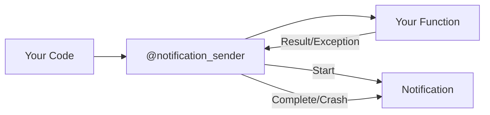
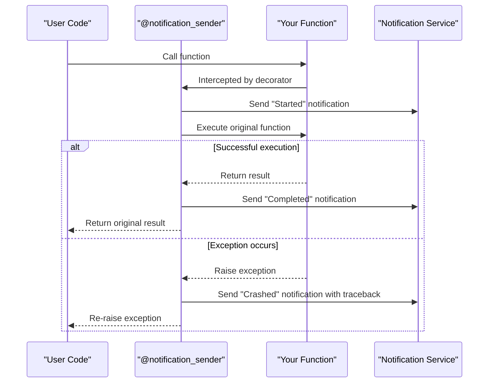
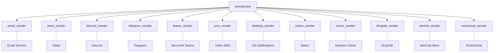
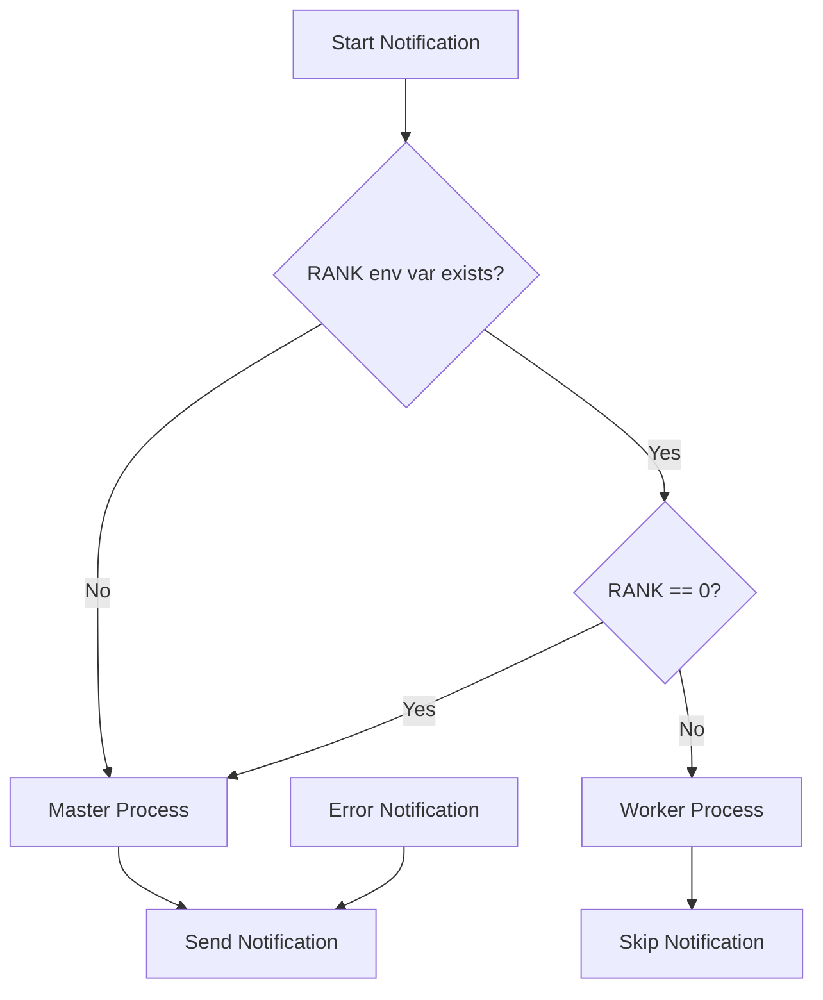

<!-- source: DeepWiki mcp.deepwiki.com · repo huggingface/knockknock · page 1.2 Quick Start · fetched 2026-10-26 -->

# Quick Start

<details>
<summary>Relevant source files</summary>

The following files were used as context for generating this wiki page:

- [README.md](README.md)
- [knockknock/__init__.py](knockknock/__init__.py)

</details>


This guide provides a quick introduction to get you started with knockknock, a Python library that sends notifications when your long-running processes start, complete, or fail. If you're looking for installation instructions, see [Installation](#1.1), or for a detailed overview of all notification channels, see [Notification Channels](#4).

## What is knockknock?

knockknock is a lightweight notification library that requires minimal code changes to implement. With just a decorator added to your function, you can receive notifications across various platforms when your long-running processes (like machine learning training jobs) start, complete successfully, or crash unexpectedly.



Sources: [README.md:5-7](), [knockknock/__init__.py:1-12]()

## Basic Usage Pattern

The fundamental pattern in knockknock is the decorator pattern. You simply add a decorator to your main function, and knockknock handles sending notifications at appropriate times.

### Decorator Workflow



Sources: [README.md:21-22]()

## Simple Example: Email Notification

Here's a basic example using email notifications:

```python
from knockknock import email_sender

@email_sender(recipient_emails=["your_email@example.com"], 
              sender_email="notification_sender@gmail.com")
def train_model(parameters):
    # Your long-running code here
    import time
    time.sleep(100)  # Simulating long process
    return {"accuracy": 0.95}  # Optional return value
```

The first time you run this code, you'll be prompted for the sender's email password. It will be securely stored in your system's keyring.

Sources: [README.md:48-55](), [README.md:43-44]()

## Command-Line Interface

You can also use knockknock directly from the command line:

```bash
knockknock email \
    --recipient-emails your_email@example.com \
    --sender-email notification_sender@gmail.com \
    python train_model.py
```

This will run the `train_model.py` script and send notifications when it starts and completes.

Sources: [README.md:59-64]()

## Available Notification Channels

knockknock supports multiple notification channels:



Sources: [knockknock/__init__.py:1-12](), [README.md:23-38]()

### Comparison: Decorator vs CLI Usage

| Feature | Python Decorator | Command-Line Interface |
|---------|------------------|------------------------|
| Integration | Added directly to your code | Wraps around an existing command |
| Configuration | Parameters in decorator | Command-line arguments |
| Best for | Integrating into existing Python code | Quick use with existing scripts |
| Example | `@email_sender(recipient_emails=["me@example.com"])` | `knockknock email --recipient-emails me@example.com python script.py` |

Sources: [README.md:45-68](), [README.md:19-22]()

## Platform-Specific Configuration

Each notification platform requires specific configuration:

1. **Email**: Requires Gmail account (or other SMTP) and needs to [allow less secure apps](https://devanswers.co/allow-less-secure-apps-access-gmail-account)
2. **Slack**: Requires webhook URL and optionally channel name
3. **Discord**: Requires webhook URL
4. **Telegram**: Requires API token and chat ID
5. **Desktop**: Works on macOS, Linux, and Windows 10

For detailed configuration of each platform, see [Notification Channels](#4).

Sources: [README.md:41-44](), [README.md:72-73](), [README.md:190-191](), [README.md:104-106](), [README.md:216-217]()

## Distributed Training Support

knockknock intelligently handles distributed training environments, sending notifications only from the master process to avoid duplicate notifications.



Sources: [README.md:401-405]()

## Next Steps

For more detailed information on:
- Each notification channel's configuration, see [Notification Channels](#4)
- Understanding the decorator pattern in knockknock, see [Decorator Pattern](#2.1)
- Using the CLI with examples, see [CLI Usage Examples](#3.1)

---

