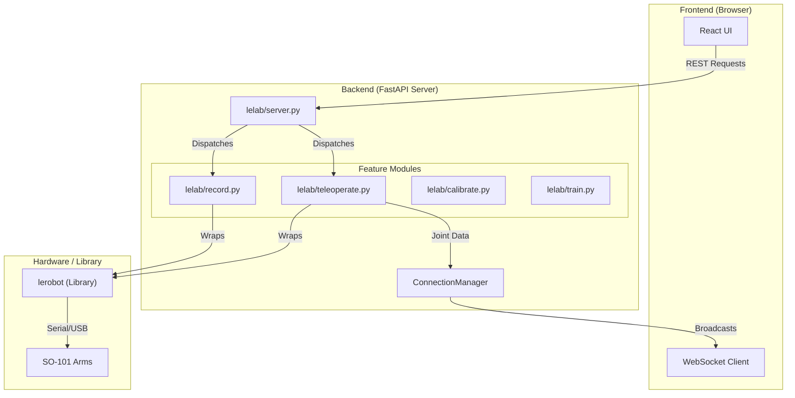
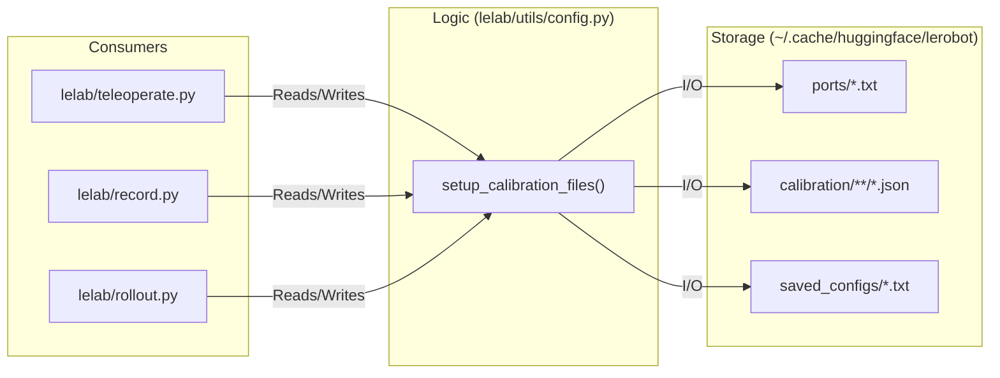

<!-- source: DeepWiki mcp.deepwiki.com · repo huggingface/leLab · page 1 LeLab Overview · fetched 2026-10-26 -->

# LeLab Overview

Relevant source files

The following files were used as context for generating this wiki page:

- [CLAUDE.md](CLAUDE.md)
- [README.md](README.md)
- [frontend/src/App.tsx](frontend/src/App.tsx)
- [frontend/src/components/SingleTabGuard.tsx](frontend/src/components/SingleTabGuard.tsx)
- [frontend/src/components/replay/DatasetCombobox.tsx](frontend/src/components/replay/DatasetCombobox.tsx)
- [frontend/src/contexts/HfAuthContext.tsx](frontend/src/contexts/HfAuthContext.tsx)
- [pyproject.toml](pyproject.toml)
- [tests/test_rollout.py](tests/test_rollout.py)
- [tests/test_runners_hf_cloud.py](tests/test_runners_hf_cloud.py)
- [tests/test_scripts_lelab.py](tests/test_scripts_lelab.py)

**LeLab** is a graphical user interface (GUI) wrapper for the [LeRobot](https://github.com/huggingface/lerobot) framework. It provides a web-native "front door" to robotics workflows, enabling users to calibrate, teleoperate, record datasets, train policies, and run inference through a unified browser interface [README.md:1-18]().

By abstracting LeRobot's CLI-driven flows into a single `lelab` process, it reduces the barrier to entry for newcomers to get from "unboxing" a robot to training their first policy [README.md:15-19]().

### Purpose and Scope
LeLab is designed to manage the full lifecycle of robot interaction without requiring manual terminal commands or keyboard prompts during hardware operation [README.md:15-16](). It primarily targets the **SO-101 leader/follower arms** [CLAUDE.md:68-69]().

For installation and local environment configuration, see [Getting Started](#1.1).

### Client-Server Architecture
LeLab employs a client-server architecture where a FastAPI backend orchestrates hardware communication and long-running tasks, while a React-based frontend provides the control interface.

*   **Backend (FastAPI):** Acts as a thin router and process orchestrator. It manages hardware-facing modules (recording, teleoperation, calibration) and shells out to LeRobot CLI scripts for training and inference [CLAUDE.md:34-42]().
*   **Frontend (React + Vite):** A Single Page Application (SPA) that communicates with the backend via REST APIs and WebSockets for real-time telemetry [CLAUDE.md:8-9]().
*   **Unified Serving:** In production, the backend mounts the built frontend bundle and serves both the API and the UI on a single port (default `:8000`) [CLAUDE.md:9-10]().

#### System Entity Mapping: Web-to-Hardware Bridge
The following diagram illustrates how frontend components interact with the backend modules and the underlying hardware via LeRobot.

**Diagram: Hardware Control Flow**

Sources: [lelab/server.py:104-206](), [CLAUDE.md:34-42](), [CLAUDE.md:48-51]()

### Main User Workflows
LeLab organizes robotics tasks into several distinct workflows accessible via the sidebar or landing page.

| Workflow | Backend Entity | Description |
| :--- | :--- | :--- |
| **Calibration** | `lelab/calibrate.py` | Step-by-step guided flow to set motor offsets and range of motion [CLAUDE.md:40-41](). |
| **Teleoperation** | `lelab/teleoperate.py` | Leader arm controls the follower arm with live 3D visualization [CLAUDE.md:39](). |
| **Recording** | `lelab/record.py` | Captures episodes into a `LeRobotDataset` with synchronized camera feeds [CLAUDE.md:38](). |
| **Training** | `lelab/train.py` | Local or Cloud-based policy training with live log streaming [CLAUDE.md:41-42](). |
| **Inference** | `lelab/rollout.py` | Executes a trained policy on the follower arm [CLAUDE.md:19](). |

For details on the UI implementation and global state management of these routes, see [Application Routing and Global Contexts](#1.2).

### Concurrency and State Management
LeLab uses a **mutual exclusion model**. Because hardware resources (serial ports and cameras) are finite, features like teleoperation and recording cannot run simultaneously.

*   **Module-level Globals:** Each backend module owns its state (e.g., `recording_active`, `inference_active`) [CLAUDE.md:46-47]().
*   **SingleTabGuard:** A frontend mechanism that uses `BroadcastChannel` to ensure only one browser tab can control the robot at any given time, preventing conflicting commands [frontend/src/components/SingleTabGuard.tsx:10-35]().
*   **Shared Configs:** Calibration files and port selections are persisted in `~/.cache/huggingface/lerobot/` and shared across modules [CLAUDE.md:52-61]().

**Diagram: State Persistence and Access**

Sources: [lelab/utils/config.py:30-74](), [CLAUDE.md:52-66]()

---

