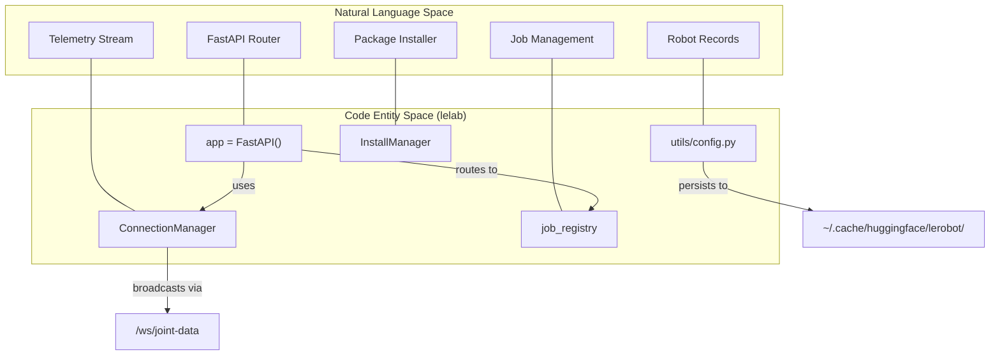
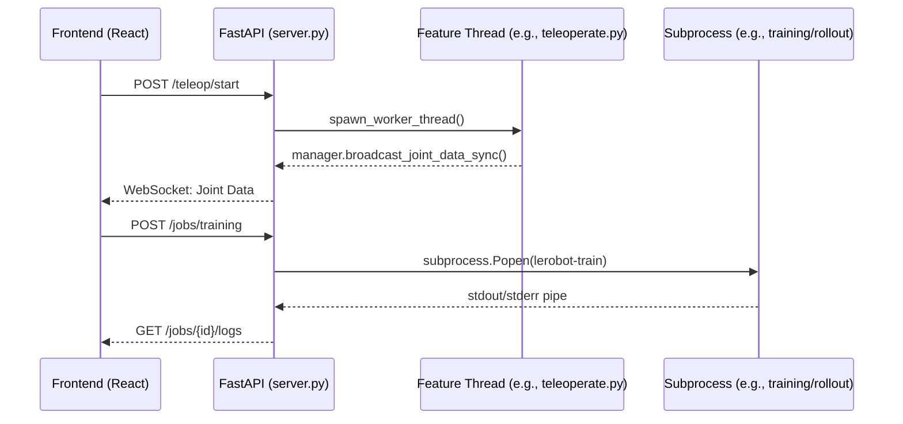

<!-- source: DeepWiki mcp.deepwiki.com · repo huggingface/leLab · page 2 Backend Architecture · fetched 2026-10-26 -->

# Backend Architecture

Relevant source files

The following files were used as context for generating this wiki page:

- [CLAUDE.md](CLAUDE.md)
- [lelab/server.py](lelab/server.py)
- [tests/test_rollout.py](tests/test_rollout.py)
- [tests/test_runners_hf_cloud.py](tests/test_runners_hf_cloud.py)
- [tests/test_scripts_lelab.py](tests/test_scripts_lelab.py)

The LeLab backend is a FastAPI-driven server that acts as a bridge between the React frontend and the [LeRobot](https://github.com/huggingface/lerobot) hardware/machine learning libraries. It orchestrates complex robot workflows—such as calibration, teleoperation, and dataset recording—while managing real-time telemetry via WebSockets and ensuring persistent configuration across sessions.

### Core Responsibilities
- **Feature Orchestration**: Routes HTTP requests to specific feature modules (e.g., `lelab/record.py`, `lelab/teleoperate.py`) that wrap LeRobot functionality [lelab/server.py:35-78]().
- **Concurrency & Safety**: Enforces mutual exclusion between hardware-facing features to prevent multiple processes from attempting to access the same serial ports or cameras simultaneously [lelab/server.py:46-75]().
- **Telemetry Broadcasting**: Maintains a high-frequency WebSocket stream (typically 20 FPS) for robot joint positions and system status [lelab/server.py:153-201]().
- **Hardware Discovery**: Provides endpoints for scanning serial ports and enumerating cameras across different operating systems [lelab/server.py:80-95]().
- **Asset Management**: Serves the built React frontend and manages local filesystem persistence for robot configurations and calibration files [lelab/server.py:146-150]().

### System Component Map
The following diagram illustrates how high-level system concepts map to specific code entities within the backend.

**System Concept to Code Entity Mapping**

Sources: [lelab/server.py:133-161](), [lelab/utils/config.py:1-20](), [lelab/jobs.py:44-45](), [lelab/utils/system.py:1-20]()

---

### FastAPI Server and WebSocket Broadcast
The server entry point is `lelab/server.py`. It initializes the `FastAPI` application and configures `CORSMiddleware` to allow cross-origin requests during development [lelab/server.py:133-144](). 

A central `ConnectionManager` handles WebSocket lifecycle events. It uses a dedicated background thread, the `_broadcast_worker`, to drain a `broadcast_queue` and send telemetry data to all connected clients without blocking the main event loop [lelab/server.py:153-201](). This architecture ensures that robot control loops (running in their own threads) can emit joint data at high frequencies.

For details, see [FastAPI Server and WebSocket Broadcast](#2.1).

### Configuration and Persistence Utilities
LeLab centralizes its state management in `lelab/utils/config.py`. It follows a specific filesystem layout under `~/.cache/huggingface/lerobot/` to remain compatible with the core LeRobot library [lelab/utils/config.py:1-30](). 

Key utilities include:
- **Robot Records**: CRUD operations for saving and loading leader/follower port assignments and configuration names [lelab/server.py:80-95]().
- **Calibration Sync**: The `setup_calibration_files` pattern, which copies user-selected calibration JSONs into the specific directory structures expected by LeRobot's hardware classes [lelab/utils/config.py:30-74]().

For details, see [Configuration and Persistence Utilities](#2.2).

### System Utilities and Package Management
Because LeLab has optional dependencies (like `wandb` for logging or `accelerate` for training), it includes a `system.py` utility module. The `InstallManager` class tracks the installation status of these packages and provides endpoints to trigger `pip` or `uv` installs at runtime [lelab/utils/system.py:1-50](). This allows the core GUI to remain lightweight while offering a path to "unlock" advanced features like cloud training.

For details, see [System Utilities and Package Management](#2.3).

---

### Backend Process Orchestration
The backend manages three distinct types of execution: synchronous handlers, long-running threads, and external subprocesses.

**Process Execution Model**

Sources: [lelab/server.py:69-75](), [lelab/teleoperate.py:1-50](), [lelab/train.py:1-30](), [lelab/rollout.py:1-30]()

---

