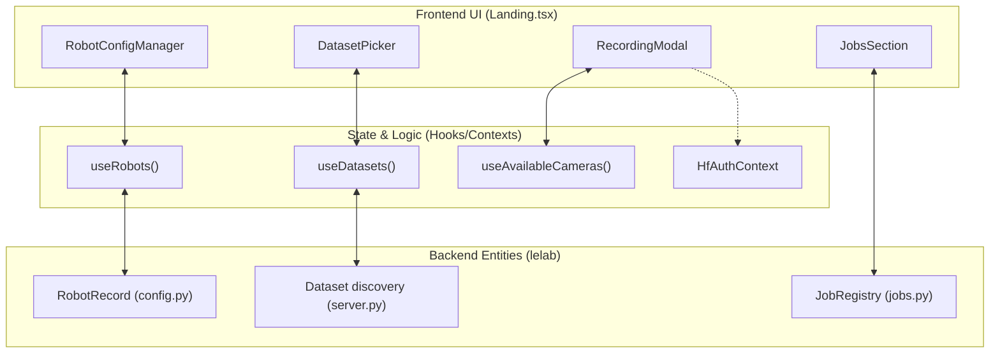
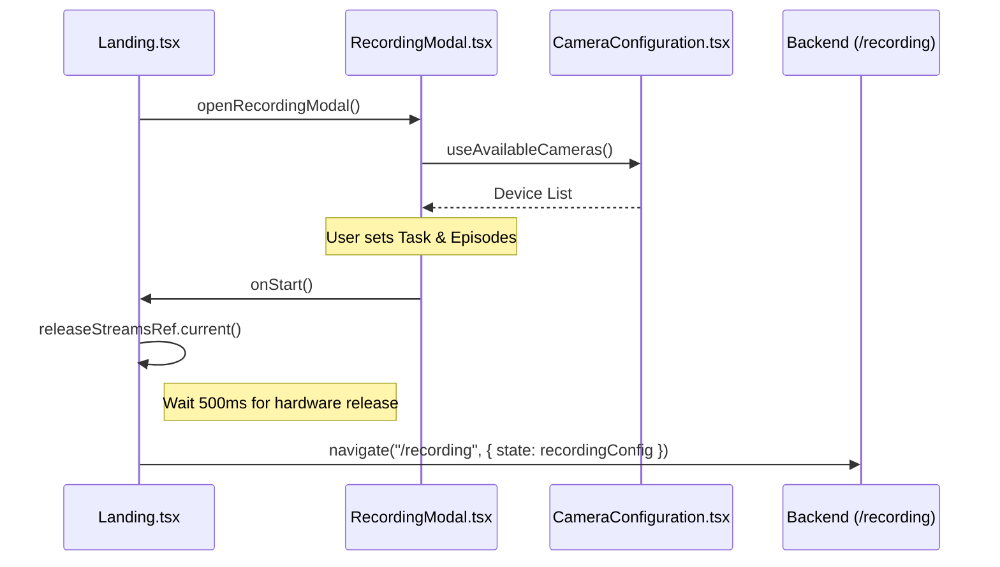

<!-- source: DeepWiki mcp.deepwiki.com · repo huggingface/leLab · page 6 Landing Page and Robot Management · fetched 2026-10-26 -->

# Landing Page and Robot Management

Relevant source files

The following files were used as context for generating this wiki page:

- [frontend/src/components/Footer.tsx](frontend/src/components/Footer.tsx)
- [frontend/src/components/landing/RecordingModal.tsx](frontend/src/components/landing/RecordingModal.tsx)
- [frontend/src/components/landing/RobotConfigManager.tsx](frontend/src/components/landing/RobotConfigManager.tsx)
- [frontend/src/components/landing/RobotSelector.tsx](frontend/src/components/landing/RobotSelector.tsx)
- [frontend/src/components/landing/RobotTile.tsx](frontend/src/components/landing/RobotTile.tsx)
- [frontend/src/pages/Landing.tsx](frontend/src/pages/Landing.tsx)

The Landing page serves as the central hub of the LeLab application. It provides a unified dashboard for managing robot hardware configurations, selecting or creating datasets, and monitoring active or past training jobs. From this interface, users can transition into hardware-specific workflows such as calibration, teleoperation, and recording.

### System Overview

The `Landing` component in [frontend/src/pages/Landing.tsx]() orchestrates several high-level state domains:
- **Robot Management**: Selection and CRUD operations for robot hardware profiles.
- **Dataset Selection**: Browsing local and Hub-hosted datasets to prepare for recording or training.
- **Session Initialization**: Configuring parameters for a new recording session via the `RecordingModal`.
- **Job Monitoring**: Real-time status updates for local and cloud training jobs.

The following diagram illustrates the relationship between the Landing page UI components and their corresponding backend/hook entities:

**Landing Page Entity Map**

Sources: [frontend/src/pages/Landing.tsx:23-47](), [frontend/src/components/landing/RobotConfigManager.tsx:18-26](), [frontend/src/hooks/useRobots.ts]() (implied), [lelab/utils/config.py]() (implied).

---

## Robot Configuration Management

Robot management is handled primarily through the `RobotConfigManager` and its child `RobotTile`. The system uses the `useRobots` hook to persist the `selectedName` in `localStorage` and perform CRUD operations against the backend's `RobotRecord` storage.

- **Robot Selection**: The `RobotSelector` [frontend/src/components/landing/RobotSelector.tsx:27-33]() provides a searchable combobox to switch between profiles or create new ones by name.
- **State Validation**: A robot is considered "Ready" only if `is_clean` is true [frontend/src/components/landing/RobotTile.tsx:44-45](), indicating that calibration has been completed.
- **Hardware Handoff**: Clicking "Teleoperation" triggers a POST request to `/move-arm` [frontend/src/components/landing/RobotConfigManager.tsx:35-48]() before navigating to the teleoperation view.

For details on the `RobotRecord` structure, port detection, and the calibration workflow, see **[Robot Configuration Management (#6.1)](#)**.

Sources: [frontend/src/components/landing/RobotConfigManager.tsx:31-68](), [frontend/src/components/landing/RobotTile.tsx:44-123](), [frontend/src/components/landing/RobotSelector.tsx:67-140]().

---

## Dataset Management and Upload

The Landing page integrates dataset discovery via the `DatasetPicker` component [frontend/src/components/landing/DatasetPicker.tsx](). It allows users to:
- **Discover**: List datasets from local storage and the Hugging Face Hub using the `useDatasets` hook [frontend/src/pages/Landing.tsx:37]().
- **Action Handoff**: Selecting a local dataset navigates the user to the `/upload` page for Hub synchronization [frontend/src/pages/Landing.tsx:100-109](), while Hub datasets open in the official LeRobot Visualizer [frontend/src/pages/Landing.tsx:91-97]().
- **Creation**: Users can initiate a new dataset by entering a name, which triggers the `RecordingModal` [frontend/src/pages/Landing.tsx:120-123]().

For details on dataset tagging, Hub privacy settings, and the `push_to_hub` implementation, see **[Dataset Management and Upload (#6.2)](#)**.

Sources: [frontend/src/pages/Landing.tsx:99-123](), [frontend/src/components/landing/DatasetPicker.tsx]().

---

## Recording Session Setup

The `RecordingModal` [frontend/src/components/landing/RecordingModal.tsx]() is the final configuration step before hardware control is handed over to the recording subsystem.

- **Parameter Assembly**: It gathers `numEpisodes`, `episodeTimeS`, `resetTimeS`, and `streamingEncoding` [frontend/src/components/landing/RecordingModal.tsx:35-42]().
- **Camera Mapping**: Integrates the `CameraConfiguration` component to map physical camera indices to logical names (e.g., `laptop`, `base`) [frontend/src/components/landing/RecordingModal.tsx:21-23]().
- **Stream Lifecycle**: A critical `releaseStreamsRef` [frontend/src/pages/Landing.tsx:49]() is used to ensure browser-side camera previews are terminated before the backend attempts to open the same devices via OpenCV [frontend/src/pages/Landing.tsx:157-171]().

**Recording Initialization Flow**

Sources: [frontend/src/pages/Landing.tsx:125-216](), [frontend/src/components/landing/RecordingModal.tsx:49-69](), [frontend/src/components/recording/CameraConfiguration.tsx]().

For details on the recording state machine and camera backend selection, see **[Recording Session Setup (#6.3)](#)**.

---

## Jobs Section

The `JobsSection` [frontend/src/components/jobs/JobsSection.tsx]() is embedded at the bottom of the Landing page. It provides a summary of all training activities managed by the `JobRegistry` in the backend. This section allows users to quickly check the progress of local subprocesses or cloud-based training runs without navigating to the full Training page.

Sources: [frontend/src/pages/Landing.tsx:11](), [lelab/jobs.py]() (implied).

---

