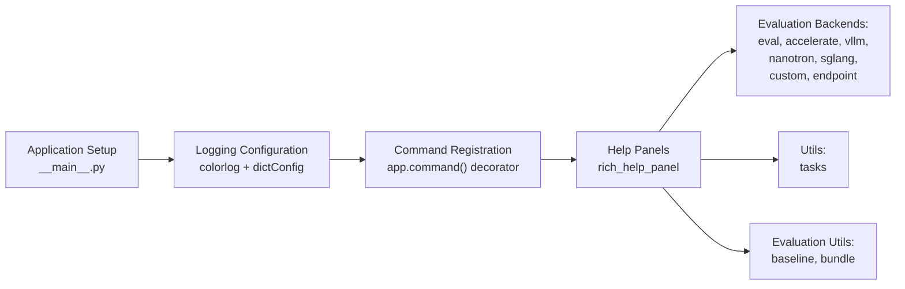
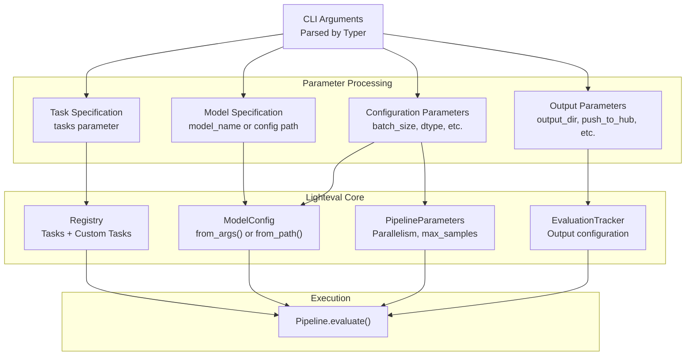
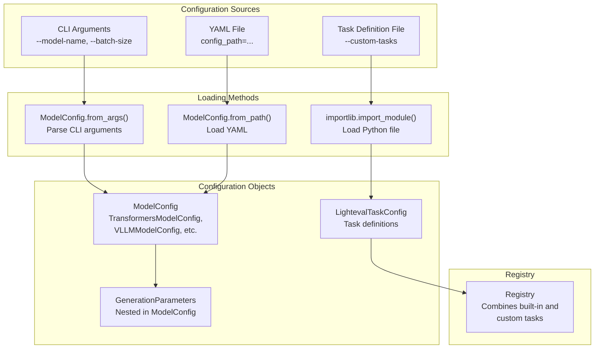
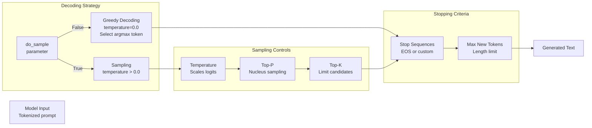

<!-- source: DeepWiki mcp.deepwiki.com · repo huggingface/lighteval · page 10 CLI and Configuration · fetched 2026-10-26 -->

# CLI and Configuration

<details>
<summary>Relevant source files</summary>

The following files were used as context for generating this wiki page:

- [.github/workflows/pr_style_bot.yaml](.github/workflows/pr_style_bot.yaml)
- [README.md](README.md)
- [docs/source/adding-a-new-metric.mdx](docs/source/adding-a-new-metric.mdx)
- [pyproject.toml](pyproject.toml)
- [src/lighteval/__main__.py](src/lighteval/__main__.py)
- [src/lighteval/main_baseline.py](src/lighteval/main_baseline.py)

</details>


This document provides a complete reference for lighteval's command-line interface and configuration system. It covers all available CLI commands, common parameters shared across commands, configuration file formats, and generation parameters.

For information about the Python API for programmatic evaluation, see [Evaluation Pipeline](#4). For details on specific backend configurations, see [Models and Backends](#7).

## CLI Architecture Overview

Lighteval uses [Typer](https://typer.tiangolo.com) to provide a structured command-line interface with multiple commands organized into logical help panels. All commands share a common pattern of accepting evaluation tasks, model specifications, and configuration parameters.

### Command Structure

```mermaid
graph TB
    CLI["lighteval CLI Entry Point<br/>(lighteval.__main__:app)"]
    
    subgraph "Evaluation Backends Panel"
        Eval["lighteval eval<br/>(main_inspect.eval)"]
        Accel["lighteval accelerate<br/>(main_accelerate.accelerate)"]
        Nano["lighteval nanotron<br/>(main_nanotron.nanotron)"]
        VLLM["lighteval vllm<br/>(main_vllm.vllm)"]
        SG["lighteval sglang<br/>(main_sglang.sglang)"]
        Custom["lighteval custom<br/>(main_custom.custom)"]
        
        EndpointApp["lighteval endpoint<br/>(main_endpoint.app)"]
        InfEnd["endpoint inference-endpoint"]
        TGI["endpoint tgi"]
        LiteLLM["endpoint litellm"]
        InfProv["endpoint inference-providers"]
    end
    
    subgraph "Utils Panel"
        Tasks["lighteval tasks<br/>(main_tasks.app)"]
        TaskList["tasks list"]
        TaskInfo["tasks info"]
    end
    
    subgraph "Evaluation Utils Panel"
        Baseline["lighteval baseline<br/>(main_baseline.baseline)"]
        Bundle["lighteval bundle<br/>(main_inspect.bundle)"]
    end
    
    CLI --> Eval
    CLI --> Accel
    CLI --> Nano
    CLI --> VLLM
    CLI --> SG
    CLI --> Custom
    CLI --> EndpointApp
    CLI --> Tasks
    CLI --> Baseline
    CLI --> Bundle
    
    EndpointApp --> InfEnd
    EndpointApp --> TGI
    EndpointApp --> LiteLLM
    EndpointApp --> InfProv
    
    Tasks --> TaskList
    Tasks --> TaskInfo
    
    style CLI fill:#f9f9f9
    style EndpointApp fill:#f0f0f0
    style Tasks fill:#f0f0f0
```



**Sources**: [src/lighteval/__main__.py:39-86](), [README.md:110-126]()

### CLI Implementation

The CLI application is structured as a Typer application with logging configuration and command registration:



The entry point is registered in `pyproject.toml`:

```
[project.scripts]
lighteval = "lighteval.__main__:app"
```

**Sources**: [src/lighteval/__main__.py:1-90](), [pyproject.toml:136-137]()

## Available Commands

### Evaluation Backend Commands

These commands execute model evaluations using different inference backends.

#### `lighteval eval` (Recommended)

Evaluates models using the [inspect-ai](https://inspect.aisi.org.uk) framework as a backend. This is the recommended default approach for most use cases.

**Basic Usage**:
```bash
lighteval eval "hf-inference-providers/openai/gpt-oss-20b" gpqa:diamond
```

**Common Parameters**:
- First positional: Model identifier (can be HF model name, inference provider string, or config path)
- Second positional: Task specification (e.g., `gpqa:diamond`, `gsm8k`, or task file path)
- `--custom-tasks`: Path to custom task definitions
- `--output-dir`: Directory for results (default: `./results`)
- `--max-samples`: Maximum samples per task for testing
- `--push-to-hub`: Push results to HuggingFace Hub

**Sources**: [README.md:111](), [src/lighteval/__main__.py:73]()

#### `lighteval accelerate`

Evaluates models on CPU or one or more GPUs using HuggingFace Accelerate for distributed execution.

**Basic Usage**:
```bash
lighteval accelerate \
    "model_name=meta-llama/Meta-Llama-3-8B-Instruct" \
    "mmlu:abstract_algebra" \
    --output-dir ./results \
    --max-samples 10
```

**Key Parameters**:
- `model_name`: HuggingFace model identifier or path
- `batch_size`: Batch size for inference
- `device_map`: Device mapping strategy (e.g., `"auto"`, `"cuda:0"`)
- `dtype`: Model dtype (`float16`, `bfloat16`, `float32`)
- Uses Accelerate for automatic multi-GPU parallelism

**Sources**: [README.md:112-113](), [src/lighteval/__main__.py:67]()

#### `lighteval vllm`

Evaluates models using VLLM for high-performance inference with PagedAttention.

**Basic Usage**:
```bash
lighteval vllm \
    "model_name=meta-llama/Meta-Llama-3-8B-Instruct" \
    "gsm8k" \
    --tensor-parallel-size 2 \
    --max-samples 100
```

**VLLM-Specific Parameters**:
- `--tensor-parallel-size`: Number of GPUs for tensor parallelism
- `--pipeline-parallel-size`: Number of pipeline stages
- `--gpu-memory-utilization`: GPU memory fraction to use (0.0-1.0)
- Supports Ray for distributed execution

**Sources**: [README.md:116-117](), [src/lighteval/__main__.py:70](), [pyproject.toml:106]()

#### `lighteval sglang`

Evaluates models using SGLang backend for structured generation.

**Basic Usage**:
```bash
lighteval sglang \
    "model_name=meta-llama/Meta-Llama-3-8B-Instruct" \
    "hellaswag"
```

**SGLang-Specific Parameters**:
- Supports radix attention for efficient structured generation
- Multiple sampling and attention backends

**Sources**: [README.md:118](), [src/lighteval/__main__.py:72](), [pyproject.toml:107]()

#### `lighteval nanotron`

Evaluates models in distributed settings using Nanotron training framework.

**Basic Usage**:
```bash
lighteval nanotron \
    --checkpoint-config-path config.yaml \
    --tasks "mmlu:abstract_algebra"
```

**Nanotron-Specific Parameters**:
- `--checkpoint-config-path`: Path to Nanotron checkpoint configuration
- Supports multi-node distributed evaluation

**Sources**: [README.md:114-115](), [src/lighteval/__main__.py:69](), [pyproject.toml:101-104]()

#### `lighteval custom`

Evaluates custom models that don't fit standard patterns. Users implement the `LightevalModel` interface.

**Basic Usage**:
```bash
lighteval custom \
    --model-class "my_module.MyCustomModel" \
    --tasks "gsm8k"
```

**Sources**: [README.md:125-126](), [src/lighteval/__main__.py:71]()

### Endpoint Commands

The `endpoint` command group evaluates models via various API endpoints.

#### `lighteval endpoint inference-endpoint`

Evaluates models using HuggingFace's Inference Endpoints API.

**Basic Usage**:
```bash
lighteval endpoint inference-endpoint \
    --endpoint-url "https://..." \
    --tasks "mmlu:abstract_algebra"
```

**Sources**: [README.md:120-121](), [src/lighteval/__main__.py:75-80]()

#### `lighteval endpoint tgi`

Evaluates models using Text Generation Inference (TGI) servers running locally or remotely.

**Basic Usage**:
```bash
lighteval endpoint tgi \
    --base-url "http://localhost:8080" \
    --tasks "gsm8k"
```

**Sources**: [README.md:121-122](), [pyproject.toml:97]()

#### `lighteval endpoint litellm`

Evaluates models using LiteLLM as a universal gateway to 100+ LLM providers (OpenAI, Anthropic, etc.).

**Basic Usage**:
```bash
lighteval endpoint litellm \
    --model "gpt-4" \
    --tasks "gpqa:diamond" \
    --api-key $OPENAI_API_KEY
```

**Sources**: [README.md:122-123](), [pyproject.toml:96]()

#### `lighteval endpoint inference-providers`

Evaluates models using HuggingFace's inference provider network.

**Basic Usage**:
```bash
lighteval endpoint inference-providers \
    --model "meta-llama/Meta-Llama-3-8B-Instruct" \
    --tasks "mmlu"
```

**Sources**: [README.md:123-124]()

### Utility Commands

#### `lighteval tasks`

Lists or inspects available tasks.

**Subcommands**:
- `lighteval tasks list`: List all available tasks
- `lighteval tasks info <task_name>`: Show detailed information about a specific task

**Sources**: [src/lighteval/__main__.py:81-86]()

#### `lighteval baseline`

Computes baseline scores for tasks. For multiple-choice tasks, assumes random guessing (score = n_correct/n_choices). For other metrics, assigns a score of 0.

**Basic Usage**:
```bash
lighteval baseline \
    --tasks "mmlu:abstract_algebra" \
    --output-dir ./baseline_results \
    --max-samples 100
```

**Implementation Note**: The baseline is computed as:
- Multiple-choice: `len(gold_index) / len(choices)` per sample
- Other metrics: 0

**Sources**: [src/lighteval/__main__.py:68](), [src/lighteval/main_baseline.py:34-95]()

#### `lighteval bundle`

Utility command from the inspect-ai integration for bundling evaluation configurations.

**Sources**: [src/lighteval/__main__.py:74]()

## Common CLI Parameters

The following parameters are shared across most evaluation commands:

### Core Parameters

| Parameter | Type | Description | Default |
|-----------|------|-------------|---------|
| `tasks` | str | Task specification (names, file paths, or patterns) | Required |
| `--custom-tasks` | Path | Path to Python file with `TASKS_TABLE` variable | None |
| `--output-dir` | Path | Directory to save evaluation results | `./results` |
| `--max-samples` | int | Maximum samples per task (for testing) | None (all) |
| `--dataset-loading-processes` | int | Number of parallel processes for dataset loading | 1 |
| `--load-tasks-multilingual` | bool | Load multilingual task variants | False |

**Sources**: [src/lighteval/main_baseline.py:24-31]()

### Output and Logging Parameters

| Parameter | Type | Description | Default |
|-----------|------|-------------|---------|
| `--push-to-hub` | bool | Push results to HuggingFace Hub | False |
| `--push-to-tensorboard` | bool | Log metrics to TensorBoard | False |
| `--save-details` | bool | Save sample-level details | True |
| `--public` | bool | Make Hub uploads public | False |
| `--hub-results-org` | str | HuggingFace organization for results | None |

### Model Configuration Parameters

Common model parameters (exact availability varies by backend):

| Parameter | Type | Description |
|-----------|------|-------------|
| `model_name` | str | Model identifier or path |
| `batch_size` | int | Batch size for inference |
| `dtype` | str | Model dtype (`float16`, `bfloat16`, `float32`) |
| `device_map` | str | Device mapping (`"auto"`, `"cuda:0"`, etc.) |
| `max_length` | int | Maximum sequence length |

**Sources**: [README.md:148-169]()

### Parameter Flow



**Sources**: [README.md:136-169]()

## Configuration Files

Lighteval supports YAML configuration files for both model and task configurations, enabling reusable, version-controlled evaluation setups.

### Model Configuration Files

Model configurations can be specified in YAML and loaded via `from_path()`:

**Example Model Config** (`model_config.yaml`):
```yaml
model_name: "meta-llama/Meta-Llama-3-8B-Instruct"
batch_size: 8
dtype: "bfloat16"
device_map: "auto"
max_length: 4096

generation:
  temperature: 0.7
  top_p: 0.95
  max_new_tokens: 512
  stop_sequences:
    - "\n\n"
    - "###"
```

**Loading in CLI**:
```bash
lighteval accelerate \
    "config_path=/path/to/model_config.yaml" \
    "mmlu:abstract_algebra"
```

**Loading in Python**:
```python
from lighteval.models.transformers.transformers_model import TransformersModelConfig

config = TransformersModelConfig.from_path("/path/to/model_config.yaml")
```

### Task Configuration Files

Custom tasks can be defined in Python files and loaded via `--custom-tasks`:

**Example Task File** (`my_tasks.py`):
```python
from lighteval.tasks.lighteval_task import LightevalTaskConfig
from lighteval.metrics import Metrics

def my_prompt_function(doc, num_fewshot):
    # Format prompt from doc
    return {"query": doc["question"], "choices": doc["choices"]}

TASKS_TABLE = [
    LightevalTaskConfig(
        name="my_custom_task",
        prompt_function=my_prompt_function,
        hf_repo="my_org/my_dataset",
        hf_subset="default",
        evaluation_splits=["test"],
        metric=[Metrics.loglikelihood_acc],
    )
]
```

**Usage**:
```bash
lighteval accelerate \
    "model_name=gpt2" \
    "my_custom_task" \
    --custom-tasks my_tasks.py
```

**Sources**: [docs/source/adding-a-new-metric.mdx:143-163]()

### Configuration Loading Flow



**Sources**: [README.md:156-158]()

## Generation Parameters

Generation parameters control how models produce text during generative evaluations. These are specified either as CLI arguments or nested in configuration files.

### Core Generation Parameters

| Parameter | Type | Description | Default |
|-----------|------|-------------|---------|
| `temperature` | float | Sampling temperature (0.0 = greedy) | 1.0 |
| `top_p` | float | Nucleus sampling threshold | 1.0 |
| `top_k` | int | Top-k sampling limit | -1 (disabled) |
| `max_new_tokens` | int | Maximum tokens to generate | 256 |
| `do_sample` | bool | Enable sampling (vs. greedy decoding) | False |
| `stop_sequences` | list[str] | Sequences that stop generation | [] |
| `repetition_penalty` | float | Penalty for repeated tokens | 1.0 |

### Generation Parameter Configuration

**In YAML**:
```yaml
model_name: "meta-llama/Meta-Llama-3-8B-Instruct"
batch_size: 4

generation:
  temperature: 0.7
  top_p: 0.95
  top_k: 50
  max_new_tokens: 512
  do_sample: true
  stop_sequences:
    - "\n\n"
    - "###"
    - "Human:"
  repetition_penalty: 1.1
```

**In Python API**:
```python
from lighteval.models.transformers.transformers_model import (
    TransformersModelConfig,
    GenerationParameters
)

gen_params = GenerationParameters(
    temperature=0.7,
    top_p=0.95,
    max_new_tokens=512,
    do_sample=True,
    stop_sequences=["\n\n", "###"]
)

config = TransformersModelConfig(
    model_name="meta-llama/Meta-Llama-3-8B-Instruct",
    batch_size=4,
    generation_parameters=gen_params
)
```

### Greedy vs Sampling Strategies



**Sources**: [README.md:144-169]()

## Task Specification Format

Tasks can be specified in multiple formats:

### Single Task
```bash
lighteval eval "model" "gsm8k"
```

### Multiple Tasks (Comma-Separated)
```bash
lighteval eval "model" "gsm8k,mmlu:abstract_algebra,hellaswag"
```

### Task with Few-Shot Examples
```bash
lighteval eval "model" "gsm8k|5"  # 5-shot evaluation
```

### Task Subset Specification
```bash
lighteval eval "model" "mmlu:abstract_algebra"  # Specific subset
lighteval eval "model" "mmlu"  # All MMLU subsets
```

### Task File Path
```bash
lighteval eval "model" "/path/to/custom_tasks.py"
```

### Task Parameters
```bash
lighteval eval "model" "gsm8k|5@variance_seeds=3"  # 5-shot with 3 variance seeds
```

**Task Specification Grammar**:
```
task_spec ::= task_name ["|" num_fewshot] ["@" params]
task_name ::= name [":" subset]
params ::= param ["," param]*
param ::= key "=" value
```

**Sources**: README examples

## Logging Configuration

Lighteval uses `colorlog` for structured console logging with color-coded severity levels:

```python
# From __main__.py
logging_config = dict(
    version=1,
    formatters={
        "c": {
            "()": colorlog.ColoredFormatter,
            "format": "[%(asctime)s] [%(log_color)s%(levelname)8s%(reset)s]: %(message)s (%(filename)s:%(lineno)s)",
            "log_colors": {
                "DEBUG": "cyan",
                "INFO": "green",
                "WARNING": "yellow",
                "ERROR": "red",
                "CRITICAL": "red,bg_white",
            },
        },
    },
    handlers={"h": {"class": "logging.StreamHandler", "formatter": "c", "level": logging.INFO}},
    root={"handlers": ["h"], "level": logging.INFO},
)
```

**Output Format**:
```
[2024-03-15 10:30:45] [    INFO]: Loading tasks from registry (main.py:123)
[2024-03-15 10:30:46] [ WARNING]: Task 'custom_task' not found (registry.py:234)
[2024-03-15 10:30:47] [   ERROR]: Failed to load model (model_loader.py:45)
```

**Sources**: [src/lighteval/__main__.py:42-65]()

## Environment Variables

Lighteval respects the following environment variables:

| Variable | Purpose | Example |
|----------|---------|---------|
| `HF_TOKEN` | HuggingFace authentication token | Set via `hf auth login` |
| `CUDA_VISIBLE_DEVICES` | GPU selection | `0,1,2,3` |
| `OPENAI_API_KEY` | OpenAI API authentication | For endpoint evaluation |
| `ANTHROPIC_API_KEY` | Anthropic API authentication | For LLM-as-judge metrics |

**HuggingFace Authentication**:
```bash
# Login once, token stored in ~/.huggingface/token
hf auth login

# Or set directly
export HF_TOKEN="hf_..."
```

**Sources**: [README.md:100-105]()

## Complete Example: Multi-Backend Configuration

This example shows how to evaluate the same task across different backends using consistent configuration:

**Shared Config** (`base_config.yaml`):
```yaml
batch_size: 8
dtype: "bfloat16"
max_length: 4096

generation:
  temperature: 0.1
  max_new_tokens: 512
  stop_sequences: ["\n\n"]
```

**Evaluate with Accelerate**:
```bash
lighteval accelerate \
    "model_name=meta-llama/Meta-Llama-3-8B-Instruct" \
    "gsm8k|5" \
    --config base_config.yaml \
    --output-dir ./results/accelerate \
    --max-samples 100
```

**Evaluate with VLLM**:
```bash
lighteval vllm \
    "model_name=meta-llama/Meta-Llama-3-8B-Instruct" \
    "gsm8k|5" \
    --config base_config.yaml \
    --tensor-parallel-size 2 \
    --output-dir ./results/vllm \
    --max-samples 100
```

**Evaluate with Endpoint**:
```bash
lighteval endpoint inference-endpoint \
    --endpoint-url "https://api-inference.huggingface.co/models/meta-llama/Meta-Llama-3-8B-Instruct" \
    "gsm8k|5" \
    --config base_config.yaml \
    --output-dir ./results/endpoint \
    --max-samples 100
```

All three commands will use the same task specification, generation parameters, and output format, ensuring comparable results across backends.

**Sources**: [README.md:108-169]()

---

