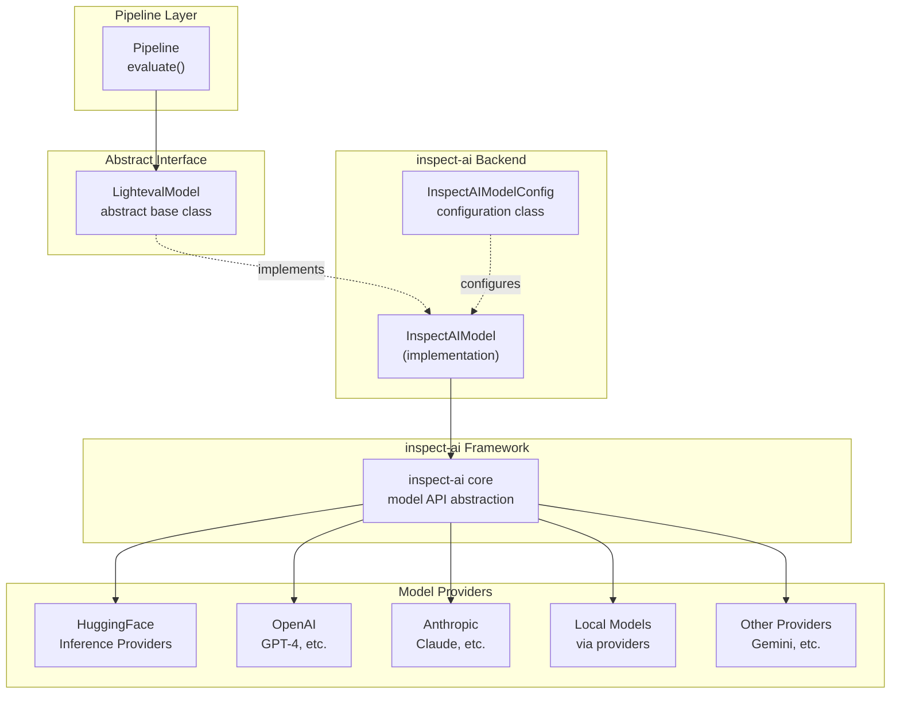
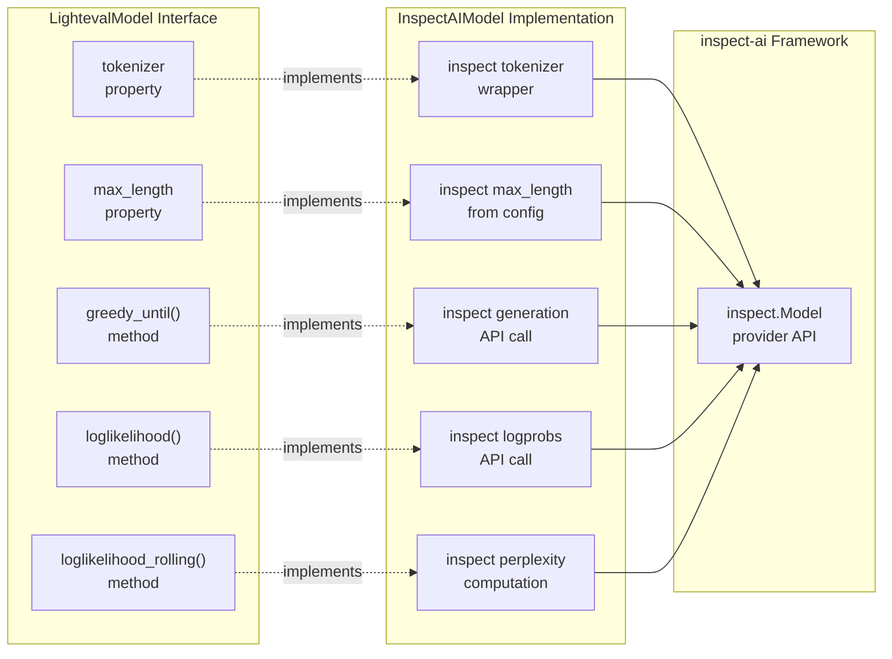
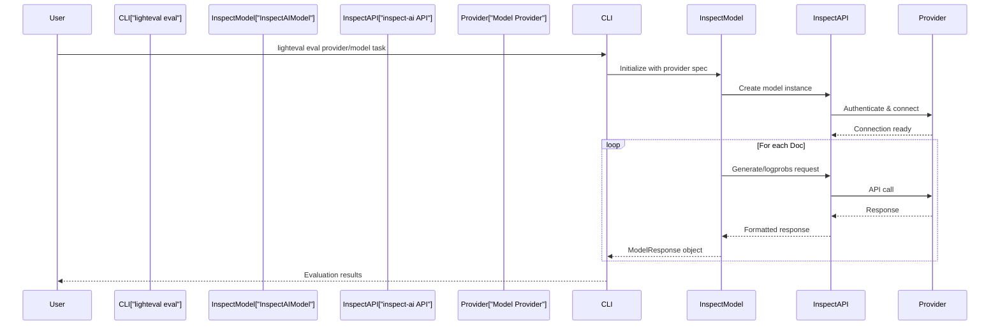

<!-- source: DeepWiki mcp.deepwiki.com · repo huggingface/lighteval · page 7.8 inspect-ai Backend · fetched 2026-10-26 -->

# inspect-ai Backend

<details>
<summary>Relevant source files</summary>

The following files were used as context for generating this wiki page:

- [README.md](README.md)
- [pyproject.toml](pyproject.toml)
- [src/lighteval/models/abstract_model.py](src/lighteval/models/abstract_model.py)

</details>


## Purpose and Scope

The inspect-ai backend is lighteval's **recommended default backend** for model evaluation. It leverages the [inspect-ai framework](https://inspect.aisi.org.uk) to provide a unified interface for evaluating models across multiple inference providers and deployment scenarios.

This page covers the inspect-ai backend's configuration, usage patterns, and integration with lighteval's evaluation pipeline. For information about other backend options (VLLM, Transformers, etc.), see [Models and Backends](#7). For custom backend implementation, see [Custom Backend Integration](#7.9).

**Sources:** [README.md:111-132](), [pyproject.toml:63]()

---

## Why inspect-ai is Recommended

The inspect-ai backend is designated as the preferred evaluation backend in lighteval for several key reasons:

| **Advantage** | **Description** |
|---------------|-----------------|
| **Unified Interface** | Single API for multiple providers (OpenAI, Anthropic, HuggingFace, etc.) |
| **Production Ready** | Mature framework designed specifically for LLM evaluation |
| **Provider Agnostic** | Easily switch between hosted and local models without code changes |
| **Core Integration** | Built into lighteval as a core dependency, not an optional extra |
| **Async Support** | Native support for concurrent evaluation across multiple samples |

The inspect-ai framework provides a stable, well-tested foundation that abstracts away provider-specific APIs while maintaining full access to model capabilities.

**Sources:** [README.md:111](), [pyproject.toml:63]()

---

## Backend Architecture

The following diagram shows how the inspect-ai backend fits into lighteval's model execution layer:

### Diagram: inspect-ai Backend Integration



The inspect-ai backend implements lighteval's `LightevalModel` interface, translating lighteval's evaluation requests into inspect-ai's model API calls. This architecture enables seamless provider switching while maintaining consistent behavior across the evaluation pipeline.

**Sources:** [src/lighteval/models/abstract_model.py:220-283](), [README.md:111-132]()

---

## Configuration

### InspectAIModelConfig Class

The `InspectAIModelConfig` class provides configuration options for the inspect-ai backend. Unlike other backend configs that extend `ModelConfig`, this is a standalone configuration class specific to inspect-ai's capabilities.

#### Configuration Parameters

| **Parameter** | **Type** | **Description** |
|---------------|----------|-----------------|
| `max_tokens` | `int \| None` | Maximum tokens to generate |
| `system_message` | `str \| None` | System prompt for chat models |
| `temperature` | `float \| None` | Sampling temperature (0.0 to 2.0) |
| `top_p` | `float \| None` | Nucleus sampling threshold |
| `top_k` | `int \| None` | Top-k sampling parameter |
| `frequence_penalty` | `float \| None` | Frequency penalty for repetition (-2.0 to 2.0) |
| `presence_penalty` | `float \| None` | Presence penalty for new topics (-2.0 to 2.0) |
| `seed` | `int \| None` | Random seed for reproducibility |
| `stop_seqs` | `list[str] \| None` | Sequences that stop generation |
| `num_choices` | `int \| None` | Number of completion choices to generate |
| `best_of` | `int \| None` | Generate N completions, return best |
| `log_probs` | `bool \| None` | Return log probabilities |
| `top_logprobs` | `int \| None` | Number of most likely tokens with log probs |
| `cache_prompt` | `bool \| None` | Enable prompt caching |
| `reasoning_effort` | `int \| None` | Reasoning effort level for supported models |
| `reasoning_tokens` | `int \| None` | Max tokens for reasoning steps |
| `reasoning_history` | `bool \| None` | Include reasoning history in output |
| `response_format` | `str \| None` | Structured output format specification |
| `parallel_tool_calls` | `bool \| None` | Enable parallel tool calling |
| `max_tool_output` | `int \| None` | Maximum tool output length |
| `internal_tools` | `bool \| None` | Enable internal tool usage |

**Sources:** [src/lighteval/models/abstract_model.py:158-180]()

### Configuration Loading

The `InspectAIModelConfig` class provides two methods for loading configuration:

#### From YAML File

```python
config = InspectAIModelConfig.from_path("config.yaml")
```

Example YAML structure:
```yaml
model_parameters:
  max_tokens: 2048
  system_message: "You are a helpful assistant."
  temperature: 0.7
  top_p: 0.95
  seed: 42
```

#### From Command-Line Arguments

```python
config = InspectAIModelConfig.from_args("max_tokens=2048,temperature=0.7,top_p=0.95")
```

The `_parse_args()` method parses comma-separated key-value pairs into a configuration dictionary.

**Sources:** [src/lighteval/models/abstract_model.py:182-217]()

---

## CLI Usage

### Basic Evaluation Command

The inspect-ai backend is accessed through the `lighteval eval` command:

```bash
lighteval eval MODEL_SPEC TASK_SPEC [OPTIONS]
```

### Model Specification Format

When using inspect-ai, the model specification follows the format:

```
provider/model-name
```

Common patterns:
- `hf-inference-providers/openai/gpt-4`: OpenAI models via HuggingFace providers
- `hf-inference-providers/anthropic/claude-3-5-sonnet`: Anthropic models
- `openai/gpt-4-turbo`: Direct OpenAI provider
- `anthropic/claude-3-opus`: Direct Anthropic provider

### Example Commands

**Evaluate on a single task:**
```bash
lighteval eval "hf-inference-providers/openai/gpt-oss-20b" gpqa:diamond
```

**Evaluate on multiple tasks:**
```bash
lighteval eval "openai/gpt-4-turbo" "mmlu,hellaswag,arc:challenge"
```

**With configuration parameters:**
```bash
lighteval eval "openai/gpt-4" gsm8k \
  --model-config "max_tokens=1024,temperature=0.7" \
  --output-dir ./results \
  --push-to-hub
```

**Sources:** [README.md:128-132]()

---

## Integration with LightevalModel Interface

### Diagram: inspect-ai Backend Method Implementation



The inspect-ai backend must implement all abstract methods defined in `LightevalModel`:

### Required Methods

1. **`tokenizer` property**: Returns a tokenizer-compatible interface for the model
2. **`max_length` property**: Returns the maximum sequence length supported
3. **`greedy_until(docs)`**: Implements greedy generation until stop sequences
4. **`loglikelihood(docs)`**: Computes log probabilities for multiple choice tasks
5. **`loglikelihood_rolling(docs)`**: Computes perplexity for language modeling tasks

These methods translate lighteval's `Doc` objects into inspect-ai API calls and return `ModelResponse` objects compatible with the rest of the pipeline.

**Sources:** [src/lighteval/models/abstract_model.py:220-283]()

---

## Supported Provider Types

The inspect-ai framework supports evaluation across multiple provider categories:

### Provider Categories

| **Provider Type** | **Examples** | **Use Case** |
|-------------------|--------------|--------------|
| **Cloud APIs** | OpenAI, Anthropic, Google | Production models via API |
| **HuggingFace Providers** | Inference Providers, Endpoints | HF-hosted models |
| **Local Providers** | Ollama, llama.cpp | Self-hosted inference |
| **Custom Providers** | User-defined | Organization-specific deployments |

### Diagram: Provider Flow



This unified flow works consistently regardless of the underlying provider, making it easy to compare models across different hosting environments.

**Sources:** [README.md:111-132]()

---

## Comparison with Other Backends

The following table compares the inspect-ai backend with other lighteval backends:

| **Feature** | **inspect-ai** | **Transformers** | **VLLM** | **Endpoints** |
|-------------|---------------|------------------|----------|---------------|
| **Provider Support** | Multiple via inspect-ai | HuggingFace models | Local models | Single endpoint |
| **Deployment** | Cloud or local | Local only | Local only | Remote only |
| **Recommended Use** | Default for most cases | Direct model control | High throughput | Existing deployments |
| **Async Support** | Yes | No | Yes | Yes |
| **Setup Complexity** | Low | Medium | High | Low |
| **Provider Switching** | Easy | N/A | N/A | Manual |
| **Dependency** | Core | Core | Optional | Optional |

For detailed information about other backends:
- Transformers backend: see [Transformers Backend](#7.3)
- VLLM backend: see [VLLM Backend](#7.4)
- Endpoint models: see [Endpoint Models](#7.6)

**Sources:** [README.md:111-126](), [pyproject.toml:63-138]()

---

## Advanced Configuration

### Reasoning-Capable Models

For models that support chain-of-thought reasoning (e.g., OpenAI's o1 models), the inspect-ai backend provides specialized parameters:

```python
config = InspectAIModelConfig(
    reasoning_effort=3,  # High reasoning effort
    reasoning_tokens=2000,  # Allow extended reasoning
    reasoning_history=True  # Include reasoning in output
)
```

### Structured Output

For tasks requiring JSON or other structured formats:

```python
config = InspectAIModelConfig(
    response_format="json_object",  # or specific JSON schema
    max_tokens=1024
)
```

### Caching for Efficiency

Enable prompt caching to reduce costs on repeated evaluations:

```python
config = InspectAIModelConfig(
    cache_prompt=True,
    max_tokens=512
)
```

**Sources:** [src/lighteval/models/abstract_model.py:158-180]()

---

## Python API Usage

While CLI usage is most common, the inspect-ai backend can also be used programmatically:

```python
from lighteval.logging.evaluation_tracker import EvaluationTracker
from lighteval.models.inspect_ai_model import InspectAIModel, InspectAIModelConfig
from lighteval.pipeline import ParallelismManager, Pipeline, PipelineParameters

# Configure the inspect-ai model
config = InspectAIModelConfig(
    max_tokens=1024,
    temperature=0.7,
    system_message="You are a helpful assistant."
)

# Initialize model (provider-specific initialization)
model = InspectAIModel(model_spec="openai/gpt-4", config=config)

# Set up evaluation pipeline
evaluation_tracker = EvaluationTracker(output_dir="./results")
pipeline_params = PipelineParameters(
    launcher_type=ParallelismManager.NONE,
    max_samples=100
)

# Run evaluation
pipeline = Pipeline(
    model=model,
    pipeline_parameters=pipeline_params,
    evaluation_tracker=evaluation_tracker,
    tasks="mmlu,gsm8k"
)

results = pipeline.evaluate()
```

Note: The exact API for `InspectAIModel` initialization may vary based on the implementation details not visible in the provided files.

**Sources:** [README.md:136-169](), [src/lighteval/models/abstract_model.py:158-218]()

---

## Best Practices

### When to Use inspect-ai Backend

✅ **Recommended for:**
- Evaluating commercial API models (OpenAI, Anthropic, etc.)
- Comparing models across different providers
- Production evaluations requiring reliability
- Getting started with lighteval (default choice)

❌ **Consider alternatives for:**
- Maximum control over model internals → Use [Transformers Backend](#7.3)
- Highest throughput on local GPUs → Use [VLLM Backend](#7.4)
- Specialized distributed setups → Use [Nanotron Backend](#7.7)

### Configuration Tips

1. **Set reasonable timeouts**: Some providers may have rate limits
2. **Use caching**: Enable `cache_prompt` for repeated evaluations
3. **Monitor costs**: Track token usage when using commercial APIs
4. **Seed for reproducibility**: Always set `seed` for deterministic results
5. **Provider-specific limits**: Check max_tokens limits per provider

**Sources:** [README.md:111-126]()

---

## Troubleshooting

### Common Issues

**Authentication Errors:**
- Ensure provider API keys are properly configured in environment variables
- Check that the provider/model specification is correct

**Rate Limiting:**
- Use `max_samples` parameter to limit evaluation scope
- Implement retry logic through inspect-ai configuration
- Consider using `num_choices` carefully to avoid excessive API calls

**Provider-Specific Behaviors:**
- Different providers may format outputs differently
- Check provider-specific documentation for parameter support
- Some parameters may not be supported by all providers

**Sources:** [src/lighteval/models/abstract_model.py:158-218]()

---

## Summary

The inspect-ai backend serves as lighteval's **unified evaluation interface**, providing:

- **Single API** for multiple model providers
- **Recommended default** for most evaluation scenarios  
- **Flexible configuration** via `InspectAIModelConfig`
- **Seamless integration** with lighteval's evaluation pipeline
- **Production-ready** implementation for reliable evaluations

For custom deployment scenarios, consider the other backend options documented in [Models and Backends](#7). For extending lighteval with new backends, see [Custom Backend Integration](#7.9).

**Sources:** [README.md:111-132](), [pyproject.toml:63](), [src/lighteval/models/abstract_model.py:158-218]()

---

