# Page: Overview

# Overview

<details>
<summary>Relevant source files</summary>

The following files were used as context for generating this wiki page:

- [README.md](README.md)
- [pyproject.toml](pyproject.toml)

</details>


This document provides a high-level introduction to lighteval, a lightweight framework for evaluating large language models (LLMs). It covers the framework's purpose, key features, and core architectural components.

For installation and quick start examples, see [Installation and Quick Start](#3). For detailed information about specific subsystems, refer to the following pages: [Architecture](#2), [Task System](#5), [Models and Backends](#7), [Metrics System](#8), and [Evaluation Tracking and Output](#9).

## Purpose and Scope

Lighteval is a Python-based evaluation framework designed for benchmarking language models across multiple execution backends. It supports both local model execution (via Transformers, VLLM, SGLang, Nanotron) and remote inference endpoints (via TGI, OpenAI-compatible APIs, HuggingFace Inference Endpoints).

The framework provides:
- **1000+ predefined evaluation tasks** spanning general knowledge, math, code, multilingual benchmarks, and instruction following
- **Multiple backend support** enabling evaluation of models whether served remotely or loaded in memory
- **Sample-level tracking** for detailed result inspection and reproducibility verification
- **Extensible plugin architecture** for custom tasks, metrics, and model backends

**Sources:** [README.md:35-41](), [pyproject.toml:48-59]()

## Project Organization

Lighteval is distributed as a Python package with the following structure:

| Component | Location | Description |
|-----------|----------|-------------|
| Core framework | `src/lighteval/` | Main package containing all evaluation logic |
| Command-line interface | `lighteval.__main__:app` | Entry point defined via `project.scripts` |
| Built-in tasks | `src/lighteval/tasks/` | Core task definitions |
| Multilingual tasks | `src/lighteval/multilingual/tasks/` | Language-specific evaluations |
| Community tasks | `community_tasks/` | Community-contributed task definitions |
| Package metadata | `pyproject.toml` | Dependencies, version (0.13.1.dev0), and optional extras |

**Sources:** [pyproject.toml:30-31](), [pyproject.toml:36-38](), [pyproject.toml:136-137]()

## Core Components

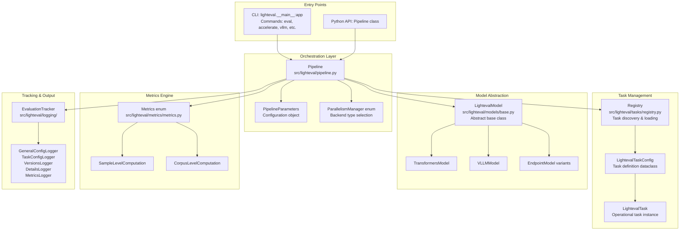

**Diagram: Core Component Architecture**

This diagram maps lighteval's main architectural components to their code locations. The `Pipeline` class orchestrates all evaluation activities, delegating to specialized subsystems for task management (`Registry`), model execution (`LightevalModel` implementations), metrics computation (`Metrics` enum), and result tracking (`EvaluationTracker`).

**Sources:** [README.md:109-127](), [pyproject.toml:136-137]()

## Evaluation Flow

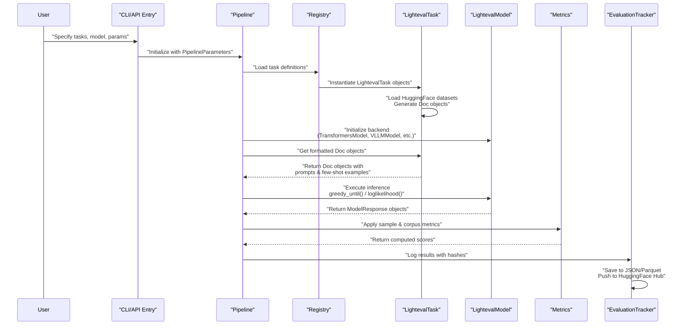

**Diagram: End-to-End Evaluation Sequence**

This sequence diagram illustrates the complete evaluation lifecycle from user input to result output. The `Pipeline.evaluate()` method coordinates all steps, ensuring tasks are loaded, prompts formatted, model inference executed, metrics computed, and results persisted with reproducibility hashes.

**Sources:** [README.md:136-169]()

## Key Features

### Multiple Execution Backends

Lighteval supports 11+ execution backends through the `ParallelismManager` enum:

| Backend | CLI Command | Use Case |
|---------|-------------|----------|
| inspect-ai | `lighteval eval` | Recommended default, uses inspect-ai framework |
| Transformers + Accelerate | `lighteval accelerate` | Multi-GPU with model parallelism |
| VLLM | `lighteval vllm` | High-throughput inference with PagedAttention |
| SGLang | `lighteval sglang` | Structured generation with radix attention |
| Nanotron | `lighteval nanotron` | Distributed training framework integration |
| Inference Endpoints | `lighteval endpoint inference-endpoint` | HuggingFace managed inference |
| TGI | `lighteval endpoint tgi` | Self-hosted Text Generation Inference |
| LiteLLM | `lighteval endpoint litellm` | Universal API gateway (100+ providers) |
| Inference Providers | `lighteval endpoint inference-providers` | HuggingFace inference provider network |

All backends implement the `LightevalModel` interface, providing uniform methods: `tokenizer`, `greedy_until()`, `loglikelihood()`, and `loglikelihood_rolling()`.

**Sources:** [README.md:109-127]()

### Extensive Task Library

The framework includes 1000+ predefined tasks organized across three collections:

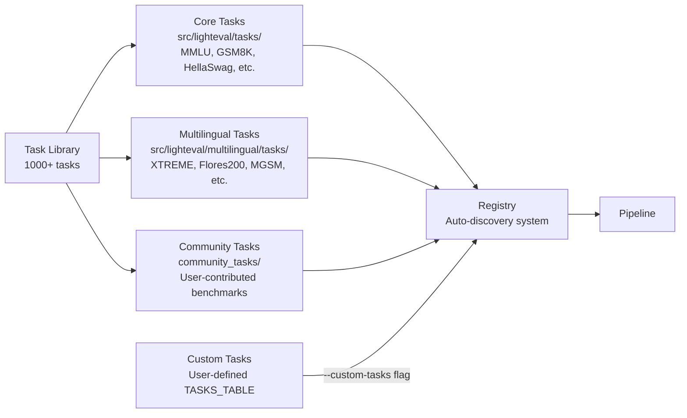

**Diagram: Task Organization and Discovery**

Tasks are defined using the `LightevalTaskConfig` dataclass and automatically discovered by the `Registry` class. Users can add custom tasks by creating a Python file with a `TASKS_TABLE` variable and passing it via the `--custom-tasks` CLI flag.

**Sources:** [README.md:43-88]()

### Extensible Metrics System

The metrics system uses an `aenum`-based `Metrics` enum that can be extended at runtime:

| Metric Category | Examples | Base Class |
|----------------|----------|------------|
| Sample-level | ExactMatch, F1Score, LoglikelihoodAcc | `SampleLevelComputation` |
| Corpus-level | Perplexity, BLEU, MatthewsCorrCoef | `CorpusLevelComputation` |
| Sampling metrics | PassAtK, MajAtN, AvgAtN | `SamplingMetric` |
| LLM-as-Judge | MTBench, SimpleQA, MixEval | `JudgeLLM` |

Custom metrics are created by implementing a metric function, wrapping it in `SampleLevelMetric` or `CorpusLevelMetric`, and registering via `extend_enum()`.

**Sources:** [README.md:40](), [pyproject.toml:80]()

### Comprehensive Tracking and Reproducibility

The `EvaluationTracker` class manages five specialized loggers:

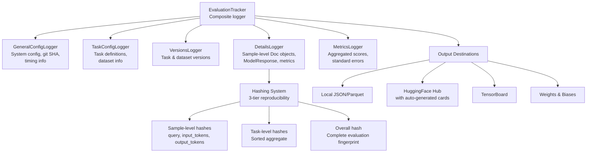

**Diagram: Tracking and Reproducibility Architecture**

The tracking system captures detailed sample-level information and computes hierarchical hashes for reproducibility verification. Results can be saved locally or pushed to multiple destinations including HuggingFace Hub with auto-generated dataset cards.

**Sources:** [README.md:100-105](), [pyproject.toml:127-128]()

## Dependencies and Installation

Lighteval has a modular dependency structure defined in `pyproject.toml`:

| Dependency Group | Key Packages | Installation |
|-----------------|--------------|--------------|
| Core | transformers>=4.54.0, inspect-ai>=0.3.140, accelerate, torch>=2.0, datasets>=4.0.0 | `pip install lighteval` |
| Metrics | nltk, scikit-learn, sacrebleu, rouge_score | Included in core |
| VLLM backend | vllm>=0.10.0, ray | `pip install lighteval[vllm]` |
| LiteLLM endpoint | litellm>=1.66.0, diskcache | `pip install lighteval[litellm]` |
| TGI endpoint | text-generation>=0.7.0 | `pip install lighteval[tgi]` |
| Nanotron | nanotron, tensorboardX | `pip install lighteval[nanotron]` |
| Multilingual | stanza, spacy, jieba, pyvi | `pip install lighteval[multilingual]` |
| Development | ruff, pre-commit, pytest | `pip install lighteval[dev]` |

**Sources:** [pyproject.toml:60-129](), [README.md:90-99]()

## Usage Patterns

### CLI Usage

```bash
# Evaluate using inspect-ai backend (recommended)
lighteval eval "hf-inference-providers/openai/gpt-oss-20b" gpqa:diamond

# Evaluate local model with VLLM
lighteval vllm --model_args "pretrained=meta-llama/Llama-2-7b-hf" --tasks "mmlu"

# Evaluate with Transformers + Accelerate
lighteval accelerate --model_args "pretrained=gpt2" --tasks "hellaswag|5"
```

### Python API Usage

The Python API allows evaluation of models already loaded in memory:

```python
from lighteval.pipeline import Pipeline, PipelineParameters, ParallelismManager
from lighteval.logging.evaluation_tracker import EvaluationTracker
from lighteval.models.transformers.transformers_model import TransformersModel, TransformersModelConfig

# Initialize tracking
tracker = EvaluationTracker(output_dir="./results")
params = PipelineParameters(launcher_type=ParallelismManager.NONE, max_samples=10)

# Configure model
config = TransformersModelConfig(model_name="gpt2", batch_size=1)
model = TransformersModel.from_config(config)

# Run evaluation
pipeline = Pipeline(model=model, pipeline_parameters=params, 
                   evaluation_tracker=tracker, tasks="mmlu:abstract_algebra")
results = pipeline.evaluate()
```

**Sources:** [README.md:128-169]()

## Platform Requirements

- **Python version**: >=3.10 (specified in `requires-python`)
- **Operating systems**: Linux and macOS (Windows is untested and unsupported)
- **PyTorch requirement**: >=2.0, <3.0
- **GPU support**: Optional but recommended for local model execution

**Sources:** [pyproject.toml:50](), [pyproject.toml:67](), [README.md:92]()

## Next Steps

- For installation instructions and quick start examples, see [Installation and Quick Start](#3)
- For detailed architectural information, see [Architecture](#2)
- To learn about task configuration and creation, see [Task System](#5)
- For model backend options and configuration, see [Models and Backends](#7)
- For metric definitions and custom metrics, see [Metrics System](#8)
- For CLI reference and configuration options, see [CLI and Configuration](#10)

---

# Page: Architecture

# Architecture

<details>
<summary>Relevant source files</summary>

The following files were used as context for generating this wiki page:

- [README.md](README.md)
- [pyproject.toml](pyproject.toml)
- [src/lighteval/logging/evaluation_tracker.py](src/lighteval/logging/evaluation_tracker.py)
- [src/lighteval/logging/info_loggers.py](src/lighteval/logging/info_loggers.py)
- [src/lighteval/main_accelerate.py](src/lighteval/main_accelerate.py)
- [src/lighteval/main_custom.py](src/lighteval/main_custom.py)
- [src/lighteval/main_endpoint.py](src/lighteval/main_endpoint.py)
- [src/lighteval/main_nanotron.py](src/lighteval/main_nanotron.py)
- [src/lighteval/main_sglang.py](src/lighteval/main_sglang.py)
- [src/lighteval/main_vllm.py](src/lighteval/main_vllm.py)
- [src/lighteval/pipeline.py](src/lighteval/pipeline.py)

</details>


This document explains the overall system architecture of lighteval, showing how the major components interact to orchestrate model evaluation. It covers the core components (`Pipeline`, `Registry`, `EvaluationTracker`, task system, model layer, and metrics system) and their relationships.

For information about specific CLI commands and configuration options, see [CLI and Configuration](#10). For details on extending the system with custom tasks, metrics, or models, see [Development and Contributing](#11).

## Core Components

The lighteval architecture is organized around six primary components that work together to execute evaluations:

```mermaid
graph TB
    subgraph "Orchestration Layer"
        Pipeline["Pipeline<br/>[pipeline.py:117-448]"]
        PipelineParameters["PipelineParameters<br/>[pipeline.py:82-115]"]
        ParallelismManager["ParallelismManager<br/>[pipeline.py:70-78]"]
    end
    
    subgraph "Task Management"
        Registry["Registry<br/>[tasks/registry.py]"]
        LightevalTask["LightevalTask<br/>[tasks/lighteval_task.py]"]
        LightevalTaskConfig["LightevalTaskConfig<br/>[tasks/lighteval_task.py]"]
    end
    
    subgraph "Model Abstraction"
        LightevalModel["LightevalModel<br/>[models/abstract_model.py]"]
        ModelConfig["ModelConfig<br/>[models/abstract_model.py]"]
        TransformersModel["TransformersModel"]
        VLLMModel["VLLMModel"]
        EndpointModels["EndpointModels"]
    end
    
    subgraph "Evaluation Tracking"
        EvaluationTracker["EvaluationTracker<br/>[logging/evaluation_tracker.py:95-747]"]
        GeneralConfigLogger["GeneralConfigLogger<br/>[logging/info_loggers.py:47-135]"]
        DetailsLogger["DetailsLogger<br/>[logging/info_loggers.py:137-306]"]
        MetricsLogger["MetricsLogger<br/>[logging/info_loggers.py:308-403]"]
        TaskConfigLogger["TaskConfigLogger<br/>[logging/info_loggers.py:424-441]"]
        VersionsLogger["VersionsLogger<br/>[logging/info_loggers.py:405-422]"]
    end
    
    subgraph "Metrics System"
        MetricsEnum["Metrics Enum<br/>[metrics/]"]
        ApplyMetric["apply_metric()<br/>[metrics/__init__.py]"]
    end
    
    subgraph "Data Flow"
        Doc["Doc<br/>[tasks/requests.py]"]
        ModelResponse["ModelResponse<br/>[models/model_output.py]"]
    end
    
    Pipeline --> PipelineParameters
    Pipeline --> ParallelismManager
    Pipeline --> Registry
    Pipeline --> LightevalModel
    Pipeline --> EvaluationTracker
    Pipeline --> ApplyMetric
    
    Registry --> LightevalTask
    LightevalTask --> LightevalTaskConfig
    LightevalTask --> Doc
    
    LightevalModel --> ModelConfig
    LightevalModel --> TransformersModel
    LightevalModel --> VLLMModel
    LightevalModel --> EndpointModels
    LightevalModel --> ModelResponse
    
    EvaluationTracker --> GeneralConfigLogger
    EvaluationTracker --> DetailsLogger
    EvaluationTracker --> MetricsLogger
    EvaluationTracker --> TaskConfigLogger
    EvaluationTracker --> VersionsLogger
    
    ApplyMetric --> MetricsEnum
    ApplyMetric --> Doc
    ApplyMetric --> ModelResponse
```

**Sources:** [src/lighteval/pipeline.py:1-448](), [src/lighteval/logging/evaluation_tracker.py:1-747](), [src/lighteval/logging/info_loggers.py:1-441]()

### Pipeline

The `Pipeline` class [src/lighteval/pipeline.py:117-448]() is the central orchestrator that coordinates all evaluation activities. It initializes and manages:

- **Task loading and preparation** via `Registry` [src/lighteval/pipeline.py:210-238]()
- **Model initialization** through backend-specific configurations [src/lighteval/pipeline.py:177-209]()
- **Parallelism management** using `ParallelismManager` enum [src/lighteval/pipeline.py:70-78]()
- **Evaluation execution** in the `evaluate()` method [src/lighteval/pipeline.py:271-298]()
- **Metrics computation** and result aggregation [src/lighteval/pipeline.py:362-400]()

The `PipelineParameters` dataclass [src/lighteval/pipeline.py:82-115]() encapsulates all configuration:

| Parameter | Purpose |
|-----------|---------|
| `launcher_type` | Specifies which `ParallelismManager` backend to use |
| `dataset_loading_processes` | Number of parallel processes for dataset loading |
| `max_samples` | Limits samples per task (for debugging) |
| `num_fewshot_seeds` | Number of few-shot sampling seeds |
| `custom_tasks_directory` | Path to custom task definitions |
| `reasoning_tags` | Tags to remove from model outputs |
| `load_responses_from_details_date_id` | Enables loading cached responses |

**Sources:** [src/lighteval/pipeline.py:82-448]()

### Registry and Task System

The `Registry` class discovers and loads evaluation tasks from multiple sources:

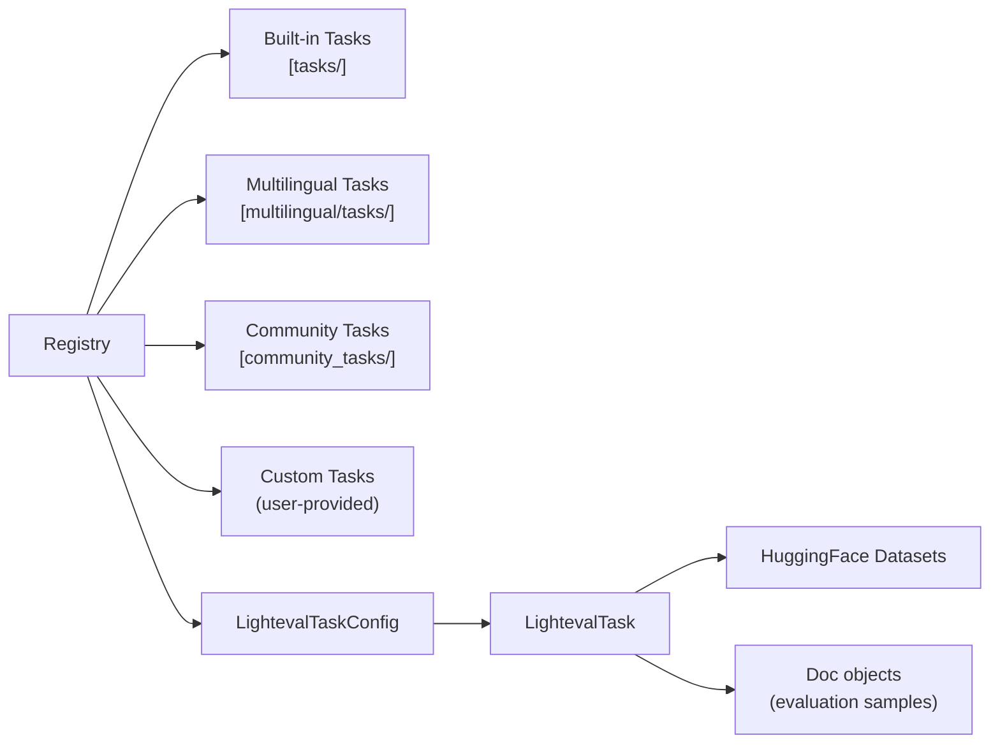

The `LightevalTask` represents an operational task instance with:
- Dataset loading and caching
- Document preparation via prompt functions
- Few-shot example sampling
- Metric definitions

**Sources:** [src/lighteval/pipeline.py:210-238]()

### Model Layer

The model layer provides a uniform interface through the `LightevalModel` abstract base class. All backends implement three core methods:

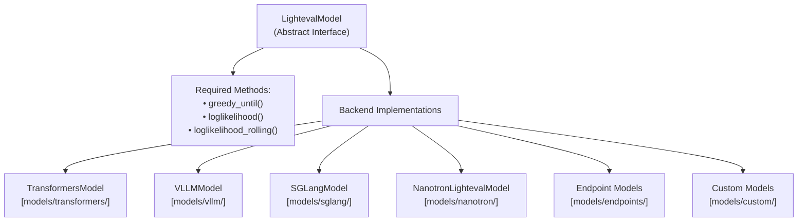

The `ParallelismManager` enum [src/lighteval/pipeline.py:70-78]() determines which backend to use:

| Enum Value | Backend | Use Case |
|------------|---------|----------|
| `ACCELERATE` | `TransformersModel` | Local models with HuggingFace Accelerate |
| `VLLM` | `VLLMModel` | High-throughput inference |
| `SGLANG` | `SGLangModel` | Structured generation |
| `NANOTRON` | `NanotronLightevalModel` | Distributed training framework |
| `TGI` / `OPENAI` | Endpoint models | Remote inference services |
| `NONE` | Generic endpoints | Serverless or custom endpoints |
| `CUSTOM` | User-defined | Custom model implementations |

**Sources:** [src/lighteval/pipeline.py:70-78](), [src/lighteval/pipeline.py:157-209]()

### EvaluationTracker

The `EvaluationTracker` [src/lighteval/logging/evaluation_tracker.py:95-747]() aggregates five specialized loggers:

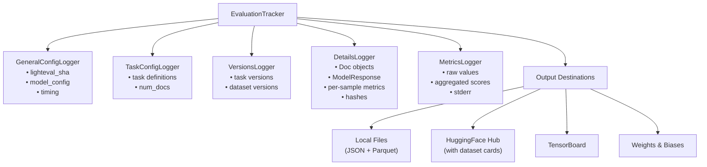

Each logger has a specific responsibility:

- **GeneralConfigLogger** [src/lighteval/logging/info_loggers.py:47-135](): Captures git SHA, model configuration, timing
- **TaskConfigLogger** [src/lighteval/logging/info_loggers.py:424-441](): Records task configurations
- **VersionsLogger** [src/lighteval/logging/info_loggers.py:405-422](): Tracks task and dataset versions
- **DetailsLogger** [src/lighteval/logging/info_loggers.py:137-306](): Stores sample-level details and reproducibility hashes
- **MetricsLogger** [src/lighteval/logging/info_loggers.py:308-403](): Aggregates metrics with statistical measures

**Sources:** [src/lighteval/logging/evaluation_tracker.py:95-210](), [src/lighteval/logging/info_loggers.py:47-441]()

### Metrics System

The metrics system applies evaluation metrics to model outputs through the `apply_metric()` function. Metrics are organized by their sampling method category:

| Sampling Method | Description | Model Method |
|----------------|-------------|--------------|
| `GENERATIVE` | Text generation tasks | `greedy_until()` |
| `LOGPROBS` | Multiple-choice/classification | `loglikelihood()` |
| `PERPLEXITY` | Language modeling | `loglikelihood_rolling()` |

Metrics can be sample-level (computed per document) or corpus-level (computed over all documents).

**Sources:** [src/lighteval/pipeline.py:362-400]()

## Evaluation Flow

The following diagram shows how components interact during a complete evaluation run:

```mermaid
sequenceDiagram
    participant User
    participant MainEntry["main_*.py<br/>(Entry Point)"]
    participant Pipeline["Pipeline"]
    participant Registry["Registry"]
    participant Task["LightevalTask"]
    participant Model["LightevalModel"]
    participant Metrics["apply_metric()"]
    participant Tracker["EvaluationTracker"]
    
    User->>MainEntry: "Execute CLI command"
    MainEntry->>MainEntry: "Parse arguments<br/>Create ModelConfig"
    MainEntry->>Tracker: "Initialize EvaluationTracker"
    MainEntry->>Pipeline: "Initialize Pipeline"
    
    Pipeline->>Registry: "_init_tasks_and_requests()"
    Registry->>Task: "load_tasks()"
    Task->>Task: "load_datasets()<br/>get_docs()"
    Task-->>Pipeline: "documents_dict"
    
    Pipeline->>Pipeline: "_init_model()"
    Pipeline->>Model: "load_model(config)"
    Model-->>Pipeline: "Initialized model"
    
    User->>Pipeline: "evaluate()"
    Pipeline->>Tracker: "log_args_info()"
    
    Pipeline->>Pipeline: "_run_model()"
    
    loop "For each sampling_method"
        Pipeline->>Model: "greedy_until() / loglikelihood() /<br/>loglikelihood_rolling()"
        Model-->>Pipeline: "ModelResponse objects"
    end
    
    Pipeline->>Pipeline: "_post_process_outputs()"
    
    Pipeline->>Pipeline: "_compute_metrics()"
    
    loop "For each task and sampling_method"
        Pipeline->>Metrics: "apply_metric(docs, responses, metrics)"
        Metrics-->>Pipeline: "metric scores"
        Pipeline->>Tracker: "metrics_logger.log()<br/>details_logger.log()"
    end
    
    Pipeline->>Tracker: "metrics_logger.aggregate()"
    Pipeline->>Tracker: "details_logger.aggregate()"
    
    Pipeline->>Pipeline: "save_and_push_results()"
    Pipeline->>Tracker: "save()"
    
    Tracker->>Tracker: "save_results()<br/>save_details()<br/>push_to_hub()"
    
    Pipeline-->>User: "Show and return results"
```

**Key Flow Steps:**

1. **Initialization** [src/lighteval/pipeline.py:118-153](): Parse configuration, create `Pipeline`, `EvaluationTracker`, and `ModelConfig`
2. **Task Loading** [src/lighteval/pipeline.py:210-238](): Registry discovers tasks, loads datasets, prepares `Doc` objects
3. **Model Loading** [src/lighteval/pipeline.py:177-209](): Initialize backend-specific model implementation
4. **Execution** [src/lighteval/pipeline.py:271-345](): Run model inference grouped by sampling method
5. **Post-Processing** [src/lighteval/pipeline.py:347-361](): Remove reasoning tags if configured
6. **Metrics Computation** [src/lighteval/pipeline.py:362-400](): Apply metrics, log results
7. **Aggregation** [src/lighteval/pipeline.py:294-297](): Aggregate metrics with statistical measures
8. **Persistence** [src/lighteval/logging/evaluation_tracker.py:247-292](): Save to local files and push to Hub

**Sources:** [src/lighteval/pipeline.py:271-448](), [src/lighteval/logging/evaluation_tracker.py:247-292]()

## Data Flow and Transformations

Data flows through several transformation stages from raw datasets to final results:

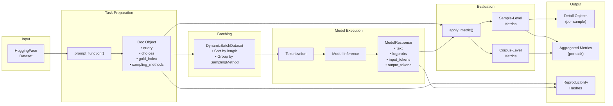

**Transformation Details:**

1. **Doc Creation**: Prompt functions transform dataset rows into `Doc` objects with formatted queries and metadata
2. **Batching**: `DynamicBatchDataset` sorts documents by length and groups by `SamplingMethod` for efficient processing
3. **Inference**: Models tokenize inputs, perform inference, and decode outputs into `ModelResponse` objects
4. **Metrics**: Both sample-level and corpus-level metrics are computed and logged
5. **Hashing**: Three-tier hash system (sample → task → overall) ensures reproducibility

**Sources:** [src/lighteval/pipeline.py:210-400]()

## Entry Points and Backend Selection

Lighteval provides multiple entry points, each corresponding to a different backend:

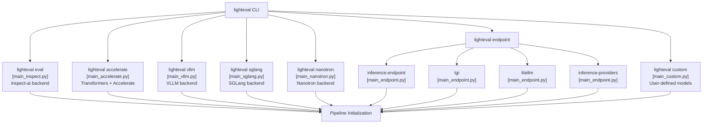

**Entry Point Patterns:**

Each entry point follows a consistent pattern:

1. Parse command-line arguments
2. Create backend-specific `ModelConfig` (e.g., `TransformersModelConfig`, `VLLMModelConfig`)
3. Initialize `EvaluationTracker` with output configuration
4. Create `PipelineParameters` with the appropriate `ParallelismManager`
5. Initialize `Pipeline` with tasks, model config, and tracker
6. Execute `pipeline.evaluate()`
7. Display and save results

**Backend Selection:**

| Entry Point | File | ParallelismManager | ModelConfig Type |
|------------|------|-------------------|-----------------|
| `eval` | N/A (inspect-ai) | N/A | inspect-ai model |
| `accelerate` | [main_accelerate.py:55-156]() | `ACCELERATE` | `TransformersModelConfig` |
| `vllm` | [main_vllm.py:51-138]() | `VLLM` | `VLLMModelConfig` |
| `sglang` | [main_sglang.py:46-130]() | `SGLANG` | `SGLangModelConfig` |
| `nanotron` | [main_nanotron.py:42-122]() | `NANOTRON` | `FullNanotronConfig` |
| `endpoint *` | [main_endpoint.py:54-409]() | `NONE` or `TGI` | Various endpoint configs |
| `custom` | [main_custom.py:52-124]() | `CUSTOM` | `CustomModelConfig` |

**Sources:** [src/lighteval/main_accelerate.py:55-156](), [src/lighteval/main_vllm.py:51-138](), [src/lighteval/main_sglang.py:46-130](), [src/lighteval/main_nanotron.py:42-122](), [src/lighteval/main_endpoint.py:54-409](), [src/lighteval/main_custom.py:52-124]()

## Reproducibility Architecture

The `DetailsLogger` implements a three-tier hashing system for reproducibility:

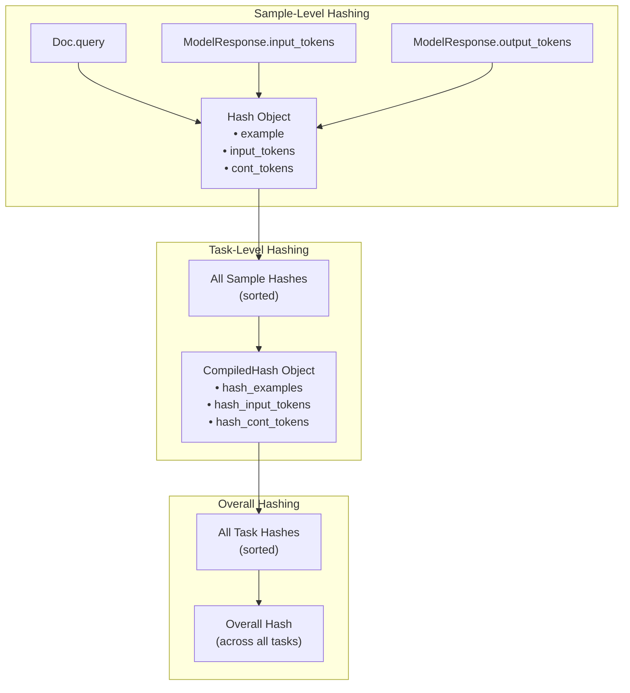

**Hash Computation** [src/lighteval/logging/info_loggers.py:253-306]():

1. **Sample-Level**: Hash each `Doc.query`, `input_tokens`, and `output_tokens` using `xxhash.xxh64`
2. **Task-Level**: Sort all sample hashes and aggregate them into a `CompiledHash`
3. **Overall**: Aggregate all task-level hashes across all tasks

This hierarchical structure enables detection of differences at any granularity level and is robust to execution order variations.

**Sources:** [src/lighteval/logging/info_loggers.py:137-306]()

## Configuration Management

The architecture supports configuration through multiple mechanisms:

**ModelConfig Hierarchy:**

All model configurations inherit from the abstract `ModelConfig` base class, which provides:
- `from_path(yaml_path)`: Load configuration from YAML files
- `from_args(args_string)`: Parse comma-separated argument strings
- `model_dump()`: Serialize configuration

**PipelineParameters:**

The `PipelineParameters` dataclass [src/lighteval/pipeline.py:82-115]() centralizes evaluation parameters:
- Task selection and filtering
- Few-shot configuration
- Sampling limits
- Post-processing options (reasoning tag removal)
- Response caching configuration

**Tracker Configuration:**

The `EvaluationTracker` [src/lighteval/logging/evaluation_tracker.py:142-210]() accepts configuration for:
- Output directory and path templates
- Hub upload settings (organization, public/private)
- External integrations (TensorBoard, W&B)
- Detail saving preferences

**Sources:** [src/lighteval/pipeline.py:82-115](), [src/lighteval/logging/evaluation_tracker.py:142-210]()

---

# Page: Installation and Quick Start

# Installation and Quick Start

<details>
<summary>Relevant source files</summary>

The following files were used as context for generating this wiki page:

- [README.md](README.md)
- [pyproject.toml](pyproject.toml)

</details>


This document covers the installation of lighteval, authentication setup, and basic usage examples for both command-line and Python API interfaces. For detailed information about specific evaluation backends, see [Models and Backends](#7). For comprehensive pipeline configuration options, see [Pipeline Parameters](#10.3).

## Purpose and Scope

This page provides the essential steps to install lighteval and run your first evaluation. It covers:
- Installing the core package and optional dependencies
- Setting up authentication for HuggingFace Hub integration
- Running evaluations via CLI commands
- Using the Python API for programmatic evaluation

---

## System Requirements

**Python Version**: Python 3.10 or higher is required.

**Operating System**: Lighteval is tested and supported on Linux and macOS. Windows support is currently untested and not officially supported.

**Sources**: [pyproject.toml:47](), [README.md:91-92]()

---

## Installation

### Basic Installation

Install lighteval from PyPI using pip:

```bash
pip install lighteval
```

This installs the core package with all required dependencies, including:
- `transformers` (≥4.54.0) for model loading
- `inspect-ai` (≥0.3.140) for evaluation backend
- `accelerate` for distributed evaluation
- `torch` (≥2.0, <3.0) for tensor operations
- `datasets` (≥4.0.0) for loading evaluation datasets
- Base metrics libraries: `nltk`, `scikit-learn`, `sacrebleu`, `rouge_score`

**Sources**: [pyproject.toml:57-90]()

---

### Optional Dependencies

Lighteval supports numerous optional features through extras. Install them using the `[extra_name]` syntax:

```bash
pip install lighteval[vllm,multilingual,math]
```

#### Available Optional Extras

| Extra | Purpose | Key Dependencies |
|-------|---------|------------------|
| `vllm` | High-performance inference with VLLM backend | `vllm>=0.10.0`, `ray`, `more_itertools` |
| `sglang` | Structured generation with SGLang backend | `sglang` |
| `tgi` | Text Generation Inference backend | `text-generation>=0.7.0` |
| `litellm` | Multi-provider API support (OpenAI, Anthropic, etc.) | `litellm[caching]>=1.66.0`, `diskcache` |
| `nanotron` | Nanotron training framework integration | `nanotron`, `tensorboardX` |
| `multilingual` | Multilingual evaluation support | `stanza`, `spacy[ja,ko,th]`, `jieba`, `pyvi` |
| `math` | Mathematical evaluation metrics | `latex2sympy2_extended` |
| `extended_tasks` | Extended task suite (IFEval, MT-Bench, etc.) | `langdetect`, `tiktoken`, `emoji`, `spacy`, `syllapy` |
| `quantization` | Model quantization support | `bitsandbytes`, `auto-gptq` |
| `adapters` | LoRA/adapter support | `peft` |
| `wandb` | Weights & Biases experiment tracking | `wandb` |
| `trackio` | Trackio experiment tracking | `trackio` |
| `quality` | Code quality tools for development | `ruff`, `pre-commit` |
| `tests` | Testing infrastructure | `pytest`, `deepdiff` |
| `dev` | Complete development environment | Includes `accelerate`, `quality`, `tests`, `multilingual`, `math`, `extended_tasks`, `vllm` |

#### Development Installation

For contributors or developers working on lighteval:

```bash
pip install -e .[dev]
pre-commit install
```

This installs the package in editable mode with all development dependencies and sets up pre-commit hooks for code quality checks.

**Sources**: [pyproject.toml:92-126](), [README.md:97](), [README.md:189-191]()

---

## Authentication Setup

### HuggingFace Hub

To push evaluation results to the HuggingFace Hub or access gated models, authenticate using the `huggingface-cli`:

```bash
huggingface-cli login
```

This command prompts you to enter your HuggingFace access token and stores it locally for future use. Alternatively, set the token as an environment variable:

```bash
export HUGGING_FACE_HUB_TOKEN="your_token_here"
```

**Sources**: [README.md:99-104]()

---

## Quick Start: CLI Usage

Lighteval provides multiple CLI entry points, each corresponding to a different model backend. The general command structure is:

```bash
lighteval [backend] [model] [tasks] [options]
```

### Available CLI Entry Points

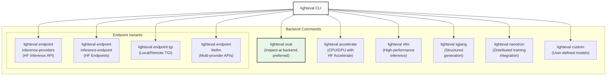

**Diagram: CLI Backend Entry Points and Their Purposes**

**Sources**: [README.md:108-126](), [pyproject.toml:133-134]()

---

### Basic Evaluation Command

The simplest way to evaluate a model is using the `lighteval eval` command with the inspect-ai backend (preferred):

```bash
lighteval eval "hf-inference-providers/openai/gpt-oss-20b" gpqa:diamond
```

This command:
1. Uses the HuggingFace Inference Providers backend
2. Evaluates the model on the GPQA Diamond benchmark
3. Saves results to the default output directory

**Sources**: [README.md:129-131]()

---

### Backend-Specific Examples

#### Accelerate Backend (Local Models)

Evaluate a model loaded locally using HuggingFace Accelerate:

```bash
lighteval accelerate \
    "meta-llama/Meta-Llama-3-8B-Instruct" \
    "mmlu:abstract_algebra,mmlu:anatomy" \
    --output-dir "./results" \
    --max-samples 100
```

#### VLLM Backend (High Performance)

For high-throughput evaluation with VLLM:

```bash
lighteval vllm \
    "meta-llama/Meta-Llama-3-8B-Instruct" \
    "gsm8k,math" \
    --tensor-parallel-size 4 \
    --output-dir "./results"
```

#### SGLang Backend (Structured Generation)

For structured generation tasks:

```bash
lighteval sglang \
    "meta-llama/Meta-Llama-3-8B-Instruct" \
    "ifeval" \
    --output-dir "./results"
```

#### Inference Endpoints

Evaluate models via HuggingFace Inference Endpoints:

```bash
lighteval endpoint inference-endpoint \
    "https://your-endpoint.endpoints.huggingface.cloud" \
    "hellaswag,winogrande" \
    --output-dir "./results"
```

#### LiteLLM (Multi-Provider APIs)

Evaluate any OpenAI-compatible API using LiteLLM:

```bash
lighteval endpoint litellm \
    "openai/gpt-4" \
    "mmlu,gsm8k" \
    --output-dir "./results"
```

**Sources**: [README.md:110-126]()

---

### Common CLI Options

All CLI commands support common options:

| Option | Description | Example |
|--------|-------------|---------|
| `--output-dir` | Directory for saving results | `--output-dir "./results"` |
| `--max-samples` | Limit samples per task | `--max-samples 100` |
| `--override-batch-size` | Set batch size | `--override-batch-size 8` |
| `--custom-tasks` | Load custom tasks from file | `--custom-tasks my_tasks.py` |
| `--use-chat-template` | Format prompts as chat messages | `--use-chat-template` |
| `--push-to-hub` | Push results to HuggingFace Hub | `--push-to-hub` |
| `--push-to-tensorboard` | Log to TensorBoard | `--push-to-tensorboard` |

For a complete list of options, see [CLI Commands](#10.1).

---

## Quick Start: Python API

The Python API provides programmatic control over evaluation, allowing you to evaluate models already loaded in memory or customize the evaluation pipeline.

### Basic API Flow

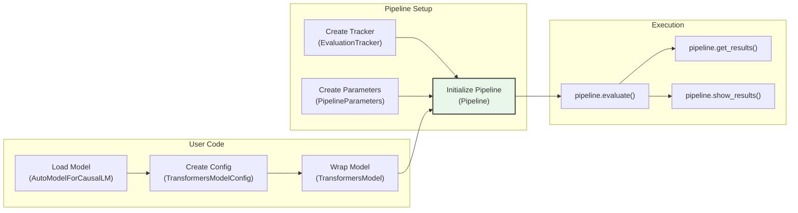

**Diagram: Python API Evaluation Flow with Core Classes**

**Sources**: [README.md:133-168]()

---

### Complete Python Example

Here's a complete example evaluating a pre-loaded model:

```python
from transformers import AutoModelForCausalLM

from lighteval.logging.evaluation_tracker import EvaluationTracker
from lighteval.models.transformers.transformers_model import TransformersModel, TransformersModelConfig
from lighteval.pipeline import ParallelismManager, Pipeline, PipelineParameters


MODEL_NAME = "meta-llama/Meta-Llama-3-8B-Instruct"
BENCHMARKS = "gsm8k"

# Create evaluation tracker for output management
evaluation_tracker = EvaluationTracker(output_dir="./results")

# Configure pipeline parameters
pipeline_params = PipelineParameters(
    launcher_type=ParallelismManager.NONE,
    max_samples=2
)

# Load model using HuggingFace transformers
model = AutoModelForCausalLM.from_pretrained(
    MODEL_NAME, device_map="auto"
)

# Create model configuration
config = TransformersModelConfig(model_name=MODEL_NAME, batch_size=1)

# Wrap model in lighteval's interface
model = TransformersModel.from_model(model, config)

# Initialize pipeline
pipeline = Pipeline(
    model=model,
    pipeline_parameters=pipeline_params,
    evaluation_tracker=evaluation_tracker,
    tasks=BENCHMARKS,
)

# Run evaluation
results = pipeline.evaluate()

# Display and retrieve results
pipeline.show_results()
results = pipeline.get_results()
```

**Sources**: [README.md:135-168]()

---

### Key Python API Components

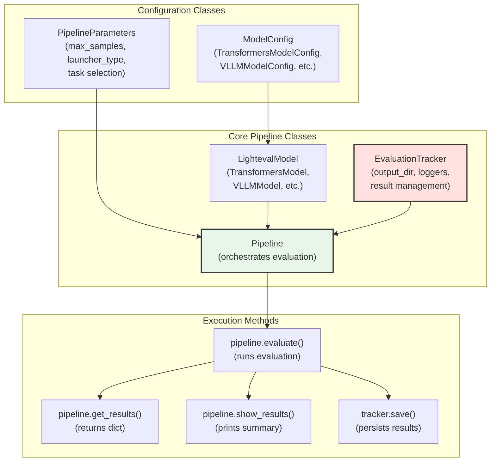

**Diagram: Python API Core Classes and Their Relationships**

**Sources**: [README.md:138-168]()

---

### API Component Descriptions

#### `EvaluationTracker`

The `EvaluationTracker` class manages result logging and output destinations. Key parameters:

- `output_dir`: Directory path for saving results
- `push_results_to_hub`: Boolean to enable HuggingFace Hub publishing
- `push_details_to_hub`: Boolean to publish detailed sample-level results
- `tensorboard_metric_prefix`: Prefix for TensorBoard logging

For detailed configuration, see [EvaluationTracker](#9.1).

#### `PipelineParameters`

The `PipelineParameters` class configures pipeline behavior. Key parameters:

- `launcher_type`: Parallelism strategy (e.g., `ParallelismManager.NONE`, `ParallelismManager.ACCELERATE`)
- `max_samples`: Maximum samples to evaluate per task (useful for quick tests)
- `override_batch_size`: Override default batch size
- `custom_tasks_directory`: Path to custom task modules

For complete options, see [Pipeline Parameters](#10.3).

#### `TransformersModelConfig`

Configuration for models using the Transformers backend. Key parameters:

- `model_name`: HuggingFace model identifier
- `batch_size`: Number of samples per batch
- `device_map`: Device placement strategy (e.g., `"auto"`)
- `dtype`: Model precision (e.g., `torch.float16`)

For other backend configurations, see [Model Configuration](#10.2).

#### `Pipeline`

The central orchestrator that coordinates evaluation. Required parameters:

- `model`: Wrapped model instance (e.g., `TransformersModel`)
- `tasks`: Task specification (string or list of task names)
- `pipeline_parameters`: `PipelineParameters` instance
- `evaluation_tracker`: `EvaluationTracker` instance

For detailed pipeline architecture, see [Evaluation Pipeline](#4).

**Sources**: [README.md:138-168]()

---

### Loading Custom Tasks

Load custom tasks from a Python module:

```python
from lighteval.pipeline import Pipeline, PipelineParameters
from lighteval.logging.evaluation_tracker import EvaluationTracker

# Specify custom tasks file
pipeline_params = PipelineParameters(
    launcher_type=ParallelismManager.NONE,
    custom_tasks_directory="path/to/my_tasks.py"
)

# Initialize pipeline with custom tasks
pipeline = Pipeline(
    model=model,
    pipeline_parameters=pipeline_params,
    evaluation_tracker=evaluation_tracker,
    tasks="my_custom_task",  # Reference task from custom file
)
```

For detailed instructions on creating custom tasks, see [Custom Tasks](#5.6).

---

## Verification

After installation, verify that lighteval is working correctly:

```bash
# Check version
lighteval --version

# Run a quick test evaluation with limited samples
lighteval eval "hf-inference-providers/openai/gpt-oss-20b" hellaswag --max-samples 5
```

The test evaluation should complete within a few minutes and save results to the default output directory.

---

## Next Steps

After completing installation and running your first evaluation:

1. **Explore Available Tasks**: Browse the 1000+ evaluation tasks at [Default Tasks](#5.3) and [Multilingual Tasks](#5.4)
2. **Try Different Backends**: Experiment with different backends for your use case (see [Models and Backends](#7))
3. **Customize Evaluation**: Learn to create custom tasks and metrics (see [Custom Tasks](#5.6) and [Custom Metrics](#8))
4. **Advanced Configuration**: Explore advanced pipeline configuration options (see [Pipeline Parameters](#10.3))
5. **Result Management**: Understand output formats and result publishing (see [Evaluation Tracking and Output](#9))

---

## Troubleshooting

### Common Installation Issues

**Issue**: Import errors after installation
- **Solution**: Ensure you're using Python 3.10 or higher and reinstall with `pip install --upgrade lighteval`

**Issue**: Missing optional dependencies for specific backends
- **Solution**: Install the required extra: `pip install lighteval[vllm]` for VLLM backend

**Issue**: Authentication failures when accessing gated models
- **Solution**: Run `huggingface-cli login` and ensure your token has the required permissions

**Issue**: CUDA out of memory errors
- **Solution**: Reduce `--override-batch-size` or use a backend with better memory management like VLLM

For more detailed troubleshooting and backend-specific issues, refer to the individual backend documentation in [Models and Backends](#7).

**Sources**: [README.md:89-104](), [pyproject.toml:92-126]()

---

# Page: Evaluation Pipeline

# Evaluation Pipeline

<details>
<summary>Relevant source files</summary>

The following files were used as context for generating this wiki page:

- [src/lighteval/logging/evaluation_tracker.py](src/lighteval/logging/evaluation_tracker.py)
- [src/lighteval/logging/info_loggers.py](src/lighteval/logging/info_loggers.py)
- [src/lighteval/main_accelerate.py](src/lighteval/main_accelerate.py)
- [src/lighteval/main_custom.py](src/lighteval/main_custom.py)
- [src/lighteval/main_endpoint.py](src/lighteval/main_endpoint.py)
- [src/lighteval/main_nanotron.py](src/lighteval/main_nanotron.py)
- [src/lighteval/main_sglang.py](src/lighteval/main_sglang.py)
- [src/lighteval/main_vllm.py](src/lighteval/main_vllm.py)
- [src/lighteval/pipeline.py](src/lighteval/pipeline.py)

</details>


The Evaluation Pipeline is the core execution system in LightEval that orchestrates the model evaluation process from start to finish. It manages loading models, creating and executing evaluation requests, computing metrics from model responses, and tracking results.

This page details how the pipeline works, from initialization to results tracking. For information about specific evaluation tasks, see [Tasks](#4), and for metrics systems, see [Metrics](#5).

## Core Components and Data Flow

The Evaluation Pipeline coordinates several key components that work together to evaluate language models:

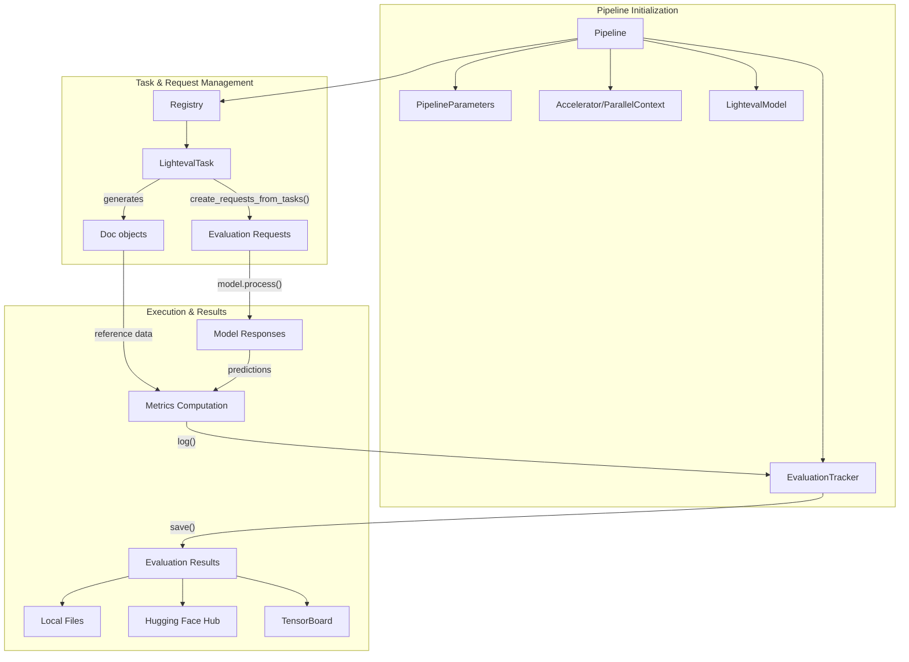

Sources: 
- [src/lighteval/pipeline.py:131-156]
- [src/lighteval/pipeline.py:209-242]
- [src/lighteval/pipeline.py:458-477]

## Pipeline Initialization

The `Pipeline` class is initialized with task specifications, model configuration, and evaluation parameters:

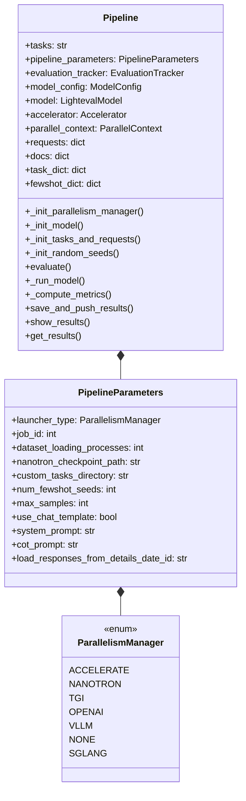

Sources: 
- [src/lighteval/pipeline.py:131-164]
- [src/lighteval/pipeline.py:94-129]
- [src/lighteval/pipeline.py:84-91]

The initialization process involves these key steps:

1. Setup the parallelism manager based on the backend type (Accelerate, Nanotron, etc.)
2. Load the model with the appropriate configuration
3. Initialize the task registry and create evaluation requests
4. Set random seeds for reproducibility

```python
def __init__(self, tasks, pipeline_parameters, evaluation_tracker, model_config=None, model=None, metric_options=None):
    # Initialize components
    self.accelerator, self.parallel_context = self._init_parallelism_manager()
    self.model = self._init_model(model_config, model)
    
    # Log model information
    self.evaluation_tracker.general_config_logger.log_model_info(...)
    
    # Initialize tasks and requests
    self._init_random_seeds()
    self._init_tasks_and_requests(tasks=tasks)
```

Sources: 
- [src/lighteval/pipeline.py:132-164]

## The Evaluation Process

The complete evaluation workflow is orchestrated by the `evaluate()` method:

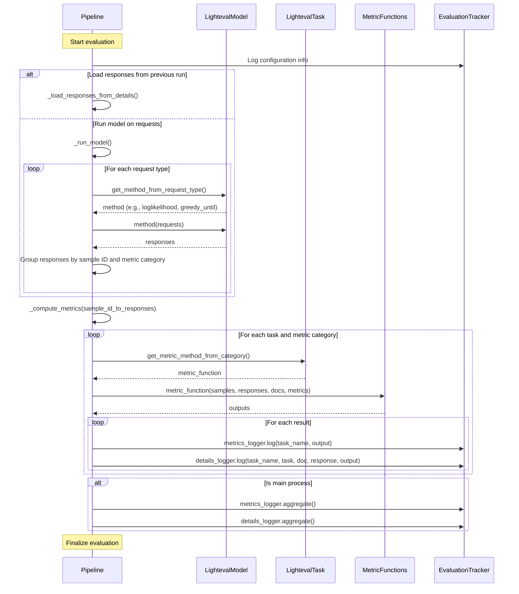

Sources:
- [src/lighteval/pipeline.py:272-304]
- [src/lighteval/pipeline.py:458-527]

## Request and Response Flow

The pipeline handles different request types, each processed by specific model methods:

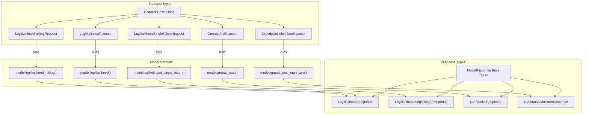

Sources:
- [src/lighteval/models/model_output.py:40-46]
- [src/lighteval/tasks/requests.py:49]

The `_run_model` method executes requests and organizes responses:

```python
def _run_model(self):
    # Dictionary to store responses, keyed by (sample_id, metric_category)
    sample_id_to_responses = collections.defaultdict(list)
    
    # Process each request type (loglikelihood, generative, etc.)
    for request_type, requests in self.requests.items():
        # Get the appropriate model method for this request type
        run_model = self.model.get_method_from_request_type(request_type=request_type)
        # Execute all requests of this type in batch
        responses = run_model(requests)
        
        # Store the responses by sample ID and metric category
        for response, request in zip(responses, requests):
            for metric_category in request.metric_categories:
                sample_id = SampleUid(request.task_name, request.sample_index)
                sample_id_to_responses[(sample_id, metric_category)].append(response)
    
    return sample_id_to_responses
```

Sources:
- [src/lighteval/pipeline.py:458-477]

## Metrics Computation

After collecting model responses, the pipeline computes metrics through the `_compute_metrics` method:

```mermaid
graph TD
    subgraph "Metrics Computation Flow"
        Responses["Model Responses"] --> Group["Group by Task + Metric Category"]
        Group --> |"For each task"| TaskProcess["Process Task"]
        TaskProcess --> |"For each metric category"| MetricProcess["Process Metric Category"]
        MetricProcess --> |"Get metric function"| MetricFunc["task.get_metric_method_from_category()"]
        MetricFunc --> MetricApply["Apply metric function"]
        MetricApply --> Outputs["Metric Outputs"]
        Outputs --> Log["Log results to tracker"]
    end
    
    subgraph "Metric Categories"
        MC["MetricCategory"] --> PERP["PERPLEXITY"]
        MC --> TPERP["TARGET_PERPLEXITY"]
        MC --> GEN["GENERATIVE"]
        MC --> MCPMI["MULTICHOICE_PMI"]
        MC --> MCH["MULTICHOICE"]
        MC --> MCHOT["MULTICHOICE_ONE_TOKEN"]
        MC --> LLMJ["LLM_AS_JUDGE"]
    end
    
    subgraph "Metric Functions"
        PERP --> APM["apply_perplexity_metric()"]
        TPERP --> ATPM["apply_target_perplexity_metric()"]
        GEN --> AGM["apply_generative_metric()"]
        MCPMI --> AMCM["apply_multichoice_metric()"]
        MCH --> AMCM
        MCHOT --> AMCOTM["apply_multichoice_metric_one_token()"]
        LLMJ --> ALLMJM["apply_llm_as_judge_metric()"]
    end
```

Sources:
- [src/lighteval/pipeline.py:484-527]
- [src/lighteval/metrics/__init__.py:30-241]

The metric computation process follows these steps:

1. Group responses by task name and metric category
2. For each task and metric category:
   - Get the appropriate metric function based on the category
   - Apply the function to the responses and reference data
   - Log the results to the `metrics_logger` and `details_logger`

```python
def _compute_metrics(self, sample_id_to_responses):
    # Group responses by task and metric category
    task_metric_category_groups = collections.defaultdict(
        lambda: collections.defaultdict(lambda: collections.defaultdict(list))
    )
    
    for (sample_id, metric_category), sample_responses in sample_id_to_responses.items():
        task_metric_category_groups[sample_id.task_name][metric_category]["ids"].append(sample_id.doc_id_seed)
        task_metric_category_groups[sample_id.task_name][metric_category]["responses"].append(sample_responses)
        task_metric_category_groups[sample_id.task_name][metric_category]["docs"].append(self.docs[sample_id])
    
    # Process each group and apply metrics
    for task_name, samples_per_metric in task_metric_category_groups.items():
        task = self._get_task(task_name)
        
        for metric_category, samples in samples_per_metric.items():
            metric_function = task.get_metric_method_from_category(metric_category=metric_category)
            metric_category_metrics = [m for m in task.metrics if m.category == metric_category]
            
            outputs = metric_function(
                sample_ids=samples["ids"],
                responses=samples["responses"],
                formatted_docs=samples["docs"],
                metrics=metric_category_metrics,
            )
            
            # Log results
            for output, doc, response in zip(outputs, samples["docs"], samples["responses"]):
                self.evaluation_tracker.metrics_logger.log(task_name, output)
                self.evaluation_tracker.details_logger.log(task_name, task, doc, response, output)
```

Sources:
- [src/lighteval/pipeline.py:484-527]

## Results Tracking and Management

The `EvaluationTracker` class is responsible for tracking and managing evaluation results:

```mermaid
classDiagram
    class EvaluationTracker {
        +details_logger: DetailsLogger
        +metrics_logger: MetricsLogger
        +versions_logger: VersionsLogger
        +general_config_logger: GeneralConfigLogger
        +task_config_logger: TaskConfigLogger
        +output_dir: str
        +hub_results_org: str
        +should_push_to_hub: bool
        +should_save_details: bool
        +should_push_results_to_tensorboard: bool
        +tensorboard_repo: str
        +public: bool
        +save()
        +save_results(date_id, results_dict)
        +save_details(date_id, details_datasets)
        +push_to_hub(date_id, details, results_dict)
        +push_to_tensorboard(results, details)
        +generate_final_dict()
    }
    
    class DetailsLogger {
        +details: dict
        +compiled_details: dict
        +compiled_details_over_all_tasks: CompiledDetailOverAllTasks
        +log(task_name, task, doc, response, output)
        +aggregate()
    }
    
    class MetricsLogger {
        +metrics: dict
        +metric_aggregated: dict
        +log(task_name, output)
        +aggregate(task_dict, bootstrap_iters)
    }
    
    EvaluationTracker *-- DetailsLogger
    EvaluationTracker *-- MetricsLogger
    EvaluationTracker *-- VersionsLogger
    EvaluationTracker *-- GeneralConfigLogger
    EvaluationTracker *-- TaskConfigLogger
```

Sources:
- [src/lighteval/logging/evaluation_tracker.py:87-669]

The `save` method in `EvaluationTracker` handles saving results and optionally pushing to the Hugging Face Hub:

```mermaid
graph TD
    Save["EvaluationTracker.save()"] --> Date["Generate date_id"]
    Date --> ResultsDict["Prepare results_dict"]
    Date --> DetailDatasets["Prepare details_datasets"]
    
    ResultsDict --> SaveResults["save_results(date_id, results_dict)"]
    SaveResults --> ResultsFiles["Local results files"]
    
    DetailDatasets --> CheckSaveDetails{"should_save_details?"}
    CheckSaveDetails --> |"Yes"| SaveDetails["save_details(date_id, details_datasets)"]
    SaveDetails --> DetailsFiles["Local details files"]
    
    ResultsDict --> CheckPushHub{"should_push_to_hub?"}
    DetailDatasets --> CheckPushHub
    CheckPushHub --> |"Yes"| PushHub["push_to_hub(date_id, details, results_dict)"]
    PushHub --> HFHub["Hugging Face Hub dataset"]
    
    ResultsDict --> CheckPushTB{"should_push_results_to_tensorboard?"}
    DetailDatasets --> CheckPushTB
    CheckPushTB --> |"Yes"| PushTB["push_to_tensorboard(results, details)"]
    PushTB --> TB["TensorBoard logs"]
```

Sources:
- [src/lighteval/logging/evaluation_tracker.py:178-228]

The saved results include:
- General configuration information
- Task configurations and versions
- Metric results for each task
- Detailed information about each evaluation sample
- Summary statistics across all tasks

```python
# Structure of the results_dict
results_dict = {
    "config_general": config_general,
    "results": self.metrics_logger.metric_aggregated,
    "versions": self.versions_logger.versions,
    "config_tasks": self.task_config_logger.tasks_configs,
    "summary_tasks": self.details_logger.compiled_details,
    "summary_general": asdict(self.details_logger.compiled_details_over_all_tasks),
}
```

Sources:
- [src/lighteval/logging/evaluation_tracker.py:188-195]

## Dynamic Batching for Performance

The evaluation pipeline uses dynamic batching to process requests efficiently:

```mermaid
classDiagram
    class DynamicBatchDataset {
        <<Abstract>>
        +sorted_data: list
        +original_order: list
        +total_size: int
        +num_dataset_splits: int
        +splits: list
        +split_start: int
        +split_end: int
        +init_split_limits(num_dataset_splits)
        +get_original_order(new_arr)
        +get_split_start_end(split_id)
        +splits_start_end_iterator()
        +__getitem__(index)
        +__len__()
        +__iter__()
        +_sorting_criteria(request)
    }
    
    class LoglikelihoodDataset {
        +_sorting_criteria(request)
    }
    
    class LoglikelihoodSingleTokenDataset {
        +_sorting_criteria(request)
    }
    
    class GenerativeTaskDataset {
        +init_split_limits(num_dataset_splits)
        +_sorting_criteria(request)
    }
    
    DynamicBatchDataset <|-- LoglikelihoodDataset
    DynamicBatchDataset <|-- LoglikelihoodSingleTokenDataset
    DynamicBatchDataset <|-- GenerativeTaskDataset
```

Sources:
- [src/lighteval/data.py:50-303]

The dynamic batching system:
1. Sorts requests based on a criterion (typically sequence length)
2. Splits the dataset into manageable chunks
3. Processes each chunk with an appropriate batch size
4. Restores the original ordering of results

This efficient batching approach allows for maximum GPU utilization by grouping similar-length requests together, reducing padding waste and memory usage.

## Integration with Distributed Computing

The Pipeline supports distributed evaluation through different parallelism managers:

```mermaid
graph TD
    subgraph "Parallelism Managers"
        PM["ParallelismManager Enum"] --> ACC["ACCELERATE"]
        PM --> NANO["NANOTRON"]
        PM --> VLLM["VLLM"]
        PM --> TGI["TGI"]
        PM --> OAI["OPENAI"]
        PM --> SGL["SGLANG"]
        PM --> NONE["NONE"]
    end
    
    subgraph "Initialization"
        PClass["Pipeline._init_parallelism_manager()"] --> CheckType{"launcher_type?"}
        CheckType --> |"ACCELERATE"| InitAcc["Initialize Accelerator"]
        CheckType --> |"NANOTRON"| InitNano["Initialize ParallelContext"]
        CheckType --> |"Other"| NoInit["No special initialization"]
    end
    
    subgraph "Results Management"
        PClass2["Pipeline.is_main_process()"] --> CheckPM{"Which parallelism?"}
        CheckPM --> |"Accelerator"| CheckAcc["accelerator.is_main_process"]
        CheckPM --> |"Nanotron"| CheckNano["dist.get_rank(...) == 0"]
        CheckPM --> |"Other"| RetTrue["Return True"]
    end
```

Sources:
- [src/lighteval/pipeline.py:84-91]
- [src/lighteval/pipeline.py:165-184]
- [src/lighteval/pipeline.py:265-270]

This distributed computing support enables efficient evaluation of large models across multiple GPUs and nodes.

## Summary

The Evaluation Pipeline is the core orchestration system in LightEval that:

1. Loads models and tasks
2. Creates evaluation requests based on task configurations
3. Processes requests with the appropriate model backend
4. Computes metrics from model responses
5. Tracks, aggregates, and saves results

This flexible architecture allows LightEval to evaluate various language models across different tasks and metrics while providing comprehensive result tracking and analysis capabilities.

Sources:
- [src/lighteval/pipeline.py]
- [src/lighteval/logging/evaluation_tracker.py]
- [src/lighteval/metrics/__init__.py]
- [src/lighteval/data.py]

---

# Page: Pipeline Parameters

# Pipeline Parameters

<details>
<summary>Relevant source files</summary>

The following files were used as context for generating this wiki page:

- [src/lighteval/logging/info_loggers.py](src/lighteval/logging/info_loggers.py)
- [src/lighteval/pipeline.py](src/lighteval/pipeline.py)

</details>


This document describes the `PipelineParameters` dataclass, which encapsulates all configuration options for controlling the evaluation pipeline's behavior. These parameters control parallelism strategies, dataset sampling, output post-processing, and other runtime behaviors.

For information about model-specific configuration, see [Model Configuration](#10.2). For information about generation-specific parameters (temperature, top_p, etc.), see [Generation Parameters](#10.4). For the overall Pipeline orchestration system, see [Evaluation Pipeline](#4).

## Overview

The `PipelineParameters` dataclass provides a centralized configuration interface for the `Pipeline` class. It determines how the pipeline executes evaluations, including:

- **Parallelism strategy** via `launcher_type` and `ParallelismManager`
- **Dataset sampling** via `max_samples` and `num_fewshot_seeds`
- **Output post-processing** via `remove_reasoning_tags` and `reasoning_tags`
- **Result caching** via `load_responses_from_details_date_id`
- **Backend-specific settings** like `nanotron_checkpoint_path`

## PipelineParameters Dataclass

### Structure

The `PipelineParameters` dataclass is defined in [src/lighteval/pipeline.py:81-114]() and contains all configuration parameters needed to initialize and control the evaluation pipeline.

```mermaid
graph TB
    subgraph "PipelineParameters Structure"
        PP["PipelineParameters<br/>dataclass"]
        
        Parallelism["launcher_type:<br/>ParallelismManager"]
        Env["Environment Settings:<br/>job_id, dataset_loading_processes"]
        Backend["Backend-Specific:<br/>nanotron_checkpoint_path"]
        Dataset["Dataset Configuration:<br/>custom_tasks_directory,<br/>max_samples, num_fewshot_seeds"]
        Processing["Post-Processing:<br/>remove_reasoning_tags,<br/>reasoning_tags, cot_prompt"]
        Caching["Response Caching:<br/>load_responses_from_details_date_id"]
        Metrics["Metric Configuration:<br/>bootstrap_iters"]
    end
    
    PP --> Parallelism
    PP --> Env
    PP --> Backend
    PP --> Dataset
    PP --> Processing
    PP --> Caching
    PP --> Metrics
    
    style PP fill:#e1f5ff,stroke:#333,stroke-width:3px
```

**Diagram: PipelineParameters Parameter Groups**

Sources: [src/lighteval/pipeline.py:81-114]()

### Parameter Reference

| Parameter | Type | Default | Description |
|-----------|------|---------|-------------|
| `launcher_type` | `ParallelismManager` | Required | Parallelism strategy for model execution |
| `job_id` | `int` | `0` | Unique identifier for the evaluation job |
| `dataset_loading_processes` | `int` | `1` | Number of parallel processes for loading datasets |
| `nanotron_checkpoint_path` | `str \| None` | `None` | Path to Nanotron checkpoint (Nanotron backend only) |
| `custom_tasks_directory` | `str \| None` | `None` | Directory containing custom task definitions |
| `num_fewshot_seeds` | `int` | `1` | Number of random seeds for few-shot sampling |
| `max_samples` | `int \| None` | `None` | Maximum number of samples to evaluate per task |
| `cot_prompt` | `str \| None` | `None` | Chain-of-thought prompt prefix |
| `remove_reasoning_tags` | `bool` | `True` | Whether to remove reasoning tags from model outputs |
| `reasoning_tags` | `str \| list[tuple[str, str]]` | `"[('')]"` | Tag pairs to remove from outputs |
| `load_responses_from_details_date_id` | `str \| None` | `None` | Load cached responses from previous run |
| `bootstrap_iters` | `int` | `1000` | Number of bootstrap iterations for metric confidence intervals |

Sources: [src/lighteval/pipeline.py:81-97]()

### Initialization and Validation

The `__post_init__` method performs validation and parsing of the `reasoning_tags` parameter:

```mermaid
graph LR
    Input["reasoning_tags input"]
    CheckType{"Is list?"}
    ParseStr["ast.literal_eval()"]
    ValidateFormat{"All tuples<br/>with length 2?"}
    Valid["Valid configuration"]
    Error["ValueError raised"]
    
    Input --> CheckType
    CheckType -->|"No (string)"| ParseStr
    CheckType -->|"Yes"| ValidateFormat
    ParseStr --> ValidateFormat
    ValidateFormat -->|"Yes"| Valid
    ValidateFormat -->|"No"| Error
```

**Diagram: reasoning_tags Validation Flow**

The validation ensures that `reasoning_tags` is a list of 2-tuples representing start/end tag pairs. String inputs are parsed using `ast.literal_eval()` at [src/lighteval/pipeline.py:98-113]().

Sources: [src/lighteval/pipeline.py:98-114]()

## ParallelismManager Enum

The `ParallelismManager` enum defines the available parallelism strategies for model execution. Each strategy corresponds to a different backend or execution mode.

### Enum Values

```mermaid
graph TB
    PM["ParallelismManager<br/>Enum"]
    
    ACCELERATE["ACCELERATE<br/>HuggingFace Accelerate<br/>Distributed inference"]
    NANOTRON["NANOTRON<br/>Nanotron distributed<br/>TP/PP/DP support"]
    TGI["TGI<br/>Text Generation Inference<br/>Remote endpoint"]
    OPENAI["OPENAI<br/>OpenAI API<br/>Remote endpoint"]
    VLLM["VLLM<br/>vLLM engine<br/>High-performance inference"]
    CUSTOM["CUSTOM<br/>Custom backends<br/>User-defined"]
    NONE["NONE<br/>No parallelism<br/>Single process"]
    SGLANG["SGLANG<br/>SGLang backend<br/>Optimized inference"]
    
    PM --> ACCELERATE
    PM --> NANOTRON
    PM --> TGI
    PM --> OPENAI
    PM --> VLLM
    PM --> CUSTOM
    PM --> NONE
    PM --> SGLANG
    
    style PM fill:#ffe1f5,stroke:#333,stroke-width:3px
```

**Diagram: ParallelismManager Backend Options**

Sources: [src/lighteval/pipeline.py:70-78]()

| Launcher Type | Backend | Use Case | Parallelism Support |
|---------------|---------|----------|---------------------|
| `ACCELERATE` | HuggingFace Accelerate | Local/distributed model inference | Data parallelism, model parallelism |
| `NANOTRON` | Nanotron | Large-scale distributed training integration | Tensor, pipeline, data parallelism |
| `TGI` | Text Generation Inference | Production API endpoints | Server-side parallelism |
| `OPENAI` | OpenAI API | Commercial API providers | N/A (remote) |
| `VLLM` | vLLM | High-throughput inference | Tensor/data parallelism via Ray |
| `SGLANG` | SGLang | SGLang optimized inference | SGLang-specific parallelism |
| `CUSTOM` | User-defined | Custom model implementations | User-controlled |
| `NONE` | Single process | Local evaluation without parallelism | None |

Sources: [src/lighteval/pipeline.py:70-78]()

## Key Configuration Parameters

### launcher_type: Parallelism Strategy

The `launcher_type` parameter determines which parallelism manager is initialized and how the model is executed. The Pipeline uses this to initialize the appropriate infrastructure.

```mermaid
graph TB
    LauncherType["launcher_type parameter"]
    InitMethod["Pipeline._init_parallelism_manager()"]
    
    CheckAccel{"ACCELERATE?"}
    CheckNano{"NANOTRON?"}
    CheckOther{"Others?"}
    
    InitAccel["Initialize Accelerator<br/>InitProcessGroupKwargs<br/>test_all_gather()"]
    InitNano["dist.initialize_torch_distributed()<br/>ParallelContext<br/>TP/PP/DP configuration"]
    NoInit["accelerator = None<br/>parallel_context = None"]
    
    Return["Return accelerator,<br/>parallel_context"]
    
    LauncherType --> InitMethod
    InitMethod --> CheckAccel
    CheckAccel -->|"Yes"| InitAccel
    CheckAccel -->|"No"| CheckNano
    CheckNano -->|"Yes"| InitNano
    CheckNano -->|"No"| CheckOther
    CheckOther -->|"TGI/VLLM/etc"| NoInit
    
    InitAccel --> Return
    InitNano --> Return
    NoInit --> Return
```

**Diagram: Parallelism Manager Initialization Flow**

The initialization occurs at [src/lighteval/pipeline.py:156-174]():
- `ACCELERATE`: Creates an `Accelerator` instance with timeout configuration
- `NANOTRON`: Initializes distributed PyTorch and creates `ParallelContext` with TP/PP/DP sizes
- Other backends: No explicit parallelism manager (handled by backend)

Sources: [src/lighteval/pipeline.py:156-174]()

### max_samples: Dataset Sampling Limit

The `max_samples` parameter limits the number of samples evaluated per task. This is useful for:
- Quick testing and debugging
- Resource-constrained environments
- Preliminary benchmarking

**Important**: When `max_samples` is set, the Pipeline logs a warning at [src/lighteval/pipeline.py:130-133]():

> "max_samples WAS SET. THESE NUMBERS ARE ONLY PARTIAL AND SHOULD NOT BE USED FOR COMPARISON UNLESS YOU KNOW WHAT YOU ARE DOING."

The parameter is passed to each task's `get_docs()` method at [src/lighteval/pipeline.py:219]() to truncate the document list.

Sources: [src/lighteval/pipeline.py:130-133](), [src/lighteval/pipeline.py:219]()

### remove_reasoning_tags and reasoning_tags: Output Post-Processing

These parameters control automatic removal of reasoning/thinking tags from model outputs.

#### Configuration

- `remove_reasoning_tags`: Boolean flag to enable/disable tag removal (default: `True`)
- `reasoning_tags`: List of `(start_tag, end_tag)` tuples to remove from outputs

Default reasoning tags: `[('')]`

#### Processing Flow

```mermaid
sequenceDiagram
    participant Pipeline
    participant Model
    participant Postprocessor
    participant remove_reasoning_tags_fn
    
    Pipeline->>Model: greedy_until(docs)
    Model-->>Pipeline: List[ModelResponse]
    
    alt remove_reasoning_tags == True
        Pipeline->>Postprocessor: _post_process_outputs()
        loop For each response
            Postprocessor->>remove_reasoning_tags_fn: remove_reasoning_tags(text, tag_pairs)
            remove_reasoning_tags_fn-->>Postprocessor: Cleaned text
            Postprocessor->>Pipeline: Set text_post_processed
        end
    end
    
    Pipeline->>Pipeline: Continue to metrics
```

**Diagram: Reasoning Tag Removal Sequence**

The post-processing occurs at [src/lighteval/pipeline.py:342-356]():
1. Check if `remove_reasoning_tags` is `True`
2. Iterate through all model responses
3. Apply `remove_reasoning_tags()` function with configured tag pairs
4. Store cleaned text in `response.text_post_processed`

The `remove_reasoning_tags()` utility function is imported from [src/lighteval/utils/utils.py:47]().

Sources: [src/lighteval/pipeline.py:342-356](), [src/lighteval/utils/utils.py:47]()

### num_fewshot_seeds: Few-Shot Sampling Variation

The `num_fewshot_seeds` parameter controls how many different random seeds are used for few-shot example sampling. This enables evaluation across multiple few-shot configurations to measure stability.

- Default: `1` (single seed)
- Higher values provide more robust evaluation but increase computation

The parameter is logged to the evaluation tracker at [src/lighteval/pipeline.py:268]().

Sources: [src/lighteval/pipeline.py:268]()

### custom_tasks_directory: Custom Task Loading

The `custom_tasks_directory` parameter specifies the directory containing user-defined task definitions. This directory is passed to the `Registry` during task initialization at [src/lighteval/pipeline.py:213]().

For detailed information about creating custom tasks, see [Custom Tasks](#5.5).

Sources: [src/lighteval/pipeline.py:213]()

### load_responses_from_details_date_id: Response Caching

This parameter enables loading model responses from a previous evaluation run, bypassing model inference. This is useful for:
- Re-computing metrics with different configurations
- Testing new metrics on existing model outputs
- Debugging metric implementations

#### Usage Flow

```mermaid
graph TB
    EvalStart["Pipeline.evaluate()"]
    CheckCache{"load_responses_from_details_date_id<br/>is set?"}
    
    LoadCache["_load_responses_from_details()"]
    LoadDetails["Load details datasets<br/>from date_id"]
    ParseResponses["Parse ModelResponse<br/>objects"]
    
    RunModel["_run_model()"]
    ModelInfer["Execute model inference"]
    
    PostProcess["_post_process_outputs()"]
    ComputeMetrics["_compute_metrics()"]
    
    EvalStart --> CheckCache
    CheckCache -->|"Yes"| LoadCache
    CheckCache -->|"No"| RunModel
    
    LoadCache --> LoadDetails
    LoadDetails --> ParseResponses
    ParseResponses --> PostProcess
    
    RunModel --> ModelInfer
    ModelInfer --> PostProcess
    
    PostProcess --> ComputeMetrics
```

**Diagram: Response Caching Flow**

The caching mechanism:
1. Checks if `load_responses_from_details_date_id` is set at [src/lighteval/pipeline.py:273]()
2. Attempts to load cached responses via `_load_responses_from_details()` at [src/lighteval/pipeline.py:396-419]()
3. Falls back to running the model if cache is not found (with warning)
4. Reconstructs `ModelResponse` objects from saved details

**Limitation**: Currently only supports single request type (raises error for multiple sampling methods) at [src/lighteval/pipeline.py:402-405]().

Sources: [src/lighteval/pipeline.py:273-282](), [src/lighteval/pipeline.py:396-419]()

### bootstrap_iters: Metric Confidence Intervals

The `bootstrap_iters` parameter controls the number of bootstrap iterations used for computing confidence intervals for metrics. Default value is `1000`.

This parameter is passed to the `MetricsLogger.aggregate()` method at [src/lighteval/pipeline.py:290]() during the final metric aggregation phase.

Sources: [src/lighteval/pipeline.py:290]()

### dataset_loading_processes: Parallel Dataset Loading

The `dataset_loading_processes` parameter specifies how many parallel processes to use when loading datasets. Default is `1` (sequential loading).

This parameter is passed to `LightevalTask.load_datasets()` at [src/lighteval/pipeline.py:217]() to enable parallel loading of multiple task datasets.

Sources: [src/lighteval/pipeline.py:217]()

### nanotron_checkpoint_path: Nanotron-Specific Configuration

The `nanotron_checkpoint_path` parameter is only used when `launcher_type` is `ParallelismManager.NANOTRON`. It specifies the path to the Nanotron checkpoint directory.

The path is processed at [src/lighteval/pipeline.py:198]() where `os.path.dirname()` extracts the directory path before passing it to `NanotronLightevalModel`.

Sources: [src/lighteval/pipeline.py:198-205]()

## Integration with Pipeline

### Initialization Flow

```mermaid
graph TB
    CreatePipeline["Pipeline.__init__()"]
    StoreParams["Store pipeline_parameters"]
    
    CheckMaxSamples{"max_samples set?"}
    LogWarning["Log warning about<br/>partial results"]
    
    InitSeeds["_init_random_seeds()"]
    InitTasks["_init_tasks_and_requests()"]
    PassCustomDir["Pass custom_tasks_directory<br/>to Registry"]
    UseMaxSamples["Pass max_samples<br/>to get_docs()"]
    
    InitParallelism["_init_parallelism_manager()"]
    CheckLauncher{"Check launcher_type"}
    InitAccel["Initialize Accelerator"]
    InitNano["Initialize ParallelContext"]
    
    InitModel["_init_model()"]
    UseNanoPath["Use nanotron_checkpoint_path<br/>if launcher is NANOTRON"]
    
    CreatePipeline --> StoreParams
    StoreParams --> CheckMaxSamples
    CheckMaxSamples -->|"Yes"| LogWarning
    CheckMaxSamples -->|"No"| InitSeeds
    LogWarning --> InitSeeds
    
    InitSeeds --> InitTasks
    InitTasks --> PassCustomDir
    InitTasks --> UseMaxSamples
    
    InitTasks --> InitParallelism
    InitParallelism --> CheckLauncher
    CheckLauncher --> InitAccel
    CheckLauncher --> InitNano
    
    InitAccel --> InitModel
    InitNano --> InitModel
    InitModel --> UseNanoPath
```

**Diagram: PipelineParameters Usage in Pipeline Initialization**

The `PipelineParameters` object is stored as `self.pipeline_parameters` at [src/lighteval/pipeline.py:129]() and its individual parameters are accessed throughout the Pipeline lifecycle:

1. **Initialization phase** ([src/lighteval/pipeline.py:117-152]()):
   - `max_samples` triggers warning
   - `custom_tasks_directory` passed to Registry
   - `launcher_type` determines parallelism setup
   - `nanotron_checkpoint_path` used for Nanotron models

2. **Evaluation phase** ([src/lighteval/pipeline.py:266-292]()):
   - `num_fewshot_seeds` logged
   - `max_samples` logged
   - `job_id` logged
   - `load_responses_from_details_date_id` determines caching behavior
   - `bootstrap_iters` used for aggregation

3. **Post-processing phase** ([src/lighteval/pipeline.py:342-356]()):
   - `remove_reasoning_tags` enables/disables tag removal
   - `reasoning_tags` provides tag pairs for removal

Sources: [src/lighteval/pipeline.py:117-152](), [src/lighteval/pipeline.py:266-292](), [src/lighteval/pipeline.py:342-356]()

### Parameter Access Patterns

| Parameter | Primary Access Location | Purpose |
|-----------|------------------------|---------|
| `launcher_type` | `_init_parallelism_manager()` | Determine backend setup |
| `max_samples` | `_init_tasks_and_requests()`, `evaluate()` | Limit sample count |
| `custom_tasks_directory` | `_init_tasks_and_requests()` | Load custom tasks |
| `num_fewshot_seeds` | `evaluate()` | Log configuration |
| `remove_reasoning_tags` | `_post_process_outputs()` | Enable/disable post-processing |
| `reasoning_tags` | `_post_process_outputs()` | Define tags to remove |
| `load_responses_from_details_date_id` | `evaluate()` | Enable response caching |
| `bootstrap_iters` | `evaluate()` | Configure metric aggregation |
| `dataset_loading_processes` | `_init_tasks_and_requests()` | Parallel dataset loading |
| `nanotron_checkpoint_path` | `_init_model()` | Load Nanotron checkpoint |

Sources: [src/lighteval/pipeline.py:1-443]()

## Usage Examples

### Basic Configuration

```python
from lighteval.pipeline import Pipeline, PipelineParameters, ParallelismManager

# Minimal configuration for Accelerate backend
params = PipelineParameters(
    launcher_type=ParallelismManager.ACCELERATE
)
```

### Limited Evaluation for Testing

```python
# Quick evaluation with sample limit
params = PipelineParameters(
    launcher_type=ParallelismManager.VLLM,
    max_samples=100,  # Only evaluate 100 samples per task
    num_fewshot_seeds=3  # Test with 3 different few-shot configurations
)
```

### Custom Tasks and Reasoning Tag Removal

```python
# Custom tasks with reasoning tag configuration
params = PipelineParameters(
    launcher_type=ParallelismManager.ACCELERATE,
    custom_tasks_directory="./my_custom_tasks",
    remove_reasoning_tags=True,
    reasoning_tags=[
        (''),
        ('[REASONING]', '[/REASONING]')
    ]
)
```

### Response Caching for Metric Re-computation

```python
# Load cached responses from previous run
params = PipelineParameters(
    launcher_type=ParallelismManager.ACCELERATE,
    load_responses_from_details_date_id="2024-01-15-12-30-45",
    bootstrap_iters=5000  # More iterations for better confidence intervals
)
```

### Nanotron Distributed Evaluation

```python
# Nanotron backend with checkpoint path
params = PipelineParameters(
    launcher_type=ParallelismManager.NANOTRON,
    nanotron_checkpoint_path="/path/to/checkpoint/dir/model.safetensors"
)
```

Sources: [src/lighteval/pipeline.py:81-114]()

---

# Page: Parallelism Management

# Parallelism Management

<details>
<summary>Relevant source files</summary>

The following files were used as context for generating this wiki page:

- [src/lighteval/logging/info_loggers.py](src/lighteval/logging/info_loggers.py)
- [src/lighteval/pipeline.py](src/lighteval/pipeline.py)

</details>


This document explains the `ParallelismManager` enum and how lighteval configures different parallelism strategies for distributed evaluation. The `ParallelismManager` serves as a high-level strategy selector that determines how the evaluation pipeline initializes distributed computing resources.

For details on specific model backends that use these parallelism strategies, see [Models and Backends](#7). For pipeline initialization and configuration, see [Pipeline Parameters](#4.1).

## Overview

The `ParallelismManager` enum in [src/lighteval/pipeline.py:70-78]() defines the available parallelism strategies for model evaluation. Each strategy corresponds to a different approach for distributing computation across GPUs or nodes:

| ParallelismManager Value | Purpose | Initialization Method | Typical Use Case |
|-------------------------|---------|----------------------|------------------|
| `ACCELERATE` | HuggingFace Accelerate multi-GPU | Creates `Accelerator` instance | Local multi-GPU evaluation with model parallelism |
| `NANOTRON` | Nanotron distributed framework | Initializes `ParallelContext` with TP/PP/DP | Large-scale multi-node distributed evaluation |
| `VLLM` | VLLM inference engine | No pipeline-level initialization | High-throughput inference with internal parallelism |
| `SGLANG` | SGLang structured generation | No pipeline-level initialization | Structured generation with internal parallelism |
| `TGI` | Text Generation Inference endpoint | No pipeline-level initialization | Remote TGI server evaluation |
| `OPENAI` | OpenAI-compatible endpoints | No pipeline-level initialization | API-based model evaluation |
| `CUSTOM` | User-defined backends | No pipeline-level initialization | Custom model implementations |
| `NONE` | Single-process execution | No pipeline-level initialization | Non-distributed evaluation |

Sources: [src/lighteval/pipeline.py:70-78](), [src/lighteval/pipeline.py:81-98]()

## ParallelismManager in PipelineParameters

The parallelism strategy is specified via the `launcher_type` field in `PipelineParameters`:

```python
@dataclass
class PipelineParameters:
    launcher_type: ParallelismManager
    # ... other fields
```

This parameter is set during pipeline initialization and determines which distributed computing resources are initialized. For NANOTRON-based evaluation, additional configuration is required via the `nanotron_checkpoint_path` field.

Sources: [src/lighteval/pipeline.py:81-98]()

## Parallelism Initialization Flow

```mermaid
flowchart TD
    Start["Pipeline.__init__()"] --> InitParam["Store pipeline_parameters.launcher_type"]
    InitParam --> InitPM["_init_parallelism_manager()"]
    
    InitPM --> CheckType{"launcher_type?"}
    
    CheckType -->|ACCELERATE| CheckAccel["Check accelerate package"]
    CheckAccel --> CreateAccel["Create Accelerator instance<br/>with 3000s timeout"]
    CreateAccel --> TestAccel["test_all_gather(accelerator)"]
    TestAccel --> ReturnAccel["Return (accelerator, None)"]
    
    CheckType -->|NANOTRON| CheckNano["Check nanotron package"]
    CheckNano --> InitTorch["dist.initialize_torch_distributed()"]
    InitTorch --> CreatePC["Create ParallelContext<br/>with TP/PP/DP settings"]
    CreatePC --> TestNano["test_all_gather(parallel_context)"]
    TestNano --> ReturnNano["Return (None, parallel_context)"]
    
    CheckType -->|OTHER| ReturnNone["Return (None, None)"]
    
    ReturnAccel --> StoreContext["Store accelerator and parallel_context"]
    ReturnNano --> StoreContext
    ReturnNone --> StoreContext
    
    StoreContext --> InitModel["_init_model()"]
    InitModel --> UseContext["Model uses parallelism context<br/>for distributed operations"]
```

**Parallelism Initialization Flow**: Shows how the Pipeline initializes distributed computing resources based on the `launcher_type` setting.

Sources: [src/lighteval/pipeline.py:157-175](), [src/lighteval/pipeline.py:117-156]()

## ACCELERATE Strategy

The `ACCELERATE` strategy uses HuggingFace's Accelerate library for multi-GPU model parallelism. When this strategy is selected:

1. **Package Verification**: Checks that `accelerate` is installed [src/lighteval/pipeline.py:160-161]()
2. **Accelerator Creation**: Creates an `Accelerator` instance with a 3000-second timeout for distributed operations [src/lighteval/pipeline.py:162]()
3. **Communication Test**: Calls `test_all_gather()` to verify that all processes can communicate [src/lighteval/pipeline.py:163]()
4. **Model Integration**: The `accelerator` object is passed to `TransformersModel` for device placement and distributed operations [src/lighteval/pipeline.py:185-189]()

The timeout configuration is critical for large model loading operations that may take several minutes across multiple GPUs.

Sources: [src/lighteval/pipeline.py:159-163](), [src/lighteval/utils/parallelism.py]()

## NANOTRON Strategy

The `NANOTRON` strategy initializes the nanotron distributed training framework for large-scale multi-node evaluation:

1. **Package Verification**: Checks that `nanotron` is installed [src/lighteval/pipeline.py:165-166]()
2. **Torch Distributed**: Initializes PyTorch's distributed backend via `dist.initialize_torch_distributed()` [src/lighteval/pipeline.py:167]()
3. **ParallelContext Creation**: Creates a `ParallelContext` with tensor parallelism (TP), pipeline parallelism (PP), and data parallelism (DP) settings [src/lighteval/pipeline.py:168-172]()
4. **Communication Test**: Verifies distributed communication with `test_all_gather()` [src/lighteval/pipeline.py:173]()
5. **Model Loading**: The `parallel_context` is passed to `NanotronLightevalModel` for distributed model initialization [src/lighteval/pipeline.py:197-206]()

The parallelism dimensions (TP, PP, DP) are read from `model_config.lighteval_config.parallelism`:

```mermaid
graph LR
    Config["model_config.lighteval_config.parallelism"] --> TP["tp: Tensor Parallel Size"]
    Config --> PP["pp: Pipeline Parallel Size"]
    Config --> DP["dp: Data Parallel Size"]
    
    TP --> PC["ParallelContext"]
    PP --> PC
    DP --> PC
    
    PC --> NM["NanotronLightevalModel"]
```

**NANOTRON Parallelism Configuration**: The three parallelism dimensions are extracted from model configuration and used to create the ParallelContext.

Sources: [src/lighteval/pipeline.py:164-173](), [src/lighteval/pipeline.py:197-206]()

## Non-Initialized Strategies

For the following strategies, `_init_parallelism_manager()` returns `(None, None)`:

- **VLLM**: Parallelism is managed internally by the VLLM engine using Ray for tensor/pipeline/data parallelism
- **SGLANG**: Internal parallelism management for structured generation workloads  
- **TGI**: Server-side parallelism on remote Text Generation Inference endpoints
- **OPENAI**: API-based evaluation with provider-managed parallelism
- **CUSTOM**: User-defined backends handle their own parallelism
- **NONE**: Single-process evaluation without distributed computing

These strategies do not require pipeline-level parallelism initialization because:
1. They manage parallelism internally within their backend implementation
2. They communicate with remote services that handle parallelism server-side
3. They run in single-process mode

Sources: [src/lighteval/pipeline.py:157-175]()

## Parallelism Context Usage

The initialized parallelism context (`accelerator` or `parallel_context`) is used throughout the pipeline:

### Process Coordination

```python
def is_main_process(self):
    if self.accelerator:
        return self.accelerator.is_main_process
    if self.parallel_context:
        return dist.get_rank(self.parallel_context.world_pg) == 0
    return True
```

The `is_main_process()` method checks the parallelism context to determine which process should perform IO operations like saving results [src/lighteval/pipeline.py:264-269]().

### Synchronization Barriers

The pipeline uses parallelism-specific barriers to synchronize processes:

```python
def _init_accelerator_seeds(self):
    if self.accelerator is not None:
        self.accelerator.wait_for_everyone()
    if self.parallel_context is not None:
        dist.barrier()
```

This ensures all processes complete initialization before evaluation begins [src/lighteval/pipeline.py:258-262]().

### Model Initialization

The parallelism context determines how models are loaded:

```mermaid
flowchart TD
    CheckPC{"parallel_context<br/>exists?"}
    
    CheckPC -->|Yes| Nanotron["NanotronLightevalModel<br/>with parallel_context"]
    CheckPC -->|No| LoadModel["load_model(config)"]
    
    LoadModel --> CheckBackend{"Backend type?"}
    
    CheckBackend -->|TransformersModel| UseAccel["Pass accelerator<br/>for device_map"]
    CheckBackend -->|VLLMModel| Internal["Internal Ray-based<br/>parallelism"]
    CheckBackend -->|SGLangModel| InternalSG["Internal parallelism<br/>management"]
    CheckBackend -->|Endpoint| NoParallel["No client-side<br/>parallelism"]
```

**Model Initialization with Parallelism**: Different backends use the parallelism context differently during model loading.

Sources: [src/lighteval/pipeline.py:177-209](), [src/lighteval/pipeline.py:264-269]()

## Mapping ParallelismManager to Model Backends

```mermaid
graph TB
    subgraph "CLI Commands"
        AccelCLI["lighteval accelerate"]
        NanotonCLI["lighteval nanotron"]
        VLLMCLI["lighteval vllm"]
        SGLangCLI["lighteval sglang"]
        EndpointCLI["lighteval endpoint"]
    end
    
    subgraph "ParallelismManager Enum"
        AccelEnum["ACCELERATE"]
        NanotronEnum["NANOTRON"]
        VLLMEnum["VLLM"]
        SGLangEnum["SGLANG"]
        TGIEnum["TGI"]
        OpenAIEnum["OPENAI"]
        CustomEnum["CUSTOM"]
        NoneEnum["NONE"]
    end
    
    subgraph "Parallelism Initialization"
        AccelInit["Accelerator instance<br/>+ test_all_gather()"]
        NanoInit["ParallelContext<br/>+ torch distributed"]
        NoInit["No initialization<br/>returns (None, None)"]
    end
    
    subgraph "Model Backend Classes"
        TransformersModel["TransformersModel"]
        NanotronModel["NanotronLightevalModel"]
        VLLMModel["VLLMModel"]
        SGLangModel["SGLangModel"]
        TGIModel["TGIModel"]
        OpenAIModel["OpenAIModel"]
        CustomModel["Custom LightevalModel"]
    end
    
    AccelCLI --> AccelEnum
    NanotonCLI --> NanotronEnum
    VLLMCLI --> VLLMEnum
    SGLangCLI --> SGLangEnum
    EndpointCLI --> TGIEnum
    EndpointCLI --> OpenAIEnum
    
    AccelEnum --> AccelInit
    NanotronEnum --> NanoInit
    VLLMEnum --> NoInit
    SGLangEnum --> NoInit
    TGIEnum --> NoInit
    OpenAIEnum --> NoInit
    CustomEnum --> NoInit
    NoneEnum --> NoInit
    
    AccelInit --> TransformersModel
    NanoInit --> NanotronModel
    NoInit --> VLLMModel
    NoInit --> SGLangModel
    NoInit --> TGIModel
    NoInit --> OpenAIModel
    NoInit --> CustomModel
```

**ParallelismManager to Backend Mapping**: Shows the relationship between CLI commands, ParallelismManager values, initialization logic, and model backend classes.

Sources: [src/lighteval/pipeline.py:70-78](), [src/lighteval/pipeline.py:157-175](), [src/lighteval/pipeline.py:177-209]()

## Configuration Example

When creating a pipeline, the parallelism strategy is specified in `PipelineParameters`:

```python
# ACCELERATE strategy for multi-GPU evaluation
pipeline_params = PipelineParameters(
    launcher_type=ParallelismManager.ACCELERATE,
    dataset_loading_processes=4,
    max_samples=None
)

# NANOTRON strategy for distributed evaluation
pipeline_params = PipelineParameters(
    launcher_type=ParallelismManager.NANOTRON,
    nanotron_checkpoint_path="/path/to/checkpoint",
    dataset_loading_processes=1
)

# VLLM strategy (no pipeline-level parallelism init)
pipeline_params = PipelineParameters(
    launcher_type=ParallelismManager.VLLM,
    dataset_loading_processes=1
)
```

The `launcher_type` must match the model backend being used. Mismatches will result in initialization errors or inefficient resource usage.

Sources: [src/lighteval/pipeline.py:81-98](), [src/lighteval/pipeline.py:117-156]()

## Error Handling

The parallelism initialization includes package availability checks:

- **ACCELERATE**: Raises `ValueError` if `accelerate` is not installed [src/lighteval/pipeline.py:160-161]()
- **NANOTRON**: Raises `ValueError` if `nanotron` is not installed [src/lighteval/pipeline.py:165-166]()

The `test_all_gather()` function verifies that distributed communication works correctly, raising errors if processes cannot synchronize [src/lighteval/utils/parallelism.py]().

Sources: [src/lighteval/pipeline.py:157-175]()

## Integration with GeneralConfigLogger

The parallelism configuration is logged for reproducibility tracking. The `GeneralConfigLogger` captures:

- Model configuration including parallelism settings [src/lighteval/logging/info_loggers.py:123-130]()
- Model name and initialization parameters [src/lighteval/logging/info_loggers.py:93-94]()

This ensures that evaluation runs can be reproduced with identical parallelism configurations.

Sources: [src/lighteval/pipeline.py:152](), [src/lighteval/logging/info_loggers.py:47-135]()

---

# Page: Task System

# Task System

<details>
<summary>Relevant source files</summary>

The following files were used as context for generating this wiki page:

- [src/lighteval/main_tasks.py](src/lighteval/main_tasks.py)
- [src/lighteval/metrics/metrics_corpus.py](src/lighteval/metrics/metrics_corpus.py)
- [src/lighteval/tasks/lighteval_task.py](src/lighteval/tasks/lighteval_task.py)
- [src/lighteval/tasks/multilingual/tasks/global_mmlu.py](src/lighteval/tasks/multilingual/tasks/global_mmlu.py)
- [src/lighteval/tasks/registry.py](src/lighteval/tasks/registry.py)
- [src/lighteval/tasks/requests.py](src/lighteval/tasks/requests.py)
- [src/lighteval/tasks/tasks/aimo.py](src/lighteval/tasks/tasks/aimo.py)
- [src/lighteval/tasks/tasks/ifbench/instructions.py](src/lighteval/tasks/tasks/ifbench/instructions.py)

</details>


The task system defines evaluation benchmarks by encapsulating dataset loading, prompt formatting, few-shot sampling, metric selection, and result aggregation. The system consists of three core classes:

| Class | Purpose | Location |
|-------|---------|----------|
| `LightevalTaskConfig` | Configuration dataclass defining task parameters | [src/lighteval/tasks/lighteval_task.py:48-200]() |
| `LightevalTask` | Runtime task execution and document preparation | [src/lighteval/tasks/lighteval_task.py:202-463]() |
| `Registry` | Task discovery, loading, and instantiation | [src/lighteval/tasks/registry.py:112-562]() |

Related pages: [Task Configuration](5.1), [Default Tasks](5.3), [Custom Tasks](5.6)

Sources: [src/lighteval/tasks/lighteval_task.py:48-463](), [src/lighteval/tasks/registry.py:112-562]()

## Core Components

**Task System Component Architecture**
```mermaid
graph TB
    subgraph "Configuration"
        Config["LightevalTaskConfig<br/>name, hf_repo, hf_subset<br/>prompt_function, metrics"]
    end
    
    subgraph "Runtime Execution"
        Task["LightevalTask<br/>__init__(config)<br/>eval_docs()<br/>fewshot_docs()<br/>get_docs()<br/>aggregation()"]
        Dataset["DatasetDict<br/>from load_dataset()"]
        Docs["List[Doc]<br/>query, choices, gold_index"]
        FewShotSampler["FewShotSampler<br/>sample_fewshot_examples()"]
    end
    
    subgraph "Discovery"
        Registry["Registry<br/>_task_registry: dict<br/>load_tasks()<br/>_update_task_configs()"]
        TASKS_TABLE["TASKS_TABLE<br/>List[LightevalTaskConfig]"]
    end
    
    Config -->|"used in __init__()"| Task
    TASKS_TABLE -->|"loaded by"| Registry
    Registry -->|"creates"| Task
    Task -->|"calls load_dataset()"| Dataset
    Task -->|"uses"| FewShotSampler
    Task -->|"produces"| Docs
```

Sources: [src/lighteval/tasks/lighteval_task.py:48-463](), [src/lighteval/tasks/registry.py:112-562]()

### LightevalTaskConfig

The `LightevalTaskConfig` dataclass at [src/lighteval/tasks/lighteval_task.py:48-200]() stores task configuration:

| Category | Fields | Purpose |
|----------|--------|---------|
| **Dataset** | `hf_repo`, `hf_subset`, `hf_revision`, `hf_filter` | Specify HuggingFace dataset source and filtering |
| **Evaluation** | `evaluation_splits`, `few_shots_split`, `few_shots_select` | Define data splits and few-shot selection strategy |
| **Prompt** | `prompt_function: Callable[[dict, str], Doc]` | Transform dataset rows to `Doc` objects |
| **Metrics** | `metrics: ListLike[Metric \| Metrics]` | List of evaluation metrics to compute |
| **Generation** | `generation_size`, `stop_sequence`, `generation_grammar` | Control text generation parameters |
| **Metadata** | `name`, `version`, `must_remove_duplicate_docs` | Task identification and configuration |

The `__post_init__` method at [src/lighteval/tasks/lighteval_task.py:149-157]() converts `Metrics` enums to `Metric` objects and sets the `full_name` attribute.

Sources: [src/lighteval/tasks/lighteval_task.py:48-200]()

### LightevalTask

The `LightevalTask` class at [src/lighteval/tasks/lighteval_task.py:202-463]() executes evaluation logic:

**LightevalTask Method Call Flow**
```mermaid
graph TD
    Init["__init__(config)"] --> LoadDS["download_dataset_worker(task)"]
    LoadDS --> Dataset["self.dataset: DatasetDict"]
    
    Dataset --> FewShot["fewshot_docs()"]
    Dataset --> Eval["eval_docs()"]
    
    FewShot --> GetDocsFS["_get_docs_from_split(splits, few_shots=True)"]
    Eval --> GetDocsEval["_get_docs_from_split(splits, few_shots=False)"]
    
    GetDocsFS --> Formatter["self.formatter(item, self.name)"]
    GetDocsEval --> Formatter
    Formatter --> DocObj["Doc object"]
    
    Eval --> GetDocs["get_docs(max_samples)"]
    GetDocs --> Sampler["self.fewshot_sampler.sample_fewshot_examples()"]
    GetDocs --> Output["List[Doc] with fewshot_samples"]
    
    Output --> Agg["aggregation()"]
```

**Key methods:**
- `download_dataset_worker(task)` at [src/lighteval/tasks/lighteval_task.py:437-463](): Downloads dataset from HuggingFace Hub
- `_get_docs_from_split(splits, few_shots)` at [src/lighteval/tasks/lighteval_task.py:280-319](): Applies `prompt_function` to rows, creates `Doc` objects
- `fewshot_docs()` at [src/lighteval/tasks/lighteval_task.py:329-346](): Returns documents for few-shot pool
- `eval_docs()` at [src/lighteval/tasks/lighteval_task.py:348-358](): Returns evaluation documents
- `get_docs(max_samples)` at [src/lighteval/tasks/lighteval_task.py:360-403](): Attaches few-shot samples to evaluation docs
- `aggregation()` at [src/lighteval/tasks/lighteval_task.py:405-412](): Returns metric aggregation functions

Sources: [src/lighteval/tasks/lighteval_task.py:202-463]()

### Registry

The `Registry` class at [src/lighteval/tasks/registry.py:112-562]() manages task discovery and instantiation:

**Registry Task Loading Flow**
```mermaid
graph TD
    Init["Registry.__init__(tasks, custom_tasks)"] --> LoadConfigs["load_all_task_configs()"]
    
    LoadConfigs --> CoreTasks["_load_from_files()<br/>lighteval.tasks.tasks.*"]
    LoadConfigs --> MultiTasks["_load_from_files()<br/>lighteval.tasks.multilingual.tasks.*"]
    LoadConfigs --> SubDirs["_load_from_subdirs()<br/>tasks/*/main.py"]
    LoadConfigs --> CustomMod["create_custom_tasks_module()<br/>user file"]
    
    CoreTasks --> ExtractConfigs["_extract_configs(module)<br/>module.TASKS_TABLE"]
    MultiTasks --> ExtractConfigs
    SubDirs --> ExtractConfigs
    CustomMod --> ExtractConfigs
    
    ExtractConfigs --> TaskRegistry["self._task_registry<br/>dict[str, LightevalTaskConfig]"]
    
    TaskRegistry --> UpdateConfigs["_update_task_configs()<br/>parse task|fewshot specs"]
    UpdateConfigs --> TaskToConfigs["self.task_to_configs<br/>dict[str, List[LightevalTaskConfig]]"]
    
    TaskToConfigs --> LoadTasks["load_tasks()"]
    LoadTasks --> CreateTask["LightevalTask(config=config)"]
```

**Key methods:**
- `__init__(tasks, load_multilingual, custom_tasks)` at [src/lighteval/tasks/registry.py:115-160](): Initializes registry and loads task configs
- `load_all_task_configs(custom_tasks, load_multilingual)` at [src/lighteval/tasks/registry.py:344-380](): Static method loading all available task configs
- `_update_task_configs()` at [src/lighteval/tasks/registry.py:184-245](): Parses task specifications like `task|fewshot@param=value`
- `load_tasks()` at [src/lighteval/tasks/registry.py:247-256](): Creates `LightevalTask` instances
- `_expand_task_definition(task_definition)` at [src/lighteval/tasks/registry.py:275-291](): Expands task supersets

Sources: [src/lighteval/tasks/registry.py:112-562]()

## Task Lifecycle

**Task Execution Lifecycle**
```mermaid
sequenceDiagram
    participant User
    participant Pipeline
    participant Registry
    participant Task as LightevalTask
    participant HF as HuggingFace Hub
    participant Sampler as FewShotSampler
    
    User->>Pipeline: tasks="task|5"
    Pipeline->>Registry: Registry(tasks, custom_tasks)
    Registry->>Registry: load_all_task_configs()
    Registry->>Registry: _update_task_configs()
    Pipeline->>Registry: load_tasks()
    Registry->>Task: LightevalTask(config)
    Task->>Task: FewShotSampler(self)
    
    Pipeline->>Task: load_datasets(tasks, processes=N)
    Task->>HF: download_dataset_worker(task)
    HF-->>Task: DatasetDict
    
    Pipeline->>Task: get_docs(max_samples)
    Task->>Task: eval_docs()
    Task->>Task: _get_docs_from_split(evaluation_splits)
    Task->>Task: self.formatter(item, self.name)
    Task->>Sampler: sample_fewshot_examples(num_fewshots)
    Sampler-->>Task: fewshot_samples
    Task-->>Pipeline: List[Doc]
    
    Pipeline->>Pipeline: Model inference
    Pipeline->>Pipeline: Metric computation
    Pipeline->>Task: aggregation()
    Task-->>Pipeline: Aggregation functions
```

Sources: [src/lighteval/tasks/lighteval_task.py:202-463](), [src/lighteval/tasks/registry.py:112-562]()

### Task Definition and Registration

Tasks are defined as `LightevalTaskConfig` instances and collected in module-level `TASKS_TABLE` lists. Example from [src/lighteval/tasks/tasks/aimo.py:42-62]():

```python
task = LightevalTaskConfig(
    name="aimo_progress_prize_1",
    prompt_function=aimo_prompt,
    hf_repo="lighteval/aimo_progress_prize_1",
    hf_subset="",
    evaluation_splits=["train"],
    metrics=[Metrics.exact_match(...)],
    generation_size=2048,
)

TASKS_TABLE = [task]
```

The `Registry.load_all_task_configs()` method at [src/lighteval/tasks/registry.py:344-380]() discovers and loads all `TASKS_TABLE` lists from:
- Core tasks: `src/lighteval/tasks/tasks/*.py`
- Multilingual tasks: `src/lighteval/tasks/multilingual/tasks/*.py`
- Subdirectory tasks: `src/lighteval/tasks/tasks/*/main.py`
- Custom tasks: User-provided file or module

### Task Instantiation

The `Registry._update_task_configs()` method at [src/lighteval/tasks/registry.py:184-245]() parses task specifications:

| Specification Format | Description | Example |
|---------------------|-------------|---------|
| `task` | Task with default few-shots | `"arc:challenge"` |
| `task\|fewshot` | Task with N few-shot examples | `"arc:challenge\|5"` |
| `task@param=value` | Task with metric parameters | `"task@temperature=0.5"` |

The `Registry.load_tasks()` method at [src/lighteval/tasks/registry.py:247-256]() creates `LightevalTask` instances:
```python
return {
    f"{config.full_name}": LightevalTask(config=config)
    for configs in self.task_to_configs.values()
    for config in configs
}
```

### Dataset Loading and Document Preparation

The `download_dataset_worker()` method at [src/lighteval/tasks/lighteval_task.py:437-463]() loads datasets:
```python
dataset = load_dataset(
    path=task.dataset_path,
    name=task.dataset_config_name,
    revision=task.dataset_revision,
)
if task.dataset_filter is not None:
    dataset = dataset.filter(task.dataset_filter)
return dataset
```

The `_get_docs_from_split()` method at [src/lighteval/tasks/lighteval_task.py:280-319]() transforms rows to `Doc` objects:
```python
for ix, item in enumerate(self.dataset[split]):
    item["__few_shots"] = few_shots
    item["__index"] = ix
    doc = self.formatter(item, self.name)
    doc.id = str(ix)
    doc.generation_grammar = self.generation_grammar
    doc.generation_size = self.generation_size
    doc.stop_sequences = self.stop_sequence
    docs.append(doc)
```

### Few-Shot Attachment and Aggregation

The `get_docs()` method at [src/lighteval/tasks/lighteval_task.py:360-403]() attaches few-shot samples:
```python
for doc in eval_docs[:n_samples]:
    doc.fewshot_samples = self.fewshot_sampler.sample_fewshot_examples(
        num_fewshots, 0, formatted_doc=doc, sampler=rnd
    )
    doc.sampling_methods.extend(self.sampling_methods)
```

The `aggregation()` method at [src/lighteval/tasks/lighteval_task.py:405-412]() returns aggregation functions:
```python
def aggregation(self):
    aggregations = {}
    for metric in self.metrics:
        aggregations.update(metric.get_corpus_aggregations())
    return aggregations
```

Sources: [src/lighteval/tasks/lighteval_task.py:202-463](), [src/lighteval/tasks/registry.py:112-562](), [src/lighteval/tasks/tasks/aimo.py:1-63]()

## Prompt Functions and Doc Creation

The `prompt_function` field in `LightevalTaskConfig` transforms dataset rows to `Doc` objects. Type signature at [src/lighteval/tasks/lighteval_task.py:110-112]():
```python
prompt_function: Callable[[dict, str], Doc]
```

**Prompt Function Execution**
```mermaid
graph LR
    DatasetRow["dict<br/>question, choices, answer"] --> PromptFunc["prompt_function(line, task_name)"]
    PromptFunc --> DocInit["Doc(task_name, query, choices, gold_index)"]
    DocInit --> DocObj["Doc object<br/>with query, choices, gold_index"]
    
    GetDocs["get_docs()"] --> DocObj
    DocObj --> AddFewShot["doc.fewshot_samples =<br/>sample_fewshot_examples()"]
    DocObj --> AddSampling["doc.sampling_methods.extend()"]
    DocObj --> AddGenParams["doc.generation_size<br/>doc.stop_sequences"]
```

Example from [src/lighteval/tasks/tasks/aimo.py:29-35]():
```python
def aimo_prompt(line, task_name: str = None):
    return Doc(
        task_name=task_name,
        choices=[str(line["answer"])],
        gold_index=0,
        query=line["problem"],
    )
```

The `Doc` dataclass at [src/lighteval/tasks/requests.py:43-227]() stores:
- `query: str` - Input text for the model
- `choices: list[str]` - Answer options (for multiple-choice)
- `gold_index: Union[int, list[int]]` - Index(es) of correct answer(s)
- `instruction: str | None` - System prompt or task instruction
- `fewshot_samples: list` - Few-shot examples (populated by `FewShotSampler`)
- `sampling_methods: list[SamplingMethod]` - Evaluation methods (`GENERATIVE`, `LOGPROBS`, `PERPLEXITY`)
- `generation_size: int | None` - Maximum tokens to generate
- `stop_sequences: list[str] | None` - Generation stopping sequences
- `images: list["Image"] | None` - For multimodal tasks

See [Data Structures](6) for complete `Doc` documentation.

Sources: [src/lighteval/tasks/lighteval_task.py:110-112](), [src/lighteval/tasks/requests.py:43-227](), [src/lighteval/tasks/tasks/aimo.py:29-35]()

## Task Naming and Registry Operations

**Task Specification Parsing**
```mermaid
graph TD
    TaskStr["'mmlu:anatomy|5@temperature=0.7'"] --> Count["task.count('|')"]
    Count --> ParseFS["Split by '|'<br/>task_name='mmlu:anatomy'<br/>few_shot='5'"]
    ParseFS --> ParseParams["Split by '@'<br/>Check for params"]
    ParseParams --> SplitParams["Split by '='<br/>{'temperature': '0.7'}"]
    SplitParams --> LiteralEval["ast.literal_eval(value)"]
    LiteralEval --> IntFS["int(few_shot) -> 5"]
    
    IntFS --> Expand["_expand_task_definition(task_name)"]
    Expand --> CheckSuperset["_task_superset_dict.get(task_name)"]
    CheckSuperset -->|"Found"| SupersetList["List of subtasks"]
    CheckSuperset -->|"Not Found"| SingleTask["[task_name]"]
    
    SupersetList --> Lookup["self._task_registry.get(expanded_task)"]
    SingleTask --> Lookup
    Lookup --> Config["LightevalTaskConfig"]
    Config --> UpdateConfig["config.num_fewshots = few_shot<br/>config.full_name = f'{task}|{few_shot}'"]
    UpdateConfig --> SetMetricParams["For parametrizable metrics:<br/>setattr(metric.sample_level_fn, attr, value)"]
```

Task naming conventions:
- Basic: `"task_name"` - Uses default few-shots
- With few-shots: `"task_name|5"` - Specifies 5 few-shot examples
- With parameters: `"task_name@param=value"` - Sets metric parameters
- Combined: `"task_name|5@temperature=0.7"` - Both few-shots and parameters

The `_update_task_configs()` method at [src/lighteval/tasks/registry.py:184-245]() handles parsing.

Sources: [src/lighteval/tasks/registry.py:184-291]()

### Task Supersets and Expansion

The `_task_superset_dict` property at [src/lighteval/tasks/registry.py:258-273]() groups tasks by prefix:

```python
@property
@lru_cache
def _task_superset_dict(self):
    # Group by prefix before colon
    superset_dict = {
        k: list(v) 
        for k, v in groupby(sorted(self._task_registry.keys()), 
                           lambda x: x.split(":")[0])
    }
    # Only supersets with multiple tasks
    return {k: v for k, v in superset_dict.items() if len(v) > 1}
```

Example: The task specification `"global_mmlu_all_arabic_mcf"` expands to all Global MMLU subtasks for Arabic:
- `"global_mmlu_all_arabic_mcf:abstract_algebra"`
- `"global_mmlu_all_arabic_mcf:anatomy"`
- `"global_mmlu_all_arabic_mcf:astronomy"`
- ... (57 total subtasks)

The `_expand_task_definition()` method at [src/lighteval/tasks/registry.py:275-291]() checks for superset matches:
```python
def _expand_task_definition(self, task_definition: str):
    tasks = self._task_superset_dict.get(task_definition, None)
    if tasks is not None:
        return tasks
    return [task_definition]
```

### Registry Utilities

| Method | Purpose | Location |
|--------|---------|----------|
| `load_tasks()` | Creates `LightevalTask` instances | [src/lighteval/tasks/registry.py:247-256]() |
| `print_all_tasks(suites)` | Displays available tasks | [src/lighteval/tasks/registry.py:382-440]() |
| `get_tasks_dump()` | Exports task metadata as JSON | [src/lighteval/tasks/registry.py:442-562]() |
| `create_custom_tasks_module(path)` | Loads custom tasks from file | [src/lighteval/tasks/registry.py:293-316]() |

Sources: [src/lighteval/tasks/registry.py:247-562](), [src/lighteval/tasks/multilingual/tasks/global_mmlu.py:104-179]()

## Integration with Pipeline

The task system integrates with the Pipeline through several key interfaces:

**Task-Pipeline Integration Points**
```mermaid
graph TD
    PipelineInit["Pipeline.__init__(tasks, ...)"] --> RegInit["Registry(tasks, custom_tasks)"]
    RegInit --> RegLoadTasks["registry.load_tasks()"]
    RegLoadTasks --> TaskDict["dict[str, LightevalTask]"]
    
    PipelineEval["Pipeline.evaluate()"] --> LoadDS["LightevalTask.load_datasets(tasks)"]
    LoadDS --> Parallel["Pool.starmap() or sequential"]
    Parallel --> DSWorker["download_dataset_worker(task)"]
    DSWorker --> DSDict["task.dataset = DatasetDict"]
    
    PipelineEval --> GetDocs["task.get_docs(max_samples)"]
    GetDocs --> EvalDocs["task.eval_docs()"]
    EvalDocs --> GetDocsFS["task._get_docs_from_split()"]
    GetDocsFS --> FormatDoc["task.formatter(item, task.name)"]
    FormatDoc --> SampleFS["task.fewshot_sampler.sample_fewshot_examples()"]
    SampleFS --> DocList["List[Doc]"]
    
    DocList --> GroupBySM["Group by doc.sampling_methods"]
    GroupBySM --> DynamicBatch["DynamicBatchDataset"]
    DynamicBatch --> ModelInfer["model.greedy_until()<br/>model.loglikelihood()"]
    ModelInfer --> ApplyMetric["apply_metric(doc, response)"]
    
    ApplyMetric --> Agg["task.aggregation()"]
    Agg --> AggFuncs["Aggregation functions"]
    AggFuncs --> CorpusMetric["CorpusLevelMetric.compute_corpus()"]
    CorpusMetric --> FinalScores["Final task scores"]
```

**Key integration points:**
1. `Registry(tasks, custom_tasks)` at [src/lighteval/tasks/registry.py:115-160]() - Pipeline initializes registry with task specifications
2. `registry.load_tasks()` at [src/lighteval/tasks/registry.py:247-256]() - Pipeline gets dictionary of instantiated tasks
3. `LightevalTask.load_datasets(tasks, dataset_loading_processes)` at [src/lighteval/tasks/lighteval_task.py:414-435]() - Pipeline loads datasets in parallel
4. `task.get_docs(max_samples)` at [src/lighteval/tasks/lighteval_task.py:360-403]() - Pipeline requests evaluation documents
5. `task.aggregation()` at [src/lighteval/tasks/lighteval_task.py:405-412]() - Pipeline gets metric aggregation functions

The `Doc` objects from tasks flow into the Pipeline's batching system (`DynamicBatchDataset`), then to model inference, then to metric computation, and finally back to task aggregation functions. See [Evaluation Pipeline](4) for details.

Sources: [src/lighteval/tasks/lighteval_task.py:202-463](), [src/lighteval/tasks/registry.py:115-256]()

## Task Organization

Tasks are organized in the codebase:

| Location | Description | Example Files |
|----------|-------------|---------------|
| `src/lighteval/tasks/tasks/*.py` | Core task definitions | `arc.py`, `hellaswag.py`, `mmlu.py` |
| `src/lighteval/tasks/tasks/*/main.py` | Multi-file task suites | `ifeval/main.py`, `bbh/main.py` |
| `src/lighteval/tasks/multilingual/tasks/*.py` | Multilingual tasks | `global_mmlu.py`, `mgsm.py` |
| `community_tasks/*.py` | Community contributions | Custom benchmarks |
| User files | Custom task definitions | Any file with `TASKS_TABLE` |

Suite classification constants at [src/lighteval/tasks/registry.py:91-109]():
```python
CORE_SUITES = [
    "helm", "bigbench", "harness", "leaderboard", 
    "lighteval", "original", "extended", "custom", "test"
]
OPTIONAL_SUITES = ["community", "multilingual"]
DEFAULT_SUITES = CORE_SUITES + OPTIONAL_SUITES
```

The `print_all_tasks(suites)` method at [src/lighteval/tasks/registry.py:382-440]() displays tasks by suite:
```bash
# List core tasks only
lighteval tasks list

# List all including multilingual
lighteval tasks list --load_multilingual
```

Related pages: [Default Tasks](5.3), [Multilingual Tasks](5.4), [Community Tasks](5.5), [Creating Custom Tasks](5.6)

Sources: [src/lighteval/tasks/registry.py:91-440]()

## Summary

The task system in LightEval provides a comprehensive framework for defining, configuring, and running evaluation benchmarks for language models. Its key features include:

1. **Flexible Configuration**: Tasks can be precisely configured using `LightevalTaskConfig`
2. **Dataset Integration**: Seamless loading from Hugging Face Hub datasets
3. **Few-Shot Support**: Built-in management of few-shot examples
4. **Multiple Metrics**: Support for various evaluation methodologies
5. **Extensibility**: Easy creation of custom tasks and benchmarks
6. **Organization**: Tasks are organized into suites and can form hierarchical relationships

This architecture makes it simple to define standard benchmarks, create custom evaluation scenarios, and systematically evaluate language models on a wide range of tasks.

---

# Page: Task Configuration

# Task Configuration

<details>
<summary>Relevant source files</summary>

The following files were used as context for generating this wiki page:

- [src/lighteval/tasks/lighteval_task.py](src/lighteval/tasks/lighteval_task.py)
- [src/lighteval/tasks/requests.py](src/lighteval/tasks/requests.py)

</details>


This page details the `LightevalTaskConfig` dataclass, which defines all configuration parameters for evaluation tasks in lighteval. Task configuration controls dataset selection, prompt formatting, metric selection, evaluation splits, generation parameters, and task metadata. For information about how tasks are instantiated and used during evaluation, see [Task System](#5). For details on built-in tasks, see [Default Tasks](#5.2). For creating custom tasks, see [Custom Tasks](#5.5).

---

## LightevalTaskConfig Overview

The `LightevalTaskConfig` dataclass is the central configuration structure for all evaluation tasks. Every task in lighteval—whether built-in or custom—is defined by instantiating this dataclass with appropriate parameters. The configuration is then passed to the `LightevalTask` class, which uses it to load datasets, format prompts, and execute evaluation.

```mermaid
graph TB
    TaskConfig["LightevalTaskConfig<br/>(dataclass)"]
    
    subgraph "Required Core Parameters"
        Name["name: str"]
        PromptFunc["prompt_function: Callable"]
        HFRepo["hf_repo: str"]
        HFSubset["hf_subset: str"]
        Metrics["metrics: ListLike[Metric]"]
    end
    
    subgraph "Dataset Configuration"
        HFRev["hf_revision: str | None"]
        HFFilter["hf_filter: Callable | None"]
        HFSplits["hf_avail_splits: ListLike[str]"]
    end
    
    subgraph "Evaluation Splits"
        EvalSplits["evaluation_splits: ListLike[str]"]
        FewShotsSplit["few_shots_split: str | None"]
        FewShotsSelect["few_shots_select: str | None"]
    end
    
    subgraph "Generation Parameters"
        GenSize["generation_size: int | None"]
        GenGrammar["generation_grammar:<br/>TextGenerationInputGrammarType"]
        StopSeq["stop_sequence: ListLike[str]"]
        NumSamples["num_samples: list[int]"]
    end
    
    subgraph "Task Metadata"
        Suite["suite: ListLike[str]"]
        Version["version: int"]
        NumFewshots["num_fewshots: int"]
        TruncFS["truncate_fewshots: bool"]
        RemoveDup["must_remove_duplicate_docs: bool"]
        OrigDocs["original_num_docs: int"]
        EffDocs["effective_num_docs: int"]
    end
    
    TaskConfig --> Name
    TaskConfig --> PromptFunc
    TaskConfig --> HFRepo
    TaskConfig --> HFSubset
    TaskConfig --> Metrics
    
    TaskConfig --> HFRev
    TaskConfig --> HFFilter
    TaskConfig --> HFSplits
    
    TaskConfig --> EvalSplits
    TaskConfig --> FewShotsSplit
    TaskConfig --> FewShotsSelect
    
    TaskConfig --> GenSize
    TaskConfig --> GenGrammar
    TaskConfig --> StopSeq
    TaskConfig --> NumSamples
    
    TaskConfig --> Suite
    TaskConfig --> Version
    TaskConfig --> NumFewshots
    TaskConfig --> TruncFS
    TaskConfig --> RemoveDup
    TaskConfig --> OrigDocs
    TaskConfig --> EffDocs
```

**Configuration to Execution Flow**

```mermaid
graph LR
    Config["LightevalTaskConfig"]
    Task["LightevalTask.__init__()"]
    Dataset["load_dataset()<br/>(hf_repo, hf_subset)"]
    Filter["dataset.filter()<br/>(hf_filter)"]
    Docs["_get_docs_from_split()<br/>(evaluation_splits)"]
    PromptFn["prompt_function()<br/>(row -> Doc)"]
    FewShot["FewShotSampler<br/>(few_shots_split)"]
    GenParams["Doc.generation_size<br/>Doc.stop_sequences"]
    
    Config --> Task
    Task --> Dataset
    Dataset --> Filter
    Filter --> Docs
    Docs --> PromptFn
    Task --> FewShot
    PromptFn --> GenParams
```

Sources: [src/lighteval/tasks/lighteval_task.py:47-191]()

---

## Required Parameters

Five parameters are mandatory for every task configuration. These define the task identity, data source, prompt transformation, and evaluation metrics.

| Parameter | Type | Description |
|-----------|------|-------------|
| `name` | `str` | Short, unique identifier for the task (e.g., "mmlu:anatomy", "gsm8k") |
| `prompt_function` | `Callable[[dict, str], Doc]` | Function that transforms dataset rows into `Doc` objects |
| `hf_repo` | `str` | HuggingFace Hub repository path for the dataset |
| `hf_subset` | `str` | Dataset configuration/subset name within the repository |
| `metrics` | `ListLike[Metric]` | List of metrics to compute (from `Metrics` enum or custom) |

### Parameter Details

**`name`**: Task names typically follow the pattern `suite:task` (e.g., "mmlu:anatomy") or simply `task` (e.g., "gsm8k"). The name becomes part of the full task identifier when combined with few-shot count: `{name}|{num_fewshots}`. This identifier is used throughout result logging and aggregation.

**`prompt_function`**: The prompt function is the core transformation that converts raw dataset rows into `Doc` objects for evaluation. It receives two arguments:
- `line`: A dictionary containing one row from the HuggingFace dataset
- `task_name`: The task name (optional, for logging purposes)

The function must return a `Doc` object (or `None` to skip the sample, or a list of `Doc` objects for multi-query samples). The `Doc` object specifies the query, choices, correct answer index, and optional metadata.

**`hf_repo` and `hf_subset`**: These parameters are passed directly to HuggingFace's `load_dataset()` function. For example:
- `hf_repo="ai2_arc"`, `hf_subset="ARC-Challenge"` loads the ARC Challenge dataset
- `hf_repo="tasksource/bigbench"`, `hf_subset="arithmetic"` loads BigBench arithmetic

**`metrics`**: Metrics can be specified as `Metrics` enum values (e.g., `Metrics.loglikelihood_acc`) or as custom `Metric` instances. Multiple metrics can be specified for a single task. Metrics can also be parameterized using the `.value` or function call syntax (e.g., `Metrics.exact_match(sample_params={"normalize_gold": helm_normalizer})`).

### Example: Basic Task Configuration

```python
# From src/lighteval/tasks/default_tasks.py
arc_challenge_leaderboard = LightevalTaskConfig(
    name="arc:challenge",
    suite=["leaderboard", "arc"],
    prompt_function=prompt.arc,
    hf_repo="ai2_arc",
    hf_subset="ARC-Challenge",
    hf_avail_splits=["train", "test"],
    evaluation_splits=["test"],
    few_shots_split=None,
    few_shots_select="random_sampling_from_train",
    generation_size=1,
    metrics=[
        Metrics.loglikelihood_acc,
        Metrics.loglikelihood_acc(
            sample_params={"logprob_normalization": LogProbCharNorm(ignore_first_space=True)}
        ),
    ],
    stop_sequence=["\n"],
    version=0,
)
```

Sources: [src/lighteval/tasks/lighteval_task.py:109-115](), [src/lighteval/tasks/default_tasks.py:628-645]()

---

## Dataset Configuration

These optional parameters control how datasets are loaded and filtered from HuggingFace Hub.

| Parameter | Type | Default | Description |
|-----------|------|---------|-------------|
| `hf_revision` | `str \| None` | `None` | Git revision (commit SHA, tag, or branch) of the dataset to load |
| `hf_filter` | `Callable[[dict], bool] \| None` | `None` | Filter function applied to each dataset row; returns `True` to keep |
| `hf_avail_splits` | `ListLike[str]` | `["train", "validation", "test"]` | List of all splits available in the dataset |

### Dataset Loading Flow

```mermaid
graph TB
    LoadCall["load_dataset()<br/>(path, name, revision)"]
    DatasetDict["DatasetDict<br/>{split: Dataset}"]
    FilterCheck{"hf_filter<br/>defined?"}
    ApplyFilter["dataset.filter(hf_filter)"]
    FinalDataset["Filtered DatasetDict"]
    
    LoadCall --> DatasetDict
    DatasetDict --> FilterCheck
    FilterCheck -->|"Yes"| ApplyFilter
    FilterCheck -->|"No"| FinalDataset
    ApplyFilter --> FinalDataset
```

### Parameter Details

**`hf_revision`**: Specifies an exact dataset version for reproducibility. If `None`, the latest version is used. Example: `hf_revision="3.0.0"` or `hf_revision="refs/convert/parquet"`.

**`hf_filter`**: A function that receives a dataset row (as a dictionary) and returns `True` to include the row or `False` to exclude it. This is useful for filtering out invalid samples, applying subset selection, or removing samples based on metadata.

Example filter function:
```python
def filter_short_contexts(row):
    return len(row["context"].split()) > 50

task_config = LightevalTaskConfig(
    # ... other parameters
    hf_filter=filter_short_contexts,
)
```

**`hf_avail_splits`**: This parameter informs the task system which splits exist in the dataset. It's used by `LightevalTask` to automatically select appropriate few-shot splits when `few_shots_split` is not explicitly provided. The system prefers training splits over validation splits for few-shot sampling.

Sources: [src/lighteval/tasks/lighteval_task.py:117-120](), [src/lighteval/tasks/lighteval_task.py:431-456]()

---

## Evaluation Splits

These parameters control which dataset splits are used for evaluation and few-shot example sampling.

| Parameter | Type | Default | Description |
|-----------|------|---------|-------------|
| `evaluation_splits` | `ListLike[str]` | `["validation"]` | Splits to use for evaluation (main task samples) |
| `few_shots_split` | `str \| None` | `None` | Split to sample few-shot examples from |
| `few_shots_select` | `str \| None` | `None` | Selection method for few-shot examples |

### Split Selection Logic

```mermaid
graph TB
    EvalSplit["evaluation_splits<br/>(e.g., ['test'])"]
    FewShotSplitParam["few_shots_split<br/>parameter"]
    
    FewShotCheck{"few_shots_split<br/>provided?"}
    AutoSelect["get_first_possible_fewshot_splits()<br/>Search: train, dev, valid, default"]
    AvailSplits["hf_avail_splits<br/>- evaluation_splits"]
    UseFewShotSplit["Use few_shots_split"]
    
    FallbackCheck{"Available splits<br/>found?"}
    UseEval["Use evaluation_splits<br/>(with warning)"]
    UseTrain["Use first available<br/>training split"]
    
    FewShotSplitParam --> FewShotCheck
    FewShotCheck -->|"Yes"| UseFewShotSplit
    FewShotCheck -->|"No"| AutoSelect
    AutoSelect --> AvailSplits
    AvailSplits --> FallbackCheck
    FallbackCheck -->|"No"| UseEval
    FallbackCheck -->|"Yes"| UseTrain
```

### Parameter Details

**`evaluation_splits`**: Specifies which dataset splits contain the samples to evaluate. Can be a single split or multiple splits. All samples from these splits are combined into the evaluation set. Common values:
- `["test"]` - Use only test split
- `["validation"]` - Use only validation split
- `["validation", "test"]` - Combine validation and test splits

**`few_shots_split`**: Specifies the split to sample few-shot examples from. If `None`, the system automatically selects an appropriate split using `get_first_possible_fewshot_splits()`, which searches for splits in this order:
1. Any split containing "train" (e.g., "train", "train_r1", "training")
2. Any split containing "dev" (e.g., "dev", "dev_r1")
3. Any split containing "valid" (e.g., "valid", "validation")
4. Any split containing "default"

If no suitable split is found, the evaluation split is used (with a warning logged).

**`few_shots_select`**: Specifies the method for selecting few-shot examples. Allowed values from `FewShotSelection`:
- `"balanced"` - Balance examples across different answer classes
- `"random"` - Random selection with fixed seed for reproducibility
- `"sequential"` - Take first N examples from the split
- `"random_sampling_from_train"` - Random sampling (assumes no overlap with eval set)
- `"random_sampling"` - Random sampling (may have overlap with eval set)

If `None`, defaults to `"balanced"`. See [Prompt Management](#5.6) for details on few-shot sampling.

### Example: Multi-Split Evaluation

```python
# From src/lighteval/tasks/default_tasks.py
anli_r1_lighteval = LightevalTaskConfig(
    name="anli:r1",
    suite=["lighteval", "anli"],
    prompt_function=prompt.anli,
    hf_repo="anli",
    hf_subset="plain_text",
    hf_avail_splits=["train_r1", "dev_r1", "test_r1"],
    evaluation_splits=["test_r1"],  # Evaluate on test split
    few_shots_split="train_r1",      # Sample few-shots from train split
    few_shots_select="random_sampling_from_train",
    generation_size=1,
    metrics=[Metrics.loglikelihood_acc],
    stop_sequence=["\n"],
    version=0,
)
```

Sources: [src/lighteval/tasks/lighteval_task.py:122-125](), [src/lighteval/tasks/lighteval_task.py:222-270](), [src/lighteval/tasks/prompt_manager.py:181-196]()

---

## Generation Parameters

These parameters control text generation behavior for generative tasks (those using `greedy_until` or sampling-based evaluation).

| Parameter | Type | Default | Description |
|-----------|------|---------|-------------|
| `generation_size` | `int \| None` | `None` | Maximum number of tokens to generate |
| `generation_grammar` | `TextGenerationInputGrammarType \| None` | `None` | Grammar specification for constrained generation (TGI/Inference Endpoint only) |
| `stop_sequence` | `ListLike[str] \| None` | `None` | Sequences that trigger generation termination |
| `num_samples` | `list[int] \| None` | `None` | Number of samples to generate per input (for pass@k metrics) |

### Generation Configuration Flow

```mermaid
graph TB
    TaskConfig["LightevalTaskConfig<br/>generation parameters"]
    DocCreation["_get_docs_from_split()"]
    TransferParams["Transfer to Doc objects"]
    
    subgraph "Doc Level Parameters"
        DocGenSize["doc.generation_size"]
        DocGenGrammar["doc.generation_grammar"]
        DocStopSeq["doc.stop_sequences"]
        DocNumSamples["doc.num_samples"]
    end
    
    ModelInference["Model.greedy_until()"]
    RespCheck{"generation_size<br/>reached?"}
    StopCheck{"stop_sequence<br/>found?"}
    Complete["Generation complete"]
    
    TaskConfig --> DocCreation
    DocCreation --> TransferParams
    TransferParams --> DocGenSize
    TransferParams --> DocGenGrammar
    TransferParams --> DocStopSeq
    TransferParams --> DocNumSamples
    
    DocGenSize --> ModelInference
    DocStopSeq --> ModelInference
    ModelInference --> RespCheck
    RespCheck -->|"Yes"| Complete
    RespCheck -->|"No"| StopCheck
    StopCheck -->|"Yes"| Complete
    StopCheck -->|"No"| ModelInference
```

### Parameter Details

**`generation_size`**: Maximum number of tokens to generate. Special values:
- `None`: Generate until model's EOS token or maximum context length
- `-1`: Generate until model's EOS token (alternative to `None`)
- Positive integer: Generate exactly this many tokens (or until stop sequence)

For loglikelihood-based tasks (multiple-choice), this is typically `1` or the length of the longest answer choice.

**`generation_grammar`**: Structured generation constraint (JSON schema, regex, etc.) enforced during generation. Only supported by TGI (Text Generation Inference) and HuggingFace Inference Endpoint backends. Example:
```python
from huggingface_hub import TextGenerationInputGrammarType

generation_grammar = {
    "type": TextGenerationInputGrammarType.JSON,
    "value": {
        "type": "object",
        "properties": {
            "answer": {"type": "string"}
        }
    }
}
```

**`stop_sequence`**: List of strings that terminate generation when encountered. Common stop sequences:
- `["\n"]` - Stop at first newline (for single-line answers)
- `["\n\n"]` - Stop at double newline (for paragraph answers)
- `["</s>", "\n\n"]` - Stop at EOS token or double newline

Multiple stop sequences can be specified; generation stops at the first match.

**`num_samples`**: Relevant only for sampling-based metrics like `pass_at_k`. The actual number of samples generated is determined by the maximum across all metrics. For example, if a task has `Metrics.pass_at_k(sample_params={"k": 1, "n": 10})`, the system generates 10 samples per input.

### Example: Generative Math Task

```python
# From src/lighteval/tasks/default_tasks.py
aime24_gpassk = LightevalTaskConfig(
    name="aime24_gpassk",
    suite=["lighteval"],
    prompt_function=prompt.aime_prompt_fn,
    hf_repo="HuggingFaceH4/aime_2024",
    hf_subset="default",
    hf_avail_splits=["train"],
    evaluation_splits=["train"],
    few_shots_split=None,
    few_shots_select=None,
    generation_size=8192,  # Generate up to 8192 tokens for complex reasoning
    metrics=[Metrics.g_pass_at_k_math(sample_params={"k": 16, "n": 48})],
    version=1,
)
```

Sources: [src/lighteval/tasks/lighteval_task.py:127-131](), [src/lighteval/tasks/lighteval_task.py:236-239](), [src/lighteval/tasks/lighteval_task.py:306-309]()

---

## Task Metadata

Metadata parameters provide information about the task itself, including versioning, categorization, and few-shot configuration.

| Parameter | Type | Default | Description |
|-----------|------|---------|-------------|
| `suite` | `ListLike[str]` | `["custom"]` | Evaluation suites or categories this task belongs to |
| `version` | `int` | `0` | Task version number (increment when dataset or prompts change) |
| `num_fewshots` | `int` | `0` | Number of few-shot examples to include in each prompt |
| `truncate_fewshots` | `bool` | `False` | Whether to truncate few-shot examples to fit context |
| `must_remove_duplicate_docs` | `bool` | `False` | Whether to deduplicate evaluation samples |
| `original_num_docs` | `int` | `-1` | Total document count (populated during evaluation) |
| `effective_num_docs` | `int` | `-1` | Actual document count after filtering (populated during evaluation) |

### Metadata Usage

```mermaid
graph TB
    Suite["suite<br/>Task categorization"]
    Version["version<br/>Task versioning"]
    NumFS["num_fewshots<br/>Few-shot count"]
    
    FullName["full_name:<br/>{name}|{num_fewshots}"]
    Aggregation["Metric Aggregation<br/>Group by suite"]
    VersionLog["VersionsLogger<br/>Track task versions"]
    FewShotSample["FewShotSampler<br/>Sample N examples"]
    
    Suite --> Aggregation
    Version --> VersionLog
    NumFS --> FullName
    NumFS --> FewShotSample
```

### Parameter Details

**`suite`**: Tags for organizing tasks into evaluation suites. Multiple suites can be assigned. Common values:
- `["lighteval"]` - Official lighteval task
- `["leaderboard"]` - Used in HuggingFace leaderboards
- `["harness"]` - Compatible with EleutherAI harness
- `["mmlu"]` - Part of MMLU benchmark
- `["custom"]` - User-defined task

Suites are used during metric aggregation to compute average scores across task groups.

**`version`**: Version number for the task definition. Should be incremented whenever:
- The prompt function changes
- The dataset is updated
- Metric definitions change
- Any parameter affecting evaluation changes

This ensures reproducibility and allows comparison of results across versions.

**`num_fewshots`**: Number of few-shot examples to prepend to each evaluation query. Set to `0` for zero-shot evaluation. The actual examples are sampled by `FewShotSampler` according to `few_shots_select` strategy.

**`truncate_fewshots`**: If `True`, few-shot examples are truncated when the full prompt exceeds the model's context length. If `False` (default), an error is raised when truncation would be necessary.

**`must_remove_duplicate_docs`**: If `True`, duplicate evaluation samples (based on string representation of `Doc` objects) are removed. Useful for datasets with known duplicates or when combining multiple evaluation splits.

**`original_num_docs` and `effective_num_docs`**: These are automatically populated during evaluation by `TaskConfigLogger`. They track the total number of samples before and after any filtering or max_samples truncation.

### Example: MMLU Task with Metadata

```python
# From src/lighteval/tasks/default_tasks.py
mmlu_anatomy = LightevalTaskConfig(
    name="mmlu:anatomy",
    suite=["lighteval", "mmlu"],  # Part of both lighteval and MMLU suites
    prompt_function=lambda line, task_name: mmlu(line, "anatomy", task_name),
    hf_repo="cais/mmlu",
    hf_subset="anatomy",
    hf_avail_splits=["auxiliary_train", "test", "validation", "dev"],
    evaluation_splits=["test"],
    few_shots_split="dev",
    few_shots_select="sequential",
    generation_size=-1,
    metrics=[Metrics.loglikelihood_acc],
    stop_sequence=["\n"],
    num_fewshots=5,  # 5-shot evaluation
    version=0,
)
```

Sources: [src/lighteval/tasks/lighteval_task.py:133-143](), [src/lighteval/tasks/lighteval_task.py:154](), [src/lighteval/logging/info_loggers.py:424-440]()

---

## Configuration Post-Processing

When a `LightevalTaskConfig` is instantiated, the `__post_init__` method performs several transformations:

```mermaid
graph TB
    Init["LightevalTaskConfig<br/>__init__()"]
    PostInit["__post_init__()"]
    
    MetricConvert["Convert Metrics enum<br/>to Metric objects"]
    TupleConvert["Convert lists to tuples<br/>(for hashability)"]
    StopSeqDefault["Set stop_sequence default<br/>to empty tuple"]
    FullNameGen["Generate full_name:<br/>{name}|{num_fewshots}"]
    
    Init --> PostInit
    PostInit --> MetricConvert
    PostInit --> TupleConvert
    PostInit --> StopSeqDefault
    PostInit --> FullNameGen
```

The post-processing performs these operations:

1. **Metric Conversion**: If metrics are specified as `Metrics` enum values, they are converted to `Metric` objects via `.value`
2. **Tuple Conversion**: Lists are converted to tuples for `metrics`, `hf_avail_splits`, `evaluation_splits`, `suite`, and `stop_sequence` to make the config hashable
3. **Stop Sequence Default**: If `stop_sequence` is `None`, it's set to an empty tuple `()`
4. **Full Name Generation**: Creates `full_name` by combining `name` and `num_fewshots`: `f"{name}|{num_fewshots}"`

Sources: [src/lighteval/tasks/lighteval_task.py:144-154]()

---

## Complete Configuration Example

Below is a comprehensive example showing all major parameter categories:

```python
from lighteval.tasks.lighteval_task import LightevalTaskConfig
from lighteval.metrics.metrics import Metrics
from lighteval.metrics.normalizations import LogProbCharNorm
import lighteval.tasks.default_prompts as prompt

# A complete task configuration with all major parameters
complex_task = LightevalTaskConfig(
    # Required parameters
    name="example:complex_task",
    prompt_function=prompt.mmlu,  # Function: dataset row -> Doc
    hf_repo="example/dataset",
    hf_subset="default",
    metrics=[
        Metrics.loglikelihood_acc,
        Metrics.exact_match(sample_params={"normalize_gold": lambda x: x.lower()}),
    ],
    
    # Dataset configuration
    hf_revision="1.0.0",
    hf_filter=lambda row: len(row["context"]) > 100,
    hf_avail_splits=["train", "validation", "test"],
    
    # Evaluation splits
    evaluation_splits=["test"],
    few_shots_split="train",
    few_shots_select="balanced",
    
    # Generation parameters
    generation_size=512,
    generation_grammar=None,
    stop_sequence=["\n\n", "###"],
    num_samples=None,
    
    # Task metadata
    suite=["custom", "leaderboard"],
    version=2,
    num_fewshots=5,
    truncate_fewshots=False,
    must_remove_duplicate_docs=True,
)

# The config is then used to create a LightevalTask
from lighteval.tasks.lighteval_task import LightevalTask
task = LightevalTask(config=complex_task)
```

---

## Configuration in Practice

Task configurations are typically defined in three locations:

1. **Built-in Tasks**: `src/lighteval/tasks/default_tasks.py` contains 7000+ predefined tasks
2. **Multilingual Tasks**: `src/lighteval/tasks/multilingual/tasks.py` contains language-specific variants
3. **Custom Tasks**: User-defined tasks in custom Python modules

### Accessing Task Configuration

Task configurations are collected into the `TASKS_TABLE` dictionary and accessed by name:

```python
# From src/lighteval/tasks/default_tasks.py
TASKS_TABLE = [
    arc_challenge_leaderboard,
    arc_easy_lighteval,
    mmlu_anatomy,
    gsm8k,
    # ... thousands more
]

# Tasks are registered by name for lookup
task_config = TASKS_TABLE["mmlu:anatomy|5"]  # Name includes few-shot count
```

### Configuration Logging

During evaluation, task configurations are logged for reproducibility:

```mermaid
graph LR
    TaskDict["Task Dictionary<br/>{name: LightevalTask}"]
    ConfigLogger["TaskConfigLogger"]
    LogConfigs["log(task_dict)"]
    ExtractConfigs["Extract LightevalTaskConfig<br/>from each task"]
    LogDocs["log_num_docs()<br/>Update doc counts"]
    Store["tasks_configs:<br/>{name: config}"]
    
    TaskDict --> ConfigLogger
    ConfigLogger --> LogConfigs
    LogConfigs --> ExtractConfigs
    ExtractConfigs --> Store
    LogDocs --> Store
```

The logged configurations are saved to `results.json` and enable exact reproduction of evaluation conditions.

Sources: [src/lighteval/tasks/default_tasks.py:1-100](), [src/lighteval/logging/info_loggers.py:424-440]()

---

## Configuration Best Practices

### Task Naming
- Use descriptive, hierarchical names: `benchmark:subtask`
- Include dataset version when relevant: `mmlu_v2:anatomy`
- Be consistent with existing naming conventions

### Prompt Functions
- Keep prompt functions pure (no side effects)
- Return `None` to skip invalid samples
- Return list of `Doc` for multi-query tasks
- Document expected dataset schema in docstrings

### Metrics Selection
- Choose metrics appropriate for task type (loglikelihood for MCQ, exact_match for generation)
- Include normalized variants when text preprocessing is important
- Use multiple metrics to capture different aspects (e.g., accuracy + F1)

### Version Management
- Increment version when any evaluation-affecting parameter changes
- Document version changes in comments
- Keep old versions for comparison

### Few-Shot Configuration
- Use separate splits for few-shots and evaluation
- Set `few_shots_select="balanced"` for multiple-choice tasks
- Set `few_shots_select="random_sampling_from_train"` when splits are disjoint
- Choose `num_fewshots` based on task complexity and model context length

### Generation Parameters
- Set `generation_size` conservatively to avoid timeout/memory issues
- Use specific stop sequences rather than relying on EOS
- Test stop sequences to ensure clean answer extraction

Sources: [src/lighteval/tasks/lighteval_task.py:47-191]()

---

# Page: Task Registry

# Task Registry

<details>
<summary>Relevant source files</summary>

The following files were used as context for generating this wiki page:

- [src/lighteval/main_tasks.py](src/lighteval/main_tasks.py)
- [src/lighteval/metrics/metrics_corpus.py](src/lighteval/metrics/metrics_corpus.py)
- [src/lighteval/tasks/multilingual/tasks/global_mmlu.py](src/lighteval/tasks/multilingual/tasks/global_mmlu.py)
- [src/lighteval/tasks/registry.py](src/lighteval/tasks/registry.py)
- [src/lighteval/tasks/tasks/aimo.py](src/lighteval/tasks/tasks/aimo.py)
- [src/lighteval/tasks/tasks/ifbench/instructions.py](src/lighteval/tasks/tasks/ifbench/instructions.py)

</details>


The Task Registry is lighteval's centralized discovery and loading system for evaluation tasks. The `Registry` class manages a dictionary of task configurations, discovers tasks from multiple sources (built-in, custom, multilingual, and community), and instantiates `LightevalTask` objects on demand. It also handles task specification parsing, including few-shot configuration, parametrizable metrics, and task supersets that expand into multiple subtasks.

For information about how tasks are configured and defined, see [Task Configuration](#5.1). For details on creating custom tasks, see [Creating Custom Tasks](#5.6).

## Registry Class Architecture

The `Registry` class serves as the central task management system. It maintains a registry of all available task configurations and provides methods to load, filter, and instantiate tasks.

```mermaid
graph TB
    subgraph "Registry Initialization"
        Constructor["Registry.__init__()<br/>(tasks, custom_tasks, load_multilingual)"]
        TaskString["Task specification string<br/>or file path"]
        CustomPath["Custom tasks path/module"]
    end
    
    subgraph "Internal State"
        TasksList["self.tasks_list<br/>List[str]<br/>Parsed task names"]
        TaskRegistry["self._task_registry<br/>Dict[str, LightevalTaskConfig]<br/>All available configs"]
        TaskToConfigs["self.task_to_configs<br/>Dict[str, List[LightevalTaskConfig]]<br/>Filtered & parameterized"]
    end
    
    subgraph "Loading Methods"
        LoadAll["Registry.load_all_task_configs()<br/>static method"]
        UpdateConfigs["Registry._update_task_configs()<br/>Parse specifications"]
        LoadTasks["Registry.load_tasks()<br/>→ Dict[str, LightevalTask]"]
    end
    
    TaskString --> Constructor
    CustomPath --> Constructor
    Constructor --> TasksList
    Constructor --> LoadAll
    LoadAll --> TaskRegistry
    TasksList --> UpdateConfigs
    TaskRegistry --> UpdateConfigs
    UpdateConfigs --> TaskToConfigs
    TaskToConfigs --> LoadTasks
    
    style Constructor fill:#f9f9f9
    style LoadAll fill:#f9f9f9
    style LoadTasks fill:#f9f9f9
```

**Sources:** [src/lighteval/tasks/registry.py:112-161]()

### Key Components

| Component | Type | Purpose |
|-----------|------|---------|
| `tasks_list` | `List[str]` | Parsed task specifications from user input |
| `_task_registry` | `Dict[str, LightevalTaskConfig]` | Registry of all available task configurations |
| `task_to_configs` | `Dict[str, List[LightevalTaskConfig]]` | Filtered and parameterized configs for requested tasks |
| `_task_superset_dict` | `Dict[str, List[str]]` | Cached mapping of superset names to subtask lists |

**Sources:** [src/lighteval/tasks/registry.py:112-161]()

## Task Discovery Process

The `Registry` discovers tasks through a multi-stage loading process that scans predefined directories and optionally loads custom task modules.

```mermaid
graph TB
    subgraph "Discovery Sources"
        CoreFiles["tasks/*.py files<br/>(built-in tasks)"]
        CoreDirs["tasks/*/main.py<br/>(structured tasks)"]
        MultiFiles["multilingual/tasks/*.py<br/>(if load_multilingual=True)"]
        CustomMod["Custom task module<br/>(if provided)"]
    end
    
    subgraph "Loading Process"
        LoadFromFiles["Registry._load_from_files()<br/>importlib.import_module()"]
        LoadFromSubdirs["Registry._load_from_subdirs()<br/>import main.py"]
        ExtractConfigs["Registry._extract_configs()<br/>Read TASKS_TABLE"]
    end
    
    subgraph "Registry Population"
        ConfigDict["loaded_configs<br/>Dict[str, LightevalTaskConfig]"]
        ConflictCheck["Check for name conflicts"]
        FinalRegistry["self._task_registry"]
    end
    
    CoreFiles --> LoadFromFiles
    CoreDirs --> LoadFromSubdirs
    MultiFiles --> LoadFromFiles
    CustomMod --> ExtractConfigs
    
    LoadFromFiles --> ExtractConfigs
    LoadFromSubdirs --> ExtractConfigs
    ExtractConfigs --> ConfigDict
    ConfigDict --> ConflictCheck
    ConflictCheck --> FinalRegistry
    
    style ExtractConfigs fill:#f9f9f9
    style ConflictCheck fill:#f9f9f9
```

**Sources:** [src/lighteval/tasks/registry.py:344-380]()

### Task Loading Sequence

The `load_all_task_configs()` static method orchestrates the discovery process:

1. **Core Tasks**: Loads all `.py` files from `tasks/` directory
2. **Structured Tasks**: Loads `main.py` from subdirectories in `tasks/`
3. **Multilingual Tasks**: Optionally loads from `multilingual/tasks/` directory
4. **Custom Tasks**: Loads user-provided task modules
5. **Conflict Detection**: Raises `ValueError` if custom tasks conflict with built-in names

**Sources:** [src/lighteval/tasks/registry.py:344-380]()

## Task Loading from Different Sources

### Built-in Tasks

Built-in tasks are discovered automatically from the `tasks/` directory. Each Python file or subdirectory with a `main.py` must expose a `TASKS_TABLE` variable containing a list of `LightevalTaskConfig` objects.

```python
# Example structure in tasks/aimo.py
TASKS_TABLE = [
    LightevalTaskConfig(
        name="aimo_progress_prize_1",
        prompt_function=aimo_prompt,
        hf_repo="lighteval/aimo_progress_prize_1",
        # ... other config fields
    )
]
```

The Registry uses `importlib` to dynamically load these modules:

```python
# From registry.py
for task_file in task_files:
    module_name = task_file.stem
    module = importlib.import_module(f"lighteval.tasks.tasks.{module_name}")
    configs.update(Registry._extract_configs(module))
```

**Sources:** [src/lighteval/tasks/registry.py:327-333](), [src/lighteval/tasks/tasks/aimo.py:42-62]()

### Custom Tasks

Custom tasks are provided via the `custom_tasks` parameter, which accepts:
- A string path to a Python file
- A `Path` object pointing to a file
- A module object directly

The `create_custom_tasks_module()` method handles all three formats:

| Input Type | Loading Method |
|------------|---------------|
| `ModuleType` | Return as-is |
| `str` or `Path` (file exists) | Use `importlib.util.spec_from_file_location()` |
| `str` or `Path` (module name) | Use `importlib.import_module()` |

Custom tasks must follow the same structure as built-in tasks, exposing a `TASKS_TABLE` variable. The Registry checks for name conflicts and raises an error if custom task names overlap with built-in tasks.

**Sources:** [src/lighteval/tasks/registry.py:293-316](), [src/lighteval/tasks/registry.py:369-376]()

### Multilingual Tasks

Multilingual tasks are loaded from the `multilingual/tasks/` directory when `load_multilingual=True`. These tasks follow the same structure as core tasks but are typically parameterized by language.

Example from `global_mmlu.py`:

```python
TASKS_TABLE = [
    LightevalTaskConfig(
        name=f"global_mmlu_{sensitivity_label.lower()}_{language.value}_{formulation.name.lower()}:{subset}",
        # ... config for each language/subset combination
    )
    for subset in MMLU_SUBSETS
    for language in [Language.AMHARIC, Language.ARABIC, ...]
    for formulation in [MCFFormulation()]
    for sensitivity_label in ["ALL"]
]
```

This pattern generates hundreds of task configurations from a single file.

**Sources:** [src/lighteval/tasks/registry.py:363-366](), [src/lighteval/tasks/multilingual/tasks/global_mmlu.py:104-179]()

### Community Tasks

Community tasks are loaded from the `community_tasks/` directory using the `load_community_tasks()` function. This function handles errors gracefully, logging warnings if individual community task modules fail to load.

```mermaid
graph LR
    CommunityDir["community_tasks/<br/>directory"]
    ScanFiles["List *.py files<br/>(excluding __init__.py)"]
    LoadModule["importlib.import_module()<br/>for each file"]
    CheckTable["Check for<br/>TASKS_TABLE attribute"]
    CollectModules["Add to<br/>AVAILABLE_COMMUNITY_TASKS_MODULES"]
    
    CommunityDir --> ScanFiles
    ScanFiles --> LoadModule
    LoadModule --> CheckTable
    CheckTable -->|Has TASKS_TABLE| CollectModules
    CheckTable -->|Missing| SkipFile["Skip file<br/>(log warning)"]
    
    style LoadModule fill:#f9f9f9
    style CheckTable fill:#f9f9f9
```

**Sources:** [src/lighteval/tasks/registry.py:46-78]()

## Task Specification Format

The Registry supports a flexible task specification syntax that allows users to configure tasks at runtime without modifying code.

### Basic Format: `task|few_shots`

The simplest format specifies a task name and the number of few-shot examples:

```
task_name|5      # Use 5 few-shot examples
task_name        # Use 0 few-shot examples (default)
```

Backward compatibility is maintained for the deprecated `suite|task|few_shots` format, but the suite component is ignored:

```python
# Parsing logic in _update_task_configs()
if task.count("|") == 2:
    logger.warning("Deprecation warning: Provided suite|task|few_shot; `suite` is ignored.")
    _, task_name, few_shot = tuple(task.split("|"))
elif task.count("|") == 1:
    task_name, few_shot = tuple(task.split("|"))
else:
    task_name = task
    few_shot = 0
```

**Sources:** [src/lighteval/tasks/registry.py:196-217]()

### Parametrizable Metrics: `@key=value`

Tasks can specify metric parameters using the `@` syntax:

```
task_name|5@temperature=0.7@top_p=0.9
```

The Registry parses these parameters and applies them to parametrizable metrics:

1. Split on `@` to extract key-value pairs
2. Parse each pair as `key=value`
3. Use `ast.literal_eval()` to convert values to appropriate types
4. Set attributes on the metric's `sample_level_fn`

```python
# Parameter parsing
if "@" in task_name:
    split_task_name = task_name.split("@")
    task_name, metric_params = split_task_name[0], split_task_name[1:]
    metric_params_dict = dict(item.split("=") for item in metric_params if item)
    metric_params_dict = {k: ast.literal_eval(v) for k, v in metric_params_dict.items()}
```

The Registry validates that required attributes are set:

```python
for metric in [m for m in config.metrics if "@" in m.metric_name]:
    for attribute, value in metric_params_dict.items():
        setattr(metric.sample_level_fn, attribute, value)
    required = getattr(metric.sample_level_fn, "attribute_must_be_set", [])
    for attribute in required:
        if getattr(metric.sample_level_fn, attribute) is None:
            raise ValueError(f"Metric {metric.metric_name} for task {expanded_task} "
                           f"was not correctly parametrized. Forgot to set '{attribute}'.")
```

**Sources:** [src/lighteval/tasks/registry.py:208-241]()

## Task Supersets

Task supersets allow users to specify a group name that expands into multiple subtasks. For example, `mmlu` expands to all MMLU subtasks like `mmlu:abstract_algebra`, `mmlu:anatomy`, etc.

```mermaid
graph TB
    subgraph "Superset Expansion"
        UserInput["User specifies:<br/>'mmlu|5'"]
        SupersetDict["_task_superset_dict property<br/>(cached with @lru_cache)"]
        GroupBy["groupby() on task names<br/>split by ':'"]
        Filter["Filter groups with<br/>len > 1"]
    end
    
    subgraph "Expansion Result"
        TaskList["mmlu:abstract_algebra|5<br/>mmlu:anatomy|5<br/>mmlu:astronomy|5<br/>... (57 tasks)"]
    end
    
    UserInput --> ExpandTask["_expand_task_definition()"]
    ExpandTask --> SupersetDict
    SupersetDict --> GroupBy
    GroupBy --> Filter
    Filter --> TaskList
    
    style ExpandTask fill:#f9f9f9
    style SupersetDict fill:#f9f9f9
```

**Sources:** [src/lighteval/tasks/registry.py:258-291]()

### Superset Dictionary Construction

The `_task_superset_dict` property builds a mapping of superset names to subtask lists:

1. Sort all task names (required for `groupby`)
2. Group by the prefix before the first `:`
3. Filter to only include groups with more than one task
4. Return as a dictionary

```python
@property
@lru_cache
def _task_superset_dict(self):
    # Note: sorted before groupby is important
    superset_dict = {k: list(v) for k, v in groupby(sorted(self._task_registry.keys()), 
                                                      lambda x: x.split(":")[0])}
    # Only consider supersets with more than one task
    return {k: v for k, v in superset_dict.items() if len(v) > 1}
```

The expansion logic in `_expand_task_definition()`:

```python
def _expand_task_definition(self, task_definition: str):
    # Try if it's a task superset
    tasks = self._task_superset_dict.get(task_definition, None)
    if tasks is not None:
        return tasks
    # Then it must be a single task
    return [task_definition]
```

**Sources:** [src/lighteval/tasks/registry.py:258-291]()

## Task Listing and Inspection

The Registry provides methods for listing and inspecting available tasks.

### Listing Tasks by Suite

The `print_all_tasks()` method displays tasks organized by suite:

```python
registry.print_all_tasks(suites="helm,harness")  # Show specific suites
registry.print_all_tasks(suites="all")           # Show all suites (core + optional)
registry.print_all_tasks()                        # Show core suites only
```

| Suite Category | Suites |
|----------------|--------|
| Core (always available) | `helm`, `bigbench`, `harness`, `leaderboard`, `lighteval`, `original`, `extended`, `custom`, `test` |
| Optional (require dependencies) | `community`, `multilingual` |

The method handles dependency checking for optional suites:

```python
if "multilingual" in requested_suites:
    import importlib.util
    if importlib.util.find_spec("langcodes") is None:
        logger.warning("Multilingual tasks require additional dependencies (langcodes). "
                      "Install them with: pip install langcodes")
        requested_suites.remove("multilingual")
```

**Sources:** [src/lighteval/tasks/registry.py:382-440](), [src/lighteval/tasks/registry.py:91-109]()

### Dumping Task Metadata

The `get_tasks_dump()` method returns structured task metadata including docstrings:

```python
modules_data = registry.get_tasks_dump()
# Returns: List[Dict] with structure:
# {
#   "module": "lighteval.tasks.tasks.aimo",
#   "docstring": {"name": "...", "dataset": "...", ...},
#   "tasks": [{"name": "task_name", "config": {...}}]
# }
```

This method:
1. Parses module docstrings using a structured format
2. Extracts task configurations as dictionaries
3. Groups tasks by their source module

The docstring parser supports fields like `name`, `dataset`, `languages`, `tags`, etc., with special handling for list fields (comma-separated values):

```python
list_fields = {"dataset", "languages", "tags"}
# Converts "english, french, german" → ["english", "french", "german"]
```

**Sources:** [src/lighteval/tasks/registry.py:442-562]()

### CLI Integration

The Registry integrates with the CLI through commands in `main_tasks.py`:

| Command | Purpose |
|---------|---------|
| `lighteval tasks list` | Display all available tasks |
| `lighteval tasks inspect <task>` | Show task configuration and sample documents |
| `lighteval tasks dump` | Output JSON metadata for all tasks |
| `lighteval tasks create` | Generate a new task file from a template |

**Sources:** [src/lighteval/main_tasks.py:35-110]()

## Task Input Parsing

The Registry accepts task specifications in two formats:

1. **Comma-separated string**: `"task1|5,task2|10,mmlu|0"`
2. **File path**: A text file with one task per line (lines starting with `#` are treated as comments)

```python
def _get_full_task_list_from_input_string(self, tasks: str | Path) -> list[str]:
    if os.path.exists(tasks):
        with open(tasks, "r") as f:
            tasks_list = [line.strip() for line in f 
                         if line.strip() and not line.startswith("#")]
    else:
        tasks_list = tasks.split(",")
    
    # Remove duplicates
    expanded_tasks_list = list(set(expanded_tasks_list))
    return expanded_tasks_list
```

**Sources:** [src/lighteval/tasks/registry.py:162-182]()

---

# Page: Default Tasks

# Default Tasks

<details>
<summary>Relevant source files</summary>

The following files were used as context for generating this wiki page:

- [examples/nanotron/custom_evaluation_tasks.py](examples/nanotron/custom_evaluation_tasks.py)
- [examples/nanotron/custom_task.py](examples/nanotron/custom_task.py)
- [src/lighteval/main_tasks.py](src/lighteval/main_tasks.py)
- [src/lighteval/metrics/metrics_corpus.py](src/lighteval/metrics/metrics_corpus.py)
- [src/lighteval/tasks/multilingual/tasks/global_mmlu.py](src/lighteval/tasks/multilingual/tasks/global_mmlu.py)
- [src/lighteval/tasks/registry.py](src/lighteval/tasks/registry.py)
- [src/lighteval/tasks/tasks/aimo.py](src/lighteval/tasks/tasks/aimo.py)
- [src/lighteval/tasks/tasks/ifbench/instructions.py](src/lighteval/tasks/tasks/ifbench/instructions.py)

</details>


This page provides an overview of the 1000+ built-in evaluation tasks that come pre-configured with lighteval. These tasks span multiple evaluation suites and cover diverse capabilities including common sense reasoning, world knowledge, mathematics, language understanding, and specialized domains.

For information about creating your own tasks, see [Creating Custom Tasks](#5.6). For details on task configuration structure, see [Task Configuration](#5.1). For information about how tasks are discovered and loaded, see [Task Registry](#5.2).

---

## Task Suite Organization

Lighteval organizes its default tasks into **suites**, which are logical groupings of related evaluation benchmarks. The Registry system automatically discovers and loads tasks from predefined directories based on these suite designations.

### Suite Categories

```mermaid
graph TB
    subgraph CoreSuites["Core Suites (Always Available)"]
        Helm["helm<br/>HELM benchmark tasks"]
        BigBench["bigbench<br/>BigBench tasks"]
        Harness["harness<br/>EleutherAI Harness tasks"]
        Leaderboard["leaderboard<br/>Open LLM Leaderboard tasks"]
        Lighteval["lighteval<br/>Lighteval-specific tasks"]
        Original["original<br/>Original implementations"]
        Extended["extended<br/>Extended evaluations"]
        Custom["custom<br/>Custom experiments"]
        Test["test<br/>Test tasks"]
    end
    
    subgraph OptionalSuites["Optional Suites (May require dependencies)"]
        Community["community<br/>Community-contributed tasks"]
        Multilingual["multilingual<br/>Multilingual tasks"]
    end
    
    Registry["Registry.load_all_task_configs()"]
    
    Registry --> CoreSuites
    Registry --> OptionalSuites
    
    TasksDir["src/lighteval/tasks/tasks/"]
    MultilingualDir["src/lighteval/tasks/multilingual/tasks/"]
    CommunityDir["community_tasks/"]
    
    CoreSuites -.loaded from.-> TasksDir
    Multilingual -.loaded from.-> MultilingualDir
    Community -.loaded from.-> CommunityDir
```

**Sources:** [src/lighteval/tasks/registry.py:91-110]()

The Registry class loads tasks from different locations based on suite type:

| Suite Type | Location | Loaded By Default |
|------------|----------|-------------------|
| Core Suites | `src/lighteval/tasks/tasks/` | Yes |
| Multilingual | `src/lighteval/tasks/multilingual/tasks/` | If `load_multilingual=True` |
| Community | `community_tasks/` | Always attempted, errors logged |

**Sources:** [src/lighteval/tasks/registry.py:345-380]()

---

## Core Task Categories

Default tasks are organized into semantic categories based on the capabilities they evaluate. Each task is defined using `LightevalTaskConfig` and registered in a `TASKS_TABLE` within its module.

### Category Overview

```mermaid
graph LR
    DefaultTasks["1000+ Default Tasks"]
    
    DefaultTasks --> CommonSense["Common Sense Reasoning<br/>HellaSwag, PIQA, WinoGrande,<br/>ARC, OpenBookQA, SIQA"]
    DefaultTasks --> WorldKnowledge["World Knowledge<br/>TriviaQA, NaturalQuestions"]
    DefaultTasks --> Math["Mathematics<br/>GSM8K, MATH subsets"]
    DefaultTasks --> MMLU["MMLU<br/>57 subject-specific tasks"]
    DefaultTasks --> BBH["BBH<br/>27 challenging tasks"]
    DefaultTasks --> ReadingComp["Reading Comprehension<br/>BoolQ, QuAC"]
    DefaultTasks --> AGIEval["AGI Eval<br/>8 academic tasks"]
    DefaultTasks --> Specialized["Specialized<br/>Code, Translation, etc."]
```

**Sources:** [examples/nanotron/custom_evaluation_tasks.py:48-693]()

### Task Naming Convention

Tasks follow the naming pattern: `suite|task_name` or `suite|task_name:subset`

Examples:
- `leaderboard|hellaswag` - HellaSwag from the leaderboard suite
- `lighteval|mmlu:anatomy` - MMLU anatomy subset
- `helm|natural_questions` - Natural Questions from HELM suite

When running evaluations, tasks are specified with few-shot counts: `task_name|num_fewshots`

**Sources:** [src/lighteval/tasks/registry.py:184-218]()

---

## Common Sense Reasoning Tasks

These tasks evaluate a model's ability to apply everyday reasoning and common sense knowledge.

### Task Implementations

| Task | Description | Metric | Typical Few-Shot |
|------|-------------|--------|------------------|
| `hellaswag` | Commonsense inference completion | Loglikelihood Accuracy | 0 |
| `piqa` | Physical interaction reasoning | Loglikelihood Accuracy | 0 |
| `winogrande` | Pronoun resolution | Loglikelihood Accuracy | 0 |
| `arc:easy` | Grade-school science questions (easy) | Loglikelihood Accuracy | 0 |
| `arc:challenge` | Grade-school science questions (hard) | Loglikelihood Accuracy | 0 |
| `openbookqa` | Elementary science with open book | Loglikelihood Accuracy | 0 |
| `siqa` | Social interaction QA | Loglikelihood Accuracy | 0 |
| `commonsense_qa` | Commonsense question answering | Loglikelihood Accuracy | 0 |

**Example Configuration:**

```python
# From hellaswag task
LightevalTaskConfig(
    name="hellaswag",
    prompt_function=hellaswag_prompt,
    hf_repo="hellaswag",
    hf_subset="default",
    metrics=[
        Metrics.loglikelihood_acc,
        Metrics.loglikelihood_acc(
            sample_params={"logprob_normalization": LogProbCharNorm(ignore_first_space=True)}
        ),
    ],
    stop_sequence=["\n"],
)
```

**Sources:** [examples/nanotron/custom_evaluation_tasks.py:93-203]()

---

## World Knowledge Tasks

Tasks that assess factual knowledge and information retrieval capabilities.

### Task Implementations

| Task | Description | Metric | Generation Size |
|------|-------------|--------|-----------------|
| `trivia_qa` | Trivia questions from web documents | Exact Match (HELM normalized) | 20 tokens |
| `natural_questions` | Questions from Google search queries | Exact Match (HELM normalized) | 20 tokens |

**Example Configuration:**

```python
LightevalTaskConfig(
    name="trivia_qa",
    prompt_function=triviaqa_prompt,
    hf_repo="trivia_qa",
    hf_subset="rc.nocontext",
    metrics=[
        Metrics.exact_match(
            sample_params={"normalize_gold": helm_normalizer, "normalize_pred": helm_normalizer}
        )
    ],
    generation_size=20,
    stop_sequence=["\n", ".", ","],
)
```

These tasks use **generative evaluation** (models produce text answers) rather than multiple-choice loglikelihood scoring.

**Sources:** [examples/nanotron/custom_evaluation_tasks.py:213-246]()

---

## Mathematics Tasks

Tasks evaluating mathematical reasoning and problem-solving across different difficulty levels.

### MATH Dataset (7 subsets)

```mermaid
graph TB
    MATHBase["MATH Dataset<br/>DigitalLearningGmbH/MATH-lighteval"]
    
    MATHBase --> Algebra["math:algebra"]
    MATHBase --> CountProb["math:counting_and_probability"]
    MATHBase --> Geometry["math:geometry"]
    MATHBase --> InterAlgebra["math:intermediate_algebra"]
    MATHBase --> NumTheory["math:number_theory"]
    MATHBase --> PreAlgebra["math:prealgebra"]
    MATHBase --> Precalc["math:precalculus"]
    
    AllSubsets["All use:<br/>- math_normalizer<br/>- generation_size=40<br/>- stop_sequence=['\\n']"]
    
    Algebra -.-> AllSubsets
    CountProb -.-> AllSubsets
    Geometry -.-> AllSubsets
    InterAlgebra -.-> AllSubsets
    NumTheory -.-> AllSubsets
    PreAlgebra -.-> AllSubsets
    Precalc -.-> AllSubsets
```

**Sources:** [examples/nanotron/custom_evaluation_tasks.py:294-336]()

### GSM8K

```python
LightevalTaskConfig(
    name="gsm8k",
    prompt_function=gsm8k_prompt,
    hf_repo="gsm8k",
    hf_subset="main",
    evaluation_splits=["test"],
    metrics=[Metrics.perfect_exact_match],
    generation_size=10,
    stop_sequence=["\n"],
)
```

GSM8K evaluates grade-school math word problems with 8-shot few-shot learning by default.

**Sources:** [examples/nanotron/custom_evaluation_tasks.py:337-348]()

### AIMO Progress Prize

For advanced mathematical problem solving:

```python
LightevalTaskConfig(
    name="aimo_progress_prize_1",
    prompt_function=aimo_prompt,
    hf_repo="lighteval/aimo_progress_prize_1",
    metrics=[
        Metrics.exact_match(
            sample_params={"normalize_gold": math_normalizer, "normalize_pred": math_normalizer}
        )
    ],
    generation_size=2048,
)
```

**Sources:** [src/lighteval/tasks/tasks/aimo.py:42-59]()

---

## MMLU (Massive Multitask Language Understanding)

MMLU comprises 57 subject-specific tasks covering STEM, humanities, social sciences, and more. Each task evaluates knowledge in a specific domain using multiple-choice questions.

### MMLU Structure

```mermaid
graph TB
    MMLU["MMLU<br/>lighteval/mmlu"]
    
    subgraph STEM["STEM Subjects (18 tasks)"]
        S1["mmlu:abstract_algebra"]
        S2["mmlu:astronomy"]
        S3["mmlu:college_biology"]
        S4["mmlu:college_chemistry"]
        S5["mmlu:college_physics"]
        SMore["...13 more"]
    end
    
    subgraph Humanities["Humanities (12 tasks)"]
        H1["mmlu:formal_logic"]
        H2["mmlu:high_school_european_history"]
        H3["mmlu:high_school_us_history"]
        H4["mmlu:philosophy"]
        HMore["...8 more"]
    end
    
    subgraph SocialSciences["Social Sciences (12 tasks)"]
        SS1["mmlu:econometrics"]
        SS2["mmlu:high_school_geography"]
        SS3["mmlu:sociology"]
        SSMore["...9 more"]
    end
    
    subgraph Other["Other (15 tasks)"]
        O1["mmlu:business_ethics"]
        O2["mmlu:clinical_knowledge"]
        O3["mmlu:medical_genetics"]
        OMore["...12 more"]
    end
    
    MMLU --> STEM
    MMLU --> Humanities
    MMLU --> SocialSciences
    MMLU --> Other
```

**Sources:** [examples/nanotron/custom_evaluation_tasks.py:427-487]()

### MMLU Task Configuration Pattern

All MMLU tasks follow a consistent pattern using the `CustomMMLUEvaluationTask` class:

```python
CustomMMLUEvaluationTask(
    name="mmlu:anatomy",
    hf_subset="anatomy",
    prompt_function=mmlu_prompt,
    hf_repo="lighteval/mmlu",
    metrics=[
        Metrics.loglikelihood_acc,
        Metrics.loglikelihood_acc(
            sample_params={"logprob_normalization": LogProbCharNorm(ignore_first_space=True)}
        ),
    ],
    evaluation_splits=["test"],
    few_shots_split="dev",
)
```

Each task:
- Uses the `dev` split for few-shot examples
- Evaluates on the `test` split
- Reports both raw and character-normalized loglikelihood accuracy
- Uses multiple-choice format with choices mapped to full answer text

**Sources:** [examples/nanotron/custom_evaluation_tasks.py:392-424]()

### Complete MMLU Subject List

The 57 MMLU subjects include:
- **STEM**: abstract_algebra, anatomy, astronomy, college_biology, college_chemistry, college_computer_science, college_mathematics, college_medicine, college_physics, computer_security, conceptual_physics, electrical_engineering, elementary_mathematics, high_school_biology, high_school_chemistry, high_school_computer_science, high_school_mathematics, high_school_physics, high_school_statistics, machine_learning
- **Humanities**: formal_logic, high_school_european_history, high_school_us_history, high_school_world_history, international_law, jurisprudence, logical_fallacies, moral_disputes, moral_scenarios, philosophy, prehistory, professional_law, world_religions
- **Social Sciences**: econometrics, high_school_geography, high_school_government_and_politics, high_school_macroeconomics, high_school_microeconomics, high_school_psychology, human_sexuality, professional_psychology, public_relations, security_studies, sociology, us_foreign_policy
- **Other**: business_ethics, clinical_knowledge, human_aging, management, marketing, medical_genetics, miscellaneous, nutrition, professional_accounting, professional_medicine, virology

**Sources:** [examples/nanotron/custom_evaluation_tasks.py:428-486]()

---

## BBH (Big Bench Hard)

BBH consists of 27 challenging tasks selected from BigBench that are difficult for current language models.

### BBH Task Categories

```mermaid
graph TB
    BBH["BBH<br/>lighteval/big_bench_hard"]
    
    subgraph Logic["Logical Reasoning (11 tasks)"]
        L1["bbh:boolean_expressions"]
        L2["bbh:formal_fallacies"]
        L3["bbh:logical_deduction_three_objects"]
        L4["bbh:logical_deduction_five_objects"]
        L5["bbh:logical_deduction_seven_objects"]
        LMore["...6 more"]
    end
    
    subgraph Language["Language Understanding (8 tasks)"]
        LA1["bbh:disambiguation_qa"]
        LA2["bbh:dyck_languages"]
        LA3["bbh:hyperbaton"]
        LA4["bbh:snarks"]
        LAMore["...4 more"]
    end
    
    subgraph Math["Mathematics (4 tasks)"]
        M1["bbh:multistep_arithmetic_two"]
        M2["bbh:object_counting"]
        M3["bbh:navigate"]
        MMore["...1 more"]
    end
    
    subgraph Other["Other (4 tasks)"]
        O1["bbh:causal_judgement"]
        O2["bbh:date_understanding"]
        O3["bbh:movie_recommendation"]
        OMore["...1 more"]
    end
    
    BBH --> Logic
    BBH --> Language
    BBH --> Math
    BBH --> Other
```

**Sources:** [examples/nanotron/custom_evaluation_tasks.py:536-572]()

### BBH Task Configuration

BBH tasks use generative evaluation with exact match scoring:

```python
CustomBBHEvaluationTask(
    name="bbh:boolean_expressions",
    hf_subset="boolean_expressions",
    prompt_function=bbh_prompt,
    hf_repo="lighteval/big_bench_hard",
    metrics=[Metrics.exact_match],
    evaluation_splits=["train"],
    few_shots_split="train",
    generation_size=4,
    stop_sequence=["\n"],
)
```

All BBH tasks:
- Use the `train` split for both evaluation and few-shot examples
- Generate short answers (4 tokens)
- Use exact match scoring
- Stop generation at newline

**Sources:** [examples/nanotron/custom_evaluation_tasks.py:506-533]()

### Complete BBH Task List

The 27 BBH tasks are:
- boolean_expressions, causal_judgement, date_understanding, disambiguation_qa
- dyck_languages, formal_fallacies, geometric_shapes, hyperbaton
- logical_deduction_three_objects, logical_deduction_five_objects, logical_deduction_seven_objects
- movie_recommendation, multistep_arithmetic_two, navigate, object_counting
- penguins_in_a_table, reasoning_about_colored_objects, ruin_names
- salient_translation_error_detection, snarks, sports_understanding, temporal_sequences
- tracking_shuffled_objects_three_objects, tracking_shuffled_objects_five_objects, tracking_shuffled_objects_seven_objects
- web_of_lies, word_sorting

**Sources:** [examples/nanotron/custom_evaluation_tasks.py:536-572]()

---

## Reading Comprehension Tasks

Tasks evaluating reading comprehension and question answering capabilities.

### Task Implementations

| Task | Description | Format | Metric |
|------|-------------|--------|--------|
| `super_glue:boolq` | Boolean questions about passages | Multiple Choice | Target Perplexity |
| `quac` | Conversational question answering | Generative | Exact Match (HELM) |

**Example Configurations:**

```python
# BoolQ - Multiple choice with perplexity
LightevalTaskConfig(
    name="super_glue:boolq",
    prompt_function=boolq_prompt,
    hf_repo="super_glue",
    hf_subset="boolq",
    metrics=[Metrics.target_perplexity],
    stop_sequence=["\n"],
)

# QuAC - Generative with exact match
LightevalTaskConfig(
    name="quac",
    prompt_function=quac_prompt,
    hf_repo="lighteval/quac_helm",
    metrics=[
        Metrics.exact_match(
            sample_params={"normalize_gold": helm_normalizer, "normalize_pred": helm_normalizer}
        )
    ],
    generation_size=20,
    stop_sequence=["\n", ".", ","],
)
```

**Sources:** [examples/nanotron/custom_evaluation_tasks.py:256-285]()

---

## AGI Eval Tasks

AGI Eval includes academic and standardized test questions designed to assess AGI progress.

### AGI Eval Task Categories

| Task | Description | Format |
|------|-------------|--------|
| `agi_eval:aqua_rat` | Algebraic reasoning | Multiple Choice |
| `agi_eval:logiqa-en` | Logical reasoning | Multiple Choice |
| `agi_eval:lsat-ar` | LSAT analytical reasoning | Multiple Choice |
| `agi_eval:lsat-lr` | LSAT logical reasoning | Multiple Choice |
| `agi_eval:lsat-rc` | LSAT reading comprehension | Multiple Choice |
| `agi_eval:math` | Math problems | Generative |
| `agi_eval:sat-en` | SAT English | Multiple Choice |
| `agi_eval:sat-math` | SAT Math | Multiple Choice |

**Example Configuration:**

```python
CustomAGIEvalEvaluationTask(
    name="agi_eval:lsat-lr",
    hf_subset="lsat-lr",
    prompt_function=agi_eval_prompt_no_letters,
    hf_repo="lighteval/agi_eval_en",
    metrics=[
        Metrics.loglikelihood_acc,
        Metrics.loglikelihood_acc(
            sample_params={"logprob_normalization": LogProbCharNorm(ignore_first_space=True)}
        ),
    ],
    evaluation_splits=["train"],
    few_shots_split="validation",
)
```

**Sources:** [examples/nanotron/custom_evaluation_tasks.py:633-686]()

---

## Multilingual Tasks

Lighteval includes extensive multilingual evaluation capabilities through the optional `multilingual` suite.

### Global MMLU Example

Global MMLU provides MMLU translations across 35 languages with cultural sensitivity annotations:

```mermaid
graph TB
    GlobalMMLU["Global MMLU<br/>CohereForAI/Global-MMLU"]
    
    subgraph Languages["35 Languages"]
        L1["English"]
        L2["Spanish"]
        L3["French"]
        L4["German"]
        L5["Chinese"]
        L6["Japanese"]
        LMore["...29 more languages"]
    end
    
    subgraph Subsets["57 MMLU Subjects"]
        S1["All standard MMLU subjects"]
    end
    
    subgraph Sensitivity["Cultural Sensitivity"]
        CS1["ALL - All questions"]
        CS2["Filtered by sensitivity label"]
    end
    
    GlobalMMLU --> Languages
    GlobalMMLU --> Subsets
    GlobalMMLU --> Sensitivity
    
    TaskCount["Task Count:<br/>35 languages × 57 subjects<br/>= 1995 tasks"]
    
    Languages -.-> TaskCount
    Subsets -.-> TaskCount
```

**Task Naming Pattern:**
```
global_mmlu_{sensitivity}_{language}_{formulation}:{subset}
```

Example: `global_mmlu_all_spanish_mcf:anatomy`

**Supported Languages:**
Amharic, Arabic, Bengali, Chinese, Czech, Dutch, English, French, German, Hebrew, Hindi, Indonesian, Italian, Japanese, Korean, Malay, Norwegian, Polish, Portuguese, Romanian, Russian, Serbian, Spanish, Swahili, Swedish, Tamil, Telugu, Thai, Turkish, Ukrainian, Urdu, Vietnamese, Yoruba, Zulu

**Sources:** [src/lighteval/tasks/multilingual/tasks/global_mmlu.py:104-179]()

---

## Task Discovery and Listing

### Listing Available Tasks

The CLI provides commands to explore default tasks:

```bash
# List all core suite tasks
lighteval tasks list

# List tasks from specific suites
lighteval tasks list --suites helm,bigbench,mmlu

# List all tasks including optional suites
lighteval tasks list --suites all

# List multilingual tasks (requires langcodes package)
lighteval tasks list --load-tasks-multilingual
```

**Sources:** [src/lighteval/main_tasks.py:68-76]()

### Inspecting Task Details

```bash
# Inspect specific tasks
lighteval tasks inspect "mmlu:anatomy|5"

# Show full task configuration
lighteval tasks inspect "hellaswag|0" --show-config

# Inspect multiple tasks
lighteval tasks inspect "arc:easy|0,arc:challenge|0" --num-samples 5
```

**Sources:** [src/lighteval/main_tasks.py:36-65]()

### Dumping Task Metadata

```bash
# Export all task metadata as JSON
lighteval tasks dump --load-tasks-multilingual > tasks.json
```

This produces structured metadata including:
- Module name
- Parsed docstrings with dataset info, languages, tags
- Task configurations for each task in the module

**Sources:** [src/lighteval/main_tasks.py:99-109]()

---

## Task Loading Implementation

### Directory Structure

```mermaid
graph TB
    LoadConfigs["Registry.load_all_task_configs()"]
    
    TasksDir["src/lighteval/tasks/tasks/"]
    MultiDir["src/lighteval/tasks/multilingual/tasks/"]
    
    subgraph TaskFiles["Task Files"]
        TF1["*.py files<br/>(e.g., aimo.py)"]
        TF2["Subdirectories with main.py<br/>(e.g., ifeval/main.py)"]
    end
    
    subgraph MultiFiles["Multilingual Task Files"]
        MF1["*.py files<br/>(e.g., global_mmlu.py)"]
    end
    
    LoadConfigs --> TasksDir
    LoadConfigs --> MultiDir
    
    TasksDir --> TaskFiles
    MultiDir --> MultiFiles
    
    Extract["_extract_configs()<br/>Finds TASKS_TABLE in each module"]
    
    TaskFiles --> Extract
    MultiFiles --> Extract
    
    Registry["Loaded into<br/>Registry._task_registry<br/>dict[str, LightevalTaskConfig]"]
    
    Extract --> Registry
```

**Sources:** [src/lighteval/tasks/registry.py:326-380]()

### Loading Process

The Registry loads tasks in several steps:

1. **Scan directories** for Python files and subdirectories with `main.py`
2. **Import modules** dynamically using `importlib`
3. **Extract `TASKS_TABLE`** from each module (list of `LightevalTaskConfig` objects)
4. **Build registry** as `dict[str, LightevalTaskConfig]` keyed by task name
5. **Handle custom tasks** by importing user-provided files/modules

**Key Functions:**

- `Registry._load_from_files()` - Loads tasks from individual Python files
- `Registry._load_from_subdirs()` - Loads tasks from subdirectories with main.py
- `Registry._extract_configs()` - Extracts TASKS_TABLE from a module
- `Registry.create_custom_tasks_module()` - Imports custom task modules

**Sources:** [src/lighteval/tasks/registry.py:318-343]()

---

## Task Supersets

Many task collections support **supersets** - a single name that expands to multiple related tasks.

### Superset Expansion

When you specify a task superset, the Registry automatically expands it to all matching tasks:

```python
# Specifying "mmlu" expands to all 57 MMLU tasks
"lighteval|mmlu" → [
    "lighteval|mmlu:abstract_algebra",
    "lighteval|mmlu:anatomy",
    "lighteval|mmlu:astronomy",
    ...
    "lighteval|mmlu:world_religions"
]
```

**Implementation:**

```mermaid
graph LR
    Input["Task Input:<br/>mmlu|5"]
    
    Registry["Registry._task_superset_dict"]
    
    Check["_expand_task_definition()"]
    
    Input --> Check
    Check --> Registry
    
    Registry --> Expanded["Expanded Tasks:<br/>mmlu:abstract_algebra|5<br/>mmlu:anatomy|5<br/>...all 57 tasks|5"]
```

The `_task_superset_dict` property groups tasks by their prefix (before the `:` separator). Any group with more than one task becomes a superset.

**Sources:** [src/lighteval/tasks/registry.py:259-291]()

---

## Summary

Lighteval provides comprehensive default task coverage organized into logical suites:

| Category | Task Count | Key Examples |
|----------|------------|--------------|
| Common Sense | 8 | hellaswag, piqa, winogrande, arc |
| World Knowledge | 2 | triviaqa, natural_questions |
| Mathematics | 8 | gsm8k, MATH subsets |
| MMLU | 57 | All academic subjects |
| BBH | 27 | Hard reasoning tasks |
| AGI Eval | 8 | Standardized test questions |
| Multilingual | 1995+ | Global MMLU and others |
| Specialized | 100+ | Code, translation, QA |

All default tasks:
- Are automatically discovered by the Registry from predefined directories
- Use standardized `LightevalTaskConfig` definitions
- Support few-shot evaluation with configurable example counts
- Can be listed, inspected, and filtered using CLI commands
- Are organized by suite for easy selection

For details on other aspects of the task system:
- [Task Configuration](#5.1) - Structure of `LightevalTaskConfig`
- [Task Registry](#5.2) - Discovery and loading mechanism
- [Creating Custom Tasks](#5.6) - How to add your own tasks
- [Multilingual Tasks](#5.4) - Language-specific features

**Sources:** [src/lighteval/tasks/registry.py:1-563](), [examples/nanotron/custom_evaluation_tasks.py:1-713]()

---

# Page: Multilingual Tasks

# Multilingual Tasks

<details>
<summary>Relevant source files</summary>

The following files were used as context for generating this wiki page:

- [src/lighteval/tasks/multilingual/adapters.py](src/lighteval/tasks/multilingual/adapters.py)
- [src/lighteval/tasks/templates/qa.py](src/lighteval/tasks/templates/qa.py)
- [src/lighteval/tasks/templates/utils/translation_literals.py](src/lighteval/tasks/templates/utils/translation_literals.py)
- [src/lighteval/utils/language.py](src/lighteval/utils/language.py)

</details>


This page documents LightEval's multilingual evaluation system, which supports evaluation across 200+ languages. The system is built around two core components: the `Language` enum that provides standardized ISO 639-3 language codes, and the `TranslationLiterals` system that supplies language-specific text elements for prompt construction.

## Language System Overview

LightEval's multilingual architecture consists of:

1. **Language Enum**: Defines 200+ languages with ISO 639-3 codes
2. **TranslationLiterals**: Provides language-specific text elements (punctuation, keywords, indices)
3. **Task Templates**: Generic prompt functions that accept a `Language` parameter
4. **Multilingual Task Definitions**: Language-specific task configurations using templates

The system enables consistent evaluation across languages by abstracting language-specific formatting into reusable components.

**Multilingual System Architecture**

```mermaid
graph TB
    subgraph "Language Definition"
        LanguageEnum["Language enum<br/>200+ values"]
        ISO6393["ISO 639-3 Codes<br/>e.g. 'eng', 'spa', 'ara'"]
    end

    subgraph "Translation Literals"
        TransLiteralsClass["@dataclass<br/>TranslationLiterals"]
        TransDict["TRANSLATION_LITERALS<br/>dict[Language, TranslationLiterals]"]
        
        subgraph "Literal Attributes"
            Words["question_word, answer, yes, no,<br/>true, false, neither, also,<br/>cause_word, effect_word,<br/>or_word, and_word"]
            Punct["full_stop, comma,<br/>question_mark, exclamation_mark,<br/>colon, semicolon,<br/>word_space, sentence_space"]
            Indices["indices: list[str]<br/>e.g. ['A','B','C'] or ['أ','ب','ج']"]
        end
    end

    subgraph "Usage in Tasks"
        PromptTemplates["get_mcq_prompt_function()<br/>get_copa_prompt_function()<br/>get_nli_prompt_function()<br/>get_qa_prompt_function()"]
        TaskConfigs["LightevalTaskConfig<br/>with prompt_function"]
        TASKS_TABLE["TASKS_TABLE<br/>Global registry"]
    end

    LanguageEnum --> ISO6393
    LanguageEnum --> TransDict
    TransLiteralsClass --> TransDict
    Words --> TransLiteralsClass
    Punct --> TransLiteralsClass
    Indices --> TransLiteralsClass
    
    LanguageEnum --> PromptTemplates
    TransDict --> PromptTemplates
    PromptTemplates --> TaskConfigs
    TaskConfigs --> TASKS_TABLE
```

Sources:
- [src/lighteval/utils/language.py:18-241]()
- [src/lighteval/tasks/templates/utils/translation_literals.py:31-74]()
- [src/lighteval/tasks/templates/utils/translation_literals.py:77-1417]()

## Language Enum

The `Language` enum in [src/lighteval/utils/language.py:18-241]() defines 200+ languages using ISO 639-3 three-letter codes. This standardization ensures consistent language identification across the framework.

**Language Enum Structure**

```mermaid
classDiagram
    class Language {
        <<enumeration>>
        ENGLISH = "eng"
        SPANISH = "spa"
        FRENCH = "fra"
        GERMAN = "deu"
        CHINESE = "zho"
        JAPANESE = "jpn"
        ARABIC = "ara"
        HINDI = "hin"
        BENGALI = "ben"
        RUSSIAN = "rus"
        PORTUGUESE = "por"
        +200 more languages
    }
```

### Language Coverage

The enum includes:

| Language Family | Example Languages | ISO Codes |
|----------------|-------------------|-----------|
| **Indo-European** | English, Spanish, French, German, Russian, Hindi | eng, spa, fra, deu, rus, hin |
| **Sino-Tibetan** | Chinese (Mandarin), Tibetan, Burmese | zho, bod, mya |
| **Afro-Asiatic** | Arabic, Hebrew, Amharic, Hausa | ara, heb, amh, hau |
| **Austronesian** | Tagalog, Indonesian, Malay, Javanese, Cebuano | tgl, ind, msa, jav, ceb |
| **Niger-Congo** | Swahili, Yoruba, Igbo, Zulu, Shona | swa, yor, ibo, zul, sna |
| **Dravidian** | Tamil, Telugu, Kannada, Malayalam | tam, tel, kan, mal |
| **Turkic** | Turkish, Uzbek, Kazakh, Azerbaijani | tur, uzb, kaz, aze |

### Language Mapping Utilities

The module provides mapping functions for handling language code variations:

- `manage_duplicate_language_codes()`: Normalizes duplicate codes (e.g., "npi" → "nep" for Nepali)
- `iso_639_3_ind_to_iso_639_3_macro`: Maps individual ISO 639-3 codes to macro language codes

Sources:
- [src/lighteval/utils/language.py:18-241]()
- [src/lighteval/utils/language.py:259-385]()

## TranslationLiterals System

The `TranslationLiterals` dataclass in [src/lighteval/tasks/templates/utils/translation_literals.py:31-74]() provides language-specific text elements for prompt construction. It contains three categories of attributes:

**TranslationLiterals Structure**

```mermaid
classDiagram
    class TranslationLiterals {
        <<dataclass>>
        +language: Language
        
        "Common Words"
        +question_word: str
        +answer: str
        +confirmation_word: str
        +yes: str
        +no: str
        +also: str
        +cause_word: str
        +effect_word: str
        +or_word: str
        +and_word: str
        
        "NLI Terms"
        +true: str
        +false: str
        +neither: str
        
        "Punctuation"
        +full_stop: str
        +comma: str
        +question_mark: str
        +exclamation_mark: str
        +word_space: str
        +sentence_space: str
        +colon: str
        +semicolon: str
        
        "Multiple Choice"
        +indices: list[str]
        
        +__getattribute__(name: str): str
    }
```

### Attribute Categories

**1. Common Words** (lines 36-45)
- `question_word`: Label for questions (e.g., "question" / "سؤال" / "问题")
- `answer`: Label for answers
- `yes` / `no`: Boolean responses
- `also`, `cause_word`, `effect_word`: Logical connectors
- `or_word`, `and_word`: Conjunctions

**2. NLI (Natural Language Inference) Terms** (lines 47-50)
- `true`, `false`, `neither`: For entailment classification tasks

**3. Punctuation** (lines 52-60)
- `full_stop`, `comma`, `question_mark`, `exclamation_mark`: Sentence terminators
- `word_space`, `sentence_space`: Spacing (varies by language; e.g., Chinese uses "" for no space)
- `colon`, `semicolon`: Delimiters

**4. Multiple Choice Indices** (line 63)
- `indices`: List of characters for answer choices (defaults to `ascii_uppercase`)
- Language-specific: Latin "A, B, C, D" vs Arabic "أ, ب, ج, د" vs Greek "Α, Β, Γ, Δ"

### Error Handling Mechanism

The `__getattribute__` method (lines 65-74) enforces required translations:

```python
def __getattribute__(self, name: str) -> str:
    value = super().__getattribute__(name)
    if value is None:
        raise AttributeError(
            f"Translation for '{name}' is needed for {self.language}. "
            "Please provide its implementation..."
        )
    return value
```

This ensures that when a prompt function accesses an undefined literal, a clear error message directs developers to add the translation.

### Translation Coverage

The `TRANSLATION_LITERALS` dictionary (lines 77-1417) maps each `Language` enum value to its `TranslationLiterals` instance. Coverage varies by language:

| Language | Status | Example Literals |
|----------|--------|------------------|
| **English** | Full | question="question", yes="yes", indices=["A", "B", ...] |
| **Arabic** | Full | question="سؤال", yes="نعم", indices=["أ", "ب", "ج", "د"] |
| **Chinese** | Full | question="问题", full_stop="。", word_space="" (no space) |
| **Japanese** | Full | question="質問", comma="、", word_space="" |
| **Russian** | Full | question="вопрос", indices=["А", "Б", "В", "Г"] |
| **Spanish** | Full | question="pregunta", yes="sí", or_word="o" |
| **Hindi** | Full | question="सवाल", full_stop="।", indices=["क", "ख", "ग"] |
| **Many others** | Partial | Only `language` field defined; others raise AttributeError when accessed |

**Example: Arabic TranslationLiterals** (lines 83-106)
```python
Language.ARABIC: TranslationLiterals(
    language=Language.ARABIC,
    question_word="سؤال",
    answer="إجابة",
    yes="نعم",
    no="لا",
    comma="،",  # Arabic comma
    question_mark="؟",  # Arabic question mark
    indices=["أ", "ب", "ج", "د", "هـ", "و", "ز", "ح"],
    # ... other fields
)
```

**Example: Chinese TranslationLiterals** (lines 283-306)
- Uses Chinese-specific punctuation: full_stop="。", comma="，", question_mark="？"
- No spaces between words: word_space="", sentence_space=""
- Uses Latin indices: indices=["A", "B", "C", ...]

Sources:
- [src/lighteval/tasks/templates/utils/translation_literals.py:31-74]()
- [src/lighteval/tasks/templates/utils/translation_literals.py:83-106]()
- [src/lighteval/tasks/templates/utils/translation_literals.py:283-306]()
- [src/lighteval/tasks/templates/utils/translation_literals.py:408-430]()

## Using TranslationLiterals in Tasks

Task templates access `TranslationLiterals` through the `TRANSLATION_LITERALS` dictionary to construct language-appropriate prompts. Template functions like `get_mcq_prompt_function()`, `get_qa_prompt_function()`, etc., accept a `Language` parameter and retrieve the corresponding literals.

**Translation Literals Usage Flow**

```mermaid
graph TB
    subgraph "Task Definition"
        TaskCreator["Task author defines task"]
        LanguageSelect["Specifies Language enum value"]
        TemplateChoice["Selects template function<br/>(get_mcq_prompt_function, etc.)"]
    end

    subgraph "Template Function Execution"
        GetLiterals["Retrieves TRANSLATION_LITERALS[language]"]
        AccessAttrs["Accesses literals.question_word,<br/>literals.indices, etc."]
        CheckNone["__getattribute__ checks if None"]
        BuildPrompt["Constructs prompt with literals"]
    end

    subgraph "Runtime"
        PromptFunction["prompt_function(line, task_name)"]
        DocObject["Returns Doc object with<br/>language-appropriate text"]
    end

    TaskCreator --> LanguageSelect
    LanguageSelect --> TemplateChoice
    TemplateChoice --> GetLiterals
    GetLiterals --> AccessAttrs
    AccessAttrs --> CheckNone
    CheckNone -->|"Defined"| BuildPrompt
    CheckNone -->|"None"| RaiseError["AttributeError with message"]
    BuildPrompt --> PromptFunction
    PromptFunction --> DocObject
```

### Example: QA Template with Language Support

The `get_qa_prompt_function()` in [src/lighteval/tasks/templates/qa.py:46-80]() demonstrates how templates use the `Language` parameter:

```python
def get_qa_prompt_function(
    language: Language, 
    adapter: Callable[[dict], QAInput | None] | QAAdapter
):
    """Create a templated prompt function for a QA task."""
    # Internally delegates to get_mcq_prompt_function
    # which accesses TRANSLATION_LITERALS[language]
    multichoice_prompt_fn = get_mcq_prompt_function(
        language, 
        adapter=adapter_for_mcq, 
        formulation=CFFormulation()
    )
    return multichoice_prompt_fn
```

The `get_mcq_prompt_function()` internally:
1. Retrieves `literals = TRANSLATION_LITERALS[language]`
2. Accesses attributes like `literals.indices`, `literals.question_word`, etc.
3. Constructs prompts using these language-specific elements
4. If any required literal is `None`, raises `AttributeError` with guidance

### Multilingual Task Creation Pattern

**Pattern for Creating Multilingual Tasks**

```mermaid
graph TB
    subgraph "Define Task Array"
        ListComp["List comprehension over languages"]
        ForEachLang["For each Language in supported_languages"]
    end

    subgraph "Per-Language Configuration"
        GetPromptFn["prompt_fn = get_template_function(language, adapter)"]
        CreateConfig["LightevalTaskConfig(<br/>name=f'task_{language.value}',<br/>prompt_function=prompt_fn,<br/>hf_repo='dataset_name',<br/>hf_subset=language.value,<br/>metrics=[...])"]
    end

    subgraph "Registration"
        TaskArray["TASKS = [config1, config2, ...]"]
        AddToTable["TASKS_TABLE.extend(TASKS)"]
    end

    ListComp --> ForEachLang
    ForEachLang --> GetPromptFn
    GetPromptFn --> CreateConfig
    CreateConfig --> TaskArray
    TaskArray --> AddToTable
```

**Example: Creating multilingual NLI tasks**
```python
XNLI_LANGUAGES = [Language.ENGLISH, Language.FRENCH, Language.SPANISH, ...]

XNLI_TASKS = [
    LightevalTaskConfig(
        name=f"xnli_{lang.value}",
        prompt_function=get_nli_prompt_function(
            language=lang,
            adapter=xnli_adapter,
            formulation=MCFFormulation()
        ),
        hf_repo="facebook/xnli",
        hf_subset=lang.value,
        metrics=[Metrics.loglikelihood_acc_norm],
        ...
    )
    for lang in XNLI_LANGUAGES
]

TASKS_TABLE.extend(XNLI_TASKS)
```

Sources:
- [src/lighteval/tasks/templates/qa.py:46-80]()
- [src/lighteval/tasks/templates/utils/translation_literals.py:77-1417]()

## Language-Specific Formatting Considerations

Different languages require different formatting approaches in prompts:

### Punctuation Variations

| Language | Full Stop | Comma | Question Mark | Word Space |
|----------|-----------|-------|---------------|------------|
| English | `.` | `,` | `?` | `" "` (space) |
| Arabic | `.` | `،` (Arabic comma) | `؟` (Arabic question mark) | `" "` |
| Chinese | `。` | `，` | `？` | `""` (no space) |
| Japanese | `。` | `、` | `？` | `""` (no space) |
| Greek | `.` | `,` | `;` (Greek question mark!) | `" "` |
| Hindi | `।` (Devanagari danda) | `,` | `?` | `" "` |

### Multiple Choice Indices

Different scripts use different characters for answer choices:

| Language | Indices Example |
|----------|-----------------|
| **Latin-based** | A, B, C, D, E, F, G, H |
| **Arabic** | أ, ب, ج, د, هـ, و, ز, ح |
| **Cyrillic** (Russian, Bulgarian, etc.) | А, Б, В, Г, Д, Е |
| **Devanagari** (Hindi) | क, ख, ग, घ, ङ, च |
| **Bengali** | ক, খ, গ, ঘ, ঙ, চ |
| **Thai** | ๑, ๒, ๓, ๔, ๕, ๖, ๗, ๘, ๙, ๐ |

These indices are accessed via `TRANSLATION_LITERALS[language].indices` and used in multiple-choice task formatting.

### Spacing Conventions

Languages differ in word spacing:
- **Space-separated**: Most European, Semitic, Indic languages use `word_space=" "`
- **No word spacing**: Chinese, Japanese, Thai use `word_space=""`
- **Sentence spacing**: May differ from word spacing (e.g., Thai: `word_space=""`, `sentence_space=" "`)

Sources:
- [src/lighteval/tasks/templates/utils/translation_literals.py:83-106]() (Arabic)
- [src/lighteval/tasks/templates/utils/translation_literals.py:283-306]() (Chinese)
- [src/lighteval/tasks/templates/utils/translation_literals.py:723-745]() (Japanese)
- [src/lighteval/tasks/templates/utils/translation_literals.py:1242-1264]() (Thai)

## Language-Specific Dataset Adapters

Multilingual benchmarks often have language-specific formatting quirks that require specialized adapters. The `src/lighteval/tasks/multilingual/adapters.py` module provides adapter functions that handle dataset-specific formatting and convert raw data into standardized input formats (`MCQInput`, `QAInput`, `ContinuationInput`).

**Adapter Function Architecture**

```mermaid
graph TB
    subgraph "Dataset Sources"
        M3Exam["M3Exam Dataset<br/>Multi-format answers"]
        CEval["C-Eval<br/>Chinese exams"]
        AGIEval["AGI-Eval<br/>Complex questions"]
        XCodah["X-CODAH<br/>Common prefix choices"]
        MKQA["MKQA<br/>Multi-answer QA"]
        Thai["Thai Exams"]
        Other["Other datasets"]
    end
    
    subgraph "Adapter Functions"
        M3Adapter["get_m3exam_adapter(lang, line)"]
        CEvalAdapter["ceval_adapter(lang, formulation, line)"]
        AGIAdapter["agieval_adapter(lang, formulation, line)"]
        XCodahAdapter["xcodah_adapter(lang, line)"]
        MKQAAdapter["get_mkqa_adapter(lang, line)"]
        ThaiAdapter["thai_exams_adapter(line)"]
        OtherAdapters["alghafa_adapter()<br/>sciqa_adapter()<br/>winogrand_adapter()<br/>enem_adapter()"]
    end
    
    subgraph "Standardized Output"
        MCQInput["MCQInput<br/>question, choices, gold_idx"]
        QAInput["QAInput<br/>question, choices"]
        ContInput["ContinuationInput<br/>context, continuations"]
    end
    
    subgraph "Template Functions"
        Templates["get_mcq_prompt_function()<br/>get_qa_prompt_function()<br/>etc."]
    end
    
    M3Exam --> M3Adapter
    CEval --> CEvalAdapter
    AGIEval --> AGIAdapter
    XCodah --> XCodahAdapter
    MKQA --> MKQAAdapter
    Thai --> ThaiAdapter
    Other --> OtherAdapters
    
    M3Adapter --> MCQInput
    CEvalAdapter --> MCQInput
    AGIAdapter --> MCQInput
    XCodahAdapter --> MCQInput
    MKQAAdapter --> QAInput
    ThaiAdapter --> MCQInput
    OtherAdapters --> MCQInput
    OtherAdapters --> QAInput
    OtherAdapters --> ContInput
    
    MCQInput --> Templates
    QAInput --> Templates
    ContInput --> Templates
```

### Common Adapter Patterns

**1. Answer Format Normalization**

Many datasets use inconsistent answer formats. Adapters normalize these:

| Adapter Function | Dataset | Answer Format Issue | Solution |
|-----------------|---------|---------------------|----------|
| `get_m3exam_adapter()` | M3Exam | Answers prefixed with "(A)" or "A." | Regex `M3_EXAM_ANSWER_PREFIX_RE` removes prefixes (line 44) |
| `thai_exams_adapter()` | Thai exams | Letter-based keys (a, b, c, d, e) | Extracts choices by lowercase letter keys (lines 65-77) |
| `ceval_adapter()` | C-Eval | Embedded Chinese number choices (①②③④) | Extracts from question text (lines 104-157) |
| `agieval_adapter()` | AGI-Eval | Multi-choice with Chinese numbers | Extracts and converts to single choice (lines 160-220) |

**2. Question Parsing and Cleaning**

Some datasets embed choices within question text. Adapters extract and separate them:

**C-Eval Adapter Logic** ([src/lighteval/tasks/multilingual/adapters.py:104-157]())
```python
def ceval_adapter(lang: Language, formulation: Formulation, line: dict) -> MCQInput | None:
    # 1. Split question from embedded answer indicators
    parts = line["question"].rsplit("____", maxsplit=1)
    cleaned_question = parts[0].rstrip(WHITESPACES)
    possible_answers_part = parts[1].lstrip(PUNCT + WHITESPACES).rstrip()
    
    # 2. Extract Chinese number choices if present (①②③④)
    maybe_extracted_answers = extract_answers_from_string(...)
    
    # 3. Reconstruct clean question and choices
    # Returns MCQInput with cleaned components
```

**AGI-Eval Adapter Logic** ([src/lighteval/tasks/multilingual/adapters.py:160-220]())
```python
def agieval_adapter(lang: Language, formulation: Formulation, line: dict) -> MCQInput | None:
    # 1. Parse structured format: "问题：... 选项：... 答案：..."
    context, rest = line["query"].split("问题：", maxsplit=1)
    question, _ = rest.split(" 选项：", maxsplit=1)
    
    # 2. Clean answer prefixes and extract full answers from question
    # 3. Convert multi-choice to single choice using multichoice_to_single_choice()
    # 4. Validate choices are substantive (not just numbers)
```

**3. Common Prefix Extraction**

Some datasets have common prefixes in all choices. Adapters remove these for cleaner prompts:

**X-CODAH Adapter** ([src/lighteval/tasks/multilingual/adapters.py:223-248]())
```python
def xcodah_adapter(lang: Language, line: dict) -> MCQInput | None:
    choices = line["question"]["choices"]["text"]
    
    # Find common prefix across all choices
    common_prefix = os.path.commonprefix(choices)
    
    # Backtrack to first word boundary
    first_word = common_prefix.rfind(translation_literals.word_space)
    common_prefix = common_prefix[:first_word] if first_word != -1 else ""
    
    # Remove common prefix from each choice, use as question
    cleaned_choices = [choice[len(common_prefix):] for choice in choices]
    
    return {
        "question": common_prefix,
        "choices": cleaned_choices,
        "gold_idx": gold_index,
    }
```

**4. Multi-Answer Handling**

QA datasets may have multiple valid answers (aliases). Adapters aggregate these:

**MKQA Adapter** ([src/lighteval/tasks/multilingual/adapters.py:268-285]())
```python
def get_mkqa_adapter(lang: Language, line: dict) -> QAInput | None:
    lang_key = "zh_cn" if lang == Language.CHINESE else standardize_tag(lang.value)
    
    # Collect main answer and aliases
    text = line["answers"][lang_key][0]["text"]
    aliases = line["answers"][lang_key][0]["aliases"]
    answers = list(filter(lambda x: len(x.strip()) > 0, [text] + aliases))
    
    # Validate reasonable number of answers (heuristic for broken data)
    if len(answers) == 0 or len(answers) > 5:
        return None
    
    return {
        "question": line["queries"][lang_key],
        "choices": answers,  # All valid answers
    }
```

### Adapter Utility Functions

The module includes utility functions in [src/lighteval/tasks/multilingual/utils/adapters_utils.py]():

| Function | Purpose | Used By |
|----------|---------|---------|
| `extract_answers_from_string()` | Extracts numbered choices (①②③④) from text | `ceval_adapter()`, `agieval_adapter()` |
| `multichoice_join()` | Joins multiple correct answers with proper formatting | `ceval_adapter()`, `agieval_adapter()` |
| `multichoice_to_single_choice()` | Converts multi-answer choices to single flattened choices | `agieval_adapter()` |

### Creating Custom Adapters

When adding a new multilingual dataset, create an adapter function that:

1. **Signature**: Takes `line: dict` (and optionally `lang: Language`, `formulation: Formulation`) and returns `MCQInput | QAInput | ContinuationInput | None`
2. **Validation**: Returns `None` for malformed samples (missing data, empty choices, invalid indices)
3. **Cleaning**: Removes dataset-specific formatting artifacts (prefixes, embedded markers, etc.)
4. **Standardization**: Maps to the appropriate input type with required fields

**Example: Custom Adapter Template**
```python
def my_dataset_adapter(lang: Language, line: dict) -> MCQInput | None:
    # 1. Validate required fields exist
    if "question" not in line or "options" not in line:
        return None
    
    # 2. Clean and extract components
    question = line["question"].strip()
    choices = [clean_text(opt) for opt in line["options"]]
    gold_idx = int(line["correct_answer_index"])
    
    # 3. Validate data quality
    if not all(len(c) > 0 for c in choices) or gold_idx >= len(choices):
        return None
    
    # 4. Return standardized format
    return {
        "question": question,
        "choices": choices,
        "gold_idx": gold_idx,
        "context": line.get("context", ""),  # Optional fields
    }
```

Sources:
- [src/lighteval/tasks/multilingual/adapters.py:44-301]()
- [src/lighteval/tasks/multilingual/utils/adapters_utils.py]()

## Supported Multilingual Task Types

LightEval includes several categories of multilingual tasks, each implemented with appropriate templates and adapters:

### NLI (Natural Language Inference) Tasks

NLI tasks evaluate a model's ability to determine relationships between sentences across languages.

**Implementation Pattern**: Uses `get_nli_prompt_function()` with `MCFFormulation()` or `CFFormulation()`

| Task Family | Datasets | Languages | Adapter |
|-------------|----------|-----------|---------|
| **XNLI** | facebook/xnli | 15 languages | Direct field mapping |
| **XNLI 2.0** | Haerae-Hub/XNLI2.0 | 18 languages | Direct field mapping |
| **Indic XNLI** | Divyanshu/indicxnli | 11 Indic languages | Direct field mapping |
| **African XNLI** | masakhane/africanli | African languages | Direct field mapping |
| **PAWS-X** | google-research-datasets/paws-x | 7 languages | Paraphrase detection |

Example task names: `xnli_ara`, `xnli2_spa`, `indicxnli_hin`, `pawsx_fra`

Sources:
- [src/lighteval/tasks/multilingual/tasks.py:65-454]()

### COPA (Choice of Plausible Alternatives) Tasks

COPA tasks test common sense reasoning and causal inference.

**Implementation Pattern**: Uses `get_copa_prompt_function()` which accesses `translation_literals.cause_word` and `translation_literals.effect_word`

| Task Family | Dataset | Languages | Adapter |
|-------------|---------|-----------|---------|
| **XCOPA** | stanfordnlp/xcopa | 11 languages | Direct field mapping |
| **IndicCOPA** | ai4bharat/IndicCOPA | 13 Indic languages | Direct field mapping |
| **PARus** | russian-nlp/parus | Russian | Direct field mapping |

Example task names: `xcopa_vi`, `indiccopa_ta`, `parus`

Sources:
- [src/lighteval/tasks/multilingual/tasks.py:456-595]()

### Hellaswag Tasks

Hellaswag evaluates commonsense reasoning through scenario completion.

**Implementation Pattern**: Uses `get_hellaswag_prompt_function()` with language-specific context and activity labels

| Task Family | Dataset | Languages | Notes |
|-------------|---------|-----------|-------|
| **MLMM-Hellaswag** | jon-tow/okapi_hellaswag | 70+ languages | Multilingual machine-translated |
| **Language-specific** | Various | Turkish, Thai, Hindi, Telugu | Native language adaptations |

Example task names: `mlmm_hellaswag_tur`, `hellaswag_thai`, `hellaswag_hindi`

Sources:
- [src/lighteval/tasks/multilingual/tasks.py:596-811]()

### Reading Comprehension Tasks

QA tasks evaluate understanding and information extraction across languages.

**Implementation Pattern**: Uses `get_qa_prompt_function()` or extractive QA templates with language-specific adapters

| Task Family | Dataset | Languages | Adapter Function |
|-------------|---------|-----------|------------------|
| **XQuAD** | google/xquad | 11 languages | Direct field mapping |
| **MKQA** | apple/mkqa | 26 languages | `get_mkqa_adapter()` (handles aliases) |
| **MLQA** | facebook/mlqa | 7 languages | Direct field mapping |
| **TyDi QA** | google-research-datasets/tydiqa | 11 languages | Extractive QA format |

Example task names: `xquad_es`, `mkqa_ja`, `mlqa_de`, `tydiqa_ar`

Sources:
- [src/lighteval/tasks/multilingual/tasks.py:812-1083]()
- [src/lighteval/tasks/multilingual/adapters.py:268-285]()

### Exam and Knowledge Tasks

Tasks based on educational exams and knowledge assessments, often requiring specialized adapters.

| Task Family | Dataset | Languages | Adapter Function | Special Handling |
|-------------|---------|-----------|------------------|------------------|
| **M3Exam** | DAMO-NLP-SG/M3Exam | Multilingual | `get_m3exam_adapter()` | Removes answer prefixes |
| **C-Eval** | ceval/ceval-exam | Chinese | `ceval_adapter()` | Extracts embedded choices |
| **AGI-Eval** | ruixing76/agi-eval | Chinese | `agieval_adapter()` | Multi-choice to single |
| **Thai Exams** | scb10x/thai_exam | Thai | `thai_exams_adapter()` | Letter key mapping |
| **ENEM** | brazilianmodels/enem | Portuguese | `enem_adapter()` | Placeholder substitution |

Example task names: `m3exam_tha`, `ceval_chinese`, `agieval_chinese`, `thai_exams`, `enem`

Sources:
- [src/lighteval/tasks/multilingual/adapters.py:48-301]()

## Task Implementation Pattern

Multilingual tasks follow a common implementation pattern:

```mermaid
graph TD
    subgraph "Task Creation Flow"
        Language["Select Language"]
        Template["Choose Task Template"]
        Formulation["Select Formulation"]
        PromptFn["Get Prompt Function"]
        Adapter["Create Adapter"]
        TaskConfig["Create LightevalTaskConfig"]
        TaskList["Add to TASKS_TABLE"]
    end

    Language --> PromptFn
    Template --> PromptFn
    Formulation --> PromptFn
    PromptFn --> TaskConfig
    Adapter --> PromptFn
    TaskConfig --> TaskList
```

Common implementation pattern:

1. Create an array of tasks using list comprehension
2. For each language and formulation:
   - Get appropriate prompt function
   - Create a task config with language-specific settings
   - Configure metrics, data sources, and evaluation parameters
3. Add to the global `TASKS_TABLE`

Sources:
- [src/lighteval/tasks/multilingual/tasks.py:74-123]()
- [src/lighteval/tasks/multilingual/tasks.py:463-503]()

## Creating Custom Multilingual Tasks

### Step-by-Step Process

**1. Verify Language Support**

Check if your language exists in the `Language` enum ([src/lighteval/utils/language.py:18-241]()). If not, add it with its ISO 639-3 code.

**2. Add or Verify Translation Literals**

Check `TRANSLATION_LITERALS` for your language. If missing or incomplete, add literals following the pattern in [src/lighteval/tasks/templates/utils/translation_literals.py:77-1417]().

**3. Create Dataset Adapter**

Define an adapter function that maps your dataset's structure to the expected input format:

```python
def my_adapter(line: dict) -> MCQInput | None:
    return {
        "context": line.get("passage", ""),
        "question": line["question"],
        "choices": line["options"],
        "gold_idx": line["correct_answer_index"],
        "instruction": line.get("instructions", ""),
    }
```

**4. Select Task Template**

Choose the appropriate template function based on task type:

| Task Type | Template Function | Use Case |
|-----------|------------------|----------|
| Multiple Choice | `get_mcq_prompt_function(language, adapter, formulation)` | Classification, QA with options |
| QA | `get_qa_prompt_function(language, adapter)` | Open-ended QA, extractive QA |
| NLI | `get_nli_prompt_function(language, adapter, formulation)` | Entailment tasks |
| COPA | `get_copa_prompt_function(language, adapter)` | Causal reasoning |
| Hellaswag | `get_hellaswag_prompt_function(language, adapter)` | Commonsense completion |
| BoolQ | `get_boolq_prompt_function(language, adapter)` | Yes/no questions |

**5. Create Task Configuration**

```python
from lighteval.tasks.lighteval_task import LightevalTaskConfig
from lighteval.metrics.metrics import Metrics
from lighteval.utils.language import Language

MY_TASK = LightevalTaskConfig(
    name="my_custom_task_ara",  # Include language code in name
    prompt_function=get_mcq_prompt_function(
        language=Language.ARABIC,
        adapter=my_adapter,
        formulation=MCFFormulation()
    ),
    hf_repo="organization/dataset_name",
    hf_subset="arabic",  # Dataset subset for the language
    evaluation_splits=["test"],
    few_shots_split="train",
    few_shots_select="sequential",
    metric=[Metrics.loglikelihood_acc, Metrics.loglikelihood_acc_norm],
    generation_size=-1,  # -1 for loglikelihood tasks
    trust_dataset=True,
    version=0,
)
```

**6. Register Task**

Add to `TASKS_TABLE` in your tasks file:
```python
TASKS_TABLE = [MY_TASK]  # or TASKS_TABLE.extend([...])
```

### Example: Multilingual Task Array

Create tasks for multiple languages at once:

```python
SUPPORTED_LANGUAGES = [
    Language.ENGLISH, Language.SPANISH, Language.FRENCH, 
    Language.GERMAN, Language.CHINESE, Language.ARABIC
]

MY_MULTILINGUAL_TASKS = [
    LightevalTaskConfig(
        name=f"my_benchmark_{lang.value}",
        prompt_function=get_mcq_prompt_function(
            language=lang,
            adapter=my_adapter,
            formulation=MCFFormulation()
        ),
        hf_repo="my_org/my_multilingual_dataset",
        hf_subset=lang.value,
        evaluation_splits=["test"],
        metric=[Metrics.loglikelihood_acc_norm],
        ...
    )
    for lang in SUPPORTED_LANGUAGES
]

TASKS_TABLE.extend(MY_MULTILINGUAL_TASKS)
```

### Combining Adapters with Templates

When your dataset requires both language-specific cleaning and template formatting, chain the adapter with the template function:

**Example: C-Eval with Language-Specific Adapter**
```python
from functools import partial

# Create language-specific adapter with formulation
ceval_mcf_adapter = partial(
    ceval_adapter, 
    lang=Language.CHINESE, 
    formulation=MCFFormulation()
)

# Use adapter in task configuration
CEVAL_TASK = LightevalTaskConfig(
    name="ceval_chinese_mcf",
    prompt_function=get_mcq_prompt_function(
        language=Language.CHINESE,
        adapter=ceval_mcf_adapter,
        formulation=MCFFormulation()
    ),
    hf_repo="ceval/ceval-exam",
    hf_subset="default",
    ...
)
```

This pattern is used throughout [src/lighteval/tasks/multilingual/tasks.py]() for datasets with complex formatting requirements.

### Handling Missing Translations

If your task accesses a `TranslationLiterals` attribute that's not defined for your language:

1. The `__getattribute__` method will raise `AttributeError` with a message:
   ```
   Translation for 'question_word' is needed for Language.EXAMPLE. 
   Please provide its implementation by editing 
   'src/lighteval/tasks/templates/utils/translation_literals.py'
   ```

2. Add the translation to the `TRANSLATION_LITERALS` dictionary for that language
3. Re-run your evaluation

Sources:
- [src/lighteval/tasks/templates/utils/translation_literals.py:65-74]()
- [src/lighteval/tasks/templates/qa.py:46-80]()
- [src/lighteval/tasks/multilingual/adapters.py:104-220]()

## Language Support Status

### Fully Supported Languages

Languages with complete `TranslationLiterals` definitions (all required fields populated):

| Region | Languages (count) | Example Codes |
|--------|------------------|---------------|
| **European** | 25+ | English (eng), Spanish (spa), French (fra), German (deu), Russian (rus), Polish (pol), Italian (ita), Portuguese (por), Dutch (nld), Swedish (swe), Norwegian (nor), Danish (dan), Finnish (fin), Czech (ces), Slovak (slk), Croatian (hrv), Serbian (srp), Bulgarian (bul), Greek (ell), Ukrainian (ukr), Belarusian (bel), Romanian (ron), Hungarian (hun), Icelandic (isl), Estonian (est), Catalan (cat), Galician (glg), Basque (eus) |
| **Asian** | 15+ | Chinese (zho), Japanese (jpn), Korean (kor), Vietnamese (vie), Thai (tha), Indonesian (ind), Tagalog (tgl), Cebuano (ceb), Turkish (tur), Uzbek (uzb) |
| **Indic** | 8+ | Hindi (hin), Bengali (ben), Tamil (tam), Telugu (tel), Gujarati (guj), Punjabi (pan) |
| **Middle Eastern** | 5+ | Arabic (ara), Hebrew (heb), Persian (fas), Urdu (urd) |
| **African** | 3+ | Swahili (swa), Amharic (amh) |
| **Other** | 5+ | Bashkir (bak), Tatar (tat), Udmurt (udm), Shan (shn) |

### Partially Supported Languages

200+ languages defined in `Language` enum but with minimal `TranslationLiterals` (only `language` field). These can be used for tasks that don't require language-specific literals, or will raise `AttributeError` when literals are accessed.

Examples: Acehnese, Afrikaans, Akan, Albanian, Amharic (various African and regional languages).

### Adding Full Support for a Language

To promote a language from partial to full support:

1. Add a `TranslationLiterals` entry in `TRANSLATION_LITERALS` dictionary
2. Populate all relevant fields (see example below)
3. Test with existing task templates

**Example: Adding Full Support for a New Language**
```python
# In translation_literals.py
Language.NEW_LANGUAGE: TranslationLiterals(
    language=Language.NEW_LANGUAGE,
    question_word="...",
    answer="...",
    confirmation_word="...",
    yes="...",
    no="...",
    also="...",
    cause_word="...",
    effect_word="...",
    or_word="...",
    and_word="...",
    true="...",
    false="...",
    neither="...",
    full_stop=".",
    comma=",",
    question_mark="?",
    exclamation_mark="!",
    word_space=" ",
    sentence_space=" ",
    colon=":",
    semicolon=";",
    indices=["A", "B", "C", "D", "E", "F"],  # Or language-specific
)
```

Sources:
- [src/lighteval/utils/language.py:18-241]()
- [src/lighteval/tasks/templates/utils/translation_literals.py:77-1417]()

## Adding Support for New Languages

To add support for a new language:

1. Add the language to the `Language` enum with its ISO 639-3 code
2. Create a `TranslationLiterals` instance for the language with appropriate translations
3. Add the language to the `TRANSLATION_LITERALS` dictionary
4. Create task configurations for the language using appropriate templates

When adding translations, ensure you provide all required literals such as question words, yes/no terms, and appropriate punctuation for the language.

Sources:
- [src/lighteval/tasks/templates/utils/translation_literals.py:69-73]()
- [src/lighteval/tasks/templates/utils/translation_literals.py:77-1085]()

## Community Contributions

The framework supports community contributions of language-specific tasks, as demonstrated by the Arabic evaluation tasks. These contributions can include:

- Language-specific benchmarks (e.g., ArabicMMLU)
- Translated versions of existing benchmarks (e.g., Arabic MMLU Human Translated)
- Culture-specific evaluation datasets (e.g., ACVA - Arabic Cultural Values Assessment)

Sources:
- [community_tasks/arabic_evals.py]()

---

# Page: Community Tasks

# Community Tasks

<details>
<summary>Relevant source files</summary>

The following files were used as context for generating this wiki page:

- [examples/nanotron/custom_evaluation_tasks.py](examples/nanotron/custom_evaluation_tasks.py)
- [examples/nanotron/custom_task.py](examples/nanotron/custom_task.py)
- [src/lighteval/main_tasks.py](src/lighteval/main_tasks.py)
- [src/lighteval/metrics/metrics_corpus.py](src/lighteval/metrics/metrics_corpus.py)
- [src/lighteval/tasks/multilingual/tasks/global_mmlu.py](src/lighteval/tasks/multilingual/tasks/global_mmlu.py)
- [src/lighteval/tasks/registry.py](src/lighteval/tasks/registry.py)
- [src/lighteval/tasks/tasks/aimo.py](src/lighteval/tasks/tasks/aimo.py)
- [src/lighteval/tasks/tasks/ifbench/instructions.py](src/lighteval/tasks/tasks/ifbench/instructions.py)

</details>


This page documents extended and community-contributed evaluation tasks in lighteval. Community tasks are specialized evaluations that extend beyond the default task library, including instruction following benchmarks, language-specific evaluations, and research-oriented assessments.

**Related pages**: For information about the built-in task library, see [Default Tasks](#5.2). For multilingual tasks using `TranslationLiterals`, see [Multilingual Tasks](#5.3). For creating your own custom tasks from scratch, see [Custom Tasks](#5.5).

## Purpose and Scope

Community tasks serve two primary purposes:

1. **Extended tasks**: Advanced evaluation tasks maintained by the HuggingFace team that require specialized metrics or evaluation logic (e.g., IFEval for instruction following, Tiny Benchmarks for IRT-based evaluation)
2. **Community contributions**: Domain-specific, language-specific, or research-oriented tasks contributed by the community (e.g., Arabic language evaluations, specialized benchmarks)

Community tasks are distinguished from default tasks by their `suite` designation (`"community"` or `"extended"`) and their location in the repository structure.

## Architecture Overview

```mermaid
graph TB
    subgraph "Task Sources"
        DefaultTasks["default_tasks.py<br/>7000+ built-in tasks<br/>suite=['lighteval']"]
        CommunityDir["community_tasks/<br/>User contributions<br/>suite=['community']"]
        ExtendedDir["src/lighteval/tasks/extended/<br/>HF-maintained extensions<br/>suite=['extended']"]
    end
    
    subgraph "Community Task Files"
        ArabicEvals["arabic_evals.py<br/>TASKS_TABLE"]
        Template["_template.py<br/>Contribution template"]
        IFEval["ifeval/main.py<br/>Instruction following"]
        TinyBench["tiny_benchmarks/main.py<br/>IRT-based evaluation"]
        OtherCommunity["Other community files"]
    end
    
    subgraph "Task Registration"
        TaskConfig["LightevalTaskConfig<br/>Task definition"]
        TasksTable["TASKS_TABLE<br/>List of task configs"]
        Registry["Task Registry<br/>Central registration"]
    end
    
    subgraph "Task Components"
        PromptFn["prompt_function<br/>Dataset -> Doc"]
        Metrics["metrics<br/>Evaluation methods"]
        CustomClasses["Custom Task Classes<br/>Subclass LightevalTaskConfig"]
        CustomMetrics["Custom Metrics<br/>SampleLevelComputation"]
    end
    
    CommunityDir --> ArabicEvals
    CommunityDir --> Template
    CommunityDir --> OtherCommunity
    ExtendedDir --> IFEval
    ExtendedDir --> TinyBench
    
    ArabicEvals --> TasksTable
    IFEval --> TasksTable
    TinyBench --> TasksTable
    OtherCommunity --> TasksTable
    
    TasksTable --> TaskConfig
    TaskConfig --> PromptFn
    TaskConfig --> Metrics
    TaskConfig --> Registry
    
    ArabicEvals --> CustomClasses
    ArabicEvals --> CustomMetrics
    CustomClasses --> TaskConfig
    CustomMetrics --> Metrics
    
    style CommunityDir fill:#f9f9f9
    style ExtendedDir fill:#f9f9f9
    style TasksTable fill:#e8f4f8
    style Registry fill:#fff4e6
```

**Diagram**: Community Tasks Architecture - Shows how community and extended tasks are organized, defined, and registered in the lighteval system.

**Sources**: [community_tasks/arabic_evals.py:1-1052](), [src/lighteval/tasks/extended/ifeval/main.py:1-167](), [community_tasks/_template.py:1-115]()

## Directory Structure

Community tasks are organized in two primary locations:

| Location | Purpose | Suite Designation | Access Pattern |
|----------|---------|-------------------|----------------|
| `community_tasks/` | User-contributed tasks | `suite=["community"]` | `community\|task_name\|num_shots` |
| `src/lighteval/tasks/extended/` | HF-maintained extensions | `suite=["extended"]` | `extended\|task_name\|num_shots` |

Each location contains Python files that define `TASKS_TABLE`, a list of `LightevalTaskConfig` objects.

**Sources**: [community_tasks/arabic_evals.py:27-28](), [src/lighteval/tasks/extended/ifeval/main.py:152-153]()

## Task Definition Pattern

### TASKS_TABLE Convention

All community task files must export a `TASKS_TABLE` variable containing a list of `LightevalTaskConfig` instances:

```mermaid
graph LR
    File["Task File<br/>e.g., arabic_evals.py"]
    TaskConfigs["Individual Task Configs<br/>LightevalTaskConfig instances"]
    TasksTable["TASKS_TABLE<br/>List[LightevalTaskConfig]"]
    Registry["Task Registry<br/>Loads from TASKS_TABLE"]
    
    File --> TaskConfigs
    TaskConfigs --> TasksTable
    TasksTable --> Registry
    
    TaskConfigs -.defines.-> TaskName["name: str"]
    TaskConfigs -.defines.-> HFRepo["hf_repo: str"]
    TaskConfigs -.defines.-> PromptFunc["prompt_function: Callable"]
    TaskConfigs -.defines.-> Metrics["metrics: list"]
    TaskConfigs -.defines.-> Suite["suite: list"]
```

**Diagram**: TASKS_TABLE Pattern - Standard structure for defining community tasks that the registry can discover and load.

**Sources**: [community_tasks/arabic_evals.py:1030-1052](), [community_tasks/_template.py:103-104]()

### Basic Task Definition

A simple community task follows this pattern:

```python
# Define prompt function
def prompt_fn(line, task_name: str = None):
    return Doc(
        task_name=task_name,
        query=line["question"],
        choices=line["choices"],
        gold_index=line["answer"],
        instruction=""
    )

# Define task config
task = LightevalTaskConfig(
    name="my_task",
    prompt_function=prompt_fn,
    suite=["community"],
    hf_repo="org/dataset",
    hf_subset="default",
    hf_avail_splits=["train", "test"],
    evaluation_splits=["test"],
    few_shots_split="train",
    few_shots_select="random_sampling",
    metrics=[Metrics.loglikelihood_acc],
    generation_size=-1,
    stop_sequence=None,
    version=0
)

# Export for registry
TASKS_TABLE = [task]
```

**Sources**: [community_tasks/_template.py:41-69]()

## Extended Tasks

Extended tasks are advanced evaluations maintained by the HuggingFace team that require specialized logic or metrics.

### IFEval: Instruction Following Evaluation

IFEval tests whether models can follow specific format instructions (e.g., "include exactly 3 bullet points", "end with 'P.S.'"):

```mermaid
graph TB
    Dataset["IFEval Dataset<br/>google/IFEval"]
    PromptFn["ifeval_prompt<br/>Extracts instructions"]
    Doc["Doc Object<br/>query + instructions"]
    Model["Model Generation<br/>greedy_until"]
    Response["ModelResponse<br/>generated text"]
    Metric["IFEvalMetrics<br/>SampleLevelComputation"]
    Instructions["Instructions Registry<br/>40+ instruction types"]
    Checker["check_following()<br/>Validates compliance"]
    Results["Results<br/>4 accuracy metrics"]
    
    Dataset --> PromptFn
    PromptFn --> Doc
    Doc --> Model
    Model --> Response
    Response --> Metric
    Metric --> Instructions
    Instructions --> Checker
    Checker --> Results
    
    Doc -.stores.-> InstructionIDs["instruction_id_list"]
    Doc -.stores.-> Kwargs["kwargs per instruction"]
    Results -.outputs.-> Strict["prompt_level_strict_acc"]
    Results -.outputs.-> InstStrict["inst_level_strict_acc"]
    Results -.outputs.-> Loose["prompt_level_loose_acc"]
    Results -.outputs.-> InstLoose["inst_level_loose_acc"]
```

**Diagram**: IFEval Evaluation Flow - Shows how instruction-following compliance is checked against a registry of instruction types.

Key components:
- **Prompt function**: [src/lighteval/tasks/extended/ifeval/main.py:38-47]() - Stores instruction IDs and kwargs in `Doc.specific`
- **Metrics**: [src/lighteval/tasks/extended/ifeval/main.py:62-126]() - `IFEvalMetrics` class checks compliance
- **Instruction registry**: [src/lighteval/tasks/extended/ifeval/instructions_registry.py]() - 40+ instruction types
- **Aggregation**: [src/lighteval/tasks/extended/ifeval/main.py:135-146]() - Both prompt-level and instruction-level accuracy

**Sources**: [src/lighteval/tasks/extended/ifeval/main.py:1-167]()

### Tiny Benchmarks: IRT-Based Evaluation

Tiny Benchmarks uses Item Response Theory (IRT) to estimate full benchmark performance from a small subset of examples:

```mermaid
graph TB
    subgraph "Task Definition"
        Tasks["6 Benchmark Tasks<br/>winogrande, arc, hellaswag,<br/>mmlu, truthfulqa, gsm8k"]
        Subset["100 examples per task<br/>Selected via IRT"]
    end
    
    subgraph "Evaluation"
        Model["Model Responses<br/>100 samples"]
        SampleMetric["TinyCorpusAggregator<br/>compute()"]
        IRTParams["IRT Parameters<br/>A, B matrices"]
        ThetaFit["fit_theta()<br/>Ability estimation"]
        Estimates["Performance Estimates<br/>irt, pirt, gpirt"]
    end
    
    subgraph "IRT Model"
        ItemCurve["item_curve()<br/>sigmoid(a*theta - b)"]
        Optimize["minimize()<br/>Negative log-likelihood"]
        Prediction["Predict unseen items<br/>Extrapolate to full benchmark"]
    end
    
    Tasks --> Subset
    Subset --> Model
    Model --> SampleMetric
    SampleMetric --> IRTParams
    IRTParams --> ThetaFit
    ThetaFit --> ItemCurve
    ItemCurve --> Optimize
    Optimize --> Prediction
    Prediction --> Estimates
```

**Diagram**: Tiny Benchmarks IRT Pipeline - Shows how IRT parameters are used to estimate full benchmark scores from 100 examples.

Key components:
- **Aggregator**: [src/lighteval/tasks/extended/tiny_benchmarks/main.py:74-182]() - `TinyCorpusAggregator` implements both sample and corpus level computation
- **IRT fitting**: [src/lighteval/tasks/extended/tiny_benchmarks/main.py:57-71]() - `fit_theta()` estimates model ability
- **Three estimates**: 
  - `irt`: Direct average of seen examples
  - `pirt`: Partial IRT combining seen + predicted unseen
  - `gpirt`: Generalized IRT with optimal weighting
- **Task creation**: [src/lighteval/tasks/extended/tiny_benchmarks/main.py:185-263]() - Generates 6 tasks with custom metrics

**Sources**: [src/lighteval/tasks/extended/tiny_benchmarks/main.py:1-284]()

## Community-Contributed Tasks

### Arabic Language Evaluations

The Arabic evaluations showcase comprehensive community contributions with multiple task variants:

```mermaid
graph TB
    subgraph "Arabic MMLU Variants"
        ArabicMMLU["ArabicMMLU<br/>MBZUAI/ArabicMMLU<br/>40 subsets"]
        ArabicMMLUHT["ArabicMMLU-HT<br/>human_translated<br/>57 subsets"]
        ArabicMMLUMT["ArabicMMLU-MT<br/>machine_translated<br/>57 subsets"]
    end
    
    subgraph "Other Arabic Tasks"
        ACVA["ACVA<br/>Culture/Values<br/>53 subsets"]
        AraTrust["AraTrust<br/>Safety/Ethics<br/>8 categories"]
        AlGhafa["AlGhafa Native<br/>9 subsets"]
        Translated["AlGhafa Translated<br/>10 tasks"]
        Exams["Arabic Exams<br/>Single task"]
        MadinahQA["Madinah QA<br/>2 subsets"]
        ALRAGE["ALRAGE QA<br/>LLM-as-judge"]
    end
    
    subgraph "Common Components"
        LetterIndices["LETTER_INDICES_AR<br/>Arabic letter choices"]
        CharNorm["LogProbCharNorm<br/>Character-level normalization"]
        CustomClasses["Custom Task Classes<br/>CustomArabicMMLUTask, etc."]
        JudgeLLM["JudgeLM<br/>Qwen/Qwen2.5-72B-Instruct"]
    end
    
    ArabicMMLU --> CustomClasses
    ArabicMMLUHT --> CustomClasses
    ArabicMMLUMT --> CustomClasses
    ACVA --> CustomClasses
    
    ArabicMMLU --> LetterIndices
    ACVA --> LetterIndices
    Exams --> LetterIndices
    
    ArabicMMLU --> CharNorm
    ArabicMMLUHT --> CharNorm
    ArabicMMLUMT --> CharNorm
    ACVA --> CharNorm
    
    ALRAGE --> JudgeLLM
```

**Diagram**: Arabic Evaluations Structure - Shows the comprehensive set of Arabic language tasks with shared components.

#### Task Categories

| Task Family | Subsets | HF Repository | Description |
|-------------|---------|---------------|-------------|
| Arabic MMLU | 40 | `MBZUAI/ArabicMMLU` | Native Arabic multiple-choice QA |
| Arabic MMLU-HT | 57 | `MBZUAI/human_translated_arabic_mmlu` | Human-translated MMLU |
| Arabic MMLU-MT | 57 | `OALL/Arabic_MMLU` | Machine-translated MMLU |
| ACVA | 53 | `OALL/ACVA` | Arabic Culture and Values Assessment |
| AraTrust | 8 | `asas-ai/AraTrust-categorized` | Safety and ethics evaluation |
| AlGhafa Native | 9 | `OALL/AlGhafa-Arabic-LLM-Benchmark-Native` | Native Arabic benchmarks |
| AlGhafa Translated | 10 | `OALL/AlGhafa-Arabic-LLM-Benchmark-Translated` | Translated benchmarks |
| Arabic Exams | 1 | `OALL/Arabic_EXAMS` | Educational exam questions |
| Madinah QA | 2 | `MBZUAI/MadinahQA` | Arabic language comprehension |
| ALRAGE QA | 1 | `OALL/ALRAGE` | Retrieval-augmented QA with LLM judge |

#### Custom Task Classes

For tasks with many subsets, a custom class pattern simplifies definition:

```python
class CustomArabicMMLUTask(LightevalTaskConfig):
    def __init__(self, name, hf_subset):
        super().__init__(
            name=name,
            hf_subset=hf_subset,
            prompt_function=arabic_mmlu_pfn,
            hf_repo="MBZUAI/ArabicMMLU",
            metrics=[Metrics.loglikelihood_acc(
                sample_params={"logprob_normalization": LogProbCharNorm()}
            )],
            hf_avail_splits=["test"],
            evaluation_splits=["test"],
            few_shots_split=["dev"],
            few_shots_select="sequential",
            suite=["community"],
            generation_size=-1,
            stop_sequence=None,
            version=0,
        )

# Generate all subset tasks
ARABIC_MMLU_TASKS = [
    CustomArabicMMLUTask(name=f"arabic_mmlu:{subset}", hf_subset=subset) 
    for subset in ARABIC_MMLU_SUBSETS
]
```

**Sources**: [community_tasks/arabic_evals.py:97-122]()

#### Arabic Letter Indices

Arabic tasks use Arabic letters for multiple-choice options:

```python
LETTER_INDICES_AR = ["أ", "ب", "ج", "د", "هـ", "و", "ز", "ح", ...]
```

Prompt functions map between Latin and Arabic letters:

```python
def arabic_mmlu_pfn(line, task_name: str = None):
    latin_to_arabic = {"A": "أ", "B": "ب", "C": "ج", "D": "د", "E": "هـ"}
    
    # Build choices with Arabic letters
    choices = []
    valid_keys_arabic = []
    for idx, key in enumerate(["A", "B", "C", "D", "E"]):
        option = line.get(f"Option {idx + 1}")
        if option:
            choices.append(option)
            valid_keys_arabic.append(latin_to_arabic[key])
    
    # Find correct answer index
    answer_index = valid_keys_latin.index(line["Answer Key"])
    
    query = f"{instruction}{line['Question']}\n"
    query += "".join([f"{key}. {choice}\n" 
                     for key, choice in zip(valid_keys_arabic, choices)])
    
    return Doc(
        task_name=task_name,
        query=query,
        choices=valid_keys_arabic,
        gold_index=answer_index,
        instruction=instruction,
    )
```

**Sources**: [community_tasks/arabic_evals.py:44-94]()

#### LLM-as-Judge for Arabic QA

The ALRAGE task demonstrates advanced custom metrics using an LLM as judge:

```mermaid
graph TB
    Dataset["ALRAGE Dataset<br/>question + candidates"]
    PromptFn["qa_prompt_arabic<br/>Formats question"]
    Doc["Doc Object<br/>gold_answer in choices"]
    Model["Model Generation<br/>Answer from candidates"]
    Response["ModelResponse<br/>generated answer"]
    
    JudgeWrapper["JudgeMetricWrapper<br/>Metric wrapper"]
    JudgeLM["JudgeLM Instance<br/>Qwen/Qwen2.5-72B-Instruct"]
    Template["judge_template<br/>Arabic prompt"]
    Evaluator["evaluate_answer()<br/>Score 0-10"]
    Processor["process_judge_response<br/>Normalize to 0-1"]
    Score["Final Score<br/>Normalized"]
    
    Dataset --> PromptFn
    PromptFn --> Doc
    Doc --> Model
    Model --> Response
    Response --> JudgeWrapper
    JudgeWrapper --> JudgeLM
    JudgeLM --> Template
    Template --> Evaluator
    Evaluator --> Processor
    Processor --> Score
```

**Diagram**: LLM-as-Judge Flow for ALRAGE - Shows how a separate LLM evaluates generated answers for Arabic QA.

Key components:
- **Judge template**: [community_tasks/arabic_evals.py:939-988]() - Arabic system and user prompts with scoring criteria
- **JudgeLM instance**: [community_tasks/arabic_evals.py:1006-1011]() - Configured with Qwen model and VLLM backend
- **Metric wrapper**: [community_tasks/arabic_evals.py:822-867]() - Implements `Metric` interface
- **Response processor**: [community_tasks/arabic_evals.py:990-1004]() - Extracts and normalizes 0-10 scores to 0-1 range
- **Task configuration**: [community_tasks/arabic_evals.py:1016-1028]() - Generative task with LLM judge metric

**Sources**: [community_tasks/arabic_evals.py:822-1028]()

## Using the Template

The template file provides a starting point for community contributions:

### Template Structure

```mermaid
graph TB
    Template["_template.py"]
    
    subgraph "Required Components"
        PromptFn["prompt_fn()<br/>Line -> Doc"]
        TaskConfig["LightevalTaskConfig<br/>Single task"]
        SubsetClass["CustomSubsetTask<br/>For multiple subsets"]
        TasksTable["TASKS_TABLE<br/>Export list"]
    end
    
    subgraph "Optional Components"
        CustomMetric["custom_metric<br/>SampleLevelMetric"]
        Subsets["SAMPLE_SUBSETS<br/>List of subset names"]
        TaskGroups["TASKS_GROUPS<br/>Optional grouping"]
    end
    
    Template --> PromptFn
    Template --> TaskConfig
    Template --> SubsetClass
    Template --> TasksTable
    
    Template -.optional.-> CustomMetric
    Template -.optional.-> Subsets
    Template -.optional.-> TaskGroups
    
    PromptFn --> TaskConfig
    PromptFn --> SubsetClass
    Subsets --> SubsetClass
    SubsetClass --> TasksTable
    TaskConfig --> TasksTable
    CustomMetric --> TaskConfig
```

**Diagram**: Template Structure - Components provided in the community task template file.

### Single Task Example

For a simple evaluation with no subsets:

```python
def prompt_fn(line, task_name: str = None):
    return Doc(
        task_name=task_name,
        query=line["question"],
        choices=line["options"],
        gold_index=line["answer"],
        instruction="",
    )

task = LightevalTaskConfig(
    name="myothertask",
    prompt_function=prompt_fn,
    suite=["community"],
    hf_repo="org/dataset",
    hf_subset="default",
    hf_avail_splits=["train", "test"],
    evaluation_splits=["test"],
    few_shots_split="train",
    few_shots_select="random_sampling",
    metrics=[Metrics.loglikelihood_acc],
)

TASKS_TABLE = [task]
```

**Sources**: [community_tasks/_template.py:41-69]()

### Subset Task Example

For evaluations with multiple subsets (like MMLU):

```python
SAMPLE_SUBSETS = ["algebra", "geometry", "calculus"]

class CustomSubsetTask(LightevalTaskConfig):
    def __init__(self, name, hf_subset):
        super().__init__(
            name=name,
            hf_subset=hf_subset,
            prompt_function=prompt_fn,
            hf_repo="org/dataset",
            metrics=[Metrics.loglikelihood_acc],
            hf_avail_splits=["test"],
            evaluation_splits=["test"],
            few_shots_split="dev",
            few_shots_select="sequential",
            suite=["community"],
            generation_size=-1,
            stop_sequence=None,
        )

SUBSET_TASKS = [
    CustomSubsetTask(name=f"mytask:{subset}", hf_subset=subset) 
    for subset in SAMPLE_SUBSETS
]

TASKS_TABLE = SUBSET_TASKS
```

**Sources**: [community_tasks/_template.py:75-104]()

### Custom Metric Example

For specialized evaluation metrics:

```python
custom_metric = SampleLevelMetric(
    metric_name="my_custom_metric_name",
    higher_is_better=True,
    category=SamplingMethod.GENERATIVE,
    sample_level_fn=lambda x: x,  # Compute score for one sample
    corpus_level_fn=np.mean,      # Aggregation function
)

task = LightevalTaskConfig(
    name="task_with_custom_metric",
    prompt_function=prompt_fn,
    suite=["community"],
    hf_repo="org/dataset",
    metrics=[custom_metric],
    # ... other parameters
)
```

**Sources**: [community_tasks/_template.py:107-114]()

## Task Naming Conventions

Community tasks follow specific naming patterns:

| Pattern | Example | Usage |
|---------|---------|-------|
| `task_name` | `arabic_exams` | Simple task |
| `task_name:subset` | `arabic_mmlu:Islamic Studies` | Task with subset |
| `task_name:variant:subset` | `agi_eval:math` | Task with variant |

These names are used when specifying tasks in CLI commands:
- Single task: `community|arabic_exams|5`
- Subset task: `community|arabic_mmlu:Islamic Studies|5`

**Sources**: [community_tasks/arabic_evals.py:120-122](), [examples/nanotron/custom_evaluation_tasks.py:424-484]()

## Suite Designation

The `suite` parameter determines task discoverability:

| Suite Value | Location | Purpose | Access Pattern |
|-------------|----------|---------|----------------|
| `["community"]` | `community_tasks/` | Community contributions | `community\|name\|shots` |
| `["extended"]` | `src/lighteval/tasks/extended/` | HF extensions | `extended\|name\|shots` |
| `["lighteval"]` | `src/lighteval/tasks/default_tasks.py` | Built-in tasks | `lighteval\|name\|shots` |
| `["custom"]` | User-specified path | Custom imports | `custom\|name\|shots` |

**Sources**: [community_tasks/arabic_evals.py:113](), [src/lighteval/tasks/extended/ifeval/main.py:152](), [community_tasks/_template.py:61]()

## Advanced Patterns

### Multiple Metrics per Task

Tasks can specify multiple metrics for comprehensive evaluation:

```python
task = LightevalTaskConfig(
    name="task_with_multiple_metrics",
    metrics=[
        Metrics.loglikelihood_acc,
        Metrics.loglikelihood_acc(
            sample_params={"logprob_normalization": LogProbCharNorm()}
        ),
        Metrics.exact_match,
        Metrics.f1_score,
    ],
    # ... other parameters
)
```

**Sources**: [examples/nanotron/custom_evaluation_tasks.py:92-97]()

### Conditional Task Logic

Tasks can include conditional behavior in prompt functions:

```python
def conditional_prompt(line, task_name: str = None):
    is_few_shots = line.get("__few_shots", False)
    
    # Different formatting for few-shot examples
    if is_few_shots:
        choices = [" A", " B", " C", " D"]  # With space
    else:
        choices = ["A", "B", "C", "D"]      # Without space
    
    return Doc(
        task_name=task_name,
        query=line["question"],
        choices=choices,
        gold_index=line["answer"],
    )
```

**Sources**: [examples/nanotron/custom_evaluation_tasks.py:352-369]()

### Corpus-Level Metrics

Advanced metrics can aggregate across entire corpus:

```python
class CustomCorpusMetric(CorpusLevelComputation):
    def compute(self, doc: Doc, model_response: ModelResponse, **kwargs):
        # Sample-level computation
        return {"score": self.calculate_sample_score(doc, model_response)}
    
    def compute_corpus(self, sample_results: list):
        # Corpus-level aggregation
        scores = [r["score"] for r in sample_results]
        return {
            "mean": np.mean(scores),
            "median": np.median(scores),
            "std": np.std(scores),
        }
```

**Sources**: [src/lighteval/tasks/extended/tiny_benchmarks/main.py:74-182]()

## Contributing Guidelines

To contribute a community task:

1. **Choose location**:
   - `community_tasks/` for general contributions
   - Contact HF team for `src/lighteval/tasks/extended/` additions

2. **Use template**: Copy [community_tasks/_template.py:1-115]() as starting point

3. **Define components**:
   - Prompt function converting dataset rows to `Doc` objects
   - `LightevalTaskConfig` with all required parameters
   - `TASKS_TABLE` list export

4. **Follow conventions**:
   - Use `suite=["community"]` for community tasks
   - Use descriptive task names with colons for subsets
   - Include `version` parameter for tracking changes
   - Document any custom metrics

5. **Test locally**:
   ```bash
   lighteval accelerate \
     --model_args "pretrained=model_id" \
     --tasks "community|your_task|0" \
     --custom_tasks community_tasks/your_file.py
   ```

6. **Submit PR**: Open pull request to `https://github.com/huggingface/lighteval` with:
   - Task file in `community_tasks/`
   - Documentation of task purpose and dataset
   - Example evaluation command

**Sources**: [community_tasks/_template.py:24-30](), [examples/nanotron/custom_evaluation_tasks.py:1-714]()

## Summary

| Aspect | Details |
|--------|---------|
| **Purpose** | Extended and community-contributed evaluation tasks |
| **Locations** | `community_tasks/` and `src/lighteval/tasks/extended/` |
| **Structure** | Python files with `TASKS_TABLE` export |
| **Suite Types** | `"community"` for contributions, `"extended"` for HF extensions |
| **Key Examples** | IFEval (instruction following), Tiny Benchmarks (IRT), Arabic evaluations |
| **Template** | [community_tasks/_template.py]() provides starting structure |
| **Access** | Via `community|task_name|shots` or `extended|task_name|shots` strings |

Community tasks extend lighteval's evaluation capabilities while maintaining the same `LightevalTaskConfig` interface as default tasks, enabling seamless integration with the evaluation pipeline.

---

# Page: Creating Custom Tasks

# Custom Tasks

<details>
<summary>Relevant source files</summary>

The following files were used as context for generating this wiki page:

- [examples/nanotron/custom_evaluation_tasks.py](examples/nanotron/custom_evaluation_tasks.py)
- [examples/nanotron/custom_task.py](examples/nanotron/custom_task.py)
- [src/lighteval/main_tasks.py](src/lighteval/main_tasks.py)
- [src/lighteval/metrics/metrics_corpus.py](src/lighteval/metrics/metrics_corpus.py)
- [src/lighteval/tasks/lighteval_task.py](src/lighteval/tasks/lighteval_task.py)
- [src/lighteval/tasks/multilingual/tasks/global_mmlu.py](src/lighteval/tasks/multilingual/tasks/global_mmlu.py)
- [src/lighteval/tasks/registry.py](src/lighteval/tasks/registry.py)
- [src/lighteval/tasks/requests.py](src/lighteval/tasks/requests.py)
- [src/lighteval/tasks/tasks/aimo.py](src/lighteval/tasks/tasks/aimo.py)
- [src/lighteval/tasks/tasks/ifbench/instructions.py](src/lighteval/tasks/tasks/ifbench/instructions.py)

</details>


This page provides a guide for creating custom evaluation tasks in LightEval. Custom tasks allow you to evaluate models on datasets beyond the 1000+ built-in tasks. For information about default tasks, see page 5.3. For multilingual support, see page 5.4.

## Overview

Custom tasks are Python modules that define `LightevalTaskConfig` objects and expose them via a `TASKS_TABLE` list. The `Registry` class discovers and loads these tasks by importing the module and extracting the `TASKS_TABLE`.

**Custom Task Loading Flow**

```mermaid
graph TB
    UserFile["custom_tasks.py<br/>defines TASKS_TABLE"]
    Registry["Registry.__init__()<br/>custom_tasks parameter"]
    CreateModule["Registry.create_custom_tasks_module()"]
    ExtractConfigs["Registry._extract_configs()"]
    TaskRegistry["_task_registry: dict"]
    LoadTasks["Registry.load_tasks()"]
    LightevalTask["LightevalTask instances"]
    
    UserFile --> Registry
    Registry --> CreateModule
    CreateModule --> ExtractConfigs
    ExtractConfigs --> |"config.name -> config"| TaskRegistry
    Registry --> LoadTasks
    LoadTasks --> LightevalTask
```

Sources: [src/lighteval/tasks/registry.py:112-160](), [src/lighteval/tasks/registry.py:294-324]()
</thinking>

The `Registry.create_custom_tasks_module()` method accepts three input types:
- File path as string or `Path` object
- Module name as string (for importable modules)
- `ModuleType` object directly

Sources: [src/lighteval/tasks/registry.py:294-316]()

## Task File Structure

A custom task file must contain a `TASKS_TABLE` variable that holds a list of `LightevalTaskConfig` objects. Optionally, it may contain `TASKS_GROUPS` for organizing related tasks.

**Required Structure**

```mermaid
graph TB
    subgraph "custom_tasks.py"
        Imports["from lighteval.tasks.lighteval_task import LightevalTaskConfig<br/>from lighteval.tasks.requests import Doc<br/>from lighteval.metrics.metrics import Metrics"]
        PromptFn["def prompt_function(line, task_name=None):<br/>    return Doc(...)"]
        TaskConfigs["task = LightevalTaskConfig(<br/>    name='...',<br/>    prompt_function=prompt_function,<br/>    hf_repo='...',<br/>    ...)<br/>"]
        TasksTable["TASKS_TABLE = [task]"]
        TasksGroups["TASKS_GROUPS = {'all': 'custom|task|0'} # optional"]
    end
    
    Imports --> PromptFn
    PromptFn --> TaskConfigs
    TaskConfigs --> TasksTable
    TaskConfigs -.optional.-> TasksGroups
```

The `Registry._extract_configs()` method searches for `TASKS_TABLE` in the module:

Sources: [src/lighteval/tasks/registry.py:318-324](), [src/lighteval/tasks/tasks/aimo.py:1-53]()

## Prompt Functions

Prompt functions transform dataset rows into `Doc` objects. The function receives a dictionary (dataset row) and must return a `Doc` instance.

**Doc Object Structure**

| Field | Type | Purpose | Required |
|-------|------|---------|----------|
| `task_name` | `str` | Task identifier | No |
| `query` | `str` | The prompt text | Yes |
| `choices` | `List[str]` | Answer choices for multiple choice or gold answer(s) for generation | Yes |
| `gold_index` | `int` | Index of correct choice (for multiple choice) | Yes for logprob tasks |
| `instruction` | `str` | System instruction or task description | No |
| `specific` | `dict` | Task-specific metadata | No |

**Simple Prompt Function Example**

The AIMO task demonstrates a minimal prompt function:

```python
def aimo_prompt(line, task_name: str = None):
    return Doc(
        task_name=task_name,
        choices=[str(line["answer"])],
        gold_index=0,
        query=line["problem"],
    )
```

Sources: [src/lighteval/tasks/tasks/aimo.py:26-32]()

**Multiple Choice Prompt Function Pattern**

The custom evaluation tasks file shows a more complex pattern for multiple choice:

```python
def mmlu_prompt(line, task_name: str = None):
    topic = line["subject"]
    prompt = f"The following are questions about {topic.replace('_', ' ')}.\nQuestion: "
    prompt += line["question"] + "\nAnswer:"
    
    return Doc(
        task_name=task_name,
        query=prompt,
        choices=[f" {c}" for c in line["choices"]],
        gold_index=line["answer"],
        instruction=f"The following are questions about {topic.replace('_', ' ')}.\n",
    )
```

Sources: [examples/nanotron/custom_evaluation_tasks.py:377-389]()

**Prompt Function with Preprocessing**

HellaSwag demonstrates text preprocessing in the prompt function:

```python
def hellaswag_prompt(line, task_name: str = None):
    def preprocess(text):
        text = text.replace(" [title]", ". ")
        text = re.sub("\\[.*?\\]", "", text)
        text = text.replace("  ", " ")
        return text
    
    ctx = f"{line['ctx_a']} {line['ctx_b'].capitalize()} "
    return Doc(
        task_name=task_name,
        query=preprocess(line["activity_label"] + ": " + ctx),
        choices=[" " + preprocess(ending) for ending in line["endings"]],
        gold_index=int(line["label"]) if line["label"] != "" else -1,
    )
```

Sources: [examples/nanotron/custom_evaluation_tasks.py:73-90]()

## LightevalTaskConfig

The `LightevalTaskConfig` dataclass defines all task parameters. Key fields:

| Field | Type | Description |
|-------|------|-------------|
| `name` | `str` | Unique task identifier |
| `prompt_function` | `Callable` | Function that returns `Doc` objects |
| `hf_repo` | `str` | HuggingFace dataset repository |
| `hf_subset` | `str` | Dataset configuration name |
| `hf_avail_splits` | `List[str]` | Available dataset splits |
| `evaluation_splits` | `List[str]` | Splits to evaluate on |
| `few_shots_split` | `str` | Split to sample few-shot examples from |
| `few_shots_select` | `str` | Selection method: `"random_sampling"`, `"sequential"`, `"balanced"` |
| `metrics` | `List[Metrics]` | Metrics to compute |
| `generation_size` | `int` | Max tokens for generation tasks |
| `stop_sequence` | `List[str]` | Stop sequences for generation |

For the complete field list, see page 5.1.

**Minimal Task Configuration**

```python
task = LightevalTaskConfig(
    name="aimo_progress_prize_1",
    prompt_function=aimo_prompt,
    hf_repo="lighteval/aimo_progress_prize_1",
    hf_subset="",
    hf_avail_splits=["train"],
    evaluation_splits=["train"],
    metrics=[Metrics.exact_match(
        sample_params={"normalize_gold": math_normalizer, "normalize_pred": math_normalizer}
    )],
    generation_size=2048,
)
```

Sources: [src/lighteval/tasks/tasks/aimo.py:35-49]()

**Task Configuration with Few-Shot Settings**

```python
task = LightevalTaskConfig(
    name="gsm8k",
    prompt_function=gsm8k_prompt,
    hf_repo="gsm8k",
    hf_subset="main",
    hf_avail_splits=["train", "test"],
    evaluation_splits=["test"],
    few_shots_split="train",
    few_shots_select="random_sampling",
    metrics=[Metrics.perfect_exact_match],
    generation_size=10,
    stop_sequence=["\n"],
)
```

Sources: [examples/nanotron/custom_evaluation_tasks.py:337-347]()

## Creating Task Subsets

For benchmarks with multiple subsets (e.g., MMLU has 57 subjects), use list comprehensions or loops to generate task configurations.

**Pattern: Custom Task Class**

```python
class CustomMMLUEvaluationTask(LightevalTaskConfig):
    def __init__(self, name, hf_subset, **kwargs):
        super().__init__(
            name=name,
            prompt_function=mmlu_prompt,
            hf_repo="lighteval/mmlu",
            hf_subset=hf_subset,
            metrics=[Metrics.loglikelihood_acc],
            evaluation_splits=["test"],
            few_shots_split="dev",
            **kwargs
        )

MMLU_TASKS = [
    CustomMMLUEvaluationTask(name="mmlu:abstract_algebra", hf_subset="abstract_algebra"),
    CustomMMLUEvaluationTask(name="mmlu:anatomy", hf_subset="anatomy"),
    # ... 55 more subsets
]

TASKS_TABLE = MMLU_TASKS
```

Sources: [examples/nanotron/custom_evaluation_tasks.py:392-424](), [examples/nanotron/custom_evaluation_tasks.py:427-487]()

**Pattern: List Comprehension**

The Global MMLU task generates 3,400+ task variants using list comprehension:

```python
TASKS_TABLE = [
    LightevalTaskConfig(
        name=f"global_mmlu_{sensitivity_label.lower()}_{language.value}_{formulation.name.lower()}:{subset}",
        prompt_function=get_mcq_prompt_function(language, adapter, formulation),
        hf_repo="CohereForAI/Global-MMLU",
        hf_subset=standardize_tag(language.value),
        evaluation_splits=("test",),
        metrics=get_metrics_for_formulation(formulation, metrics_list),
    )
    for subset in MMLU_SUBSETS
    for language in [Language.ARABIC, Language.CHINESE, ...]
    for formulation in [MCFFormulation()]
    for sensitivity_label in ["ALL"]
]
```

Sources: [src/lighteval/tasks/multilingual/tasks/global_mmlu.py:104-179]()

## Custom Metrics

For tasks requiring custom evaluation logic beyond built-in metrics, define custom metric classes. See page 8 for the metrics system architecture.

**Pattern: Sample-Level + Corpus-Level Metric**

The Tiny Benchmarks task demonstrates both sample and corpus level computation:

```python
class TinyCorpusAggregator(SampleLevelComputation, CorpusLevelComputation):
    def compute(self, doc: Doc, model_response: ModelResponse, **kwargs) -> float:
        # Per-sample computation
        if self.task == "gsm8k":
            return ExactMatches(normalize_pred=gsm8k_normalizer).compute(doc, model_response)
        else:
            return LoglikelihoodAcc().compute(doc, model_response)
    
    def compute_corpus(self, items):
        # Aggregate over all samples using IRT models
        theta = fit_theta(responses, seen_examples, A, B)
        estimates = {}
        # ... complex aggregation logic
        return estimates[self.task]

# Usage in task config
metrics = CorpusLevelMetricGrouping(
    metric_name=["irt", "pirt", "gpirt"],
    sample_level_fn=TinyCorpusAggregator(name),
    corpus_level_fn=TinyCorpusAggregator(name),
)
```

Sources: [src/lighteval/tasks/tasks/tiny_benchmarks/main.py:74-182](), [src/lighteval/tasks/tasks/tiny_benchmarks/main.py:242-259]()

**Pattern: Custom Instructions with Verification**

The IFEval task uses custom instruction classes to verify constraint following:

```python
class WordCountRangeChecker(Instruction):
    def build_description(self, *, min_words=None, max_words=None):
        self._min_words = min_words or random.randint(100, 500)
        self._max_words = max_words or self._min_words + random.randint(...)
        return f"The response must contain between {self._min_words} and {self._max_words} words."
    
    def check_following(self, value):
        num_words = instructions_util.count_words(value)
        return self._min_words <= num_words <= self._max_words
```

Sources: [src/lighteval/tasks/tasks/ifbench/instructions.py:107-145]()

## Using Custom Tasks in Evaluation

To use custom tasks in your evaluation:

1. Create your custom task file(s)
2. Pass the file path to LightEval using the `--custom_tasks` argument:

```
lighteval ... --custom_tasks path/to/your_custom_tasks.py --tasks "custom|your_task_name|0|0"
```

The task naming follows the format `suite|task|few_shot|truncate_few_shots`. For custom tasks, the suite should be "custom".

Sources: [src/lighteval/tasks/registry.py:267-328]()

## Task Groups

You can define task groups to run multiple tasks together:

```mermaid
flowchart LR
    TASKS_GROUPS["TASKS_GROUPS = {<br>  'group1': ['custom|task1', 'custom|task2'],<br>  'all_tasks': ['custom|task1', 'custom|task2', 'custom|task3']<br>}"]
    
    TASKS_GROUPS --> |"Reference in CLI"| CLI["--tasks 'group1'"]
    CLI --> |"Expands to"| TasksList["'custom|task1', 'custom|task2'"]
```

This allows you to run groups of related tasks with a single command.

Sources: [src/lighteval/tasks/registry.py:176-197]()

## Behind the Scenes: Registry

The `Registry` class manages task registration and retrieval:

```mermaid
classDiagram
    class Registry {
        -_cache_dir: Optional[str]
        -_custom_tasks: Optional[Union[str, Path, ModuleType]]
        +get_task_instance(task_name: str): LightevalTask
        +task_registry: Dict[str, LazyLightevalTask]
        +task_groups_dict: Dict[str, List[str]]
        +expand_task_definition(task_definition: str): List[str]
        +get_task_dict(task_names: List[str]): Dict[str, LightevalTask]
        +print_all_tasks()
    }
    
    Registry --> "0..*" LightevalTask: manages
    Registry --> "0..*" TaskGroups: stores
```

When using custom tasks, the Registry:
1. Imports your custom tasks module
2. Extracts the `TASKS_TABLE` and optional `TASKS_GROUPS`
3. Creates lazy task instances
4. Makes tasks available to the evaluation pipeline

Sources: [src/lighteval/tasks/registry.py:68-158](), [src/lighteval/tasks/registry.py:246-263]()

## Summary

Custom tasks in LightEval provide a flexible way to create your own evaluation benchmarks. By defining prompt functions, task configurations, and optional custom metrics, you can evaluate models on any dataset or task of interest. The system integrates seamlessly with the main evaluation pipeline, allowing you to mix built-in and custom tasks in your evaluations.

---

# Page: Prompt Management

# Prompt Management

<details>
<summary>Relevant source files</summary>

The following files were used as context for generating this wiki page:

- [src/lighteval/tasks/prompt_manager.py](src/lighteval/tasks/prompt_manager.py)

</details>


This document covers the `PromptManager` class, which is responsible for formatting prompts from Doc objects into the final text (or structured messages) that models receive. The PromptManager handles chat template formatting, plain text formatting, multimodal prompts, and API-specific message preparation.

For information about how few-shot examples are selected and added to Doc objects before prompt formatting, see [Few-Shot Sampling](#5.8). For the overall task creation process, see [Task Configuration](#5.1).

## Overview

The `PromptManager` class serves as the final formatting layer in the task preparation pipeline. It takes Doc objects (which already contain the query, instruction, and few-shot samples) and converts them into the actual prompt strings that will be sent to models. The manager supports multiple formatting strategies to accommodate different model architectures and use cases.

**Key responsibilities:**
- Format prompts using chat templates or plain text
- Handle system prompts and task instructions
- Process few-shot examples into the prompt format
- Support multimodal prompts with images
- Generate API-compatible message structures

**Sources:** [src/lighteval/tasks/prompt_manager.py:42-179]()

## PromptManager Class

The `PromptManager` class is initialized with configuration that determines how prompts will be formatted throughout an evaluation run.

```mermaid
classDiagram
    class PromptManager {
        +bool use_chat_template
        +tokenizer
        +str system_prompt
        +prepare_prompt(doc) str
        +prepare_prompt_multimodal(doc) str
        +prepare_prompt_api(doc) list~dict~
        -_prepare_chat_template(doc, tokenize) str|list
        -_prepare_plain_text(doc) str
        -_extract_query(query, instruction) str
    }
    
    class Doc {
        +str query
        +str instruction
        +list fewshot_samples
        +list images
    }
    
    PromptManager --> Doc : formats
```

### Initialization Parameters

| Parameter | Type | Purpose |
|-----------|------|---------|
| `use_chat_template` | bool | If True, use tokenizer's chat template; if False, use plain text formatting |
| `tokenizer` | Tokenizer | HuggingFace tokenizer with `apply_chat_template` method (required for chat templates) |
| `system_prompt` | str \| None | Optional system-level instruction prepended to all prompts |

**Sources:** [src/lighteval/tasks/prompt_manager.py:42-46]()

## Prompt Formatting Workflow

The following diagram shows how Doc objects flow through the PromptManager to produce final prompts:

```mermaid
graph TB
    Doc["Doc object<br/>(query, instruction,<br/>fewshot_samples)"]
    PM["PromptManager"]
    
    subgraph "Routing"
        Router{"use_chat_template?"}
    end
    
    subgraph "Chat Template Path"
        BuildMessages["Build message list<br/>with roles"]
        AddSystem["Add system prompt<br/>if present"]
        AddFewShot["Add few-shot as<br/>user/assistant pairs"]
        AddMain["Add main query<br/>as user message"]
        ApplyTemplate["tokenizer.apply_chat_template"]
        ChatOut["Formatted chat string"]
    end
    
    subgraph "Plain Text Path"
        BuildParts["Build text parts list"]
        AddSystemPlain["Add system prompt<br/>if present"]
        AddInstr["Add instruction<br/>if present"]
        AddFewShotPlain["Add few-shot examples<br/>with answers"]
        AddMainPlain["Add main query"]
        Join["Join with double newlines"]
        PlainOut["Plain text string"]
    end
    
    Doc --> PM
    PM --> Router
    
    Router -->|Yes| BuildMessages
    BuildMessages --> AddSystem
    AddSystem --> AddFewShot
    AddFewShot --> AddMain
    AddMain --> ApplyTemplate
    ApplyTemplate --> ChatOut
    
    Router -->|No| BuildParts
    BuildParts --> AddSystemPlain
    AddSystemPlain --> AddInstr
    AddInstr --> AddFewShotPlain
    AddFewShotPlain --> AddMainPlain
    AddMainPlain --> Join
    Join --> PlainOut
    
    ChatOut --> Output["Final prompt<br/>to model"]
    PlainOut --> Output
```

**Sources:** [src/lighteval/tasks/prompt_manager.py:48-165]()

## Chat Template Mode

When `use_chat_template=True`, the PromptManager uses the tokenizer's `apply_chat_template` method to format prompts. This produces prompts that follow the model's expected conversation format, including special tokens for role transitions.

### Message Structure

Chat templates use a list of message dictionaries with `role` and `content` fields:

```python
messages = [
    {"role": "system", "content": "System prompt text"},
    {"role": "user", "content": "Few-shot query 1"},
    {"role": "assistant", "content": "Few-shot answer 1"},
    {"role": "user", "content": "Main query"}
]
```

### Chat Template Processing Steps

1. **System Prompt Addition**: If `system_prompt` is set during initialization, it becomes the first message with role "system" [src/lighteval/tasks/prompt_manager.py:107-108]()

2. **Few-Shot Example Formatting**: Each few-shot sample becomes a user/assistant message pair [src/lighteval/tasks/prompt_manager.py:111-118]()
   - The first few-shot example includes the instruction (if present) prepended to its query
   - Subsequent few-shots exclude the instruction to avoid repetition

3. **Instruction Handling**: The `doc.instruction` field is prepended to the main query if it wasn't already used in a few-shot example [src/lighteval/tasks/prompt_manager.py:123-125]()

4. **Template Application**: The message list is passed to `tokenizer.apply_chat_template` with `tokenize=False` and `add_generation_prompt=True` [src/lighteval/tasks/prompt_manager.py:132-136]()

### Query Extraction

The `_extract_query` method removes instruction prefixes from queries to prevent duplication when instructions are added separately:

```mermaid
graph LR
    Query["query string"]
    Instr["instruction string"]
    Extract["_extract_query"]
    
    Check{"query starts with<br/>instruction?"}
    Strip["Remove instruction prefix<br/>from query"]
    Keep["Keep query as-is"]
    
    Query --> Extract
    Instr --> Extract
    Extract --> Check
    Check -->|Yes| Strip
    Check -->|No| Keep
    
    Strip --> Result["Clean query"]
    Keep --> Result
```

**Sources:** [src/lighteval/tasks/prompt_manager.py:97-139](), [src/lighteval/tasks/prompt_manager.py:167-178]()

## Plain Text Mode

When `use_chat_template=False`, the PromptManager creates prompts by concatenating text segments with double newlines (`\n\n`).

### Plain Text Structure

The plain text format assembles the following components in order:

1. System prompt (if provided)
2. Instruction (if present in Doc)
3. Few-shot examples (query + answer pairs)
4. Main query

### Plain Text Example

Given:
- System prompt: "You are a helpful assistant."
- Instruction: "Answer the question."
- One few-shot: query="What is 2+2?", answer="4"
- Main query: "What is 3+3?"

The output would be:
```
You are a helpful assistant.

Answer the question.

What is 2+2? 4

What is 3+3?
```

### Implementation

The `_prepare_plain_text` method builds a list of parts and joins them with double newlines. Few-shot answers are appended directly after queries with a single space separator [src/lighteval/tasks/prompt_manager.py:141-165]().

**Sources:** [src/lighteval/tasks/prompt_manager.py:141-165]()

## Multimodal Prompt Handling

The `prepare_prompt_multimodal` method supports prompts that include both text and images. This is designed for vision-language models that can process visual inputs.

### Multimodal Requirements

- `use_chat_template` must be True
- `tokenizer` must be set
- `doc.images` must be provided (list of image objects)

### Content Structure

Multimodal prompts use a structured content format where each content item has a `type` field:

```python
text_content = [{"type": "text", "text": doc.query}]
image_content = [{"type": "image", "image": image} for image in doc.images]
message = {
    "role": "user", 
    "content": text_content + image_content
}
```

### System Prompt and Instruction Merging

When both `system_prompt` and `doc.instruction` are present, they are concatenated into a single system message [src/lighteval/tasks/prompt_manager.py:70-80]():

```python
system_prompt_text = self.system_prompt + doc.instruction
system_content = [{"type": "text", "text": system_prompt_text}]
system_message = {"role": "system", "content": system_content}
```

**Sources:** [src/lighteval/tasks/prompt_manager.py:59-86]()

## API-Specific Formatting

The `prepare_prompt_api` method generates prompts for remote API calls where the API provider handles tokenization. This method returns message dictionaries instead of tokenized strings.

### API vs Local Model Formatting

| Aspect | Local Models | API Models |
|--------|-------------|------------|
| Method | `prepare_prompt()` | `prepare_prompt_api()` |
| Output | str (tokenized) | list[dict[str, str]] |
| Template application | `tokenize=True` | `tokenize=False` |
| Use case | VLLM, Transformers, etc. | OpenAI, TGI endpoints, etc. |

### Implementation

The API method delegates to `_prepare_chat_template` with `tokenize=False` [src/lighteval/tasks/prompt_manager.py:88-95]():

```python
def prepare_prompt_api(self, doc: Doc) -> list[dict[str, str]]:
    return self._prepare_chat_template(doc, tokenize=False)
```

This returns the raw message list, which APIs can process according to their own tokenization and formatting rules.

**Sources:** [src/lighteval/tasks/prompt_manager.py:88-95]()

## Integration with Task System

The PromptManager is instantiated by LightevalTask objects and used during document preparation. The following diagram shows where PromptManager fits in the task evaluation flow:

```mermaid
sequenceDiagram
    participant Task as LightevalTask
    participant Sampler as FewShotSampler
    participant PM as PromptManager
    participant Doc as Doc object
    participant Model as LightevalModel

    Task->>Doc: Create initial Doc<br/>from dataset row
    Task->>Sampler: sample_fewshot_examples()
    Sampler-->>Doc: Add fewshot_samples
    Task->>PM: prepare_prompt(doc)
    PM->>PM: Format based on<br/>use_chat_template
    PM-->>Task: Formatted prompt string
    Task->>Model: Send prompt for inference
```

The task instantiates a PromptManager during its initialization, configuring it based on task requirements. Each Doc object passes through the PromptManager exactly once to receive its final formatting before model execution.

**Sources:** [src/lighteval/tasks/prompt_manager.py:42-179]()

## Key Design Decisions

### Instruction Placement

Instructions are handled differently in chat templates to avoid repetition:
- For few-shot examples: Only the first few-shot includes the instruction prepended [src/lighteval/tasks/prompt_manager.py:113-115]()
- For the main query: The instruction is prepended if it wasn't used in few-shots [src/lighteval/tasks/prompt_manager.py:123-125]()

This ensures the model sees the instruction at least once while avoiding redundancy.

### Query Extraction Logic

The `_extract_query` method removes instruction prefixes from queries when appropriate. This prevents duplication when prompts are assembled, since instructions may be added separately as system messages or query prefixes depending on the formatting mode.

### Tokenization Control

The `tokenize` parameter in `_prepare_chat_template` allows the same message construction logic to serve both local models (which need tokenized strings) and API endpoints (which need raw message dictionaries). This promotes code reuse while accommodating different execution environments.

**Sources:** [src/lighteval/tasks/prompt_manager.py:97-178]()

---

# Page: Few-Shot Sampling

# Few-Shot Sampling

<details>
<summary>Relevant source files</summary>

The following files were used as context for generating this wiki page:

- [src/lighteval/tasks/prompt_manager.py](src/lighteval/tasks/prompt_manager.py)

</details>


Few-shot sampling is the process of selecting example demonstrations from a pool of labeled data to include in evaluation prompts. These examples help the model understand the task format and expected output before being evaluated on the actual test instance. This document explains how lighteval's `FewShotSampler` selects, caches, and provides few-shot examples to tasks.

For information about how these examples are formatted into prompts, see [Prompt Management](#5.7).

## Purpose and Scope

The `FewShotSampler` class in [src/lighteval/tasks/prompt_manager.py:199-336]() manages the selection of few-shot examples for each evaluation document. It supports multiple selection strategies (balanced, random, sequential), maintains separate caches for different variance seeds to enable reproducible sampling experiments, and ensures that test documents are not accidentally included in their own few-shot context.

## FewShotSampler Overview

The `FewShotSampler` is initialized with a `LightevalTask` and configured based on the task's `fewshot_selection` and `fewshot_split` parameters. It maintains an internal cache (`_fewshot_cache`) indexed by variance seeds to avoid recomputing the few-shot pool for repeated evaluations.

```mermaid
graph TB
    Task["LightevalTask<br/>fewshot_selection,<br/>fewshot_split,<br/>fewshot_docs()"]
    
    Init["FewShotSampler.__init__()<br/>validate selection method"]
    
    Sample["sample_fewshot_examples()<br/>num_fewshot, variance_seed"]
    
    InitPool["_init_fewshot_pool()<br/>create cache if missing"]
    
    SamplePool["_sample_from_pool()<br/>retrieve from cache"]
    
    Filter["Filter out test doc<br/>return first num_fewshot"]
    
    Cache[("_fewshot_cache<br/>{variance_seed: [Doc]}")] 
    
    Task -->|"initialize"| Init
    Init -->|"sample_fewshot_examples()"| Sample
    Sample --> InitPool
    InitPool -.->|"if cache miss"| Cache
    Sample --> SamplePool
    SamplePool -.->|"read"| Cache
    SamplePool --> Filter
    Filter -->|"list[Doc]"| Output["Few-shot examples"]
    
    style Task fill:#f9f9f9
    style Cache fill:#f0f0f0
    style Output fill:#e8e8e8
```

**Diagram: FewShotSampler Workflow**

Sources: [src/lighteval/tasks/prompt_manager.py:199-232]()

## Selection Strategies

Lighteval supports five few-shot selection strategies, defined in the `FewShotSelection` enum. Each strategy is characterized by three properties: sorting method, with_sampling flag, and fewshotpool_unique flag.

### Strategy Types

| Strategy | Sorting | With Sampling | Pool Unique | Description |
|----------|---------|---------------|-------------|-------------|
| `balanced` | balanced | False | False | Samples examples uniformly across classes |
| `random` | random | False | False | Shuffles pool once by variance seed |
| `sequential` | sequential | False | False | Takes first N items, rotated by seed |
| `random_sampling` | random | True | False | Randomly samples N+1 from shuffled pool |
| `random_sampling_from_train` | random | True | True | Randomly samples N from unique train pool |

The `FewShotSelectionMethod` dataclass [src/lighteval/tasks/prompt_manager.py:182-186]() stores these three configuration properties for each strategy:

- **sorting**: Controls how the few-shot pool is organized (`"balanced"`, `"random"`, `"sequential"`)
- **with_sampling**: If `True`, randomly sub-samples from the pool using the provided sampler
- **fewshotpool_unique**: If `True`, assumes no overlap between few-shot pool and test set (samples exactly `num_fewshot` items instead of `num_fewshot + 1`)

```mermaid
graph TB
    subgraph "Initialization Phase"
        A["Task.fewshot_selection<br/>e.g., 'balanced'"]
        B["FewShotSelection enum<br/>FewShotSelectionMethod"]
    end
    
    subgraph "Sequential Strategy"
        S1["_init_fewshot_sampling_sequential()"]
        S2["Rotate fewshotpool<br/>by num_fewshot * variance_seed"]
        S3["Cache full rotated pool"]
    end
    
    subgraph "Random Strategy"
        R1["_init_fewshot_sampling_random()"]
        R2["Shuffle pool<br/>with Random(variance_seed)"]
        R3["Cache shuffled pool"]
    end
    
    subgraph "Balanced Strategy"
        B1["_init_fewshot_sampling_balanced()"]
        B2["Group by fewshot_sorting_class<br/>or gold target"]
        B3["Sort labels by frequency"]
        B4["Cycle through labels,<br/>sample one per label"]
        B5["Cache balanced examples"]
    end
    
    A --> B
    B -->|"sorting='sequential'"| S1
    B -->|"sorting='random'"| R1
    B -->|"sorting='balanced'"| B1
    
    S1 --> S2
    S2 --> S3
    
    R1 --> R2
    R2 --> R3
    
    B1 --> B2
    B2 --> B3
    B3 --> B4
    B4 --> B5
    
    style A fill:#f9f9f9
    style B fill:#f0f0f0
```

**Diagram: Selection Strategy Branching**

Sources: [src/lighteval/tasks/prompt_manager.py:188-196](), [src/lighteval/tasks/prompt_manager.py:233-248]()

### Sequential Sampling

Sequential sampling [src/lighteval/tasks/prompt_manager.py:261-267]() takes the first items from the few-shot pool in order. To provide variety across different variance seeds, it rotates the pool by `num_fewshot * variance_seed` positions. This ensures different few-shot sets for different seeds while maintaining determinism.

```python
# Example: with fewshotpool = [A, B, C, D, E] and num_fewshot = 2
# variance_seed=0: [A, B, C, D, E] -> take first 2 = [A, B]
# variance_seed=1: [C, D, E, A, B] -> take first 2 = [C, D]
# variance_seed=2: [E, A, B, C, D] -> take first 2 = [E, A]
```

### Random Sampling

Random sampling [src/lighteval/tasks/prompt_manager.py:269-276]() shuffles the entire few-shot pool using `random.Random(variance_seed)` for reproducibility. If `variance_seed=0`, the pool is returned unshuffled. Otherwise, a new shuffled order is generated and cached.

### Balanced Sampling

Balanced sampling [src/lighteval/tasks/prompt_manager.py:278-326]() aims to distribute few-shot examples evenly across different classes or labels. The algorithm:

1. Groups all few-shot documents by their `fewshot_sorting_class` field (or the gold target if undefined)
2. Sorts labels by the number of instances available (descending)
3. Breaks ties by shuffling labels with the same count
4. Cycles through labels, randomly sampling one instance per label
5. Continues until `num_fewshot + 1` examples are selected

The `+ 1` accounts for the possibility that the test document might appear in the few-shot pool; it will be filtered out later in [src/lighteval/tasks/prompt_manager.py:231]().

Sources: [src/lighteval/tasks/prompt_manager.py:261-326]()

## Variance Seeds and Caching

Variance seeds enable multiple few-shot sampling experiments with different example sets while maintaining reproducibility. Each variance seed produces a deterministic few-shot pool that is cached in `_fewshot_cache` to avoid recomputing.

```mermaid
graph LR
    subgraph "First Evaluation"
        E1["evaluate with<br/>num_fewshot=3<br/>variance_seed=0"]
        C1["_init_fewshot_pool(0)"]
        Cache1[("_fewshot_cache<br/>{0: [Doc1, Doc2, Doc3, ...]}")]
    end
    
    subgraph "Second Evaluation"
        E2["evaluate with<br/>num_fewshot=3<br/>variance_seed=1"]
        C2["_init_fewshot_pool(1)"]
        Cache2[("_fewshot_cache<br/>{0: [...],<br/>1: [Doc5, Doc6, Doc7, ...]}")]
    end
    
    subgraph "Cache Hit"
        E3["re-evaluate with<br/>num_fewshot=3<br/>variance_seed=0"]
        Reuse["Cache hit!<br/>Return cached pool"]
    end
    
    E1 --> C1
    C1 --> Cache1
    E2 --> C2
    C2 --> Cache2
    E3 --> Reuse
    Reuse -.->|"read"| Cache2
    
    style Cache1 fill:#f0f0f0
    style Cache2 fill:#f0f0f0
    style Reuse fill:#e8e8e8
```

**Diagram: Variance Seed Caching Mechanism**

The `get_fewshot_seeds()` method [src/lighteval/tasks/prompt_manager.py:328-335]() generates a list of variance seeds for running multiple few-shot iterations. If `few_shot_iterations <= 1`, it returns `[0]`. Otherwise, it returns `range(few_shot_iterations)`, typically `[0, 1, 2, ..., n-1]`.

Sources: [src/lighteval/tasks/prompt_manager.py:233-248](), [src/lighteval/tasks/prompt_manager.py:328-335]()

## Sampling from Pool

After the few-shot pool is initialized and cached, `_sample_from_pool()` [src/lighteval/tasks/prompt_manager.py:249-259]() retrieves examples based on the strategy's `with_sampling` flag:

- **Without sampling** (`with_sampling=False`): Returns the entire cached pool. The caller will take the first `num_fewshot` examples after filtering.
  
- **With sampling** (`with_sampling=True`): Uses the provided `sampler` (a `random.Random` instance) to randomly select from the cached pool:
  - If `fewshotpool_unique=True`: Samples exactly `num_fewshot` examples (assumes no test/pool overlap)
  - If `fewshotpool_unique=False`: Samples `num_fewshot + 1` examples (one extra to account for potential test doc removal)

```mermaid
graph TB
    Start["_sample_from_pool()"]
    Check{{"with_sampling?"}}
    
    ReturnAll["Return entire<br/>cached pool"]
    
    CheckUnique{{"fewshotpool_unique?"}}
    SampleN["sampler.sample(pool,<br/>num_fewshot)"]
    SampleNPlus1["sampler.sample(pool,<br/>num_fewshot + 1)"]
    
    Start --> Check
    Check -->|"False"| ReturnAll
    Check -->|"True"| CheckUnique
    CheckUnique -->|"True"| SampleN
    CheckUnique -->|"False"| SampleNPlus1
    
    ReturnAll --> Output["list[Doc]"]
    SampleN --> Output
    SampleNPlus1 --> Output
    
    style Start fill:#f9f9f9
    style Output fill:#e8e8e8
```

**Diagram: Sampling from Pool Decision Tree**

Sources: [src/lighteval/tasks/prompt_manager.py:249-259]()

## Test Document Filtering

After retrieving examples from the pool, `sample_fewshot_examples()` filters out the test document itself [src/lighteval/tasks/prompt_manager.py:231]() to prevent data contamination (where the model sees the answer in the few-shot context). The filtering uses Python's equality operator on `Doc` objects, so documents must define proper equality semantics.

```python
# From line 231:
return [x for x in samples if x != formatted_doc][:num_fewshot]
```

This ensures that even if the test document appears in the few-shot pool, it will not be included in its own context. The slice `[:num_fewshot]` guarantees exactly `num_fewshot` examples are returned (assuming sufficient pool size).

Sources: [src/lighteval/tasks/prompt_manager.py:217-232]()

## Integration with Task System

The `FewShotSampler` is instantiated within a `LightevalTask` and relies on the task's configuration:

```mermaid
graph TB
    subgraph "LightevalTaskConfig"
        Config["LightevalTaskConfig<br/>fewshot_selection<br/>fewshot_split<br/>fewshot_config"]
    end
    
    subgraph "LightevalTask"
        Task["LightevalTask<br/>instantiated from config"]
        FewShotDocs["fewshot_docs()<br/>yields Doc objects from<br/>fewshot_split"]
        Sampler["FewShotSampler<br/>initialized with task"]
    end
    
    subgraph "Doc Generation"
        EvalDocs["evaluation_docs()<br/>main test documents"]
        AddFS["Add fewshot_samples<br/>to each Doc"]
        Sample["sampler.sample_fewshot_examples()"]
    end
    
    Config --> Task
    Task --> FewShotDocs
    Task --> Sampler
    
    FewShotDocs -.->|"provides pool"| Sampler
    
    EvalDocs --> AddFS
    AddFS --> Sample
    Sample --> Sampler
    Sampler -->|"list[Doc]"| AddFS
    AddFS --> FinalDoc["Doc with<br/>fewshot_samples populated"]
    
    style Config fill:#f9f9f9
    style Sampler fill:#f0f0f0
    style FinalDoc fill:#e8e8e8
```

**Diagram: FewShotSampler Integration with Task**

The task's `fewshot_docs()` method returns an iterator over the few-shot pool (typically from a designated split like `"train"` or `"dev"`). The `FewShotSampler` consumes this pool and provides sampled examples back to the task's evaluation document generation process.

Sources: [src/lighteval/tasks/prompt_manager.py:199-214]()

## Configuration Parameters

Few-shot sampling is controlled by three task-level parameters:

| Parameter | Type | Description |
|-----------|------|-------------|
| `fewshot_selection` | str | Selection strategy name from `FewShotSelection` enum |
| `fewshot_split` | str | Dataset split to use as few-shot pool (e.g., `"train"`, `"dev"`) |
| `fewshot_config` | dict | Additional configuration passed to few-shot pool loading |

The `fewshot_selection` defaults to `"balanced"` if not specified [src/lighteval/tasks/prompt_manager.py:204-205]().

### Validation

During initialization, the sampler validates that `fewshot_selection` is one of the allowed values [src/lighteval/tasks/prompt_manager.py:207-210]():

```python
if few_shots_select not in ALLOWED_SELECTIONS:
    raise ValueError(
        f"few_shots_select must be one of f{','.join(ALLOWED_SELECTIONS[:-1])} or {ALLOWED_SELECTIONS[-1]}, not {few_shots_select}"
    )
```

The allowed selections are defined as [src/lighteval/tasks/prompt_manager.py:196]():

```python
ALLOWED_SELECTIONS = FewShotSelection._member_names_
# ['balanced', 'random', 'sequential', 'random_sampling_from_train', 'random_sampling']
```

Sources: [src/lighteval/tasks/prompt_manager.py:196](), [src/lighteval/tasks/prompt_manager.py:204-214]()

## Example Usage Patterns

### Zero-Shot Evaluation

When `num_fewshot=0`, the sampler short-circuits and returns an empty list [src/lighteval/tasks/prompt_manager.py:224-225]():

```python
if num_fewshot == 0:
    return []
```

### Single Variance Seed

Most evaluations use `variance_seed=0` for a single, deterministic few-shot set:

```python
fewshot_examples = sampler.sample_fewshot_examples(
    num_fewshot=5,
    variance_seed=0,
    formatted_doc=current_test_doc
)
```

### Multiple Variance Seeds

For robustness experiments, tasks can evaluate with multiple few-shot configurations:

```python
seeds = sampler.get_fewshot_seeds(few_shot_iterations=5)
# Returns [0, 1, 2, 3, 4]

for seed in seeds:
    fewshot_examples = sampler.sample_fewshot_examples(
        num_fewshot=5,
        variance_seed=seed,
        formatted_doc=current_test_doc
    )
    # Each seed produces a different set of examples
```

Sources: [src/lighteval/tasks/prompt_manager.py:224-232](), [src/lighteval/tasks/prompt_manager.py:328-335]()

## Performance Considerations

### Caching Strategy

The `_fewshot_cache` dictionary prevents redundant pool initialization. Once a pool is created for a given variance seed, all subsequent requests for that seed reuse the cached pool. This is especially important for:

- Large few-shot pools with thousands of examples
- Expensive balanced sampling that requires sorting and grouping
- Evaluations with many test documents sharing the same few-shot configuration

### Memory Usage

Each variance seed stores a separate copy of the few-shot pool in memory. For tasks with large pools and many variance seeds, memory usage can grow significantly. The pool size varies by strategy:

- **Sequential/Random**: Stores the entire dataset split
- **Balanced**: Stores up to `num_fewshot + 1` examples per seed
- **With sampling**: Stores the pre-processed pool, then samples from it

### Computation Cost

| Strategy | Initialization Cost | Notes |
|----------|-------------------|-------|
| Sequential | O(num_fewshot * variance_seed) | Rotation operations |
| Random | O(n) | Single shuffle of pool |
| Balanced | O(n log n) | Sorting and grouping by labels |

Sources: [src/lighteval/tasks/prompt_manager.py:233-326]()

---

# Page: Data Structures

# Data Structures

<details>
<summary>Relevant source files</summary>

The following files were used as context for generating this wiki page:

- [src/lighteval/data.py](src/lighteval/data.py)
- [src/lighteval/metrics/__init__.py](src/lighteval/metrics/__init__.py)
- [src/lighteval/tasks/lighteval_task.py](src/lighteval/tasks/lighteval_task.py)
- [src/lighteval/tasks/requests.py](src/lighteval/tasks/requests.py)
- [tests/test_unit_harness_metrics.py](tests/test_unit_harness_metrics.py)

</details>


## Purpose and Scope

This page provides an overview of the core data structures used throughout the lighteval evaluation pipeline. These structures form the backbone of how data flows from task definition through model inference to metric computation.

The three primary data structures are:
- **Doc**: Represents a single evaluation sample with all context and parameters
- **ModelResponse**: Contains model outputs including generated text, logprobs, and tokens
- **DynamicBatchDataset**: Manages efficient batching and sorting of evaluation samples

For detailed information about each structure, see:
- Doc objects and their fields: [Doc Objects](#6.1)
- ModelResponse structure and usage: [ModelResponse](#6.2)
- Dynamic batching implementation: [Dynamic Batching](#6.3)

For information about how tasks create Doc objects, see [Task System](#5). For how models consume Doc objects and produce ModelResponse objects, see [Models and Backends](#7).

## Overview of Core Structures

The evaluation pipeline transforms data through three key data structures that form a unidirectional flow:

```mermaid
graph LR
    DatasetRow["HuggingFace<br/>Dataset Row"]
    Doc["Doc<br/>(requests.py)"]
    Dataset["DynamicBatchDataset<br/>(data.py)"]
    Model["LightevalModel"]
    Response["ModelResponse<br/>(model_output.py)"]
    Metrics["Metrics System"]
    
    DatasetRow -->|"prompt_function()"| Doc
    Doc -->|"sorted & batched"| Dataset
    Dataset -->|"inference"| Model
    Model -->|"predictions"| Response
    Response -->|"evaluation"| Metrics
    Doc -->|"gold answers"| Metrics
```

**Sources:** [src/lighteval/tasks/requests.py](), [src/lighteval/data.py](), [src/lighteval/models/abstract_model.py]()

### Doc Structure

The `Doc` class ([src/lighteval/tasks/requests.py:43-228]()) is a dataclass that encapsulates a single evaluation instance. It contains:

| Field Category | Key Fields | Purpose |
|---|---|---|
| **Core Content** | `query`, `choices`, `gold_index` | The question/prompt, possible answers, and correct answer indices |
| **Task Context** | `task_name`, `id`, `instruction` | Identifies the task and provides system prompts |
| **Few-shot Learning** | `fewshot_samples`, `fewshot_sorting_class` | Few-shot examples to prepend to the query |
| **Generation Control** | `generation_size`, `stop_sequences`, `num_samples` | Parameters controlling text generation |
| **Multimodal** | `images` | PIL Image objects for vision-language tasks |
| **Sampling** | `sampling_methods`, `use_logits` | Which inference methods to apply |

**Sources:** [src/lighteval/tasks/requests.py:43-228]()

### ModelResponse Structure

`ModelResponse` (referenced in [src/lighteval/models/abstract_model.py:34]()) contains the outputs from model inference. While the full definition is in `model_output.py` (not provided in files), it typically includes:

- `final_text`: The generated or selected text
- `logprobs`: Log probabilities for tokens or choices
- `tokens`: Token IDs corresponding to the output
- Additional metadata depending on the sampling method

**Sources:** [src/lighteval/models/abstract_model.py:34]()

### DynamicBatchDataset Family

The `DynamicBatchDataset` class ([src/lighteval/data.py:44-159]()) and its subclasses provide efficient batching by sorting requests by length and generation parameters:

```mermaid
graph TB
    Base["DynamicBatchDataset<br/>(Abstract)"]
    LogLike["LoglikelihoodDataset"]
    GenTask["GenerativeTaskDataset"]
    GenNano["GenerativeTaskDatasetNanotron"]
    
    Base -->|"sorts by length"| LogLike
    Base -->|"sorts by gen params"| GenTask
    GenTask -->|"nanotron variant"| GenNano
    
    Base -.->|"defines"| SortCriteria["_sorting_criteria()"]
    Base -.->|"defines"| Splits["init_split_limits()"]
    Base -.->|"defines"| Iterator["splits_iterator()"]
```

**Sources:** [src/lighteval/data.py:44-300]()

## Data Flow and Transformation

### From Dataset to Doc

The transformation from raw datasets to Doc objects occurs in task definitions:

```mermaid
sequenceDiagram
    participant HF as "HuggingFace Dataset"
    participant Prompt as "prompt_function()"
    participant FewShot as "FewShotSampler"
    participant Doc as "Doc Object"
    
    HF->>Prompt: "dataset row"
    Note over Prompt: "Extracts fields:<br/>query, choices, gold"
    Prompt->>Doc: "Create base Doc"
    
    Doc->>FewShot: "Request few-shot samples"
    FewShot->>Doc: "Return fewshot_samples list"
    
    Note over Doc: "Final Doc with:<br/>- query<br/>- choices<br/>- gold_index<br/>- fewshot_samples<br/>- generation params"
```

**Sources:** [src/lighteval/tasks/requests.py:43-228]()

### From Doc to Batched Dataset

Doc objects are sorted and split for efficient inference:

```mermaid
graph TB
    subgraph "Input"
        Docs["List[Doc]<br/>unsorted"]
    end
    
    subgraph "DynamicBatchDataset.__init__"
        Sort["Sort by _sorting_criteria()"]
        SaveOrder["Store original_order"]
        Split["init_split_limits()"]
    end
    
    subgraph "Output"
        Split1["Split 1<br/>(longest)"]
        Split2["Split 2"]
        Split3["Split 3"]
        SplitN["Split N<br/>(shortest)"]
    end
    
    Docs --> Sort
    Sort --> SaveOrder
    SaveOrder --> Split
    
    Split --> Split1
    Split --> Split2
    Split --> Split3
    Split --> SplitN
    
    Note1["Sorting enables:<br/>1. Dynamic batch sizing<br/>2. Memory efficiency<br/>3. Time estimation"]
```

**Sources:** [src/lighteval/data.py:44-159]()

### Sorting Strategies by Dataset Type

Different dataset types use different sorting criteria:

**LoglikelihoodDataset** ([src/lighteval/data.py:161-184]()):
```python
# Sorts by total length (query + longest choice)
def _sorting_criteria(self, doc: Doc) -> int:
    len_doc_query = len(doc.query)
    max_len_choices = max(len(choice) for choice in doc.choices)
    return -(len_doc_query + max_len_choices)  # Negative for descending
```

**GenerativeTaskDataset** ([src/lighteval/data.py:186-252]()):
```python
# Sorts by generation parameters, then length
def _sorting_criteria(self, doc: Doc) -> tuple:
    return (
        doc.num_samples,           # Group by sample count
        doc.use_logits,            # Group by logits requirement
        tuple(doc.stop_sequences), # Group by stop sequences
        doc.generation_size,       # Group by generation length
        -(len(doc.query) + doc.generation_size)  # Then by total length
    )
```

**Sources:** [src/lighteval/data.py:161-252]()

## SamplingMethod Enum

The `SamplingMethod` enum ([src/lighteval/tasks/requests.py:35-41]()) defines the three types of model inference:

| Method | Purpose | Model Method Called | Output Type |
|---|---|---|---|
| `GENERATIVE` | Generate new text | `greedy_until()` | Generated text, optional logits |
| `LOGPROBS` | Score answer choices | `loglikelihood()` | Log probabilities for each choice |
| `PERPLEXITY` | Compute perplexity | `loglikelihood_rolling()` | Log probabilities for full context |

Each Doc object has a `sampling_methods` field that specifies which inference methods should be applied to it.

**Sources:** [src/lighteval/tasks/requests.py:35-41]()

## Data Structure Lifecycle

The complete lifecycle of data structures through evaluation:

```mermaid
graph TB
    subgraph "1. Task Loading"
        Task["LightevalTask"]
        Dataset["HF Dataset"]
        Task -->|"loads"| Dataset
    end
    
    subgraph "2. Doc Creation"
        Row["Dataset Row"]
        PromptFn["prompt_function()"]
        DocObj["Doc Object"]
        Dataset -->|"iterate"| Row
        Row --> PromptFn
        PromptFn --> DocObj
    end
    
    subgraph "3. Batching"
        DocList["List[Doc]"]
        BatchDataset["DynamicBatchDataset<br/>(LoglikelihoodDataset or<br/>GenerativeTaskDataset)"]
        DocObj --> DocList
        DocList -->|"__init__"| BatchDataset
    end
    
    subgraph "4. Inference"
        Split["Split Iterator"]
        Model["LightevalModel"]
        Responses["List[ModelResponse]"]
        BatchDataset -->|"splits_iterator()"| Split
        Split -->|"greedy_until()<br/>or loglikelihood()"| Model
        Model --> Responses
    end
    
    subgraph "5. Result Processing"
        Reorder["get_original_order()"]
        Metrics["apply_metric()"]
        Results["Metric Scores"]
        Responses --> Reorder
        Reorder --> Metrics
        DocObj -.->|"gold answers"| Metrics
        Metrics --> Results
    end
```

**Sources:** [src/lighteval/data.py:44-159](), [src/lighteval/tasks/requests.py:43-228](), [src/lighteval/models/abstract_model.py:158-290]()

## Key Methods and Operations

### DynamicBatchDataset Core Methods

| Method | Purpose | Returns |
|---|---|---|
| `__init__(requests, num_splits)` | Sort requests and initialize splits | None |
| `_sorting_criteria(doc)` | Abstract method defining sort key | int or tuple |
| `init_split_limits(num_splits)` | Calculate split boundaries | (num_splits, split_indices) |
| `splits_iterator()` | Iterate over dataset splits | Iterator[Subset] |
| `get_original_order(new_arr)` | Restore original request order | list |

**Sources:** [src/lighteval/data.py:44-159]()

### Split Management

The dataset is divided into splits to enable:

1. **Dynamic batch sizing**: Start with small batches for long sequences, increase for shorter ones
2. **Time estimation**: First split processes longest items, providing accurate time estimates
3. **Memory efficiency**: Avoid OOM errors by processing longest sequences first with smaller batches
4. **Parameter grouping**: For generative tasks, group by generation parameters for efficient processing

Split boundaries are calculated in `init_split_limits()` ([src/lighteval/data.py:74-86]()) and accessed via `splits_iterator()` ([src/lighteval/data.py:110-122]()).

**Sources:** [src/lighteval/data.py:74-122]()

## Order Preservation

A critical feature of `DynamicBatchDataset` is order preservation:

```mermaid
graph LR
    subgraph "Input Order"
        I1["Doc 0"]
        I2["Doc 1"]
        I3["Doc 2"]
        I4["Doc 3"]
    end
    
    subgraph "Sorted Order (Internal)"
        S1["Doc 2 (longest)"]
        S2["Doc 0"]
        S3["Doc 3"]
        S4["Doc 1 (shortest)"]
    end
    
    subgraph "Processing"
        P["Model Inference<br/>(on sorted data)"]
    end
    
    subgraph "Output Order"
        O1["Response 0"]
        O2["Response 1"]
        O3["Response 2"]
        O4["Response 3"]
    end
    
    I1 -.-> S2
    I2 -.-> S4
    I3 -.-> S1
    I4 -.-> S3
    
    S1 --> P
    S2 --> P
    S3 --> P
    S4 --> P
    
    P -->|"get_original_order()"| O1
    P --> O2
    P --> O3
    P --> O4
```

The `original_order` field ([src/lighteval/data.py:68]()) stores the mapping from sorted to original indices, and `get_original_order()` ([src/lighteval/data.py:88-108]()) restores results to their original sequence.

**Sources:** [src/lighteval/data.py:64-108]()

## Integration with Model Interface

The `LightevalModel` abstract class ([src/lighteval/models/abstract_model.py:158-290]()) defines three methods that consume Doc objects:

```mermaid
graph TB
    subgraph "Model Interface"
        Interface["LightevalModel<br/>(Abstract Base)"]
        
        M1["greedy_until(docs: list[Doc])<br/>→ list[ModelResponse]"]
        M2["loglikelihood(docs: list[Doc])<br/>→ list[ModelResponse]"]
        M3["loglikelihood_rolling(docs: list[Doc])<br/>→ list[ModelResponse]"]
    end
    
    subgraph "Doc Fields Used"
        Gen["For greedy_until:<br/>- query<br/>- generation_size<br/>- stop_sequences<br/>- num_samples<br/>- use_logits"]
        
        Log["For loglikelihood:<br/>- query<br/>- choices<br/>- unconditioned_query"]
        
        Roll["For loglikelihood_rolling:<br/>- query"]
    end
    
    Interface --> M1
    Interface --> M2
    Interface --> M3
    
    M1 -.-> Gen
    M2 -.-> Log
    M3 -.-> Roll
```

**Sources:** [src/lighteval/models/abstract_model.py:158-221]()

## Multimodal Support

Doc objects support multimodal evaluation through the `images` field ([src/lighteval/tasks/requests.py:79-80](), [193]()):

```mermaid
graph LR
    subgraph "Multimodal Doc"
        Doc["Doc"]
        Query["query: str<br/>'What is in this image?'"]
        Images["images: list[PIL.Image]"]
        Choices["choices: list[str]<br/>['A cat', 'A dog']"]
    end
    
    subgraph "Model Processing"
        Tokenizer["Tokenizer<br/>(text)"]
        Processor["Image Processor<br/>(images)"]
        Model["VLM Model"]
    end
    
    Doc --> Query
    Doc --> Images
    Doc --> Choices
    
    Query --> Tokenizer
    Images --> Processor
    
    Tokenizer --> Model
    Processor --> Model
```

**Sources:** [src/lighteval/tasks/requests.py:79-80](), [193]()

## Summary

The data structures in lighteval form a clean pipeline:

1. **Doc** objects encapsulate everything needed for one evaluation instance
2. **DynamicBatchDataset** sorts and batches Doc objects for efficient inference
3. **ModelResponse** objects capture model outputs for metric computation

These structures maintain clear separation of concerns:
- Doc objects are task-focused (what to evaluate)
- DynamicBatchDataset is efficiency-focused (how to batch)
- ModelResponse is output-focused (what was generated)

The sorting and order preservation mechanisms ensure efficient processing while maintaining correct result alignment. For detailed information about each structure, see the child pages [Doc Objects](#6.1), [ModelResponse](#6.2), and [Dynamic Batching](#6.3).

**Sources:** [src/lighteval/tasks/requests.py](), [src/lighteval/data.py](), [src/lighteval/models/abstract_model.py]()

---

# Page: Doc Objects

# Doc Objects

<details>
<summary>Relevant source files</summary>

The following files were used as context for generating this wiki page:

- [src/lighteval/tasks/lighteval_task.py](src/lighteval/tasks/lighteval_task.py)
- [src/lighteval/tasks/requests.py](src/lighteval/tasks/requests.py)

</details>


This page documents the `Doc` dataclass, which is the fundamental data structure representing a single evaluation sample in lighteval. A `Doc` object encapsulates all information needed to evaluate a model on one task instance, including the input query, expected outputs, few-shot examples, and generation parameters.

For information about how `Doc` objects are created from tasks, see [Task Configuration](#5.1). For details on how models process `Doc` objects, see [Model Interface](#7.1). For information about the response format, see [ModelResponse](#6.2).

## Purpose and Structure

The `Doc` dataclass serves as the standardized interface between the task system and model backends. Every evaluation sample, regardless of task type or model backend, is represented as a `Doc` object.

```mermaid
graph TB
    Task["LightevalTask"] -->|"generates"| Doc["Doc Objects"]
    Doc -->|"consumed by"| Model["LightevalModel"]
    Doc -->|"contains"| FewShot["fewshot_samples<br/>(list[Doc])"]
    Model -->|"returns"| Response["ModelResponse"]
    
    subgraph "Doc Fields"
        Query["query: str"]
        Choices["choices: list[str]"]
        Gold["gold_index: int | list[int]"]
        Instruction["instruction: str | None"]
        Images["images: list[Image] | None"]
        GenParams["generation_size<br/>stop_sequences<br/>num_samples"]
    end
    
    Doc --> Query
    Doc --> Choices
    Doc --> Gold
    Doc --> Instruction
    Doc --> Images
    Doc --> GenParams
```

**Sources:** [src/lighteval/tasks/requests.py:43-228]()

## Field Categories

The `Doc` dataclass organizes its fields into several logical categories:

### Core Evaluation Fields

These fields are required and define the fundamental evaluation sample:

| Field | Type | Description |
|-------|------|-------------|
| `query` | `str` | The main prompt or question to send to the model |
| `choices` | `list[str]` | Available answer choices (for multiple choice) or reference answers (for generative) |
| `gold_index` | `int \| list[int]` | Index(es) of correct answer(s) in the choices list |

**Sources:** [src/lighteval/tasks/requests.py:189-191]()

### Optional Context Fields

These fields provide additional context or metadata:

| Field | Type | Description |
|-------|------|-------------|
| `instruction` | `str \| None` | Task-specific system prompt, appended to model-specific system prompt |
| `images` | `list[Image] \| None` | PIL Image objects for multimodal tasks |
| `specific` | `dict \| None` | Task-specific metadata or additional information |
| `unconditioned_query` | `str \| None` | Query without task context, used for PMI normalization: log P(choice \| Query) - log P(choice \| Unconditioned Query) |
| `original_query` | `str \| None` | Query before any preprocessing or modification |

**Sources:** [src/lighteval/tasks/requests.py:192-200]()

### Task Metadata Fields

Set by the task system, not by users:

| Field | Type | Description |
|-------|------|-------------|
| `id` | `str` | Unique identifier for this evaluation instance |
| `task_name` | `str` | Name of the task or benchmark this Doc belongs to |

**Sources:** [src/lighteval/tasks/requests.py:202-203]()

### Few-Shot Learning Fields

These fields support in-context learning:

| Field | Type | Default | Description |
|-------|------|---------|-------------|
| `fewshot_samples` | `list[Doc]` | `[]` | List of Doc objects representing few-shot examples (self-referential) |
| `sampling_methods` | `list[SamplingMethod]` | `[]` | Sampling methods to use: GENERATIVE, LOGPROBS, or PERPLEXITY |
| `fewshot_sorting_class` | `str \| None` | `None` | Class label for balanced few-shot example selection |

**Sources:** [src/lighteval/tasks/requests.py:206-208]()

### Generation Control Fields

These fields control model generation behavior:

| Field | Type | Default | Description |
|-------|------|---------|-------------|
| `generation_size` | `int \| None` | `None` | Maximum number of tokens to generate for this instance |
| `stop_sequences` | `list[str] \| None` | `None` | Strings that should stop generation when encountered |
| `use_logits` | `bool` | `False` | Whether to return logits (raw model outputs) in addition to text |
| `num_samples` | `int` | `1` | Number of different samples to generate for this instance |
| `generation_grammar` | `None` | `None` | Grammar constraints for generation (reserved for future use) |

**Sources:** [src/lighteval/tasks/requests.py:211-215]()

## Self-Referential Structure

One of the key features of the `Doc` dataclass is its self-referential structure through the `fewshot_samples` field. This field contains a list of other `Doc` objects that serve as few-shot examples, enabling in-context learning.

```mermaid
graph TD
    MainDoc["Doc (Main Query)"]
    Example1["Doc (Example 1)"]
    Example2["Doc (Example 2)"]
    Example3["Doc (Example 3)"]
    
    MainDoc -->|"fewshot_samples[0]"| Example1
    MainDoc -->|"fewshot_samples[1]"| Example2
    MainDoc -->|"fewshot_samples[2]"| Example3
    
    subgraph "Main Query Doc"
        MQ["query: 'Translate Hello world to Spanish'"]
        MC["choices: ['Hola mundo', 'Bonjour monde']"]
        MG["gold_index: 0"]
        MF["fewshot_samples: [Example1, Example2, Example3]"]
    end
    
    subgraph "Example 1 Doc"
        E1Q["query: 'Translate Good morning to Spanish'"]
        E1C["choices: ['Buenos días', 'Bonjour']"]
        E1G["gold_index: 0"]
        E1F["fewshot_samples: []"]
    end
    
    MainDoc --> MQ
    MainDoc --> MC
    MainDoc --> MG
    MainDoc --> MF
    
    Example1 --> E1Q
    Example1 --> E1C
    Example1 --> E1G
    Example1 --> E1F
```

This recursive structure allows:
- **Flexible few-shot configuration**: Each main Doc can have its own set of examples
- **Consistent formatting**: Few-shot examples are formatted the same way as the main query
- **Context preservation**: All necessary information is bundled together
- **Prompt construction**: The PromptManager can construct complete prompts by iterating through fewshot_samples

**Sources:** [src/lighteval/tasks/requests.py:206](), [src/lighteval/tasks/requests.py:162-176]()

## SamplingMethod Enum

The `SamplingMethod` enum defines how the model should process the Doc:

```mermaid
graph LR
    Doc["Doc Object"] --> Method{"sampling_methods"}
    
    Method -->|"GENERATIVE"| Gen["greedy_until()<br/>Generate text tokens"]
    Method -->|"LOGPROBS"| LogP["loglikelihood()<br/>Score choices"]
    Method -->|"PERPLEXITY"| Perp["loglikelihood_rolling()<br/>Score entire prompt"]
    
    Gen --> Response1["ModelResponse<br/>(generated text)"]
    LogP --> Response2["ModelResponse<br/>(logprobs per choice)"]
    Perp --> Response3["ModelResponse<br/>(perplexity score)"]
```

| Method | Value | Model Method | Use Case |
|--------|-------|--------------|----------|
| `GENERATIVE` | `"GENERATIVE"` | `greedy_until()` | Open-ended generation, extractive QA |
| `LOGPROBS` | `"LOGPROBS"` | `loglikelihood()` | Multiple choice, classification |
| `PERPLEXITY` | `"PERPLEXITY"` | `loglikelihood_rolling()` | Language modeling, perplexity evaluation |

**Sources:** [src/lighteval/tasks/requests.py:35-41](), [src/lighteval/models/abstract_model.py:251-282]()

## Doc Methods

### get_golds()

Returns the correct answer(s) as strings by extracting them from the `choices` list using `gold_index`:

```python
def get_golds(self):
    """Return gold targets extracted from the target dict"""
    gold_indices = as_list(self.gold_index)
    golds = []
    for gold_ix in gold_indices:
        golds.extend(as_list(self.choices[gold_ix]))
    return golds
```

This method handles both:
- **Single correct answer**: `gold_index=1` returns `[choices[1]]`
- **Multiple correct answers**: `gold_index=[0, 2]` returns `[choices[0], choices[2]]`
- **Nested lists**: If a choice is itself a list, it flattens the result

**Sources:** [src/lighteval/tasks/requests.py:217-223]()

### __repr__()

Converts the Doc to a JSON string representation for debugging and logging:

```python
def __repr__(self):
    doc_dict = asdict(self)
    return json.dumps(doc_dict)
```

**Sources:** [src/lighteval/tasks/requests.py:225-227]()

## Usage Patterns by Task Type

### Multiple Choice Tasks

For tasks like MMLU, ARC, or HellaSwag:

```mermaid
graph TB
    Doc["Doc Object"]
    
    subgraph "Multiple Choice Configuration"
        Query["query: 'What is the capital of France?'"]
        Choices["choices: ['London', 'Paris', 'Berlin', 'Madrid']"]
        Gold["gold_index: 1"]
        Method["sampling_methods: [SamplingMethod.LOGPROBS]"]
    end
    
    Doc --> Query
    Doc --> Choices
    Doc --> Gold
    Doc --> Method
    
    Doc --> Model["Model.loglikelihood()"]
    Model --> Scores["Returns log probabilities<br/>for each choice"]
```

**Key characteristics:**
- `choices` contains all answer options
- `gold_index` points to the correct choice
- `sampling_methods` typically includes `LOGPROBS`
- Model computes log probability for each choice

**Sources:** [src/lighteval/tasks/requests.py:140-148]()

### Generative Tasks

For tasks like GSM8K, HumanEval, or open-ended QA:

```mermaid
graph TB
    Doc["Doc Object"]
    
    subgraph "Generative Configuration"
        Query["query: 'Write a short story about a robot'"]
        Choices["choices: [] or reference answers"]
        Gold["gold_index: 0 (not used)"]
        Method["sampling_methods: [SamplingMethod.GENERATIVE]"]
        GenSize["generation_size: 100"]
        Stop["stop_sequences: ['\\n\\n', 'The End']"]
    end
    
    Doc --> Query
    Doc --> Choices
    Doc --> Gold
    Doc --> Method
    Doc --> GenSize
    Doc --> Stop
    
    Doc --> Model["Model.greedy_until()"]
    Model --> Text["Returns generated text"]
```

**Key characteristics:**
- `choices` may be empty or contain reference answers
- `sampling_methods` includes `GENERATIVE`
- `generation_size` and `stop_sequences` control generation
- Model generates tokens until stop condition

**Sources:** [src/lighteval/tasks/requests.py:150-159]()

### Multimodal Tasks

For vision-language tasks:

```mermaid
graph TB
    Doc["Doc Object"]
    
    subgraph "Multimodal Configuration"
        Query["query: 'What is shown in this image?'"]
        Images["images: [pil_image]"]
        Choices["choices: ['A cat', 'A dog', 'A bird']"]
        Gold["gold_index: 0"]
    end
    
    Doc --> Query
    Doc --> Images
    Doc --> Choices
    Doc --> Gold
    
    Doc --> PM["PromptManager"]
    PM --> Formatted["Combines text + images<br/>into multimodal prompt"]
    Formatted --> Model["Model processes<br/>visual + text inputs"]
```

**Key characteristics:**
- `images` field contains PIL Image objects
- PromptManager handles multimodal formatting
- Both text and visual information are processed together

**Sources:** [src/lighteval/tasks/requests.py:178-186](), [src/lighteval/tasks/requests.py:193]()

### Few-Shot Learning Tasks

For in-context learning scenarios:

```mermaid
graph TB
    MainDoc["Main Doc"]
    
    subgraph "Main Doc Fields"
        Query["query: 'Translate Hello world to Spanish'"]
        Choices["choices: ['Hola mundo', 'Bonjour monde']"]
        Examples["fewshot_samples: [Doc1, Doc2]"]
    end
    
    MainDoc --> Query
    MainDoc --> Choices
    MainDoc --> Examples
    
    Examples --> Doc1["Doc 1<br/>query: 'Translate Good morning'<br/>choices: ['Buenos días']<br/>gold_index: 0"]
    Examples --> Doc2["Doc 2<br/>query: 'Translate Thank you'<br/>choices: ['Gracias']<br/>gold_index: 0"]
    
    MainDoc --> PM["PromptManager"]
    PM --> Prompt["Constructs prompt:<br/>Example 1 + Answer<br/>Example 2 + Answer<br/>Main Query"]
```

**Key characteristics:**
- `fewshot_samples` contains other Doc objects
- PromptManager formats examples before main query
- Self-referential structure enables flexible prompting

**Sources:** [src/lighteval/tasks/requests.py:162-176]()

## Doc Lifecycle in Evaluation Pipeline

```mermaid
sequenceDiagram
    participant Task as LightevalTask
    participant Prompt as PromptManager
    participant Dataset as DynamicBatchDataset
    participant Model as LightevalModel
    participant Metrics as apply_metric
    
    Task->>Task: Load dataset from HF Hub
    Task->>Task: Apply prompt_function
    Task->>Task: Create Doc objects
    
    Note over Task: Doc fields populated:<br/>query, choices, gold_index
    
    Task->>Task: Sample few-shot examples
    Note over Task: fewshot_samples added
    
    Task->>Prompt: Format Doc with few-shots
    Prompt->>Prompt: Build complete prompt
    Note over Prompt: instruction + examples + query
    
    Task->>Dataset: Add formatted Docs
    Dataset->>Dataset: Sort by length/params
    Dataset->>Dataset: Create batches
    
    Dataset->>Model: Process batch of Docs
    Model->>Model: Check sampling_methods
    Model->>Model: Call appropriate method<br/>(greedy_until/loglikelihood)
    Model-->>Dataset: Return ModelResponse objects
    
    Dataset-->>Task: All responses collected
    Task->>Metrics: Apply metrics to Docs + Responses
    Metrics->>Metrics: Use gold_index for scoring
    Metrics-->>Task: Metric results
```

**Key stages:**

1. **Creation**: Task's prompt function creates Doc objects from raw dataset samples
2. **Enhancement**: Few-shot examples are sampled and added to `fewshot_samples`
3. **Formatting**: PromptManager formats the complete prompt from Doc fields
4. **Batching**: DynamicBatchDataset organizes Docs for efficient inference
5. **Inference**: Model processes Docs according to `sampling_methods`
6. **Evaluation**: Metrics compare model outputs to `gold_index` values

**Sources:** [src/lighteval/tasks/requests.py:43-228]()

## Field Access Patterns

Different components access different Doc fields:

| Component | Primary Fields Used | Purpose |
|-----------|---------------------|---------|
| **PromptManager** | `query`, `choices`, `instruction`, `images`, `fewshot_samples` | Construct complete prompts |
| **LightevalModel** | `query`, `choices`, `sampling_methods`, `generation_size`, `stop_sequences`, `num_samples` | Determine inference method and parameters |
| **DynamicBatchDataset** | `generation_size`, `stop_sequences`, `num_samples` | Group similar Docs for efficient batching |
| **Metrics** | `gold_index`, `choices`, `specific` | Compare predictions to ground truth |
| **EvaluationTracker** | `id`, `task_name`, `query`, `choices` | Log detailed results |

**Sources:** [src/lighteval/tasks/requests.py:43-228]()

## Special Considerations

### PMI Normalization

The `unconditioned_query` field enables Pointwise Mutual Information (PMI) normalization:

```
PMI_score = log P(choice | query) - log P(choice | unconditioned_query)
```

This helps correct for model biases toward certain answer choices by normalizing with an unconditioned baseline.

**Sources:** [src/lighteval/tasks/requests.py:196-199]()

### Generation Parameter Precedence

Generation parameters can be specified at multiple levels:
1. Task-level defaults (in `LightevalTaskConfig`)
2. Doc-level overrides (`generation_size`, `stop_sequences` fields)
3. Model-level configuration (`GenerationParameters`)

Doc-level parameters take precedence when present, allowing per-sample customization.

**Sources:** [src/lighteval/tasks/requests.py:211-215]()

### Dataclass Slots

The Doc class uses `slots=True` for memory efficiency:

```python
@dataclass(slots=True)
class Doc:
    ...
```

This reduces memory overhead when handling thousands of evaluation samples, but prevents adding attributes at runtime.

**Sources:** [src/lighteval/tasks/requests.py:43]()

## Related Data Structures

- **[ModelResponse](#6.2)**: The output structure returned by models after processing Docs
- **[DynamicBatchDataset](#6.3)**: Organizes Docs into efficient batches for inference
- **[LightevalTaskConfig](#5.1)**: Defines how to create Docs from raw dataset samples
- **[PromptManager](#5.7)**: Formats Docs into complete prompts for models

---

# Page: ModelResponse

# ModelResponse

<details>
<summary>Relevant source files</summary>

The following files were used as context for generating this wiki page:

- [src/lighteval/models/endpoints/inference_providers_model.py](src/lighteval/models/endpoints/inference_providers_model.py)
- [src/lighteval/models/sglang/sglang_model.py](src/lighteval/models/sglang/sglang_model.py)
- [src/lighteval/models/transformers/transformers_model.py](src/lighteval/models/transformers/transformers_model.py)
- [src/lighteval/models/utils.py](src/lighteval/models/utils.py)
- [src/lighteval/models/vllm/vllm_model.py](src/lighteval/models/vllm/vllm_model.py)

</details>


The `ModelResponse` class is the standardized data structure that encapsulates the output from model inference across all backends in lighteval. It serves as the uniform interface between model backends (Transformers, VLLM, SGLang, endpoints, etc.) and the metric computation system, ensuring consistent evaluation regardless of which backend is used.

For information about the input data structure that models consume, see [Doc Objects](#6.1). For details on model backends that produce ModelResponse objects, see [Models and Backends](#7).

---

## Overview

`ModelResponse` is the core output format returned by all three model inference methods defined in the `LightevalModel` abstract interface:
- `greedy_until()` - for generative tasks
- `loglikelihood()` - for multiple-choice tasks
- `loglikelihood_rolling()` - for perplexity computation

The structure is flexible, containing different fields depending on the sampling method used, but always maintains the same class interface across all backends.

**Sources:** [src/lighteval/models/abstract_model.py:34](), [src/lighteval/models/abstract_model.py:250-282]()

---

## Data Structure Fields

While the exact implementation is in `src/lighteval/models/model_output.py` (not shown in provided files), the usage patterns reveal the following fields:

| Field | Type | Purpose | Populated By |
|-------|------|---------|--------------|
| `input` | `str \| None` | Raw input prompt/context string | GENERATIVE, LOGPROBS |
| `text` | `list[str] \| None` | Generated text outputs (can be multiple samples) | GENERATIVE |
| `input_tokens` | `list[int] \| list[list[int]] \| None` | Tokenized input sequence(s) | All methods |
| `output_tokens` | `list[int] \| list[list[int]] \| None` | Tokenized output sequence(s) | All methods |
| `logprobs` | `float \| list[float] \| None` | Log probabilities of tokens | GENERATIVE (optional), LOGPROBS, PERPLEXITY |
| `argmax_logits_eq_gold` | `bool \| list[bool] \| None` | Whether argmax prediction equals gold answer | LOGPROBS |

The fields vary in structure based on the evaluation context:
- **Single sample**: Fields contain single values or simple lists
- **Multiple samples** (num_samples > 1): Fields contain nested lists
- **Multiple choices** (loglikelihood): Fields contain lists of values, one per choice

**Sources:** [src/lighteval/models/vllm/vllm_model.py:398-404](), [src/lighteval/models/vllm/vllm_model.py:522-528](), [src/lighteval/models/transformers/transformers_model.py:615-620](), [src/lighteval/models/sglang/sglang_model.py:307-312]()

---

## ModelResponse by Sampling Method

### Diagram: ModelResponse Population Patterns

```mermaid
graph TB
    subgraph "Sampling Method"
        GENERATIVE["SamplingMethod.GENERATIVE"]
        LOGPROBS["SamplingMethod.LOGPROBS"]
        PERPLEXITY["SamplingMethod.PERPLEXITY"]
    end
    
    subgraph "ModelResponse Fields"
        text["text: list[str]<br/>Generated outputs"]
        input["input: str<br/>Context string"]
        input_tokens["input_tokens: list[int]<br/>Input token IDs"]
        output_tokens["output_tokens: list[int]<br/>Output token IDs"]
        logprobs["logprobs: list[float]<br/>Log probabilities"]
        argmax["argmax_logits_eq_gold: bool<br/>Correctness flag"]
    end
    
    GENERATIVE --> text
    GENERATIVE --> input
    GENERATIVE --> input_tokens
    GENERATIVE --> output_tokens
    GENERATIVE -.optional.-> logprobs
    
    LOGPROBS --> input
    LOGPROBS --> input_tokens
    LOGPROBS --> output_tokens
    LOGPROBS --> logprobs
    LOGPROBS --> argmax
    
    PERPLEXITY --> input_tokens
    PERPLEXITY --> logprobs
```

**Sources:** [src/lighteval/tasks/requests.py:35-41](), [src/lighteval/models/abstract_model.py:250-282]()

### Generative Tasks (greedy_until)

For text generation tasks, `ModelResponse` contains:

```python
ModelResponse(
    input="What is the capital of France?",  # Optional: raw prompt
    text=["Paris"],  # Generated text (list for multiple samples)
    input_tokens=[1234, 5678, ...],  # Tokenized prompt
    output_tokens=[9012, 3456],  # Tokenized generation
    logprobs=[0.95, 0.87, ...],  # Optional: per-token logprobs
)
```

When `num_samples > 1` (for Pass@K or sampling metrics):
```python
ModelResponse(
    text=["Paris", "Paris, France", "The capital is Paris"],  # Multiple samples
    output_tokens=[[9012, 3456], [9012, 3457, 3458], ...],  # Multiple token sequences
    logprobs=[[0.95, 0.87], [0.93, 0.88, 0.82], ...],  # Per-sample logprobs
)
```

**Sources:** [src/lighteval/models/vllm/vllm_model.py:308-406](), [src/lighteval/models/transformers/transformers_model.py:625-750]()

### Multiple Choice Tasks (loglikelihood)

For tasks requiring probability comparison across choices:

```python
# Single doc with 4 choices generates 1 ModelResponse with 4 sets of values
ModelResponse(
    input="Question: What is 2+2? Choices:",  # Context
    input_tokens=[[ctx_tokens], [ctx_tokens], [ctx_tokens], [ctx_tokens]],  # Same context 4x
    output_tokens=[[tok_A], [tok_B], [tok_C], [tok_D]],  # Tokens for each choice
    logprobs=[-0.05, -2.3, -3.1, -4.2],  # Sum of logprobs per choice
    argmax_logits_eq_gold=[True, False, False, False],  # Greedy prediction matches
)
```

The `argmax_logits_eq_gold` field indicates whether the model would have selected this choice greedily (when all token predictions were the most likely). This is used for metrics like `acc_golds_likelihood`.

**Sources:** [src/lighteval/models/vllm/vllm_model.py:465-532](), [src/lighteval/models/transformers/transformers_model.py:752-850](), [src/lighteval/models/sglang/sglang_model.py:351-418]()

### Perplexity Tasks (loglikelihood_rolling)

For perplexity computation over entire sequences:

```python
ModelResponse(
    input_tokens=[full_sequence_tokens],  # Complete tokenized text
    logprobs=[-0.5, -1.2, -0.8, ...],  # Per-token log probabilities
)
```

**Sources:** [src/lighteval/models/transformers/transformers_model.py:852-911]()

---

## Backend-Specific Implementation

### Diagram: ModelResponse Creation Flow

```mermaid
graph LR
    subgraph "Input"
        Doc["Doc<br/>Evaluation Request"]
    end
    
    subgraph "Model Backends"
        Transformers["TransformersModel<br/>_padded_greedy_until()"]
        VLLM["VLLMModel<br/>_greedy_until()"]
        AsyncVLLM["AsyncVLLMModel<br/>greedy_until()"]
        SGLang["SGLangModel<br/>_greedy_until()"]
        InfProv["InferenceProvidersClient<br/>greedy_until()"]
    end
    
    subgraph "Backend Outputs"
        TF_Out["GenerateOutput<br/>sequences, logits"]
        VLLM_Out["RequestOutput<br/>outputs, prompt_logprobs"]
        SGL_Out["dict<br/>text, meta_info"]
        API_Out["ChatCompletionOutput<br/>choices, messages"]
    end
    
    subgraph "Standardized Output"
        MR["ModelResponse<br/>Unified Interface"]
    end
    
    Doc --> Transformers
    Doc --> VLLM
    Doc --> AsyncVLLM
    Doc --> SGLang
    Doc --> InfProv
    
    Transformers --> TF_Out
    VLLM --> VLLM_Out
    AsyncVLLM --> VLLM_Out
    SGLang --> SGL_Out
    InfProv --> API_Out
    
    TF_Out --> MR
    VLLM_Out --> MR
    SGL_Out --> MR
    API_Out --> MR
```

**Sources:** [src/lighteval/models/transformers/transformers_model.py:191-228](), [src/lighteval/models/vllm/vllm_model.py:186-221](), [src/lighteval/models/sglang/sglang_model.py:141-168]()

### Transformers Backend

The Transformers backend creates `ModelResponse` from HuggingFace's `GenerateOutput`:

```python
# From transformers_model.py:732-750
outputs: GenerateOutput = self.model.generate(...)
for batch_idx, (context, output) in enumerate(zip(contexts, outputs)):
    output_token_ids = output[context_size:]
    result = self.tokenizer.decode(output_token_ids, skip_special_tokens=True)
    
    cur_response = ModelResponse(
        text=[result],
        logprobs=logprobs if use_logits else [],
        output_tokens=[output_token_ids.tolist()],
        input_tokens=context_tokens,
    )
```

**Sources:** [src/lighteval/models/transformers/transformers_model.py:625-750]()

### VLLM Backend

VLLM provides rich output with per-token logprobs via `RequestOutput`:

```python
# From vllm_model.py:393-404
for i, vllm_output in enumerate(vllm_outputs):
    output_token_ids = [outputs.token_ids for outputs in vllm_output.outputs]
    result = [output.text for output in vllm_output.outputs]
    input_token_ids = vllm_output.prompt_token_ids
    
    cur_response = ModelResponse(
        input=context[i],
        text=result,
        output_tokens=list(output_token_ids),
        input_tokens=input_token_ids,
    )
```

For loglikelihood, VLLM's `prompt_logprobs` provides the necessary probabilities:

```python
# From vllm_model.py:510-520
for token, logprobs in zip(continuation[::-1], output.prompt_logprobs[::-1]):
    continuation_logprobs.append(logprobs[token])

bool_score = all(logprob.rank == 1 for logprob in continuation_logprobs)
continuation_logprobs = [logprob.logprob for logprob in continuation_logprobs]
```

**Sources:** [src/lighteval/models/vllm/vllm_model.py:323-406](), [src/lighteval/models/vllm/vllm_model.py:469-532]()

### SGLang Backend

SGLang provides output in a dictionary format with metadata:

```python
# From sglang_model.py:301-312
for input_token_ids, sglang_output in zip(inputs, sglang_outputs):
    meta_info = sglang_output["meta_info"]
    output_token_logprobs = meta_info["output_token_logprobs"]
    output_token_ids = [output[1] for output in output_token_logprobs]
    logprobs = [output[0] for output in output_token_logprobs]
    result = [sglang_output["text"]]
    
    cur_response = ModelResponse(
        text=result,
        logprobs=logprobs,
        output_tokens=list(output_token_ids),
        input_tokens=input_token_ids,
    )
```

**Sources:** [src/lighteval/models/sglang/sglang_model.py:239-314]()

### Endpoint Backends

API-based backends (InferenceProviders, LiteLLM, etc.) typically only return text:

```python
# From inference_providers_model.py:230-237
for response, context in zip(responses, contexts):
    result: list[str] = [choice.message.content for choice in response.choices]
    
    cur_response = ModelResponse(
        text=result if result[0] else [""],
        input=context,
    )
```

These backends cannot provide token-level information or logprobs since the API doesn't expose them.

**Sources:** [src/lighteval/models/endpoints/inference_providers_model.py:202-240]()

---

## Usage in Metric Computation

`ModelResponse` objects are consumed by the metric system through the `apply_metric` function:

### Diagram: ModelResponse to Metrics Flow

```mermaid
graph TB
    subgraph "Model Layer"
        Backend["Model Backend<br/>greedy_until/loglikelihood"]
    end
    
    subgraph "Response Collection"
        Responses["list[ModelResponse]<br/>Per-doc outputs"]
    end
    
    subgraph "Metric Application"
        ApplyMetric["apply_metric()<br/>Dispatcher"]
        SampleLevel["SampleLevelMetrics<br/>Per-sample computation"]
        CorpusLevel["CorpusLevelMetrics<br/>Aggregation"]
    end
    
    subgraph "Field Usage"
        Text["text field<br/>→ ExactMatch, F1"]
        Logprobs["logprobs field<br/>→ LoglikelihoodAcc"]
        Argmax["argmax_logits_eq_gold<br/>→ acc_golds_likelihood"]
        Tokens["output_tokens<br/>→ BLEU, ROUGE"]
    end
    
    Backend --> Responses
    Responses --> ApplyMetric
    ApplyMetric --> SampleLevel
    ApplyMetric --> CorpusLevel
    
    SampleLevel --> Text
    SampleLevel --> Logprobs
    SampleLevel --> Argmax
    SampleLevel --> Tokens
```

**Sources:** [src/lighteval/models/abstract_model.py:250-282]()

### Field Access Patterns

Different metrics access different fields:

**Text-based metrics** (ExactMatch, F1, BLEU):
```python
# Access ModelResponse.text for generated strings
predictions = [response.text[0] for response in responses]
```

**Logprob-based metrics** (LoglikelihoodAcc, Perplexity):
```python
# Access ModelResponse.logprobs for probability scores
logprobs = [response.logprobs for response in responses]
```

**Token-based metrics** (ROUGE, BERTScore):
```python
# Access ModelResponse.output_tokens for token-level analysis
tokens = [response.output_tokens for response in responses]
```

**Correctness metrics** (acc_golds_likelihood):
```python
# Access ModelResponse.argmax_logits_eq_gold for greedy predictions
greedy_correct = [response.argmax_logits_eq_gold for response in responses]
```

---

## Consistency Across Backends

The `ModelResponse` structure ensures that evaluation results are backend-agnostic. A task evaluated with the Transformers backend produces the same metrics as when evaluated with VLLM, because both populate the same `ModelResponse` fields.

### Diagram: Backend Independence

```mermaid
graph TB
    subgraph "Task Definition"
        Task["LightevalTask<br/>MMLU, GSM8K, etc."]
        Docs["list[Doc]<br/>Evaluation samples"]
    end
    
    subgraph "Backend Options"
        TF["TransformersModel"]
        VL["VLLMModel"]
        SG["SGLangModel"]
        EP["Endpoint Models"]
    end
    
    subgraph "Unified Interface"
        MR1["ModelResponse"]
        MR2["ModelResponse"]
        MR3["ModelResponse"]
        MR4["ModelResponse"]
    end
    
    subgraph "Metric System"
        Metrics["Same Metric<br/>Computation"]
        Results["Identical Results<br/>(modulo precision)"]
    end
    
    Task --> Docs
    Docs --> TF
    Docs --> VL
    Docs --> SG
    Docs --> EP
    
    TF --> MR1
    VL --> MR2
    SG --> MR3
    EP --> MR4
    
    MR1 --> Metrics
    MR2 --> Metrics
    MR3 --> Metrics
    MR4 --> Metrics
    
    Metrics --> Results
```

This design principle is fundamental to lighteval's architecture: evaluation logic is completely decoupled from inference implementation.

**Sources:** [src/lighteval/models/abstract_model.py:220-283]()

---

## Relationship with Other Data Structures

### Input: Doc Objects

`ModelResponse` is the output counterpart to `Doc` objects (the input):
- **Doc** → Model Backend → **ModelResponse** → Metrics

`Doc` contains the evaluation request (query, choices, gold_index), while `ModelResponse` contains the model's output for that request.

See [Doc Objects](#6.1) for details on the input structure.

### Batch Structure

In the Transformers backend, `ModelResponse` objects are created from a `Batch` dataclass:

```python
# From transformers_model.py:50-51
from lighteval.models.model_output import (
    Batch,
    ModelResponse,
)
```

The `Batch` class groups multiple inputs for efficient processing, while `ModelResponse` represents individual outputs.

**Sources:** [src/lighteval/models/transformers/transformers_model.py:47-52]()

### Caching

`ModelResponse` objects are cached using the `@cached` decorator:

```python
@cached(SamplingMethod.GENERATIVE)
def greedy_until(self, docs: list[Doc]) -> list[ModelResponse]:
    ...
```

The cache key is based on the input `Doc` content and sampling method, allowing previously computed responses to be reused across evaluation runs.

See the `SampleCache` class in [src/lighteval/utils/cache_management.py]() for implementation details.

**Sources:** [src/lighteval/models/vllm/vllm_model.py:308](), [src/lighteval/models/transformers/transformers_model.py:913]()

---

## Summary

`ModelResponse` is the foundational output data structure in lighteval that:

1. **Standardizes** model outputs across 10+ different backends
2. **Separates** inference implementation from evaluation logic
3. **Supports** three sampling methods (GENERATIVE, LOGPROBS, PERPLEXITY)
4. **Enables** 40+ different metrics to access the same unified interface
5. **Allows** backend-agnostic evaluation with consistent results

The structure's flexibility (optional fields, variable list structures) accommodates the diverse requirements of different evaluation scenarios while maintaining a single, consistent interface for metric computation.

**Sources:** [src/lighteval/models/abstract_model.py:34](), [src/lighteval/models/vllm/vllm_model.py:36](), [src/lighteval/models/transformers/transformers_model.py:49-52](), [src/lighteval/models/sglang/sglang_model.py:33](), [src/lighteval/models/endpoints/inference_providers_model.py:36]()

---

# Page: Dynamic Batching

# Dynamic Batching

<details>
<summary>Relevant source files</summary>

The following files were used as context for generating this wiki page:

- [src/lighteval/data.py](src/lighteval/data.py)
- [src/lighteval/metrics/__init__.py](src/lighteval/metrics/__init__.py)
- [tests/test_unit_harness_metrics.py](tests/test_unit_harness_metrics.py)

</details>


## Purpose and Scope

This document describes the dynamic batching system in lighteval, which optimizes inference efficiency by intelligently organizing evaluation requests into batches. The system sorts requests by length or generation parameters, splits them into groups, and maintains original ordering for result reconstruction. For information about the data structures used in these batches, see [Doc Objects](#6.1) and [ModelResponse](#6.2).

---

## Overview

Dynamic batching is a core optimization technique used during model inference to minimize padding overhead and maximize throughput. Rather than using a fixed batch size for all requests, lighteval's dynamic batching system:

1. **Sorts** requests by relevant criteria (length, generation parameters)
2. **Splits** the sorted dataset into groups with similar characteristics
3. **Processes** each split with appropriately sized batches
4. **Restores** results to their original order

This approach reduces wasted computation from padding tokens and enables better resource utilization, especially important when evaluating models on diverse task sets.

**Sources:** [src/lighteval/data.py:44-62]()

---

## Architecture

### Class Hierarchy

```mermaid
classDiagram
    class DynamicBatchDataset {
        +list~Doc~ sorted_data
        +list~int~ original_order
        +int total_size
        +int num_dataset_splits
        +list~tuple~ splits
        +__init__(requests, num_dataset_splits)
        +init_split_limits(num_dataset_splits)
        +get_original_order(new_arr)
        +splits_iterator()
        +_sorting_criteria(doc)*
        +__getitem__(index)
        +__len__()
        +__iter__()
    }
    
    class LoglikelihoodDataset {
        +_sorting_criteria(doc)
    }
    
    class GenerativeTaskDataset {
        +init_split_limits(num_dataset_splits)
        +_sorting_criteria(doc)
    }
    
    class GenerativeTaskDatasetNanotron {
        +__getitem__(index)
    }
    
    class GenDistributedSampler {
        +__iter__()
    }
    
    DynamicBatchDataset <|-- LoglikelihoodDataset
    DynamicBatchDataset <|-- GenerativeTaskDataset
    GenerativeTaskDataset <|-- GenerativeTaskDatasetNanotron
    
    DynamicBatchDataset --> Doc : "contains"
    GenDistributedSampler --> DynamicBatchDataset : "samples from"
```

**Sources:** [src/lighteval/data.py:44-252](), [src/lighteval/data.py:270-299]()

---

## DynamicBatchDataset Base Class

The `DynamicBatchDataset` class provides the foundational implementation for all dynamic batching strategies. It inherits from PyTorch's `Dataset` class and adds sorting and splitting capabilities.

### Initialization

```mermaid
sequenceDiagram
    participant C as "Caller"
    participant D as "DynamicBatchDataset"
    participant S as "_sorting_criteria"
    
    C->>D: "__init__(requests, num_dataset_splits)"
    D->>D: "enumerate(requests)"
    D->>S: "sort by _sorting_criteria()"
    S-->>D: "sorted enumeration"
    D->>D: "extract sorted_data"
    D->>D: "extract original_order"
    D->>D: "init_split_limits(num_dataset_splits)"
    D-->>C: "Dataset ready"
```

The initialization process performs the following steps:

1. **Enumerate** the input requests to track original positions [src/lighteval/data.py:64]()
2. **Sort** by the `_sorting_criteria` method (implemented by subclasses) [src/lighteval/data.py:65]()
3. **Store** sorted data and original indices separately [src/lighteval/data.py:67-68]()
4. **Initialize** split boundaries based on the total size [src/lighteval/data.py:72]()

**Sources:** [src/lighteval/data.py:45-72]()

### Split Management

The `init_split_limits` method divides the dataset into roughly equal splits:

| Operation | Description |
|-----------|-------------|
| **Size Validation** | If `num_dataset_splits >= total_size`, reduces to 1 split |
| **Split Calculation** | Each split has `ceil(total_size / num_dataset_splits)` items |
| **Index Ranges** | Creates tuples `(start_index, end_index)` for each split |

```mermaid
graph LR
    subgraph "Split Calculation"
        A["total_size=100<br/>num_splits=4"] --> B["split_size=25"]
        B --> C["Split 0: (0, 25)"]
        B --> D["Split 1: (25, 50)"]
        B --> E["Split 2: (50, 75)"]
        B --> F["Split 3: (75, 100)"]
    end
```

**Sources:** [src/lighteval/data.py:74-86]()

### Order Preservation

The `get_original_order` method restores results to their original sequence:

```mermaid
graph TB
    subgraph "Order Restoration"
        A["sorted results<br/>[r0, r1, r2, r3]"] --> B["original_order<br/>[2, 0, 3, 1]"]
        B --> C{"Map indices"}
        C --> D["original_order[2]=r0<br/>original_order[0]=r1<br/>original_order[3]=r2<br/>original_order[1]=r3"]
        D --> E["restored results<br/>[r1, r3, r0, r2]"]
    end
```

This is critical because model inference processes documents in sorted order for efficiency, but results must be returned in the original order for correct metric computation.

**Sources:** [src/lighteval/data.py:88-108]()

### Split Iteration

The `splits_iterator` method yields `Subset` objects for each split, enabling progressive batch processing:

```python
for split_subset in dataset.splits_iterator():
    # Process this split with appropriate batch size
    # Earlier splits have longer sequences, later splits shorter
```

**Sources:** [src/lighteval/data.py:110-121]()

---

## LoglikelihoodDataset

The `LoglikelihoodDataset` class is designed for tasks that compute log-likelihood scores over choice continuations (e.g., multiple-choice questions).

### Sorting Criteria

The sorting function returns the **negative** sum of query length and maximum choice length:

```mermaid
graph LR
    subgraph "Sorting Calculation"
        A["Doc"] --> B["len(query)"]
        A --> C["max(len(choice))"]
        B --> D["sum"]
        C --> D
        D --> E["negate"]
        E --> F["-(query_len + max_choice_len)"]
    end
```

**Rationale for negative sorting:**
- **Descending order**: Longest sequences processed first
- **Early OOM detection**: Out-of-memory errors happen immediately, not near completion
- **Batch size estimation**: First item in a batch determines the padded length
- **Time estimates**: Always overestimate rather than underestimate remaining time

| Example | Query Length | Max Choice Length | Sort Key |
|---------|--------------|-------------------|----------|
| Doc A | 50 | 20 | -70 |
| Doc B | 100 | 30 | -130 |
| Doc C | 30 | 10 | -40 |
| **Order** | B → A → C | | -130, -70, -40 |

**Sources:** [src/lighteval/data.py:161-183]()

---

## GenerativeTaskDataset

The `GenerativeTaskDataset` class handles open-ended generation tasks where the model produces text continuations.

### Generation Parameter Grouping

Unlike `LoglikelihoodDataset`, which uses a simple length-based split, `GenerativeTaskDataset` creates splits based on **generation parameters** to ensure similar requests are batched together.

```mermaid
graph TB
    subgraph "Split Creation Process"
        A["All Docs"] --> B["Sort by criteria tuple"]
        B --> C["(num_samples, use_logits,<br/>stop_sequences, gen_length,<br/>-total_length)"]
        C --> D{"Different<br/>parameters?"}
        D -->|"Yes"| E["Create new split"]
        D -->|"No"| F["Continue current split"]
        E --> G["Split N"]
        F --> G
    end
```

The `init_split_limits` method automatically infers the number of splits based on unique generation parameter combinations rather than using a fixed count.

**Sources:** [src/lighteval/data.py:187-226]()

### Sorting Criteria

The sorting function returns a **5-tuple** for hierarchical sorting:

```mermaid
graph LR
    subgraph "Sorting Tuple Components"
        A["Doc"] --> B["1. num_samples"]
        A --> C["2. use_logits"]
        A --> D["3. stop_sequences"]
        A --> E["4. gen_length"]
        A --> F["5. -(query_len + gen_length)"]
    end
    
    B --> G["Primary: Group by sample count"]
    C --> G
    D --> H["Secondary: Group by generation config"]
    E --> H
    F --> I["Tertiary: Sort by length (descending)"]
```

| Priority | Field | Purpose |
|----------|-------|---------|
| 1 | `num_samples` | Group requests with same sampling requirements |
| 2 | `use_logits` | Separate logit-based vs token-based generation |
| 3 | `stop_sequences` | Ensure compatible stopping criteria |
| 4 | `gen_length` | Group by target generation length |
| 5 | `-total_length` | Within groups, longest first |

**Example:**
```
Request A: (samples=1, logits=False, stop=["END"], gen=50, length=-120)
Request B: (samples=1, logits=False, stop=["END"], gen=50, length=-80)
Request C: (samples=5, logits=False, stop=["END"], gen=50, length=-100)
```

These would create 2 splits:
- **Split 1**: Requests A and B (same parameters except length, A before B)
- **Split 2**: Request C (different `num_samples`)

**Sources:** [src/lighteval/data.py:228-251]()

---

## GenerativeTaskDatasetNanotron

A specialized variant for Nanotron distributed training that modifies the `__getitem__` method to return both the index and the document. This enables Nanotron's distributed processing to track which worker processes which samples.

**Sources:** [src/lighteval/data.py:254-268]()

---

## GenDistributedSampler

The `GenDistributedSampler` extends PyTorch's `DistributedSampler` with a custom padding strategy for distributed evaluation.

### Standard vs Custom Padding

```mermaid
graph TB
    subgraph "Standard DistributedSampler"
        A["Dataset length: 97"] --> B["Pad to 100<br/>(random samples)"]
        B --> C["Rank 0: samples 0-24"]
        B --> D["Rank 1: samples 25-49"]
        B --> E["Rank 2: samples 50-74"]
        B --> F["Rank 3: samples 75-99"]
    end
    
    subgraph "GenDistributedSampler"
        G["Dataset length: 97"] --> H["Pad to 100<br/>(last sample repeated)"]
        H --> I["Rank 0: samples 0-24"]
        H --> J["Rank 1: samples 25-49"]
        H --> K["Rank 2: samples 50-74"]
        H --> L["Rank 3: samples 75-99<br/>(96, 97, 97, 97)"]
    end
```

**Key difference:** When `drop_last=False`, the sampler pads with **copies of the last sample** instead of random samples. This is beneficial because:

1. Samples are already sorted by length
2. Last samples are shortest
3. Minimal padding overhead for the final batch

**Sources:** [src/lighteval/data.py:270-299]()

---

## Integration with Model Backends

The default number of dataset splits is defined in the `LightevalModel` base class:

```python
class LightevalModel(ABC):
    DATASET_SPLITS = 4
```

Model implementations use dynamic batching datasets through their inference methods:

```mermaid
sequenceDiagram
    participant M as "Model (e.g., TransformersModel)"
    participant D as "DynamicBatchDataset"
    participant S as "Split Iterator"
    
    M->>D: "Create dataset (requests, DATASET_SPLITS)"
    D-->>M: "Dataset initialized"
    
    M->>D: "splits_iterator()"
    D-->>S: "Yield splits"
    
    loop "For each split"
        S->>M: "Subset of sorted docs"
        M->>M: "Process batch with size<br/>appropriate for split"
        M->>M: "Collect responses"
    end
    
    M->>D: "get_original_order(responses)"
    D-->>M: "Responses in original order"
```

**Sources:** [src/lighteval/models/abstract_model.py:159]()

---

## Performance Considerations

### Batch Size Strategy

The split-based approach enables adaptive batch sizing:

| Split | Sequence Length | Suggested Batch Size Strategy |
|-------|-----------------|-------------------------------|
| 1 | Longest sequences | Small batch size (e.g., 1-2) |
| 2 | Medium-long | Medium batch size (e.g., 4-8) |
| 3 | Medium-short | Larger batch size (e.g., 16-32) |
| 4 | Shortest sequences | Largest batch size (e.g., 64+) |

### Memory Efficiency

```mermaid
graph LR
    subgraph "Without Dynamic Batching"
        A["All sequences<br/>padded to max"] --> B["High memory waste"]
        B --> C["Small batch sizes"]
    end
    
    subgraph "With Dynamic Batching"
        D["Sequences grouped<br/>by similarity"] --> E["Minimal padding<br/>per group"]
        E --> F["Larger effective<br/>batch sizes"]
    end
```

By processing similar-length sequences together, padding overhead is minimized, allowing for larger batch sizes and higher GPU utilization.

**Sources:** [src/lighteval/data.py:44-62]()

---

## Complete Data Flow Example

```mermaid
graph TB
    subgraph "Input"
        A["List of 100 Docs<br/>(random order)"]
    end
    
    subgraph "DynamicBatchDataset Creation"
        B["Enumerate: [(0,doc0), (1,doc1), ...]"]
        C["Sort by _sorting_criteria"]
        D["sorted_data = [doc87, doc23, ...]<br/>original_order = [87, 23, ...]"]
    end
    
    subgraph "Split Initialization"
        E["Split 0: (0, 25)"]
        F["Split 1: (25, 50)"]
        G["Split 2: (50, 75)"]
        H["Split 3: (75, 100)"]
    end
    
    subgraph "Inference"
        I["Process Split 0<br/>batch_size=2"]
        J["Process Split 1<br/>batch_size=4"]
        K["Process Split 2<br/>batch_size=8"]
        L["Process Split 3<br/>batch_size=16"]
    end
    
    subgraph "Output"
        M["Sorted responses:<br/>[resp87, resp23, ...]"]
        N["get_original_order()"]
        O["Original order:<br/>[resp0, resp1, resp2, ...]"]
    end
    
    A --> B
    B --> C
    C --> D
    D --> E
    D --> F
    D --> G
    D --> H
    E --> I
    F --> J
    G --> K
    H --> L
    I --> M
    J --> M
    K --> M
    L --> M
    M --> N
    N --> O
```

**Sources:** [src/lighteval/data.py:44-143]()

---

## Summary

The dynamic batching system in lighteval provides efficient request processing through:

- **Abstract base class** (`DynamicBatchDataset`) for common functionality
- **Task-specific implementations** (`LoglikelihoodDataset`, `GenerativeTaskDataset`) with custom sorting
- **Automatic split management** based on dataset characteristics
- **Order preservation** for correct result mapping
- **Distributed sampling support** via `GenDistributedSampler`

This architecture enables lighteval to efficiently evaluate models across diverse tasks while maintaining correctness and maximizing hardware utilization.

---

# Page: Models and Backends

# Models and Backends

<details>
<summary>Relevant source files</summary>

The following files were used as context for generating this wiki page:

- [src/lighteval/models/abstract_model.py](src/lighteval/models/abstract_model.py)
- [src/lighteval/models/endpoints/inference_providers_model.py](src/lighteval/models/endpoints/inference_providers_model.py)
- [src/lighteval/models/sglang/sglang_model.py](src/lighteval/models/sglang/sglang_model.py)
- [src/lighteval/models/transformers/transformers_model.py](src/lighteval/models/transformers/transformers_model.py)
- [src/lighteval/models/utils.py](src/lighteval/models/utils.py)
- [src/lighteval/models/vllm/vllm_model.py](src/lighteval/models/vllm/vllm_model.py)

</details>


This document provides a comprehensive overview of the model backend system in lighteval. It covers the abstract interfaces that all model backends must implement, the configuration system, and the various backend implementations available for evaluating language models.

For information about how models are used in the evaluation pipeline, see [Evaluation Pipeline](#4). For details on model configuration files and CLI usage, see [Model Configuration](#10.2).

## Purpose and Scope

The model backend system enables lighteval to evaluate language models from diverse sources and frameworks using a unified interface. This abstraction allows tasks and metrics to remain backend-agnostic while supporting local inference (Transformers, VLLM, SGLang), remote APIs (HuggingFace Inference, TGI, LiteLLM), and custom implementations.

**This page covers:**
- The `LightevalModel` abstract interface and contract
- The `ModelConfig` configuration system
- Available backend implementations and their characteristics
- How backends handle different inference modes
- Tokenization and prompt formatting integration

**Related pages:**
- For task-specific prompt formatting with backends, see [Prompt Management](#5.7)
- For data structures exchanged with backends, see [Doc Objects](#6.1) and [ModelResponse](#6.2)
- For CLI commands to use different backends, see [CLI Commands](#10.1)

## Backend System Architecture

The backend system follows a clear separation of concerns, where all model implementations inherit from `LightevalModel` and implement three core methods for different evaluation modes.

### Backend Interface Overview

```mermaid
graph TB
    subgraph "Abstract Layer"
        LM["LightevalModel<br/>(abstract base class)"]
        MC["ModelConfig<br/>(base config)"]
    end
    
    subgraph "Core Methods"
        GU["greedy_until(docs)<br/>→ list[ModelResponse]"]
        LL["loglikelihood(docs)<br/>→ list[ModelResponse]"]
        LLR["loglikelihood_rolling(docs)<br/>→ list[ModelResponse]"]
    end
    
    subgraph "Properties"
        TOK["tokenizer<br/>PreTrainedTokenizerBase"]
        ML["max_length<br/>int"]
        AST["add_special_tokens<br/>bool"]
    end
    
    subgraph "Local Implementations"
        TF["TransformersModel<br/>TransformersModelConfig"]
        VLLM["VLLMModel<br/>VLLMModelConfig"]
        ASYNC["AsyncVLLMModel<br/>VLLMModelConfig"]
        SGL["SGLangModel<br/>SGLangModelConfig"]
    end
    
    subgraph "Remote Implementations"
        IP["InferenceProvidersClient<br/>InferenceProvidersModelConfig"]
        IE["InferenceEndpointModel<br/>EndpointModelConfig"]
        TGI["TGIModelClient<br/>EndpointModelConfig"]
        LITE["LiteLLMModel<br/>EndpointModelConfig"]
    end
    
    LM --> GU
    LM --> LL
    LM --> LLR
    LM --> TOK
    LM --> ML
    LM --> AST
    
    LM -.inherits.-> TF
    LM -.inherits.-> VLLM
    LM -.inherits.-> ASYNC
    LM -.inherits.-> SGL
    LM -.inherits.-> IP
    LM -.inherits.-> IE
    LM -.inherits.-> TGI
    LM -.inherits.-> LITE
    
    MC -.configures.-> TF
    MC -.configures.-> VLLM
    MC -.configures.-> SGL
    MC -.configures.-> IP
```

**Sources:** [src/lighteval/models/abstract_model.py:220-352](), [src/lighteval/models/transformers/transformers_model.py:191-308](), [src/lighteval/models/vllm/vllm_model.py:186-241]()

### Inference Mode Dispatch

The evaluation pipeline dispatches to different backend methods based on the task's `SamplingMethod`:

```mermaid
graph LR
    subgraph "Task Definition"
        DOC["Doc<br/>sampling_methods"]
    end
    
    subgraph "SamplingMethod Enum"
        GEN["GENERATIVE<br/>'Generate text'"]
        LOG["LOGPROBS<br/>'Score choices'"]
        PERP["PERPLEXITY<br/>'Score full prompt'"]
    end
    
    subgraph "Backend Methods"
        GU["greedy_until()<br/>Text generation"]
        LL["loglikelihood()<br/>Choice scoring"]
        LLR["loglikelihood_rolling()<br/>Perplexity"]
    end
    
    subgraph "Response"
        MR["ModelResponse<br/>text/logprobs/tokens"]
    end
    
    DOC --> GEN
    DOC --> LOG
    DOC --> PERP
    
    GEN --> GU
    LOG --> LL
    PERP --> LLR
    
    GU --> MR
    LL --> MR
    LLR --> MR
```

**Sources:** [src/lighteval/tasks/requests.py:35-41](), [src/lighteval/models/abstract_model.py:250-282]()

## Core Abstractions

### LightevalModel Abstract Base Class

The `LightevalModel` class defines the contract that all model backends must implement. It provides both abstract methods (must be overridden) and concrete utility methods for tokenization.

**Key Abstract Methods:**

| Method | Purpose | Returns |
|--------|---------|---------|
| `greedy_until(docs)` | Generate text until stop conditions | `list[ModelResponse]` |
| `loglikelihood(docs)` | Compute log-likelihood of continuations | `list[ModelResponse]` |
| `loglikelihood_rolling(docs)` | Compute log-likelihood for perplexity | `list[ModelResponse]` |

**Key Abstract Properties:**

| Property | Type | Purpose |
|----------|------|---------|
| `tokenizer` | `PreTrainedTokenizerBase` | Tokenizer instance for encoding/decoding |
| `max_length` | `int` | Maximum sequence length supported |
| `add_special_tokens` | `bool` | Whether to add BOS/EOS tokens |

**Concrete Utility Methods:**

```mermaid
graph TB
    subgraph "Tokenization Utilities"
        TE["tok_encode(str)<br/>→ TokenSequence"]
        TEP["tok_encode_pair(context, continuations)<br/>→ (contexts, continuations)"]
        TD["tok_decode(tokens)<br/>→ list[str]"]
    end
    
    subgraph "Configuration"
        DS["DATASET_SPLITS = 4<br/>(number of splits)"]
        IA["is_async = False<br/>(async support flag)"]
    end
    
    subgraph "Lifecycle"
        CU["cleanup()<br/>(release resources)"]
    end
```

The `tok_encode_pair` method is particularly important as it handles space management between context and continuations correctly:

```python
# From src/lighteval/models/abstract_model.py:297-348
# Handles trailing spaces in context
n_spaces = len(context) - len(context.rstrip())
if n_spaces > 0:
    continuations = [context[-n_spaces:] + cont for cont in continuations]
    context = context[:-n_spaces]

# Two modes: pairwise (separate) or joint encoding
if pairwise:
    context_enc = self.tok_encode(context, add_special_tokens=self.add_special_tokens)
    continuation_enc = [self.tok_encode(cont, add_special_tokens=False) for cont in continuations]
```

**Sources:** [src/lighteval/models/abstract_model.py:220-352]()

### ModelConfig Base Class

The `ModelConfig` class provides the foundation for all backend-specific configuration classes. It includes common parameters and parsing utilities.

**Common Attributes:**

| Attribute | Type | Default | Purpose |
|-----------|------|---------|---------|
| `model_name` | `str` | Required | Model identifier (HF Hub ID or path) |
| `generation_parameters` | `GenerationParameters` | Empty | Temperature, top_p, max_new_tokens, etc. |
| `system_prompt` | `str \| None` | `None` | System prompt for chat models |
| `cache_dir` | `str` | `"~/.cache/huggingface/lighteval"` | Model cache directory |

**Configuration Loading Methods:**

```mermaid
graph LR
    subgraph "Loading Methods"
        FP["from_path(yaml_path)<br/>Load from YAML"]
        FA["from_args(arg_string)<br/>Parse from CLI args"]
        PA["_parse_args(args)<br/>Static parser"]
    end
    
    subgraph "Config Sources"
        YAML["YAML File<br/>config.yaml"]
        CLI["CLI String<br/>'model_name=...,dtype=...'"]
    end
    
    subgraph "Result"
        MC["ModelConfig instance<br/>Backend-specific"]
    end
    
    YAML --> FP
    CLI --> FA
    FA --> PA
    FP --> MC
    PA --> MC
```

**Example Configuration Parsing:**

```python
# From src/lighteval/models/abstract_model.py:103-155
# Parses: "model_name=gpt2,generation_parameters={temperature:0.7,top_p:0.9}"
pattern = re.compile(r"(\w+)=(\{.*\}|[^,]+)")
matches = pattern.findall(args)
# Handles nested generation_parameters dict specially
generation_parameters_dict = json.loads(gen_params)
```

**Sources:** [src/lighteval/models/abstract_model.py:41-156]()

## Backend Implementations Comparison

### Feature Matrix

| Backend | Local/Remote | Async | DP | TP | PP | Quantization | Prefix Cache | Best For |
|---------|-------------|-------|----|----|----|--------------|--------------| ---------|
| **Transformers** | Local | No | ✓ | ✓ | - | 4bit/8bit | - | Flexibility, debugging |
| **VLLM** | Local | Optional | ✓ | ✓ | ✓ | Multiple | ✓ | High throughput |
| **AsyncVLLM** | Local | Yes | ✓ | ✓ | ✓ | Multiple | ✓ | Concurrent requests |
| **SGLang** | Local | No | ✓ | ✓ | - | - | Radix | Structured generation |
| **InferenceProviders** | Remote | Yes | - | - | - | - | - | Quick start, managed |
| **TGI** | Remote | No | - | - | - | - | - | Custom TGI servers |
| **LiteLLM** | Remote | No | - | - | - | - | - | Multi-provider support |

**Legend:** DP = Data Parallelism, TP = Tensor Parallelism, PP = Pipeline Parallelism

**Sources:** [src/lighteval/models/transformers/transformers_model.py:70-162](), [src/lighteval/models/vllm/vllm_model.py:76-183](), [src/lighteval/models/sglang/sglang_model.py:54-139]()

### Backend Selection Decision Tree

```mermaid
graph TD
    START["Need to evaluate model?"]
    
    START --> Q1{"Local or Remote?"}
    
    Q1 -->|Local| Q2{"Need max throughput?"}
    Q1 -->|Remote| Q3{"Which service?"}
    
    Q2 -->|Yes| Q4{"Async support needed?"}
    Q2 -->|No| Q5{"Need special features?"}
    
    Q4 -->|Yes| AVLLM["AsyncVLLMModel<br/>Non-blocking concurrent"]
    Q4 -->|No| VLLM["VLLMModel<br/>Highest throughput"]
    
    Q5 -->|Structured gen| SGL["SGLangModel<br/>RadixAttention"]
    Q5 -->|Quantization| TF["TransformersModel<br/>4bit/8bit support"]
    Q5 -->|Standard| TF2["TransformersModel<br/>Most compatible"]
    
    Q3 -->|HF Inference| IP["InferenceProvidersClient<br/>Multiple providers"]
    Q3 -->|Custom TGI| TGI["TGIModelClient<br/>Your TGI server"]
    Q3 -->|Multi-API| LITE["LiteLLMModel<br/>50+ providers"]
```

**Sources:** Analysis based on [src/lighteval/models/vllm/vllm_model.py:76-183](), [src/lighteval/models/transformers/transformers_model.py:70-162](), [src/lighteval/models/sglang/sglang_model.py:54-139]()

## Key Backend Components

### Configuration Classes

Each backend has a corresponding configuration class that extends `ModelConfig`:

```mermaid
graph TB
    MC["ModelConfig<br/>(base)"]
    
    subgraph "Local Backend Configs"
        TFC["TransformersModelConfig<br/>batch_size, dtype, device"]
        VLLMC["VLLMModelConfig<br/>tensor_parallel_size, gpu_memory_utilization"]
        SGLC["SGLangModelConfig<br/>tp_size, dp_size, attention_backend"]
    end
    
    subgraph "Remote Backend Configs"
        IPC["InferenceProvidersModelConfig<br/>provider, parallel_calls_count"]
        EMC["EndpointModelConfig<br/>base_url, api_key"]
    end
    
    MC --> TFC
    MC --> VLLMC
    MC --> SGLC
    MC --> IPC
    MC --> EMC
```

**TransformersModelConfig Highlights:**

```python
# From src/lighteval/models/transformers/transformers_model.py:70-162
class TransformersModelConfig(ModelConfig):
    model_name: str
    batch_size: PositiveInt | None = None  # Auto-detected if None
    dtype: str | None = None  # "float16", "bfloat16", "4bit", "8bit", "auto"
    model_parallel: bool | None = None  # Auto-detected based on GPUs
    compile: bool = False  # torch.compile optimization
    continuous_batching: bool = False  # For generation
    pairwise_tokenization: bool = False  # Context/continuation encoding
```

**VLLMModelConfig Highlights:**

```python
# From src/lighteval/models/vllm/vllm_model.py:76-183
class VLLMModelConfig(ModelConfig):
    tensor_parallel_size: PositiveInt = 1  # GPUs for tensor parallelism
    data_parallel_size: PositiveInt = 1  # GPUs for data parallelism
    pipeline_parallel_size: PositiveInt = 1  # GPUs for pipeline parallelism
    gpu_memory_utilization: NonNegativeFloat = 0.9  # Memory fraction
    enable_prefix_caching: bool = None  # Speed up repeated prefixes
    max_num_seqs: PositiveInt = 128  # Batch size at prefill
    max_num_batched_tokens: PositiveInt = 2048  # Max tokens per batch
```

**Sources:** [src/lighteval/models/transformers/transformers_model.py:70-162](), [src/lighteval/models/vllm/vllm_model.py:76-183](), [src/lighteval/models/sglang/sglang_model.py:54-139]()

### Tokenizer Integration

All backends must provide a tokenizer that implements the `PreTrainedTokenizerBase` interface. The tokenizer is used by the `PromptManager` for formatting and by the backend for encoding/decoding.

**Tokenizer Creation Patterns:**

```mermaid
graph TB
    subgraph "Transformers"
        TF_TK["AutoTokenizer.from_pretrained()<br/>Standard HF loading"]
    end
    
    subgraph "VLLM"
        VLLM_TK["vllm.transformers_utils.tokenizer.get_tokenizer()<br/>VLLM-optimized"]
    end
    
    subgraph "SGLang"
        SGL_TK["sglang.srt.hf_transformers_utils.get_tokenizer()<br/>SGLang wrapper"]
    end
    
    subgraph "Remote"
        REM_TK["AutoTokenizer.from_pretrained()<br/>For max_length only"]
    end
    
    subgraph "Common Setup"
        PAD["tokenizer.pad_token = tokenizer.eos_token"]
        MAXL["tokenizer.model_max_length = max_length"]
    end
    
    TF_TK --> PAD
    VLLM_TK --> PAD
    SGL_TK --> PAD
    REM_TK --> PAD
    
    PAD --> MAXL
```

**Sources:** [src/lighteval/models/transformers/transformers_model.py:429-453](), [src/lighteval/models/vllm/vllm_model.py:298-306](), [src/lighteval/models/sglang/sglang_model.py:214-222]()

### Chat Template Detection

Backends automatically detect whether to use chat templates based on tokenizer configuration:

```python
# From src/lighteval/models/utils.py:109-138
def uses_chat_template(
    model_name: str = None, 
    tokenizer: AutoTokenizer = None, 
    override_chat_template: bool = None
) -> bool:
    if override_chat_template is not None:
        return override_chat_template
    
    # Auto-detect from tokenizer
    tk = tokenizer or AutoTokenizer.from_pretrained(model_name)
    return tk.chat_template is not None
```

**Usage in Backends:**

```python
# From src/lighteval/models/vllm/vllm_model.py:193-217
self.use_chat_template = uses_chat_template(
    model_name=config.model_name, 
    override_chat_template=config.override_chat_template
)
# Later used for stop token handling
if self.use_chat_template:
    stop_tokens = []  # EOS handles stopping
else:
    stop_tokens = split[0].stop_sequences or []
```

**Sources:** [src/lighteval/models/utils.py:109-138](), [src/lighteval/models/vllm/vllm_model.py:193-217]()

## Inference Method Implementation Patterns

### greedy_until Implementation

The `greedy_until` method generates text using greedy decoding (or sampling if configured). All backends follow a similar pattern:

**Common Flow:**

```mermaid
sequenceDiagram
    participant Pipeline
    participant Backend
    participant Dataset
    participant PromptMgr
    participant Model
    
    Pipeline->>Backend: greedy_until(docs)
    Backend->>Dataset: GenerativeTaskDataset(docs)
    
    loop For each split
        Backend->>PromptMgr: prepare_prompt(doc)
        PromptMgr-->>Backend: formatted_prompt
        Backend->>Backend: tokenize contexts
        Backend->>Backend: check length / truncate
        Backend->>Model: generate(inputs, params)
        Model-->>Backend: outputs with tokens/text
        Backend->>Backend: create ModelResponse
    end
    
    Backend->>Dataset: get_original_order(results)
    Dataset-->>Pipeline: list[ModelResponse]
```

**TransformersModel Approach:**

```python
# From src/lighteval/models/transformers/transformers_model.py:625-776
def _padded_greedy_until(self, docs: list[Doc]) -> list[ModelResponse]:
    dataset = GenerativeTaskDataset(requests=docs, num_dataset_splits=self.DATASET_SPLITS)
    
    for split in tqdm(dataset.splits_iterator()):
        # Auto-detect optimal batch size based on context length
        batch_size = self._get_batch_size(
            override_bs=self.config.batch_size,
            max_input_length=max_context_continuation_size_allowed
        )
        
        dataloader = DataLoader(split, batch_size=batch_size, collate_fn=lambda batch: batch)
        
        for batch in dataloader:
            contexts = [self.prompt_manager.prepare_prompt(doc) for doc in batch]
            tokenized = self.tokenizer(contexts, truncation="longest_first", padding="longest")
            
            # Generate with model
            outputs = self._generate(batch=prepared_batch, ...)
```

**VLLMModel Approach:**

```python
# From src/lighteval/models/vllm/vllm_model.py:323-406
def _greedy_until(self, docs: list[Doc]) -> list[ModelResponse]:
    dataset = GenerativeTaskDataset(requests=docs, num_dataset_splits=self.DATASET_SPLITS)
    
    for split in tqdm(dataset.splits_iterator()):
        context = [self.prompt_manager.prepare_prompt(doc) for doc in split]
        tokenized = self.tokenizer(context, add_special_tokens=self.add_special_tokens)
        
        # VLLM handles batching internally
        vllm_outputs = self._generate(
            inputs=inputs,
            max_new_tokens=max_new_tokens,
            stop_tokens=stop_tokens,
            num_samples=num_samples,
        )
        
        # Extract results from VLLM RequestOutput objects
        for vllm_output in vllm_outputs:
            output_token_ids = [outputs.token_ids for outputs in vllm_output.outputs]
            result = [output.text for output in vllm_output.outputs]
```

**AsyncVLLMModel Approach (Concurrent):**

```python
# From src/lighteval/models/vllm/vllm_model.py:630-662
async def greedy_until(self, docs: list[Doc]) -> list[ModelResponse]:
    responses = await self._async_batch(docs=docs, generative=True)
    
    for response in responses:
        output_token_ids = [outputs.token_ids for outputs in response.outputs]
        result = [output.text for output in response.outputs]
        # Create ModelResponse...

# Non-blocking concurrent execution
async def _async_batch(self, docs: list[Doc], generative: bool) -> list:
    processed_requests = [
        self._async_one_item(index=index, doc=doc, generative=generative) 
        for index, doc in enumerate(docs)
    ]
    results = await asyncio.gather(*processed_requests)
```

**Sources:** [src/lighteval/models/transformers/transformers_model.py:625-776](), [src/lighteval/models/vllm/vllm_model.py:308-406](), [src/lighteval/models/vllm/vllm_model.py:630-662]()

### loglikelihood Implementation

The `loglikelihood` method computes log-probabilities for multiple-choice tasks. It requires careful tokenization of context and continuations.

**Common Flow:**

```mermaid
graph TB
    START["loglikelihood(docs)"]
    
    START --> DS["Create LoglikelihoodDataset"]
    
    DS --> PREP["For each doc:<br/>prepare_prompt(doc)"]
    
    PREP --> ENC["tok_encode_pair(context, choices)<br/>Handle spaces correctly"]
    
    ENC --> CAT["Concatenate:<br/>context_tokens + continuation_tokens"]
    
    CAT --> TRUNC["Left-truncate to max_length"]
    
    TRUNC --> INF["Run inference<br/>(compute logprobs)"]
    
    INF --> EXTRACT["Extract continuation logprobs<br/>Sum per choice"]
    
    EXTRACT --> BOOL["Check if argmax == gold<br/>(exact token match)"]
    
    BOOL --> MR["Create ModelResponse<br/>logprobs + argmax_logits_eq_gold"]
```

**VLLM Implementation Details:**

```python
# From src/lighteval/models/vllm/vllm_model.py:469-532
def _loglikelihood_tokens(self, docs: list[Doc]) -> list[ModelResponse]:
    dataset = LoglikelihoodDataset(requests=docs, num_dataset_splits=1)
    
    for split in tqdm(dataset.splits_iterator()):
        contexts = [self.prompt_manager.prepare_prompt(doc) for doc in split]
        
        # Tokenize context and each continuation
        for context, doc in zip(contexts, split):
            tokenized_contexts, tokenized_continuations = self.tok_encode_pair(
                context, doc.choices, pairwise=self.pairwise_tokenization
            )
            # Concatenate for full sequence
            for tokenized_context, tokenized_continuation in zip(...):
                inputs.append(tokenized_context + tokenized_continuation)
        
        # Generate with prompt_logprobs enabled
        outputs = self._generate(inputs, generate=False)  # Sets prompt_logprobs=1
        
        # Extract logprobs for continuation tokens only
        for output, context, continuation in zip(outputs_doc, ...):
            continuation_logprobs = []
            for token, logprobs in zip(continuation[::-1], output.prompt_logprobs[::-1]):
                continuation_logprobs.append(logprobs[token])
            
            # Check if continuation was most likely (argmax)
            bool_score = all(logprob.rank == 1 for logprob in continuation_logprobs)
```

**Sources:** [src/lighteval/models/vllm/vllm_model.py:465-532](), [src/lighteval/models/transformers/transformers_model.py:778-896]()

## Backend-Specific Features

### Transformers Backend

**Distributed Execution with Accelerate:**

```python
# From src/lighteval/models/transformers/transformers_model.py:332-373
def init_model_parallel(self, model_parallel: bool | None = None):
    self.num_local_processes = int(os.environ.get("LOCAL_WORLD_SIZE", 1))
    self.num_machines = torch.cuda.device_count() // self.num_local_processes
    
    if model_parallel is None:
        max_memory_all_gpus = get_max_memory()
        model_parallel = bool(self.num_local_processes < len(max_memory_all_gpus))
    
    if model_parallel is True:
        max_mem_this_process = {
            k: v for k, v in max_memory_all_gpus.items()
            if k % self.num_local_processes == (self.accelerator.process_index % self.num_local_processes)
        }
        device_map = "auto"
```

**Automatic Batch Size Detection:**

```python
# From src/lighteval/models/transformers/transformers_model.py:503-521
@find_executable_batch_size(starting_batch_size=starting_batch_size)
def forward_batch(batch_size):
    test_batch = torch.ones((batch_size + int(0.1 * batch_size), max_input_length), device=self.device).long()
    F.log_softmax(self._model_call(test_batch).float(), dim=-1).cpu()
    return batch_size

batch_size = forward_batch()  # Auto-detects largest working batch size
```

**Sources:** [src/lighteval/models/transformers/transformers_model.py:191-521]()

### VLLM Backend

**Data Parallelism with Ray:**

```python
# From src/lighteval/models/vllm/vllm_model.py:435-463
if self.data_parallel_size > 1:
    @ray.remote(num_gpus=self.tensor_parallel_size)
    def run_inference_one_model(model_args: dict, sampling_params: SamplingParams, requests):
        llm = LLM(**model_args)
        return llm.generate(prompt_token_ids=requests, sampling_params=sampling_params)
    
    # Distribute requests across workers in interleaved fashion
    requests = [list(x) for x in distribute(self.data_parallel_size, inputs)]
    object_refs = [run_inference_one_model.remote(*x) for x in inputs]
    results = ray.get(object_refs)
    ray.shutdown()
```

**Prefix Caching:**

```python
# From src/lighteval/models/vllm/vllm_model.py:252-296
self.model_args = {
    "enable_prefix_caching": config.enable_prefix_caching,  # Cache common prefixes
    "max_num_seqs": int(config.max_num_seqs),  # Batch size at prefill
    "max_num_batched_tokens": int(config.max_num_batched_tokens),  # Token batching
}
```

**Sources:** [src/lighteval/models/vllm/vllm_model.py:186-463]()

### SGLang Backend

**RadixAttention and Memory Management:**

```python
# From src/lighteval/models/sglang/sglang_model.py:189-212
self.model_args = {
    "model_path": config.model_name,
    "dp_size": config.dp_size,  # Data parallelism
    "tp_size": config.tp_size,  # Tensor parallelism
    "sampling_backend": config.sampling_backend,
    "attention_backend": config.attention_backend,  # RadixAttention
    "mem_fraction_static": config.mem_fraction_static,  # Memory allocation
    "chunked_prefill_size": config.chunked_prefill_size,  # Prefill chunking
    "disable_radix_cache": True,  # Disable for evaluation consistency
}
```

**Sources:** [src/lighteval/models/sglang/sglang_model.py:141-213]()

### Remote Backend Pattern

**Async API Calls with Retry Logic:**

```python
# From src/lighteval/models/endpoints/inference_providers_model.py:140-173
async def __call_api(self, prompt: List[dict], num_samples: int):
    for attempt in range(self.API_MAX_RETRY):
        try:
            kwargs = {
                "model": self.model_name,
                "messages": prompt,
                "n": num_samples,
            }
            kwargs.update(self.generation_parameters.to_inference_providers_dict())
            response = await self.client.chat.completions.create(**kwargs)
            return response
        except Exception as e:
            wait_time = min(64, self.API_RETRY_SLEEP * (2**attempt))  # Exponential backoff
            await asyncio.sleep(wait_time)
```

**Parallel Request Handling with Semaphore:**

```python
# From src/lighteval/models/endpoints/inference_providers_model.py:175-200
async def __call_api_parallel(self, prompts, num_samples):
    semaphore = asyncio.Semaphore(self.parallel_calls_count)  # Rate limiting
    
    async def bounded_api_call(prompt, num_samples):
        async with semaphore:
            return await self.__call_api(prompt, num_samples)
    
    tasks = [bounded_api_call(prompt, num_samples) for prompt, num_samples in zip(prompts, num_sampless)]
    results = await async_tqdm.gather(*tasks)
```

**Sources:** [src/lighteval/models/endpoints/inference_providers_model.py:97-240]()

## Caching System

All backends integrate with the `SampleCache` for result persistence across runs:

```mermaid
graph LR
    subgraph "Decorated Methods"
        GU["@cached(GENERATIVE)<br/>greedy_until()"]
        LL["@cached(LOGPROBS)<br/>loglikelihood()"]
        LLR["@cached(PERPLEXITY)<br/>loglikelihood_rolling()"]
    end
    
    subgraph "Cache Layer"
        SC["SampleCache<br/>(stores ModelResponse)"]
        KEY["Cache Key:<br/>task + doc + model + params"]
    end
    
    subgraph "Storage"
        FILE["Parquet files<br/>per task"]
    end
    
    GU --> SC
    LL --> SC
    LLR --> SC
    
    SC --> KEY
    KEY --> FILE
```

**Usage Pattern:**

```python
# From src/lighteval/models/vllm/vllm_model.py:308-321
@cached(SamplingMethod.GENERATIVE)
def greedy_until(self, docs: list[Doc]) -> list[ModelResponse]:
    return self._greedy_until(docs)

# Cache checks:
# 1. Hash doc content + model config + generation params
# 2. Look up in cache file
# 3. If found, return cached ModelResponse
# 4. If not found, run _greedy_until and cache result
```

**Sources:** [src/lighteval/utils/cache_management.py]() (not provided but referenced), [src/lighteval/models/vllm/vllm_model.py:308-321]()

## Configuration Examples

### Local Transformers Model

```yaml
# Example: Standard local evaluation
model_parameters:
  model_name: "meta-llama/Llama-3.1-8B-Instruct"
  dtype: "bfloat16"
  batch_size: 8
  max_length: 4096
  trust_remote_code: false
  generation_parameters:
    temperature: 0.7
    max_new_tokens: 512
    top_p: 0.95
  system_prompt: "You are a helpful assistant."
```

### VLLM with Parallelism

```yaml
# Example: High-throughput evaluation
model_parameters:
  model_name: "meta-llama/Meta-Llama-3-70B-Instruct"
  dtype: "bfloat16"
  tensor_parallel_size: 4  # 4 GPUs for model
  data_parallel_size: 2    # 2 groups of 4 GPUs
  gpu_memory_utilization: 0.85
  enable_prefix_caching: true
  max_model_length: 8192
  max_num_seqs: 256
  generation_parameters:
    max_new_tokens: 512
```

### Remote Inference Provider

```yaml
# Example: API-based evaluation
model_parameters:
  model_name: "deepseek-ai/DeepSeek-R1"
  provider: "together"
  parallel_calls_count: 20
  generation_parameters:
    temperature: 0.8
    max_new_tokens: 2048
```

**Sources:** [src/lighteval/models/abstract_model.py:91-102]()

## Summary

The lighteval backend system provides a flexible abstraction layer that enables evaluation across diverse model sources and frameworks. Key design principles include:

1. **Unified Interface**: All backends implement the same `LightevalModel` contract
2. **Backend Agnostic**: Tasks and metrics work with any backend
3. **Flexible Configuration**: YAML or CLI-based configuration per backend
4. **Automatic Optimization**: Auto-detection of batch sizes, parallelism, and chat templates
5. **Result Caching**: Persistent caching across evaluation runs
6. **Extensibility**: Easy to add custom backends by implementing the abstract interface

For detailed information on specific backends, see the following subsections:
- [Model Interface](#7.1) - Abstract base class details
- [Transformers Backend](#7.2) - HuggingFace Transformers implementation
- [VLLM Backend](#7.3) - VLLM and AsyncVLLM implementations
- [SGLang Backend](#7.4) - SGLang implementation
- [Endpoint Models](#7.5) - Remote API backends
- [Custom Backends](#7.7) - Implementing your own backend

**Sources:** [src/lighteval/models/abstract_model.py:220-352](), [src/lighteval/models/transformers/transformers_model.py:191-308](), [src/lighteval/models/vllm/vllm_model.py:186-241](), [src/lighteval/models/endpoints/inference_providers_model.py:97-240]()

---

# Page: Model Interface

# Model Interface

<details>
<summary>Relevant source files</summary>

The following files were used as context for generating this wiki page:

- [src/lighteval/models/abstract_model.py](src/lighteval/models/abstract_model.py)

</details>


This document describes the `LightevalModel` abstract base class, which defines the interface that all model backends in lighteval must implement. This interface enables backend-agnostic evaluation by providing a uniform API for model inference, regardless of whether the model runs locally (Transformers, VLLM, SGLang) or remotely (API endpoints).

For information about specific backend implementations, see:
- Transformers Backend: [#7.2](#7.2)
- VLLM Backend: [#7.3](#7.3)
- SGLang Backend: [#7.4](#7.4)
- Endpoint Models: [#7.5](#7.5)
- Nanotron Backend: [#7.6](#7.6)
- Custom Backends: [#7.7](#7.7)

For information about the configuration system used across backends, see [Pipeline Parameters](#10.3).

## Overview

The `LightevalModel` abstract class [src/lighteval/models/abstract_model.py:220-352]() serves as the foundation for all model backends in lighteval. It defines three core inference methods that correspond to the three evaluation modes supported by the framework:

| Method | Sampling Method | Use Case |
|--------|----------------|----------|
| `greedy_until` | `GENERATIVE` | Open-ended generation tasks |
| `loglikelihood` | `LOGPROBS` | Multiple-choice tasks, next-token prediction |
| `loglikelihood_rolling` | `PERPLEXITY` | Perplexity computation, language modeling |

This abstraction ensures that the evaluation pipeline [Pipeline](#4) can process any task using any backend without modification, as all backends expose the same interface.

Sources: [src/lighteval/models/abstract_model.py:220-352]()

## Abstract Class Structure

The following diagram shows the structure of the `LightevalModel` abstract class and how it relates to concrete implementations:

```mermaid
classDiagram
    class LightevalModel {
        <<abstract>>
        +DATASET_SPLITS: int = 4
        +is_async: bool = False
        +tokenizer* PreTrainedTokenizerBase
        +add_special_tokens* bool
        +max_length* int
        +disable_tqdm bool
        +greedy_until(docs)* list~ModelResponse~
        +loglikelihood(docs)* list~ModelResponse~
        +loglikelihood_rolling(docs)* list~ModelResponse~
        +tok_encode(str_to_encode, add_special_tokens) TokenSequence
        +tok_encode_pair(context, continuations, pairwise) tuple
        +tok_decode(tokens) list~str~
        +cleanup() None
    }
    
    class Doc {
        +query: str
        +choices: list~str~
        +gold_index: int | list~int~
        +instruction: str | None
        +sampling_methods: list~SamplingMethod~
        +generation_size: int | None
        +stop_sequences: list~str~ | None
    }
    
    class ModelResponse {
        +result: str
        +logits: list~float~
        +generated_tokens: list~int~
    }
    
    class TransformersModel {
        +accelerate support
        +quantization
    }
    
    class VLLMModel {
        +tensor parallelism
        +prefix caching
    }
    
    class EndpointModels {
        +async requests
        +retry logic
    }
    
    LightevalModel <|-- TransformersModel
    LightevalModel <|-- VLLMModel
    LightevalModel <|-- EndpointModels
    
    LightevalModel ..> Doc : consumes
    LightevalModel ..> ModelResponse : produces
```

Sources: [src/lighteval/models/abstract_model.py:220-352](), [src/lighteval/tasks/requests.py:43-228]()

## Required Abstract Methods

All concrete model implementations must override these three methods:

### greedy_until

```python
@abstractmethod
def greedy_until(self, docs: list[Doc]) -> list[ModelResponse]:
    """Generates responses using greedy decoding until ending conditions are met."""
```

[src/lighteval/models/abstract_model.py:251-263]()

This method handles generative evaluation tasks (sampling method `GENERATIVE`). It:
- Takes a list of `Doc` objects containing prompts and generation parameters
- Uses greedy decoding (selecting the highest probability token at each step)
- Stops generation when:
  - `generation_size` tokens have been generated
  - A string in `stop_sequences` is encountered
  - The model's EOS token is generated
- Returns `ModelResponse` objects containing the generated text

**Use cases**: Open-ended generation tasks, instruction following, code generation

Sources: [src/lighteval/models/abstract_model.py:251-263]()

### loglikelihood

```python
@abstractmethod
def loglikelihood(self, docs: list[Doc]) -> list[ModelResponse]:
    """Compute log likelihood of tokenized context + continuation sequences."""
```

[src/lighteval/models/abstract_model.py:266-273]()

This method handles multiple-choice and completion tasks (sampling method `LOGPROBS`). It:
- Takes a list of `Doc` objects where `choices` contains candidate completions
- For each choice, computes: log P(continuation | context)
- Returns `ModelResponse` objects containing log probabilities and logits
- Typically processes multiple choices per document in batch

**Use cases**: Multiple-choice QA (MMLU, ARC), next-token prediction, answer selection

Sources: [src/lighteval/models/abstract_model.py:266-273]()

### loglikelihood_rolling

```python
@abstractmethod
def loglikelihood_rolling(self, docs: list[Doc]) -> list[ModelResponse]:
    """Compute log likelihood of the entire context for perplexity metrics."""
```

[src/lighteval/models/abstract_model.py:276-282]()

This method computes perplexity and language modeling metrics (sampling method `PERPLEXITY`). It:
- Takes a list of `Doc` objects where `query` contains the full text sequence
- Computes log P(token_i | token_1, ..., token_{i-1}) for each token
- Returns `ModelResponse` objects with per-token log probabilities
- Used to evaluate the model's predictive quality on a corpus

**Use cases**: Perplexity computation, language modeling evaluation, text likelihood assessment

Sources: [src/lighteval/models/abstract_model.py:276-282]()

## Required Properties

Concrete implementations must provide these properties:

### tokenizer

```python
@property
@abstractmethod
def tokenizer(self) -> PreTrainedTokenizerBase:
    """Returns the tokenizer instance used by the model."""
```

[src/lighteval/models/abstract_model.py:230-233]()

The tokenizer property provides access to the HuggingFace tokenizer instance. This is used by:
- The base class tokenization utilities (`tok_encode`, `tok_decode`)
- The prompt manager [#5.7](#5.7) for applying chat templates
- Metric computation for token-based analysis

Sources: [src/lighteval/models/abstract_model.py:230-233]()

### add_special_tokens

```python
@property
@abstractmethod
def add_special_tokens(self) -> bool:
    """Controls whether special tokens (BOS, EOS) are added during encoding."""
```

[src/lighteval/models/abstract_model.py:235-238]()

This boolean property determines the default behavior for special token handling. When `True`:
- BOS (beginning of sequence) tokens are prepended to inputs
- EOS (end of sequence) tokens are appended where appropriate

This setting affects tokenization consistency across backends and is particularly important for:
- Chat models that require special formatting tokens
- Continuation encoding where BOS should not be added between context and continuation

Sources: [src/lighteval/models/abstract_model.py:235-238]()

### max_length

```python
@property
@abstractmethod
def max_length(self) -> int:
    """Returns the maximum sequence length supported by the model."""
```

[src/lighteval/models/abstract_model.py:240-244]()

This property specifies the model's maximum context window in tokens. It is used by:
- The batching system [#6.3](#6.3) to filter out samples that exceed the limit
- The pipeline to warn about truncation
- Task configuration to validate generation parameters

Sources: [src/lighteval/models/abstract_model.py:240-244]()

## Tokenization Utilities

The base class provides three utility methods that concrete implementations inherit without modification:

### tok_encode

```python
def tok_encode(self, str_to_encode: str | list[str], 
               add_special_tokens: Optional[bool] = None) -> TokenSequence
```

[src/lighteval/models/abstract_model.py:285-295]()

Encodes text into token IDs. Handles both single strings and batches:
- **Single string**: Returns `list[int]` of token IDs
- **List of strings**: Returns `BatchEncoding` with padding and tensors

The `add_special_tokens` parameter can override the model's default `add_special_tokens` property.

Sources: [src/lighteval/models/abstract_model.py:285-295]()

### tok_encode_pair

```python
def tok_encode_pair(self, context: str, continuations: list[str], 
                    pairwise: bool = False) -> tuple[list[TokenSequence], list[TokenSequence]]
```

[src/lighteval/models/abstract_model.py:297-348]()

Encodes a context with multiple continuations, handling tokenization edge cases:

**Space handling**: If context ends with spaces, they are prepended to each continuation to ensure proper tokenization.

**Pairwise mode** (`pairwise=True`):
- Encodes context and continuations separately
- Removes EOS token from context if present (prevents model from ignoring context)
- Does not add special tokens to continuations
- **Advantage**: Aligns with how LLMs predict tokens autoregressively

**Non-pairwise mode** (`pairwise=False`):
- Encodes `context + continuation` as a single string
- Splits the tokens at the context/continuation boundary
- **Advantage**: Handles cases where `tok(context + cont) ≠ tok(context) + tok(cont)` (common in Chinese and other languages without spaces)

Returns: `(context_encodings, continuation_encodings)` where each is a list matching the length of `continuations`.

Sources: [src/lighteval/models/abstract_model.py:297-348]()

### tok_decode

```python
def tok_decode(self, tokens: torch.LongTensor) -> list[str]
```

[src/lighteval/models/abstract_model.py:350-351]()

Decodes token IDs back to text strings. Uses batch decoding and skips special tokens by default.

Sources: [src/lighteval/models/abstract_model.py:350-351]()

## Data Flow Through the Model Interface

The following diagram illustrates how data flows through the model interface during evaluation:

```mermaid
sequenceDiagram
    participant Pipeline as "Pipeline"
    participant DynDataset as "DynamicBatchDataset"
    participant Model as "LightevalModel<br/>(Abstract)"
    participant Backend as "Concrete Backend<br/>(VLLM/Transformers/etc)"
    participant Tokenizer as "tokenizer<br/>(property)"
    
    Note over Pipeline,Backend: Task requests Doc objects to be processed
    
    Pipeline->>DynDataset: "get_batch()"
    DynDataset->>DynDataset: "Sort by length/params"
    DynDataset-->>Pipeline: "list[Doc]"
    
    Pipeline->>Model: "greedy_until(docs)" or<br/>"loglikelihood(docs)" or<br/>"loglikelihood_rolling(docs)"
    
    Model->>Model: "tok_encode(doc.query)"
    Model->>Tokenizer: "tokenizer.encode()"
    Tokenizer-->>Model: "TokenSequence"
    
    alt Multiple choice (loglikelihood)
        Model->>Model: "tok_encode_pair(context, choices)"
        Model->>Tokenizer: "encode each choice"
        Tokenizer-->>Model: "context_encs, continuation_encs"
    end
    
    Model->>Backend: "Execute backend-specific<br/>inference logic"
    Note over Backend: Backend implementation:<br/>- Transformers: forward pass<br/>- VLLM: LLMEngine.generate<br/>- Endpoints: API request
    Backend-->>Model: "Raw outputs"
    
    Model->>Model: "Construct ModelResponse"
    Model-->>Pipeline: "list[ModelResponse]"
    
    Pipeline->>Pipeline: "apply_metric(responses, docs)"
```

Sources: [src/lighteval/models/abstract_model.py:220-352](), [src/lighteval/tasks/requests.py:43-228]()

## ModelConfig Base Class

The `ModelConfig` class [src/lighteval/models/abstract_model.py:41-156]() provides the foundation for all backend-specific configurations:

```mermaid
classDiagram
    class ModelConfig {
        <<BaseModel>>
        +model_name: str
        +generation_parameters: GenerationParameters
        +system_prompt: str | None
        +cache_dir: str
        +from_path(path) ModelConfig
        +from_args(args) ModelConfig
        -_parse_args(args) dict
    }
    
    class GenerationParameters {
        +temperature: float
        +top_p: float
        +max_new_tokens: int
        +stop_sequences: list~str~
    }
    
    class TransformersModelConfig {
        +accelerate: bool
        +quantization: str
        +dtype: str
        +batch_size: int
    }
    
    class VLLMModelConfig {
        +tensor_parallel_size: int
        +data_parallel_size: int
        +max_model_len: int
        +gpu_memory_utilization: float
    }
    
    class EndpointModelConfig {
        +base_url: str
        +api_key: str
        +max_retries: int
        +timeout: int
    }
    
    ModelConfig *-- GenerationParameters
    ModelConfig <|-- TransformersModelConfig
    ModelConfig <|-- VLLMModelConfig
    ModelConfig <|-- EndpointModelConfig
```

### Configuration Fields

| Field | Type | Default | Description |
|-------|------|---------|-------------|
| `model_name` | `str` | `None` | Model identifier (HF repo ID or path) |
| `generation_parameters` | `GenerationParameters` | `GenerationParameters()` | Controls temperature, top_p, max_new_tokens, etc. |
| `system_prompt` | `str \| None` | `None` | System prompt for chat models |
| `cache_dir` | `str` | `"~/.cache/huggingface/lighteval"` | Directory for caching model files |

Sources: [src/lighteval/models/abstract_model.py:41-156]()

### Loading Configuration

The `ModelConfig` class supports two loading methods:

**From YAML file**:
```python
config = ModelConfig.from_path("config.yaml")
```

[src/lighteval/models/abstract_model.py:91-96]()

**From command-line arguments**:
```python
config = ModelConfig.from_args("model_name=gpt2,generation_parameters={temperature:0.7,top_p:0.9}")
```

[src/lighteval/models/abstract_model.py:98-101]()

The `_parse_args` method [src/lighteval/models/abstract_model.py:103-155]() handles parsing of nested generation parameters from the argument string format, converting them into properly structured dictionaries.

Sources: [src/lighteval/models/abstract_model.py:41-156]()

## Helper Methods

### cleanup

```python
def cleanup(self):
    """Clean up operations if needed, such as closing an endpoint."""
```

[src/lighteval/models/abstract_model.py:226-228]()

This method provides a hook for backends to perform cleanup operations:
- Closing remote connections
- Shutting down local servers
- Releasing GPU memory
- Cleaning up temporary files

The default implementation is a no-op, but backends can override it as needed.

Sources: [src/lighteval/models/abstract_model.py:226-228]()

### disable_tqdm

```python
@property
def disable_tqdm(self) -> bool:
    return False
```

[src/lighteval/models/abstract_model.py:246-248]()

Controls whether progress bars are disabled for this backend. Useful for:
- Remote endpoints where progress tracking is not meaningful
- Async backends where multiple operations run concurrently
- Debugging scenarios where progress bars clutter output

Sources: [src/lighteval/models/abstract_model.py:246-248]()

## Interface Contract

The following table summarizes the complete interface contract that all backends must satisfy:

| Category | Member | Type | Required | Default Implementation |
|----------|--------|------|----------|----------------------|
| **Properties** | `tokenizer` | `PreTrainedTokenizerBase` | ✓ | None |
| | `add_special_tokens` | `bool` | ✓ | None |
| | `max_length` | `int` | ✓ | None |
| | `disable_tqdm` | `bool` | ✗ | `False` |
| **Inference Methods** | `greedy_until` | `list[Doc] → list[ModelResponse]` | ✓ | None |
| | `loglikelihood` | `list[Doc] → list[ModelResponse]` | ✓ | None |
| | `loglikelihood_rolling` | `list[Doc] → list[ModelResponse]` | ✓ | None |
| **Tokenization** | `tok_encode` | `str → TokenSequence` | ✗ | Provided |
| | `tok_encode_pair` | `(str, list[str]) → tuple` | ✗ | Provided |
| | `tok_decode` | `TokenSequence → list[str]` | ✗ | Provided |
| **Lifecycle** | `cleanup` | `() → None` | ✗ | No-op |
| **Class Attributes** | `DATASET_SPLITS` | `int` | ✗ | `4` |
| | `is_async` | `bool` | ✗ | `False` |

Sources: [src/lighteval/models/abstract_model.py:220-352]()

## Type Definitions

The model interface uses the following type definitions:

```python
TokenSequence = Union[list[int], torch.LongTensor, torch.Tensor, BatchEncoding]
```

[src/lighteval/models/abstract_model.py:38]()

This union type allows tokenization methods to return various representations:
- `list[int]`: Simple token ID list
- `torch.LongTensor`: Single tensor of token IDs
- `torch.Tensor`: General tensor (for compatibility)
- `BatchEncoding`: Full tokenizer output with attention masks and other metadata

Sources: [src/lighteval/models/abstract_model.py:38]()

## Implementation Guidelines

When implementing a custom backend:

1. **Inherit from `LightevalModel`**: All backends must subclass the abstract class
2. **Implement all abstract methods**: `greedy_until`, `loglikelihood`, `loglikelihood_rolling`
3. **Provide required properties**: `tokenizer`, `add_special_tokens`, `max_length`
4. **Use provided tokenization utilities**: Leverage `tok_encode`, `tok_encode_pair`, `tok_decode` for consistency
5. **Handle Doc parameters correctly**: Respect `generation_size`, `stop_sequences`, `num_samples`, etc.
6. **Return proper ModelResponse objects**: Ensure all required fields are populated
7. **Override cleanup if needed**: Release resources properly when evaluation completes
8. **Set is_async appropriately**: Set to `True` for async backends to enable proper handling

For detailed implementation examples, see the backend-specific pages ([#7.2](#7.2) through [#7.7](#7.7)).

Sources: [src/lighteval/models/abstract_model.py:220-352]()

---

# Page: Model Configuration

# Model Configuration

<details>
<summary>Relevant source files</summary>

The following files were used as context for generating this wiki page:

- [src/lighteval/models/abstract_model.py](src/lighteval/models/abstract_model.py)
- [src/lighteval/models/endpoints/inference_providers_model.py](src/lighteval/models/endpoints/inference_providers_model.py)
- [src/lighteval/models/sglang/sglang_model.py](src/lighteval/models/sglang/sglang_model.py)
- [src/lighteval/models/transformers/transformers_model.py](src/lighteval/models/transformers/transformers_model.py)
- [src/lighteval/models/utils.py](src/lighteval/models/utils.py)
- [src/lighteval/models/vllm/vllm_model.py](src/lighteval/models/vllm/vllm_model.py)

</details>


## Purpose and Scope

This page documents the model configuration system in Lighteval, which defines how models are instantiated and configured for evaluation. `ModelConfig` classes specify the model to evaluate, backend-specific parameters, and generation settings. This page covers:

- The base `ModelConfig` class and its common attributes
- All model configuration variants for different backends
- Loading configurations from YAML files or command-line arguments
- Configuration parameters and their usage

For information about the model implementations themselves, see [Models and Backends](#7). For generation-specific parameters, see [Generation Parameters](#10.4). For pipeline-level configuration, see [Pipeline Parameters](#10.3).

---

## Base ModelConfig Class

The `ModelConfig` class serves as the foundation for all model configurations in Lighteval. It provides common functionality for parsing configuration from files and command-line arguments.

### Core Architecture

```mermaid
graph TB
    subgraph "Base Configuration"
        ModelConfigBase["ModelConfig<br/>(Base Class)"]
        Attributes["Common Attributes:<br/>• model_name<br/>• generation_parameters<br/>• system_prompt<br/>• cache_dir"]
        Methods["Loading Methods:<br/>• from_path(path)<br/>• from_args(args)<br/>• _parse_args(args)"]
    end
    
    subgraph "Configuration Variants"
        TransformersConfig["TransformersModelConfig<br/>(HuggingFace models)"]
        VLLMConfig["VLLMModelConfig<br/>(VLLM backend)"]
        SGLangConfig["SGLangModelConfig<br/>(SGLang backend)"]
        EndpointConfigs["Endpoint Configs:<br/>• InferenceEndpointModelConfig<br/>• ServerlessEndpointModelConfig<br/>• TGIModelConfig<br/>• LiteLLMModelConfig<br/>• InferenceProvidersModelConfig"]
        NanotronConfig["FullNanotronConfig<br/>(Nanotron backend)"]
        CustomConfig["CustomModelConfig<br/>(Custom backends)"]
        SpecialConfigs["Special Transformers:<br/>• AdapterModelConfig<br/>• DeltaModelConfig<br/>• VLMTransformersModelConfig"]
    end
    
    subgraph "Pipeline Integration"
        Pipeline["Pipeline"]
        ModelFactory["Model Instantiation"]
    end
    
    ModelConfigBase --> Attributes
    ModelConfigBase --> Methods
    
    ModelConfigBase --> TransformersConfig
    ModelConfigBase --> VLLMConfig
    ModelConfigBase --> SGLangConfig
    ModelConfigBase --> EndpointConfigs
    ModelConfigBase --> NanotronConfig
    ModelConfigBase --> CustomConfig
    TransformersConfig --> SpecialConfigs
    
    TransformersConfig --> Pipeline
    VLLMConfig --> Pipeline
    SGLangConfig --> Pipeline
    EndpointConfigs --> Pipeline
    NanotronConfig --> Pipeline
    CustomConfig --> Pipeline
    
    Pipeline --> ModelFactory
```

**Sources:** [src/lighteval/models/abstract_model.py:41-156](), [src/lighteval/main_accelerate.py:89-135]()

### Common Attributes

All model configurations inherit the following attributes from the base `ModelConfig` class:

| Attribute | Type | Default | Description |
|-----------|------|---------|-------------|
| `model_name` | `str` | `None` | Model identifier or HuggingFace Hub path |
| `generation_parameters` | `GenerationParameters` | `GenerationParameters()` | Controls generation behavior (temperature, top_p, etc.) |
| `system_prompt` | `str \| None` | `None` | System prompt for chat models |
| `cache_dir` | `str` | `"~/.cache/huggingface/lighteval"` | Directory for caching model files |

**Sources:** [src/lighteval/models/abstract_model.py:85-89]()

### Loading Methods

The base `ModelConfig` class provides two primary methods for loading configurations:

#### from_path()

Loads configuration from a YAML file:

```python
config = ModelConfig.from_path("model_config.yaml")
```

The YAML file structure:

```yaml
model_parameters:
  model_name: "meta-llama/Llama-3.1-8B-Instruct"
  system_prompt: "You are a helpful assistant."
  generation_parameters:
    temperature: 0.7
    max_new_tokens: 512
  cache_dir: "~/.cache/models"
```

**Sources:** [src/lighteval/models/abstract_model.py:92-96](), [src/lighteval/main_accelerate.py:118-120]()

#### from_args()

Parses configuration from a comma-separated string:

```python
config = ModelConfig.from_args("model_name=gpt2,system_prompt='You are helpful.',generation_parameters={temperature:0.7,top_p:0.9}")
```

The `from_args()` method uses `_parse_args()` internally to parse the argument string into a configuration dictionary.

**Sources:** [src/lighteval/models/abstract_model.py:98-101]()

### Argument Parsing Details

```mermaid
graph LR
    subgraph "Argument String Parsing"
        Input["args string:<br/>'model_name=gpt2,<br/>generation_parameters={temp:0.7}'"]
        Parser["_parse_args()"]
        GenParamExtract["Extract generation_parameters<br/>using regex pattern"]
        KeyValueParse["Parse remaining<br/>key=value pairs"]
        Output["Dictionary:<br/>{model_name: 'gpt2',<br/>generation_parameters: {...}}"]
    end
    
    Input --> Parser
    Parser --> GenParamExtract
    Parser --> KeyValueParse
    GenParamExtract --> Output
    KeyValueParse --> Output
```

The `_parse_args()` method:
1. Searches for `generation_parameters={...}` using regex
2. Converts keys/values to proper JSON format with quoted strings
3. Parses remaining comma-separated key-value pairs
4. Handles boolean flags (keys without `=` become `True`)

**Sources:** [src/lighteval/models/abstract_model.py:103-155]()

---

## Configuration Variants by Backend

### Transformers Backend Configurations

```mermaid
graph TB
    subgraph "TransformersModelConfig Variants"
        Base["TransformersModelConfig"]
        
        Base --> Standard["Standard Model<br/>(base config)"]
        Base --> Adapter["AdapterModelConfig<br/>(adapter_weights param)"]
        Base --> Delta["DeltaModelConfig<br/>(delta_weights param)"]
        Base --> VLM["VLMTransformersModelConfig<br/>(vision_model=True)"]
    end
    
    subgraph "Selection Logic in main_accelerate.py"
        CheckDelta{"Has delta_weights?"}
        CheckAdapter{"Has adapter_weights?"}
        CheckVision{"vision_model flag?"}
        UseStandard["Use TransformersModelConfig"]
        UseDelta["Use DeltaModelConfig"]
        UseAdapter["Use AdapterModelConfig"]
        UseVLM["Use VLMTransformersModelConfig"]
    end
    
    Base --> CheckDelta
    CheckDelta -->|Yes| UseDelta
    CheckDelta -->|No| CheckAdapter
    CheckAdapter -->|Yes| UseAdapter
    CheckAdapter -->|No| CheckVision
    CheckVision -->|Yes| UseVLM
    CheckVision -->|No| UseStandard
```

The selection logic in `main_accelerate.py`:

1. If `delta_weights` is present → `DeltaModelConfig`
2. Else if `adapter_weights` is present → `AdapterModelConfig`
3. Else if `vision_model=True` flag → `VLMTransformersModelConfig`
4. Else → standard `TransformersModelConfig`

**Sources:** [src/lighteval/main_accelerate.py:125-135]()

### VLLM Backend Configuration

`VLLMModelConfig` is used for high-performance inference with the VLLM backend. Configuration can be loaded from YAML or command-line arguments:

```python
# From YAML
model_config = VLLMModelConfig.from_path(model_args)

# From args string
model_config = VLLMModelConfig.from_args(model_args)
```

When loading from YAML, the system also extracts `metric_options` if present:

```python
with open(model_args, "r") as f:
    metric_options = yaml.safe_load(f).get("metric_options", {})
```

**Sources:** [src/lighteval/main_vllm.py:113-119]()

### SGLang Backend Configuration

`SGLangModelConfig` follows the same pattern as VLLM:

```python
# From YAML with metric_options
if model_args.endswith(".yaml"):
    with open(model_args, "r") as f:
        metric_options = yaml.safe_load(f).get("metric_options", {})
    model_config = SGLangModelConfig.from_path(model_args)
else:
    metric_options = {}
    model_config = SGLangModelConfig.from_args(model_args)
```

**Sources:** [src/lighteval/main_sglang.py:103-109]()

### Endpoint Model Configurations

```mermaid
graph TB
    subgraph "Endpoint Configuration Types"
        IE["InferenceEndpointModelConfig<br/>(Dedicated inference endpoints)"]
        SE["ServerlessEndpointModelConfig<br/>(Serverless/free endpoints)"]
        TGI["TGIModelConfig<br/>(Text Generation Inference)"]
        LiteLLM["LiteLLMModelConfig<br/>(Multi-provider API)"]
        IP["InferenceProvidersModelConfig<br/>(HF Inference Providers)"]
    end
    
    subgraph "CLI Commands"
        IECmd["lighteval inference_endpoint<br/>--free_endpoint=False"]
        SECmd["lighteval inference_endpoint<br/>--free_endpoint=True"]
        TGICmd["lighteval tgi"]
        LiteLLMCmd["lighteval litellm"]
        IPCmd["lighteval inference_providers"]
    end
    
    IECmd --> IE
    SECmd --> SE
    TGICmd --> TGI
    LiteLLMCmd --> LiteLLM
    IPCmd --> IP
```

Each endpoint configuration is loaded based on the CLI command and `free_endpoint` flag:

**Inference Endpoints:**
```python
if free_endpoint:
    model_config = ServerlessEndpointModelConfig.from_path(model_config_path)
else:
    model_config = InferenceEndpointModelConfig.from_path(model_config_path)
```

**TGI:**
```python
model_config = TGIModelConfig.from_path(model_config_path)
```

**LiteLLM:**
```python
if model_args.endswith(".yaml"):
    model_config = LiteLLMModelConfig.from_path(model_args)
else:
    model_config = LiteLLMModelConfig.from_args(model_args)
```

**Inference Providers:**
```python
if model_args.endswith(".yaml"):
    model_config = InferenceProvidersModelConfig.from_path(model_args)
else:
    model_config = InferenceProvidersModelConfig.from_args(model_args)
```

**Sources:** [src/lighteval/main_endpoint.py:109-112](), [src/lighteval/main_endpoint.py:192](), [src/lighteval/main_endpoint.py:277-284](), [src/lighteval/main_endpoint.py:369-372]()

### Nanotron Backend Configuration

`FullNanotronConfig` is a composite configuration that combines multiple Nanotron configuration objects:

```mermaid
graph TB
    subgraph "Nanotron Configuration Components"
        CheckpointYAML["checkpoint_config.yaml"]
        LightEvalYAML["lighteval_config.yaml"]
        
        ModelArgs["ModelArgs<br/>(model architecture)"]
        TokenizerArgs["TokenizerArgs<br/>(tokenizer config)"]
        GeneralArgs["GeneralArgs<br/>(general training config)"]
        LightEvalConfig["LightEvalConfig<br/>(evaluation settings)"]
        
        FullConfig["FullNanotronConfig<br/>(combined config)"]
    end
    
    CheckpointYAML --> ModelArgs
    CheckpointYAML --> TokenizerArgs
    CheckpointYAML --> GeneralArgs
    
    LightEvalYAML --> LightEvalConfig
    
    LightEvalConfig --> FullConfig
    ModelArgs --> FullConfig
    TokenizerArgs --> FullConfig
    GeneralArgs --> FullConfig
```

The configuration is loaded from two YAML files:

```python
# Load checkpoint config
with open(checkpoint_config_path) as f:
    nanotron_yaml = yaml.load(f, Loader=SafeLoader)

model_config, tokenizer_config, general_config = [
    get_config_from_dict(nanotron_yaml[key], config_class=config_class, ...)
    for key, config_class in [
        ("model", ModelArgs), 
        ("tokenizer", TokenizerArgs), 
        ("general", GeneralArgs)
    ]
]

# Load lighteval config
lighteval_config = get_config_from_file(lighteval_config_path, config_class=LightEvalConfig)

# Combine into FullNanotronConfig
nanotron_config = FullNanotronConfig(
    lighteval_config, model_config, tokenizer_config, general_config
)
```

**Sources:** [src/lighteval/main_nanotron.py:62-81]()

### Custom Backend Configuration

`CustomModelConfig` is the simplest configuration, requiring only a model name and definition file path:

```python
model_config = CustomModelConfig(
    model_name=model_name,
    model_definition_file_path=model_definition_file_path
)
```

**Sources:** [src/lighteval/main_custom.py:94]()

---

## Configuration Loading Workflow

### Complete Configuration Flow

```mermaid
sequenceDiagram
    participant User
    participant CLI
    participant ConfigLoader
    participant ModelConfig
    participant Pipeline
    participant Model
    
    User->>CLI: Command with model_args
    
    alt YAML file path
        CLI->>ConfigLoader: Check .yaml extension
        ConfigLoader->>ModelConfig: from_path(yaml_file)
        ModelConfig->>ModelConfig: yaml.safe_load()
        ModelConfig->>ModelConfig: Extract model_parameters
    else Argument string
        CLI->>ConfigLoader: Parse args string
        ConfigLoader->>ModelConfig: from_args(args_string)
        ModelConfig->>ModelConfig: _parse_args()
        ModelConfig->>ModelConfig: Parse generation_parameters
    end
    
    ModelConfig->>ModelConfig: Validate with Pydantic
    ModelConfig-->>CLI: Return config instance
    
    CLI->>Pipeline: Pipeline(model_config=config)
    Pipeline->>Model: Initialize model with config
    Model-->>Pipeline: Model instance ready
```

**Sources:** [src/lighteval/main_accelerate.py:118-135](), [src/lighteval/models/abstract_model.py:92-101]()

### YAML Configuration Example

A complete YAML configuration file structure:

```yaml
model_parameters:
  model_name: "meta-llama/Llama-3.1-8B-Instruct"
  
  # Optional system prompt for chat models
  system_prompt: "You are a helpful AI assistant."
  
  # Cache directory for model files
  cache_dir: "~/.cache/huggingface/lighteval"
  
  # Generation parameters
  generation_parameters:
    temperature: 0.7
    top_p: 0.9
    max_new_tokens: 512
    stop_sequences: ["<|eot_id|>", "<|end_of_text|>"]
    
# Optional metric options (VLLM/SGLang/LiteLLM)
metric_options:
  # Custom metric configurations
```

**Sources:** [src/lighteval/main_accelerate.py:118-120](), [src/lighteval/main_vllm.py:113-116]()

### Argument String Parsing

```mermaid
graph TB
    subgraph "Parsing Steps"
        Input["'model_name=gpt2,use_cache,generation_parameters={temperature:0.7,top_p:0.9}'"]
        
        Step1["1. Find generation_parameters with regex:<br/>pattern = r'(\w+)=(\{.*\}|[^,]+)'"]
        Step2["2. Extract and format as JSON:<br/>- Quote keys: 'temperature' → '\"temperature\"'<br/>- Quote string values"]
        Step3["3. Parse remaining key=value pairs:<br/>- 'model_name=gpt2' → {model_name: 'gpt2'}<br/>- 'use_cache' → {use_cache: True}"]
        Step4["4. Combine into final dict"]
        
        Output["{'model_name': 'gpt2',<br/>'use_cache': True,<br/>'generation_parameters': {<br/>  'temperature': 0.7,<br/>  'top_p': 0.9<br/>}}"]
    end
    
    Input --> Step1
    Step1 --> Step2
    Step2 --> Step3
    Step3 --> Step4
    Step4 --> Output
```

The `_parse_args()` method handles:
- Key-value pairs: `key=value`
- Boolean flags: `key` (becomes `True`)
- Nested generation parameters: `generation_parameters={...}`
- JSON conversion of nested parameters

**Sources:** [src/lighteval/models/abstract_model.py:136-155]()

---

## Backend-Specific Configuration Parameters

### Configuration Parameter Summary

| Backend | Config Class | Key Parameters | Loading Method |
|---------|-------------|----------------|----------------|
| Transformers | `TransformersModelConfig` | model_name, cache_dir, dtype, device_map | YAML or args |
| Transformers (Adapter) | `AdapterModelConfig` | adapter_weights, base_model | YAML or args |
| Transformers (Delta) | `DeltaModelConfig` | delta_weights, base_model | YAML or args |
| Transformers (VLM) | `VLMTransformersModelConfig` | vision-specific params | YAML or args |
| VLLM | `VLLMModelConfig` | tensor_parallel_size, data_parallel_size | YAML or args |
| SGLang | `SGLangModelConfig` | backend-specific params | YAML or args |
| Inference Endpoint | `InferenceEndpointModelConfig` | endpoint_name, namespace | YAML only |
| Serverless Endpoint | `ServerlessEndpointModelConfig` | model_name | YAML only |
| TGI | `TGIModelConfig` | base_url, model_id | YAML only |
| LiteLLM | `LiteLLMModelConfig` | model_name, provider, base_url | YAML or args |
| Inference Providers | `InferenceProvidersModelConfig` | model_name, provider | YAML or args |
| Nanotron | `FullNanotronConfig` | checkpoint_path, lighteval_config | YAML only |
| Custom | `CustomModelConfig` | model_definition_file_path | Direct init |

**Sources:** [src/lighteval/main_accelerate.py:125-135](), [src/lighteval/main_vllm.py:113-119](), [src/lighteval/main_endpoint.py:109-112](), [src/lighteval/main_nanotron.py:81]()

### Generation Parameters Integration

All model configurations include `generation_parameters` from the `GenerationParameters` class. These parameters control the model's text generation behavior and are documented in detail on the [Generation Parameters](#10.4) page.

Common generation parameters include:
- `temperature`: Controls randomness in generation
- `top_p`: Nucleus sampling parameter
- `max_new_tokens`: Maximum tokens to generate
- `stop_sequences`: Sequences that stop generation

**Sources:** [src/lighteval/models/abstract_model.py:87]()

---

## Integration with Pipeline

### Pipeline Initialization with ModelConfig

```mermaid
graph TB
    subgraph "Configuration to Model Flow"
        Config["ModelConfig<br/>(any variant)"]
        Pipeline["Pipeline.__init__()"]
        ModelFactory["Model Factory Logic"]
        
        Transformers["TransformersModel"]
        VLLM["VLLMModel"]
        SGLang["SGLangModel"]
        Endpoint["Endpoint Models"]
        Nanotron["NanotronLightevalModel"]
        Custom["Custom Model"]
    end
    
    Config --> Pipeline
    Pipeline --> ModelFactory
    
    ModelFactory -->|TransformersModelConfig| Transformers
    ModelFactory -->|VLLMModelConfig| VLLM
    ModelFactory -->|SGLangModelConfig| SGLang
    ModelFactory -->|EndpointModelConfig variants| Endpoint
    ModelFactory -->|FullNanotronConfig| Nanotron
    ModelFactory -->|CustomModelConfig| Custom
```

The `Pipeline` class receives a `ModelConfig` instance and uses it to instantiate the appropriate model implementation:

```python
pipeline = Pipeline(
    tasks=tasks,
    pipeline_parameters=pipeline_params,
    evaluation_tracker=evaluation_tracker,
    model_config=model_config,  # ModelConfig instance
)
```

The Pipeline's model factory logic determines which concrete model class to instantiate based on the config type.

**Sources:** [src/lighteval/main_accelerate.py:137-142](), [src/lighteval/main_vllm.py:121-127]()

### Configuration Validation

All `ModelConfig` classes use Pydantic for validation:

```python
class ModelConfig(BaseModel, extra="forbid"):
    # Pydantic validates types and forbids extra fields
    model_name: str = None
    generation_parameters: GenerationParameters = GenerationParameters()
    # ...
```

The `extra="forbid"` setting ensures that only defined fields are accepted, catching configuration errors early.

**Sources:** [src/lighteval/models/abstract_model.py:41]()

---

## Usage Examples

### Example 1: Basic Transformers Configuration

**YAML Configuration:**
```yaml
model_parameters:
  model_name: "meta-llama/Llama-3.1-8B-Instruct"
  cache_dir: "~/.cache/models"
  generation_parameters:
    temperature: 0.7
    max_new_tokens: 512
```

**Command Line:**
```bash
lighteval accelerate \
  --model-args "model_name=meta-llama/Llama-3.1-8B-Instruct,cache_dir=~/.cache/models,generation_parameters={temperature:0.7,max_new_tokens:512}" \
  --tasks "mmlu"
```

**Sources:** [src/lighteval/main_accelerate.py:118-135]()

### Example 2: VLLM Configuration with Metric Options

**YAML Configuration:**
```yaml
model_parameters:
  model_name: "meta-llama/Llama-3.1-8B-Instruct"
  tensor_parallel_size: 2
  generation_parameters:
    temperature: 0.0
    max_new_tokens: 1024

metric_options:
  # Custom metric configurations
```

**Loading:**
```python
with open(model_args, "r") as f:
    metric_options = yaml.safe_load(f).get("metric_options", {})
model_config = VLLMModelConfig.from_path(model_args)
```

**Sources:** [src/lighteval/main_vllm.py:113-116]()

### Example 3: Endpoint Configuration

**YAML Configuration (TGI):**
```yaml
model_parameters:
  base_url: "http://localhost:8080"
  model_id: "meta-llama/Llama-3.1-8B-Instruct"
```

**Command Line:**
```bash
lighteval tgi \
  model_configs/tgi_model.yaml \
  --tasks "hellaswag"
```

**Sources:** [src/lighteval/main_endpoint.py:192]()

### Example 4: Adapter Model Configuration

**YAML Configuration:**
```yaml
model_parameters:
  model_name: "meta-llama/Llama-3.1-8B"
  adapter_weights: "path/to/adapter"
  generation_parameters:
    temperature: 0.5
```

The presence of `adapter_weights` triggers the use of `AdapterModelConfig`:

```python
if config.get("adapter_weights", False):
    config.pop("adapter_weights")
    model_config = AdapterModelConfig(**config)
```

**Sources:** [src/lighteval/main_accelerate.py:128-130]()

### Example 5: Nanotron Configuration

**Checkpoint Config (checkpoint_config.yaml):**
```yaml
model:
  # Model architecture parameters
tokenizer:
  # Tokenizer configuration
general:
  # General training parameters
```

**LightEval Config (lighteval_config.yaml):**
```yaml
tasks:
  tasks: "mmlu"
  max_samples: 1000
logging:
  output_dir: "results"
```

**Command Line:**
```bash
lighteval nanotron \
  --checkpoint-config-path checkpoint_config.yaml \
  --lighteval-config-path lighteval_config.yaml
```

**Sources:** [src/lighteval/main_nanotron.py:66-81]()

---

# Page: Transformers Backend

# Transformers Backend

<details>
<summary>Relevant source files</summary>

The following files were used as context for generating this wiki page:

- [src/lighteval/models/endpoints/inference_providers_model.py](src/lighteval/models/endpoints/inference_providers_model.py)
- [src/lighteval/models/sglang/sglang_model.py](src/lighteval/models/sglang/sglang_model.py)
- [src/lighteval/models/transformers/transformers_model.py](src/lighteval/models/transformers/transformers_model.py)
- [src/lighteval/models/utils.py](src/lighteval/models/utils.py)
- [src/lighteval/models/vllm/vllm_model.py](src/lighteval/models/vllm/vllm_model.py)

</details>


## Purpose and Scope

The **Transformers Backend** provides model evaluation using the HuggingFace Transformers library with Accelerate for distributed inference. This backend is implemented in the `TransformersModel` class [src/lighteval/models/transformers/transformers_model.py:191-1163](), which loads models locally using `AutoModelForCausalLM.from_pretrained()` and supports data/model parallelism, quantization (4-bit/8-bit via BitsAndBytes), and dynamic batch size detection.

**Key characteristics:**
- **Flexibility**: Supports any HuggingFace model, quantization, and custom loading arguments
- **Distributed Execution**: Uses Accelerate for multi-GPU data/model parallelism
- **Memory Efficiency**: Automatic batch size detection and optional quantization
- **Slower than Specialized Backends**: VLLM (page 7.3) and SGLang (page 7.4) offer higher throughput

The backend implements the `LightevalModel` interface (page 7.1), providing three core methods: `greedy_until()`, `loglikelihood()`, and `loglikelihood_rolling()`.

**Sources:** [src/lighteval/models/transformers/transformers_model.py:191-242](), [src/lighteval/models/abstract_model.py]()

---

## Architecture Overview

```mermaid
graph TB
    MainAccelerate["main_accelerate.py<br/>CLI Entry Point"]
    TMConfig["TransformersModelConfig<br/>(Pydantic model)"]
    TMClass["TransformersModel"]
    
    subgraph "Initialization [__init__:192-242]"
        Accelerator["Accelerator()<br/>(InitProcessGroupKwargs)"]
        InitMaxLen["_init_max_length()<br/>→ _max_length"]
        CreateTok["_create_auto_tokenizer()<br/>→ _tokenizer"]
        CreateModel["_create_auto_model()<br/>→ model"]
        PromptMgr["PromptManager<br/>(use_chat_template)"]
        Cache["SampleCache"]
    end
    
    subgraph "Parallelism [init_model_parallel:332-373]"
        GetMaxMem["get_max_memory()<br/>(from accelerate.utils)"]
        CalcDevMap["device_map='auto'<br/>max_memory per GPU"]
    end
    
    subgraph "Core Methods (@cached decorator)"
        GreedyUntil["greedy_until()<br/>SamplingMethod.GENERATIVE"]
        LogLike["loglikelihood()<br/>SamplingMethod.LOGPROBS"]
        LogRolling["loglikelihood_rolling()<br/>SamplingMethod.PERPLEXITY"]
    end
    
    subgraph "Generation Strategies"
        PaddedGreedy["_padded_greedy_until()<br/>Fixed batches + padding"]
        ContGreedy["_continuous_greedy_until()<br/>Continuous batching"]
        GenPadded["_generate_padded()<br/>model.generate()"]
        GenCont["_generate_continuous()<br/>model.generate_batch()"]
    end
    
    subgraph "Loglikelihood Implementation"
        LogTokens["_loglikelihood_tokens()<br/>(rolling=False)"]
        ModelCall["_model_call()<br/>model(inputs).logits"]
        LogSoftmax["F.log_softmax()"]
    end
    
    subgraph "Dataset Management"
        GenDataset["GenerativeTaskDataset<br/>(num_dataset_splits)"]
        LogDataset["LoglikelihoodDataset<br/>(num_dataset_splits=1)"]
        GetBatchSize["_get_batch_size()<br/>@find_executable_batch_size"]
    end
    
    MainAccelerate --> TMConfig
    TMConfig --> TMClass
    TMClass --> Accelerator
    TMClass --> InitMaxLen
    TMClass --> CreateTok
    TMClass --> CreateModel
    TMClass --> PromptMgr
    TMClass --> Cache
    
    CreateModel --> GetMaxMem
    GetMaxMem --> CalcDevMap
    
    TMClass --> GreedyUntil
    TMClass --> LogLike
    TMClass --> LogRolling
    
    GreedyUntil --> PaddedGreedy
    GreedyUntil --> ContGreedy
    PaddedGreedy --> GenPadded
    ContGreedy --> GenCont
    
    LogLike --> LogTokens
    LogRolling --> LogTokens
    LogTokens --> ModelCall
    ModelCall --> LogSoftmax
    
    PaddedGreedy --> GenDataset
    PaddedGreedy --> GetBatchSize
    LogTokens --> LogDataset
```

**Diagram: TransformersModel Class Structure and Method Flow**

This diagram maps the key classes and methods in the Transformers backend, showing initialization flow, parallelism setup, and the three core inference methods with their implementation strategies.

**Sources:** [src/lighteval/models/transformers/transformers_model.py:191-242](), [src/lighteval/models/transformers/transformers_model.py:332-373](), [src/lighteval/models/transformers/transformers_model.py:744-752](), [src/lighteval/models/transformers/transformers_model.py:873-898]()

---

## Configuration

### TransformersModelConfig

The `TransformersModelConfig` class [src/lighteval/models/transformers/transformers_model.py:70-162]() is a Pydantic model that extends `ModelConfig` from the base interface. It defines all parameters for loading and running Transformers models.

| Parameter | Type | Default | Description |
|-----------|------|---------|-------------|
| `model_name` | `str` | (required) | HuggingFace Hub model ID or local path |
| `tokenizer` | `str \| None` | `None` | Optional separate tokenizer ID; if None, uses `model_name` |
| `subfolder` | `str \| None` | `None` | Subfolder within model repository |
| `revision` | `str` | `"main"` | Git revision (branch/tag/commit) to load |
| `batch_size` | `PositiveInt \| None` | `None` | Batch size; if None, uses `_get_batch_size()` auto-detection |
| `max_length` | `PositiveInt \| None` | `None` | Maximum sequence length; if None, inferred from model config |
| `model_loading_kwargs` | `dict` | `Field(default_factory=dict)` | Additional kwargs passed to `AutoModelForCausalLM.from_pretrained()` |
| `add_special_tokens` | `bool` | `True` | Whether to add special tokens during `tok_encode()` |
| `skip_special_tokens` | `bool` | `True` | Whether to skip special tokens in `tok_decode()` (needed for reasoning models) |
| `model_parallel` | `bool \| None` | `None` | Enable model parallelism; if None, auto-determined by `init_model_parallel()` |
| `dtype` | `str \| None` | `None` | Model dtype: "float16", "bfloat16", "float32", "auto", "4bit", "8bit" |
| `device` | `Union[int, str]` | `"cuda"` | Device to load model on (ignored if using Accelerate) |
| `trust_remote_code` | `bool` | `False` | Trust remote code when loading model/tokenizer |
| `compile` | `bool` | `False` | Use `torch.compile()` for optimization |
| `multichoice_continuations_start_space` | `bool \| None` | `None` | If True, adds space before continuations; if False, removes it; if None, no change |
| `pairwise_tokenization` | `bool` | `False` | If True, tokenize context and continuation separately in `tok_encode_pair()` |
| `continuous_batching` | `bool` | `False` | Enable experimental continuous batching (uses `model.generate_batch()`) |
| `override_chat_template` | `bool \| None` | `None` | Force chat template usage (True) or disable it (False); None = auto-detect |

**Inherited from ModelConfig:**
- `generation_parameters`: `GenerationParameters` - Temperature, top_p, max_new_tokens, etc.
- `system_prompt`: `str | None` - Optional system prompt for chat models
- `cache_dir`: `str` - Cache directory (default: `~/.cache/huggingface/lighteval`)

**Sources:** [src/lighteval/models/transformers/transformers_model.py:70-162](), [src/lighteval/models/abstract_model.py]()

#### Configuration Methods

```python
def get_transformers_config(self) -> PretrainedConfig:
    # Returns AutoConfig for the model
    
def get_model_sha(self) -> str:
    # Returns git SHA of the model revision
```

**Sources:** [src/lighteval/models/transformers/transformers_model.py:173-189]()

---

## Model Initialization

### TransformersModel Class

The `TransformersModel` class implements the `LightevalModel` interface for HuggingFace Transformers models.

```mermaid
graph LR
    Init["__init__()"]
    AccelInit["Accelerator()"]
    CreateTokenizer["_create_auto_tokenizer()"]
    CreateModel["_create_auto_model()"]
    InitMaxLen["_init_max_length()"]
    PromptMgr["PromptManager"]
    Cache["SampleCache"]
    
    Init --> AccelInit
    Init --> InitMaxLen
    Init --> CreateTokenizer
    Init --> CreateModel
    Init --> PromptMgr
    Init --> Cache
    
    CreateModel --> CheckModelParallel["init_model_parallel()"]
    CheckModelParallel --> CalcMaxMem["get_max_memory()"]
    CheckModelParallel --> AutoModelLoad["AutoModelForCausalLM.from_pretrained()"]
    
    CreateTokenizer --> AutoTokenizerLoad["AutoTokenizer.from_pretrained()"]
```

**Diagram: Model Initialization Flow**

**Sources:** [src/lighteval/models/transformers/transformers_model.py:191-242]()

### Model Loading Process

The `_create_auto_model()` method [src/lighteval/models/transformers/transformers_model.py:375-427]() handles model initialization:

**Step 1: Parallelism Setup**
```python
model_parallel, max_memory, device_map = self.init_model_parallel(self.config.model_parallel)
self.config.model_parallel = model_parallel
```
Calls `init_model_parallel()` [src/lighteval/models/transformers/transformers_model.py:332-373]() to determine parallelism strategy and compute `max_memory` dict and `device_map`.

**Step 2: Quantization Configuration**
```python
if self.config.dtype == "4bit":
    quantization_config = BitsAndBytesConfig(load_in_4bit=True, bnb_4bit_compute_dtype=torch.float16)
elif self.config.dtype == "8bit":
    quantization_config = BitsAndBytesConfig(load_in_8bit=True)
```
Creates `BitsAndBytesConfig` for 4-bit/8-bit quantization via BitsAndBytes library.

**Step 3: Dtype Conversion**
```python
torch_dtype = _get_dtype(self.config.dtype)
```
Converts string dtype to `torch.dtype` using `_get_dtype()` [src/lighteval/models/utils.py:37-61]().

**Step 4: Model Loading**
```python
model = AutoModelForCausalLM.from_pretrained(
    self.config.model_name,
    revision=revision,
    max_memory=max_memory,      # From init_model_parallel()
    device_map=device_map,      # "auto" for model parallel
    torch_dtype=torch_dtype,
    trust_remote_code=self.config.trust_remote_code,
    **kwargs,
)
```

**Step 5: Post-Loading Setup**
```python
model.eval()
torch.set_grad_enabled(False)
if self.continuous_batching:
    generation_config = GenerationConfig(**self.generation_config_dict)
    model.generation_config = generation_config
```
Sets model to evaluation mode, disables gradients, and optionally sets generation config for continuous batching.

**Sources:** [src/lighteval/models/transformers/transformers_model.py:375-427](), [src/lighteval/models/transformers/transformers_model.py:332-373](), [src/lighteval/models/utils.py:37-61]()

### Tokenizer Creation

The `_create_auto_tokenizer()` method [src/lighteval/models/transformers/transformers_model.py:429-452]() initializes the tokenizer:

```python
tokenizer_name = self.config.tokenizer or self.config.model_name
subfolder = self.config.subfolder
revision = self.config.revision + (f"/{subfolder}" if subfolder is not None else "")

tokenizer = AutoTokenizer.from_pretrained(
    tokenizer_name,
    revision=revision,
    trust_remote_code=self.config.trust_remote_code,
    padding_side="left",      # Critical for causal LMs
    truncation_side="left",   # Preserve recent context
)
tokenizer.pad_token = tokenizer.eos_token
tokenizer.model_max_length = self.max_length
```

**Key behaviors:**
- **Left-side padding/truncation**: Causal language models attend to left context, so padding/truncating on the left preserves the most recent context
- **EOS as pad token**: Ensures padding tokens don't affect logits
- **Respects max_length**: Sets `tokenizer.model_max_length` to the computed `self.max_length`

**Chat Template Detection:**
```python
self.use_chat_template = uses_chat_template(
    tokenizer=self._tokenizer, 
    override_chat_template=config.override_chat_template
)
```
The `uses_chat_template()` function [src/lighteval/models/utils.py:109-137]() checks if `tokenizer.chat_template is not None`, allowing the `PromptManager` to format prompts appropriately.

**Sources:** [src/lighteval/models/transformers/transformers_model.py:429-452](), [src/lighteval/models/utils.py:109-137]()

### Maximum Length Determination

The `_init_max_length()` method determines the maximum sequence length:

1. Uses explicit `config.max_length` if provided
2. Otherwise checks model config attributes: `n_positions`, `max_position_embeddings`, `n_ctx`
3. Falls back to 2048 with a warning

**Sources:** [src/lighteval/models/transformers/transformers_model.py:454-480]()

---

## Parallelism Management

### Model Parallelism Decision Logic

The `init_model_parallel()` method [src/lighteval/models/transformers/transformers_model.py:332-373]() determines the parallelism strategy:

```mermaid
graph TD
    Start["init_model_parallel(model_parallel)"]
    CheckAccel{"is_package_available<br/>('accelerate')?"}
    GetWorldSize["LOCAL_WORLD_SIZE<br/>from env"]
    CalcMachines["num_machines =<br/>device_count / local_procs"]
    CheckMachines{"num_machines<br/>== 1?"}
    CheckExplicit{"model_parallel<br/>is None?"}
    
    GetMaxMem["max_memory_all_gpus =<br/>get_max_memory()"]
    CompareProcs{"num_local_processes <<br/>len(max_memory)?"}
    
    CheckTrue{"model_parallel<br/>is True?"}
    FilterMem["max_mem_this_process =<br/>filter by process_index % local_procs"]
    SetDevMap["device_map = 'auto'"]
    
    ReturnMP["Return (True,<br/>max_mem_this_process,<br/>'auto')"]
    ReturnDP["Return (False,<br/>None,<br/>None)"]
    
    Start --> CheckAccel
    CheckAccel -->|False| ReturnDP
    CheckAccel -->|True| GetWorldSize
    GetWorldSize --> CalcMachines
    CalcMachines --> CheckMachines
    CheckMachines -->|Yes| ReturnDP
    CheckMachines -->|No| CheckExplicit
    CheckExplicit -->|False| ReturnDP
    CheckExplicit -->|True| GetMaxMem
    GetMaxMem --> CompareProcs
    CompareProcs -->|True| CheckTrue
    CompareProcs -->|False| ReturnDP
    CheckTrue -->|True| FilterMem
    CheckExplicit -->|None| CompareProcs
    FilterMem --> SetDevMap
    SetDevMap --> ReturnMP
```

**Diagram: init_model_parallel() Decision Tree**

**Key Logic:**
1. **Check Accelerate**: Returns data parallelism if Accelerate not available
2. **Check Distribution**: `num_machines = torch.cuda.device_count() // num_local_processes`. If single machine, returns data parallelism
3. **Auto-Detection**: If `model_parallel=None`, compares `num_local_processes < len(max_memory_all_gpus)`. If true, enables model parallelism
4. **Memory Filtering**: When model parallel, filters `max_memory` dict to only include GPUs for this process:
   ```python
   max_mem_this_process = {
       k: v for k, v in max_memory_all_gpus.items()
       if k % self.num_local_processes == (self.accelerator.process_index % self.num_local_processes)
   }
   ```
5. **Device Map**: Returns `device_map="auto"` for automatic layer placement across GPUs

**Environment Variables Used:**
- `LOCAL_WORLD_SIZE`: Number of processes per machine
- `RANK`/`LOCAL_RANK`: Process indices (from Accelerate)

**Sources:** [src/lighteval/models/transformers/transformers_model.py:332-373](), [accelerate.utils.get_max_memory]()

### Data Parallelism with Accelerate

When model parallelism is disabled, the model uses data parallelism:

```python
if config.model_parallel is False and self.config.dtype not in ["4bit", "8bit"]:
    logger.info(f"Using Data Parallelism, putting model on device {self._device}")
    self.model = self.model.to(self._device)
```

The `Accelerator` instance coordinates:
- Process synchronization across distributed processes
- Automatic DataLoader preparation with `accelerator.prepare()`
- Result gathering with `gather_object()`

**Sources:** [src/lighteval/models/transformers/transformers_model.py:217-220]()

---

## Inference Methods

### Greedy Generation

The `greedy_until()` method generates text using greedy decoding. It supports two batching strategies:

```mermaid
graph TD
    GreedyUntil["greedy_until()"]
    CheckBatching{"continuous_batching<br/>enabled?"}
    Padded["_padded_greedy_until()"]
    Continuous["_continuous_greedy_until()"]
    
    GreedyUntil --> CheckBatching
    CheckBatching -->|False| Padded
    CheckBatching -->|True| Continuous
    
    subgraph "Padded Batching"
        PaddedDataset["GenerativeTaskDataset"]
        DetectBS["_get_batch_size()"]
        PaddedLoader["DataLoader with<br/>collate_fn"]
        PaddedGen["model.generate()"]
    end
    
    subgraph "Continuous Batching"
        ContDataset["GenerativeTaskDataset"]
        ContGen["_generate() with<br/>continuous_batching=True"]
        ContOutput["GenerateOutput"]
    end
    
    Padded --> PaddedDataset
    PaddedDataset --> DetectBS
    DetectBS --> PaddedLoader
    PaddedLoader --> PaddedGen
    
    Continuous --> ContDataset
    ContDataset --> ContGen
    ContGen --> ContOutput
```

**Diagram: Greedy Generation Dispatch**

**Sources:** [src/lighteval/models/transformers/transformers_model.py:783-807]()

#### Padded Batching Strategy

The `_padded_greedy_until()` method [src/lighteval/models/transformers/transformers_model.py:625-742]() processes requests in fixed-size batches with padding:

```mermaid
graph TB
    CreateDataset["GenerativeTaskDataset<br/>(num_dataset_splits)"]
    SplitsIter["dataset.splits_iterator()"]
    
    subgraph "Per Split"
        CalcMaxContext["max_context_size =<br/>min(longest_in_split, max_length)"]
        GetBS["_get_batch_size<br/>(max_context_size)"]
        CreateDL["DataLoader<br/>(batch_size, collate_fn)"]
        PrepDL["accelerator.prepare<br/>(dataloader)"]
        
        subgraph "Per Batch"
            PrepPrompts["prompt_manager.prepare_prompt<br/>(doc)"]
            Tokenize["tokenizer(...,<br/>truncation='longest_first',<br/>padding='longest',<br/>max_length=max_context_size)"]
            CalcMaxNew["max_new_tokens =<br/>min(max_length - context_size,<br/>generation_size)"]
            CreateBatch["Batch(input_ids,<br/>input_lengths, input_mask,<br/>truncated, padded)"]
            GenPadded["_generate_padded<br/>(batch, max_new_tokens,<br/>stop_tokens)"]
        end
    end
    
    GetOrigOrder["dataset.get_original_order<br/>(results)"]
    
    CreateDataset --> SplitsIter
    SplitsIter --> CalcMaxContext
    CalcMaxContext --> GetBS
    GetBS --> CreateDL
    CreateDL --> PrepDL
    PrepDL --> PrepPrompts
    PrepPrompts --> Tokenize
    Tokenize --> CalcMaxNew
    CalcMaxNew --> CreateBatch
    CreateBatch --> GenPadded
    GenPadded --> GetOrigOrder
```

**Diagram: _padded_greedy_until() Flow**

**Key Steps:**

1. **Dataset Creation**: `GenerativeTaskDataset` sorts requests by `generation_size` (descending) and splits into chunks
   
2. **Batch Size Detection**: For each split, calls `_get_batch_size(max_input_length)` [src/lighteval/models/transformers/transformers_model.py:503-520]() to find largest batch that fits in memory. Uses `@find_executable_batch_size` decorator that halves batch size on OOM.

3. **Tokenization**: Uses `tokenizer()` with:
   - `truncation="longest_first"`: Truncates to `max_length` if needed
   - `padding="longest"`: Pads to longest in batch
   - `return_tensors="pt"`: Returns PyTorch tensors
   - `add_special_tokens=self.add_special_tokens`

4. **Max Tokens Calculation**:
   ```python
   context_size = tokenized["input_ids"].shape[1]
   if max_new_tokens is None:
       max_new_tokens = self.max_length - context_size
   else:
       max_new_tokens = min(self.max_length - context_size, max_new_tokens)
   ```

5. **Batch Object**: Creates `Batch` dataclass [src/lighteval/models/model_output.py]() tracking:
   - `input_ids`: Token IDs tensor
   - `input_lengths`: Length of each sequence
   - `input_mask`: Attention mask
   - `truncated`: Number of tokens truncated per sample
   - `padded`: Number of padding tokens per sample

6. **Generation**: Calls `_generate_padded()` which uses `model.generate()` with stopping criteria

**Sources:** [src/lighteval/models/transformers/transformers_model.py:625-742](), [src/lighteval/models/transformers/transformers_model.py:503-520](), [src/lighteval/data.py](), [src/lighteval/models/model_output.py]()

#### Continuous Batching Strategy

The `_continuous_greedy_until()` method uses continuous batching for potentially higher throughput:

**Process:**
1. Split requests into manageable batches
2. Tokenize inputs
3. Call `_generate()` with `continuous_batching=True`
4. Process `GenerateOutput` objects containing:
   - `generated_tokens`: Output token IDs
   - `prompt_ids`: Input token IDs

**Note:** Continuous batching is marked as experimental and may have limitations with logprobs extraction.

**Sources:** [src/lighteval/models/transformers/transformers_model.py:519-620]()

### Loglikelihood Computation

The `loglikelihood()` method [src/lighteval/models/transformers/transformers_model.py:873-887]() computes log probabilities for multiple-choice evaluation by calling `_loglikelihood_tokens()` [src/lighteval/models/transformers/transformers_model.py:900-1062]():

```mermaid
graph TB
    LogLike["loglikelihood(docs)"]
    CallTokens["_loglikelihood_tokens<br/>(docs, rolling=False)"]
    
    subgraph "Dataset Processing"
        CreateLogData["LoglikelihoodDataset<br/>(num_dataset_splits=1)"]
        SplitsIter["dataset.splits_iterator()"]
    end
    
    subgraph "Per Split"
        PrepPrompts["prompt_manager.prepare_prompt<br/>(doc)"]
        TokenizePair["tok_encode_pair<br/>(context, choices,<br/>pairwise=pairwise_tokenization)"]
        FlattenInputs["Flatten: inputs = []<br/>for each choice:<br/>  inputs.append(ctx + cont)"]
        GetBatchSize["_get_batch_size<br/>(max_input_length)"]
        CreateDL["DataLoader(batch_size)"]
        
        subgraph "Per Batch"
            PadSeq["pad_sequence<br/>(left padding)"]
            ToDevice[".to(self.device)"]
            ModelCall["_model_call(inputs)<br/>→ logits"]
            LogSoftmax["F.log_softmax(logits, dim=-1)"]
            GatherLogits["gather logits for<br/>each token position"]
            ExtractCont["Extract continuation<br/>logprobs only"]
            SumLogprobs["Sum over continuation"]
            CheckArgmax["Check if argmax<br/>matches tokens"]
        end
    end
    
    PadGather["pad_and_gather<br/>(accelerator)"]
    CreateResp["ModelResponse(logprobs,<br/>argmax_logits_eq_gold)"]
    GetOrigOrder["dataset.get_original_order"]
    
    LogLike --> CallTokens
    CallTokens --> CreateLogData
    CreateLogData --> SplitsIter
    SplitsIter --> PrepPrompts
    PrepPrompts --> TokenizePair
    TokenizePair --> FlattenInputs
    FlattenInputs --> GetBatchSize
    GetBatchSize --> CreateDL
    CreateDL --> PadSeq
    PadSeq --> ToDevice
    ToDevice --> ModelCall
    ModelCall --> LogSoftmax
    LogSoftmax --> GatherLogits
    GatherLogits --> ExtractCont
    ExtractCont --> SumLogprobs
    SumLogprobs --> CheckArgmax
    CheckArgmax --> PadGather
    PadGather --> CreateResp
    CreateResp --> GetOrigOrder
```

**Diagram: Loglikelihood Computation Pipeline**

**Detailed Process:**

1. **Dataset Preparation**: `LoglikelihoodDataset` sorts by `len(context) + max(len(choices))` to group similar lengths
   
2. **Tokenization**: `tok_encode_pair()` [src/lighteval/models/transformers/transformers_model.py:1064-1127]() handles two modes:
   - **Pairwise** (`pairwise=True`): Encodes context and continuation separately, then concatenates token IDs
   - **Concatenated** (`pairwise=False`): Encodes full string `context + continuation`

3. **Flattening**: For each doc with `n` choices, creates `n` input sequences:
   ```python
   for choice in doc.choices:
       tokenized_context, tokenized_continuation = tok_encode_pair(context, choice)
       inputs.append(tokenized_context + tokenized_continuation)
       tokenized_continuations_batch.append(tokenized_continuation)
       tokenized_contexts_batch.append(tokenized_context)
   ```

4. **Batching and Padding**: Uses `pad_sequence()` with `padding_value=tokenizer.eos_token_id` and left padding

5. **Forward Pass**:
   ```python
   logits = self._model_call(inputs)  # Returns model(inputs).logits
   logits = F.log_softmax(logits.float(), dim=-1)
   ```

6. **Logprob Extraction**:
   ```python
   # For each token in continuation
   for i, token_id in enumerate(continuation_tokens):
       token_logprob = logits[i, token_id].item()
       continuation_logprobs.append(token_logprob)
   ```

7. **Argmax Check**:
   ```python
   # Check if greedy decoding would produce continuation
   greedy_tokens = torch.argmax(logits, dim=-1)
   is_greedy = torch.equal(greedy_tokens, continuation_tokens)
   ```

8. **Response Creation**: Returns `ModelResponse` with:
   - `logprobs`: Sum of log probabilities for continuation tokens
   - `argmax_logits_eq_gold`: Boolean indicating greedy match

**Sources:** [src/lighteval/models/transformers/transformers_model.py:873-887](), [src/lighteval/models/transformers/transformers_model.py:900-1062](), [src/lighteval/models/transformers/transformers_model.py:1064-1127]()

#### Pairwise vs. Concatenated Tokenization

The `tok_encode_pair()` method supports two tokenization modes:

**Pairwise (`pairwise=True`):**
```python
# Tokenize separately, then concatenate token IDs
context_enc = tokenizer.encode(context)
continuation_enc = tokenizer.encode(continuation)
full_enc = context_enc + continuation_enc
```

**Concatenated (`pairwise=False`):**
```python
# Tokenize the full string at once
full_enc = tokenizer.encode(context + continuation)
```

This matters because some tokenizers apply different rules at string boundaries.

**Sources:** [src/lighteval/models/transformers/transformers_model.py:1064-1127]()

### Loglikelihood Rolling (Perplexity)

The `loglikelihood_rolling()` method computes perplexity by sliding a window over long sequences:

**Process:**
1. Create `LoglikelihoodDataset`
2. For each sequence:
   - Split into overlapping windows of size `max_length`
   - Compute log probabilities for each window
   - Sum across all tokens
3. Return per-sequence perplexity scores

**Sources:** [src/lighteval/models/transformers/transformers_model.py:952-1062]()

---

## Batch Size Management

### Automatic Batch Size Detection

The `_get_batch_size()` method [src/lighteval/models/transformers/transformers_model.py:503-520]() automatically determines the largest feasible batch size:

```mermaid
graph TD
    GetBS["_get_batch_size(max_input_length,<br/>override_bs, starting_batch_size=512)"]
    CheckOverride{"override_bs<br/>is not None?"}
    ReturnOverride["return override_bs"]
    
    LogDetect["logger.info: Detecting<br/>largest batch size"]
    Decorator["@find_executable_batch_size<br/>(starting_batch_size)"]
    
    subgraph "forward_batch(batch_size)"
        CreateTest["test_batch = torch.ones<br/>(batch_size * 1.1, max_input_length)<br/>.to(device).long()"]
        Forward["F.log_softmax<br/>(self._model_call(test_batch),<br/>dim=-1).cpu()"]
        ReturnBS["return batch_size"]
    end
    
    CheckOOM{"OutOfMemoryError?"}
    Halve["batch_size //= 2"]
    Success["Return successful<br/>batch_size"]
    
    GetBS --> CheckOverride
    CheckOverride -->|True| ReturnOverride
    CheckOverride -->|False| LogDetect
    LogDetect --> Decorator
    Decorator --> CreateTest
    CreateTest --> Forward
    Forward --> CheckOOM
    CheckOOM -->|Yes| Halve
    Halve --> CreateTest
    CheckOOM -->|No| ReturnBS
    ReturnBS --> Success
```

**Diagram: _get_batch_size() with @find_executable_batch_size Decorator**

**Algorithm Details:**

1. **Override Check**: If `override_bs` is provided, returns it immediately

2. **Decorator Wrapper**: The `@find_executable_batch_size` decorator [src/lighteval/utils/parallelism.py]() wraps `forward_batch()`:
   - Starts with `starting_batch_size` (default 512)
   - On `OutOfMemoryError`, halves batch size and retries
   - Returns largest successful batch size

3. **Test Batch**: Creates a batch with 10% margin:
   ```python
   test_batch = torch.ones((batch_size + int(0.1 * batch_size), max_input_length), device=self.device).long()
   ```
   The 10% margin ensures the detected batch size has headroom.

4. **Test Forward Pass**: Runs a complete forward pass including log_softmax to simulate actual memory usage:
   ```python
   F.log_softmax(self._model_call(test_batch).float(), dim=-1).cpu()
   ```

5. **Progressive Scaling**: For next split, starts with `batch_size * 2` since shorter sequences allow larger batches

**Sources:** [src/lighteval/models/transformers/transformers_model.py:503-520](), [src/lighteval/utils/parallelism.py]()

---

## Advanced Features

### Quantization Support

The Transformers backend supports 4-bit and 8-bit quantization via BitsAndBytes [src/lighteval/models/transformers/transformers_model.py:384-399]():

```python
if self.config.dtype == "4bit":
    quantization_config = BitsAndBytesConfig(
        load_in_4bit=True, 
        bnb_4bit_compute_dtype=torch.float16
    )
elif self.config.dtype == "8bit":
    quantization_config = BitsAndBytesConfig(load_in_8bit=True)
else:
    quantization_config = None

# Add to model loading kwargs
kwargs = self.config.model_loading_kwargs.copy()
if "quantization_config" not in pretrained_config.to_dict():
    kwargs["quantization_config"] = quantization_config
```

**Implementation Notes:**

1. **4-bit Quantization**: Uses NF4 (Normal Float 4) quantization with `bfloat16` compute dtype for better numerical stability
   
2. **8-bit Quantization**: Uses `LLM.int8()` algorithm from the BitsAndBytes paper

3. **Config Override**: If model already has `quantization_config` in its pretrained config, respects that instead

4. **Compatibility**: Quantized models cannot use data parallelism across multiple GPUs:
   ```python
   if config.model_parallel is False and self.config.dtype not in ["4bit", "8bit"]:
       self.model = self.model.to(self._device)
   ```

**CLI Usage:**
```bash
# 4-bit quantization
lighteval accelerate \
    --model-args "model_name=meta-llama/Llama-2-7b-hf,dtype=4bit" \
    --tasks "mmlu"

# 8-bit quantization
lighteval accelerate \
    --model-args "model_name=meta-llama/Llama-2-7b-hf,dtype=8bit" \
    --tasks "arc:challenge"
```

**Memory Savings:**
- 4-bit: ~4x reduction (e.g., 7B model: 28GB → ~7GB)
- 8-bit: ~2x reduction (e.g., 7B model: 28GB → ~14GB)

**Sources:** [src/lighteval/models/transformers/transformers_model.py:384-399](), [src/lighteval/models/transformers/transformers_model.py:217-220]()

### Compilation

The backend supports `torch.compile()` for potential speedups:

```python
if config.compile:
    try:
        logger.info("Compiling the model")
        self.model.model.compile()
    except AttributeError as e:
        logger.warning("Could not compile the model because: ", e)
```

**Usage:**
```bash
lighteval accelerate \
    --model-args "model_name=gpt2,compile=True" \
    --tasks "lambada"
```

**Sources:** [src/lighteval/models/transformers/transformers_model.py:221-226]()

### Chat Template Handling

The backend automatically detects and uses chat templates [src/lighteval/models/transformers/transformers_model.py:212-214]():

```python
self.use_chat_template = uses_chat_template(
    tokenizer=self._tokenizer,
    override_chat_template=config.override_chat_template
)
```

The `uses_chat_template()` function [src/lighteval/models/utils.py:109-137]() implements the detection logic:

```python
def uses_chat_template(model_name: str = None, tokenizer: AutoTokenizer = None, override_chat_template: bool = None) -> bool:
    if override_chat_template is not None:
        return override_chat_template
    if model_name is None and tokenizer is None:
        raise Exception("`uses_chat_template` requires either a tokenizer or model name as input")
    try:
        if tokenizer:
            tk = tokenizer
        else:
            tk = AutoTokenizer.from_pretrained(model_name)
        return tk.chat_template is not None
    except Exception:
        logger.warning("Could not detect chat template, assuming True")
        return True
```

**Behavior:**
- `override_chat_template=True`: Forces chat template usage (even if tokenizer doesn't have one)
- `override_chat_template=False`: Prevents chat template usage (even if tokenizer has one)
- `override_chat_template=None`: Auto-detects by checking `tokenizer.chat_template is not None`

**Impact on Prompt Formatting:**

The `use_chat_template` flag is passed to `PromptManager` [src/lighteval/models/transformers/transformers_model.py:236-238]():

```python
self.prompt_manager = PromptManager(
    use_chat_template=self.use_chat_template, 
    tokenizer=self.tokenizer, 
    system_prompt=config.system_prompt
)
```

When `use_chat_template=True`, the `PromptManager` uses `tokenizer.apply_chat_template()` to format prompts as message lists. See page 5.7 for details.

**Sources:** [src/lighteval/models/transformers/transformers_model.py:212-214](), [src/lighteval/models/transformers/transformers_model.py:236-238](), [src/lighteval/models/utils.py:109-137]()

---

## CLI Integration

### Using the Accelerate CLI

The `lighteval accelerate` command [src/lighteval/main_accelerate.py]() initializes and runs the Transformers backend:

```bash
lighteval accelerate \
    --model-args "model_name=meta-llama/Llama-3.1-8B-Instruct,dtype=bfloat16,batch_size=8" \
    --tasks "mmlu|5" \
    --output-dir "./results"
```

**CLI Entry Point:**
```python
# src/lighteval/main_accelerate.py
def main():
    parser = ModelArguments.parser()
    # ... parse args ...
    
    # Load model config
    if args.vision_model:
        config_class = VLMTransformersModelConfig
    else:
        config_class = TransformersModelConfig
    
    model_config: TransformersModelConfig = config_class.model_validate(
        load_model_config_from_file(args.model_args) if args.model_args_path else load_model_config_from_args(args)
    )
    
    # Initialize model
    lighteval_model = TransformersModel(model_config)
    
    # Run evaluation
    evaluation_tracker = evaluate(lighteval_model, ...)
```

### Configuration via YAML

Models can be configured using YAML files [src/lighteval/main_accelerate.py:118-135]():

```yaml
model_parameters:
  model_name: "meta-llama/Llama-3.1-8B-Instruct"
  dtype: "bfloat16"
  batch_size: 8
  max_length: 4096
  trust_remote_code: false
  generation_parameters:
    temperature: 0.7
    max_new_tokens: 100
    top_p: 0.9
  system_prompt: "You are a helpful assistant."
```

**Usage:**
```bash
lighteval accelerate \
    --model-args "config.yaml" \
    --tasks "mmlu"
```

**Config Loading Process:**
1. `load_model_config_from_file()` reads YAML
2. Pydantic validates against `TransformersModelConfig` schema
3. `TransformersModel.__init__()` receives validated config

### Multi-GPU Execution with Accelerate

To use data parallelism across multiple GPUs:

```bash
accelerate launch --num_processes=4 -m lighteval accelerate \
    --model-args "model_name=meta-llama/Llama-3.1-8B-Instruct,dtype=bfloat16" \
    --tasks "mmlu" \
    --output-dir "./results"
```

The `Accelerator` instance [src/lighteval/models/transformers/transformers_model.py:198]() automatically:
- Distributes model to GPUs (if `model_parallel=False`)
- Prepares DataLoaders with `accelerator.prepare()`
- Gathers results with `accelerator.gather_for_metrics()`

**Sources:** [src/lighteval/main_accelerate.py:54-153](), [src/lighteval/models/transformers/transformers_model.py:198]()

### Model Variants

The accelerate CLI supports specialized model types:

| Variant | Config Class | Description |
|---------|--------------|-------------|
| Standard | `TransformersModelConfig` | Default HF Transformers model |
| Delta Weights | `DeltaModelConfig` | Model with delta weights applied |
| Adapter | `AdapterModelConfig` | Model with adapters/LoRA |
| VLM | `VLMTransformersModelConfig` | Vision-language model (use `--vision-model` flag) |

```bash
# VLM evaluation
lighteval accelerate \
    --model-args "model_name=llava-hf/llava-1.5-7b-hf" \
    --tasks "vqa_v2" \
    --vision-model
```

**Sources:** [src/lighteval/main_accelerate.py:125-135]()

---

## Alternative: from_model() Constructor

The `TransformersModel` can also be initialized from an existing model instance:

```python
from transformers import AutoModelForCausalLM
from lighteval.models.transformers.transformers_model import (
    TransformersModel,
    TransformersModelConfig
)

model = AutoModelForCausalLM.from_pretrained("gpt2")
config = TransformersModelConfig(model_name="gpt2")

lighteval_model = TransformersModel.from_model(
    model=model,
    config=config,
    accelerator=None  # optional
)
```

This is useful for custom model initialization or when integrating lighteval into existing workflows.

**Sources:** [src/lighteval/models/transformers/transformers_model.py:249-307]()

---

## Key Properties and Methods

### Properties

| Property | Type | Description |
|----------|------|-------------|
| `tokenizer` | `AutoTokenizer` | The model's tokenizer |
| `add_special_tokens` | `bool` | Whether to add special tokens |
| `max_length` | `int` | Maximum sequence length |
| `device` | `torch.device` | Device model is on |
| `disable_tqdm` | `bool` | Whether to disable progress bars |

### Core Methods

| Method | Purpose |
|--------|---------|
| `greedy_until()` | Generate text with greedy decoding |
| `loglikelihood()` | Compute log probabilities for choices |
| `loglikelihood_rolling()` | Compute perplexity over long sequences |
| `tok_encode()` | Encode text to token IDs |
| `tok_decode()` | Decode token IDs to text |
| `tok_encode_pair()` | Encode context+continuation pair |

**Sources:** [src/lighteval/models/transformers/transformers_model.py:309-331]()

---

## Performance Considerations

### Memory Management

**Reducing memory usage:**

| Technique | Configuration | Memory Reduction | Trade-offs |
|-----------|---------------|------------------|------------|
| 4-bit quantization | `dtype="4bit"` | ~75% | Slight accuracy loss, no multi-GPU |
| 8-bit quantization | `dtype="8bit"` | ~50% | Minimal accuracy loss, no multi-GPU |
| Reduce batch size | `batch_size=1` | Variable | Lower throughput |
| Reduce max length | `max_length=2048` | Proportional | May truncate context |
| Model parallelism | `model_parallel=True` | Splits across GPUs | Requires multiple GPUs |
| Gradient checkpointing | `model_loading_kwargs={"use_cache": False}` | ~30-40% | Slower inference |

**Example configuration for memory-constrained setup:**
```python
TransformersModelConfig(
    model_name="meta-llama/Llama-3.1-70B-Instruct",
    dtype="4bit",
    max_length=2048,
    model_parallel=True,  # Split across available GPUs
)
```

### Throughput Optimization

**Maximizing throughput:**

1. **Auto-detect batch size**: Don't set `batch_size` explicitly; let `_get_batch_size()` find the optimal value [src/lighteval/models/transformers/transformers_model.py:503-520]()

2. **Use data parallelism**: For models ≤13B on multiple GPUs:
   ```bash
   accelerate launch --num_processes=4 -m lighteval accelerate \
       --model-args "model_name=meta-llama/Llama-3.1-8B-Instruct,model_parallel=False" \
       --tasks "mmlu"
   ```

3. **Enable torch.compile()**: For PyTorch ≥2.0, can provide 1.5-2x speedup:
   ```python
   TransformersModelConfig(model_name="gpt2", compile=True)
   ```

4. **Use bfloat16**: Better numerical stability than float16 with similar speed:
   ```python
   TransformersModelConfig(model_name="...", dtype="bfloat16")
   ```

5. **Consider specialized backends**: For production workloads:
   - VLLM (page 7.3): 2-10x faster for serving workloads
   - SGLang (page 7.4): Optimized for structured generation

**Throughput Comparison:**

| Backend | Relative Speed | Use Case |
|---------|---------------|----------|
| Transformers | 1x (baseline) | Development, debugging, full flexibility |
| Transformers + compile | 1.5-2x | Production with latest PyTorch |
| VLLM | 3-10x | High-throughput serving |
| SGLang | 2-8x | Structured/constrained generation |

**Sources:** [src/lighteval/models/transformers/transformers_model.py:503-520](), [src/lighteval/models/transformers/transformers_model.py:221-226]()

---

## Common Configuration Examples

### Standard Evaluation
```python
TransformersModelConfig(
    model_name="meta-llama/Llama-3.1-8B-Instruct",
    dtype="bfloat16",
    batch_size=4,
)
```

### Large Model with Model Parallelism
```python
TransformersModelConfig(
    model_name="meta-llama/Llama-3.1-70B-Instruct",
    dtype="bfloat16",
    model_parallel=True,
    max_length=4096,
)
```

### Quantized Inference
```python
TransformersModelConfig(
    model_name="meta-llama/Llama-2-7b-hf",
    dtype="4bit",
    max_length=2048,
)
```

### Chat Model with Custom System Prompt
```python
TransformersModelConfig(
    model_name="HuggingFaceH4/zephyr-7b-beta",
    system_prompt="You are a helpful assistant.",
    generation_parameters=GenerationParameters(
        temperature=0.7,
        max_new_tokens=256,
    )
)
```

**Sources:** [src/lighteval/models/transformers/transformers_model.py:125-141]()

---

# Page: VLLM Backend

# VLLM Backend

<details>
<summary>Relevant source files</summary>

The following files were used as context for generating this wiki page:

- [src/lighteval/models/endpoints/inference_providers_model.py](src/lighteval/models/endpoints/inference_providers_model.py)
- [src/lighteval/models/sglang/sglang_model.py](src/lighteval/models/sglang/sglang_model.py)
- [src/lighteval/models/transformers/transformers_model.py](src/lighteval/models/transformers/transformers_model.py)
- [src/lighteval/models/utils.py](src/lighteval/models/utils.py)
- [src/lighteval/models/vllm/vllm_model.py](src/lighteval/models/vllm/vllm_model.py)

</details>


## Overview

The VLLM Backend provides an efficient inference system for evaluating large language models in LightEval, leveraging vLLM's optimized text generation capabilities. This backend offers significant performance improvements compared to the standard [Accelerate Backend](#6.3) through engine-level optimizations like PagedAttention, continuous batching, and various parallelism strategies.

This document covers the implementation, configuration, and usage of the VLLM Backend in LightEval, including its architecture, parallelism options, and integration with the evaluation pipeline.

Sources: [src/lighteval/models/vllm/vllm_model.py:98-125](). [docs/source/use-vllm-as-backend.mdx:1-10]()

## Architecture and Components

The VLLM Backend consists of two primary components: the configuration class (`VLLMModelConfig`) and the model implementation (`VLLMModel`). These components integrate with the broader LightEval evaluation pipeline to provide optimized inference capabilities.

```mermaid
flowchart TD
    subgraph "LightEval Command Line Interface"
        CLI["lighteval vllm"]
    end

    subgraph "Model Configuration"
        VMC["VLLMModelConfig"]
    end

    subgraph "Model Implementation"
        VM["VLLMModel"]
        
        IM["_create_auto_model()"]
        IT["_create_auto_tokenizer()"]
        GU["greedy_until()"]
        LL["loglikelihood()"]
    end

    subgraph "VLLM Library"
        VLLM_LLM["vllm.LLM"]
        VLLM_SP["vllm.SamplingParams"]
        VLLM_TK["vllm.get_tokenizer()"]
    end

    CLI --> VMC
    VMC --> VM
    VM --> IM
    VM --> IT
    VM --> GU
    VM --> LL
    
    IM --> VLLM_LLM
    IM --> VLLM_SP
    IT --> VLLM_TK
    
    GU --> "_generate()"
    LL --> "_loglikelihood_tokens()"
```

### VLLMModelConfig

The `VLLMModelConfig` class extends the base `ModelConfig` class and defines all configuration parameters required for initializing and using a model with the vLLM backend. Key parameters include:

- Model specification: `model_name`, `revision`, `subfolder`
- Parallelism options: `tensor_parallel_size`, `data_parallel_size`, `pipeline_parallel_size`
- Memory management: `gpu_memory_utilization`, `max_model_length`, `swap_space`
- Model precision: `dtype`
- Tokenization options: `add_special_tokens`, `pairwise_tokenization`
- Generation parameters: temperature, top_p, repetition_penalty, etc.

Sources: [src/lighteval/models/vllm/vllm_model.py:75-96]()

### VLLMModel

The `VLLMModel` class implements the abstract `LightevalModel` interface, providing the necessary methods for model evaluation. Key methods include:

- `_create_auto_model()`: Initializes the vLLM model with the specified configuration
- `_create_auto_tokenizer()`: Sets up the tokenizer for the model
- `greedy_until()`: Performs text generation using greedy decoding
- `loglikelihood()`: Calculates log likelihoods for given context-choice pairs
- `cleanup()`: Properly frees resources when the model is no longer needed

Sources: [src/lighteval/models/vllm/vllm_model.py:98-125](). [src/lighteval/models/vllm/vllm_model.py:147-163]()

## Parallelism Strategies

The VLLM Backend supports three types of parallelism strategies to efficiently utilize multiple GPUs:

```mermaid
flowchart TD
    subgraph "VLLM Parallelism Strategies"
        TP["Tensor Parallelism
        tensor_parallel_size"]
        
        DP["Data Parallelism
        data_parallel_size"]
        
        PP["Pipeline Parallelism
        pipeline_parallel_size"]
    end
    
    subgraph "Implementation"
        TPImpl["Split Tensors Across GPUs
        - Same Model Copy
        - Sharded Weight Matrices"]
        
        DPImpl["Run Separate Model Copies
        - Process Different Batches
        - Use Ray for Coordination"]
        
        PPImpl["Split Model Layers Across GPUs
        - Sequential Processing
        - Reduced Memory per GPU"]
    end
    
    TP --> TPImpl
    DP --> DPImpl
    PP --> PPImpl
    
    subgraph "Use Cases"
        UC1["Large Models on Multiple GPUs"]
        UC2["Small/Medium Models with Many Requests"]
        UC3["Very Large Models Exceeding Single GPU Memory"]
    end
    
    TPImpl --> UC1
    DPImpl --> UC2
    PPImpl --> UC3
```

### Tensor Parallelism

Tensor parallelism splits individual tensors across multiple GPUs, allowing larger models to fit in memory while still operating as a single logical model. This is configured using the `tensor_parallel_size` parameter.

### Data Parallelism

Data parallelism runs independent copies of the model on different GPUs, processing different batches of data in parallel. The VLLM Backend uses Ray for coordination when data parallelism is enabled (`data_parallel_size > 1`).

For data parallelism, the code uses a Ray remote function to distribute requests to different model instances:

```python
@ray.remote(num_gpus=1 if self.tensor_parallel_size == 1 else None)
def run_inference_one_model(model_args: dict, sampling_params: SamplingParams, requests):
    llm = LLM(**model_args)
    return llm.generate(prompt_token_ids=requests, sampling_params=sampling_params)
```

### Pipeline Parallelism

Pipeline parallelism distributes model layers across multiple GPUs, with each GPU handling a subset of the layers. This is configured using the `pipeline_parallel_size` parameter.

Sources: [src/lighteval/models/vllm/vllm_model.py:80-82](). [src/lighteval/models/vllm/vllm_model.py:330-353]().

## Request Processing Flow

The VLLM Backend processes evaluation requests through specific pathways depending on the request type. The following diagram illustrates this flow:

```mermaid
sequenceDiagram
    participant EvalPipeline as "Evaluation Pipeline"
    participant VLLMModel as "VLLMModel"
    participant GenerativeTask as "GenerativeTaskDataset"
    participant VLLM as "vllm.LLM"
    participant RayWorkers as "Ray Workers (if data_parallel > 1)"
    
    EvalPipeline->>VLLMModel: greedy_until(requests)
    VLLMModel->>GenerativeTask: Prepare dataset
    
    alt Single GPU or Tensor Parallel Mode
        VLLMModel->>VLLM: generate(prompt_token_ids, sampling_params)
        VLLM-->>VLLMModel: Return outputs
    else Data Parallel Mode
        VLLMModel->>VLLMModel: Distribute requests across workers
        VLLMModel->>RayWorkers: run_inference_one_model.remote()
        RayWorkers-->>VLLMModel: Return outputs from all workers
    end
    
    VLLMModel->>VLLMModel: Process outputs into GenerativeResponse objects
    VLLMModel-->>EvalPipeline: Return responses
```

### Generation Process

For text generation using `greedy_until()`, the model:

1. Prepares the input requests and tokenizes the context
2. Sets up appropriate stopping conditions and parameters
3. Truncates inputs if needed to fit the model's maximum length
4. Calls the underlying vLLM engine to generate text
5. Processes the outputs to create standardized `GenerativeResponse` objects

### Log-likelihood Calculation

For log-likelihood tasks, the model:

1. Tokenizes the context and continuation
2. Uses the vLLM engine to get prompt log probabilities
3. Extracts the log probabilities for the continuation tokens
4. Returns the results as `LoglikelihoodResponse` objects

Sources: [src/lighteval/models/vllm/vllm_model.py:204-301](). [src/lighteval/models/vllm/vllm_model.py:363-407]()

## Configuration and Usage

### Command Line Interface

The VLLM Backend can be invoked directly from the LightEval CLI:

```bash
lighteval vllm "model_name=HuggingFaceH4/zephyr-7b-beta,dtype=float16" "task1|task2|0|0"
```

The `model_args` parameter can be provided as either:
- A comma-separated list of key-value pairs
- A path to a YAML configuration file

Sources: [src/lighteval/main_vllm.py:34-147]()

### Configuration File

For more complex configurations, a YAML file can be used:

```yaml
model_parameters:
  model_name: "HuggingFaceTB/SmolLM2-1.7B-Instruct"
  revision: "main"
  dtype: "bfloat16"
  tensor_parallel_size: 1
  data_parallel_size: 1
  pipeline_parallel_size: 1
  gpu_memory_utilization: 0.9
  max_model_length: 2048
  swap_space: 4
  seed: 1
  trust_remote_code: False
  use_chat_template: True
  add_special_tokens: True
  multichoice_continuations_start_space: True
  pairwise_tokenization: False
  max_num_seqs: 128
  max_num_batched_tokens: 2048
  generation_parameters:
    presence_penalty: 0.0
    repetition_penalty: 1.0
    frequency_penalty: 0.0
    temperature: 0.3
    top_k: 50
    top_p: 0.9
    seed: 42
    max_new_tokens: 2048
```

Sources: [examples/model_configs/vllm_model_config.yaml:1-33]()

### Key Configuration Parameters

| Parameter | Description | Default |
|-----------|-------------|---------|
| `model_name` | HuggingFace model ID or local path | Required |
| `revision` | Model revision/tag | "main" |
| `dtype` | Model precision (float16, bfloat16, etc.) | "bfloat16" |
| `tensor_parallel_size` | Number of GPUs for tensor parallelism | 1 |
| `data_parallel_size` | Number of GPUs for data parallelism | 1 |
| `pipeline_parallel_size` | Number of GPUs for pipeline parallelism | 1 |
| `gpu_memory_utilization` | Fraction of GPU memory to use | 0.9 |
| `max_model_length` | Maximum sequence length | Auto-detected |
| `swap_space` | CPU swap space in GB per GPU | 4 |
| `use_chat_template` | Use model's chat template | False |
| `add_special_tokens` | Add special tokens to inputs | True |

Sources: [src/lighteval/models/vllm/vllm_model.py:75-96]()

### Metric Configuration

Special metric configurations can be specified in the YAML configuration file:

```yaml
metric_options:
  codegen_pass@1:16:
    num_samples: 16
```

This allows customizing metric-specific parameters like the number of samples for Pass@K evaluations.

Sources: [docs/source/use-vllm-as-backend.mdx:84-128]()

## Best Practices and Troubleshooting

### Memory Management

When encountering Out of Memory (OOM) issues:

1. Reduce `gpu_memory_utilization` from the default 0.9 to a lower value
2. Set a smaller `max_model_length` to limit context size
3. Adjust `max_num_seqs` and `max_num_batched_tokens` to control batch size
4. Enable tensor parallelism to distribute model weights across multiple GPUs

### Parallelism Selection

- **Tensor Parallelism**: Best for large models that don't fit on a single GPU
- **Data Parallelism**: Best for models that fit on a single GPU but need to process many evaluation requests quickly
- **Pipeline Parallelism**: Useful for extremely large models when tensor parallelism alone is insufficient

### Performance Optimization

- Set `dtype` to the fastest precision your hardware supports (e.g., "float16" for most GPUs, "bfloat16" for A100/H100)
- Increase `max_num_batched_tokens` to process more tokens in parallel (if memory allows)
- For generation tasks, adjust `max_new_tokens` to the minimum needed to avoid unnecessary computation

Sources: [docs/source/use-vllm-as-backend.mdx:79-82]()

---

# Page: SGLang Backend

# SGLang Backend

<details>
<summary>Relevant source files</summary>

The following files were used as context for generating this wiki page:

- [src/lighteval/models/endpoints/inference_providers_model.py](src/lighteval/models/endpoints/inference_providers_model.py)
- [src/lighteval/models/sglang/sglang_model.py](src/lighteval/models/sglang/sglang_model.py)
- [src/lighteval/models/transformers/transformers_model.py](src/lighteval/models/transformers/transformers_model.py)
- [src/lighteval/models/utils.py](src/lighteval/models/utils.py)
- [src/lighteval/models/vllm/vllm_model.py](src/lighteval/models/vllm/vllm_model.py)

</details>


The SGLang backend provides high-performance inference for language models using the SGLang engine, optimized for structured generation and efficient memory management. This document covers the `SGLangModel` and `SGLangModelConfig` classes, their configuration options, and how they integrate with lighteval's evaluation pipeline.

For information about the abstract model interface that SGLang implements, see [Model Interface](#7.1). For alternative high-performance backends, see [VLLM Backend](#7.3). For remote inference options, see [Endpoint Models](#7.5).

## Overview

The SGLang backend wraps the SGLang inference engine to provide consistent evaluation capabilities within lighteval. SGLang is specialized for structured generation tasks and offers RadixAttention for efficient prefix caching.

```mermaid
graph TB
    subgraph "Lighteval Core"
        Pipeline["Pipeline"]
        LightevalModel["LightevalModel<br/>(Abstract Interface)"]
    end
    
    subgraph "SGLang Backend Implementation"
        SGLangModel["SGLangModel<br/>src/lighteval/models/sglang/"]
        SGLangConfig["SGLangModelConfig"]
        PromptMgr["PromptManager"]
        Cache["SampleCache"]
    end
    
    subgraph "SGLang Engine"
        Engine["sglang.Engine"]
        Tokenizer["get_tokenizer()"]
        SamplingParams["sampling_params"]
    end
    
    subgraph "Hardware"
        TP["Tensor Parallel<br/>(tp_size GPUs)"]
        DP["Data Parallel<br/>(dp_size GPUs)"]
    end
    
    Pipeline --> LightevalModel
    LightevalModel --> SGLangModel
    SGLangConfig --> SGLangModel
    SGLangModel --> PromptMgr
    SGLangModel --> Cache
    
    SGLangModel --> Engine
    SGLangModel --> Tokenizer
    SGLangModel --> SamplingParams
    
    Engine --> TP
    Engine --> DP
    
    style LightevalModel fill:#f9f9f9,stroke:#333,stroke-width:2px
    style SGLangModel fill:#e8f5e9,stroke:#333,stroke-width:2px
```

Sources: [src/lighteval/models/sglang/sglang_model.py:1-423]()

## Configuration

The `SGLangModelConfig` class defines all parameters for initializing an SGLang model. It inherits from `ModelConfig` and adds SGLang-specific settings.

### SGLangModelConfig Fields

| Field | Type | Default | Description |
|-------|------|---------|-------------|
| `model_name` | `str` | Required | HuggingFace Hub model ID or path |
| `load_format` | `str` | `"auto"` | Model weight format (auto, pt, safetensors, gguf, etc.) |
| `dtype` | `str` | `"auto"` | Data type for model weights (auto, float16, bfloat16, float32) |
| `tp_size` | `PositiveInt` | `1` | Number of GPUs for tensor parallelism |
| `dp_size` | `PositiveInt` | `1` | Number of GPUs for data parallelism |
| `context_length` | `PositiveInt \| None` | `None` | Maximum context length (auto-detected if None) |
| `random_seed` | `PositiveInt \| None` | `1234` | Random seed for reproducibility |
| `trust_remote_code` | `bool` | `False` | Whether to trust remote code |
| `device` | `str` | `"cuda"` | Device for model placement |
| `skip_tokenizer_init` | `bool` | `False` | Whether to skip tokenizer initialization |
| `kv_cache_dtype` | `str` | `"auto"` | Data type for key-value cache |
| `add_special_tokens` | `bool` | `True` | Add special tokens during tokenization |
| `pairwise_tokenization` | `bool` | `False` | Tokenize context and continuation separately |
| `sampling_backend` | `str \| None` | `None` | Sampling backend (uses default if None) |
| `attention_backend` | `str \| None` | `None` | Attention backend (uses default if None) |
| `mem_fraction_static` | `PositiveFloat` | `0.8` | Fraction of GPU memory for static allocation |
| `chunked_prefill_size` | `PositiveInt` | `4096` | Size of chunks for prefill operations |
| `override_chat_template` | `bool \| None` | `None` | Force or prevent chat template usage |

Sources: [src/lighteval/models/sglang/sglang_model.py:54-139]()

### Example Configuration

```python
config = SGLangModelConfig(
    model_name="meta-llama/Llama-3.1-8B-Instruct",
    tp_size=2,
    context_length=8192,
    mem_fraction_static=0.85,
    generation_parameters=GenerationParameters(
        temperature=0.7,
        max_new_tokens=100
    )
)
```

Sources: [src/lighteval/models/sglang/sglang_model.py:107-118]()

## Model Initialization

The `SGLangModel` class initialization follows a structured process to set up the engine, tokenizer, and supporting components.

```mermaid
graph TB
    Init["SGLangModel.__init__()"]
    
    Config["Store config<br/>self.config"]
    ChatTemplate["Detect chat template<br/>uses_chat_template()"]
    Tokenizer["Create tokenizer<br/>_create_auto_tokenizer()"]
    MaxLength["Set max_length<br/>from config.context_length"]
    Engine["Create engine<br/>_create_auto_model()"]
    PromptMgr["Initialize PromptManager"]
    Cache["Initialize SampleCache"]
    
    Init --> Config
    Config --> ChatTemplate
    ChatTemplate --> Tokenizer
    Tokenizer --> MaxLength
    MaxLength --> Engine
    Engine --> PromptMgr
    PromptMgr --> Cache
    
    subgraph "Engine Creation"
        EngineArgs["Prepare model_args dict"]
        EngineInit["sglang.Engine(**model_args)"]
        DisableRadix["disable_radix_cache=True"]
        
        EngineArgs --> EngineInit
        EngineInit --> DisableRadix
    end
    
    Engine --> EngineArgs
    
    style Init fill:#e8f5e9,stroke:#333,stroke-width:2px
```

Sources: [src/lighteval/models/sglang/sglang_model.py:142-168]()

### Tokenizer Creation

The tokenizer is created using SGLang's `get_tokenizer` utility, which handles various tokenizer formats and configurations:

```python
# From _create_auto_tokenizer()
tokenizer = get_tokenizer(
    config.model_name,
    tokenizer_mode="auto",
    trust_remote_code=config.trust_remote_code,
    tokenizer_revision="main",
)
tokenizer.pad_token = tokenizer.eos_token
```

Sources: [src/lighteval/models/sglang/sglang_model.py:214-222]()

### Engine Initialization

The SGLang engine is initialized with a comprehensive set of arguments that control parallelism, memory management, and optimization features:

```python
# From _create_auto_model()
self.model_args = {
    "model_path": config.model_name,
    "trust_remote_code": config.trust_remote_code,
    "dtype": config.dtype,
    "device": "cuda",
    "random_seed": config.random_seed,
    "load_format": config.load_format,
    "context_length": self._max_length,
    "dp_size": config.dp_size,
    "tp_size": config.tp_size,
    "sampling_backend": config.sampling_backend,
    "attention_backend": config.attention_backend,
    "mem_fraction_static": config.mem_fraction_static,
    "schedule_policy": "fcfs",  # First-come, first-served
    "chunked_prefill_size": config.chunked_prefill_size,
    "disable_radix_cache": True,  # Disabled for evaluation
}
model = Engine(**self.model_args)
```

**Note**: RadixAttention caching is disabled (`disable_radix_cache=True`) to ensure consistent evaluation results. While RadixAttention provides significant speedups in production, deterministic evaluation requires it to be disabled.

Sources: [src/lighteval/models/sglang/sglang_model.py:189-212]()

## Core Evaluation Methods

The SGLang backend implements the three core methods required by the `LightevalModel` interface: `greedy_until`, `loglikelihood`, and `loglikelihood_rolling`.

### Greedy Until (Generative Tasks)

The `greedy_until` method handles generative evaluation tasks where the model produces free-form text until stopping conditions are met.

```mermaid
graph LR
    Input["List[Doc]"]
    Dataset["GenerativeTaskDataset<br/>sorting & splitting"]
    
    subgraph "For each split"
        Prepare["Prepare prompts<br/>PromptManager"]
        Tokenize["Tokenize inputs"]
        Truncate["Handle context overflow"]
        Generate["_generate()<br/>call engine"]
        Parse["Parse sglang_outputs<br/>extract tokens & logprobs"]
    end
    
    Reorder["Restore original order<br/>dataset.get_original_order()"]
    Output["List[ModelResponse]"]
    
    Input --> Dataset
    Dataset --> Prepare
    Prepare --> Tokenize
    Tokenize --> Truncate
    Truncate --> Generate
    Generate --> Parse
    Parse --> Reorder
    Reorder --> Output
    
    style Generate fill:#e8f5e9,stroke:#333,stroke-width:2px
```

Sources: [src/lighteval/models/sglang/sglang_model.py:224-314]()

#### Context Truncation Logic

SGLang handles cases where the combined context and generation size exceed the model's maximum length:

```python
# From _greedy_until()
context_size = len(inputs[0])

if max_new_tokens is not None:
    if context_size + max_new_tokens > self.max_length:
        logger.warning(
            f"{context_size + max_new_tokens=} which is greater than {self.max_length=}. "
            f"Truncating context to {self.max_length - max_new_tokens} tokens."
        )
        context_size = self.max_length - max_new_tokens
        if context_size < 0:
            raise ValueError("Context size is less than 0.")
        inputs = [input[-context_size:] for input in inputs]
```

The implementation prefers to preserve generation length at the cost of truncating context (left truncation).

Sources: [src/lighteval/models/sglang/sglang_model.py:273-292]()

### Loglikelihood (Multiple Choice Tasks)

The `loglikelihood` method evaluates multiple choice questions by computing the log probability of each continuation given the context.

```mermaid
graph TB
    Input["List[Doc]<br/>with choices"]
    Dataset["LoglikelihoodDataset"]
    
    subgraph "Token Preparation"
        EncPair["tok_encode_pair()<br/>tokenize context + choices"]
        Flatten["Flatten to batch<br/>context+continuation pairs"]
        Truncate["Truncate to max_length"]
    end
    
    Generate["_generate(generate=False)<br/>get input logprobs"]
    
    subgraph "Parse Outputs"
        Extract["Extract meta_info"]
        Reverse["Reverse logprobs<br/>input_token_logprobs[::-1]"]
        CheckArgmax["Check if argmax matches"]
        Sum["Sum continuation logprobs"]
    end
    
    Response["ModelResponse<br/>with logprobs & argmax"]
    Reorder["Restore original order"]
    
    Input --> Dataset
    Dataset --> EncPair
    EncPair --> Flatten
    Flatten --> Truncate
    Truncate --> Generate
    Generate --> Extract
    Extract --> Reverse
    Reverse --> CheckArgmax
    CheckArgmax --> Sum
    Sum --> Response
    Response --> Reorder
    
    style Generate fill:#e8f5e9,stroke:#333,stroke-width:2px
```

Sources: [src/lighteval/models/sglang/sglang_model.py:351-418]()

#### Logprob Extraction

SGLang returns logprobs in the `meta_info` field. The implementation extracts and processes them:

```python
# From _loglikelihood_tokens()
for output, context, continuation in zip(
    outputs_doc, tokenized_contexts_doc, tokenized_continuations_doc
):
    meta_info = output["meta_info"]
    
    # Logprobs are reversed (newest first), we reverse them back
    input_top_logprobs = meta_info["input_top_logprobs"][::-1]
    input_token_logprobs = meta_info["input_token_logprobs"][::-1]
    
    # Take only continuation logprobs
    input_top_logprobs = input_top_logprobs[: len(continuation)]
    logprobs = input_token_logprobs[: len(continuation)]
    
    # Check if argmax matches gold
    bool_score = all(top[0][1] == input[1] for top, input in zip(input_top_logprobs, logprobs))
    
    # Extract logprob values and sum
    logprobs = [logprob[0] for logprob in logprobs]
    logprobs_doc.append(logprobs)
    argmax_doc.append(bool_score)
```

Sources: [src/lighteval/models/sglang/sglang_model.py:395-409]()

### Loglikelihood Rolling (Perplexity)

The `loglikelihood_rolling` method is not currently implemented for SGLang:

```python
@cached(SamplingMethod.PERPLEXITY)
def loglikelihood_rolling(self, docs: list[Doc]) -> list[ModelResponse]:
    raise NotImplementedError()
```

Sources: [src/lighteval/models/sglang/sglang_model.py:420-422]()

## Generation Implementation

The `_generate` method encapsulates the actual call to the SGLang engine, configuring sampling parameters based on whether the task is generative or logprob-based.

### Generation Flow

```mermaid
graph TB
    Start["_generate(inputs, ...)"]
    
    CheckMode{"generate<br/>parameter"}
    
    subgraph "Generative Mode (generate=True)"
        GenParams["Set sampling params:<br/>max_new_tokens<br/>stop tokens<br/>n (num_samples)"]
        CheckTemp{"temperature == 0<br/>and num_samples > 1?"}
        Error["Raise ValueError"]
        GenCall["engine.generate()<br/>return_logprob=True"]
    end
    
    subgraph "Logprob Mode (generate=False)"
        LogParams["Set sampling params:<br/>max_new_tokens=1<br/>temperature=0<br/>logprob_start_len=0<br/>top_logprobs_num=1"]
        LogCall["engine.generate()<br/>return_logprob=True"]
    end
    
    Output["Return outputs"]
    
    Start --> CheckMode
    CheckMode -->|True| GenParams
    CheckMode -->|False| LogParams
    
    GenParams --> CheckTemp
    CheckTemp -->|Yes| Error
    CheckTemp -->|No| GenCall
    
    LogParams --> LogCall
    
    GenCall --> Output
    LogCall --> Output
    
    style GenCall fill:#e8f5e9,stroke:#333,stroke-width:2px
    style LogCall fill:#e8f5e9,stroke:#333,stroke-width:2px
```

Sources: [src/lighteval/models/sglang/sglang_model.py:316-349]()

### Sampling Parameters

The method configures `self.sampling_params` (derived from `config.generation_parameters`) based on the task type:

| Mode | Parameters | Purpose |
|------|-----------|---------|
| **Generative** | `max_new_tokens`, `stop`, `n` | Generate text with stopping conditions |
| **Logprob** | `max_new_tokens=1`, `temperature=0`, `logprob_start_len=0` | Compute input token logprobs without generation |

For generative tasks with `num_samples > 1`, the temperature must be non-zero to enable sampling:

```python
if num_samples > 1 and self.sampling_params["temperature"] == 0:
    raise ValueError(
        "num_samples > 1 is not supported with temperature=0, please set temperature > 0 or use non sampling metrics."
    )
```

Sources: [src/lighteval/models/sglang/sglang_model.py:332-335]()

### Engine Call

All generation paths converge on a single `engine.generate()` call with logprob return enabled:

```python
outputs = self.model.generate(
    input_ids=inputs,
    sampling_params=self.sampling_params,
    return_logprob=True,
    logprob_start_len=logprob_start_len,
    top_logprobs_num=top_logprobs_num,
)
```

Sources: [src/lighteval/models/sglang/sglang_model.py:342-348]()

## Memory Management and Optimization

The SGLang backend provides several configuration options for optimizing memory usage and performance.

### Memory Allocation

```mermaid
graph LR
    subgraph "GPU Memory"
        Total["Total GPU Memory"]
        Static["Static Allocation<br/>mem_fraction_static=0.8"]
        Dynamic["Dynamic Pool<br/>20% remaining"]
    end
    
    subgraph "Static Pool Usage"
        KVCache["KV Cache<br/>kv_cache_dtype"]
        ModelWeights["Model Weights<br/>dtype"]
        Prefill["Prefill Buffer<br/>chunked_prefill_size=4096"]
    end
    
    Total --> Static
    Total --> Dynamic
    
    Static --> KVCache
    Static --> ModelWeights
    Static --> Prefill
    
    style Static fill:#e8f5e9,stroke:#333,stroke-width:2px
```

Sources: [src/lighteval/models/sglang/sglang_model.py:94-96]()

### Key Optimization Parameters

**`mem_fraction_static`** (default: 0.8): Controls the fraction of GPU memory allocated statically. Higher values allow more tokens to be cached but leave less memory for dynamic operations.

**`chunked_prefill_size`** (default: 4096): Determines the size of chunks for prefill operations. Larger chunks reduce overhead but increase memory peaks.

**`kv_cache_dtype`** (default: "auto"): Data type for the key-value cache. Using lower precision (e.g., `float16`) reduces memory usage at minimal quality cost.

**`disable_radix_cache`** (always True in evaluation): RadixAttention caching is disabled to ensure deterministic evaluation. In production, enabling this provides significant speedups for prompts with shared prefixes.

Sources: [src/lighteval/models/sglang/sglang_model.py:190-206]()

## Parallelism Support

SGLang supports both tensor parallelism and data parallelism for scaling across multiple GPUs.

### Parallelism Configuration

```mermaid
graph TB
    subgraph "Single Model Configuration"
        TP["Tensor Parallelism<br/>tp_size=N"]
        TPDesc["Split model layers<br/>across N GPUs"]
        
        TP --> TPDesc
    end
    
    subgraph "Multi-Model Configuration"
        DP["Data Parallelism<br/>dp_size=M"]
        DPDesc["Run M independent<br/>model replicas"]
        
        DP --> DPDesc
    end
    
    subgraph "Combined (tp_size=2, dp_size=2)"
        Total["4 GPUs Total"]
        Replica1["Replica 1<br/>GPUs 0-1 (TP)"]
        Replica2["Replica 2<br/>GPUs 2-3 (TP)"]
        
        Total --> Replica1
        Total --> Replica2
    end
    
    style TP fill:#e8f5e9,stroke:#333,stroke-width:2px
    style DP fill:#e8f5e9,stroke:#333,stroke-width:2px
```

**Tensor Parallelism (`tp_size`)**: Splits a single model across multiple GPUs. Each layer's computation is distributed across the GPUs, allowing models larger than a single GPU's memory to be loaded.

**Data Parallelism (`dp_size`)**: Creates multiple independent model replicas, each serving different batches. This increases throughput but requires each model to fit on `tp_size` GPUs.

**Total GPU count**: `dp_size * tp_size`

Sources: [src/lighteval/models/sglang/sglang_model.py:69-75](), [src/lighteval/models/sglang/sglang_model.py:198-199]()

## Cleanup

The `cleanup` method properly shuts down the SGLang engine and releases GPU memory:

```python
def cleanup(self):
    if self.model is not None:
        self.model.shutdown()
    
    self.model = None
    gc.collect()
    torch.cuda.empty_cache()
```

This ensures that GPU resources are freed when the model is no longer needed, preventing memory leaks in long-running evaluation pipelines.

Sources: [src/lighteval/models/sglang/sglang_model.py:173-179]()

## Integration with Lighteval Pipeline

The SGLang backend integrates seamlessly with lighteval's evaluation pipeline through the standard `LightevalModel` interface.

```mermaid
graph TB
    subgraph "Pipeline Layer"
        Pipe["Pipeline.evaluate()"]
        GetDocs["task.get_docs()"]
    end
    
    subgraph "Model Interface"
        LMGreedy["model.greedy_until()"]
        LMLogprob["model.loglikelihood()"]
        Cache["@cached decorator<br/>SampleCache"]
    end
    
    subgraph "SGLang Implementation"
        SGGreedy["SGLangModel._greedy_until()"]
        SGLogprob["SGLangModel._loglikelihood_tokens()"]
        SGGenerate["SGLangModel._generate()"]
        Engine["sglang.Engine"]
    end
    
    Pipe --> GetDocs
    GetDocs --> LMGreedy
    GetDocs --> LMLogprob
    
    LMGreedy --> Cache
    LMLogprob --> Cache
    
    Cache --> SGGreedy
    Cache --> SGLogprob
    
    SGGreedy --> SGGenerate
    SGLogprob --> SGGenerate
    
    SGGenerate --> Engine
    
    style Cache fill:#f9f9f9,stroke:#333,stroke-width:2px
    style SGGenerate fill:#e8f5e9,stroke:#333,stroke-width:2px
```

**Caching**: The `@cached` decorator (from `lighteval.utils.cache_management`) wraps `greedy_until` and `loglikelihood` to avoid recomputation of identical requests across tasks.

**Prompt Management**: The `PromptManager` handles both chat template formatting and plain text formatting, automatically detecting the appropriate mode based on the tokenizer.

**Response Conversion**: SGLang outputs are converted to `ModelResponse` objects with standardized fields (`text`, `logprobs`, `input_tokens`, `output_tokens`) for consistent metric computation.

Sources: [src/lighteval/models/sglang/sglang_model.py:224-227](), [src/lighteval/models/sglang/sglang_model.py:351-353](), [src/lighteval/models/sglang/sglang_model.py:164]()

## Comparison with Other Backends

| Feature | SGLang | VLLM | Transformers |
|---------|--------|------|--------------|
| **Tensor Parallelism** | ✓ (`tp_size`) | ✓ (`tensor_parallel_size`) | ✓ (via accelerate) |
| **Data Parallelism** | ✓ (`dp_size`) | ✓ (`data_parallel_size`) | ✓ (via DDP) |
| **Prefix Caching** | ✓ (RadixAttention) | ✓ (PagedAttention) | ✗ |
| **Structured Generation** | ✓ (specialized) | Limited | ✗ |
| **Continuous Batching** | ✓ (FCFS scheduler) | ✓ (PagedAttention) | Limited |
| **Memory Efficiency** | High (chunked prefill) | High (paged memory) | Moderate |
| **Setup Complexity** | Moderate | Moderate | Low |
| **Loglikelihood Rolling** | ✗ (not implemented) | ✗ (not implemented) | ✓ |
| **Async Support** | ✗ | ✓ (`AsyncVLLMModel`) | ✗ |

**When to use SGLang**:
- Tasks requiring structured or constrained generation
- Models benefiting from RadixAttention (many shared prefixes)
- Need for efficient chunked prefill
- Workloads with first-come-first-served scheduling

**When to use VLLM instead**:
- Need async/concurrent request processing
- Prefer PagedAttention over RadixAttention
- Larger ecosystem and community support

**When to use Transformers instead**:
- Simple single-GPU evaluation
- Need perplexity metrics (`loglikelihood_rolling`)
- Maximum compatibility with HuggingFace ecosystem
- Debugging and development

Sources: [src/lighteval/models/sglang/sglang_model.py:1-423](), [src/lighteval/models/vllm/vllm_model.py:1-697](), [src/lighteval/models/transformers/transformers_model.py:1-1100]()

---

# Page: Endpoint Models

# Endpoint Models

<details>
<summary>Relevant source files</summary>

The following files were used as context for generating this wiki page:

- [src/lighteval/logging/evaluation_tracker.py](src/lighteval/logging/evaluation_tracker.py)
- [src/lighteval/main_accelerate.py](src/lighteval/main_accelerate.py)
- [src/lighteval/main_custom.py](src/lighteval/main_custom.py)
- [src/lighteval/main_endpoint.py](src/lighteval/main_endpoint.py)
- [src/lighteval/main_nanotron.py](src/lighteval/main_nanotron.py)
- [src/lighteval/main_sglang.py](src/lighteval/main_sglang.py)
- [src/lighteval/main_vllm.py](src/lighteval/main_vllm.py)
- [src/lighteval/models/endpoints/inference_providers_model.py](src/lighteval/models/endpoints/inference_providers_model.py)
- [src/lighteval/models/sglang/sglang_model.py](src/lighteval/models/sglang/sglang_model.py)
- [src/lighteval/models/transformers/transformers_model.py](src/lighteval/models/transformers/transformers_model.py)
- [src/lighteval/models/utils.py](src/lighteval/models/utils.py)
- [src/lighteval/models/vllm/vllm_model.py](src/lighteval/models/vllm/vllm_model.py)

</details>


This document describes the endpoint model interfaces in LightEval, which allow you to evaluate language models hosted on remote endpoints and APIs rather than running them locally. For information about other model backends, see [Base Model Interface](#6.1), [VLLM Backend](#6.2), [Accelerate Backend](#6.3), and [Nanotron Backend](#6.4).

## Overview

Endpoint models provide several advantages over local evaluation:

- Evaluate models too large to run locally
- Compare commercial API models with open-source models
- Test models deployed on inference endpoints
- Evaluate without setting up a local GPU environment

LightEval supports multiple types of remote endpoints:

1. **HuggingFace Inference Endpoints** - Both managed endpoints and free serverless endpoints
2. **Text Generation Inference (TGI)** - For deployments using TGI servers
3. **LiteLLM** - Unified interface for commercial LLM providers (OpenAI, Anthropic, etc.)
4. **Inference Providers** - General interface for other inference providers

Sources: [src/lighteval/models/endpoints/endpoint_model.py:130-602](). [src/lighteval/main_endpoint.py:38-482]()

## Endpoint Model Architecture

```mermaid
classDiagram
    direction TB
    
    class LightevalModel {
        <<Abstract>>
        +tokenizer
        +add_special_tokens
        +max_length
        +greedy_until()
        +loglikelihood()
        +loglikelihood_rolling()
        +loglikelihood_single_token()
    }
    
    class ModelConfig {
        <<Abstract>>
    }
    
    class InferenceEndpointModel {
        +endpoint
        +async_client
        +client
        +_process_request()
        +_async_process_request()
        +cleanup()
    }
    
    class TGIModel {
        +client
        +model_id
        +address
    }
    
    class LiteLLMClient {
        +model_name
        +provider
        +api_base
    }
    
    class InferenceProvidersClient {
        +model_name
        +provider
    }
    
    class OpenAIClient {
        +model_name
        +api_key
    }
    
    class ServerlessEndpointModelConfig {
        +model_name: str
        +add_special_tokens: bool
    }
    
    class InferenceEndpointModelConfig {
        +endpoint_name: str
        +model_name: str
        +reuse_existing: bool
        +accelerator: str
        +dtype: str
        +vendor: str
        +region: str
        +instance_size: str
        +instance_type: str
    }
    
    LightevalModel <|-- InferenceEndpointModel
    LightevalModel <|-- TGIModel
    LightevalModel <|-- LiteLLMClient
    LightevalModel <|-- InferenceProvidersClient
    LightevalModel <|-- OpenAIClient
    
    ModelConfig <|-- ServerlessEndpointModelConfig
    ModelConfig <|-- InferenceEndpointModelConfig
    
    InferenceEndpointModel --> "1" InferenceEndpointModelConfig : configured by
    InferenceEndpointModel --> "1" ServerlessEndpointModelConfig : or
```

Sources: [src/lighteval/models/model_loader.py:60-87](). [src/lighteval/models/endpoints/endpoint_model.py:77-96](), [src/lighteval/models/endpoints/endpoint_model.py:130-135]()

## Model Loading Flow

```mermaid
flowchart TB
    CLI["CLI Command\n(inference_endpoint, tgi, litellm, etc.)"] --> Config["Load Model Config\nfrom YAML or args"]
    Config --> ModelLoader["ModelLoader.load_model()"]
    
    ModelLoader --> InferenceCheck{"Check Model\nType"}
    
    InferenceCheck -->|InferenceEndpointModelConfig| IE["load_model_with_inference_endpoints()"]
    InferenceCheck -->|TGIModelConfig| TGI["load_model_with_tgi()"]
    InferenceCheck -->|LiteLLMModelConfig| LiteLLM["load_litellm_model()"]
    InferenceCheck -->|InferenceProvidersModelConfig| IP["load_inference_providers_model()"]
    
    IE --> InferenceEndpointModel["InferenceEndpointModel\n- Creates or reuses endpoint\n- Sets up clients"]
    TGI --> TGIClient["ModelClient\n- Connects to TGI server"]
    LiteLLM --> LiteLLMClient["LiteLLMClient\n- Configures provider connection"]
    IP --> InferenceProvidersClient["InferenceProvidersClient"]
    
    InferenceEndpointModel --> Pipeline["Evaluation Pipeline"]
    TGIClient --> Pipeline
    LiteLLMClient --> Pipeline
    InferenceProvidersClient --> Pipeline
```

Sources: [src/lighteval/models/model_loader.py:60-183](). [src/lighteval/main_endpoint.py:38-482]()

## HuggingFace Inference Endpoints

LightEval has built-in support for HuggingFace's Inference Endpoints, which allow you to deploy models in the cloud and access them via an API. The library supports two modes:

1. **Dedicated Endpoints** - Creates a new endpoint or uses an existing one (requires HF Pro subscription)
2. **Free Endpoints** - Uses the serverless free inference API (limited to public models on the Hub)

### Configuration Options

For Inference Endpoints, you can use a YAML configuration file with these options:

| Parameter | Description | Default |
|-----------|-------------|---------|
| `endpoint_name` | Name of existing endpoint to use | None |
| `model_name` | Model ID to deploy (if not using existing endpoint) | None |
| `reuse_existing` | Whether to reuse an existing endpoint | False |
| `accelerator` | Hardware accelerator type | "gpu" |
| `dtype` | Model data type/quantization | None |
| `vendor` | Cloud provider | "aws" |
| `region` | Deployment region | "us-east-1" |
| `instance_size` | Instance size (e.g., "x1", "x4") | None |
| `instance_type` | Instance type (e.g., "nvidia-a10g") | None |
| `add_special_tokens` | Whether to add special tokens | True |

For Serverless Endpoints (free), the configuration is simpler:

| Parameter | Description | Default |
|-----------|-------------|---------|
| `model_name` | Model ID on the Hugging Face Hub | Required |
| `add_special_tokens` | Whether to add special tokens | True |

Sources: [src/lighteval/models/endpoints/endpoint_model.py:77-128](). [src/lighteval/main_endpoint.py:38-146]()

### Hardware Autoscaling

When using dedicated endpoints, LightEval includes an autoscaling feature that automatically selects appropriate hardware if none is specified. If a deployment fails due to resource constraints, it will attempt to scale up to larger hardware configurations in this order:

1. `nvidia-a10g, x1`
2. `nvidia-t4, x4`
3. `nvidia-a100, x1`
4. `nvidia-a10g, x4`
5. `nvidia-a100, x2`
6. `nvidia-a100, x4`

Sources: [src/lighteval/models/endpoints/endpoint_model.py:283-299]()

## TGI (Text Generation Inference)

Text Generation Inference is a framework for deploying LLMs for inference. LightEval can connect to existing TGI servers for evaluation.

```yaml
# Example TGI configuration
model:
  inference_server_address: "https://your-tgi-server.com"
  inference_server_auth: "YOUR_AUTH_TOKEN"  # Optional
  model_id: "meta-llama/Llama-2-7b-chat-hf"  # Optional
generation:
  temperature: 0.0
  max_new_tokens: 512
```

Sources: [src/lighteval/main_endpoint.py:150-256]()

## LiteLLM

LiteLLM provides a unified interface to various commercial LLM providers like OpenAI, Anthropic, and more. LightEval uses LiteLLM to evaluate models from these providers.

Configuration can be provided either through a YAML file or as comma-separated arguments:

```yaml
# Example LiteLLM configuration
model:
  model_name: "gpt-4"
  base_url: "https://api.openai.com/v1"  # Optional
  provider: "openai"  # Optional
generation:
  temperature: 0.0
  max_tokens: 512
```

Sources: [src/lighteval/main_endpoint.py:260-375]()

## Inference Providers

This is a general interface for other inference providers that may not be covered by the above options.

```yaml
# Example Inference Providers configuration
model:
  model_name: "claude-2"
  provider: "anthropic"
generation:
  temperature: 0.0
  max_tokens: 512
```

Sources: [src/lighteval/main_endpoint.py:378-482]()

## Command-Line Usage

Here are examples of how to use each endpoint model type from the command line:

### HuggingFace Inference Endpoints

```bash
# Using a dedicated endpoint
lighteval inference_endpoint \
  examples/model_configs/endpoint_model.yaml \
  mmlu,arc_challenge \
  --save_details \
  --output_dir results

# Using a free serverless endpoint
lighteval inference_endpoint \
  examples/model_configs/endpoint_model.yaml \
  mmlu,arc_challenge \
  --free_endpoint \
  --save_details \
  --output_dir results
```

### TGI (Text Generation Inference)

```bash
lighteval tgi \
  examples/model_configs/tgi_model.yaml \
  mmlu,arc_challenge \
  --save_details \
  --output_dir results
```

### LiteLLM

```bash
# Using a YAML config file
lighteval litellm \
  examples/model_configs/litellm_model.yaml \
  mmlu,arc_challenge \
  --save_details \
  --output_dir results

# Using inline model arguments
lighteval litellm \
  "model_name=gpt-4,provider=openai" \
  mmlu,arc_challenge \
  --save_details \
  --output_dir results
```

### Inference Providers

```bash
lighteval inference_providers \
  examples/model_configs/providers_model.yaml \
  mmlu,arc_challenge \
  --save_details \
  --output_dir results
```

Sources: [src/lighteval/main_endpoint.py:38-482]()

## API Request/Response Flow

When using endpoint models, LightEval handles the complexities of making API requests and processing responses. The flow for generative requests works as follows:

1. Tasks are converted to request objects (`GreedyUntilRequest`, `LoglikelihoodRequest`, etc.)
2. These requests are processed in batches through an asynchronous client
3. Results are processed and converted to response objects (`GenerativeResponse`, `LoglikelihoodResponse`)
4. Responses are fed into the metrics system for evaluation

For generation requests, LightEval processes requests in batches and supports both synchronous and asynchronous modes (with async being faster).

Sources: [src/lighteval/models/endpoints/endpoint_model.py:356-396](). [src/lighteval/models/endpoints/endpoint_model.py:453-602]()

## Limitations

Endpoint models have some limitations compared to local models:

1. **Limited Metrics Support**: Some metrics that require token-level information may not be available
2. **No Single Token Analysis**: The `loglikelihood_single_token` method is not supported
3. **Higher Latency**: Requests to remote endpoints take longer than local inference
4. **Potential Costs**: Using dedicated endpoints or commercial APIs incurs costs

Sources: [src/lighteval/models/endpoints/endpoint_model.py:597-602]()

---

# Page: Nanotron Backend

# Nanotron Backend

<details>
<summary>Relevant source files</summary>

The following files were used as context for generating this wiki page:

- [src/lighteval/logging/evaluation_tracker.py](src/lighteval/logging/evaluation_tracker.py)
- [src/lighteval/main_accelerate.py](src/lighteval/main_accelerate.py)
- [src/lighteval/main_custom.py](src/lighteval/main_custom.py)
- [src/lighteval/main_endpoint.py](src/lighteval/main_endpoint.py)
- [src/lighteval/main_nanotron.py](src/lighteval/main_nanotron.py)
- [src/lighteval/main_sglang.py](src/lighteval/main_sglang.py)
- [src/lighteval/main_vllm.py](src/lighteval/main_vllm.py)

</details>


This document covers the Nanotron backend implementation in lighteval, which enables evaluation of models trained with the Nanotron distributed training framework. The Nanotron backend is unique among lighteval's backends as it is specifically designed for in-training evaluation of models during distributed training runs, supporting 3D parallelism (tensor, pipeline, and data parallelism).

For information about other model backends, see [Models and Backends](#7). For general model interface documentation, see [Model Interface](#7.1). For custom backend implementation, see [Custom Backends](#7.7).

## Overview

The Nanotron backend integrates lighteval with the [Nanotron](https://github.com/huggingface/nanotron) distributed training framework. Unlike other backends that operate on pre-trained models, the Nanotron backend evaluates checkpoints produced during training runs, enabling continuous monitoring of model performance throughout the training process.

**Key Features:**
- In-training evaluation support during Nanotron training runs
- Full support for Nanotron's 3D parallelism (tensor, pipeline, data)
- Direct integration with Nanotron's checkpoint and configuration system
- Seamless handling of distributed model shards
- TensorBoard integration for training-time metric visualization

**Configuration Classes:**
- `FullNanotronConfig` - Main configuration combining lighteval and nanotron settings
- `LightEvalConfig` - Lighteval-specific evaluation configuration
- Integration with `ModelArgs`, `TokenizerArgs`, `GeneralArgs` from Nanotron

Sources: [src/lighteval/main_nanotron.py:1-122]()

## Configuration Structure

The Nanotron backend uses a two-file configuration system: one for the Nanotron checkpoint and one for lighteval evaluation parameters.

```mermaid
graph TB
    subgraph "Configuration Files"
        CheckpointYAML["checkpoint_config.yaml<br/>(Nanotron Config)"]
        LightEvalYAML["lighteval_config.yaml<br/>(Evaluation Config)"]
    end
    
    subgraph "Nanotron Config Classes"
        ModelArgs["ModelArgs<br/>model architecture"]
        TokenizerArgs["TokenizerArgs<br/>tokenizer settings"]
        GeneralArgs["GeneralArgs<br/>training settings"]
    end
    
    subgraph "LightEval Config Classes"
        LEConfig["LightEvalConfig<br/>main config"]
        TasksConfig["tasks<br/>task selection"]
        LoggingConfig["logging<br/>output settings"]
        ParallelismConfig["parallelism<br/>dp/pp/tp settings"]
        BatchConfig["batch_size<br/>generation params"]
    end
    
    subgraph "Combined Configuration"
        FullConfig["FullNanotronConfig<br/>complete evaluation config"]
    end
    
    CheckpointYAML --> ModelArgs
    CheckpointYAML --> TokenizerArgs
    CheckpointYAML --> GeneralArgs
    
    LightEvalYAML --> LEConfig
    LEConfig --> TasksConfig
    LEConfig --> LoggingConfig
    LEConfig --> ParallelismConfig
    LEConfig --> BatchConfig
    
    ModelArgs --> FullConfig
    TokenizerArgs --> FullConfig
    GeneralArgs --> FullConfig
    LEConfig --> FullConfig
```

Sources: [src/lighteval/main_nanotron.py:64-83]()

### Nanotron Checkpoint Configuration

The checkpoint configuration file contains the Nanotron training settings. The backend extracts three key configuration sections from this file:

| Configuration | Class | Purpose |
|--------------|-------|---------|
| `model` | `ModelArgs` | Model architecture and parameters |
| `tokenizer` | `TokenizerArgs` | Tokenizer configuration |
| `general` | `GeneralArgs` | Training settings and parallelism |

The configuration is loaded using Nanotron's `get_config_from_dict()` utility:

```python
# Example from main_nanotron.py:68-79
with open(checkpoint_config_path) as f:
    nanotron_yaml = yaml.load(f, Loader=SafeLoader)

model_config, tokenizer_config, general_config = [
    get_config_from_dict(
        nanotron_yaml[key],
        config_class=config_class,
        skip_unused_config_keys=True,
        skip_null_keys=True,
    )
    for key, config_class in [("model", ModelArgs), ("tokenizer", TokenizerArgs), ("general", GeneralArgs)]
]
```

Sources: [src/lighteval/main_nanotron.py:64-79]()

### LightEval Configuration

The `LightEvalConfig` class defines evaluation-specific settings. This configuration is loaded from a separate YAML file and contains the following sections:

**Tasks Configuration:**
- `tasks`: Task specification string (e.g., `"lighteval|gsm8k|5"`)
- `dataset_loading_processes`: Number of parallel processes for dataset loading
- `max_samples`: Maximum samples per task (useful for quick testing)
- `custom_tasks`: Path to custom task definitions
- `num_fewshot_seeds`: Number of seeds for few-shot sampling
- `multichoice_continuations_start_space`: Handling of spaces in multiple-choice continuations

**Logging Configuration:**
- `output_dir`: Directory for saving results
- `save_details`: Whether to save per-sample details
- `push_to_hub`: Whether to publish results to HuggingFace Hub
- `push_to_tensorboard`: Whether to log to TensorBoard
- `public_run`: Whether the run is public
- `results_org`: Organization for Hub results
- `tensorboard_metric_prefix`: Prefix for TensorBoard metrics

**Parallelism Configuration:**
- `dp`: Data parallelism degree
- `pp`: Pipeline parallelism degree
- `pp_engine`: Pipeline parallel engine (e.g., `"1f1b"`)
- `tp`: Tensor parallelism degree
- `tp_linear_async_communication`: Async communication flag
- `tp_mode`: Tensor parallel mode (e.g., `"ALL_REDUCE"`)

**Batch Configuration:**
- `batch_size`: Batch size for evaluation
- `generation`: Generation parameters (temperature, top_p, etc.)

Sources: [src/lighteval/main_nanotron.py:82-83](), [examples/nanotron/lighteval_config_override_template.yaml:1-24]()

### Configuration Template

The repository provides a template configuration file at [examples/nanotron/lighteval_config_override_template.yaml:1-24]():

```yaml
# Auto batch size doesn't work yet, so use default
batch_size: 8
generation: null
logging:
  output_dir: "outputs"
  save_details: false
  push_to_hub: false
  public_run: false
  results_org: null
  tensorboard_metric_prefix: "eval"
parallelism:
  dp: 1
  pp: 1
  pp_engine: 1f1b
  tp: 1
  tp_linear_async_communication: false
  tp_mode: ALL_REDUCE
tasks:
  dataset_loading_processes: 8
  max_samples: 10
  multichoice_continuations_start_space: null
  num_fewshot_seeds: null
  tasks: lighteval|gsm8k|5
```

Sources: [examples/nanotron/lighteval_config_override_template.yaml:1-24]()

## CLI Usage

The Nanotron backend is invoked through the `lighteval nanotron` command, which requires two configuration file paths.

### Command Structure

```bash
lighteval nanotron \
    --checkpoint-config-path <path_to_nanotron_checkpoint.yaml> \
    --lighteval-config-path <path_to_lighteval_config.yaml> \
    [--load-tasks-multilingual] \
    [--remove-reasoning-tags] \
    [--reasoning-tags <tags>]
```

### Required Arguments

| Argument | Type | Description |
|----------|------|-------------|
| `--checkpoint-config-path` | `str` | Path to the Nanotron checkpoint YAML config file (can be on S3) |
| `--lighteval-config-path` | `str` | Path to the lighteval evaluation YAML config file |

### Optional Arguments

| Argument | Type | Default | Description |
|----------|------|---------|-------------|
| `--load-tasks-multilingual` | `bool` | `False` | Load multilingual task definitions |
| `--remove-reasoning-tags` | `bool` | `False` | Remove reasoning tags from prompts |
| `--reasoning-tags` | `str` | `None` | Specific reasoning tags to use |

Sources: [src/lighteval/main_nanotron.py:43-51]()

### Example Usage

```bash
# Basic evaluation with default settings
lighteval nanotron \
    --checkpoint-config-path ./checkpoints/step_1000/config.yaml \
    --lighteval-config-path ./eval_config.yaml

# Evaluation with multilingual tasks
lighteval nanotron \
    --checkpoint-config-path s3://bucket/checkpoint.yaml \
    --lighteval-config-path ./lighteval_config.yaml \
    --load-tasks-multilingual

# In-training evaluation with reasoning tag removal
lighteval nanotron \
    --checkpoint-config-path ./checkpoint.yaml \
    --lighteval-config-path ./eval.yaml \
    --remove-reasoning-tags
```

Sources: [src/lighteval/main_nanotron.py:43-122]()

## Evaluation Flow

The Nanotron backend follows a specialized evaluation flow that integrates with the Nanotron framework's distributed execution model.

```mermaid
sequenceDiagram
    participant CLI as nanotron CLI
    participant Config as Config Loader
    participant Nanotron as Nanotron Framework
    participant Tracker as EvaluationTracker
    participant Pipeline as Pipeline
    participant Model as NanotronModel
    
    CLI->>Config: Load checkpoint_config.yaml
    Config->>Nanotron: get_config_from_dict
    Nanotron-->>Config: ModelArgs, TokenizerArgs, GeneralArgs
    
    CLI->>Config: Load lighteval_config.yaml
    Config->>Nanotron: get_config_from_file
    Nanotron-->>Config: LightEvalConfig
    
    Config->>Config: Create FullNanotronConfig
    
    CLI->>Tracker: Initialize EvaluationTracker<br/>with nanotron_run_info
    
    CLI->>Pipeline: Initialize Pipeline<br/>launcher_type=NANOTRON
    
    Pipeline->>Model: Initialize NanotronModel<br/>from checkpoint
    Note over Model: Load distributed<br/>model shards
    
    Pipeline->>Pipeline: evaluate()
    loop For each task
        Pipeline->>Model: Process batch<br/>(with 3D parallelism)
        Model-->>Pipeline: ModelResponse
    end
    
    Pipeline->>Tracker: Log results to TensorBoard<br/>with metric prefix
    Pipeline->>Tracker: Save results locally
    Pipeline->>Tracker: Push to Hub (optional)
    
    Pipeline-->>CLI: Evaluation complete
```

Sources: [src/lighteval/main_nanotron.py:43-122]()

### Key Differences from Other Backends

The Nanotron backend has several unique characteristics compared to other lighteval backends:

| Feature | Nanotron Backend | Other Backends |
|---------|------------------|----------------|
| **Model Source** | Nanotron training checkpoints | Pre-trained models from Hub or local |
| **Parallelism** | 3D parallelism (TP/PP/DP) via Nanotron | Single-node or vLLM/accelerate parallelism |
| **Primary Use Case** | In-training evaluation | Standalone evaluation |
| **Configuration** | Two-file system (checkpoint + lighteval) | Single file or command-line args |
| **Distributed Loading** | Handled by Nanotron framework | Handled by accelerate or Ray |
| **TensorBoard Integration** | Direct integration with training metrics | Optional standalone logging |
| **Checkpoint Handling** | Native Nanotron checkpoint format | Standard HF checkpoint format |

Sources: [src/lighteval/main_nanotron.py:1-122](), [src/lighteval/main_accelerate.py:55-156](), [src/lighteval/main_vllm.py:51-138]()

## Implementation Details

### Pipeline Initialization

The Nanotron backend sets up the evaluation pipeline with specific parameters tailored for distributed training environments:

```python
# From main_nanotron.py:97-108
pipeline_parameters = PipelineParameters(
    launcher_type=ParallelismManager.NANOTRON,
    job_id=os.environ.get("SLURM_JOB_ID", 0),
    nanotron_checkpoint_path=checkpoint_config_path,
    dataset_loading_processes=lighteval_config.tasks.dataset_loading_processes,
    custom_tasks_directory=lighteval_config.tasks.custom_tasks,
    num_fewshot_seeds=1,
    max_samples=lighteval_config.tasks.max_samples,
    remove_reasoning_tags=remove_reasoning_tags,
    reasoning_tags=reasoning_tags,
    load_tasks_multilingual=load_tasks_multilingual,
)
```

**Key Parameters:**
- `launcher_type=ParallelismManager.NANOTRON`: Specifies the Nanotron parallelism manager
- `job_id`: Automatically retrieved from SLURM environment for cluster jobs
- `nanotron_checkpoint_path`: Path to the checkpoint configuration for model loading
- `num_fewshot_seeds=1`: Fixed to 1 for deterministic evaluation during training

Sources: [src/lighteval/main_nanotron.py:97-108]()

### Evaluation Tracker Setup

The `EvaluationTracker` is initialized with Nanotron-specific information to properly associate evaluation results with training runs:

```python
# From main_nanotron.py:85-95
evaluation_tracker = EvaluationTracker(
    output_dir=lighteval_config.logging.output_dir,
    results_path_template=lighteval_config.logging.results_path_template,
    hub_results_org=lighteval_config.logging.results_org,
    public=lighteval_config.logging.public_run,
    push_to_hub=lighteval_config.logging.push_to_hub,
    push_to_tensorboard=lighteval_config.logging.push_to_tensorboard,
    save_details=lighteval_config.logging.save_details,
    tensorboard_metric_prefix=lighteval_config.logging.tensorboard_metric_prefix,
    nanotron_run_info=nanotron_config.nanotron_general,
)
```

The `nanotron_run_info` parameter contains training metadata from `GeneralArgs`, enabling correlation between training steps and evaluation metrics in TensorBoard.

Sources: [src/lighteval/main_nanotron.py:85-95]()

### TensorBoard Integration

The Nanotron backend has specialized TensorBoard support for in-training evaluation visualization:

- `tensorboard_metric_prefix`: Prefix for all evaluation metrics (default: `"eval"`)
- Metrics are logged with structure: `{prefix}/{task_name}/{metric_name}`
- Synchronized with training step counter for aligned visualization
- Supports concurrent logging with training metrics

Example TensorBoard metric paths:
- `eval/gsm8k/exact_match`
- `eval/mmlu/acc`
- `eval/hellaswag/acc_norm`

Sources: [examples/nanotron/lighteval_config_override_template.yaml:10](), [src/lighteval/main_nanotron.py:85-95]()

## FullNanotronConfig Structure

The `FullNanotronConfig` class combines all configuration elements into a single unified structure that implements the lighteval model configuration interface.

```mermaid
graph TB
    subgraph "FullNanotronConfig"
        FNC["FullNanotronConfig<br/>(ModelConfig)"]
        LE["lighteval_config<br/>(LightEvalConfig)"]
        Model["nanotron_model<br/>(ModelArgs)"]
        Tokenizer["nanotron_tokenizer<br/>(TokenizerArgs)"]
        General["nanotron_general<br/>(GeneralArgs)"]
    end
    
    subgraph "LightEvalConfig Fields"
        Tasks["tasks<br/>task configs"]
        Logging["logging<br/>output settings"]
        Parallel["parallelism<br/>TP/PP/DP"]
        Batch["batch_size<br/>generation"]
    end
    
    subgraph "ModelArgs Fields"
        Arch["model_type<br/>architecture"]
        Hidden["hidden_size<br/>layers"]
        Heads["num_attention_heads"]
        Vocab["vocab_size"]
    end
    
    subgraph "TokenizerArgs Fields"
        TokPath["tokenizer_name_or_path"]
        TokConfig["tokenizer_config"]
    end
    
    subgraph "GeneralArgs Fields"
        RunName["run_name"]
        Seed["seed"]
        Step["step"]
        CheckpointPath["checkpoint_path"]
    end
    
    FNC --> LE
    FNC --> Model
    FNC --> Tokenizer
    FNC --> General
    
    LE --> Tasks
    LE --> Logging
    LE --> Parallel
    LE --> Batch
    
    Model --> Arch
    Model --> Hidden
    Model --> Heads
    Model --> Vocab
    
    Tokenizer --> TokPath
    Tokenizer --> TokConfig
    
    General --> RunName
    General --> Seed
    General --> Step
    General --> CheckpointPath
```

The `FullNanotronConfig` is created by combining all configuration components:

```python
# From main_nanotron.py:83
nanotron_config = FullNanotronConfig(
    lighteval_config,
    model_config,
    tokenizer_config,
    general_config
)
```

This unified configuration is then passed to the `Pipeline` as the `model_config` parameter, which uses it to initialize the `NanotronModel` backend instance.

Sources: [src/lighteval/main_nanotron.py:83](), [src/lighteval/main_nanotron.py:110-115]()

## Comparison with Other Backends

The following diagram illustrates how the Nanotron backend fits into the overall backend ecosystem:

```mermaid
graph TB
    subgraph "Backend Entry Points"
        AccelMain["main_accelerate.py<br/>accelerate()"]
        VLLMMain["main_vllm.py<br/>vllm()"]
        NanoMain["main_nanotron.py<br/>nanotron()"]
        EndpointMain["main_endpoint.py<br/>inference_endpoint()<br/>tgi()<br/>litellm()"]
    end
    
    subgraph "Configuration Patterns"
        AccelConf["ModelConfig.parse_args()<br/>or YAML"]
        VLLMConf["VLLMModelConfig<br/>from_path() or from_args()"]
        NanoConf["Two-file system:<br/>checkpoint.yaml<br/>lighteval.yaml"]
        EndConf["EndpointModelConfig<br/>from_path()"]
    end
    
    subgraph "Parallelism Managers"
        AccelPar["ParallelismManager<br/>.ACCELERATE"]
        VLLMPar["ParallelismManager<br/>.VLLM"]
        NanoPar["ParallelismManager<br/>.NANOTRON"]
        EndPar["ParallelismManager<br/>.NONE or .TGI"]
    end
    
    subgraph "Model Initialization"
        AccelModel["TransformersModelConfig<br/>AdapterModelConfig<br/>DeltaModelConfig"]
        VLLMModel["VLLMModelConfig<br/>AsyncVLLMModel support"]
        NanoModel["FullNanotronConfig<br/>NanotronModel"]
        EndModel["InferenceEndpointConfig<br/>TGIModelConfig<br/>LiteLLMModelConfig"]
    end
    
    subgraph "Use Cases"
        AccelUse["Development<br/>Debugging<br/>Flexibility"]
        VLLMUse["Production<br/>High throughput<br/>Serving"]
        NanoUse["In-training eval<br/>Distributed training<br/>3D parallelism"]
        EndUse["API inference<br/>No local resources<br/>Multi-provider"]
    end
    
    AccelMain --> AccelConf
    VLLMMain --> VLLMConf
    NanoMain --> NanoConf
    EndpointMain --> EndConf
    
    AccelConf --> AccelPar
    VLLMConf --> VLLMPar
    NanoConf --> NanoPar
    EndConf --> EndPar
    
    AccelPar --> AccelModel
    VLLMPar --> VLLMModel
    NanoPar --> NanoModel
    EndPar --> EndModel
    
    AccelModel --> AccelUse
    VLLMModel --> VLLMUse
    NanoModel --> NanoUse
    EndModel --> EndUse
```

Sources: [src/lighteval/main_nanotron.py:1-122](), [src/lighteval/main_accelerate.py:55-156](), [src/lighteval/main_vllm.py:51-138](), [src/lighteval/main_endpoint.py:55-409]()

### Backend Comparison Table

| Aspect | Accelerate | VLLM | Nanotron | Endpoints |
|--------|-----------|------|----------|-----------|
| **Model Loading** | `transformers` library | VLLM engine | Nanotron checkpoints | API/HTTP |
| **Parallelism** | DDP via accelerate | Tensor/Data via Ray | 3D (TP/PP/DP) | N/A (remote) |
| **Configuration** | CLI args or YAML | CLI args or YAML | Two-file YAML | YAML only |
| **Primary Mode** | Offline evaluation | Offline evaluation | In-training | Online/Offline |
| **Quantization** | ✓ (4-bit, 8-bit) | ✓ (AWQ, GPTQ) | ✗ | Varies by provider |
| **Custom Models** | ✓ | ✓ (if compatible) | ✓ (Nanotron format) | ✗ |
| **Checkpoint Format** | HF transformers | HF transformers | Nanotron | N/A |
| **TensorBoard** | Optional | Optional | Built-in training sync | Optional |
| **Best For** | Development, debugging | Production serving | Training runs | API-based models |

Sources: [src/lighteval/main_nanotron.py:1-122](), [src/lighteval/main_accelerate.py:55-156](), [src/lighteval/main_vllm.py:51-138](), [src/lighteval/main_endpoint.py:55-409]()

## Integration with Training Workflow

The Nanotron backend is designed to integrate seamlessly into training workflows. The typical integration pattern looks like this:

```mermaid
graph LR
    subgraph "Training Phase"
        Train["Nanotron Training<br/>distributed across GPUs"]
        Checkpoint["Save Checkpoint<br/>checkpoint.yaml<br/>model shards"]
    end
    
    subgraph "Evaluation Phase"
        Config["Load Configs<br/>checkpoint.yaml<br/>lighteval.yaml"]
        Eval["Run lighteval nanotron<br/>with same parallelism"]
        Metrics["Compute Metrics<br/>on evaluation tasks"]
    end
    
    subgraph "Monitoring"
        TB["TensorBoard<br/>training + eval metrics"]
        Hub["HuggingFace Hub<br/>result datasets"]
    end
    
    Train --> Checkpoint
    Checkpoint --> Config
    Config --> Eval
    Eval --> Metrics
    Metrics --> TB
    Metrics --> Hub
    
    TB -.feedback.-> Train
    Hub -.analysis.-> Train
```

**Typical Workflow Steps:**

1. **Training Step**: Nanotron trains the model with 3D parallelism
2. **Checkpoint Creation**: At regular intervals (e.g., every 1000 steps), save checkpoint
3. **Evaluation Trigger**: Launch lighteval evaluation with the checkpoint
4. **Metric Computation**: Lighteval evaluates the model on specified tasks
5. **Result Logging**: Metrics logged to TensorBoard and optionally Hub
6. **Continuous Monitoring**: Training continues with eval metrics in TensorBoard

Sources: [src/lighteval/main_nanotron.py:43-122]()

## Limitations and Considerations

### Current Limitations

1. **Auto Batch Sizing**: Automatic batch size detection is not currently supported. Batch size must be manually specified in the configuration.
   
   ```yaml
   # From lighteval_config_override_template.yaml:1-2
   # As of right now auto batch size doesn't work, so we use some default
   batch_size: 8
   ```

2. **Few-Shot Seeds**: The `num_fewshot_seeds` parameter is fixed to 1 in the implementation, meaning only one seed is used for few-shot example selection.

3. **Configuration Validation**: The checkpoint configuration must be a YAML file. Python configuration files are not supported.

Sources: [examples/nanotron/lighteval_config_override_template.yaml:1-2](), [src/lighteval/main_nanotron.py:103](), [src/lighteval/main_nanotron.py:65-66]()

### Performance Considerations

**Distributed Execution:**
- Evaluation must run with the same parallelism configuration as training to properly load model shards
- Pipeline parallelism (PP) requires careful memory management during evaluation
- Data parallelism (DP) can speed up evaluation by processing different tasks in parallel

**Resource Requirements:**
- Memory requirements match training configuration (same number of GPUs needed)
- Evaluation runs in the same distributed environment as training (typically SLURM clusters)
- S3 or shared filesystem access required for checkpoint loading

**Checkpoint Loading:**
- Loading distributed checkpoints can be slow on first access
- Checkpoint path can point to S3 locations for cloud-based training
- Nanotron handles shard distribution automatically based on parallelism config

Sources: [src/lighteval/main_nanotron.py:97-108](), [examples/nanotron/lighteval_config_override_template.yaml:11-17]()

## Best Practices

### Configuration Management

1. **Keep Configs Version Controlled**: Store both checkpoint config and lighteval config in version control alongside training configs

2. **Use Descriptive Output Directories**: Structure output directories by training run and checkpoint step:
   ```yaml
   logging:
     output_dir: "outputs/run_{run_name}/step_{step}"
   ```

3. **Set Appropriate Sample Limits**: Use `max_samples` for quick validation during training:
   ```yaml
   tasks:
     max_samples: 100  # for fast feedback
   ```

4. **Configure TensorBoard Prefix**: Use consistent prefixes to organize metrics:
   ```yaml
   logging:
     tensorboard_metric_prefix: "eval"
   ```

### Evaluation Strategy

1. **Evaluation Cadence**: Balance evaluation frequency with training time:
   - Early training: Every 500-1000 steps
   - Mid training: Every 2000-5000 steps
   - Late training: Every 5000-10000 steps

2. **Task Selection**: Start with a small subset of tasks for frequent evaluation, use full suite less frequently

3. **Checkpoint Management**: Keep checkpoint configs synchronized with lighteval configs to avoid version mismatches

Sources: [examples/nanotron/lighteval_config_override_template.yaml:1-24](), [src/lighteval/main_nanotron.py:85-95]()

## Error Handling

### Common Errors

**Invalid Checkpoint Path:**
```python
# From main_nanotron.py:65-66
if not checkpoint_config_path.endswith(".yaml"):
    raise ValueError("The checkpoint path should point to a YAML file")
```

**Missing Configuration Sections:**
If the checkpoint YAML is missing required sections (`model`, `tokenizer`, or `general`), the configuration loading will fail with a KeyError.

**Parallelism Mismatch:**
If the lighteval parallelism configuration doesn't match the checkpoint's training parallelism, model loading will fail.

**SLURM Job ID:**
The implementation automatically retrieves the SLURM job ID from environment variables:
```python
# From main_nanotron.py:99
job_id=os.environ.get("SLURM_JOB_ID", 0)
```
If not running in SLURM, it defaults to 0.

Sources: [src/lighteval/main_nanotron.py:65-66](), [src/lighteval/main_nanotron.py:99]()

## Summary

The Nanotron backend provides specialized support for evaluating models during distributed training with the Nanotron framework. Key distinguishing features include:

- **Two-file configuration system** separating training checkpoint config from evaluation config
- **Native 3D parallelism support** (tensor, pipeline, data parallelism)
- **Seamless TensorBoard integration** for tracking evaluation metrics alongside training
- **In-training evaluation workflow** designed for continuous monitoring during long training runs
- **SLURM cluster integration** for HPC environments

While other backends (accelerate, vllm, sglang) focus on evaluating pre-trained models, the Nanotron backend is uniquely designed for in-progress training evaluation, making it essential for monitoring model performance during the training process.

Sources: [src/lighteval/main_nanotron.py:1-122]()

---

# Page: inspect-ai Backend

# inspect-ai Backend

<details>
<summary>Relevant source files</summary>

The following files were used as context for generating this wiki page:

- [README.md](README.md)
- [pyproject.toml](pyproject.toml)
- [src/lighteval/models/abstract_model.py](src/lighteval/models/abstract_model.py)

</details>


## Purpose and Scope

The inspect-ai backend is lighteval's **recommended default backend** for model evaluation. It leverages the [inspect-ai framework](https://inspect.aisi.org.uk) to provide a unified interface for evaluating models across multiple inference providers and deployment scenarios.

This page covers the inspect-ai backend's configuration, usage patterns, and integration with lighteval's evaluation pipeline. For information about other backend options (VLLM, Transformers, etc.), see [Models and Backends](#7). For custom backend implementation, see [Custom Backend Integration](#7.9).

**Sources:** [README.md:111-132](), [pyproject.toml:63]()

---

## Why inspect-ai is Recommended

The inspect-ai backend is designated as the preferred evaluation backend in lighteval for several key reasons:

| **Advantage** | **Description** |
|---------------|-----------------|
| **Unified Interface** | Single API for multiple providers (OpenAI, Anthropic, HuggingFace, etc.) |
| **Production Ready** | Mature framework designed specifically for LLM evaluation |
| **Provider Agnostic** | Easily switch between hosted and local models without code changes |
| **Core Integration** | Built into lighteval as a core dependency, not an optional extra |
| **Async Support** | Native support for concurrent evaluation across multiple samples |

The inspect-ai framework provides a stable, well-tested foundation that abstracts away provider-specific APIs while maintaining full access to model capabilities.

**Sources:** [README.md:111](), [pyproject.toml:63]()

---

## Backend Architecture

The following diagram shows how the inspect-ai backend fits into lighteval's model execution layer:

### Diagram: inspect-ai Backend Integration

```mermaid
graph TB
    subgraph "Pipeline Layer"
        Pipeline["Pipeline<br/>evaluate()"]
    end
    
    subgraph "Abstract Interface"
        LightevalModel["LightevalModel<br/>abstract base class"]
    end
    
    subgraph "inspect-ai Backend"
        InspectModel["InspectAIModel<br/>(implementation)"]
        InspectConfig["InspectAIModelConfig<br/>configuration class"]
    end
    
    subgraph "inspect-ai Framework"
        InspectCore["inspect-ai core<br/>model API abstraction"]
    end
    
    subgraph "Model Providers"
        HF["HuggingFace<br/>Inference Providers"]
        OpenAI["OpenAI<br/>GPT-4, etc."]
        Anthropic["Anthropic<br/>Claude, etc."]
        Local["Local Models<br/>via providers"]
        Other["Other Providers<br/>Gemini, etc."]
    end
    
    Pipeline --> LightevalModel
    LightevalModel -.implements.-> InspectModel
    InspectConfig -.configures.-> InspectModel
    InspectModel --> InspectCore
    
    InspectCore --> HF
    InspectCore --> OpenAI
    InspectCore --> Anthropic
    InspectCore --> Local
    InspectCore --> Other
```

The inspect-ai backend implements lighteval's `LightevalModel` interface, translating lighteval's evaluation requests into inspect-ai's model API calls. This architecture enables seamless provider switching while maintaining consistent behavior across the evaluation pipeline.

**Sources:** [src/lighteval/models/abstract_model.py:220-283](), [README.md:111-132]()

---

## Configuration

### InspectAIModelConfig Class

The `InspectAIModelConfig` class provides configuration options for the inspect-ai backend. Unlike other backend configs that extend `ModelConfig`, this is a standalone configuration class specific to inspect-ai's capabilities.

#### Configuration Parameters

| **Parameter** | **Type** | **Description** |
|---------------|----------|-----------------|
| `max_tokens` | `int \| None` | Maximum tokens to generate |
| `system_message` | `str \| None` | System prompt for chat models |
| `temperature` | `float \| None` | Sampling temperature (0.0 to 2.0) |
| `top_p` | `float \| None` | Nucleus sampling threshold |
| `top_k` | `int \| None` | Top-k sampling parameter |
| `frequence_penalty` | `float \| None` | Frequency penalty for repetition (-2.0 to 2.0) |
| `presence_penalty` | `float \| None` | Presence penalty for new topics (-2.0 to 2.0) |
| `seed` | `int \| None` | Random seed for reproducibility |
| `stop_seqs` | `list[str] \| None` | Sequences that stop generation |
| `num_choices` | `int \| None` | Number of completion choices to generate |
| `best_of` | `int \| None` | Generate N completions, return best |
| `log_probs` | `bool \| None` | Return log probabilities |
| `top_logprobs` | `int \| None` | Number of most likely tokens with log probs |
| `cache_prompt` | `bool \| None` | Enable prompt caching |
| `reasoning_effort` | `int \| None` | Reasoning effort level for supported models |
| `reasoning_tokens` | `int \| None` | Max tokens for reasoning steps |
| `reasoning_history` | `bool \| None` | Include reasoning history in output |
| `response_format` | `str \| None` | Structured output format specification |
| `parallel_tool_calls` | `bool \| None` | Enable parallel tool calling |
| `max_tool_output` | `int \| None` | Maximum tool output length |
| `internal_tools` | `bool \| None` | Enable internal tool usage |

**Sources:** [src/lighteval/models/abstract_model.py:158-180]()

### Configuration Loading

The `InspectAIModelConfig` class provides two methods for loading configuration:

#### From YAML File

```python
config = InspectAIModelConfig.from_path("config.yaml")
```

Example YAML structure:
```yaml
model_parameters:
  max_tokens: 2048
  system_message: "You are a helpful assistant."
  temperature: 0.7
  top_p: 0.95
  seed: 42
```

#### From Command-Line Arguments

```python
config = InspectAIModelConfig.from_args("max_tokens=2048,temperature=0.7,top_p=0.95")
```

The `_parse_args()` method parses comma-separated key-value pairs into a configuration dictionary.

**Sources:** [src/lighteval/models/abstract_model.py:182-217]()

---

## CLI Usage

### Basic Evaluation Command

The inspect-ai backend is accessed through the `lighteval eval` command:

```bash
lighteval eval MODEL_SPEC TASK_SPEC [OPTIONS]
```

### Model Specification Format

When using inspect-ai, the model specification follows the format:

```
provider/model-name
```

Common patterns:
- `hf-inference-providers/openai/gpt-4`: OpenAI models via HuggingFace providers
- `hf-inference-providers/anthropic/claude-3-5-sonnet`: Anthropic models
- `openai/gpt-4-turbo`: Direct OpenAI provider
- `anthropic/claude-3-opus`: Direct Anthropic provider

### Example Commands

**Evaluate on a single task:**
```bash
lighteval eval "hf-inference-providers/openai/gpt-oss-20b" gpqa:diamond
```

**Evaluate on multiple tasks:**
```bash
lighteval eval "openai/gpt-4-turbo" "mmlu,hellaswag,arc:challenge"
```

**With configuration parameters:**
```bash
lighteval eval "openai/gpt-4" gsm8k \
  --model-config "max_tokens=1024,temperature=0.7" \
  --output-dir ./results \
  --push-to-hub
```

**Sources:** [README.md:128-132]()

---

## Integration with LightevalModel Interface

### Diagram: inspect-ai Backend Method Implementation

```mermaid
graph LR
    subgraph "LightevalModel Interface"
        Tokenizer["tokenizer<br/>property"]
        MaxLength["max_length<br/>property"]
        GreedyUntil["greedy_until()<br/>method"]
        Loglikelihood["loglikelihood()<br/>method"]
        LoglikelihoodRolling["loglikelihood_rolling()<br/>method"]
    end
    
    subgraph "InspectAIModel Implementation"
        InspectTokenizer["inspect tokenizer<br/>wrapper"]
        InspectMaxLen["inspect max_length<br/>from config"]
        InspectGreedy["inspect generation<br/>API call"]
        InspectLoglik["inspect logprobs<br/>API call"]
        InspectRolling["inspect perplexity<br/>computation"]
    end
    
    subgraph "inspect-ai Framework"
        InspectAPI["inspect.Model<br/>provider API"]
    end
    
    Tokenizer -.implements.-> InspectTokenizer
    MaxLength -.implements.-> InspectMaxLen
    GreedyUntil -.implements.-> InspectGreedy
    Loglikelihood -.implements.-> InspectLoglik
    LoglikelihoodRolling -.implements.-> InspectRolling
    
    InspectTokenizer --> InspectAPI
    InspectMaxLen --> InspectAPI
    InspectGreedy --> InspectAPI
    InspectLoglik --> InspectAPI
    InspectRolling --> InspectAPI
```

The inspect-ai backend must implement all abstract methods defined in `LightevalModel`:

### Required Methods

1. **`tokenizer` property**: Returns a tokenizer-compatible interface for the model
2. **`max_length` property**: Returns the maximum sequence length supported
3. **`greedy_until(docs)`**: Implements greedy generation until stop sequences
4. **`loglikelihood(docs)`**: Computes log probabilities for multiple choice tasks
5. **`loglikelihood_rolling(docs)`**: Computes perplexity for language modeling tasks

These methods translate lighteval's `Doc` objects into inspect-ai API calls and return `ModelResponse` objects compatible with the rest of the pipeline.

**Sources:** [src/lighteval/models/abstract_model.py:220-283]()

---

## Supported Provider Types

The inspect-ai framework supports evaluation across multiple provider categories:

### Provider Categories

| **Provider Type** | **Examples** | **Use Case** |
|-------------------|--------------|--------------|
| **Cloud APIs** | OpenAI, Anthropic, Google | Production models via API |
| **HuggingFace Providers** | Inference Providers, Endpoints | HF-hosted models |
| **Local Providers** | Ollama, llama.cpp | Self-hosted inference |
| **Custom Providers** | User-defined | Organization-specific deployments |

### Diagram: Provider Flow

```mermaid
sequenceDiagram
    participant User
    participant CLI["lighteval eval"]
    participant InspectModel["InspectAIModel"]
    participant InspectAPI["inspect-ai API"]
    participant Provider["Model Provider"]
    
    User->>CLI: lighteval eval provider/model task
    CLI->>InspectModel: Initialize with provider spec
    InspectModel->>InspectAPI: Create model instance
    InspectAPI->>Provider: Authenticate & connect
    Provider-->>InspectAPI: Connection ready
    
    loop For each Doc
        InspectModel->>InspectAPI: Generate/logprobs request
        InspectAPI->>Provider: API call
        Provider-->>InspectAPI: Response
        InspectAPI-->>InspectModel: Formatted response
        InspectModel-->>CLI: ModelResponse object
    end
    
    CLI-->>User: Evaluation results
```

This unified flow works consistently regardless of the underlying provider, making it easy to compare models across different hosting environments.

**Sources:** [README.md:111-132]()

---

## Comparison with Other Backends

The following table compares the inspect-ai backend with other lighteval backends:

| **Feature** | **inspect-ai** | **Transformers** | **VLLM** | **Endpoints** |
|-------------|---------------|------------------|----------|---------------|
| **Provider Support** | Multiple via inspect-ai | HuggingFace models | Local models | Single endpoint |
| **Deployment** | Cloud or local | Local only | Local only | Remote only |
| **Recommended Use** | Default for most cases | Direct model control | High throughput | Existing deployments |
| **Async Support** | Yes | No | Yes | Yes |
| **Setup Complexity** | Low | Medium | High | Low |
| **Provider Switching** | Easy | N/A | N/A | Manual |
| **Dependency** | Core | Core | Optional | Optional |

For detailed information about other backends:
- Transformers backend: see [Transformers Backend](#7.3)
- VLLM backend: see [VLLM Backend](#7.4)
- Endpoint models: see [Endpoint Models](#7.6)

**Sources:** [README.md:111-126](), [pyproject.toml:63-138]()

---

## Advanced Configuration

### Reasoning-Capable Models

For models that support chain-of-thought reasoning (e.g., OpenAI's o1 models), the inspect-ai backend provides specialized parameters:

```python
config = InspectAIModelConfig(
    reasoning_effort=3,  # High reasoning effort
    reasoning_tokens=2000,  # Allow extended reasoning
    reasoning_history=True  # Include reasoning in output
)
```

### Structured Output

For tasks requiring JSON or other structured formats:

```python
config = InspectAIModelConfig(
    response_format="json_object",  # or specific JSON schema
    max_tokens=1024
)
```

### Caching for Efficiency

Enable prompt caching to reduce costs on repeated evaluations:

```python
config = InspectAIModelConfig(
    cache_prompt=True,
    max_tokens=512
)
```

**Sources:** [src/lighteval/models/abstract_model.py:158-180]()

---

## Python API Usage

While CLI usage is most common, the inspect-ai backend can also be used programmatically:

```python
from lighteval.logging.evaluation_tracker import EvaluationTracker
from lighteval.models.inspect_ai_model import InspectAIModel, InspectAIModelConfig
from lighteval.pipeline import ParallelismManager, Pipeline, PipelineParameters

# Configure the inspect-ai model
config = InspectAIModelConfig(
    max_tokens=1024,
    temperature=0.7,
    system_message="You are a helpful assistant."
)

# Initialize model (provider-specific initialization)
model = InspectAIModel(model_spec="openai/gpt-4", config=config)

# Set up evaluation pipeline
evaluation_tracker = EvaluationTracker(output_dir="./results")
pipeline_params = PipelineParameters(
    launcher_type=ParallelismManager.NONE,
    max_samples=100
)

# Run evaluation
pipeline = Pipeline(
    model=model,
    pipeline_parameters=pipeline_params,
    evaluation_tracker=evaluation_tracker,
    tasks="mmlu,gsm8k"
)

results = pipeline.evaluate()
```

Note: The exact API for `InspectAIModel` initialization may vary based on the implementation details not visible in the provided files.

**Sources:** [README.md:136-169](), [src/lighteval/models/abstract_model.py:158-218]()

---

## Best Practices

### When to Use inspect-ai Backend

✅ **Recommended for:**
- Evaluating commercial API models (OpenAI, Anthropic, etc.)
- Comparing models across different providers
- Production evaluations requiring reliability
- Getting started with lighteval (default choice)

❌ **Consider alternatives for:**
- Maximum control over model internals → Use [Transformers Backend](#7.3)
- Highest throughput on local GPUs → Use [VLLM Backend](#7.4)
- Specialized distributed setups → Use [Nanotron Backend](#7.7)

### Configuration Tips

1. **Set reasonable timeouts**: Some providers may have rate limits
2. **Use caching**: Enable `cache_prompt` for repeated evaluations
3. **Monitor costs**: Track token usage when using commercial APIs
4. **Seed for reproducibility**: Always set `seed` for deterministic results
5. **Provider-specific limits**: Check max_tokens limits per provider

**Sources:** [README.md:111-126]()

---

## Troubleshooting

### Common Issues

**Authentication Errors:**
- Ensure provider API keys are properly configured in environment variables
- Check that the provider/model specification is correct

**Rate Limiting:**
- Use `max_samples` parameter to limit evaluation scope
- Implement retry logic through inspect-ai configuration
- Consider using `num_choices` carefully to avoid excessive API calls

**Provider-Specific Behaviors:**
- Different providers may format outputs differently
- Check provider-specific documentation for parameter support
- Some parameters may not be supported by all providers

**Sources:** [src/lighteval/models/abstract_model.py:158-218]()

---

## Summary

The inspect-ai backend serves as lighteval's **unified evaluation interface**, providing:

- **Single API** for multiple model providers
- **Recommended default** for most evaluation scenarios  
- **Flexible configuration** via `InspectAIModelConfig`
- **Seamless integration** with lighteval's evaluation pipeline
- **Production-ready** implementation for reliable evaluations

For custom deployment scenarios, consider the other backend options documented in [Models and Backends](#7). For extending lighteval with new backends, see [Custom Backend Integration](#7.9).

**Sources:** [README.md:111-132](), [pyproject.toml:63](), [src/lighteval/models/abstract_model.py:158-218]()

---

# Page: Custom Backend Integration

# Custom Backends

<details>
<summary>Relevant source files</summary>

The following files were used as context for generating this wiki page:

- [src/lighteval/logging/evaluation_tracker.py](src/lighteval/logging/evaluation_tracker.py)
- [src/lighteval/main_accelerate.py](src/lighteval/main_accelerate.py)
- [src/lighteval/main_custom.py](src/lighteval/main_custom.py)
- [src/lighteval/main_endpoint.py](src/lighteval/main_endpoint.py)
- [src/lighteval/main_nanotron.py](src/lighteval/main_nanotron.py)
- [src/lighteval/main_sglang.py](src/lighteval/main_sglang.py)
- [src/lighteval/main_vllm.py](src/lighteval/main_vllm.py)
- [src/lighteval/models/abstract_model.py](src/lighteval/models/abstract_model.py)

</details>


## Purpose and Scope

This page explains how to implement custom model backends for lighteval. Custom backends allow you to integrate any model inference system into lighteval's evaluation pipeline by implementing the `LightevalModel` interface. This enables evaluation of proprietary models, experimental inference engines, or specialized hardware accelerators.

For information about the abstract model interface that all backends must implement, see [Model Interface](#7.1). For examples of existing backend implementations, see [Transformers Backend](#7.2), [VLLM Backend](#7.3), [SGLang Backend](#7.4), [Endpoint Models](#7.5), and [Nanotron Backend](#7.6).

## Overview

Custom backends provide a mechanism to evaluate any model by implementing a standardized interface. The lighteval pipeline remains agnostic to the underlying inference implementation, allowing for maximum flexibility while maintaining consistent evaluation results across different backends.

```mermaid
graph TB
    subgraph "User Implementation"
        CustomFile["Custom Model File<br/>my_model.py"]
        CustomClass["CustomModel<br/>extends LightevalModel"]
        CustomConfig["CustomModelConfig<br/>extends ModelConfig"]
    end
    
    subgraph "Lighteval Core"
        AbstractModel["LightevalModel<br/>Abstract Base Class"]
        ModelConfig["ModelConfig<br/>Base Configuration"]
        Pipeline["Pipeline<br/>Evaluation Orchestrator"]
    end
    
    subgraph "Required Methods"
        GreedyUntil["greedy_until()<br/>Generation"]
        Loglikelihood["loglikelihood()<br/>Multiple Choice"]
        LoglikelihoodRolling["loglikelihood_rolling()<br/>Perplexity"]
    end
    
    subgraph "Required Properties"
        Tokenizer["tokenizer<br/>AutoTokenizer"]
        AddSpecial["add_special_tokens<br/>bool"]
        MaxLength["max_length<br/>int"]
    end
    
    CustomFile --> CustomClass
    CustomFile --> CustomConfig
    CustomClass -.implements.-> AbstractModel
    CustomConfig -.extends.-> ModelConfig
    
    CustomClass --> GreedyUntil
    CustomClass --> Loglikelihood
    CustomClass --> LoglikelihoodRolling
    CustomClass --> Tokenizer
    CustomClass --> AddSpecial
    CustomClass --> MaxLength
    
    Pipeline --> AbstractModel
    AbstractModel --> CustomClass
```

**Sources:** [src/lighteval/main_custom.py:1-125](), [src/lighteval/models/abstract_model.py]() (referenced)

## Architecture Integration

Custom backends integrate into the lighteval pipeline through the `CustomModelConfig` and CLI interface. The pipeline loads the custom model implementation dynamically from a user-provided Python file.

```mermaid
sequenceDiagram
    participant User
    participant CLI["main_custom.py"]
    participant Config["CustomModelConfig"]
    participant Pipeline["Pipeline"]
    participant CustomModel["User's Custom Model"]
    participant Tasks["LightevalTask"]
    
    User->>CLI: lighteval custom<br/>model_name path/to/model.py tasks
    CLI->>Config: CustomModelConfig(model_name,<br/>model_definition_file_path)
    CLI->>Pipeline: Pipeline(model_config=config)
    Pipeline->>CustomModel: Load from file and instantiate
    CustomModel-->>Pipeline: CustomModel instance
    
    Pipeline->>Tasks: Load tasks
    Tasks-->>Pipeline: Prepared docs
    
    loop For each doc batch
        Pipeline->>CustomModel: greedy_until(docs) or<br/>loglikelihood(docs)
        CustomModel-->>Pipeline: ModelResponse objects
    end
    
    Pipeline->>Pipeline: Apply metrics
    Pipeline->>User: Results
```

**Sources:** [src/lighteval/main_custom.py:52-124]()

## Configuration

### CustomModelConfig Class

Custom backends require a configuration class that specifies the model name and the path to the implementation file.

[src/lighteval/models/custom/custom_model.py]() (referenced in [src/lighteval/main_custom.py:46]())

```python
class CustomModelConfig(ModelConfig):
    """Configuration for custom model backends.
    
    Attributes:
        model_name (str): Identifier for the model (used in result tracking)
        model_definition_file_path (str): Path to Python file containing the model implementation
        generation_parameters (GenerationParameters): Optional generation parameters
        system_prompt (str | None): Optional system prompt for chat models
        cache_dir (str): Cache directory for model artifacts
    """
```

The configuration is instantiated from CLI arguments:

[src/lighteval/main_custom.py:96]()

**Sources:** [src/lighteval/main_custom.py:46-96]()

## LightevalModel Interface

All custom backends must inherit from `LightevalModel` and implement its abstract interface. This interface defines three core methods for different evaluation types.

```mermaid
graph LR
    subgraph "Abstract Interface"
        LM["LightevalModel<br/>(Abstract Base Class)"]
        
        Methods["Required Methods"]
        Props["Required Properties"]
        Utils["Helper Methods"]
    end
    
    subgraph "Methods Detail"
        GU["greedy_until(docs)<br/>→ list[ModelResponse]"]
        LL["loglikelihood(docs)<br/>→ list[ModelResponse]"]
        LLR["loglikelihood_rolling(docs)<br/>→ list[ModelResponse]"]
    end
    
    subgraph "Properties Detail"
        TOK["tokenizer<br/>→ AutoTokenizer"]
        AST["add_special_tokens<br/>→ bool"]
        ML["max_length<br/>→ int"]
    end
    
    subgraph "Helper Methods"
        TEP["tok_encode_pair()<br/>Context + Continuation"]
        CACHE["@cached decorator<br/>Result caching"]
    end
    
    LM --> Methods
    LM --> Props
    LM --> Utils
    
    Methods --> GU
    Methods --> LL
    Methods --> LLR
    
    Props --> TOK
    Props --> AST
    Props --> ML
    
    Utils --> TEP
    Utils --> CACHE
```

**Sources:** [src/lighteval/models/abstract_model.py]() (referenced in all backend implementations)

## Required Methods

### greedy_until

Generates text using greedy decoding until stopping conditions are met. Used for generative tasks.

**Method Signature:**
```python
@cached(SamplingMethod.GENERATIVE)
def greedy_until(self, docs: list[Doc]) -> list[ModelResponse]:
    """Generate responses using greedy decoding.
    
    Args:
        docs: List of Doc objects containing:
            - prompt/context text
            - stop_sequences: List of strings to stop generation
            - generation_size: Max tokens to generate
            - num_samples: Number of samples per prompt
            
    Returns:
        List of ModelResponse objects containing:
            - text: Generated text(s)
            - input_tokens: List of input token IDs
            - output_tokens: List of output token IDs
            - logprobs: Optional per-token log probabilities
    """
```

**Implementation Pattern** (from VLLM example):

[src/lighteval/models/vllm/vllm_model.py:308-406]()

Key steps:
1. Create `GenerativeTaskDataset` to organize and sort docs
2. Prepare prompts using `PromptManager.prepare_prompt()`
3. Tokenize inputs with `self.tokenizer()`
4. Truncate if needed to respect `max_length`
5. Call your inference engine
6. Package results into `ModelResponse` objects
7. Return in original order using `dataset.get_original_order()`

**Sources:** [src/lighteval/models/vllm/vllm_model.py:308-406](), [src/lighteval/models/sglang/sglang_model.py:224-314](), [src/lighteval/models/transformers/transformers_model.py:625-757]()

### loglikelihood

Computes log-likelihood of continuations given contexts. Used for multiple-choice tasks.

**Method Signature:**
```python
@cached(SamplingMethod.LOGPROBS)
def loglikelihood(self, docs: list[Doc]) -> list[ModelResponse]:
    """Compute log-likelihood of continuations.
    
    Args:
        docs: List of Doc objects containing:
            - context: The prompt/context
            - choices: List of possible continuations
            - gold_index: Index of correct answer
            
    Returns:
        List of ModelResponse objects containing:
            - logprobs: Log-likelihood for each choice (list or float)
            - argmax_logits_eq_gold: Whether highest logprob matches gold
            - input_tokens: Token IDs for context + continuation
            - output_tokens: Token IDs for continuation only
    """
```

**Implementation Pattern** (from VLLM example):

[src/lighteval/models/vllm/vllm_model.py:465-532]()

Key steps:
1. Create `LoglikelihoodDataset` for docs
2. For each doc, tokenize context and each choice using `tok_encode_pair()`
3. Concatenate context + continuation tokens
4. Run inference to get prompt log-probabilities
5. Extract logprobs for continuation tokens only
6. Check if argmax equals gold answer
7. Package results into `ModelResponse`

**Sources:** [src/lighteval/models/vllm/vllm_model.py:465-532](), [src/lighteval/models/sglang/sglang_model.py:351-418](), [src/lighteval/models/transformers/transformers_model.py:821-945]()

### loglikelihood_rolling

Computes rolling log-likelihood over text sequences. Used for perplexity metrics.

**Method Signature:**
```python
@cached(SamplingMethod.PERPLEXITY)
def loglikelihood_rolling(self, docs: list[Doc]) -> list[ModelResponse]:
    """Compute rolling log-likelihood for perplexity.
    
    Args:
        docs: List of Doc objects containing full text sequences
        
    Returns:
        List of ModelResponse objects with per-token logprobs
    """
```

**Note:** Many backends raise `NotImplementedError` for this method if perplexity evaluation is not required. Check [src/lighteval/models/vllm/vllm_model.py:534-536]() for example.

**Sources:** [src/lighteval/models/vllm/vllm_model.py:534-536](), [src/lighteval/models/transformers/transformers_model.py:947-1069]()

## Required Properties

### tokenizer

Returns the tokenizer instance used by the model.

```python
@property
def tokenizer(self) -> AutoTokenizer:
    """Return the model's tokenizer.
    
    Returns:
        AutoTokenizer instance or compatible tokenizer
    """
    return self._tokenizer
```

The tokenizer should be compatible with HuggingFace's `AutoTokenizer` interface, providing methods like:
- `__call__(text)` for tokenization
- `encode()` and `decode()`
- `model_max_length` attribute

**Sources:** [src/lighteval/models/vllm/vllm_model.py:222-224](), [src/lighteval/models/sglang/sglang_model.py:169-171](), [src/lighteval/models/transformers/transformers_model.py:309-311]()

### add_special_tokens

Indicates whether special tokens should be added during tokenization.

```python
@property
def add_special_tokens(self) -> bool:
    """Whether to add special tokens during tokenization.
    
    Returns:
        bool: True if special tokens should be added
    """
    return self._add_special_tokens
```

Typically set from configuration and passed to `tokenizer(..., add_special_tokens=self.add_special_tokens)`.

**Sources:** [src/lighteval/models/vllm/vllm_model.py:235-237](), [src/lighteval/models/sglang/sglang_model.py:181-183](), [src/lighteval/models/transformers/transformers_model.py:313-315]()

### max_length

Returns the maximum sequence length the model can handle.

```python
@property
def max_length(self) -> int:
    """Return maximum sequence length.
    
    Returns:
        int: Maximum number of tokens the model can process
    """
    return self._max_length
```

Used for truncation decisions in `greedy_until` and `loglikelihood` methods.

**Sources:** [src/lighteval/models/vllm/vllm_model.py:239-241](), [src/lighteval/models/sglang/sglang_model.py:185-187](), [src/lighteval/models/transformers/transformers_model.py:317-319]()

## Helper Components

### PromptManager

The `PromptManager` class handles prompt formatting, including chat template application and few-shot example injection. Initialize it in your `__init__`:

```python
from lighteval.tasks.prompt_manager import PromptManager

self.prompt_manager = PromptManager(
    use_chat_template=self.use_chat_template,
    tokenizer=self.tokenizer,
    system_prompt=config.system_prompt
)
```

Use it to prepare prompts:
```python
contexts = [self.prompt_manager.prepare_prompt(doc) for doc in docs]
```

**Sources:** [src/lighteval/models/vllm/vllm_model.py:217](), [src/lighteval/models/sglang/sglang_model.py:164](), [src/lighteval/models/transformers/transformers_model.py:236-238]()

### SampleCache

The `SampleCache` provides result caching with the `@cached` decorator. Initialize it in your `__init__`:

```python
from lighteval.utils.cache_management import SampleCache

self._cache = SampleCache(config)
```

Apply the `@cached` decorator to your methods:
```python
from lighteval.tasks.requests import SamplingMethod
from lighteval.utils.cache_management import cached

@cached(SamplingMethod.GENERATIVE)
def greedy_until(self, docs: list[Doc]) -> list[ModelResponse]:
    ...
```

**Sources:** [src/lighteval/models/vllm/vllm_model.py:220](), [src/lighteval/models/sglang/sglang_model.py:167](), [src/lighteval/models/transformers/transformers_model.py:241]()

### Dataset Classes

Use specialized dataset classes for batching and sorting:

```python
from lighteval.data import GenerativeTaskDataset, LoglikelihoodDataset

# For greedy_until
dataset = GenerativeTaskDataset(requests=docs, num_dataset_splits=self.DATASET_SPLITS)
for split in dataset.splits_iterator():
    # Process split
    results.append(...)
return dataset.get_original_order(results)

# For loglikelihood
dataset = LoglikelihoodDataset(requests=docs, num_dataset_splits=1)
for split in dataset.splits_iterator():
    # Process split
    results.append(...)
return dataset.get_original_order(results)
```

These classes handle sorting by length, splitting into batches, and reordering results back to original order.

**Sources:** [src/lighteval/models/vllm/vllm_model.py:327-406](), [src/lighteval/models/vllm/vllm_model.py:473-532]()

## Implementation Template

Here is a minimal template for implementing a custom backend:

```python
# my_custom_model.py
from typing import Optional
import logging
from transformers import AutoTokenizer

from lighteval.models.abstract_model import LightevalModel, ModelConfig
from lighteval.models.model_output import ModelResponse
from lighteval.tasks.requests import Doc, SamplingMethod
from lighteval.tasks.prompt_manager import PromptManager
from lighteval.utils.cache_management import SampleCache, cached
from lighteval.data import GenerativeTaskDataset, LoglikelihoodDataset

logger = logging.getLogger(__name__)


class MyCustomModelConfig(ModelConfig):
    """Configuration for my custom model backend."""
    model_name: str
    # Add your custom configuration fields here
    custom_param: str = "default_value"
    max_length: int = 2048


class MyCustomModel(LightevalModel):
    """Custom model implementation."""
    
    # Class variable for dataset splitting
    DATASET_SPLITS = 1
    
    def __init__(self, config: MyCustomModelConfig):
        """Initialize the custom model."""
        self.config = config
        self.model_name = config.model_name
        self._max_length = config.max_length
        self._add_special_tokens = True
        
        # Initialize your model/inference engine here
        self.model = self._load_model()
        
        # Load tokenizer
        self._tokenizer = AutoTokenizer.from_pretrained(config.model_name)
        if self._tokenizer.pad_token is None:
            self._tokenizer.pad_token = self._tokenizer.eos_token
        
        # Determine if using chat template
        self.use_chat_template = self._tokenizer.chat_template is not None
        
        # Initialize prompt manager
        self.prompt_manager = PromptManager(
            use_chat_template=self.use_chat_template,
            tokenizer=self.tokenizer,
            system_prompt=config.system_prompt
        )
        
        # Initialize cache
        self._cache = SampleCache(config)
    
    def _load_model(self):
        """Load your custom model/inference engine."""
        # Implement your model loading logic here
        pass
    
    @property
    def tokenizer(self):
        return self._tokenizer
    
    @property
    def add_special_tokens(self) -> bool:
        return self._add_special_tokens
    
    @property
    def max_length(self) -> int:
        return self._max_length
    
    def cleanup(self):
        """Clean up resources."""
        if hasattr(self, 'model') and self.model is not None:
            # Clean up your model
            del self.model
    
    @cached(SamplingMethod.GENERATIVE)
    def greedy_until(self, docs: list[Doc]) -> list[ModelResponse]:
        """Generate text using greedy decoding."""
        dataset = GenerativeTaskDataset(
            requests=docs, 
            num_dataset_splits=self.DATASET_SPLITS
        )
        results = []
        
        for split in dataset.splits_iterator():
            # Prepare prompts
            contexts = [self.prompt_manager.prepare_prompt(doc) for doc in split]
            
            # Tokenize
            tokenized = self.tokenizer(
                contexts,
                add_special_tokens=self.add_special_tokens
            )
            
            # Extract generation parameters from first doc (assuming batch is homogeneous)
            max_new_tokens = split[0].generation_size
            stop_sequences = split[0].stop_sequences or []
            
            # Truncate if needed
            inputs = tokenized["input_ids"]
            if max_new_tokens and len(inputs[0]) + max_new_tokens > self.max_length:
                context_size = self.max_length - max_new_tokens
                inputs = [inp[-context_size:] for inp in inputs]
            
            # Run your inference engine
            # outputs = self.model.generate(inputs, max_new_tokens=max_new_tokens, ...)
            outputs = self._run_generation(inputs, max_new_tokens, stop_sequences)
            
            # Package results
            for i, output in enumerate(outputs):
                response = ModelResponse(
                    text=[output["text"]],  # List for multi-sample support
                    input_tokens=inputs[i],
                    output_tokens=output["output_tokens"],
                    logprobs=output.get("logprobs", [])
                )
                results.append(response)
        
        return dataset.get_original_order(results)
    
    def _run_generation(self, inputs, max_new_tokens, stop_sequences):
        """Implement your generation logic here."""
        # This is where you call your custom inference engine
        raise NotImplementedError("Implement your generation logic")
    
    @cached(SamplingMethod.LOGPROBS)
    def loglikelihood(self, docs: list[Doc]) -> list[ModelResponse]:
        """Compute log-likelihood of continuations."""
        dataset = LoglikelihoodDataset(requests=docs, num_dataset_splits=1)
        results = []
        
        for split in dataset.splits_iterator():
            contexts = [self.prompt_manager.prepare_prompt(doc) for doc in split]
            
            for context, doc in zip(contexts, split):
                # Tokenize context and continuations separately
                tokenized_contexts, tokenized_continuations = self.tok_encode_pair(
                    context, 
                    doc.choices,
                    pairwise=False  # Set based on your needs
                )
                
                choice_logprobs = []
                for ctx_tokens, cont_tokens in zip(tokenized_contexts, tokenized_continuations):
                    full_tokens = ctx_tokens + cont_tokens
                    
                    # Truncate if needed
                    if len(full_tokens) > self.max_length:
                        full_tokens = full_tokens[-self.max_length:]
                    
                    # Compute logprobs for continuation tokens
                    # logprobs = self.model.compute_logprobs(full_tokens, cont_tokens)
                    logprob = self._compute_continuation_logprob(full_tokens, cont_tokens)
                    choice_logprobs.append(logprob)
                
                # Check if argmax matches gold
                argmax_matches = (
                    choice_logprobs.index(max(choice_logprobs)) == doc.gold_index
                )
                
                response = ModelResponse(
                    logprobs=choice_logprobs,
                    argmax_logits_eq_gold=argmax_matches,
                    input_tokens=tokenized_contexts,
                    output_tokens=tokenized_continuations
                )
                results.append(response)
        
        return dataset.get_original_order(results)
    
    def _compute_continuation_logprob(self, full_tokens, continuation_tokens):
        """Implement your logprob computation here."""
        raise NotImplementedError("Implement your logprob computation")
    
    @cached(SamplingMethod.PERPLEXITY)
    def loglikelihood_rolling(self, docs: list[Doc]) -> list[ModelResponse]:
        """Compute rolling log-likelihood (optional)."""
        raise NotImplementedError("Rolling loglikelihood not implemented")
```

**Sources:** [src/lighteval/models/vllm/vllm_model.py:186-536](), [src/lighteval/models/sglang/sglang_model.py:141-422](), [src/lighteval/models/transformers/transformers_model.py:191-1069]()

## CLI Usage

Once you have implemented your custom model in a Python file, use the `lighteval custom` command:

```bash
lighteval custom \
    my-model-name \
    path/to/my_custom_model.py \
    "task1|num_fewshot|0,task2|num_fewshot|5" \
    --output-dir ./results \
    --save-details
```

**Command Arguments:**

| Argument | Description |
|----------|-------------|
| `model_name` | Identifier for your model (appears in results) |
| `model_definition_file_path` | Path to Python file containing your model implementation |
| `tasks` | Comma-separated task specifications |
| `--custom-tasks` | Optional path to custom task definitions |
| `--output-dir` | Directory for saving results |
| `--save-details` | Save detailed per-sample results |
| `--max-samples` | Limit samples per task (for testing) |
| `--push-to-hub` | Push results to HuggingFace Hub |

**Example with Multiple Options:**

```bash
lighteval custom \
    my-proprietary-llm \
    ./models/proprietary_model.py \
    "mmlu|5,hellaswag|10,gsm8k|5" \
    --custom-tasks ./my_tasks \
    --output-dir ./eval_results \
    --save-details \
    --max-samples 100 \
    --push-to-hub
```

**Sources:** [src/lighteval/main_custom.py:52-124]()

## Pipeline Integration

The custom backend integrates with the evaluation pipeline through a specific parallelism manager configuration:

```mermaid
graph TB
    subgraph "CLI Entry Point"
        CustomCLI["main_custom.py<br/>custom() function"]
    end
    
    subgraph "Configuration"
        CMC["CustomModelConfig<br/>model_name<br/>model_definition_file_path"]
        PP["PipelineParameters<br/>launcher_type=CUSTOM"]
    end
    
    subgraph "Pipeline Execution"
        Pipeline["Pipeline<br/>evaluate()"]
        LoadModel["Dynamic Model Loading<br/>from file path"]
        UserModel["User's CustomModel<br/>instance"]
    end
    
    subgraph "Evaluation Flow"
        Tasks["Load Tasks"]
        Evaluate["Run Evaluation<br/>Call greedy_until/<br/>loglikelihood"]
        Metrics["Apply Metrics"]
        Results["Save Results"]
    end
    
    CustomCLI --> CMC
    CustomCLI --> PP
    CMC --> Pipeline
    PP --> Pipeline
    
    Pipeline --> LoadModel
    LoadModel --> UserModel
    Pipeline --> Tasks
    Tasks --> Evaluate
    Evaluate --> UserModel
    UserModel --> Metrics
    Metrics --> Results
```

**Parallelism Manager:** The `ParallelismManager.CUSTOM` setting tells the pipeline to load the model implementation from the provided file path rather than using a built-in backend.

[src/lighteval/main_custom.py:95]()

**Sources:** [src/lighteval/main_custom.py:52-124]()

## Best Practices

### Error Handling

Implement robust error handling in your inference methods:

```python
def greedy_until(self, docs: list[Doc]) -> list[ModelResponse]:
    try:
        # Your implementation
        ...
    except Exception as e:
        logger.error(f"Generation failed: {e}")
        # Return empty responses or raise
        raise
```

### Memory Management

Implement the `cleanup()` method to properly release resources:

```python
def cleanup(self):
    """Release model and GPU memory."""
    if hasattr(self, 'model'):
        del self.model
    torch.cuda.empty_cache()
    gc.collect()
```

**Sources:** [src/lighteval/models/vllm/vllm_model.py:226-233](), [src/lighteval/models/sglang/sglang_model.py:173-179]()

### Tokenization Consistency

Use `tok_encode_pair()` helper for consistent tokenization:

```python
tokenized_contexts, tokenized_continuations = self.tok_encode_pair(
    context, 
    doc.choices,
    pairwise=False  # or True based on your model's needs
)
```

The `pairwise` parameter controls whether context and continuation are tokenized separately or together, affecting how special tokens are handled.

**Sources:** [src/lighteval/models/vllm/vllm_model.py:484-490](), [src/lighteval/models/transformers/transformers_model.py:850-859]()

### Batch Processing

Use the provided dataset classes for efficient batch processing:

```python
dataset = GenerativeTaskDataset(
    requests=docs,
    num_dataset_splits=self.DATASET_SPLITS  # Adjust based on memory constraints
)

for split in dataset.splits_iterator():
    # Split is already sorted by length for efficient batching
    # Process the split
    ...
```

Higher `DATASET_SPLITS` values reduce memory usage but increase overhead.

**Sources:** [src/lighteval/models/vllm/vllm_model.py:327-336](), [src/lighteval/data]() (referenced)

### Caching

Always use the `@cached` decorator to enable result caching:

```python
@cached(SamplingMethod.GENERATIVE)
def greedy_until(self, docs: list[Doc]) -> list[ModelResponse]:
    ...
```

This avoids redundant computation when re-running evaluations and is required for proper integration with the caching system.

**Sources:** [src/lighteval/models/vllm/vllm_model.py:308](), [src/lighteval/utils/cache_management.py]() (referenced)

### Chat Template Detection

Use the utility function to detect if a model should use chat templates:

```python
from lighteval.models.utils import uses_chat_template

self.use_chat_template = uses_chat_template(
    model_name=config.model_name,
    override_chat_template=config.override_chat_template
)
```

This ensures consistent prompt formatting across different model types.

**Sources:** [src/lighteval/models/utils.py:109-137](), [src/lighteval/models/vllm/vllm_model.py:193-195]()

## Testing Custom Backends

Test your custom backend implementation with a small number of samples before running full evaluations:

```bash
# Test with 10 samples per task
lighteval custom \
    my-model \
    path/to/model.py \
    "hellaswag|0" \
    --max-samples 10 \
    --output-dir ./test_results
```

Verify that:
1. `greedy_until` returns valid `ModelResponse` objects with text
2. `loglikelihood` returns valid logprobs and argmax_logits_eq_gold
3. Results are saved correctly
4. Memory is properly cleaned up between tasks

**Common Issues:**

| Issue | Solution |
|-------|----------|
| Tokenizer not found | Ensure model_name points to valid HF model ID or provide custom tokenizer |
| OOM errors | Reduce `DATASET_SPLITS`, implement proper truncation |
| Wrong result ordering | Always use `dataset.get_original_order(results)` |
| Missing logprobs | Ensure your inference engine returns log probabilities |
| Cache not working | Verify `@cached` decorator is applied correctly |

**Sources:** [src/lighteval/main_custom.py:52-124]()

---

# Page: Metrics System

# Metrics System

<details>
<summary>Relevant source files</summary>

The following files were used as context for generating this wiki page:

- [src/lighteval/data.py](src/lighteval/data.py)
- [src/lighteval/metrics/__init__.py](src/lighteval/metrics/__init__.py)
- [src/lighteval/metrics/metrics.py](src/lighteval/metrics/metrics.py)
- [src/lighteval/metrics/metrics_sample.py](src/lighteval/metrics/metrics_sample.py)
- [tests/test_unit_harness_metrics.py](tests/test_unit_harness_metrics.py)

</details>


## Purpose and Scope

This page documents the metrics system architecture, which is responsible for scoring model outputs during evaluation. It covers the `Metrics` enum, the base classes for metric computation, sampling methods, and the metric application pipeline. For detailed information about individual metric implementations, see [Predefined Metrics](#8.1). For guidance on creating custom metrics, see [Creating Custom Metrics](#8.9).

The metrics system evaluates model performance by computing scores at two levels: **sample-level** metrics that score individual model responses, and **corpus-level** metrics that aggregate results across all samples in a task.

---

## System Architecture

The metrics system is organized around three core concepts:

1. **Metrics Enum**: A central registry in [src/lighteval/metrics/metrics.py:146-634]() that defines all available metrics
2. **Metric Computation Classes**: Base abstractions that implement scoring logic
3. **Application Pipeline**: The `apply_metric` function that orchestrates metric computation

```mermaid
graph TB
    subgraph "Metric Registry"
        MetricsEnum["Metrics Enum<br/>(src/lighteval/metrics/metrics.py)"]
    end
    
    subgraph "Metric Types"
        SampleMetric["SampleLevelMetric<br/>Individual doc scoring"]
        CorpusMetric["CorpusLevelMetric<br/>Aggregated scoring"]
        SampleGrouping["SampleLevelMetricGrouping<br/>Multiple sample metrics"]
        CorpusGrouping["CorpusLevelMetricGrouping<br/>Multiple corpus metrics"]
    end
    
    subgraph "Computation Classes"
        SampleComp["SampleLevelComputation<br/>Abstract base class"]
        ExactMatch["ExactMatches"]
        F1["F1_score"]
        LogAcc["LoglikelihoodAcc"]
        ROUGE["ROUGE"]
        BertScore["BertScore"]
        PassAtK["PassAtK"]
        Judge["JudgeLLM"]
    end
    
    subgraph "Sampling Methods"
        Generative["GENERATIVE<br/>Text generation"]
        Logprobs["LOGPROBS<br/>Multiple choice"]
        Perplexity["PERPLEXITY<br/>Language modeling"]
    end
    
    subgraph "Application"
        ApplyMetric["apply_metric()<br/>(src/lighteval/metrics/__init__.py)"]
        DocInput["Doc objects"]
        ResponseInput["ModelResponse objects"]
    end
    
    MetricsEnum --> SampleMetric
    MetricsEnum --> CorpusMetric
    MetricsEnum --> SampleGrouping
    MetricsEnum --> CorpusGrouping
    
    SampleMetric --> SampleComp
    CorpusMetric --> SampleComp
    
    SampleComp --> ExactMatch
    SampleComp --> F1
    SampleComp --> LogAcc
    SampleComp --> ROUGE
    SampleComp --> BertScore
    SampleComp --> PassAtK
    SampleComp --> Judge
    
    SampleMetric --> Generative
    SampleMetric --> Logprobs
    SampleMetric --> Perplexity
    
    DocInput --> ApplyMetric
    ResponseInput --> ApplyMetric
    MetricsEnum --> ApplyMetric
```

**Sources**: [src/lighteval/metrics/metrics.py:1-634](), [src/lighteval/metrics/metrics_sample.py:64-80](), [src/lighteval/metrics/__init__.py:24-63]()

---

## Metric Categories by Sampling Method

Metrics are organized by `SamplingMethod`, which determines how the model is queried and what type of output is expected:

| Sampling Method | Purpose | Model Output | Example Metrics |
|----------------|---------|--------------|-----------------|
| `GENERATIVE` | Free-form text generation | Generated text strings | `exact_match`, `f1_score`, `rouge`, `bleu` |
| `LOGPROBS` | Multiple-choice selection | Log probabilities per choice | `loglikelihood_acc`, `mcc`, `recall_at_k` |
| `PERPLEXITY` | Language modeling | Per-token log probabilities | `word_perplexity`, `byte_perplexity` |

The sampling method is specified in each metric definition and determines how documents are batched and processed. See [src/lighteval/metrics/utils/metric_utils.py]() for the `SamplingMethod` enum definition.

**Sources**: [src/lighteval/metrics/metrics.py:146-634](), [src/lighteval/data.py:161-252]()

---

## Metric Computation Flow

```mermaid
sequenceDiagram
    participant Pipeline
    participant ApplyMetric["apply_metric()<br/>(__init__.py)"]
    participant BatchedMetrics["Batched Metrics"]
    participant NonBatchedMetrics["Non-Batched Metrics"]
    participant SampleComp["SampleLevelComputation"]
    participant CorpusAgg["Corpus Aggregation"]
    
    Pipeline->>ApplyMetric: responses, docs, metrics
    
    ApplyMetric->>ApplyMetric: Separate batched<br/>vs non-batched
    
    Note over ApplyMetric,BatchedMetrics: Process batched metrics first
    ApplyMetric->>BatchedMetrics: compute_sample(responses, docs)
    BatchedMetrics->>SampleComp: compute() for all samples
    SampleComp-->>BatchedMetrics: Scores for all samples
    BatchedMetrics-->>ApplyMetric: metric_outputs dict
    
    Note over ApplyMetric,NonBatchedMetrics: Process non-batched metrics
    loop For each doc/response pair
        ApplyMetric->>NonBatchedMetrics: compute_sample(doc, response)
        NonBatchedMetrics->>SampleComp: compute(doc, response)
        SampleComp-->>NonBatchedMetrics: Score
        NonBatchedMetrics-->>ApplyMetric: metric_output dict
    end
    
    ApplyMetric->>ApplyMetric: Combine all metric outputs
    ApplyMetric-->>Pipeline: List of output dicts (one per sample)
    
    Note over Pipeline,CorpusAgg: Later aggregation step
    Pipeline->>CorpusAgg: All sample-level scores
    CorpusAgg-->>Pipeline: Final aggregated metrics
```

The `apply_metric` function in [src/lighteval/metrics/__init__.py:29-62]() implements a two-phase computation:

1. **Batched metrics** (e.g., LLM-as-judge) are computed once for all samples together for efficiency
2. **Non-batched metrics** are computed individually for each doc/response pair

All metrics return sample-level scores, which are later aggregated at the corpus level using aggregation functions (mean, max, min, etc.).

**Sources**: [src/lighteval/metrics/__init__.py:29-62](), [src/lighteval/metrics/metrics_sample.py:64-80]()

---

## Core Abstractions

### SampleLevelComputation Base Class

The abstract base class for all metric computation logic:

```python
class SampleLevelComputation(ABC):
    @abstractmethod
    def compute(self, doc: Doc, model_response: ModelResponse, **kwargs):
        raise NotImplementedError
```

Located at [src/lighteval/metrics/metrics_sample.py:64-80](). Every concrete metric implementation extends this class and implements the `compute` method, which:
- Takes a `Doc` object (containing the prompt, choices, gold answer)
- Takes a `ModelResponse` object (containing model outputs)
- Returns a numeric score or dictionary of scores

**Sources**: [src/lighteval/metrics/metrics_sample.py:64-80]()

### Metric Wrapper Classes

Four wrapper classes package `SampleLevelComputation` implementations with metadata:

| Wrapper Class | Purpose | Corpus Aggregation |
|--------------|---------|-------------------|
| `SampleLevelMetric` | Single sample-level metric | Simple function (mean, max, etc.) |
| `CorpusLevelMetric` | Single corpus-level metric | Custom corpus computation class |
| `SampleLevelMetricGrouping` | Multiple sample-level metrics | Dict of functions per metric |
| `CorpusLevelMetricGrouping` | Multiple corpus-level metrics | Dict of corpus classes per metric |

Each wrapper specifies:
- `metric_name`: String identifier(s)
- `sample_level_fn`: The `SampleLevelComputation` instance
- `category`: The `SamplingMethod` (GENERATIVE/LOGPROBS/PERPLEXITY)
- `corpus_level_fn`: How to aggregate sample scores
- `higher_is_better`: Whether higher scores are better
- `batched_compute`: Whether to compute in batches (default: False)

**Sources**: [src/lighteval/metrics/utils/metric_utils.py]()

### Metrics Enum Structure

The `Metrics` enum in [src/lighteval/metrics/metrics.py:146-634]() serves as the central registry. Each entry maps a metric name to a wrapper instance:

```python
class Metrics(Enum):
    exact_match = SampleLevelMetric(
        metric_name="em",
        sample_level_fn=ExactMatches(strip_strings=True),
        category=SamplingMethod.GENERATIVE,
        corpus_level_fn=np.mean,
        higher_is_better=True,
    )
    
    loglikelihood_acc = SampleLevelMetric(
        metric_name="acc",
        sample_level_fn=LoglikelihoodAcc(logprob_normalization=None),
        category=SamplingMethod.LOGPROBS,
        corpus_level_fn=np.mean,
        higher_is_better=True,
    )
```

The enum provides:
- Standardized metric names accessible via `Metrics.exact_match`
- Type safety and autocomplete support
- Centralized configuration of all built-in metrics
- Support for metric parametrization via `__call__(sample_params)`

**Sources**: [src/lighteval/metrics/metrics.py:146-634]()

---

## Sample-Level Computation Patterns

### Pattern 1: Text Comparison Metrics

Metrics like `ExactMatches` and `F1_score` compare generated text to gold references:

**Location**: [src/lighteval/metrics/metrics_sample.py:81-241]()

Key features:
- Support multiple gold references per sample
- Configurable normalization functions for text preprocessing
- Aggregation across gold/prediction pairs (typically `max` or `mean`)
- Optional string stripping and prefix/suffix matching

### Pattern 2: Loglikelihood Metrics

Metrics like `LoglikelihoodAcc` and `Recall` evaluate multiple-choice questions:

**Location**: [src/lighteval/metrics/metrics_sample.py:243-436]()

Key features:
- Work with log probabilities of choices
- Support logprob normalization (by length, PMI, etc.)
- Select best choice using `np.argmax`
- Check if selected choice is in gold indices

### Pattern 3: Corpus-Level Preparators

Some metrics use preparator classes that collect data for corpus-level aggregation:

**Location**: [src/lighteval/metrics/sample_preparator.py]()

Examples:
- `GenerativePreparator`: Collects predictions and golds for BLEU/chrF
- `LoglikelihoodPreparator`: Prepares data for F1/MCC computation
- `PerplexityPreparator`: Tracks log probs and token counts

These preparators return data objects that are aggregated by corpus-level metric classes.

**Sources**: [src/lighteval/metrics/metrics_sample.py:81-436](), [src/lighteval/metrics/sample_preparator.py]()

---

## Metric Organization in Code

```mermaid
graph LR
    subgraph "metrics/ Directory Structure"
        Init["__init__.py<br/>apply_metric()"]
        MetricsEnum["metrics.py<br/>Metrics enum"]
        Sample["metrics_sample.py<br/>SampleLevelComputation<br/>implementations"]
        Corpus["metrics_corpus.py<br/>CorpusLevelMetric<br/>implementations"]
        Utils["utils/metric_utils.py<br/>Base wrapper classes"]
        Dynamic["dynamic_metrics.py<br/>Configurable metrics"]
        Harness["harness_compatibility/<br/>Compatibility metrics"]
        Imports["imports/<br/>Third-party scorers"]
    end
    
    Init --> Sample
    Init --> Utils
    MetricsEnum --> Sample
    MetricsEnum --> Corpus
    MetricsEnum --> Dynamic
    MetricsEnum --> Harness
    Sample --> Imports
    Sample --> Utils
```

| File | Purpose | Key Contents |
|------|---------|--------------|
| `__init__.py` | Metric application | `apply_metric()` function |
| `metrics.py` | Metric registry | `Metrics` enum with 50+ predefined metrics |
| `metrics_sample.py` | Sample implementations | `ExactMatches`, `F1_score`, `ROUGE`, `BertScore`, etc. |
| `metrics_corpus.py` | Corpus implementations | `MatthewsCorrCoef`, `CorpusLevelF1Score`, perplexity, BLEU |
| `utils/metric_utils.py` | Base abstractions | Wrapper classes, `SamplingMethod` enum |
| `dynamic_metrics.py` | Configurable metrics | `MultilingualExtractiveMatchMetric` |
| `normalizations.py` | Text preprocessing | Normalization functions, logprob normalization |

**Sources**: [src/lighteval/metrics/]()

---

## Extending the Metrics Enum

Custom metrics can be added to the `Metrics` enum using the `extend_enum` function from the `aenum` library:

```python
from aenum import extend_enum
from lighteval.metrics.metrics import Metrics
from lighteval.metrics.utils.metric_utils import SampleLevelMetric

# Define your metric
my_metric = SampleLevelMetric(
    metric_name="my_score",
    sample_level_fn=MyCustomComputation(),
    category=SamplingMethod.GENERATIVE,
    corpus_level_fn=np.mean,
    higher_is_better=True,
)

# Extend the enum
extend_enum(Metrics, "my_custom_metric", my_metric)
```

After extension, the metric can be referenced in task configurations just like built-in metrics. For detailed guidance, see [Creating Custom Metrics](#8.9).

**Sources**: [src/lighteval/metrics/metrics.py:1-634]()

---

## Integration with Evaluation Pipeline

The metrics system integrates with the evaluation pipeline as follows:

1. **Task Configuration**: Tasks specify which metrics to use in [LightevalTaskConfig](#5.1)
2. **Document Grouping**: Documents are grouped by `SamplingMethod` in [DynamicBatchDataset](#6.3)
3. **Model Execution**: Models produce `ModelResponse` objects containing predictions/logprobs
4. **Metric Application**: `apply_metric` computes sample-level scores
5. **Corpus Aggregation**: The [EvaluationTracker](#9.1) aggregates sample scores using corpus-level functions
6. **Results Storage**: Final metrics are logged with standard errors via bootstrap

The `SamplingMethod` category ensures that only compatible metrics are applied to each type of model output.

**Sources**: [src/lighteval/metrics/__init__.py:29-62](), [src/lighteval/data.py:44-159]()

---

# Page: Predefined Metrics

# Predefined Metrics

<details>
<summary>Relevant source files</summary>

The following files were used as context for generating this wiki page:

- [src/lighteval/main_tasks.py](src/lighteval/main_tasks.py)
- [src/lighteval/metrics/metrics.py](src/lighteval/metrics/metrics.py)
- [src/lighteval/metrics/metrics_corpus.py](src/lighteval/metrics/metrics_corpus.py)
- [src/lighteval/metrics/metrics_sample.py](src/lighteval/metrics/metrics_sample.py)
- [src/lighteval/tasks/multilingual/tasks/global_mmlu.py](src/lighteval/tasks/multilingual/tasks/global_mmlu.py)
- [src/lighteval/tasks/registry.py](src/lighteval/tasks/registry.py)
- [src/lighteval/tasks/tasks/aimo.py](src/lighteval/tasks/tasks/aimo.py)
- [src/lighteval/tasks/tasks/ifbench/instructions.py](src/lighteval/tasks/tasks/ifbench/instructions.py)

</details>


This document catalogs the built-in metrics available in lighteval. These metrics are defined in the `Metrics` enum and can be directly referenced in task configurations. For information about implementing the computation logic behind these metrics, see [Sample-Level Metrics](#8.2) and [Corpus-Level Metrics](#8.3). For details on creating your own metrics, see [Creating Custom Metrics](#8.9).

## Overview

Lighteval provides 60+ predefined metrics organized into categories based on their evaluation purpose. Each metric is configured with:
- A `SampleLevelComputation` or `CorpusLevelComputation` implementation
- A `SamplingMethod` (GENERATIVE, LOGPROBS, or PERPLEXITY) that determines how the model is queried
- A corpus-level aggregation function (e.g., `np.mean`, `max`)
- A directionality indicator (`higher_is_better`)

All metrics are defined in the `Metrics` enum at [src/lighteval/metrics/metrics.py:146-624]().

**Sources:** [src/lighteval/metrics/metrics.py:146-624]()

## Metric Categories

```mermaid
graph TB
    subgraph "Metrics Enum"
        MetricsEnum["Metrics Enum<br/>(metrics.py:146-624)"]
    end
    
    subgraph "Accuracy Metrics"
        ExactMatch["exact_match<br/>ExactMatches"]
        LoglikelihoodAcc["loglikelihood_acc<br/>LoglikelihoodAcc"]
        AccGolds["acc_golds_likelihood<br/>AccGoldLikelihood"]
        Recall["recall_at_k<br/>Recall"]
        MRR["mrr<br/>MRR"]
    end
    
    subgraph "Text Similarity"
        F1["f1_score<br/>F1_score"]
        Rouge["rouge1, rouge2, rougeL<br/>ROUGE"]
        Bleu["bleu, bleu_1, bleu_4<br/>BLEU"]
        BertScore["bert_score<br/>BertScore"]
        Bleurt["bleurt<br/>BLEURT"]
    end
    
    subgraph "Perplexity"
        PPL["prediction_perplexity<br/>PerplexityPreparator"]
        WordPPL["word_perplexity<br/>PerplexityPreparator"]
        BytePPL["byte_perplexity<br/>PerplexityPreparator"]
        BitsPerByte["bits_per_byte<br/>PerplexityPreparator"]
        TargetPPL["target_perplexity<br/>TargetPerplexityPreparator"]
    end
    
    subgraph "Code Evaluation"
        PassAtK["pass_at_k<br/>PassAtK"]
        MajAtN["maj_at_n<br/>MajAtN"]
        AvgAtN["avg_at_n<br/>AvgAtN"]
        GPassAtK["g_pass_at_k<br/>GPassAtK"]
    end
    
    subgraph "Special Purpose"
        Extractiveness["extractiveness<br/>Extractiveness"]
        Faithfulness["faithfulness<br/>Faithfulness"]
        Copyright["copyright<br/>StringDistance"]
        Drop["drop<br/>DropMetrics"]
        MCC["mcc<br/>MatthewsCorrCoef"]
    end
    
    subgraph "LLM-as-Judge"
        SimpleQA["simpleqa_judge<br/>JudgeLLMSimpleQA"]
    end
    
    MetricsEnum --> ExactMatch
    MetricsEnum --> LoglikelihoodAcc
    MetricsEnum --> F1
    MetricsEnum --> Rouge
    MetricsEnum --> PPL
    MetricsEnum --> PassAtK
    MetricsEnum --> Extractiveness
    MetricsEnum --> SimpleQA
```

**Sources:** [src/lighteval/metrics/metrics.py:146-624]()

## Accuracy and Exact Match Metrics

These metrics evaluate whether model predictions exactly match reference answers or select correct choices.

| Metric Name | Description | Sampling Method | Implementation |
|------------|-------------|-----------------|----------------|
| `exact_match` | Exact string match between prediction and gold | GENERATIVE | [ExactMatches:81-168]() |
| `loglikelihood_acc` | Accuracy based on highest log-probability choice | LOGPROBS | [LoglikelihoodAcc:243-295]() |
| `acc_golds_likelihood` | Tests if argmax of logits equals gold | LOGPROBS | [AccGoldLikelihood:471-484]() |
| `recall_at_k` | Whether gold appears in top-k choices | LOGPROBS | [Recall:408-436]() |
| `mrr` | Mean reciprocal rank of gold choice | LOGPROBS | [MRR:438-469]() |

### Exact Match

The `exact_match` metric compares generated text to reference answers after optional normalization and stripping:

```python
# Usage in task config
metrics=[Metrics.exact_match]
```

Defined at [src/lighteval/metrics/metrics.py:255-261]():
- Uses `ExactMatches(strip_strings=True)` for sample-level computation
- Aggregates using `np.mean` across corpus
- Supports variants: prefix matching, suffix matching, full matching

### Loglikelihood Accuracy

The `loglikelihood_acc` metric evaluates multiple-choice questions by comparing log-probabilities of choices:

```python
# Usage in task config  
metrics=[Metrics.loglikelihood_acc]
```

Defined at [src/lighteval/metrics/metrics.py:420-426]():
- Selects choice with highest log-probability
- Supports optional normalization (token length, character length, PMI)
- Returns 1 if selected choice is in gold indices, 0 otherwise

**Sources:** [src/lighteval/metrics/metrics.py:146-624](), [src/lighteval/metrics/metrics_sample.py:81-295]()

## Text Generation and Similarity Metrics

These metrics evaluate the quality of generated text by comparing to reference texts using various similarity measures.

### F1 Score Metrics

| Metric Name | Description | Sampling Method | Aggregation |
|------------|-------------|-----------------|-------------|
| `f1_score` | Token-level F1 over bag of words | GENERATIVE | Sample mean |
| `f1_score_macro` | Macro-averaged F1 at corpus level | GENERATIVE | Corpus-level |
| `f1_score_micro` | Micro-averaged F1 at corpus level | GENERATIVE | Corpus-level |
| `loglikelihood_f1` | F1 for classification via logprobs | LOGPROBS | Corpus-level |
| `multi_f1_numeric` | Multi-class F1 for numeric labels | LOGPROBS | Corpus-level |

### ROUGE Metrics

ROUGE (Recall-Oriented Understudy for Gisting Evaluation) measures n-gram overlap:

| Metric Name | Description | N-gram Type |
|------------|-------------|-------------|
| `rouge1` | Unigram overlap | 1-gram |
| `rouge2` | Bigram overlap | 2-gram |
| `rougeL` | Longest common subsequence | LCS |
| `rougeLsum` | LCS at summary level | LCS-sum |
| `rouge_t5` | All ROUGE metrics with bootstrapping | All |

Defined at [src/lighteval/metrics/metrics.py:525-552](). The `ROUGE` class implementation is at [src/lighteval/metrics/metrics_sample.py:486-596]().

### BLEU Metrics

BLEU (Bilingual Evaluation Understudy) measures n-gram precision:

| Metric Name | Description | Implementation |
|------------|-------------|----------------|
| `bleu` | Corpus-level BLEU via sacrebleu | [CorpusLevelTranslationMetric:116-162]() |
| `bleu_1` | Sentence-level unigram BLEU | [BLEU:805-845]() |
| `bleu_4` | Sentence-level 4-gram BLEU | [BLEU:805-845]() |

### Semantic Similarity

| Metric Name | Description | Model |
|------------|-------------|-------|
| `bert_score` | Embedding-based similarity (P/R/F) | `microsoft/deberta-large-mnli` |
| `bleurt` | Learned metric for fluency/meaning | `Elron/bleurt-tiny-512` |

The `bert_score` metric returns three values at [src/lighteval/metrics/metrics.py:175-181]():
- `BERTScore-P`: Precision
- `BERTScore-R`: Recall  
- `BERTScore-F`: F1

**Sources:** [src/lighteval/metrics/metrics.py:189-217](), [src/lighteval/metrics/metrics_sample.py:486-845](), [src/lighteval/metrics/metrics_corpus.py:116-162]()

## Perplexity Metrics

Perplexity metrics measure how well a language model predicts a sequence. Lower perplexity indicates better prediction.

```mermaid
graph LR
    Input["Text Input"] --> Tokenize["Tokenize"]
    Tokenize --> LogProbs["Compute Log-Probs"]
    LogProbs --> Weights["Apply Weights<br/>(words/bytes)"]
    Weights --> Aggregate["Aggregate"]
    
    Aggregate --> PPL["prediction_perplexity<br/>exp(-mean)"]
    Aggregate --> WordPPL["word_perplexity<br/>exp(-weighted_mean)"]
    Aggregate --> BytePPL["byte_perplexity<br/>exp(-weighted_mean)"]
    Aggregate --> Bits["bits_per_byte<br/>-weighted_mean/log(2)"]
    
    style PPL fill:#f9f9f9
    style WordPPL fill:#f9f9f9
    style BytePPL fill:#f9f9f9
    style Bits fill:#f9f9f9
```

| Metric Name | Normalization | Sampling Method | Formula |
|------------|---------------|-----------------|---------|
| `prediction_perplexity` | Words | PERPLEXITY | exp(-mean(logprobs)) |
| `word_perplexity` | Word weights | PERPLEXITY | exp(-sum(logprobs)/sum(weights)) |
| `byte_perplexity` | Byte weights | PERPLEXITY | exp(-sum(logprobs)/sum(weights)) |
| `bits_per_byte` | Byte weights / log(2) | PERPLEXITY | -sum(logprobs)/sum(weights)/log(2) |
| `target_perplexity` | Words | LOGPROBS | exp(-mean(logprobs)) |

Defined at [src/lighteval/metrics/metrics.py:182-224]() and [src/lighteval/metrics/metrics.py:563-589](). Implementation at [src/lighteval/metrics/metrics_corpus.py:164-193]().

**Note:** `prediction_perplexity` uses the PERPLEXITY sampling method (full sequence), while `target_perplexity` uses LOGPROBS (target tokens only).

**Sources:** [src/lighteval/metrics/metrics.py:182-224](), [src/lighteval/metrics/metrics.py:499-505](), [src/lighteval/metrics/metrics.py:563-569](), [src/lighteval/metrics/metrics.py:584-590](), [src/lighteval/metrics/metrics_corpus.py:164-193]()

## Code Evaluation Metrics

These metrics evaluate code generation tasks by testing multiple samples per problem.

### Pass@K Family

Pass@K metrics estimate the probability that at least one of k generated samples passes the test cases:

| Metric Name | Variant | Sample Scoring | Use Case |
|------------|---------|----------------|----------|
| `pass_at_k` | Standard | Exact match | General code |
| `pass_at_k_math` | Math | Expression extraction | Math problems |
| `pass_at_k_letters` | Letters | Letter extraction | Multiple choice |
| `gpqa_instruct_pass_at_k` | GPQA | Letter extraction | GPQA benchmark |

Defined at [src/lighteval/metrics/metrics.py:462-498]() and [src/lighteval/metrics/metrics.py:607-624]().

### Majority and Average Voting

| Metric Name | Description | Implementation |
|------------|-------------|----------------|
| `maj_at_n` | Majority vote across n samples | [MajAtN]() |
| `avg_at_n` | Average score across n samples | [AvgAtN]() |
| `avg_at_n_math` | Average with math extraction | [AvgAtN + MultilingualExtractiveMatchMetric]() |

### Generative Pass@K

The `g_pass_at_k` family uses a different estimator than standard pass@k:

| Metric Name | Extraction | Use Case |
|------------|-----------|----------|
| `g_pass_at_k` | Exact match | General |
| `g_pass_at_k_math` | Math expressions | Math problems |
| `g_pass_at_k_latex` | LaTeX | LaTeX math |

Defined at [src/lighteval/metrics/metrics.py:375-419]().

**Sources:** [src/lighteval/metrics/metrics.py:154-174](), [src/lighteval/metrics/metrics.py:375-419](), [src/lighteval/metrics/metrics.py:434-440](), [src/lighteval/metrics/metrics.py:462-498](), [src/lighteval/metrics/metrics.py:607-624]()

## Mathematical Reasoning Metrics

These metrics handle mathematical expressions and multiple-choice questions with specialized extraction and normalization.

### Expression Matching

| Metric Name | Gold Format | Pred Format | Use Case |
|------------|-------------|-------------|----------|
| `expr_gold_metric` | Mathematical expressions | Math + LaTeX (boxed priority) | General math |
| `gpqa_instruct_metric` | Native letters | Native letters | GPQA multiple choice |

Both use `MultilingualExtractiveMatchMetric` for robust extraction with timeout protection (5 seconds) and fallback modes.

Defined at [src/lighteval/metrics/metrics.py:262-276]() and [src/lighteval/metrics/metrics.py:591-606]().

### Custom Scorers for inspect-ai Backend

For the inspect-ai backend, lighteval provides specialized scorers:

**Math Scorer** ([src/lighteval/metrics/metrics.py:84-111]()):
- Extracts expressions using `ExprExtractionConfig()` for gold
- Extracts using `ExprExtractionConfig()` and `LatexExtractionConfig()` for predictions
- Returns "C" (correct) or "I" (incorrect) for inspect-ai

**Multichoice Scorer** ([src/lighteval/metrics/metrics.py:113-144]()):
- Extracts letter indices from both gold and predictions
- Uses `IndicesExtractionConfig(prefix_for_extraction="NativeLetters")`
- Supports extraction without anchors

**Sources:** [src/lighteval/metrics/metrics.py:84-144](), [src/lighteval/metrics/metrics.py:262-276](), [src/lighteval/metrics/metrics.py:591-606]()

## Summarization and Faithfulness Metrics

These metrics evaluate the quality of generated summaries along multiple dimensions.

### Extractiveness

The `extractiveness` metric measures how much content is copied from the source:

| Metric Name | Language | Output Metrics |
|------------|----------|----------------|
| `extractiveness` | English | coverage, density, compression |
| `extractiveness_de` | German | coverage, density, compression |
| `extractiveness_fr` | French | coverage, density, compression |
| `extractiveness_it` | Italian | coverage, density, compression |

Defined at [src/lighteval/metrics/metrics.py:277-343](). Returns three scores:
- **coverage**: Fraction of source n-grams in summary
- **density**: Concentration of extractive fragments  
- **compression**: Ratio of summary to source length

Implementation at [src/lighteval/metrics/metrics_sample.py:661-715]().

### Faithfulness

| Metric Name | Model | Description |
|------------|-------|-------------|
| `faithfulness` | SummaCZS | Zero-shot consistency between summary and source |

Uses the SummaCZS model with sentence-level granularity to detect hallucinations. Defined at [src/lighteval/metrics/metrics.py:366-374](), implementation at [src/lighteval/metrics/metrics_sample.py:717-763]().

**Sources:** [src/lighteval/metrics/metrics.py:277-374](), [src/lighteval/metrics/metrics_sample.py:661-763]()

## Special Purpose Metrics

### Copyright Detection

The `copyright` metric group detects potential copyright issues by measuring string similarity:

```python
# Returns three metrics
copyright = {
    "longest_common_prefix_length": max,  # higher is worse
    "edit_distance": min,                  # lower is worse  
    "edit_similarity": max                 # higher is worse
}
```

Defined at [src/lighteval/metrics/metrics.py:239-247](). Implementation at [src/lighteval/metrics/metrics_sample.py:847-920]().

### Matthews Correlation Coefficient

The `mcc` metric computes a balanced measure for binary classification:

```python
# Usage for classification tasks
metrics=[Metrics.mcc]
```

Defined at [src/lighteval/metrics/metrics.py:441-447](). Corpus-level implementation at [src/lighteval/metrics/metrics_corpus.py:66-79]().

### DROP Metrics

Specialized metrics for the DROP reading comprehension benchmark:

```python
# Returns both EM and F1
drop = {
    "em": max,  # Exact match
    "f1": max   # Token F1
}
```

Defined at [src/lighteval/metrics/metrics.py:248-254]().

### TruthfulQA Metrics

Metrics for TruthfulQA multiple-choice evaluation:

```python
truthfulqa_mc_metrics = {
    "truthfulqa_mc1": np.mean,  # Single correct answer
    "truthfulqa_mc2": np.mean   # Multiple correct answers
}
```

Defined at [src/lighteval/metrics/metrics.py:577-583]().

### Translation Metrics

Corpus-level translation quality metrics:

| Metric Name | Description | Higher is Better |
|------------|-------------|------------------|
| `bleu` | BLEU score via sacrebleu | Yes |
| `chrf` | Character n-gram F-score | Yes |
| `chrf_plus` | ChrF with word order | Yes |
| `ter` | Translation Edit Rate | No |

Defined at [src/lighteval/metrics/metrics.py:189-238]() and [src/lighteval/metrics/metrics.py:570-576](). Implementation at [src/lighteval/metrics/metrics_corpus.py:116-162]().

**Sources:** [src/lighteval/metrics/metrics.py:189-254](), [src/lighteval/metrics/metrics.py:441-447](), [src/lighteval/metrics/metrics.py:570-583](), [src/lighteval/metrics/metrics_corpus.py:66-79](), [src/lighteval/metrics/metrics_corpus.py:116-162](), [src/lighteval/metrics/metrics_sample.py:847-920]()

## LLM-as-Judge Metrics

These metrics use language models to evaluate response quality.

### SimpleQA Judge

The `simpleqa_judge` metric uses an LLM to evaluate answer correctness:

```python
simpleqa_judge = {
    "simpleqa_judge": np.mean
}
```

Defined at [src/lighteval/metrics/metrics.py:553-562](). This is a batched metric (processes multiple samples at once for efficiency).

Configuration is provided via `JudgeLLMSimpleQA` class which:
- Formats prompts using `get_judge_prompt_simpleqa()`
- Processes responses using `process_judge_response_simpleqa()`
- Supports multiple judge backends (OpenAI, TGI, LiteLLM)

For more LLM-as-judge metrics, see [LLM-as-Judge Metrics](#8.5).

**Sources:** [src/lighteval/metrics/metrics.py:553-562](), [src/lighteval/metrics/utils/judge_utils.py:54](), [src/lighteval/metrics/utils/judge_utils.py:55]()

## Metric Grouping

Some metrics return multiple scores simultaneously using `SampleLevelMetricGrouping` or `CorpusLevelMetricGrouping`:

```mermaid
graph TB
    subgraph "Single Metric"
        Single["Metrics.exact_match"]
        SingleOut["em: 0.75"]
    end
    
    subgraph "Metric Group"
        Group["Metrics.bert_score"]
        GroupOut1["BERTScore-P: 0.82"]
        GroupOut2["BERTScore-R: 0.79"]
        GroupOut3["BERTScore-F: 0.80"]
    end
    
    subgraph "Parametrized Group"
        Param["Metrics.g_pass_at_k"]
        ParamOut1["g-pass@1"]
        ParamOut2["g-pass@5"]
        ParamOut3["g-pass@10"]
    end
    
    Single --> SingleOut
    Group --> GroupOut1
    Group --> GroupOut2
    Group --> GroupOut3
    Param --> ParamOut1
    Param --> ParamOut2
    Param --> ParamOut3
```

Examples of grouped metrics:
- `bert_score` → `BERTScore-P`, `BERTScore-R`, `BERTScore-F`
- `copyright` → `longest_common_prefix_length`, `edit_distance`, `edit_similarity`
- `extractiveness` → `summarization_coverage`, `summarization_density`, `summarization_compression`
- `drop` → `em`, `f1`
- `truthfulqa_mc_metrics` → `truthfulqa_mc1`, `truthfulqa_mc2`

**Sources:** [src/lighteval/metrics/metrics.py:175-181](), [src/lighteval/metrics/metrics.py:239-254](), [src/lighteval/metrics/metrics.py:277-293](), [src/lighteval/metrics/metrics.py:577-583]()

## Using Predefined Metrics

### In Task Configurations

Reference metrics directly by name from the `Metrics` enum:

```python
from lighteval.metrics.metrics import Metrics

task = LightevalTaskConfig(
    name="my_task",
    # ... other config ...
    metrics=[
        Metrics.exact_match,
        Metrics.f1_score,
        Metrics.rouge1,
    ]
)
```

### Parametrized Metrics

Some metrics accept parameters to customize their behavior:

```python
# Exact match with normalization
Metrics.exact_match(
    sample_params={
        "normalize_gold": math_normalizer,
        "normalize_pred": math_normalizer
    }
)

# Loglikelihood accuracy with normalization
Metrics.loglikelihood_acc(
    sample_params={
        "logprob_normalization": LogProbTokenNorm()
    }
)
```

When using parametrized metrics via CLI, use the `@` syntax:

```bash
# Task with parametrized metric
lighteval eval --tasks "my_task|5@normalize=True"
```

The task specification format at [src/lighteval/tasks/registry.py:196-214]() parses parameters after `@` and applies them to metric instances.

### Metric Normalization Options

For loglikelihood-based metrics, several normalization options are available:

| Normalization | Class | Effect |
|--------------|-------|--------|
| Token length | `LogProbTokenNorm` | Divides by number of tokens |
| Character length | `LogProbCharNorm` | Divides by number of characters |
| PMI | `LogProbPMINorm` | Pointwise mutual information normalization |
| None | `None` | Raw log-probabilities |

Example from [src/lighteval/tasks/multilingual/tasks/global_mmlu.py:129-136]():

```python
metrics=get_metrics_for_formulation(
    formulation,
    [
        LogLikelihoodAccMetric(normalization=LogProbTokenNorm()),
        LogLikelihoodAccMetric(normalization=LogProbCharNorm()),
        LogLikelihoodAccMetric(normalization=LogProbPMINorm()),
    ],
)
```

**Sources:** [src/lighteval/tasks/tasks/aimo.py:42-62](), [src/lighteval/tasks/multilingual/tasks/global_mmlu.py:104-179](), [src/lighteval/tasks/registry.py:196-214]()

## Sampling Methods

Each metric specifies a `SamplingMethod` that determines how the model is queried:

```mermaid
graph LR
    subgraph "GENERATIVE"
        Gen["Model generates text"]
        GenMetrics["exact_match<br/>f1_score<br/>rouge*<br/>bleu*"]
    end
    
    subgraph "LOGPROBS"
        LogProb["Model computes<br/>log-probabilities"]
        LogProbMetrics["loglikelihood_acc<br/>recall_at_k<br/>mrr<br/>mcc"]
    end
    
    subgraph "PERPLEXITY"
        PPL["Model computes<br/>full sequence logprobs"]
        PPLMetrics["prediction_perplexity<br/>word_perplexity<br/>byte_perplexity"]
    end
    
    Gen --> GenMetrics
    LogProb --> LogProbMetrics
    PPL --> PPLMetrics
```

Defined in `SamplingMethod` enum at [src/lighteval/metrics/utils/metric_utils.py]():
- **GENERATIVE**: For open-ended text generation (uses `greedy_until()`)
- **LOGPROBS**: For multiple-choice and classification (uses `loglikelihood()`)  
- **PERPLEXITY**: For language modeling evaluation (uses `loglikelihood_rolling()`)

**Sources:** [src/lighteval/metrics/metrics.py:146-624](), [src/lighteval/metrics/utils/metric_utils.py]()

## Summary Table: All Predefined Metrics

| Metric | Sampling Method | Category | Corpus Aggregation |
|--------|----------------|----------|-------------------|
| `acc_golds_likelihood` | LOGPROBS | Accuracy | mean |
| `avg_at_n` | GENERATIVE | Code | mean |
| `avg_at_n_math` | GENERATIVE | Code | mean |
| `bert_score` | GENERATIVE | Similarity | mean (P/R/F) |
| `bits_per_byte` | PERPLEXITY | Perplexity | corpus-level |
| `bleu` | GENERATIVE | Translation | corpus-level |
| `bleu_1` | GENERATIVE | Similarity | mean |
| `bleu_4` | GENERATIVE | Similarity | mean |
| `bleurt` | GENERATIVE | Similarity | mean |
| `byte_perplexity` | PERPLEXITY | Perplexity | corpus-level |
| `chrf` | GENERATIVE | Translation | corpus-level |
| `chrf_plus` | GENERATIVE | Translation | corpus-level |
| `copyright` | GENERATIVE | Special | max/min/max |
| `drop` | GENERATIVE | QA | max (em/f1) |
| `exact_match` | GENERATIVE | Accuracy | mean |
| `expr_gold_metric` | GENERATIVE | Math | mean |
| `extractiveness` | GENERATIVE | Summarization | mean (3 metrics) |
| `f1_score` | GENERATIVE | Similarity | mean |
| `f1_score_macro` | GENERATIVE | Classification | corpus-level |
| `f1_score_micro` | GENERATIVE | Classification | corpus-level |
| `faithfulness` | GENERATIVE | Summarization | mean |
| `g_pass_at_k` | GENERATIVE | Code | mean |
| `g_pass_at_k_math` | GENERATIVE | Code | mean |
| `g_pass_at_k_latex` | GENERATIVE | Code | mean |
| `gpqa_instruct_metric` | GENERATIVE | Math | mean |
| `gpqa_instruct_pass_at_k` | GENERATIVE | Code | mean |
| `loglikelihood_acc` | LOGPROBS | Accuracy | mean |
| `loglikelihood_f1` | LOGPROBS | Classification | corpus-level |
| `maj_at_n` | GENERATIVE | Code | mean |
| `mcc` | LOGPROBS | Classification | corpus-level |
| `mrr` | LOGPROBS | Ranking | mean |
| `multi_f1_numeric` | LOGPROBS | Classification | corpus-level |
| `pass_at_k` | GENERATIVE | Code | mean |
| `pass_at_k_math` | GENERATIVE | Code | mean |
| `pass_at_k_letters` | GENERATIVE | Code | mean |
| `prediction_perplexity` | PERPLEXITY | Perplexity | corpus-level |
| `recall_at_k` | LOGPROBS | Ranking | mean |
| `rouge1` | GENERATIVE | Similarity | mean |
| `rouge2` | GENERATIVE | Similarity | mean |
| `rougeL` | GENERATIVE | Similarity | mean |
| `rougeLsum` | GENERATIVE | Similarity | mean |
| `rouge_t5` | GENERATIVE | Similarity | mean (4 metrics) |
| `simpleqa_judge` | GENERATIVE | LLM-as-Judge | mean |
| `target_perplexity` | LOGPROBS | Perplexity | corpus-level |
| `ter` | GENERATIVE | Translation | corpus-level |
| `truthfulqa_mc_metrics` | LOGPROBS | QA | mean (mc1/mc2) |
| `word_perplexity` | PERPLEXITY | Perplexity | corpus-level |

**Sources:** [src/lighteval/metrics/metrics.py:146-624]()

---

# Page: Sample-Level Metrics

# Sample-Level Metrics

<details>
<summary>Relevant source files</summary>

The following files were used as context for generating this wiki page:

- [src/lighteval/metrics/metrics.py](src/lighteval/metrics/metrics.py)
- [src/lighteval/metrics/metrics_sample.py](src/lighteval/metrics/metrics_sample.py)

</details>


Sample-level metrics compute scores individually for each evaluation example by comparing a single `Doc` object (containing the gold references) with a single `ModelResponse` object (containing the model's predictions). These per-sample scores are then aggregated at the corpus level using simple functions like `mean`, `max`, or `min`. Most evaluation metrics in lighteval fall into this category.

**Scope**: This page documents the `SampleLevelComputation` base class and its implementations. For information about corpus-level metrics that perform aggregation across all samples, see [Corpus-Level Metrics](#8.3). For details on how metrics are applied during evaluation, see [Metric Application](#8.8). For the complete catalog of available metrics, see [Predefined Metrics](#8.1).

---

## Architecture Overview

All sample-level metrics inherit from the `SampleLevelComputation` abstract base class, which defines a single required method:

```python
class SampleLevelComputation(ABC):
    @abstractmethod
    def compute(self, doc: Doc, model_response: ModelResponse, **kwargs):
        raise NotImplementedError
```

The `compute` method receives:
- `doc`: A `Doc` object containing the query, choices, gold references, and metadata
- `model_response`: A `ModelResponse` object containing the model's predictions, logprobs, and tokens
- `**kwargs`: Additional arguments for specialized metrics

The method returns either:
- A single numeric score (float or int)
- A dictionary mapping metric names to scores (for metrics that compute multiple values)

**Diagram: Sample-Level Computation Flow**

```mermaid
graph TB
    Doc["Doc Object<br/>query, choices, gold_index,<br/>get_golds()"]
    ModelResponse["ModelResponse Object<br/>final_text, logprobs,<br/>output_tokens, input_tokens"]
    
    SampleLevelComputation["SampleLevelComputation<br/>Abstract Base Class"]
    
    Compute["compute(doc, model_response)<br/>Returns: float | dict"]
    
    ExactMatches["ExactMatches<br/>String comparison"]
    F1["F1_score<br/>Bag-of-words overlap"]
    LoglikelihoodAcc["LoglikelihoodAcc<br/>Argmax choice check"]
    ROUGE["ROUGE<br/>N-gram overlap"]
    BertScore["BertScore<br/>Embedding similarity"]
    JudgeLLM["JudgeLLM<br/>LLM-based scoring"]
    PassAtK["PassAtK<br/>Multi-sample evaluation"]
    
    Doc --> Compute
    ModelResponse --> Compute
    
    SampleLevelComputation --> Compute
    
    ExactMatches -.implements.-> SampleLevelComputation
    F1 -.implements.-> SampleLevelComputation
    LoglikelihoodAcc -.implements.-> SampleLevelComputation
    ROUGE -.implements.-> SampleLevelComputation
    BertScore -.implements.-> SampleLevelComputation
    JudgeLLM -.implements.-> SampleLevelComputation
    PassAtK -.implements.-> SampleLevelComputation
    
    Compute --> Score["Score: 0.85"]
    Compute --> MultiScore["Dict: {rouge1: 0.7, rouge2: 0.6}"]
```

**Sources**: [src/lighteval/metrics/metrics_sample.py:64-78]()

---

## Exact Match and Accuracy Metrics

These metrics compare predictions directly against gold references, optionally applying normalization and supporting various matching strategies.

### ExactMatches

The `ExactMatches` class performs string-based exact matching with configurable normalization and matching types.

**Key Parameters**:
- `aggregation_function`: How to aggregate scores when multiple golds/predictions exist (default: `max`)
- `normalize_gold`/`normalize_pred`: Functions to normalize strings before comparison
- `strip_strings`: Whether to strip whitespace (default: `False`)
- `type_exact_match`: Type of match - `"full"` (exact), `"prefix"`, or `"suffix"` (default: `"full"`)

**Behavior**:
1. Retrieves all gold references using `doc.get_golds()`
2. Compares each gold against each prediction in `model_response.final_text`
3. Applies normalization if specified
4. Returns 1 for a match, 0 otherwise
5. Aggregates scores using `aggregation_function`

**Example Usage in Metrics Enum**:
```python
exact_match = SampleLevelMetric(
    metric_name="em",
    sample_level_fn=ExactMatches(strip_strings=True),
    category=SamplingMethod.GENERATIVE,
    corpus_level_fn=np.mean,
    higher_is_better=True,
)
```

**Sources**: [src/lighteval/metrics/metrics_sample.py:81-168](), [src/lighteval/metrics/metrics.py:255-261]()

### F1_score

Computes F1 score over the bag-of-words representation of predictions and gold references using NLTK.

**Key Parameters**:
- `aggregation_function`: Aggregation method (default: `max`)
- `normalize_gold`/`normalize_pred`: Normalization functions
- `strip_strings`: Strip whitespace (default: `False`)

**Computation**:
1. Splits gold and prediction into word sets
2. Computes F1 measure using `nltk.scores.f_measure`
3. Returns 0.0 if F1 is None

**Sources**: [src/lighteval/metrics/metrics_sample.py:170-241](), [src/lighteval/metrics/metrics.py:345-351]()

---

## Logprob-Based Metrics

These metrics operate on log probabilities from multiple-choice tasks, where the model computes probabilities for each choice.

### LoglikelihoodAcc

Tests whether the choice with the highest log probability matches the gold index.

**Key Parameter**:
- `logprob_normalization`: Optional `LogProbNormalization` to apply (e.g., length normalization)

**Computation Flow**:
1. Extracts choice logprobs from `model_response.logprobs[:n_choices]`
2. Optionally extracts unconditioned logprobs for normalization
3. Applies normalization if specified using `normalize_log_probs()`
4. Finds `best_choice = np.argmax(normalized_log_probs)`
5. Returns 1 if `best_choice in gold_ixs`, 0 otherwise

**Sources**: [src/lighteval/metrics/metrics_sample.py:243-295](), [src/lighteval/metrics/metrics.py:420-426]()

### Recall

Checks if any of the top-k choices (by log probability) match a gold index.

**Key Parameter**:
- `k`: Depth level for recall (Recall@1 is equivalent to accuracy)

**Computation**:
```python
if k == 1:
    return int(np.argmax(choices_logprobs) in gold_ixs)
return int(any(ix in gold_ixs for ix in np.argsort(choices_logprobs)[::-1][:k]))
```

**Sources**: [src/lighteval/metrics/metrics_sample.py:408-436](), [src/lighteval/metrics/metrics.py:506-512]()

### MRR (Mean Reciprocal Rank)

Computes the reciprocal rank of the first correct choice in the ranked list.

**Key Parameter**:
- `length_normalization`: Whether to normalize logprobs by choice length (default: `False`)

**Computation**:
1. Optionally normalizes logprobs by dividing by choice length
2. Ranks choices by logprob
3. Finds the minimum rank of any gold choice
4. Returns `1.0 / (min_rank + 1)`

**Sources**: [src/lighteval/metrics/metrics_sample.py:438-469](), [src/lighteval/metrics/metrics.py:448-454]()

### NormalizedMultiChoiceProbability

Returns the normalized probability of choosing a gold choice: `P(gold) / sum(P(all choices))`.

**Key Parameters**:
- `log_prob_normalization`: Normalization to apply to logprobs
- `aggregation_function`: How to aggregate multiple gold probabilities (default: `np.max`)

**Computation**:
1. Normalizes logprobs if specified
2. Converts to probabilities: `probs = np.exp(normalized_log_probs)`
3. Computes `normalized_probs = probs[gold_ixs] / np.sum(probs)`
4. Aggregates gold probabilities

**Sources**: [src/lighteval/metrics/metrics_sample.py:297-355]()

---

## Text Similarity Metrics

These metrics measure similarity between generated text and references using various algorithms.

### ROUGE

Wrapper around `rouge_scorer` for computing ROUGE-1, ROUGE-2, ROUGE-L, and ROUGE-Lsum.

**Key Parameters**:
- `methods`: List of ROUGE types (e.g., `["rouge1", "rouge2", "rougeL"]`)
- `multiple_golds`: Whether to compare against all golds simultaneously (default: `False`)
- `bootstrap`: Use bootstrapping for confidence intervals (default: `False`)
- `normalize_gold`/`normalize_pred`: Normalization functions
- `tokenizer`: Optional tokenizer object for ROUGE scorer

**Three Computation Modes**:
1. **Standard**: Compares each pred-gold pair, aggregates scores
2. **Multiple Golds**: Uses `scorer.score_multi(golds, pred)` for simultaneous comparison
3. **Bootstrap**: Uses `BootstrapAggregator` for statistical confidence

**Sources**: [src/lighteval/metrics/metrics_sample.py:486-596](), [src/lighteval/metrics/metrics.py:525-552]()

### BertScore

Computes precision, recall, and F1 using contextualized embeddings from `microsoft/deberta-large-mnli`.

**Computation Details**:
- Uses cosine similarity between token embeddings
- Computes IDF-weighted scores
- Returns dict: `{"BERTScore-P": float, "BERTScore-R": float, "BERTScore-F": float}`

**Initialization**: Model is downloaded on first computation.

**Sources**: [src/lighteval/metrics/metrics_sample.py:598-659](), [src/lighteval/metrics/metrics.py:175-181]()

### BLEU

Sentence-level BLEU score using NLTK's `sentence_bleu`.

**Key Parameter**:
- `n_gram`: N-gram level (1-4)

**Computation**:
```python
weights = [1 if ix == n_gram else 0 for ix in range(1, 5)]
score = sentence_bleu([word_tokenize(g) for g in golds], 
                      word_tokenize(pred), 
                      weights=weights)
```

**Sources**: [src/lighteval/metrics/metrics_sample.py:805-845](), [src/lighteval/metrics/metrics.py:196-209]()

### BLEURT

Uses the `Elron/bleurt-tiny-512` model for learned evaluation metrics.

**Implementation**: Wraps a sequence classification model that scores (gold, pred) pairs.

**Sources**: [src/lighteval/metrics/metrics_sample.py:765-803](), [src/lighteval/metrics/metrics.py:211-217]()

---

## String Distance Metrics

The `StringDistance` class computes edit-based metrics using NLTK.

**Supported Metrics**:
- `longest_common_prefix_length`: Length of longest matching prefix
- `edit_distance`: Token-level Levenshtein distance
- `edit_similarity`: `1 - edit_distance / max(len(s1), len(s2))`

**Key Parameter**:
- `metric_types`: List of metrics to compute
- `strip_prediction`: Strip predictions before comparison (default: `True`)

**Behavior**:
- Tokenizes using `TreebankWordTokenizer`
- Truncates reference to match prediction length
- Returns dict with requested metrics
- Aggregates multiple predictions using metric-specific functions

**Sources**: [src/lighteval/metrics/metrics_sample.py:847-940](), [src/lighteval/metrics/metrics.py:239-247]()

---

## Summarization Metrics

### Extractiveness

Measures how extractive a summary is compared to the source document.

**Key Parameters**:
- `normalize_input`/`normalize_pred`: Normalization functions (defaults: `remove_braces`, `remove_braces_and_strip`)
- `input_column`: Column name in `doc.specific` for source text (default: `"text"`)
- `language`: ISO language code (default: `"en"`)

**Returns**:
```python
{
    "summarization_coverage": float,  # Fraction of source in summary
    "summarization_density": float,    # Longest common subsequence density
    "summarization_compression": float # Compression ratio
}
```

**Implementation**: Uses `DataStatsMetric` for computation.

**Sources**: [src/lighteval/metrics/metrics_sample.py:661-715](), [src/lighteval/metrics/metrics.py:277-343]()

### Faithfulness

Measures factual consistency using SummaC (Summary Consistency) model.

**Key Parameters**:
- `normalize_input`/`normalize_pred`: Normalization functions
- `input_column`: Source text column (default: `"text"`)

**Implementation**: Uses `SummaCZS` (Summary Content Zero-Shot) with:
- `granularity="sentence"`
- `model_name="vitc"`

**Returns**: Consistency score between 0 and 1

**Sources**: [src/lighteval/metrics/metrics_sample.py:717-763](), [src/lighteval/metrics/metrics.py:366-374]()

---

## LLM-as-Judge Metrics

The `JudgeLLM` base class enables using language models as evaluators.

**Diagram: JudgeLLM Architecture**

```mermaid
graph TB
    JudgeLLM["JudgeLLM Base Class<br/>SampleLevelComputation"]
    
    Backends["Backend Selection"]
    OpenAI["openai<br/>GPT-3.5/4"]
    TGI["tgi<br/>HF Inference API"]
    LiteLLM["litellm<br/>Universal gateway"]
    Transformers["transformers<br/>Local models"]
    VLLM["vllm<br/>High-perf inference"]
    InferenceProviders["inference-providers<br/>HF providers"]
    
    JudgeLM["JudgeLM Class<br/>Handles API calls"]
    
    Implementations["Implementations"]
    SimpleQA["JudgeLLMSimpleQA<br/>gpt-4o-2024-08-06"]
    MTBench["JudgeLLMMTBench<br/>Multi-turn evaluation"]
    MixEval["JudgeLLMMixEval<br/>Custom prompts"]
    
    JudgeLLM --> Backends
    Backends --> OpenAI
    Backends --> TGI
    Backends --> LiteLLM
    Backends --> Transformers
    Backends --> VLLM
    Backends --> InferenceProviders
    
    JudgeLLM --> JudgeLM
    
    JudgeLLM --> Implementations
    Implementations --> SimpleQA
    Implementations --> MTBench
    Implementations --> MixEval
```

**JudgeLLM Base Class Parameters**:
- `judge_model_name`: Model identifier (e.g., `"gpt-4o-2024-08-06"`)
- `template`: Callable that formats the judge prompt
- `process_judge_response`: Callable that parses the judge's response
- `judge_backend`: Backend type (see diagram)
- `short_judge_name`: Short identifier for output keys
- `response_format`: Optional Pydantic model for structured outputs
- `url`: API endpoint URL
- `hf_provider`: HuggingFace provider name
- `max_tokens`: Maximum tokens in response
- `backend_options`: Additional backend configuration

**Concrete Implementations**:

1. **JudgeLLMSimpleQA**: Uses GPT-4o to evaluate factual correctness
   - Implements batched evaluation via `evaluate_answer_batch()`
   - Returns: `{"simpleqa_judge": score, "user_prompt": str, "judgement": str}`

2. **JudgeLLMMTBench**: Evaluates multi-turn conversations
   - Handles up to 2 turns with context
   - Returns per-turn scores and judgements

3. **JudgeLLMMixEval**: Evaluates with custom prompting strategies
   - Configurable through template and process functions

**Sources**: [src/lighteval/metrics/metrics_sample.py:942-1107](), [src/lighteval/metrics/metrics.py:553-562]()

---

## Sampling Metrics

Sampling metrics evaluate models that generate multiple predictions per example. They inherit from both `SamplingMetric` and `SampleLevelComputation`.

### SamplingMetric Base Class

Provides shared normalization and scoring infrastructure.

**Key Parameters**:
- `normalize`: Normalization function (callable or string name)
- `strip_strings`: Strip whitespace (default: `False`)
- `sample_scoring_function`: Function or `SampleLevelComputation` to score individual samples

**Methods**:
- `preprocess(text)`: Applies normalization to text
- `default_sample_scoring(doc, model_response)`: Default exact match scoring with configurable match type

**Sources**: [src/lighteval/metrics/metrics_sample.py:1109-1174]()

### AvgAtN

Averages scores across `n` samples.

**Computation**:
```python
all_scores = [compute_score(doc, model_response[i]) for i in range(n)]
return np.mean(all_scores)
```

**Sources**: [src/lighteval/metrics/metrics_sample.py:1176-1210](), [src/lighteval/metrics/metrics.py:154-160]()

### MajAtN

Uses majority voting: selects the most frequent prediction from `n` samples.

**Computation**:
1. Generates `n` predictions
2. Preprocesses all predictions
3. Finds majority prediction: `max(all_answers, key=all_answers.count)`
4. Scores the majority prediction against gold

**Sources**: [src/lighteval/metrics/metrics_sample.py:1212-1262](), [src/lighteval/metrics/metrics.py:434-440]()

### PassAtK

Implements the pass@k estimator from Chen et al. (2021).

**Key Parameters**:
- `k`: Number of correct samples needed
- `n`: Total number of samples (if not specified, uses all predictions)

**Algorithm**:
```python
def pass_at_k(all_scores):
    c = all_scores.count(1)  # Number of correct samples
    if n - c < k:
        return 1.0
    return 1.0 - np.prod(1.0 - k / np.arange(n - c + 1, n + 1))
```

This is an unbiased estimator that doesn't require generating exactly `k` samples.

**Sources**: [src/lighteval/metrics/metrics_sample.py:1264-1329](), [src/lighteval/metrics/metrics.py:462-498]()

### GPassAtK

Implements G-Pass@k from "Beyond pass@k" (arxiv:2412.13147).

**Key Parameters**:
- `k`: Can be single int or list of ints
- `n`: Total samples
- `thresholds`: Success thresholds (default: `[0.0, 0.25, 0.5, 0.75, 1.0]`)
- `name_prefix`: Optional prefix for metric names

**Returns**: Dictionary with multiple metrics:
- `g-pass@{k}_{t}` for each k and threshold t
- `mg-pass@{k}` (mean G-Pass@k) for each k

**Computation**: Uses hypergeometric distribution to compute probabilities:
```python
hypergeom.sf(m - 1, n, c, k)
```
where `m = max(ceil(k * t), 1)` is the minimum number of successes required.

**Metric Names**: Generated dynamically, e.g., `["g-pass@5_0.0", "g-pass@5_0.25", ..., "mg-pass@5"]`

**Sources**: [src/lighteval/metrics/metrics_sample.py:1331-1458](), [src/lighteval/metrics/metrics.py:375-419]()

---

## Integration with Metrics Enum

Sample-level metrics are registered in the `Metrics` enum wrapped in `SampleLevelMetric` or `SampleLevelMetricGrouping` objects.

**Diagram: Metrics Enum Integration**

```mermaid
graph TB
    MetricsEnum["Metrics Enum<br/>src/lighteval/metrics/metrics.py"]
    
    SampleLevelMetric["SampleLevelMetric<br/>Wrapper for single metric"]
    SampleLevelMetricGrouping["SampleLevelMetricGrouping<br/>Wrapper for multiple metrics"]
    
    Config["Metric Configuration"]
    
    MetricName["metric_name: str"]
    SampleFn["sample_level_fn:<br/>SampleLevelComputation"]
    Category["category:<br/>SamplingMethod"]
    CorpusFn["corpus_level_fn:<br/>Callable"]
    HigherBetter["higher_is_better: bool"]
    
    Example1["exact_match = SampleLevelMetric(<br/>  metric_name='em',<br/>  sample_level_fn=ExactMatches(),<br/>  category=GENERATIVE,<br/>  corpus_level_fn=np.mean,<br/>  higher_is_better=True<br/>)"]
    
    Example2["bert_score = SampleLevelMetricGrouping(<br/>  metric_name=['BERTScore-P', 'BERTScore-R', 'BERTScore-F'],<br/>  sample_level_fn=BertScore(),<br/>  category=GENERATIVE,<br/>  corpus_level_fn={...},<br/>  higher_is_better={...}<br/>)"]
    
    MetricsEnum --> SampleLevelMetric
    MetricsEnum --> SampleLevelMetricGrouping
    
    SampleLevelMetric --> Config
    SampleLevelMetricGrouping --> Config
    
    Config --> MetricName
    Config --> SampleFn
    Config --> Category
    Config --> CorpusFn
    Config --> HigherBetter
    
    SampleLevelMetric --> Example1
    SampleLevelMetricGrouping --> Example2
```

**Key Differences**:
- `SampleLevelMetric`: Single metric name, returns single score
- `SampleLevelMetricGrouping`: Multiple metric names, returns dict of scores

**Example Registration**:
```python
# Single metric
exact_match = SampleLevelMetric(
    metric_name="em",
    sample_level_fn=ExactMatches(strip_strings=True),
    category=SamplingMethod.GENERATIVE,
    corpus_level_fn=np.mean,
    higher_is_better=True,
)

# Multiple metrics
bert_score = SampleLevelMetricGrouping(
    metric_name=["BERTScore-P", "BERTScore-R", "BERTScore-F"],
    sample_level_fn=BertScore(),
    category=SamplingMethod.GENERATIVE,
    corpus_level_fn={"BERTScore-P": np.mean, "BERTScore-R": np.mean, "BERTScore-F": np.mean},
    higher_is_better={"BERTScore-P": True, "BERTScore-R": True, "BERTScore-F": True},
)
```

**Sources**: [src/lighteval/metrics/metrics.py:146-624]()

---

## Metric Computation Workflow

**Diagram: Sample-Level Metric Execution**

```mermaid
graph TB
    Pipeline["Pipeline.evaluate()"]
    
    GroupBySampling["Group docs by<br/>SamplingMethod"]
    
    Generative["GENERATIVE docs"]
    Logprobs["LOGPROBS docs"]
    Perplexity["PERPLEXITY docs"]
    
    ModelInference["Model Inference<br/>Returns ModelResponse"]
    
    ApplyMetric["apply_metric()<br/>Loop over samples"]
    
    SampleCompute["sample_level_fn.compute(<br/>  doc=doc,<br/>  model_response=response<br/>)"]
    
    Results["Sample-level scores<br/>[0.8, 1.0, 0.6, ...]"]
    
    CorpusAgg["corpus_level_fn(scores)<br/>e.g., np.mean()"]
    
    FinalScore["Final metric value<br/>0.8"]
    
    Pipeline --> GroupBySampling
    GroupBySampling --> Generative
    GroupBySampling --> Logprobs
    GroupBySampling --> Perplexity
    
    Generative --> ModelInference
    Logprobs --> ModelInference
    Perplexity --> ModelInference
    
    ModelInference --> ApplyMetric
    
    ApplyMetric --> SampleCompute
    SampleCompute --> Results
    
    Results --> CorpusAgg
    CorpusAgg --> FinalScore
```

**Process**:
1. Pipeline groups docs by `SamplingMethod` (GENERATIVE, LOGPROBS, PERPLEXITY)
2. Model performs inference, returning `ModelResponse` for each doc
3. For each metric in the task:
   - `apply_metric()` calls `sample_level_fn.compute()` for each (doc, response) pair
   - Collects all sample-level scores
   - Applies `corpus_level_fn` to aggregate (e.g., `np.mean`, `max`, `min`)
4. Returns aggregated metric values with standard errors

**Batched vs Non-Batched**: Some metrics (like `JudgeLLM` implementations) support batched computation where `compute()` receives lists of docs and responses for efficiency.

**Sources**: [src/lighteval/metrics/metrics_sample.py:23-25](), [src/lighteval/metrics/metrics.py:146-624]()

---

## Common Metric Configuration Patterns

### Normalization

Many metrics support normalization functions to standardize text before comparison:

```python
from lighteval.metrics.normalizations import (
    remove_braces,
    remove_braces_and_strip,
    bigbench_normalizer
)

# Example
ROUGE(
    methods=["rouge1", "rouge2"],
    normalize_gold=bigbench_normalizer,
    normalize_pred=bigbench_normalizer
)
```

### Aggregation Functions

When multiple golds or predictions exist, aggregation functions determine the final score:
- `max`: Takes the best match (default for exact match)
- `min`: Takes the worst match (useful for edit distance)
- `np.mean`: Averages all comparisons
- Custom functions: Any callable that accepts a list and returns a scalar

### Sampling Method Categories

Each metric specifies its `category`:
- `SamplingMethod.GENERATIVE`: For text generation tasks
- `SamplingMethod.LOGPROBS`: For multiple-choice tasks using log probabilities
- `SamplingMethod.PERPLEXITY`: For language modeling perplexity

This determines which model method is called:
- GENERATIVE → `model.greedy_until()`
- LOGPROBS → `model.loglikelihood()`
- PERPLEXITY → `model.loglikelihood_rolling()`

**Sources**: [src/lighteval/metrics/metrics_sample.py:82-117](), [src/lighteval/metrics/normalizations.py]()

---

## Creating Custom Sample-Level Metrics

To create a custom sample-level metric:

1. **Define a class** inheriting from `SampleLevelComputation`:

```python
from lighteval.metrics.metrics_sample import SampleLevelComputation
from lighteval.tasks.requests import Doc
from lighteval.models.model_output import ModelResponse

class MyCustomMetric(SampleLevelComputation):
    def __init__(self, threshold: float = 0.5):
        self.threshold = threshold
    
    def compute(self, doc: Doc, model_response: ModelResponse, **kwargs) -> float:
        # Access gold references
        golds = doc.get_golds()
        
        # Access predictions
        predictions = model_response.final_text
        
        # Implement your scoring logic
        score = 0.0
        for pred in predictions:
            for gold in golds:
                if self.custom_similarity(pred, gold) > self.threshold:
                    score = 1.0
                    break
        
        return score
    
    def custom_similarity(self, text1: str, text2: str) -> float:
        # Your similarity computation
        return 0.0
```

2. **Register in Metrics enum**:

```python
from lighteval.metrics.metrics import Metrics
from lighteval.metrics.utils.metric_utils import SampleLevelMetric, SamplingMethod
import numpy as np

Metrics.my_custom = SampleLevelMetric(
    metric_name="custom_score",
    sample_level_fn=MyCustomMetric(threshold=0.7),
    category=SamplingMethod.GENERATIVE,
    corpus_level_fn=np.mean,
    higher_is_better=True,
)
```

3. **Use in task definitions**:

```python
LightevalTaskConfig(
    name="my_task",
    metrics=["my_custom"],
    # ... other config
)
```

For more details on extending metrics, see [Creating Custom Metrics](#8.9).

**Sources**: [src/lighteval/metrics/metrics_sample.py:64-78](), [src/lighteval/metrics/metrics.py:146-624]()

---

# Page: Corpus-Level Metrics

# Corpus-Level Metrics

<details>
<summary>Relevant source files</summary>

The following files were used as context for generating this wiki page:

- [src/lighteval/main_tasks.py](src/lighteval/main_tasks.py)
- [src/lighteval/metrics/metrics.py](src/lighteval/metrics/metrics.py)
- [src/lighteval/metrics/metrics_corpus.py](src/lighteval/metrics/metrics_corpus.py)
- [src/lighteval/metrics/metrics_sample.py](src/lighteval/metrics/metrics_sample.py)
- [src/lighteval/tasks/multilingual/tasks/global_mmlu.py](src/lighteval/tasks/multilingual/tasks/global_mmlu.py)
- [src/lighteval/tasks/registry.py](src/lighteval/tasks/registry.py)
- [src/lighteval/tasks/tasks/aimo.py](src/lighteval/tasks/tasks/aimo.py)
- [src/lighteval/tasks/tasks/ifbench/instructions.py](src/lighteval/tasks/tasks/ifbench/instructions.py)

</details>


Corpus-level metrics compute scores by aggregating information across all samples in an evaluation task, rather than computing scores per individual sample and averaging them. This is essential for metrics like BLEU, Matthews Correlation Coefficient, and perplexity where the computation requires access to the full distribution of predictions and gold references.

For information about sample-level metrics (which compute scores per document and then aggregate), see [Sample-Level Metrics](#8.2). For the complete catalog of available metrics, see [Predefined Metrics](#8.1).

## Overview

Unlike sample-level metrics that operate on individual `Doc`/`ModelResponse` pairs, corpus-level metrics receive all samples from a task at once. This enables computations that depend on corpus-wide statistics such as:

- **Classification metrics** requiring confusion matrices (Matthews Correlation Coefficient, macro/micro F1)
- **Translation metrics** using corpus-level statistics (BLEU, CHRF, TER)
- **Perplexity metrics** requiring weighted aggregation across sequences (word perplexity, bits per byte)

The evaluation pipeline first collects prepared data from all samples, then passes this corpus-level input to the metric's `compute_corpus` method.

**Sources:** [src/lighteval/metrics/metrics_corpus.py:1-193](), [src/lighteval/metrics/metrics.py:34-39]()

## Architecture

### Base Class and Input Types

```mermaid
graph TB
    subgraph "Abstract Base"
        CLC["CorpusLevelComputation<br/>(Abstract Base Class)"]
    end
    
    subgraph "Input Types"
        GCI["GenerativeCorpusMetricInput<br/>golds, preds"]
        LCI["LogprobCorpusMetricInput<br/>golds, preds"]
        PCI["PerplexityCorpusMetricInput<br/>logprobs, weights"]
    end
    
    subgraph "Concrete Implementations"
        MCC["MatthewsCorrCoef<br/>sklearn.metrics.matthews_corrcoef"]
        F1["CorpusLevelF1Score<br/>sklearn.metrics.f1_score"]
        Trans["CorpusLevelTranslationMetric<br/>sacrebleu.BLEU/CHRF/TER"]
        Perp["CorpusLevelPerplexityMetric<br/>math.exp / bits_per_byte"]
    end
    
    CLC -->|"compute_corpus(items)"| MCC
    CLC -->|"compute_corpus(items)"| F1
    CLC -->|"compute_corpus(items)"| Trans
    CLC -->|"compute_corpus(items)"| Perp
    
    GCI -.->|"used by"| MCC
    LCI -.->|"used by"| F1
    GCI -.->|"used by"| Trans
    PCI -.->|"used by"| Perp
    
    style CLC fill:#f9f9f9
    style GCI fill:#e8f5e9
    style LCI fill:#e8f5e9
    style PCI fill:#e8f5e9
```

**Diagram: Corpus-Level Metric Class Hierarchy**

All corpus-level metrics inherit from `CorpusLevelComputation` and implement the `compute_corpus` method. Different metric types receive different input structures prepared by their corresponding sample-level preparators.

**Sources:** [src/lighteval/metrics/metrics_corpus.py:48-63](), [src/lighteval/metrics/sample_preparator.py:36-98]()

### Integration with Metrics System

```mermaid
graph LR
    subgraph "Task Evaluation Flow"
        Docs["Doc objects<br/>(all samples)"]
        Responses["ModelResponse objects<br/>(all samples)"]
    end
    
    subgraph "Preparation Layer"
        Prep["Sample-Level Preparator<br/>GenerativePreparator<br/>LoglikelihoodPreparator<br/>PerplexityPreparator"]
    end
    
    subgraph "Corpus Computation"
        Items["list[CorpusMetricInput]<br/>Aggregated data"]
        CorpusFn["CorpusLevelComputation<br/>compute_corpus(items)"]
        Score["Final metric score"]
    end
    
    subgraph "Metrics Enum"
        MetricDef["Metrics.bleu<br/>CorpusLevelMetric wrapper"]
    end
    
    Docs --> Prep
    Responses --> Prep
    Prep --> Items
    Items --> CorpusFn
    CorpusFn --> Score
    
    MetricDef -.->|"defines"| Prep
    MetricDef -.->|"defines"| CorpusFn
```

**Diagram: Corpus-Level Metric Evaluation Flow**

The `CorpusLevelMetric` wrapper in the `Metrics` enum specifies both a sample-level preparator (to extract relevant data from each sample) and a corpus-level computation function (to aggregate and compute the final score).

**Sources:** [src/lighteval/metrics/utils/metric_utils.py:75-87](), [src/lighteval/metrics/metrics.py:182-237]()

## Built-in Corpus-Level Metrics

### Matthews Correlation Coefficient

The `MatthewsCorrCoef` class computes the Matthews Correlation Coefficient for classification tasks using scikit-learn.

| Property | Value |
|----------|-------|
| **Class** | `MatthewsCorrCoef` |
| **Input Type** | `GenerativeCorpusMetricInput` or `LogprobCorpusMetricInput` |
| **Metric Name** | `mcc` |
| **Higher is Better** | Yes |
| **Backend** | `sklearn.metrics.matthews_corrcoef` |

**Implementation:**

```python
class MatthewsCorrCoef(CorpusLevelComputation):
    def compute_corpus(self, items: list[GenerativeCorpusMetricInput]) -> float:
        golds = [i.golds for i in items]
        preds = [i.preds for i in items]
        return sklearn.metrics.matthews_corrcoef(golds, preds)
```

**Usage in Metrics Enum:**

```python
mcc = CorpusLevelMetric(
    metric_name="mcc",
    sample_level_fn=LoglikelihoodPreparator(),
    category=SamplingMethod.LOGPROBS,
    corpus_level_fn=MatthewsCorrCoef(),
    higher_is_better=True,
)
```

**Sources:** [src/lighteval/metrics/metrics_corpus.py:66-78](), [src/lighteval/metrics/metrics.py:441-447]()

### Corpus-Level F1 Score

The `CorpusLevelF1Score` class supports multiple averaging strategies for F1 computation: `weighted`, `macro`, `micro`, or `None`.

| Property | Value |
|----------|-------|
| **Class** | `CorpusLevelF1Score` |
| **Input Type** | `LogprobCorpusMetricInput` or `GenerativeCorpusMetricInput` |
| **Parameters** | `average`: str, `num_classes`: int |
| **Backend** | `sklearn.metrics.f1_score` |

**Key Features:**

- **Binary F1**: When `num_classes=2`, computes standard F1 score
- **Multi-class F1**: When `num_classes>2`, computes F1 for each class and averages
- **Averaging modes**: `weighted` (by support), `macro` (unweighted mean), `micro` (global precision/recall), or `None` (per-class scores)

**Implementation:**

```python
class CorpusLevelF1Score(CorpusLevelComputation):
    def __init__(self, average: str, num_classes: int = 2):
        self.average = average
        self.num_classes = num_classes
    
    def compute_corpus(self, items: list[LogprobCorpusMetricInput]):
        golds = [i.golds for i in items]
        preds = [i.preds for i in items]
        
        if self.num_classes == 2:
            fscore = sklearn.metrics.f1_score(golds, preds, average=self.average)
            return np.max(fscore)
        
        # Multi-class: compute F1 for each class
        f1s = []
        for i in range(self.num_classes):
            f1s.append(sklearn.metrics.f1_score(
                y_true=[g == i for g in golds],
                y_pred=[p == i for p in preds],
                average=self.average
            ))
        return float(np.mean(f1s))
```

**Usage Examples:**

```python
# Macro F1 for generative tasks
f1_score_macro = CorpusLevelMetric(
    metric_name="f1",
    sample_level_fn=GenerativePreparator(),
    corpus_level_fn=CorpusLevelF1Score(average="macro"),
)

# Micro F1 for loglikelihood tasks
f1_score_micro = CorpusLevelMetric(
    metric_name="f1",
    sample_level_fn=GenerativePreparator(),
    corpus_level_fn=CorpusLevelF1Score(average="micro"),
)

# Multi-class F1 with 3 classes
multi_f1_numeric = CorpusLevelMetric(
    metric_name="mf1",
    sample_level_fn=LoglikelihoodPreparator(is_single_token=True),
    corpus_level_fn=CorpusLevelF1Score(average="micro", num_classes=3),
)
```

**Sources:** [src/lighteval/metrics/metrics_corpus.py:81-113](), [src/lighteval/metrics/metrics.py:352-365](), [src/lighteval/metrics/metrics.py:455-461]()

### Translation Metrics

The `CorpusLevelTranslationMetric` class provides access to standard machine translation metrics via `sacrebleu`.

| Property | Value |
|----------|-------|
| **Class** | `CorpusLevelTranslationMetric` |
| **Input Type** | `GenerativeCorpusMetricInput` |
| **Supported Metrics** | `bleu`, `chrf`, `chrf++`, `ter` |
| **Parameters** | `metric_type`: str, `lang`: Literal["zh", "ja", "ko", ""] |
| **Backend** | `sacrebleu` |

**Supported Metrics:**

- **BLEU**: Bilingual Evaluation Understudy, measures n-gram overlap
- **CHRF**: Character n-gram F-score
- **CHRF++**: CHRF with word bigrams (word_order=2)
- **TER**: Translation Error Rate, measures edit distance

**Implementation:**

```python
class CorpusLevelTranslationMetric(CorpusLevelComputation):
    def __init__(self, metric_type: str, lang: Literal["zh", "ja", "ko", ""] = ""):
        self.metric_type = metric_type
        self.lang = lang
    
    def get_metric(self):
        if self.metric_type == "bleu":
            return sacrebleu.BLEU(trg_lang=self.lang)
        elif self.metric_type == "chrf":
            return sacrebleu.CHRF()
        elif self.metric_type == "chrf++":
            return sacrebleu.CHRF(word_order=2)
        elif self.metric_type == "ter":
            return sacrebleu.TER(asian_support=True if self.lang != "" else False)
    
    def compute_corpus(self, items: list[GenerativeCorpusMetricInput]) -> float:
        metric = self.get_metric()
        golds = [i.golds for i in items]
        preds = [i.preds[0] for i in items]  # Takes first prediction
        
        if self.metric_type == "bleu":
            golds = [[gold[0] for gold in golds]]
        
        corpus_score = metric.corpus_score(hypotheses=preds, references=golds)
        return float(corpus_score.score)
```

**Usage Examples:**

```python
bleu = CorpusLevelMetric(
    metric_name="bleu",
    sample_level_fn=GenerativePreparator(),
    corpus_level_fn=CorpusLevelTranslationMetric("bleu"),
)

chrf = CorpusLevelMetric(
    metric_name="chrf",
    sample_level_fn=GenerativePreparator(),
    corpus_level_fn=CorpusLevelTranslationMetric("chrf"),
)

ter = CorpusLevelMetric(
    metric_name="ter",
    sample_level_fn=GenerativePreparator(),
    corpus_level_fn=CorpusLevelTranslationMetric("ter"),
    higher_is_better=False,  # TER is an error rate
)
```

**Sources:** [src/lighteval/metrics/metrics_corpus.py:116-161](), [src/lighteval/metrics/metrics.py:189-237](), [src/lighteval/metrics/metrics.py:570-576]()

### Perplexity Metrics

The `CorpusLevelPerplexityMetric` class computes various perplexity-based metrics with different normalization strategies.

| Property | Value |
|----------|-------|
| **Class** | `CorpusLevelPerplexityMetric` |
| **Input Type** | `PerplexityCorpusMetricInput` |
| **Supported Types** | `perplexity`, `weighted_perplexity`, `bits_per_byte` |
| **Higher is Better** | No (lower perplexity indicates better model) |

**Metric Types:**

| Metric Type | Formula | Use Case |
|-------------|---------|----------|
| `perplexity` | `exp(-mean(logprobs))` | Standard unweighted perplexity |
| `weighted_perplexity` | `exp(-sum(logprobs) / sum(weights))` | Word-weighted perplexity |
| `bits_per_byte` | `(-sum(logprobs) / sum(weights)) / log(2)` | Byte-normalized information content |

**Implementation:**

```python
class CorpusLevelPerplexityMetric(CorpusLevelComputation):
    def __init__(self, metric_type: str):
        if metric_type not in ["perplexity", "weighted_perplexity", "bits_per_byte"]:
            raise ValueError(f"Unknown corpus level perplexity metric type : {metric_type}")
        self.metric_type = metric_type
    
    def compute_corpus(self, items: list[PerplexityCorpusMetricInput]):
        logprobs = [i.logprobs for i in items]
        weights = [i.weights for i in items]
        
        if self.metric_type == "perplexity":
            return math.exp(-np.mean(logprobs))
        if self.metric_type == "weighted_perplexity":
            return math.exp(-sum(logprobs) / sum(weights))
        if self.metric_type == "bits_per_byte":
            return -sum(logprobs) / sum(weights) * 1 / math.log(2)
```

**Usage Examples:**

```python
# Standard perplexity
prediction_perplexity = CorpusLevelMetric(
    metric_name="ppl",
    sample_level_fn=PerplexityPreparator("words"),
    corpus_level_fn=CorpusLevelPerplexityMetric("perplexity"),
)

# Word-weighted perplexity
word_perplexity = CorpusLevelMetric(
    metric_name="word_perplexity",
    sample_level_fn=PerplexityPreparator(units_type="words"),
    corpus_level_fn=CorpusLevelPerplexityMetric("weighted_perplexity"),
)

# Bits per byte
bits_per_byte = CorpusLevelMetric(
    metric_name="bits_per_byte",
    sample_level_fn=PerplexityPreparator(units_type="bytes"),
    corpus_level_fn=CorpusLevelPerplexityMetric("bits_per_byte"),
)
```

**Sources:** [src/lighteval/metrics/metrics_corpus.py:164-193](), [src/lighteval/metrics/metrics.py:182-224](), [src/lighteval/metrics/metrics.py:499-505](), [src/lighteval/metrics/metrics.py:584-590]()

## Corpus Metric Input Types

Corpus-level metrics receive prepared data through specialized input classes defined in the sample preparator module.

```mermaid
graph TB
    subgraph "Input Classes"
        GCI["GenerativeCorpusMetricInput<br/>dataclass<br/>- golds: list<br/>- preds: list | str"]
        LCI["LogprobCorpusMetricInput<br/>dataclass<br/>- golds: list<br/>- preds: list | int"]
        PCI["PerplexityCorpusMetricInput<br/>dataclass<br/>- logprobs: float<br/>- weights: float"]
    end
    
    subgraph "Preparators"
        GP["GenerativePreparator"]
        LP["LoglikelihoodPreparator"]
        PP["PerplexityPreparator"]
    end
    
    subgraph "Source Data"
        Doc["Doc<br/>(gold references)"]
        MR["ModelResponse<br/>(predictions)"]
    end
    
    Doc --> GP
    MR --> GP
    Doc --> LP
    MR --> LP
    Doc --> PP
    MR --> PP
    
    GP -->|"prepare_sample()"| GCI
    LP -->|"prepare_sample()"| LCI
    PP -->|"prepare_sample()"| PCI
    
    GCI -.->|"used by"| Trans["Translation metrics"]
    LCI -.->|"used by"| Class["Classification metrics"]
    PCI -.->|"used by"| Perp["Perplexity metrics"]
```

**Diagram: Corpus Metric Input Data Flow**

Sample preparators extract relevant information from each `Doc`/`ModelResponse` pair and package it into input objects that corpus-level metrics can efficiently process.

**Sources:** [src/lighteval/metrics/sample_preparator.py:36-98](), [src/lighteval/metrics/metrics_corpus.py:67-68](), [src/lighteval/metrics/metrics_corpus.py:96-99](), [src/lighteval/metrics/metrics_corpus.py:142-148](), [src/lighteval/metrics/metrics_corpus.py:182-185]()

### GenerativeCorpusMetricInput

Used for generative tasks where predictions are text strings.

| Field | Type | Description |
|-------|------|-------------|
| `golds` | `list` | Gold reference(s) for the sample |
| `preds` | `list \| str` | Model prediction(s) |

**Used by:** `MatthewsCorrCoef`, `CorpusLevelF1Score`, `CorpusLevelTranslationMetric`

### LogprobCorpusMetricInput

Used for multiple-choice tasks where predictions are integer indices.

| Field | Type | Description |
|-------|------|-------------|
| `golds` | `list` | Gold index/indices |
| `preds` | `list \| int` | Predicted index/indices |

**Used by:** `CorpusLevelF1Score`, `MatthewsCorrCoef`

### PerplexityCorpusMetricInput

Used for perplexity computation where log-probabilities need weighting.

| Field | Type | Description |
|-------|------|-------------|
| `logprobs` | `float` | Log-probability for the sample |
| `weights` | `float` | Weight for aggregation (e.g., word count, byte count) |

**Used by:** `CorpusLevelPerplexityMetric`

**Sources:** [src/lighteval/metrics/sample_preparator.py:36-98]()

## Using Corpus-Level Metrics in Tasks

Corpus-level metrics are specified in task configurations through the `Metrics` enum using the `CorpusLevelMetric` wrapper.

### Basic Usage

```python
from lighteval.metrics.metrics import Metrics
from lighteval.tasks.lighteval_task import LightevalTaskConfig

task = LightevalTaskConfig(
    name="my_translation_task",
    prompt_function=my_prompt_fn,
    hf_repo="my/dataset",
    metrics=[
        Metrics.bleu,      # Corpus-level BLEU
        Metrics.chrf,      # Corpus-level CHRF
        Metrics.ter,       # Corpus-level TER
    ],
    # ... other config
)
```

### With Preparator Configuration

For tasks requiring specific data preparation:

```python
task = LightevalTaskConfig(
    name="classification_task",
    prompt_function=my_prompt_fn,
    hf_repo="my/dataset",
    metrics=[
        Metrics.mcc,                    # Matthews Correlation Coefficient
        Metrics.f1_score_macro,         # Macro-averaged F1
        Metrics.f1_score_micro,         # Micro-averaged F1
        Metrics.loglikelihood_f1,       # F1 from log-likelihoods
    ],
    # ... other config
)
```

### Perplexity Tasks

```python
task = LightevalTaskConfig(
    name="language_modeling_task",
    prompt_function=my_prompt_fn,
    hf_repo="my/dataset",
    metrics=[
        Metrics.prediction_perplexity,  # Standard perplexity
        Metrics.word_perplexity,        # Word-weighted perplexity
        Metrics.bits_per_byte,          # Bits per byte
        Metrics.byte_perplexity,        # Byte-level perplexity
    ],
    # ... other config
)
```

**Sources:** [src/lighteval/metrics/metrics.py:146-590](), [src/lighteval/tasks/lighteval_task.py:44-123]()

## Creating Custom Corpus-Level Metrics

To create a custom corpus-level metric:

### Step 1: Define the Computation Class

```python
from lighteval.metrics.metrics_corpus import CorpusLevelComputation
from lighteval.metrics.sample_preparator import GenerativeCorpusMetricInput

class MyCustomCorpusMetric(CorpusLevelComputation):
    def __init__(self, threshold: float = 0.5):
        """Initialize with any parameters needed."""
        self.threshold = threshold
    
    def compute_corpus(self, items: list[GenerativeCorpusMetricInput]) -> float:
        """Compute the metric over all corpus items.
        
        Args:
            items: List of corpus metric input objects containing
                   golds and predictions for all samples
        
        Returns:
            float: The computed metric score
        """
        golds = [i.golds for i in items]
        preds = [i.preds for i in items]
        
        # Your custom logic here
        score = my_computation(golds, preds, self.threshold)
        return score
```

### Step 2: Add to Metrics Enum

```python
from lighteval.metrics.utils.metric_utils import CorpusLevelMetric
from lighteval.metrics.sample_preparator import GenerativePreparator
from lighteval.metrics.metrics import Metrics

# Extend the Metrics enum
Metrics = extend_enum(
    Metrics,
    "my_custom_metric",
    CorpusLevelMetric(
        metric_name="my_metric",
        sample_level_fn=GenerativePreparator(),
        category=SamplingMethod.GENERATIVE,
        corpus_level_fn=MyCustomCorpusMetric(threshold=0.7),
        higher_is_better=True,
    )
)
```

### Step 3: Use in Task Definitions

```python
task = LightevalTaskConfig(
    name="my_task",
    prompt_function=my_prompt_fn,
    hf_repo="my/dataset",
    metrics=[Metrics.my_custom_metric],
    # ... other config
)
```

### Example: Custom Agreement Metric

Here's a complete example of a corpus-level metric that computes inter-annotator agreement:

```python
from lighteval.metrics.metrics_corpus import CorpusLevelComputation
from lighteval.metrics.sample_preparator import GenerativeCorpusMetricInput
import numpy as np

class InterAnnotatorAgreement(CorpusLevelComputation):
    """Computes Cohen's Kappa for agreement between model and gold."""
    
    def compute_corpus(self, items: list[GenerativeCorpusMetricInput]) -> float:
        """Compute Cohen's Kappa coefficient."""
        from sklearn.metrics import cohen_kappa_score
        
        # Extract labels (assuming categorical predictions)
        golds = [i.golds[0] for i in items]  # First gold
        preds = [i.preds[0] if isinstance(i.preds, list) else i.preds for i in items]
        
        # Convert to numeric labels
        all_labels = sorted(set(golds + preds))
        label_to_idx = {label: idx for idx, label in enumerate(all_labels)}
        
        gold_indices = [label_to_idx[g] for g in golds]
        pred_indices = [label_to_idx[p] for p in preds]
        
        return cohen_kappa_score(gold_indices, pred_indices)
```

**Sources:** [src/lighteval/metrics/metrics_corpus.py:48-63](), [src/lighteval/metrics/utils/metric_utils.py:75-87](), [src/lighteval/metrics/metrics.py:146-153]()

## Corpus vs Sample-Level Metrics Comparison

| Aspect | Sample-Level Metrics | Corpus-Level Metrics |
|--------|---------------------|---------------------|
| **Computation** | Per document, then aggregated | Over entire corpus at once |
| **Input** | `Doc`, `ModelResponse` | `list[CorpusMetricInput]` |
| **Base Class** | `SampleLevelComputation` | `CorpusLevelComputation` |
| **Wrapper** | `SampleLevelMetric` | `CorpusLevelMetric` |
| **Aggregation** | Simple functions (`np.mean`, `max`, etc.) | Custom corpus-level logic |
| **Use Cases** | Accuracy, exact match, F1, ROUGE | BLEU, Matthews correlation, perplexity |
| **Examples** | `ExactMatches`, `F1_score`, `LoglikelihoodAcc` | `CorpusLevelTranslationMetric`, `MatthewsCorrCoef` |

```mermaid
graph TB
    subgraph "Sample-Level Path"
        SL1["Sample 1"] --> SLC["SampleLevelComputation<br/>compute()"]
        SL2["Sample 2"] --> SLC
        SL3["Sample N"] --> SLC
        SLC --> Scores["Individual Scores"]
        Scores --> Agg["Simple Aggregation<br/>np.mean / max / min"]
        Agg --> FinalS["Final Score"]
    end
    
    subgraph "Corpus-Level Path"
        CL1["Sample 1"] --> Prep["Sample Preparator<br/>prepare_sample()"]
        CL2["Sample 2"] --> Prep
        CL3["Sample N"] --> Prep
        Prep --> Items["list[CorpusMetricInput]"]
        Items --> CLC["CorpusLevelComputation<br/>compute_corpus()"]
        CLC --> FinalC["Final Score"]
    end
    
    style SLC fill:#e3f2fd
    style CLC fill:#fff3e0
```

**Diagram: Sample-Level vs Corpus-Level Computation Paths**

Sample-level metrics compute scores independently for each sample then aggregate, while corpus-level metrics prepare data from all samples first, then compute a single score over the entire corpus.

**Sources:** [src/lighteval/metrics/metrics_sample.py:64-68](), [src/lighteval/metrics/metrics_corpus.py:48-52](), [src/lighteval/metrics/utils/metric_utils.py:42-87]()

---

# Page: Sampling Metrics

# Sampling Metrics

<details>
<summary>Relevant source files</summary>

The following files were used as context for generating this wiki page:

- [src/lighteval/metrics/metrics.py](src/lighteval/metrics/metrics.py)
- [src/lighteval/metrics/metrics_sample.py](src/lighteval/metrics/metrics_sample.py)

</details>


## Purpose and Scope

This document covers **sampling metrics** in lighteval - metrics designed to evaluate models when generating multiple samples per input document. These metrics aggregate results across multiple generations to compute a single score per sample.

Sampling metrics are distinct from standard sample-level metrics (see [Sample-Level Metrics](#8.2)) which process a single prediction per document. They are commonly used for code generation tasks (e.g., pass@k), mathematical reasoning with self-consistency, and other scenarios where models generate multiple candidate answers.

For information about the broader metrics system architecture, see [Metrics System](#8). For details on how metrics are applied during evaluation, see [Metric Application](#8.8).

---

## Overview

Sampling metrics evaluate tasks where the model generates `n` samples per input document, then aggregate these samples using various strategies:

| Metric | Strategy | Use Case |
|--------|----------|----------|
| `PassAtK` | At least `k` correct samples | Code generation benchmarks (HumanEval) |
| `GPassAtK` | Generalized pass@k with thresholds | Advanced code evaluation with partial credit |
| `AvgAtN` | Average score across `n` samples | General multi-sample evaluation |
| `MajAtN` | Majority voting across `n` samples | Self-consistency for reasoning tasks |

All sampling metrics inherit from the `SamplingMetric` base class which provides normalization and a default sample scoring function.

**Sources:** [src/lighteval/metrics/metrics_sample.py:1109-1174]()

---

## Architecture

### Sampling Metrics Class Hierarchy

```mermaid
graph TB
    subgraph "Base Classes"
        SLC["SampleLevelComputation<br/>(Abstract Base)"]
        SM["SamplingMetric<br/>(Base for sampling metrics)"]
    end
    
    subgraph "Concrete Implementations"
        PassAtK["PassAtK<br/>k, n parameters<br/>pass_at_k() method"]
        GPassAtK["GPassAtK<br/>k, n, thresholds parameters<br/>g_pass_at_k() method"]
        AvgAtN["AvgAtN<br/>n parameter<br/>average aggregation"]
        MajAtN["MajAtN<br/>n parameter<br/>majority voting"]
    end
    
    subgraph "Configuration"
        normalize["normalize: Callable<br/>Text normalization"]
        strip["strip_strings: bool<br/>String stripping"]
        scoring["sample_scoring_function<br/>Per-sample scorer"]
    end
    
    SLC -.implements.-> PassAtK
    SLC -.implements.-> AvgAtN
    SLC -.implements.-> MajAtN
    SLC -.implements.-> GPassAtK
    
    SM -.inherits.-> PassAtK
    SM -.inherits.-> AvgAtN
    SM -.inherits.-> MajAtN
    SM -.inherits.-> GPassAtK
    
    SM --> normalize
    SM --> strip
    SM --> scoring
    
    PassAtK --> PassAtKEnum["Metrics.pass_at_k"]
    GPassAtK --> GPassAtKEnum["Metrics.g_pass_at_k"]
    AvgAtN --> AvgAtNEnum["Metrics.avg_at_n"]
    MajAtN --> MajAtNEnum["Metrics.maj_at_n"]
```

**Sources:** [src/lighteval/metrics/metrics_sample.py:1109-1458](), [src/lighteval/metrics/metrics.py:146-624]()

---

## SamplingMetric Base Class

The `SamplingMetric` class provides common functionality for all sampling metrics.

### Initialization Parameters

| Parameter | Type | Description |
|-----------|------|-------------|
| `normalize` | `Callable \| str \| None` | Normalization function or name from `lighteval.metrics.normalizations` |
| `strip_strings` | `bool` | Whether to strip whitespace from predictions and golds |
| `sample_scoring_function` | `Callable \| str \| None` | Custom scoring function or exact match type (`"prefix"`, `"suffix"`, `"full"`) |

### Key Methods

**`preprocess(text: str) -> str`**

Applies normalization and stripping to text:

```python
def preprocess(self, text: str) -> str:
    if not text:
        return ""
    if self.strip_strings:
        text = text.strip()
    if self.normalize is not None:
        text = self.normalize(text)
    return text
```

**`default_sample_scoring(doc: Doc, model_response: ModelResponse) -> int`**

Default scoring function that performs exact match (full, prefix, or suffix) after preprocessing. Returns `1` for match, `0` otherwise.

### Custom Scoring Functions

Sampling metrics can use custom scoring functions instead of exact match. For example, `PassAtK` for math tasks uses `MultilingualExtractiveMatchMetric`:

```python
PassAtK(
    strip_strings=True,
    sample_scoring_function=MultilingualExtractiveMatchMetric(
        language=Language.ENGLISH,
        gold_extraction_target=[ExprExtractionConfig(), LatexExtractionConfig()],
        pred_extraction_target=[ExprExtractionConfig(), LatexExtractionConfig()],
        precision=6,
    ),
)
```

**Sources:** [src/lighteval/metrics/metrics_sample.py:1109-1174]()

---

## PassAtK Implementation

`PassAtK` estimates the probability that at least `k` out of `n` samples are correct using an unbiased estimator.

### Computation Flow

```mermaid
graph TB
    Doc["Doc<br/>query, choices, gold_index"]
    MR["ModelResponse<br/>final_text with n predictions"]
    
    PassAtK["PassAtK.compute()"]
    
    Preprocess["Preprocess predictions<br/>and gold choices"]
    
    Loop["For each prediction<br/>(up to n samples)"]
    Score["Compute sample score<br/>using compute_score()"]
    
    Scores["all_scores: list[int]<br/>[1, 0, 1, 0, ...]"]
    
    PassAtKCalc["pass_at_k()<br/>Estimator algorithm"]
    
    Result["float: pass@k score"]
    
    Doc --> PassAtK
    MR --> PassAtK
    
    PassAtK --> Preprocess
    Preprocess --> Loop
    Loop --> Score
    Score --> Scores
    Scores --> PassAtKCalc
    PassAtKCalc --> Result
```

### Pass@K Estimator Algorithm

The implementation uses the unbiased estimator from [Chen et al. (2021)](https://arxiv.org/pdf/2107.03374):

$$\text{pass@k} = 1 - \prod_{i=n-c+1}^{n} \frac{n-k}{i}$$

where:
- `n` = total number of samples
- `c` = number of correct samples
- `k` = threshold for success

```python
def pass_at_k(self, all_scores: list[int]) -> float:
    """Algo from https://arxiv.org/pdf/2107.03374"""
    c: int = all_scores.count(1)
    if self.n - c < self.k:
        return 1.0
    return 1.0 - np.prod(1.0 - self.k / np.arange(self.n - c + 1, self.n + 1))
```

### Usage Example

For code generation evaluation (HumanEval):

```python
# Generate 10 samples, check if at least 1 is correct
Metrics.pass_at_k(sample_params={"k": 1, "n": 10})

# Generate 100 samples, check if at least 10 are correct
Metrics.pass_at_k(sample_params={"k": 10, "n": 100})
```

**Sources:** [src/lighteval/metrics/metrics_sample.py:1264-1329](), [src/lighteval/metrics/metrics.py:462-498]()

---

## GPassAtK Implementation

`GPassAtK` implements Generalized Pass@K from [G-Pass@K paper](http://arxiv.org/abs/2412.13147), which provides a more nuanced evaluation with configurable thresholds.

### Key Features

- Multiple `k` values in a single computation
- Threshold-based success criteria (0.0 to 1.0)
- Mean G-Pass@K (`mg-pass@k`) for average performance
- Uses hypergeometric survival function for probability calculation

### Computation

```mermaid
graph TB
    Inputs["Inputs:<br/>n samples<br/>c correct samples<br/>k values list<br/>thresholds list"]
    
    Compute["GPassAtK.compute()"]
    
    ScoreAll["Score all n predictions<br/>get all_scores"]
    
    GPassCalc["g_pass_at_k()<br/>Compute metrics"]
    
    Loop1["For each k value"]
    Loop2["For each threshold t"]
    
    Calc1["m = ceil(k * t)<br/>Minimum correct threshold"]
    Calc2["compute_g_pass_at_k(n, c, k, m)<br/>hypergeom.sf(m-1, n, c, k)"]
    
    MeanCalc["compute_mg_pass_at_k()<br/>Mean over thresholds"]
    
    Results["dict of metrics:<br/>g-pass@k_t for each (k,t)<br/>mg-pass@k for each k"]
    
    Inputs --> Compute
    Compute --> ScoreAll
    ScoreAll --> GPassCalc
    GPassCalc --> Loop1
    Loop1 --> Loop2
    Loop2 --> Calc1
    Calc1 --> Calc2
    Loop1 --> MeanCalc
    Calc2 --> Results
    MeanCalc --> Results
```

### Default Thresholds

By default, `GPassAtK` uses five thresholds: `[0.0, 0.25, 0.5, 0.75, 1.0]`

For `k=5`, this produces metrics:
- `g-pass@5_0.0` - at least 0 correct (always 1.0 unless all wrong)
- `g-pass@5_0.25` - at least 2 correct (ceil(5 * 0.25))
- `g-pass@5_0.5` - at least 3 correct
- `g-pass@5_0.75` - at least 4 correct
- `g-pass@5_1.0` - all 5 correct
- `mg-pass@5` - mean of middle thresholds

### Hypergeometric Survival Function

The core calculation uses `scipy.stats.hypergeom.sf()`:

```python
def _compute_g_pass_at_k(n, c, k, m):
    if m > min(c, k) or k > n or c < 0 or n <= 0 or m < 0:
        return 0.0
    return hypergeom.sf(m - 1, n, c, k)
```

This computes the probability of getting at least `m` successes when drawing `k` samples from a population of `n` with `c` correct items.

**Sources:** [src/lighteval/metrics/metrics_sample.py:1331-1458](), [src/lighteval/metrics/metrics.py:375-419]()

---

## AvgAtN Implementation

`AvgAtN` computes the average score across `n` samples.

### Algorithm

```mermaid
graph LR
    Doc["Doc"]
    MR["ModelResponse<br/>with n predictions"]
    
    AvgAtN["AvgAtN.compute()"]
    
    Loop["For i in range(n)"]
    Score["compute_score(<br/>doc,<br/>model_response[i])"]
    
    AllScores["all_scores list"]
    Mean["np.mean(all_scores)"]
    
    Result["float: average score"]
    
    Doc --> AvgAtN
    MR --> AvgAtN
    AvgAtN --> Loop
    Loop --> Score
    Score --> AllScores
    AllScores --> Mean
    Mean --> Result
```

### Implementation

```python
def compute(self, doc: Doc, model_response: ModelResponse, **kwargs):
    all_scores = []
    for i in range(self.n):
        all_scores.append(self.compute_score(doc, model_response[i]))
    avg_score = np.mean(all_scores)
    return avg_score
```

### Use Cases

- Averaging multiple reasoning attempts
- Evaluating consistency across samples
- Soft metric for multi-sample generation

**Example:** Generate 5 samples for each math problem, compute extractive match for each, return average:

```python
AvgAtN(
    n=5,
    sample_scoring_function=MultilingualExtractiveMatchMetric(
        language=Language.ENGLISH,
        gold_extraction_target=[ExprExtractionConfig()],
        pred_extraction_target=[ExprExtractionConfig(), LatexExtractionConfig()],
        precision=6,
    )
)
```

**Sources:** [src/lighteval/metrics/metrics_sample.py:1176-1210](), [src/lighteval/metrics/metrics.py:154-174]()

---

## MajAtN Implementation

`MajAtN` uses majority voting to select the most frequent answer from `n` samples, then scores it against the gold.

### Algorithm

```mermaid
graph TB
    Doc["Doc<br/>with gold"]
    MR["ModelResponse<br/>with n predictions"]
    
    MajAtN["MajAtN.compute()"]
    
    Preprocess1["Preprocess all n predictions<br/>Apply normalize & strip"]
    
    Count["Count frequency of each answer<br/>max(all_answers, key=count)"]
    
    Majority["majority_prediction<br/>Most frequent answer"]
    
    NewDoc["Create new Doc<br/>with preprocessed gold"]
    NewMR["Create new ModelResponse<br/>with majority_prediction"]
    
    Score["compute_score(<br/>new_doc, new_mr)"]
    
    Result["int: 1 or 0"]
    
    Doc --> MajAtN
    MR --> MajAtN
    MajAtN --> Preprocess1
    Preprocess1 --> Count
    Count --> Majority
    Majority --> NewDoc
    Majority --> NewMR
    NewDoc --> Score
    NewMR --> Score
    Score --> Result
```

### Implementation Details

```python
def compute(self, doc: Doc, model_response: ModelResponse, **kwargs):
    golds = doc.get_golds()
    if len(golds) > 1:
        raise Exception("Cannot compute maj@n with several golds")
    
    # Preprocess gold
    processed_choices = [self.preprocess(text=g) for g in doc.get_golds()]
    new_doc = Doc(
        choices=processed_choices,
        query=doc.query,
        gold_index=doc.gold_index,
    )
    
    # Collect and preprocess all predictions
    all_answers = []
    for pred in model_response.final_text[: self.n]:
        all_answers.append(self.preprocess(text=pred))
    
    # Find majority
    majority_prediction = max(all_answers, key=all_answers.count)
    
    # Score majority against gold
    new_model_response = ModelResponse(text=[majority_prediction])
    return self.compute_score(new_doc, new_model_response)
```

### Use Cases

- Self-consistency for chain-of-thought reasoning
- Reducing variance in stochastic generation
- Consensus-based evaluation

**Example:** Generate 10 reasoning paths, select most common answer:

```python
Metrics.maj_at_n(sample_params={"n": 10})
```

**Sources:** [src/lighteval/metrics/metrics_sample.py:1212-1262](), [src/lighteval/metrics/metrics.py:434-440]()

---

## Integration with Metrics Enum

Sampling metrics are defined in the `Metrics` enum with parametrizable values.

### Metrics Enum Definitions

```mermaid
graph TB
    subgraph "Metrics Enum"
        PassEnum["Metrics.pass_at_k<br/>SampleLevelMetric"]
        PassMath["Metrics.pass_at_k_math<br/>with ExtractiveMatch"]
        PassLetters["Metrics.pass_at_k_letters<br/>with IndicesExtraction"]
        
        GPassEnum["Metrics.g_pass_at_k<br/>SampleLevelMetricGrouping"]
        GPassMath["Metrics.g_pass_at_k_math<br/>with ExtractiveMatch"]
        GPassLatex["Metrics.g_pass_at_k_latex<br/>with LatexExtraction"]
        
        AvgEnum["Metrics.avg_at_n<br/>SampleLevelMetric"]
        AvgMath["Metrics.avg_at_n_math<br/>with ExtractiveMatch"]
        
        MajEnum["Metrics.maj_at_n<br/>SampleLevelMetric"]
    end
    
    subgraph "Implementations"
        PassAtKImpl["PassAtK<br/>class"]
        GPassAtKImpl["GPassAtK<br/>class"]
        AvgAtNImpl["AvgAtN<br/>class"]
        MajAtNImpl["MajAtN<br/>class"]
    end
    
    subgraph "Helpers"
        ExtractiveMatch["MultilingualExtractiveMatchMetric"]
    end
    
    PassEnum --> PassAtKImpl
    PassMath --> PassAtKImpl
    PassMath --> ExtractiveMatch
    PassLetters --> PassAtKImpl
    PassLetters --> ExtractiveMatch
    
    GPassEnum --> GPassAtKImpl
    GPassMath --> GPassAtKImpl
    GPassMath --> ExtractiveMatch
    GPassLatex --> GPassAtKImpl
    GPassLatex --> ExtractiveMatch
    
    AvgEnum --> AvgAtNImpl
    AvgMath --> AvgAtNImpl
    AvgMath --> ExtractiveMatch
    
    MajEnum --> MajAtNImpl
```

### Sample Parameters

Sampling metrics require the `n` parameter (and `k` for pass@k metrics) to be set via `sample_params`:

```python
# Basic usage
metric = Metrics.pass_at_k(sample_params={"k": 1, "n": 10})

# G-Pass@K with multiple k values
metric = Metrics.g_pass_at_k_math(sample_params={"k": [1, 5, 10], "n": 100})

# AvgAtN
metric = Metrics.avg_at_n(sample_params={"n": 5})

# MajAtN
metric = Metrics.maj_at_n(sample_params={"n": 10})
```

### Predefined Variants

| Enum Value | Sample Scoring Function | Use Case |
|------------|-------------------------|----------|
| `pass_at_k` | Exact match with stripping | General code generation |
| `pass_at_k_math` | `MultilingualExtractiveMatchMetric` with math/latex | Mathematical reasoning |
| `pass_at_k_letters` | `MultilingualExtractiveMatchMetric` with indices | Multiple choice extraction |
| `g_pass_at_k` | Exact match with stripping | General multi-threshold evaluation |
| `g_pass_at_k_math` | Math/latex extraction | Mathematical reasoning with thresholds |
| `g_pass_at_k_latex` | LaTeX extraction | LaTeX-formatted answers |
| `avg_at_n` | Exact match with stripping | General averaging |
| `avg_at_n_math` | Math/latex extraction | Mathematical reasoning averaging |
| `maj_at_n` | Exact match with stripping | Self-consistency voting |

**Sources:** [src/lighteval/metrics/metrics.py:154-624]()

---

## Multi-Sample Response Handling

### ModelResponse Structure

When using sampling metrics, `ModelResponse.final_text` contains a list of all `n` predictions:

```python
# Single sample
ModelResponse(final_text=["answer1"])

# Multiple samples (n=5)
ModelResponse(final_text=[
    "answer1",
    "answer2", 
    "answer3",
    "answer4",
    "answer5"
])
```

### Indexing in Sampling Metrics

Different metrics access predictions differently:

**PassAtK / GPassAtK / AvgAtN**: Iterate through predictions by index
```python
for pred in predictions[:self.n]:
    # Process each prediction
```

**MajAtN**: Uses entire list to find majority
```python
all_answers = [preprocess(pred) for pred in model_response.final_text[:self.n]]
majority = max(all_answers, key=all_answers.count)
```

### Generation Configuration

To generate multiple samples, tasks must configure `num_samples` in their generation parameters:

```python
# In task definition
LightevalTaskConfig(
    ...,
    generation_size=10,  # Generate 10 samples per document
    ...
)
```

**Sources:** [src/lighteval/metrics/metrics_sample.py:1189-1258]()

---

## Corpus-Level Aggregation

All sampling metrics use `np.mean` as their corpus-level aggregation function. This means:

1. For each document, compute the sampling metric (e.g., pass@k score between 0.0 and 1.0)
2. Average all document-level scores across the corpus

```python
# Example for pass@10
document_scores = [
    0.85,  # Document 1: high pass@10 probability
    0.42,  # Document 2: medium pass@10 probability  
    0.91,  # Document 3: high pass@10 probability
]
corpus_score = np.mean(document_scores)  # 0.73
```

This differs from some other implementations that aggregate at the corpus level first, then compute the metric.

**Sources:** [src/lighteval/metrics/metrics.py:154-624]()

---

## Usage Patterns

### Code Generation Tasks

```python
# HumanEval-style evaluation
LightevalTaskConfig(
    name="humaneval",
    prompt_function=humaneval_prompt,
    hf_repo="openai_humaneval",
    metric=["pass_at_k"],
    generation_size=100,  # Generate 100 samples
    ...
)

# At evaluation time
Metrics.pass_at_k(sample_params={"k": 1, "n": 100})   # pass@1
Metrics.pass_at_k(sample_params={"k": 10, "n": 100})  # pass@10
Metrics.pass_at_k(sample_params={"k": 100, "n": 100}) # pass@100
```

### Mathematical Reasoning with Self-Consistency

```python
# Generate multiple reasoning paths
LightevalTaskConfig(
    name="gsm8k_cot",
    prompt_function=cot_prompt,
    hf_repo="gsm8k",
    metric=["maj_at_n", "avg_at_n_math"],
    generation_size=10,
    ...
)

# Majority voting
Metrics.maj_at_n(sample_params={"n": 10})

# Average correctness
Metrics.avg_at_n_math(sample_params={"n": 10})
```

### Advanced Multi-Threshold Evaluation

```python
# Nuanced code evaluation
LightevalTaskConfig(
    name="code_contest",
    prompt_function=contest_prompt,
    hf_repo="code_contests",
    metric=["g_pass_at_k"],
    generation_size=50,
    ...
)

# Multiple k values and thresholds
Metrics.g_pass_at_k(sample_params={"k": [1, 5, 10], "n": 50})
# Produces: g-pass@1_0.0, g-pass@1_0.25, ..., mg-pass@1,
#           g-pass@5_0.0, g-pass@5_0.25, ..., mg-pass@5,
#           g-pass@10_0.0, g-pass@10_0.25, ..., mg-pass@10
```

**Sources:** [src/lighteval/metrics/metrics_sample.py:1109-1458](), [src/lighteval/metrics/metrics.py:146-624]()

---

# Page: LLM-as-Judge Metrics

# LLM-as-Judge Metrics

<details>
<summary>Relevant source files</summary>

The following files were used as context for generating this wiki page:

- [src/lighteval/metrics/metrics.py](src/lighteval/metrics/metrics.py)
- [src/lighteval/metrics/metrics_sample.py](src/lighteval/metrics/metrics_sample.py)

</details>


## Purpose and Scope

This document describes the LLM-as-Judge metrics system in lighteval, which enables evaluation of model outputs using another language model as a judge. These metrics are particularly useful for assessing subjective qualities like helpfulness, coherence, or correctness in open-ended generation tasks where traditional metrics (exact match, BLEU, etc.) are insufficient.

This page covers the `JudgeLLM` base class, supported evaluation backends, and concrete implementations for specific benchmarks. For general information about the metrics system architecture, see [Metrics System](#8). For creating custom metrics in general, see [Creating Custom Metrics](#8.9).

## Architecture Overview

LLM-as-Judge metrics extend the standard sample-level metric computation pattern by delegating the scoring decision to a language model. The following diagram shows how these metrics integrate with lighteval's evaluation pipeline:

```mermaid
graph TB
    subgraph "Evaluation Pipeline"
        Doc[Doc<br/>query, choices, golds]
        ModelResponse[ModelResponse<br/>final_text]
    end
    
    subgraph "Metrics System"
        SampleLevelComputation[SampleLevelComputation<br/>Abstract base]
        JudgeLLM[JudgeLLM<br/>Base class for judge metrics]
        MetricsEnum[Metrics Enum<br/>Registry]
    end
    
    subgraph "Judge Infrastructure"
        JudgeLM[JudgeLM<br/>utils.llm_as_judge]
        Template[Template Function<br/>Format prompts]
        ResponseProcessor[Response Processor<br/>Parse judge output]
    end
    
    subgraph "Backend Layer"
        OpenAI[OpenAI API]
        TGI[TGI Endpoint]
        LiteLLM[LiteLLM Gateway]
        Transformers[Transformers Model]
        VLLM[VLLM Model]
        InferenceProviders[HF Inference Providers]
    end
    
    subgraph "Concrete Implementations"
        SimpleQA[JudgeLLMSimpleQA<br/>gpt-4o-2024-08-06]
        MTBench[JudgeLLMMTBench<br/>Multi-turn evaluation]
        MixEval[JudgeLLMMixEval<br/>Custom judge config]
    end
    
    Doc --> JudgeLLM
    ModelResponse --> JudgeLLM
    
    SampleLevelComputation --> JudgeLLM
    JudgeLLM --> SimpleQA
    JudgeLLM --> MTBench
    JudgeLLM --> MixEval
    
    JudgeLLM --> JudgeLM
    JudgeLM --> Template
    JudgeLM --> ResponseProcessor
    
    JudgeLM --> OpenAI
    JudgeLM --> TGI
    JudgeLM --> LiteLLM
    JudgeLM --> Transformers
    JudgeLM --> VLLM
    JudgeLM --> InferenceProviders
    
    SimpleQA --> MetricsEnum
    MTBench --> MetricsEnum
    MixEval --> MetricsEnum
    
    style JudgeLLM fill:#fff4e1
    style JudgeLM fill:#ffe1e1
    style SimpleQA fill:#e1f5ff
    style MTBench fill:#e1f5ff
    style MixEval fill:#e1f5ff
```

**Sources:** [src/lighteval/metrics/metrics_sample.py:942-1106](), [src/lighteval/metrics/metrics.py:553-562]()

## JudgeLLM Base Class

The `JudgeLLM` class ([src/lighteval/metrics/metrics_sample.py:942-1009]()) serves as the abstract base for all LLM-as-judge metrics. It inherits from `SampleLevelComputation` and handles backend initialization and API configuration.

### Class Definition

```python
class JudgeLLM(SampleLevelComputation):
    def __init__(
        self,
        judge_model_name: str,
        template: Callable,
        process_judge_response: Callable,
        judge_backend: Literal["litellm", "openai", "transformers", "vllm", "tgi", "inference-providers"],
        short_judge_name: str | None = None,
        response_format: BaseModel | None = None,
        url: str | None = None,
        hf_provider: str | None = None,
        max_tokens: int | None = None,
        backend_options: dict | None = None,
    ) -> None
```

### Key Parameters

| Parameter | Type | Description |
|-----------|------|-------------|
| `judge_model_name` | `str` | Model identifier (e.g., "gpt-4o-2024-08-06", HF model path) |
| `template` | `Callable` | Function that formats the judge prompt from question/answer/gold |
| `process_judge_response` | `Callable` | Function that parses the judge's response into a numeric score |
| `judge_backend` | `Literal` | Backend to use for judge model inference |
| `short_judge_name` | `str \| None` | Short identifier used in metric result keys |
| `response_format` | `BaseModel \| None` | Pydantic model for structured output (OpenAI only) |
| `url` | `str \| None` | Custom endpoint URL (for TGI backend) |
| `hf_provider` | `str \| None` | HuggingFace provider name (for inference-providers) |
| `max_tokens` | `int \| None` | Maximum tokens for judge response |
| `backend_options` | `dict \| None` | Additional backend-specific configuration |

### Internal Components

The `JudgeLLM` class initializes a `JudgeLM` instance ([src/lighteval/metrics/utils/llm_as_judge.py]()) which handles:
- API authentication and configuration
- Prompt formatting via the `template` function
- Judge model invocation
- Response parsing via `process_judge_response`

**Sources:** [src/lighteval/metrics/metrics_sample.py:942-1009]()

## Supported Backends

The following diagram shows the backend architecture and configuration flow:

```mermaid
graph TB
    subgraph "Backend Selection Logic"
        Init[JudgeLLM.__init__]
        BackendSwitch{judge_backend}
    end
    
    subgraph "API-Based Backends"
        OpenAIBackend["openai<br/>OpenAI API"]
        OpenAIConfig["API Key: OPENAI_API_KEY<br/>Models: gpt-3.5-turbo,<br/>gpt-4o, gpt-4-turbo, etc."]
        
        TGIBackend["tgi<br/>Text Generation Inference"]
        TGIConfig["API Key: HF_TOKEN<br/>URL: Custom or HF default<br/>Model: Any TGI-hosted"]
        
        LiteLLMBackend["litellm<br/>Universal Gateway"]
        LiteLLMConfig["API Key: Provider-specific<br/>Model: 100+ providers"]
        
        InferenceBackend["inference-providers<br/>HF Inference Providers"]
        InferenceConfig["API Key: HF_TOKEN<br/>Provider: Specified provider<br/>Model: Provider models"]
    end
    
    subgraph "Local Backends"
        TransformersBackend["transformers<br/>HF Transformers"]
        TransformersConfig["Model: HF Hub path<br/>Validated via HfApi"]
        
        VLLMBackend["vllm<br/>VLLM Engine"]
        VLLMConfig["Model: HF Hub path<br/>Validated via HfApi"]
    end
    
    subgraph "Judge Execution"
        JudgeLMInstance[JudgeLM Instance]
        ModelInvocation[Model Invocation]
    end
    
    Init --> BackendSwitch
    
    BackendSwitch -->|"openai"| OpenAIBackend
    BackendSwitch -->|"tgi"| TGIBackend
    BackendSwitch -->|"litellm"| LiteLLMBackend
    BackendSwitch -->|"inference-providers"| InferenceBackend
    BackendSwitch -->|"transformers"| TransformersBackend
    BackendSwitch -->|"vllm"| VLLMBackend
    
    OpenAIBackend --> OpenAIConfig
    TGIBackend --> TGIConfig
    LiteLLMBackend --> LiteLLMConfig
    InferenceBackend --> InferenceConfig
    TransformersBackend --> TransformersConfig
    VLLMBackend --> VLLMConfig
    
    OpenAIConfig --> JudgeLMInstance
    TGIConfig --> JudgeLMInstance
    LiteLLMConfig --> JudgeLMInstance
    InferenceConfig --> JudgeLMInstance
    TransformersConfig --> JudgeLMInstance
    VLLMConfig --> JudgeLMInstance
    
    JudgeLMInstance --> ModelInvocation
    
    style BackendSwitch fill:#fff4e1
    style JudgeLMInstance fill:#ffe1e1
```

### Backend Comparison

| Backend | Use Case | Authentication | Model Selection | Notes |
|---------|----------|---------------|-----------------|-------|
| `openai` | OpenAI models | `OPENAI_API_KEY` env var | Restricted to `available_models_openai` list | Supports structured output via `response_format` |
| `tgi` | Self-hosted TGI | `HF_TOKEN` env var | Any model on TGI endpoint | Default URL: `https://api-inference.huggingface.co/v1/` |
| `litellm` | Multi-provider support | Provider-specific | 100+ providers supported | Maximum flexibility for different APIs |
| `inference-providers` | HF Inference Providers | `HF_TOKEN` env var | Provider-specific models | Requires `hf_provider` parameter |
| `transformers` | Local HF model | None | Any HF Hub model | Validates model exists via `HfApi.list_models()` |
| `vllm` | Local high-performance | None | Any HF Hub model | Validates model exists via `HfApi.list_models()` |

### Backend Initialization Logic

The initialization logic ([src/lighteval/metrics/metrics_sample.py:962-990]()) follows this pattern:

1. **API Key Retrieval**: For API-based backends, retrieves API keys from environment variables
2. **Model Validation**: For local backends (`transformers`, `vllm`), validates model exists on HuggingFace Hub
3. **Configuration Setup**: Prepares backend-specific configuration
4. **JudgeLM Instantiation**: Creates the `JudgeLM` instance with all configuration

**Sources:** [src/lighteval/metrics/metrics_sample.py:942-1009]()

## Evaluation Flow

The following diagram illustrates how a single sample is evaluated using an LLM-as-judge metric:

```mermaid
sequenceDiagram
    participant Pipeline as Evaluation Pipeline
    participant Judge as JudgeLLM Subclass
    participant Template as template()
    participant JudgeLM as JudgeLM Instance
    participant Backend as Judge Backend
    participant Processor as process_judge_response()
    
    Pipeline->>Judge: compute(docs, responses)
    Note over Judge: Extract questions, predictions, golds
    
    loop For each sample (or batch)
        Judge->>Template: template(question, prediction, options, gold)
        Template-->>Judge: Formatted prompt
        
        Judge->>JudgeLM: evaluate_answer() or evaluate_answer_batch()
        
        JudgeLM->>Backend: API/Model call with prompt
        Backend-->>JudgeLM: Raw judge response
        
        JudgeLM->>Processor: process_judge_response(raw_response)
        Processor-->>JudgeLM: Numeric score
        
        JudgeLM-->>Judge: score, message, judgement
    end
    
    Judge-->>Pipeline: List of metric dicts
    Note over Pipeline: Aggregates scores across corpus
```

**Sources:** [src/lighteval/metrics/metrics_sample.py:1006-1106]()

## Concrete Implementations

### JudgeLLMSimpleQA

Implementation for the SimpleQA benchmark ([src/lighteval/metrics/metrics_sample.py:1011-1044]()):

```python
class JudgeLLMSimpleQA(JudgeLLM):
    def __init__(self):
        super().__init__(
            judge_model_name="gpt-4o-2024-08-06",
            template=get_judge_prompt_simpleqa,
            process_judge_response=process_judge_response_simpleqa,
            judge_backend="openai",
            short_judge_name="gpt4o",
        )
```

**Key Characteristics:**
- **Judge Model**: GPT-4o (2024-08-06 checkpoint)
- **Backend**: OpenAI API
- **Template**: `get_judge_prompt_simpleqa` from [src/lighteval/metrics/utils/judge_utils.py:54]()
- **Batched Evaluation**: Supports batch processing via `evaluate_answer_batch()`
- **Output Format**: Returns `simpleqa_judge` score plus `user_prompt_gpt4o` and `judgement_gpt4o` metadata

**Return Format:**
```python
{
    "simpleqa_judge": float,  # Binary or scaled score
    "user_prompt_gpt4o": str,  # Prompt sent to judge
    "judgement_gpt4o": str     # Judge's textual response
}
```

### JudgeLLMMTBench

Implementation for MT-Bench multi-turn evaluation ([src/lighteval/metrics/metrics_sample.py:1047-1079]()):

```python
class JudgeLLMMTBench(JudgeLLM):
    def compute(self, model_response: list[ModelResponse], doc: list[Doc], **kwargs):
        # Evaluates multi-turn conversations (max 2 turns)
        # Extracts turns from doc.specific["multi_turn_queries"]
```

**Key Characteristics:**
- **Multi-Turn Support**: Evaluates conversations with context from previous turns
- **Turn-by-Turn Scoring**: Returns separate scores for turn 1 and turn 2
- **Context Handling**: Turn 2 evaluation includes turn 1 prediction as context
- **Required Fields**: Expects `multi_turn_queries` in `doc.specific`

**Return Format:**
```python
{
    "judge_score_turn_1": float,
    "judge_score_turn_2": float,
    "user_prompt": [str, str],       # Prompts for both turns
    "judgement": [str, str]          # Judgements for both turns
}
```

### JudgeLLMMixEval

Implementation for MixEval benchmark ([src/lighteval/metrics/metrics_sample.py:1082-1106]()):

```python
class JudgeLLMMixEval(JudgeLLM):
    def compute(self, responses: list[ModelResponse], docs: list[Doc], **kwargs):
        # Batch evaluation for MixEval
        # Expects doc.specific["question"] field
```

**Key Characteristics:**
- **Flexible Configuration**: Judge model and backend configurable via `__init__`
- **Batched Processing**: Processes multiple samples efficiently
- **Compact Output**: Only returns score (optionally includes prompts/judgements)
- **Required Fields**: Expects `question` in `doc.specific`

**Return Format:**
```python
{
    f"judge_score_{self.short_judge_name}": float,
    # Optional:
    # f"user_prompt_{self.short_judge_name}": str,
    # f"judgement_{self.short_judge_name}": str
}
```

### Implementation Comparison

| Implementation | Backend | Batched | Multi-Turn | Required Doc Fields | Output Keys |
|----------------|---------|---------|------------|---------------------|-------------|
| `JudgeLLMSimpleQA` | OpenAI (gpt-4o) | Yes | No | Standard (query, choices, golds) | `simpleqa_judge`, metadata |
| `JudgeLLMMTBench` | Configurable | No | Yes (2 turns) | `multi_turn_queries`, `reference` | `judge_score_turn_1/2`, metadata |
| `JudgeLLMMixEval` | Configurable | Yes | No | `question` | `judge_score_{judge_name}` |

**Sources:** [src/lighteval/metrics/metrics_sample.py:1011-1106]()

## Metrics Enum Integration

Judge metrics are registered in the `Metrics` enum like any other metric. Example from [src/lighteval/metrics/metrics.py:553-562]():

```python
simpleqa_judge = SampleLevelMetricGrouping(
    metric_name=["simpleqa_judge"],
    higher_is_better={"simpleqa_judge": True},
    category=SamplingMethod.GENERATIVE,
    sample_level_fn=JudgeLLMSimpleQA(),
    corpus_level_fn={
        "simpleqa_judge": np.mean,
    },
    batched_compute=True,
)
```

**Key Configuration:**
- **`sample_level_fn`**: Instance of `JudgeLLM` subclass
- **`category`**: Always `SamplingMethod.GENERATIVE` (judges evaluate generated text)
- **`batched_compute`**: Set to `True` for implementations supporting batch processing
- **`corpus_level_fn`**: Aggregation function (typically `np.mean`)
- **`higher_is_better`**: Score direction for each metric key

**Sources:** [src/lighteval/metrics/metrics.py:553-562]()

## Creating Custom Judge Metrics

To create a custom LLM-as-judge metric:

### Step 1: Define Template and Response Processor

Create functions to format prompts and parse responses:

```python
def my_judge_template(question: str, answer: str, gold: str = None) -> str:
    """Format the judge prompt."""
    prompt = f"Question: {question}\nAnswer: {answer}\n"
    if gold:
        prompt += f"Reference: {gold}\n"
    prompt += "Rate the answer quality from 0-10:"
    return prompt

def my_response_processor(response: str) -> float:
    """Extract score from judge response."""
    # Parse numeric score from response text
    import re
    match = re.search(r'\d+', response)
    return float(match.group()) / 10.0 if match else 0.0
```

### Step 2: Create JudgeLLM Subclass

```python
class JudgeLLMCustom(JudgeLLM):
    def __init__(self):
        super().__init__(
            judge_model_name="gpt-4o",  # or any other model
            template=my_judge_template,
            process_judge_response=my_response_processor,
            judge_backend="openai",  # or other backend
            short_judge_name="custom",
            max_tokens=100,
        )
    
    def compute(self, responses: list[ModelResponse], docs: list[Doc], **kwargs):
        """Compute scores for a batch of samples."""
        questions = [doc.query for doc in docs]
        predictions = [resp.final_text[0] for resp in responses]
        golds = [doc.get_golds()[0] for doc in docs]
        
        scores, messages, judgements = self.judge.evaluate_answer_batch(
            questions, predictions, None, golds
        )
        
        return [
            {
                f"custom_judge": scores[i],
                f"user_prompt_custom": messages[i],
                f"judgement_custom": judgements[i],
            }
            for i in range(len(docs))
        ]
```

### Step 3: Register in Metrics Enum

```python
# Add to Metrics enum or use extend_enum()
from lighteval.metrics.metrics import Metrics
from aenum import extend_enum

extend_enum(
    Metrics,
    "custom_judge",
    SampleLevelMetricGrouping(
        metric_name=["custom_judge"],
        higher_is_better={"custom_judge": True},
        category=SamplingMethod.GENERATIVE,
        sample_level_fn=JudgeLLMCustom(),
        corpus_level_fn={"custom_judge": np.mean},
        batched_compute=True,
    )
)
```

### Backend Selection Guidelines

Choose your backend based on:

| Requirement | Recommended Backend |
|-------------|---------------------|
| Production reliability | `openai` (with commercial model) |
| Cost optimization | `litellm` (mix of providers) |
| Self-hosted control | `tgi` or `vllm` |
| Multi-provider flexibility | `litellm` |
| HF ecosystem integration | `inference-providers` |
| Local development/testing | `transformers` |

### Best Practices

1. **Batched Evaluation**: Implement batch processing when possible for efficiency
2. **Error Handling**: Handle API failures gracefully (timeouts, rate limits)
3. **Metadata Logging**: Include prompts and judgements for transparency
4. **Deterministic Parsing**: Make `process_judge_response` robust to variations
5. **Cost Monitoring**: Track API costs for production deployments
6. **Validation**: Test with known good/bad examples before deployment

**Sources:** [src/lighteval/metrics/metrics_sample.py:942-1106](), [src/lighteval/metrics/metrics.py:553-562]()

---

# Page: Text Similarity Metrics

# Text Similarity Metrics

<details>
<summary>Relevant source files</summary>

The following files were used as context for generating this wiki page:

- [src/lighteval/metrics/metrics.py](src/lighteval/metrics/metrics.py)
- [src/lighteval/metrics/metrics_sample.py](src/lighteval/metrics/metrics_sample.py)

</details>


## Purpose and Scope

This page documents the text similarity metrics available in lighteval for evaluating generated text against reference texts. These metrics quantify how similar two pieces of text are using various algorithms ranging from simple n-gram overlap (ROUGE, BLEU) to neural similarity models (BERTScore, BLEURT) to edit distance measures.

Text similarity metrics are primarily used with generative tasks (category `SamplingMethod.GENERATIVE`) where the model produces free-form text that must be compared to reference answers. For other metric categories, see [Sample-Level Metrics](#8.2) for the base class architecture and [Predefined Metrics](#8.1) for the complete catalog.

## Overview

Lighteval implements five main categories of text similarity metrics:

| Metric Category | Implementation Classes | Purpose | Dependencies |
|----------------|----------------------|---------|--------------|
| **ROUGE** | `ROUGE` | N-gram and longest common subsequence overlap | `rouge_scorer` |
| **BLEU** | `BLEU` | N-gram precision for translation/generation | `nltk` |
| **BERTScore** | `BertScore` | Neural embedding-based similarity | `transformers`, custom `BERTScorer` |
| **BLEURT** | `BLEURT` | Learned evaluation metric | `transformers` (bleurt-tiny-512) |
| **String Distance** | `StringDistance` | Edit distance and prefix matching | `nltk` |

All text similarity metrics extend `SampleLevelComputation` and compute scores by comparing model predictions against reference texts (golds) for each document.

**Sources:** [src/lighteval/metrics/metrics_sample.py:486-940](), [src/lighteval/metrics/metrics.py:175-552]()

## Text Similarity Metric Class Hierarchy

```mermaid
graph TB
    SampleLevelComputation["SampleLevelComputation<br/>(Abstract Base Class)"]
    
    ROUGE["ROUGE<br/>N-gram overlap metrics"]
    BertScore["BertScore<br/>Neural similarity"]
    BLEURT["BLEURT<br/>Learned metric"]
    BLEU["BLEU<br/>N-gram precision"]
    StringDistance["StringDistance<br/>Edit operations"]
    
    SampleLevelComputation --> ROUGE
    SampleLevelComputation --> BertScore
    SampleLevelComputation --> BLEURT
    SampleLevelComputation --> BLEU
    SampleLevelComputation --> StringDistance
    
    ROUGE --> rouge1["Metrics.rouge1"]
    ROUGE --> rouge2["Metrics.rouge2"]
    ROUGE --> rougeL["Metrics.rougeL"]
    ROUGE --> rougeLsum["Metrics.rougeLsum"]
    ROUGE --> rouge_t5["Metrics.rouge_t5<br/>(with bootstrap)"]
    
    BertScore --> bert_score["Metrics.bert_score<br/>(P, R, F grouping)"]
    
    BLEURT --> bleurt["Metrics.bleurt"]
    
    BLEU --> bleu_1["Metrics.bleu_1"]
    BLEU --> bleu_4["Metrics.bleu_4"]
    BLEU --> bleu["Metrics.bleu<br/>(corpus-level)"]
    
    StringDistance --> copyright["Metrics.copyright<br/>(lcpl, edit_dist, edit_sim)"]
    
    style SampleLevelComputation fill:#f9f9f9
    style ROUGE fill:#e8f4f8
    style BertScore fill:#e8f4f8
    style BLEURT fill:#e8f4f8
    style BLEU fill:#e8f4f8
    style StringDistance fill:#e8f4f8
```

**Sources:** [src/lighteval/metrics/metrics_sample.py:64-68](), [src/lighteval/metrics/metrics.py:146-552]()

## ROUGE Metrics

### Implementation

The `ROUGE` class ([src/lighteval/metrics/metrics_sample.py:486-596]()) is a wrapper around the `rouge_scorer` library that computes recall-oriented understudy for gisting evaluation scores. ROUGE measures n-gram and longest common subsequence overlap between predictions and references.

**Key Features:**
- Supports four ROUGE variants: `rouge1`, `rouge2`, `rougeL`, `rougeLsum`
- Optional text normalization for both gold and predicted texts
- Multiple aggregation modes for handling multiple references or predictions
- Bootstrap aggregation option for variance estimation

### Configuration

```python
ROUGE(
    methods: str | list[str],           # "rouge1", "rouge2", "rougeL", "rougeLsum"
    multiple_golds: bool = False,       # Compare to all golds at once
    bootstrap: bool = False,            # Use bootstrap for confidence intervals
    normalize_gold: Callable = None,    # Normalization function for references
    normalize_pred: Callable = None,    # Normalization function for predictions
    aggregation_function: Callable = None,  # Default: np.mean
    tokenizer: object = None           # Custom tokenizer (default: rouge_scorer's)
)
```

### Computation Methods

The class provides three computation strategies:

1. **Standard Mode** (`_rouge_score`): Compares each prediction to each gold, aggregates scores
2. **Multiple Golds Mode** (`_rouge_score_multi_golds`): Compares predictions to all golds simultaneously
3. **Bootstrap Mode** (`_rouge_score_with_bootsrap`): Uses bootstrap aggregation for statistical robustness

**Sources:** [src/lighteval/metrics/metrics_sample.py:486-596]()

### ROUGE Variants in Metrics Enum

| Metric | Method | Corpus Function | Use Case |
|--------|--------|----------------|----------|
| `Metrics.rouge1` | Unigram overlap | `np.mean` | General text similarity |
| `Metrics.rouge2` | Bigram overlap | `np.mean` | Captures phrase-level similarity |
| `Metrics.rougeL` | Longest common subsequence | `np.mean` | Sentence-level structure |
| `Metrics.rougeLsum` | LCS with summary-level sentence splitting | `np.mean` | Multi-sentence summaries |
| `Metrics.rouge_t5` | All four methods with bootstrap | `np.mean` per method | T5-style evaluation |

The `rouge_t5` metric uses bootstrap aggregation and applies `bigbench_normalizer` to both predictions and references for consistency with BigBench evaluations.

**Sources:** [src/lighteval/metrics/metrics.py:513-552]()

## BLEU Metrics

### Implementation

The `BLEU` class ([src/lighteval/metrics/metrics_sample.py:805-845]()) implements sentence-level BLEU (Bilingual Evaluation Understudy) scoring using `nltk.translate.bleu_score.sentence_bleu`. BLEU measures n-gram precision between predictions and references, commonly used for machine translation evaluation.

**Key Implementation Details:**
- Configurable n-gram order (1-4)
- Word tokenization using `nltk.tokenize.word_tokenize`
- Supports multiple references per prediction
- Returns average score across all predictions

### Configuration

```python
BLEU(
    n_gram: int  # N-gram order (1, 2, 3, or 4)
)
```

### Sample-Level vs Corpus-Level

Lighteval provides both sample-level and corpus-level BLEU metrics:

**Sample-Level:** `Metrics.bleu_1`, `Metrics.bleu_4`
- Compute BLEU for each document independently
- Aggregate using `np.mean` across the corpus
- Implementation: [src/lighteval/metrics/metrics_sample.py:805-845]()

**Corpus-Level:** `Metrics.bleu`
- Uses `CorpusLevelTranslationMetric` for proper corpus-level aggregation
- Relies on `sacrebleu` library for standardized scoring
- Implementation: [src/lighteval/metrics/metrics.py:189-195]()

The corpus-level BLEU is preferred for translation tasks as it computes BLEU over the entire corpus rather than averaging sample scores.

**Sources:** [src/lighteval/metrics/metrics_sample.py:805-845](), [src/lighteval/metrics/metrics.py:189-209]()

## BERTScore

### Implementation

The `BertScore` class ([src/lighteval/metrics/metrics_sample.py:598-659]()) computes contextual embeddings-based similarity using a custom `BERTScorer` implementation. BERTScore measures semantic similarity by computing cosine similarity between token embeddings from a pretrained BERT model.

### Scoring Formula

For each token in prediction and reference:

```
Precision = Σ max(Cos.Sim.(pred_token, ref_token)) / IDF(pred_token)
Recall = Σ max(Cos.Sim.(ref_token, pred_token)) / IDF(ref_token)
F1 = 2 * Precision * Recall / (Precision + Recall)
```

Where:
- `Cos.Sim.` is cosine similarity between token embeddings
- `IDF(.)` is inverse document frequency (defaults to 1 for most tokens, 0 for special tokens)

### Configuration

```python
BertScore(
    normalize_gold: Callable = None,  # Normalization for references
    normalize_pred: Callable = None   # Normalization for predictions
)
```

**Model Details:**
- Default model: `microsoft/deberta-large-mnli`
- Language: English
- Rescaled with baseline for calibration
- Number of layers: 9

The model is lazily initialized on first use to avoid unnecessary downloads.

### Metrics Output

BERTScore returns a dictionary with three scores:

| Score Key | Description | Higher is Better |
|-----------|-------------|------------------|
| `BERTScore-P` | Precision | Yes |
| `BERTScore-R` | Recall | Yes |
| `BERTScore-F` | F1 Score | Yes |

In the `Metrics` enum, these are wrapped in a `SampleLevelMetricGrouping` ([src/lighteval/metrics/metrics.py:175-181]()).

**Sources:** [src/lighteval/metrics/metrics_sample.py:598-659](), [src/lighteval/metrics/metrics.py:175-181](), [src/lighteval/metrics/imports/bert_scorer.py]()

## BLEURT

### Implementation

The `BLEURT` class ([src/lighteval/metrics/metrics_sample.py:765-803]()) implements a learned evaluation metric using a fine-tuned sequence classification model. BLEURT (Bilingual Evaluation Understudy with Representations from Transformers) is trained to predict human judgments of translation quality.

**Model Details:**
- Model: `Elron/bleurt-tiny-512` (lightweight variant)
- Alternative: `Elron/bleurt-base-128` for more complex use cases
- Task: Sequence classification with paired inputs (gold, prediction)

### Configuration

The BLEURT metric requires no configuration parameters:

```python
BLEURT()  # Uses default tiny-512 model
```

### Lazy Initialization

Both the tokenizer and model are lazily loaded using property decorators to avoid initialization overhead:

```python
@property
def tokenizer(self):
    if self._tokenizer is None:
        self._tokenizer = AutoTokenizer.from_pretrained("Elron/bleurt-tiny-512")
    return self._tokenizer

@property
def model(self):
    if self._model is None:
        self._model = AutoModelForSequenceClassification.from_pretrained("Elron/bleurt-tiny-512")
        self._model.eval()
    return self._model
```

### Computation

BLEURT tokenizes gold-prediction pairs and returns a single scalar score representing the learned similarity:

1. Tokenizes both references and predictions
2. Feeds pairs through the sequence classification model
3. Extracts regression score from model output
4. Returns score as float

**Sources:** [src/lighteval/metrics/metrics_sample.py:765-803](), [src/lighteval/metrics/metrics.py:211-217]()

## String Distance Metrics

### Implementation

The `StringDistance` class ([src/lighteval/metrics/metrics_sample.py:847-940]()) implements character and word-level distance metrics using edit operations. These metrics are useful for exact text matching tasks where token-level precision matters.

### Available Metrics

| Metric Type | Description | Aggregation | Higher is Better |
|-------------|-------------|-------------|------------------|
| `edit_distance` | Number of insertions/deletions/substitutions | `min` | No |
| `edit_similarity` | 1 - (edit_distance / max_length) | `max` | Yes |
| `longest_common_prefix_length` | Length of matching prefix tokens | `max` | Yes |

### Configuration

```python
StringDistance(
    metric_types: list[str] | str,  # One or more of the metrics above
    strip_prediction: bool = True   # Whether to strip whitespace from predictions
)
```

### Tokenization

String distance metrics use `TreebankWordTokenizer` from NLTK to tokenize text into word tokens before computing distances. This provides more meaningful comparisons than character-level distances for natural language.

### Reference Truncation

For fair comparison, references are truncated to match prediction length:

```python
truncated_reference = reference[:len(completion)]
```

This is particularly important for tasks like text continuation where the reference is longer than expected completions.

### Usage in Copyright Detection

The `Metrics.copyright` entry ([src/lighteval/metrics/metrics.py:239-247]()) uses all three string distance metrics as a `SampleLevelMetricGrouping` to detect copied text by measuring exact overlap with source material.

**Sources:** [src/lighteval/metrics/metrics_sample.py:847-940](), [src/lighteval/metrics/metrics.py:239-247]()

## Text Similarity Metric Computation Flow

```mermaid
graph TD
    Doc["Doc<br/>(query, choices, gold_index)"]
    ModelResponse["ModelResponse<br/>(final_text, logprobs)"]
    
    Normalize["Normalization<br/>(optional)"]
    
    ROUGECompute["ROUGE.compute()<br/>rouge_scorer.score()"]
    BLEUCompute["BLEU.compute()<br/>sentence_bleu()"]
    BERTCompute["BertScore.compute()<br/>BERTScorer.score()"]
    BLEURTCompute["BLEURT.compute()<br/>model forward pass"]
    StrDistCompute["StringDistance.compute()<br/>edit_distance()"]
    
    ROUGEScore["ROUGE scores<br/>(fmeasure)"]
    BLEUScore["BLEU score<br/>(float)"]
    BERTScore["BERTScore dict<br/>(P, R, F)"]
    BLEURTScore["BLEURT score<br/>(float)"]
    StrDistScore["Distance metrics<br/>(dict)"]
    
    Aggregation["Corpus-level<br/>aggregation<br/>(np.mean)"]
    
    FinalMetric["Final metric value"]
    
    Doc --> Normalize
    ModelResponse --> Normalize
    
    Normalize --> ROUGECompute
    Normalize --> BLEUCompute
    Normalize --> BERTCompute
    Normalize --> BLEURTCompute
    Normalize --> StrDistCompute
    
    ROUGECompute --> ROUGEScore
    BLEUCompute --> BLEUScore
    BERTCompute --> BERTScore
    BLEURTCompute --> BLEURTScore
    StrDistCompute --> StrDistScore
    
    ROUGEScore --> Aggregation
    BLEUScore --> Aggregation
    BERTScore --> Aggregation
    BLEURTScore --> Aggregation
    StrDistScore --> Aggregation
    
    Aggregation --> FinalMetric
```

**Sources:** [src/lighteval/metrics/metrics_sample.py:486-940](), [src/lighteval/metrics/metrics.py:175-552]()

## Normalization and Preprocessing

All text similarity metrics support optional normalization functions to canonicalize text before comparison. Common normalizations include:

| Normalization | Function | Purpose |
|---------------|----------|---------|
| `remove_braces` | Removes curly braces | Clean up formatting |
| `remove_braces_and_strip` | Removes braces and strips whitespace | More aggressive cleaning |
| `bigbench_normalizer` | BigBench standard normalization | Consistency with BigBench eval |

Example from `Metrics.bert_score`:

```python
BertScore(
    normalize_gold=remove_braces,
    normalize_pred=remove_braces_and_strip
)
```

Normalization is applied before computing similarity scores but does not affect the original text stored in results.

For details on available normalization functions, see [Normalization and Preprocessing](#8.7).

**Sources:** [src/lighteval/metrics/metrics.py:175-181](), [src/lighteval/metrics/normalizations.py]()

## Metrics Enum Registration

Text similarity metrics are registered in the `Metrics` enum as either `SampleLevelMetric` (single score) or `SampleLevelMetricGrouping` (multiple related scores):

```mermaid
graph LR
    subgraph "Sample-Level (Single Score)"
        rouge1["rouge1"]
        rouge2["rouge2"]
        rougeL["rougeL"]
        rougeLsum["rougeLsum"]
        bleu_1["bleu_1"]
        bleu_4["bleu_4"]
        bleurt["bleurt"]
    end
    
    subgraph "Sample-Level (Grouping)"
        bert_score["bert_score<br/>(P, R, F)"]
        rouge_t5["rouge_t5<br/>(1, 2, L, Lsum)"]
        copyright["copyright<br/>(lcpl, dist, sim)"]
    end
    
    subgraph "Corpus-Level"
        bleu["bleu<br/>(sacrebleu)"]
        chrf["chrf"]
        ter["ter"]
    end
```

### Sample-Level Metrics

Created with `SampleLevelMetric` wrapper:
- `metric_name`: Display name
- `sample_level_fn`: Instance of metric class (e.g., `ROUGE("rouge1")`)
- `category`: Always `SamplingMethod.GENERATIVE` for text similarity
- `corpus_level_fn`: Aggregation function (usually `np.mean`)
- `higher_is_better`: Whether higher scores are better

### Sample-Level Groupings

Created with `SampleLevelMetricGrouping` for metrics that return multiple scores:
- `metric_name`: List of names (e.g., `["rouge1", "rouge2", "rougeL", "rougeLsum"]`)
- `corpus_level_fn`: Dict mapping names to aggregation functions
- `higher_is_better`: Dict mapping names to boolean values

### Corpus-Level Metrics

Some text similarity metrics (BLEU, ChrF, TER) use `CorpusLevelMetric` for proper corpus-level aggregation through `CorpusLevelTranslationMetric`, which uses the `sacrebleu` library.

**Sources:** [src/lighteval/metrics/metrics.py:175-247](), [src/lighteval/metrics/metrics.py:513-552](), [src/lighteval/metrics/utils/metric_utils.py]()

## Usage Example

Text similarity metrics are automatically applied when specified in task configurations. Here's how they flow through the evaluation pipeline:

```python
# Task configuration specifies metrics
LightevalTaskConfig(
    name="summarization_task",
    metrics=["rouge1", "rouge2", "rougeL", "bert_score"],
    # ... other config
)
```

During evaluation:
1. Model generates predictions stored in `ModelResponse.final_text`
2. References retrieved from `Doc.get_golds()`
3. Metric's `compute()` method called with both
4. Sample-level scores computed and stored
5. Corpus-level aggregation applied across all samples
6. Final scores logged to output

For creating custom text similarity metrics, see [Creating Custom Metrics](#8.9).

**Sources:** [src/lighteval/metrics/metrics.py:146-634](), [src/lighteval/tasks/lighteval_task.py]()

## Performance Considerations

### Model Loading

Neural metrics (BERTScore, BLEURT) download and load large models:
- **BERTScore**: ~1.3GB (deberta-large-mnli)
- **BLEURT**: ~500MB (bleurt-tiny-512)

Both use lazy initialization to delay loading until first use. Models are cached after first download.

### Computation Cost

| Metric | Complexity | Relative Speed | GPU Benefit |
|--------|-----------|----------------|-------------|
| ROUGE | O(n*m) token comparisons | Fast | No |
| BLEU | O(n*m) token comparisons | Fast | No |
| StringDistance | O(n*m) dynamic programming | Fast | No |
| BERTScore | O(n*m) + model inference | Slow | Yes |
| BLEURT | O(n) model inference per pair | Moderate | Yes |

For large-scale evaluations, consider:
- Using ROUGE/BLEU for initial screening
- Running neural metrics on subset for deeper analysis
- Batching predictions when possible (BLEURT supports batching)

**Sources:** [src/lighteval/metrics/metrics_sample.py:486-803]()

---

# Page: Normalization and Preprocessing

# Normalization and Preprocessing

<details>
<summary>Relevant source files</summary>

The following files were used as context for generating this wiki page:

- [src/lighteval/metrics/metrics.py](src/lighteval/metrics/metrics.py)
- [src/lighteval/metrics/metrics_sample.py](src/lighteval/metrics/metrics_sample.py)

</details>


This page documents the text normalization and preprocessing functions used throughout lighteval's metrics system. These functions standardize text representations before metric computation to ensure fair and consistent comparisons between model predictions and gold references.

For information about metric computation itself, see [Metric Application](#8.8). For details on specific metric implementations, see [Sample-Level Metrics](#8.2) and [Corpus-Level Metrics](#8.3).

## Purpose and Scope

Normalization and preprocessing serve two primary purposes in lighteval:

1. **Text Normalization**: Standardizing prediction and gold reference strings before comparison (e.g., removing formatting, stripping whitespace, lowercasing)
2. **Log Probability Normalization**: Adjusting raw log probabilities to account for choice length, unconditional probabilities, or token counts in loglikelihood-based metrics

These operations are applied selectively based on task requirements and metric definitions to ensure evaluation fairness while respecting task-specific formatting requirements.

---

## Text Normalization Functions

Text normalization functions transform strings before metric computation. They are primarily defined in `src/lighteval/metrics/normalizations.py` and imported by metric classes.

### Common Normalization Functions

The following table summarizes frequently used text normalization functions:

| Function | Purpose | Typical Use Case |
|----------|---------|------------------|
| `remove_braces` | Removes curly braces `{}` from text | Input document preprocessing |
| `remove_braces_and_strip` | Removes braces and strips whitespace | Prediction preprocessing |
| `bigbench_normalizer` | Applies BigBench-style normalization | ROUGE metrics with BigBench tasks |

**Sources**: [src/lighteval/metrics/metrics_sample.py:47-53](), [src/lighteval/metrics/metrics.py:60]()

### Normalization Application Pattern

```mermaid
graph TB
    subgraph "Metric Computation Flow"
        Input["Doc object<br/>(gold references)"]
        Prediction["ModelResponse<br/>(predictions)"]
        
        NormalizeGold["Apply normalize_gold()<br/>if configured"]
        NormalizePred["Apply normalize_pred()<br/>if configured"]
        
        Strip["Apply strip()<br/>if strip_strings=True"]
        
        Compare["Metric comparison<br/>(ExactMatch, F1, etc.)"]
        Result["Metric score"]
    end
    
    Input --> NormalizeGold
    Prediction --> NormalizePred
    
    NormalizeGold --> Strip
    NormalizePred --> Strip
    
    Strip --> Compare
    Compare --> Result
    
    style Input fill:#f9f9f9
    style Prediction fill:#f9f9f9
    style Result fill:#f9f9f9
```

**Diagram**: Text normalization flow in metric computation

**Sources**: [src/lighteval/metrics/metrics_sample.py:81-168]()

---

## Log Probability Normalization

Log probability normalization adjusts raw logprobs from model outputs to account for various factors. This is critical for fair comparison in loglikelihood-based metrics where choices have different lengths or characteristics.

### Normalization Types

```mermaid
graph LR
    subgraph "LogProbNormalization enum"
        None["None<br/>(raw logprobs)"]
        Length["Length<br/>(divide by choice length)"]
        Token["Token<br/>(LogProbTokenNorm)"]
        PMI["PMI<br/>(subtract unconditional)"]
    end
    
    subgraph "normalize_log_probs() function"
        Input["Raw logprobs +<br/>unconditioned logprobs +<br/>choice texts +<br/>choice tokens"]
        
        Process["Apply normalization<br/>based on type"]
        
        Output["Normalized logprobs"]
    end
    
    None --> Input
    Length --> Input
    Token --> Input
    PMI --> Input
    
    Input --> Process
    Process --> Output
    
    style Input fill:#f9f9f9
    style Output fill:#f9f9f9
```

**Diagram**: Log probability normalization types and application

The `normalize_log_probs()` function takes several parameters:

- `normalization`: A `LogProbNormalization` enum value or `LogProbTokenNorm` instance
- `choices_logprob`: Raw log probabilities for each choice
- `unconditioned_logprob`: Log probabilities without context (for PMI normalization)
- `choices_text`: Text strings of choices (for length-based normalization)
- `choices_tokens`: Tokenized choices (for token-based normalization)

**Sources**: [src/lighteval/metrics/metrics_sample.py:47-53](), [src/lighteval/metrics/metrics_sample.py:244-295]()

### Application in Metrics

Log probability normalization is primarily used in multiple-choice and loglikelihood-based metrics:

| Metric Class | Normalization Parameter | Default Value |
|--------------|------------------------|---------------|
| `LoglikelihoodAcc` | `logprob_normalization` | `None` |
| `NormalizedMultiChoiceProbability` | `log_prob_normalization` | `None` |
| `Probability` | `normalization` | `None` |
| `MRR` | `length_normalization` (boolean) | `False` |

**Example Usage**:

[src/lighteval/metrics/metrics_sample.py:281-291]() shows how `LoglikelihoodAcc` applies normalization:

```python
normalized_log_probs = (
    normalize_log_probs(
        self.logprob_normalization,
        choices_logprobs,
        unconditioned_logprobs,
        doc.choices,
        choices_tokens,
    )
    if self.logprob_normalization
    else choices_logprobs
)
```

**Sources**: [src/lighteval/metrics/metrics_sample.py:243-295](), [src/lighteval/metrics/metrics_sample.py:297-355](), [src/lighteval/metrics/metrics_sample.py:357-406]()

---

## Normalization in Sample-Level Metrics

Sample-level metrics that compare text (e.g., exact match, F1, ROUGE) accept optional normalization parameters in their constructors.

### ExactMatches Normalization

```mermaid
graph TD
    subgraph "ExactMatches.__init__()"
        Params["normalize_gold: Callable<br/>normalize_pred: Callable<br/>strip_strings: bool<br/>type_exact_match: str"]
    end
    
    subgraph "ExactMatches.compute_one_item()"
        Gold["gold: str"]
        Pred["pred: str"]
        
        StripCheck{"strip_strings?"}
        
        GoldNorm{"normalize_gold<br/>defined?"}
        PredNorm{"normalize_pred<br/>defined?"}
        
        TypeCheck{"type_exact_match"}
        
        Prefix["Check pred.startswith(gold)"]
        Suffix["Check pred.endswith(gold)"]
        Full["Check gold == pred"]
        
        Result["Return 1 or 0"]
    end
    
    Params --> Gold
    Params --> Pred
    
    Gold --> StripCheck
    Pred --> StripCheck
    
    StripCheck -->|Yes| Strip["Apply .strip()"]
    StripCheck -->|No| GoldNorm
    Strip --> GoldNorm
    
    GoldNorm -->|Yes| ApplyGold["Apply normalize_gold()"]
    GoldNorm -->|No| PredNorm
    ApplyGold --> PredNorm
    
    PredNorm -->|Yes| ApplyPred["Apply normalize_pred()"]
    PredNorm -->|No| TypeCheck
    ApplyPred --> TypeCheck
    
    TypeCheck -->|"prefix"| Prefix
    TypeCheck -->|"suffix"| Suffix
    TypeCheck -->|"full"| Full
    
    Prefix --> Result
    Suffix --> Result
    Full --> Result
    
    style Result fill:#f9f9f9
```

**Diagram**: `ExactMatches` normalization and comparison flow

**Sources**: [src/lighteval/metrics/metrics_sample.py:81-168]()

### Common Patterns in Metric Classes

The following metric classes follow similar normalization patterns:

1. **ExactMatches** [src/lighteval/metrics/metrics_sample.py:81-168]()
   - Parameters: `normalize_gold`, `normalize_pred`, `strip_strings`
   - Applied in: `compute_one_item()` method

2. **F1_score** [src/lighteval/metrics/metrics_sample.py:170-241]()
   - Parameters: `normalize_gold`, `normalize_pred`, `strip_strings`
   - Applied before computing bag-of-words overlap

3. **ROUGE** [src/lighteval/metrics/metrics_sample.py:486-596]()
   - Parameters: `normalize_gold`, `normalize_pred`
   - Applied to lists of gold/prediction strings before rouge_scorer

4. **BertScore** [src/lighteval/metrics/metrics_sample.py:598-659]()
   - Parameters: `normalize_gold`, `normalize_pred`
   - Applied before BERT embedding computation

5. **Extractiveness** [src/lighteval/metrics/metrics_sample.py:661-715]()
   - Parameters: `normalize_input`, `normalize_pred`
   - Uses different names to distinguish input document vs prediction

6. **Faithfulness** [src/lighteval/metrics/metrics_sample.py:717-763]()
   - Parameters: `normalize_input`, `normalize_pred`
   - Similar to Extractiveness

**Sources**: [src/lighteval/metrics/metrics_sample.py:81-763]()

---

## Normalization in Sampling Metrics

The `SamplingMetric` base class provides unified normalization for metrics that operate on multiple samples (e.g., `PassAtK`, `MajAtN`, `AvgAtN`).

### SamplingMetric Preprocessing Pipeline

```mermaid
graph TB
    subgraph "SamplingMetric.__init__()"
        InitParams["normalize: Callable or str<br/>strip_strings: bool<br/>sample_scoring_function: Callable"]
        
        CheckType{"normalize is str?"}
        
        LoadFunc["Load function from<br/>lighteval.metrics.normalizations"]
        UseFunc["Use provided callable"]
        
        SetNorm["self.normalize = func"]
    end
    
    subgraph "SamplingMetric.preprocess()"
        TextIn["text: str"]
        
        EmptyCheck{"text empty?"}
        ReturnEmpty["Return ''"]
        
        StripCheck{"strip_strings?"}
        ApplyStrip["text = text.strip()"]
        
        NormCheck{"normalize defined?"}
        ApplyNorm["text = normalize(text)"]
        
        TextOut["Normalized text"]
    end
    
    InitParams --> CheckType
    CheckType -->|Yes| LoadFunc
    CheckType -->|No| UseFunc
    LoadFunc --> SetNorm
    UseFunc --> SetNorm
    
    TextIn --> EmptyCheck
    EmptyCheck -->|Yes| ReturnEmpty
    EmptyCheck -->|No| StripCheck
    
    StripCheck -->|Yes| ApplyStrip
    StripCheck -->|No| NormCheck
    ApplyStrip --> NormCheck
    
    NormCheck -->|Yes| ApplyNorm
    NormCheck -->|No| TextOut
    ApplyNorm --> TextOut
    
    style TextOut fill:#f9f9f9
    style ReturnEmpty fill:#f9f9f9
```

**Diagram**: `SamplingMetric` preprocessing flow

**Key Feature**: The constructor accepts normalization as either a callable or a string. If a string is provided, it dynamically loads the function from `lighteval.metrics.normalizations` using Python's `inspect.getmembers()`.

**Sources**: [src/lighteval/metrics/metrics_sample.py:1109-1171]()

### Sampling Metric Classes Using Normalization

The following sampling metrics inherit from `SamplingMetric` and use its preprocessing:

1. **PassAtK** [src/lighteval/metrics/metrics_sample.py:1264-1329]()
   - Preprocesses predictions before scoring
   - Used in code generation tasks

2. **MajAtN** [src/lighteval/metrics/metrics_sample.py:1212-1262]()
   - Preprocesses all predictions to find majority vote
   - Preprocesses gold for comparison

3. **AvgAtN** [src/lighteval/metrics/metrics_sample.py:1176-1210]()
   - Applies normalization via `sample_scoring_function`

4. **GPassAtK** [src/lighteval/metrics/metrics_sample.py:1331-1458]()
   - Similar preprocessing to PassAtK
   - Used for graded pass@k metrics

**Sources**: [src/lighteval/metrics/metrics_sample.py:1176-1458]()

---

## Common Normalization Patterns

### Pattern 1: Basic String Normalization

Used by most text comparison metrics (ExactMatch, F1, ROUGE):

```
Input: raw string
  ↓
[Optional] strip whitespace
  ↓
[Optional] apply custom normalize function
  ↓
Output: normalized string
```

**Example from Metrics Enum**:

[src/lighteval/metrics/metrics.py:255-261]() defines exact match with stripping:
```python
exact_match = SampleLevelMetric(
    metric_name="em",
    sample_level_fn=ExactMatches(strip_strings=True),
    category=SamplingMethod.GENERATIVE,
    corpus_level_fn=np.mean,
    higher_is_better=True,
)
```

### Pattern 2: Specialized Document Preprocessing

Used by summarization metrics (Extractiveness, Faithfulness):

```
Input document: remove braces
  ↓
Prediction: remove braces AND strip
  ↓
Compute metric (coverage, density, faithfulness)
```

**Example from Metrics Enum**:

[src/lighteval/metrics/metrics.py:277-293]() defines extractiveness:
```python
extractiveness = SampleLevelMetricGrouping(
    metric_name=["summarization_coverage", "summarization_density", "summarization_compression"],
    sample_level_fn=Extractiveness(
        normalize_input=remove_braces, 
        normalize_pred=remove_braces_and_strip, 
        input_column="text"
    ),
    # ...
)
```

### Pattern 3: BigBench Normalization

Used for compatibility with BigBench evaluation:

[src/lighteval/metrics/metrics.py:513-524]() defines ROUGE with BigBench normalization:
```python
rouge_t5 = CorpusLevelMetricGrouping(
    metric_name=["rouge1", "rouge2", "rougeL", "rougeLsum"],
    sample_level_fn=ROUGE(
        ["rouge1", "rouge2", "rougeL", "rougeLsum"],
        bootstrap=True,
        normalize_gold=bigbench_normalizer,
        normalize_pred=bigbench_normalizer,
    ),
    # ...
)
```

### Pattern 4: Log Probability Adjustment

Used in loglikelihood-based metrics for fair comparison:

```
Raw logprobs from model
  ↓
[Optional] Divide by choice length (length normalization)
  ↓
[Optional] Subtract unconditional logprobs (PMI normalization)
  ↓
[Optional] Divide by token count (token normalization)
  ↓
Compute argmax/ranking/probability
```

**Sources**: [src/lighteval/metrics/metrics.py:175-524]()

---

## Normalization Function Discovery

### Dynamic Loading Mechanism

The `SamplingMetric` class supports loading normalization functions by string name:

[src/lighteval/metrics/metrics_sample.py:1120-1131]():
```python
if isinstance(normalize, str):
    import lighteval.metrics.normalizations
    
    allowed_normalizations = inspect.getmembers(
        lighteval.metrics.normalizations, inspect.isfunction
    )
    if normalize in allowed_normalizations:
        self.normalize = allowed_normalizations[normalize]
    else:
        raise ValueError(f"Unknown normalization function: {normalize}")
```

This allows users to specify normalization by name when defining custom metrics:
- `"remove_braces"`
- `"remove_braces_and_strip"`
- `"bigbench_normalizer"`
- Any other function in `lighteval.metrics.normalizations`

**Sources**: [src/lighteval/metrics/metrics_sample.py:1114-1131]()

---

## Integration with Metric System

### Normalization Selection by Task Type

```mermaid
graph TB
    subgraph "Task Type Decision"
        TaskType{"Task Type"}
        
        Gen["GENERATIVE<br/>(text generation)"]
        Log["LOGPROBS<br/>(multiple choice)"]
        Perp["PERPLEXITY<br/>(language modeling)"]
    end
    
    subgraph "Generative Normalization"
        GenNorm["Text normalization:<br/>- strip_strings<br/>- normalize_gold/pred<br/>- language-specific"]
        GenMetrics["ExactMatches<br/>F1_score<br/>ROUGE<br/>BertScore"]
    end
    
    subgraph "Logprobs Normalization"
        LogNorm["Logprob normalization:<br/>- length<br/>- token<br/>- PMI"]
        LogMetrics["LoglikelihoodAcc<br/>Recall<br/>MRR"]
    end
    
    subgraph "Perplexity Processing"
        PerpNorm["Units conversion:<br/>- bytes<br/>- words<br/>- tokens"]
        PerpMetrics["word_perplexity<br/>byte_perplexity<br/>bits_per_byte"]
    end
    
    TaskType --> Gen
    TaskType --> Log
    TaskType --> Perp
    
    Gen --> GenNorm
    GenNorm --> GenMetrics
    
    Log --> LogNorm
    LogNorm --> LogMetrics
    
    Perp --> PerpNorm
    PerpNorm --> PerpMetrics
```

**Diagram**: Normalization strategy by sampling method

**Sources**: [src/lighteval/metrics/metrics.py:146-590]()

---

## Summary

Normalization and preprocessing in lighteval operate at two levels:

1. **Text-level**: Standardizing string representations for fair comparison (stripping, case normalization, format removal)
2. **Probability-level**: Adjusting log probabilities to account for structural differences (length, tokens, context)

These operations are configurable per-metric and per-task, allowing lighteval to support diverse evaluation scenarios while maintaining consistency. Normalization functions are applied automatically during metric computation and can be customized through metric constructor parameters or string-based function references.

**Sources**: [src/lighteval/metrics/metrics_sample.py:1-1458](), [src/lighteval/metrics/metrics.py:1-634]()

---

# Page: Metric Application

# Metric Application

<details>
<summary>Relevant source files</summary>

The following files were used as context for generating this wiki page:

- [src/lighteval/data.py](src/lighteval/data.py)
- [src/lighteval/metrics/__init__.py](src/lighteval/metrics/__init__.py)
- [tests/test_unit_harness_metrics.py](tests/test_unit_harness_metrics.py)

</details>


## Purpose and Scope

This document covers the metric application system in lighteval, which serves as the orchestration layer between model inference outputs and metric computation. The `apply_metric` function and associated Preparator classes transform raw model responses and document data into formats suitable for metric evaluation.

For information about predefined metrics, see [Predefined Metrics](#8.1). For custom metric creation, see [Sample-Level Metrics](#8.2) and [Corpus-Level Metrics](#8.3). For normalization utilities used within metrics, see [Normalization and Preprocessing](#8.7).

## The apply_metric Function

The `apply_metric` function is the central entry point for computing metrics on model outputs. It coordinates the application of multiple metrics to a batch of model responses and their corresponding documents.

### Function Signature

[src/lighteval/metrics/__init__.py:29-62]()

```python
def apply_metric(responses: list[ModelResponse], docs: list[Doc], metrics: list[Metric])
```

**Parameters:**
- `responses`: List of `ModelResponse` objects containing model predictions, logprobs, and tokens
- `docs`: List of `Doc` objects containing queries, gold references, and task metadata
- `metrics`: List of `Metric` objects to compute

**Returns:** List of dictionaries, one per sample, where each dictionary contains metric name/value pairs

### Processing Flow

```mermaid
flowchart TB
    Input["apply_metric(responses, docs, metrics)"]
    Separate["Separate metrics by<br/>batched_compute flag"]
    
    BatchedMetrics["batched_metrics<br/>(batched_compute=True)"]
    NonBatchedMetrics["non_batched_metrics<br/>(batched_compute=False)"]
    
    BatchProcess["Process all samples together:<br/>metric.compute_sample(responses, docs)"]
    SampleProcess["Process sample-by-sample:<br/>metric.compute_sample(response[i], doc[i])"]
    
    BatchOutput["batched_outputs:<br/>list of metric results"]
    SampleOutput["per-sample outputs"]
    
    Merge["Merge outputs for each sample:<br/>- Add batched results<br/>- Add non-batched results"]
    
    Output["Return list of dicts<br/>(one per sample)"]
    
    Input --> Separate
    Separate --> BatchedMetrics
    Separate --> NonBatchedMetrics
    
    BatchedMetrics --> BatchProcess
    NonBatchedMetrics --> SampleProcess
    
    BatchProcess --> BatchOutput
    SampleProcess --> SampleOutput
    
    BatchOutput --> Merge
    SampleOutput --> Merge
    
    Merge --> Output
```

**Sources:** [src/lighteval/metrics/__init__.py:29-62]()

### Processing Logic

The function separates metrics into two categories based on the `batched_compute` attribute:

1. **Batched metrics** ([src/lighteval/metrics/__init__.py:31]()): Process all samples together, enabling optimizations and corpus-level computations
2. **Non-batched metrics** ([src/lighteval/metrics/__init__.py:32]()): Process each sample individually

For each sample index `i`, the function:
1. Creates an output dictionary
2. Adds results from all batched metrics (extracted from batch results at index `i`)
3. Adds results from all non-batched metrics (computed on-the-fly for sample `i`)

**Sources:** [src/lighteval/metrics/__init__.py:44-60]()

## Processing Modes

### Batched Processing

Batched processing applies a metric to all samples simultaneously. This is used when:
- The metric requires corpus-level statistics (e.g., corpus BLEU)
- Batch operations are more efficient (e.g., vectorized computations)
- Cross-sample information is needed (e.g., IRT-based metrics)

**Implementation:**
```python
metric_outputs = metric.compute_sample(responses=responses, docs=docs)
# Returns list of dicts, one per sample
```

The metric's `compute_sample` method receives the entire list of responses and documents, computes results for all samples, and returns a list where each element corresponds to one sample's metrics.

**Sources:** [src/lighteval/metrics/__init__.py:38-41]()

### Non-Batched Processing

Non-batched processing applies a metric to individual samples. This is used when:
- The metric is purely sample-level (e.g., exact match)
- Each sample can be evaluated independently
- No corpus-level aggregation is needed

**Implementation:**
```python
output = metric.compute_sample(model_response=responses[i], doc=docs[i])
# Returns dict for single sample
```

The metric's `compute_sample` method receives a single response and document, computes the metric, and returns a dictionary with the results.

**Sources:** [src/lighteval/metrics/__init__.py:52-58]()

## Preparator Classes

Preparator classes transform raw model responses and documents into standardized `CorpusMetricInput` formats. These classes bridge the gap between diverse task types (generative, loglikelihood, perplexity) and corpus-level metric computation.

### Base Class and Architecture

```mermaid
graph TB
    Base["Preparator<br/>(base class)"]
    
    Gen["GenerativePreparator"]
    LogLike["LoglikelihoodPreparator"]
    Perplex["PerplexityPreparator"]
    TargetPerplex["TargetPerplexityPreparator"]
    
    GenInput["GenerativeCorpusMetricInput<br/>golds: list[str]<br/>preds: list[str]"]
    LogInput["LogprobCorpusMetricInput<br/>golds: list[int]<br/>preds: list[float]"]
    PerplexInput["PerplexityCorpusMetricInput<br/>logprobs: list[float]<br/>weights: list[int]"]
    
    Base --> Gen
    Base --> LogLike
    Base --> Perplex
    Base --> TargetPerplex
    
    Gen --> GenInput
    LogLike --> LogInput
    Perplex --> PerplexInput
    TargetPerplex --> PerplexInput
```

**Sources:** [src/lighteval/metrics/sample_preparator.py:63-223]()

### GenerativePreparator

The `GenerativePreparator` prepares generative task outputs (free-form text generation) for corpus-level metrics.

**Method:**
[src/lighteval/metrics/sample_preparator.py:68-82]()

**Transformation:**
1. Extracts gold references from `doc.get_golds()` (can be single or multiple references)
2. Extracts predicted text from `model_response.final_text`
3. Returns `GenerativeCorpusMetricInput(golds=golds, preds=predictions)`

**Used by:** ROUGE, BLEU, BERTScore, and other text generation metrics

**Sources:** [src/lighteval/metrics/sample_preparator.py:67-93]()

### LoglikelihoodPreparator

The `LoglikelihoodPreparator` prepares multiple-choice task outputs (loglikelihood-based selection) for corpus-level metrics.

**Initialization:**
[src/lighteval/metrics/sample_preparator.py:97-104]()

- `is_single_token`: If `True`, handles metrics that only need the single best token (faster computation)

**Method:**
[src/lighteval/metrics/sample_preparator.py:106-127]()

**Transformation:**
1. Extracts gold indices from `doc.gold_index` (can be multiple correct answers)
2. Computes predicted index using `np.argmax(model_response.logprobs)` (choice with highest logprob)
3. For single-token mode: Takes only first gold index, logs warning if multiple golds exist
4. Returns `LogprobCorpusMetricInput(golds=gold_ixs, preds=argmax_result)`

**Used by:** Accuracy, F1 score for multiple-choice tasks

**Sources:** [src/lighteval/metrics/sample_preparator.py:96-128]()

### PerplexityPreparator

The `PerplexityPreparator` prepares perplexity measurements on input text (using `loglikelihood_rolling`).

**Initialization:**
[src/lighteval/metrics/sample_preparator.py:176-188]()

- `units_type`: Either `"words"` or `"bytes"` for weighting perplexity by text length

**Unit Counting:**
[src/lighteval/metrics/sample_preparator.py:190-202]()

- **Words**: Splits on whitespace using `re.split(r"\s+", text)`
- **Bytes**: Counts UTF-8 encoded bytes using `len(text.encode("utf-8"))`

**Method:**
[src/lighteval/metrics/sample_preparator.py:204-222]()

**Transformation:**
1. Sums logprobs from `model_response.logprobs`
2. Uses `doc.original_query` if available, otherwise falls back to `doc.query`
3. Counts units in the reference text
4. Returns `PerplexityCorpusMetricInput(logprobs=sum, weights=unit_count)`

**Used by:** Perplexity metrics on input sequences

**Sources:** [src/lighteval/metrics/sample_preparator.py:175-223]()

### TargetPerplexityPreparator

The `TargetPerplexityPreparator` prepares perplexity measurements on target/gold text (using `loglikelihood`).

**Initialization and Unit Counting:**
[src/lighteval/metrics/sample_preparator.py:131-157]()

Identical to `PerplexityPreparator` (supports `"words"` or `"bytes"`).

**Method:**
[src/lighteval/metrics/sample_preparator.py:159-172]()

**Transformation:**
1. Sums logprobs from `model_response.logprobs`
2. Joins all gold references from `doc.get_golds()`
3. Counts units in the concatenated gold text
4. Returns `PerplexityCorpusMetricInput(logprobs=sum, weights=unit_count)`

**Used by:** Target perplexity metrics, conditional perplexity

**Sources:** [src/lighteval/metrics/sample_preparator.py:130-173]()

## CorpusMetricInput Classes

The `CorpusMetricInput` classes provide standardized data structures for corpus-level metric computation. These dataclasses ensure consistent interfaces between preparators and metrics.

```mermaid
graph TB
    Base["CorpusMetricInput<br/>(abstract base)<br/>+ to_dict()"]
    
    Gen["GenerativeCorpusMetricInput<br/>+ golds: list[str]<br/>+ preds: list[str]"]
    
    Log["LogprobCorpusMetricInput<br/>+ golds: list[int]<br/>+ preds: list[float]"]
    
    Perplex["PerplexityCorpusMetricInput<br/>+ logprobs: list[float]<br/>+ weights: list[int]"]
    
    Base --> Gen
    Base --> Log
    Base --> Perplex
```

### CorpusMetricInput (Base)

[src/lighteval/metrics/sample_preparator.py:37-42]()

**Fields:** None (abstract base)

**Methods:**
- `to_dict()`: Converts dataclass to dictionary using `asdict()`

### GenerativeCorpusMetricInput

[src/lighteval/metrics/sample_preparator.py:45-48]()

**Fields:**
- `golds`: List of gold reference strings (can have multiple references per sample)
- `preds`: List of predicted strings (typically single prediction per sample)

**Used for:** Text generation metrics (ROUGE, BLEU, BERTScore, etc.)

### LogprobCorpusMetricInput

[src/lighteval/metrics/sample_preparator.py:51-54]()

**Fields:**
- `golds`: List of gold choice indices (integers)
- `preds`: List of predicted choice indices or logprobs (floats)

**Used for:** Multiple-choice accuracy and classification metrics

### PerplexityCorpusMetricInput

[src/lighteval/metrics/sample_preparator.py:57-60]()

**Fields:**
- `logprobs`: List of summed log probabilities (floats)
- `weights`: List of text length weights in specified units (integers)

**Used for:** Perplexity calculations with length-weighted averaging

**Sources:** [src/lighteval/metrics/sample_preparator.py:37-61]()

## Data Flow Through Metric Application

The following diagram shows how data flows from raw model outputs through the metric application system:

```mermaid
flowchart LR
    subgraph Input
        ModelResp["ModelResponse<br/>- final_text<br/>- logprobs<br/>- tokens"]
        DocObj["Doc<br/>- query<br/>- choices<br/>- gold_index<br/>- get_golds()"]
    end
    
    subgraph Transformation
        Prep["Preparator.prepare()"]
        CorpusInput["CorpusMetricInput<br/>(standardized format)"]
    end
    
    subgraph Computation
        Apply["apply_metric()"]
        Batched["Batched metrics:<br/>compute on all samples"]
        NonBatched["Non-batched metrics:<br/>compute per sample"]
    end
    
    subgraph Output
        Results["Metric results<br/>(dict per sample)"]
    end
    
    ModelResp --> Apply
    DocObj --> Apply
    
    Apply --> Prep
    Prep --> CorpusInput
    
    CorpusInput --> Batched
    ModelResp --> NonBatched
    DocObj --> NonBatched
    
    Batched --> Results
    NonBatched --> Results
```

**Sources:** [src/lighteval/metrics/__init__.py:29-62](), [src/lighteval/metrics/sample_preparator.py:63-223]()

## Usage Example from Tests

The test suite demonstrates metric application in practice:

[tests/test_unit_harness_metrics.py:65-140]()

### Example: Generative Task

```python
# Create Doc with gold references
doc = Doc(
    query="full_prompt_text",
    choices=None,
    gold_index=None,
    original_query="original_text"
)

# Model produces text predictions
response = ModelResponse(
    text="predicted output",
    output_tokens=[[]],
    input_tokens=[]
)

# Apply metric
results = apply_metric(
    responses=[response],
    docs=[doc],
    metrics=[Metrics.rouge1.value]
)[0]

# Results contain computed metrics
# {"rouge1": 0.45}
```

### Example: Loglikelihood Task

```python
# Create Doc with multiple choices
doc = Doc(
    query="question",
    choices=["choice A", "choice B", "choice C"],
    gold_index=[1],  # B is correct
)

# Model produces logprobs for each choice
response = ModelResponse(
    logprobs=[-2.3, -0.5, -3.1],  # B has highest prob
    output_tokens=[[]],
    input_tokens=[]
)

# Apply metric
results = apply_metric(
    responses=[response],
    docs=[doc],
    metrics=[Metrics.loglikelihood_acc.value]
)[0]

# Results contain accuracy
# {"loglikelihood_acc": 1.0}
```

**Sources:** [tests/test_unit_harness_metrics.py:72-139]()

## Performance Considerations

### When to Use Batched Metrics

| Scenario | Batched | Reason |
|----------|---------|--------|
| Corpus-level statistics needed | ✓ | Requires all samples to compute (e.g., corpus BLEU) |
| Vectorized computation possible | ✓ | More efficient with NumPy/batch operations |
| Cross-sample comparisons | ✓ | Needs to see all samples (e.g., IRT metrics) |
| Simple per-sample metrics | ✗ | No benefit from batching |
| Early stopping desired | ✗ | Can't stop mid-batch |

### Memory Considerations

Batched metrics load all samples into memory simultaneously, which can be problematic for:
- Very large evaluation sets
- Metrics requiring substantial intermediate storage
- Memory-constrained environments

Non-batched metrics process one sample at a time, using constant memory regardless of dataset size.

**Sources:** [src/lighteval/metrics/__init__.py:29-62]()

## Integration with Metrics System

The `apply_metric` function integrates with the broader metrics system:

```mermaid
graph TB
    MetricEnum["Metrics Enum<br/>(predefined metrics)"]
    CustomMetric["Custom Metric Classes<br/>SampleLevelMetric<br/>CorpusLevelMetric"]
    
    MetricObj["Metric Object<br/>+ batched_compute<br/>+ compute_sample()"]
    
    ApplyFunc["apply_metric()<br/>orchestration"]
    
    Prep["Preparator Classes<br/>data transformation"]
    
    Results["Metric Results<br/>per sample"]
    
    MetricEnum --> MetricObj
    CustomMetric --> MetricObj
    
    MetricObj --> ApplyFunc
    Prep --> ApplyFunc
    
    ApplyFunc --> Results
```

- **Metrics Enum** ([Predefined Metrics](#8.1)): Provides 200+ built-in metrics
- **Custom Metrics** ([Sample-Level](#8.2), [Corpus-Level](#8.3)): User-defined metric implementations
- **Preparators**: Transform data for corpus-level metrics
- **apply_metric**: Orchestrates computation and result aggregation

**Sources:** [src/lighteval/metrics/__init__.py:24-29](), Diagram 5 from high-level architecture

---

# Page: Creating Custom Metrics

# Creating Custom Metrics

<details>
<summary>Relevant source files</summary>

The following files were used as context for generating this wiki page:

- [.github/workflows/pr_style_bot.yaml](.github/workflows/pr_style_bot.yaml)
- [docs/source/adding-a-new-metric.mdx](docs/source/adding-a-new-metric.mdx)
- [src/lighteval/__main__.py](src/lighteval/__main__.py)
- [src/lighteval/main_baseline.py](src/lighteval/main_baseline.py)
- [src/lighteval/metrics/metrics.py](src/lighteval/metrics/metrics.py)
- [src/lighteval/metrics/metrics_sample.py](src/lighteval/metrics/metrics_sample.py)

</details>


This document explains how to create and register custom metrics in lighteval. Metrics evaluate model predictions against ground truth, computing scores at both individual sample and corpus levels.

For information about using predefined metrics, see [Predefined Metrics](#8.1). For details on metric application during evaluation, see [Metric Application](#8.8). For creating custom tasks that use these metrics, see [Creating Custom Tasks](#5.6).

---

## Metric System Architecture

Lighteval's metric system operates in two stages: sample-level computation followed by corpus-level aggregation.

```mermaid
graph TB
    subgraph "Metric Definition"
        Abstract["SampleLevelComputation<br/>(Abstract Base Class)"]
        Concrete["Custom Metric Implementation<br/>compute(doc, response) → score"]
        Abstract --> Concrete
    end
    
    subgraph "Metric Wrapping"
        Wrapper["SampleLevelMetric or<br/>SampleLevelMetricGrouping"]
        Config["Configuration:<br/>- metric_name<br/>- sample_level_fn<br/>- corpus_level_fn<br/>- category<br/>- higher_is_better"]
        Concrete --> Wrapper
        Config --> Wrapper
    end
    
    subgraph "Registration"
        Enum["Metrics Enum<br/>(aenum.Enum)"]
        ExtendEnum["extend_enum()<br/>Adds to registry"]
        Wrapper --> ExtendEnum
        ExtendEnum --> Enum
    end
    
    subgraph "Evaluation Runtime"
        Pipeline["Pipeline.evaluate()"]
        ApplyMetric["apply_metric()<br/>Calls compute() per sample"]
        Aggregate["Corpus-level aggregation<br/>np.mean, max, etc."]
        
        Enum --> Pipeline
        Pipeline --> ApplyMetric
        ApplyMetric --> Aggregate
    end
    
    Doc["Doc Object<br/>(query, gold_index, choices)"]
    Response["ModelResponse<br/>(final_text, logprobs)"]
    
    Doc --> ApplyMetric
    Response --> ApplyMetric
```

**Sources:** [src/lighteval/metrics/metrics_sample.py:64-79](), [src/lighteval/metrics/metrics.py:146-634](), [src/lighteval/metrics/utils/metric_utils.py]()

---

## Sample-Level Metrics

### The SampleLevelComputation Interface

All sample-level metrics must inherit from `SampleLevelComputation` and implement the `compute` method:

```python
class SampleLevelComputation(ABC):
    @abstractmethod
    def compute(self, doc: Doc, model_response: ModelResponse, **kwargs):
        raise NotImplementedError
```

**Sources:** [src/lighteval/metrics/metrics_sample.py:64-79]()

### Input Data Structures

| Field | Type | Description |
|-------|------|-------------|
| `doc.query` | `str` | The prompt/question text |
| `doc.choices` | `list[str]` | Multiple choice options (if applicable) |
| `doc.gold_index` | `int \| list[int]` | Index(es) of correct choice(s) |
| `doc.get_golds()` | `list[str]` | Gold answer text(s) |
| `model_response.final_text` | `list[str]` | Decoded model outputs |
| `model_response.logprobs` | `list[float]` | Log probabilities for choices |
| `model_response.output_tokens` | `list[list[int]]` | Token IDs of outputs |

**Sources:** [src/lighteval/tasks/requests.py](), [src/lighteval/models/model_output.py]()

### Implementation Examples

#### Single-Value Metric

```python
from lighteval.metrics.metrics_sample import SampleLevelComputation
from lighteval.tasks.requests import Doc
from lighteval.models.model_output import ModelResponse

class CustomAccuracy(SampleLevelComputation):
    def __init__(self, strip_strings: bool = True):
        self.strip_strings = strip_strings
    
    def compute(self, doc: Doc, model_response: ModelResponse, **kwargs) -> float:
        """Returns 1.0 if prediction matches gold, 0.0 otherwise."""
        prediction = model_response.final_text[0]
        gold = doc.get_golds()[0]
        
        if self.strip_strings:
            prediction = prediction.strip()
            gold = gold.strip()
        
        return 1.0 if prediction == gold else 0.0
```

**Sources:** [src/lighteval/metrics/metrics_sample.py:81-168]()

#### Multi-Value Metric

For metrics that compute multiple scores per sample, return a dictionary:

```python
class CustomDetailedMetric(SampleLevelComputation):
    def compute(self, doc: Doc, model_response: ModelResponse, **kwargs) -> dict[str, float]:
        """Returns multiple scores per sample."""
        prediction = model_response.final_text[0]
        gold = doc.get_golds()[0]
        
        return {
            "exact_match": 1.0 if prediction == gold else 0.0,
            "length_ratio": len(prediction) / max(len(gold), 1),
            "prefix_match": 1.0 if prediction.startswith(gold[:5]) else 0.0
        }
```

**Sources:** [src/lighteval/metrics/metrics_sample.py:170-241]()

#### Using Normalization

Apply text normalization before comparison:

```python
from lighteval.metrics.normalizations import remove_braces, remove_braces_and_strip

class NormalizedExactMatch(SampleLevelComputation):
    def __init__(
        self,
        normalize_gold: callable = None,
        normalize_pred: callable = None
    ):
        self.normalize_gold = normalize_gold
        self.normalize_pred = normalize_pred
    
    def compute(self, doc: Doc, model_response: ModelResponse, **kwargs) -> float:
        prediction = model_response.final_text[0]
        gold = doc.get_golds()[0]
        
        if self.normalize_gold:
            gold = self.normalize_gold(gold)
        if self.normalize_pred:
            prediction = self.normalize_pred(prediction)
        
        return 1.0 if prediction == gold else 0.0
```

**Sources:** [src/lighteval/metrics/metrics_sample.py:81-168](), [src/lighteval/metrics/normalizations.py]()

#### Multiple Golds or Predictions

Handle cases with multiple reference answers or model outputs:

```python
class MaxAggregationMetric(SampleLevelComputation):
    def __init__(self, aggregation_function: callable = max):
        self.aggregation_function = aggregation_function
    
    def compute(self, doc: Doc, model_response: ModelResponse, **kwargs) -> float:
        """Computes score for all gold/pred pairs, aggregates with max."""
        results = []
        golds = doc.get_golds()
        predictions = model_response.final_text
        
        for gold in golds:
            for pred in predictions:
                score = self._compute_one_pair(gold, pred)
                results.append(score)
        
        return self.aggregation_function(results)
    
    def _compute_one_pair(self, gold: str, pred: str) -> float:
        # Your comparison logic here
        return 1.0 if gold == pred else 0.0
```

**Sources:** [src/lighteval/metrics/metrics_sample.py:118-136]()

---

## Metric Wrapping and Configuration

### Wrapping Single Metrics

Use `SampleLevelMetric` to wrap single-value metrics:

```python
from lighteval.metrics.utils.metric_utils import SampleLevelMetric, SamplingMethod
import numpy as np

custom_accuracy = SampleLevelMetric(
    metric_name="custom_acc",
    sample_level_fn=CustomAccuracy(strip_strings=True),
    category=SamplingMethod.GENERATIVE,
    corpus_level_fn=np.mean,
    higher_is_better=True
)
```

**Configuration Parameters:**

| Parameter | Type | Description |
|-----------|------|-------------|
| `metric_name` | `str` | Name displayed in results |
| `sample_level_fn` | `SampleLevelComputation` | Your metric implementation |
| `category` | `SamplingMethod` | GENERATIVE, LOGPROBS, or PERPLEXITY |
| `corpus_level_fn` | `callable` | Aggregation function (e.g., `np.mean`, `max`) |
| `higher_is_better` | `bool` | Whether higher scores are better |

**Sources:** [src/lighteval/metrics/utils/metric_utils.py](), [src/lighteval/metrics/metrics.py:147-153]()

### Wrapping Multi-Value Metrics

Use `SampleLevelMetricGrouping` for metrics that return dictionaries:

```python
from lighteval.metrics.utils.metric_utils import SampleLevelMetricGrouping

custom_detailed_metric = SampleLevelMetricGrouping(
    metric_name=["exact_match", "length_ratio", "prefix_match"],
    sample_level_fn=CustomDetailedMetric(),
    category=SamplingMethod.GENERATIVE,
    corpus_level_fn={
        "exact_match": np.mean,
        "length_ratio": np.mean,
        "prefix_match": np.mean
    },
    higher_is_better={
        "exact_match": True,
        "length_ratio": False,  # Penalize overly long outputs
        "prefix_match": True
    }
)
```

**Sources:** [src/lighteval/metrics/metrics.py:239-247](), [src/lighteval/metrics/metrics.py:277-293]()

### Sampling Method Categories

```mermaid
graph LR
    subgraph "SamplingMethod Enum"
        GENERATIVE["GENERATIVE<br/>greedy_until()<br/>Open-ended text generation"]
        LOGPROBS["LOGPROBS<br/>loglikelihood()<br/>Multiple choice questions"]
        PERPLEXITY["PERPLEXITY<br/>loglikelihood_rolling()<br/>Language modeling"]
    end
    
    subgraph "Metric Selection"
        GenMetrics["Generative Metrics:<br/>ExactMatches, F1, ROUGE,<br/>BLEU, BERTScore"]
        LogMetrics["Logprob Metrics:<br/>LoglikelihoodAcc, Recall,<br/>MRR, Probability"]
        PerpMetrics["Perplexity Metrics:<br/>word_perplexity,<br/>byte_perplexity,<br/>bits_per_byte"]
    end
    
    GENERATIVE --> GenMetrics
    LOGPROBS --> LogMetrics
    PERPLEXITY --> PerpMetrics
```

**Sources:** [src/lighteval/tasks/requests.py](), [src/lighteval/metrics/metrics.py:154-590]()

---

## Registering Custom Metrics

### Complete Registration Example

Create a Python file with your metric implementation and registration:

```python
# my_custom_metric.py
from aenum import extend_enum
import numpy as np

from lighteval.metrics import Metrics
from lighteval.metrics.metrics_sample import SampleLevelComputation
from lighteval.metrics.utils.metric_utils import SampleLevelMetric, SamplingMethod
from lighteval.tasks.requests import Doc
from lighteval.models.model_output import ModelResponse


class MyCustomMetric(SampleLevelComputation):
    def __init__(self, threshold: float = 0.5):
        self.threshold = threshold
    
    def compute(self, doc: Doc, model_response: ModelResponse, **kwargs) -> float:
        # Your metric logic here
        prediction = model_response.final_text[0]
        gold = doc.get_golds()[0]
        similarity = len(set(prediction.split()) & set(gold.split())) / len(set(gold.split()))
        return 1.0 if similarity >= self.threshold else 0.0


# Wrap the metric
my_custom_metric = SampleLevelMetric(
    metric_name="custom_similarity",
    sample_level_fn=MyCustomMetric(threshold=0.5),
    category=SamplingMethod.GENERATIVE,
    corpus_level_fn=np.mean,
    higher_is_better=True
)

# Register to the Metrics enum
extend_enum(Metrics, "CUSTOM_SIMILARITY", my_custom_metric)

if __name__ == "__main__":
    print("Successfully registered custom_similarity metric")
```

**Sources:** [docs/source/adding-a-new-metric.mdx:46-137](), [src/lighteval/metrics/metrics.py:1-28]()

### Registration Flow

```mermaid
sequenceDiagram
    participant User as User Module
    participant ExtendEnum as extend_enum()
    participant MetricsEnum as Metrics Enum
    participant Registry as Task Registry
    participant Pipeline as Pipeline
    
    User->>User: Define SampleLevelComputation subclass
    User->>User: Create SampleLevelMetric wrapper
    User->>ExtendEnum: extend_enum(Metrics, "NAME", metric)
    ExtendEnum->>MetricsEnum: Add new enum member
    
    Note over MetricsEnum: Metric now available globally
    
    Registry->>MetricsEnum: Load metrics for tasks
    Pipeline->>MetricsEnum: Access metric by name
    Pipeline->>User: Call metric.sample_level_fn.compute()
```

**Sources:** [docs/source/adding-a-new-metric.mdx:127-137](), [src/lighteval/metrics/metrics.py:146-634]()

---

## Using Custom Metrics

### With Custom Tasks

Reference your custom metric in a task definition:

```python
# my_custom_task.py
from lighteval.tasks.lighteval_task import LightevalTaskConfig

# Import and register your metric
from my_custom_metric import my_custom_metric

task = LightevalTaskConfig(
    name="my_task_with_custom_metric",
    prompt_function=my_prompt_function,
    hf_repo="username/my_dataset",
    hf_subset="default",
    evaluation_splits=["test"],
    metric=[my_custom_metric],  # Use registered metric
)

TASKS_TABLE = [task]
```

**Sources:** [docs/source/adding-a-new-metric.mdx:141-163]()

### CLI Usage

Load custom metrics using the `--custom-tasks` flag:

```bash
lighteval accelerate \
    "model_name=gpt2" \
    "my_task_with_custom_metric" \
    --custom-tasks my_custom_metric.py,my_custom_task.py
```

The system will:
1. Import `my_custom_metric.py`, executing `extend_enum()` to register the metric
2. Import `my_custom_task.py`, which references the now-registered metric
3. Execute evaluation using your custom metric

**Sources:** [docs/source/adding-a-new-metric.mdx:143-151]()

### Programmatic Usage

```python
from lighteval.pipeline import Pipeline, PipelineParameters

# Custom metrics auto-registered on import
import my_custom_metric

pipeline = Pipeline(
    tasks="my_task_with_custom_metric",
    pipeline_parameters=PipelineParameters(
        custom_tasks="my_custom_task.py"
    ),
    model_config=model_config
)

results = pipeline.evaluate()
```

**Sources:** [src/lighteval/pipeline.py]()

---

## Advanced Metric Patterns

### Loglikelihood-Based Metrics

For multiple-choice tasks that use log probabilities:

```python
class LogprobAccuracy(SampleLevelComputation):
    def __init__(self, logprob_normalization=None):
        self.logprob_normalization = logprob_normalization
    
    def compute(self, doc: Doc, model_response: ModelResponse, **kwargs) -> int:
        """Returns 1 if highest logprob choice is correct."""
        n_choices = len(doc.choices)
        choices_logprobs = model_response.logprobs[:n_choices]
        gold_indices = [doc.gold_index] if isinstance(doc.gold_index, int) else doc.gold_index
        
        # Apply normalization if specified
        if self.logprob_normalization:
            # Normalization logic here
            pass
        
        best_choice = np.argmax(choices_logprobs)
        return int(best_choice in gold_indices)
```

**Sources:** [src/lighteval/metrics/metrics_sample.py:243-295]()

### Corpus-Level Metrics

For metrics requiring full dataset aggregation (e.g., BLEU, F1):

```python
from lighteval.metrics.utils.metric_utils import CorpusLevelMetric
from lighteval.metrics.sample_preparator import GenerativePreparator

# Preparator collects data at sample level
bleu_metric = CorpusLevelMetric(
    metric_name="bleu",
    sample_level_fn=GenerativePreparator(),  # Just stores predictions/golds
    category=SamplingMethod.GENERATIVE,
    corpus_level_fn=CorpusLevelTranslationMetric("bleu"),  # Computes BLEU
    higher_is_better=True
)
```

**Sources:** [src/lighteval/metrics/metrics.py:189-195](), [src/lighteval/metrics/metrics_corpus.py]()

### Batched Computation

For metrics that benefit from batch processing (e.g., LLM-as-judge):

```python
custom_batched_metric = SampleLevelMetricGrouping(
    metric_name=["judge_score"],
    sample_level_fn=MyBatchedJudge(),
    category=SamplingMethod.GENERATIVE,
    corpus_level_fn={"judge_score": np.mean},
    higher_is_better={"judge_score": True},
    batched_compute=True  # Enables batched processing
)
```

**Sources:** [src/lighteval/metrics/metrics.py:553-562]()

---

## Metric Implementation Checklist

| Step | Description | File Location |
|------|-------------|---------------|
| 1. Define class | Create `SampleLevelComputation` subclass | Your metric file |
| 2. Implement `compute()` | Return `float`, `int`, or `dict[str, float]` | Your metric file |
| 3. Add initialization | Define configurable parameters in `__init__` | Your metric file |
| 4. Create wrapper | Use `SampleLevelMetric` or `SampleLevelMetricGrouping` | Your metric file |
| 5. Set category | Choose GENERATIVE, LOGPROBS, or PERPLEXITY | Your metric file |
| 6. Define aggregation | Specify corpus-level function (`np.mean`, etc.) | Your metric file |
| 7. Register metric | Call `extend_enum(Metrics, "NAME", metric)` | Your metric file |
| 8. Test import | Add `if __name__ == "__main__"` block | Your metric file |

**Sources:** [docs/source/adding-a-new-metric.mdx:1-163](), [src/lighteval/metrics/metrics_sample.py:64-1526]()

---

## Common Patterns and Best Practices

### Pattern: Multiple Aggregation Strategies

```python
class FlexibleMetric(SampleLevelComputation):
    def __init__(self, aggregation_function: callable = max):
        """Allows customizing how multiple scores are combined."""
        self.aggregation_function = aggregation_function
    
    def compute(self, doc: Doc, model_response: ModelResponse, **kwargs) -> float:
        scores = []
        # Compute multiple scores
        for gold in doc.get_golds():
            for pred in model_response.final_text:
                scores.append(self._score_pair(gold, pred))
        return self.aggregation_function(scores)
```

**Sources:** [src/lighteval/metrics/metrics_sample.py:82-136]()

### Pattern: External Model Integration

For metrics using external models (BERTScore, BLEURT):

```python
class ExternalModelMetric(SampleLevelComputation):
    def __init__(self, model_name: str):
        self.model_name = model_name
        self._model = None  # Lazy initialization
        self._tokenizer = None
    
    @property
    def model(self):
        """Lazy load model on first use."""
        if self._model is None:
            from transformers import AutoModel
            self._model = AutoModel.from_pretrained(self.model_name)
        return self._model
    
    def compute(self, doc: Doc, model_response: ModelResponse, **kwargs) -> float:
        # Use self.model for scoring
        pass
```

**Sources:** [src/lighteval/metrics/metrics_sample.py:765-803]()

### Pattern: Stateful Metrics

For metrics accumulating state across samples:

```python
class StatefulMetric(SampleLevelComputation):
    def __init__(self):
        self.scorer = None  # Initialize once, reuse
    
    def compute(self, doc: Doc, model_response: ModelResponse, **kwargs) -> float:
        if self.scorer is None:
            # One-time initialization
            self.scorer = self._initialize_scorer()
        
        return self.scorer.score(
            model_response.final_text[0],
            doc.get_golds()[0]
        )
```

**Sources:** [src/lighteval/metrics/metrics_sample.py:486-596](), [src/lighteval/metrics/metrics_sample.py:598-659]()

---

## Debugging and Testing

### Verify Metric Registration

```python
# test_my_metric.py
from lighteval.metrics import Metrics

# Import registers the metric
import my_custom_metric

# Verify it's available
assert hasattr(Metrics, "CUSTOM_SIMILARITY")
print(f"Metric registered: {Metrics.CUSTOM_SIMILARITY}")
print(f"Metric name: {Metrics.CUSTOM_SIMILARITY.value.metric_name}")
```

### Test Metric Computation

```python
from lighteval.tasks.requests import Doc
from lighteval.models.model_output import ModelResponse

# Create test data
test_doc = Doc(
    query="What is 2+2?",
    choices=["3", "4", "5"],
    gold_index=1,
    instruction=""
)

test_response = ModelResponse(
    final_text=["4"],
    logprobs=[-0.1, -0.01, -0.5],
    output_tokens=[[19]]
)

# Test your metric
metric_impl = MyCustomMetric()
score = metric_impl.compute(test_doc, test_response)
print(f"Score: {score}")
```

**Sources:** [src/lighteval/tasks/requests.py](), [src/lighteval/models/model_output.py]()

---

**Complete Sources:** [src/lighteval/metrics/metrics_sample.py](), [src/lighteval/metrics/metrics.py](), [src/lighteval/metrics/utils/metric_utils.py](), [docs/source/adding-a-new-metric.mdx](), [src/lighteval/metrics/normalizations.py](), [src/lighteval/tasks/requests.py](), [src/lighteval/models/model_output.py]()

---

# Page: Evaluation Tracking and Output

# Evaluation Tracking and Output

<details>
<summary>Relevant source files</summary>

The following files were used as context for generating this wiki page:

- [src/lighteval/logging/evaluation_tracker.py](src/lighteval/logging/evaluation_tracker.py)
- [src/lighteval/logging/info_loggers.py](src/lighteval/logging/info_loggers.py)
- [src/lighteval/main_accelerate.py](src/lighteval/main_accelerate.py)
- [src/lighteval/main_custom.py](src/lighteval/main_custom.py)
- [src/lighteval/main_endpoint.py](src/lighteval/main_endpoint.py)
- [src/lighteval/main_nanotron.py](src/lighteval/main_nanotron.py)
- [src/lighteval/main_sglang.py](src/lighteval/main_sglang.py)
- [src/lighteval/main_vllm.py](src/lighteval/main_vllm.py)
- [src/lighteval/pipeline.py](src/lighteval/pipeline.py)

</details>


This page documents how lighteval tracks, logs, and persists evaluation results with reproducibility guarantees. The tracking system captures configuration details, per-sample outputs, aggregated metrics, and version information, then outputs to multiple destinations including local storage, HuggingFace Hub, TensorBoard, and Weights & Biases.

For information about how metrics are computed before being logged, see [Metrics System](#8). For details about the overall evaluation flow that uses this tracker, see [Evaluation Pipeline](#4).

## Overview

The tracking system is built around the `EvaluationTracker` class, which aggregates five specialized loggers that each capture different aspects of an evaluation run. The tracker is initialized at the start of every evaluation and coordinates all logging throughout the pipeline execution.

```mermaid
graph TB
    subgraph "Pipeline Execution"
        Pipeline["Pipeline.evaluate()"]
    end
    
    subgraph "EvaluationTracker"
        Tracker["EvaluationTracker"]
        GCL["GeneralConfigLogger"]
        TCL["TaskConfigLogger"]
        VL["VersionsLogger"]
        DL["DetailsLogger"]
        ML["MetricsLogger"]
    end
    
    subgraph "Logging Events"
        ModelInfo["log_model_info()"]
        TaskInfo["task_config_logger.log()"]
        SampleData["details_logger.log()"]
        MetricData["metrics_logger.log()"]
        EndTime["log_end_time()"]
    end
    
    subgraph "Output Operations"
        Save["save()"]
        Results["save_results()"]
        Details["save_details()"]
        Hub["push_to_hub()"]
        TB["push_to_tensorboard()"]
        WB["push_to_wandb()"]
    end
    
    Pipeline --> ModelInfo
    Pipeline --> TaskInfo
    Pipeline --> SampleData
    Pipeline --> MetricData
    Pipeline --> EndTime
    Pipeline --> Save
    
    Tracker --> GCL
    Tracker --> TCL
    Tracker --> VL
    Tracker --> DL
    Tracker --> ML
    
    ModelInfo --> GCL
    TaskInfo --> TCL
    SampleData --> DL
    SampleData --> VL
    MetricData --> ML
    EndTime --> GCL
    
    Save --> Results
    Save --> Details
    Save --> Hub
    Save --> TB
    Save --> WB
```

**Diagram: EvaluationTracker coordinates five specialized loggers and multiple output operations**

Sources: [src/lighteval/logging/evaluation_tracker.py:95-210](), [src/lighteval/pipeline.py:117-156]()

## EvaluationTracker Initialization

The `EvaluationTracker` is instantiated in all evaluation entry points with configuration for output behavior:

| Parameter | Type | Purpose |
|-----------|------|---------|
| `output_dir` | `str` | Base directory for local output files |
| `results_path_template` | `str \| None` | Custom template for results directory structure |
| `save_details` | `bool` | Whether to save per-sample details (can be large) |
| `push_to_hub` | `bool` | Whether to upload results to HuggingFace Hub |
| `push_to_tensorboard` | `bool` | Whether to log metrics to TensorBoard |
| `hub_results_org` | `str` | Organization name for Hub uploads |
| `tensorboard_metric_prefix` | `str` | Prefix for TensorBoard metric names |
| `public` | `bool` | Whether Hub uploads should be public |
| `nanotron_run_info` | `GeneralArgs` | Nanotron-specific run metadata (optional) |
| `use_wandb` | `bool` | Whether to enable Weights & Biases logging |

```python
# Example initialization from main_accelerate.py
evaluation_tracker = EvaluationTracker(
    output_dir=output_dir,
    results_path_template=results_path_template,
    save_details=save_details,
    push_to_hub=push_to_hub,
    push_to_tensorboard=push_to_tensorboard,
    public=public_run,
    hub_results_org=results_org,
    use_wandb=wandb,
)
```

During initialization, the tracker:
1. Creates all five logger instances
2. Initializes HuggingFace Hub API client
3. Sets up filesystem interface via `fsspec` (supports local and remote paths)
4. Initializes Weights & Biases or trackio if `use_wandb=True`

Sources: [src/lighteval/logging/evaluation_tracker.py:142-210](), [src/lighteval/main_accelerate.py:98-107]()

## The Five Specialized Loggers

Each logger has a distinct responsibility and tracks specific evaluation aspects:

### GeneralConfigLogger

**Purpose**: Tracks system-level configuration and timing information for reproducibility.

**Key Attributes**:
- `lighteval_sha`: Git commit SHA of lighteval version used (enables exact reproducibility)
- `num_fewshot_seeds`: Number of few-shot sampling seeds used
- `max_samples`: Maximum samples per task (for debugging runs)
- `job_id`: Slurm job ID for cluster execution tracking
- `start_time`, `end_time`, `total_evaluation_time_secondes`: Runtime timing
- `model_config`: Complete `ModelConfig` object
- `model_name`: Model identifier string

**Lifecycle**:
```mermaid
sequenceDiagram
    participant Tracker
    participant GCL as GeneralConfigLogger
    participant Pipeline
    
    Tracker->>GCL: __init__()
    Note over GCL: Captures lighteval_sha<br/>Starts timer
    
    Pipeline->>GCL: log_args_info(num_fewshot_seeds, max_samples, job_id)
    Note over GCL: Records run parameters
    
    Pipeline->>GCL: log_model_info(model_config)
    Note over GCL: Stores model configuration
    
    Pipeline->>GCL: log_end_time()
    Note over GCL: Calculates total runtime
```

**Diagram: GeneralConfigLogger captures system-level metadata throughout execution**

Sources: [src/lighteval/logging/info_loggers.py:47-135](), [src/lighteval/pipeline.py:152-153](), [src/lighteval/pipeline.py:272-276](), [src/lighteval/pipeline.py:293]()

### TaskConfigLogger

**Purpose**: Maintains per-task configuration details.

**Key Attributes**:
- `tasks_configs`: Maps task names to `LightevalTaskConfig` objects

**Data Captured**:
- Task name and version
- Prompt function references
- Dataset repository and split information
- Metric configurations
- Few-shot settings
- Original vs effective number of documents (after filtering/truncation)

**Usage**:
```python
# Logged once after task initialization
evaluation_tracker.task_config_logger.log(self.tasks_dict)

# Can update document counts
evaluation_tracker.task_config_logger.log_num_docs(
    task_name="task_name",
    original_num_docs=1000,
    effective_num_docs=500
)
```

Sources: [src/lighteval/logging/info_loggers.py:424-441](), [src/lighteval/pipeline.py:238]()

### VersionsLogger

**Purpose**: Records task and dataset version identifiers.

**Key Attributes**:
- `versions`: Maps task names to version numbers/dates

This enables tracking which specific metric definitions and dataset versions were used, crucial for comparing results across different evaluation runs.

Sources: [src/lighteval/logging/info_loggers.py:405-422]()

### DetailsLogger

**Purpose**: Stores per-sample evaluation information and reproducibility hashes.

**Key Data Structures**:

| Class | Purpose |
|-------|---------|
| `Detail` | Single sample's doc, model response, and metric scores |
| `Hash` | Hashes for one sample's query, input tokens, output tokens |
| `CompiledDetail` | Aggregated statistics over all samples in a task |
| `CompiledHash` | Aggregated hash over all samples in a task |
| `CompiledDetailOverAllTasks` | Statistics aggregated across all tasks |

**Sample-Level Detail Structure**:
```python
@dataclass
class Detail:
    doc: Doc                      # Input document with query, context, gold answer
    model_response: ModelResponse # Model's predictions and logprobs
    metric: dict                  # Per-sample metric scores
```

**Hashing for Reproducibility**:
```python
@dataclass
class Hash:
    example: str        # Hash of Doc.query
    full_prompt: str    # Hash of Doc.ctx (full formatted prompt)
    input_tokens: str   # Hash of input token IDs
    cont_tokens: str    # Hash of output token IDs
```

**Logging Flow**:
```mermaid
graph LR
    subgraph "Per Sample"
        Log["details_logger.log()"]
        CreateDetail["Create Detail object"]
        CreateHash["Compute Hash"]
        Store["Append to details[task_name]<br/>and hashes[task_name]"]
    end
    
    subgraph "Aggregation"
        Aggregate["details_logger.aggregate()"]
        CompileHashes["Sort and hash all sample hashes<br/>→ CompiledHash per task"]
        CompileDetails["Calculate truncation/padding stats<br/>→ CompiledDetail per task"]
        Overall["Aggregate across all tasks<br/>→ CompiledDetailOverAllTasks"]
    end
    
    Log --> CreateDetail
    Log --> CreateHash
    CreateDetail --> Store
    CreateHash --> Store
    
    Aggregate --> CompileHashes
    Aggregate --> CompileDetails
    CompileHashes --> Overall
    CompileDetails --> Overall
```

**Diagram: DetailsLogger captures sample-level data and computes reproducibility hashes**

The hash aggregation is **order-independent** (uses sorted hashes) to ensure reproducibility across different execution orders.

Sources: [src/lighteval/logging/info_loggers.py:137-306](), [src/lighteval/pipeline.py:399]()

### MetricsLogger

**Purpose**: Logs and aggregates metric scores.

**Key Attributes**:
- `metrics_values`: Maps `task_name → metric_name → list[float]` (per-sample scores)
- `metric_aggregated`: Maps `task_name → metric_name → float` (aggregated scores)

**Aggregation Process**:
```mermaid
graph TB
    subgraph "Per-Sample Logging"
        LogSample["metrics_logger.log(task_name, metrics)"]
        Append["Append scores to metrics_values"]
    end
    
    subgraph "Aggregation"
        Agg["metrics_logger.aggregate(task_dict, bootstrap_iters)"]
        
        TaskAgg["For each task:<br/>Apply task's aggregation function"]
        StdErr["Compute stderr via bootstrap<br/>(if bootstrap_iters > 0)"]
        
        GroupTasks["Group subtasks by parent<br/>(e.g., all MMLU variants)"]
        ComputeAvg["Compute parent task averages"]
        
        Overall["Compute 'all' metrics<br/>across all tasks"]
    end
    
    LogSample --> Append
    Agg --> TaskAgg
    TaskAgg --> StdErr
    TaskAgg --> GroupTasks
    GroupTasks --> ComputeAvg
    ComputeAvg --> Overall
```

**Diagram: MetricsLogger aggregation pipeline with bootstrap stderr and task grouping**

**Aggregation Features**:

1. **Task-level aggregation**: Uses the aggregation function specified in each task's configuration (e.g., mean, median, or custom functions)

2. **Bootstrap standard errors**: When `bootstrap_iters > 0`, computes confidence intervals via statistical bootstrap

3. **Subtask grouping**: Automatically groups related subtasks (e.g., all MMLU subjects) and computes parent task averages:
   ```python
   # Example: All tasks like "mmlu:anatomy", "mmlu:biology" get grouped under "mmlu:_average"
   if "|" in task_name:
       task, fewshot = task_name.split("|")
       grouped_tasks[f"{task.split(':')[0]}:_average|{fewshot}"].append(task_name)
   ```

4. **Global average**: Computes `metric_aggregated["all"]` with averages across all tasks

Sources: [src/lighteval/logging/info_loggers.py:308-403](), [src/lighteval/pipeline.py:398]()

## Reproducibility and Hashing System

The three-tier hashing system enables detection of differences at any level of granularity:

```mermaid
graph TB
    subgraph "Tier 1: Sample-Level Hashes"
        Sample1["Sample 1:<br/>Hash(query)<br/>Hash(input_tokens)<br/>Hash(output_tokens)"]
        Sample2["Sample 2:<br/>Hash(query)<br/>Hash(input_tokens)<br/>Hash(output_tokens)"]
        SampleN["Sample N:<br/>Hash(query)<br/>Hash(input_tokens)<br/>Hash(output_tokens)"]
    end
    
    subgraph "Tier 2: Task-Level Hashes"
        TaskHash["Task CompiledHash:<br/>Hash(sorted([sample1_hashes, sample2_hashes, ...]))<br/>for each hash type"]
    end
    
    subgraph "Tier 3: Overall Hash"
        OverallHash["Overall CompiledDetailOverAllTasks:<br/>Hash([task1_compiled_hash, task2_compiled_hash, ...])<br/>for each hash type"]
    end
    
    Sample1 --> TaskHash
    Sample2 --> TaskHash
    SampleN --> TaskHash
    
    TaskHash --> OverallHash
```

**Diagram: Three-tier hashing enables granular reproducibility verification**

**Hash Types**:

| Hash Type | What It Captures | Use Case |
|-----------|------------------|----------|
| `hash_examples` | All `Doc.query` strings | Verify same questions were asked |
| `hash_full_prompts` | All formatted prompts with few-shot examples | Detect prompt template changes |
| `hash_input_tokens` | All input token ID sequences | Catch tokenization differences |
| `hash_cont_tokens` | All output token ID sequences | Identify model prediction changes |

**Implementation Details**:
- Uses `xxhash.xxh64` for fast, deterministic hashing
- Hashes are sorted before aggregation to ensure order-independence
- Individual sample hashes stored in `DetailsLogger.hashes[task_name]`
- Compiled hashes stored in `DetailsLogger.compiled_hashes[task_name]`
- Overall hashes stored in `DetailsLogger.compiled_details_over_all_tasks.hashes`

**Usage Example**:
```python
# Compare two evaluation runs
run1_compiled = tracker1.details_logger.compiled_hashes["mmlu:anatomy"]
run2_compiled = tracker2.details_logger.compiled_hashes["mmlu:anatomy"]

if run1_compiled.hash_input_tokens != run2_compiled.hash_input_tokens:
    print("Input tokenization differs between runs")

if run1_compiled.hash_cont_tokens != run2_compiled.hash_cont_tokens:
    print("Model predictions differ between runs")
```

Sources: [src/lighteval/logging/info_loggers.py:209-306]()

## Output Destinations and Formats

### Local Filesystem Output

The `save()` method orchestrates all output operations:

```python
def save(self) -> None:
    date_id = datetime.now().isoformat().replace(":", "-")
    
    results_dict = self.results  # Aggregated metrics and configs
    details_datasets = {}  # Per-sample details as HF Datasets
    
    # Always save results
    self.save_results(date_id, results_dict)
    
    # Optionally save details
    if self.should_save_details:
        self.save_details(date_id, details_datasets)
    
    # Optional remote outputs
    if self.should_push_to_hub:
        self.push_to_hub(date_id, details, results_dict)
    
    if self.use_wandb:
        self.push_to_wandb(results_dict, details_datasets)
    
    if self.should_push_results_to_tensorboard:
        self.push_to_tensorboard(results, compiled_details)
```

**Directory Structure**:
```
{output_dir}/
├── results/
│   └── {model_name}/
│       └── results_{date_id}.json
└── details/
    └── {model_name}/
        └── {date_id}/
            ├── details_task1_{date_id}.parquet
            ├── details_task2_{date_id}.parquet
            └── ...
```

**Results File Format**:
```json
{
  "config_general": {
    "lighteval_sha": "abc123...",
    "num_fewshot_seeds": 1,
    "model_config": {...},
    "total_evaluation_time_secondes": "123.45"
  },
  "results": {
    "task_name|num_fewshots": {
      "metric_name": 0.85,
      "metric_name_stderr": 0.02
    }
  },
  "versions": {
    "task_name|num_fewshots": 0
  },
  "config_tasks": {
    "task_name|num_fewshots": {...}
  },
  "summary_tasks": {
    "task_name|num_fewshots": {
      "hashes": {...},
      "truncated": 0,
      "non_truncated": 100
    }
  },
  "summary_general": {
    "hashes": {...},
    "truncated": 0,
    "non_truncated": 1000
  }
}
```

**Details File Format** (Parquet with columns):
- `doc`: Serialized `Doc` object with query, choices, gold answers
- `model_response`: Serialized `ModelResponse` with predictions, logprobs, tokens
- `metric`: Dictionary of per-sample metric scores

Sources: [src/lighteval/logging/evaluation_tracker.py:247-292](), [src/lighteval/logging/evaluation_tracker.py:302-362]()

### HuggingFace Hub Upload

When `push_to_hub=True`, results are uploaded to a Hub dataset repository:

**Repository Structure**:
```
{hub_results_org}/details_{sanitized_model_name}[_private]
├── results_{date_id}.json
├── results_{date_id}.parquet
├── {date_id}/
│   ├── details_task1_{date_id}.parquet
│   ├── details_task2_{date_id}.parquet
│   └── ...
└── README.md (auto-generated dataset card)
```

**Dataset Card Generation**:
The tracker automatically generates a comprehensive dataset card with:
- Model name and link
- Number of evaluation runs
- Latest results with direct links
- Dataset configuration YAML for loading specific tasks/dates
- Instructions for loading details via `datasets.load_dataset()`

**Configuration YAML** (generated in dataset card):
```yaml
configs:
  - config_name: task1_0
    data_files:
      - split: "2024_01_15T10_30_00"
        path: ["2024-01-15T10-30-00/details_task1_*.parquet"]
      - split: "latest"
        path: ["2024-01-15T10-30-00/details_task1_*.parquet"]
  - config_name: lighteval_mmlu_5  # Special aggregated config for MMLU
    data_files:
      - split: "2024_01_15T10_30_00"
        path: ["2024-01-15T10-30-00/details_*mmlu*_5_*.parquet"]
```

**Special Handling for MMLU and Similar Benchmarks**:
The system automatically creates aggregated configurations for multi-task benchmarks, allowing users to load all subtasks together:
```python
# Load all MMLU results at once
from datasets import load_dataset
data = load_dataset("org/details_model", "lighteval_mmlu_5", split="latest")
```

Sources: [src/lighteval/logging/evaluation_tracker.py:387-453](), [src/lighteval/logging/evaluation_tracker.py:454-661]()

### TensorBoard Integration

When `push_to_tensorboard=True`, metrics are logged to TensorBoard with support for:

1. **Hierarchical metric organization**:
   - Individual task metrics: `{prefix}/{task_name}/{metric_name}`
   - Benchmark suite metrics: `{prefix}_{suite_name}/{task_name}/{metric_name}`
   - Stderr metrics: `stderr_{prefix}/{task_name}/{metric_name}`
   - Benchmark averages: `{prefix}/{suite_name}/{metric_name}`

2. **Nanotron checkpoint tracking**:
   - Uses `global_step` from nanotron training state
   - Renames log files with step prefix for proper ordering in TensorBoard

3. **Evaluation details as text**:
   - Logs compiled details as markdown text in TensorBoard
   - Enables visual inspection alongside metrics

**File Handling for Multi-Checkpoint Evaluation**:
```python
# Rename files to ensure proper ordering in TensorBoard
files = os.listdir(output_dir_tb)
for file in files:
    os.rename(
        os.path.join(output_dir_tb, file),
        os.path.join(output_dir_tb, f"{global_step:07d}_{file}")
    )
```

This solves TensorBoard's issue with displaying out-of-order checkpoints.

Sources: [src/lighteval/logging/evaluation_tracker.py:662-751]()

### Weights & Biases / Trackio Integration

When `use_wandb=True`, the tracker supports both `wandb` and `trackio` (HuggingFace's internal experiment tracking):

```python
# Initialization
if use_wandb:
    try:
        import trackio as wandb
        self.wandb_run = wandb.init(
            project=os.environ["WANDB_PROJECT"],
            space_id=os.environ["WANDB_SPACE_ID"],
            resume="allow"
        )
    except ImportError:
        import wandb
        self.wandb_run = wandb.init(
            project=os.environ["WANDB_PROJECT"],
            resume="allow"
        )

# Logging
def push_to_wandb(self, results_dict: dict, details_datasets: dict):
    # Reformat keys: replace ':' with '/'
    results_dict = {k.replace(":", "/"): v for k, v in results_dict["results"].items()}
    self.wandb_run.log({**results_dict})
    self.wandb_run.finish()
```

**Key Features**:
- Automatically detects trackio if available (used within HuggingFace)
- Falls back to standard wandb
- Reformats metric keys for W&B's hierarchical display
- Requires `WANDB_PROJECT` environment variable

Sources: [src/lighteval/logging/evaluation_tracker.py:183-210](), [src/lighteval/logging/evaluation_tracker.py:293-300]()

## Integration with Pipeline

The `EvaluationTracker` is integrated throughout the `Pipeline` evaluation lifecycle:

```mermaid
sequenceDiagram
    participant Main as main_*.py
    participant Tracker as EvaluationTracker
    participant Pipeline as Pipeline
    participant Model as LightevalModel
    participant Metrics as apply_metric
    
    Main->>Tracker: __init__(output_dir, push_to_hub, ...)
    Note over Tracker: Initialize 5 loggers
    
    Main->>Pipeline: __init__(tasks, tracker, model_config)
    Pipeline->>Tracker: general_config_logger.log_model_info(config)
    Pipeline->>Tracker: task_config_logger.log(tasks_dict)
    
    Pipeline->>Pipeline: evaluate()
    Pipeline->>Tracker: general_config_logger.log_args_info(...)
    
    Pipeline->>Model: greedy_until() / loglikelihood()
    Note over Model: Execute inference
    
    Pipeline->>Metrics: apply_metric(docs, responses, metrics)
    Note over Metrics: Compute scores
    
    loop For each sample
        Pipeline->>Tracker: metrics_logger.log(task_name, output)
        Pipeline->>Tracker: details_logger.log(task_name, doc, response, output)
    end
    
    Pipeline->>Tracker: general_config_logger.log_end_time()
    Pipeline->>Tracker: metrics_logger.aggregate(task_dict, bootstrap_iters)
    Pipeline->>Tracker: details_logger.aggregate()
    
    Main->>Pipeline: save_and_push_results()
    Pipeline->>Tracker: save()
    Note over Tracker: save_results()<br/>save_details()<br/>push_to_hub()<br/>push_to_tensorboard()<br/>push_to_wandb()
```

**Diagram: EvaluationTracker is invoked at key points throughout pipeline execution**

**Key Integration Points**:

1. **Initialization** ([src/lighteval/pipeline.py:122](), [src/lighteval/pipeline.py:152-153]()):
   - Tracker passed to Pipeline constructor
   - Model info logged immediately after model initialization

2. **Pre-evaluation** ([src/lighteval/pipeline.py:272-276]()):
   - Args info logged at start of `evaluate()`
   - Task configs logged after task loading

3. **During evaluation** ([src/lighteval/pipeline.py:397-399]()):
   - Per-sample details and metrics logged in `_compute_metrics()`
   - Logged for every doc/response/metric combination

4. **Post-evaluation** ([src/lighteval/pipeline.py:293-297]()):
   - End time logged
   - Metrics aggregated with bootstrap stderr
   - Details aggregated for hashing

5. **Output** ([src/lighteval/pipeline.py:426-429]()):
   - `save_and_push_results()` called from main entry points
   - Delegates to tracker's `save()` method

**Accessing Results Programmatically**:
```python
# From Pipeline object
pipeline = Pipeline(...)
pipeline.evaluate()

# Get aggregated results
results = pipeline.get_results()  # Returns tracker.generate_final_dict()

# Get per-sample details
details = pipeline.get_details()  # Returns tracker.details_logger.details

# Or access tracker directly
results_dict = pipeline.evaluation_tracker.results
details_dict = pipeline.evaluation_tracker.details
```

Sources: [src/lighteval/pipeline.py:117-156](), [src/lighteval/pipeline.py:271-400](), [src/lighteval/pipeline.py:426-448]()

## Loading Previously Saved Details

The tracker supports loading previously saved details to recompute metrics without re-running inference:

```python
# In PipelineParameters
pipeline_params = PipelineParameters(
    load_responses_from_details_date_id="2024-01-15T10-30-00",  # or "first", "last"
    ...
)

# In Pipeline.evaluate()
if self.pipeline_parameters.load_responses_from_details_date_id:
    outputs = self._load_responses_from_details()
else:
    outputs = self._run_model()
```

**Loading Process**:
1. Calls `tracker.load_details_datasets(date_id, task_names)`
2. Finds all parquet files matching `details_*_{date_id}.parquet`
3. Loads them as HuggingFace `Dataset` objects
4. Reconstructs `ModelResponse` objects from serialized data
5. Returns in same format as `_run_model()` output

**Special Date IDs**:
- `"first"`: Load oldest evaluation run
- `"last"`: Load most recent evaluation run
- ISO timestamp string: Load specific run

This feature is useful for:
- Recomputing metrics with new metric definitions
- Comparing different metric configurations on same model outputs
- Debugging metric implementations

Sources: [src/lighteval/pipeline.py:278-286](), [src/lighteval/pipeline.py:401-424](), [src/lighteval/logging/evaluation_tracker.py:334-362]()

## EnhancedJSONEncoder

The tracker uses a custom JSON encoder to serialize complex Python objects:

```python
class EnhancedJSONEncoder(json.JSONEncoder):
    def default(self, o):
        if is_dataclass(o):
            return asdict(o)
        if callable(o):
            return o.__name__ if hasattr(o, "__name__") else o.func.__name__
        if isinstance(o, torch.dtype):
            return str(o)
        if isinstance(o, Enum):
            return o.name
        return super().default(o)
```

**Handles**:
- Dataclasses → dictionaries
- Callables → function names
- PyTorch dtypes → strings
- Enums → enum names
- Other objects → `type(o).__name__` or string representation

This enables serialization of `ModelConfig`, `TaskConfig`, `Doc`, `ModelResponse`, and other complex objects without manual conversion.

Sources: [src/lighteval/logging/evaluation_tracker.py:61-93]()

## Summary

The evaluation tracking system provides:

1. **Comprehensive logging** via five specialized loggers capturing different aspects of evaluation
2. **Reproducibility guarantees** through three-tier hashing system
3. **Multiple output formats** supporting local files, HuggingFace Hub, TensorBoard, and W&B
4. **Automatic dataset card generation** for Hub uploads with proper metadata
5. **Detail persistence** enabling metric recomputation without re-running inference
6. **Seamless integration** with the Pipeline for minimal user intervention

All tracking operations are coordinated by the `EvaluationTracker` class, which is instantiated once per evaluation run and accessed throughout the pipeline execution.

---

# Page: EvaluationTracker

# EvaluationTracker

<details>
<summary>Relevant source files</summary>

The following files were used as context for generating this wiki page:

- [src/lighteval/logging/evaluation_tracker.py](src/lighteval/logging/evaluation_tracker.py)
- [src/lighteval/main_accelerate.py](src/lighteval/main_accelerate.py)
- [src/lighteval/main_custom.py](src/lighteval/main_custom.py)
- [src/lighteval/main_endpoint.py](src/lighteval/main_endpoint.py)
- [src/lighteval/main_nanotron.py](src/lighteval/main_nanotron.py)
- [src/lighteval/main_sglang.py](src/lighteval/main_sglang.py)
- [src/lighteval/main_vllm.py](src/lighteval/main_vllm.py)

</details>


The `EvaluationTracker` class is the central logging and result management system in lighteval. It coordinates multiple specialized loggers to track different aspects of model evaluation and manages the persistence of results to multiple destinations including local files, Hugging Face Hub, TensorBoard, and Weights & Biases.

This page covers the tracker's architecture, configuration, and usage. For information about the specific logger classes it coordinates, see [Logging System](#9.2). For details on output formats and loading results, see [Results Format](#9.4).

## Overview

`EvaluationTracker` serves as the orchestrator for all evaluation logging in lighteval. During an evaluation run, the Pipeline populates the tracker's loggers with data, and at the end of evaluation, the tracker saves this data to configured destinations.

The tracker maintains five specialized logger components:

| Logger | Purpose | Data Tracked |
|--------|---------|--------------|
| `DetailsLogger` | Per-sample evaluation records | Individual predictions, inputs, metrics for each sample |
| `MetricsLogger` | Aggregate metrics | Task-level and corpus-level metric scores |
| `VersionsLogger` | Version tracking | Task versions, dataset versions |
| `GeneralConfigLogger` | General configuration | Model name, timing, system info, model config |
| `TaskConfigLogger` | Task configurations | Per-task configuration details |

**Sources:** [src/lighteval/logging/evaluation_tracker.py:92-157]()

## Component Architecture

```mermaid
graph TB
    subgraph "EvaluationTracker"
        Tracker["EvaluationTracker<br/>main coordinator"]
        
        subgraph "Logger Components"
            Details["DetailsLogger<br/>per-sample details"]
            Metrics["MetricsLogger<br/>aggregated metrics"]
            Versions["VersionsLogger<br/>task versions"]
            GenConfig["GeneralConfigLogger<br/>eval config"]
            TaskConfig["TaskConfigLogger<br/>task configs"]
        end
        
        subgraph "Output Management"
            LocalSave["save_results()<br/>save_details()"]
            HubPush["push_to_hub()"]
            TBPush["push_to_tensorboard()"]
            WandbPush["push_to_wandb()"]
        end
        
        subgraph "Data Properties"
            Results["results property<br/>aggregated dict"]
            DetailsData["details property<br/>sample-level dict"]
        end
    end
    
    Tracker --> Details
    Tracker --> Metrics
    Tracker --> Versions
    Tracker --> GenConfig
    Tracker --> TaskConfig
    
    Tracker --> LocalSave
    Tracker --> HubPush
    Tracker --> TBPush
    Tracker --> WandbPush
    
    Details --> Results
    Metrics --> Results
    Versions --> Results
    GenConfig --> Results
    TaskConfig --> Results
    
    Details --> DetailsData
```

**Sources:** [src/lighteval/logging/evaluation_tracker.py:92-157](), [src/lighteval/logging/evaluation_tracker.py:208-227]()

## Initialization

The `EvaluationTracker` is initialized with configuration parameters that control where and how results are saved:

```python
tracker = EvaluationTracker(
    output_dir="./results",           # Local output directory
    save_details=True,                # Save per-sample details
    push_to_hub=True,                 # Push to Hugging Face Hub
    hub_results_org="my-org",         # Hub organization
    push_to_tensorboard=False,        # Push to TensorBoard
    tensorboard_metric_prefix="eval", # TB metric prefix
    public=False,                     # Make Hub datasets private
    use_wandb=False,                  # Use W&B/Trackio
    results_path_template=None        # Custom path template
)
```

### Configuration Parameters

| Parameter | Type | Default | Description |
|-----------|------|---------|-------------|
| `output_dir` | str | required | Local directory for saving results (fsspec compatible) |
| `results_path_template` | str\|None | None | Custom path template with `{output_dir}`, `{org}`, `{model}` |
| `save_details` | bool | True | Whether to save per-sample details in Parquet |
| `push_to_hub` | bool | False | Push results to Hugging Face Hub |
| `push_to_tensorboard` | bool | False | Push metrics to TensorBoard |
| `hub_results_org` | str\|None | "" | HF Hub organization (required if pushing to Hub/TB) |
| `tensorboard_metric_prefix` | str | "eval" | Prefix for TensorBoard metric names |
| `public` | bool | False | Make Hub datasets public (default: private) |
| `nanotron_run_info` | GeneralArgs\|None | None | Nanotron run information for TB integration |
| `use_wandb` | bool | False | Log to Weights & Biases or Trackio |

**Sources:** [src/lighteval/logging/evaluation_tracker.py:139-207]()

### Initialization Sequence

```mermaid
sequenceDiagram
    participant User
    participant Tracker as EvaluationTracker
    participant Loggers as Logger Components
    participant HFApi as HfApi
    participant WandB as wandb/trackio
    
    User->>Tracker: __init__(output_dir, config...)
    
    Tracker->>Loggers: Create DetailsLogger()
    Tracker->>Loggers: Create MetricsLogger()
    Tracker->>Loggers: Create VersionsLogger()
    Tracker->>Loggers: Create GeneralConfigLogger()
    Tracker->>Loggers: Create TaskConfigLogger()
    
    Tracker->>HFApi: Create HfApi()
    
    alt use_wandb is True
        alt trackio available
            Tracker->>WandB: import trackio as wandb
            Tracker->>WandB: wandb.init(space_id=...)
        else wandb only
            Tracker->>WandB: import wandb
            Tracker->>WandB: wandb.login()
            Tracker->>WandB: wandb.init(project=...)
        end
    end
    
    Tracker-->>User: Initialized tracker
```

**Sources:** [src/lighteval/logging/evaluation_tracker.py:139-207]()

## Data Collection During Evaluation

During evaluation, the Pipeline populates the tracker's loggers. Each logger accumulates specific types of data:

```mermaid
graph LR
    subgraph "Pipeline Execution"
        Task["LightevalTask"]
        Model["LightevalModel"]
        Metrics["apply_metric()"]
    end
    
    subgraph "EvaluationTracker Loggers"
        DL["DetailsLogger<br/>add_detail()"]
        ML["MetricsLogger<br/>log()<br/>aggregate()"]
        VL["VersionsLogger<br/>log_versions()"]
        GCL["GeneralConfigLogger<br/>log()"]
        TCL["TaskConfigLogger<br/>log()"]
    end
    
    Task -->|"task config"| TCL
    Task -->|"version info"| VL
    Task -->|"sample details"| DL
    
    Model -->|"model info"| GCL
    
    Metrics -->|"sample metrics"| DL
    Metrics -->|"aggregated metrics"| ML
```

**Sources:** [src/lighteval/logging/evaluation_tracker.py:92-107]()

## Save Operations

The `save()` method is the main entry point for persisting all evaluation results. It orchestrates multiple save operations based on configuration:

```mermaid
sequenceDiagram
    participant Pipeline
    participant Tracker as EvaluationTracker
    participant FS as File System
    participant Hub as HF Hub
    participant TB as TensorBoard
    participant WandB
    
    Pipeline->>Tracker: save()
    
    Note over Tracker: Generate date_id timestamp
    
    Tracker->>Tracker: Prepare results dict<br/>from all loggers
    
    Tracker->>Tracker: Convert details to<br/>Dataset objects
    
    Tracker->>Tracker: save_results(date_id, results_dict)
    Tracker->>FS: Write results_{date_id}.json
    
    alt save_details is True
        Tracker->>Tracker: save_details(date_id, datasets)
        loop for each task
            Tracker->>FS: Write details_{task}_{date_id}.parquet
        end
    end
    
    alt push_to_hub is True
        Tracker->>Tracker: push_to_hub(date_id, details, results)
        Tracker->>Hub: Upload results.json
        Tracker->>Hub: Upload results.parquet
        loop for each task
            Tracker->>Hub: Upload details parquet
        end
        Tracker->>Hub: recreate_metadata_card()
    end
    
    alt use_wandb is True
        Tracker->>Tracker: push_to_wandb(results, details)
        Tracker->>WandB: log(results)
        Tracker->>WandB: finish()
    end
    
    alt push_to_tensorboard is True
        Tracker->>Tracker: push_to_tensorboard(results, details)
        Tracker->>TB: Write scalars
        Tracker->>TB: Write text summaries
        Tracker->>Hub: Push TB logs to Hub
    end
```

**Sources:** [src/lighteval/logging/evaluation_tracker.py:244-289]()

### Local File System Save

The tracker saves results to structured local paths:

| Content | Path Pattern | Format |
|---------|-------------|---------|
| Results | `{output_dir}/results/{model_name}/results_{date_id}.json` | JSON |
| Details | `{output_dir}/details/{model_name}/{date_id}/details_{task}_{date_id}.parquet` | Parquet |
| TensorBoard | `{output_dir}/tb/{run}/` | TensorBoard events |

The `results_path_template` parameter allows customization:

```python
# Default behavior
output_path = f"{output_dir}/results/{model_name}/results_{date_id}.json"

# With custom template
results_path_template = "{output_dir}/custom/{org}_{model}"
# Extracts org and model from model_name (e.g., "HuggingFace/gpt2")
output_path = f"{output_dir}/custom/HuggingFace_gpt2/results_{date_id}.json"
```

**Sources:** [src/lighteval/logging/evaluation_tracker.py:299-313](), [src/lighteval/logging/evaluation_tracker.py:351-359]()

## Results Data Structure

The `results` property aggregates data from all loggers into a comprehensive dictionary:

```python
results = {
    "config_general": {
        # From GeneralConfigLogger
        "model_name": str,
        "model_sha": str,
        "lighteval_sha": str,
        "start_time": float,
        "end_time": float,
        "total_evaluation_time_secondes": str,
        "model_dtype": str | None,
        "model_size": str,
        "model_config": dict  # Model configuration
    },
    "results": {
        # From MetricsLogger.metric_aggregated
        "task_name|config|few_shot": {
            "metric_name": float,
            "metric_name_stderr": float
        }
    },
    "versions": {
        # From VersionsLogger
        "task_name": int  # Version number
    },
    "config_tasks": {
        # From TaskConfigLogger
        "task_name": {
            # Full task configuration dict
        }
    },
    "summary_tasks": {
        # From DetailsLogger.compiled_details
        "task_name": {
            "hashes": dict,
            "padded": int,
            "non_padded": int,
            "effective_few_shots": float
        }
    },
    "summary_general": {
        # From DetailsLogger.compiled_details_over_all_tasks
        "hashes": dict,
        "padded": int,
        "non_padded": int
    }
}
```

**Sources:** [src/lighteval/logging/evaluation_tracker.py:208-220]()

### Details Data Structure

The `details` property contains per-sample evaluation records:

```python
details = {
    "task_name": [
        {
            "__doc__": {
                # Doc object fields
                "query": str,
                "choices": list[str],
                "gold_index": int,
                "few_shot_examples": list,
                # ... other Doc fields
            },
            "__model_response__": {
                # ModelResponse fields
                "text": str | list[str],
                "input": str | list[str],
                "logprobs": list[float] | None,
                "tokens": list[str] | None,
                # ... other ModelResponse fields
            },
            "__metric__": {
                # Metric results
                "metric_name": float,
                # ... other metrics
            }
        },
        # ... more samples
    ],
    # ... more tasks
}
```

**Sources:** [src/lighteval/logging/evaluation_tracker.py:222-227](), [src/lighteval/logging/evaluation_tracker.py:252-264]()

## Hugging Face Hub Integration

When `push_to_hub=True`, the tracker creates a dataset repository with comprehensive metadata:

```mermaid
graph TB
    subgraph "Hub Repository Structure"
        Repo["Repository:<br/>{org}/details_{model}_private"]
        
        subgraph "Files"
            ResultsJSON["results_{date_id}.json"]
            ResultsParquet["results_{date_id}.parquet"]
            DetailsFolder["{date_id}/<br/>details_{task}_{date_id}.parquet"]
        end
        
        subgraph "Dataset Card"
            Metadata["Metadata with configs"]
            README["Generated README"]
        end
    end
    
    Repo --> ResultsJSON
    Repo --> ResultsParquet
    Repo --> DetailsFolder
    Repo --> Metadata
    Repo --> README
```

### Dataset Configurations

The tracker automatically creates dataset configurations for easy loading:

| Configuration | Description | Split Names |
|--------------|-------------|-------------|
| `results` | Aggregated results | Each timestamp + `latest` |
| `{task_name}` | Per-task details | Each timestamp + `latest` |
| Special configs | For task suites like MMLU | Grouped by suite |

### Metadata Card Generation

The `recreate_metadata_card()` method creates a comprehensive dataset card:

1. **Discovers all files** in the repository (results and details parquets)
2. **Parses timestamps** from filenames to track evaluation history
3. **Creates configurations** for each task with proper splits
4. **Generates README** with:
   - Model information and links
   - Dataset structure explanation
   - Latest results preview
   - Loading instructions

**Sources:** [src/lighteval/logging/evaluation_tracker.py:384-424](), [src/lighteval/logging/evaluation_tracker.py:451-657]()

## TensorBoard Integration

When `push_to_tensorboard=True`, the tracker pushes metrics to TensorBoard with hierarchical organization:

### Metric Organization

```
{prefix}/                          # e.g., "eval/"
├── task_name/
│   ├── metric_1
│   └── metric_2
├── {bench_suite}/                 # e.g., "eval_mmlu/"
│   ├── task_name:subtask/
│   │   ├── metric_1
│   │   └── metric_2
│   └── metric_name (average)      # Average across subtasks
└── stderr_{prefix}/
    └── task_name/
        └── metric_stderr
```

### TensorBoard Workflow

```mermaid
sequenceDiagram
    participant Tracker as EvaluationTracker
    participant TB as HFSummaryWriter
    participant FS as Local FS
    participant Hub as HF Hub
    
    Tracker->>TB: Create HFSummaryWriter(logdir, repo_id)
    
    loop For each task
        alt Task has benchmark suite (e.g., mmlu:subtask)
            Tracker->>TB: add_scalar("{prefix}_{suite}/{task}/{metric}")
            Note over Tracker: Accumulate for suite average
        else Regular task
            Tracker->>TB: add_scalar("{prefix}/{task}/{metric}")
        end
    end
    
    loop For each benchmark suite
        Tracker->>TB: add_scalar("{prefix}/{suite}/{metric}", average)
    end
    
    Tracker->>TB: add_text("eval_config", markdown)
    Tracker->>TB: add_text("eval_details_{task}", markdown)
    
    Note over Tracker: Rename files with step prefix
    Tracker->>FS: Rename to {global_step:07d}_{filename}
    
    Tracker->>TB: scheduler.trigger()
    TB->>Hub: Push TensorBoard logs
```

**Sources:** [src/lighteval/logging/evaluation_tracker.py:659-748]()

## Weights & Biases / Trackio Integration

The tracker supports both Weights & Biases and Trackio (a HF-native alternative):

### Initialization Logic

```mermaid
graph TD
    UseWandB["use_wandb = True"]
    
    TryTrackio["Try import trackio"]
    ImportWandB["Import wandb"]
    
    TrackioInit["trackio.init(<br/>space_id=WANDB_SPACE_ID)"]
    WandBLogin["wandb.login()"]
    WandBInit["wandb.init(<br/>project=WANDB_PROJECT)"]
    
    UseWandB --> TryTrackio
    TryTrackio -->|"Success"| TrackioInit
    TryTrackio -->|"ImportError"| ImportWandB
    ImportWandB --> WandBLogin
    WandBLogin --> WandBInit
```

### Environment Variables

| Variable | Purpose | Required For |
|----------|---------|--------------|
| `WANDB_PROJECT` | Project name | Both W&B and Trackio |
| `WANDB_SPACE_ID` | Trackio space ID | Trackio only |

### Logging Process

The `push_to_wandb()` method reformats metric keys and logs to W&B:

```python
# Original format: "task_name|config|few_shot:metric"
# Converted to:    "task_name/config/few_shot/metric"
results = {k.replace(":", "/"): v for k, v in results["results"].items()}
wandb_run.log(results)
wandb_run.finish()
```

**Sources:** [src/lighteval/logging/evaluation_tracker.py:180-206](), [src/lighteval/logging/evaluation_tracker.py:290-297]()

## Loading Saved Results

The tracker provides methods to load previously saved evaluation details:

### Loading from Local Files

```python
tracker = EvaluationTracker(output_dir="./results")

# Load details from a specific timestamp
details = tracker.load_details_datasets(
    date_id="2024-01-15T10-30-45.123456",
    task_names=["lighteval|gsm8k|0"]
)

# Load latest details
details = tracker.load_details_datasets(
    date_id="last",  # or "first"
    task_names=["lighteval|gsm8k|0"]
)
```

### Date ID Resolution

The tracker supports special date_id values:

- **Specific timestamp**: Use the exact ISO format timestamp
- **`"last"`**: Automatically selects the most recent evaluation
- **`"first"`**: Automatically selects the oldest evaluation

**Sources:** [src/lighteval/logging/evaluation_tracker.py:314-349]()

## Helper Methods

### Preview Outputs

The `preview_outputs()` method provides a quick look at evaluation results:

```python
tracker.preview_outputs()
# Logs:
# Task: task_name
#   - Model response text
#   - Model input
#   - Metrics computed
```

**Sources:** [src/lighteval/logging/evaluation_tracker.py:229-243]()

### Generate Final Dictionary

The `generate_final_dict()` method creates a formatted dictionary for display:

```python
final_dict = tracker.generate_final_dict()
# Reformats task names: "task|config|fewshot" -> "task:config:fewshot"
```

**Sources:** [src/lighteval/logging/evaluation_tracker.py:360-382]()

### Direct Hub Push Methods

For custom workflows, the tracker provides direct push methods:

```python
# Push only results
tracker.push_results_to_hub(
    repo_id="my-org/my-results",
    path_in_repo="results.json",
    private=True
)

# Push only details
tracker.push_details_to_hub(
    repo_id="my-org/my-details",
    path_in_repo="details/{task_name}.jsonl",
    private=True
)
```

**Sources:** [src/lighteval/logging/evaluation_tracker.py:426-449]()

## EnhancedJSONEncoder

The tracker uses a custom JSON encoder to serialize complex Python objects:

```python
class EnhancedJSONEncoder(json.JSONEncoder):
    def default(self, o):
        # Handles:
        # - Dataclasses -> dict
        # - Callables -> function name
        # - torch.dtype -> str
        # - Enum -> name
        # - Objects with __str__ -> str
        # - Fallback -> type name
```

This encoder ensures that evaluation results containing model configurations, metrics enums, and other complex objects can be properly serialized to JSON.

**Sources:** [src/lighteval/logging/evaluation_tracker.py:61-90]()

## Integration with Pipeline

The Pipeline creates and uses the tracker throughout the evaluation lifecycle:

```mermaid
sequenceDiagram
    participant CLI
    participant Pipeline
    participant Tracker as EvaluationTracker
    participant Loggers
    
    CLI->>Pipeline: Create with tracker
    CLI->>Tracker: Create EvaluationTracker
    CLI->>Pipeline: Pass tracker to Pipeline
    
    Pipeline->>Tracker: Log general config
    Tracker->>Loggers: Store in GeneralConfigLogger
    
    loop For each task
        Pipeline->>Tracker: Log task config
        Tracker->>Loggers: Store in TaskConfigLogger
        
        Pipeline->>Tracker: Log task version
        Tracker->>Loggers: Store in VersionsLogger
        
        loop For each sample
            Pipeline->>Tracker: Log sample details
            Tracker->>Loggers: Store in DetailsLogger
        end
        
        Pipeline->>Tracker: Log aggregated metrics
        Tracker->>Loggers: Store in MetricsLogger
    end
    
    Pipeline->>Tracker: save()
    Tracker->>Tracker: Execute all save operations
```

**Sources:** [src/lighteval/logging/evaluation_tracker.py:92-137]()

---

# Page: Logging System

# Logging System

<details>
<summary>Relevant source files</summary>

The following files were used as context for generating this wiki page:

- [src/lighteval/logging/evaluation_tracker.py](src/lighteval/logging/evaluation_tracker.py)
- [src/lighteval/logging/info_loggers.py](src/lighteval/logging/info_loggers.py)
- [src/lighteval/main_accelerate.py](src/lighteval/main_accelerate.py)
- [src/lighteval/main_custom.py](src/lighteval/main_custom.py)
- [src/lighteval/main_endpoint.py](src/lighteval/main_endpoint.py)
- [src/lighteval/main_nanotron.py](src/lighteval/main_nanotron.py)
- [src/lighteval/main_sglang.py](src/lighteval/main_sglang.py)
- [src/lighteval/main_vllm.py](src/lighteval/main_vllm.py)
- [src/lighteval/pipeline.py](src/lighteval/pipeline.py)

</details>


The logging system in lighteval consists of five specialized logger classes that capture different aspects of an evaluation run. Each logger is responsible for tracking a specific category of information: general configuration, per-sample details, metric scores, task versions, and task configurations. These loggers work together to provide comprehensive tracking and reproducibility of evaluation experiments.

For information about how these loggers are orchestrated by the `EvaluationTracker`, see [EvaluationTracker](#9.1). For information about where logged data is saved, see [Output Destinations](#9.3).

## Logger Architecture Overview

The logging system is organized into five independent logger classes, each capturing a distinct aspect of the evaluation:

| Logger | Purpose | Key Attributes |
|--------|---------|----------------|
| `GeneralConfigLogger` | Runtime metadata and timing | `lighteval_sha`, `model_config`, `start_time`, `end_time` |
| `DetailsLogger` | Per-sample evaluation data | `details`, `hashes`, `compiled_details`, `compiled_hashes` |
| `MetricsLogger` | Metric scores | `metrics_values`, `metric_aggregated` |
| `VersionsLogger` | Task version tracking | `versions` (dict[str, int]) |
| `TaskConfigLogger` | Task configuration | `tasks_configs` (dict[str, LightevalTaskConfig]) |

All logger classes are defined in [src/lighteval/logging/info_loggers.py]().

**Logger Classes to Data Flow**
```mermaid
graph TB
    subgraph InfoLoggers["info_loggers.py"]
        GeneralConfigLogger["GeneralConfigLogger<br/>@dataclass(init=False)<br/>lines 47-135"]
        DetailsLogger["DetailsLogger<br/>@dataclass()<br/>lines 138-306"]
        MetricsLogger["MetricsLogger<br/>@dataclass<br/>lines 309-402"]
        VersionsLogger["VersionsLogger<br/>@dataclass<br/>lines 406-421"]
        TaskConfigLogger["TaskConfigLogger<br/>@dataclass<br/>lines 424-440"]
    end
    
    subgraph Attributes["Key Attributes"]
        GenAttrs["lighteval_sha: str<br/>model_config: ModelConfig<br/>start_time: float<br/>end_time: float"]
        DetailAttrs["details: dict[str, list[Detail]]<br/>hashes: dict[str, list[Hash]]<br/>compiled_details: dict[str, CompiledDetail]"]
        MetricAttrs["metrics_values: dict[str, dict[str, list[float]]]<br/>metric_aggregated: dict[str, dict[str, float]]"]
        VersionAttrs["versions: dict[str, int]"]
        ConfigAttrs["tasks_configs: dict[str, LightevalTaskConfig]"]
    end
    
    GeneralConfigLogger --> GenAttrs
    DetailsLogger --> DetailAttrs
    MetricsLogger --> MetricAttrs
    VersionsLogger --> VersionAttrs
    TaskConfigLogger --> ConfigAttrs
```

**Sources:** [src/lighteval/logging/info_loggers.py:1-441]()
</thinking>

## GeneralConfigLogger

`GeneralConfigLogger` tracks runtime metadata and timing information for reproducibility. Initialized at evaluation start, populated progressively during execution.

### Dataclass Structure

[src/lighteval/logging/info_loggers.py:47-135]()

```mermaid
classDiagram
    class GeneralConfigLogger {
        +str lighteval_sha
        +int num_fewshot_seeds
        +int max_samples
        +int job_id
        +float start_time
        +float end_time
        +str total_evaluation_time_secondes
        +ModelConfig model_config
        +str model_name
        
        +__init__() void
        +log_args_info(num_fewshot_seeds, max_samples, job_id) void
        +log_model_info(model_config) void
        +log_end_time() void
    }
```

### Attributes

| Attribute | Type | Set By | Purpose |
|-----------|------|--------|---------|
| `lighteval_sha` | `str` | `__init__()` | Git commit SHA from `git.Repo.git.rev_parse("HEAD")` |
| `num_fewshot_seeds` | `int` | `log_args_info()` | Number of seeds for few-shot sampling variance |
| `max_samples` | `int` | `log_args_info()` | Sample limit per task (debugging only) |
| `job_id` | `int` | `log_args_info()` | Slurm job identifier |
| `start_time` | `float` | `__init__()` | `time.perf_counter()` at initialization |
| `end_time` | `float` | `log_end_time()` | `time.perf_counter()` at completion |
| `total_evaluation_time_secondes` | `str` | `log_end_time()` | `str(end_time - start_time)` |
| `model_config` | `ModelConfig` | `log_model_info()` | Full model configuration object |
| `model_name` | `str` | `log_model_info()` | Extracted from `model_config.model_name` |

### Initialization Flow

[src/lighteval/logging/info_loggers.py:96-104]()

```python
def __init__(self) -> None:
    try:
        repo = git.Repo(os.path.dirname(__file__).split("src")[0])
    except git.InvalidGitRepositoryError:
        repo = None
    self.lighteval_sha = repo.git.rev_parse("HEAD") if repo is not None else "?"
    self.start_time = time.perf_counter()
```

**Sources:** [src/lighteval/logging/info_loggers.py:47-135]()

## GeneralConfigLogger

The `GeneralConfigLogger` tracks general configuration and runtime information for reproducibility. It captures the lighteval version, model configuration, timing information, and execution parameters.

### Structure

[src/lighteval/logging/info_loggers.py:47-135]()

```mermaid
classDiagram
    class GeneralConfigLogger {
        +str lighteval_sha
        +int num_fewshot_seeds
        +int max_samples
        +int job_id
        +float start_time
        +float end_time
        +str total_evaluation_time_secondes
        +ModelConfig model_config
        +str model_name
        
        +__init__()
        +log_args_info(num_fewshot_seeds, max_samples, job_id)
        +log_model_info(model_config)
        +log_end_time()
    }
```

### Key Attributes

| Attribute | Type | Purpose |
|-----------|------|---------|
| `lighteval_sha` | `str` | Git commit SHA of lighteval for exact version reproducibility |
| `num_fewshot_seeds` | `int` | Number of random seeds used for few-shot sampling (HELM-style evaluation if >1) |
| `max_samples` | `int` | Maximum samples per task (for debugging) |
| `job_id` | `int` | Slurm job ID for cluster execution tracking |
| `start_time` | `float` | Unix timestamp when evaluation started |
| `end_time` | `float` | Unix timestamp when evaluation completed |
| `total_evaluation_time_secondes` | `str` | Total runtime in seconds |
| `model_config` | `ModelConfig` | Complete model configuration |
| `model_name` | `str` | Model identifier |

### Method Signatures

[src/lighteval/logging/info_loggers.py:106-134]()

```python
def log_args_info(
    self,
    num_fewshot_seeds: int,
    max_samples: int | None,
    job_id: str,
) -> None:
    """Logs evaluation parameters."""

def log_model_info(self, model_config: ModelConfig) -> None:
    """Logs model configuration."""
    
def log_end_time(self) -> None:
    """Records end time and computes total duration."""
```

**Sources:** [src/lighteval/logging/info_loggers.py:47-135]()

## DetailsLogger

The `DetailsLogger` is the most complex logger, capturing detailed per-sample evaluation data including predictions, hashes for reproducibility verification, and statistics about truncation and padding.

### Nested Data Classes

`DetailsLogger` defines five nested dataclasses for hierarchical detail storage:

**DetailsLogger Composition**
```mermaid
classDiagram
    class DetailsLogger {
        +dict~str,list~Hash~~ hashes
        +dict~str,CompiledHash~ compiled_hashes
        +dict~str,list~Detail~~ details
        +dict~str,CompiledDetail~ compiled_details
        +CompiledDetailOverAllTasks compiled_details_over_all_tasks
        
        +log(task_name, doc, model_response, metrics) void
        +aggregate() void
    }
    
    class Detail {
        +Doc doc
        +ModelResponse model_response
        +dict metric
    }
    
    class CompiledDetail {
        +dict hashes
        +int truncated
        +int non_truncated
        +int padded
        +int non_padded
    }
    
    class Hash {
        +str example
        +str full_prompt
        +str input_tokens
        +str cont_tokens
    }
    
    class CompiledHash {
        +str hash_examples
        +str hash_full_prompts
        +str hash_input_tokens
        +str hash_cont_tokens
    }
    
    class CompiledDetailOverAllTasks {
        +dict hashes
        +int truncated
        +int non_truncated
        +int padded
        +int non_padded
    }
    
    DetailsLogger *-- Detail
    DetailsLogger *-- CompiledDetail
    DetailsLogger *-- Hash
    DetailsLogger *-- CompiledHash
    DetailsLogger *-- CompiledDetailOverAllTasks
```

### Data Structure Hierarchy

| Class | Purpose | Level |
|-------|---------|-------|
| `Detail` ([lines 154-166]()) | Single example's evaluation data | Sample-level |
| `Hash` ([lines 209-223]()) | Hash values for one sample | Sample-level |
| `CompiledDetail` ([lines 169-186]()) | Aggregated statistics for one task | Task-level |
| `CompiledHash` ([lines 226-239]()) | Aggregated hashes for one task | Task-level |
| `CompiledDetailOverAllTasks` ([lines 189-206]()) | Aggregated statistics across all tasks | Global-level |

### Hashing Strategy

`DetailsLogger` uses `xxhash.xxh64()` for three-tier reproducibility checksums.

**Three-Tier Hashing Architecture**
```mermaid
flowchart LR
    subgraph SampleLevel["Sample Level"]
        DocQuery["doc.query"]
        InputTokens["model_response.input_tokens"]
        OutputTokens["model_response.output_tokens"]
    end
    
    subgraph HashLevel["Hash Objects (xxhash.xxh64)"]
        HashExample["hash.example"]
        HashInput["hash.input_tokens"]
        HashCont["hash.cont_tokens"]
    end
    
    subgraph TaskLevel["CompiledHash (per task)"]
        CompHashEx["hash_examples<br/>(sorted aggregation)"]
        CompHashInput["hash_input_tokens<br/>(sorted aggregation)"]
        CompHashCont["hash_cont_tokens<br/>(sorted aggregation)"]
    end
    
    subgraph GlobalLevel["CompiledDetailOverAllTasks"]
        AllHashes["hashes dict<br/>(cross-task aggregation)"]
    end
    
    DocQuery -->|"xxhash.xxh64().hexdigest()"| HashExample
    InputTokens -->|"xxhash.xxh64(str()).hexdigest()"| HashInput
    OutputTokens -->|"xxhash.xxh64(str()).hexdigest()"| HashCont
    
    HashExample -->|"sorted concatenation"| CompHashEx
    HashInput -->|"sorted concatenation"| CompHashInput
    HashCont -->|"sorted concatenation"| CompHashCont
    
    CompHashEx --> AllHashes
    CompHashInput --> AllHashes
    CompHashCont --> AllHashes
```

**Sample-level hashing** [src/lighteval/logging/info_loggers.py:271-275]():
```python
hash = self.Hash()
hash.example = xxhash.xxh64(doc.query).hexdigest()
hash.input_tokens = xxhash.xxh64(str(model_response.input_tokens)).hexdigest()
hash.cont_tokens = xxhash.xxh64(str(model_response.output_tokens)).hexdigest()
```

**Task-level compilation** [src/lighteval/logging/info_loggers.py:280-293]():
```python
compiled_hash.hash_examples = xxhash.xxh64(
    "".join(sorted(q.example for q in self.hashes[task_name]))
).hexdigest()
```

**Global-level compilation** [src/lighteval/logging/info_loggers.py:300-305]():
```python
self.compiled_details_over_all_tasks.hashes[hash_type] = xxhash.xxh64(
    "".join(compiled_detail.hashes[hash_type] for _, compiled_detail in sorted(self.compiled_details.items()))
).hexdigest()
```

### Method Implementations

[src/lighteval/logging/info_loggers.py:253-305]()

```python
def log(
    self,
    task_name: str,
    doc: Doc,
    model_response: ModelResponse,
    metrics: dict,
) -> None:
    """Stores sample-level data and hashes."""
    detail = self.Detail(doc, model_response, metrics)
    self.details[task_name].append(detail)
    
    hash = self.Hash()
    hash.example = xxhash.xxh64(doc.query).hexdigest()
    hash.input_tokens = xxhash.xxh64(str(model_response.input_tokens)).hexdigest()
    hash.cont_tokens = xxhash.xxh64(str(model_response.output_tokens)).hexdigest()
    self.hashes[task_name].append(hash)

def aggregate(self):
    """Compiles hashes at task and global levels."""
    # Task-level: compile sorted sample hashes
    for task_name in self.hashes:
        compiled_hash = self.CompiledHash()
        compiled_hash.hash_examples = xxhash.xxh64(
            "".join(sorted(q.example for q in self.hashes[task_name]))
        ).hexdigest()
        # ... (similar for other hash types)
        self.compiled_hashes[task_name] = compiled_hash
    
    # Global-level: aggregate task hashes
    for hash_type in hash_types:
        self.compiled_details_over_all_tasks.hashes[hash_type] = xxhash.xxh64(
            "".join(compiled_detail.hashes[hash_type] for _, compiled_detail in sorted(self.compiled_details.items()))
        ).hexdigest()
```

**Sources:** [src/lighteval/logging/info_loggers.py:138-306]()

## MetricsLogger

The `MetricsLogger` tracks metric scores at both sample and corpus levels, performing aggregation and computing statistical measures like standard error.

### Structure

[src/lighteval/logging/info_loggers.py:308-402]()

```mermaid
classDiagram
    class MetricsLogger {
        +dict~str,dict~str,list~float~~~ metrics_values
        +dict~str,dict~str,float~~ metric_aggregated
        
        +log(task_name, metrics)
        +aggregate(task_dict, bootstrap_iters)
    }
```

### Data Organization

The `MetricsLogger` maintains two levels of metric data:

| Attribute | Structure | Example |
|-----------|-----------|---------|
| `metrics_values` | `dict[str, dict[str, list[float]]]` | `{"winogrande\|0": {"accuracy": [0.5, 0.6, 0.5, ...]}}` |
| `metric_aggregated` | `dict[str, dict[str, float]]` | `{"winogrande\|0": {"accuracy": 0.53, "accuracy_stderr": 0.02}}` |

### Aggregation Process

`MetricsLogger.aggregate()` [src/lighteval/logging/info_loggers.py:330-402]() performs metric aggregation, error computation, and task grouping.

**aggregate() Execution Flow**
```mermaid
flowchart TD
    Start["metrics_values<br/>dict[str, dict[str, list[float]]]"]
    
    GetAgg["aggregation = task.aggregation()[metric_name]"]
    
    Compute["metric_result = aggregation(metric_values)"]
    
    CheckDict{"isinstance(metric_result, dict)?"}
    
    StoreDict["metric_aggregated[task_name].update(metric_result)<br/>skip_metric.extend(result.keys())"]
    StoreSingle["metric_aggregated[task_name][metric_name] = metric_result"]
    
    CheckBootstrap{"bootstrap_iters > 0<br/>and not dict?"}
    
    ComputeStderr["stderr = get_stderr_function()<br/>metric_aggregated[...][metric_name_stderr] = stderr(...)"]
    
    GroupSubtasks["grouped_tasks[task.split(':')[0]:_average] = subtasks"]
    
    ComputeGroupAvg["For grouped tasks:<br/>metric_aggregated[average_task] = sum/len"]
    
    ComputeAll["metric_aggregated['all'] = global_average"]
    
    End["metric_aggregated<br/>dict[str, dict[str, float]]"]
    
    Start --> GetAgg
    GetAgg --> Compute
    Compute --> CheckDict
    
    CheckDict -->|"Yes (corpus-level)"| StoreDict
    CheckDict -->|No| StoreSingle
    
    StoreDict --> CheckBootstrap
    StoreSingle --> CheckBootstrap
    
    CheckBootstrap -->|Yes| ComputeStderr
    CheckBootstrap -->|No| GroupSubtasks
    ComputeStderr --> GroupSubtasks
    
    GroupSubtasks --> ComputeGroupAvg
    ComputeGroupAvg --> ComputeAll
    ComputeAll --> End
```

### Task Grouping Logic

[src/lighteval/logging/info_loggers.py:374-402]()

**Subtask grouping**: Tasks matching pattern `suite|task:subtask|fewshots` are grouped as `suite|task:_average|fewshots`
```python
for k, metrics in self.metric_aggregated.items():
    if "|" in k:
        task, fewshot = k.split("|")
        grouped_tasks[f"{task.split(':')[0]}:_average|{fewshot}"].append(k)
```

**Average computation**: For groups with >1 subtask:
```python
self.metric_aggregated[average_task] = {
    metric: sum(self.metric_aggregated[k][metric] for k in list_of_subtasks) / len(list_of_subtasks)
    for metric in metrics
}
```

**Global average**: Entry `"all"` contains mean across all tasks:
```python
self.metric_aggregated["all"] = {metric: value / suite_nb[metric] for metric, value in suite_average.items()}
```

### Error Handling

[src/lighteval/logging/info_loggers.py:348-372]()

| Condition | Action |
|-----------|--------|
| `OverflowError` during aggregation | Set `metric_result = float("nan")`, log warning |
| `isinstance(metric_result, dict)` | Update with dict, skip stderr computation |
| `bootstrap_iters == 0` | Skip stderr computation |
| `len(metric_values) <= 1` | Skip stderr computation |
| `OverflowError` during stderr | Set `stderr = float("nan")`, log warning |

**Sources:** [src/lighteval/logging/info_loggers.py:308-402]()

## VersionsLogger

The `VersionsLogger` is the simplest logger, tracking version numbers for each evaluated task.

### Structure

[src/lighteval/logging/info_loggers.py:405-421]()

```mermaid
classDiagram
    class VersionsLogger {
        +dict~str,int~ versions
        +log(task_name, task_version)
    }
```

### Structure

[src/lighteval/logging/info_loggers.py:405-421]()

```python
@dataclass
class VersionsLogger:
    versions: dict[str, int] = field(default_factory=dict)
    
    def log(self, task_name: str, task_version: int) -> None:
        self.versions[task_name] = task_version
```

Task versions track metric definitions and dataset versions. Version changes indicate:
- Dataset updates
- Prompt format modifications  
- Metric definition changes
- Any non-comparable evaluation changes

Example:
```python
versions = {
    "winogrande|winogrande_xl|0": 0,
    "mmlu|abstract_algebra|5": 1,
}
```

Source: `LightevalTaskConfig.version` [src/lighteval/tasks/lighteval_task.py:142]()

**Sources:** [src/lighteval/logging/info_loggers.py:405-421]()

## TaskConfigLogger

The `TaskConfigLogger` stores the complete configuration for each evaluated task, including dynamic information about document counts.

### Structure

[src/lighteval/logging/info_loggers.py:424-440]()

```mermaid
classDiagram
    class TaskConfigLogger {
        +dict~str,LightevalTaskConfig~ tasks_configs
        +log(task_dict)
        +log_num_docs(task_name, original_num_docs, effective_num_docs)
    }
    
    class LightevalTaskConfig {
        +str name
        +Callable prompt_function
        +str hf_repo
        +str hf_subset
        +list metrics
        +int original_num_docs
        +int effective_num_docs
        ...
    }
    
    TaskConfigLogger o-- LightevalTaskConfig
```

### Stored Configuration

[src/lighteval/logging/info_loggers.py:424-440]()

`TaskConfigLogger` stores complete `LightevalTaskConfig` objects with these fields:

| Category | `LightevalTaskConfig` Fields |
|----------|------------------------------|
| Dataset | `hf_repo`, `hf_subset`, `hf_revision`, `hf_filter`, `hf_avail_splits` |
| Evaluation | `evaluation_splits`, `few_shots_split`, `num_fewshots` |
| Generation | `generation_size`, `generation_grammar`, `stop_sequence`, `num_samples` |
| Metrics | `metrics` (list of `MetricCategory` objects) |
| Tracking | `original_num_docs`, `effective_num_docs`, `version` |

### Methods

```python
def log(self, task_dict: dict[str, LightevalTask]) -> None:
    """Stores configs from task_dict."""
    self.tasks_configs = {name: task.config for name, task in task_dict.items()}

def log_num_docs(self, task_name: str, original_num_docs: int, effective_num_docs: int) -> None:
    """Updates document counts post-evaluation."""
    self.tasks_configs[task_name].original_num_docs = original_num_docs
    self.tasks_configs[task_name].effective_num_docs = effective_num_docs
```

- `original_num_docs`: Total dataset documents
- `effective_num_docs`: Actually evaluated documents (after sampling/filtering)

**Sources:** [src/lighteval/logging/info_loggers.py:424-440](), [src/lighteval/tasks/lighteval_task.py:46-191]()

## Logger Interaction During Evaluation

The five loggers are populated at different stages via `Pipeline` and `EvaluationTracker`.

**Logger Population Sequence**
```mermaid
sequenceDiagram
    participant Pipeline
    participant EvaluationTracker
    participant GeneralConfigLogger
    participant TaskConfigLogger
    participant VersionsLogger
    participant DetailsLogger
    participant MetricsLogger
    
    Note over Pipeline,EvaluationTracker: Initialization Phase
    Pipeline->>EvaluationTracker: __init__(output_dir, ...)
    EvaluationTracker->>GeneralConfigLogger: __init__()
    Note right of GeneralConfigLogger: Records lighteval_sha,<br/>start_time
    
    Pipeline->>GeneralConfigLogger: log_args_info(num_fewshot_seeds,<br/>max_samples, job_id)
    Pipeline->>GeneralConfigLogger: log_model_info(model_config)
    Pipeline->>TaskConfigLogger: log(task_dict)
    Note right of TaskConfigLogger: Stores all<br/>LightevalTaskConfig
    
    loop For each task
        Pipeline->>VersionsLogger: log(task_name, version)
    end
    
    Note over Pipeline,EvaluationTracker: Evaluation Phase
    loop For each sample
        Pipeline->>DetailsLogger: log(task_name, doc,<br/>model_response, metrics)
        Pipeline->>MetricsLogger: log(task_name, metrics)
    end
    
    Note over Pipeline,EvaluationTracker: Aggregation Phase
    Pipeline->>DetailsLogger: aggregate()
    Note right of DetailsLogger: Compiles hashes at<br/>task and global levels
    Pipeline->>MetricsLogger: aggregate(task_dict,<br/>bootstrap_iters)
    Note right of MetricsLogger: Computes aggregated<br/>scores and stderr
    Pipeline->>TaskConfigLogger: log_num_docs(task_name,<br/>original, effective)
    
    Note over Pipeline,EvaluationTracker: Finalization Phase
    Pipeline->>GeneralConfigLogger: log_end_time()
```

### Logging Call Sites

| Phase | Logger Method | Called From |
|-------|--------------|-------------|
| Init | `GeneralConfigLogger.__init__()` | `EvaluationTracker.__init__()` [evaluation_tracker.py:159]() |
| Init | `GeneralConfigLogger.log_args_info()` | `Pipeline.evaluate()` [pipeline.py:272]() |
| Init | `GeneralConfigLogger.log_model_info()` | `Pipeline.__init__()` [pipeline.py:152]() |
| Init | `TaskConfigLogger.log()` | `Pipeline._init_tasks_and_requests()` [pipeline.py:238]() |
| Eval | `DetailsLogger.log()` | `Pipeline._compute_metrics()` [pipeline.py:399]() |
| Eval | `MetricsLogger.log()` | `Pipeline._compute_metrics()` [pipeline.py:398]() |
| Agg | `DetailsLogger.aggregate()` | `Pipeline.evaluate()` [pipeline.py:297]() |
| Agg | `MetricsLogger.aggregate()` | `Pipeline.evaluate()` [pipeline.py:294]() |
| Final | `GeneralConfigLogger.log_end_time()` | `Pipeline.evaluate()` [pipeline.py:293]() |

**Sources:** [src/lighteval/logging/info_loggers.py:1-441](), [src/lighteval/pipeline.py:117-448](), [src/lighteval/logging/evaluation_tracker.py:95-210]()

## Logger Output Format

Each logger's data is serialized to specific output formats (see [Output Destinations](#9.3) for details on where data is saved):

| Logger | Output Location | Format |
|--------|----------------|--------|
| `GeneralConfigLogger` | `results.json` → `config_general` | JSON dict |
| `DetailsLogger.details` | `details.parquet` | Parquet table with columns for doc, response, metrics |
| `DetailsLogger.compiled_details` | `results.json` → `config_details` | JSON dict with hashes and stats |
| `MetricsLogger.metric_aggregated` | `results.json` → `results` | JSON dict of metric scores |
| `VersionsLogger` | `results.json` → `versions` | JSON dict of version numbers |
| `TaskConfigLogger` | `results.json` → `config_tasks` | JSON dict of task configs |

**Sources:** [src/lighteval/logging/info_loggers.py:1-441]()

---

# Page: Reproducibility and Hashing

# Reproducibility and Hashing

<details>
<summary>Relevant source files</summary>

The following files were used as context for generating this wiki page:

- [src/lighteval/logging/info_loggers.py](src/lighteval/logging/info_loggers.py)
- [src/lighteval/pipeline.py](src/lighteval/pipeline.py)

</details>


This page documents lighteval's three-tier hashing system that ensures evaluation reproducibility by creating cryptographic fingerprints at the sample, task, and overall evaluation levels. These hashes enable detection of differences between evaluation runs and verification that results are truly comparable.

For information about the broader logging architecture, see [Logging System](#9.2). For details on how hashed data is persisted, see [Output Destinations](#9.4).

## Purpose and Design Goals

Lighteval's hashing system addresses a critical challenge in LLM evaluation: ensuring that results from different runs are truly comparable. Even subtle differences in prompts, tokenization, or data ordering can produce different results. The hashing system provides:

1. **Exact reproducibility verification**: Detect any differences between evaluation runs at multiple granularities
2. **Order-independent comparison**: Results are comparable regardless of execution order or parallelization
3. **Efficient change detection**: Quickly identify which tasks or samples differ without inspecting full datasets
4. **Audit trail**: Cryptographic fingerprints that prove evaluation integrity

The system uses a hierarchical design where hashes at each level aggregate hashes from the level below, enabling both fine-grained and coarse-grained comparison.

**Sources**: [src/lighteval/logging/info_loggers.py:137-306]()

## Three-Tier Hash Architecture

```mermaid
graph TB
    subgraph "Sample Level"
        S1["Sample 1<br/>Hash(query, input_tokens, output_tokens)"]
        S2["Sample 2<br/>Hash(query, input_tokens, output_tokens)"]
        S3["Sample N<br/>Hash(query, input_tokens, output_tokens)"]
    end
    
    subgraph "Task Level"
        T1["Task A CompiledHash<br/>Hash(sorted(all_sample_hashes))"]
        T2["Task B CompiledHash<br/>Hash(sorted(all_sample_hashes))"]
    end
    
    subgraph "Overall Level"
        O1["Overall CompiledDetailOverAllTasks<br/>Hash(sorted(all_task_hashes))"]
    end
    
    S1 --> T1
    S2 --> T1
    S3 --> T1
    
    T1 --> O1
    T2 --> O1
    
    style S1 fill:#f9f9f9
    style S2 fill:#f9f9f9
    style S3 fill:#f9f9f9
    style T1 fill:#e8e8e8
    style T2 fill:#e8e8e8
    style O1 fill:#d0d0d0
```

**Diagram**: Three-tier hashing hierarchy showing how sample hashes aggregate into task hashes, which aggregate into overall hashes

The system maintains three levels of hashes:

| Level | Granularity | Purpose | Data Structure |
|-------|-------------|---------|----------------|
| Sample | Individual example | Verify each prompt and response unchanged | `DetailsLogger.Hash` |
| Task | All samples in a task | Verify task-level consistency | `DetailsLogger.CompiledHash` |
| Overall | All tasks | Verify full evaluation unchanged | `CompiledDetailOverAllTasks.hashes` |

**Sources**: [src/lighteval/logging/info_loggers.py:208-306]()

## Sample-Level Hashing

Each sample (represented as a `Doc` object with its corresponding `ModelResponse`) generates a `Hash` object containing four cryptographic fingerprints:

```mermaid
graph LR
    Doc["Doc Object"] --> Query["doc.query"]
    Doc --> Ctx["doc.ctx"]
    
    ModelResponse["ModelResponse"] --> InputTokens["model_response.input_tokens"]
    ModelResponse --> OutputTokens["model_response.output_tokens"]
    
    Query --> H1["hash.example<br/>xxhash(query)"]
    Ctx --> H2["hash.full_prompt<br/>(currently unused)"]
    InputTokens --> H3["hash.input_tokens<br/>xxhash(str(input_tokens))"]
    OutputTokens --> H4["hash.cont_tokens<br/>xxhash(str(output_tokens))"]
    
    H1 --> HashObject["DetailsLogger.Hash"]
    H2 --> HashObject
    H3 --> HashObject
    H4 --> HashObject
```

**Diagram**: Sample-level hash computation flow from Doc and ModelResponse to Hash object

### Hash Data Structure

The `DetailsLogger.Hash` dataclass stores four hash strings:

| Field | Source | Purpose |
|-------|--------|---------|
| `example` | `doc.query` | Hash of the raw query text before any processing |
| `full_prompt` | `doc.ctx` | Hash of the full prompt (currently unused in implementation) |
| `input_tokens` | `model_response.input_tokens` | Hash of tokenized input as fed to model |
| `cont_tokens` | `model_response.output_tokens` | Hash of tokenized output generated by model |

**Hash Creation Code Location**: [src/lighteval/logging/info_loggers.py:271-275]()

The hash creation occurs in `DetailsLogger.log()`:

```python
hash = self.Hash()
hash.example = xxhash.xxh64(doc.query).hexdigest()
hash.input_tokens = xxhash.xxh64(str(model_response.input_tokens)).hexdigest()
hash.cont_tokens = xxhash.xxh64(str(model_response.output_tokens)).hexdigest()
```

Note that `hash.full_prompt` is not populated in the current implementation, remaining as an empty string.

**Sources**: [src/lighteval/logging/info_loggers.py:208-276]()

## Task-Level Hashing

After all samples for a task are processed, their individual hashes are aggregated into a `CompiledHash` that provides a task-level fingerprint. The compilation process occurs in `DetailsLogger.aggregate()`.

```mermaid
graph TB
    subgraph "All Sample Hashes for Task X"
        S1["Hash 1<br/>example: abc123<br/>input_tokens: def456<br/>cont_tokens: ghi789"]
        S2["Hash 2<br/>example: jkl012<br/>input_tokens: mno345<br/>cont_tokens: pqr678"]
        S3["Hash N<br/>example: stu901<br/>input_tokens: vwx234<br/>cont_tokens: yz0567"]
    end
    
    subgraph "Sort and Concatenate"
        Sort1["sorted(all example hashes)<br/>→ concatenate"]
        Sort2["sorted(all input_tokens hashes)<br/>→ concatenate"]
        Sort3["sorted(all cont_tokens hashes)<br/>→ concatenate"]
    end
    
    subgraph "Hash Aggregates"
        H1["hash_examples<br/>xxhash(sorted_concat)"]
        H2["hash_input_tokens<br/>xxhash(sorted_concat)"]
        H3["hash_cont_tokens<br/>xxhash(sorted_concat)"]
    end
    
    subgraph "CompiledHash for Task X"
        CH["CompiledHash<br/>hash_examples<br/>hash_full_prompts<br/>hash_input_tokens<br/>hash_cont_tokens"]
    end
    
    S1 --> Sort1
    S2 --> Sort1
    S3 --> Sort1
    
    S1 --> Sort2
    S2 --> Sort2
    S3 --> Sort2
    
    S1 --> Sort3
    S2 --> Sort3
    S3 --> Sort3
    
    Sort1 --> H1
    Sort2 --> H2
    Sort3 --> H3
    
    H1 --> CH
    H2 --> CH
    H3 --> CH
```

**Diagram**: Task-level hash compilation showing how sample hashes are sorted and aggregated

### CompiledHash Data Structure

The `DetailsLogger.CompiledHash` dataclass contains four aggregated hash strings:

| Field | Aggregates | Purpose |
|-------|-----------|---------|
| `hash_examples` | All `Hash.example` values | Verify all query texts unchanged |
| `hash_full_prompts` | All `Hash.full_prompt` values | Verify all full prompts unchanged |
| `hash_input_tokens` | All `Hash.input_tokens` values | Verify all tokenized inputs unchanged |
| `hash_cont_tokens` | All `Hash.cont_tokens` values | Verify all generated outputs unchanged |

**Task-Level Hash Computation**: [src/lighteval/logging/info_loggers.py:277-293]()

The aggregation uses sorted concatenation to ensure order-independence:

```python
compiled_hash.hash_examples = xxhash.xxh64(
    "".join(sorted(q.example for q in self.hashes[task_name]))
).hexdigest()
```

This pattern is repeated for each hash field, ensuring that:
1. All samples contribute to the hash
2. Execution order doesn't affect the result
3. Any change to any sample changes the task hash

**Sources**: [src/lighteval/logging/info_loggers.py:225-293]()

## Overall Hashing

The highest level aggregates all task-level hashes into a single fingerprint for the entire evaluation. This occurs at the end of `DetailsLogger.aggregate()`.

```mermaid
graph TB
    subgraph "Task-Level Hashes"
        T1["Task A CompiledHash<br/>hash_examples: abc<br/>hash_input_tokens: def<br/>hash_cont_tokens: ghi"]
        T2["Task B CompiledHash<br/>hash_examples: jkl<br/>hash_input_tokens: mno<br/>hash_cont_tokens: pqr"]
        T3["Task N CompiledHash<br/>hash_examples: stu<br/>hash_input_tokens: vwx<br/>hash_cont_tokens: yz0"]
    end
    
    subgraph "Per Hash Type Aggregation"
        HE["hash_examples aggregate<br/>sorted(Task A.hash_examples, Task B.hash_examples, ...)<br/>→ xxhash"]
        HI["hash_input_tokens aggregate<br/>sorted(Task A.hash_input_tokens, Task B.hash_input_tokens, ...)<br/>→ xxhash"]
        HC["hash_cont_tokens aggregate<br/>sorted(Task A.hash_cont_tokens, Task B.hash_cont_tokens, ...)<br/>→ xxhash"]
    end
    
    subgraph "Overall Hash Dictionary"
        OH["CompiledDetailOverAllTasks.hashes<br/>{<br/>  'hash_examples': '...',<br/>  'hash_input_tokens': '...',<br/>  'hash_cont_tokens': '...'<br/>}"]
    end
    
    T1 --> HE
    T2 --> HE
    T3 --> HE
    
    T1 --> HI
    T2 --> HI
    T3 --> HI
    
    T1 --> HC
    T2 --> HC
    T3 --> HC
    
    HE --> OH
    HI --> OH
    HC --> OH
```

**Diagram**: Overall hash computation aggregating task-level hashes across all evaluation tasks

**Overall Hash Computation**: [src/lighteval/logging/info_loggers.py:298-305]()

The implementation iterates over each hash type and aggregates across tasks:

```python
hash_types: list[str] = list(self.compiled_details.values())[0].hashes.keys()

for hash_type in hash_types:
    self.compiled_details_over_all_tasks.hashes[hash_type] = xxhash.xxh64(
        "".join(
            compiled_detail.hashes[hash_type] for _, compiled_detail in sorted(self.compiled_details.items())
        )
    ).hexdigest()
```

The result is stored in `DetailsLogger.compiled_details_over_all_tasks.hashes`, a dictionary mapping hash type names to overall hash values.

**Sources**: [src/lighteval/logging/info_loggers.py:188-306]()

## Hash Storage and Integration

Hashes are stored alongside other evaluation details in the `DetailsLogger`:

```mermaid
graph LR
    DetailsLogger["DetailsLogger"] --> Hashes["hashes<br/>dict[task_name, list[Hash]]"]
    DetailsLogger --> CompiledHashes["compiled_hashes<br/>dict[task_name, CompiledHash]"]
    DetailsLogger --> Details["details<br/>dict[task_name, list[Detail]]"]
    DetailsLogger --> CompiledDetails["compiled_details<br/>dict[task_name, CompiledDetail]"]
    DetailsLogger --> OverallDetails["compiled_details_over_all_tasks<br/>CompiledDetailOverAllTasks"]
    
    CompiledDetails --> HashDict["hashes: dict<br/>(from CompiledHash)"]
    OverallDetails --> OverallHashDict["hashes: dict<br/>(aggregated)"]
```

**Diagram**: Hash storage locations within DetailsLogger

The `DetailsLogger` maintains five collections:

1. **`hashes`**: Raw `Hash` objects for each sample of each task
2. **`compiled_hashes`**: `CompiledHash` objects for each task
3. **`details`**: Full `Detail` objects (doc, response, metrics) for each sample
4. **`compiled_details`**: `CompiledDetail` objects that include hash dictionaries
5. **`compiled_details_over_all_tasks`**: Overall statistics including the overall hash dictionary

During the aggregation step ([src/lighteval/logging/info_loggers.py:295-296]()), task-level compiled hashes are converted to dictionaries and stored in `compiled_details`:

```python
for task_name, _ in self.details.items():
    self.compiled_details[task_name].hashes = asdict(self.compiled_hashes[task_name])
```

**Sources**: [src/lighteval/logging/info_loggers.py:137-306]()

## Hash Computation Timing

The hashing process is integrated into the evaluation pipeline at specific points:

```mermaid
sequenceDiagram
    participant Pipeline
    participant Model
    participant MetricComputation
    participant DetailsLogger
    
    Pipeline->>Model: Run inference on docs
    Model-->>Pipeline: ModelResponse objects
    
    Pipeline->>MetricComputation: Apply metrics
    MetricComputation-->>Pipeline: Metric scores
    
    Pipeline->>DetailsLogger: log(task_name, doc, response, metrics)
    Note over DetailsLogger: Create Hash for this sample<br/>Hash query, input_tokens, output_tokens<br/>Append to hashes[task_name]
    
    Pipeline->>Pipeline: Process all samples
    
    Pipeline->>DetailsLogger: aggregate()
    Note over DetailsLogger: Create CompiledHash per task<br/>Sort and hash all sample hashes<br/>Create overall hashes
```

**Diagram**: Timing of hash computation during evaluation pipeline execution

### Sample-Level Hash Creation

Sample hashes are created in `DetailsLogger.log()` immediately after metrics are computed for each sample:

**Invocation**: [src/lighteval/pipeline.py:399]()

```python
self.evaluation_tracker.details_logger.log(task_name, doc, response, output)
```

**Implementation**: [src/lighteval/logging/info_loggers.py:253-276]()

### Aggregated Hash Creation

Task-level and overall hashes are created when `DetailsLogger.aggregate()` is called after all samples are processed:

**Invocation**: [src/lighteval/pipeline.py:297]()

```python
self.evaluation_tracker.details_logger.aggregate()
```

**Implementation**: [src/lighteval/logging/info_loggers.py:277-306]()

**Sources**: [src/lighteval/pipeline.py:362-400](), [src/lighteval/logging/info_loggers.py:253-306]()

## xxhash Algorithm Choice

Lighteval uses the `xxhash` library with the `xxh64` algorithm for all hash computations:

```python
import xxhash

hash.example = xxhash.xxh64(doc.query).hexdigest()
```

**Why xxhash?**

1. **Speed**: Significantly faster than cryptographic hashes (MD5, SHA) while maintaining excellent collision resistance for this use case
2. **Determinism**: Produces identical hashes across platforms and Python versions
3. **Quality**: Excellent avalanche properties ensure small input changes produce very different hashes
4. **64-bit output**: Provides 2^64 possible values, making collisions astronomically unlikely for evaluation datasets

The `.hexdigest()` method returns the hash as a 16-character hexadecimal string for easy storage and comparison.

**Sources**: [src/lighteval/logging/info_loggers.py:29-30](), [src/lighteval/logging/info_loggers.py:272-275]()

## Order Independence

A critical design feature is that hashes remain identical regardless of sample processing order. This is achieved through sorting before hashing:

```python
# Example: aggregating example hashes
compiled_hash.hash_examples = xxhash.xxh64(
    "".join(sorted(q.example for q in self.hashes[task_name]))
).hexdigest()
```

The `sorted()` call ensures that:
- Parallel evaluation with different process orders produces identical hashes
- Resuming evaluations from checkpoints produces identical hashes
- Different batching strategies produce identical hashes

For overall hashes, tasks are also sorted by name:

```python
"".join(
    compiled_detail.hashes[hash_type] 
    for _, compiled_detail in sorted(self.compiled_details.items())
)
```

This guarantees true reproducibility verification regardless of execution details.

**Sources**: [src/lighteval/logging/info_loggers.py:281-305]()

## Verification Workflow

To verify that two evaluation runs are identical:

### 1. Compare Overall Hashes

Check `compiled_details_over_all_tasks.hashes` from both runs:

```python
run1_hashes = run1_tracker.details_logger.compiled_details_over_all_tasks.hashes
run2_hashes = run2_tracker.details_logger.compiled_details_over_all_tasks.hashes

if run1_hashes == run2_hashes:
    print("Evaluations are identical")
else:
    print("Evaluations differ")
```

### 2. Compare Task-Level Hashes

If overall hashes differ, check which tasks changed:

```python
run1_task_hashes = run1_tracker.details_logger.compiled_hashes
run2_task_hashes = run2_tracker.details_logger.compiled_hashes

for task_name in run1_task_hashes:
    if task_name not in run2_task_hashes:
        print(f"Task {task_name} missing from run2")
    elif run1_task_hashes[task_name] != run2_task_hashes[task_name]:
        print(f"Task {task_name} differs")
        # Check which hash type differs
        for hash_type in ['hash_examples', 'hash_input_tokens', 'hash_cont_tokens']:
            h1 = getattr(run1_task_hashes[task_name], hash_type)
            h2 = getattr(run2_task_hashes[task_name], hash_type)
            if h1 != h2:
                print(f"  - {hash_type} differs")
```

### 3. Compare Sample-Level Hashes

If a task differs, identify which samples changed:

```python
run1_sample_hashes = run1_tracker.details_logger.hashes[task_name]
run2_sample_hashes = run2_tracker.details_logger.hashes[task_name]

for i, (h1, h2) in enumerate(zip(run1_sample_hashes, run2_sample_hashes)):
    if h1.example != h2.example:
        print(f"Sample {i}: query differs")
    if h1.input_tokens != h2.input_tokens:
        print(f"Sample {i}: input tokenization differs")
    if h1.cont_tokens != h2.cont_tokens:
        print(f"Sample {i}: output differs")
```

This hierarchical approach efficiently identifies the source of differences without comparing full text.

**Sources**: [src/lighteval/logging/info_loggers.py:137-306]()

## Hash Persistence

Hashes are persisted as part of the evaluation output in multiple locations:

| Location | Content | Format |
|----------|---------|--------|
| Sample details files | Individual `Hash` objects per sample | Parquet/JSON |
| Compiled details files | `CompiledHash` dictionaries per task | JSON |
| Overall results | `compiled_details_over_all_tasks.hashes` | JSON |

When results are saved via `EvaluationTracker.save()`, the hash information is included in the output files. This enables post-evaluation verification by loading saved hashes and comparing them.

For details on output file formats and locations, see [Output Destinations](#9.4) and [Results Format](#9.5).

**Sources**: [src/lighteval/logging/info_loggers.py:137-306](), [src/lighteval/pipeline.py:426-429]()

## Implementation Summary

The complete hashing implementation involves these key components:

| Component | Location | Responsibility |
|-----------|----------|----------------|
| `DetailsLogger.Hash` | [src/lighteval/logging/info_loggers.py:208-224]() | Store sample-level hashes |
| `DetailsLogger.CompiledHash` | [src/lighteval/logging/info_loggers.py:225-240]() | Store task-level aggregated hashes |
| `CompiledDetailOverAllTasks` | [src/lighteval/logging/info_loggers.py:188-207]() | Store overall aggregated hashes |
| `DetailsLogger.log()` | [src/lighteval/logging/info_loggers.py:253-276]() | Create hashes for each sample |
| `DetailsLogger.aggregate()` | [src/lighteval/logging/info_loggers.py:277-306]() | Aggregate to task and overall level |
| `Pipeline.evaluate()` | [src/lighteval/pipeline.py:271-298]() | Orchestrate hash creation during evaluation |

The system provides strong reproducibility guarantees through cryptographic fingerprinting at multiple granularities, enabling efficient verification that evaluation results are truly comparable.

**Sources**: [src/lighteval/logging/info_loggers.py:137-306](), [src/lighteval/pipeline.py:271-400]()

---

# Page: Output Destinations

# Output Destinations

<details>
<summary>Relevant source files</summary>

The following files were used as context for generating this wiki page:

- [src/lighteval/logging/evaluation_tracker.py](src/lighteval/logging/evaluation_tracker.py)
- [src/lighteval/main_accelerate.py](src/lighteval/main_accelerate.py)
- [src/lighteval/main_custom.py](src/lighteval/main_custom.py)
- [src/lighteval/main_endpoint.py](src/lighteval/main_endpoint.py)
- [src/lighteval/main_nanotron.py](src/lighteval/main_nanotron.py)
- [src/lighteval/main_sglang.py](src/lighteval/main_sglang.py)
- [src/lighteval/main_vllm.py](src/lighteval/main_vllm.py)

</details>


This page describes the various destinations where LightEval can save and publish evaluation results. It covers configuration options, file paths, and integration details for each output destination.

For information about the `EvaluationTracker` class that coordinates these output operations, see [EvaluationTracker](#9.1). For details about the logger components that prepare data for output, see [Logging System](#9.2). For the structure and format of saved results, see [Results Format](#9.4).

## Overview

LightEval supports four primary output destinations:

| Destination | Purpose | Configuration Flag | Required Parameters |
|-------------|---------|-------------------|---------------------|
| Local File System | Save results and details to disk | Always enabled | `output_dir` |
| HuggingFace Hub | Share results as datasets | `push_to_hub` | `hub_results_org` |
| TensorBoard | Visualize metrics over training steps | `push_to_tensorboard` | `hub_results_org` |
| Weights & Biases / Trackio | Experiment tracking | `use_wandb` | `WANDB_PROJECT` env var |

All output operations are coordinated by the `save()` method in `EvaluationTracker` [src/lighteval/logging/evaluation_tracker.py:244-289]().

## Output Flow Architecture

```mermaid
graph TB
    subgraph "EvaluationTracker.save()"
        SaveMethod["save() method"]
        CreateDatasets["Create details_datasets<br/>from DetailsLogger"]
        DateID["Generate date_id<br/>(ISO timestamp)"]
        ResultsDict["Build results_dict<br/>from all loggers"]
    end
    
    subgraph "Output Destinations"
        SaveResults["save_results()"]
        SaveDetails["save_details()"]
        PushHub["push_to_hub()"]
        PushTB["push_to_tensorboard()"]
        PushWandB["push_to_wandb()"]
    end
    
    subgraph "Conditions"
        CheckDetails{"should_save_details"}
        CheckHub{"should_push_to_hub"}
        CheckTB{"should_push_results_to_tensorboard"}
        CheckWandB{"use_wandb"}
    end
    
    SaveMethod --> CreateDatasets
    SaveMethod --> DateID
    SaveMethod --> ResultsDict
    
    ResultsDict --> SaveResults
    SaveResults --> LocalFS["Local File System<br/>results_{date_id}.json"]
    
    CreateDatasets --> CheckDetails
    CheckDetails -->|True| SaveDetails
    SaveDetails --> LocalParquet["Local File System<br/>details_{task}_{date_id}.parquet"]
    
    CreateDatasets --> CheckHub
    CheckHub -->|True| PushHub
    PushHub --> HubDataset["HuggingFace Hub<br/>details_{model}_private"]
    
    ResultsDict --> CheckTB
    CheckTB -->|True| PushTB
    PushTB --> TBRepo["HuggingFace Hub<br/>{org}/tensorboard_logs"]
    
    ResultsDict --> CheckWandB
    CheckWandB -->|True| PushWandB
    PushWandB --> WandBLog["W&B Run Log"]
```

**Sources:** [src/lighteval/logging/evaluation_tracker.py:244-289]()

## Local File System

The local file system is the primary output destination and is always enabled. Results are saved using the `fsspec` library, allowing any fsspec-compliant path (local, S3, Google Cloud Storage, etc.).

### File Structure

```mermaid
graph TB
    OutputDir["output_dir/"]
    
    ResultsDir["results/<br/>{model_name}/"]
    DetailsDir["details/<br/>{model_name}/"]
    TBDir["tb/<br/>{run}/"]
    
    ResultsFile["results_{timestamp}.json"]
    TimestampDir["{timestamp}/"]
    DetailsFiles["details_{task}_{timestamp}.parquet"]
    
    OutputDir --> ResultsDir
    OutputDir --> DetailsDir
    OutputDir --> TBDir
    
    ResultsDir --> ResultsFile
    DetailsDir --> TimestampDir
    TimestampDir --> DetailsFiles
```

### Results Saving

The `save_results()` method writes aggregated metrics and configuration to JSON:

**Path determination:**
- If `results_path_template` is provided: uses template with variables `{output_dir}`, `{org}`, `{model}`
- Otherwise: `{output_dir}/results/{model_name}/results_{date_id}.json`

**Implementation:** [src/lighteval/logging/evaluation_tracker.py:299-312]()

```python
# Template example
results_path_template = "{output_dir}/custom/{org}_{model}"
```

### Details Saving

The `save_details()` method writes per-sample evaluation data as Parquet files:

**Path:** `{output_dir}/details/{model_name}/{date_id}/details_{task_name}_{date_id}.parquet`

**Process:**
1. Convert `DetailsLogger.details` to `Dataset` objects using `Dataset.from_list()` [src/lighteval/logging/evaluation_tracker.py:255]()
2. Sort column names for consistency [src/lighteval/logging/evaluation_tracker.py:263]()
3. Write each task's dataset to a separate Parquet file [src/lighteval/logging/evaluation_tracker.py:351-358]()

**Loading details:** The `load_details_datasets()` method can reload saved details by date_id ("first", "last", or specific timestamp) [src/lighteval/logging/evaluation_tracker.py:331-349]()

**Sources:** [src/lighteval/logging/evaluation_tracker.py:299-358](), [docs/source/saving-and-reading-results.mdx:6-21]()

## HuggingFace Hub

Results and details can be pushed to HuggingFace Hub as datasets for easy sharing and collaboration.

### Repository Structure

```mermaid
graph LR
    HubOrg["{hub_results_org}/"]
    
    DetailsRepo["details_{sanitized_model_name}_private"]
    
    ResultsJSON["{timestamp}/<br/>results_{date_id}.json"]
    ResultsParquet["{timestamp}/<br/>results_{date_id}.parquet"]
    DetailsParquet["{timestamp}/<br/>details_{task}_{date_id}.parquet"]
    
    HubOrg --> DetailsRepo
    DetailsRepo --> ResultsJSON
    DetailsRepo --> ResultsParquet
    DetailsRepo --> DetailsParquet
```

### Push Process

The `push_to_hub()` method [src/lighteval/logging/evaluation_tracker.py:384-424]():

1. **Sanitizes model name:** Replaces `/` with `__` [src/lighteval/logging/evaluation_tracker.py:391]()
2. **Constructs repo_id:** `{hub_results_org}/details_{sanitized_model_name}` (adds `_private` suffix if not public) [src/lighteval/logging/evaluation_tracker.py:394-396]()
3. **Creates repository** if it doesn't exist using `HfApi.create_repo()` [src/lighteval/logging/evaluation_tracker.py:400-402]()
4. **Uploads results** as both JSON and Parquet [src/lighteval/logging/evaluation_tracker.py:405-418]()
5. **Uploads details** for each task [src/lighteval/logging/evaluation_tracker.py:420-422]()
6. **Regenerates metadata card** [src/lighteval/logging/evaluation_tracker.py:424]()

### Dataset Card Generation

The `recreate_metadata_card()` method creates a comprehensive dataset card [src/lighteval/logging/evaluation_tracker.py:451-657]():

**Metadata configurations:**
- Each task gets a configuration with splits by timestamp
- Special "latest" split points to most recent evaluation
- Results stored in a separate configuration
- Special handling for MMLU tasks to group all subtasks [src/lighteval/logging/evaluation_tracker.py:554-606]()

**Card content includes:**
- Dataset summary with model link and configuration count
- Latest results section with formatted JSON
- Usage examples for loading datasets
- Special formatting for Open LLM Leaderboard [src/lighteval/logging/evaluation_tracker.py:619-629]()

**Sources:** [src/lighteval/logging/evaluation_tracker.py:384-657](), [docs/source/saving-and-reading-results.mdx:23-32]()

## TensorBoard

TensorBoard integration allows visualization of metrics across training steps, particularly useful for evaluations during training.

### TensorBoard Repository Structure

```mermaid
graph TB
    TBRepo["{hub_results_org}/<br/>tensorboard_logs"]
    
    PathInRepo["tb/{run}_{prefix}/"]
    
    EventFiles["{global_step}_events.out.tfevents..."]
    
    TBRepo --> PathInRepo
    PathInRepo --> EventFiles
```

### Push Implementation

The `push_to_tensorboard()` method [src/lighteval/logging/evaluation_tracker.py:659-747]():

**Requirements:**
- `tensorboardX` package [src/lighteval/logging/evaluation_tracker.py:662-664]()
- `nanotron` package (for step tracking) [src/lighteval/logging/evaluation_tracker.py:666-668]()

**Configuration:**
- `tensorboard_repo`: `{hub_results_org}/tensorboard_logs` [src/lighteval/logging/evaluation_tracker.py:173]()
- `tensorboard_metric_prefix`: defaults to "eval" [src/lighteval/logging/evaluation_tracker.py:147, 670]()

**Process:**

1. **Determine global_step:**
   - From `nanotron_run_info.step` if available [src/lighteval/logging/evaluation_tracker.py:673]()
   - Otherwise defaults to 0 [src/lighteval/logging/evaluation_tracker.py:676]()

2. **Create HFSummaryWriter:**
   - Local directory: `{output_dir}/tb/{run}` [src/lighteval/logging/evaluation_tracker.py:679]()
   - Push to: `{tensorboard_repo}/tb` [src/lighteval/logging/evaluation_tracker.py:682-688]()

3. **Log metrics with hierarchy:**
   - Standard errors: `stderr_{prefix}/{task_name}/{metric}` [src/lighteval/logging/evaluation_tracker.py:709]()
   - Bench suite metrics: `{prefix}_{bench_suite}/{task_name}/{metric}` [src/lighteval/logging/evaluation_tracker.py:711-713]()
   - Regular metrics: `{prefix}/{task_name}/{metric}` [src/lighteval/logging/evaluation_tracker.py:715]()
   - Suite averages: `{prefix}/{suite_name}/{metric}` [src/lighteval/logging/evaluation_tracker.py:720]()

4. **Handle parallel evaluations:**
   - Rename files with global_step prefix to maintain ordering [src/lighteval/logging/evaluation_tracker.py:732-740]()
   - Addresses TensorBoard's sequential display issue [src/lighteval/logging/evaluation_tracker.py:733]()

**Sources:** [src/lighteval/logging/evaluation_tracker.py:659-747](), [docs/source/saving-and-reading-results.mdx:34-38]()

## Weights & Biases / Trackio

Integration with experiment tracking platforms for logging and analysis.

### Platform Selection

```mermaid
graph TB
    UseWandB{"use_wandb = True"}
    
    CheckTrackio{"Trackio available?"}
    
    ImportTrackio["import trackio as wandb"]
    ImportWandB["import wandb"]
    
    TrackioInit["wandb.init()<br/>with space_id"]
    WandBInit["wandb.init()<br/>after login"]
    
    UseWandB -->|True| CheckTrackio
    CheckTrackio -->|Yes| ImportTrackio
    CheckTrackio -->|No| ImportWandB
    
    ImportTrackio --> TrackioInit
    ImportWandB --> WandBInit
```

### Initialization

The `__init__` method handles platform detection [src/lighteval/logging/evaluation_tracker.py:180-206]():

**Trackio (preferred):**
- Automatically detected if available [src/lighteval/logging/evaluation_tracker.py:182-190]()
- Requires environment variables:
  - `WANDB_PROJECT`: Project name [src/lighteval/logging/evaluation_tracker.py:185]()
  - `WANDB_SPACE_ID`: HuggingFace dataset for results [src/lighteval/logging/evaluation_tracker.py:186]()
- Initializes with `space_id` parameter [src/lighteval/logging/evaluation_tracker.py:188-190]()

**Weights & Biases (fallback):**
- Used if Trackio not available [src/lighteval/logging/evaluation_tracker.py:192-197]()
- Requires `WANDB_PROJECT` environment variable [src/lighteval/logging/evaluation_tracker.py:195]()
- Calls `wandb.login()` [src/lighteval/logging/evaluation_tracker.py:196]()

**Common initialization:**
```python
self.wandb_run = wandb.init(
    project=self.wandb_project,
    resume="allow",
    **wandb_kwargs
)
```
[src/lighteval/logging/evaluation_tracker.py:202-206]()

### Logging Results

The `push_to_wandb()` method logs metrics [src/lighteval/logging/evaluation_tracker.py:290-297]():

1. **Reformat keys:** Replace `:` with `/` for W&B compatibility [src/lighteval/logging/evaluation_tracker.py:292]()
2. **Log to run:** `self.wandb_run.log(results_dict)` [src/lighteval/logging/evaluation_tracker.py:294-296]()
3. **Finalize run:** `self.wandb_run.finish()` [src/lighteval/logging/evaluation_tracker.py:297]()

**Sources:** [src/lighteval/logging/evaluation_tracker.py:180-206, 290-297](), [docs/source/saving-and-reading-results.mdx:40-58]()

## Configuration Parameters

The `EvaluationTracker.__init__()` parameters control output destinations [src/lighteval/logging/evaluation_tracker.py:139-151]():

| Parameter | Type | Default | Purpose |
|-----------|------|---------|---------|
| `output_dir` | str | required | Base directory for all outputs (fsspec-compliant path) |
| `results_path_template` | str \| None | None | Custom template for results path structure |
| `save_details` | bool | True | Enable saving detailed per-sample data |
| `push_to_hub` | bool | False | Enable HuggingFace Hub push |
| `push_to_tensorboard` | bool | False | Enable TensorBoard logging |
| `hub_results_org` | str \| None | "" | HuggingFace organization for Hub/TensorBoard |
| `tensorboard_metric_prefix` | str | "eval" | Prefix for TensorBoard metric names |
| `public` | bool | False | Make Hub repositories public |
| `nanotron_run_info` | GeneralArgs | None | Nanotron training metadata for TensorBoard steps |
| `use_wandb` | bool | False | Enable Weights & Biases / Trackio logging |

### Validation

The tracker validates configuration consistency [src/lighteval/logging/evaluation_tracker.py:163-166]():

```python
if hub_results_org in ["", None] and any([push_to_hub, push_to_tensorboard]):
    raise Exception(
        "You need to select which org to push to, using `--results_org`, "
        "if you want to save information to the hub."
    )
```

### CLI Mapping

These parameters map to CLI flags:

```bash
lighteval accelerate \
  --output-dir ./results \
  --save-details \
  --push-to-hub \
  --push-to-tensorboard \
  --results-org my-org \
  --public-run \
  --wandb
```

**Sources:** [src/lighteval/logging/evaluation_tracker.py:139-178](), [docs/source/saving-and-reading-results.mdx:149-159]()

## Helper Methods

### Repository Management

```python
# Push results to custom Hub repository
tracker.push_results_to_hub(
    repo_id="org/custom-results",
    path_in_repo="results.json",
    private=True
)
```
[src/lighteval/logging/evaluation_tracker.py:426-436]()

```python
# Push details to custom Hub repository
tracker.push_details_to_hub(
    repo_id="org/custom-details",
    path_in_repo="details/{task_name}.jsonl",
    private=False
)
```
[src/lighteval/logging/evaluation_tracker.py:438-449]()

### Data Access

```python
# Access aggregated results
results_dict = tracker.results
# Contains: config_general, results, versions, config_tasks, 
#           summary_tasks, summary_general
```
[src/lighteval/logging/evaluation_tracker.py:208-220]()

```python
# Access detailed predictions
details_dict = tracker.details
# Dict[task_name, List[detail_dicts]]
```
[src/lighteval/logging/evaluation_tracker.py:222-227]()

### Output Generation

```python
# Generate final aggregated dictionary for display
final_dict = tracker.generate_final_dict()
# Replaces | with : in keys for readability
```
[src/lighteval/logging/evaluation_tracker.py:360-382]()

**Sources:** [src/lighteval/logging/evaluation_tracker.py:208-227, 360-382, 426-449]()

---

# Page: Results Format

# Results Format

<details>
<summary>Relevant source files</summary>

The following files were used as context for generating this wiki page:

- [src/lighteval/logging/evaluation_tracker.py](src/lighteval/logging/evaluation_tracker.py)
- [src/lighteval/logging/info_loggers.py](src/lighteval/logging/info_loggers.py)
- [src/lighteval/main_accelerate.py](src/lighteval/main_accelerate.py)
- [src/lighteval/main_custom.py](src/lighteval/main_custom.py)
- [src/lighteval/main_endpoint.py](src/lighteval/main_endpoint.py)
- [src/lighteval/main_nanotron.py](src/lighteval/main_nanotron.py)
- [src/lighteval/main_sglang.py](src/lighteval/main_sglang.py)
- [src/lighteval/main_vllm.py](src/lighteval/main_vllm.py)
- [src/lighteval/pipeline.py](src/lighteval/pipeline.py)

</details>


This page describes the structure and format of evaluation results produced by lighteval. It covers the schema of `results.json` files, the structure of detailed evaluation logs in Parquet format, and how to programmatically load and inspect results.

For information about the `EvaluationTracker` class that produces these results, see [EvaluationTracker](#9.1). For information about output destinations (local filesystem, Hugging Face Hub, TensorBoard, W&B), see [Output Destinations](#9.3).

## Output Files Overview

Lighteval generates two primary types of output files during evaluation:

| File Type | Purpose | Default Location | Format |
|-----------|---------|------------------|---------|
| Results | Aggregated metrics and configuration | `{output_dir}/results/{model_name}/results_{timestamp}.json` | JSON |
| Details | Per-sample predictions and scores | `{output_dir}/details/{model_name}/{timestamp}/details_{task}_{timestamp}.parquet` | Parquet |

The directory structure follows this pattern:

```
output_dir/
├── results/
│   └── model_name/
│       ├── results_2024-01-15T10-30-00.json
│       └── results_2024-01-16T14-20-00.json
└── details/
    └── model_name/
        ├── 2024-01-15T10-30-00/
        │   ├── details_lighteval|mmlu:anatomy|5_2024-01-15T10-30-00.parquet
        │   └── details_lighteval|gsm8k|0_2024-01-15T10-30-00.parquet
        └── 2024-01-16T14-20-00/
            └── details_lighteval|hellaswag|10_2024-01-16T14-20-00.parquet
```

**Diagram: Output File Generation Flow**

```mermaid
graph TB
    subgraph "EvaluationTracker"
        Results["results property<br/>(line 209-220)"]
        Details["details property<br/>(line 223-227)"]
    end
    
    subgraph "Logger Components"
        MetricsLogger["MetricsLogger<br/>metric_aggregated"]
        DetailsLogger["DetailsLogger<br/>details dict"]
        GeneralConfig["GeneralConfigLogger"]
        TaskConfig["TaskConfigLogger"]
        Versions["VersionsLogger"]
    end
    
    subgraph "Serialization"
        EnhancedEncoder["EnhancedJSONEncoder<br/>(line 61-89)"]
        AsDict["asdict() conversion"]
    end
    
    subgraph "Output Files"
        ResultsJSON["results_{timestamp}.json"]
        DetailsParquet["details_{task}_{timestamp}.parquet"]
    end
    
    MetricsLogger --> Results
    DetailsLogger --> Results
    GeneralConfig --> Results
    TaskConfig --> Results
    Versions --> Results
    
    DetailsLogger --> Details
    
    Results --> EnhancedEncoder
    EnhancedEncoder --> ResultsJSON
    
    Details --> AsDict
    AsDict --> DetailsParquet
    
    ResultsJSON -.save_results.-> Local["Local Filesystem"]
    DetailsParquet -.save_details.-> Local
    
    ResultsJSON -.push_to_hub.-> Hub["HF Hub Dataset"]
    DetailsParquet -.push_to_hub.-> Hub
```

Sources: [src/lighteval/logging/evaluation_tracker.py:209-227](), [src/lighteval/logging/evaluation_tracker.py:299-312](), [src/lighteval/logging/evaluation_tracker.py:351-358]()

## results.json Structure

The `results.json` file contains comprehensive evaluation information assembled by the `results` property of `EvaluationTracker`. The file structure includes six top-level keys:

**Diagram: results.json Schema**

```mermaid
graph LR
    Root["results.json"]
    
    Root --> ConfigGeneral["config_general<br/>Overall configuration"]
    Root --> Results["results<br/>Metric scores"]
    Root --> Versions["versions<br/>Task versions"]
    Root --> ConfigTasks["config_tasks<br/>Task configurations"]
    Root --> SummaryTasks["summary_tasks<br/>Task summaries"]
    Root --> SummaryGeneral["summary_general<br/>Overall summaries"]
    
    ConfigGeneral --> ModelInfo["model_name<br/>model_sha<br/>model_dtype<br/>model_size"]
    ConfigGeneral --> Timing["start_time<br/>end_time<br/>total_evaluation_time"]
    ConfigGeneral --> System["lighteval_sha<br/>num_fewshot_seeds<br/>max_samples"]
    
    Results --> TaskMetrics["task_name: {<br/>  metric: value<br/>  metric_stderr: value<br/>}"]
    Results --> AllMetrics["all: {<br/>  aggregated metrics<br/>}"]
    
    ConfigTasks --> TaskDef["task_name: {<br/>  prompt_function<br/>  hf_repo/subset<br/>  metrics<br/>  splits<br/>}"]
    
    SummaryTasks --> Hashes["task_name: {<br/>  hashes<br/>  padded/non_padded<br/>  effective_few_shots<br/>}"]
```

### config_general

Contains overall evaluation configuration from `GeneralConfigLogger`:

| Field | Type | Description |
|-------|------|-------------|
| `lighteval_sha` | string | Git commit hash of lighteval version |
| `model_name` | string | Model identifier (e.g., "gpt2", "meta-llama/Llama-2-7b") |
| `model_sha` | string | Git commit hash of model repository |
| `model_dtype` | string/null | Data type used for model (e.g., "float16", "bfloat16") |
| `model_size` | string | Model size in MB/GB |
| `start_time` | float | Unix timestamp when evaluation started |
| `end_time` | float | Unix timestamp when evaluation ended |
| `total_evaluation_time_secondes` | string | Total time taken for evaluation |
| `num_fewshot_seeds` | int | Number of seeds used for few-shot sampling |
| `max_samples` | int/null | Maximum samples evaluated per task |
| `job_id` | string | Job identifier (if running in a cluster) |
| `model_config` | dict | Full model configuration object |

### results

Contains aggregated metrics from `MetricsLogger.metric_aggregated`. Each key is a task name with format `suite|task_name|num_fewshot`, and values are metric dictionaries:

```json
{
  "lighteval|gsm8k|0": {
    "em": 0.85,
    "em_stderr": 0.012,
    "maj@8": 0.92,
    "maj@8_stderr": 0.008
  },
  "lighteval|mmlu:anatomy|5": {
    "acc": 0.67,
    "acc_stderr": 0.015
  },
  "all": {
    "em": 0.76,
    "acc": 0.65
  }
}
```

The `"all"` key contains metrics averaged across all tasks.

### versions

Contains version information from `VersionsLogger`. Maps task names to their version numbers (usually integers):

```json
{
  "lighteval|gsm8k|0": 0,
  "lighteval|mmlu:anatomy|5": 1
}
```

### config_tasks

Contains task configuration from `TaskConfigLogger`. Each task includes its complete `LightevalTaskConfig`:

| Field | Description |
|-------|-------------|
| `name` | Task identifier |
| `prompt_function` | Name of the prompt function used |
| `hf_repo` | HuggingFace dataset repository |
| `hf_subset` | Dataset subset name |
| `metric` | List of metric configurations with details |
| `hf_avail_splits` | Available dataset splits |
| `evaluation_splits` | Splits used for evaluation |
| `few_shots_split` | Split used for few-shot examples |
| `few_shots_select` | Few-shot selection strategy |
| `generation_size` | Maximum generation length |
| `stop_sequence` | Stop sequences for generation |
| `suite` | Task suite(s) this task belongs to |
| `original_num_docs` | Total documents in dataset |
| `effective_num_docs` | Documents actually evaluated |
| `version` | Task version number |

### summary_tasks

Contains per-task summaries from `DetailsLogger.compiled_details`:

| Field | Description |
|-------|-------------|
| `hashes` | Cryptographic hashes of examples, prompts, and tokens for reproducibility |
| `padded` | Number of padded samples |
| `non_padded` | Number of non-padded samples |
| `effective_few_shots` | Average number of few-shot examples used |

### summary_general

Contains overall summaries from `DetailsLogger.compiled_details_over_all_tasks`, aggregating statistics across all tasks.

Sources: [src/lighteval/logging/evaluation_tracker.py:209-220](), [docs/source/saving-and-reading-results.mdx:177-283]()

## details.parquet Structure

Detail files contain per-sample evaluation information saved as Parquet datasets. Each task generates a separate Parquet file. The `EvaluationTracker` converts the `DetailsLogger.details` dictionary to datasets using `Dataset.from_list()` at [src/lighteval/logging/evaluation_tracker.py:255]().

**Diagram: Details Data Structure**

```mermaid
graph TB
    DetailsLogger["DetailsLogger.details<br/>Dict[str, List[Detail]]"]
    
    DetailsLogger --> Task1["task_name_1: [Detail, Detail, ...]"]
    DetailsLogger --> Task2["task_name_2: [Detail, Detail, ...]"]
    DetailsLogger --> TaskN["task_name_N: [Detail, Detail, ...]"]
    
    Task1 --> Detail1["Detail Object"]
    
    Detail1 --> Doc["__doc__<br/>Doc object"]
    Detail1 --> Response["__model_response__<br/>ModelResponse object"]
    Detail1 --> Metric["__metric__<br/>Metric scores"]
    
    Doc --> DocFields["query<br/>choices<br/>gold_index<br/>specific_query<br/>instruction<br/>few_shot_samples<br/>..."]
    
    Response --> RespFields["text<br/>input<br/>logits<br/>logprobs<br/>tokens<br/>..."]
    
    Metric --> MetricFields["metric_name: value<br/>..."]
    
    Task1 -.to_parquet.-> Parquet["details_{task}_{timestamp}.parquet"]
```

### Schema

The Parquet files contain three main column groups:

#### `__doc__` Columns

Contains information about the evaluation document from the `Doc` dataclass. Common fields include:

| Field | Type | Description |
|-------|------|-------------|
| `query` | string | The main query/question text |
| `choices` | list[string] | Multiple choice options (for MC tasks) |
| `gold_index` | int/list[int] | Correct answer index/indices |
| `instruction` | string | Task instruction prepended to query |
| `specific_query` | object | Task-specific query format |
| `target_for_fewshot_sorting` | string | Target used for few-shot sorting |
| `few_shot_samples` | list | Few-shot example documents |
| `task_name` | string | Task identifier |
| `num_asked_few_shots` | int | Number of few-shots requested |
| `num_effective_few_shots` | int | Number of few-shots actually used |

#### `__model_response__` Columns

Contains model predictions and inference details from the `ModelResponse` dataclass:

| Field | Type | Description |
|-------|------|-------------|
| `text` | string | Full generated text |
| `input` | string | Input text sent to the model |
| `result` | string | Extracted result from generation |
| `logits` | list[float] | Raw logits from model |
| `logprobs` | list[float] | Log probabilities for tokens |
| `tokens` | list[string] | Generated tokens |
| `truncated_tokens_count` | int | Number of tokens truncated |
| `padded_tokens_count` | int | Number of padding tokens added |

#### `__metric__` Columns

Contains computed metric scores for the sample. The structure depends on which metrics were configured for the task. Each metric produces one or more fields, e.g.:

- `em`: Exact match score (0.0 or 1.0)
- `f1`: F1 score
- `rouge1`, `rouge2`, `rougeL`: ROUGE scores
- Custom metric outputs

### Loading Details

You can load details using the `load_details_datasets()` method at [src/lighteval/logging/evaluation_tracker.py:331-349]() or directly with the datasets library:

```python
from datasets import load_dataset

# Load from local file
details = load_dataset(
    "parquet",
    data_files="output_dir/details/model_name/2024-01-15T10-30-00/details_lighteval|gsm8k|0_2024-01-15T10-30-00.parquet",
    split="train"
)

# Access fields
for sample in details:
    print(sample["__doc__"]["query"])
    print(sample["__model_response__"]["text"])
    print(sample["__metric__"])
```

The `EvaluationTracker` can also load details with special date_id values:
- `"first"`: Loads the earliest evaluation
- `"last"`: Loads the most recent evaluation
- ISO timestamp: Loads specific evaluation

Sources: [src/lighteval/logging/evaluation_tracker.py:223-227](), [src/lighteval/logging/evaluation_tracker.py:253-264](), [src/lighteval/logging/evaluation_tracker.py:331-349](), [docs/source/saving-and-reading-results.mdx:107-114]()

## Dataset Card Generation

When results are pushed to the Hugging Face Hub with `push_to_hub=True`, the `EvaluationTracker` automatically generates a comprehensive dataset card using the `recreate_metadata_card()` method at [src/lighteval/logging/evaluation_tracker.py:451-657]().

**Diagram: Hub Dataset Structure**

```mermaid
graph TB
    Tracker["EvaluationTracker<br/>push_to_hub()"]
    
    Tracker --> Repo["HF Dataset:<br/>{org}/details_{model_name}"]
    
    Repo --> Results["results_{timestamp}.json"]
    Repo --> ResultsParquet["results_{timestamp}.parquet"]
    Repo --> DetailsDir["{timestamp}/<br/>details_{task}_{timestamp}.parquet"]
    Repo --> Card["README.md<br/>(Dataset Card)"]
    
    Card --> CardData["DatasetCardData"]
    Card --> Metadata["MetadataConfigs"]
    
    Metadata --> Config1["Config: task_1<br/>Splits: timestamp, latest"]
    Metadata --> Config2["Config: task_2<br/>Splits: timestamp, latest"]
    Metadata --> ConfigN["Config: results<br/>All results files"]
    
    CardData --> Summary["Dataset summary<br/>Latest results<br/>Loading instructions"]
    CardData --> ModelInfo["Model name & URL<br/>Org information<br/>Evaluation dates"]
```

### Repository Structure

The created dataset repository has the format:

- **Public runs**: `{org}/details_{sanitized_model_name}`
- **Private runs**: `{org}/details_{sanitized_model_name}_private`

Where `sanitized_model_name` replaces `/` with `__` (e.g., `meta-llama/Llama-2-7b` becomes `meta-llama__Llama-2-7b`).

### Dataset Configurations

The dataset card includes multiple configurations (accessible via `load_dataset(repo_id, config_name, split)`):

1. **Task-specific configs**: One per task, with sanitized task names (non-word characters replaced with `_`)
2. **Results config**: Contains all `results_{timestamp}.json` files
3. **Special aggregate configs**: For task suites like MMLU, all subtasks are grouped

Each configuration has multiple splits:
- **Timestamp splits**: Named with sanitized ISO timestamps (`:` replaced with `_`)
- **`latest` split**: Always points to the most recent evaluation

### Special Task Grouping

Tasks from the same suite (e.g., all MMLU subtasks) are automatically grouped into aggregate configurations. This is handled at [src/lighteval/logging/evaluation_tracker.py:554-606]() and includes special handling for:

- `lighteval|mmlu:*` tasks
- `original|mmlu:*` tasks

The grouping preserves few-shot information in the configuration name.

### Metadata Fields

The `DatasetCardData` includes:

| Field | Description |
|-------|-------------|
| `dataset_summary` | Description of the dataset with model info, configuration count, and loading examples |
| `repo_url` | URL to the evaluated model repository |
| `pretty_name` | Human-readable name (e.g., "Evaluation run of model_name") |
| `leaderboard_url` | URL to leaderboard (if pushing to open-llm-leaderboard org) |
| `point_of_contact` | Contact email (if pushing to open-llm-leaderboard org) |

### Loading from Hub

```python
from datasets import load_dataset

# Load latest results
results = load_dataset(
    "org/details_model_name",
    "results",
    split="latest"
)

# Load specific task details
task_details = load_dataset(
    "org/details_model_name",
    "lighteval_gsm8k_0",  # Sanitized task name
    split="latest"
)

# Load historical results
old_results = load_dataset(
    "org/details_model_name",
    "results",
    split="2024_01_15T10_30_00_123456"  # Sanitized timestamp
)
```

Sources: [src/lighteval/logging/evaluation_tracker.py:384-424](), [src/lighteval/logging/evaluation_tracker.py:451-657](), [docs/source/saving-and-reading-results.mdx:89-105]()

## JSON Serialization

The `EnhancedJSONEncoder` class at [src/lighteval/logging/evaluation_tracker.py:61-89]() handles serialization of complex Python objects that are not natively JSON-serializable:

**Diagram: EnhancedJSONEncoder Handling**

```mermaid
graph TB
    Object["Python Object"]
    
    Object --> Check1{Is Dataclass?}
    Check1 -->|Yes| AsDict["asdict()"]
    
    Check1 -->|No| Check2{Is Callable?}
    Check2 -->|Yes| FuncName["Extract __name__<br/>or func.__name__"]
    
    Check2 -->|No| Check3{Is torch.dtype?}
    Check3 -->|Yes| StrDtype["str(dtype)"]
    
    Check3 -->|No| Check4{Is Enum?}
    Check4 -->|Yes| EnumName["enum.name"]
    
    Check4 -->|No| Check5{Has __str__?}
    Check5 -->|Yes| CallStr["str(obj)"]
    
    Check5 -->|No| Check6{Default encoder?}
    Check6 -->|Yes| DefaultEnc["JSONEncoder.default()"]
    
    Check6 -->|No| TypeName["type(obj).__name__"]
    
    AsDict --> JSON["JSON String"]
    FuncName --> JSON
    StrDtype --> JSON
    EnumName --> JSON
    CallStr --> JSON
    DefaultEnc --> JSON
    TypeName --> JSON
```

This encoder handles:
- **Dataclasses**: Converted using `asdict()` with fallback to `str()` if that fails
- **Callables**: Extracts function name via `__name__` or unwraps partial functions
- **torch.dtype**: Converts to string representation
- **Enums**: Uses the enum's name attribute
- **Objects with `__str__`**: Falls back to string representation
- **Unknown types**: Uses type name as last resort

Sources: [src/lighteval/logging/evaluation_tracker.py:61-89]()

## Complete Example

Here's a complete example of loading and inspecting results:

```python
from datasets import load_dataset
from lighteval.logging.evaluation_tracker import EvaluationTracker
import json
from pathlib import Path

# Method 1: Load from local filesystem
output_dir = "./eval_results"
model_name = "gpt2"

# Load results
results_path = Path(output_dir) / "results" / model_name
latest_results_file = sorted(results_path.glob("results_*.json"))[-1]

with open(latest_results_file) as f:
    results = json.load(f)

print("Overall metrics:", results["results"]["all"])
print("Task configs:", results["config_tasks"].keys())

# Load details for specific task
details_path = Path(output_dir) / "details" / model_name
latest_timestamp = sorted(details_path.iterdir())[-1].name
task_name = "lighteval|gsm8k|0"

details = load_dataset(
    "parquet",
    data_files=str(details_path / latest_timestamp / f"details_{task_name}_{latest_timestamp}.parquet"),
    split="train"
)

for sample in details.select(range(5)):
    print(f"Query: {sample['__doc__']['query']}")
    print(f"Prediction: {sample['__model_response__']['result']}")
    print(f"Metrics: {sample['__metric__']}")
    print("-" * 80)

# Method 2: Use EvaluationTracker to load
tracker = EvaluationTracker(output_dir=output_dir)
# Load details using special date_id "last"
details_datasets = tracker.load_details_datasets(
    date_id="last",
    task_names=["lighteval|gsm8k"]
)

# Method 3: Load from Hugging Face Hub
hub_details = load_dataset(
    "org/details_gpt2",
    "lighteval_gsm8k_0",
    split="latest"
)

hub_results = load_dataset(
    "org/details_gpt2",
    "results",
    split="latest"
)
```

Sources: [src/lighteval/logging/evaluation_tracker.py:331-349](), [docs/source/saving-and-reading-results.mdx:60-105]()

---

# Page: CLI and Configuration

# CLI and Configuration

<details>
<summary>Relevant source files</summary>

The following files were used as context for generating this wiki page:

- [.github/workflows/pr_style_bot.yaml](.github/workflows/pr_style_bot.yaml)
- [README.md](README.md)
- [docs/source/adding-a-new-metric.mdx](docs/source/adding-a-new-metric.mdx)
- [pyproject.toml](pyproject.toml)
- [src/lighteval/__main__.py](src/lighteval/__main__.py)
- [src/lighteval/main_baseline.py](src/lighteval/main_baseline.py)

</details>


This document provides a complete reference for lighteval's command-line interface and configuration system. It covers all available CLI commands, common parameters shared across commands, configuration file formats, and generation parameters.

For information about the Python API for programmatic evaluation, see [Evaluation Pipeline](#4). For details on specific backend configurations, see [Models and Backends](#7).

## CLI Architecture Overview

Lighteval uses [Typer](https://typer.tiangolo.com) to provide a structured command-line interface with multiple commands organized into logical help panels. All commands share a common pattern of accepting evaluation tasks, model specifications, and configuration parameters.

### Command Structure

```mermaid
graph TB
    CLI["lighteval CLI Entry Point<br/>(lighteval.__main__:app)"]
    
    subgraph "Evaluation Backends Panel"
        Eval["lighteval eval<br/>(main_inspect.eval)"]
        Accel["lighteval accelerate<br/>(main_accelerate.accelerate)"]
        Nano["lighteval nanotron<br/>(main_nanotron.nanotron)"]
        VLLM["lighteval vllm<br/>(main_vllm.vllm)"]
        SG["lighteval sglang<br/>(main_sglang.sglang)"]
        Custom["lighteval custom<br/>(main_custom.custom)"]
        
        EndpointApp["lighteval endpoint<br/>(main_endpoint.app)"]
        InfEnd["endpoint inference-endpoint"]
        TGI["endpoint tgi"]
        LiteLLM["endpoint litellm"]
        InfProv["endpoint inference-providers"]
    end
    
    subgraph "Utils Panel"
        Tasks["lighteval tasks<br/>(main_tasks.app)"]
        TaskList["tasks list"]
        TaskInfo["tasks info"]
    end
    
    subgraph "Evaluation Utils Panel"
        Baseline["lighteval baseline<br/>(main_baseline.baseline)"]
        Bundle["lighteval bundle<br/>(main_inspect.bundle)"]
    end
    
    CLI --> Eval
    CLI --> Accel
    CLI --> Nano
    CLI --> VLLM
    CLI --> SG
    CLI --> Custom
    CLI --> EndpointApp
    CLI --> Tasks
    CLI --> Baseline
    CLI --> Bundle
    
    EndpointApp --> InfEnd
    EndpointApp --> TGI
    EndpointApp --> LiteLLM
    EndpointApp --> InfProv
    
    Tasks --> TaskList
    Tasks --> TaskInfo
    
    style CLI fill:#f9f9f9
    style EndpointApp fill:#f0f0f0
    style Tasks fill:#f0f0f0
```

**Sources**: [src/lighteval/__main__.py:39-86](), [README.md:110-126]()

### CLI Implementation

The CLI application is structured as a Typer application with logging configuration and command registration:

```mermaid
graph LR
    Setup["Application Setup<br/>__main__.py"]
    Config["Logging Configuration<br/>colorlog + dictConfig"]
    Commands["Command Registration<br/>app.command() decorator"]
    Panels["Help Panels<br/>rich_help_panel"]
    
    Setup --> Config
    Config --> Commands
    Commands --> Panels
    
    Panels --> Backends["Evaluation Backends:<br/>eval, accelerate, vllm,<br/>nanotron, sglang,<br/>custom, endpoint"]
    Panels --> Utils["Utils:<br/>tasks"]
    Panels --> EvalUtils["Evaluation Utils:<br/>baseline, bundle"]
```

The entry point is registered in `pyproject.toml`:

```
[project.scripts]
lighteval = "lighteval.__main__:app"
```

**Sources**: [src/lighteval/__main__.py:1-90](), [pyproject.toml:136-137]()

## Available Commands

### Evaluation Backend Commands

These commands execute model evaluations using different inference backends.

#### `lighteval eval` (Recommended)

Evaluates models using the [inspect-ai](https://inspect.aisi.org.uk) framework as a backend. This is the recommended default approach for most use cases.

**Basic Usage**:
```bash
lighteval eval "hf-inference-providers/openai/gpt-oss-20b" gpqa:diamond
```

**Common Parameters**:
- First positional: Model identifier (can be HF model name, inference provider string, or config path)
- Second positional: Task specification (e.g., `gpqa:diamond`, `gsm8k`, or task file path)
- `--custom-tasks`: Path to custom task definitions
- `--output-dir`: Directory for results (default: `./results`)
- `--max-samples`: Maximum samples per task for testing
- `--push-to-hub`: Push results to HuggingFace Hub

**Sources**: [README.md:111](), [src/lighteval/__main__.py:73]()

#### `lighteval accelerate`

Evaluates models on CPU or one or more GPUs using HuggingFace Accelerate for distributed execution.

**Basic Usage**:
```bash
lighteval accelerate \
    "model_name=meta-llama/Meta-Llama-3-8B-Instruct" \
    "mmlu:abstract_algebra" \
    --output-dir ./results \
    --max-samples 10
```

**Key Parameters**:
- `model_name`: HuggingFace model identifier or path
- `batch_size`: Batch size for inference
- `device_map`: Device mapping strategy (e.g., `"auto"`, `"cuda:0"`)
- `dtype`: Model dtype (`float16`, `bfloat16`, `float32`)
- Uses Accelerate for automatic multi-GPU parallelism

**Sources**: [README.md:112-113](), [src/lighteval/__main__.py:67]()

#### `lighteval vllm`

Evaluates models using VLLM for high-performance inference with PagedAttention.

**Basic Usage**:
```bash
lighteval vllm \
    "model_name=meta-llama/Meta-Llama-3-8B-Instruct" \
    "gsm8k" \
    --tensor-parallel-size 2 \
    --max-samples 100
```

**VLLM-Specific Parameters**:
- `--tensor-parallel-size`: Number of GPUs for tensor parallelism
- `--pipeline-parallel-size`: Number of pipeline stages
- `--gpu-memory-utilization`: GPU memory fraction to use (0.0-1.0)
- Supports Ray for distributed execution

**Sources**: [README.md:116-117](), [src/lighteval/__main__.py:70](), [pyproject.toml:106]()

#### `lighteval sglang`

Evaluates models using SGLang backend for structured generation.

**Basic Usage**:
```bash
lighteval sglang \
    "model_name=meta-llama/Meta-Llama-3-8B-Instruct" \
    "hellaswag"
```

**SGLang-Specific Parameters**:
- Supports radix attention for efficient structured generation
- Multiple sampling and attention backends

**Sources**: [README.md:118](), [src/lighteval/__main__.py:72](), [pyproject.toml:107]()

#### `lighteval nanotron`

Evaluates models in distributed settings using Nanotron training framework.

**Basic Usage**:
```bash
lighteval nanotron \
    --checkpoint-config-path config.yaml \
    --tasks "mmlu:abstract_algebra"
```

**Nanotron-Specific Parameters**:
- `--checkpoint-config-path`: Path to Nanotron checkpoint configuration
- Supports multi-node distributed evaluation

**Sources**: [README.md:114-115](), [src/lighteval/__main__.py:69](), [pyproject.toml:101-104]()

#### `lighteval custom`

Evaluates custom models that don't fit standard patterns. Users implement the `LightevalModel` interface.

**Basic Usage**:
```bash
lighteval custom \
    --model-class "my_module.MyCustomModel" \
    --tasks "gsm8k"
```

**Sources**: [README.md:125-126](), [src/lighteval/__main__.py:71]()

### Endpoint Commands

The `endpoint` command group evaluates models via various API endpoints.

#### `lighteval endpoint inference-endpoint`

Evaluates models using HuggingFace's Inference Endpoints API.

**Basic Usage**:
```bash
lighteval endpoint inference-endpoint \
    --endpoint-url "https://..." \
    --tasks "mmlu:abstract_algebra"
```

**Sources**: [README.md:120-121](), [src/lighteval/__main__.py:75-80]()

#### `lighteval endpoint tgi`

Evaluates models using Text Generation Inference (TGI) servers running locally or remotely.

**Basic Usage**:
```bash
lighteval endpoint tgi \
    --base-url "http://localhost:8080" \
    --tasks "gsm8k"
```

**Sources**: [README.md:121-122](), [pyproject.toml:97]()

#### `lighteval endpoint litellm`

Evaluates models using LiteLLM as a universal gateway to 100+ LLM providers (OpenAI, Anthropic, etc.).

**Basic Usage**:
```bash
lighteval endpoint litellm \
    --model "gpt-4" \
    --tasks "gpqa:diamond" \
    --api-key $OPENAI_API_KEY
```

**Sources**: [README.md:122-123](), [pyproject.toml:96]()

#### `lighteval endpoint inference-providers`

Evaluates models using HuggingFace's inference provider network.

**Basic Usage**:
```bash
lighteval endpoint inference-providers \
    --model "meta-llama/Meta-Llama-3-8B-Instruct" \
    --tasks "mmlu"
```

**Sources**: [README.md:123-124]()

### Utility Commands

#### `lighteval tasks`

Lists or inspects available tasks.

**Subcommands**:
- `lighteval tasks list`: List all available tasks
- `lighteval tasks info <task_name>`: Show detailed information about a specific task

**Sources**: [src/lighteval/__main__.py:81-86]()

#### `lighteval baseline`

Computes baseline scores for tasks. For multiple-choice tasks, assumes random guessing (score = n_correct/n_choices). For other metrics, assigns a score of 0.

**Basic Usage**:
```bash
lighteval baseline \
    --tasks "mmlu:abstract_algebra" \
    --output-dir ./baseline_results \
    --max-samples 100
```

**Implementation Note**: The baseline is computed as:
- Multiple-choice: `len(gold_index) / len(choices)` per sample
- Other metrics: 0

**Sources**: [src/lighteval/__main__.py:68](), [src/lighteval/main_baseline.py:34-95]()

#### `lighteval bundle`

Utility command from the inspect-ai integration for bundling evaluation configurations.

**Sources**: [src/lighteval/__main__.py:74]()

## Common CLI Parameters

The following parameters are shared across most evaluation commands:

### Core Parameters

| Parameter | Type | Description | Default |
|-----------|------|-------------|---------|
| `tasks` | str | Task specification (names, file paths, or patterns) | Required |
| `--custom-tasks` | Path | Path to Python file with `TASKS_TABLE` variable | None |
| `--output-dir` | Path | Directory to save evaluation results | `./results` |
| `--max-samples` | int | Maximum samples per task (for testing) | None (all) |
| `--dataset-loading-processes` | int | Number of parallel processes for dataset loading | 1 |
| `--load-tasks-multilingual` | bool | Load multilingual task variants | False |

**Sources**: [src/lighteval/main_baseline.py:24-31]()

### Output and Logging Parameters

| Parameter | Type | Description | Default |
|-----------|------|-------------|---------|
| `--push-to-hub` | bool | Push results to HuggingFace Hub | False |
| `--push-to-tensorboard` | bool | Log metrics to TensorBoard | False |
| `--save-details` | bool | Save sample-level details | True |
| `--public` | bool | Make Hub uploads public | False |
| `--hub-results-org` | str | HuggingFace organization for results | None |

### Model Configuration Parameters

Common model parameters (exact availability varies by backend):

| Parameter | Type | Description |
|-----------|------|-------------|
| `model_name` | str | Model identifier or path |
| `batch_size` | int | Batch size for inference |
| `dtype` | str | Model dtype (`float16`, `bfloat16`, `float32`) |
| `device_map` | str | Device mapping (`"auto"`, `"cuda:0"`, etc.) |
| `max_length` | int | Maximum sequence length |

**Sources**: [README.md:148-169]()

### Parameter Flow

```mermaid
graph TB
    CLI["CLI Arguments<br/>Parsed by Typer"]
    
    subgraph "Parameter Processing"
        TaskSpec["Task Specification<br/>tasks parameter"]
        ModelSpec["Model Specification<br/>model_name or config path"]
        ConfigParams["Configuration Parameters<br/>batch_size, dtype, etc."]
        OutputParams["Output Parameters<br/>output_dir, push_to_hub, etc."]
    end
    
    subgraph "Lighteval Core"
        Registry["Registry<br/>Tasks + Custom Tasks"]
        ModelConfig["ModelConfig<br/>from_args() or from_path()"]
        PipelineParams["PipelineParameters<br/>Parallelism, max_samples"]
        Tracker["EvaluationTracker<br/>Output configuration"]
    end
    
    subgraph "Execution"
        Pipeline["Pipeline.evaluate()"]
    end
    
    CLI --> TaskSpec
    CLI --> ModelSpec
    CLI --> ConfigParams
    CLI --> OutputParams
    
    TaskSpec --> Registry
    ModelSpec --> ModelConfig
    ConfigParams --> ModelConfig
    ConfigParams --> PipelineParams
    OutputParams --> Tracker
    
    Registry --> Pipeline
    ModelConfig --> Pipeline
    PipelineParams --> Pipeline
    Tracker --> Pipeline
```

**Sources**: [README.md:136-169]()

## Configuration Files

Lighteval supports YAML configuration files for both model and task configurations, enabling reusable, version-controlled evaluation setups.

### Model Configuration Files

Model configurations can be specified in YAML and loaded via `from_path()`:

**Example Model Config** (`model_config.yaml`):
```yaml
model_name: "meta-llama/Meta-Llama-3-8B-Instruct"
batch_size: 8
dtype: "bfloat16"
device_map: "auto"
max_length: 4096

generation:
  temperature: 0.7
  top_p: 0.95
  max_new_tokens: 512
  stop_sequences:
    - "\n\n"
    - "###"
```

**Loading in CLI**:
```bash
lighteval accelerate \
    "config_path=/path/to/model_config.yaml" \
    "mmlu:abstract_algebra"
```

**Loading in Python**:
```python
from lighteval.models.transformers.transformers_model import TransformersModelConfig

config = TransformersModelConfig.from_path("/path/to/model_config.yaml")
```

### Task Configuration Files

Custom tasks can be defined in Python files and loaded via `--custom-tasks`:

**Example Task File** (`my_tasks.py`):
```python
from lighteval.tasks.lighteval_task import LightevalTaskConfig
from lighteval.metrics import Metrics

def my_prompt_function(doc, num_fewshot):
    # Format prompt from doc
    return {"query": doc["question"], "choices": doc["choices"]}

TASKS_TABLE = [
    LightevalTaskConfig(
        name="my_custom_task",
        prompt_function=my_prompt_function,
        hf_repo="my_org/my_dataset",
        hf_subset="default",
        evaluation_splits=["test"],
        metric=[Metrics.loglikelihood_acc],
    )
]
```

**Usage**:
```bash
lighteval accelerate \
    "model_name=gpt2" \
    "my_custom_task" \
    --custom-tasks my_tasks.py
```

**Sources**: [docs/source/adding-a-new-metric.mdx:143-163]()

### Configuration Loading Flow

```mermaid
graph TB
    subgraph "Configuration Sources"
        CLI["CLI Arguments<br/>--model-name, --batch-size"]
        YAML["YAML File<br/>config_path=..."]
        TaskFile["Task Definition File<br/>--custom-tasks"]
    end
    
    subgraph "Loading Methods"
        FromArgs["ModelConfig.from_args()<br/>Parse CLI arguments"]
        FromPath["ModelConfig.from_path()<br/>Load YAML"]
        ImportModule["importlib.import_module()<br/>Load Python file"]
    end
    
    subgraph "Configuration Objects"
        ModelCfg["ModelConfig<br/>TransformersModelConfig,<br/>VLLMModelConfig, etc."]
        TaskCfg["LightevalTaskConfig<br/>Task definitions"]
        GenParams["GenerationParameters<br/>Nested in ModelConfig"]
    end
    
    subgraph "Registry"
        Reg["Registry<br/>Combines built-in and<br/>custom tasks"]
    end
    
    CLI --> FromArgs
    YAML --> FromPath
    TaskFile --> ImportModule
    
    FromArgs --> ModelCfg
    FromPath --> ModelCfg
    ModelCfg --> GenParams
    
    ImportModule --> TaskCfg
    TaskCfg --> Reg
```

**Sources**: [README.md:156-158]()

## Generation Parameters

Generation parameters control how models produce text during generative evaluations. These are specified either as CLI arguments or nested in configuration files.

### Core Generation Parameters

| Parameter | Type | Description | Default |
|-----------|------|-------------|---------|
| `temperature` | float | Sampling temperature (0.0 = greedy) | 1.0 |
| `top_p` | float | Nucleus sampling threshold | 1.0 |
| `top_k` | int | Top-k sampling limit | -1 (disabled) |
| `max_new_tokens` | int | Maximum tokens to generate | 256 |
| `do_sample` | bool | Enable sampling (vs. greedy decoding) | False |
| `stop_sequences` | list[str] | Sequences that stop generation | [] |
| `repetition_penalty` | float | Penalty for repeated tokens | 1.0 |

### Generation Parameter Configuration

**In YAML**:
```yaml
model_name: "meta-llama/Meta-Llama-3-8B-Instruct"
batch_size: 4

generation:
  temperature: 0.7
  top_p: 0.95
  top_k: 50
  max_new_tokens: 512
  do_sample: true
  stop_sequences:
    - "\n\n"
    - "###"
    - "Human:"
  repetition_penalty: 1.1
```

**In Python API**:
```python
from lighteval.models.transformers.transformers_model import (
    TransformersModelConfig,
    GenerationParameters
)

gen_params = GenerationParameters(
    temperature=0.7,
    top_p=0.95,
    max_new_tokens=512,
    do_sample=True,
    stop_sequences=["\n\n", "###"]
)

config = TransformersModelConfig(
    model_name="meta-llama/Meta-Llama-3-8B-Instruct",
    batch_size=4,
    generation_parameters=gen_params
)
```

### Greedy vs Sampling Strategies

```mermaid
graph LR
    Input["Model Input<br/>Tokenized prompt"]
    
    subgraph "Decoding Strategy"
        Check["do_sample<br/>parameter"]
        Greedy["Greedy Decoding<br/>temperature=0.0<br/>Select argmax token"]
        Sampling["Sampling<br/>temperature > 0.0"]
        
        Check -->|False| Greedy
        Check -->|True| Sampling
    end
    
    subgraph "Sampling Controls"
        Temp["Temperature<br/>Scales logits"]
        TopP["Top-P<br/>Nucleus sampling"]
        TopK["Top-K<br/>Limit candidates"]
        
        Sampling --> Temp
        Temp --> TopP
        TopP --> TopK
    end
    
    subgraph "Stopping Criteria"
        Stop["Stop Sequences<br/>EOS or custom"]
        MaxLen["Max New Tokens<br/>Length limit"]
    end
    
    Greedy --> Stop
    TopK --> Stop
    Stop --> MaxLen
    
    MaxLen --> Output["Generated Text"]
```

**Sources**: [README.md:144-169]()

## Task Specification Format

Tasks can be specified in multiple formats:

### Single Task
```bash
lighteval eval "model" "gsm8k"
```

### Multiple Tasks (Comma-Separated)
```bash
lighteval eval "model" "gsm8k,mmlu:abstract_algebra,hellaswag"
```

### Task with Few-Shot Examples
```bash
lighteval eval "model" "gsm8k|5"  # 5-shot evaluation
```

### Task Subset Specification
```bash
lighteval eval "model" "mmlu:abstract_algebra"  # Specific subset
lighteval eval "model" "mmlu"  # All MMLU subsets
```

### Task File Path
```bash
lighteval eval "model" "/path/to/custom_tasks.py"
```

### Task Parameters
```bash
lighteval eval "model" "gsm8k|5@variance_seeds=3"  # 5-shot with 3 variance seeds
```

**Task Specification Grammar**:
```
task_spec ::= task_name ["|" num_fewshot] ["@" params]
task_name ::= name [":" subset]
params ::= param ["," param]*
param ::= key "=" value
```

**Sources**: README examples

## Logging Configuration

Lighteval uses `colorlog` for structured console logging with color-coded severity levels:

```python
# From __main__.py
logging_config = dict(
    version=1,
    formatters={
        "c": {
            "()": colorlog.ColoredFormatter,
            "format": "[%(asctime)s] [%(log_color)s%(levelname)8s%(reset)s]: %(message)s (%(filename)s:%(lineno)s)",
            "log_colors": {
                "DEBUG": "cyan",
                "INFO": "green",
                "WARNING": "yellow",
                "ERROR": "red",
                "CRITICAL": "red,bg_white",
            },
        },
    },
    handlers={"h": {"class": "logging.StreamHandler", "formatter": "c", "level": logging.INFO}},
    root={"handlers": ["h"], "level": logging.INFO},
)
```

**Output Format**:
```
[2024-03-15 10:30:45] [    INFO]: Loading tasks from registry (main.py:123)
[2024-03-15 10:30:46] [ WARNING]: Task 'custom_task' not found (registry.py:234)
[2024-03-15 10:30:47] [   ERROR]: Failed to load model (model_loader.py:45)
```

**Sources**: [src/lighteval/__main__.py:42-65]()

## Environment Variables

Lighteval respects the following environment variables:

| Variable | Purpose | Example |
|----------|---------|---------|
| `HF_TOKEN` | HuggingFace authentication token | Set via `hf auth login` |
| `CUDA_VISIBLE_DEVICES` | GPU selection | `0,1,2,3` |
| `OPENAI_API_KEY` | OpenAI API authentication | For endpoint evaluation |
| `ANTHROPIC_API_KEY` | Anthropic API authentication | For LLM-as-judge metrics |

**HuggingFace Authentication**:
```bash
# Login once, token stored in ~/.huggingface/token
hf auth login

# Or set directly
export HF_TOKEN="hf_..."
```

**Sources**: [README.md:100-105]()

## Complete Example: Multi-Backend Configuration

This example shows how to evaluate the same task across different backends using consistent configuration:

**Shared Config** (`base_config.yaml`):
```yaml
batch_size: 8
dtype: "bfloat16"
max_length: 4096

generation:
  temperature: 0.1
  max_new_tokens: 512
  stop_sequences: ["\n\n"]
```

**Evaluate with Accelerate**:
```bash
lighteval accelerate \
    "model_name=meta-llama/Meta-Llama-3-8B-Instruct" \
    "gsm8k|5" \
    --config base_config.yaml \
    --output-dir ./results/accelerate \
    --max-samples 100
```

**Evaluate with VLLM**:
```bash
lighteval vllm \
    "model_name=meta-llama/Meta-Llama-3-8B-Instruct" \
    "gsm8k|5" \
    --config base_config.yaml \
    --tensor-parallel-size 2 \
    --output-dir ./results/vllm \
    --max-samples 100
```

**Evaluate with Endpoint**:
```bash
lighteval endpoint inference-endpoint \
    --endpoint-url "https://api-inference.huggingface.co/models/meta-llama/Meta-Llama-3-8B-Instruct" \
    "gsm8k|5" \
    --config base_config.yaml \
    --output-dir ./results/endpoint \
    --max-samples 100
```

All three commands will use the same task specification, generation parameters, and output format, ensuring comparable results across backends.

**Sources**: [README.md:108-169]()

---

# Page: CLI Commands

# CLI Commands

<details>
<summary>Relevant source files</summary>

The following files were used as context for generating this wiki page:

- [.github/workflows/pr_style_bot.yaml](.github/workflows/pr_style_bot.yaml)
- [docs/source/adding-a-new-metric.mdx](docs/source/adding-a-new-metric.mdx)
- [src/lighteval/__main__.py](src/lighteval/__main__.py)
- [src/lighteval/logging/evaluation_tracker.py](src/lighteval/logging/evaluation_tracker.py)
- [src/lighteval/main_accelerate.py](src/lighteval/main_accelerate.py)
- [src/lighteval/main_baseline.py](src/lighteval/main_baseline.py)
- [src/lighteval/main_custom.py](src/lighteval/main_custom.py)
- [src/lighteval/main_endpoint.py](src/lighteval/main_endpoint.py)
- [src/lighteval/main_nanotron.py](src/lighteval/main_nanotron.py)
- [src/lighteval/main_sglang.py](src/lighteval/main_sglang.py)
- [src/lighteval/main_vllm.py](src/lighteval/main_vllm.py)

</details>


This document describes all CLI entrypoints provided by lighteval for running model evaluations. Each command corresponds to a different backend or execution mode. For details on model-specific configuration parameters, see [Model Configuration](#10.2). For pipeline execution parameters, see [Pipeline Parameters](#10.3). For controlling text generation behavior, see [Generation Parameters](#10.4).

## Overview

Lighteval provides seven main CLI commands, each optimized for different inference backends and use cases. All commands follow a consistent pattern: they accept task specifications, model configuration, and output settings, then orchestrate the evaluation through the `Pipeline` class.

### Available Commands

```mermaid
graph TB
    CLI["lighteval CLI"]
    
    Accelerate["lighteval accelerate<br/>(HuggingFace Transformers)"]
    VLLM["lighteval vllm<br/>(VLLM backend)"]
    SGLang["lighteval sglang<br/>(SGLang backend)"]
    
    subgraph "Endpoint Commands"
        InfEndpoint["lighteval endpoint inference-endpoint<br/>(HF Inference Endpoints)"]
        TGI["lighteval endpoint tgi<br/>(Text Generation Inference)"]
        LiteLLM["lighteval endpoint litellm<br/>(Multi-provider API)"]
        InfProviders["lighteval endpoint inference-providers<br/>(HF Inference Providers)"]
    end
    
    Nanotron["lighteval nanotron<br/>(Nanotron distributed)"]
    Custom["lighteval custom<br/>(Custom implementations)"]
    
    CLI --> Accelerate
    CLI --> VLLM
    CLI --> SGLang
    CLI --> InfEndpoint
    CLI --> TGI
    CLI --> LiteLLM
    CLI --> InfProviders
    CLI --> Nanotron
    CLI --> Custom
    
    Accelerate --> Pipeline["Pipeline.evaluate()"]
    VLLM --> Pipeline
    SGLang --> Pipeline
    InfEndpoint --> Pipeline
    TGI --> Pipeline
    LiteLLM --> Pipeline
    InfProviders --> Pipeline
    Nanotron --> Pipeline
    Custom --> Pipeline
```

**Sources:** [src/lighteval/main_accelerate.py](), [src/lighteval/main_vllm.py](), [src/lighteval/main_sglang.py](), [src/lighteval/main_endpoint.py](), [src/lighteval/main_nanotron.py](), [src/lighteval/main_custom.py]()

### Command-to-Backend Mapping

| Command | Backend | ParallelismManager | Use Case |
|---------|---------|-------------------|----------|
| `accelerate` | HuggingFace Transformers | `ACCELERATE` | Local or distributed evaluation with Accelerate |
| `vllm` | VLLM | `VLLM` | High-performance inference with prefix caching |
| `sglang` | SGLang | `SGLANG` | SGLang-optimized inference |
| `endpoint inference-endpoint` | HF Inference Endpoints | `NONE` | Dedicated inference endpoints |
| `endpoint tgi` | Text Generation Inference | `TGI` | TGI servers |
| `endpoint litellm` | LiteLLM | `NONE` | OpenAI, Anthropic, other API providers |
| `endpoint inference-providers` | HF Inference Providers | `NONE` | Serverless inference APIs |
| `nanotron` | Nanotron | `NANOTRON` | Distributed training integration |
| `custom` | User-defined | `CUSTOM` | Custom model implementations |

**Sources:** [src/lighteval/main_accelerate.py:94-144](), [src/lighteval/main_vllm.py:78-138](), [src/lighteval/main_endpoint.py:50-401]()

## Common Parameters

All CLI commands share a core set of parameters for task specification, output control, and debugging. These parameters are defined in the `cli_args` module and imported into each command module.

```mermaid
graph LR
    subgraph "CLI Arguments Module"
        CLIArgs["cli_args.py"]
        
        General["General<br/>tasks<br/>model_args"]
        Loading["Dataset Loading<br/>dataset_loading_processes<br/>custom_tasks<br/>num_fewshot_seeds"]
        Saving["Output & Saving<br/>output_dir<br/>push_to_hub<br/>save_details<br/>wandb"]
        Debug["Debug & Control<br/>max_samples<br/>job_id<br/>reasoning_tags"]
    end
    
    subgraph "Command Functions"
        AccelFunc["accelerate()"]
        VLLMFunc["vllm()"]
        EndpointFunc["inference_endpoint()"]
    end
    
    CLIArgs --> General
    CLIArgs --> Loading
    CLIArgs --> Saving
    CLIArgs --> Debug
    
    General --> AccelFunc
    Loading --> AccelFunc
    Saving --> AccelFunc
    Debug --> AccelFunc
    
    General --> VLLMFunc
    Loading --> VLLMFunc
    Saving --> VLLMFunc
    Debug --> VLLMFunc
    
    General --> EndpointFunc
    Loading --> EndpointFunc
    Saving --> EndpointFunc
    Debug --> EndpointFunc
```

**Sources:** [src/lighteval/main_accelerate.py:28-48](), [src/lighteval/cli_args.py]()

### Core Parameters

| Parameter | Type | Default | Description |
|-----------|------|---------|-------------|
| `tasks` | `str` | Required | Comma-separated task names or task group names |
| `model_args` | `str` | Required | Model configuration (YAML path or args string) |
| `output_dir` | `str` | `"./evals/"` | Directory for saving results |
| `custom_tasks` | `str` | `None` | Path to custom task definitions |
| `max_samples` | `int` | `None` | Limit samples per task for testing |

**Sources:** [src/lighteval/cli_args.py]()

### Dataset Loading Parameters

| Parameter | Type | Default | Description |
|-----------|------|---------|-------------|
| `dataset_loading_processes` | `int` | `1` | Number of parallel processes for dataset loading |
| `num_fewshot_seeds` | `int` | `1` | Number of random seeds for few-shot sampling |
| `load_responses_from_details_date_id` | `str` | `None` | Load cached responses from previous run |

**Sources:** [src/lighteval/main_accelerate.py:62-65]()

### Output Parameters

| Parameter | Type | Default | Description |
|-----------|------|---------|-------------|
| `results_path_template` | `str` | Custom template | Template for results file paths |
| `push_to_hub` | `bool` | `False` | Upload results to HuggingFace Hub |
| `push_to_tensorboard` | `bool` | `False` | Log metrics to TensorBoard |
| `public_run` | `bool` | `False` | Make Hub uploads public |
| `results_org` | `str` | `None` | HuggingFace organization for results |
| `save_details` | `bool` | `True` | Save detailed per-sample results |
| `wandb` | `bool` | `False` | Enable Weights & Biases logging |

**Sources:** [src/lighteval/main_accelerate.py:69-76]()

### Reasoning and Debug Parameters

| Parameter | Type | Default | Description |
|-----------|------|---------|-------------|
| `reasoning_tags` | `list[str]` | `None` | XML tags to extract reasoning from responses |
| `remove_reasoning_tags` | `bool` | `False` | Remove reasoning tags before metric computation |
| `job_id` | `str` | Auto-generated | Unique identifier for the evaluation job |

**Sources:** [src/lighteval/main_accelerate.py:66-67, 78-79]()

## lighteval accelerate

The `accelerate` command uses HuggingFace Transformers with Accelerate for distributed evaluation. It supports standard models, delta models, adapter models, and vision-language models.

### Usage

```bash
lighteval accelerate \
    --model-args "pretrained=meta-llama/Llama-2-7b-hf" \
    --tasks "mmlu,hellaswag" \
    --output-dir "./results" \
    --save-details
```

**Sources:** [src/lighteval/main_accelerate.py:54-153]()

### Accelerate-Specific Parameters

| Parameter | Type | Default | Description |
|-----------|------|---------|-------------|
| `vision_model` | `bool` | `False` | Use `VLMTransformersModel` for multimodal evaluation |

**Sources:** [src/lighteval/main_accelerate.py:59-61]()

### Model Configuration Flow

```mermaid
graph TB
    Input["model_args parameter"]
    
    YAMLCheck{".yaml extension?"}
    ParseYAML["Parse YAML file<br/>yaml.safe_load()"]
    ParseArgs["ModelConfig._parse_args()<br/>Parse comma-separated args"]
    
    ConfigDict["config: dict"]
    
    DeltaCheck{"delta_weights<br/>in config?"}
    AdapterCheck{"adapter_weights<br/>in config?"}
    VisionCheck{"vision_model<br/>flag set?"}
    
    DeltaConfig["DeltaModelConfig"]
    AdapterConfig["AdapterModelConfig"]
    VLMConfig["VLMTransformersModelConfig"]
    TransConfig["TransformersModelConfig"]
    
    Pipeline["Pipeline initialization"]
    
    Input --> YAMLCheck
    YAMLCheck -->|Yes| ParseYAML
    YAMLCheck -->|No| ParseArgs
    ParseYAML --> ConfigDict
    ParseArgs --> ConfigDict
    
    ConfigDict --> DeltaCheck
    DeltaCheck -->|Yes| DeltaConfig
    DeltaCheck -->|No| AdapterCheck
    AdapterCheck -->|Yes| AdapterConfig
    AdapterCheck -->|No| VisionCheck
    VisionCheck -->|Yes| VLMConfig
    VisionCheck -->|No| TransConfig
    
    DeltaConfig --> Pipeline
    AdapterConfig --> Pipeline
    VLMConfig --> Pipeline
    TransConfig --> Pipeline
```

**Sources:** [src/lighteval/main_accelerate.py:118-135]()

### Execution Flow

1. **Tracker Initialization**: Creates `EvaluationTracker` with output configuration [main_accelerate.py:96-105]()
2. **Pipeline Parameters**: Configures `PipelineParameters` with `ParallelismManager.ACCELERATE` [main_accelerate.py:106-116]()
3. **Model Config Selection**: Determines model config class based on YAML or args [main_accelerate.py:118-135]()
4. **Pipeline Creation**: Instantiates `Pipeline` with tasks, params, tracker, and config [main_accelerate.py:137-142]()
5. **Evaluation**: Calls `pipeline.evaluate()` [main_accelerate.py:144]()
6. **Results Display**: Shows and saves results [main_accelerate.py:146-151]()

**Sources:** [src/lighteval/main_accelerate.py:96-153]()

## lighteval vllm

The `vllm` command leverages VLLM for high-performance inference with optimizations like prefix caching and continuous batching.

### Usage

```bash
lighteval vllm \
    --model-args "pretrained=meta-llama/Llama-2-7b-hf,dtype=float16,tensor_parallel_size=2" \
    --tasks "gsm8k,humaneval" \
    --output-dir "./vllm_results"
```

**Sources:** [src/lighteval/main_vllm.py:51-138]()

### VLLM-Specific Parameters

| Parameter | Type | Default | Description |
|-----------|------|---------|-------------|
| `cot_prompt` | `str` | `None` | Chain-of-thought prompt template for reasoning tasks |

**Sources:** [src/lighteval/main_vllm.py:56-58]()

### Configuration Loading

```mermaid
graph LR
    Input["model_args"]
    
    YAMLCheck{".yaml?"}
    
    ParseYAML["Load YAML<br/>Extract metric_options"]
    FromPath["VLLMModelConfig.from_path()"]
    
    ParseArgs["Parse args string"]
    FromArgs["VLLMModelConfig.from_args()"]
    
    MetricOptions["metric_options: dict"]
    ModelConfig["VLLMModelConfig"]
    
    PipelineInit["Pipeline(metric_options=...)"]
    
    Input --> YAMLCheck
    YAMLCheck -->|Yes| ParseYAML
    YAMLCheck -->|No| ParseArgs
    
    ParseYAML --> MetricOptions
    ParseYAML --> FromPath
    FromPath --> ModelConfig
    
    ParseArgs --> FromArgs
    FromArgs --> ModelConfig
    ParseArgs --> MetricOptions
    
    ModelConfig --> PipelineInit
    MetricOptions --> PipelineInit
```

**Sources:** [src/lighteval/main_vllm.py:113-126]()

The VLLM command sets `ParallelismManager.VLLM` and can extract `metric_options` from YAML configuration files for specialized metric computation.

**Sources:** [src/lighteval/main_vllm.py:100-127]()

## lighteval sglang

The `sglang` command uses SGLang as the inference backend, providing efficient batching and caching mechanisms.

### Usage

```bash
lighteval sglang \
    --model-args "pretrained=meta-llama/Llama-2-7b-hf,tensor_parallel_size=4" \
    --tasks "arc:challenge,winogrande" \
    --output-dir "./sglang_results"
```

**Sources:** [src/lighteval/main_sglang.py:45-127]()

### Configuration

The SGLang command follows the same configuration pattern as VLLM:
- Accepts YAML files or argument strings
- Extracts `metric_options` from YAML when provided
- Uses `SGLangModelConfig.from_path()` or `.from_args()`
- Sets `ParallelismManager.SGLANG`

**Sources:** [src/lighteval/main_sglang.py:91-117]()

## Endpoint Commands

The `lighteval endpoint` command group provides four subcommands for API-based and remote inference backends. All endpoint commands use `ParallelismManager.NONE` or `ParallelismManager.TGI` since inference happens remotely.

### lighteval endpoint inference-endpoint

Evaluates models using dedicated HuggingFace Inference Endpoints.

#### Usage

```bash
lighteval endpoint inference-endpoint \
    examples/model_configs/endpoint_model.yaml \
    --tasks "mmlu" \
    --output-dir "./endpoint_results"
```

**Sources:** [src/lighteval/main_endpoint.py:54-140]()

#### Specific Parameters

| Parameter | Type | Default | Description |
|-----------|------|---------|-------------|
| `model_config_path` | `str` | Required | Path to endpoint configuration YAML |
| `free_endpoint` | `bool` | `False` | Use serverless free endpoints instead of dedicated |

The `free_endpoint` flag switches between `ServerlessEndpointModelConfig` and `InferenceEndpointModelConfig`.

**Sources:** [src/lighteval/main_endpoint.py:60-112]()

### lighteval endpoint tgi

Evaluates models using Text Generation Inference (TGI) servers.

#### Usage

```bash
lighteval endpoint tgi \
    examples/model_configs/tgi_model.yaml \
    --tasks "truthfulqa_mc" \
    --output-dir "./tgi_results"
```

**Sources:** [src/lighteval/main_endpoint.py:144-220]()

#### Configuration

- Uses `TGIModelConfig.from_path()` [main_endpoint.py:192]()
- Sets `ParallelismManager.TGI` [main_endpoint.py:190]()
- Requires YAML configuration file

**Sources:** [src/lighteval/main_endpoint.py:176-210]()

### lighteval endpoint litellm

Evaluates models through LiteLLM, which provides a unified interface to multiple API providers (OpenAI, Anthropic, Cohere, etc.).

#### Usage

```bash
# Using config file
lighteval endpoint litellm \
    config.yaml \
    --tasks "gsm8k" \
    --output-dir "./litellm_results"

# Using args string
lighteval endpoint litellm \
    "model_name=gpt-4,provider=openai" \
    --tasks "mmlu" \
    --output-dir "./results"
```

**Sources:** [src/lighteval/main_endpoint.py:224-313]()

#### Configuration Options

LiteLLM supports both YAML and argument string configuration:

```mermaid
graph TB
    Input["model_args"]
    
    Check{".yaml?"}
    
    YAMLPath["Load YAML"]
    ExtractMetrics["Extract metric_options"]
    FromPath["LiteLLMModelConfig.from_path()"]
    
    ArgsPath["Parse args string"]
    FromArgs["LiteLLMModelConfig.from_args()"]
    NoMetrics["metric_options = None"]
    
    Pipeline["Pipeline(metric_options=...)"]
    
    Input --> Check
    Check -->|Yes| YAMLPath
    Check -->|No| ArgsPath
    
    YAMLPath --> ExtractMetrics
    YAMLPath --> FromPath
    
    ArgsPath --> FromArgs
    ArgsPath --> NoMetrics
    
    ExtractMetrics --> Pipeline
    FromPath --> Pipeline
    FromArgs --> Pipeline
    NoMetrics --> Pipeline
```

**Sources:** [src/lighteval/main_endpoint.py:277-302]()

### lighteval endpoint inference-providers

Evaluates models using HuggingFace's serverless Inference Providers API.

#### Usage

```bash
# Using YAML
lighteval endpoint inference-providers \
    config.yaml \
    --tasks "arc:easy" \
    --output-dir "./providers_results"

# Using args
lighteval endpoint inference-providers \
    "model_name=meta-llama/Llama-2-7b-hf,provider=together" \
    --tasks "hellaswag"
```

**Sources:** [src/lighteval/main_endpoint.py:317-400]()

#### Notable Differences

- Does not support `load_responses_from_details_date_id` parameter [main_endpoint.py:381]()
- Uses `InferenceProvidersModelConfig.from_path()` or `.from_args()` [main_endpoint.py:369-372]()

**Sources:** [src/lighteval/main_endpoint.py:355-390]()

## lighteval nanotron

The `nanotron` command integrates with Nanotron for distributed training and evaluation.

### Usage

```bash
lighteval nanotron \
    --checkpoint-config-path /path/to/nanotron_config.yaml \
    --lighteval-config-path /path/to/lighteval_config.yaml
```

**Sources:** [src/lighteval/main_nanotron.py:42-118]()

### Nanotron-Specific Parameters

| Parameter | Type | Default | Description |
|-----------|------|---------|-------------|
| `checkpoint_config_path` | `str` | Required | Path to Nanotron checkpoint YAML config |
| `lighteval_config_path` | `str` | Required | Path to lighteval-specific YAML config |

**Sources:** [src/lighteval/main_nanotron.py:43-46]()

### Configuration Architecture

```mermaid
graph TB
    CheckpointYAML["checkpoint_config.yaml"]
    LightEvalYAML["lighteval_config.yaml"]
    
    subgraph "Nanotron Config Extraction"
        ModelArgs["ModelArgs"]
        TokenizerArgs["TokenizerArgs"]
        GeneralArgs["GeneralArgs"]
    end
    
    subgraph "LightEval Config"
        LEConfig["LightEvalConfig"]
        TasksConfig["tasks"]
        LoggingConfig["logging"]
    end
    
    FullConfig["FullNanotronConfig"]
    
    Tracker["EvaluationTracker<br/>with nanotron_run_info"]
    PipelineParams["PipelineParameters<br/>launcher_type=NANOTRON<br/>nanotron_checkpoint_path"]
    
    Pipeline["Pipeline"]
    
    CheckpointYAML --> ModelArgs
    CheckpointYAML --> TokenizerArgs
    CheckpointYAML --> GeneralArgs
    
    LightEvalYAML --> LEConfig
    LEConfig --> TasksConfig
    LEConfig --> LoggingConfig
    
    ModelArgs --> FullConfig
    TokenizerArgs --> FullConfig
    GeneralArgs --> FullConfig
    LEConfig --> FullConfig
    
    LoggingConfig --> Tracker
    GeneralArgs --> Tracker
    
    FullConfig --> Pipeline
    Tracker --> Pipeline
    PipelineParams --> Pipeline
```

**Sources:** [src/lighteval/main_nanotron.py:63-112]()

### Configuration Loading Process

1. **Parse Nanotron YAML**: Loads model, tokenizer, and general configurations using Nanotron's config system [main_nanotron.py:66-77]()
2. **Load LightEval Config**: Parses lighteval-specific settings using `LightEvalConfig` [main_nanotron.py:80-81]()
3. **Create Full Config**: Combines both into `FullNanotronConfig` [main_nanotron.py:81]()
4. **Initialize Tracker**: Creates tracker with `nanotron_run_info` for checkpoint metadata [main_nanotron.py:83-93]()
5. **Set Pipeline Parameters**: Configures with `ParallelismManager.NANOTRON` and checkpoint path [main_nanotron.py:95-105]()

**Sources:** [src/lighteval/main_nanotron.py:63-112]()

## lighteval custom

The `custom` command allows evaluation of arbitrary custom model implementations that conform to the `LightevalModel` interface.

### Usage

```bash
lighteval custom \
    my-custom-model \
    /path/to/model_definition.py \
    --tasks "custom_task_suite" \
    --custom-tasks /path/to/custom_tasks \
    --output-dir "./custom_results"
```

**Sources:** [src/lighteval/main_custom.py:52-121]()

### Custom-Specific Parameters

| Parameter | Type | Default | Description |
|-----------|------|---------|-------------|
| `model_name` | `str` | Required | Name identifier for the custom model |
| `model_definition_file_path` | `str` | Required | Path to Python file containing model implementation |

**Sources:** [src/lighteval/main_custom.py:54-55]()

### Custom Model Requirements

The custom model must:
1. Implement the `LightevalModel` abstract interface
2. Provide required methods: `greedy_until()`, `loglikelihood()`, `loglikelihood_rolling()`
3. Define tokenizer properties: `tokenizer`, `max_length`, `add_special_tokens`

**Sources:** [src/lighteval/main_custom.py:45-94]()

### Execution Flow

```mermaid
graph TB
    ModelName["model_name parameter"]
    FilePath["model_definition_file_path"]
    
    Config["CustomModelConfig"]
    
    PipelineParams["PipelineParameters<br/>launcher_type=CUSTOM"]
    
    Pipeline["Pipeline"]
    
    LoadDef["Load model definition<br/>from Python file"]
    Instantiate["Instantiate custom<br/>LightevalModel"]
    
    ModelName --> Config
    FilePath --> Config
    
    Config --> Pipeline
    PipelineParams --> Pipeline
    
    Pipeline --> LoadDef
    LoadDef --> Instantiate
```

**Sources:** [src/lighteval/main_custom.py:93-111]()

The custom command sets `ParallelismManager.CUSTOM` and creates a minimal `CustomModelConfig` that stores the model name and definition file path. The actual model loading happens within the Pipeline initialization.

**Sources:** [src/lighteval/main_custom.py:93-111]()

## Parameter Inheritance and Overrides

All commands construct three core objects that control evaluation behavior:

```mermaid
graph TB
    CLIArgs["CLI Arguments"]
    
    subgraph "Core Objects"
        Tracker["EvaluationTracker"]
        Params["PipelineParameters"]
        ModelConfig["ModelConfig variant"]
    end
    
    Pipeline["Pipeline"]
    
    subgraph "Tracker Configuration"
        OutDir["output_dir"]
        PushHub["push_to_hub"]
        SaveDet["save_details"]
        TBoard["push_to_tensorboard"]
        WandB["use_wandb"]
    end
    
    subgraph "Pipeline Configuration"
        Launcher["launcher_type"]
        JobID["job_id"]
        MaxSamp["max_samples"]
        CustomDir["custom_tasks_directory"]
        Reasoning["reasoning_tags<br/>remove_reasoning_tags"]
    end
    
    subgraph "Model Configuration"
        Pretrained["pretrained"]
        Dtype["dtype"]
        BatchSize["batch_size"]
        Parallel["parallelism settings"]
    end
    
    CLIArgs --> OutDir
    CLIArgs --> PushHub
    CLIArgs --> SaveDet
    CLIArgs --> TBoard
    CLIArgs --> WandB
    
    OutDir --> Tracker
    PushHub --> Tracker
    SaveDet --> Tracker
    TBoard --> Tracker
    WandB --> Tracker
    
    CLIArgs --> Launcher
    CLIArgs --> JobID
    CLIArgs --> MaxSamp
    CLIArgs --> CustomDir
    CLIArgs --> Reasoning
    
    Launcher --> Params
    JobID --> Params
    MaxSamp --> Params
    CustomDir --> Params
    Reasoning --> Params
    
    CLIArgs --> Pretrained
    CLIArgs --> Dtype
    CLIArgs --> BatchSize
    CLIArgs --> Parallel
    
    Pretrained --> ModelConfig
    Dtype --> ModelConfig
    BatchSize --> ModelConfig
    Parallel --> ModelConfig
    
    Tracker --> Pipeline
    Params --> Pipeline
    ModelConfig --> Pipeline
```

**Sources:** [src/lighteval/main_accelerate.py:96-142](), [src/lighteval/main_vllm.py:89-127]()

## Return Values

All CLI commands return evaluation results and optionally detailed per-sample outputs:

| Command | Returns | Details Available |
|---------|---------|-------------------|
| `accelerate` | `(results: dict, details: dict)` | Yes |
| `vllm` | `(results: dict, details: dict)` | Yes |
| `sglang` | `results: dict` | Via `pipeline.get_details()` |
| `endpoint inference-endpoint` | `results: dict` | Via `pipeline.get_details()` |
| `endpoint tgi` | `results: dict` | Via `pipeline.get_details()` |
| `endpoint litellm` | `results: dict` | Via `pipeline.get_details()` |
| `endpoint inference-providers` | `results: dict` | Via `pipeline.get_details()` |
| `nanotron` | None (saves only) | Saved to disk |
| `custom` | `results: dict` | Via `pipeline.get_details()` |

All commands call `pipeline.save_and_push_results()` before returning, which handles output to local files, HuggingFace Hub, TensorBoard, and Weights & Biases as configured.

**Sources:** [src/lighteval/main_accelerate.py:148-153](), [src/lighteval/main_vllm.py:133-138](), [src/lighteval/main_nanotron.py:114-118]()

---

# Page: Common CLI Parameters

# Common CLI Parameters

<details>
<summary>Relevant source files</summary>

The following files were used as context for generating this wiki page:

- [src/lighteval/logging/evaluation_tracker.py](src/lighteval/logging/evaluation_tracker.py)
- [src/lighteval/main_accelerate.py](src/lighteval/main_accelerate.py)
- [src/lighteval/main_custom.py](src/lighteval/main_custom.py)
- [src/lighteval/main_endpoint.py](src/lighteval/main_endpoint.py)
- [src/lighteval/main_nanotron.py](src/lighteval/main_nanotron.py)
- [src/lighteval/main_sglang.py](src/lighteval/main_sglang.py)
- [src/lighteval/main_vllm.py](src/lighteval/main_vllm.py)

</details>


This page documents the CLI parameters that are shared across most lighteval commands. These parameters control task selection, dataset loading, output configuration, and integration with external services like HuggingFace Hub and Weights & Biases.

For information about the CLI commands themselves and backend-specific parameters, see [CLI Commands](#10.1). For configuration file formats, see [Configuration Files](#10.3). For generation-specific parameters (temperature, top_p, etc.), see [Generation Parameters](#10.4).

## Overview

Lighteval provides a consistent set of CLI parameters across all evaluation backends (accelerate, vllm, endpoint, etc.). These parameters are defined in a central location and imported by each backend command, ensuring uniform behavior regardless of which execution engine is used.

The parameters are organized into several functional categories:

| Category | Parameters | Purpose |
|----------|-----------|---------|
| Task Selection | `tasks`, `custom_tasks`, `load_tasks_multilingual` | Specify which evaluation tasks to run |
| Dataset Loading | `dataset_loading_processes`, `max_samples` | Control dataset loading and sampling |
| Few-Shot Configuration | `num_fewshot_seeds`, `load_responses_from_details_date_id` | Configure few-shot sampling and response caching |
| Reasoning Tags | `reasoning_tags`, `remove_reasoning_tags` | Handle reasoning tags in model outputs |
| Output Configuration | `output_dir`, `results_path_template`, `save_details` | Control local result storage |
| Hub Integration | `push_to_hub`, `push_to_tensorboard`, `results_org`, `public_run` | Configure HuggingFace Hub uploads |
| Tracking | `wandb`, `job_id` | Enable experiment tracking |

Sources: [src/lighteval/main_accelerate.py:28-49](), [src/lighteval/main_endpoint.py:28-48](), [src/lighteval/main_vllm.py:28-48]()

## Parameter Flow Architecture

```mermaid
graph TB
    subgraph "CLI Layer"
        CLI["CLI Command<br/>(accelerate, vllm, etc.)"]
    end
    
    subgraph "Parameter Groups"
        TaskParams["Task Parameters<br/>tasks, custom_tasks,<br/>load_tasks_multilingual"]
        DatasetParams["Dataset Parameters<br/>dataset_loading_processes,<br/>max_samples"]
        FewShotParams["Few-Shot Parameters<br/>num_fewshot_seeds,<br/>load_responses_from_details_date_id"]
        ReasoningParams["Reasoning Parameters<br/>reasoning_tags,<br/>remove_reasoning_tags"]
        OutputParams["Output Parameters<br/>output_dir, results_path_template,<br/>save_details"]
        HubParams["Hub Parameters<br/>push_to_hub, results_org,<br/>public_run, push_to_tensorboard"]
        TrackingParams["Tracking Parameters<br/>wandb, job_id"]
    end
    
    subgraph "Core Components"
        PipelineParams["PipelineParameters"]
        EvalTracker["EvaluationTracker"]
        Pipeline["Pipeline"]
    end
    
    CLI --> TaskParams
    CLI --> DatasetParams
    CLI --> FewShotParams
    CLI --> ReasoningParams
    CLI --> OutputParams
    CLI --> HubParams
    CLI --> TrackingParams
    
    TaskParams --> PipelineParams
    DatasetParams --> PipelineParams
    FewShotParams --> PipelineParams
    ReasoningParams --> PipelineParams
    
    OutputParams --> EvalTracker
    HubParams --> EvalTracker
    TrackingParams --> EvalTracker
    
    PipelineParams --> Pipeline
    EvalTracker --> Pipeline
```

Sources: [src/lighteval/main_accelerate.py:98-119](), [src/lighteval/main_vllm.py:89-111](), [src/lighteval/main_endpoint.py:98-127]()

## Task Selection Parameters

### `tasks` (Required)

**Type**: `str`  
**Usage**: Positional argument or `--tasks`

Specifies which evaluation tasks to run. Tasks can be specified using several formats:

| Format | Example | Description |
|--------|---------|-------------|
| Task name | `"mmlu"` | Run a single named task |
| Task with few-shot | `"mmlu\|5"` | Task with 5 few-shot examples |
| Task with parameters | `"mmlu\|5@eval\|train\|42"` | Task with few-shot, evaluation split, few-shot split, and seed |
| Multiple tasks | `"mmlu,hellaswag,arc"` | Comma-separated list |
| Task suite | `"leaderboard"` | Named group of tasks |

**Example**:
```bash
lighteval accelerate \
    --tasks "mmlu|5,hellaswag|10,arc_easy|0" \
    ...
```

Sources: [src/lighteval/main_accelerate.py:57-58](), [src/lighteval/main_vllm.py:53-54]()

### `custom_tasks`

**Type**: `str | None`  
**Default**: `None`  
**Flag**: `--custom-tasks`

Path to a Python file or directory containing custom task definitions. The file must define a `TASKS_TABLE` variable containing task configurations.

**Example**:
```bash
lighteval accelerate \
    --custom-tasks ./my_custom_tasks.py \
    --tasks "my_custom_task|5" \
    ...
```

Sources: [src/lighteval/main_accelerate.py:63](), [src/lighteval/main_endpoint.py:71]()

### `load_tasks_multilingual`

**Type**: `bool`  
**Default**: `False`  
**Flag**: `--load-tasks-multilingual`

Whether to load multilingual task variants. When enabled, tasks with language-specific versions will be loaded.

Sources: [src/lighteval/main_accelerate.py:64](), [src/lighteval/main_nanotron.py:48]()

## Dataset Loading Parameters

### `dataset_loading_processes`

**Type**: `int`  
**Default**: `1`  
**Flag**: `--dataset-loading-processes`

Number of parallel processes to use when loading datasets from HuggingFace Hub. Higher values can speed up dataset loading but increase memory usage.

**Recommended Values**:
- Single task: `1-2`
- Multiple tasks: `4-8`
- Large-scale evaluation: `8-16`

Sources: [src/lighteval/main_accelerate.py:65](), [src/lighteval/main_endpoint.py:70]()

### `max_samples`

**Type**: `int | None`  
**Default**: `None`  
**Flag**: `--max-samples`

Limit the number of samples evaluated per task. Useful for debugging or quick testing. When `None`, all samples are evaluated.

**Example**:
```bash
# Quick test with 100 samples per task
lighteval accelerate \
    --tasks "mmlu,hellaswag" \
    --max-samples 100 \
    ...
```

Sources: [src/lighteval/main_accelerate.py:80](), [src/lighteval/main_vllm.py:75]()

## Few-Shot Configuration Parameters

### `num_fewshot_seeds`

**Type**: `int`  
**Default**: `1`  
**Flag**: `--num-fewshot-seeds`

Number of different random seeds to use for few-shot example selection. When greater than 1, the evaluation runs multiple times with different few-shot examples, and results are aggregated.

**Use Cases**:
- `1`: Standard evaluation (default)
- `3-5`: Variance estimation
- `10+`: Robust few-shot analysis

**Example**:
```bash
# Evaluate with 5 different few-shot seeds
lighteval accelerate \
    --tasks "mmlu|5" \
    --num-fewshot-seeds 5 \
    ...
```

Sources: [src/lighteval/main_accelerate.py:66](), [src/lighteval/pipeline.py]()

### `load_responses_from_details_date_id`

**Type**: `str | None`  
**Default**: `None`  
**Flag**: `--load-responses-from-details-date-id`

Load previously cached model responses from a prior evaluation run. Accepts either a timestamp or special values `"first"` or `"last"`.

**Values**:
- `None`: Run fresh inference
- `"last"`: Use most recent cached responses
- `"first"`: Use oldest cached responses
- ISO timestamp: Use specific run (e.g., `"2024-01-15T10-30-00.123456"`)

**Example**:
```bash
# Recompute metrics without re-running inference
lighteval accelerate \
    --tasks "mmlu|5" \
    --load-responses-from-details-date-id "last" \
    ...
```

Sources: [src/lighteval/main_accelerate.py:67](), [src/lighteval/logging/evaluation_tracker.py:334-352]()

## Reasoning Tag Parameters

### `reasoning_tags`

**Type**: `tuple[str, str] | None`  
**Default**: `None`  
**Flag**: `--reasoning-tags`

Opening and closing tags that mark reasoning sections in model outputs (e.g., for chain-of-thought prompts).

**Format**: `"<opening_tag>,<closing_tag>"`

**Example**:
```bash
lighteval vllm \
    --reasoning-tags "" \
    ...
```

Sources: [src/lighteval/main_accelerate.py:69](), [src/lighteval/main_vllm.py:64]()

### `remove_reasoning_tags`

**Type**: `bool`  
**Default**: `False`  
**Flag**: `--remove-reasoning-tags`

Whether to strip reasoning tags and their content from model outputs before metric computation.

**Use Cases**:
- `True`: Evaluate only the final answer (after reasoning)
- `False`: Include reasoning in evaluation

Sources: [src/lighteval/main_accelerate.py:68](), [src/lighteval/main_endpoint.py:74]()

## Output Configuration Parameters

### `output_dir`

**Type**: `str`  
**Default**: `"./evals/"`  
**Flag**: `--output-dir`

Local directory where evaluation results are saved. Results are organized in subdirectories by model name and timestamp.

**Directory Structure**:
```
{output_dir}/
├── results/{model_name}/
│   └── results_{timestamp}.json
└── details/{model_name}/
    └── {timestamp}/
        └── details_{task_name}_{timestamp}.parquet
```

Sources: [src/lighteval/main_accelerate.py:71](), [src/lighteval/logging/evaluation_tracker.py:163]()

### `results_path_template`

**Type**: `str | None`  
**Default**: `None`  
**Flag**: `--results-path-template`

Custom template for results directory structure. Supports placeholders: `{output_dir}`, `{org}`, `{model}`.

**Example**:
```bash
lighteval accelerate \
    --output-dir "./evals" \
    --results-path-template "{output_dir}/results/{org}/{model}" \
    ...
```

This creates: `./evals/results/meta-llama/Llama-3.1-8B/`

Sources: [src/lighteval/main_accelerate.py:72](), [src/lighteval/logging/evaluation_tracker.py:179](), [src/lighteval/logging/evaluation_tracker.py:303-310]()

### `save_details`

**Type**: `bool`  
**Default**: `True`  
**Flag**: `--save-details / --no-save-details`

Whether to save detailed per-sample evaluation data (model inputs, outputs, and metrics). When disabled, only aggregated metrics are saved.

**Storage Impact**:
- Enabled: ~100KB - 10MB per task (depending on task size)
- Disabled: ~1-10KB per task (aggregated metrics only)

Sources: [src/lighteval/main_accelerate.py:77](), [src/lighteval/logging/evaluation_tracker.py:172](), [src/lighteval/logging/evaluation_tracker.py:272-273]()

## Hub Integration Parameters

```mermaid
graph LR
    subgraph "CLI Parameters"
        PushHub["push_to_hub"]
        PushTB["push_to_tensorboard"]
        ResultsOrg["results_org"]
        PublicRun["public_run"]
    end
    
    subgraph "EvaluationTracker"
        Tracker["EvaluationTracker"]
        HubUpload["push_to_hub()"]
        TBUpload["push_to_tensorboard()"]
    end
    
    subgraph "Destinations"
        HFHub["HuggingFace Hub<br/>{results_org}/details_{model}"]
        TensorBoard["TensorBoard Logs<br/>{results_org}/tensorboard_logs"]
        WandB["Weights & Biases"]
    end
    
    PushHub --> Tracker
    PushTB --> Tracker
    ResultsOrg --> Tracker
    PublicRun --> Tracker
    
    Tracker --> HubUpload
    Tracker --> TBUpload
    
    HubUpload --> HFHub
    TBUpload --> TensorBoard
    Tracker --> WandB
```

Sources: [src/lighteval/main_accelerate.py:98-107](), [src/lighteval/logging/evaluation_tracker.py:142-210]()

### `push_to_hub`

**Type**: `bool`  
**Default**: `False`  
**Flag**: `--push-to-hub`

Upload evaluation results and detailed predictions to HuggingFace Hub as a dataset. Requires `results_org` to be specified.

**Hub Repository Structure**:
- Repository name: `{results_org}/details_{sanitized_model_name}_private` (or without `_private` if `public_run=True`)
- Contains: Results JSON, per-task parquet files, auto-generated dataset card

Sources: [src/lighteval/main_accelerate.py:73](), [src/lighteval/logging/evaluation_tracker.py:171](), [src/lighteval/logging/evaluation_tracker.py:387-427]()

### `push_to_tensorboard`

**Type**: `bool`  
**Default**: `False`  
**Flag**: `--push-to-tensorboard`

Push evaluation metrics to TensorBoard logs on HuggingFace Hub. Requires `results_org` to be specified.

**TensorBoard Repository**:
- Repository: `{results_org}/tensorboard_logs`
- Metrics organized by task and metric name
- Supports multi-step tracking for checkpoint evaluations

Sources: [src/lighteval/main_accelerate.py:74](), [src/lighteval/logging/evaluation_tracker.py:175-176](), [src/lighteval/logging/evaluation_tracker.py:662-750]()

### `results_org`

**Type**: `str | None`  
**Default**: `None`  
**Flag**: `--results-org`

HuggingFace Hub organization or username for uploading results. Required when `push_to_hub` or `push_to_tensorboard` is enabled.

**Example**:
```bash
lighteval accelerate \
    --push-to-hub \
    --results-org "my-org" \
    ...
```

Creates repositories under `my-org/` namespace.

Sources: [src/lighteval/main_accelerate.py:76](), [src/lighteval/logging/evaluation_tracker.py:165-169]()

### `public_run`

**Type**: `bool`  
**Default**: `False`  
**Flag**: `--public-run`

Whether to make Hub-uploaded datasets public. When `False`, repositories are created as private (with `_private` suffix in name).

Sources: [src/lighteval/main_accelerate.py:75](), [src/lighteval/logging/evaluation_tracker.py:181](), [src/lighteval/logging/evaluation_tracker.py:399]()

## Tracking and Debug Parameters

### `wandb`

**Type**: `bool`  
**Default**: `False`  
**Flag**: `--wandb`

Enable Weights & Biases experiment tracking. Requires `WANDB_PROJECT` environment variable. Falls back to `trackio` if available.

**Environment Variables**:
- `WANDB_PROJECT`: Project name (required)
- `WANDB_SPACE_ID`: Space ID for trackio (optional)

**Example**:
```bash
export WANDB_PROJECT="my-evals"
lighteval accelerate \
    --wandb \
    --tasks "mmlu" \
    ...
```

Sources: [src/lighteval/main_accelerate.py:78](), [src/lighteval/logging/evaluation_tracker.py:173](), [src/lighteval/logging/evaluation_tracker.py:183-209]()

### `job_id`

**Type**: `str | None`  
**Default**: `None`  
**Flag**: `--job-id`

Identifier for the evaluation job. Often set automatically from environment (e.g., `SLURM_JOB_ID` for Slurm clusters).

**Auto-detection**:
- Nanotron backend: Reads from `SLURM_JOB_ID`
- Other backends: Defaults to `None` if not specified

Sources: [src/lighteval/main_accelerate.py:81](), [src/lighteval/main_nanotron.py:99]()

## Complete Parameter Table

| Parameter | Type | Default | Category | Required |
|-----------|------|---------|----------|----------|
| `tasks` | `str` | - | Task Selection | ✓ |
| `custom_tasks` | `str \| None` | `None` | Task Selection | ✗ |
| `load_tasks_multilingual` | `bool` | `False` | Task Selection | ✗ |
| `dataset_loading_processes` | `int` | `1` | Dataset Loading | ✗ |
| `max_samples` | `int \| None` | `None` | Dataset Loading | ✗ |
| `num_fewshot_seeds` | `int` | `1` | Few-Shot Config | ✗ |
| `load_responses_from_details_date_id` | `str \| None` | `None` | Few-Shot Config | ✗ |
| `reasoning_tags` | `tuple[str, str] \| None` | `None` | Reasoning | ✗ |
| `remove_reasoning_tags` | `bool` | `False` | Reasoning | ✗ |
| `output_dir` | `str` | `"./evals/"` | Output | ✗ |
| `results_path_template` | `str \| None` | `None` | Output | ✗ |
| `save_details` | `bool` | `True` | Output | ✗ |
| `push_to_hub` | `bool` | `False` | Hub Integration | ✗ |
| `push_to_tensorboard` | `bool` | `False` | Hub Integration | ✗ |
| `results_org` | `str \| None` | `None` | Hub Integration | ✓ (if Hub features enabled) |
| `public_run` | `bool` | `False` | Hub Integration | ✗ |
| `wandb` | `bool` | `False` | Tracking | ✗ |
| `job_id` | `str \| None` | `None` | Tracking | ✗ |

Sources: [src/lighteval/main_accelerate.py:55-82](), [src/lighteval/main_vllm.py:51-76](), [src/lighteval/main_endpoint.py:55-87]()

## Usage Examples

### Basic Evaluation

```bash
lighteval accelerate \
    "pretrained=meta-llama/Llama-3.1-8B" \
    "mmlu|5,hellaswag|10" \
    --output-dir "./results"
```

### Full Production Configuration

```bash
lighteval vllm \
    "pretrained=meta-llama/Llama-3.1-8B,tensor_parallel_size=2" \
    "leaderboard" \
    --output-dir "./evals" \
    --results-path-template "{output_dir}/results/{org}/{model}" \
    --push-to-hub \
    --push-to-tensorboard \
    --results-org "my-org" \
    --public-run \
    --save-details \
    --dataset-loading-processes 8 \
    --num-fewshot-seeds 3
```

### Debug Mode

```bash
lighteval accelerate \
    "pretrained=gpt2" \
    "mmlu" \
    --max-samples 10 \
    --output-dir "./debug"
```

### Custom Tasks with Reasoning

```bash
lighteval accelerate \
    "pretrained=meta-llama/Llama-3.1-8B" \
    "my_task|5" \
    --custom-tasks ./my_tasks.py \
    --reasoning-tags "" \
    --remove-reasoning-tags \
    --output-dir "./results"
```

### Cached Response Evaluation

```bash
# First run: Generate and save responses
lighteval accelerate \
    "pretrained=meta-llama/Llama-3.1-8B" \
    "mmlu|5" \
    --save-details \
    --output-dir "./results"

# Second run: Recompute metrics from cached responses
lighteval accelerate \
    "pretrained=meta-llama/Llama-3.1-8B" \
    "mmlu|5" \
    --load-responses-from-details-date-id "last" \
    --output-dir "./results"
```

Sources: [src/lighteval/main_accelerate.py:55-156](), [src/lighteval/main_vllm.py:51-138]()

## Backend-Specific Parameter Variations

While most parameters are consistent across backends, some backends have additional or modified parameters:

### Accelerate Backend

- Adds: `vision_model` flag for VLM evaluation

### VLLM Backend

- Adds: `cot_prompt` for chain-of-thought evaluation

### Endpoint Backends

- Inference Endpoint: Adds `free_endpoint` flag for serverless endpoints
- Some backends may not support `load_responses_from_details_date_id`

### Nanotron Backend

- Uses YAML configuration files instead of individual CLI parameters
- Parameters mapped through `LightEvalConfig` dataclass

Sources: [src/lighteval/main_accelerate.py:60-62](), [src/lighteval/main_vllm.py:56-58](), [src/lighteval/main_endpoint.py:61-67](), [src/lighteval/main_nanotron.py:42-51]()

---

# Page: Configuration Files

# Configuration Files

<details>
<summary>Relevant source files</summary>

The following files were used as context for generating this wiki page:

- [src/lighteval/logging/evaluation_tracker.py](src/lighteval/logging/evaluation_tracker.py)
- [src/lighteval/main_accelerate.py](src/lighteval/main_accelerate.py)
- [src/lighteval/main_custom.py](src/lighteval/main_custom.py)
- [src/lighteval/main_endpoint.py](src/lighteval/main_endpoint.py)
- [src/lighteval/main_nanotron.py](src/lighteval/main_nanotron.py)
- [src/lighteval/main_sglang.py](src/lighteval/main_sglang.py)
- [src/lighteval/main_vllm.py](src/lighteval/main_vllm.py)
- [src/lighteval/models/abstract_model.py](src/lighteval/models/abstract_model.py)

</details>


This page documents the YAML configuration file format used throughout lighteval for defining model configurations, how the `from_path()` loading mechanism works, and the structure of configuration parameters. For information about command-line parameters, see [Common CLI Parameters](#10.2). For details on generation parameters specifically, see [Generation Parameters](#10.4).

## Overview

Lighteval supports configuration files in YAML format as an alternative to specifying parameters via command-line arguments. Configuration files provide a convenient way to:

- Store reusable model and evaluation configurations
- Share evaluation setups across teams
- Maintain version-controlled evaluation parameters
- Simplify command-line invocations for complex setups

Configuration files are primarily used for model configurations but can also be used for nanotron-specific evaluation setups.

**Sources:** [src/lighteval/models/abstract_model.py:41-156]()

## Configuration File Types

```mermaid
graph TB
    subgraph "Configuration File Types"
        ModelConfig["Model Configuration<br/>model_config.yaml"]
        NanotronCheckpoint["Nanotron Checkpoint<br/>checkpoint_config.yaml"]
        NanotronLighteval["Nanotron Lighteval<br/>lighteval_config.yaml"]
    end
    
    subgraph "Model Config Variants"
        TransformersConfig["TransformersModelConfig"]
        VLLMConfig["VLLMModelConfig"]
        SGLangConfig["SGLangModelConfig"]
        TGIConfig["TGIModelConfig"]
        LiteLLMConfig["LiteLLMModelConfig"]
        EndpointConfig["InferenceEndpointModelConfig"]
        InferenceProviderConfig["InferenceProvidersModelConfig"]
    end
    
    subgraph "Loading Methods"
        FromPath["from_path(path: str)"]
        FromArgs["from_args(args: str)"]
    end
    
    ModelConfig --> TransformersConfig
    ModelConfig --> VLLMConfig
    ModelConfig --> SGLangConfig
    ModelConfig --> TGIConfig
    ModelConfig --> LiteLLMConfig
    ModelConfig --> EndpointConfig
    ModelConfig --> InferenceProviderConfig
    
    TransformersConfig --> FromPath
    VLLMConfig --> FromPath
    SGLangConfig --> FromPath
    TGIConfig --> FromPath
    LiteLLMConfig --> FromPath
    EndpointConfig --> FromPath
    InferenceProviderConfig --> FromPath
    
    FromPath -.alternative.-> FromArgs
    
    NanotronCheckpoint --> NanotronLighteval
```

**Diagram: Configuration File Types and Loading Hierarchy**

Lighteval supports three main types of configuration files:

1. **Model Configuration Files**: Define model-specific parameters for any supported backend
2. **Nanotron Checkpoint Configuration**: YAML files defining nanotron model checkpoints
3. **Nanotron Lighteval Configuration**: YAML files defining lighteval-specific settings for nanotron evaluation

**Sources:** [src/lighteval/main_accelerate.py:121-138](), [src/lighteval/main_nanotron.py:44-83](), [src/lighteval/models/abstract_model.py:41-96]()

## Model Configuration File Structure

### Basic YAML Structure

All model configuration files follow a common structure with a top-level `model_parameters` key:

```yaml
model_parameters:
  model_name: "meta-llama/Llama-3.1-8B-Instruct"
  system_prompt: "You are a helpful assistant."
  cache_dir: "~/.cache/huggingface/lighteval"
  generation_parameters:
    temperature: 0.7
    top_p: 0.9
    max_new_tokens: 512
    stop_sequences: ["</s>", "<|endoftext|>"]
```

The `model_parameters` dictionary is extracted by the `from_path()` method and used to instantiate the appropriate configuration class.

**Sources:** [src/lighteval/models/abstract_model.py:91-96]()

### Common Parameters

The following table lists parameters that are common across all model configuration types, inherited from the base `ModelConfig` class:

| Parameter | Type | Default | Description |
|-----------|------|---------|-------------|
| `model_name` | `str` | Required | Model identifier or HuggingFace Hub path |
| `system_prompt` | `str \| None` | `None` | System prompt for chat-based models |
| `cache_dir` | `str` | `"~/.cache/huggingface/lighteval"` | Directory for caching models |
| `generation_parameters` | `GenerationParameters` | Empty object | Text generation configuration (see below) |

**Sources:** [src/lighteval/models/abstract_model.py:41-89]()

### Generation Parameters

Generation parameters can be nested within the `generation_parameters` key. These control the behavior of text generation:

```yaml
model_parameters:
  model_name: "gpt2"
  generation_parameters:
    temperature: 0.7
    top_p: 0.9
    top_k: 50
    max_new_tokens: 512
    min_new_tokens: 1
    do_sample: true
    stop_sequences: ["</s>"]
    repetition_penalty: 1.0
    frequency_penalty: 0.0
    presence_penalty: 0.0
    seed: 42
```

For the complete list of generation parameters and their descriptions, refer to [Generation Parameters](#10.4).

**Sources:** [src/lighteval/models/abstract_model.py:87]()

## Backend-Specific Configuration

### Transformers Backend

For models using the Transformers backend (accessed via `lighteval accelerate`):

```yaml
model_parameters:
  model_name: "meta-llama/Llama-3.1-8B-Instruct"
  dtype: "bfloat16"
  device_map: "auto"
  trust_remote_code: false
  use_flash_attention_2: false
  batch_size: 1
  generation_parameters:
    max_new_tokens: 512
```

**Additional Transformers-specific parameters:**

| Parameter | Type | Default | Description |
|-----------|------|---------|-------------|
| `dtype` | `str` | `"auto"` | Model data type (`"auto"`, `"float16"`, `"bfloat16"`, `"float32"`) |
| `device_map` | `str` | `"auto"` | Device placement strategy for model parallelism |
| `trust_remote_code` | `bool` | `false` | Allow execution of custom model code |
| `use_flash_attention_2` | `bool` | `false` | Enable Flash Attention 2 optimization |
| `batch_size` | `int` | `1` | Batch size for inference |

For delta models (LoRA adapters) or adapter models, additional keys are available:

```yaml
model_parameters:
  model_name: "base-model-name"
  delta_weights: "path/to/adapter"  # or adapter_weights
  # ... other parameters
```

**Sources:** [src/lighteval/main_accelerate.py:121-138]()

### VLLM Backend

For VLLM-accelerated inference (accessed via `lighteval vllm`):

```yaml
model_parameters:
  model_name: "meta-llama/Llama-3.1-8B-Instruct"
  tensor_parallel_size: 1
  pipeline_parallel_size: 1
  data_parallel_size: 1
  dtype: "auto"
  max_model_len: 4096
  gpu_memory_utilization: 0.9
  generation_parameters:
    temperature: 0.7
    max_new_tokens: 512

metric_options:
  # Optional: metric-specific configuration
```

Note that VLLM configurations may include an optional `metric_options` key at the top level for metric-specific settings.

**Sources:** [src/lighteval/main_vllm.py:113-119]()

### SGLang Backend

For SGLang backend (accessed via `lighteval sglang`):

```yaml
model_parameters:
  model_name: "meta-llama/Llama-3.1-8B-Instruct"
  # SGLang-specific parameters
  generation_parameters:
    temperature: 0.7
    max_new_tokens: 512

metric_options:
  # Optional: metric-specific configuration
```

**Sources:** [src/lighteval/main_sglang.py:106-112]()

### Endpoint Configurations

#### TGI (Text Generation Inference)

For TGI endpoints (accessed via `lighteval endpoint tgi`):

```yaml
model_parameters:
  model_name: "model-identifier"
  base_url: "http://localhost:8080"
  generation_parameters:
    temperature: 0.7
    max_new_tokens: 512
```

**Sources:** [src/lighteval/main_endpoint.py:146-196]()

#### LiteLLM

For LiteLLM gateway (accessed via `lighteval endpoint litellm`):

```yaml
model_parameters:
  model_name: "gpt-4"
  base_url: "https://api.openai.com/v1"
  provider: "openai"
  generation_parameters:
    temperature: 0.7
    max_new_tokens: 512

metric_options:
  # Optional: metric-specific configuration
```

**Sources:** [src/lighteval/main_endpoint.py:229-290]()

#### Inference Endpoints

For HuggingFace Inference Endpoints (accessed via `lighteval endpoint inference-endpoint`):

```yaml
model_parameters:
  model_name: "model-identifier"
  endpoint_name: "my-endpoint"
  namespace: "my-org"
  generation_parameters:
    temperature: 0.7
    max_new_tokens: 512
```

**Sources:** [src/lighteval/main_endpoint.py:55-114]()

#### Inference Providers

For HuggingFace Inference Providers (accessed via `lighteval endpoint inference-providers`):

```yaml
model_parameters:
  model_name: "meta-llama/Llama-3.1-8B-Instruct"
  provider: "together-ai"  # or other providers
  generation_parameters:
    temperature: 0.6
```

**Sources:** [src/lighteval/main_endpoint.py:324-380]()

## Loading Configuration Files

```mermaid
graph LR
    subgraph "Configuration Loading Flow"
        CLI["CLI Argument<br/>model_args or<br/>model_config_path"]
        
        CheckYAML{"Ends with<br/>.yaml?"}
        
        FromPath["ModelConfig.from_path()<br/>src/lighteval/models/<br/>abstract_model.py:91-96"]
        
        FromArgs["ModelConfig.from_args()<br/>src/lighteval/models/<br/>abstract_model.py:98-101"]
        
        LoadYAML["yaml.safe_load()<br/>Extract 'model_parameters'"]
        
        ParseArgs["_parse_args(args)<br/>Parse comma-separated<br/>key=value pairs<br/>src/lighteval/models/<br/>abstract_model.py:103-155"]
        
        ConfigDict["Configuration<br/>Dictionary"]
        
        InstantiateConfig["Instantiate Config Class<br/>TransformersModelConfig,<br/>VLLMModelConfig, etc."]
        
        ConfigObject["ModelConfig<br/>Object"]
    end
    
    CLI --> CheckYAML
    
    CheckYAML -->|Yes| FromPath
    CheckYAML -->|No| FromArgs
    
    FromPath --> LoadYAML
    LoadYAML --> ConfigDict
    
    FromArgs --> ParseArgs
    ParseArgs --> ConfigDict
    
    ConfigDict --> InstantiateConfig
    InstantiateConfig --> ConfigObject
```

**Diagram: Configuration Loading Process**

### The `from_path()` Method

The `from_path()` class method is the primary way to load configuration from YAML files. It is defined in the base `ModelConfig` class and inherited by all model configuration variants:

```python
@classmethod
def from_path(cls, path: str):
    with open(path, "r") as f:
        config = yaml.safe_load(f)
    
    return cls(**config["model_parameters"])
```

**Usage examples:**

```python
# For Transformers backend
from lighteval.models.transformers.transformers_model import TransformersModelConfig
config = TransformersModelConfig.from_path("model_config.yaml")

# For VLLM backend
from lighteval.models.vllm.vllm_model import VLLMModelConfig
config = VLLMModelConfig.from_path("vllm_config.yaml")

# For TGI endpoint
from lighteval.models.endpoints.tgi_model import TGIModelConfig
config = TGIModelConfig.from_path("tgi_config.yaml")
```

The method:
1. Opens the YAML file
2. Parses it using `yaml.safe_load()`
3. Extracts the `model_parameters` dictionary
4. Unpacks it as keyword arguments to instantiate the configuration class

**Sources:** [src/lighteval/models/abstract_model.py:91-96]()

### The `from_args()` Method

As an alternative to YAML files, the `from_args()` method parses comma-separated command-line argument strings:

```python
@classmethod
def from_args(cls, args: str):
    config = cls._parse_args(args)
    return cls(**config)
```

**Usage examples:**

```bash
# Instead of YAML file
model_name=gpt2,dtype=bfloat16,batch_size=8

# With generation parameters
model_name=gpt2,generation_parameters={temperature:0.7,top_p:0.9}

# Boolean flags
model_name=gpt2,trust_remote_code
```

The `_parse_args()` static method handles:
- Comma-separated key-value pairs
- Nested generation parameters in curly braces `{}`
- Boolean flags (specified without `=value`)
- Automatic quoting of keys and string values for JSON parsing

**Sources:** [src/lighteval/models/abstract_model.py:98-155]()

### Automatic Detection

The main entry points automatically detect whether the argument is a YAML file path or an argument string:

```python
if model_args.endswith(".yaml"):
    with open(model_args, "r") as f:
        config = yaml.safe_load(f)["model_parameters"]
else:
    config: dict = ModelConfig._parse_args(model_args)
```

This pattern is consistent across all backend entry points:
- `main_accelerate.py` for Transformers
- `main_vllm.py` for VLLM
- `main_sglang.py` for SGLang
- `main_endpoint.py` for endpoint variants

**Sources:** [src/lighteval/main_accelerate.py:121-126](), [src/lighteval/main_vllm.py:113-119](), [src/lighteval/main_sglang.py:106-112](), [src/lighteval/main_endpoint.py:283-290]()

## Nanotron Configuration Files

Nanotron evaluation requires two separate YAML configuration files:

### Checkpoint Configuration

The checkpoint configuration defines the nanotron model structure:

```yaml
model:
  model_config:
    # Model architecture parameters
    
tokenizer:
  tokenizer_name_or_path: "meta-llama/Llama-3.1-8B-Instruct"
  
general:
  step: 1000
  run: "my-run-name"
```

This file uses nanotron's native configuration format with three top-level sections:
- `model`: Model architecture configuration
- `tokenizer`: Tokenizer configuration
- `general`: General training/evaluation settings

**Sources:** [src/lighteval/main_nanotron.py:68-79]()

### Lighteval Configuration

The lighteval configuration defines evaluation-specific settings:

```yaml
tasks:
  tasks: "lighteval|mmlu:abstract_algebra|5"
  custom_tasks: null
  max_samples: 100
  dataset_loading_processes: 8

logging:
  output_dir: "./results"
  results_path_template: "{output_dir}/results/{org}_{model}"
  results_org: "my-org"
  push_to_hub: true
  push_to_tensorboard: true
  public_run: false
  save_details: true
  tensorboard_metric_prefix: "eval"
```

**Configuration structure:**

| Section | Key | Description |
|---------|-----|-------------|
| `tasks` | `tasks` | Task specification string |
| `tasks` | `custom_tasks` | Path to custom tasks directory |
| `tasks` | `max_samples` | Maximum samples per task |
| `tasks` | `dataset_loading_processes` | Parallel processes for loading |
| `logging` | `output_dir` | Base directory for results |
| `logging` | `results_path_template` | Template for results path |
| `logging` | `results_org` | HuggingFace organization for uploads |
| `logging` | `push_to_hub` | Whether to push results to Hub |
| `logging` | `push_to_tensorboard` | Whether to log to TensorBoard |
| `logging` | `public_run` | Whether results are public |
| `logging` | `save_details` | Whether to save detailed logs |
| `logging` | `tensorboard_metric_prefix` | Prefix for TensorBoard metrics |

These configurations are loaded using nanotron's `get_config_from_file()` function and combined into a `FullNanotronConfig` object.

**Sources:** [src/lighteval/main_nanotron.py:44-96]()

## Usage in CLI Commands

Configuration files are used in CLI commands as follows:

```bash
# Transformers backend
lighteval accelerate model_config.yaml "lighteval|mmlu:abstract_algebra|5"

# VLLM backend
lighteval vllm vllm_config.yaml "lighteval|mmlu:abstract_algebra|5"

# SGLang backend
lighteval sglang sglang_config.yaml "lighteval|mmlu:abstract_algebra|5"

# TGI endpoint
lighteval endpoint tgi tgi_config.yaml "lighteval|mmlu:abstract_algebra|5"

# LiteLLM endpoint
lighteval endpoint litellm litellm_config.yaml "lighteval|mmlu:abstract_algebra|5"

# Inference endpoint
lighteval endpoint inference-endpoint endpoint_config.yaml "lighteval|mmlu:abstract_algebra|5"

# Inference providers
lighteval endpoint inference-providers provider_config.yaml "lighteval|mmlu:abstract_algebra|5"

# Nanotron (requires two config files)
lighteval nanotron \
  --checkpoint-config-path checkpoint_config.yaml \
  --lighteval-config-path lighteval_config.yaml
```

**Sources:** [src/lighteval/main_accelerate.py:55-156](), [src/lighteval/main_vllm.py:51-138](), [src/lighteval/main_endpoint.py:55-409](), [src/lighteval/main_nanotron.py:43-122]()

## Configuration File Locations

While configuration files can be placed anywhere on the filesystem, common conventions include:

1. **Repository examples directory**: `examples/model_configs/`
   - Example configurations for different backends
   - Referenced in CLI help text

2. **User configuration directory**: `~/.config/lighteval/`
   - User-specific default configurations
   - Reusable across projects

3. **Project-specific directory**: `./configs/` or `./model_configs/`
   - Project-specific evaluation configurations
   - Version-controlled with evaluation code

4. **Remote storage**: S3 or other remote filesystems
   - Supported via fsspec for nanotron checkpoint configs
   - Useful for large-scale distributed evaluations

**Sources:** [src/lighteval/main_accelerate.py:121-138](), [src/lighteval/main_endpoint.py:58](), [src/lighteval/main_nanotron.py:45]()

## Error Handling

The configuration loading process includes validation:

1. **File existence**: The YAML file must exist at the specified path
2. **YAML syntax**: The file must be valid YAML
3. **Required keys**: The `model_parameters` key must be present (for model configs)
4. **Parameter validation**: Pydantic validates all parameters against the configuration class schema
5. **Type checking**: Parameters must match expected types (enforced by Pydantic's `extra="forbid"`)

If validation fails, Pydantic raises detailed error messages indicating which parameters are invalid or missing.

**Sources:** [src/lighteval/models/abstract_model.py:41-96]()

---

# Page: Generation Parameters

# Generation Parameters

<details>
<summary>Relevant source files</summary>

The following files were used as context for generating this wiki page:

- [src/lighteval/models/abstract_model.py](src/lighteval/models/abstract_model.py)

</details>


## Purpose and Scope

This document provides a comprehensive reference for generation parameters in lighteval, which control how models generate text during evaluation. These parameters affect sampling behavior, token generation limits, stopping conditions, and other aspects of the generation process.

For information about general model configuration, see [Model Configuration](#7.2). For CLI usage examples, see [Common CLI Parameters](#10.2). For backend-specific generation behavior, see [Models and Backends](#7).

---

## Overview

Generation parameters in lighteval are encapsulated in the `GenerationParameters` class, which is part of every model configuration. These parameters control the behavior of text generation methods like `greedy_until()` and influence how models respond to generative evaluation tasks.

The `GenerationParameters` class is instantiated as part of `ModelConfig` and is used by all model backends to ensure consistent generation behavior across different inference engines.

```mermaid
graph TB
    User["User Configuration<br/>(CLI, YAML, or Python)"]
    
    ModelConfig["ModelConfig<br/>src/lighteval/models/abstract_model.py"]
    GenParams["GenerationParameters<br/>src/lighteval/models/model_input.py"]
    
    Pipeline["Pipeline.evaluate()"]
    
    Backend1["TransformersModel"]
    Backend2["VLLMModel"]
    Backend3["EndpointModel"]
    Backend4["Other Backends"]
    
    GreedyUntil["greedy_until()<br/>method"]
    
    ModelResponse["ModelResponse<br/>generated text"]
    
    User --> ModelConfig
    ModelConfig --> GenParams
    ModelConfig --> Pipeline
    GenParams --> Pipeline
    
    Pipeline --> Backend1
    Pipeline --> Backend2
    Pipeline --> Backend3
    Pipeline --> Backend4
    
    Backend1 --> GreedyUntil
    Backend2 --> GreedyUntil
    Backend3 --> GreedyUntil
    Backend4 --> GreedyUntil
    
    GenParams -.controls.-> GreedyUntil
    
    GreedyUntil --> ModelResponse
```

**Sources**: [src/lighteval/models/abstract_model.py:41-156]()

---

## Core Generation Parameters

The `GenerationParameters` class defines the following parameters that control text generation behavior:

### Temperature

**Type**: `float | None`  
**Default**: `None` (backend-specific default, typically 1.0 for sampling or 0.0 for greedy)

Controls the randomness of predictions. Lower values make the model more deterministic and confident, while higher values increase diversity and randomness:
- `0.0`: Greedy decoding (always select highest probability token)
- `0.1-0.5`: Low temperature, more focused and deterministic
- `0.7-0.9`: Moderate temperature, balanced creativity
- `1.0+`: High temperature, more random and diverse

### Top-p (Nucleus Sampling)

**Type**: `float | None`  
**Default**: `None` (backend-specific default, often 1.0)

Nucleus sampling parameter that considers only the smallest set of tokens whose cumulative probability exceeds the threshold:
- `0.9`: Consider top 90% probability mass
- `0.95`: Consider top 95% probability mass (common default)
- `1.0`: Consider all tokens (no filtering)

Typically used in conjunction with temperature to balance diversity and quality.

### Top-k

**Type**: `int | None`  
**Default**: `None` (no top-k filtering)

Limits sampling to the k most likely tokens at each step:
- `40-50`: Moderate restriction, commonly used
- `1`: Equivalent to greedy decoding
- `None` or `0`: No restriction

### Max New Tokens

**Type**: `int | None`  
**Default**: `None` (task-specific or backend default)

Maximum number of new tokens to generate:
- Prevents infinite generation loops
- Task-specific values override this parameter
- Different tasks may require different limits (e.g., 10 for multiple choice, 512 for open-ended generation)

### Stop Sequences

**Type**: `list[str] | None`  
**Default**: `None`

List of strings that trigger early stopping of generation when encountered:
- Common examples: `["\n\n", "###", "Question:"]`
- Useful for structured output or conversational tasks
- Model stops generating immediately upon producing any stop sequence

### Do Sample

**Type**: `bool | None`  
**Default**: `None` (backend-specific)

Controls whether to use sampling or greedy decoding:
- `True`: Enable sampling with temperature/top-p/top-k
- `False`: Use greedy decoding (deterministic)
- `None`: Backend determines based on other parameters

---

## Additional Parameters

Depending on the backend, additional generation parameters may be available:

| Parameter | Type | Description |
|-----------|------|-------------|
| `frequency_penalty` | `float` | Penalizes tokens based on their frequency in generated text |
| `presence_penalty` | `float` | Penalizes tokens that have already appeared |
| `seed` | `int` | Random seed for reproducible sampling |
| `num_choices` | `int` | Number of alternative completions to generate |
| `best_of` | `int` | Generate n candidates and return the best |
| `log_probs` | `bool` | Return log probabilities with generated tokens |
| `top_logprobs` | `int` | Number of top log probs to return per token |
| `reasoning_effort` | `int` | Reasoning effort level (for models like o1) |
| `reasoning_tokens` | `int` | Max reasoning tokens for reasoning models |

**Note**: Not all backends support all parameters. Refer to backend-specific documentation for details.

**Sources**: [src/lighteval/models/abstract_model.py:158-180]()

---

## Configuration Methods

### Via Python API

When using the Python API, instantiate `GenerationParameters` and pass it to `ModelConfig`:

```python
from lighteval.models.model_input import GenerationParameters
from lighteval.models.model_config import TransformersModelConfig

# Create generation parameters
gen_params = GenerationParameters(
    temperature=0.7,
    top_p=0.9,
    max_new_tokens=256,
    stop_sequences=["\n\n", "###"]
)

# Include in model config
model_config = TransformersModelConfig(
    model_name="meta-llama/Llama-3.1-8B-Instruct",
    generation_parameters=gen_params,
    system_prompt="You are a helpful assistant."
)
```

### Via YAML Configuration

Define generation parameters in a YAML configuration file:

```yaml
model_parameters:
  model_name: meta-llama/Llama-3.1-8B-Instruct
  system_prompt: "You are a helpful assistant."
  generation_parameters:
    temperature: 0.7
    top_p: 0.9
    top_k: 40
    max_new_tokens: 256
    stop_sequences:
      - "\n\n"
      - "###"
```

Load the configuration:

```python
config = ModelConfig.from_path("model_config.yaml")
```

### Via CLI Arguments

Pass generation parameters through the CLI using the `generation_parameters` argument with JSON-like syntax:

```bash
lighteval accelerate \
  --model-args "model_name=meta-llama/Llama-3.1-8B-Instruct,generation_parameters={temperature:0.7,top_p:0.9,max_new_tokens:256}" \
  --tasks "mmlu" \
  --output-dir "./results"
```

**Key Points:**
- Use curly braces `{}` to enclose generation parameters
- Use colons `:` between keys and values
- Separate multiple parameters with commas
- String values are automatically quoted during parsing

**Sources**: [src/lighteval/models/abstract_model.py:104-155]()

---

## Parameter Parsing and Flow

```mermaid
sequenceDiagram
    participant CLI as "CLI Command"
    participant Parser as "ModelConfig._parse_args()"
    participant Config as "ModelConfig"
    participant GenParams as "GenerationParameters"
    participant Pipeline as "Pipeline"
    participant Backend as "Model Backend"
    
    CLI->>Parser: "model_name=...,<br/>generation_parameters={...}"
    
    Note over Parser: Extract generation_parameters<br/>from argument string
    Parser->>Parser: Parse JSON-like syntax<br/>Quote keys and string values
    Parser->>Parser: Convert to dictionary
    
    Parser->>Config: Create ModelConfig with<br/>generation_parameters dict
    Config->>GenParams: Instantiate GenerationParameters<br/>from dict
    
    Config->>Pipeline: Pass model config
    Pipeline->>Backend: Initialize backend with config
    
    Note over Backend: Use generation_parameters<br/>for all greedy_until() calls
    Backend->>Backend: Apply temperature, top_p,<br/>max_new_tokens, etc.
```

The parsing flow for generation parameters involves several steps:

1. **CLI Argument Parsing** ([src/lighteval/models/abstract_model.py:136-147]()):
   - Extract `generation_parameters={...}` from argument string
   - Convert keys to quoted strings: `temperature:0.7` → `"temperature":0.7`
   - Quote string values: `stop_sequences:[stop]` → `"stop_sequences":["stop"]`
   - Parse as JSON

2. **Config Instantiation** ([src/lighteval/models/abstract_model.py:87-88]()):
   - Pass parsed dictionary to `GenerationParameters` constructor
   - Validate parameter types and values
   - Set defaults for unspecified parameters

3. **Backend Application**:
   - Each backend retrieves `generation_parameters` from model config
   - Translates to backend-specific format
   - Applies during `greedy_until()` method calls

**Sources**: [src/lighteval/models/abstract_model.py:104-156]()

---

## Common Configuration Examples

### Deterministic Evaluation

For reproducible results with minimal randomness:

```python
GenerationParameters(
    temperature=0.0,  # Greedy decoding
    top_p=1.0,
    do_sample=False,
    seed=42
)
```

### Creative Generation

For diverse, creative outputs:

```python
GenerationParameters(
    temperature=0.9,
    top_p=0.95,
    top_k=50,
    max_new_tokens=512
)
```

### Structured Output

For tasks requiring specific formatting:

```python
GenerationParameters(
    temperature=0.3,
    max_new_tokens=100,
    stop_sequences=["\n\n", "Question:", "Answer:"]
)
```

### Multiple Choice Tasks

For tasks like MMLU where short answers are expected:

```python
GenerationParameters(
    temperature=0.0,
    max_new_tokens=5,  # Just need single letter
    do_sample=False
)
```

---

## Backend-Specific Behavior

Different backends may handle generation parameters differently:

| Backend | Temperature Support | Top-p/Top-k | Stop Sequences | Notes |
|---------|-------------------|-------------|----------------|-------|
| **TransformersModel** | Full | Full | Full | Native HuggingFace support |
| **VLLMModel** | Full | Full | Full | High-performance implementation |
| **SGLangModel** | Full | Full | Full | Optimized for structured generation |
| **EndpointModel** | Depends | Depends | Depends | API-dependent support |
| **Nanotron** | Full | Full | Partial | Distributed training focus |

**Important Considerations:**

1. **Parameter Validation**: Backends may silently ignore unsupported parameters or raise errors. Check backend documentation.

2. **Default Behavior**: When `temperature=None`, backends choose their own defaults:
   - Some default to greedy (0.0)
   - Others default to sampling (1.0)

3. **Task Overrides**: Task-specific parameters may override global generation parameters. For example, tasks can specify their own `max_new_tokens` or `stop_sequences`.

4. **Endpoint Limitations**: Remote endpoints (OpenAI, Anthropic, etc.) may have API-specific constraints on parameter values.

**Sources**: [src/lighteval/models/abstract_model.py:41-89]()

---

## Task-Specific Parameters

Individual tasks can override generation parameters through their configuration:

```mermaid
graph LR
    GlobalParams["Global<br/>GenerationParameters<br/>(in ModelConfig)"]
    
    TaskConfig["LightevalTaskConfig<br/>task-specific overrides"]
    
    Doc["Doc Object<br/>per-document parameters"]
    
    FinalParams["Final Generation<br/>Parameters"]
    
    GlobalParams --> FinalParams
    TaskConfig -.overrides.-> FinalParams
    Doc -.overrides.-> FinalParams
    
    FinalParams --> GreedyUntil["greedy_until()<br/>execution"]
```

**Override Priority** (highest to lowest):
1. Document-level parameters (if specified in `Doc` objects)
2. Task-level parameters (from `LightevalTaskConfig`)
3. Model-level parameters (from `ModelConfig.generation_parameters`)
4. Backend defaults

This allows fine-grained control where needed while maintaining sensible defaults.

---

## Best Practices

### For Benchmarking

- Use `temperature=0.0` for deterministic, reproducible results
- Set consistent `seed` values across runs
- Disable sampling: `do_sample=False`
- Document all parameter values in results

### For Model Comparison

- Keep generation parameters identical across models
- Use same `max_new_tokens` limits
- Apply same stop sequences
- Report parameters in publication/logs

### For Development

- Start with backend defaults
- Adjust temperature incrementally (0.1 steps)
- Test stop sequences thoroughly
- Monitor token usage with `max_new_tokens`

### For Production

- Set reasonable `max_new_tokens` limits to control costs
- Use stop sequences to prevent runaway generation
- Consider `temperature=0.7-0.8` for balanced output
- Enable logging: `log_probs=True` for debugging

---

## Integration with Other Components

Generation parameters interact with several other lighteval components:

| Component | Interaction | Reference |
|-----------|-------------|-----------|
| **Pipeline** | Passes generation parameters to backends | [#4] |
| **Task Configs** | Can override generation parameters | [#5.1] |
| **Doc Objects** | May contain task-specific generation hints | [#6.1] |
| **Model Backends** | Implement generation with parameters | [#7] |
| **Evaluation Tracker** | Logs generation parameters for reproducibility | [#9] |

**Sources**: [src/lighteval/models/abstract_model.py:41-156]()

---

## Summary

Generation parameters provide fine-grained control over model behavior during evaluation:

- **Core parameters** (temperature, top-p, max_new_tokens) work across all backends
- **Configuration flexibility** through Python API, YAML, or CLI
- **Task-specific overrides** enable per-task customization
- **Backend compatibility** varies; check documentation for supported parameters
- **Reproducibility** requires careful parameter documentation and seed management

For detailed backend-specific implementation, refer to individual backend documentation pages in [Models and Backends](#7).

---

# Page: Development and Contributing

# Development and Contributing

<details>
<summary>Relevant source files</summary>

The following files were used as context for generating this wiki page:

- [README.md](README.md)
- [pyproject.toml](pyproject.toml)

</details>


This page documents the development workflow, code quality standards, and contribution guidelines for lighteval. It is intended for developers who want to contribute code, fix bugs, or extend the framework.

For detailed information about specific topics:
- Project organization and module structure: see [Project Structure](11.1)
- Development environment setup: see [Development Setup](11.2)
- Testing and code quality standards: see [Code Quality and Testing](11.3)
- Adding tasks, metrics, and backends: see [Extension Guides](11.4)

## Repository Structure

The lighteval repository follows standard Python package conventions with source code under `src/lighteval/`:

```
lighteval/
├── src/lighteval/           # Main package source
│   ├── __main__.py         # CLI entry point (app: typer.Typer)
│   ├── pipeline.py         # Pipeline class
│   ├── data.py             # Doc, ModelResponse
│   ├── tasks/              # Task system
│   │   ├── registry.py     # Registry, task discovery
│   │   ├── lighteval_task.py  # LightevalTask, LightevalTaskConfig
│   │   ├── prompt_manager.py  # PromptManager
│   │   └── tasks_prompt_formatting.py  # TASKS_TABLE
│   ├── models/             # Model backends
│   │   ├── base_model.py   # LightevalModel (abstract)
│   │   ├── model_config.py # ModelConfig variants
│   │   ├── transformers/   # TransformersModel
│   │   ├── vllm/           # VLLMModel
│   │   └── endpoints/      # Endpoint models
│   ├── metrics/            # Metrics system
│   │   ├── metrics.py      # Metrics enum
│   │   ├── utils/          # Computation classes
│   │   └── llm_as_judge/   # JudgeLLM
│   └── logging/            # Logging system
│       └── evaluation_tracker.py  # EvaluationTracker
├── tests/                  # Test suite
├── examples/               # Usage examples
├── community_tasks/        # Community-contributed tasks
├── docs/                   # Documentation
└── pyproject.toml         # Package configuration
```

**Directory Structure**: Key modules and their primary classes

The `src/` layout is used to ensure clean imports and prevent accidental imports of development files. Package discovery is configured in [pyproject.toml:30-31]().

Sources: [pyproject.toml:30-31]()

## Installation for Development

Clone the repository and install with development dependencies:

```bash
git clone https://github.com/huggingface/lighteval
cd lighteval
pip install -e ".[dev]"
```

The `dev` extra includes all development tools [pyproject.toml:110]():

```python
dev = ["lighteval[accelerate,quality,tests,multilingual,math,extended_tasks,vllm]"]
```

This installs:
- **quality**: `ruff>=v0.11.0` and `pre-commit` [pyproject.toml:108]()
- **tests**: `pytest>=7.4.0`, `deepdiff`, `pip>=25.2` [pyproject.toml:109]()
- **accelerate, vllm**: Core evaluation backends
- **multilingual, math, extended_tasks**: Additional task support

### Pre-commit Hooks

Set up pre-commit hooks to automatically format and lint code before commits:

```bash
pre-commit install
```

Run hooks manually on all files:

```bash
pre-commit run --all-files
```

The hooks run `ruff format` (code formatting) and `ruff check` (linting) before each commit.

Sources: [README.md:187-193](), [pyproject.toml:108-110]()

## Code Quality Standards

Lighteval uses Ruff for code formatting and linting. Configuration is defined in [pyproject.toml:2-23]().

### Ruff Configuration

| Setting | Value | Purpose |
|---------|-------|---------|
| `line-length` | 119 | Maximum line width |
| `quote-style` | `"double"` | String formatting |
| `indent-style` | `"space"` | Code indentation |
| `convention` | `"google"` | Docstring style (pydocstyle) |

**Ruff Configuration**: Key formatting settings

### Linting Rules

Selected rule categories [pyproject.toml:6-9]():

```python
select = ["C", "E", "F", "I", "W", "CPY", "D417", "DOC"]
ignore = ["E501", "D100", "D101", "D102", "D103", "D104", "D415", "D105", "DOC501", "DOC201", "CPY001"]
```

- **C**: Complexity checks
- **E, F, W**: PEP 8 style (pycodestyle, Pyflakes)
- **I**: Import sorting (isort-compatible)
- **D417, DOC**: Docstring checks (Google style)
- **CPY**: Copyright notices (ignored via CPY001)

Line length violations (`E501`) are ignored because the formatter handles line wrapping.

### Import Organization

Imports are sorted with `lighteval` as a known first-party package [pyproject.toml:15-17]():

```python
[tool.ruff.lint.isort]
lines-after-imports = 2
known-first-party = ["lighteval"]
```

Example correct import order:

```python
# Standard library
import os
from typing import Optional


# Third-party
import torch
from transformers import AutoModel


# First-party (lighteval)
from lighteval.models.base_model import LightevalModel
from lighteval.tasks.registry import Registry
```

Sources: [pyproject.toml:2-23]()

## Testing

The test suite uses pytest and is located in the `tests/` directory. Install test dependencies:

```bash
pip install -e ".[tests]"
```

Test dependencies [pyproject.toml:109]():
- `pytest>=7.4.0`: Test framework
- `deepdiff`: For comparing complex data structures
- `pip>=25.2`: For package installation testing

### Running Tests

Run all tests:

```bash
pytest
```

Run specific test files or directories:

```bash
pytest tests/tasks/
pytest tests/models/test_transformers_model.py
```

Run tests matching a pattern:

```bash
pytest -k "test_registry"
```

### Test Structure

Tests are organized to mirror the source structure:

```
tests/
├── tasks/              # Task system tests
├── models/             # Model backend tests
├── metrics/            # Metrics tests
└── logging/            # Logging and tracking tests
```

Sources: [pyproject.toml:109]()

## Contributing Workflow

```mermaid
sequenceDiagram
    participant Dev as "Developer"
    participant Local as "Local Git"
    participant PreCommit as "pre-commit"
    participant Ruff as "ruff"
    participant Pytest as "pytest"
    participant GH as "GitHub"
    participant CI as "GitHub Actions"
    
    Dev->>Local: "git clone + create branch"
    Dev->>Local: "Edit code"
    Dev->>Local: "git add + git commit"
    
    Local->>PreCommit: "Trigger hooks"
    PreCommit->>Ruff: "ruff format"
    Ruff-->>PreCommit: "Format files"
    PreCommit->>Ruff: "ruff check"
    Ruff-->>PreCommit: "Lint files"
    
    alt "Hooks pass"
        PreCommit-->>Local: "Allow commit"
    else "Hooks fail"
        PreCommit-->>Dev: "Show errors"
        Dev->>Dev: "Fix issues"
        Dev->>Local: "git commit --amend"
    end
    
    Dev->>Pytest: "pytest (optional)"
    Pytest-->>Dev: "Test results"
    
    Dev->>Local: "git push"
    Local->>GH: "Push to remote"
    GH->>CI: "Trigger workflows"
    
    CI->>CI: "tests.yaml workflow"
    CI->>CI: "quality.yaml workflow"
    
    CI-->>GH: "Build status"
    GH-->>Dev: "CI results"
```

**Contributing Workflow**: From local changes to CI validation

### Contribution Steps

1. **Fork and clone**: Fork the repository on GitHub, then clone your fork
2. **Install dev dependencies**: Run `pip install -e ".[dev]"`
3. **Set up pre-commit**: Run `pre-commit install`
4. **Create a branch**: Use descriptive branch names (e.g., `fix-registry-bug`, `add-mmlu-pro`)
5. **Make changes**: Edit code following style guidelines
6. **Commit**: Pre-commit hooks automatically format and lint
7. **Test locally**: Run `pytest` to verify changes
8. **Push and PR**: Push to your fork and open a pull request

### Pull Request Guidelines

- **New features**: Open an issue first to discuss the design [README.md:185]()
- **Bug fixes**: Reference the issue number in the PR description
- **Code quality**: Ensure pre-commit hooks pass before pushing
- **Tests**: Add tests for new functionality
- **Documentation**: Update docs if adding user-facing features

### CI Workflows

GitHub Actions runs two workflows on push [README.md:14-15]():

1. **tests.yaml**: Runs pytest suite across Python versions
2. **quality.yaml**: Runs ruff checks to verify code quality

Both workflows must pass before a PR can be merged.

Sources: [README.md:14-15](), [README.md:183-193]()

## Package Configuration

The package is configured in `pyproject.toml` using modern PEP 621 metadata [pyproject.toml:36-93]().

### Build System

```toml
[build-system]
requires = ["setuptools>=61.0"]
build-backend = "setuptools.build_meta"
```

Uses setuptools with package discovery under `src/` [pyproject.toml:26-28](), [pyproject.toml:30-31]().

### Dependencies

Core dependencies [pyproject.toml:60-93]() include:

| Category | Packages |
|----------|----------|
| **Transformers** | `transformers>=4.54.0`, `accelerate`, `torch>=2.0,<3.0` |
| **Inspect-AI** | `inspect-ai>=0.3.140` (recommended backend) |
| **Datasets** | `datasets>=4.0.0`, `huggingface_hub[hf_xet]>=0.30.2` |
| **Metrics** | `nltk`, `scikit-learn`, `sacrebleu`, `rouge_score`, `sentencepiece` |
| **CLI** | `typer>=0.20.0`, `rich`, `colorlog`, `termcolor` |
| **Utilities** | `pydantic`, `numpy>=2`, `GitPython>=3.1.41` |

**Core Dependencies**: Required packages for basic functionality

### Optional Extras

Optional dependency groups [pyproject.toml:95-128]():

| Extra | Purpose | Key Packages |
|-------|---------|--------------|
| `vllm` | VLLM backend | `vllm>=0.10.0,<0.10.2`, `ray`, `more_itertools` |
| `sglang` | SGLang backend | `sglang` |
| `nanotron` | Nanotron backend | `nanotron`, `tensorboardX` |
| `tgi` | Text Generation Inference | `text-generation>=0.7.0` |
| `litellm` | LiteLLM endpoint | `litellm[caching]>=1.66.0`, `diskcache` |
| `multilingual` | Multilingual tasks | `stanza`, `spacy[ja,ko,th]>=3.8.0`, `jieba`, `pyvi` |
| `math` | Math tasks | `latex2sympy2_extended==1.0.6` |
| `extended_tasks` | Additional tasks | `langdetect`, `tiktoken`, `emoji`, `spacy`, `evaluate` |
| `quality` | Code quality | `ruff>=v0.11.0`, `pre-commit` |
| `tests` | Testing | `pytest>=7.4.0`, `deepdiff`, `pip>=25.2` |
| `dev` | Full development | Includes accelerate, quality, tests, multilingual, math, extended_tasks, vllm |
| `wandb` | W&B integration | `wandb` |
| `docs` | Documentation | `hf-doc-builder`, `watchdog` |

**Optional Extras**: Additional features installable via `pip install lighteval[extra]`

Install multiple extras: `pip install lighteval[vllm,math,quality]`

Sources: [pyproject.toml:26-128]()

## CLI Entry Point

The command-line interface is defined in `src/lighteval/__main__.py` and registered in [pyproject.toml:136-137]():

```toml
[project.scripts]
lighteval = "lighteval.__main__:app"
```

This makes the `lighteval` command available after installation. The `app` object is a Typer application that defines all CLI commands (eval, accelerate, vllm, endpoint, etc.).

Sources: [pyproject.toml:136-137]()

## Component Locations

Quick reference for major components:

| Component | Module Path | Key Classes/Functions |
|-----------|-------------|----------------------|
| **Pipeline** | `src/lighteval/pipeline.py` | `Pipeline`, `PipelineParameters`, `ParallelismManager` |
| **Tasks** | `src/lighteval/tasks/lighteval_task.py` | `LightevalTask`, `LightevalTaskConfig` |
| **Registry** | `src/lighteval/tasks/registry.py` | `Registry`, `TASKS_TABLE` |
| **Models** | `src/lighteval/models/base_model.py` | `LightevalModel` (abstract interface) |
| **Model Configs** | `src/lighteval/models/model_config.py` | `ModelConfig` variants |
| **Transformers** | `src/lighteval/models/transformers/transformers_model.py` | `TransformersModel`, `TransformersModelConfig` |
| **VLLM** | `src/lighteval/models/vllm/vllm_model.py` | `VLLMModel`, `VLLMModelConfig` |
| **Data Structures** | `src/lighteval/data.py` | `Doc`, `ModelResponse` |
| **Metrics** | `src/lighteval/metrics/metrics.py` | `Metrics` enum |
| **Metric Utils** | `src/lighteval/metrics/utils/metric_utils.py` | `SampleLevelComputation`, `CorpusLevelComputation` |
| **Tracking** | `src/lighteval/logging/evaluation_tracker.py` | `EvaluationTracker` |
| **Prompt Manager** | `src/lighteval/tasks/prompt_manager.py` | `PromptManager` |
| **CLI** | `src/lighteval/__main__.py` | `app` (Typer application) |

**Component Locations**: Quick reference for navigating the codebase

Sources: Based on repository structure

## Next Steps

To dive deeper into specific development tasks:

1. **Understanding the structure**: Start with [Project Structure](#11.1) to explore the complete package organization
2. **Adding tasks**: Follow [Adding Custom Tasks](#11.2) to create and register new evaluation tasks
3. **Custom metrics**: Use [Adding Custom Metrics](#11.3) to implement specialized evaluation metrics
4. **New backends**: Read [Adding Custom Backends](#11.4) for integrating new inference engines
5. **Quality assurance**: Review [Code Quality and Testing](#11.5) for testing best practices

For questions or discussions about development, open an issue on the [GitHub repository](https://github.com/huggingface/lighteval/issues).

Sources: [README.md:174-180](), [pyproject.toml:125-128]()

---

# Page: Project Structure

# Project Structure

<details>
<summary>Relevant source files</summary>

The following files were used as context for generating this wiki page:

- [README.md](README.md)
- [pyproject.toml](pyproject.toml)

</details>


This document describes the organization of the lighteval repository, including its package structure, key directories, module organization, and how different subsystems are mapped to code entities. Understanding this structure is essential for contributing to the codebase or extending lighteval with custom functionality.

For information about creating custom tasks, see [Adding Custom Tasks](#11.2). For implementing custom metrics, see [Adding Custom Metrics](#11.3). For custom model backends, see [Adding Custom Backends](#11.4).

## Repository Layout

The lighteval repository follows a standard Python package structure with source code organized under `src/` and configuration files at the root level.

```mermaid
graph TB
    Root["lighteval/<br/>(repository root)"]
    
    Root --> SrcDir["src/<br/>(source code)"]
    Root --> Tests["tests/<br/>(test suite)"]
    Root --> Docs["docs/<br/>(documentation)"]
    Root --> Config["pyproject.toml<br/>(package config)"]
    Root --> ReadMe["README.md"]
    Root --> License["LICENSE"]
    
    SrcDir --> MainPkg["lighteval/<br/>(main package)"]
    
    MainPkg --> TasksDir["tasks/<br/>(task definitions)"]
    MainPkg --> MetricsDir["metrics/<br/>(metric implementations)"]
    MainPkg --> ModelsDir["models/<br/>(backend implementations)"]
    MainPkg --> LoggingDir["logging/<br/>(result tracking)"]
    MainPkg --> UtilsDir["utils/<br/>(utilities)"]
    MainPkg --> CoreFiles["core modules:<br/>pipeline.py<br/>__main__.py<br/>etc."]
    
    TasksDir --> CoreTasks["default_tasks.py<br/>prompt_functions.py"]
    TasksDir --> MultiTasks["multilingual/"]
    TasksDir --> CommTasks["community_tasks/"]
    
    MetricsDir --> SampleMet["sample_level_metrics/"]
    MetricsDir --> CorpusMet["corpus_level_metrics/"]
    MetricsDir --> MetricsCore["metrics.py<br/>apply_metrics.py"]
    
    ModelsDir --> Backends["transformers/<br/>vllm/<br/>endpoints/<br/>etc."]
    
    LoggingDir --> Loggers["evaluation_tracker.py<br/>hierarchical_logger.py"]
```

**Sources:** [pyproject.toml:30-31](), [README.md:1-204]()

## Package Structure

The main package is located at `src/lighteval/` and contains all core functionality. The package uses a modular design where each major subsystem has its own directory or module.

```mermaid
graph TB
    subgraph "src/lighteval/"
        Main["__main__.py<br/>(CLI entry point)"]
        Pipeline["pipeline.py<br/>(Pipeline class)"]
        
        subgraph "tasks/"
            TaskRegistry["registry.py<br/>(Registry class)"]
            TaskConfig["lighteval_task.py<br/>(LightevalTaskConfig)"]
            TaskCore["tasks.py<br/>(LightevalTask)"]
            PromptMgr["prompt_manager.py<br/>(PromptManager)"]
            DefaultTasks["default_tasks.py<br/>(TASKS_TABLE)"]
            
            subgraph "multilingual/"
                MultiConfig["tasks_config.py"]
                TransLit["translation_literals.py<br/>(TranslationLiterals)"]
            end
            
            subgraph "community_tasks/"
                CommunityModules["arabic_evals/<br/>filipino_bench/<br/>german_rag/<br/>etc."]
            end
        end
        
        subgraph "models/"
            AbstractModel["base_model.py<br/>(LightevalModel)"]
            ModelConfig["model_config.py<br/>(ModelConfig)"]
            
            subgraph "Backend Implementations"
                TFModel["transformers/<br/>TransformersModel"]
                VLLMModel["vllm/<br/>VLLMModel"]
                SGLModel["sglang/<br/>SGLangModel"]
                EPModel["endpoints/<br/>InferenceEndpointModel"]
                NanoModel["nanotron/<br/>NanotronModel"]
            end
        end
        
        subgraph "metrics/"
            MetricsEnum["metrics.py<br/>(Metrics enum)"]
            ApplyMetric["apply_metrics.py<br/>(apply_metric)"]
            
            subgraph "sample_level_metrics/"
                ExactMatch["exact_match.py"]
                F1Score["f1.py"]
                RougeScore["rouge_score.py"]
            end
            
            subgraph "corpus_level_metrics/"
                Perplexity["perplexity.py"]
                CorpusF1["corpus_f1.py"]
            end
        end
        
        subgraph "logging/"
            EvalTracker["evaluation_tracker.py<br/>(EvaluationTracker)"]
            HierLogger["hierarchical_logger.py<br/>(specialized loggers)"]
        end
        
        subgraph "utils/"
            DataStructs["data_structures.py<br/>(Doc, ModelResponse)"]
            Batching["dynamic_batch_dataset.py<br/>(DynamicBatchDataset)"]
        end
    end
    
    Main --> Pipeline
    Pipeline --> TaskRegistry
    Pipeline --> AbstractModel
    Pipeline --> EvalTracker
    
    TaskRegistry --> TaskConfig
    TaskConfig --> TaskCore
    TaskCore --> PromptMgr
    
    AbstractModel --> TFModel
    AbstractModel --> VLLMModel
    AbstractModel --> SGLModel
    
    TaskCore --> DataStructs
    Pipeline --> ApplyMetric
    ApplyMetric --> MetricsEnum
```

**Sources:** [pyproject.toml:30-31](), [pyproject.toml:134]()

## Core Module Organization

The following table maps major subsystems to their corresponding modules and primary classes:

| Subsystem | Directory/Module | Key Classes/Functions | Purpose |
|-----------|------------------|----------------------|---------|
| **CLI & Entry Point** | `__main__.py` | `app`, command handlers | Typer-based CLI with subcommands for different backends |
| **Orchestration** | `pipeline.py` | `Pipeline`, `PipelineParameters`, `ParallelismManager` | Coordinates evaluation flow from tasks to results |
| **Task System** | `tasks/` | `LightevalTask`, `LightevalTaskConfig`, `Registry` | Task definition, loading, and execution |
| **Prompt Management** | `tasks/prompt_manager.py` | `PromptManager`, `FewShotSampler` | Formats prompts with chat templates or plain text |
| **Task Registry** | `tasks/registry.py` | `Registry`, `load_all_task_configs` | Discovers and loads tasks from multiple sources |
| **Default Tasks** | `tasks/default_tasks.py` | `TASKS_TABLE` | List of built-in task configurations |
| **Multilingual** | `tasks/multilingual/` | `TranslationLiterals`, `Language` enum | 200+ language support with proper formatting |
| **Community Tasks** | `tasks/community_tasks/` | Various `TASKS_TABLE` lists | Community-contributed task implementations |
| **Model Abstraction** | `models/base_model.py` | `LightevalModel` (abstract) | Common interface for all backends |
| **Model Config** | `models/model_config.py` | `ModelConfig`, `InspectAIModelConfig` | Backend-specific configuration |
| **Transformers** | `models/transformers/` | `TransformersModel`, `TransformersModelConfig` | HuggingFace Transformers backend |
| **VLLM** | `models/vllm/` | `VLLMModel`, `AsyncVLLMModel`, `VLLMModelConfig` | VLLM high-performance backend |
| **SGLang** | `models/sglang/` | `SGLangModel`, `SGLangModelConfig` | SGLang structured generation backend |
| **Endpoints** | `models/endpoints/` | `InferenceEndpointModel`, `TGIModelClient`, `LiteLLMModel` | Remote API backends |
| **Nanotron** | `models/nanotron/` | `NanotronModel`, `FullNanotronConfig` | Nanotron training framework integration |
| **Metrics** | `metrics/metrics.py` | `Metrics` enum, `SampleLevelMetrics`, `CorpusLevelMetrics` | 40+ predefined metrics |
| **Metric Application** | `metrics/apply_metrics.py` | `apply_metric`, `apply_generative_metric` | Dispatches and computes metrics |
| **Sample Metrics** | `metrics/sample_level_metrics/` | `ExactMatches`, `F1_score`, `ROUGE`, etc. | Per-sample metric implementations |
| **Corpus Metrics** | `metrics/corpus_level_metrics/` | `Perplexity`, `F1Score`, `CorpusLevelMetrics` | Aggregated metric implementations |
| **Result Tracking** | `logging/evaluation_tracker.py` | `EvaluationTracker` | Orchestrates result logging and storage |
| **Loggers** | `logging/hierarchical_logger.py` | `DetailsLogger`, `MetricsLogger`, `VersionsLogger` | Specialized logging components |
| **Data Structures** | `utils/data_structures.py` | `Doc`, `ModelResponse`, `GenerationParameters` | Core data types used throughout |
| **Dynamic Batching** | `utils/dynamic_batch_dataset.py` | `DynamicBatchDataset`, `LoglikelihoodDataset` | Smart batching and sorting |

**Sources:** [pyproject.toml:30-134](), [README.md:108-126]()

## Entry Points and CLI Architecture

The lighteval CLI is implemented using Typer and provides multiple subcommands for different backend configurations. The entry point is defined in `pyproject.toml` and maps to the `app` object in `__main__.py`.

```mermaid
graph TB
    subgraph "CLI Entry Point"
        EntryPoint["lighteval command<br/>(pyproject.toml:134)"]
        Main["__main__.py:app<br/>(Typer application)"]
    end
    
    subgraph "Subcommands"
        Eval["eval<br/>(inspect-ai backend)"]
        Accelerate["accelerate<br/>(HF Accelerate)"]
        VLLM["vllm<br/>(VLLM engine)"]
        SGLang["sglang<br/>(SGLang engine)"]
        Nanotron["nanotron<br/>(Nanotron framework)"]
        
        subgraph "Endpoint Variants"
            InfEnd["endpoint inference-endpoint<br/>(HF Inference Endpoints)"]
            TGI["endpoint tgi<br/>(TGI server)"]
            LiteLLM["endpoint litellm<br/>(LiteLLM multi-provider)"]
            InfProv["endpoint inference-providers<br/>(HF Inference Providers)"]
        end
        
        Custom["custom<br/>(user-defined models)"]
    end
    
    subgraph "Core Execution Flow"
        ParseArgs["Argument parsing<br/>(CLI flags → config objects)"]
        InitPipeline["Pipeline initialization<br/>(model + tasks + tracker)"]
        RunEval["Pipeline.evaluate()<br/>(execute evaluation)"]
        SaveResults["Tracker.save()<br/>(persist results)"]
    end
    
    EntryPoint --> Main
    Main --> Eval
    Main --> Accelerate
    Main --> VLLM
    Main --> SGLang
    Main --> Nanotron
    Main --> InfEnd
    Main --> TGI
    Main --> LiteLLM
    Main --> InfProv
    Main --> Custom
    
    Eval --> ParseArgs
    Accelerate --> ParseArgs
    VLLM --> ParseArgs
    
    ParseArgs --> InitPipeline
    InitPipeline --> RunEval
    RunEval --> SaveResults
```

**CLI Command Mapping:**

| Command | Backend | Primary Model Class | Config Class | Use Case |
|---------|---------|-------------------|--------------|----------|
| `lighteval eval` | Inspect AI | `InspectAIModelConfig` | `InspectAIModelConfig` | Unified backend with inspect-ai |
| `lighteval accelerate` | Transformers | `TransformersModel` | `TransformersModelConfig` | Local models with HF Accelerate |
| `lighteval vllm` | VLLM | `VLLMModel`, `AsyncVLLMModel` | `VLLMModelConfig` | High-throughput inference |
| `lighteval sglang` | SGLang | `SGLangModel` | `SGLangModelConfig` | Structured generation |
| `lighteval nanotron` | Nanotron | `NanotronModel` | `FullNanotronConfig` | In-training evaluation |
| `lighteval endpoint inference-endpoint` | HF Endpoint | `InferenceEndpointModel` | `EndpointModelConfig` | HF Inference Endpoints |
| `lighteval endpoint tgi` | TGI | `TGIModelClient` | `EndpointModelConfig` | TGI server (local/remote) |
| `lighteval endpoint litellm` | LiteLLM | `LiteLLMModel` | `EndpointModelConfig` | Multi-provider APIs |
| `lighteval endpoint inference-providers` | HF Providers | `InferenceProvidersClient` | `EndpointModelConfig` | HF Inference Providers |
| `lighteval custom` | User-defined | `CustomModel` | `CustomModelConfig` | Custom implementations |

**Sources:** [pyproject.toml:134](), [README.md:108-126]()

## Configuration and Build System

The project uses modern Python packaging with `pyproject.toml` as the single source of configuration.

```mermaid
graph TB
    subgraph "Build Configuration"
        PyProject["pyproject.toml"]
        
        subgraph "Project Metadata"
            ProjName["name: lighteval<br/>(line 34)"]
            Version["version: 0.11.1.dev0<br/>(line 35)"]
            Authors["authors & maintainers<br/>(lines 36-44)"]
            Python["requires-python: >=3.10<br/>(line 47)"]
        end
        
        subgraph "Build System"
            BuildBackend["setuptools.build_meta<br/>(line 28)"]
            PackageFind["find packages in src/<br/>(lines 30-31)"]
        end
        
        subgraph "Dependencies"
            CoreDeps["Core dependencies<br/>(lines 57-90):<br/>transformers, torch,<br/>datasets, accelerate,<br/>huggingface_hub, etc."]
            
            OptionalDeps["Optional dependencies<br/>(lines 92-125):<br/>litellm, tgi, vllm,<br/>sglang, nanotron,<br/>quality, tests, etc."]
        end
        
        subgraph "Code Quality"
            Ruff["[tool.ruff]<br/>(lines 2-23):<br/>line-length: 119<br/>formatting rules<br/>linting rules"]
        end
        
        subgraph "Entry Points"
            CLIEntry["[project.scripts]<br/>(line 134):<br/>lighteval = lighteval.__main__:app"]
        end
    end
    
    PyProject --> ProjName
    PyProject --> Version
    PyProject --> BuildBackend
    PyProject --> CoreDeps
    PyProject --> OptionalDeps
    PyProject --> Ruff
    PyProject --> CLIEntry
```

**Core Dependencies** (always installed):
- `transformers>=4.54.0` - HuggingFace Transformers library
- `torch>=2.0,<3.0` - PyTorch for model inference
- `datasets>=4.0.0` - HuggingFace Datasets for data loading
- `accelerate` - Multi-GPU support
- `huggingface_hub[hf_xet]>=0.30.2` - Hub integration
- `inspect-ai>=0.3.140` - Inspect AI backend
- Metric libraries: `nltk`, `scikit-learn`, `sacrebleu`, `rouge_score`
- Utilities: `typer`, `pydantic`, `rich`, `colorlog`

**Optional Dependencies** (installed as extras):

| Extra | Install Command | Purpose | Key Dependencies |
|-------|----------------|---------|------------------|
| `litellm` | `pip install lighteval[litellm]` | LiteLLM multi-provider support | `litellm[caching]>=1.66.0` |
| `tgi` | `pip install lighteval[tgi]` | TGI server integration | `text-generation>=0.7.0` |
| `vllm` | `pip install lighteval[vllm]` | VLLM high-performance backend | `vllm>=0.10.0`, `ray` |
| `sglang` | `pip install lighteval[sglang]` | SGLang structured generation | `sglang` |
| `nanotron` | `pip install lighteval[nanotron]` | Nanotron framework integration | `nanotron`, `tensorboardX` |
| `quantization` | `pip install lighteval[quantization]` | Model quantization support | `bitsandbytes`, `auto-gptq` |
| `multilingual` | `pip install lighteval[multilingual]` | Multilingual evaluation support | `stanza`, `spacy[ja,ko,th]`, `jieba`, `pyvi` |
| `math` | `pip install lighteval[math]` | Math expression evaluation | `latex2sympy2_extended` |
| `extended_tasks` | `pip install lighteval[extended_tasks]` | Extended task support | `langdetect`, `openai`, `tiktoken`, `evaluate` |
| `wandb` | `pip install lighteval[wandb]` | Weights & Biases tracking | `wandb` |
| `trackio` | `pip install lighteval[trackio]` | Trackio experiment tracking | `trackio` |
| `quality` | `pip install lighteval[quality]` | Code quality tools | `ruff>=v0.11.0`, `pre-commit` |
| `tests` | `pip install lighteval[tests]` | Testing infrastructure | `pytest>=7.4.0`, `deepdiff` |
| `dev` | `pip install lighteval[dev]` | Full development setup | Combines accelerate, quality, tests, multilingual, math, extended_tasks, vllm |

**Sources:** [pyproject.toml:1-135]()

## Code Quality Standards

The project uses Ruff for code formatting and linting, configured in `pyproject.toml`.

**Ruff Configuration:**
- Line length: 119 characters [pyproject.toml:3]()
- Docstring convention: Google style [pyproject.toml:12-13]()
- Import sorting: 2 lines after imports, `lighteval` as first-party [pyproject.toml:15-17]()
- Quote style: double quotes [pyproject.toml:20]()
- Ignored rules: `E501` (line length), docstring rules for private methods [pyproject.toml:8]()
- Selected rules: Pycodestyle (E, W), Pyflakes (F), isort (I), Convention (C), Documentation (DOC) [pyproject.toml:9]()

**Pre-commit Setup:**
```bash
pip install -e .[dev]
pre-commit install
pre-commit run --all-files
```

**Sources:** [pyproject.toml:2-23](), [README.md:186-192]()

## Package Distribution

The package is distributed via PyPI under the name `lighteval` with MIT license.

**Key Metadata:**
- Package name: `lighteval` [pyproject.toml:34]()
- Current version: `0.11.1.dev0` [pyproject.toml:35]()
- Minimum Python: 3.10 [pyproject.toml:47]()
- License: MIT [pyproject.toml:48]()
- Homepage: https://github.com/huggingface/lighteval [pyproject.toml:128]()
- Keywords: `evaluation`, `nlp`, `llm` [pyproject.toml:56]()

**Installation:**
```bash
# Basic installation
pip install lighteval

# With specific backend support
pip install lighteval[vllm]
pip install lighteval[litellm]

# Full development setup
pip install -e .[dev]
```

**Sources:** [pyproject.toml:33-56](), [README.md:89-104]()

---

# Page: Development Setup

# Development Setup

<details>
<summary>Relevant source files</summary>

The following files were used as context for generating this wiki page:

- [README.md](README.md)
- [pyproject.toml](pyproject.toml)

</details>


This page covers setting up a development environment for contributing to lighteval, including installing dependencies, configuring code quality tools, and running tests. For information about project structure, see [Project Structure](#11.1). For guidance on testing practices, see [Code Quality and Testing](#11.3).

## Overview

Lighteval requires Python 3.10 or higher and uses a modern Python toolchain with setuptools, ruff for linting/formatting, and pytest for testing. The project supports multiple optional dependency groups for different backends and features.

**Sources**: [pyproject.toml:50](), [README.md:92]()

## Development Installation Flow

```mermaid
flowchart TD
    A["Clone Repository"] --> B["Create Virtual Environment"]
    B --> C["Install Base Package<br/>pip install -e ."]
    C --> D{"Need Optional<br/>Dependencies?"}
    D -->|"Yes"| E["Install Extras<br/>pip install -e .[dev]"]
    D -->|"No"| F["Install Pre-commit<br/>pip install -e .[quality]"]
    E --> G["Set up Pre-commit Hooks<br/>pre-commit install"]
    F --> G
    G --> H["Run Code Quality Check<br/>pre-commit run --all-files"]
    H --> I["Ready for Development"]
    
    style I fill:#e8f5e9
```

**Sources**: [README.md:189-193]()

## Prerequisites

| Requirement | Minimum Version | Notes |
|------------|-----------------|-------|
| Python | 3.10 | Specified in `pyproject.toml` |
| pip | 25.2+ | Required for tests extra |
| Git | Any recent | For version control and GitPython dependency |

**Sources**: [pyproject.toml:50](), [pyproject.toml:109]()

## Installation Steps

### 1. Clone the Repository

```bash
git clone https://github.com/huggingface/lighteval.git
cd lighteval
```

### 2. Create a Virtual Environment (Recommended)

```bash
python -m venv venv
source venv/bin/activate  # On Windows: venv\Scripts\activate
```

### 3. Install in Editable Mode

For basic development:
```bash
pip install -e .
```

This installs the base dependencies defined in [pyproject.toml:60-93](), including:
- Core libraries: `transformers`, `accelerate`, `torch`, `datasets`
- Evaluation framework: `inspect-ai`, `openai`
- CLI tools: `typer`, `rich`, `colorlog`
- Metrics: `nltk`, `scikit-learn`, `sacrebleu`, `rouge_score`

For full development with all features:
```bash
pip install -e ".[dev]"
```

**Sources**: [README.md:190](), [pyproject.toml:60-93](), [pyproject.toml:110]()

## Optional Dependencies

The project defines multiple optional dependency groups in [pyproject.toml:95-128]():

### Backend-Specific Extras

```mermaid
graph TB
    subgraph "Backend Extras"
        Base["Base Installation<br/>(transformers, accelerate)"]
        VLLM["vllm<br/>vllm>=0.10.0, ray, more_itertools"]
        SGLang["sglang<br/>sglang package"]
        Nano["nanotron<br/>nanotron, tensorboardX"]
        TGI["tgi<br/>text-generation>=0.7.0"]
        Lite["litellm<br/>litellm[caching]>=1.66.0, diskcache"]
    end
    
    subgraph "Development Extras"
        Quality["quality<br/>ruff>=v0.11.0, pre-commit"]
        Tests["tests<br/>pytest>=7.4.0, deepdiff, pip>=25.2"]
        Docs["docs<br/>hf-doc-builder, watchdog"]
        Dev["dev<br/>All development dependencies"]
    end
    
    subgraph "Feature Extras"
        Quant["quantization<br/>bitsandbytes, auto-gptq"]
        Multi["multilingual<br/>stanza, spacy, jieba, pyvi"]
        Math["math<br/>latex2sympy2_extended"]
        Extended["extended_tasks<br/>langdetect, openai, tiktoken"]
    end
    
    Base --> VLLM
    Base --> SGLang
    Base --> Nano
    Base --> TGI
    Base --> Lite
    
    Quality --> Dev
    Tests --> Dev
    
    style Dev fill:#e1f5ff
    style Quality fill:#fff4e1
```

**Sources**: [pyproject.toml:95-128]()

### Installation Examples

| Use Case | Command |
|----------|---------|
| Development with common backends | `pip install -e ".[dev]"` |
| Quality tools only | `pip install -e ".[quality]"` |
| Testing only | `pip install -e ".[tests]"` |
| VLLM backend | `pip install -e ".[vllm]"` |
| Multilingual support | `pip install -e ".[multilingual]"` |
| Extended tasks (LLM-as-judge) | `pip install -e ".[extended_tasks]"` |
| Logging integrations | `pip install -e ".[wandb,tensorboardX]"` |

**Sources**: [pyproject.toml:95-128]()

## Code Quality Tools Configuration

### Ruff Configuration

Lighteval uses Ruff for both linting and formatting. The configuration is defined in [pyproject.toml:2-23]():

**Linting Rules**:
- Line length: 119 characters
- Enabled checks: `C` (conventions), `E` (errors), `F` (pyflakes), `I` (import sorting), `W` (warnings), `CPY` (copyright), `D417` (docstring args), `DOC` (docstring style)
- Ignored: `E501` (line length), all `D100`-`D105` (missing docstrings), `D415`, `DOC501`, `DOC201`, `CPY001`
- Docstring convention: Google style

**Formatting Rules**:
- Quote style: double quotes
- Indent style: spaces
- Line ending: auto-detect
- Respects magic trailing commas

**Import Sorting**:
- Two lines after imports
- Known first-party: `lighteval`

**Sources**: [pyproject.toml:2-23]()

### Pre-commit Setup

After installing quality tools, set up pre-commit hooks:

```bash
pre-commit install
```

This configures git hooks to automatically run code quality checks before each commit.

To manually run checks on all files:

```bash
pre-commit run --all-files
```

**Sources**: [README.md:191-192]()

## Package Configuration

### Build System

Lighteval uses setuptools with the following configuration:

```python
# From pyproject.toml
[build-system]
requires = ["setuptools>=61.0"]
build-backend = "setuptools.build_meta"

[tool.setuptools.packages.find]
where = ["src"]

[tool.setuptools.package-data]
lighteval = ["py.typed"]
```

The source code is located in `src/lighteval/`, and the package includes type hints (`py.typed`).

**Sources**: [pyproject.toml:26-34]()

### Package Metadata

Key package information from [pyproject.toml:36-59]():

| Property | Value |
|----------|-------|
| Name | `lighteval` |
| Version | `0.13.1.dev0` |
| Python Requirement | `>=3.10` |
| License | MIT |
| Authors | Nathan Habib, Clémentine Fourrier, Thomas Wolf |
| Description | A lightweight and configurable evaluation package |

The package is registered as an entry point script:
- Command: `lighteval`
- Entry point: `lighteval.__main__:app`

**Sources**: [pyproject.toml:36-59](), [pyproject.toml:136-137]()

## Hugging Face Authentication

For pushing results to the Hugging Face Hub, authenticate with:

```bash
huggingface-cli login
```

Or set the `HF_TOKEN` environment variable:

```bash
export HF_TOKEN="your_token_here"
```

**Sources**: [README.md:103-105]()

## Development Workflow Diagram

```mermaid
sequenceDiagram
    participant Dev as "Developer"
    participant Git as "Git Repository"
    participant PreCommit as "Pre-commit Hooks"
    participant Ruff as "Ruff Linter/Formatter"
    participant Tests as "Test Suite"
    
    Dev->>Git: "Make code changes"
    Dev->>Git: "git add ."
    Dev->>Git: "git commit"
    Git->>PreCommit: "Trigger hooks"
    PreCommit->>Ruff: "Run linting (ruff check)"
    Ruff-->>PreCommit: "Report issues"
    PreCommit->>Ruff: "Run formatting (ruff format)"
    Ruff-->>PreCommit: "Apply fixes"
    PreCommit->>Tests: "Run pytest (optional)"
    Tests-->>PreCommit: "Test results"
    PreCommit-->>Git: "Allow/Block commit"
    Git-->>Dev: "Commit status"
    
    Note over Dev,Tests: "If blocked, fix issues and retry"
```

**Sources**: [README.md:189-192](), [pyproject.toml:2-23]()

## Verifying Installation

To verify your development setup is correct:

1. **Check lighteval CLI is available**:
   ```bash
   lighteval --help
   ```

2. **Run a simple evaluation** (with limited samples):
   ```bash
   lighteval eval "hf-inference-providers/openai/gpt-oss-20b" gpqa:diamond --max-samples 2
   ```

3. **Run code quality checks**:
   ```bash
   pre-commit run --all-files
   ```

4. **Run tests** (if installed with `[tests]` extra):
   ```bash
   pytest tests/
   ```

**Sources**: [README.md:128-132](), [README.md:192]()

## Common Dependencies by Feature

The following table maps common use cases to their required optional dependencies:

| Feature | Required Extra | Key Packages |
|---------|---------------|--------------|
| VLLM high-performance inference | `vllm` | `vllm>=0.10.0`, `ray`, `more_itertools` |
| Distributed evaluation | `nanotron` | `nanotron`, `tensorboardX` |
| API gateway (OpenAI, Anthropic, etc.) | `litellm` | `litellm[caching]>=1.66.0`, `diskcache` |
| Text Generation Inference | `tgi` | `text-generation>=0.7.0` |
| Model quantization | `quantization` | `bitsandbytes>=0.41.0`, `auto-gptq>=0.4.2` |
| Multilingual evaluation | `multilingual` | `stanza`, `spacy[ja,ko,th]`, `jieba`, `pyvi` |
| Advanced math tasks | `math` | `latex2sympy2_extended==1.0.6` |
| LLM-as-judge metrics | `extended_tasks` | `openai>1.87`, `tiktoken`, `langdetect` |
| Weights & Biases logging | `wandb` | `wandb` |
| TensorBoard logging | `tensorboardX` | `tensorboardX` |
| S3 storage | `s3` | `s3fs` |

**Sources**: [pyproject.toml:95-128]()

## Troubleshooting

### Import Errors

If you encounter import errors after installation:
1. Ensure you're in the correct virtual environment
2. Verify installation: `pip show lighteval`
3. Reinstall in editable mode: `pip install -e .`

### Pre-commit Hook Failures

If pre-commit hooks fail:
1. Check Ruff version: `ruff --version` (should be >=0.11.0)
2. Manually run Ruff: `ruff check . --fix` and `ruff format .`
3. Review specific error messages for configuration issues

### Missing Optional Dependencies

If a backend or feature doesn't work:
1. Check installed extras: `pip list | grep -E "vllm|nanotron|litellm"`
2. Install the required extra: `pip install -e ".[feature_name]"`
3. Verify compatibility with `pip check`

**Sources**: [pyproject.toml:95-128](), [pyproject.toml:108]()

---

# Page: Code Quality and Testing

# Code Quality and Testing

<details>
<summary>Relevant source files</summary>

The following files were used as context for generating this wiki page:

- [.github/workflows/pr_style_bot.yaml](.github/workflows/pr_style_bot.yaml)
- [README.md](README.md)
- [docs/source/adding-a-new-metric.mdx](docs/source/adding-a-new-metric.mdx)
- [pyproject.toml](pyproject.toml)
- [src/lighteval/__main__.py](src/lighteval/__main__.py)
- [src/lighteval/main_baseline.py](src/lighteval/main_baseline.py)

</details>


## Purpose and Scope

This document covers the development practices, code quality standards, and testing infrastructure used in the lighteval project. It explains the linting and formatting configuration, pre-commit hooks, test suite organization, and continuous integration setup.

For information about extending the codebase with custom functionality, see:
- Adding custom tasks: [11.2](#11.2)
- Adding custom metrics: [11.3](#11.3)
- Adding custom backends: [11.4](#11.4)

---

## Code Quality Tools

Lighteval enforces code quality standards using [Ruff](https://docs.astral.sh/ruff), a fast Python linter and formatter that combines the functionality of multiple tools (Flake8, isort, Black, etc.) into a single package.

### Ruff Configuration

The project's Ruff configuration is defined in [pyproject.toml:2-23]() and enforces consistent code style across the codebase.

**Linting Rules**

| Configuration | Value | Purpose |
|--------------|-------|---------|
| `line-length` | 119 | Maximum characters per line |
| `select` | `["C", "E", "F", "I", "W", "CPY", "D417", "DOC"]` | Enabled rule categories |
| `ignore` | `["E501", "D100", "D101", "D102", "D103", "D104", "D415", "D105", "DOC501", "DOC201"]` | Disabled rules |
| `preview` | `true` | Enable preview rules |

**Rule Categories:**
- **C**: Convention violations (mccabe complexity)
- **E**: Error-prone patterns (pycodestyle errors)
- **F**: Logical errors (Pyflakes)
- **I**: Import sorting (isort)
- **W**: Warnings (pycodestyle warnings)
- **CPY**: Copyright headers
- **D417**: Docstring formatting
- **DOC**: Docstring content validation

**Ignored Rules:**
- `E501`: Line length violations (using `line-length` instead)
- `D100-D105`: Missing docstring rules (module, class, method, function, package, magic method)
- `D415`: First line should end with period
- `DOC501`, `DOC201`: Docstring content checks

Sources: [pyproject.toml:2-13]()

**Formatting Rules**

```toml
[tool.ruff.format]
quote-style = "double"
indent-style = "space"
skip-magic-trailing-comma = false
line-ending = "auto"
```

These settings ensure Black-compatible formatting with double-quoted strings, space indentation, and automatic line ending detection.

Sources: [pyproject.toml:19-23]()

**Import Sorting**

```toml
[tool.ruff.lint.isort]
lines-after-imports = 2
known-first-party = ["lighteval"]
```

Import statements are organized with:
- 2 blank lines after import blocks
- `lighteval` recognized as first-party (local) imports
- Standard library, third-party, and local imports grouped separately

Sources: [pyproject.toml:15-17]()

**Docstring Convention**

```toml
[tool.ruff.lint.pydocstyle]
convention = "google"
```

The project uses [Google-style docstrings](https://google.github.io/styleguide/pyguide.html#38-comments-and-docstrings) for all documentation.

Sources: [pyproject.toml:12-13]()

### Quality Tooling Diagram

```mermaid
graph TB
    subgraph "Quality Tools"
        Ruff["ruff>=v0.11.0"]
        PreCommit["pre-commit"]
    end
    
    subgraph "Ruff Configuration"
        LintConfig["[tool.ruff.lint]"]
        FormatConfig["[tool.ruff.format]"]
        IsortConfig["[tool.ruff.lint.isort]"]
        PydocConfig["[tool.ruff.lint.pydocstyle]"]
    end
    
    subgraph "Enforcement Points"
        LocalDev["Local Development"]
        PreCommitHook["Pre-commit Hook"]
        CI["GitHub Actions<br/>quality.yaml"]
    end
    
    subgraph "Code Rules"
        LineLimits["line-length: 119"]
        QuoteStyle["quote-style: double"]
        ImportSort["2 lines after imports"]
        DocStyle["convention: google"]
        RuleSelect["select: C,E,F,I,W,CPY,D417,DOC"]
        RuleIgnore["ignore: E501,D100-D105,DOC501"]
    end
    
    Ruff --> LintConfig
    Ruff --> FormatConfig
    PreCommit --> PreCommitHook
    
    LintConfig --> RuleSelect
    LintConfig --> RuleIgnore
    LintConfig --> IsortConfig
    LintConfig --> PydocConfig
    
    FormatConfig --> LineLimits
    FormatConfig --> QuoteStyle
    IsortConfig --> ImportSort
    PydocConfig --> DocStyle
    
    LocalDev --> Ruff
    PreCommitHook --> Ruff
    CI --> Ruff
    
    RuleSelect --> LocalDev
    RuleIgnore --> LocalDev
    LineLimits --> LocalDev
    QuoteStyle --> LocalDev
    ImportSort --> LocalDev
    DocStyle --> LocalDev
```

Sources: [pyproject.toml:2-23](), [pyproject.toml:103]()

---

## Pre-commit Hooks

Pre-commit hooks automatically enforce code quality standards before commits are accepted into version control.

### Installation

```bash
pip install -e .[dev]
pre-commit install
```

The `dev` extra includes all necessary quality tools:

```python
dev = ["lighteval[accelerate,quality,tests,multilingual,math,extended_tasks,vllm]"]
quality = ["ruff>=v0.11.0","pre-commit"]
```

Sources: [pyproject.toml:103](), [pyproject.toml:105](), [README.md:184-186]()

### Running Pre-commit

**On All Files:**
```bash
pre-commit run --all-files
```

**On Staged Files Only:**
```bash
git add <files>
pre-commit run
```

**Automatic on Commit:**
Once installed, pre-commit hooks run automatically on `git commit` for all staged files.

Sources: [README.md:186]()

### Pre-commit Workflow

```mermaid
sequenceDiagram
    participant Dev as "Developer"
    participant Git as "git commit"
    participant Hook as "pre-commit hook"
    participant Ruff as "ruff check/format"
    participant Repo as "Repository"
    
    Dev->>Git: "git commit -m 'message'"
    Git->>Hook: "Execute pre-commit"
    
    Hook->>Ruff: "ruff check src/"
    Ruff-->>Hook: "Linting results"
    
    alt Linting Failed
        Hook->>Ruff: "ruff check --fix"
        Ruff-->>Hook: "Auto-fixed issues"
        Hook-->>Dev: "❌ Commit blocked<br/>Files modified"
        Dev->>Git: "git add <fixed files>"
        Dev->>Git: "git commit"
    end
    
    Hook->>Ruff: "ruff format src/"
    Ruff-->>Hook: "Formatting results"
    
    alt Formatting Changed
        Hook-->>Dev: "❌ Commit blocked<br/>Files reformatted"
        Dev->>Git: "git add <formatted files>"
        Dev->>Git: "git commit"
    else All Checks Passed
        Hook-->>Git: "✅ All checks passed"
        Git->>Repo: "Commit accepted"
        Repo-->>Dev: "✅ Commit successful"
    end
```

Sources: [README.md:181-187]()

---

## Testing Infrastructure

Lighteval uses [pytest](https://pytest.org) for its test suite, with additional dependencies for comprehensive testing.

### Test Dependencies

| Package | Version | Purpose |
|---------|---------|---------|
| `pytest` | `>=7.4.0` | Test framework |
| `deepdiff` | Latest | Deep comparison of data structures |
| `pip` | `>=25.2` | Package installation in tests |

Sources: [pyproject.toml:104]()

### Development Dependencies

The `dev` extra installs all necessary dependencies for development:

```python
dev = [
    "lighteval[accelerate,quality,tests,multilingual,math,extended_tasks,vllm]"
]
```

This includes:
- **accelerate**: Transformers backend testing
- **quality**: Ruff and pre-commit
- **tests**: pytest and related tools
- **multilingual**: Multilingual task testing
- **math**: Mathematical metric testing
- **extended_tasks**: Extended task evaluation
- **vllm**: VLLM backend testing

Sources: [pyproject.toml:105]()

### Running Tests

```bash
# Install development dependencies
pip install -e .[dev]

# Run all tests
pytest

# Run specific test file
pytest tests/test_specific.py

# Run with verbose output
pytest -v

# Run with coverage
pytest --cov=lighteval
```

### Test Infrastructure Diagram

```mermaid
graph TB
    subgraph "Test Dependencies"
        Pytest["pytest>=7.4.0"]
        DeepDiff["deepdiff"]
        Pip["pip>=25.2"]
    end
    
    subgraph "Test Categories"
        UnitTests["Unit Tests<br/>Individual components"]
        IntegrationTests["Integration Tests<br/>Component interaction"]
        BackendTests["Backend Tests<br/>Model implementations"]
        MetricTests["Metric Tests<br/>Computation accuracy"]
        TaskTests["Task Tests<br/>Task definitions"]
    end
    
    subgraph "Test Execution"
        LocalRun["Local: pytest"]
        CIRun["CI: tests.yaml"]
        Matrix["Test Matrix<br/>Multiple Python versions"]
    end
    
    subgraph "Test Support"
        DevExtra["[dev] extra"]
        QualityExtra["[quality] extra"]
        TestsExtra["[tests] extra"]
        MultilingualExtra["[multilingual] extra"]
        MathExtra["[math] extra"]
        ExtendedExtra["[extended_tasks] extra"]
        VLLMExtra["[vllm] extra"]
    end
    
    Pytest --> UnitTests
    Pytest --> IntegrationTests
    DeepDiff --> UnitTests
    DeepDiff --> MetricTests
    
    UnitTests --> BackendTests
    UnitTests --> MetricTests
    UnitTests --> TaskTests
    IntegrationTests --> BackendTests
    IntegrationTests --> TaskTests
    
    LocalRun --> Pytest
    CIRun --> Pytest
    CIRun --> Matrix
    
    DevExtra --> QualityExtra
    DevExtra --> TestsExtra
    DevExtra --> MultilingualExtra
    DevExtra --> MathExtra
    DevExtra --> ExtendedExtra
    DevExtra --> VLLMExtra
    
    TestsExtra --> Pytest
    TestsExtra --> DeepDiff
    TestsExtra --> Pip
```

Sources: [pyproject.toml:104-105]()

---

## Continuous Integration

Lighteval uses GitHub Actions for continuous integration, with separate workflows for quality checks and test execution.

### Workflow Overview

| Workflow | File | Purpose | Trigger |
|----------|------|---------|---------|
| Quality | `quality.yaml` | Run Ruff linting and formatting checks | Push, PR to `main` |
| Tests | `tests.yaml` | Execute pytest test suite | Push, PR to `main` |

Sources: [README.md:14-15]()

### Quality Workflow

The quality workflow ensures all code adheres to the project's style guidelines:

**Badge Status:**
[](https://github.com/huggingface/lighteval/actions/workflows/quality.yaml?query=branch%3Amain)

**Typical Steps:**
1. Checkout code
2. Set up Python environment
3. Install quality dependencies: `pip install -e .[quality]`
4. Run `ruff check src/`
5. Run `ruff format --check src/`

### Test Workflow

The test workflow validates code functionality:

**Badge Status:**
[](https://github.com/huggingface/lighteval/actions/workflows/tests.yaml?query=branch%3Amain)

**Typical Steps:**
1. Checkout code
2. Set up Python environment (matrix of versions)
3. Install test dependencies: `pip install -e .[tests]`
4. Run `pytest`
5. Upload coverage reports

Sources: [README.md:14-15]()

### CI/CD Pipeline Flow

```mermaid
graph TB
    subgraph "Triggers"
        Push["Push to main"]
        PR["Pull Request<br/>to main"]
    end
    
    subgraph "Quality Workflow"
        QualityJob["quality.yaml"]
        QSetup["Setup Python"]
        QInstall["pip install -e .[quality]"]
        QLint["ruff check src/"]
        QFormat["ruff format --check src/"]
        QResult["✅/❌ Quality Status"]
    end
    
    subgraph "Test Workflow"
        TestJob["tests.yaml"]
        TMatrix["Python Version Matrix<br/>3.10+"]
        TSetup["Setup Python"]
        TInstall["pip install -e .[tests]"]
        TPytest["pytest"]
        TCoverage["Upload Coverage"]
        TResult["✅/❌ Test Status"]
    end
    
    subgraph "Merge Gates"
        StatusCheck["All Checks Must Pass"]
        MergeMain["Merge to main"]
    end
    
    Push --> QualityJob
    PR --> QualityJob
    Push --> TestJob
    PR --> TestJob
    
    QualityJob --> QSetup
    QSetup --> QInstall
    QInstall --> QLint
    QLint --> QFormat
    QFormat --> QResult
    
    TestJob --> TMatrix
    TMatrix --> TSetup
    TSetup --> TInstall
    TInstall --> TPytest
    TPytest --> TCoverage
    TCoverage --> TResult
    
    QResult --> StatusCheck
    TResult --> StatusCheck
    StatusCheck --> MergeMain
```

Sources: [README.md:14-15]()

---

## Development Setup

### Initial Setup

**1. Clone the repository:**
```bash
git clone https://github.com/huggingface/lighteval.git
cd lighteval
```

**2. Install development dependencies:**
```bash
pip install -e .[dev]
```

This installs:
- Core lighteval package in editable mode
- All quality tools (Ruff, pre-commit)
- All test dependencies (pytest, deepdiff)
- All backend dependencies (accelerate, vllm, etc.)
- All extended functionality (multilingual, math, extended_tasks)

Sources: [pyproject.toml:105](), [README.md:184]()

**3. Set up pre-commit hooks:**
```bash
pre-commit install
```

Sources: [README.md:185]()

### Development Workflow

```mermaid
graph LR
    subgraph "Development Cycle"
        Edit["Edit Code"]
        LocalCheck["Run Ruff Locally<br/>ruff check/format"]
        Test["Run Tests<br/>pytest"]
        Commit["git commit"]
        Hook["Pre-commit Hook<br/>Auto-runs Ruff"]
        Push["git push"]
        CI["CI Workflows<br/>quality.yaml<br/>tests.yaml"]
    end
    
    Edit --> LocalCheck
    LocalCheck --> Test
    Test --> Commit
    Commit --> Hook
    
    Hook -->|"Pass"| Push
    Hook -->|"Fail"| Edit
    
    Push --> CI
    CI -->|"Pass"| Done["✅ Ready to Merge"]
    CI -->|"Fail"| Edit
```

### Best Practices

**Code Style:**
- Follow Google-style docstrings for all public functions and classes
- Keep lines under 119 characters
- Use double quotes for strings
- Add 2 blank lines after import blocks
- Group imports: standard library, third-party, local

**Testing:**
- Write tests for new features
- Ensure tests pass locally before committing
- Use `deepdiff` for complex data structure comparisons
- Cover edge cases and error conditions

**Pre-commit:**
- Always run `pre-commit run --all-files` before opening a PR
- Fix any auto-fixable issues and re-stage files
- Don't bypass pre-commit hooks (avoid `--no-verify`)

**Pull Requests:**
- Open an issue first for new features (as mentioned in [README.md:179]())
- Ensure all CI checks pass (quality and tests)
- Update documentation if adding new functionality
- Reference related issues in PR description

Sources: [README.md:179-187](), [pyproject.toml:2-23]()

---

## Quality Standards Summary

| Standard | Tool | Configuration | Enforcement |
|----------|------|---------------|-------------|
| **Linting** | Ruff | `[tool.ruff.lint]` | Pre-commit, CI |
| **Formatting** | Ruff | `[tool.ruff.format]` | Pre-commit, CI |
| **Import Sorting** | Ruff (isort) | `[tool.ruff.lint.isort]` | Pre-commit, CI |
| **Docstrings** | Ruff (pydocstyle) | `[tool.ruff.lint.pydocstyle]` | Pre-commit, CI |
| **Testing** | pytest | `[project.optional-dependencies]` | Local, CI |
| **Python Version** | Python | `requires-python = ">=3.10"` | CI matrix |

Sources: [pyproject.toml:2-23](), [pyproject.toml:47](), [pyproject.toml:103-105]()

---

## Package Metadata

Lighteval's package configuration also defines important metadata:

| Property | Value | Location |
|----------|-------|----------|
| **Version** | `0.11.1.dev0` | [pyproject.toml:35]() |
| **Python Requirement** | `>=3.10` | [pyproject.toml:47]() |
| **License** | MIT | [pyproject.toml:48]() |
| **Build Backend** | setuptools | [pyproject.toml:28]() |
| **Package Location** | `src/` | [pyproject.toml:31]() |

Sources: [pyproject.toml:33-55]()

---

# Page: Extension Guides

# Extension Guides

<details>
<summary>Relevant source files</summary>

The following files were used as context for generating this wiki page:

- [README.md](README.md)
- [pyproject.toml](pyproject.toml)

</details>


This page provides an overview of lighteval's three primary extension points: **custom tasks**, **custom metrics**, and **custom backends**. These extension mechanisms allow you to adapt lighteval to your specific evaluation needs without modifying the core codebase.

For detailed implementation guides, see:
- Creating custom tasks: [Creating Custom Tasks](#5.6)
- Creating custom metrics: [Creating Custom Metrics](#8.9)
- Custom backend integration: [Custom Backend Integration](#7.9)

## Extension Architecture Overview

Lighteval's architecture is designed around a plugin system with three main extension points. Each operates independently while integrating seamlessly with the core evaluation pipeline.

### System Integration Diagram

```mermaid
graph TB
    subgraph "Core System"
        Pipeline["Pipeline<br/>(pipeline.py)"]
        Registry["Registry<br/>(tasks_registry.py)"]
        MetricsEnum["Metrics Enum<br/>(metrics.py)"]
        AbstractModel["LightevalModel<br/>(base_model.py)"]
    end
    
    subgraph "Extension Point 1: Tasks"
        CustomTaskFile["custom_tasks.py<br/>TASKS_TABLE variable"]
        TaskConfig["LightevalTaskConfig<br/>instances"]
        PromptFunc["Prompt Function<br/>row → Doc"]
    end
    
    subgraph "Extension Point 2: Metrics"
        CustomMetricFunc["metric_function()<br/>compute logic"]
        SampleWrapper["SampleLevelMetric<br/>wrapper"]
        CorpusWrapper["CorpusLevelMetric<br/>wrapper"]
        ExtendEnum["extend_enum()<br/>registration"]
    end
    
    subgraph "Extension Point 3: Backends"
        CustomModelClass["CustomModel<br/>extends LightevalModel"]
        RequiredMethods["Required methods:<br/>- greedy_until()<br/>- loglikelihood()<br/>- loglikelihood_rolling()"]
        TokenizerProp["tokenizer property"]
    end
    
    CustomTaskFile --> TaskConfig
    TaskConfig --> PromptFunc
    TaskConfig -->|"--custom-tasks flag"| Registry
    Registry --> Pipeline
    
    CustomMetricFunc --> SampleWrapper
    CustomMetricFunc --> CorpusWrapper
    SampleWrapper --> ExtendEnum
    CorpusWrapper --> ExtendEnum
    ExtendEnum --> MetricsEnum
    MetricsEnum --> Pipeline
    
    CustomModelClass --> RequiredMethods
    CustomModelClass --> TokenizerProp
    CustomModelClass -.implements.-> AbstractModel
    AbstractModel --> Pipeline
```

**Sources**: [README.md:40](), [README.md:125-126](), Diagram 3 from high-level overview

## Extension Point 1: Custom Tasks

Custom tasks are defined by creating a Python file containing a `TASKS_TABLE` list of `LightevalTaskConfig` objects. This approach allows you to evaluate on proprietary datasets, specialized domains, or new benchmark formats without contributing to the core repository.

### Task Extension Flow

```mermaid
graph LR
    A["User creates<br/>my_tasks.py"]
    B["Define TASKS_TABLE<br/>List[LightevalTaskConfig]"]
    C["Implement<br/>prompt_function()"]
    D["CLI flag:<br/>--custom-tasks my_tasks.py"]
    E["Registry.load_tasks()<br/>discovers custom tasks"]
    F["Pipeline executes<br/>evaluation"]
    
    A --> B
    B --> C
    C --> D
    D --> E
    E --> F
```

**Sources**: [README.md:40](), Diagram 3 from high-level overview

### Key Components

| Component | Type | Purpose | File Location |
|-----------|------|---------|---------------|
| `TASKS_TABLE` | `list[LightevalTaskConfig]` | Module-level variable containing task definitions | User-defined file |
| `LightevalTaskConfig` | Class | Configuration object specifying task parameters | `src/lighteval/tasks/config.py` |
| `prompt_function` | Function | Converts dataset rows to `Doc` objects | User-defined |
| `--custom-tasks` | CLI flag | Path to custom task file | CLI parameter |
| `Registry.load_tasks()` | Method | Discovers and loads tasks from file | `src/lighteval/tasks/registry.py` |

### Minimal Example Structure

```python
# File: my_custom_tasks.py
from lighteval.tasks.config import LightevalTaskConfig
from lighteval.tasks.requests import Doc

def my_prompt_fn(row, task_name):
    """Convert dataset row to Doc object"""
    return Doc(
        task_name=task_name,
        query=row["question"],
        choices=[row["A"], row["B"], row["C"], row["D"]],
        gold_index=row["answer_idx"],
    )

TASKS_TABLE = [
    LightevalTaskConfig(
        name="my_custom_task",
        prompt_function=my_prompt_fn,
        hf_repo="my_org/my_dataset",
        hf_subset="default",
        metric=["loglikelihood_acc"],
    )
]
```

For complete implementation details, see [Creating Custom Tasks](#5.6).

**Sources**: [README.md:40](), Diagram 3 from high-level overview

## Extension Point 2: Custom Metrics

Custom metrics are implemented as Python functions wrapped in either `SampleLevelMetric` or `CorpusLevelMetric` classes, then registered via the `extend_enum()` function. This allows you to define domain-specific scoring logic while maintaining compatibility with lighteval's evaluation pipeline.

### Metric Extension Flow

```mermaid
graph TB
    A["Define metric_fn()<br/>implements compute()"]
    B["Choose wrapper:<br/>SampleLevelMetric or<br/>CorpusLevelMetric"]
    C["Create metric instance"]
    D["Call extend_enum(Metrics)"]
    E["Metric available in<br/>Metrics enum"]
    F["Reference in<br/>LightevalTaskConfig.metric"]
    
    A --> B
    B --> C
    C --> D
    D --> E
    E --> F
```

**Sources**: [README.md:40](), Diagram 3 from high-level overview

### Metric Types and Wrappers

| Metric Type | Wrapper Class | Computation Level | Returns |
|-------------|---------------|-------------------|---------|
| Sample-level | `SampleLevelMetric` | Per `Doc` + `ModelResponse` pair | Single score per sample |
| Corpus-level | `CorpusLevelMetric` | Aggregated across all samples | Single score for entire corpus |

### Key Components

| Component | Location | Purpose |
|-----------|----------|---------|
| `SampleLevelMetric` | `src/lighteval/metrics/metrics_sample.py` | Base class for per-sample metrics |
| `CorpusLevelMetric` | `src/lighteval/metrics/metrics_corpus.py` | Base class for corpus-level metrics |
| `extend_enum()` | `aenum` library | Dynamically adds metrics to `Metrics` enum |
| `Metrics` | `src/lighteval/metrics/metrics.py` | Enum containing all available metrics |
| `apply_metric()` | `src/lighteval/metrics/metrics.py` | Executes metric computation |

### Implementation Pattern

```mermaid
graph LR
    subgraph "User Implementation"
        MetricFunc["custom_metric_fn()<br/>compute(golds, predictions)"]
    end
    
    subgraph "Wrapper Selection"
        Sample["SampleLevelMetric<br/>(per-doc scoring)"]
        Corpus["CorpusLevelMetric<br/>(aggregated scoring)"]
    end
    
    subgraph "Registration"
        ExtEnum["extend_enum(Metrics,<br/>'CUSTOM_METRIC',<br/>metric_instance)"]
    end
    
    subgraph "Usage"
        TaskCfg["LightevalTaskConfig<br/>metric=['custom_metric']"]
        ApplyMetric["apply_metric()<br/>execution"]
    end
    
    MetricFunc --> Sample
    MetricFunc --> Corpus
    Sample --> ExtEnum
    Corpus --> ExtEnum
    ExtEnum --> TaskCfg
    TaskCfg --> ApplyMetric
```

**Sources**: [README.md:40](), [pyproject.toml:80](), Diagram 3 from high-level overview

For complete implementation details including compute method signatures and normalization options, see [Creating Custom Metrics](#8.9).

## Extension Point 3: Custom Backends

Custom backends are implemented by creating a class that extends `LightevalModel` and implements its abstract interface. This allows you to integrate any model serving infrastructure, API, or custom inference engine with lighteval's evaluation pipeline.

### Backend Extension Flow

```mermaid
graph TB
    A["Create CustomModel class<br/>extends LightevalModel"]
    B["Implement tokenizer<br/>property"]
    C["Implement<br/>greedy_until()"]
    D["Implement<br/>loglikelihood()"]
    E["Implement<br/>loglikelihood_rolling()"]
    F["Instantiate model<br/>in Pipeline"]
    G["Pipeline calls<br/>model methods"]
    
    A --> B
    A --> C
    A --> D
    A --> E
    B --> F
    C --> F
    D --> F
    E --> F
    F --> G
```

**Sources**: [README.md:125-127](), Diagram 5 from high-level overview

### Required Interface

| Method/Property | Signature | Purpose |
|-----------------|-----------|---------|
| `tokenizer` | `@property` returning tokenizer | Provides tokenization for input preparation |
| `greedy_until()` | `(requests: list[Request]) -> list[ModelResponse]` | Generative inference with stopping conditions |
| `loglikelihood()` | `(requests: list[Request]) -> list[ModelResponse]` | Multiple-choice/logprob computation |
| `loglikelihood_rolling()` | `(requests: list[Request]) -> list[ModelResponse]` | Perplexity/language modeling evaluation |
| `max_length` | `@property` returning int | Maximum context length supported |

### Backend Architecture

```mermaid
graph TB
    subgraph "Abstract Interface"
        BaseModel["LightevalModel<br/>(base_model.py)"]
        Methods["Abstract methods:<br/>- greedy_until()<br/>- loglikelihood()<br/>- loglikelihood_rolling()"]
        Props["Properties:<br/>- tokenizer<br/>- max_length"]
    end
    
    subgraph "Built-in Backends"
        Transformers["TransformersModel<br/>(transformers_model.py)"]
        VLLM["VLLMModel<br/>(vllm_model.py)"]
        Endpoint["EndpointModel variants<br/>(endpoint_model.py)"]
        Nanotron["NanotronModel<br/>(nanotron_model.py)"]
    end
    
    subgraph "Custom Backend"
        CustomClass["class CustomModel<br/>(user-defined)"]
        CustomImpl["Implementation:<br/>- API calls<br/>- Custom inference<br/>- Special handling"]
    end
    
    BaseModel --> Methods
    BaseModel --> Props
    
    Transformers -.implements.-> BaseModel
    VLLM -.implements.-> BaseModel
    Endpoint -.implements.-> BaseModel
    Nanotron -.implements.-> BaseModel
    CustomClass -.implements.-> BaseModel
    
    CustomClass --> CustomImpl
```

**Sources**: [README.md:125-127](), Diagram 5 from high-level overview

### Request and Response Types

The three abstract methods operate on standardized request/response objects:

| Type | Location | Key Fields |
|------|----------|------------|
| `Request` | `src/lighteval/tasks/requests.py` | `task_name`, `example`, `request_index` |
| `ModelResponse` | `src/lighteval/models/model_output.py` | `text`, `logprobs`, `output_tokens`, `input_tokens` |
| `Doc` | `src/lighteval/tasks/requests.py` | `query`, `choices`, `gold_index`, `instruction` |

### CLI Integration

Custom backends can be invoked via the `lighteval custom` command:

```bash
lighteval custom \
  --model-config my_model_config.yaml \
  --tasks "mmlu" \
  --output-dir ./results
```

The model config file should specify how to instantiate your custom model class.

For complete implementation details including method signatures and batching strategies, see [Custom Backend Integration](#7.9).

**Sources**: [README.md:125-127](), Diagram 5 from high-level overview

## Extension Comparison Matrix

| Aspect | Custom Tasks | Custom Metrics | Custom Backends |
|--------|--------------|----------------|-----------------|
| **Complexity** | Low | Medium | High |
| **Entry Point** | `TASKS_TABLE` variable | `extend_enum()` function | `LightevalModel` interface |
| **Core Class** | `LightevalTaskConfig` | `SampleLevelMetric` / `CorpusLevelMetric` | `LightevalModel` |
| **Location** | User file passed via `--custom-tasks` | User file imported before evaluation | User module with model class |
| **Required Methods** | `prompt_function(row, task_name) -> Doc` | `compute(golds, predictions, ...) -> float` | `greedy_until()`, `loglikelihood()`, `loglikelihood_rolling()` |
| **Integration** | Automatic via Registry | Manual via `extend_enum()` | Manual instantiation in Pipeline |
| **Typical Use Case** | Proprietary datasets, new benchmarks | Domain-specific scoring, custom aggregation | Custom APIs, specialized inference |
| **Documentation Link** | [Creating Custom Tasks](#5.6) | [Creating Custom Metrics](#8.9) | [Custom Backend Integration](#7.9) |

**Sources**: [README.md:40](), [README.md:125-127](), Diagrams 3 and 5 from high-level overview

## Development Workflow

### Prerequisites

Before implementing custom extensions, ensure your development environment is properly configured:

1. Install lighteval with development dependencies: `pip install -e ".[dev]"` ([pyproject.toml:110]())
2. Configure pre-commit hooks: `pre-commit install` ([README.md:191]())
3. Run code quality checks: `pre-commit run --all-files` ([README.md:192]())

For detailed setup instructions, see [Development Setup](#11.2).

### Testing Custom Extensions

Custom extensions should be tested independently before integration:

| Extension Type | Testing Approach |
|----------------|------------------|
| **Custom Tasks** | Create minimal dataset, run with `--max-samples 10` to verify Doc generation |
| **Custom Metrics** | Test compute function with known inputs/outputs before registration |
| **Custom Backends** | Test each method (`greedy_until`, `loglikelihood`, `loglikelihood_rolling`) with sample requests |

For comprehensive testing guidelines, see [Code Quality and Testing](#11.3).

**Sources**: [README.md:189-193](), [pyproject.toml:109-110]()

## Common Integration Patterns

### Pattern 1: Custom Task with Custom Metric

```mermaid
graph LR
    A["1. Define metric_fn()"]
    B["2. Wrap in SampleLevelMetric"]
    C["3. extend_enum(Metrics)"]
    D["4. Create LightevalTaskConfig<br/>with custom metric"]
    E["5. Add to TASKS_TABLE"]
    F["6. Run with --custom-tasks"]
    
    A --> B --> C --> D --> E --> F
```

This pattern is useful for domain-specific evaluations requiring both custom data and custom scoring.

### Pattern 2: Custom Backend with Standard Tasks

```mermaid
graph LR
    A["1. Implement CustomModel<br/>extends LightevalModel"]
    B["2. Test required methods<br/>independently"]
    C["3. Create Pipeline with<br/>custom model instance"]
    D["4. Use standard tasks<br/>e.g., 'mmlu', 'gsm8k'"]
    E["5. Run evaluation"]
    
    A --> B --> C --> D --> E
```

This pattern allows you to evaluate models served via custom infrastructure against standard benchmarks.

### Pattern 3: End-to-End Custom Evaluation

```mermaid
graph TB
    A["Custom Model Implementation"]
    B["Custom Task Definition"]
    C["Custom Metric Implementation"]
    D["Integration in Pipeline"]
    E["Evaluation Execution"]
    F["Custom Output Processing"]
    
    A --> D
    B --> D
    C --> D
    D --> E
    E --> F
```

This pattern provides maximum flexibility for specialized evaluation scenarios requiring custom components at all levels.

**Sources**: [README.md:136-169](), Diagram 2 from high-level overview

## Additional Resources

- **Project Structure**: Understanding the codebase layout helps locate extension points ([Project Structure](#11.1))
- **Default Tasks**: Browse existing tasks for examples of task configuration ([Default Tasks](#5.3))
- **Predefined Metrics**: Review built-in metrics for implementation patterns ([Predefined Metrics](#8.1))
- **Model Interface**: Study the abstract model interface for backend requirements ([Model Interface](#7.1))
- **API Reference**: Complete API documentation for extension classes ([API Reference](#12))

**Sources**: [README.md:1-205](), [pyproject.toml:1-138]()

---

# Page: API Reference

# API Reference

<details>
<summary>Relevant source files</summary>

The following files were used as context for generating this wiki page:

- [README.md](README.md)
- [pyproject.toml](pyproject.toml)
- [src/lighteval/logging/info_loggers.py](src/lighteval/logging/info_loggers.py)
- [src/lighteval/pipeline.py](src/lighteval/pipeline.py)

</details>


This section provides comprehensive API documentation for lighteval's public interfaces. The API is organized into five major subsystems that correspond to the core architectural layers of lighteval. For conceptual explanations of how these components work together, see [Architecture](#2).

The API reference covers:

- **Pipeline API** ([#12.1](#12.1)): `Pipeline`, `PipelineParameters`, `ParallelismManager` for orchestrating evaluations
- **Task API** ([#12.2](#12.2)): `LightevalTask`, `LightevalTaskConfig`, `Registry` for task definition and loading
- **Model API** ([#12.3](#12.3)): `LightevalModel`, `ModelConfig` and backend implementations
- **Metrics API** ([#12.4](#12.4)): `Metrics` enum, metric computation classes, and custom metric creation
- **Tracking API** ([#12.5](#12.5)): `EvaluationTracker` and specialized loggers for result persistence

For guides on extending the framework, see [Extension Guides](#11.4).

## API Organization

The lighteval API follows a layered architecture where each layer builds on the one below it:

```mermaid
graph TB
    subgraph "User Entry Points"
        CLI["CLI Commands<br/>(lighteval eval, accelerate, vllm, etc.)"]
        PythonAPI["Python API<br/>Pipeline class"]
    end
    
    subgraph "Core Orchestration Layer"
        Pipeline["Pipeline<br/>src/lighteval/pipeline.py"]
        PipelineParams["PipelineParameters<br/>Configuration dataclass"]
        ParallelismMgr["ParallelismManager<br/>Execution strategy enum"]
    end
    
    subgraph "Task Management Layer"
        Registry["Registry<br/>src/lighteval/tasks/registry.py"]
        TaskConfig["LightevalTaskConfig<br/>src/lighteval/tasks/lighteval_task.py"]
        Task["LightevalTask<br/>Instantiated task objects"]
        Doc["Doc<br/>src/lighteval/tasks/requests.py"]
    end
    
    subgraph "Model Execution Layer"
        ModelInterface["LightevalModel<br/>src/lighteval/models/abstract_model.py"]
        ModelConfig["ModelConfig<br/>Configuration base class"]
        ModelResponse["ModelResponse<br/>src/lighteval/models/model_output.py"]
    end
    
    subgraph "Metrics Evaluation Layer"
        MetricsEnum["Metrics Enum<br/>src/lighteval/metrics/metrics.py"]
        SampleMetric["SampleLevelComputation<br/>Per-doc computation"]
        CorpusMetric["CorpusLevelComputation<br/>Aggregated computation"]
    end
    
    subgraph "Tracking and Logging Layer"
        Tracker["EvaluationTracker<br/>src/lighteval/logging/evaluation_tracker.py"]
        GeneralLogger["GeneralConfigLogger"]
        TaskLogger["TaskConfigLogger"]
        DetailsLogger["DetailsLogger"]
        MetricsLogger["MetricsLogger"]
        VersionsLogger["VersionsLogger"]
    end
    
    CLI --> Pipeline
    PythonAPI --> Pipeline
    
    Pipeline --> PipelineParams
    Pipeline --> ParallelismMgr
    Pipeline --> Registry
    Pipeline --> Tracker
    Pipeline --> ModelInterface
    
    Registry --> TaskConfig
    TaskConfig --> Task
    Task --> Doc
    
    ModelInterface --> ModelConfig
    ModelInterface --> ModelResponse
    
    Pipeline --> MetricsEnum
    MetricsEnum --> SampleMetric
    MetricsEnum --> CorpusMetric
    
    Tracker --> GeneralLogger
    Tracker --> TaskLogger
    Tracker --> DetailsLogger
    Tracker --> MetricsLogger
    Tracker --> VersionsLogger
    
    style Pipeline fill:#fff4e1
    style ModelInterface fill:#f0e1ff
    style MetricsEnum fill:#ffe1f5
    style Tracker fill:#d4edda
```

**Sources:** [src/lighteval/pipeline.py:1-448](), [src/lighteval/logging/info_loggers.py:1-441]()

## Core Concepts and Terminology

The following diagram maps common evaluation concepts to their concrete implementations in the lighteval API:

```mermaid
graph LR
    subgraph "Natural Language Concepts"
        Concept1["Evaluation Task<br/>(e.g., MMLU, GSM8K)"]
        Concept2["Test Sample<br/>(individual question)"]
        Concept3["Model Backend<br/>(inference engine)"]
        Concept4["Evaluation Metric<br/>(accuracy, F1, etc.)"]
        Concept5["Evaluation Results<br/>(scores and logs)"]
    end
    
    subgraph "Code Entities"
        Class1["LightevalTaskConfig<br/>Task definition"]
        Class2["LightevalTask<br/>Operational instance"]
        Class3["Doc<br/>Single example data"]
        Class4["LightevalModel<br/>Abstract interface"]
        Class5["TransformersModel<br/>VLLMModel, etc."]
        Class6["Metrics (Enum)<br/>Metric registry"]
        Class7["SampleLevelComputation<br/>CorpusLevelComputation"]
        Class8["EvaluationTracker<br/>Result aggregator"]
        Class9["MetricsLogger<br/>DetailsLogger, etc."]
    end
    
    Concept1 --> Class1
    Class1 --> Class2
    Concept2 --> Class3
    Concept3 --> Class4
    Class4 --> Class5
    Concept4 --> Class6
    Class6 --> Class7
    Concept5 --> Class8
    Class8 --> Class9
    
    style Class1 fill:#e1f5ff
    style Class2 fill:#e1f5ff
    style Class4 fill:#f0e1ff
    style Class6 fill:#ffe1f5
    style Class8 fill:#d4edda
```

**Sources:** [src/lighteval/pipeline.py:117-448](), [src/lighteval/logging/info_loggers.py:47-441]()

## Common Data Flow Pattern

All evaluations in lighteval follow a standard data flow pattern through the API layers:

```mermaid
sequenceDiagram
    participant User
    participant Pipeline
    participant Registry
    participant Task
    participant Model
    participant Metrics
    participant Tracker
    
    User->>Pipeline: Initialize with tasks, model_config, parameters
    Pipeline->>Registry: Load task definitions
    Registry->>Task: Create LightevalTask instances
    Task->>Task: Load datasets, create Doc objects
    
    Pipeline->>Model: Initialize backend (TransformersModel, VLLMModel, etc.)
    Pipeline->>Task: Get evaluation documents
    Task-->>Pipeline: Return list[Doc]
    
    Pipeline->>Model: Execute inference (greedy_until, loglikelihood, etc.)
    Model-->>Pipeline: Return list[ModelResponse]
    
    Pipeline->>Metrics: Apply metrics to (Doc, ModelResponse) pairs
    Metrics-->>Pipeline: Return metric scores
    
    Pipeline->>Tracker: Log results
    Tracker->>Tracker: Aggregate and save
    Tracker-->>User: Final results available
```

**Sources:** [src/lighteval/pipeline.py:271-448]()

## API Conventions

### Naming Conventions

- **Classes**: PascalCase (e.g., `LightevalTask`, `ModelConfig`)
- **Functions**: snake_case (e.g., `greedy_until`, `load_model`)
- **Enums**: PascalCase class name, UPPER_CASE values (e.g., `ParallelismManager.ACCELERATE`)
- **Dataclasses**: Used for configuration objects (`PipelineParameters`, `LightevalTaskConfig`)

### Configuration Pattern

Most major components use a two-class pattern:
1. A `*Config` dataclass containing configuration parameters
2. A runtime class that accepts the config and implements behavior

Examples:
- `ModelConfig` → `LightevalModel` implementations
- `LightevalTaskConfig` → `LightevalTask`
- `PipelineParameters` → `Pipeline`

### Interface Design

Abstract base classes define required methods:
- `LightevalModel`: Defines `greedy_until()`, `loglikelihood()`, `loglikelihood_rolling()`
- `SampleLevelComputation`: Defines `compute()` for per-sample metrics
- `CorpusLevelComputation`: Defines `compute()` for corpus-level aggregation

**Sources:** [src/lighteval/pipeline.py:70-115](), [pyproject.toml:1-138]()

## Key Enumerations

### ParallelismManager

The `ParallelismManager` enum specifies execution strategies:

| Value | Description | Use Case |
|-------|-------------|----------|
| `ACCELERATE` | HuggingFace Accelerate with multi-GPU support | Local models with model parallelism |
| `NANOTRON` | Distributed training framework | Multi-node distributed evaluation |
| `VLLM` | High-performance inference engine | High-throughput local inference |
| `SGLANG` | Structured generation backend | Tasks requiring structured outputs |
| `TGI` | Text Generation Inference endpoints | Self-hosted API servers |
| `OPENAI` | OpenAI-compatible APIs | Remote model providers |
| `CUSTOM` | User-defined model interface | Custom model implementations |
| `NONE` | No parallelism | Single-process evaluation |

**Sources:** [src/lighteval/pipeline.py:70-78]()

### SamplingMethod

Defines the three types of model inference calls:

| Value | Model Method | Use Case |
|-------|--------------|----------|
| `GENERATIVE` | `greedy_until()` | Generation tasks (open-ended, reasoning) |
| `LOGPROBS` | `loglikelihood()` | Multiple-choice, classification |
| `PERPLEXITY` | `loglikelihood_rolling()` | Language modeling, perplexity |

**Sources:** [src/lighteval/tasks/requests.py]() (referenced in [src/lighteval/pipeline.py:304-328]())

## Configuration Dataclasses

### PipelineParameters

Main configuration for evaluation runs:

| Field | Type | Default | Description |
|-------|------|---------|-------------|
| `launcher_type` | `ParallelismManager` | Required | Execution backend strategy |
| `job_id` | `int` | `0` | Identifier for cluster scheduling |
| `dataset_loading_processes` | `int` | `1` | Parallel workers for dataset loading |
| `nanotron_checkpoint_path` | `str \| None` | `None` | Path for Nanotron model checkpoints |
| `custom_tasks_directory` | `str \| None` | `None` | Directory containing custom task definitions |
| `num_fewshot_seeds` | `int` | `1` | Number of random seeds for few-shot sampling |
| `max_samples` | `int \| None` | `None` | Limit samples per task (for debugging) |
| `cot_prompt` | `str \| None` | `None` | Chain-of-thought prompt template |
| `remove_reasoning_tags` | `bool` | `True` | Strip reasoning tags from outputs |
| `reasoning_tags` | `str \| list[tuple[str, str]]` | `[('')]` | Tag pairs to remove |
| `load_responses_from_details_date_id` | `str \| None` | `None` | Load cached responses instead of running model |
| `bootstrap_iters` | `int` | `1000` | Bootstrap iterations for confidence intervals |
| `load_tasks_multilingual` | `bool` | `False` | Load multilingual task variants |

**Sources:** [src/lighteval/pipeline.py:81-115]()

## Logging System Architecture

The tracking layer uses a composite logger pattern with five specialized loggers:

```mermaid
graph TB
    Tracker["EvaluationTracker<br/>Main coordinator"]
    
    subgraph "Specialized Loggers"
        GCL["GeneralConfigLogger<br/>System info, timing"]
        TCL["TaskConfigLogger<br/>Task definitions"]
        VL["VersionsLogger<br/>Task/dataset versions"]
        DL["DetailsLogger<br/>Sample-level data"]
        ML["MetricsLogger<br/>Aggregated scores"]
    end
    
    subgraph "GeneralConfigLogger Fields"
        GCL1["lighteval_sha: str"]
        GCL2["num_fewshot_seeds: int"]
        GCL3["start_time: float"]
        GCL4["end_time: float"]
        GCL5["model_config: ModelConfig"]
    end
    
    subgraph "DetailsLogger Components"
        DL1["Detail dataclass<br/>doc + response + metrics"]
        DL2["Hash dataclass<br/>reproducibility hashes"]
        DL3["CompiledHash<br/>aggregated hashes"]
        DL4["CompiledDetail<br/>task statistics"]
    end
    
    subgraph "MetricsLogger Structure"
        ML1["metrics_values<br/>dict[task, dict[metric, list[scores]]]"]
        ML2["metric_aggregated<br/>dict[task, dict[metric, score]]"]
    end
    
    Tracker --> GCL
    Tracker --> TCL
    Tracker --> VL
    Tracker --> DL
    Tracker --> ML
    
    GCL --> GCL1
    GCL --> GCL2
    GCL --> GCL3
    GCL --> GCL4
    GCL --> GCL5
    
    DL --> DL1
    DL --> DL2
    DL --> DL3
    DL --> DL4
    
    ML --> ML1
    ML --> ML2
    
    style Tracker fill:#d4edda
    style DL fill:#e1f5ff
```

**Sources:** [src/lighteval/logging/info_loggers.py:47-441]()

### Logger Responsibilities

**GeneralConfigLogger** [src/lighteval/logging/info_loggers.py:47-135]():
- Captures git SHA for reproducibility
- Tracks evaluation timing (start, end, duration)
- Stores model configuration
- Records num_fewshot_seeds and max_samples settings

**TaskConfigLogger** [src/lighteval/logging/info_loggers.py:424-441]():
- Maps task names to their `LightevalTaskConfig` definitions
- Logs original vs effective document counts
- Preserves task configuration for reproducibility

**VersionsLogger** [src/lighteval/logging/info_loggers.py:405-422]():
- Records task version numbers
- Tracks dataset versions
- Enables version-aware result comparison

**DetailsLogger** [src/lighteval/logging/info_loggers.py:137-306]():
- Stores sample-level `Detail` objects (doc, response, metrics)
- Computes hierarchical hashes for reproducibility verification
- Aggregates statistics (truncation, padding counts)
- Provides three-tier hashing: sample → task → overall

**MetricsLogger** [src/lighteval/logging/info_loggers.py:308-403]():
- Collects raw metric values for all samples
- Applies aggregation functions per metric
- Computes bootstrap confidence intervals (stderr)
- Groups subtasks for hierarchical averaging

## Data Classes for Results

### DetailsLogger.Detail

Represents one sample's complete evaluation information:

| Field | Type | Description |
|-------|------|-------------|
| `doc` | `Doc` | Input document with query and context |
| `model_response` | `ModelResponse` | Model outputs (text, tokens, logprobs) |
| `metric` | `dict` | Metric scores for this sample |

**Sources:** [src/lighteval/logging/info_loggers.py:154-166]()

### DetailsLogger.Hash

Hashes for one sample enabling reproducibility verification:

| Field | Type | Description |
|-------|------|-------------|
| `example` | `str` | Hash of `Doc.query` |
| `full_prompt` | `str` | Hash of `Doc.ctx` |
| `input_tokens` | `str` | Hash of `ModelResponse.input_tokens` |
| `cont_tokens` | `str` | Hash of `ModelResponse.output_tokens` |

**Sources:** [src/lighteval/logging/info_loggers.py:209-223]()

### DetailsLogger.CompiledHash

Aggregated hashes for all samples in one task:

| Field | Type | Description |
|-------|------|-------------|
| `hash_examples` | `str` | Sorted aggregate of all example hashes |
| `hash_full_prompts` | `str` | Sorted aggregate of all prompt hashes |
| `hash_input_tokens` | `str` | Sorted aggregate of all input token hashes |
| `hash_cont_tokens` | `str` | Sorted aggregate of all output token hashes |

**Sources:** [src/lighteval/logging/info_loggers.py:226-239]()

### DetailsLogger.CompiledDetail

Statistics compiled across all samples of one task:

| Field | Type | Description |
|-------|------|-------------|
| `hashes` | `dict` | Dictionary form of `CompiledHash` |
| `truncated` | `int` | Number of samples requiring prompt truncation |
| `non_truncated` | `int` | Number of samples without truncation |
| `padded` | `int` | Number of samples requiring padding |
| `non_padded` | `int` | Number of samples without padding |

**Sources:** [src/lighteval/logging/info_loggers.py:169-186]()

## Usage Patterns

### Basic Evaluation Pattern

```python
from lighteval.pipeline import Pipeline, PipelineParameters, ParallelismManager
from lighteval.logging.evaluation_tracker import EvaluationTracker
from lighteval.models.transformers.transformers_model import TransformersModelConfig

# Configure evaluation
evaluation_tracker = EvaluationTracker(output_dir="./results")
pipeline_params = PipelineParameters(
    launcher_type=ParallelismManager.ACCELERATE,
    max_samples=None
)

# Configure model
model_config = TransformersModelConfig(
    model_name="meta-llama/Llama-3-8B",
    batch_size=8
)

# Run evaluation
pipeline = Pipeline(
    tasks="mmlu,gsm8k",
    model_config=model_config,
    pipeline_parameters=pipeline_params,
    evaluation_tracker=evaluation_tracker
)

results = pipeline.evaluate()
pipeline.show_results()
```

### Custom Task Registration Pattern

```python
from lighteval.tasks.registry import Registry
from lighteval.tasks.lighteval_task import LightevalTaskConfig

# Create custom task config
custom_config = LightevalTaskConfig(
    name="my_task",
    prompt_function=my_prompt_fn,
    hf_repo="my-org/my-dataset",
    metric=["exact_match", "f1"]
)

# Register and load
registry = Registry(
    tasks="custom:my_task",
    custom_tasks="./my_tasks.py"
)
tasks_dict = registry.load_tasks()
```

**Sources:** [README.md:136-169](), [src/lighteval/pipeline.py:210-226]()

## Navigation to Detailed API Documentation

For detailed documentation of specific API areas:

- **[Pipeline API](#12.1)**: Complete reference for `Pipeline`, `PipelineParameters`, and `ParallelismManager`
- **[Task API](#12.2)**: Details on `LightevalTask`, `LightevalTaskConfig`, `Registry`, and task creation
- **[Model API](#12.3)**: Model interface specifications, backend implementations, and configuration
- **[Metrics API](#12.4)**: Metric system, custom metric creation, and built-in metrics catalog
- **[Tracking API](#12.5)**: Logging system, reproducibility features, and result persistence

For conceptual guides:
- **[Architecture](#2)**: System architecture overview
- **[Evaluation Pipeline](#4)**: How the evaluation process works end-to-end
- **[Creating Custom Tasks](#5.6)**: Step-by-step guide for custom task definition
- **[Creating Custom Metrics](#8.9)**: Guide for implementing custom metrics

**Sources:** [src/lighteval/pipeline.py:1-448](), [src/lighteval/logging/info_loggers.py:1-441](), [pyproject.toml:1-138]()

---

# Page: Pipeline API

# Pipeline API

<details>
<summary>Relevant source files</summary>

The following files were used as context for generating this wiki page:

- [src/lighteval/logging/info_loggers.py](src/lighteval/logging/info_loggers.py)
- [src/lighteval/pipeline.py](src/lighteval/pipeline.py)

</details>


This page provides the API reference for the core Pipeline system that orchestrates evaluation execution. It documents the `Pipeline` class, `PipelineParameters` configuration dataclass, and `ParallelismManager` enum.

For information about tasks, see [Task API](#12.2). For model backends, see [Model API](#12.3). For metrics computation, see [Metrics API](#12.4). For evaluation tracking and logging, see [Tracking API](#12.5).

**Scope**: This reference covers the entry point for programmatic evaluation (`Pipeline`), its configuration options (`PipelineParameters`), and parallelism strategy selection (`ParallelismManager`).

## Overview

The Pipeline system provides the main orchestration layer for lighteval evaluations. It coordinates task loading, model initialization, inference execution, metric computation, and result tracking.

```mermaid
classDiagram
    class Pipeline {
        +pipeline_parameters: PipelineParameters
        +evaluation_tracker: EvaluationTracker
        +model_config: ModelConfig
        +model: LightevalModel
        +registry: Registry
        +tasks_dict: dict
        +final_dict: dict
        +__init__(tasks, pipeline_parameters, evaluation_tracker, model_config, model)
        +evaluate()
        +save_and_push_results()
        +show_results()
        +get_results()
        +get_details()
        +is_main_process()
    }
    
    class PipelineParameters {
        +launcher_type: ParallelismManager
        +job_id: int
        +dataset_loading_processes: int
        +nanotron_checkpoint_path: str
        +custom_tasks_directory: str
        +num_fewshot_seeds: int
        +max_samples: int
        +cot_prompt: str
        +remove_reasoning_tags: bool
        +reasoning_tags: list
        +load_responses_from_details_date_id: str
        +bootstrap_iters: int
        +load_tasks_multilingual: bool
    }
    
    class ParallelismManager {
        <<enumeration>>
        ACCELERATE
        NANOTRON
        TGI
        OPENAI
        VLLM
        CUSTOM
        NONE
        SGLANG
    }
    
    Pipeline --> PipelineParameters
    Pipeline --> ParallelismManager
    Pipeline --> EvaluationTracker
    Pipeline --> LightevalModel
    Pipeline --> Registry
```

**Sources**: [src/lighteval/pipeline.py:70-448]()

## ParallelismManager

An enumeration defining available parallelism strategies for model execution.

[src/lighteval/pipeline.py:70-78]()

### Values

| Value | Description |
|-------|-------------|
| `ACCELERATE` | HuggingFace Accelerate backend for multi-GPU inference with device mapping |
| `NANOTRON` | Nanotron distributed training framework with tensor/pipeline/data parallelism |
| `TGI` | Text Generation Inference endpoint backend |
| `OPENAI` | OpenAI API-compatible endpoint backend |
| `VLLM` | VLLM high-performance inference engine |
| `CUSTOM` | User-defined custom model backend |
| `NONE` | Single-process execution without parallelism |
| `SGLANG` | SGLang structured generation backend |

### Usage

```python
from lighteval.pipeline import ParallelismManager, PipelineParameters

params = PipelineParameters(
    launcher_type=ParallelismManager.ACCELERATE,
    # ... other parameters
)
```

**Sources**: [src/lighteval/pipeline.py:70-78]()

## PipelineParameters

A dataclass containing all configuration options for Pipeline initialization and execution.

[src/lighteval/pipeline.py:81-115]()

### Fields

#### Core Configuration

| Field | Type | Default | Description |
|-------|------|---------|-------------|
| `launcher_type` | `ParallelismManager` | (required) | Parallelism strategy for model execution |
| `job_id` | `int` | `0` | Job identifier for Slurm/cluster tracking |

#### Dataset and Task Loading

| Field | Type | Default | Description |
|-------|------|---------|-------------|
| `custom_tasks_directory` | `str \| None` | `None` | Path to directory containing custom task definitions |
| `dataset_loading_processes` | `int` | `1` | Number of parallel processes for dataset loading |
| `load_tasks_multilingual` | `bool` | `False` | Whether to load multilingual task variations |
| `max_samples` | `int \| None` | `None` | Maximum samples per task (for debugging; triggers warning) |

#### Few-Shot and Sampling

| Field | Type | Default | Description |
|-------|------|---------|-------------|
| `num_fewshot_seeds` | `int` | `1` | Number of random seeds for few-shot sampling variance |
| `cot_prompt` | `str \| None` | `None` | Chain-of-thought prompt to prepend to all queries |

#### Reasoning Tag Handling

| Field | Type | Default | Description |
|-------|------|---------|-------------|
| `remove_reasoning_tags` | `bool` | `True` | Whether to strip reasoning tags from model outputs |
| `reasoning_tags` | `str \| list[tuple[str, str]]` | `"[('')]"` | Tag pairs to remove from outputs |

#### Response Caching and Reuse

| Field | Type | Default | Description |
|-------|------|---------|-------------|
| `load_responses_from_details_date_id` | `str \| None` | `None` | Date ID to load cached responses instead of running inference |

#### Metrics and Statistics

| Field | Type | Default | Description |
|-------|------|---------|-------------|
| `bootstrap_iters` | `int` | `1000` | Number of bootstrap iterations for standard error computation |

#### Backend-Specific

| Field | Type | Default | Description |
|-------|------|---------|-------------|
| `nanotron_checkpoint_path` | `str \| None` | `None` | Path to Nanotron checkpoint (only for Nanotron backend) |

### Initialization and Validation

The `__post_init__()` method validates and parses the `reasoning_tags` field:

[src/lighteval/pipeline.py:99-115]()

- Converts string representation to list of tuples if needed
- Validates that all tags are tuples of length 2
- Raises `ValueError` if format is invalid

**Example**:
```python
# Valid formats:
reasoning_tags = [(''), ('<reason>', '</reason>')]
reasoning_tags = "[('')]"  # String will be parsed

# Invalid format (raises ValueError):
reasoning_tags = [('<think>',)]  # Missing closing tag
```

**Sources**: [src/lighteval/pipeline.py:81-115]()

## Pipeline

The main orchestrator class that coordinates the entire evaluation workflow.

[src/lighteval/pipeline.py:117-448]()

### Constructor

```python
def __init__(
    self,
    tasks: str,
    pipeline_parameters: PipelineParameters,
    evaluation_tracker: EvaluationTracker,
    model_config: ModelConfig | None = None,
    model=None,
    metric_options=None,
)
```

[src/lighteval/pipeline.py:118-156]()

#### Parameters

| Parameter | Type | Description |
|-----------|------|-------------|
| `tasks` | `str` | Task specification string (e.g., `"leaderboard\|custom"` or path to custom task file) |
| `pipeline_parameters` | `PipelineParameters` | Configuration object controlling execution behavior |
| `evaluation_tracker` | `EvaluationTracker` | Logger for tracking evaluation progress and results |
| `model_config` | `ModelConfig \| None` | Configuration for model loading (mutually exclusive with `model`) |
| `model` | `LightevalModel \| Any \| None` | Pre-initialized model instance or HF model to wrap |
| `metric_options` | `dict \| None` | Optional metric-specific configuration overrides |

#### Initialization Flow

```mermaid
graph TD
    A["__init__ called"] --> B["Validate model/config"]
    B --> C["_init_random_seeds()"]
    C --> D["_init_tasks_and_requests()"]
    D --> E["_init_parallelism_manager()"]
    E --> F["_init_model()"]
    F --> G["Initialize model cache"]
    G --> H["_init_accelerator_seeds()"]
    H --> I["Log model info"]
    
    D --> D1["Create Registry"]
    D --> D2["Load task configs"]
    D --> D3["Load datasets"]
    D --> D4["Generate Doc objects"]
    
    E --> E1{"launcher_type?"}
    E1 -->|ACCELERATE| E2["Initialize Accelerator"]
    E1 -->|NANOTRON| E3["Initialize ParallelContext"]
    E1 -->|OTHER| E4["No parallelism setup"]
    
    F --> F1{"Model provided?"}
    F1 -->|Yes + LightevalModel| F2["Use directly"]
    F1 -->|Yes + HF Model| F3["Wrap in TransformersModel"]
    F1 -->|No| F4["Load from model_config"]
```

**Sources**: [src/lighteval/pipeline.py:118-156](), [src/lighteval/pipeline.py:157-175](), [src/lighteval/pipeline.py:177-209](), [src/lighteval/pipeline.py:210-239]()

### Public Methods

#### evaluate()

Executes the complete evaluation pipeline.

[src/lighteval/pipeline.py:271-298]()

```python
def evaluate(self) -> None
```

**Behavior**:
1. Logs evaluation parameters
2. Runs model inference (or loads cached responses)
3. Post-processes outputs (removes reasoning tags if configured)
4. Computes metrics for all tasks
5. Aggregates results and computes standard errors
6. Updates evaluation tracker with all logged data

**Note**: Only the main process performs metric computation and aggregation in distributed settings.

#### save_and_push_results()

Persists evaluation results to configured output destinations.

[src/lighteval/pipeline.py:426-430]()

```python
def save_and_push_results(self) -> None
```

**Behavior**: Delegates to `evaluation_tracker.save()` which handles:
- Saving JSON and Parquet files locally
- Pushing to HuggingFace Hub (if configured)
- Logging to TensorBoard and Weights & Biases

#### show_results()

Prints formatted results table to stdout.

[src/lighteval/pipeline.py:436-441]()

```python
def show_results(self) -> None
```

**Output**: ASCII table with task names, metric names, and scores.

#### get_results()

Returns evaluation results as a dictionary.

[src/lighteval/pipeline.py:442-444]()

```python
def get_results(self) -> dict | None
```

**Returns**: Dictionary mapping task names to metric dictionaries. Returns `None` if not on main process.

**Example structure**:
```python
{
    "gsm8k|5": {
        "exact_match": 0.724,
        "exact_match_stderr": 0.012
    },
    "mmlu:_average|5": {
        "accuracy": 0.642,
        "accuracy_stderr": 0.008
    },
    "all": {
        "exact_match": 0.683,
        "accuracy": 0.642
    }
}
```

#### get_details()

Returns sample-level details for all evaluated examples.

[src/lighteval/pipeline.py:446-448]()

```python
def get_details(self) -> dict[str, list[DetailsLogger.Detail]]
```

**Returns**: Dictionary mapping task names to lists of `Detail` objects containing:
- `doc`: The input document
- `model_response`: The model's output
- `metric`: Per-sample metric scores

#### is_main_process()

Checks if current process is the main process in distributed execution.

[src/lighteval/pipeline.py:264-269]()

```python
def is_main_process(self) -> bool
```

**Returns**: `True` for main process, `False` for worker processes.

**Sources**: [src/lighteval/pipeline.py:264-269](), [src/lighteval/pipeline.py:271-298](), [src/lighteval/pipeline.py:426-448]()

### Key Internal Methods

#### _run_model()

Orchestrates model inference across all evaluation samples.

[src/lighteval/pipeline.py:332-345]()

```mermaid
graph TD
    A["_run_model()"] --> B{"model.is_async?"}
    B -->|True| C["_run_model_async()"]
    B -->|False| D["_run_model_sync()"]
    
    C --> E["Loop over sampling_docs"]
    D --> E
    
    E --> F{"SamplingMethod?"}
    F -->|GENERATIVE| G["model.greedy_until()"]
    F -->|LOGPROBS| H["model.loglikelihood()"]
    F -->|PERPLEXITY| I["model.loglikelihood_rolling()"]
    
    G --> J["Collect ModelResponse objects"]
    H --> J
    I --> J
    
    J --> K["model.cleanup()"]
    K --> L["Return outputs dict"]
```

**Returns**: Dictionary mapping `SamplingMethod` to lists of `ModelResponse` objects.

**Sources**: [src/lighteval/pipeline.py:299-345]()

#### _compute_metrics()

Applies metrics to all evaluated samples and logs results.

[src/lighteval/pipeline.py:362-400]()

**Algorithm**:
1. Groups samples by task name and sampling method
2. For each task, filters metrics matching the sampling method
3. Calls `apply_metric()` for batch computation
4. Logs results to both `metrics_logger` and `details_logger`

**Data Flow**:
```mermaid
graph LR
    A["sampling_method_responses"] --> B["Group by task + method"]
    B --> C["task_metric_category_groups"]
    C --> D["For each task"]
    D --> E["Filter metrics by category"]
    E --> F["apply_metric()"]
    F --> G["Log to metrics_logger"]
    F --> H["Log to details_logger"]
```

**Sources**: [src/lighteval/pipeline.py:362-400]()

#### _post_process_outputs()

Removes reasoning tags from model responses if configured.

[src/lighteval/pipeline.py:347-361]()

**Behavior**: Iterates through all `ModelResponse` objects and applies `remove_reasoning_tags()` to the text field, storing result in `text_post_processed` field.

#### _load_responses_from_details()

Loads previously cached model responses instead of running inference.

[src/lighteval/pipeline.py:401-424]()

**Use Case**: Recompute metrics on existing responses without re-running expensive inference.

**Limitation**: Currently only supports evaluations with a single sampling method.

**Sources**: [src/lighteval/pipeline.py:347-424]()

### Attributes

| Attribute | Type | Description |
|-----------|------|-------------|
| `pipeline_parameters` | `PipelineParameters` | Configuration object |
| `launcher_type` | `ParallelismManager` | Active parallelism strategy |
| `evaluation_tracker` | `EvaluationTracker` | Logging and tracking instance |
| `model_config` | `ModelConfig` | Model configuration |
| `model` | `LightevalModel` | Initialized model backend |
| `accelerator` | `Accelerator \| None` | Accelerate instance (if using ACCELERATE) |
| `parallel_context` | `ParallelContext \| None` | Nanotron context (if using NANOTRON) |
| `registry` | `Registry` | Task registry with all available tasks |
| `tasks_dict` | `dict[str, LightevalTask]` | Loaded task instances |
| `documents_dict` | `dict[str, list[Doc]]` | Doc objects per task |
| `sampling_docs` | `defaultdict[SamplingMethod, list[Doc]]` | Docs grouped by sampling method |
| `final_dict` | `dict \| None` | Cached results dictionary |

**Sources**: [src/lighteval/pipeline.py:117-156]()

## Usage Examples

### Basic Evaluation

```python
from lighteval.pipeline import Pipeline, PipelineParameters, ParallelismManager
from lighteval.logging.evaluation_tracker import EvaluationTracker
from lighteval.models.model_config import TransformersModelConfig

# Configure pipeline
params = PipelineParameters(
    launcher_type=ParallelismManager.ACCELERATE,
    num_fewshot_seeds=1,
    max_samples=100,  # For quick testing
)

# Configure model
model_config = TransformersModelConfig(
    pretrained="gpt2",
    dtype="float16",
)

# Initialize tracker
tracker = EvaluationTracker(output_dir="./results")

# Create and run pipeline
pipeline = Pipeline(
    tasks="leaderboard|5",
    pipeline_parameters=params,
    evaluation_tracker=tracker,
    model_config=model_config,
)

pipeline.evaluate()
pipeline.show_results()
pipeline.save_and_push_results()
```

### Using Custom Tasks

```python
params = PipelineParameters(
    launcher_type=ParallelismManager.VLLM,
    custom_tasks_directory="./my_tasks",
    load_tasks_multilingual=True,
)

pipeline = Pipeline(
    tasks="custom|my_task|3",  # Custom task with 3 few-shot examples
    pipeline_parameters=params,
    evaluation_tracker=tracker,
    model_config=model_config,
)
```

### Caching and Reusing Responses

```python
# First run: Generate and save responses
params1 = PipelineParameters(
    launcher_type=ParallelismManager.ACCELERATE,
)
pipeline1 = Pipeline(tasks="gsm8k|5", pipeline_parameters=params1, ...)
pipeline1.evaluate()
pipeline1.save_and_push_results()
# Results saved with date_id, e.g., "2024-01-15-12-30-45"

# Later: Recompute metrics without re-running inference
params2 = PipelineParameters(
    launcher_type=ParallelismManager.NONE,
    load_responses_from_details_date_id="2024-01-15-12-30-45",
)
pipeline2 = Pipeline(tasks="gsm8k|5", pipeline_parameters=params2, ...)
pipeline2.evaluate()  # Uses cached responses
```

### Multi-Seed Few-Shot Evaluation

```python
params = PipelineParameters(
    launcher_type=ParallelismManager.ACCELERATE,
    num_fewshot_seeds=10,  # HELM-style variance analysis
)

pipeline = Pipeline(
    tasks="mmlu|5",
    pipeline_parameters=params,
    evaluation_tracker=tracker,
    model_config=model_config,
)

pipeline.evaluate()
results = pipeline.get_results()
# Results include standard errors across seeds
```

### Using Pre-initialized Model

```python
from transformers import AutoModelForCausalLM, AutoTokenizer

# Load model with custom settings
hf_model = AutoModelForCausalLM.from_pretrained(
    "meta-llama/Llama-2-7b-hf",
    torch_dtype=torch.float16,
    load_in_8bit=True,
)
tokenizer = AutoTokenizer.from_pretrained("meta-llama/Llama-2-7b-hf")

# Pass to pipeline (will be wrapped automatically)
pipeline = Pipeline(
    tasks="leaderboard|0",
    pipeline_parameters=params,
    evaluation_tracker=tracker,
    model=hf_model,  # No model_config needed
)
```

**Sources**: [src/lighteval/pipeline.py:117-448]()

## Integration with Other Components

### Pipeline to Task System

```mermaid
graph LR
    A["Pipeline"] --> B["Registry"]
    B --> C["load_tasks()"]
    C --> D["LightevalTask instances"]
    D --> E["get_docs()"]
    E --> F["Doc objects"]
    F --> G["sampling_docs grouped"]
    G --> H["model.greedy_until/loglikelihood"]
```

**Key interactions**:
- Pipeline creates `Registry` with task specification string [src/lighteval/pipeline.py:214-218]()
- Registry loads task configs and instantiates `LightevalTask` objects [src/lighteval/pipeline.py:221]()
- Pipeline calls `LightevalTask.load_datasets()` for all tasks [src/lighteval/pipeline.py:222]()
- Pipeline retrieves documents via `task.get_docs()` [src/lighteval/pipeline.py:223-225]()

### Pipeline to Model Layer

```mermaid
graph TD
    A["Pipeline.__init__"] --> B["_init_model()"]
    B --> C{"model_config provided?"}
    C -->|Yes + Nanotron| D["NanotronLightevalModel"]
    C -->|Yes + Other| E["load_model()"]
    C -->|No + LightevalModel| F["Use directly"]
    C -->|No + HF Model| G["TransformersModel.from_model()"]
    
    E --> H["Returns LightevalModel"]
    D --> H
    F --> H
    G --> H
    
    H --> I["Pipeline.model"]
```

**Key interactions**:
- Model initialization occurs in `_init_model()` [src/lighteval/pipeline.py:177-209]()
- Pipeline calls three main model methods: `greedy_until()`, `loglikelihood()`, `loglikelihood_rolling()` [src/lighteval/pipeline.py:304-328]()
- Model cache registry is initialized with task registry [src/lighteval/pipeline.py:148]()

### Pipeline to Metrics System

```mermaid
graph LR
    A["Pipeline._compute_metrics()"] --> B["Group samples by task"]
    B --> C["Filter metrics by category"]
    C --> D["apply_metric()"]
    D --> E["Sample-level scores"]
    E --> F["metrics_logger.log()"]
    F --> G["metrics_logger.aggregate()"]
    G --> H["Bootstrap stderr"]
    H --> I["Final scores + errors"]
```

**Key interactions**:
- Pipeline groups docs/responses by task and sampling method [src/lighteval/pipeline.py:377-382]()
- Metrics are filtered by category (GENERATIVE/LOGPROBS/PERPLEXITY) [src/lighteval/pipeline.py:386]()
- `apply_metric()` performs batch computation [src/lighteval/pipeline.py:391-395]()
- Results logged to both metrics and details loggers [src/lighteval/pipeline.py:398-399]()

### Pipeline to Tracking System

```mermaid
graph TD
    A["Pipeline"] --> B["EvaluationTracker"]
    B --> C["general_config_logger"]
    B --> D["task_config_logger"]
    B --> E["metrics_logger"]
    B --> F["details_logger"]
    B --> G["versions_logger"]
    
    A --> C1["log_model_info()"]
    A --> C2["log_args_info()"]
    A --> C3["log_end_time()"]
    
    A --> D1["log task configs"]
    
    A --> E1["log sample metrics"]
    A --> E2["aggregate()"]
    
    A --> F1["log doc/response/metrics"]
    A --> F2["aggregate()"]
```

**Key interactions**:
- Tracker passed to constructor [src/lighteval/pipeline.py:122]()
- Task configs logged during initialization [src/lighteval/pipeline.py:238]()
- Model info logged after model init [src/lighteval/pipeline.py:152]()
- Metrics and details logged during evaluation [src/lighteval/pipeline.py:398-399]()
- Final aggregation performed after all metrics computed [src/lighteval/pipeline.py:294-297]()

**Sources**: [src/lighteval/pipeline.py:117-448]()

---

# Page: Task API

# Task API

<details>
<summary>Relevant source files</summary>

The following files were used as context for generating this wiki page:

- [src/lighteval/main_tasks.py](src/lighteval/main_tasks.py)
- [src/lighteval/metrics/metrics_corpus.py](src/lighteval/metrics/metrics_corpus.py)
- [src/lighteval/tasks/lighteval_task.py](src/lighteval/tasks/lighteval_task.py)
- [src/lighteval/tasks/multilingual/tasks/global_mmlu.py](src/lighteval/tasks/multilingual/tasks/global_mmlu.py)
- [src/lighteval/tasks/registry.py](src/lighteval/tasks/registry.py)
- [src/lighteval/tasks/requests.py](src/lighteval/tasks/requests.py)
- [src/lighteval/tasks/tasks/aimo.py](src/lighteval/tasks/tasks/aimo.py)
- [src/lighteval/tasks/tasks/ifbench/instructions.py](src/lighteval/tasks/tasks/ifbench/instructions.py)

</details>


This page provides a comprehensive API reference for the Task system in lighteval, covering the core classes and data structures used to define, configure, and manage evaluation tasks.

**Scope**: This page documents the programmatic interfaces for `LightevalTaskConfig`, `LightevalTask`, `Registry`, and related data structures. For conceptual information about tasks, see [Task System](#5). For guidance on creating custom tasks, see [Creating Custom Tasks](#5.6). For task-specific configuration examples, see [Task Configuration](#5.1).

---

## Core Task Classes Overview

The Task API consists of three primary classes that work together to define and execute evaluation tasks:

```mermaid
graph TB
    subgraph "Task Definition"
        LTC["LightevalTaskConfig<br/>(dataclass)"]
        PF["prompt_function<br/>Callable[[dict, str], Doc]"]
        FSS["FewShotSampler"]
    end
    
    subgraph "Task Execution"
        LT["LightevalTask"]
        DD["DatasetDict<br/>(HuggingFace)"]
        Docs["list[Doc]"]
    end
    
    subgraph "Task Discovery"
        Registry["Registry"]
        TT["TASKS_TABLE<br/>(list[LightevalTaskConfig])"]
        TaskDict["dict[str, LightevalTask]"]
    end
    
    LTC -->|"config parameter"| LT
    PF -->|"stored in config"| LTC
    LT -->|"creates"| FSS
    LT -->|"downloads"| DD
    LT -->|"produces"| Docs
    
    TT -->|"loaded by"| Registry
    Registry -->|"instantiates"| LT
    Registry -->|"returns"| TaskDict
    
    style LTC fill:#f9f9f9
    style LT fill:#f9f9f9
    style Registry fill:#f9f9f9
```

**Sources**: [src/lighteval/tasks/lighteval_task.py:48-463](), [src/lighteval/tasks/registry.py:112-563]()

---

## LightevalTaskConfig

`LightevalTaskConfig` is a dataclass that stores all configuration parameters needed to define an evaluation task.

### Class Definition

**Location**: [src/lighteval/tasks/lighteval_task.py:48-200]()

```python
@dataclass
class LightevalTaskConfig:
    """Configuration dataclass for a LightevalTask."""
```

### Required Fields

| Field | Type | Description |
|-------|------|-------------|
| `name` | `str` | Short name of the evaluation task |
| `prompt_function` | `Callable[[dict, str], Doc]` | Function that converts dataset row to Doc objects |
| `hf_repo` | `str` | HuggingFace Hub repository path containing the dataset |
| `hf_subset` | `str` | Dataset subset/configuration name |
| `metrics` | `ListLike[Metric \| Metrics]` | List of metrics to compute for this task |

### Dataset Configuration Fields

| Field | Type | Default | Description |
|-------|------|---------|-------------|
| `hf_revision` | `str \| None` | `None` | Specific dataset revision to use |
| `hf_filter` | `Callable[[dict], bool] \| None` | `None` | Filter function to apply to dataset items |
| `hf_avail_splits` | `ListLike[str]` | `["train", "validation", "test"]` | Available dataset splits |

### Evaluation Split Configuration

| Field | Type | Default | Description |
|-------|------|---------|-------------|
| `evaluation_splits` | `ListLike[str]` | `["validation"]` | Dataset splits to use for evaluation |
| `few_shots_split` | `str \| None` | `None` | Split to sample few-shot examples from |
| `few_shots_select` | `str \| None` | `None` | Method for selecting few-shot examples |

### Generation Parameters

| Field | Type | Default | Description |
|-------|------|---------|-------------|
| `generation_size` | `int \| None` | `None` | Maximum token length for generated text |
| `generation_grammar` | `TextGenerationInputGrammarType \| None` | `None` | Grammar for structured generation (TGI/Endpoint only) |
| `stop_sequence` | `ListLike[str] \| None` | `None` | Sequences that stop text generation |
| `num_samples` | `list[int] \| None` | `None` | Number of samples to generate per input |

### Task Metadata

| Field | Type | Default | Description |
|-------|------|---------|-------------|
| `version` | `int` | `0` | Task version number (increment when dataset/prompt changes) |
| `num_fewshots` | `int` | `0` | Number of few-shot examples to include |
| `truncate_fewshots` | `bool` | `False` | Whether to truncate few-shot examples |
| `must_remove_duplicate_docs` | `bool` | `False` | Whether to remove duplicate documents |
| `original_num_docs` | `int` | `-1` | Total number of documents in the task |
| `effective_num_docs` | `int` | `-1` | Number of documents actually used in evaluation |

### Methods

#### `__post_init__()`

**Location**: [src/lighteval/tasks/lighteval_task.py:149-157]()

Automatically called after initialization to:
- Convert `Metrics` enums to `Metric` objects
- Convert lists to tuples for hashing
- Set `full_name` to `"{name}|{num_fewshots}"`

#### `__str__(lite: bool = False) -> str`

**Location**: [src/lighteval/tasks/lighteval_task.py:159-196]()

Returns a markdown-formatted table representation of the configuration.

**Parameters**:
- `lite`: If `True`, excludes `original_num_docs` and `effective_num_docs` from output

**Example Output**:
```markdown
| Key               | Value                          |
|-------------------|--------------------------------|
| name              | 'mmlu:anatomy'                 |
| prompt_function   | 'mmlu_prompt'                  |
| hf_repo           | 'cais/mmlu'                    |
| ...               | ...                            |
```

#### `print(lite: bool = False)`

**Location**: [src/lighteval/tasks/lighteval_task.py:198-199]()

Convenience method that prints the string representation.

**Sources**: [src/lighteval/tasks/lighteval_task.py:48-200]()

---

## LightevalTask

`LightevalTask` is the operational class that manages dataset loading, document preparation, and evaluation execution for a specific task.

### Class Definition

**Location**: [src/lighteval/tasks/lighteval_task.py:202-463]()

```python
class LightevalTask:
    def __init__(self, config: LightevalTaskConfig):
        """Initialize a LightEval task."""
```

### Constructor

**Parameters**:
- `config`: `LightevalTaskConfig` object containing task settings

**Initialization Steps**:
1. Stores the config and extracts key fields
2. Initializes dataset-related attributes (dataset path, config name, revision, filter)
3. Sets up few-shot configuration using `get_first_possible_fewshot_splits()`
4. Creates a `FewShotSampler` instance
5. Extracts metrics and sampling methods from config
6. Configures generation parameters

### Instance Attributes

| Attribute | Type | Description |
|-----------|------|-------------|
| `config` | `LightevalTaskConfig` | The task configuration |
| `name` | `str` | Task name from config |
| `version` | `int` | Task version from config |
| `full_name` | `str` | Full name including few-shot count |
| `dataset` | `DatasetDict \| None` | Loaded dataset (lazy-loaded) |
| `dataset_path` | `str` | HuggingFace dataset repository |
| `dataset_config_name` | `str` | Dataset subset name |
| `evaluation_split` | `list[str]` | Splits to evaluate on |
| `fewshot_split` | `str \| None` | Split for few-shot examples |
| `fewshot_sampler` | `FewShotSampler` | Sampler for few-shot examples |
| `metrics` | `tuple[Metric]` | Metrics to compute |
| `sampling_methods` | `list[SamplingMethod]` | List of sampling methods (GENERATIVE/LOGPROBS/PERPLEXITY) |

### Core Methods

#### `get_first_possible_fewshot_splits(available_splits: ListLike[str]) -> str | None`

**Location**: [src/lighteval/tasks/lighteval_task.py:255-278]()

Determines the first available split for few-shot examples by checking splits in order: `["train", "dev", "valid", "default"]`.

**Returns**: First available split name or `None` if no suitable split found

#### `eval_docs() -> list[Doc]`

**Location**: [src/lighteval/tasks/lighteval_task.py:348-358]()

Returns the evaluation documents from the evaluation split(s).

**Behavior**:
- Lazy-loads documents on first call
- Caches results in `self._docs`
- Applies duplicate removal if `must_remove_duplicate_docs=True`

**Returns**: List of `Doc` objects for evaluation

#### `fewshot_docs() -> list[Doc]`

**Location**: [src/lighteval/tasks/lighteval_task.py:329-346]()

Returns documents to be used as few-shot examples.

**Behavior**:
- Lazy-loads documents on first call
- Caches results in `self._fewshot_docs`
- Falls back to evaluation split if no few-shot split available
- Passes `few_shots=True` flag to formatter

**Returns**: List of `Doc` objects for few-shot examples

#### `get_docs(max_samples: int | None = None) -> list[Doc]`

**Location**: [src/lighteval/tasks/lighteval_task.py:360-403]()

Gets evaluation documents with few-shot examples and generation parameters configured.

**Parameters**:
- `max_samples`: Maximum number of documents to return. If `None`, returns all.

**Processing Steps**:
1. Retrieves evaluation documents
2. Shuffles documents with seed=42 for reproducibility
3. Limits to `max_samples` if specified
4. For each document:
   - Sets `task_name` to `full_name`
   - Samples few-shot examples using `fewshot_sampler`
   - Adds sampling methods from task metrics
   - Configures generation parameters

**Returns**: List of fully configured `Doc` objects ready for evaluation

**Raises**: `ValueError` if no documents are available

#### `aggregation() -> dict`

**Location**: [src/lighteval/tasks/lighteval_task.py:405-412]()

Returns a dictionary mapping metric names to their aggregation functions.

**Returns**: `dict[str, Callable]` with metric name → aggregation function mappings

### Dataset Loading Methods

#### `load_datasets(tasks: dict[str, LightevalTask], dataset_loading_processes: int = 1) -> None` (static)

**Location**: [src/lighteval/tasks/lighteval_task.py:414-435]()

Loads datasets from HuggingFace Hub for multiple tasks, optionally in parallel.

**Parameters**:
- `tasks`: Dictionary mapping task names to task objects
- `dataset_loading_processes`: Number of processes for parallel loading (default: 1)

**Behavior**:
- If `dataset_loading_processes <= 1`: Sequential loading
- If `dataset_loading_processes > 1`: Parallel loading using `multiprocessing.Pool`

#### `download_dataset_worker(task: LightevalTask) -> DatasetDict` (static)

**Location**: [src/lighteval/tasks/lighteval_task.py:437-463]()

Worker function to download a single dataset.

**Parameters**:
- `task`: Task object containing dataset configuration

**Processing**:
1. Calls `load_dataset()` with task's repository, subset, and revision
2. Applies filter if `task.dataset_filter` is set
3. Returns the loaded `DatasetDict`

**Returns**: `DatasetDict` containing all dataset splits

### Internal Methods

#### `_get_docs_from_split(splits: list[str], few_shots=False) -> list[Doc]`

**Location**: [src/lighteval/tasks/lighteval_task.py:280-319]()

Retrieves and formats documents from specified dataset splits.

**Parameters**:
- `splits`: List of split names to process
- `few_shots`: Whether documents are for few-shot examples (affects formatting)

**Processing**:
1. Downloads dataset if not already loaded
2. Iterates through specified splits
3. For each item:
   - Sets `__few_shots` flag in item
   - Sets `__index` to track position
   - Calls `self.formatter` (the prompt function) to create `Doc`
   - Skips if formatter returns `None`
   - Configures generation parameters
4. Returns list of `Doc` objects

**Returns**: `list[Doc]`

#### `remove_duplicate_docs(docs: list[Doc]) -> list[Doc]`

**Location**: [src/lighteval/tasks/lighteval_task.py:321-327]()

Removes duplicate documents based on their string representation.

**Returns**: Deduplicated list of `Doc` objects

**Sources**: [src/lighteval/tasks/lighteval_task.py:202-463]()

---

## Registry

The `Registry` class manages task discovery, loading, and instantiation. It serves as the central registry for all available tasks.

### Class Definition

**Location**: [src/lighteval/tasks/registry.py:112-563]()

```python
class Registry:
    """The Registry class is used to manage the task registry and get task classes."""
```

### Constructor

**Location**: [src/lighteval/tasks/registry.py:115-160]()

```python
def __init__(
    self,
    tasks: str | Path | None = None,
    load_multilingual: bool = False,
    custom_tasks: str | Path | ModuleType | None = None,
):
```

**Parameters**:
- `tasks`: Task specification string or path to file containing task list. Can be:
  - Comma-separated task names: `"task1,task2"`
  - Path to text file with task names (one per line)
  - `None` for inspection mode
- `load_multilingual`: Whether to load multilingual tasks
- `custom_tasks`: Custom tasks to include. Can be:
  - String path to Python file
  - `Path` object
  - `ModuleType` object
  - `None`

**Behavior**:
1. Parses task specification into `self.tasks_list`
2. Loads all task configs using `load_all_task_configs()`
3. Updates task configs with parsed parameters via `_update_task_configs()`

### Instance Attributes

| Attribute | Type | Description |
|-----------|------|-------------|
| `tasks_list` | `list[str]` | List of parsed task specifications |
| `_task_registry` | `dict[str, LightevalTaskConfig]` | All available task configs |
| `task_to_configs` | `dict[str, list[LightevalTaskConfig]]` | Task name → config(s) mapping |
| `_load_multilingual` | `bool` | Whether multilingual tasks are loaded |
| `_custom_tasks` | `str \| Path \| ModuleType \| None` | Custom tasks specification |

### Task Specification Format

Tasks are specified using the format: `task_name|num_fewshots@param1=value1@param2=value2`

**Components**:
- `task_name`: Name of the task (may include superset like `mmlu`)
- `num_fewshots`: Number of few-shot examples (optional, defaults to 0)
- `@param=value`: Metric parameters (optional)

**Examples**:
```
mmlu:anatomy|5              # MMLU anatomy with 5 few-shot examples
hellaswag|0                 # HellaSwag with 0-shot
gsm8k|3@temperature=0.7     # GSM8K with 3-shot and custom parameter
```

**Backwards Compatibility**: The format `suite|task|fewshots` is still supported but deprecated; the suite component is ignored.

### Core Methods

#### `load_tasks() -> dict[str, LightevalTask]`

**Location**: [src/lighteval/tasks/registry.py:247-256]()

Instantiates `LightevalTask` objects for all requested tasks.

**Returns**: Dictionary mapping task full names to `LightevalTask` instances

**Behavior**:
- If no tasks specified (inspection mode): Returns all available tasks
- Otherwise: Returns only requested tasks with their configurations

#### `load_all_task_configs(custom_tasks, load_multilingual) -> dict[str, LightevalTaskConfig]` (static)

**Location**: [src/lighteval/tasks/registry.py:344-380]()

Loads all `LightevalTaskConfig` objects from task modules.

**Parameters**:
- `custom_tasks`: Custom task module specification
- `load_multilingual`: Whether to load multilingual tasks

**Loading Sources**:
1. Core tasks from `lighteval.tasks.tasks/`
2. Multilingual tasks from `lighteval.tasks.multilingual.tasks/` (if enabled)
3. Task subdirectories with `main.py` files
4. Custom task modules (if provided)

**Returns**: `dict[str, LightevalTaskConfig]` mapping task names to configs

**Validation**: Raises `ValueError` if custom tasks conflict with built-in task names

#### `print_all_tasks(suites: str | None = None)`

**Location**: [src/lighteval/tasks/registry.py:382-440]()

Prints all tasks organized by suite.

**Parameters**:
- `suites`: Comma-separated list of suites to display. Special values:
  - `None`: Shows core suites only
  - `"all"`: Shows all suites (core + optional)

**Available Suites**:
- Core: `helm`, `bigbench`, `harness`, `leaderboard`, `lighteval`, `original`, `extended`, `custom`, `test`
- Optional: `community`, `multilingual`

**Output Format**:
```
Displaying tasks for suites: helm, bigbench, harness
============================================================

- helm:
  - helm|boolq
  - helm|commonsense_qa
  ...

- bigbench:
  - bigbench|causal_judgment
  ...
```

#### `get_tasks_dump() -> list[dict]`

**Location**: [src/lighteval/tasks/registry.py:442-562]()

Returns all task metadata including docstrings and configurations as a structured Python object.

**Returns**: List of dictionaries with structure:
```python
[
    {
        "module": "lighteval.tasks.tasks.mmlu",
        "docstring": {
            "name": "MMLU",
            "dataset": "cais/mmlu",
            "languages": ["english"],
            "tags": ["knowledge", "multiple-choice"],
            ...
        },
        "tasks": [
            {
                "name": "mmlu:anatomy",
                "config": {...}  # Config dict
            },
            ...
        ]
    },
    ...
]
```

**Docstring Parsing**: Parses structured docstrings with format:
```
key:
value

key2:
value2
```

Fields `dataset`, `languages`, and `tags` are parsed as comma-separated lists.

### Internal Methods

#### `_get_full_task_list_from_input_string(tasks: str | Path) -> list[str]`

**Location**: [src/lighteval/tasks/registry.py:162-182]()

Converts input string to list of task specifications.

**Behavior**:
- If path exists: Reads tasks from file (one per line, ignoring comments)
- Otherwise: Splits by comma
- Removes exact duplicates
- Expands task groups if registered

**Returns**: `list[str]` of task specifications

#### `_update_task_configs() -> dict[str, list[LightevalTaskConfig]]`

**Location**: [src/lighteval/tasks/registry.py:184-245]()

Parses task specifications and updates configs with user-provided parameters.

**Processing**:
1. Parses each task spec to extract name, few-shots, and metric parameters
2. Expands task supersets (e.g., `mmlu` → all mmlu subtasks)
3. Creates config copies with updated `num_fewshots`
4. Sets parametrizable metric attributes
5. Validates required metric parameters are set

**Returns**: `dict[str, list[LightevalTaskConfig]]` mapping task names to configs

**Raises**: `ValueError` if required metric parameters are missing

#### `_expand_task_definition(task_definition: str) -> list[str]`

**Location**: [src/lighteval/tasks/registry.py:275-291]()

Expands task supersets to individual tasks.

**Example**: `"mmlu"` → `["mmlu:anatomy", "mmlu:astronomy", ...]`

**Returns**: List of individual task names

#### `_task_superset_dict` (property)

**Location**: [src/lighteval/tasks/registry.py:258-273]()

Returns dictionary of task supersets (cached).

**Returns**: `dict[str, list[str]]` mapping superset names to task lists

**Example**:
```python
{
    "mmlu": ["mmlu:abstract_algebra", "mmlu:anatomy", ...],
    "hellaswag": ["hellaswag:easy", "hellaswag:hard", ...],
}
```

### Static Helper Methods

#### `create_custom_tasks_module(custom_tasks) -> ModuleType`

**Location**: [src/lighteval/tasks/registry.py:293-316]()

Creates a module from custom task specification.

**Parameters**:
- `custom_tasks`: Can be `ModuleType`, path string, or module name string

**Returns**: Loaded module containing `TASKS_TABLE`

**Raises**: `ValueError` if module cannot be loaded

#### `_extract_configs(module: ModuleType) -> dict[str, LightevalTaskConfig]`

**Location**: [src/lighteval/tasks/registry.py:318-324]()

Extracts task configs from a module's `TASKS_TABLE` attribute.

**Returns**: `dict[str, LightevalTaskConfig]` mapping task names to configs

#### `_load_from_files(files: list[Path], module_prefix: str) -> dict[str, LightevalTaskConfig]`

**Location**: [src/lighteval/tasks/registry.py:326-333]()

Loads configs from multiple Python files.

#### `_load_from_subdirs(subdirs: list[Path]) -> dict[str, LightevalTaskConfig]`

**Location**: [src/lighteval/tasks/registry.py:335-342]()

Loads configs from subdirectories containing `main.py` files.

**Sources**: [src/lighteval/tasks/registry.py:112-563]()

---

## Doc Object

The `Doc` dataclass represents a single evaluation sample with all necessary information for evaluation.

### Class Definition

**Location**: [src/lighteval/tasks/requests.py:43-228]()

```python
@dataclass(slots=True)
class Doc:
    """Dataclass representing a single evaluation sample for a benchmark."""
```

### Core Fields

| Field | Type | Required | Description |
|-------|------|----------|-------------|
| `query` | `str` | ✓ | The main query, prompt, or question |
| `choices` | `list[str]` | ✓ | List of possible answer choices |
| `gold_index` | `int \| list[int]` | ✓ | Index(es) of correct answer(s) |
| `instruction` | `str \| None` | | System prompt or task-specific instructions |
| `images` | `list[Image] \| None` | | PIL Image objects for multimodal tasks |
| `specific` | `dict \| None` | | Task-specific metadata |

### Special Query Fields

| Field | Type | Description |
|-------|------|-------------|
| `unconditioned_query` | `str \| None` | Query without context for PMI normalization |
| `original_query` | `str \| None` | Query before preprocessing |

### Task Identification

| Field | Type | Default | Description |
|-------|------|---------|-------------|
| `id` | `str` | `""` | Unique identifier for this instance |
| `task_name` | `str` | `""` | Name of the task |

### Few-Shot Configuration

| Field | Type | Default | Description |
|-------|------|---------|-------------|
| `fewshot_samples` | `list[Doc]` | `[]` | Few-shot example documents |
| `sampling_methods` | `list[SamplingMethod]` | `[]` | Sampling methods (GENERATIVE/LOGPROBS/PERPLEXITY) |
| `fewshot_sorting_class` | `str \| None` | `None` | Class label for balanced few-shot selection |

### Generation Parameters

| Field | Type | Default | Description |
|-------|------|---------|-------------|
| `generation_size` | `int \| None` | `None` | Maximum tokens to generate |
| `stop_sequences` | `list[str] \| None` | `None` | Generation stop sequences |
| `use_logits` | `bool` | `False` | Whether to return raw logits |
| `num_samples` | `int` | `1` | Number of samples to generate |
| `generation_grammar` | `None` | `None` | Grammar constraints (reserved for future use) |

### Methods

#### `get_golds() -> list[str]`

**Location**: [src/lighteval/tasks/requests.py:217-223]()

Returns the correct answer(s) as strings.

**Behavior**:
- Extracts items from `choices` at indices specified by `gold_index`
- Handles both single index (int) and multiple indices (list[int])
- Flattens nested lists

**Returns**: `list[str]` of correct answer strings

**Example**:
```python
doc = Doc(
    query="What is 2+2?",
    choices=["3", "4", "5"],
    gold_index=1
)
doc.get_golds()  # Returns: ["4"]

# Multiple correct answers
doc2 = Doc(
    query="Select prime numbers:",
    choices=["2", "3", "4", "5"],
    gold_index=[0, 1, 3]
)
doc2.get_golds()  # Returns: ["2", "3", "5"]
```

#### `__repr__() -> str`

**Location**: [src/lighteval/tasks/requests.py:225-227]()

Returns JSON representation of the Doc object.

**Returns**: JSON string of the dataclass fields

### SamplingMethod Enum

**Location**: [src/lighteval/tasks/requests.py:35-41]()

```python
class SamplingMethod(str, Enum):
    GENERATIVE = "GENERATIVE"      # Text generation
    LOGPROBS = "LOGPROBS"          # Logprobs of choices
    PERPLEXITY = "PERPLEXITY"      # Logprobs of whole prompt
```

**Sources**: [src/lighteval/tasks/requests.py:35-228]()

---

## Task Definition to Execution Flow

This diagram shows how task definitions flow from configuration to executable task instances:

```mermaid
graph TB
    subgraph "1. Task Definition"
        TaskFile["Task File<br/>(e.g., aimo.py)"]
        TASKS_TABLE["TASKS_TABLE<br/>list[LightevalTaskConfig]"]
        TaskConfig["LightevalTaskConfig<br/>name, hf_repo, prompt_function,<br/>metrics, etc."]
    end
    
    subgraph "2. Registry Loading"
        Registry["Registry.__init__()<br/>tasks='mmlu:anatomy|5'"]
        LoadConfigs["load_all_task_configs()<br/>Scans task directories"]
        TaskRegistry["_task_registry<br/>dict[str, LightevalTaskConfig]"]
        UpdateConfigs["_update_task_configs()<br/>Parse task specs"]
    end
    
    subgraph "3. Task Instantiation"
        LoadTasks["Registry.load_tasks()"]
        TaskInstance["LightevalTask<br/>config, dataset, fewshot_sampler"]
        TaskDict["dict[str, LightevalTask]"]
    end
    
    subgraph "4. Document Preparation"
        GetDocs["task.get_docs(max_samples)"]
        EvalDocs["eval_docs()<br/>_get_docs_from_split()"]
        FewshotDocs["fewshot_docs()<br/>_get_docs_from_split(few_shots=True)"]
        PromptFunc["prompt_function(row, task_name)<br/>→ Doc"]
        FewshotSampler["FewShotSampler.sample_fewshot_examples()"]
        DocList["list[Doc]<br/>query, choices, gold_index,<br/>fewshot_samples, generation_size"]
    end
    
    TaskFile -->|"contains"| TASKS_TABLE
    TASKS_TABLE -->|"list of"| TaskConfig
    
    Registry -->|"calls"| LoadConfigs
    LoadConfigs -->|"creates"| TaskRegistry
    Registry -->|"calls"| UpdateConfigs
    UpdateConfigs -->|"updates"| TaskRegistry
    
    Registry -->|"calls"| LoadTasks
    LoadTasks -->|"for each config"| TaskInstance
    TaskInstance -->|"collected in"| TaskDict
    
    TaskDict -->|"task instance"| GetDocs
    GetDocs -->|"calls"| EvalDocs
    GetDocs -->|"calls"| FewshotDocs
    EvalDocs -->|"for each row"| PromptFunc
    FewshotDocs -->|"for each row"| PromptFunc
    PromptFunc -->|"creates"| DocList
    GetDocs -->|"calls"| FewshotSampler
    FewshotSampler -->|"adds to"| DocList
    
    style TaskConfig fill:#f9f9f9
    style TaskInstance fill:#f9f9f9
    style DocList fill:#f9f9f9
```

**Key Method Calls**:
1. **Registry Construction**: `Registry.__init__()` → `load_all_task_configs()` → `_update_task_configs()`
2. **Task Loading**: `Registry.load_tasks()` → `LightevalTask(config)` for each config
3. **Document Preparation**: `task.get_docs()` → `eval_docs()` + `fewshot_docs()` → `_get_docs_from_split()` → `prompt_function()`

**Sources**: [src/lighteval/tasks/registry.py:112-256](), [src/lighteval/tasks/lighteval_task.py:202-403]()

---

## Task Module Structure

Tasks are organized in modules with a standard structure:

```mermaid
graph LR
    subgraph "Task Module File"
        Docstring["Module Docstring<br/>name, dataset, languages, tags"]
        Imports["Import Dependencies<br/>LightevalTaskConfig, Metrics,<br/>prompt functions"]
        PromptFn["Prompt Function<br/>def task_prompt(line, task_name)<br/>→ Doc"]
        TaskDef["Task Definition<br/>task = LightevalTaskConfig(...)"]
        TasksTable["TASKS_TABLE<br/>= [task1, task2, ...]"]
    end
    
    subgraph "Registry Discovery"
        Scanner["Registry._load_from_files()"]
        Extract["Registry._extract_configs()"]
    end
    
    Docstring -.->|"parsed by"| Extract
    PromptFn -.->|"referenced in"| TaskDef
    TaskDef -->|"added to"| TasksTable
    
    TasksTable -->|"discovered by"| Scanner
    Scanner -->|"calls"| Extract
    Extract -->|"creates"| TaskRegistry["_task_registry<br/>dict[name, config]"]
    
    style TasksTable fill:#f9f9f9
    style TaskRegistry fill:#f9f9f9
```

**Example Task Module**: [src/lighteval/tasks/tasks/aimo.py:1-63]()

**Required Elements**:
1. Module docstring with structured metadata (optional but recommended)
2. Import of `LightevalTaskConfig`, `Doc`, and metrics
3. Prompt function(s) that convert dataset rows to `Doc` objects
4. Task configuration(s) using `LightevalTaskConfig`
5. `TASKS_TABLE` variable containing list of configs

**Sources**: [src/lighteval/tasks/tasks/aimo.py:1-63](), [src/lighteval/tasks/multilingual/tasks/global_mmlu.py:1-180](), [src/lighteval/tasks/registry.py:318-342]()

---

## Usage Examples

### Creating a Simple Task

```python
from lighteval.tasks.lighteval_task import LightevalTaskConfig
from lighteval.tasks.requests import Doc
from lighteval.metrics.metrics import Metrics

def my_prompt(line, task_name: str = None):
    """Convert dataset row to Doc object."""
    return Doc(
        task_name=task_name,
        query=line["question"],
        choices=[line["A"], line["B"], line["C"], line["D"]],
        gold_index=["A", "B", "C", "D"].index(line["answer"]),
    )

task = LightevalTaskConfig(
    name="my_task",
    prompt_function=my_prompt,
    hf_repo="my-org/my-dataset",
    hf_subset="default",
    metrics=[Metrics.loglikelihood_acc],
    evaluation_splits=["test"],
    few_shots_split="train",
)

TASKS_TABLE = [task]
```

**Sources**: [src/lighteval/tasks/tasks/aimo.py:29-62]()

### Loading Tasks from Registry

```python
from lighteval.tasks.registry import Registry

# Load specific tasks
registry = Registry(
    tasks="mmlu:anatomy|5,hellaswag|0",
    custom_tasks="path/to/my_tasks.py"
)

# Get task instances
task_dict = registry.load_tasks()

# task_dict = {
#     "mmlu:anatomy|5": LightevalTask(...),
#     "hellaswag|0": LightevalTask(...)
# }
```

**Sources**: [src/lighteval/tasks/registry.py:115-160](), [src/lighteval/tasks/registry.py:247-256]()

### Getting Evaluation Documents

```python
# Get a task instance
task = task_dict["mmlu:anatomy|5"]

# Load the dataset
LightevalTask.load_datasets({"task": task}, dataset_loading_processes=1)

# Get documents ready for evaluation
docs = task.get_docs(max_samples=100)

# Each doc has:
# - query: the formatted prompt
# - choices: answer options
# - gold_index: correct answer index
# - fewshot_samples: 5 few-shot examples
# - generation_size: max tokens to generate
# - sampling_methods: [LOGPROBS, ...] depending on metrics
```

**Sources**: [src/lighteval/tasks/lighteval_task.py:360-403](), [src/lighteval/tasks/lighteval_task.py:414-435]()

### Inspecting Task Configuration

```python
# Print task configuration as markdown table
task.config.print()

# Get metric aggregations
aggregations = task.aggregation()
# aggregations = {
#     "acc": <function weighted_mean>,
#     "acc_norm": <function weighted_mean>,
#     ...
# }
```

**Sources**: [src/lighteval/tasks/lighteval_task.py:198-199](), [src/lighteval/tasks/lighteval_task.py:405-412]()

### Using CLI Task Commands

```bash
# List all available tasks
lighteval tasks list

# List tasks from specific suites
lighteval tasks list --suites helm,bigbench

# Inspect task samples
lighteval tasks inspect "mmlu:anatomy|5" --num-samples 3 --show-config

# Dump task metadata as JSON
lighteval tasks dump > tasks.json
```

**Sources**: [src/lighteval/main_tasks.py:36-109]()

---

## API Summary Tables

### LightevalTaskConfig Fields by Category

| Category | Fields |
|----------|--------|
| **Required** | `name`, `prompt_function`, `hf_repo`, `hf_subset`, `metrics` |
| **Dataset** | `hf_revision`, `hf_filter`, `hf_avail_splits` |
| **Evaluation** | `evaluation_splits`, `few_shots_split`, `few_shots_select` |
| **Generation** | `generation_size`, `generation_grammar`, `stop_sequence`, `num_samples` |
| **Metadata** | `version`, `num_fewshots`, `truncate_fewshots`, `must_remove_duplicate_docs` |

### LightevalTask Key Methods

| Method | Purpose | Returns |
|--------|---------|---------|
| `eval_docs()` | Get evaluation documents | `list[Doc]` |
| `fewshot_docs()` | Get few-shot examples | `list[Doc]` |
| `get_docs(max_samples)` | Get configured evaluation docs | `list[Doc]` |
| `aggregation()` | Get metric aggregations | `dict[str, Callable]` |
| `load_datasets()` (static) | Load datasets for tasks | `None` (updates tasks) |

### Registry Key Methods

| Method | Purpose | Returns |
|--------|---------|---------|
| `load_tasks()` | Instantiate task objects | `dict[str, LightevalTask]` |
| `print_all_tasks(suites)` | Display available tasks | `None` (prints) |
| `get_tasks_dump()` | Export task metadata | `list[dict]` |
| `load_all_task_configs()` (static) | Load all task configs | `dict[str, LightevalTaskConfig]` |

**Sources**: [src/lighteval/tasks/lighteval_task.py:48-463](), [src/lighteval/tasks/registry.py:112-563]()

---

# Page: Model API

# Model API

<details>
<summary>Relevant source files</summary>

The following files were used as context for generating this wiki page:

- [src/lighteval/models/abstract_model.py](src/lighteval/models/abstract_model.py)
- [src/lighteval/models/endpoints/inference_providers_model.py](src/lighteval/models/endpoints/inference_providers_model.py)
- [src/lighteval/models/sglang/sglang_model.py](src/lighteval/models/sglang/sglang_model.py)
- [src/lighteval/models/transformers/transformers_model.py](src/lighteval/models/transformers/transformers_model.py)
- [src/lighteval/models/utils.py](src/lighteval/models/utils.py)
- [src/lighteval/models/vllm/vllm_model.py](src/lighteval/models/vllm/vllm_model.py)

</details>


This page provides the API reference for the model layer in lighteval. It covers the abstract `LightevalModel` interface that all model backends must implement, the `ModelConfig` base class for configuration, and the concrete implementations for different inference backends (Transformers, VLLM, SGLang, endpoints, etc.).

For information about how to integrate custom model backends, see [Custom Backend Integration](#7.9). For conceptual overview of the model layer architecture, see [Models and Backends](#7).

---

## Architecture Overview

The model API is structured around an abstract interface pattern that enables pluggable backend support:

```mermaid
graph TB
    subgraph "Abstract Layer"
        LightevalModel["LightevalModel<br/>(Abstract Base Class)"]
        ModelConfig["ModelConfig<br/>(Base Configuration)"]
    end
    
    subgraph "Configuration Classes"
        TransformersModelConfig["TransformersModelConfig"]
        VLLMModelConfig["VLLMModelConfig"]
        SGLangModelConfig["SGLangModelConfig"]
        InferenceProvidersModelConfig["InferenceProvidersModelConfig"]
    end
    
    subgraph "Model Implementations"
        TransformersModel["TransformersModel"]
        VLLMModel["VLLMModel"]
        AsyncVLLMModel["AsyncVLLMModel"]
        SGLangModel["SGLangModel"]
        InferenceProvidersClient["InferenceProvidersClient"]
    end
    
    ModelConfig --> TransformersModelConfig
    ModelConfig --> VLLMModelConfig
    ModelConfig --> SGLangModelConfig
    ModelConfig --> InferenceProvidersModelConfig
    
    LightevalModel --> TransformersModel
    LightevalModel --> VLLMModel
    LightevalModel --> AsyncVLLMModel
    LightevalModel --> SGLangModel
    LightevalModel --> InferenceProvidersClient
    
    TransformersModelConfig -.configures.-> TransformersModel
    VLLMModelConfig -.configures.-> VLLMModel
    VLLMModelConfig -.configures.-> AsyncVLLMModel
    SGLangModelConfig -.configures.-> SGLangModel
    InferenceProvidersModelConfig -.configures.-> InferenceProvidersClient
```

**Sources:** [src/lighteval/models/abstract_model.py:1-352](), [src/lighteval/models/transformers/transformers_model.py:1-194](), [src/lighteval/models/vllm/vllm_model.py:1-697](), [src/lighteval/models/sglang/sglang_model.py:1-423](), [src/lighteval/models/endpoints/inference_providers_model.py:1-270]()

---

## LightevalModel Abstract Base Class

The `LightevalModel` class defines the interface that all model backends must implement. It provides a uniform API for evaluation regardless of the underlying inference engine.

### Class Definition

Location: [src/lighteval/models/abstract_model.py:220-352]()

```python
class LightevalModel(ABC):
    DATASET_SPLITS = 4
    is_async = False
```

### Required Properties

All implementations must provide these properties:

| Property | Type | Description |
|----------|------|-------------|
| `tokenizer` | `PreTrainedTokenizerBase` | The tokenizer instance for the model |
| `add_special_tokens` | `bool` | Whether special tokens should be added during tokenization |
| `max_length` | `int` | Maximum sequence length supported by the model |
| `disable_tqdm` | `bool` | Whether to disable progress bars (default: `False`) |

### Required Methods

#### greedy_until

```python
@abstractmethod
def greedy_until(self, docs: list[Doc]) -> list[ModelResponse]:
    """Generates responses using a greedy decoding strategy until certain ending conditions are met.
    
    Args:
        docs (list[Doc]): List of documents containing the context for generation.
        
    Returns:
        list[ModelResponse]: list of generated responses.
    """
```

This method handles generative tasks where the model produces text continuations. It is called for tasks with `SamplingMethod.GENERATIVE`.

**Sources:** [src/lighteval/models/abstract_model.py:251-263]()

#### loglikelihood

```python
@abstractmethod
def loglikelihood(self, docs: list[Doc]) -> list[ModelResponse]:
    """Tokenize the context and continuation and compute the log likelihood of those
    tokenized sequences.
    
    Returns:
        list[ModelResponse]: List of model responses containing log likelihood scores
    """
```

This method handles multiple-choice and classification tasks by computing log probabilities for different continuations. It is called for tasks with `SamplingMethod.LOGPROBS`.

**Sources:** [src/lighteval/models/abstract_model.py:266-273]()

#### loglikelihood_rolling

```python
@abstractmethod
def loglikelihood_rolling(self, docs: list[Doc]) -> list[ModelResponse]:
    """This function is used to compute the log likelihood of the context for perplexity metrics.
    
    Returns:
        list[ModelResponse]: List of model responses containing log likelihood scores
    """
```

This method handles perplexity evaluation by computing rolling log probabilities. It is called for tasks with `SamplingMethod.PERPLEXITY`.

**Sources:** [src/lighteval/models/abstract_model.py:276-282]()

#### cleanup

```python
def cleanup(self):
    """Clean up operations if needed, such as closing an endpoint."""
```

Optional method for resource cleanup when evaluation completes.

**Sources:** [src/lighteval/models/abstract_model.py:226-228]()

### Tokenization Utilities

The base class provides helper methods for tokenization:

#### tok_encode

```python
def tok_encode(self, str_to_encode: str | list[str], add_special_tokens: Optional[bool] = None) -> TokenSequence
```

Encodes a string or list of strings into token IDs. If `add_special_tokens` is `None`, uses `self.add_special_tokens`.

**Sources:** [src/lighteval/models/abstract_model.py:285-295]()

#### tok_encode_pair

```python
def tok_encode_pair(self, context, continuations: list[str], pairwise: bool = False)
```

Encodes a context with multiple continuations, handling spacing correctly. Two modes:
- **Pairwise** (`pairwise=True`): Encodes context and continuations separately, aligning with how LLMs predict tokens
- **Joint** (`pairwise=False`): Encodes together then splits (faster but may have tokenization mismatches)

Returns a tuple of `(context_encodings, continuation_encodings)` where both are lists.

**Sources:** [src/lighteval/models/abstract_model.py:297-348]()

#### tok_decode

```python
def tok_decode(self, tokens: torch.LongTensor) -> list[str]
```

Decodes token IDs back to text strings.

**Sources:** [src/lighteval/models/abstract_model.py:350-351]()

---

## ModelConfig Base Class

The `ModelConfig` class is the foundation for all model-specific configuration classes. It uses Pydantic for validation and provides convenient loading mechanisms.

### Class Definition

Location: [src/lighteval/models/abstract_model.py:41-156]()

### Base Attributes

| Attribute | Type | Default | Description |
|-----------|------|---------|-------------|
| `model_name` | `str` | Required | Model identifier or path |
| `generation_parameters` | `GenerationParameters` | Empty | Controls text generation behavior (temperature, top_p, etc.) |
| `system_prompt` | `str \| None` | `None` | System prompt for chat models |
| `cache_dir` | `str` | `"~/.cache/huggingface/lighteval"` | Directory for model caching |

### Loading Methods

#### from_path

```python
@classmethod
def from_path(cls, path: str):
    """Load configuration from a YAML file.
    
    Expected YAML structure:
    model_parameters:
      model_name: ...
      other_field: ...
    """
```

**Example:**
```yaml
model_parameters:
  model_name: meta-llama/Llama-3.1-8B-Instruct
  dtype: float16
  batch_size: 4
  generation_parameters:
    temperature: 0.7
    max_new_tokens: 100
```

**Sources:** [src/lighteval/models/abstract_model.py:91-96]()

#### from_args

```python
@classmethod
def from_args(cls, args: str):
    """Parse configuration from a command-line argument string.
    
    Format: "key1=value1,key2=value2,generation_parameters={temp:0.7,top_p:0.9}"
    """
```

**Example:**
```python
config = ModelConfig.from_args(
    "model_name=gpt2,batch_size=4,generation_parameters={temperature:0.7,top_p:0.9}"
)
```

**Sources:** [src/lighteval/models/abstract_model.py:98-155]()

---

## TransformersModel

The `TransformersModel` backend uses HuggingFace Transformers with Accelerate for multi-GPU support and efficient inference.

### Configuration Class: TransformersModelConfig

Location: [src/lighteval/models/transformers/transformers_model.py:73-192]()

#### Key Attributes

| Attribute | Type | Default | Description |
|-----------|------|---------|-------------|
| `model_name` | `str` | Required | HuggingFace Hub model ID or local path |
| `tokenizer` | `str \| None` | `None` | Tokenizer ID (uses `model_name` if not specified) |
| `revision` | `str` | `"main"` | Git revision to load |
| `batch_size` | `PositiveInt \| None` | `None` | Batch size (auto-determined if `None`) |
| `max_length` | `PositiveInt \| None` | `None` | Max sequence length (uses model default if `None`) |
| `dtype` | `str \| None` | `None` | Data type: `"float16"`, `"bfloat16"`, `"float32"`, `"auto"`, `"4bit"`, `"8bit"` |
| `device` | `Union[int, str]` | `"cuda"` | Device to load model on |
| `model_parallel` | `bool \| None` | `None` | Whether to use model parallelism (auto-determined if `None`) |
| `trust_remote_code` | `bool` | `False` | Whether to trust remote code |
| `compile` | `bool` | `False` | Whether to use `torch.compile` |
| `multichoice_continuations_start_space` | `bool \| None` | `None` | Control spacing in multiple choice continuations |
| `pairwise_tokenization` | `bool` | `False` | Use pairwise tokenization for loglikelihood |
| `continuous_batching` | `bool` | `False` | Enable continuous batching for generation |
| `add_special_tokens` | `bool` | `True` | Add special tokens during tokenization |
| `skip_special_tokens` | `bool` | `True` | Skip special tokens in output (needed for reasoning models) |
| `override_chat_template` | `bool \| None` | `None` | Override chat template detection |

#### Helper Methods

```python
def get_transformers_config(self) -> PretrainedConfig
```
Returns the HuggingFace config for the model.

```python
def get_model_sha(self) -> str
```
Returns the git SHA of the model revision.

**Sources:** [src/lighteval/models/transformers/transformers_model.py:73-192]()

### Model Class: TransformersModel

Location: [src/lighteval/models/transformers/transformers_model.py:194-1054]()

#### Initialization

```python
def __init__(self, config: TransformersModelConfig):
    """Initializes a HuggingFace AutoModel and AutoTokenizer for evaluation."""
```

The initialization process:
1. Creates an `Accelerator` instance for distributed support
2. Initializes tokenizer with left padding/truncation
3. Loads model with appropriate quantization and parallelism settings
4. Sets up `PromptManager` for prompt formatting
5. Initializes `SampleCache` for caching

**Sources:** [src/lighteval/models/transformers/transformers_model.py:195-239]()

#### Alternative Constructor: from_model

```python
@classmethod
def from_model(
    cls,
    model: AutoModelForCausalLM,
    config: TransformersModelConfig,
    accelerator: Accelerator | None = None,
) -> "TransformersModel"
```

Creates a `TransformersModel` from an already-instantiated model object. Useful when you want to load the model yourself with custom settings.

**Sources:** [src/lighteval/models/transformers/transformers_model.py:246-304]()

#### Implementation Details

The class provides two generation strategies:

**Padded Batching** (default):
- Groups requests into fixed-size batches
- Pads sequences to same length
- More memory efficient
- Implementation: [src/lighteval/models/transformers/transformers_model.py:627-782]()

**Continuous Batching**:
- Dynamic batching with variable sequence lengths
- Better GPU utilization
- Requires `continuous_batching=True` in config
- Implementation: [src/lighteval/models/transformers/transformers_model.py:524-625]()

#### Key Methods

```python
@cached(SamplingMethod.GENERATIVE)
def greedy_until(self, docs: list[Doc]) -> list[ModelResponse]
```

Implements text generation with automatic batch size detection and context truncation.

```python
@cached(SamplingMethod.LOGPROBS)
def loglikelihood(self, docs: list[Doc]) -> list[ModelResponse]
```

Computes log probabilities for multiple choice tasks. Supports both pairwise and joint tokenization.

```python
@cached(SamplingMethod.PERPLEXITY)
def loglikelihood_rolling(self, docs: list[Doc]) -> list[ModelResponse]
```

Computes rolling log probabilities for perplexity evaluation.

**Sources:** [src/lighteval/models/transformers/transformers_model.py:194-1054]()

---

## VLLMModel

The VLLM backend provides high-performance inference with PagedAttention, continuous batching, and distributed execution support via Ray.

### Configuration Class: VLLMModelConfig

Location: [src/lighteval/models/vllm/vllm_model.py:76-183]()

#### Key Attributes

| Attribute | Type | Default | Description |
|-----------|------|---------|-------------|
| `model_name` | `str` | Required | HuggingFace Hub model ID or path |
| `tokenizer` | `str \| None` | `None` | Tokenizer ID |
| `revision` | `str` | `"main"` | Git revision |
| `dtype` | `str` | `"bfloat16"` | Data type for weights |
| `tensor_parallel_size` | `PositiveInt` | `1` | Number of GPUs for tensor parallelism |
| `data_parallel_size` | `PositiveInt` | `1` | Number of GPUs for data parallelism |
| `pipeline_parallel_size` | `PositiveInt` | `1` | Number of GPUs for pipeline parallelism |
| `gpu_memory_utilization` | `NonNegativeFloat` | `0.9` | Fraction of GPU memory to use |
| `enable_prefix_caching` | `bool` | `None` | Enable prefix caching (speeds up generation, uses more memory) |
| `max_model_length` | `PositiveInt \| None` | `None` | Max sequence length (auto-inferred if `None`) |
| `quantization` | `str \| None` | `None` | Quantization method |
| `load_format` | `str \| None` | `None` | Model weight format (`"auto"`, `"pt"`, `"safetensors"`, etc.) |
| `swap_space` | `PositiveInt` | `4` | CPU swap space size in GiB per GPU |
| `seed` | `NonNegativeInt` | `1234` | Random seed |
| `max_num_seqs` | `PositiveInt` | `128` | Max sequences per iteration (controls prefill batch size) |
| `max_num_batched_tokens` | `PositiveInt` | `2048` | Max tokens per batch |
| `pairwise_tokenization` | `bool` | `False` | Use pairwise tokenization |
| `is_async` | `bool` | `False` | Use async VLLM (v1 API) |

**Sources:** [src/lighteval/models/vllm/vllm_model.py:76-183]()

### Model Class: VLLMModel

Location: [src/lighteval/models/vllm/vllm_model.py:186-537]()

#### Parallelism Strategy

```mermaid
graph LR
    subgraph "Data Parallelism"
        DP["data_parallel_size > 1<br/>Uses Ray to distribute<br/>requests across workers"]
    end
    
    subgraph "Model Parallelism"
        TP["tensor_parallel_size > 1<br/>Splits model layers<br/>across GPUs"]
        PP["pipeline_parallel_size > 1<br/>Splits model stages<br/>across GPUs"]
    end
    
    DP --> Ray["Ray Backend"]
    TP --> VLLM["VLLM Engine"]
    PP --> VLLM
```

**Sources:** [src/lighteval/models/vllm/vllm_model.py:243-296]()

#### Key Methods

```python
def _create_auto_model(self, config: VLLMModelConfig) -> Optional[LLM]
```

Creates the VLLM engine with specified parallelism settings. If `data_parallel_size > 1`, returns `None` and defers model creation to Ray workers.

**Sources:** [src/lighteval/models/vllm/vllm_model.py:243-296]()

```python
def _generate(
    self,
    inputs: list[list[int]],
    max_new_tokens: Optional[int] = None,
    stop_tokens: Optional[list[str]] = None,
    returns_logits: Optional[bool] = False,
    num_samples: int = 1,
    generate: bool = True,
) -> list
```

Core generation logic that:
- Builds `SamplingParams` from config
- Dispatches to Ray workers if data parallelism is enabled
- Otherwise uses local VLLM engine
- Returns `RequestOutput` objects

**Sources:** [src/lighteval/models/vllm/vllm_model.py:408-463]()

```python
@cached(SamplingMethod.GENERATIVE)
def greedy_until(self, docs: list[Doc]) -> list[ModelResponse]
```

Implements generation with automatic context truncation to fit within `max_model_length`.

**Sources:** [src/lighteval/models/vllm/vllm_model.py:309-406]()

```python
@cached(SamplingMethod.LOGPROBS)
def loglikelihood(self, docs: list[Doc]) -> list[ModelResponse]
```

Computes log probabilities by setting `prompt_logprobs=1` in sampling params and extracting continuation probabilities.

**Sources:** [src/lighteval/models/vllm/vllm_model.py:466-532]()

#### Cleanup

```python
def cleanup(self):
    """Cleans up Ray and VLLM resources."""
```

Calls `destroy_model_parallel()`, shuts down Ray, and clears CUDA cache.

**Sources:** [src/lighteval/models/vllm/vllm_model.py:226-233]()

---

## AsyncVLLMModel

The async variant of VLLM uses the v1 API for native asynchronous inference without Ray. It supports data and pipeline/tensor parallelism but only batch size 1.

### Model Class: AsyncVLLMModel

Location: [src/lighteval/models/vllm/vllm_model.py:540-697]()

#### Key Differences from VLLMModel

| Feature | VLLMModel | AsyncVLLMModel |
|---------|-----------|----------------|
| API Version | v0 (sync) | v1 (async) |
| Data Parallelism | Via Ray | Native in v1 |
| Batch Size | Auto-detected | 1 (enforced) |
| Splits | 4 | 1 |
| Class Variable | `DATASET_SPLITS = 4` | `DATASET_SPLITS = 1` |

#### Async Methods

```python
async def _async_one_item(
    self,
    index: int,
    doc: Doc,
    generative: bool,
) -> Coroutine[None, list, str]
```

Processes a single document asynchronously. For generative tasks, prepares full prompt. For loglikelihood, appends choice to context.

**Sources:** [src/lighteval/models/vllm/vllm_model.py:585-621]()

```python
async def _async_batch(self, docs: list[Doc], generative: bool) -> list
```

Creates async tasks for all documents and gathers results using `asyncio.gather()`.

**Sources:** [src/lighteval/models/vllm/vllm_model.py:623-628]()

```python
@cached(SamplingMethod.GENERATIVE)
async def greedy_until(self, docs: list[Doc]) -> list[ModelResponse]
```

Note the `async` keyword - this method must be awaited when called.

**Sources:** [src/lighteval/models/vllm/vllm_model.py:630-662]()

---

## SGLangModel

The SGLang backend provides high-performance inference with radix attention and structured generation capabilities.

### Configuration Class: SGLangModelConfig

Location: [src/lighteval/models/sglang/sglang_model.py:54-139]()

#### Key Attributes

| Attribute | Type | Default | Description |
|-----------|------|---------|-------------|
| `model_name` | `str` | Required | HuggingFace Hub model ID or path |
| `load_format` | `str` | `"auto"` | Weight format |
| `dtype` | `str` | `"auto"` | Data type |
| `tp_size` | `PositiveInt` | `1` | Tensor parallelism size |
| `dp_size` | `PositiveInt` | `1` | Data parallelism size |
| `context_length` | `PositiveInt \| None` | `None` | Max context length |
| `random_seed` | `PositiveInt \| None` | `1234` | Random seed |
| `sampling_backend` | `str \| None` | `None` | Sampling backend to use |
| `attention_backend` | `str \| None` | `None` | Attention backend to use |
| `mem_fraction_static` | `PositiveFloat` | `0.8` | Fraction of GPU memory for static allocation |
| `chunked_prefill_size` | `PositiveInt` | `4096` | Chunk size for prefill |
| `pairwise_tokenization` | `bool` | `False` | Use pairwise tokenization |

**Sources:** [src/lighteval/models/sglang/sglang_model.py:54-139]()

### Model Class: SGLangModel

Location: [src/lighteval/models/sglang/sglang_model.py:141-423]()

#### Engine Creation

```python
def _create_auto_model(self, config: SGLangModelConfig) -> Optional[Engine]
```

Creates an SGLang `Engine` with specified backends and parallelism. Key engine args:
- `disable_radix_cache=True` for consistent evaluation
- `schedule_policy="fcfs"` for first-come-first-serve scheduling
- `chunked_prefill_size` for memory-efficient prefill

**Sources:** [src/lighteval/models/sglang/sglang_model.py:189-212]()

#### Generation

```python
@requires("sglang")
def _generate(
    self,
    inputs: list[list[int]],
    max_new_tokens: Optional[int] = None,
    stop_tokens: Optional[list[str]] = None,
    num_samples: int = 1,
    generate: bool = True,
) -> list
```

Calls `engine.generate()` with:
- `return_logprob=True` to get token-level logprobs
- `logprob_start_len=0` and `top_logprobs_num=1` for loglikelihood mode
- Returns list of dicts with `"text"` and `"meta_info"` fields

**Sources:** [src/lighteval/models/sglang/sglang_model.py:316-349]()

#### Loglikelihood Implementation

The `loglikelihood` method extracts logprobs from SGLang's `meta_info`:
```python
input_top_logprobs = meta_info["input_top_logprobs"][::-1]
input_token_logprobs = meta_info["input_token_logprobs"][::-1]
```

Both are reversed ([::-1]) to align with continuation tokens.

**Sources:** [src/lighteval/models/sglang/sglang_model.py:355-418]()

---

## InferenceProvidersClient

The endpoint-based client for HuggingFace's inference provider network (Together AI, Anyscale, etc.).

### Configuration Class: InferenceProvidersModelConfig

Location: [src/lighteval/models/endpoints/inference_providers_model.py:45-95]()

#### Key Attributes

| Attribute | Type | Default | Description |
|-----------|------|---------|-------------|
| `model_name` | `str` | Required | Model identifier for the provider |
| `provider` | `str` | Required | Provider name (`"together"`, `"anyscale"`, etc.) |
| `timeout` | `int \| None` | `None` | Request timeout in seconds |
| `proxies` | `Any \| None` | `None` | Proxy configuration |
| `org_to_bill` | `str \| None` | `None` | Organization to bill |
| `parallel_calls_count` | `NonNegativeInt` | `10` | Number of parallel API calls |

**Sources:** [src/lighteval/models/endpoints/inference_providers_model.py:45-95]()

### Model Class: InferenceProvidersClient

Location: [src/lighteval/models/endpoints/inference_providers_model.py:97-270]()

#### Initialization

```python
def __init__(self, config: InferenceProvidersModelConfig) -> None
```

Creates an `AsyncInferenceClient` from `huggingface_hub` with specified provider and billing settings. Attempts to load tokenizer (with fallback to `None` if unavailable).

**Sources:** [src/lighteval/models/endpoints/inference_providers_model.py:104-138]()

#### API Call Logic

```mermaid
graph TD
    A["greedy_until()"] --> B["__call_api_parallel()"]
    B --> C["Create semaphore with<br/>parallel_calls_count"]
    B --> D["Create async tasks<br/>for each prompt"]
    D --> E["bounded_api_call()"]
    E --> F["__call_api()"]
    F --> G{"Retry<br/>loop"}
    G -->|Success| H["Return response"]
    G -->|Exception| I["Exponential backoff<br/>wait_time = min(64, 3 * 2^attempt)"]
    I --> G
    G -->|Max retries| J["Return None"]
    D --> K["asyncio.gather()"]
    K --> L["Return results"]
```

**Sources:** [src/lighteval/models/endpoints/inference_providers_model.py:140-200]()

#### Key Methods

```python
async def __call_api(self, prompt: List[dict], num_samples: int) -> Optional[ChatCompletionOutput]
```

Makes a single API call with exponential backoff retry (max 5 attempts). Uses `client.chat.completions.create()` with generation parameters.

**Sources:** [src/lighteval/models/endpoints/inference_providers_model.py:140-173]()

```python
async def __call_api_parallel(
    self,
    prompts,
    num_samples: int | list[int],
)
```

Parallelizes API calls using `asyncio.Semaphore` to limit concurrency to `parallel_calls_count`. Uses `async_tqdm.gather()` for progress tracking.

**Sources:** [src/lighteval/models/endpoints/inference_providers_model.py:175-200]()

```python
@cached(SamplingMethod.GENERATIVE)
def greedy_until(self, docs: list[Doc]) -> list[ModelResponse]
```

Only method implemented (loglikelihood methods raise `NotImplementedError`). Uses `asyncio.run()` to execute async batch processing.

**Sources:** [src/lighteval/models/endpoints/inference_providers_model.py:202-240]()

#### Limitations

- Only supports generative tasks (`greedy_until`)
- `loglikelihood` and `loglikelihood_rolling` are not implemented
- Requires API keys in environment variables
- Subject to provider rate limits and pricing

**Sources:** [src/lighteval/models/endpoints/inference_providers_model.py:259-269]()

---

## Model Response Flow

The following diagram shows how different implementations produce `ModelResponse` objects:

```mermaid
graph TB
    subgraph "Input"
        Docs["list[Doc]<br/>From task"]
    end
    
    subgraph "TransformersModel"
        TM_Batch["Batch docs<br/>with padding"]
        TM_Forward["model.forward()<br/>or model.generate()"]
        TM_Process["Extract logits<br/>or decode text"]
        TM_Response["ModelResponse<br/>text, logprobs,<br/>input_tokens,<br/>output_tokens"]
    end
    
    subgraph "VLLMModel"
        VM_Tokens["Tokenize to<br/>prompt_token_ids"]
        VM_Generate["LLM.generate()<br/>with SamplingParams"]
        VM_Output["RequestOutput<br/>with outputs"]
        VM_Response["ModelResponse<br/>from outputs"]
    end
    
    subgraph "InferenceProvidersClient"
        EP_Prompt["Format as<br/>chat messages"]
        EP_API["AsyncInferenceClient<br/>chat.completions.create()"]
        EP_Parse["Extract<br/>choice.message.content"]
        EP_Response["ModelResponse<br/>text only"]
    end
    
    Docs --> TM_Batch
    Docs --> VM_Tokens
    Docs --> EP_Prompt
    
    TM_Batch --> TM_Forward
    TM_Forward --> TM_Process
    TM_Process --> TM_Response
    
    VM_Tokens --> VM_Generate
    VM_Generate --> VM_Output
    VM_Output --> VM_Response
    
    EP_Prompt --> EP_API
    EP_API --> EP_Parse
    EP_Parse --> EP_Response
    
    TM_Response --> Results["list[ModelResponse]"]
    VM_Response --> Results
    EP_Response --> Results
```

**Sources:** [src/lighteval/models/transformers/transformers_model.py:627-782](), [src/lighteval/models/vllm/vllm_model.py:309-406](), [src/lighteval/models/endpoints/inference_providers_model.py:202-240]()

---

## Utility Functions

Location: [src/lighteval/models/utils.py:1-138]()

### _get_dtype

```python
def _get_dtype(dtype: Union[str, torch.dtype, None], config: Optional[AutoConfig] = None) -> Optional[torch.dtype]
```

Converts string dtype specifications to `torch.dtype`. Handles special cases:
- `"auto"`, `"4bit"`, `"8bit"` return `None` (infered by framework)
- String types like `"float16"` convert to `torch.float16`
- Falls back to config's `torch_dtype` if available

**Sources:** [src/lighteval/models/utils.py:37-61]()

### _simplify_name

```python
def _simplify_name(name_or_path: str) -> str
```

Simplifies model paths for display:
- `/path/models--org--model_name/revision/files` → `"org/model_name"`
- Other disk paths → path with `/` replaced by `_`
- Hub names → unchanged

**Sources:** [src/lighteval/models/utils.py:64-88]()

### _get_model_sha

```python
def _get_model_sha(repo_id: str, revision: str) -> str
```

Fetches the git SHA of a model revision from HuggingFace Hub using `HfApi`. Returns empty string on failure.

**Sources:** [src/lighteval/models/utils.py:91-97]()

### uses_chat_template

```python
def uses_chat_template(
    model_name: str = None, 
    tokenizer: AutoTokenizer = None, 
    override_chat_template: bool = None
) -> bool
```

Determines if a model should use chat template formatting:
- If `override_chat_template` is set, returns that value
- Otherwise, checks if tokenizer has `chat_template` attribute
- Returns `True` on error (assumes chat template)

Used by models to decide between `PromptManager.prepare_prompt()` (chat) and direct string formatting (non-chat).

**Sources:** [src/lighteval/models/utils.py:109-137]()

---

## Configuration Comparison Table

This table summarizes key configuration differences across backends:

| Feature | TransformersModel | VLLMModel | SGLangModel | InferenceProviders |
|---------|-------------------|-----------|-------------|-------------------|
| **Parallelism** | Model parallel via Accelerate | TP/PP/DP via Ray | TP/DP native | N/A (remote) |
| **Quantization** | 4-bit/8-bit via BitsAndBytes | Via VLLM config | Via SGLang config | N/A |
| **Batch Size** | Auto-detected or manual | Auto via `max_num_seqs` | Single-item | Single-item |
| **Caching** | Optional continuous batching | Prefix caching | Radix caching (disabled) | N/A |
| **Chat Template** | Auto-detected from tokenizer | Auto-detected | Auto-detected | Always enabled |
| **Loglikelihood** | Full support | Full support | Full support | Not supported |
| **Perplexity** | Full support | Not implemented | Not implemented | Not supported |
| **Async Support** | No | Via `AsyncVLLMModel` | No | Native |

---

## Common Patterns

### Creating a Model Instance

All models follow the same pattern:

```python
# 1. Create config
config = TransformersModelConfig(
    model_name="meta-llama/Llama-3.1-8B-Instruct",
    dtype="float16",
    generation_parameters=GenerationParameters(temperature=0.7)
)

# 2. Instantiate model
model = TransformersModel(config)

# 3. Use model (via Pipeline, not directly)
# Pipeline handles calling greedy_until(), loglikelihood(), etc.

# 4. Cleanup when done
model.cleanup()
```

### Caching Decorator

All three core methods use the `@cached` decorator:

```python
@cached(SamplingMethod.GENERATIVE)
def greedy_until(self, docs: list[Doc]) -> list[ModelResponse]:
    ...
```

This decorator:
- Checks `self._cache` for previously computed results
- Caches new results keyed by `SamplingMethod` and doc hash
- Significantly speeds up re-evaluation

**Sources:** [src/lighteval/models/abstract_model.py:251-282]()

### Context Truncation Logic

Most implementations follow this pattern for handling long contexts:

```python
context_size = len(tokenized_input)
if max_new_tokens is not None:
    if context_size + max_new_tokens > self.max_length:
        logger.warning(f"Truncating context to {self.max_length - max_new_tokens}")
        context_size = self.max_length - max_new_tokens
        inputs = [input[-context_size:] for input in inputs]  # Left truncate
```

This ensures generation has room to produce `max_new_tokens` by truncating from the left (preserving the end of the prompt).

**Sources:** [src/lighteval/models/transformers/transformers_model.py:569-588](), [src/lighteval/models/vllm/vllm_model.py:360-383](), [src/lighteval/models/sglang/sglang_model.py:273-292]()

---

## Implementation Checklist

To implement a custom model backend, you must:

- [ ] Inherit from `LightevalModel`
- [ ] Create a config class inheriting from `ModelConfig`
- [ ] Implement `tokenizer` property returning `PreTrainedTokenizerBase`
- [ ] Implement `add_special_tokens` property returning `bool`
- [ ] Implement `max_length` property returning `int`
- [ ] Implement `greedy_until(docs: list[Doc]) -> list[ModelResponse]`
- [ ] Implement `loglikelihood(docs: list[Doc]) -> list[ModelResponse]`
- [ ] Implement `loglikelihood_rolling(docs: list[Doc]) -> list[ModelResponse]`
- [ ] Add `@cached(SamplingMethod.XXX)` decorators to methods
- [ ] Initialize `self._cache = SampleCache(config)` in `__init__`
- [ ] Initialize `self.prompt_manager = PromptManager(...)` in `__init__`
- [ ] Optionally implement `cleanup()` for resource management
- [ ] Set `is_async = True` if methods are async (like `AsyncVLLMModel`)

See [Custom Backend Integration](#7.9) for detailed guidance.

**Sources:** [src/lighteval/models/abstract_model.py:220-352]()

---

# Page: Metrics API

# Metrics API

<details>
<summary>Relevant source files</summary>

The following files were used as context for generating this wiki page:

- [src/lighteval/data.py](src/lighteval/data.py)
- [src/lighteval/metrics/__init__.py](src/lighteval/metrics/__init__.py)
- [src/lighteval/metrics/metrics.py](src/lighteval/metrics/metrics.py)
- [src/lighteval/metrics/metrics_sample.py](src/lighteval/metrics/metrics_sample.py)
- [tests/test_unit_harness_metrics.py](tests/test_unit_harness_metrics.py)

</details>


This page provides API reference documentation for the metrics system in lighteval. It covers the `Metrics` enum, base classes for metric computation, wrapper classes that define metric behavior, and the metric application function. For conceptual information about how metrics work, see [Metrics System](#8). For guidance on creating custom metrics, see [Creating Custom Metrics](#8.9).

## Overview

The metrics API is organized around several key abstractions:

- **Metrics Enum**: Central registry of all available metrics ([src/lighteval/metrics/metrics.py:146-634]())
- **Computation Classes**: `SampleLevelComputation` and `CorpusLevelComputation` base classes that implement metric logic
- **Wrapper Classes**: `SampleLevelMetric`, `CorpusLevelMetric`, and their grouping variants that configure how metrics are computed and aggregated
- **Application Function**: `apply_metric()` orchestrates metric computation across samples

**Sources**: [src/lighteval/metrics/metrics.py:1-634](), [src/lighteval/metrics/metrics_sample.py:1-1527](), [src/lighteval/metrics/__init__.py:1-63]()

## Metric System Architecture

```mermaid
graph TB
    subgraph "Enum Registry"
        MetricsEnum["Metrics Enum<br/>(aenum.Enum)"]
    end
    
    subgraph "Wrapper Classes"
        SLM["SampleLevelMetric"]
        CLM["CorpusLevelMetric"]
        SLMG["SampleLevelMetricGrouping"]
        CLMG["CorpusLevelMetricGrouping"]
    end
    
    subgraph "Base Computation Classes"
        SLC["SampleLevelComputation<br/>(ABC)"]
        CLC["CorpusLevelComputation<br/>(ABC)"]
    end
    
    subgraph "Sample-Level Implementations"
        EM["ExactMatches"]
        F1["F1_score"]
        LLA["LoglikelihoodAcc"]
        ROUGE["ROUGE"]
        BertScore["BertScore"]
        BLEU["BLEU"]
        Others["...30+ more"]
    end
    
    subgraph "Corpus-Level Implementations"
        MCC["MatthewsCorrCoef"]
        CLFS["CorpusLevelF1Score"]
        Perplexity["CorpusLevelPerplexityMetric"]
        Translation["CorpusLevelTranslationMetric"]
    end
    
    subgraph "Application"
        ApplyMetric["apply_metric()<br/>function"]
    end
    
    MetricsEnum -->|"contains"| SLM
    MetricsEnum -->|"contains"| CLM
    MetricsEnum -->|"contains"| SLMG
    MetricsEnum -->|"contains"| CLMG
    
    SLM -->|"sample_level_fn"| SLC
    CLM -->|"sample_level_fn"| SLC
    SLMG -->|"sample_level_fn"| SLC
    CLMG -->|"sample_level_fn"| SLC
    
    CLM -->|"corpus_level_fn"| CLC
    CLMG -->|"corpus_level_fn"| CLC
    
    SLC -->|"implements"| EM
    SLC -->|"implements"| F1
    SLC -->|"implements"| LLA
    SLC -->|"implements"| ROUGE
    SLC -->|"implements"| BertScore
    SLC -->|"implements"| BLEU
    SLC -->|"implements"| Others
    
    CLC -->|"implements"| MCC
    CLC -->|"implements"| CLFS
    CLC -->|"implements"| Perplexity
    CLC -->|"implements"| Translation
    
    ApplyMetric -->|"uses"| SLM
    ApplyMetric -->|"uses"| CLM
    ApplyMetric -->|"uses"| SLMG
    ApplyMetric -->|"uses"| CLMG
```

**Sources**: [src/lighteval/metrics/metrics.py:146-634](), [src/lighteval/metrics/metrics_sample.py:64-1527]()

## Metrics Enum

The `Metrics` enum is the central registry of all available metrics in lighteval. It uses the `aenum.Enum` class to enable dynamic extension via `extend_enum()`.

### Class Definition

[src/lighteval/metrics/metrics.py:146-634]()

```python
class Metrics(Enum):
    # 60+ predefined metrics
    exact_match = SampleLevelMetric(...)
    f1_score = SampleLevelMetric(...)
    loglikelihood_acc = SampleLevelMetric(...)
    # ... many more
```

### Key Methods

| Method | Description |
|--------|-------------|
| `__str__()` | Returns the metric name with `@` replacing `_at_` (e.g., `"pass@k"` instead of `"pass_at_k"`) |
| `__call__(sample_params)` | Returns a deep copy of the metric value with parameterization applied |

[src/lighteval/metrics/metrics.py:626-633]()

### Accessing Metrics

Metrics can be accessed by name:

```python
from lighteval.metrics.metrics import Metrics

# Access by attribute
metric = Metrics.exact_match

# Access by string name
metric = Metrics["exact_match"]

# Get the wrapper object
metric_wrapper = metric.value  # Returns SampleLevelMetric instance
```

### Common Metrics in the Enum

| Metric Name | Type | Category | Description |
|-------------|------|----------|-------------|
| `exact_match` | SampleLevelMetric | GENERATIVE | Exact string matching |
| `f1_score` | SampleLevelMetric | GENERATIVE | F1 score over bag of words |
| `loglikelihood_acc` | SampleLevelMetric | LOGPROBS | Multiple choice accuracy |
| `rouge1`, `rouge2`, `rougeL` | SampleLevelMetric | GENERATIVE | ROUGE text similarity |
| `bert_score` | SampleLevelMetricGrouping | GENERATIVE | BERTScore (P, R, F1) |
| `bleu` | CorpusLevelMetric | GENERATIVE | Corpus-level BLEU |
| `mcc` | CorpusLevelMetric | LOGPROBS | Matthews Correlation Coefficient |
| `pass_at_k` | SampleLevelMetric | GENERATIVE | Code generation pass@k |
| `perplexity` | CorpusLevelMetric | PERPLEXITY | Language model perplexity |

[src/lighteval/metrics/metrics.py:146-624]()

**Sources**: [src/lighteval/metrics/metrics.py:146-634]()

## SampleLevelComputation Base Class

The `SampleLevelComputation` abstract base class defines the interface for all sample-level metric implementations.

### Class Definition

[src/lighteval/metrics/metrics_sample.py:64-79]()

```python
class SampleLevelComputation(ABC):
    @abstractmethod
    def compute(self, doc: Doc, model_response: ModelResponse, **kwargs):
        raise NotImplementedError

    def __str__(self):
        # Returns string representation with callable names
        ...
```

### Abstract Method: compute()

All subclasses must implement the `compute()` method:

| Parameter | Type | Description |
|-----------|------|-------------|
| `doc` | `Doc` | Document containing query, choices, gold_index, etc. |
| `model_response` | `ModelResponse` | Model output containing text, logprobs, tokens |
| `**kwargs` | dict | Additional keyword arguments (often unused) |
| **Returns** | `float` or `dict` | Metric score(s) for this sample |

### Implementation Pattern

```python
class MyMetric(SampleLevelComputation):
    def __init__(self, param1, param2):
        self.param1 = param1
        self.param2 = param2
    
    def compute(self, doc: Doc, model_response: ModelResponse, **kwargs):
        golds = doc.get_golds()
        predictions = model_response.final_text
        # Compute and return score
        return score
```

**Sources**: [src/lighteval/metrics/metrics_sample.py:64-79]()

## Metric Wrapper Classes

Wrapper classes configure how metrics are computed and aggregated. They are used as values in the `Metrics` enum.

### SampleLevelMetric

Defines a metric that computes sample-level scores and aggregates them with a simple function (like `np.mean`).

**Constructor Parameters**:

| Parameter | Type | Description |
|-----------|------|-------------|
| `metric_name` | `str` | Name of the metric in results |
| `sample_level_fn` | `SampleLevelComputation` | Computation object for sample scoring |
| `category` | `SamplingMethod` | GENERATIVE, LOGPROBS, or PERPLEXITY |
| `corpus_level_fn` | `Callable` | Aggregation function (e.g., `np.mean`, `max`) |
| `higher_is_better` | `bool` | Whether higher scores are better |
| `batched_compute` | `bool` | Whether metric supports batched computation (default: False) |

**Example**:
[src/lighteval/metrics/metrics.py:255-261]()

```python
exact_match = SampleLevelMetric(
    metric_name="em",
    sample_level_fn=ExactMatches(strip_strings=True),
    category=SamplingMethod.GENERATIVE,
    corpus_level_fn=np.mean,
    higher_is_better=True,
)
```

### CorpusLevelMetric

Defines a metric that requires corpus-level computation (cannot be averaged from sample scores).

**Constructor Parameters**:

| Parameter | Type | Description |
|-----------|------|-------------|
| `metric_name` | `str` | Name of the metric in results |
| `sample_level_fn` | `SampleLevelComputation` | Preparator that collects necessary data |
| `category` | `SamplingMethod` | GENERATIVE, LOGPROBS, or PERPLEXITY |
| `corpus_level_fn` | `CorpusLevelComputation` | Corpus-level computation object |
| `higher_is_better` | `bool` | Whether higher scores are better |

**Example**:
[src/lighteval/metrics/metrics.py:441-447]()

```python
mcc = CorpusLevelMetric(
    metric_name="mcc",
    sample_level_fn=LoglikelihoodPreparator(),
    category=SamplingMethod.LOGPROBS,
    corpus_level_fn=MatthewsCorrCoef(),
    higher_is_better=True,
)
```

### SampleLevelMetricGrouping

For metrics that return multiple scores (as a dict) from a single computation.

**Constructor Parameters**:

| Parameter | Type | Description |
|-----------|------|-------------|
| `metric_name` | `list[str]` | List of metric names returned |
| `sample_level_fn` | `SampleLevelComputation` | Computation returning dict of scores |
| `category` | `SamplingMethod` | GENERATIVE, LOGPROBS, or PERPLEXITY |
| `corpus_level_fn` | `dict[str, Callable]` | Aggregation functions for each metric |
| `higher_is_better` | `dict[str, bool]` | Whether higher is better for each metric |

**Example**:
[src/lighteval/metrics/metrics.py:175-181]()

```python
bert_score = SampleLevelMetricGrouping(
    metric_name=["BERTScore-P", "BERTScore-R", "BERTScore-F"],
    sample_level_fn=BertScore(...),
    category=SamplingMethod.GENERATIVE,
    corpus_level_fn={"BERTScore-P": np.mean, "BERTScore-R": np.mean, "BERTScore-F": np.mean},
    higher_is_better={"BERTScore-P": True, "BERTScore-R": True, "BERTScore-F": True},
)
```

### CorpusLevelMetricGrouping

For corpus-level metrics that return multiple scores.

**Constructor Parameters**: Same as `CorpusLevelMetricGrouping` but with `corpus_level_fn` being a `CorpusLevelComputation` subclass.

**Sources**: [src/lighteval/metrics/metrics.py:146-634]()

## apply_metric Function

The `apply_metric()` function is the entry point for computing metrics on model outputs.

### Function Signature

[src/lighteval/metrics/__init__.py:29-62]()

```python
def apply_metric(
    responses: list[ModelResponse],
    docs: list[Doc],
    metrics: list[Metric]
) -> list[dict]:
    """
    Apply metrics to model responses and documents.
    
    Args:
        responses: List of model responses (one per document)
        docs: List of documents (one per response)
        metrics: List of Metric wrapper objects to compute
        
    Returns:
        List of dicts, one per document, mapping metric names to scores
    """
```

### Batched vs Non-Batched Computation

The function separates metrics into two categories:

1. **Non-batched metrics**: Computed one sample at a time
2. **Batched metrics**: Computed across all samples at once (for efficiency)

**Computation Flow**:

```mermaid
graph TB
    Input["apply_metric()<br/>responses, docs, metrics"]
    
    Separate["Separate metrics<br/>by batched_compute flag"]
    
    Batched["Batched Metrics<br/>metric.compute_sample(responses, docs)"]
    NonBatched["Non-Batched Metrics<br/>for each (doc, response):<br/>  metric.compute_sample(doc, response)"]
    
    Combine["Combine results<br/>into output dicts"]
    
    Output["List of dicts<br/>metric_name -> score"]
    
    Input --> Separate
    Separate --> Batched
    Separate --> NonBatched
    Batched --> Combine
    NonBatched --> Combine
    Combine --> Output
```

[src/lighteval/metrics/__init__.py:29-62]()

### Return Format

Returns a list of dictionaries, one per document:

```python
[
    {"em": 1.0, "f1": 0.8},  # Sample 0
    {"em": 0.0, "f1": 0.5},  # Sample 1
    # ...
]
```

**Sources**: [src/lighteval/metrics/__init__.py:29-62]()

## Sample-Level Metric Implementations

This section documents key `SampleLevelComputation` implementations.

### ExactMatches

Tests for exact string matching between predictions and gold references.

**Constructor**:
[src/lighteval/metrics/metrics_sample.py:81-117]()

| Parameter | Type | Default | Description |
|-----------|------|---------|-------------|
| `aggregation_function` | `Callable` | `max` | How to aggregate when multiple golds/predictions |
| `normalize_gold` | `Callable` or `None` | `None` | Gold normalization function |
| `normalize_pred` | `Callable` or `None` | `None` | Prediction normalization function |
| `strip_strings` | `bool` | `False` | Whether to strip whitespace |
| `type_exact_match` | `str` | `"full"` | Match type: `"full"`, `"prefix"`, or `"suffix"` |

**Methods**:
- `compute(doc, model_response)`: Returns 1.0 if any pred/gold pair matches, else 0.0
- `compute_one_item(gold, pred)`: Compares two individual strings

[src/lighteval/metrics/metrics_sample.py:118-167]()

### F1_score

Computes F1 score over bag of words using NLTK.

**Constructor**:
[src/lighteval/metrics/metrics_sample.py:170-196]()

| Parameter | Type | Default | Description |
|-----------|------|---------|-------------|
| `aggregation_function` | `Callable` | `max` | How to aggregate scores |
| `normalize_gold` | `Callable` or `None` | `None` | Gold normalization function |
| `normalize_pred` | `Callable` or `None` | `None` | Prediction normalization function |
| `strip_strings` | `bool` | `False` | Whether to strip whitespace |

**Methods**:
- `compute(doc, model_response)`: Returns aggregated F1 score
- `compute_one_item(gold, pred)`: Computes F1 for one pair using `nltk.scores.f_measure`

[src/lighteval/metrics/metrics_sample.py:197-240]()

### LoglikelihoodAcc

Tests if the highest log-probability choice is in the gold indices (multiple choice accuracy).

**Constructor**:
[src/lighteval/metrics/metrics_sample.py:243-252]()

| Parameter | Type | Default | Description |
|-----------|------|---------|-------------|
| `logprob_normalization` | `LogProbNormalization` or `None` | `None` | Normalization to apply to log probabilities |

**Normalization options**:
- `None`: No normalization
- `LogProbNormalization`: Normalize by choice length, unconditional probability, etc.

**Method**:
- `compute(doc, model_response)`: Returns 1 if argmax(logprobs) is in gold indices, else 0

[src/lighteval/metrics/metrics_sample.py:254-294]()

### ROUGE

Wrapper for ROUGE metrics (rouge1, rouge2, rougeL, rougeLsum) using `rouge_scorer`.

**Constructor**:
[src/lighteval/metrics/metrics_sample.py:486-531]()

| Parameter | Type | Default | Description |
|-----------|------|---------|-------------|
| `methods` | `str` or `list[str]` | Required | ROUGE methods to compute |
| `multiple_golds` | `bool` | `False` | Whether to use multi-gold scoring |
| `bootstrap` | `bool` | `False` | Whether to use bootstrap aggregation |
| `aggregation_function` | `Callable` or `None` | `np.mean` | Aggregation function |
| `normalize_gold` | `Callable` or `None` | `None` | Gold normalization function |
| `normalize_pred` | `Callable` or `None` | `None` | Prediction normalization function |
| `tokenizer` | `object` or `None` | `None` | Custom tokenizer for ROUGE scorer |

**Methods**:
- `compute(doc, model_response)`: Returns float or dict of ROUGE scores

[src/lighteval/metrics/metrics_sample.py:533-595]()

### BertScore

Computes BERTScore (Precision, Recall, F1) using contextual embeddings.

**Constructor**:
[src/lighteval/metrics/metrics_sample.py:598-627]()

| Parameter | Type | Default | Description |
|-----------|------|---------|-------------|
| `normalize_gold` | `Callable` or `None` | `None` | Gold normalization function |
| `normalize_pred` | `Callable` or `None` | `None` | Prediction normalization function |

Uses `microsoft/deberta-large-mnli` model by default.

**Method**:
- `compute(doc, model_response)`: Returns dict with `"BERTScore-P"`, `"BERTScore-R"`, `"BERTScore-F"`

[src/lighteval/metrics/metrics_sample.py:628-658]()

### PassAtK

Estimates pass@k for code generation tasks (unbiased estimator).

**Constructor**:
[src/lighteval/metrics/metrics_sample.py:950-970]()

| Parameter | Type | Default | Description |
|-----------|------|---------|-------------|
| `strip_strings` | `bool` | `False` | Whether to strip predictions |
| `sample_scoring_function` | `SampleLevelComputation` or `None` | `None` | Custom scoring function (default: exact match) |

**Method**:
- `compute(doc, model_response)`: Uses hypergeometric distribution to estimate pass@k

[src/lighteval/metrics/metrics_sample.py:972-1015]()

### Other Notable Implementations

| Class | Description | Location |
|-------|-------------|----------|
| `BLEU` | Sentence-level BLEU using NLTK | [metrics_sample.py:805-844]() |
| `BLEURT` | BLEURT metric using transformers | [metrics_sample.py:765-802]() |
| `StringDistance` | Edit distance, longest common prefix | [metrics_sample.py:847-934]() |
| `MRR` | Mean Reciprocal Rank | [metrics_sample.py:438-468]() |
| `Recall` | Recall@k for multiple choice | [metrics_sample.py:408-435]() |
| `Extractiveness` | Coverage, density, compression | [metrics_sample.py:661-714]() |
| `Faithfulness` | SummaC faithfulness scorer | [metrics_sample.py:717-762]() |

**Sources**: [src/lighteval/metrics/metrics_sample.py:81-1527]()

## Corpus-Level Metric Implementations

Corpus-level metrics aggregate information across all samples before computing the final score.

### Common Corpus-Level Metrics

| Class | Description | File Reference |
|-------|-------------|----------------|
| `MatthewsCorrCoef` | Matthews Correlation Coefficient | [metrics_corpus.py]() |
| `CorpusLevelF1Score` | Macro/micro F1 across corpus | [metrics_corpus.py]() |
| `CorpusLevelPerplexityMetric` | Perplexity, bits per byte | [metrics_corpus.py]() |
| `CorpusLevelTranslationMetric` | BLEU, chrF, TER using sacrebleu | [metrics_corpus.py]() |

### Sample Preparators

Preparator classes collect data at the sample level for later corpus-level aggregation:

| Class | Purpose | Used By |
|-------|---------|---------|
| `LoglikelihoodPreparator` | Collects predictions and golds | F1, MCC metrics |
| `GenerativePreparator` | Collects generated text and references | Translation metrics |
| `PerplexityPreparator` | Collects log probabilities and lengths | Perplexity metrics |
| `TargetPerplexityPreparator` | Collects target-specific perplexity data | Target perplexity |

**Sources**: [src/lighteval/metrics/metrics.py:34-39](), [src/lighteval/metrics/metrics.py:60-66]()

## Metric Data Flow

```mermaid
graph TB
    subgraph "Input"
        Docs["Doc objects<br/>query, choices, gold_index"]
        Responses["ModelResponse objects<br/>text, logprobs, tokens"]
    end
    
    subgraph "Metric Selection"
        TaskMetrics["Task specifies<br/>list of Metrics"]
        GetWrapper["Get wrapper from<br/>Metrics enum"]
        CheckCategory["Check category<br/>GENERATIVE/LOGPROBS/PERPLEXITY"]
    end
    
    subgraph "Sample-Level Computation"
        ApplyFunc["apply_metric()<br/>function"]
        CheckBatched["Check batched_compute"]
        
        BatchedPath["Batched metrics:<br/>compute_sample(all_responses, all_docs)"]
        NonBatchedPath["Non-batched:<br/>for each doc/response:<br/>  compute_sample(response, doc)"]
        
        SampleFn["sample_level_fn.compute()<br/>(SampleLevelComputation)"]
    end
    
    subgraph "Sample Results"
        SampleScores["Sample-level scores<br/>or preparator data"]
    end
    
    subgraph "Corpus-Level Aggregation"
        CheckWrapper["Check wrapper type"]
        
        SimplePath["SampleLevelMetric:<br/>corpus_level_fn(scores)<br/>(e.g., np.mean)"]
        CorpusPath["CorpusLevelMetric:<br/>corpus_level_fn.compute()<br/>(CorpusLevelComputation)"]
    end
    
    subgraph "Output"
        Results["Final metric scores<br/>with std errors"]
    end
    
    Docs --> ApplyFunc
    Responses --> ApplyFunc
    TaskMetrics --> GetWrapper
    GetWrapper --> CheckCategory
    CheckCategory --> ApplyFunc
    
    ApplyFunc --> CheckBatched
    CheckBatched -->|"True"| BatchedPath
    CheckBatched -->|"False"| NonBatchedPath
    
    BatchedPath --> SampleFn
    NonBatchedPath --> SampleFn
    
    SampleFn --> SampleScores
    
    SampleScores --> CheckWrapper
    CheckWrapper -->|"SampleLevelMetric"| SimplePath
    CheckWrapper -->|"CorpusLevelMetric"| CorpusPath
    
    SimplePath --> Results
    CorpusPath --> Results
```

**Sources**: [src/lighteval/metrics/__init__.py:29-62](), [src/lighteval/metrics/metrics_sample.py:64-79]()

## Usage Examples

### Accessing and Using a Metric

```python
from lighteval.metrics.metrics import Metrics
from lighteval.metrics import apply_metric
from lighteval.tasks.requests import Doc
from lighteval.models.model_output import ModelResponse

# Get metric from enum
metric = Metrics.exact_match.value

# Create sample data
doc = Doc(
    query="What is 2+2?",
    choices=None,
    gold_index=None,
    instruction="",
    specific={"gold": ["4", "four"]}
)

response = ModelResponse(
    text=["4"],
    output_tokens=[[]],
    input_tokens=[]
)

# Apply metric
results = apply_metric(
    responses=[response],
    docs=[doc],
    metrics=[metric]
)
# Returns: [{"em": 1.0}]
```

### Creating a Custom Metric Computation

```python
from lighteval.metrics.metrics_sample import SampleLevelComputation
from lighteval.metrics.utils.metric_utils import SampleLevelMetric
from lighteval.metrics.metrics import Metrics
from lighteval.utils.utils import extend_enum
import numpy as np

class MyCustomMetric(SampleLevelComputation):
    def __init__(self, threshold: float = 0.5):
        self.threshold = threshold
    
    def compute(self, doc, model_response, **kwargs):
        prediction = model_response.final_text[0]
        gold = doc.get_golds()[0]
        # Custom logic here
        score = len(set(prediction) & set(gold)) / len(set(gold))
        return 1.0 if score >= self.threshold else 0.0

# Wrap and register
my_metric = SampleLevelMetric(
    metric_name="my_custom",
    sample_level_fn=MyCustomMetric(threshold=0.5),
    category=SamplingMethod.GENERATIVE,
    corpus_level_fn=np.mean,
    higher_is_better=True,
)

extend_enum(Metrics, "my_custom", my_metric)
```

### Testing Metric Computation

[tests/test_unit_harness_metrics.py:65-139]()

The test suite shows how metrics are applied:

```python
# Example from test file
metric = Metrics["exact_match"].value
doc = Doc(
    query="full prompt text",
    choices=None,
    gold_index=None,
    specific={"gold": ["answer"]}
)

response = ModelResponse(
    text=["answer"],
    output_tokens=[[]],
    input_tokens=[]
)

results = apply_metric(
    responses=[response],
    docs=[doc],
    metrics=[metric]
)
```

**Sources**: [tests/test_unit_harness_metrics.py:65-139](), [src/lighteval/metrics/metrics_sample.py:81-240]()

---

# Page: Tracking API

# Tracking API

<details>
<summary>Relevant source files</summary>

The following files were used as context for generating this wiki page:

- [src/lighteval/logging/evaluation_tracker.py](src/lighteval/logging/evaluation_tracker.py)
- [src/lighteval/logging/info_loggers.py](src/lighteval/logging/info_loggers.py)
- [src/lighteval/main_accelerate.py](src/lighteval/main_accelerate.py)
- [src/lighteval/main_custom.py](src/lighteval/main_custom.py)
- [src/lighteval/main_endpoint.py](src/lighteval/main_endpoint.py)
- [src/lighteval/main_nanotron.py](src/lighteval/main_nanotron.py)
- [src/lighteval/main_sglang.py](src/lighteval/main_sglang.py)
- [src/lighteval/main_vllm.py](src/lighteval/main_vllm.py)
- [src/lighteval/pipeline.py](src/lighteval/pipeline.py)

</details>


This page documents the API reference for the evaluation tracking system in lighteval. The tracking API is responsible for logging, persisting, and publishing evaluation results with full reproducibility guarantees.

For conceptual information about how tracking works in the evaluation pipeline, see [Evaluation Tracking and Output](#9). For information about specific output formats and destinations, see [Output Destinations](#9.4).

## Overview

The tracking API centers around the `EvaluationTracker` class, which coordinates five specialized logger components to capture different aspects of evaluation runs. All tracking classes are located in [src/lighteval/logging/]().

**Key Components:**
- **EvaluationTracker**: Main orchestrator that manages all loggers and handles output destinations
- **GeneralConfigLogger**: Records evaluation configuration and runtime metadata
- **TaskConfigLogger**: Stores task-specific configuration details
- **VersionsLogger**: Tracks task and dataset version information
- **DetailsLogger**: Logs sample-level evaluation details and predictions
- **MetricsLogger**: Aggregates and stores metric scores

Sources: [src/lighteval/logging/evaluation_tracker.py:95-140](), [src/lighteval/logging/info_loggers.py:1-50]()

## Architecture Overview

```mermaid
graph TB
    subgraph "EvaluationTracker"
        ET[EvaluationTracker<br/>Main Coordinator]
        
        subgraph "Loggers"
            GCL[GeneralConfigLogger<br/>Config & Runtime]
            TCL[TaskConfigLogger<br/>Task Configs]
            VL[VersionsLogger<br/>Version Tracking]
            DL[DetailsLogger<br/>Sample Details]
            ML[MetricsLogger<br/>Metric Scores]
        end
        
        subgraph "Output Methods"
            Save[save<br/>Orchestrates all outputs]
            SaveResults[save_results<br/>JSON results]
            SaveDetails[save_details<br/>Parquet details]
            PushHub[push_to_hub<br/>Hub upload]
            PushTB[push_to_tensorboard<br/>TensorBoard logs]
            PushWB[push_to_wandb<br/>W&B logging]
        end
    end
    
    subgraph "Properties & Aggregation"
        Results[results property<br/>Aggregated dict]
        Details[details property<br/>Sample-level dict]
        FinalDict[generate_final_dict<br/>Complete output]
    end
    
    subgraph "Output Destinations"
        LocalJSON[Local JSON Files]
        LocalParquet[Local Parquet Files]
        HubDatasets[HF Hub Datasets]
        TB[TensorBoard]
        WB[Weights & Biases]
    end
    
    ET --> GCL
    ET --> TCL
    ET --> VL
    ET --> DL
    ET --> ML
    
    ET --> Save
    Save --> SaveResults
    Save --> SaveDetails
    Save --> PushHub
    Save --> PushTB
    Save --> PushWB
    
    ET --> Results
    ET --> Details
    ET --> FinalDict
    
    SaveResults --> LocalJSON
    SaveDetails --> LocalParquet
    PushHub --> HubDatasets
    PushTB --> TB
    PushWB --> WB
```

Sources: [src/lighteval/logging/evaluation_tracker.py:95-292]()

## EvaluationTracker Class

The `EvaluationTracker` class is the main entry point for tracking evaluation results. It aggregates all logger components and manages output to various destinations.

### Constructor Parameters

| Parameter | Type | Default | Description |
|-----------|------|---------|-------------|
| `output_dir` | str | Required | Local directory for saving results and logs |
| `results_path_template` | str \| None | None | Template for results directory structure (e.g., `"{output_dir}/results/{org}_{model}"`) |
| `save_details` | bool | True | Whether to save detailed per-sample evaluation records |
| `push_to_hub` | bool | False | Whether to push results to HuggingFace Hub |
| `push_to_tensorboard` | bool | False | Whether to push metrics to TensorBoard |
| `hub_results_org` | str \| None | "" | HuggingFace Hub organization for results |
| `tensorboard_metric_prefix` | str | "eval" | Prefix for TensorBoard metrics |
| `public` | bool | False | Whether to make Hub datasets public |
| `nanotron_run_info` | GeneralArgs | None | Nanotron run information (for distributed training) |
| `use_wandb` | bool | False | Whether to log to W&B or Trackio |

Sources: [src/lighteval/logging/evaluation_tracker.py:142-182]()

### Instance Attributes

```mermaid
graph LR
    ET[EvaluationTracker]
    
    ET --> GCL["general_config_logger<br/>GeneralConfigLogger"]
    ET --> TCL["task_config_logger<br/>TaskConfigLogger"]
    ET --> VL["versions_logger<br/>VersionsLogger"]
    ET --> DL["details_logger<br/>DetailsLogger"]
    ET --> ML["metrics_logger<br/>MetricsLogger"]
    
    ET --> API["api<br/>HfApi"]
    ET --> FS["fs<br/>fsspec filesystem"]
    ET --> OD["output_dir<br/>Output directory path"]
    
    ET --> Config["Configuration flags:<br/>should_push_to_hub<br/>should_save_details<br/>should_push_results_to_tensorboard<br/>use_wandb<br/>public"]
```

Sources: [src/lighteval/logging/evaluation_tracker.py:156-210]()

### Core Properties

#### results

Returns a dictionary containing all aggregated evaluation information:

```python
@property
def results(self) -> dict:
    """Aggregated evaluation results including config, metrics, and summaries."""
```

**Returns:**
- `config_general`: General configuration from `GeneralConfigLogger`
- `results`: Aggregated metrics from `MetricsLogger.metric_aggregated`
- `versions`: Task versions from `VersionsLogger.versions`
- `config_tasks`: Task configurations from `TaskConfigLogger.tasks_configs`
- `summary_tasks`: Compiled details per task from `DetailsLogger.compiled_details`
- `summary_general`: Overall compiled details from `DetailsLogger.compiled_details_over_all_tasks`

Sources: [src/lighteval/logging/evaluation_tracker.py:211-223]()

#### details

Returns sample-level evaluation details as a dictionary:

```python
@property
def details(self) -> dict[str, list[dict]]:
    """Per-sample evaluation details for each task."""
```

**Returns:** Dictionary mapping task names to lists of detail dictionaries (converted from `Detail` dataclasses)

Sources: [src/lighteval/logging/evaluation_tracker.py:225-230]()

### Core Methods

#### save()

Main method for saving all evaluation results. Orchestrates saving to local filesystem and pushing to remote destinations.

```python
def save(self) -> None:
    """Saves the experiment information and results to files, and to the hub if requested."""
```

**Process:**
1. Creates timestamped ID (`date_id`)
2. Converts details to HuggingFace Datasets
3. Calls `save_results()` to save JSON
4. Calls `save_details()` to save Parquet files (if `save_details=True`)
5. Calls `push_to_hub()` (if `push_to_hub=True`)
6. Calls `push_to_wandb()` (if `use_wandb=True`)
7. Calls `push_to_tensorboard()` (if `push_to_tensorboard=True`)

Sources: [src/lighteval/logging/evaluation_tracker.py:247-292]()

#### save_results()

Saves aggregated results to a JSON file:

```python
def save_results(self, date_id: str, results_dict: dict) -> None:
```

**Parameters:**
- `date_id`: Timestamp identifier for the run
- `results_dict`: Dictionary containing all results

**Output:** JSON file at `{output_dir}/results/{model_name}/results_{date_id}.json`

Sources: [src/lighteval/logging/evaluation_tracker.py:302-316]()

#### save_details()

Saves per-sample details to Parquet files:

```python
def save_details(self, date_id: str, details_datasets: dict[str, Dataset]) -> None:
```

**Parameters:**
- `date_id`: Timestamp identifier
- `details_datasets`: Dictionary mapping task names to HuggingFace Datasets

**Output:** Parquet files at `{output_dir}/details/{model_name}/{date_id}/details_{task_name}_{date_id}.parquet`

Sources: [src/lighteval/logging/evaluation_tracker.py:354-362]()

#### load_details_datasets()

Loads previously saved details from Parquet files:

```python
def load_details_datasets(self, date_id: str, task_names: list[str]) -> dict[str, Dataset]:
```

**Parameters:**
- `date_id`: Timestamp identifier, or "first"/"last" to load earliest/latest run
- `task_names`: List of task names to load

**Returns:** Dictionary mapping task names to loaded Datasets

**Use Case:** Enables loading previous model responses to recompute metrics without re-running inference

Sources: [src/lighteval/logging/evaluation_tracker.py:334-352]()

#### push_to_hub()

Uploads evaluation results and details to HuggingFace Hub:

```python
def push_to_hub(
    self,
    date_id: str,
    details: dict[str, Dataset],
    results_dict: dict,
) -> None:
```

**Parameters:**
- `date_id`: Timestamp identifier
- `details`: Per-task detail datasets
- `results_dict`: Aggregated results

**Repository Structure:**
- Public runs: `{hub_results_org}/details_{model_name}`
- Private runs: `{hub_results_org}/details_{model_name}_private`

**Uploaded Files:**
- `results_{date_id}.json` and `.parquet`
- `{date_id}/details_{task_name}_{date_id}.parquet` for each task

**Additional Actions:**
- Calls `recreate_metadata_card()` to generate dataset card

Sources: [src/lighteval/logging/evaluation_tracker.py:387-428]()

#### push_to_tensorboard()

Pushes metrics to TensorBoard for visualization:

```python
def push_to_tensorboard(
    self,
    results: dict[str, dict[str, float]],
    details: dict[str, DetailsLogger.CompiledDetail]
) -> None:
```

**Requirements:** Requires `tensorboardX` and `nanotron` packages

**Features:**
- Groups metrics by task and benchmark suite
- Computes averages for benchmark suites (e.g., MMLU subtasks)
- Uses global step from nanotron run info if available
- Renames files to ensure correct ordering in TensorBoard

Sources: [src/lighteval/logging/evaluation_tracker.py:662-751]()

#### push_to_wandb()

Logs results to Weights & Biases or Trackio:

```python
def push_to_wandb(self, results_dict: dict, details_datasets: dict) -> None:
```

**Notes:**
- Automatically uses Trackio if available, otherwise W&B
- Reformats metric keys (replaces `:` with `/`)
- Requires `WANDB_PROJECT` environment variable

Sources: [src/lighteval/logging/evaluation_tracker.py:293-300]()

#### recreate_metadata_card()

Generates or updates the dataset card on HuggingFace Hub:

```python
def recreate_metadata_card(self, repo_id: str) -> None:
```

**Generated Card Includes:**
- Dataset summary with evaluation details
- Latest results display
- Configuration YAML for each task
- Special handling for benchmark suites (e.g., MMLU with all subtasks)
- Multiple date splits for historical results

Sources: [src/lighteval/logging/evaluation_tracker.py:454-661]()

#### generate_final_dict()

Creates a formatted dictionary of all evaluation information:

```python
def generate_final_dict(self) -> dict:
```

**Returns:** Dictionary with task names formatted (replacing `|` with `:`) containing:
- `config_general`
- `results`
- `versions`
- `config_tasks`
- `summary_tasks`
- `summary_general`

Sources: [src/lighteval/logging/evaluation_tracker.py:363-385]()

#### preview_outputs()

Prints a preview of outputs for each task (useful for debugging):

```python
def preview_outputs(self) -> None:
```

**Output:** Pretty-prints one sample per task showing model response text, input, and metrics

Sources: [src/lighteval/logging/evaluation_tracker.py:232-246]()

## Logger Components

### GeneralConfigLogger

Records general configuration and runtime information for reproducibility.

**Location:** [src/lighteval/logging/info_loggers.py:47-135]()

#### Attributes

| Attribute | Type | Description |
|-----------|------|-------------|
| `lighteval_sha` | str | Git commit SHA of lighteval (for reproducibility) |
| `num_fewshot_seeds` | int | Number of random seeds for few-shot sampling |
| `max_samples` | int \| None | Maximum samples per task (debug only) |
| `job_id` | int \| None | Slurm job ID if running on cluster |
| `start_time` | float | Unix timestamp when evaluation started |
| `end_time` | float | Unix timestamp when evaluation completed |
| `total_evaluation_time_secondes` | str | Total runtime in seconds |
| `model_config` | ModelConfig | Complete model configuration |
| `model_name` | str | Model identifier |

#### Methods

```python
def __init__(self) -> None:
    """Stores current lighteval commit and starts timer."""

def log_args_info(
    self,
    num_fewshot_seeds: int,
    max_samples: int | None,
    job_id: str,
) -> None:
    """Logs evaluation arguments."""

def log_model_info(self, model_config: ModelConfig) -> None:
    """Logs model configuration."""

def log_end_time(self) -> None:
    """Records evaluation end time and computes total duration."""
```

Sources: [src/lighteval/logging/info_loggers.py:48-135]()

### TaskConfigLogger

Stores per-task configuration details.

**Location:** [src/lighteval/logging/info_loggers.py:424-441]()

#### Attributes

| Attribute | Type | Description |
|-----------|------|-------------|
| `tasks_configs` | dict[str, LightevalTaskConfig] | Maps task names to their configurations |

#### Methods

```python
def log(self, task_dict: dict[str, LightevalTask]) -> None:
    """Logs task configurations from task dictionary."""

def log_num_docs(self, task_name: str, original_num_docs: int, effective_num_docs: int) -> None:
    """Updates document counts for a task."""
```

Sources: [src/lighteval/logging/info_loggers.py:424-441]()

### VersionsLogger

Tracks task and dataset version information.

**Location:** [src/lighteval/logging/info_loggers.py:405-422]()

#### Attributes

| Attribute | Type | Description |
|-----------|------|-------------|
| `versions` | dict[str, int] | Maps task names to version numbers |

#### Methods

```python
def log(self, task_name: str, task_version: int) -> None:
    """Logs task version."""
```

Sources: [src/lighteval/logging/info_loggers.py:405-422]()

### DetailsLogger

Logs sample-level evaluation details and computes hashes for reproducibility.

**Location:** [src/lighteval/logging/info_loggers.py:137-306]()

#### Data Structures

```mermaid
graph TB
    DL[DetailsLogger]
    
    subgraph "Per-Sample Classes"
        Detail["Detail<br/>doc: Doc<br/>model_response: ModelResponse<br/>metric: dict"]
        Hash["Hash<br/>example: str<br/>full_prompt: str<br/>input_tokens: str<br/>cont_tokens: str"]
    end
    
    subgraph "Aggregated Classes"
        CompiledDetail["CompiledDetail<br/>hashes: dict<br/>truncated: int<br/>non_truncated: int<br/>padded: int<br/>non_padded: int"]
        CompiledHash["CompiledHash<br/>hash_examples: str<br/>hash_full_prompts: str<br/>hash_input_tokens: str<br/>hash_cont_tokens: str"]
        CompiledOverAll["CompiledDetailOverAllTasks<br/>hashes: dict<br/>truncated: int<br/>non_truncated: int<br/>padded: int<br/>non_padded: int"]
    end
    
    DL --> Detail
    DL --> Hash
    DL --> CompiledDetail
    DL --> CompiledHash
    DL --> CompiledOverAll
```

#### Attributes

| Attribute | Type | Description |
|-----------|------|-------------|
| `details` | dict[str, list[Detail]] | Maps task names to lists of sample details |
| `hashes` | dict[str, list[Hash]] | Maps task names to lists of sample hashes |
| `compiled_details` | dict[str, CompiledDetail] | Aggregated details per task |
| `compiled_hashes` | dict[str, CompiledHash] | Aggregated hashes per task |
| `compiled_details_over_all_tasks` | CompiledDetailOverAllTasks | Overall aggregated details |

#### Methods

```python
def log(
    self,
    task_name: str,
    doc: Doc,
    model_response: ModelResponse,
    metrics: dict,
) -> None:
    """Logs one sample's evaluation details and computes its hash."""

def aggregate(self) -> None:
    """Aggregates hashes and details across all samples and tasks."""
```

#### Nested Classes

**Detail:**
- `doc`: The Doc object with example information
- `model_response`: Model's response for the example
- `metric`: Metric scores for the example

**Hash:**
- `example`: xxhash of `Doc.query`
- `full_prompt`: xxhash of full prompt (currently unused)
- `input_tokens`: xxhash of `ModelResponse.input_tokens`
- `cont_tokens`: xxhash of `ModelResponse.output_tokens`

**CompiledHash:**
- `hash_examples`: Sorted aggregate hash of all sample query hashes
- `hash_full_prompts`: Sorted aggregate hash of all full prompt hashes
- `hash_input_tokens`: Sorted aggregate hash of all input token hashes
- `hash_cont_tokens`: Sorted aggregate hash of all output token hashes

**CompiledDetail:**
- `hashes`: Dictionary version of CompiledHash
- `truncated`/`non_truncated`: Truncation statistics (currently unused)
- `padded`/`non_padded`: Padding statistics (currently unused)

**CompiledDetailOverAllTasks:**
- Same structure as CompiledDetail but aggregated across all tasks

Sources: [src/lighteval/logging/info_loggers.py:138-306]()

### MetricsLogger

Logs and aggregates metric scores for each task.

**Location:** [src/lighteval/logging/info_loggers.py:308-403]()

#### Attributes

| Attribute | Type | Description |
|-----------|------|-------------|
| `metrics_values` | dict[str, dict[str, list[float]]] | Raw per-sample metric values |
| `metric_aggregated` | dict[str, dict[str, float]] | Aggregated metric scores |

#### Methods

```python
def log(self, task_name: str, metrics: dict) -> None:
    """Logs metric values for one sample."""

def aggregate(self, task_dict: dict[str, LightevalTask], bootstrap_iters: int = 1000) -> None:
    """Aggregates metrics using task-specific aggregation functions."""
```

#### Aggregation Process

The `aggregate()` method performs several operations:

1. **Per-Task Aggregation**: Applies each task's aggregation function to metric values
2. **Standard Error Computation**: Uses bootstrap sampling (configurable iterations) to compute stderr
3. **Subtask Grouping**: Groups related tasks (e.g., MMLU subtasks) and computes averages
4. **Suite Average**: Computes overall average across all tasks under the special key `"all"`

**Subtask Grouping Example:**
```
mmlu:anatomy|5_0 }
mmlu:astronomy|5_0  } → Grouped as "mmlu:_average|5_0"
mmlu:biology|5_0    }
```

Sources: [src/lighteval/logging/info_loggers.py:308-403]()

## Hashing System

The hashing system provides reproducibility verification at three levels:

```mermaid
graph TD
    Sample1[Sample 1<br/>Hash query, input_tokens, output_tokens]
    Sample2[Sample 2<br/>Hash query, input_tokens, output_tokens]
    Sample3[Sample N<br/>Hash query, input_tokens, output_tokens]
    
    TaskHash[Task Hash<br/>Sorted aggregate of sample hashes]
    
    OverallHash[Overall Hash<br/>Aggregate of task hashes]
    
    Sample1 --> TaskHash
    Sample2 --> TaskHash
    Sample3 --> TaskHash
    
    TaskHash --> OverallHash
```

### Hash Computation

**Sample Level** (uses xxhash):
- Query: `xxhash.xxh64(doc.query).hexdigest()`
- Input tokens: `xxhash.xxh64(str(model_response.input_tokens)).hexdigest()`
- Output tokens: `xxhash.xxh64(str(model_response.output_tokens)).hexdigest()`

**Task Level** (sorted for order-independence):
- Example: `xxhash.xxh64("".join(sorted(hash.example for hash in task_hashes))).hexdigest()`
- Similar for other hash types

**Overall Level**:
- Aggregates sorted task-level hashes across all tasks

Sources: [src/lighteval/logging/info_loggers.py:271-306]()

## Helper Classes

### EnhancedJSONEncoder

Custom JSON encoder for handling lighteval-specific types.

**Location:** [src/lighteval/logging/evaluation_tracker.py:61-93]()

**Handles:**
- Dataclasses → converts to dict via `asdict()` or `__dict__`
- Callables → extracts `__name__` or `func.__name__`
- torch.dtype → converts to string
- Enums → extracts `.name`
- Other objects → converts to string or type name

**Usage:**
```python
json.dumps(results_dict, cls=EnhancedJSONEncoder, indent=2, ensure_ascii=False)
```

Sources: [src/lighteval/logging/evaluation_tracker.py:61-93]()

## Usage Examples

### Basic Tracking Setup

```python
from lighteval.logging.evaluation_tracker import EvaluationTracker

tracker = EvaluationTracker(
    output_dir="./eval_results",
    save_details=True,
    push_to_hub=False,
)
```

### Recording Evaluation Results

```python
# In Pipeline.evaluate()
tracker.general_config_logger.log_args_info(
    num_fewshot_seeds=1,
    max_samples=None,
    job_id="12345",
)

tracker.general_config_logger.log_model_info(model_config=config)

# During metric computation
for doc, response, metrics in zip(docs, responses, metric_outputs):
    tracker.metrics_logger.log(task_name, metrics)
    tracker.details_logger.log(task_name, doc, response, metrics)

# After evaluation
tracker.general_config_logger.log_end_time()
tracker.metrics_logger.aggregate(task_dict=tasks, bootstrap_iters=1000)
tracker.details_logger.aggregate()
```

### Saving Results

```python
# Save everything
tracker.save()  # Handles all output destinations

# Or save selectively
results_dict = tracker.results
details_dict = tracker.details
tracker.save_results(date_id="2024-01-15T10:30:00", results_dict=results_dict)
```

### Loading Previous Results

```python
# Load most recent details
details_datasets = tracker.load_details_datasets(
    date_id="last",  # or "first" or specific timestamp
    task_names=["mmlu|5_0", "gsm8k|5_0"]
)
```

Sources: [src/lighteval/pipeline.py:271-297](), [src/lighteval/pipeline.py:362-400](), [src/lighteval/logging/evaluation_tracker.py:247-292]()

## Integration with Pipeline

The tracking system is tightly integrated with the Pipeline:

```mermaid
sequenceDiagram
    participant P as Pipeline
    participant ET as EvaluationTracker
    participant GCL as GeneralConfigLogger
    participant TCL as TaskConfigLogger
    participant DL as DetailsLogger
    participant ML as MetricsLogger
    
    P->>ET: __init__
    P->>GCL: log_args_info
    P->>GCL: log_model_info
    P->>TCL: log(task_dict)
    
    loop For each sample
        P->>ML: log(task_name, metrics)
        P->>DL: log(task_name, doc, response, metrics)
    end
    
    P->>GCL: log_end_time
    P->>ML: aggregate(task_dict, bootstrap_iters)
    P->>DL: aggregate
    
    P->>ET: save
```

**Pipeline Integration Points:**
- Constructor: [src/lighteval/pipeline.py:122]()
- Model info logging: [src/lighteval/pipeline.py:152]()
- Task config logging: [src/lighteval/pipeline.py:238]()
- Evaluation args logging: [src/lighteval/pipeline.py:272-276]()
- Metric/detail logging: [src/lighteval/pipeline.py:397-399]()
- Aggregation: [src/lighteval/pipeline.py:293-297]()
- Saving: [src/lighteval/pipeline.py:426-429]()

Sources: [src/lighteval/pipeline.py:117-155](), [src/lighteval/pipeline.py:271-297](), [src/lighteval/pipeline.py:362-400](), [src/lighteval/pipeline.py:426-429]()

## Output File Structure

### Local Filesystem

```
{output_dir}/
├── results/
│   └── {model_name}/
│       └── results_{date_id}.json
└── details/
    └── {model_name}/
        └── {date_id}/
            ├── details_task1_{date_id}.parquet
            ├── details_task2_{date_id}.parquet
            └── ...
```

### HuggingFace Hub Repository

```
{hub_results_org}/details_{model_name}/
├── results_{date_id}.json
├── results_{date_id}.parquet
└── {date_id}/
    ├── details_task1_{date_id}.parquet
    ├── details_task2_{date_id}.parquet
    └── ...
```

**Dataset Configuration Splits:**
- Each task has splits for different evaluation dates
- Special `"latest"` split points to most recent evaluation
- Special configurations for benchmark suites (e.g., `lighteval_mmlu_5_0` contains all MMLU subtasks)

Sources: [src/lighteval/logging/evaluation_tracker.py:302-362](), [src/lighteval/logging/evaluation_tracker.py:387-428](), [src/lighteval/logging/evaluation_tracker.py:454-661]()