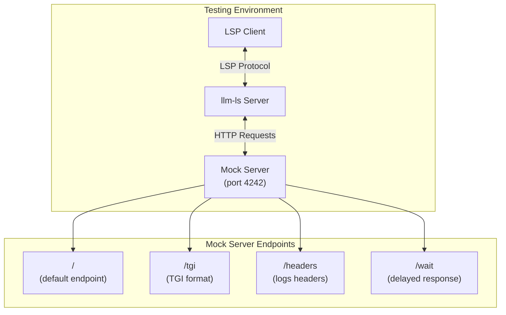
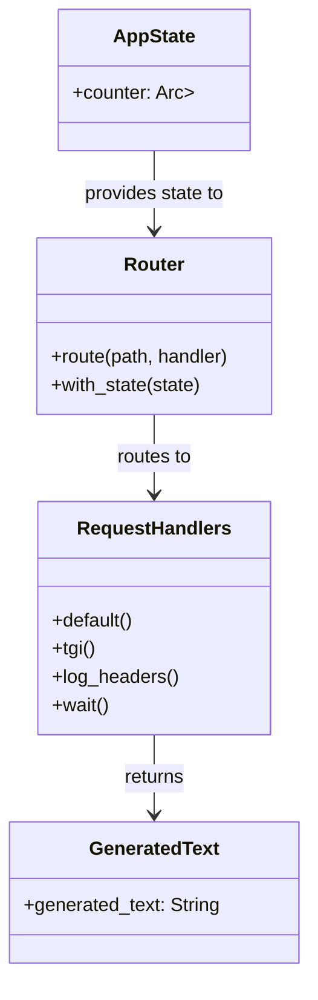
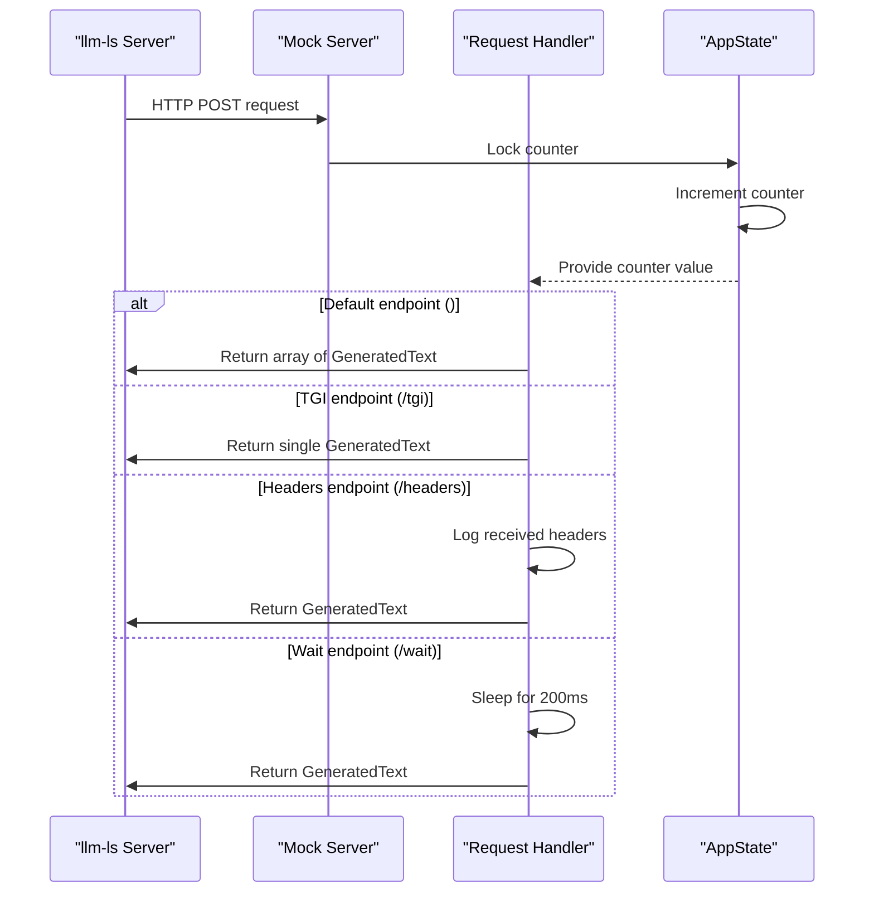
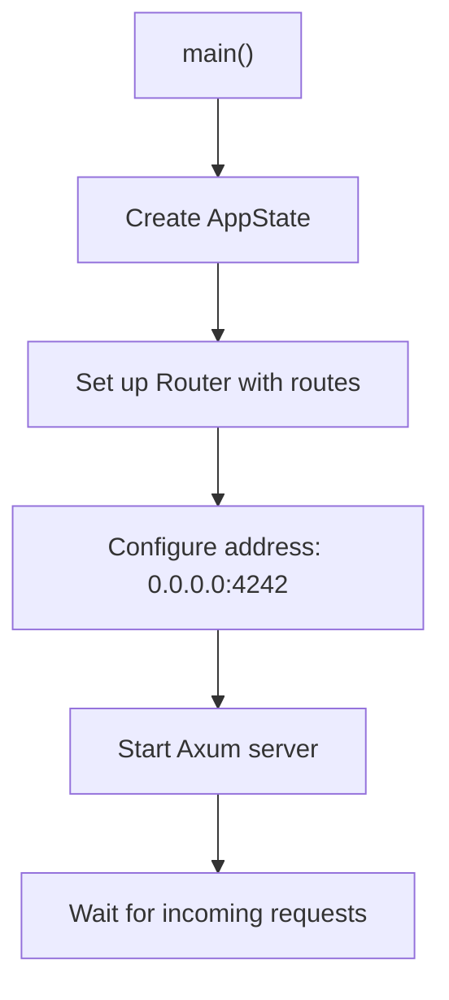

<!-- source: DeepWiki mcp.deepwiki.com · repo huggingface/llm-ls · page 7 Mock Server · fetched 2026-10-26 -->

# Mock Server

<details>
<summary>Relevant source files</summary>

The following files were used as context for generating this wiki page:

- [crates/mock_server/.gitignore](crates/mock_server/.gitignore)
- [crates/mock_server/Cargo.toml](crates/mock_server/Cargo.toml)
- [crates/mock_server/src/main.rs](crates/mock_server/src/main.rs)
- [xtask/Cargo.toml](xtask/Cargo.toml)

</details>


The Mock Server is a lightweight HTTP server that simulates responses from various LLM backends. It serves as a testing utility for the llm-ls language server by providing predictable responses to API requests without requiring actual LLM services to be available. This allows for reliable and efficient testing of the language server's backend integration capabilities.

## Architecture Overview

The Mock Server is implemented as a standalone Rust application using the Axum web framework. It provides several endpoints that mimic different LLM backend responses, enabling testing of various scenarios including standard responses, response delays, and header validation.



Sources: [crates/mock_server/src/main.rs:57-77]()

## Components and Implementation

The Mock Server is built around a few simple components that work together to simulate an LLM backend service.

### Core Components



Sources: [crates/mock_server/src/main.rs:9-17](), [crates/mock_server/src/main.rs:57-67]()

### AppState

The `AppState` struct maintains a counter to track the number of requests received by the server. It uses an `Arc<Mutex<u32>>` to safely share the counter across multiple asynchronous request handlers.

```
struct AppState {
    counter: Arc<Mutex<u32>>,
}
```

Sources: [crates/mock_server/src/main.rs:9-12]()

### GeneratedText

The `GeneratedText` struct defines the format of responses returned by the Mock Server. It mimics the structure of responses from actual LLM services:

```
struct GeneratedText {
    generated_text: String,
}
```

Sources: [crates/mock_server/src/main.rs:14-17]()

## Endpoints and Functionality

The Mock Server exposes four endpoints, each simulating different behaviors of LLM backends:

| Endpoint | Handler | Purpose |
|----------|---------|---------|
| `/` | `default` | Returns a vector of `GeneratedText` objects, simulating multiple completions |
| `/tgi` | `tgi` | Returns a single `GeneratedText` object, mimicking Text Generation Inference format |
| `/headers` | `log_headers` | Logs all request headers and returns a dummy completion |
| `/wait` | `wait` | Introduces a 200ms delay before responding, simulating network latency |

Sources: [crates/mock_server/src/main.rs:19-55](), [crates/mock_server/src/main.rs:62-67]()

### Request Flow



Sources: [crates/mock_server/src/main.rs:19-55]()

## Implementation Details

### Default Handler

The default handler increments the request counter, prints a log message, and returns a vector containing a single `GeneratedText` object with the content "dummy".

Sources: [crates/mock_server/src/main.rs:19-26]()

### TGI Handler

The TGI handler simulates the Text Generation Inference API format by returning a single `GeneratedText` object instead of an array.

Sources: [crates/mock_server/src/main.rs:28-34]()

### Headers Logger

The headers logging handler records all request headers along with the request counter, making it useful for debugging and validating that the correct headers are being sent by the llm-ls server.

Sources: [crates/mock_server/src/main.rs:36-45]()

### Delay Simulator

The wait handler introduces a 200ms delay before responding, allowing tests to verify how the llm-ls server handles delayed responses from LLM backends.

Sources: [crates/mock_server/src/main.rs:47-55]()

## Server Configuration

The Mock Server listens on all network interfaces (0.0.0.0) at port 4242. This configuration is hardcoded in the `main` function.



Sources: [crates/mock_server/src/main.rs:57-77]()

## Usage in Testing

To use the Mock Server for testing:

1. Start the Mock Server by running `cargo run --bin mock_server` from the project root or `cargo run` from the `crates/mock_server` directory
2. Configure the llm-ls server to send requests to `http://localhost:4242` instead of the actual LLM backend service
3. Proceed with testing the llm-ls functionality that requires LLM backend interaction

The Mock Server is especially useful for:

- Unit and integration testing of the llm-ls backend integration code
- Simulating different response scenarios, including errors and delays
- Verifying request formatting and header construction
- Testing without requiring access to potentially costly third-party LLM services

The Mock Server is intentionally minimal, providing just enough functionality to support testing while remaining simple and easy to understand.