# Page: Overview

# Overview

<details>
<summary>Relevant source files</summary>

The following files were used as context for generating this wiki page:

- [README.md](README.md)
- [package.json](package.json)

</details>


The LLM-VS Code extension (llm-vscode) is a VS Code extension that provides LLM-powered code assistance and development tools. This extension uses the Language Server Protocol (LSP) to connect with the `llm-ls` language server, which handles communication with various LLM backends to provide AI-assisted code completion.

For detailed explanations of specific features, see [Features](#1.1). For installation and getting started information, see [Getting Started](#1.2).

Sources: [README.md:1-3](), [package.json:1-5]()

## Purpose and Scope

The core purpose of llm-vscode is to provide:

1. Code completion with "ghost-text" similar to GitHub Copilot
2. Flexibility in model selection from various providers 
3. Efficient management of context windows
4. Code attribution to verify originality of generated code

The extension supports multiple backend services including Hugging Face Inference API, OpenAI, Ollama, and Text Generation Inference (TGI).

Sources: [README.md:16-41](), [package.json:35-47]()

## High-Level Architecture

```mermaid
flowchart TD
    subgraph "User IDE"
        VSCode["VS Code Editor"]
        UserConfig["User Configuration
        (settings.json)"]
    end
    
    subgraph "llm-vscode Extension"
        ExtMain["extension.ts
        (Main Entry)"]
        ConfigSystem["Configuration System
        (configTemplates.ts)"]
        InlineProvider["Inline Completion Provider"]
        AuthManager["Authentication Manager"]
        AttributionSystem["Code Attribution"]
    end
    
    subgraph "LSP System"
        LangClient["Language Client"]
        LLMLS["llm-ls Language Server"]
    end
    
    subgraph "LLM Backends"
        HFInference["Hugging Face Inference API"]
        Ollama["Ollama"]
        OpenAI["OpenAI API"]
        TGI["Text Generation Inference"]
    end
    
    VSCode <--> ExtMain
    UserConfig --> ConfigSystem --> ExtMain
    ExtMain --> InlineProvider
    ExtMain --> AuthManager
    ExtMain --> AttributionSystem
    
    InlineProvider <--> LangClient
    LangClient <--> LLMLS
    LLMLS <--> HFInference
    LLMLS <--> Ollama
    LLMLS <--> OpenAI
    LLMLS <--> TGI
    
    AttributionSystem --> "stack.dataportraits.org"
```

The architecture of llm-vscode follows a modular design. The extension integrates with VS Code and communicates with an LSP language server (`llm-ls`), which handles interactions with LLM backends. The system components include the inline completion provider for generating code suggestions, authentication manager for handling API tokens, and the code attribution system.

Sources: [README.md:124-127](), [package.json:71-229]()

## Request Flow and User Interaction

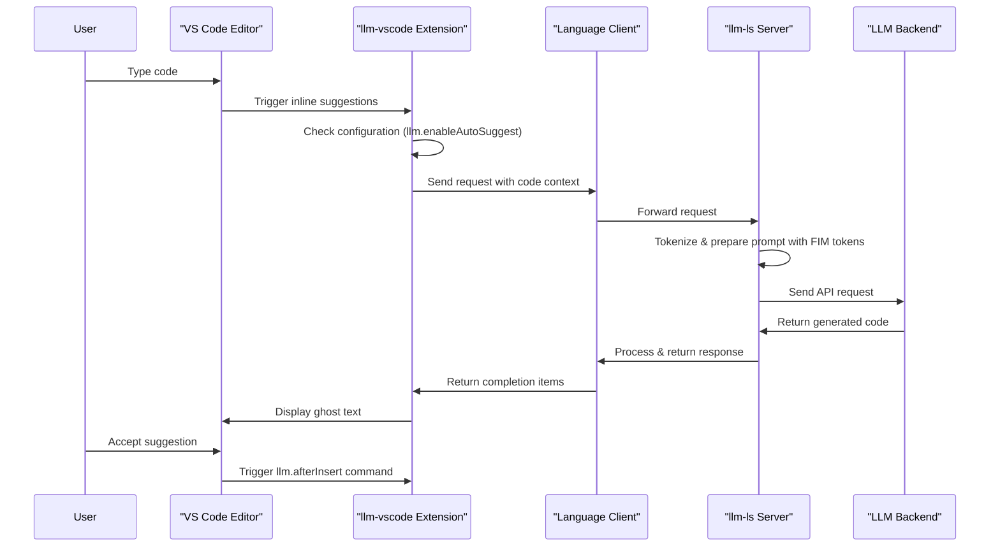

When a user types in the editor, the extension prepares a request containing the code context. This is sent through the Language Client to the `llm-ls` server, which formats the prompt appropriately using Fill-in-the-Middle (FIM) tokens if needed. The LLM backend generates a completion which is then displayed as ghost text for the user to accept.

Sources: [README.md:69-97](), [package.json:53-70]()

## Configuration System

The extension provides extensive configuration options through VS Code's settings system, allowing users to:

1. Choose from predefined model templates or create custom configurations
2. Select different LLM backends (Hugging Face, Ollama, OpenAI, TGI)
3. Configure Fill-in-the-Middle settings
4. Set tokenizer options
5. Control suggestion behavior and keybindings

Here's a table of the key configuration templates available:

| Template | Description |
|----------|-------------|
| hf/bigcode/starcoder2-15b | Default model using Hugging Face's StarCoder 2 (15B parameters) |
| hf/codellama/CodeLlama-13b-hf | Meta's CodeLlama model (13B parameters) |
| hf/Phind/Phind-CodeLlama-34B-v2 | Phind's fine-tuned version of CodeLlama (34B parameters) |
| hf/WizardLM/WizardCoder-Python-34B-V1.0 | WizardLM's WizardCoder specialized for Python (34B parameters) |
| hf/deepseek-ai/deepseek-coder-6.7b-base | DeepSeek's code model (6.7B parameters) |
| ollama/codellama:7b | CodeLlama via Ollama (7B parameters) |
| Custom | Custom user configuration |

Sources: [package.json:71-229](), [README.md:56-186]()

## Model Integration and Backend Support

```mermaid
graph TD
    subgraph "Configuration Options"
        Config["llm.configTemplate
        (Model Selection)"]
        Backend["llm.backend
        (Backend Selection)"]
        ModelID["llm.modelId
        (Model Identifier)"]
        URL["llm.url
        (Endpoint URL)"]
    end
    
    subgraph "Request Formation"
        Context["Code Context"]
        FIM["Fill-in-the-Middle
        Processing"]
        PromptBuilder["Prompt Builder"]
        RequestBody["llm.requestBody
        (API Parameters)"]
    end
    
    subgraph "Backend Options"
        HF["huggingface
        (Inference API)"]
        Ollama["ollama
        (Local Models)"]
        OpenAI["openai
        (Compatible APIs)"]
        TGI["tgi
        (Text Generation Inference)"]
    end
    
    Config --> Backend
    Backend --> HF
    Backend --> Ollama
    Backend --> OpenAI
    Backend --> TGI
    
    Context --> FIM
    FIM --> PromptBuilder
    Backend --> PromptBuilder
    ModelID --> PromptBuilder
    RequestBody --> PromptBuilder
    
    PromptBuilder --> "API Request"
    URL --> "API Request"
```

The extension supports multiple LLM backends, with configuration options to select the appropriate model and endpoint. The request is formatted according to the selected backend's API requirements, with context window management to ensure the prompt fits within the model's capacity.

Sources: [README.md:56-109](), [package.json:71-229]()

## Additional Features

### Code Attribution

The extension provides a code attribution feature that checks if generated code matches content from [The Stack](https://huggingface.co/datasets/bigcode/the-stack), a large dataset of code. This allows users to verify the originality of the suggestions and identify potential sources. The attribution check is performed through an API endpoint at `stack.dataportraits.org`.

### Authentication

For Hugging Face models, the extension supports authentication via API tokens. Users can log in using the `Llm: Login` command, which allows accessing private models and higher rate limits.

Sources: [README.md:35-41](), [README.md:49-55](), [package.json:53-70]()

## Related Extensions

The llm-vscode extension is part of a family of LLM-powered development tools from Hugging Face, which also includes:
- llm.nvim for Neovim
- jupytercoder for Jupyter notebooks
- llm-intellij for IntelliJ IDEs

Sources: [README.md:3-10]()

---

# Page: Features

# Features

<details>
<summary>Relevant source files</summary>

The following files were used as context for generating this wiki page:

- [README.md](README.md)
- [package.json](package.json)

</details>


This document provides a detailed explanation of the llm-vscode extension's capabilities and functionality. It covers the core features, supported backends, configuration options, and customization settings. For information about installing and setting up the extension, see [Getting Started](#1.2).

## Core Features

The llm-vscode extension offers several key features that enhance the coding experience using large language models.

### Code Completion

The extension provides "ghost-text" code completion similar to GitHub Copilot. As you type, the extension suggests code completions based on the current context of your file. These suggestions appear as ghost text that you can accept by pressing Tab or continue typing to dismiss.

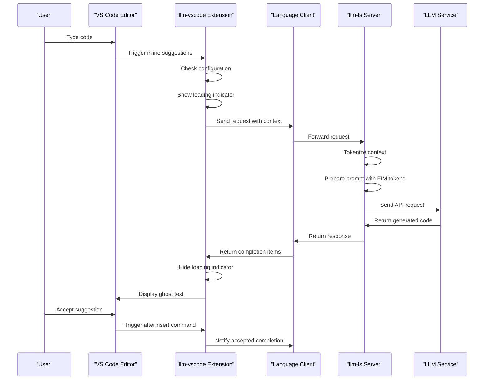

Sources: [README.md:17-21](), [package.json:53-57]()

### Model Selection

The extension supports various pre-defined model templates that you can select through VS Code settings. Each template is configured with appropriate settings for that specific model.

Available model templates include:

| Model Template | Description |
|----------------|-------------|
| `hf/bigcode/starcoder2-15b` | StarCoder 2 (15B) - Default |
| `hf/codellama/CodeLlama-13b-hf` | CodeLlama (13B) |
| `hf/Phind/Phind-CodeLlama-34B-v2` | Phind-CodeLlama (34B) |
| `hf/WizardLM/WizardCoder-Python-34B-V1.0` | WizardCoder Python (34B) |
| `hf/deepseek-ai/deepseek-coder-6.7b-base` | DeepSeek Coder (6.7B) |
| `ollama/codellama:7b` | Ollama CodeLlama (7B) |

You can select a model template through the `llm.configTemplate` setting, which will automatically configure the other settings appropriately.

Sources: [package.json:85-97](), [README.md:169-186]()

### Context Window Management

The extension intelligently manages the context window to ensure the prompt fits within the model's capacity. It uses tokenizers to accurately count tokens and truncate the context when necessary while preserving the most relevant parts of the code.

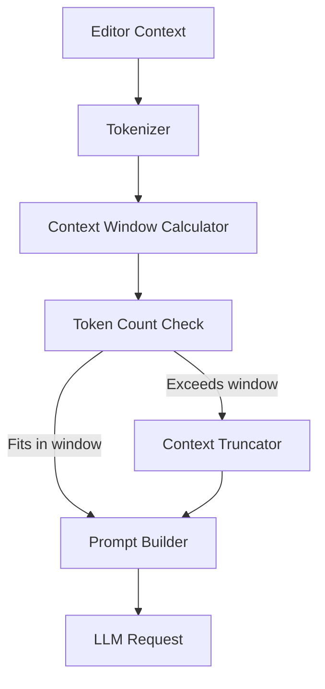

The context window size can be configured through the `llm.contextWindow` setting, which defaults to 2048 tokens.

Sources: [package.json:154-158](), [README.md:32-33]()

### Code Attribution

The code attribution feature allows you to check if generated code matches content in "The Stack" dataset. This helps identify potential sources of the code suggestions and ensures proper attribution.

To use this feature, press `Cmd+Shift+A` (or the configured keybinding) to check the current selection or code near the cursor. The extension sends the code to the attribution service (default: `https://stack.dataportraits.org/overlap`).

This is a rapid first-pass attribution check using Bloom filters to identify sequences of at least 50 characters that match content in The Stack.

Sources: [package.json:67-69](), [README.md:35-41](), [package.json:169-178]()

## Backend Integration

The extension supports multiple backends for generating code completions, allowing you to choose the best option for your needs.

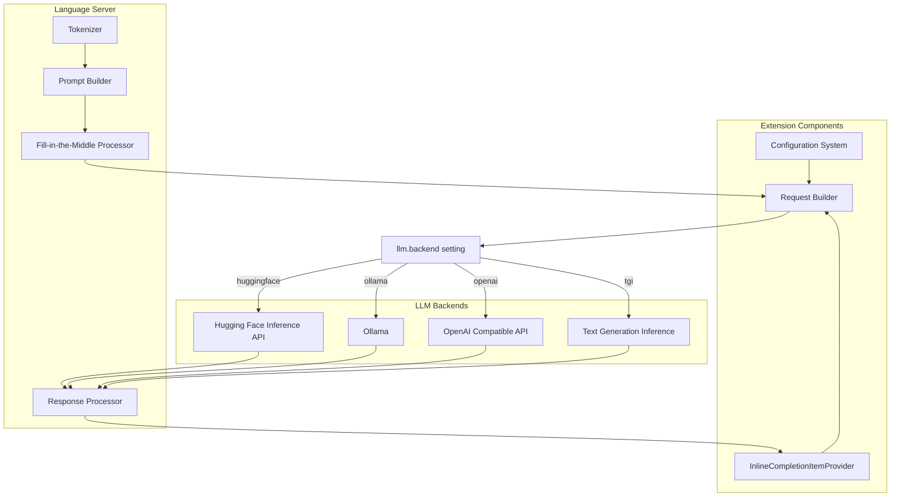

### Supported Backends

The extension supports the following backends:

1. **huggingface**: The Hugging Face Inference API (default)
2. **ollama**: Ollama local LLM server
3. **openai**: Any OpenAI compatible API
4. **tgi**: Text Generation Inference

The backend can be configured through the `llm.backend` setting.

Sources: [package.json:104-114](), [README.md:62-67]()

### URL Construction

The endpoint URL used to fetch suggestions is constructed based on the selected backend:

- For `huggingface` backend without a URL, it uses the default Inference API endpoint
- For other backends, a URL must be specified
- The extension automatically appends the correct path to the URL if needed (e.g., `/v1/completions` for OpenAI)
- This behavior can be disabled using the `llm.disableUrlPathCompletion` setting

Sources: [package.json:115-122](), [package.json:223-226](), [README.md:101-108]()

## Configuration Options

The extension provides numerous configuration options to customize its behavior according to your preferences.

### Fill-in-the-Middle (FIM)

Fill-in-the-Middle is a technique where the model is given both the code before and after the cursor position to provide more contextually appropriate completions.

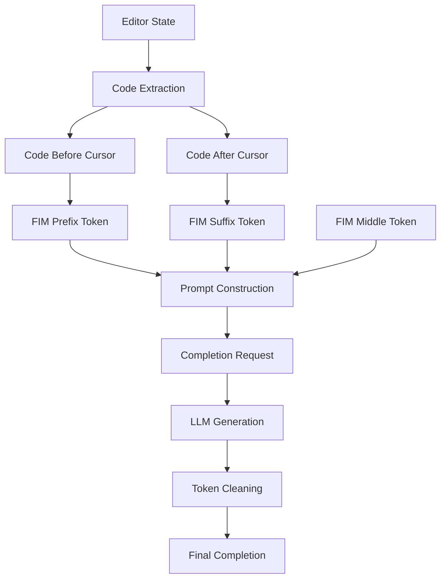

FIM can be enabled or disabled through the `llm.fillInTheMiddle.enabled` setting, and the tokens used for marking the prefix, middle, and suffix can be configured through:
- `llm.fillInTheMiddle.prefix`: Default is `<fim_prefix>`
- `llm.fillInTheMiddle.middle`: Default is `<fim_middle>`
- `llm.fillInTheMiddle.suffix`: Default is `<fim_suffix>`

Sources: [package.json:123-142](), [README.md:78-80]()

### Suggestion Behavior

You can tune how suggestions behave through several settings:

- **Auto-suggest**: Enable or disable automatic suggestions as you type with the `llm.enableAutoSuggest` setting (default: true)
- **Request Delay**: Set the delay between typing and triggering a suggestion with the `llm.requestDelay` setting (default: 150ms)

Sources: [package.json:75-84](), [README.md:112-113]()

### Document Filtering

The `llm.documentFilter` setting allows you to enable suggestions only for specific files that match the provided pattern. Examples:

| Pattern | Description |
|---------|-------------|
| `{ pattern: "**" }` | Match all files (default) |
| `{ pattern: "/path/to/project/**" }` | Match all files in a specific directory |
| `{ pattern: "**/*.{py,rs}" }` | Match only Python and Rust files |

Sources: [package.json:213-222](), [README.md:114-117]()

### Tokenizer Configuration

The extension uses tokenizers to ensure prompts fit the context window. Configuration options include:

1. **No tokenization** (count characters instead):
   ```json
   {
     "llm.tokenizer": null
   }
   ```

2. **Local file**:
   ```json
   {
     "llm.tokenizer": {
       "path": "/path/to/my/tokenizer.json"
     }
   }
   ```

3. **Hugging Face repository**:
   ```json
   {
     "llm.tokenizer": {
       "repository": "myusername/myrepo",
       "api_token": null
     }
   }
   ```

4. **HTTP endpoint**:
   ```json
   {
     "llm.tokenizer": {
       "url": "https://my-endpoint.example.com/mytokenizer.json",
       "to": "/download/path/of/mytokenizer.json"
     }
   }
   ```

Sources: [package.json:205-212](), [README.md:130-167]()

## Other Features

### API Token Management

The extension provides commands to login and logout with your Hugging Face API token:
- `Llm: Login` - Set your HF API token for authentication
- `Llm: Logout` - Remove your stored API token

The extension will also automatically detect tokens set via `huggingface-cli login`.

Sources: [package.json:58-64](), [README.md:50-55]()

### Keybindings

The extension sets two default keybindings:

| Keybinding | Command | Description |
|------------|---------|-------------|
| `Alt+Shift+L` | `editor.action.inlineSuggest.trigger` | Trigger suggestions manually |
| `Cmd+Shift+A` | `llm.attribution` | Run code attribution check |

These keybindings can be customized through the VS Code keybindings settings.

Sources: [package.json:231-240](), [README.md:121-123]()

### TLS Configuration

For development or testing environments, the extension provides the `llm.tlsSkipVerifyInsecure` setting to skip TLS verification for insecure connections.

Sources: [package.json:179-183]()

---

# Page: Getting Started

# Getting Started

<details>
<summary>Relevant source files</summary>

The following files were used as context for generating this wiki page:

- [README.md](README.md)
- [package.json](package.json)

</details>


This document provides a step-by-step guide for installing, configuring, and beginning to use the llm-vscode extension. This extension enables LLM-powered code completion directly within your VS Code editor. For more advanced topics, see [Architecture](#2) and [Configuration System](#3).

## Installation

The llm-vscode extension can be installed directly from the VS Code Marketplace like any other VS Code extension.

### Installation Flow

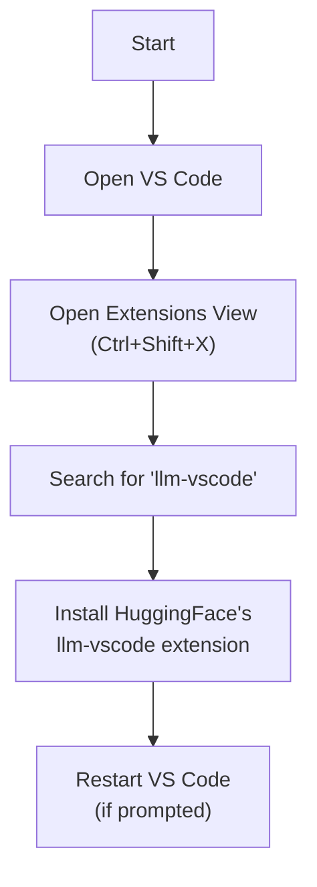

Sources: [package.json:1-10](), [README.md:43-47]()

### Prerequisites

- Visual Studio Code version 1.82.0 or higher (as specified in `engines.vscode`)
- Internet connection for accessing LLM backends

## Authentication

The default configuration uses the [bigcode/starcoder2-15b](https://huggingface.co/bigcode/starcoder2-15b) model via the Hugging Face Inference API, which requires authentication.

### Setting Up HF API Token

1. Obtain your Hugging Face API token from [hf.co/settings/token](https://huggingface.co/settings/token)
2. In VS Code:
   - Open Command Palette (`Ctrl+Shift+P` or `Cmd+Shift+P`)
   - Type and select "Llm: Login"
   - Enter your token when prompted

**Note**: If you've previously authenticated with `huggingface-cli login` on your system, the extension will automatically read the token from disk.

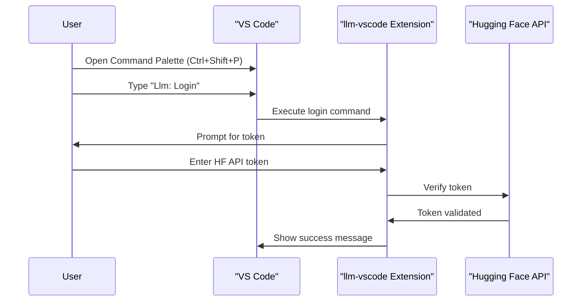

Sources: [README.md:49-56](), [package.json:59-64]()

## Basic Usage

Once installed and authenticated, you can immediately begin using the code completion feature.

### Code Completion

The extension provides "ghost-text" code completions similar to GitHub Copilot:

1. Start typing code in a supported file type
2. The extension will display suggestions as semi-transparent text
3. Press `Tab` to accept a suggestion or continue typing to ignore it

#### Triggering Suggestions

- **Automatic**: By default, suggestions appear as you type
- **Manual**: Press `Alt+Shift+L` to explicitly trigger suggestions

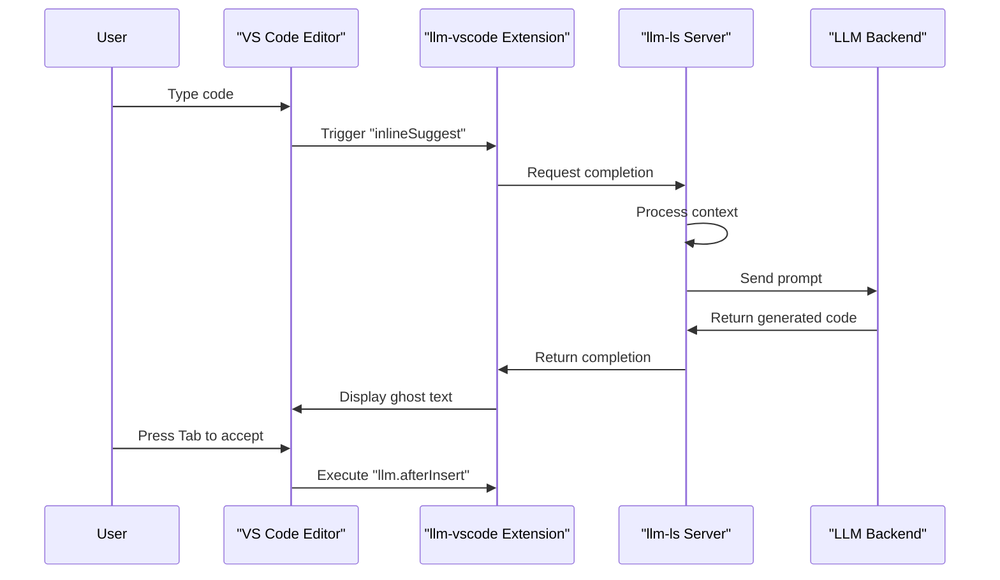

Sources: [package.json:54-57](), [package.json:231-235](), [README.md:17-21]()

### Code Attribution

The extension can check if generated code matches content from "The Stack" dataset:

1. Place your cursor on or select the code you want to check
2. Press `Cmd+Shift+A` (macOS) or `Ctrl+Shift+A` (Windows/Linux)
3. The extension will check the code against The Stack dataset and display attribution information

Sources: [README.md:35-41](), [package.json:67-69](), [package.json:236-239]()

## Selecting a Model

The extension comes with several pre-configured model templates that you can choose from.

### Changing the Model Template

1. Open VS Code Settings (`Ctrl+,` or `Cmd+,`)
2. Search for "Llm: Config Template"
3. Select one of the available models from the dropdown:

| Model Template | Description |
|----------------|-------------|
| hf/bigcode/starcoder2-15b | Default model, general purpose code completion |
| hf/codellama/CodeLlama-13b-hf | Meta's CodeLlama 13B model |
| hf/Phind/Phind-CodeLlama-34B-v2 | Phind's specialized version of CodeLlama |
| hf/WizardLM/WizardCoder-Python-34B-V1.0 | Python-specialized coding model |
| hf/deepseek-ai/deepseek-coder-6.7b-base | DeepSeek's compact coding model |
| ollama/codellama:7b | Local CodeLlama via Ollama |
| Custom | For advanced manual configuration |

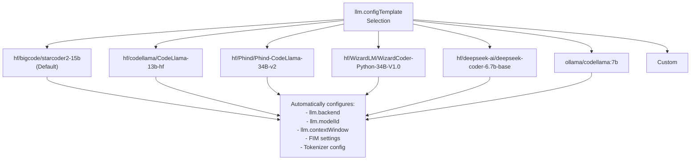

Sources: [package.json:85-96](), [README.md:169-186]()

## Supported Backends

The extension supports multiple LLM backends:

| Backend | Description | URL Configuration |
|---------|-------------|------------------|
| huggingface | Hugging Face Inference API (default) | Optional, uses default API URL if not specified |
| ollama | Local Ollama instance | Required |
| openai | OpenAI compatible API | Required |
| tgi | Text Generation Inference | Required |

To change the backend:

1. Open VS Code Settings
2. Search for "Llm: Backend"
3. Select your preferred backend

For non-HuggingFace backends, you'll need to configure the URL:

1. Search for "Llm: URL" in settings
2. Enter the appropriate URL for your backend

Sources: [package.json:104-122](), [README.md:62-108]()

## Configuration System Overview

While the extension works with minimal configuration, you may want to adjust settings for optimal performance. Here's a high-level overview of the configuration system:

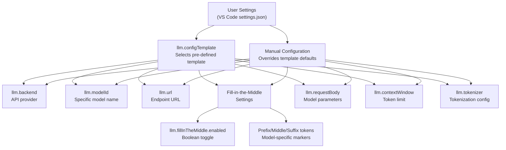

For detailed configuration options, see [Configuration System](#3).

Sources: [package.json:71-228](), [README.md:57-167]()

## Adjusting Suggestion Behavior

You can customize how and when suggestions appear:

- **Enable/Disable Auto-suggest**: Set `llm.enableAutoSuggest` to true/false
- **Filter Documents**: Configure `llm.documentFilter` to enable suggestions only for specific files
- **Adjust Request Delay**: Set `llm.requestDelay` to control how quickly suggestions appear

Sources: [package.json:75-79](), [package.json:80-84](), [package.json:213-222](), [README.md:110-118]()

## Next Steps

Now that you have the extension set up, you might want to explore:

- [Architecture](#2) for understanding how the extension works
- [Configuration System](#3) for detailed configuration options
- [LLM Backends](#3.2) for configuring specific backends
- [Fill-in-the-Middle](#3.3) for understanding this feature
- [Troubleshooting](#6) for resolving common issues

---

# Page: Architecture

# Architecture

<details>
<summary>Relevant source files</summary>

The following files were used as context for generating this wiki page:

- [README.md](README.md)
- [package.json](package.json)
- [src/extension.ts](src/extension.ts)

</details>


## Purpose and Scope

This document provides a technical overview of the internal architecture of the llm-vscode extension. It explains the main components, their relationships, and how data flows through the system during code completion operations. The focus is on the structural design of the system rather than implementation details.

For information about using the extension's features, refer to [Features](#1.1), and for configuration details, see [Configuration System](#3).

## System Overview

The llm-vscode extension follows a client-server architecture using the Language Server Protocol (LSP). The VS Code extension serves as the client, which communicates with a dedicated language server (`llm-ls`) that handles the core language processing tasks. This separation allows for better performance, maintainability, and cross-editor compatibility.

### High-Level Architecture Diagram

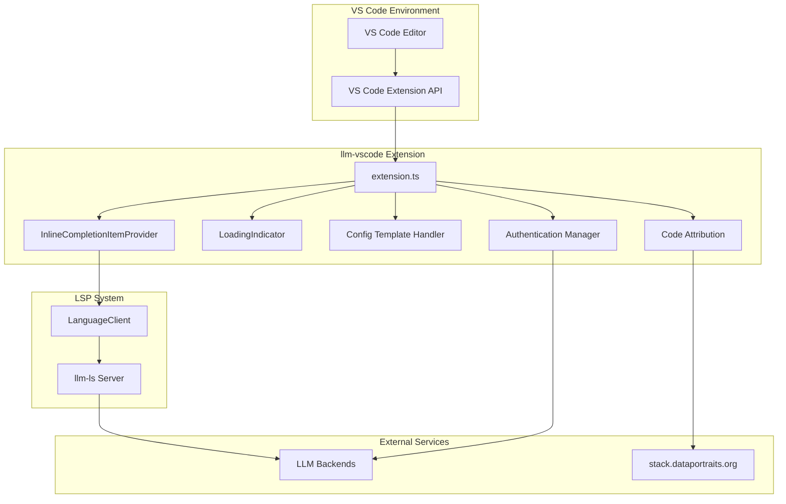

Sources: [src/extension.ts:35-214](), [package.json:48-50]()

## Core Components

### Extension Entry Point

The extension's entry point is the `activate` function in the main file. This function initializes all components and registers the necessary commands and providers.

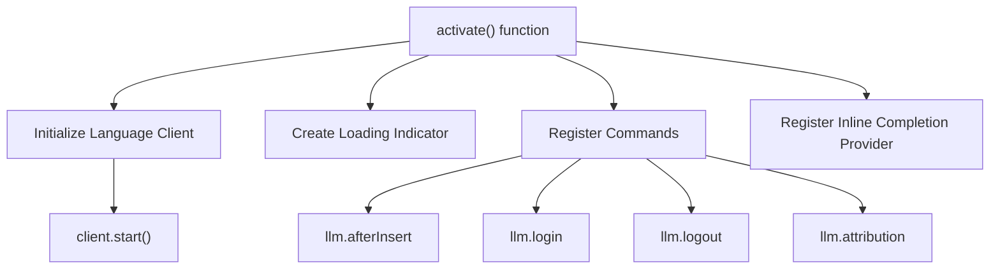

Sources: [src/extension.ts:35-214]()

The `activate` function handles:
- Setting up the Language Server Protocol client
- Creating a status bar loading indicator
- Registering commands (afterInsert, login, logout, attribution)
- Setting up the inline completion provider
- Initializing configuration template handling

### Language Server Protocol Integration

The extension communicates with the `llm-ls` language server using the Language Server Protocol (LSP). The server runs as a separate process, which improves stability and performance.

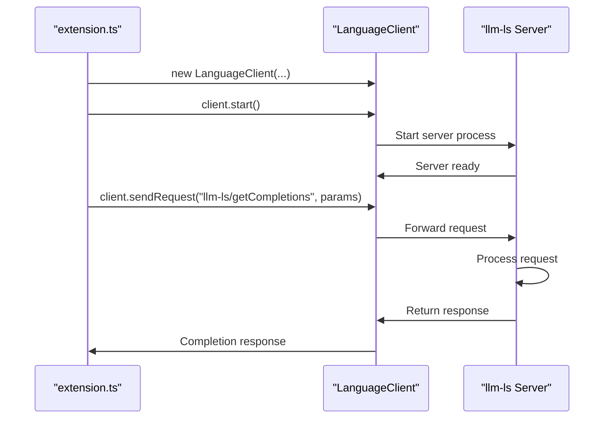

Sources: [src/extension.ts:52-83](), [src/extension.ts:78-87]()

The language client is initialized with:
- Server options that specify how to start and connect to the `llm-ls` binary
- Client options that specify which documents the server should handle
- Output channel for logging

### Inline Completion Provider

The inline completion provider is responsible for generating and displaying code suggestions as ghost text in the editor.

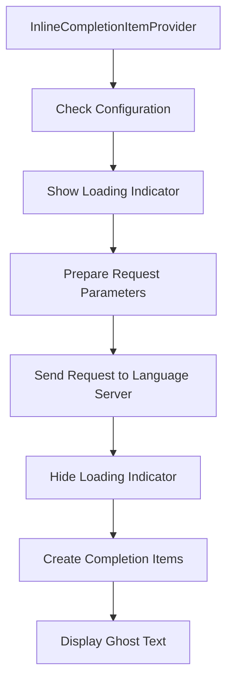

Sources: [src/extension.ts:142-211](), [src/extension.ts:28-33]()

The provider's main functionality is in the `provideInlineCompletionItems` method, which:
1. Checks if auto-suggest is enabled
2. Shows a loading indicator
3. Constructs request parameters from the configuration
4. Sends a request to the language server
5. Creates completion items from the response
6. Returns the items to VS Code for display

### Configuration System

The configuration system manages all the settings that control the extension's behavior, including model selection, backend configuration, and tokenizer settings.

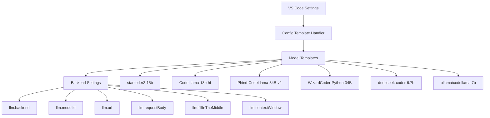

Sources: [src/extension.ts:223-236](), [package.json:71-228]()

The configuration template handler listens for changes to the `llm.configTemplate` setting and updates all relevant settings when a new template is selected. This allows users to quickly switch between different pre-configured models.

### Authentication

The authentication component manages the Hugging Face API token, which is required for accessing the Hugging Face Inference API.

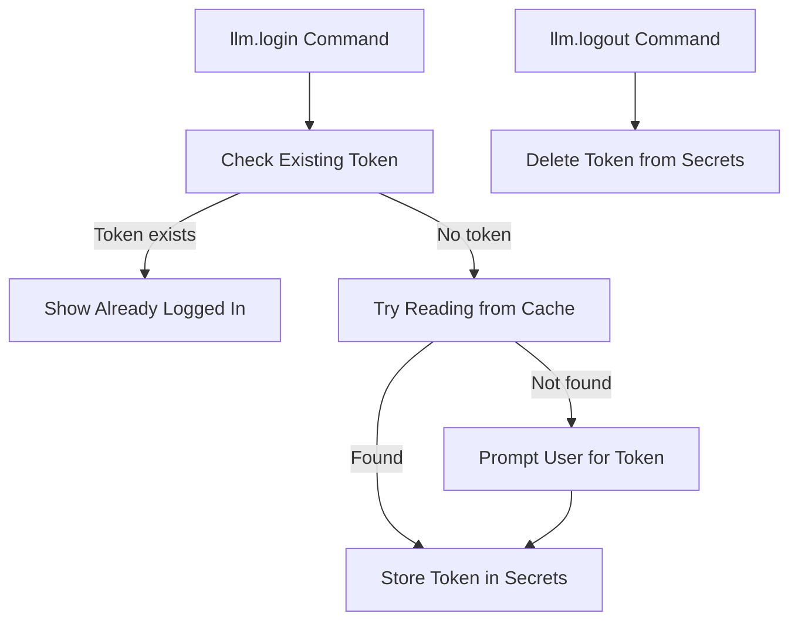

Sources: [src/extension.ts:101-136]()

The authentication component provides:
- A login command that tries to read the token from cache or prompts the user
- A logout command that removes the stored token
- Access to the stored token for API requests

### Code Attribution

The code attribution feature allows users to check if code snippets exist in the Stack dataset.

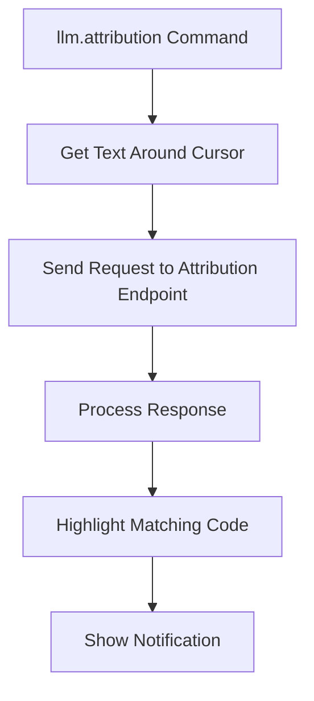

Sources: [src/extension.ts:239-324]()

The code attribution component:
1. Gets the text around the current cursor position
2. Sends it to the attribution service
3. Highlights any matching spans in the editor
4. Shows a notification with the results

## Request Flow

The following diagram illustrates how a code completion request flows through the system:

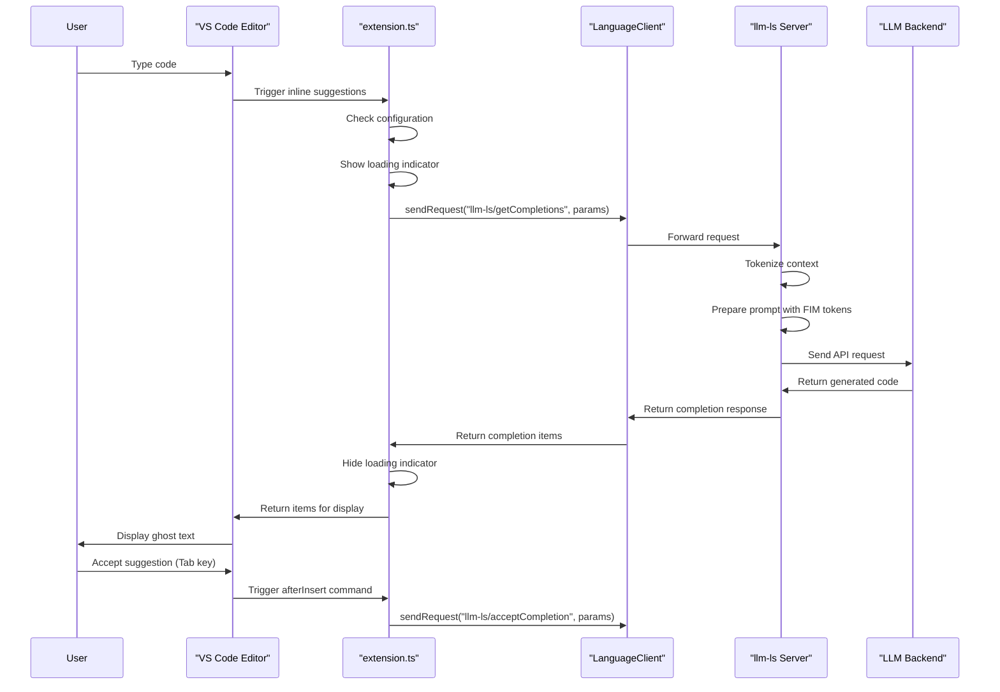

Sources: [src/extension.ts:142-211](), [src/extension.ts:89-98]()

## Backend Integration

The extension can integrate with multiple LLM backends for code generation:

```mermaid
graph TD
    ConfigSystem["Configuration System"] --> BackendSetting["llm.backend Setting"]
    BackendSetting --> BackendRouter["Backend Router"]
    
    BackendRouter -- "huggingface" --> HF["Hugging Face Inference API"]
    BackendRouter -- "ollama" --> Ollama["Ollama"]
    BackendRouter -- "openai" --> OpenAI["OpenAI Compatible API"]
    BackendRouter -- "tgi" --> TGI["Text Generation Inference"]
    
    HF --> ModelRequest["Model Request"]
    Ollama --> ModelRequest
    OpenAI --> ModelRequest
    TGI --> ModelRequest
    
    ModelRequest --> FormatResponse["Format Response"]
    FormatResponse --> DisplayCompletion["Display Completion"]
```

Sources: [package.json:104-111](), [src/extension.ts:163-178]()

The backend integration:
1. Determines which backend to use based on configuration
2. Constructs appropriate request parameters for that backend
3. Sends the request with the necessary authentication
4. Processes the response into a standard format

## Data Flow

A typical data flow for code completion follows this path:

```mermaid
graph LR
    UserInput["User Input"] --> EditorContext["Editor Context"]
    EditorContext --> RequestParams["Request Parameters"]
    RequestParams --> LSPRequest["LSP Request"]
    LSPRequest --> ServerProcess["Server Processing"]
    ServerProcess --> LLMRequest["LLM API Request"]
    LLMRequest --> GeneratedText["Generated Text"]
    GeneratedText --> CompletionItems["Completion Items"]
    CompletionItems --> GhostText["Ghost Text"]
    GhostText --> AcceptedCompletion["Accepted Completion"]
    AcceptedCompletion --> FinalCode["Final Code"]
```

Sources: [src/extension.ts:142-211]()

## Summary

The llm-vscode extension uses a client-server architecture with the Language Server Protocol to provide LLM-powered code completions in VS Code. The main components include:

1. A VS Code extension that handles UI interactions and configuration
2. A language server (llm-ls) that processes code contexts and communicates with LLM backends
3. Integration with multiple LLM backends for code generation
4. A configuration system with pre-defined model templates
5. Authentication handling for Hugging Face API access
6. Code attribution features for checking code sources

This architecture provides flexibility, scalability, and good performance while allowing the extension to support multiple LLM backends and models.

Sources: [src/extension.ts:1-351](), [package.json:1-268]()

---

# Page: VS Code Extension Core

# VS Code Extension Core

<details>
<summary>Relevant source files</summary>

The following files were used as context for generating this wiki page:

- [package.json](package.json)
- [src/extension.ts](src/extension.ts)

</details>


This document details the main extension component of LLM-VS Code and its activation process. The VS Code Extension Core is responsible for initializing the extension, setting up communication with the language server, registering commands and providers, and handling configuration changes.

For information about how the extension communicates with the Language Server, see [Language Server Protocol Integration](#2.2). For details about the Inline Completion Provider, see [Inline Completion Provider](#2.3).

## Extension Lifecycle

The LLM-VS Code extension follows the standard VS Code extension lifecycle, with defined activation and deactivation functions.

### Activation Process

```mermaid
flowchart TD
    A["activate()"] --> B["Handle Config Templates"]
    B --> C["Configure Server Options"]
    C --> D["Create Language Client"]
    D --> E["Create Loading Indicator"]
    E --> F["Start Language Client"]
    F --> G["Register Commands"]
    G --> H["Register Inline Completion Provider"]
```

When VS Code loads the extension, the `activate` function in [src/extension.ts:35-214]() is called with a context object. The activation process:

1. Initializes configuration template handling
2. Reads configuration settings from VS Code
3. Determines the language server binary path
4. Creates and starts the Language Client
5. Sets up the loading indicator
6. Registers commands (login, logout, attribution, afterInsert)
7. Registers the inline completion provider

Sources: [src/extension.ts:35-214]()

### Deactivation Process

```mermaid
flowchart TD
    A["deactivate()"] --> B["Check if client exists"]
    B -->|"Yes"| C["Stop Language Client"]
    B -->|"No"| D["Return undefined"]
```

The `deactivate` function in [src/extension.ts:216-221]() is called when the extension is deactivated. It stops the language client if it exists.

Sources: [src/extension.ts:216-221]()

## Core Components

### Language Client Setup

```mermaid
flowchart TD
    subgraph "Extension Core Components"
        A["ServerOptions"] --> B["command path"] 
        A --> C["transport: stdio"]
        A --> D["environment variables"]
        
        E["LanguageClientOptions"] --> F["documentSelector"]
        E --> G["outputChannel"]
        
        H["LanguageClient"] --> A
        H --> E
        
        I["client.start()"] --> J["Server Connection"]
    end
```

The extension creates a Language Client that communicates with the Language Server:

1. **ServerOptions**: Defines how to start and communicate with the server:
   - **Command**: Path to the `llm-ls` binary (either from user configuration or bundled with the extension)
   - **Transport**: Uses stdio for communication
   - **Environment Variables**: Sets `RUST_BACKTRACE` and `LLM_LOG_LEVEL`

2. **ClientOptions**: Configures client behavior:
   - **Document Selector**: Specifies which documents the client handles
   - **Output Channel**: Where server logs are displayed

Sources: [src/extension.ts:39-83]()

### Loading Indicator

```mermaid
flowchart TD
    A["createLoadingIndicator()"] --> B["Create StatusBarItem"]
    B --> C["Set text: '$(loading~spin) LLM'"]
    C --> D["Set tooltip"]
    
    E["provideInlineCompletionItems()"] --> F["Show indicator before request"]
    F --> G["Process completion request"]
    G --> H["Hide indicator after response"]
```

The extension creates a status bar item to indicate when it's generating completions. The loading indicator is:
- Created in the `createLoadingIndicator` function [src/extension.ts:28-33]()
- Shown before sending a request to the language server
- Hidden after receiving the response

Sources: [src/extension.ts:28-33](), [src/extension.ts:180-182]()

### Command Registration

The extension registers several VS Code commands:

```mermaid
flowchart TD
    subgraph "Commands Registered"
        A["llm.afterInsert"] --> B["Notify accepted completion"]
        C["llm.login"] --> D["Store API token"]
        E["llm.logout"] --> F["Delete API token"]
        G["llm.attribution"] --> H["Highlight code attributions"]
    end
```

1. **llm.afterInsert**: Called when a user accepts a suggestion, notifies the language server [src/extension.ts:89-99]()
2. **llm.login**: Manages authentication with Hugging Face [src/extension.ts:101-131]()
3. **llm.logout**: Removes stored authentication token [src/extension.ts:132-136]()
4. **llm.attribution**: Identifies and highlights code that might be found in public code repositories [src/extension.ts:138-141]()

Sources: [src/extension.ts:89-141]()

### Inline Completion Provider

```mermaid
flowchart TD
    A["InlineCompletionItemProvider"] --> B["provideInlineCompletionItems()"]
    B --> C["Check configuration"]
    C --> D["Check for automatic triggers"]
    D --> E["Wait for request delay"]
    E --> F["Prepare parameters"]
    F --> G["Send request to language server"]
    G --> H["Process response"]
    H --> I["Create InlineCompletionItems"]
    I --> J["Return items to VS Code"]
```

The extension registers an `InlineCompletionItemProvider` that generates code suggestions:

1. Checks if automatic suggestions are enabled and applies request delay
2. Prepares parameters including position, model, backend, and configuration
3. Shows the loading indicator
4. Sends request to the language server
5. Processes the response and creates inline completion items
6. Returns the items to VS Code for display

Sources: [src/extension.ts:142-213]()

## Configuration System

```mermaid
flowchart TD
    A["handleConfigTemplateChange()"] --> B["Register configuration listener"]
    B --> C["Listen for llm.configTemplate changes"]
    C -->|"Template changed"| D["Get selected template"]
    D --> E["Apply template settings"]
    E --> F["Update VS Code configuration"]
```

The extension manages configuration through:

1. **Configuration Listener**: Monitors changes to the `llm.configTemplate` setting
2. **Template Application**: When the template changes, applies the corresponding settings
3. **Global Updates**: Updates are applied at the global level

The configuration system is defined in [src/extension.ts:223-236]() and uses templates from the imported `configTemplates.ts` file.

Sources: [src/extension.ts:223-236](), [package.json:71-229]()

## Authentication Management

```mermaid
flowchart TD
    subgraph "llm.login Command"
        A["Check for existing token"] -->|"Token exists"| B["Show 'Already logged in'"]
        A -->|"No token"| C["Check for token in ~/.cache/huggingface/token"]
        C -->|"Token found"| D["Store token in secrets"]
        C -->|"No token"| E["Prompt user for token"]
        E --> F["Store token in secrets"]
    end
    
    subgraph "llm.logout Command"
        G["Delete token from secrets"] --> H["Show 'Logged out'"]
    end
```

The extension manages Hugging Face API tokens:

1. **Token Storage**: Uses VS Code's `secrets` API to securely store API tokens
2. **Login Sources**:
   - Checks for existing token in secrets
   - Looks for token in `~/.cache/huggingface/token`
   - Prompts user to enter token manually
3. **Token Usage**: The stored token is used for authenticated requests to Hugging Face

Sources: [src/extension.ts:101-136]()

## Code Attribution Feature

```mermaid
flowchart TD
    A["llm.attribution command"] --> B["Get active editor document"]
    B --> C["Get cursor position"]
    C --> D["Select text around cursor"]
    D --> E["Send to attribution endpoint"]
    E --> F["Process response"]
    F -->|"Matches found"| G["Create decorations"]
    G --> H["Highlight matching spans"]
    H --> I["Clear highlights after timeout"]
    F -->|"No matches"| J["Show 'No code found' message"]
```

The extension provides a feature to identify code that might be found in public code repositories:

1. **Selection**: Selects text around the cursor (configurable window size)
2. **Attribution Request**: Sends the selected text to an attribution endpoint
3. **Highlighting**: Creates text decorations to highlight matching spans
4. **User Feedback**: Shows messages about the attribution results
5. **Cleanup**: Clears highlights after a timeout

Sources: [src/extension.ts:239-324]()

## Extension Configuration

The extension exposes numerous configuration options in the `package.json` file:

| Category | Configuration Options |
|----------|----------------------|
| General | `llm.requestDelay`, `llm.enableAutoSuggest` |
| Models | `llm.configTemplate`, `llm.modelId`, `llm.backend` |
| Server | `llm.url`, `llm.tlsSkipVerifyInsecure` |
| Fill-in-the-Middle | `llm.fillInTheMiddle.enabled`, `llm.fillInTheMiddle.prefix`, `llm.fillInTheMiddle.middle`, `llm.fillInTheMiddle.suffix` |
| Request | `llm.requestBody`, `llm.contextWindow`, `llm.tokensToClear` |
| Attribution | `llm.attributionWindowSize`, `llm.attributionEndpoint` |
| LSP | `llm.lsp.binaryPath`, `llm.lsp.port`, `llm.lsp.logLevel` |
| Advanced | `llm.tokenizer`, `llm.documentFilter`, `llm.disableUrlPathCompletion` |

Sources: [package.json:71-229]()

## Utilities

### Request Delay

The extension implements a delay function to debounce requests to the language server:

```mermaid
flowchart TD
    A["delay(milliseconds, token)"] --> B["Create Promise"]
    B --> C["Set interval to check for cancellation"]
    C --> D["Set timeout for delay duration"]
    D -->|"Timeout completes"| E["Resolve with cancellation status"]
    C -->|"Cancellation requested"| F["Clear interval"]
    F --> G["Resolve with true (cancelled)"]
```

The `delay` function [src/extension.ts:326-350]() is used to wait for a specified time before sending a request, unless the operation is cancelled.

Sources: [src/extension.ts:326-350]()

---

# Page: Language Server Protocol Integration

# Language Server Protocol Integration

<details>
<summary>Relevant source files</summary>

The following files were used as context for generating this wiki page:

- [README.md](README.md)
- [src/extension.ts](src/extension.ts)

</details>


This document explains how the llm-vscode extension communicates with the llm-ls language server through the Language Server Protocol (LSP). We'll cover the setup, communication flow, and key interactions between the extension and the language server.

For information about the core extension functionality, see [VS Code Extension Core](#2.1). For details about providing inline completions to the editor, see [Inline Completion Provider](#2.3).

## Overview of LSP in llm-vscode

The Language Server Protocol (LSP) is a standardized protocol that enables VS Code extensions to communicate with language servers. In llm-vscode, LSP enables the separation of concerns between:

1. The VS Code-specific code (UI, extension activation, settings management)
2. The language processing capabilities (prompt handling, tokenization, LLM interaction)

LSP Architecture Diagram:
```mermaid
graph TD
    VSCode["VS Code Editor"] <--> ExtMain["Extension Main"]
    ExtMain <--> LangClient["Language Client"]
    LangClient <-- "LSP (stdio)" --> LLMLS["llm-ls Language Server"]
    LLMLS <--> ReqHandler["LLM Request Handler"]
    ReqHandler <--> LLMBackends["LLM Backends"]
    LLMBackends <--> HF["Hugging Face API"]
    LLMBackends <--> OpenAI["OpenAI API"]
    LLMBackends <--> Ollama["Ollama"]
    LLMBackends <--> TGI["Text Generation Inference"]
```

Sources: [src/extension.ts:4-7](), [src/extension.ts:24](), [src/extension.ts:78-83]()

## Language Client Setup

When the extension is activated, it establishes a connection with the language server through a language client. This client sends requests to and receives responses from the server.

### Finding the Language Server Binary

The extension determines the path to the llm-ls binary as follows:

```mermaid
flowchart TD
    Start["Activate Extension"] --> ConfigCheck{"Is llm.lsp.binaryPath\nconfigured?"}
    ConfigCheck -- "Yes" --> UseConfig["Use configured path"]
    ConfigCheck -- "No" --> DefaultPath["Use bundled binary in extension/server"]
    DefaultPath --> PlatformCheck{"Platform check"}
    PlatformCheck -- "Windows" --> WinExt["Add .exe extension"]
    PlatformCheck -- "Other" --> NoExt["No extension needed"]
    WinExt --> JoinPath["Join extension path with binary name"]
    NoExt --> JoinPath
    UseConfig --> HomeDirCheck{"Path starts with '~/'?"}
    HomeDirCheck -- "Yes" --> ReplaceHome["Replace ~ with home directory"]
    HomeDirCheck -- "No" --> FinalPath["Use path as is"]
    ReplaceHome --> FinalPath
    JoinPath --> FinalPath
    FinalPath --> CommandSet["Set binary path as command"]
```

Sources: [src/extension.ts:40-50]()

### Configuring the Language Client

The extension creates server options and client options, then initializes the language client:

```mermaid
sequenceDiagram
    participant Extension
    participant LanguageClient
    participant llm_ls as "llm-ls Server"
    
    Extension->>Extension: "Create server options with binary path"
    Note over Extension: "Set TransportKind.stdio"
    Note over Extension: "Configure environment variables"
    Extension->>Extension: "Create output channel"
    Extension->>Extension: "Create client options"
    Note over Extension: "documentSelector: [{scheme: '*'}]"
    Extension->>LanguageClient: "new LanguageClient('llm', 'LLM VS Code', serverOptions, clientOptions)"
    Extension->>LanguageClient: "start()"
    LanguageClient->>llm_ls: "Start and initialize"
    llm_ls-->>LanguageClient: "Initialized"
    LanguageClient-->>Extension: "Client started"
```

Sources: [src/extension.ts:52-87]()

The key configuration in the server options:

| Setting | Value | Purpose |
|---------|-------|---------|
| Transport | TransportKind.stdio | Communication method between client and server |
| Environment | RUST_BACKTRACE=1 | Enable stack traces for debugging |
| Environment | LLM_LOG_LEVEL | Set log level from configuration |

Sources: [src/extension.ts:52-71]()

## LSP Communication Flow

Once the language client is established, the extension communicates with the language server through custom LSP requests.

### Code Completion Request Sequence

The primary communication flow is requesting and displaying code completions:

```mermaid
sequenceDiagram
    participant Editor as "VS Code Editor"
    participant Provider as "Inline Completion Provider"
    participant Client as "Language Client"
    participant Server as "llm-ls Server"
    participant LLM as "LLM Backend"
    
    Editor->>Provider: "Trigger completion"
    Provider->>Provider: "Check configuration"
    Provider->>Provider: "Show loadingIndicator"
    Provider->>Client: "sendRequest('llm-ls/getCompletions', params)"
    Note over Provider,Client: "Include position, model, context, etc."
    Client->>Server: "Forward request"
    Server->>Server: "Process document context"
    Server->>LLM: "Send prompt to LLM"
    LLM-->>Server: "Return generated text"
    Server-->>Client: "Return CompletionResponse"
    Client-->>Provider: "Return response"
    Provider->>Provider: "Hide loadingIndicator"
    Provider->>Editor: "Display completion items"
    Editor->>Editor: "User accepts completion"
    Editor->>Provider: "Trigger 'llm.afterInsert' command"
    Provider->>Client: "sendRequest('llm-ls/acceptCompletion', params)"
    Client->>Server: "Notify accepted completion"
```

Sources: [src/extension.ts:142-211](), [src/extension.ts:89-98]()

### Request Parameters

When sending the `getCompletions` request, the extension includes a comprehensive set of parameters:

```mermaid
graph TD
    Params["getCompletions Request Parameters"] --- Position["position: current cursor position"]
    Params --- Document["textDocument: document identifier"]
    Params --- Model["model: configured modelId"]
    Params --- Backend["backend: huggingface/openai/ollama/tgi"]
    Params --- URL["url: backend URL"]
    Params --- TokensToClear["tokensToClear: tokens to remove"]
    Params --- ApiToken["apiToken: from secrets storage"]
    Params --- RequestBody["requestBody: custom parameters"]
    Params --- FIM["fim: fill-in-the-middle setting"]
    Params --- ContextWindow["contextWindow: token limit"]
    Params --- TokenizerConfig["tokenizerConfig: tokenizer settings"]
```

Sources: [src/extension.ts:163-178]()

## Custom LSP Requests

The extension defines two custom LSP requests that extend the standard protocol:

### 1. llm-ls/getCompletions

This request fetches code completions from the language server.

**Request parameters:** Document context, model configuration, and other parameters shown above.

**Response structure:**
```typescript
interface CompletionResponse {
    request_id: String,
    completions: Completion[],
}

interface Completion {
    generated_text: string;
}
```

Sources: [src/extension.ts:15-22](), [src/extension.ts:181]()

### 2. llm-ls/acceptCompletion

This request notifies the language server when a completion is accepted by the user.

**Request parameters:**
```typescript
const params = {
    requestId: request_id,
    acceptedCompletion: 0,
    shownCompletions: [0],
    completions,
};
```

Sources: [src/extension.ts:89-98]()

## Error Handling

The extension implements comprehensive error handling for LSP communication:

```mermaid
flowchart TD
    Request["Try sending LSP request"] --> Response{"Success?"}
    Response -- "Yes" --> Process["Process response"]
    Response -- "No" --> ErrorCheck{"Error type?"}
    ErrorCheck -- "Loading error" --> Warning["Show warning message"]
    ErrorCheck -- "Canceled" --> Silent["Silent handling (no message)"]
    ErrorCheck -- "Other errors" --> Error["Show error message"]
```

Sources: [src/extension.ts:200-208]()

## Extension Deactivation

When the extension is deactivated, it properly cleans up the language client:

```mermaid
sequenceDiagram
    participant Ext as "Extension"
    participant Client as "Language Client"
    
    Note over Ext: "deactivate() function called"
    Ext->>Ext: "Check if client exists"
    Ext->>Client: "stop()"
    Client-->>Ext: "Client stopped"
```

Sources: [src/extension.ts:216-221]()

## Connection with Other Extension Components

The LSP integration is a central component that connects various parts of the llm-vscode extension:

```mermaid
graph TD
    subgraph "VS Code Extension"
        Settings["Configuration System"]
        InlineProvider["Inline Completion Provider"]
        Commands["Command System"]
    end
    
    subgraph "LSP Layer"
        Client["Language Client"]
        Server["llm-ls Server"]
    end
    
    subgraph "External Services"
        LLMs["LLM Services"]
        TokenizerAPI["Tokenizer API"]
    end
    
    Settings --> InlineProvider
    InlineProvider --> Client
    Commands --> Client
    Client <--> Server
    Server <--> LLMs
    Server <--> TokenizerAPI
```

Sources: [src/extension.ts:142-211](), [src/extension.ts:89-98]()

## Conclusion

The Language Server Protocol integration is a fundamental architectural component of the llm-vscode extension. It:

1. Separates editor-specific code from language processing logic
2. Enables standardized communication between the extension and the llm-ls server
3. Provides a clean interface for requesting and handling code completions
4. Supports multiple LLM backends through a unified protocol

This separation of concerns makes the extension more maintainable and allows the language server to be potentially reused in other editors that support LSP.

---

# Page: Inline Completion Provider

# Inline Completion Provider

<details>
<summary>Relevant source files</summary>

The following files were used as context for generating this wiki page:

- [package.json](package.json)
- [src/extension.ts](src/extension.ts)

</details>


The Inline Completion Provider is a core component of the llm-vscode extension that integrates with VS Code's InlineCompletionItemProvider API to deliver AI-powered code suggestions as you type. It handles the process of requesting, formatting, and displaying code completions directly in the editor as "ghost text" that can be accepted or ignored.

For information about how the Language Server Protocol integrates with this system, see [Language Server Protocol Integration](#2.2).

## Architecture

The Inline Completion Provider sits between the VS Code editor interface and the Language Server, acting as a bridge that transforms user actions into completion requests and displays the results back to the user.

```mermaid
flowchart TD
    subgraph "VS Code Editor"
        UserTyping["User Typing"]
        GhostText["Ghost Text Display"]
    end
    
    subgraph "Extension Core"
        Provider["InlineCompletionItemProvider"]
        LoadingIndicator["Loading Indicator"]
    end
    
    subgraph "LSP Communication"
        LangClient["Language Client"]
        GetCompletions["llm-ls/getCompletions Request"]
        AfterInsert["llm.afterInsert Command"]
    end
    
    UserTyping --> Provider
    Provider --> LoadingIndicator
    Provider --> GetCompletions
    GetCompletions --> LangClient
    LangClient --> Provider
    Provider --> GhostText
    GhostText --> AfterInsert
    AfterInsert --> LangClient
```

Sources: [src/extension.ts:142-213](), [src/extension.ts:89-98]()

## Provider Implementation

The Inline Completion Provider is implemented as an object conforming to the `vscode.InlineCompletionItemProvider` interface. Its primary function is the `provideInlineCompletionItems` method, which is invoked whenever VS Code needs to display inline suggestions.

Here's the flow of operations within the provider:

```mermaid
sequenceDiagram
    participant Editor as "VS Code Editor"
    participant Provider as "InlineCompletionItemProvider"
    participant Config as "Configuration System"
    participant Indicator as "Loading Indicator"
    participant Client as "Language Client"
    participant Server as "Language Server"
    
    Editor->>Provider: Trigger inline completion
    Provider->>Config: Check enableAutoSuggest
    alt autoSuggest disabled && automatic trigger
        Provider-->>Editor: Return (no suggestions)
    end
    Provider->>Config: Get requestDelay
    alt requestDelay > 0
        Provider->>Provider: Wait for requestDelay ms
    end
    Provider->>Config: Get configuration parameters
    Provider->>Indicator: Show loading indicator
    Provider->>Client: Send llm-ls/getCompletions request
    Client->>Server: Forward request
    Server->>Client: Return completion response
    Client->>Provider: Return completion response
    Provider->>Indicator: Hide loading indicator
    Provider->>Provider: Format completions as VS Code items
    Provider->>Editor: Return formatted items
    Editor->>Editor: Display ghost text
    Editor->>Provider: User accepts suggestion
    Provider->>Client: Send llm-ls/acceptCompletion request
```

Sources: [src/extension.ts:142-213](), [src/extension.ts:89-98]()

## Key Components

### 1. Provider Registration

The Inline Completion Provider is registered with VS Code during extension activation, specifying which document types it should provide completions for:

```typescript
const documentFilter = config.get("documentFilter") as DocumentFilter | DocumentFilter[];
vscode.languages.registerInlineCompletionItemProvider(documentFilter, provider);
```

Sources: [src/extension.ts:212-213]()

### 2. Completion Request Parameters

When requesting completions, the provider assembles a comprehensive set of parameters including:

- Current cursor position
- Document identifier
- Model configuration
- Backend selection
- API tokens for authentication
- Fill-in-the-Middle settings
- Context window size
- Tokenizer configuration

Sources: [src/extension.ts:163-177]()

### 3. Loading Indicator

The provider manages a loading indicator in the VS Code status bar to give visual feedback during completion requests:

```typescript
loadingIndicator = createLoadingIndicator();
// ...
loadingIndicator.show()
// Request processing...
loadingIndicator.hide()
```

Sources: [src/extension.ts:26-32](), [src/extension.ts:180-182]()

### 4. Completion Acceptance

After a user accepts a suggestion, the `llm.afterInsert` command is executed, which notifies the Language Server about the accepted completion:

```typescript
const afterInsert = vscode.commands.registerCommand('llm.afterInsert', async (response: CompletionResponse) => {
    const { request_id, completions } = response;
    const params = {
        requestId: request_id,
        acceptedCompletion: 0,
        shownCompletions: [0],
        completions,
    };
    await client.sendRequest("llm-ls/acceptCompletion", params);
});
```

This tracking enables the Language Server to record which completions were accepted for potential model improvements.

Sources: [src/extension.ts:89-98]()

## Configuration Options

The Inline Completion Provider's behavior can be customized through several VS Code settings:

| Setting | Type | Default | Description |
|---------|------|---------|-------------|
| `llm.enableAutoSuggest` | boolean | true | Enables or disables automatic suggestions while typing |
| `llm.requestDelay` | integer | 150 | Delay in milliseconds before requesting completions |
| `llm.documentFilter` | object/array | `{ "pattern": "**" }` | Filter for documents to enable suggestions for |
| `llm.contextWindow` | integer | 2048 | Maximum context window size for the model |
| `llm.modelId` | string | "bigcode/starcoder" | Model ID for generating completions |
| `llm.backend` | string | "huggingface" | Backend service (huggingface, ollama, openai, tgi) |

Sources: [package.json:74-222]()

## Request Flow and Data Processing

When the provider is triggered, it follows this process:

1. **Validation checks**:
   - Verifies if auto-suggest is enabled for automatic triggers
   - Ensures the cursor position is valid
   - Applies configured request delay to prevent excessive requests

2. **Parameter preparation**:
   - Collects configuration settings
   - Retrieves API tokens securely from VS Code secrets storage
   - Assembles the request payload

3. **Request handling**:
   - Shows loading indicator
   - Sends request to Language Server through Language Client
   - Processes response and formats it as VS Code completion items
   - Hides loading indicator when complete

4. **Error handling**:
   - Special handling for "model loading" warnings
   - Proper cancellation support
   - User-friendly error messages

Sources: [src/extension.ts:143-207]()

## Completion Response Processing

The Language Server response contains one or more completion suggestions in the following format:

```typescript
interface CompletionResponse {
    request_id: String,
    completions: Completion[],
}

interface Completion {
    generated_text: string;
}
```

The provider transforms these into VS Code's `InlineCompletionItem` format, attaching the `llm.afterInsert` command to be executed when the user accepts a suggestion:

```typescript
const items = [];
for (const completion of response.completions) {
    items.push({
        insertText: completion.generated_text,
        range: new vscode.Range(position, position),
        command: {
            title: 'afterInsert',
            command: 'llm.afterInsert',
            arguments: [response],
        }
    });
}
```

Sources: [src/extension.ts:15-22](), [src/extension.ts:184-195]()

## Debouncing and Performance

To prevent excessive requests while the user is actively typing, the provider implements a custom debounce mechanism using the `delay` function. This function waits for the configured delay period while respecting cancellation tokens:

```typescript
async function delay(milliseconds: number, token: vscode.CancellationToken): Promise<boolean> {
    // Wait for a number of milliseconds, unless the token is cancelled
    // ...
}
```

Sources: [src/extension.ts:326-350]()

## Key Dependencies

The Inline Completion Provider depends on:

1. **VS Code API**: For UI integration and providing completion items
2. **Language Client**: To communicate with the Language Server
3. **Configuration System**: To determine behavior based on user settings
4. **Secret Storage**: For securely managing API tokens

Sources: [src/extension.ts:1-8]()

---

# Page: Code Attribution

# Code Attribution

<details>
<summary>Relevant source files</summary>

The following files were used as context for generating this wiki page:

- [README.md](README.md)
- [package.json](package.json)
- [src/extension.ts](src/extension.ts)

</details>


This document explains the Code Attribution feature in the llm-vscode extension, which allows users to check if code in their editor matches content found in "The Stack" dataset. This feature helps identify the potential source of code snippets and supports code transparency.

## Overview

The Code Attribution feature performs a rapid first-pass attribution check by sending the code currently visible in the editor to a specialized service that compares it against a dataset of code repositories. When matches are found, the extension highlights these code sections and provides an option to perform a more detailed search.

Sources: [README.md:35-41](), [package.json:66-69]()

## Implementation Architecture

The Code Attribution feature is implemented as a text editor command that can be triggered via a keyboard shortcut or command palette. It extracts code around the cursor position, sends it to an attribution service, and highlights any matching spans.

```mermaid
flowchart TD
    subgraph "User Interface"
        Shortcut["Keyboard Shortcut\n(Cmd+Shift+A)"]
        Command["Command Palette\n(llm.attribution)"]
        Highlight["Highlighted Code\nSections"]
        Notification["Information\nMessage"]
        SearchLink["Stack Search\nLink"]
    end

    subgraph "Extension Core"
        AttributionCommand["Attribution Command\n(highlightStackAttributions)"]
        ExtractCode["Extract Code Around\nCursor"]
        SpanCombiner["Combine Overlapping\nSpans"]
        DecorationType["Text Editor\nDecoration Type"]
    end

    subgraph "External Service"
        AttributionEndpoint["Attribution Endpoint\n(stack.dataportraits.org)"]
        StackSearch["Stack Search Tool\n(bigcode/search)"]
    end

    Shortcut --> AttributionCommand
    Command --> AttributionCommand
    AttributionCommand --> ExtractCode
    ExtractCode --> AttributionEndpoint
    AttributionEndpoint --> SpanCombiner
    SpanCombiner --> Highlight
    AttributionCommand --> Notification
    Notification --> SearchLink
    SearchLink --> StackSearch
    Highlight --> DecorationType
```

Sources: [extension.ts:138-141](), [extension.ts:239-324]()

## Attribution Process

When triggered, the Code Attribution feature executes a well-defined process to identify and highlight code sections that match content in The Stack dataset.

```mermaid
sequenceDiagram
    participant User
    participant VSCode as "VS Code Editor"
    participant Extension as "llm-vscode Extension"
    participant AttributionService as "Attribution Service"
    participant Browser as "Web Browser"

    User->>VSCode: Trigger attribution (Cmd+Shift+A)
    VSCode->>Extension: Execute command 'llm.attribution'
    Extension->>Extension: Get cursor position
    Extension->>Extension: Extract code around cursor (based on attributionWindowSize)
    Extension->>VSCode: Select extracted code span
    Extension->>VSCode: Show "Searching..." notification
    Extension->>AttributionService: POST request with extracted code
    AttributionService->>Extension: Return matching spans
    
    alt No matches found
        Extension->>VSCode: Show "No code found in the stack" message
    else Matches found
        Extension->>Extension: Combine overlapping spans
        Extension->>VSCode: Create decorations for matching spans
        Extension->>VSCode: Apply text decorations (red underline)
        Extension->>VSCode: Show "Highlighted code found" message with search link
        
        opt User clicks "Go to stack search"
            VSCode->>Browser: Open Stack search tool
        end
        
        Note over Extension,VSCode: After 5 seconds
        Extension->>VSCode: Remove decorations
    end
```

Sources: [extension.ts:239-324]()

## Extension Integration

The Code Attribution feature is registered during extension activation and integrates with other extension components.

```mermaid
graph TD
    subgraph "llm-vscode Extension Structure"
        ExtMain["Extension Main\n(extension.ts)"]
        ConfigSystem["Configuration System"]
        Commands["VS Code Commands"]
        Attribution["Code Attribution\n(highlightStackAttributions)"]
        TextEditor["Text Editor API"]
    end
    
    subgraph "External Components"
        VSCodeAPI["VS Code API"]
        AttributionAPI["Attribution Service\n(stack.dataportraits.org)"]
        StackSearch["Stack Search\n(bigcode/search)"]
    end
    
    ExtMain -->|"registers"| Commands
    Commands -->|"executes"| Attribution
    ConfigSystem -->|"provides settings"| Attribution
    Attribution -->|"uses"| TextEditor
    Attribution -->|"sends request"| AttributionAPI
    Attribution -->|"links to"| StackSearch
    VSCodeAPI -->|"provides"| TextEditor
    Attribution -->|"creates"| Decorations["Text Decorations"]
    TextEditor -->|"applies"| Decorations
```

Sources: [extension.ts:138-141](), [extension.ts:239-324]()

## Configuration Options

The Code Attribution feature can be configured through the following settings:

| Setting | Type | Default | Description |
|---------|------|---------|-------------|
| `llm.attributionWindowSize` | integer | 250 | Number of characters to scan before and after the cursor position |
| `llm.attributionEndpoint` | string | "https://stack.dataportraits.org/overlap" | Endpoint to which attribution requests will be sent |

Sources: [package.json:169-178](), [extension.ts:243-245]()

## Feature Implementation Details

The implementation of the Code Attribution feature is contained primarily in the `highlightStackAttributions` function in the extension's main file.

1. **Command Registration**: The attribution command is registered during extension activation
   ```typescript
   const attribution = vscode.registerTextEditorCommand('llm.attribution', () => {
     void highlightStackAttributions();
   });
   ctx.subscriptions.push(attribution);
   ```

2. **Extracting Code**: The function extracts a window of code around the cursor position
   ```typescript
   const start = Math.max(0, cursorOffset - attributionWindowSize);
   const end = Math.min(document.getText().length, cursorOffset + attributionWindowSize);
   const textAroundCursor = text.slice(start, end);
   ```

3. **API Request**: The extracted code is sent to the attribution service
   ```typescript
   const resp = await fetch(attributionEndpoint, {
     method: "POST",
     body: JSON.stringify(body),
     headers: { "Content-Type": "application/json" },
   });
   ```

4. **Highlighting Matches**: Matching code spans are highlighted in the editor
   ```typescript
   const decorationType = vscode.window.createTextEditorDecorationType({
     color: 'red',
     textDecoration: 'underline',
   });
   
   vscode.window.activeTextEditor?.setDecorations(decorationType, decorations);
   ```

5. **Temporary Highlighting**: Highlights are automatically removed after 5 seconds
   ```typescript
   setTimeout(() => {
     vscode.window.activeTextEditor?.setDecorations(decorationType, []);
   }, 5000);
   ```

Sources: [extension.ts:239-324]()

## Workflow Example

When a developer wants to check if their code might be derived from open-source repositories:

1. They position their cursor near the code they want to check
2. They press `Cmd+Shift+A` or run the command "Llm: Show Code Attribution"
3. The extension selects and scans the code around the cursor position
4. If matches are found, they are highlighted with red underlines
5. A notification appears, providing a link to the Stack search tool for detailed investigation
6. The highlights automatically disappear after 5 seconds

Sources: [README.md:35-41](), [extension.ts:239-324](), [package.json:66-69]()

## Technical Limitations

It's important to note that the attribution check has some technical limitations:

1. **First-pass check**: This is a rapid check using a Bloom filter technique
2. **False positives**: The check may sometimes indicate matches that aren't actual copies
3. **Sequence length**: The check requires sufficiently long sequences (at least 50 characters)
4. **Window size**: Only code within the configured window size around the cursor is checked

For more comprehensive checks, users should utilize the dedicated Stack search tool linked in the notification.

Sources: [README.md:35-41]()

---

# Page: Configuration System

# Configuration System

<details>
<summary>Relevant source files</summary>

The following files were used as context for generating this wiki page:

- [README.md](README.md)
- [package.json](package.json)
- [src/configTemplates.ts](src/configTemplates.ts)

</details>


This document explains the configuration system in the llm-vscode extension, which allows users to customize how code suggestions work, select language models, and configure connections to different LLM backends. For information about extending or modifying the configuration system, see [Build and Deployment](#4).

The configuration system provides both predefined templates for popular code models and fine-grained controls for advanced customization. This system bridges VS Code settings with the language server that handles model communication.

## Overview

The llm-vscode configuration system consists of:

1. VS Code settings - Defined in package.json
2. Configuration templates - Predefined in configTemplates.ts
3. Configuration interface - TypeScript interface that defines the structure

```mermaid
flowchart TD
    subgraph "VS Code"
        UserSettings["User Settings"]
        VSCodeAPI["VS Code Settings API"]
    end
    
    subgraph "llm-vscode Extension"
        ConfigSystem["Configuration System"]
        ConfigTemplates["Configuration Templates"]
        Extension["Extension Core"]
        InlineProvider["Inline Completion Provider"]
    end
    
    subgraph "llm-ls Language Server"
        LSP["Language Server"]
        TokenizerModule["Tokenizer"]
        PromptBuilder["Prompt Builder"]
    end
    
    subgraph "External"
        LLMBackends["LLM Backends"]
    end
    
    UserSettings --> VSCodeAPI
    VSCodeAPI --> ConfigSystem
    ConfigSystem --> ConfigTemplates
    ConfigSystem --> Extension
    Extension --> InlineProvider
    InlineProvider --> LSP
    ConfigSystem --> LSP
    LSP --> TokenizerModule
    LSP --> PromptBuilder
    LSP --> LLMBackends
```

**Configuration Flow Diagram: From VS Code Settings to LLM Request**

Sources: [package.json:71-229](), [src/configTemplates.ts:1-140]()

## Configuration Templates

The extension provides predefined templates for popular code models. These templates configure all necessary settings for optimal performance with each model.

### Available Templates

Templates are defined in `configTemplates.ts` and exposed through the `llm.configTemplate` setting:

| Template Key | Model | Backend | Context Window |
|--------------|-------|---------|---------------|
| hf/bigcode/starcoder2-15b | StarCoder2 15B | Hugging Face | 1024 |
| hf/codellama/CodeLlama-13b-hf | CodeLlama 13B | Hugging Face | 1024 |
| hf/Phind/Phind-CodeLlama-34B-v2 | Phind CodeLlama 34B | Hugging Face | 1024 |
| hf/WizardLM/WizardCoder-Python-34B-V1.0 | WizardCoder Python 34B | Hugging Face | 1024 |
| hf/deepseek-ai/deepseek-coder-6.7b-base | DeepSeek Coder 6.7B | Hugging Face | 1024 |
| ollama/codellama:7b | CodeLlama 7B | Ollama | 1024 |
| Custom | User-defined | User-defined | User-defined |

Sources: [src/configTemplates.ts:1-2](), [src/configTemplates.ts:133-140](), [package.json:85-94]()

### Template Structure

Each template is an implementation of the `Config` interface, which defines the structure for all configuration options:

```mermaid
classDiagram
    class Config {
        modelId: string
        backend: string
        url: string|null
        fillInTheMiddle.enabled: boolean
        fillInTheMiddle.prefix: string
        fillInTheMiddle.middle: string
        fillInTheMiddle.suffix: string
        requestBody: object
        contextWindow: number
        tokensToClear: string[]
        tokenizer: object|null
    }
    
    class TokenizerConfig {
        <<interface>>
    }
    
    class TokenizerPathConfig {
        path: string
    }
    
    class TokenizerRepoConfig {
        repository: string
    }
    
    class TokenizerUrlConfig {
        url: string
        to: string
    }
    
    TokenizerConfig <|-- TokenizerPathConfig
    TokenizerConfig <|-- TokenizerRepoConfig
    TokenizerConfig <|-- TokenizerUrlConfig
    Config --> TokenizerConfig: tokenizer
```

**Template Configuration Structure Diagram**

Sources: [src/configTemplates.ts:4-29]()

### Selecting a Template

Users can select a template through VS Code settings:

1. Open VS Code Settings (`Cmd+,` or `Ctrl+,`)
2. Search for `llm.configTemplate`
3. Select a template from the dropdown

When a template is selected, all its settings are applied automatically, but can still be individually overridden.

Sources: [package.json:85-94](), [README.md:173-175]()

## Backend Configuration

The extension supports multiple LLM backends, each with its own configuration requirements.

### Supported Backends

```mermaid
flowchart TD
    Backend["llm.backend setting"]
    
    Backend -- "huggingface" --> HF["Hugging Face Inference API"]
    Backend -- "ollama" --> Ollama["Ollama"]
    Backend -- "openai" --> OpenAI["OpenAI API"]
    Backend -- "tgi" --> TGI["Text Generation Inference"]
    
    HF --> HFRequestFormat["POST /models/{model_id}\n{ inputs, parameters }"]
    Ollama --> OllamaRequestFormat["POST /api/generate\n{ model, prompt, options }"]
    OpenAI --> OpenAIRequestFormat["POST /v1/completions\n{ model, prompt, max_tokens, etc }"]
    TGI --> TGIRequestFormat["POST /generate\n{ inputs, parameters }"]
```

**Backend Selection Diagram**

Sources: [package.json:104-113](), [README.md:62-68]()

### URL Construction

The endpoint URL is constructed based on the selected backend:

1. If `llm.url` is not set:
   - For `huggingface` backend, it uses the default Hugging Face Inference API URL
   - For other backends, it will error as there is no default URL

2. If `llm.url` is set:
   - The extension tries to append the correct path to the URL if needed (e.g., `/v1/completions` for OpenAI)
   - This behavior can be disabled using `llm.disableUrlPathCompletion`

Sources: [README.md:101-108](), [package.json:115-122](), [package.json:223-227]()

## Model Configuration

The model configuration controls which model is used and how requests are formatted.

### Core Model Settings

| Setting | Purpose | Example |
|---------|---------|---------|
| llm.modelId | Identifies the model | "bigcode/starcoder2-15b" |
| llm.contextWindow | Maximum context window size | 1024 |
| llm.requestBody | Request parameters (temperature, etc.) | { "parameters": { "max_new_tokens": 60 } } |
| llm.tokensToClear | Tokens to remove from output | ["<\|endoftext\|>"] |

Sources: [package.json:99-102](), [package.json:143-153](), [package.json:154-157](), [package.json:159-168]()

### Request Flow

```mermaid
sequenceDiagram
    participant Editor as "VS Code Editor"
    participant Extension as "llm-vscode"
    participant LS as "llm-ls"
    participant LLM as "LLM Backend"
    
    Editor->>Extension: Trigger suggestion
    Extension->>LS: Send context with cursor position
    LS->>LS: Calculate token count
    LS->>LS: Apply FIM tokens
    LS->>LS: Prepare request with llm.requestBody
    LS->>LLM: Send request to backend URL
    LLM->>LS: Return completion
    LS->>LS: Process completion (clear tokens)
    LS->>Extension: Return processed completion
    Extension->>Editor: Show ghost text
```

**Request Flow Diagram**

Sources: [README.md:69-97]()

## Fill-in-the-Middle (FIM) Configuration

Fill-in-the-Middle is a technique that allows models to generate code by considering both the code before and after the cursor position.

### FIM Settings

| Setting | Purpose | Example (StarCoder2) |
|---------|---------|----------------------|
| llm.fillInTheMiddle.enabled | Enable/disable FIM | true |
| llm.fillInTheMiddle.prefix | Token marking prefix text | "<fim_prefix>" |
| llm.fillInTheMiddle.middle | Token marking middle text | "<fim_middle>" |
| llm.fillInTheMiddle.suffix | Token marking suffix text | "<fim_suffix>" |

Different models require different FIM tokens:

| Model | Prefix | Middle | Suffix |
|-------|--------|--------|--------|
| StarCoder2 | <fim_prefix> | <fim_middle> | <fim_suffix> |
| CodeLlama | <PRE> | <MID> | <SUF> |
| DeepSeek | <｜fim▁begin｜> | <｜fim▁end｜> | <｜fim▁hole｜> |

Sources: [package.json:123-142](), [src/configTemplates.ts:35-38](), [src/configTemplates.ts:58-60](), [src/configTemplates.ts:80-84]()

## Tokenizer Configuration

The tokenizer is used to ensure prompts fit within the model's context window. Several configuration options are available:

### Tokenizer Options

```mermaid
flowchart TD
    TokenizerSetting["llm.tokenizer setting"]
    
    TokenizerSetting -- "null" --> NoTokenizer["Character-based counting"]
    TokenizerSetting -- "{ path: '...' }" --> PathTokenizer["Load from local file"]
    TokenizerSetting -- "{ repository: '...' }" --> RepoTokenizer["Download from HF repository"]
    TokenizerSetting -- "{ url: '...', to: '...' }" --> UrlTokenizer["Download from HTTP URL"]
```

**Tokenizer Configuration Options Diagram**

Sources: [README.md:134-167](), [package.json:205-212](), [src/configTemplates.ts:4-15]()

### Template Tokenizer Examples

The tokenizer configuration in predefined templates typically references the model's repository:

```json
{
  "tokenizer": {
    "repository": "bigcode/starcoder2-15b"
  }
}
```

Sources: [src/configTemplates.ts:48-50](), [src/configTemplates.ts:70-72](), [src/configTemplates.ts:90-91]()

## Other Configuration Options

### Document Filtering

The `llm.documentFilter` setting controls which files will receive code suggestions, using VS Code's DocumentFilter pattern syntax:

```json
{
  "llm.documentFilter": { "pattern": "**/*.{py,js}" }
}
```

Sources: [package.json:213-222](), [README.md:113-117]()

### Performance Settings

| Setting | Purpose | Default |
|---------|---------|---------|
| llm.requestDelay | Delay between requests (ms) | 150 |
| llm.enableAutoSuggest | Enable/disable auto suggestions | true |

Sources: [package.json:75-84]()

### Attribution Settings

| Setting | Purpose | Default |
|---------|---------|---------|
| llm.attributionWindowSize | Characters to scan for attribution | 250 |
| llm.attributionEndpoint | Attribution service endpoint | "https://stack.dataportraits.org/overlap" |

Sources: [package.json:169-178]()

### LSP Settings

| Setting | Purpose | Default |
|---------|---------|---------|
| llm.lsp.binaryPath | Path to llm-ls binary | null |
| llm.lsp.port | Port for llm-ls server | null | 
| llm.lsp.logLevel | Log level | "warn" |

Sources: [package.json:184-204]()

---

# Page: Model Templates

# Model Templates

<details>
<summary>Relevant source files</summary>

The following files were used as context for generating this wiki page:

- [README.md](README.md)
- [package.json](package.json)
- [src/configTemplates.ts](src/configTemplates.ts)

</details>


This page documents the predefined model templates system in the llm-vscode extension, which simplifies the configuration process when using different large language models (LLMs) for code completion. Model templates provide optimized settings for specific models, enabling users to quickly switch between different LLM backends without manually configuring all parameters. For information about configuring specific LLM backends, see [LLM Backends](#3.2).

## Purpose and Scope

Model templates serve several important functions in the llm-vscode extension:

1. Provide out-of-the-box configurations for popular code generation models
2. Set appropriate parameters like context window size, temperature, and Fill-in-the-Middle (FIM) tokens
3. Configure the correct tokenizer for each model
4. Establish default request parameters for optimal code completion results

Sources: [src/configTemplates.ts:1-140](), [package.json:85-97]()

## Available Model Templates

The extension offers several predefined model templates that users can select from the VS Code settings. Each template is optimized for a specific model and backend combination.

```mermaid
flowchart TD
    subgraph "Model Templates Selection"
        Settings["VS Code Settings"]
        Templates["Template Selection"]
        CustomConfig["Custom Configuration"]
    end

    subgraph "Predefined Templates"
        StarCoder["starcoder2-15b"]
        CodeLlama["CodeLlama-13b"]
        PhindCodeLlama["Phind-CodeLlama-34B"]
        WizardCoder["WizardCoder-Python-34B"]
        DeepSeek["deepseek-coder-6.7b"]
        OllamaCodeLlama["ollama/codellama:7b"]
    end

    subgraph "Backend Services"
        HF["Hugging Face\nInference API"]
        Ollama["Ollama\nLocal API"]
    end

    Settings --> Templates
    Templates --> StarCoder
    Templates --> CodeLlama
    Templates --> PhindCodeLlama
    Templates --> WizardCoder
    Templates --> DeepSeek
    Templates --> OllamaCodeLlama
    Templates --> CustomConfig

    StarCoder --> HF
    CodeLlama --> HF
    PhindCodeLlama --> HF
    WizardCoder --> HF
    DeepSeek --> HF
    OllamaCodeLlama --> Ollama
```

The following table lists all available model templates with their key characteristics:

| Template Key | Model | Backend | Context Window | FIM Support | Description |
|--------------|-------|---------|---------------|-------------|-------------|
| hf/bigcode/starcoder2-15b | bigcode/starcoder2-15b | huggingface | 1024 | Yes | Default model, general-purpose code completion |
| hf/codellama/CodeLlama-13b-hf | codellama/CodeLlama-13b-hf | huggingface | 1024 | Yes | Meta's CodeLlama model for code generation |
| hf/Phind/Phind-CodeLlama-34B-v2 | Phind/Phind-CodeLlama-34B-v2 | huggingface | 1024 | Yes | Phind's fine-tuned version of CodeLlama |
| hf/WizardLM/WizardCoder-Python-34B-V1.0 | WizardLM/WizardCoder-Python-34B-V1.0 | huggingface | 1024 | Yes | Specialized for Python code generation |
| hf/deepseek-ai/deepseek-coder-6.7b-base | deepseek-ai/deepseek-coder-6.7b-base | huggingface | 1024 | Yes | DeepSeek's code model with specialized FIM tokens |
| ollama/codellama:7b | codellama:7b | ollama | 1024 | Yes | CodeLlama running locally via Ollama |

Sources: [src/configTemplates.ts:1-1](), [src/configTemplates.ts:134-140](), [package.json:85-97]()

## Model Template Configuration Structure

Each model template defines a comprehensive configuration that controls how the extension interacts with the model. The template structure is implemented through the `Config` interface in the code.

```mermaid
classDiagram
    class Config {
        modelId: string
        backend: string
        url: string | null
        fillInTheMiddle.enabled: boolean
        fillInTheMiddle.prefix: string
        fillInTheMiddle.middle: string
        fillInTheMiddle.suffix: string
        requestBody: object
        contextWindow: number
        tokensToClear: string[]
        tokenizer: object | null
    }

    class TokenizerConfig {
        <<interface>>
    }

    class TokenizerPathConfig {
        path: string
    }

    class TokenizerRepoConfig {
        repository: string
    }

    class TokenizerUrlConfig {
        url: string
        to: string
    }

    TokenizerConfig <|-- TokenizerPathConfig
    TokenizerConfig <|-- TokenizerRepoConfig
    TokenizerConfig <|-- TokenizerUrlConfig
    Config --> TokenizerConfig : contains
```

Key configuration properties include:

| Property | Description |
|----------|-------------|
| `modelId` | The identifier for the model (e.g., "bigcode/starcoder2-15b") |
| `backend` | The LLM backend to use ("huggingface", "ollama", "openai", or "tgi") |
| `url` | The URL endpoint for the backend (null for default Hugging Face API) |
| `fillInTheMiddle` settings | Configuration for the Fill-in-the-Middle tokens and behavior |
| `requestBody` | Parameters for the API request (temperature, top_p, max_new_tokens, etc.) |
| `contextWindow` | Maximum number of tokens the model can process in a prompt |
| `tokensToClear` | Tokens to remove from the generated output |
| `tokenizer` | Configuration for the tokenizer used to count tokens |

Sources: [src/configTemplates.ts:4-29]()

## How Model Templates Are Used

When a user selects a model template in the VS Code settings, the extension applies all the associated configuration values. This process flows from the template selection to the actual code completion behavior.

```mermaid
sequenceDiagram
    participant User
    participant VSCode as "VS Code Settings"
    participant Extension as "llm-vscode Extension"
    participant Templates as "configTemplates.ts"
    participant LSP as "Language Server"
    participant LLM as "LLM Backend"

    User->>VSCode: Select model template
    VSCode->>Extension: Update configuration
    Extension->>Templates: Load template configuration
    Extension->>LSP: Configure request parameters
    User->>VSCode: Type code
    VSCode->>Extension: Trigger code completion
    Extension->>LSP: Send completion request
    LSP->>LSP: Apply FIM tokens from template
    LSP->>LSP: Tokenize with model's tokenizer
    LSP->>LLM: Send API request
    LLM->>LSP: Return completion response
    LSP->>Extension: Forward response
    Extension->>VSCode: Display completion
```

To select a model template:

1. Open VS Code Settings (Cmd/Ctrl+,)
2. Search for "Llm: Config Template"
3. Choose a template from the dropdown menu
4. The extension will automatically apply all configuration settings from the selected template

Sources: [README.md:173-177](), [README.md:181-186](), [package.json:85-97]()

## Template Inheritance

Some model templates inherit settings from others to avoid duplicating common configuration values. For example, the Phind and WizardCoder templates extend the CodeLlama template:

```mermaid
flowchart TD
    subgraph "Template Inheritance"
        CodeLlama13B["HfCodeLlama13BConfig"]
        PhindCodeLlama["HfPhindCodeLlama34Bv2Config"]
        WizardCoder["HfWizardCoderPython34Bv1Config"]
        OllamaCodeLlama["OllamaCodeLlama7BConfig"]
    end

    CodeLlama13B --> PhindCodeLlama : "...HfCodeLlama13BConfig"
    CodeLlama13B --> WizardCoder : "...HfCodeLlama13BConfig"
    CodeLlama13B --> OllamaCodeLlama : "...HfCodeLlama13BConfig"

    PhindCodeLlama --> PhindModelId["modelId: Phind/Phind-CodeLlama-34B-v2"]
    WizardCoder --> WizardModelId["modelId: WizardLM/WizardCoder-Python-34B-V1.0"]
    WizardCoder --> WizardTokenizer["tokenizer: { repository: WizardLM/WizardCoder-Python-34B-V1.0 }"]
    OllamaCodeLlama --> OllamaSettings["backend: ollama\nurl: http://localhost:11434/api/generate\nmodelId: codellama:7b\nrequestBody: { options: { ... } }"]
```

This inheritance pattern simplifies the maintenance of model templates and ensures consistency across related models.

Sources: [src/configTemplates.ts:101-130]()

## Creating a Custom Configuration

To use a custom configuration:

1. Select "Custom" from the "Llm: Config Template" dropdown
2. Manually configure the following settings:
   - `llm.modelId`: The model identifier
   - `llm.backend`: The backend to use
   - `llm.url`: The backend URL (if applicable)
   - FIM settings (`llm.fillInTheMiddle.*`)
   - `llm.requestBody`: Parameters for the API request
   - `llm.contextWindow`: Context window size
   - `llm.tokenizer`: Tokenizer configuration

Custom configurations are useful when working with models not covered by the predefined templates or when you need specific parameter adjustments.

Sources: [package.json:71-228]()

## Relationship with Other Configuration Components

Model templates form a core part of the extension's configuration system, which includes several interconnected components.

```mermaid
flowchart TD
    subgraph "Configuration System"
        Templates["Model Templates\n(configTemplates.ts)"]
        Settings["VS Code Settings\n(package.json)"]
        FIMConfig["Fill-in-the-Middle Config\n(llm.fillInTheMiddle.*)"]
        TokenizerConfig["Tokenizer Config\n(llm.tokenizer)"]
        BackendConfig["Backend Config\n(llm.backend, llm.url)"]
    end

    subgraph "Extension Components"
        LSClient["Language Client"]
        CompletionProvider["Inline Completion Provider"]
    end

    subgraph "Language Server"
        RequestBuilder["Request Builder"]
        PromptBuilder["Prompt Builder"]
        Tokenization["Tokenization"]
    end

    Templates --> Settings
    Settings --> FIMConfig
    Settings --> TokenizerConfig
    Settings --> BackendConfig
    
    Settings --> LSClient
    LSClient --> RequestBuilder
    FIMConfig --> PromptBuilder
    TokenizerConfig --> Tokenization
    BackendConfig --> RequestBuilder
    
    RequestBuilder --> LLMBackend["LLM Backend API"]
    CompletionProvider <--> LSClient
```

For more detailed information about specific configuration components:

- For backend-specific configuration, see [LLM Backends](#3.2)
- For Fill-in-the-Middle configuration, see [Fill-in-the-Middle (FIM)](#3.3)
- For tokenizer configuration, see [Tokenizer Configuration](#3.4)

Sources: [src/configTemplates.ts:1-140](), [package.json:71-228]()

---

# Page: LLM Backends

# LLM Backends

<details>
<summary>Relevant source files</summary>

The following files were used as context for generating this wiki page:

- [README.md](README.md)
- [package.json](package.json)
- [src/extension.ts](src/extension.ts)

</details>


This page documents the supported LLM (Large Language Model) backends in the llm-vscode extension and explains how to configure them for code completion. For information about predefined model configurations, see [Model Templates](#3.1). For details about configuring the Fill-in-the-Middle feature, see [Fill-in-the-Middle (FIM)](#3.3).

## Supported Backends

The llm-vscode extension can connect to various LLM backends to generate code suggestions. These backends are specified through the `llm.backend` setting.

| Backend | Description | Default URL | 
|---------|-------------|-------------|
| `huggingface` | Hugging Face Inference API (default) | https://api-inference.huggingface.co/models/{modelId} |
| `ollama` | Local Ollama server | No default (must be provided) |
| `openai` | OpenAI API or compatible services | No default (must be provided) |
| `tgi` | Text Generation Inference | No default (must be provided) |

Sources: [package.json:104-114](), [README.md:62-67]()

## Backend Configuration Flow

The diagram below illustrates how backend configuration flows through the system:

```mermaid
flowchart TD
    subgraph "VS Code Environment"
        VSCode["VS Code Editor"]
        Config["User Configuration\nllm.backend setting"]
    end
    
    subgraph "Extension Components"
        ExtMain["Extension Main\n(extension.ts)"]
        InlineProvider["InlineCompletionItemProvider"]
        LSClient["Language Client"]
    end
    
    subgraph "Language Server"
        LLMLS["llm-ls Server"]
        RequestBuilder["Request Builder"]
        PromptBuilder["Prompt Builder"]
    end
    
    subgraph "Backends"
        BackendSelector{"Backend Selection"}
        HF["huggingface\nInference API"]
        Ollama["ollama\nLocal Server"]
        OpenAI["openai\nAPI"]
        TGI["tgi\nText Generation Inference"]
    end
    
    VSCode --> ExtMain
    Config --> ExtMain
    ExtMain --> InlineProvider
    InlineProvider -- "Send params with backend" --> LSClient
    LSClient -- "Forward request" --> LLMLS
    LLMLS --> PromptBuilder
    PromptBuilder --> RequestBuilder
    RequestBuilder --> BackendSelector
    
    BackendSelector -- "huggingface" --> HF
    BackendSelector -- "ollama" --> Ollama 
    BackendSelector -- "openai" --> OpenAI
    BackendSelector -- "tgi" --> TGI
    
    HF & Ollama & OpenAI & TGI --> LLMLS
    LLMLS --> LSClient
    LSClient --> InlineProvider
    InlineProvider --> VSCode
```

Sources: [extension.ts:142-213](), [package.json:104-114]()

## Basic Configuration Settings

The primary settings for configuring LLM backends are:

| Setting | Description | Default | Type |
|---------|-------------|---------|------|
| `llm.backend` | The LLM backend to use | `huggingface` | string (enum) |
| `llm.modelId` | Model ID for the selected backend | `bigcode/starcoder` | string |
| `llm.url` | URL of the backend service | `null` | string \| null |
| `llm.requestBody` | Parameters sent to the model | See below | object |

Default request body:
```json
{
  "parameters": {
    "max_new_tokens": 60,
    "temperature": 0.2,
    "top_p": 0.95
  }
}
```

Sources: [package.json:104-122](), [package.json:143-153]()

## URL Construction

When making requests to a backend, the extension constructs the URL based on the backend type:

```mermaid
flowchart TD
    Start["URL Construction\nBegins"] --> ConfigURL{"Is llm.url\nconfigured?"}
    
    ConfigURL -- "Yes" --> Backend{"Which\nbackend?"}
    ConfigURL -- "No" --> DefaultURL{"Is backend\nhuggingface?"}
    
    DefaultURL -- "Yes" --> UseHFDefault["Use default HF URL:\nhttps://api-inference.huggingface.co/models/{modelId}"]
    DefaultURL -- "No" --> Error["Error: No URL configured\nand no default available"]
    
    Backend -- "huggingface" --> CheckHFPath{"URL already ends\nwith /models/{modelId}?"}
    Backend -- "ollama" --> CheckOllamaPath{"URL already ends\nwith /api/generate?"}
    Backend -- "openai" --> CheckOpenAIPath{"URL already ends\nwith /v1/completions?"}
    Backend -- "tgi" --> CheckTGIPath{"URL already ends\nwith /generate?"}
    
    CheckHFPath -- "Yes" --> UseAsIs["Use URL as is"]
    CheckHFPath -- "No" --> AppendHFPath["Append /models/{modelId}\nto URL"]
    
    CheckOllamaPath -- "Yes" --> UseAsIs
    CheckOllamaPath -- "No" --> AppendOllamaPath["Append /api/generate\nto URL"]
    
    CheckOpenAIPath -- "Yes" --> UseAsIs
    CheckOpenAIPath -- "No" --> AppendOpenAIPath["Append /v1/completions\nto URL"]
    
    CheckTGIPath -- "Yes" --> UseAsIs
    CheckTGIPath -- "No" --> AppendTGIPath["Append /generate\nto URL"]
    
    UseHFDefault & UseAsIs & AppendHFPath & AppendOllamaPath & AppendOpenAIPath & AppendTGIPath --> Final["Final URL for request"]
    Error --> Stop["Stop with error"]
```

The URL path appending behavior can be disabled by setting `llm.disableUrlPathCompletion` to `true`.

Sources: [README.md:101-108](), [package.json:223-227]()

## Backend-Specific Configurations

### Hugging Face Inference API

The Hugging Face Inference API is the default backend:

1. Set `llm.backend` to `huggingface`
2. Set `llm.modelId` to the desired model ID (e.g., `bigcode/starcoder2-15b`)
3. Optionally set `llm.url` to override the default URL
4. Use the `Llm: Login` command to authenticate with your HF token

Example configuration:
```json
{
  "llm.backend": "huggingface",
  "llm.modelId": "bigcode/starcoder2-15b",
  "llm.requestBody": {
    "parameters": {
      "max_new_tokens": 60,
      "temperature": 0.2,
      "top_p": 0.95
    }
  }
}
```

Sources: [package.json:104-122](), [extension.ts:101-136]()

### Ollama

To use Ollama:

1. Set `llm.backend` to `ollama`
2. Set `llm.modelId` to the desired model name (e.g., `codellama:7b`)
3. Set `llm.url` to your Ollama server URL (e.g., `http://localhost:11434`)

Example configuration:
```json
{
  "llm.backend": "ollama",
  "llm.modelId": "codellama:7b",
  "llm.url": "http://localhost:11434",
  "llm.requestBody": {
    "parameters": {
      "max_new_tokens": 60,
      "temperature": 0.2
    }
  }
}
```

Sources: [package.json:104-114](), [README.md:66]()

### OpenAI

To use OpenAI or compatible API:

1. Set `llm.backend` to `openai`
2. Set `llm.modelId` to the desired model name
3. Set `llm.url` to your API endpoint
4. Configure authentication in your request body

Example configuration:
```json
{
  "llm.backend": "openai",
  "llm.modelId": "gpt-3.5-turbo",
  "llm.url": "https://api.openai.com",
  "llm.requestBody": {
    "parameters": {
      "max_new_tokens": 60,
      "temperature": 0.2
    }
  }
}
```

Sources: [package.json:104-114](), [README.md:66]()

### Text Generation Inference (TGI)

To use TGI:

1. Set `llm.backend` to `tgi`
2. Set `llm.modelId` to the desired model name
3. Set `llm.url` to your TGI server URL

Example configuration:
```json
{
  "llm.backend": "tgi",
  "llm.modelId": "codellama/CodeLlama-13b-hf",
  "llm.url": "http://localhost:8080",
  "llm.requestBody": {
    "parameters": {
      "max_new_tokens": 60,
      "temperature": 0.2
    }
  }
}
```

Sources: [package.json:104-114](), [README.md:67]()

## Request Lifecycle

This diagram shows the complete lifecycle of a code completion request:

```mermaid
sequenceDiagram
    participant User as "User"
    participant VSCode as "VS Code Editor"
    participant Extension as "llm-vscode Extension"
    participant LSClient as "Language Client"
    participant LS as "llm-ls Server"
    participant Backend as "LLM Backend Service"

    User->>VSCode: Type code
    VSCode->>Extension: Trigger inline suggestions
    Extension->>Extension: Check configuration
    Extension->>Extension: Show loading indicator
    Extension->>LSClient: Send request with context
    Note over Extension,LSClient: Includes backend, modelId, URL

    LSClient->>LS: Forward request
    LS->>LS: Tokenize context
    LS->>LS: Prepare prompt with FIM tokens
    LS->>LS: Build backend-specific request
    LS->>Backend: Send API request
    Backend->>LS: Return generated code
    LS->>LSClient: Return response
    LSClient->>Extension: Return completion items
    Extension->>Extension: Hide loading indicator
    Extension->>VSCode: Display ghost text
    User->>VSCode: Accept suggestion
    VSCode->>Extension: Trigger afterInsert command
    Extension->>LSClient: Notify accepted completion
```

The extension adds the appropriate authentication when needed, such as the Hugging Face API token for the Hugging Face Inference API backend.

Sources: [extension.ts:142-213](), [extension.ts:89-98]()

## Authentication

Different backends have different authentication requirements:

- **Hugging Face**: Use the `Llm: Login` command to securely store your API token
- **Ollama**: Typically no authentication required for local instances
- **OpenAI**: Include your API key in the request body or headers
- **TGI**: Depends on your TGI server configuration

The extension securely stores authentication tokens using the VS Code secrets storage and sends them with requests when needed.

Sources: [extension.ts:101-136](), [extension.ts:166-169]()

## TLS Verification

For self-hosted services with self-signed certificates, you can disable TLS verification by setting `llm.tlsSkipVerifyInsecure` to `true`. Note that this is insecure and should only be used in trusted environments.

Sources: [package.json:179-183](), [extension.ts:174]()

---

# Page: Fill-in-the-Middle (FIM)

# Fill-in-the-Middle (FIM)

<details>
<summary>Relevant source files</summary>

The following files were used as context for generating this wiki page:

- [README.md](README.md)
- [package.json](package.json)
- [src/configTemplates.ts](src/configTemplates.ts)

</details>


Fill-in-the-Middle (FIM) is a specialized code completion technique implemented in the llm-vscode extension that enables language models to generate code by considering both the preceding and following context. This approach differs from traditional autocompletion by instructing the model to generate text that fits seamlessly between existing code sections, resulting in more contextually appropriate suggestions.

This document explains how FIM works in the llm-vscode extension, its configuration options, and how it's implemented across different supported models.

For information about model templates that use FIM, see [Model Templates](#3.1). For details about tokenizer configuration which affects FIM context handling, see [Tokenizer Configuration](#3.4).

## How FIM Works

Fill-in-the-Middle operates by capturing the code context around the cursor position and constructing a prompt that includes special tokens to delineate the sections:

```mermaid
flowchart TD
    subgraph "FIM Process Flow"
        UserTyping["User types code"]
        CaptureBefore["Capture code before cursor"] 
        CaptureAfter["Capture code after cursor"]
        InsertTokens["Insert FIM tokens"]
        SendPrompt["Send prompt to LLM"]
        ReceiveCompletion["Receive completion"]
        DisplaySuggestion["Display suggestion"]
    end

    UserTyping --> CaptureBefore
    UserTyping --> CaptureAfter
    CaptureBefore --> InsertTokens
    CaptureAfter --> InsertTokens
    InsertTokens --> SendPrompt
    SendPrompt --> ReceiveCompletion
    ReceiveCompletion --> DisplaySuggestion
```

Sources: [package.json:123-142](), [README.md:69-96]()

When a user positions their cursor in the editor, the extension:

1. Captures code before the cursor (prefix)
2. Captures code after the cursor (suffix)
3. Creates a prompt using special FIM tokens to indicate where the model should generate code
4. Sends the prompt to the LLM
5. Displays the generated completion as a suggestion

## FIM Configuration Options

The extension provides several configuration options for FIM in the VS Code settings:

| Setting | Type | Default | Description |
|---------|------|---------|-------------|
| `llm.fillInTheMiddle.enabled` | boolean | true | Enable/disable FIM functionality |
| `llm.fillInTheMiddle.prefix` | string | `<fim_prefix>` | Token marking the start of context |
| `llm.fillInTheMiddle.middle` | string | `<fim_middle>` | Token marking where to insert code |
| `llm.fillInTheMiddle.suffix` | string | `<fim_suffix>` | Token marking the end of context |

Sources: [package.json:123-142]()

The exact tokens used depend on the model's training. The extension includes default tokens appropriate for the StarCoder2 model but allows customization for other models.

## Model-Specific FIM Configurations

Different code generation models use different FIM tokens. The extension provides pre-configured templates for popular models:

```mermaid
graph TD
    subgraph "Model-Specific FIM Tokens"
        config["Configuration System"]
        
        subgraph "StarCoder2"
            sc_prefix["Prefix: <fim_prefix>"]
            sc_middle["Middle: <fim_middle>"]
            sc_suffix["Suffix: <fim_suffix>"]
        end
        
        subgraph "CodeLlama"
            cl_prefix["Prefix: <PRE>"]
            cl_middle["Middle: <MID>"]
            cl_suffix["Suffix: <SUF>"]
        end
        
        subgraph "DeepSeek"
            ds_prefix["Prefix: <｜fim▁begin｜>"]
            ds_middle["Middle: <｜fim▁end｜>"]
            ds_suffix["Suffix: <｜fim▁hole｜>"]
        end
    end
    
    config --> StarCoder2
    config --> CodeLlama
    config --> DeepSeek
```

Sources: [src/configTemplates.ts:31-140]()

### StarCoder2

The default configuration uses:
- Prefix token: `<fim_prefix>`
- Middle token: `<fim_middle>`
- Suffix token: `<fim_suffix>`

### CodeLlama Family

Models like CodeLlama, Phind-CodeLlama, and WizardCoder use:
- Prefix token: `<PRE> `
- Middle token: ` <MID>`
- Suffix token: ` <SUF>`

### DeepSeek

The DeepSeek model uses different tokens and has a different token order:
- Prefix token: `<｜fim▁begin｜>`
- Middle token: `<｜fim▁end｜>`
- Suffix token: `<｜fim▁hole｜>`

Note that unlike other models, DeepSeek puts the suffix (hole) token between the prefix and middle tokens in the prompt structure.

Sources: [src/configTemplates.ts:75-99]()

## FIM Prompt Construction

When constructing a prompt with FIM, the extension arranges the tokens and context in a specific pattern:

```mermaid
sequenceDiagram
    participant Editor as "VS Code Editor"
    participant Extension as "llm-vscode Extension"
    participant LLM as "Language Model"
    
    Editor->>Extension: Cursor position & document text
    Note over Extension: Construct FIM prompt
    Extension->>Extension: Extract text before cursor
    Extension->>Extension: Extract text after cursor
    Extension->>Extension: Apply FIM tokens
    Extension->>LLM: Send prompt with FIM tokens
    Note over LLM: Generate completion
    LLM->>Extension: Return generated text
    Extension->>Editor: Display as suggestion
```

For example, with a cursor position marked by `|`:

```python
def calculate_average(numbers):
    |
print(calculate_average([1, 2, 3, 4, 5]))
```

The extension would construct a prompt like this (using StarCoder2 tokens):

```
<fim_prefix>def calculate_average(numbers):
    <fim_middle>print(calculate_average([1, 2, 3, 4, 5]))<fim_suffix>
```

The model then generates text to replace the `<fim_middle>` token, such as:

```python
    total = sum(numbers)
    return total / len(numbers)

```

Sources: [README.md:69-96]()

## Tokenizer Integration

FIM works closely with the tokenizer to ensure the prompt fits within the model's context window. The extension:

1. Tokenizes the entire context (prefix and suffix)
2. Truncates if needed to fit the model's context window
3. Inserts FIM tokens at the appropriate positions
4. Sends the tokenized prompt to the model

The extension also provides the option to clear specific tokens from the generated output using the `llm.tokensToClear` setting, which is often used to remove any residual FIM tokens from the resulting completion.

Sources: [package.json:159-168](), [src/configTemplates.ts:47-48](), [src/configTemplates.ts:69-70](), [src/configTemplates.ts:88-89]()

## Customizing FIM

If you're using a custom model or need to adjust FIM behavior:

1. Open VS Code settings (Cmd/Ctrl+,)
2. Search for "llm.fillInTheMiddle"
3. Adjust the enabled status and token values to match your model's requirements

For models trained without FIM capabilities, you can disable the feature by setting `llm.fillInTheMiddle.enabled` to `false`.

Sources: [package.json:123-127]()

---

# Page: Tokenizer Configuration

# Tokenizer Configuration

<details>
<summary>Relevant source files</summary>

The following files were used as context for generating this wiki page:

- [README.md](README.md)
- [package.json](package.json)
- [src/configTemplates.ts](src/configTemplates.ts)

</details>


## Purpose and Scope

This document explains how to configure the tokenizer for the llm-vscode extension. The tokenizer is a critical component that converts text into tokens (units that the language model understands), ensuring prompts fit within the model's context window. Proper tokenizer configuration is essential for accurate token counting and optimal model performance.

For information about the overall configuration system, see [Configuration System](#3), and for Fill-in-the-Middle specific settings, see [Fill-in-the-Middle (FIM)](#3.3).

## Tokenizer in the System

The tokenizer plays a key role in the prompt preparation process before sending requests to language models.

### Tokenizer Role in System Architecture

```mermaid
flowchart TD
    subgraph "VS Code Extension"
        config["Configuration System"]
        extMain["Extension Main"]
    end
    
    subgraph "Language Server (llm-ls)"
        promptPrep["Prompt Preparation"]
        tokenizerSystem["Tokenizer System"]
        requestBuilder["Request Builder"]
        contextTruncation["Context Truncation"]
    end
    
    subgraph "Tokenizer Sources"
        localFile["Local File"]
        hfRepo["Hugging Face Repository"]
        httpEndpoint["HTTP Endpoint"]
        noTokenizer["Character Counter (Fallback)"]
    end
    
    subgraph "LLM Backend"
        apiRequest["API Request"]
        llmService["LLM Service"]
    end
    
    config -->|"llm.tokenizer setting"| tokenizerSystem
    extMain -->|"sends code context"| promptPrep
    promptPrep -->|"needs token count"| tokenizerSystem
    tokenizerSystem -->|"provides token count"| contextTruncation
    contextTruncation -->|"truncated context"| requestBuilder
    requestBuilder -->|"prepared prompt"| apiRequest
    apiRequest --> llmService
    
    tokenizerSystem -->|"loads from"| localFile
    tokenizerSystem -->|"downloads from"| hfRepo
    tokenizerSystem -->|"fetches from"| httpEndpoint
    tokenizerSystem -->|"falls back to"| noTokenizer
```

Sources: [package.json:205-212](), [README.md:129-167]()

## Configuration Options

The `llm.tokenizer` setting in VS Code settings accepts four different configurations:

### Configuration Types

```mermaid
classDiagram
    class TokenizerConfig {
        "llm.tokenizer setting"
    }
    
    class NullConfig {
        null
        "Uses character counting"
    }
    
    class PathConfig {
        path: string
        "Local file path"
    }
    
    class RepoConfig {
        repository: string
        api_token: string|null
        "HF repository path"
    }
    
    class UrlConfig {
        url: string
        to: string
        "HTTP endpoint"
    }
    
    TokenizerConfig --> NullConfig
    TokenizerConfig --> PathConfig
    TokenizerConfig --> RepoConfig
    TokenizerConfig --> UrlConfig
```

Sources: [configTemplates.ts:4-16](), [configTemplates.ts:28]()

### Option 1: No Tokenization (Character Counting)

If you set `llm.tokenizer` to `null`, the extension will count characters instead of tokens:

```json
{
  "llm.tokenizer": null
}
```

### Option 2: Local File Path

To use a tokenizer file from your local file system:

```json
{
  "llm.tokenizer": {
    "path": "/path/to/my/tokenizer.json"
  }
}
```

### Option 3: Hugging Face Repository

To download and use a tokenizer from a Hugging Face repository:

```json
{
  "llm.tokenizer": {
    "repository": "myusername/myrepo",
    "api_token": null
  }
}
```

When `api_token` is `null`, the extension will use the token provided via the `Llm: Login` command.

### Option 4: HTTP Endpoint

To download a tokenizer file from an HTTP endpoint:

```json
{
  "llm.tokenizer": {
    "url": "https://my-endpoint.example.com/mytokenizer.json",
    "to": "/download/path/of/mytokenizer.json"
  }
}
```

Sources: [README.md:129-167]()

## Tokenization Process

This diagram illustrates how tokenization fits into the code completion flow:

```mermaid
sequenceDiagram
    participant User as "User"
    participant VSCode as "VS Code Editor"
    participant Extension as "llm-vscode Extension"
    participant LS as "llm-ls"
    participant Tokenizer as "Tokenizer"
    participant LLM as "LLM Backend"
    
    User->>VSCode: Type code
    VSCode->>Extension: Trigger completion
    Extension->>LS: Request completion
    LS->>Tokenizer: Initialize based on config
    Tokenizer-->>LS: Return tokenizer instance
    LS->>Tokenizer: Tokenize code context
    Tokenizer-->>LS: Return token count
    
    Note over LS: If token count > contextWindow, truncate context
    
    LS->>LS: Apply FIM tokens if enabled
    LS->>LLM: Send prepared prompt
    LLM-->>LS: Return completion
    LS->>Extension: Return completion result
    Extension->>VSCode: Display ghost text
```

Sources: [README.md:129-167]()

## Pre-configured Model Templates

Each model template in llm-vscode includes an appropriate tokenizer configuration. Here are the default tokenizer settings for supported models:

| Model | Tokenizer Configuration | Context Window | FIM Support |
|-------|-------------------------|----------------|-------------|
| StarCoder2-15B | `"repository": "bigcode/starcoder2-15b"` | 1024 | Yes |
| CodeLlama-13B | `"repository": "codellama/CodeLlama-13b-hf"` | 1024 | Yes |
| Phind-CodeLlama-34B | Same as CodeLlama-13B | 1024 | Yes |
| WizardCoder-Python-34B | `"repository": "WizardLM/WizardCoder-Python-34B-V1.0"` | 1024 | Yes |
| DeepSeek Coder | `"repository": "deepseek-ai/deepseek-coder-6.7b-base"` | 1024 | Yes |
| Ollama CodeLlama | `"repository": "codellama/CodeLlama-7b-hf"` | 1024 | Yes |

Sources: [configTemplates.ts:48-50](), [configTemplates.ts:70-72](), [configTemplates.ts:89-91](), [configTemplates.ts:109-111](), [configTemplates.ts:127-129]()

## Implementation Details

The tokenizer configuration is defined in TypeScript with the following interfaces:

```typescript
// For local file configuration
export interface TokenizerPathConfig {
    path: string;
}

// For Hugging Face repository configuration
export interface TokenizerRepoConfig {
    repository: string;
}

// For HTTP endpoint configuration
export interface TokenizerUrlConfig {
    url: string;
    to: string;
}
```

These interfaces are used in the overall `Config` interface:

```typescript
export interface Config {
    // Other configuration options...
    tokenizer: TokenizerPathConfig | TokenizerRepoConfig | TokenizerUrlConfig | null;
    // ...
}
```

Sources: [configTemplates.ts:4-16](), [configTemplates.ts:28]()

## Best Practices and Troubleshooting

### Best Practices

1. **Match tokenizer to model**: Always use the tokenizer that matches your model to ensure accurate token counting.

2. **Adjust context window**: If you're using a model with a larger context window, adjust the `llm.contextWindow` setting accordingly.

3. **Consider performance**: For better performance, use a local tokenizer file rather than downloading it each time.

### Common Issues

1. **Tokenizer not found**: If the extension can't find or download the specified tokenizer, it will fall back to character counting.

2. **Truncated context**: If your code completions don't have enough context, check that your context window size is appropriate for your model.

3. **Authentication errors**: When using a private Hugging Face repository, ensure you're logged in with the `Llm: Login` command.

## Related Configuration

The tokenizer configuration works in conjunction with other settings:

- `llm.contextWindow`: Defines the maximum number of tokens to send to the model
- `llm.fillInTheMiddle`: Settings for how the fill-in-the-middle tokens are handled
- `llm.tokensToClear`: Tokens that should be cleared from the resulting output

Sources: [package.json:154-168]()

---

# Page: Build and Deployment

# Build and Deployment

<details>
<summary>Relevant source files</summary>

The following files were used as context for generating this wiki page:

- [.github/workflows/release.yml](.github/workflows/release.yml)
- [package-lock.json](package-lock.json)

</details>


This document describes the build and deployment processes for the LLM VS Code extension. It covers how the extension is built, packaged, and distributed to extension marketplaces. For detailed information about setting up a local development environment, see [Local Development Setup](#4.1).

## Overview

The LLM VS Code extension uses a sophisticated build and deployment pipeline to compile TypeScript code, bundle it with the language server binary (llm-ls), and create platform-specific packages that are distributed to extension marketplaces.

```mermaid
flowchart TD
    subgraph "Source"
        TS["TypeScript Source Files"]
        PKG["package.json"]
        PKGLOCK["package-lock.json"]
    end

    subgraph "Build Process"
        NPM["npm install/ci"]
        COMPILE["TypeScript Compilation"]
        LLMLS["llm-ls Binary Download"]
        VSCE["vsce package"]
    end

    subgraph "Artifacts"
        VSIX["Platform-specific .vsix packages"]
    end

    subgraph "Distribution"
        MARKETPLACE["VS Code Marketplace"]
        OPENVSX["Open VSX Registry"]
    end

    TS --> COMPILE
    PKG --> NPM
    PKGLOCK --> NPM
    NPM --> COMPILE
    COMPILE --> VSCE
    LLMLS --> VSCE
    VSCE --> VSIX
    VSIX --> MARKETPLACE
    VSIX --> OPENVSX
```

Sources: [.github/workflows/release.yml:1-145]()

## Build System Components

The build system consists of several key components that work together to create the extension package:

1. **Source Code**: TypeScript files that implement the extension functionality
2. **Dependencies**: Node.js packages specified in package.json
3. **Language Server**: The llm-ls binary, which is downloaded during the build process
4. **Packaging Tools**: Tools like vsce for creating VS Code extension packages

### Project Dependencies

The project relies on the following key dependencies:

| Dependency | Purpose |
|------------|---------|
| `vscode-languageclient` | Communication with the language server |
| `@vscode/vsce` | Packaging VS Code extensions |
| `typescript` | Compiling TypeScript code |
| `ovsx` | Publishing to Open VSX Registry |

Sources: [package-lock.json:1-32](), [package-lock.json:491-530]()

## Cross-Platform Build Process

One of the key aspects of the build system is the cross-platform approach. The extension is built for multiple platforms and architectures using a matrix build strategy in GitHub Actions.

```mermaid
flowchart TD
    subgraph "Matrix Build Strategy"
        direction LR
        WIN64["Windows x64"]
        LINUX64["Linux x64"]
        LINUXARM64["Linux ARM64"]
        LINUXARMHF["Linux ARMHF"]
        MACX64["macOS x64"]
        MACARM64["macOS ARM64"]
        ALPINE["Alpine Linux"]
    end

    subgraph "Build Step"
        FetchLLMLS["Download llm-ls Binary"]
        BuildVSIX["Package Extension"]
    end

    subgraph "Artifacts Collection"
        ALLARTIFACTS["All Platform Artifacts"]
    end

    WIN64 & LINUX64 & LINUXARM64 & LINUXARMHF & MACX64 & MACARM64 & ALPINE --> FetchLLMLS
    FetchLLMLS --> BuildVSIX
    BuildVSIX --> ALLARTIFACTS
```

The matrix includes the following targets:

| Code Target | Architecture | Description |
|-------------|--------------|-------------|
| win32-x64 | x86_64-pc-windows-msvc | Windows 64-bit |
| linux-x64 | x86_64-unknown-linux-gnu | Linux 64-bit |
| linux-arm64 | aarch64-unknown-linux-gnu | Linux ARM 64-bit |
| linux-armhf | arm-unknown-linux-gnueabihf | Linux ARM 32-bit |
| darwin-x64 | x86_64-apple-darwin | macOS Intel |
| darwin-arm64 | aarch64-apple-darwin | macOS Apple Silicon |
| alpine-x64 | x86_64-unknown-linux-musl | Alpine Linux 64-bit |

Sources: [.github/workflows/release.yml:14-34]()

## Language Server Integration

The extension depends on the llm-ls language server, which is a separate Rust project. During the build process, pre-compiled binaries of the language server are downloaded for each target platform.

```mermaid
flowchart LR
    subgraph "GitHub Release"
        LLMLSRELEASE["llm-ls Release Assets"]
    end

    subgraph "Build Job"
        DOWNLOAD["Download Binary"]
        EXTRACT["Extract and Make Executable"]
        PACKAGE["Package with Extension"]
    end

    LLMLSRELEASE --> DOWNLOAD
    DOWNLOAD --> EXTRACT
    EXTRACT --> PACKAGE
```

The workflow downloads the language server binary from the llm-ls GitHub repository's release assets using the version specified in the workflow's environment variables.

Sources: [.github/workflows/release.yml:11-11](), [.github/workflows/release.yml:53-65]()

## Release Process

The release process is automated using GitHub Actions. The workflow can be triggered either manually or by pushing to a branch matching the pattern `release/**`.

```mermaid
flowchart TD
    subgraph "Triggers"
        MANUAL["Manual workflow_dispatch"]
        BRANCH["Push to release/** branch"]
    end

    subgraph "Build Jobs"
        PACKAGE["Package for all platforms"]
    end

    subgraph "Publish Job"
        DOWNLOAD["Download all artifacts"]
        PUBLISH["Publish to marketplaces"]
    end

    MANUAL --> PACKAGE
    BRANCH --> PACKAGE
    PACKAGE --> DOWNLOAD
    DOWNLOAD --> PUBLISH
```

The release workflow consists of two main stages:

1. **Package Stage**: Builds the extension for all target platforms in parallel
2. **Publish Stage**: Collects all packages and publishes them to VS Code Marketplace and Open VSX Registry

Sources: [.github/workflows/release.yml:1-8](), [.github/workflows/release.yml:79-145]()

## Extension Packaging Process

The extension is packaged using the `vsce` tool (Visual Studio Code Extensions). The packaging process includes:

1. Downloading the appropriate llm-ls binary for the target platform
2. Installing Node.js dependencies
3. Creating a `.vsix` package file that includes:
   - Compiled JavaScript code
   - Extension metadata
   - Language server binary
   - Node modules and other assets

```mermaid
flowchart TD
    subgraph "Inputs"
        TS["TypeScript Files"]
        MANIFEST["package.json"]
        LLMLS["llm-ls Binary"]
        DEPS["Node Dependencies"]
    end

    subgraph "vsce package"
        COMPILE["Compile TypeScript"]
        BUNDLE["Bundle Resources"]
        PACKAGE["Create VSIX"]
    end

    subgraph "Output"
        VSIX["Platform-specific VSIX file"]
    end

    TS --> COMPILE
    COMPILE --> BUNDLE
    MANIFEST --> BUNDLE
    LLMLS --> BUNDLE
    DEPS --> BUNDLE
    BUNDLE --> PACKAGE
    PACKAGE --> VSIX
```

The final VSIX file is a ZIP archive that contains everything needed to run the extension on the target platform.

Sources: [.github/workflows/release.yml:70-77]()

## Publishing

The extension is published to two main marketplaces:

1. **Visual Studio Code Marketplace**: The official marketplace for VS Code extensions
2. **Open VSX Registry**: An open-source alternative registry that's used by VS Codium and other VS Code-compatible editors

The publishing process uses authentication tokens stored as GitHub secrets to authorize the uploads.

```mermaid
flowchart LR
    subgraph "Artifacts"
        VSIX["Platform-specific VSIX files"]
    end

    subgraph "Publishing Tools"
        VSCE["vsce publish"]
        OVSX["ovsx publish"]
    end

    subgraph "Marketplaces"
        MARKETPLACE["VS Code Marketplace"]
        OPENVSX["Open VSX Registry"]
    end

    VSIX --> VSCE
    VSIX --> OVSX
    VSCE --> MARKETPLACE
    OVSX --> OPENVSX
```

Sources: [.github/workflows/release.yml:139-145]()

## Version Management

The extension's version is defined in the package.json file. The release workflow uses this version when publishing the extension.

The language server version is specified as an environment variable in the workflow file, allowing the build to fetch the correct version of the language server binary.

```mermaid
flowchart TD
    subgraph "Version Sources"
        PKGJSON["package.json version"]
        ENVVAR["LLM_LS_VERSION env var"]
    end

    subgraph "Processes"
        EXTVS["Extension Versioning"]
        LSVS["Language Server Versioning"]
    end

    PKGJSON --> EXTVS
    ENVVAR --> LSVS
```

Sources: [.github/workflows/release.yml:11-11]()

## Local vs CI Builds

The extension can be built both locally and via CI:

| Aspect | Local Build | CI Build |
|--------|-------------|----------|
| Trigger | Manual command | GitHub event or manual dispatch |
| Platform | Developer's local machine | GitHub Actions runners |
| Output | Single VSIX for developer's platform | Multiple platform-specific VSIXs |
| Purpose | Testing and development | Release and distribution |
| Tools | npm, vsce | GitHub Actions, npm, vsce |

For local development, developers typically use:

```bash
npm install           # Install dependencies
npm run compile       # Compile TypeScript
npm run package       # Create VSIX package
```

While CI uses the matrix build strategy to create packages for all supported platforms in parallel.

Sources: [.github/workflows/release.yml:1-145]()

---

# Page: Local Development Setup

# Local Development Setup

<details>
<summary>Relevant source files</summary>

The following files were used as context for generating this wiki page:

- [.vscode/launch.json](.vscode/launch.json)
- [.vscode/tasks.json](.vscode/tasks.json)
- [package-lock.json](package-lock.json)

</details>


This document provides instructions for setting up and running the llm-vscode extension in a local development environment. It covers the prerequisites, repository setup, building, debugging, and testing workflows necessary for contributors. For information about the CI/CD pipeline, see [CI/CD Pipeline](#4.2), and for cross-platform distribution details, see [Cross-Platform Distribution](#4.3).

## Prerequisites

Before starting development on the llm-vscode extension, ensure you have the following software installed:

| Requirement | Version | Notes |
|-------------|---------|-------|
| Node.js | >=16.x (recommended) | Required for TypeScript compilation and package management |
| npm or yarn | Latest stable | For dependency management |
| Visual Studio Code | >=1.82.0 | Both as development environment and for testing |
| Git | Latest stable | For source control |
| Rust | Latest stable | Required for building the Language Server (llm-ls) component |

Sources: [package-lock.json:27-31]()

## Development Environment Setup

### Getting the Source Code

```bash
# Clone the repository
git clone https://github.com/huggingface/llm-vscode.git

# Navigate into the project directory
cd llm-vscode
```

### Installing Dependencies

The project uses npm for package management. Run the following command to install all required dependencies:

```bash
npm install
```

This will install all the dependencies listed in package.json, including development dependencies needed for building and testing.

Sources: [package-lock.json:11-27]()

## Development Workflow

The development workflow for llm-vscode involves two main components: the VS Code extension (TypeScript) and the Language Server (Rust). The diagram below illustrates the development workflow:

```mermaid
flowchart TD
    subgraph "Source Code"
        TS["TypeScript Source"]
        RS["Rust Source (llm-ls)"]
    end
    
    subgraph "Build Process"
        TSCW["TypeScript Compiler (watch mode)"]
        CARGO["Cargo Build (llm-ls)"]
    end
    
    subgraph "Output"
        JS["JavaScript Output"]
        LS_BIN["llm-ls Binary"]
    end
    
    subgraph "Debug/Test"
        VSC_EXT["VS Code Extension Host"]
        TESTS["Unit/Integration Tests"]
    end
    
    TS --> TSCW
    RS --> CARGO
    TSCW --> JS
    CARGO --> LS_BIN
    JS --> VSC_EXT
    LS_BIN --> VSC_EXT
    JS --> TESTS
```

Sources: [.vscode/tasks.json:1-18](), [.vscode/launch.json:1-30]()

### Building the Extension

The project uses TypeScript which needs to be compiled to JavaScript. The build configuration is set up to use the TypeScript compiler in watch mode for development:

```bash
# Start the TypeScript compiler in watch mode
npm run watch
```

This will continuously compile your TypeScript code as you make changes, making the development process more efficient.

Sources: [.vscode/tasks.json:4-15]()

### Running and Debugging

VS Code's launch configurations are set up for running and debugging the extension:

```mermaid
sequenceDiagram
    participant Developer
    participant VSCode as "VS Code"
    participant ExtHost as "Extension Host"
    participant LLM_LS as "llm-ls"
    participant LLMBackend as "LLM Backend"

    Developer->>VSCode: Press F5 (Run Extension)
    VSCode->>VSCode: Run preLaunchTask (TypeScript build)
    VSCode->>ExtHost: Launch new VS Code instance
    ExtHost->>ExtHost: Load extension
    ExtHost->>LLM_LS: Start Language Server
    Developer->>ExtHost: Use extension features
    ExtHost->>LLM_LS: Send requests
    LLM_LS->>LLMBackend: Forward to LLM backend
    LLMBackend->>LLM_LS: Return responses
    LLM_LS->>ExtHost: Return results
    Developer->>VSCode: Debug (set breakpoints, inspect variables)
```

To run and debug the extension:

1. Open the project in VS Code
2. Press F5 or select "Run Extension" from the Run and Debug view
3. A new VS Code window will open with the extension loaded
4. You can set breakpoints in your code and use VS Code's debugging features

Sources: [.vscode/launch.json:4-15]()

### Running Tests

The project includes configurations for running tests:

```bash
# Run the extension tests
npm test
```

Or you can use the launch configuration "Extension Tests" to run the tests with debugging capabilities.

Sources: [.vscode/launch.json:16-28]()

## Project Structure

Understanding the project structure is essential for effective development. Here's an overview of the key directories and files:

```mermaid
graph TD
    subgraph "Project Directories"
        SRC["src/ - TypeScript source code"]
        LS["ls/ - Language Server Rust code"]
        OUT["out/ - Compiled JavaScript"]
        TEST["test/ - Test files"]
        VSCODE[".vscode/ - VS Code specific configurations"]
    end
    
    subgraph "Key Files"
        PACKAGE["package.json - Extension manifest"]
        TSCONFIG["tsconfig.json - TypeScript configuration"]
        LAUNCH["launch.json - Debug configurations"]
        TASKS["tasks.json - Build tasks"]
        README["README.md - Documentation"]
    end
    
    SRC --> OUT
    PACKAGE --> VSCODE
    TSCONFIG --> VSCODE
    LAUNCH --> VSCODE
    TASKS --> VSCODE
```

Sources: [.vscode/launch.json:1-30](), [.vscode/tasks.json:1-18]()

## Extension Architecture in Development Mode

When developing the extension, it's important to understand how the components interact:

```mermaid
flowchart TD
    subgraph "Development Environment"
        DEV_IDE["VS Code (Development Instance)"]
        EXT_HOST["VS Code (Extension Host)"]
    end
    
    subgraph "Extension Components"
        EXT_MAIN["extension.ts - Main Entry Point"]
        INLINE["Inline Completion Provider"]
        CONFIG["Configuration System"]
        LANG_CLIENT["Language Client"]
    end
    
    subgraph "Language Server"
        LLMLS["llm-ls (Rust binary)"]
    end
    
    subgraph "LLM Backends"
        HF["Hugging Face"]
        OLLAMA["Ollama"]
        OPENAI["OpenAI"]
        TGI["Text Generation Inference"]
    end
    
    DEV_IDE --> EXT_HOST
    EXT_HOST --> EXT_MAIN
    EXT_MAIN --> INLINE
    EXT_MAIN --> CONFIG
    EXT_MAIN --> LANG_CLIENT
    LANG_CLIENT --> LLMLS
    LLMLS --> HF
    LLMLS --> OLLAMA
    LLMLS --> OPENAI
    LLMLS --> TGI
```

Sources: [.vscode/launch.json:4-15]()

## Development Configuration

### Extension Manifest

The extension's configuration is primarily defined in `package.json`, which specifies:

- Extension metadata
- Activation events
- Contribution points (commands, configuration settings)
- Dependencies

During development, you may need to modify this file when adding new features that require new commands, configuration options, or dependencies.

Sources: [package-lock.json:1-32]()

### TypeScript Configuration

The TypeScript configuration in `tsconfig.json` defines how the TypeScript compiler should process your code. Key settings include:

- Target JavaScript version
- Module system
- Include and exclude patterns
- Compiler options

### VS Code-specific Configuration

The `.vscode` directory contains VS Code-specific configurations that are particularly important for development:

- `launch.json`: Defines how to launch the extension for debugging
- `tasks.json`: Defines build tasks that can be run within VS Code

Sources: [.vscode/launch.json:1-30](), [.vscode/tasks.json:1-18]()

## Common Development Tasks

### Adding a New Feature

1. Create or modify TypeScript files in the `src/` directory
2. If necessary, update the Language Server implementation in the `ls/` directory
3. Test your changes by running the extension (F5)
4. Add tests for your feature
5. Run the tests to verify your implementation

### Debugging Tips

- Use console.log statements or breakpoints to debug issues
- The VS Code Developer Tools (Help > Toggle Developer Tools) can be useful for debugging the extension
- For Language Server issues, add logging to the Rust code and check the output

## Conclusion

This setup enables a streamlined development workflow for the llm-vscode extension. The combination of TypeScript for the extension UI and Rust for the Language Server provides a powerful foundation for implementing LLM-powered code assistance features in VS Code.

Remember that changes to the Language Server component require rebuilding the Rust code, while changes to the TypeScript code will be automatically compiled if you're running the TypeScript compiler in watch mode.

---

# Page: CI/CD Pipeline

# CI/CD Pipeline

<details>
<summary>Relevant source files</summary>

The following files were used as context for generating this wiki page:

- [.github/workflows/release.yml](.github/workflows/release.yml)
- [package-lock.json](package-lock.json)

</details>


This page documents the Continuous Integration and Continuous Deployment (CI/CD) pipeline for the LLM VS Code extension. The pipeline automates the process of building, packaging, and publishing the extension across multiple platforms and architectures. For information about the local development setup, see [Local Development Setup](#4.1).

## Pipeline Overview

The CI/CD pipeline for LLM VS Code is implemented using GitHub Actions. It automates the process of:
1. Building packages for multiple platforms and architectures
2. Downloading the appropriate language server binaries
3. Packaging the extension with platform-specific binaries
4. Publishing the packaged extensions to marketplaces

### Pipeline Workflow Diagram

```mermaid
flowchart TD
    subgraph "Triggers"
        Manual["Manual Trigger\nworkflow_dispatch"]
        Release["Release Branch Push\n'release/**'"]
    end

    subgraph "Matrix Build Strategy"
        Windows["Windows (x86_64)"]
        LinuxX64["Linux (x86_64)"]
        LinuxArm64["Linux (aarch64)"]
        LinuxArmHF["Linux (arm)"]
        MacX64["macOS (x86_64)"]
        MacArm64["macOS (aarch64)"]
        Alpine["Alpine Linux (x86_64)"]
    end

    subgraph "Package Job"
        Checkout["Checkout Repository"]
        Setup["Setup Node.js"]
        Download["Download llm-ls Binary"]
        Unzip["Unzip llm-ls"]
        InstallDeps["Install Dependencies"]
        PackageExt["Package Extension"]
        Upload["Upload Artifacts"]
    end
    
    subgraph "Publish Job"
        CheckoutPub["Checkout Repository"]
        SetupPub["Setup Node.js"]
        DownloadPub["Download Artifacts"]
        VSMarketplace["Publish to VS Code Marketplace"]
        OpenVSX["Publish to Open VSX Registry"]
    end

    Manual --> Checkout
    Release --> Checkout
    
    Checkout --> Setup
    Setup --> Download
    Download --> Unzip
    Unzip --> InstallDeps
    InstallDeps --> PackageExt
    PackageExt --> Upload
    
    Upload --> CheckoutPub
    CheckoutPub --> SetupPub
    SetupPub --> DownloadPub
    DownloadPub --> VSMarketplace
    DownloadPub --> OpenVSX
    
    Windows --> PackageExt
    LinuxX64 --> PackageExt
    LinuxArm64 --> PackageExt
    LinuxArmHF --> PackageExt
    MacX64 --> PackageExt
    MacArm64 --> PackageExt
    Alpine --> PackageExt
```

Sources: [.github/workflows/release.yml:1-146]()

## Pipeline Triggers

The CI/CD pipeline can be triggered in two ways:

1. **Manual Trigger**: Using the GitHub Actions workflow_dispatch event
2. **Automated Trigger**: When changes are pushed to branches matching the pattern `release/**`

This allows for both on-demand releases and automated releases based on branch naming conventions.

Sources: [.github/workflows/release.yml:1-9]()

## Matrix Build Strategy

The pipeline employs a matrix build strategy to build the extension for multiple target platforms and architectures in parallel. This approach enables efficient cross-platform distribution of the extension.

### Supported Platforms and Architectures

| Target | VS Code Target | Platform |
|--------|---------------|----------|
| x86_64-pc-windows-msvc | win32-x64 | Windows (x64) |
| x86_64-unknown-linux-gnu | linux-x64 | Linux (x64) |
| aarch64-unknown-linux-gnu | linux-arm64 | Linux (ARM64) |
| arm-unknown-linux-gnueabihf | linux-armhf | Linux (ARM) |
| x86_64-apple-darwin | darwin-x64 | macOS (x64) |
| aarch64-apple-darwin | darwin-arm64 | macOS (ARM64) |
| x86_64-unknown-linux-musl | alpine-x64 | Alpine Linux (x64) |

```mermaid
graph TD
    subgraph "Matrix Build Strategy"
        BuildMatrix["Matrix Build Strategy"]
        
        subgraph "Windows"
            Win64["x86_64-pc-windows-msvc\nwin32-x64"]
        end
        
        subgraph "Linux"
            Linux64["x86_64-unknown-linux-gnu\nlinux-x64"]
            LinuxArm64["aarch64-unknown-linux-gnu\nlinux-arm64"]
            LinuxArmHF["arm-unknown-linux-gnueabihf\nlinux-armhf"]
            Alpine["x86_64-unknown-linux-musl\nalpine-x64"]
        end
        
        subgraph "macOS"
            Mac64["x86_64-apple-darwin\ndarwin-x64"]
            MacArm64["aarch64-apple-darwin\ndarwin-arm64"]
        end
        
        BuildMatrix --> Win64
        BuildMatrix --> Linux64
        BuildMatrix --> LinuxArm64
        BuildMatrix --> LinuxArmHF
        BuildMatrix --> Alpine
        BuildMatrix --> Mac64
        BuildMatrix --> MacArm64
    end
```

Sources: [.github/workflows/release.yml:14-34]()

## Pipeline Jobs

The pipeline consists of two main jobs:

1. **Package Job**: Builds and packages the extension for each target platform
2. **Publish Job**: Publishes the packaged extensions to marketplaces

### Package Job

The package job handles the building and packaging of the extension for each target platform:

1. Checkout the repository
2. Setup Node.js environment
3. Download the appropriate llm-ls binary for the target
4. Unzip the llm-ls binary
5. Install dependencies
6. Package the extension with vsce
7. Upload the packaged extension as an artifact

```mermaid
sequenceDiagram
    participant GH as "GitHub Actions"
    participant Repo as "Repository"
    participant HFLS as "llm-ls Release"
    participant VS as "VS Code Packaging"
    
    GH->>Repo: Checkout repository
    GH->>GH: Setup Node.js
    GH->>HFLS: Download llm-ls binary for target
    Note over HFLS: llm-ls version: 0.5.3
    GH->>GH: Unzip llm-ls binary
    GH->>GH: Install dependencies (npm ci)
    GH->>VS: Package extension (vsce package)
    Note over VS: Target-specific packaging
    GH->>GH: Upload artifact
```

Sources: [.github/workflows/release.yml:14-77]()

### Publish Job

The publish job handles the publication of the packaged extensions:

1. Checkout the repository
2. Setup Node.js environment
3. Download all packaged artifacts
4. Publish to VS Code Marketplace
5. Publish to OpenVSX Registry

The publish job is dependent on the successful completion of all package jobs to ensure all platform-specific extensions are available for publication.

```mermaid
sequenceDiagram
    participant GH as "GitHub Actions"
    participant Repo as "Repository"
    participant Artifacts as "Packaged Extensions"
    participant VSM as "VS Code Marketplace"
    participant OVSX as "OpenVSX Registry"
    
    GH->>Repo: Checkout repository
    GH->>GH: Setup Node.js
    GH->>Artifacts: Download all artifacts
    Note over Artifacts: All platform packages
    GH->>VSM: Publish to VS Code Marketplace
    Note over VSM: Using Marketplace Token
    GH->>OVSX: Publish to OpenVSX Registry
    Note over OVSX: Using OpenVSX Token
```

Sources: [.github/workflows/release.yml:79-145]()

## Integration with Language Server

A key aspect of the CI/CD pipeline is the integration with the llm-ls (Language Server) component. The pipeline downloads the appropriate llm-ls binary for each target platform and packages it with the extension.

The llm-ls version is specified as an environment variable at the top of the workflow file:

```
LLM_LS_VERSION: 0.5.3
```

For each target platform, the pipeline:
1. Downloads the appropriate llm-ls binary from the huggingface/llm-ls repository
2. Unzips the binary and places it in the server directory
3. Makes the binary executable
4. Packages it with the extension

This ensures that each platform-specific extension package includes the correct llm-ls binary for that platform.

Sources: [.github/workflows/release.yml:11-11](), [.github/workflows/release.yml:53-65]()

## Packaging Process

The extension packaging is handled by the `vsce` tool (Visual Studio Code Extensions):

```
npx vsce package -o "./llm-ls-${{ matrix.code-target }}.vsix" --target ${{ matrix.code-target }}
```

This command creates a `.vsix` file for each target platform, which is the package format used by VS Code extensions.

Sources: [.github/workflows/release.yml:71-71]()

## Publishing Process

The extension is published to two marketplaces:

1. **VS Code Marketplace**: Used by standard VS Code installations
2. **OpenVSX Registry**: Used by open-source alternatives like VSCodium

The publishing commands use secrets stored in GitHub for authentication:

```
npx vsce publish --pat ${{ secrets.MARKETPLACE_TOKEN }} --packagePath ./pkg/llm-ls-*.vsix
npx ovsx publish --pat ${{ secrets.OPENVSX_TOKEN }} --packagePath ./pkg/llm-ls-*.vsix
```

These commands publish all the platform-specific packages to their respective marketplaces.

Sources: [.github/workflows/release.yml:139-145]()

## Environment and Dependencies

The pipeline uses the following tools and dependencies:

- Node.js 20 for building and packaging
- GitHub Actions for workflow automation
- vsce for packaging VS Code extensions
- ovsx for publishing to the OpenVSX Registry
- llm-ls binaries from the huggingface/llm-ls repository

The full list of dependencies can be found in the package-lock.json file, which tracks the exact versions of all dependencies used in the project.

Sources: [.github/workflows/release.yml:47-52](), [package-lock.json:1-32]()

---

# Page: Cross-Platform Distribution

# Cross-Platform Distribution

<details>
<summary>Relevant source files</summary>

The following files were used as context for generating this wiki page:

- [.github/workflows/release.yml](.github/workflows/release.yml)
- [package.json](package.json)

</details>


This document explains how the llm-vscode extension is packaged and distributed for different operating systems and architectures. It covers the build matrix setup, language server binary integration, packaging process, and distribution channels used to ensure the extension works across various platforms.

For information about local development setup, refer to [Local Development Setup](#4.1), and for details on the CI/CD pipeline configuration, see [CI/CD Pipeline](#4.2).

## 1. Supported Platforms

The llm-vscode extension supports multiple platforms through a matrix build strategy, ensuring that users can install and use the extension regardless of their operating system or CPU architecture.

### Currently Supported Platforms

| Platform | Architecture | Target Identifier | VS Code Target |
|----------|-------------|-------------------|----------------|
| Windows  | x64         | x86_64-pc-windows-msvc | win32-x64 |
| Linux    | x64         | x86_64-unknown-linux-gnu | linux-x64 |
| Linux    | ARM64       | aarch64-unknown-linux-gnu | linux-arm64 |
| Linux    | ARM         | arm-unknown-linux-gnueabihf | linux-armhf |
| macOS    | x64         | x86_64-apple-darwin | darwin-x64 |
| macOS    | ARM64       | aarch64-apple-darwin | darwin-arm64 |
| Alpine Linux | x64     | x86_64-unknown-linux-musl | alpine-x64 |

Sources: [.github/workflows/release.yml:15-34]()

## 2. Build Matrix Architecture

The extension employs a matrix build strategy in GitHub Actions to create platform-specific packages. This approach ensures that each platform gets the appropriate binary of the language server (`llm-ls`) bundled with the extension.

### Matrix Build Pipeline Diagram

```mermaid
flowchart TD
    subgraph "Matrix Build Strategy"
        Matrix["Build Matrix\nConfiguration"]
        Matrix --> Win64["Windows x64"]
        Matrix --> Linux64["Linux x64"]
        Matrix --> LinuxARM64["Linux ARM64"]
        Matrix --> LinuxARM["Linux ARM"]
        Matrix --> macOSx64["macOS x64"]
        Matrix --> macOSARM64["macOS ARM64"]
        Matrix --> Alpine["Alpine Linux x64"]
    end

    subgraph "Platform-specific Build Process"
        Win64 --> FetchWin["Fetch llm-ls\nfor Windows x64"]
        Linux64 --> FetchLinux["Fetch llm-ls\nfor Linux x64"]
        LinuxARM64 --> FetchLinuxARM64["Fetch llm-ls\nfor Linux ARM64"]
        LinuxARM --> FetchLinuxARM["Fetch llm-ls\nfor Linux ARM"]
        macOSx64 --> FetchMacOS["Fetch llm-ls\nfor macOS x64"]
        macOSARM64 --> FetchMacOSARM["Fetch llm-ls\nfor macOS ARM64"]
        Alpine --> FetchAlpine["Fetch llm-ls\nfor Alpine Linux"]

        FetchWin --> PackageWin["Package .vsix\nfor Windows x64"]
        FetchLinux --> PackageLinux["Package .vsix\nfor Linux x64"]
        FetchLinuxARM64 --> PackageLinuxARM64["Package .vsix\nfor Linux ARM64"]
        FetchLinuxARM --> PackageLinuxARM["Package .vsix\nfor Linux ARM"]
        FetchMacOS --> PackageMacOS["Package .vsix\nfor macOS x64"]
        FetchMacOSARM --> PackageMacOSARM["Package .vsix\nfor macOS ARM64"]
        FetchAlpine --> PackageAlpine["Package .vsix\nfor Alpine Linux"]
    end

    subgraph "Artifact Collection"
        PackageWin & PackageLinux & PackageLinuxARM64 & PackageLinuxARM & PackageMacOS & PackageMacOSARM & PackageAlpine --> Artifacts["Platform-specific\n.vsix Artifacts"]
    end
```

Sources: [.github/workflows/release.yml:14-77]()

## 3. Language Server Binary Integration

The extension relies on a Rust-based language server (`llm-ls`) that needs to be distributed as a platform-specific binary. Each platform-specific package includes the appropriate binary for that platform.

### Language Server Integration Flow

```mermaid
sequenceDiagram
    participant GH as "GitHub Workflow"
    participant RD as "Release Downloader"
    participant Build as "Build Process"
    participant VSIX as "VSIX Package"

    GH->>RD: Request llm-ls binary for target platform
    Note over GH,RD: Uses robinraju/release-downloader action
    RD->>GH: Download platform-specific binary
    GH->>GH: Decompress .gz file
    Note over GH: Different handling for Windows (.exe) vs Unix
    GH->>Build: Place binary in server/ directory
    Build->>VSIX: Bundle binary with extension
    Note over VSIX: Binary location accessed via llm.lsp.binaryPath setting
```

Sources: [.github/workflows/release.yml:52-65]()

### Binary Handling Details

When packaging the extension, the workflow downloads the pre-built `llm-ls` binary for each target platform from the llm-ls GitHub repository. The binary is then uncompressed and placed in the `server/` directory within the extension package.

For Windows targets, the binary is named `llm-ls.exe`, while for other platforms it's named `llm-ls`. The workflow ensures the binary has executable permissions set.

## 4. Packaging Process

The extension is packaged using the VS Code Extension Manager (`vsce`) tool, which creates `.vsix` packages that can be installed in VS Code.

### VSIX Packaging Diagram

```mermaid
flowchart TD
    subgraph "Extension Components"
        TS["TypeScript Source"]
        JS["Compiled JavaScript"]
        PKG["package.json"]
        LS["llm-ls Binary"]
        Assets["Assets (icons, etc.)"]
    end

    subgraph "Packaging Process"
        NPM["npm ci\nInstall Dependencies"]
        Compile["npm run compile\nCompile TypeScript"]
        VSCE["vsce package\nCreate VSIX"]
    end

    TS --> Compile
    Compile --> JS
    JS --> VSCE
    PKG --> VSCE
    LS --> VSCE
    Assets --> VSCE
    NPM --> Compile
    VSCE --> VSIX[".vsix Package\nfor specific platform"]
```

Sources: [.github/workflows/release.yml:67-71](), [package.json:242-249]()

Each platform-specific package is created with the name format `llm-ls-{platform-target}.vsix` (e.g., `llm-ls-darwin-arm64.vsix` for macOS ARM64). The `--target` flag is passed to the `vsce` command to specify the target platform.

## 5. Distribution Channels

The llm-vscode extension is distributed through two main channels:

1. **Visual Studio Code Marketplace**: The official marketplace for VS Code extensions
2. **Open VSX Registry**: An alternative marketplace for VS Code extensions, primarily used by open-source VS Code derivatives like VSCodium

### Distribution Workflow

```mermaid
flowchart TD
    subgraph "Artifact Collection"
        A1["Download darwin-arm64 artifact"]
        A2["Download darwin-x64 artifact"]
        A3["Download linux-x64 artifact"]
        A4["Download linux-arm64 artifact"]
        A5["Download linux-armhf artifact"]
        A6["Download alpine-x64 artifact"]
        A7["Download win32-x64 artifact"]
    end

    subgraph "Publishing Process"
        VSCEPub["vsce publish\nPublish to VS Code Marketplace"]
        OVSXPub["ovsx publish\nPublish to Open VSX Registry"]
    end

    A1 & A2 & A3 & A4 & A5 & A6 & A7 --> PkgDir["pkg/ directory\nwith all artifacts"]
    PkgDir --> VSCEPub
    PkgDir --> OVSXPub

    VSCEPub --> VSM["Visual Studio\nCode Marketplace"]
    OVSXPub --> OVSX["Open VSX\nRegistry"]
```

Sources: [.github/workflows/release.yml:103-145]()

The workflow downloads all platform-specific artifacts, places them in a `pkg/` directory, and then publishes them to both marketplaces. The publication is authenticated using secret tokens stored in the GitHub repository.

## 6. Version Management

Version management is a critical aspect of cross-platform distribution. The extension version is defined in `package.json`, while the language server version is defined in the workflow file.

### Version Dependencies

```mermaid
flowchart TD
    subgraph "Version Sources"
        PkgJSON["package.json\nExtension Version"]
        WorkflowYML["release.yml\nLLM_LS_VERSION"]
    end

    subgraph "Release Process"
        Branch["Release Branch\nrelease/x.y.z"]
        Workflow["GitHub Workflow"]
        Tag["Release Tag"]
    end

    PkgJSON --> VSIX["VSIX Package\nw/ Extension Version"]
    WorkflowYML --> Workflow
    Branch --> Workflow
    Workflow --> VSIX
    Workflow --> Tag
    VSIX --> Publish["Publish to\nMarketplaces"]
```

Sources: [package.json:5](), [.github/workflows/release.yml:11]()

The version of the extension is defined in `package.json` (currently 0.2.2), while the language server version is defined in the `release.yml` workflow file as an environment variable (currently 0.5.3). When a new release is created, both versions need to be updated accordingly.

## 7. User Installation Experience

When a user installs the extension via VS Code, the appropriate platform-specific package is automatically selected and installed based on the user's operating system and architecture. This process is handled by the VS Code extension marketplace, which uses the platform information provided during the publishing process.

Users can also manually install the extension by downloading the appropriate `.vsix` file for their platform and using the "Install from VSIX" option in VS Code.

Sources: [package.json:8-10]()

---

# Page: Contributing

# Contributing

<details>
<summary>Relevant source files</summary>

The following files were used as context for generating this wiki page:

- [.eslintrc.js](.eslintrc.js)
- [.eslintrc.json](.eslintrc.json)
- [.gitignore](.gitignore)
- [README.md](README.md)

</details>


This page provides comprehensive guidance for developers interested in contributing to the llm-vscode extension. It covers the development environment setup, contribution workflow, code style guidelines, and release processes. For information about using the extension as an end user, see [Getting Started](#1.2).

## Development Environment Setup

Setting up a local development environment for llm-vscode requires configuring both the extension itself and its backend language server (llm-ls).

```mermaid
flowchart TD
    subgraph "Setup Process"
        direction TB
        A["Clone llm-ls repository"] --> B["Build llm-ls binary"]
        B --> C["Clone llm-vscode repository"]
        C --> D["Install dependencies"]
        D --> E["Configure VSCode settings"]
        E --> F["Launch extension in debug mode"]
    end

    A --> |"git clone https://github.com/huggingface/llm-ls"| llmls["llm-ls repository"]
    B --> |"cargo build"| llmlsBinary["llm-ls binary"]
    C --> |"git clone https://github.com/huggingface/llm-vscode"| llmvscode["llm-vscode repository"]
    D --> |"npm ci"| npmModules["node_modules"]
    E --> |"Set llm.lsp.binaryPath"| binaryPath["Point to local llm-ls binary"]
    F --> |"F5 or Run Extension"| debugInstance["VSCode Extension Host"]
```

### Prerequisites

* [Node.js](https://nodejs.org) (LTS version recommended)
* [npm](https://www.npmjs.com) or [yarn](https://yarnpkg.com)
* [Rust](https://www.rust-lang.org) and Cargo (for building llm-ls)
* [Visual Studio Code](https://code.visualstudio.com)
* Git

### Step-by-Step Setup

1. Clone and build the llm-ls backend:
   ```bash
   git clone https://github.com/huggingface/llm-ls
   cd llm-ls
   cargo build
   # For a release build: cargo build --release
   ```

2. Clone the llm-vscode repository:
   ```bash
   git clone https://github.com/huggingface/llm-vscode
   cd llm-vscode
   ```

3. Install extension dependencies:
   ```bash
   npm ci  # Use this instead of npm install to ensure exact versions
   ```

4. Open the project in VS Code:
   ```bash
   code .
   ```

5. In VS Code, open the "Run and Debug" sidebar and click "Launch Extension"

6. In the newly opened VS Code window, set the `llm.lsp.binaryPath` setting to point to your locally built llm-ls binary:
   - Path example: `/path/to/llm-ls/target/debug/llm-ls`

7. Close and relaunch the extension debug session (press F5) for the settings to take effect

Sources: [README.md:190-197]()

## Project Structure

The llm-vscode project follows the standard structure for VS Code extensions with TypeScript.

```mermaid
flowchart TD
    subgraph "llm-vscode Repository"
        direction TB
        src["src/ (TypeScript source files)"]
        config["Configuration files (.eslintrc, tsconfig.json)"]
        package["package.json (Extension manifest)"]
        dist["dist/ (Compiled JavaScript)"]
        vscode[".vscode/ (VS Code configuration)"]
    end

    subgraph "Development Process"
        direction TB
        TS["TypeScript Sources"] --> Compile["Compilation (tsc)"]
        Compile --> JS["JavaScript Output"]
        JS --> Bundle["Extension Bundle"]
        Bundle --> Debug["Debug in VS Code"]
    end

    subgraph "External Dependencies"
        llmls["llm-ls (Language Server)"]
    end

    src --> TS
    JS --> dist
    llmls --> Debug
```

### Key Project Files and Directories

| Path | Description |
|------|-------------|
| `src/` | Contains all TypeScript source code |
| `src/extension.ts` | Main extension entry point |
| `package.json` | Extension manifest, defines commands, configuration, and dependencies |
| `.vscode/` | VS Code configurations for development |
| `.eslintrc.js` | ESLint configuration for code quality |
| `tsconfig.json` | TypeScript compiler configuration |
| `dist/` | Output directory for compiled code (generated during build) |

Sources: [README.md:190-197](), [.eslintrc.js:1-64]()

## Contribution Workflow

The typical workflow for contributing to llm-vscode follows the standard GitHub flow.

```mermaid
sequenceDiagram
    participant Developer
    participant Fork as Your GitHub Fork
    participant Upstream as llm-vscode Repository
    participant CI as GitHub Actions CI

    Developer->>Fork: 1. Fork repository
    Developer->>Developer: 2. Clone fork locally
    Developer->>Developer: 3. Create feature branch
    Developer->>Developer: 4. Make changes
    Developer->>Developer: 5. Run linter & tests
    Developer->>Fork: 6. Push changes
    Fork->>Upstream: 7. Create Pull Request
    Upstream->>CI: 8. Trigger CI checks
    CI->>Upstream: 9. Report check results
    alt CI Passes
        Upstream->>Upstream: 10a. Review process
        alt Approved
            Upstream->>Upstream: 11. Merge changes
        else Changes Requested
            Upstream->>Developer: 10b. Request changes
            Developer->>Developer: Address feedback
            Developer->>Fork: Push updates
            Fork->>Upstream: Update PR
        end
    else CI Fails
        CI->>Developer: 10c. Report failures
        Developer->>Developer: Fix issues
        Developer->>Fork: Push fixes
        Fork->>Upstream: Update PR
    end
```

### Step-by-Step Contribution Process

1. **Fork the Repository**: Create your own fork of the [llm-vscode repository](https://github.com/huggingface/llm-vscode)

2. **Clone Your Fork**:
   ```bash
   git clone https://github.com/YOUR-USERNAME/llm-vscode
   cd llm-vscode
   git remote add upstream https://github.com/huggingface/llm-vscode
   ```

3. **Create a Feature Branch**:
   ```bash
   git checkout -b feature/your-feature-name
   ```

4. **Make Changes**: Implement your feature or fix the bug

5. **Test Locally**:
   - Ensure your changes work as expected
   - Run the linter to validate code style compliance:
     ```bash
     npm run lint
     ```

6. **Commit Changes**:
   ```bash
   git add .
   git commit -m "Add feature: brief description"
   ```

7. **Push to Your Fork**:
   ```bash
   git push origin feature/your-feature-name
   ```

8. **Create a Pull Request**: Through the GitHub interface

Sources: [.eslintrc.js:1-64](), [.eslintrc.json:1-24]()

## Code Style Guidelines

The project uses ESLint to enforce code style and quality. The configuration is defined in the `.eslintrc.js` file.

### Key Code Style Rules

- Uses the Airbnb TypeScript style guide as a base
- Enforces TypeScript recommended practices
- Ensures proper import ordering and avoids extraneous dependencies
- Requires type checking for TypeScript code

### Running the Linter

To run the linter and check for code style issues:

```bash
npm run lint
```

To automatically fix linting issues where possible:

```bash
npm run lint:fix
```

Sources: [.eslintrc.js:1-64](), [.eslintrc.json:1-24]()

## Building and Packaging

The build process compiles TypeScript code to JavaScript and packages the extension for distribution.

```mermaid
flowchart TD
    subgraph "Local Build Process"
        TS["TypeScript Source"] --> TSC["TypeScript Compiler (tsc)"]
        TSC --> JS["JavaScript Output"]
        JS --> VSCE["vsce package"]
        VSCE --> VSIX["Extension Package (.vsix)"]
    end

    subgraph "CI/CD Pipeline"
        PR["Pull Request"] --> Actions["GitHub Actions"]
        Actions --> Build["Build Process"]
        Build --> Test["Run Tests"]
        Build --> Package["Package Extension"]
        Package --> Release["Create Release Assets"]
    end

    subgraph "llm-ls Integration"
        LSBuild["Build llm-ls Binaries"]
        LSMatrix["Matrix Build (multiple platforms)"]
        LSBuild --> LSMatrix
        LSMatrix --> Win["Windows Binary"]
        LSMatrix --> Mac["macOS Binary"]
        LSMatrix --> Linux["Linux Binary"]
    end

    Win & Mac & Linux --> VSCE
```

### Local Build

To build the extension locally:

1. Compile TypeScript to JavaScript:
   ```bash
   npm run compile
   ```

2. Package the extension:
   ```bash
   npm run package
   ```
   This creates a `.vsix` file that can be installed in VS Code.

### CI/CD Pipeline

The project uses GitHub Actions for continuous integration and delivery. When a pull request is created or merged to the main branch, the workflow:

1. Builds the extension for multiple platforms
2. Runs tests to ensure everything works
3. Creates release assets for distribution

Sources: [README.md:190-197](), [.gitignore:1-19]()

## Debugging the Extension

VS Code provides excellent tools for debugging extensions during development.

### Using the Debug Configuration

1. Open the project in VS Code
2. Press F5 or use the "Run and Debug" panel to start debugging
3. A new VS Code window will open with the extension running in debug mode
4. Use breakpoints to pause execution at specific points in your code

### Extension Development Host

When debugging, you'll be working in an "Extension Development Host" window:

- This is a separate VS Code instance with your extension loaded
- Changes to your code require restarting the debug session to take effect
- The Debug Console in your original VS Code window shows logs and errors

Sources: [README.md:190-197]()

## Submitting a Pull Request

When your changes are ready for review:

1. Ensure your code passes all linting and tests
2. Write a clear PR description explaining:
   - What the change does
   - Why it's needed
   - How it has been tested
3. Submit the PR to the main repository
4. Address any feedback from the maintainers during the review process

Sources: [README.md:190-197]()

## Working with llm-ls

Since llm-vscode depends on the llm-ls language server, you may need to work on both projects simultaneously.

### Coordinating Changes

If your feature requires changes to both repositories:

1. First implement and test the changes in llm-ls
2. Create a PR for llm-ls and get it merged
3. Update your llm-vscode code to work with the new llm-ls version
4. Create a separate PR for llm-vscode

### Testing with a Local llm-ls Build

To test llm-vscode with your local llm-ls changes:

1. Build llm-ls with your changes
2. Set the `llm.lsp.binaryPath` setting in the VS Code development host to point to your local build
3. Test the combined behavior of both components

Sources: [README.md:190-197](), [README.md:124-127]()

---

# Page: Troubleshooting

# Troubleshooting

<details>
<summary>Relevant source files</summary>

The following files were used as context for generating this wiki page:

- [README.md](README.md)
- [package.json](package.json)
- [src/extension.ts](src/extension.ts)

</details>


This page provides a comprehensive guide to diagnosing and resolving common issues with the `llm-vscode` extension. It covers configuration problems, request failures, authentication issues, and other common errors that might occur during usage.

For general usage instructions, see [Getting Started](#1.2) or [Architecture](#2) for technical details about how the extension works.

## Common Issues and Solutions

### Extension Not Starting or Crashing

If the extension fails to activate or crashes during operation:

1. Check the VS Code output panel for error messages (View → Output, select "LLM VS Code" from dropdown)
2. Verify the extension is properly installed and enabled
3. Restart VS Code after any configuration changes
4. Check if the language server (`llm-ls`) is properly installed and accessible

```mermaid
flowchart TD
    A["Extension Fails to Start"] --> B{"Check Output Panel"}
    B --> C["Error in Output Panel?"]
    C -- "Yes" --> D["Identify Error Type"]
    C -- "No" --> E["Check Extension Version"]
    D --> F["Language Server Error"]
    D --> G["Configuration Error"]
    D --> H["Authentication Error"]
    F --> I["Check llm-ls binary path"]
    G --> J["Reset to default configuration"]
    H --> K["Re-authenticate with HF token"]
    E --> L["Update Extension"]
```

Sources: [src/extension.ts:35-87](), [package.json:48-51]()

### Authentication Problems

#### Token-Related Issues

```mermaid
flowchart TD
    A["Authentication Problems"] --> B{"Check Token Status"}
    B --> C["Not Logged In"]
    B --> D["Token Invalid/Expired"]
    B --> E["Permission Issues"]
    
    C --> F["Run 'Llm: Login' Command"]
    D --> G["Generate New Token at hf.co/settings/token"]
    E --> H["Verify Model Access Permissions"]
    
    F --> I["Enter Token in Prompt"]
    G --> F
    H --> J["Request Access to Gated Model"]
    
    I --> K["Test with Simple Completion"]
    J --> K
```

If you encounter authentication issues:

1. Verify you're logged in by running the `Llm: Login` command from the command palette
2. Check if your Hugging Face token is valid at [hf.co/settings/token](https://hf.co/settings/token)
3. If the extension says "Already logged in" but requests still fail, run `Llm: Logout` and login again
4. For models requiring specific access permissions, verify you have access to the model on Hugging Face

Error message: `"You're not logged in, please login"` indicates you need to provide your Hugging Face API token.

Sources: [src/extension.ts:101-136](), [README.md:49-57]()

### Configuration Issues

#### Model and Backend Configuration

Most configuration issues happen when there's a mismatch between your selected model, backend, and configuration parameters:

```mermaid
flowchart TD
    A["Configuration Issue"] --> B{"Identify Problem Type"}
    
    B --> C["Invalid Model ID"]
    B --> D["Backend Misconfiguration"]
    B --> E["Context Window Overflow"]
    B --> F["Tokenizer Issue"]
    
    C --> G["Check llm.modelId setting"]
    D --> H["Verify llm.backend & llm.url"]
    E --> I["Reduce context or increase llm.contextWindow"]
    F --> J["Verify tokenizer configuration"]
    
    G --> K["Use predefined template"]
    H --> L["Set correct endpoint for backend"]
    I --> M["Adjust max_new_tokens parameter"]
    J --> N["Configure tokenizer correctly"]
    
    K --> O["Select from llm.configTemplate dropdown"]
    L --> P["Check URL path construction"]
```

Common configuration errors:

1. **Model ID issues**: Incorrect model ID in `llm.modelId` setting
   - Solution: Select an appropriate model template from `llm.configTemplate` dropdown

2. **Backend issues**: Incorrect backend specified or URL not provided
   - Solution: Set `llm.backend` appropriately and provide `llm.url` when needed

3. **Context window issues**: Input too large for model's context window
   - Error message: `"Input is too long, model's context window is X tokens"`
   - Solution: Reduce input size or increase `llm.contextWindow` setting

4. **Tokenizer issues**: Incorrect tokenizer configuration
   - Error message: `"Failed to tokenize input"`
   - Solution: Verify your tokenizer settings match your model

Sources: [package.json:71-228](), [src/extension.ts:223-236](), [README.md:58-167]()

### Request Failures

When code completion requests fail:

```mermaid
flowchart TD
    A["Request Failure"] --> B{"Error Message Type"}
    
    B --> C["Rate Limit Exceeded"]
    B --> D["Model is Currently Loading"]
    B --> E["Connection Error"]
    B --> F["Invalid Response Format"]
    
    C --> G["Subscribe to Pro tier or wait"]
    D --> H["Wait for model to load"]
    E --> I["Check network connectivity"]
    F --> J["Validate backend configuration"]
    
    I --> K["Verify URL and TLS settings"]
    J --> L["Ensure compatible API format"]
```

1. **Rate limiting**: `"Rate limit exceeded"` or similar message
   - Solution: Subscribe to a Pro tier on Hugging Face or adjust request frequency

2. **Model loading**: `"Model is currently loading"` message
   - Solution: Wait for the model to finish loading on the backend

3. **Connection issues**: Network-related errors 
   - Solution: Check network connectivity, proxy settings, or try `llm.tlsSkipVerifyInsecure` for TLS issues

4. **Response format issues**: Unexpected response from backend
   - Solution: Ensure the backend returns the expected format for completions

Sources: [src/extension.ts:179-207](), [README.md:10-15]()

### Slow or No Completions

If completions are slow to appear or don't appear at all:

1. Check `llm.requestDelay` setting (default: 150ms) - increasing may improve performance
2. Verify `llm.enableAutoSuggest` is set to `true` for automatic suggestions
3. Check if the current file matches the `llm.documentFilter` pattern
4. Try manually triggering completions with `Alt+Shift+L`

```mermaid
sequenceDiagram
    participant User as "User"
    participant VSCode as "VS Code"
    participant Extension as "llm-vscode"
    participant LSP as "llm-ls"
    participant Backend as "LLM Backend"
    
    User->>VSCode: Type code
    VSCode->>Extension: Trigger completion
    Note over Extension: Check enableAutoSuggest
    Note over Extension: Apply requestDelay
    Note over Extension: Check documentFilter
    Extension->>LSP: Send completion request
    LSP->>Backend: Forward to LLM service
    
    alt Successful case
        Backend->>LSP: Return generated code
        LSP->>Extension: Return completion
        Extension->>VSCode: Show ghost text
    else Error case
        Backend->>LSP: Error response
        LSP->>Extension: Forward error
        Extension->>VSCode: Show error message
    else Timeout case
        Backend--xLSP: Request timeout
        LSP--xExtension: Timeout propagated
        Extension->>VSCode: No completion shown
    end
```

Sources: [src/extension.ts:142-213](), [package.json:75-79](), [package.json:80-84]()

### Language Server Issues

Problems with the `llm-ls` language server:

1. **Binary path issues**: If using a custom binary, verify `llm.lsp.binaryPath` points to a valid executable
2. **Port conflicts**: If using `llm.lsp.port`, ensure the port isn't in use by another application
3. **Log level**: Adjust `llm.lsp.logLevel` to `"debug"` for more detailed logs
4. **Binary not found**: On some platforms, the bundled binary might not work

```mermaid
flowchart TD
    A["Language Server Issue"] --> B{"Error Type"}
    
    B --> C["Binary not found"]
    B --> D["Communication error"]
    B --> E["Server crashes"]
    
    C --> F["Check llm.lsp.binaryPath"]
    D --> G["Verify port settings"]
    E --> H["Set llm.lsp.logLevel to debug"]
    
    F --> I["Build llm-ls from source"]
    G --> J["Check if port is in use"]
    H --> K["Check logs for error details"]
```

Sources: [package.json:184-204](), [src/extension.ts:39-70](), [README.md:125-127]()

## Error Message Reference Table

Below is a reference table of common error messages and their resolutions:

| Error Message | Likely Cause | Solution |
|---------------|--------------|----------|
| "Failed to start language server" | Binary path incorrect or incompatible | Check `llm.lsp.binaryPath` or build from source |
| "Model is currently loading" | The model is being loaded by backend | Wait for the model to load completely |
| "You're not logged in" | Missing Hugging Face API token | Use `Llm: Login` command to provide token |
| "Rate limit exceeded" | Too many requests to free tier | Subscribe to Pro tier or reduce requests |
| "Input is too long" | Context window exceeded | Reduce input size or increase window setting |
| "Failed to tokenize input" | Incorrect tokenizer configuration | Verify tokenizer settings for your model |
| "Error connecting to URL" | Network or URL configuration issue | Check URL and network connectivity |
| "Timed out waiting for response" | Backend server too slow or overloaded | Try again later or use different backend |

Sources: [src/extension.ts:179-207](), [README.md:10-15]()

## Advanced Troubleshooting

### Debugging Request/Response Cycle

To debug the request/response cycle:

1. Set `llm.lsp.logLevel` to `"debug"`
2. Open the VS Code output panel and select "LLM VS Code"
3. Trigger a completion and review the logs

The request/response data flow follows this pattern:

```mermaid
flowchart LR
    A["VS Code Editor"] --> B["Extension"]
    B --> C["Language Client"]
    C --> D["llm-ls Server"]
    D --> E["LLM Backend API"]
    E --> D
    D --> C
    C --> B
    B --> A
```

Sources: [package.json:200-204](), [src/extension.ts:73-87]()

### Building Language Server from Source

If the bundled `llm-ls` binary doesn't work on your platform, you can build it from source:

1. Clone the repository: `git clone https://github.com/huggingface/llm-ls`
2. Build the binary: `cd llm-ls && cargo build --release`
3. Set `llm.lsp.binaryPath` to the path of the built binary

Sources: [README.md:189-197]()

### Troubleshooting Fill-in-the-Middle (FIM) Issues

If completions are not appearing in the middle of existing code:

1. Check that `llm.fillInTheMiddle.enabled` is set to `true`
2. Verify that the model supports FIM (not all models do)
3. Ensure the FIM tokens (`prefix`, `middle`, `suffix`) match the model's expected tokens

Sources: [package.json:123-142](), [README.md:78-80]()

### Ollama-Specific Issues

When using Ollama as a backend:

1. Ensure Ollama is running locally
2. Verify the model is pulled with `ollama pull codellama:7b` or similar
3. Set `llm.url` to `http://localhost:11434/api` if not automatically detected

Sources: [package.json:93](), [README.md:66]()