# Page: Overview

# Overview

<details>
<summary>Relevant source files</summary>

The following files were used as context for generating this wiki page:

- [README.md](README.md)
- [lua/llm/init.lua](lua/llm/init.lua)

</details>


This page provides a high-level introduction to llm.nvim, a Neovim plugin that enables LLM-powered code completion directly in your editor. llm.nvim uses language models to generate context-aware code suggestions that appear as "ghost text" as you type, similar to GitHub Copilot. For detailed installation instructions, see [Installation](#1.1), and for getting started quickly, see [Quick Start](#1.2).

## What is llm.nvim?

llm.nvim is a Neovim plugin that integrates with large language models (LLMs) to provide intelligent code completions. It uses the Language Server Protocol (LSP) and connects to various LLM backends via the standalone llm-ls language server.

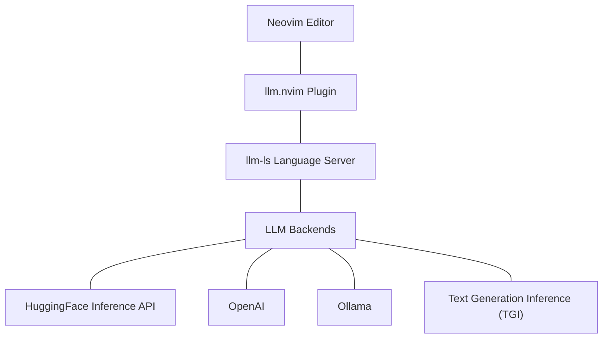

Sources: [README.md:1-9](), [README.md:16-31]()

## Core Features

### Code Completion with Ghost Text

llm.nvim provides "ghost-text" style code completion, displaying suggestions inline as you type. These suggestions can be accepted or dismissed with configurable keybindings.

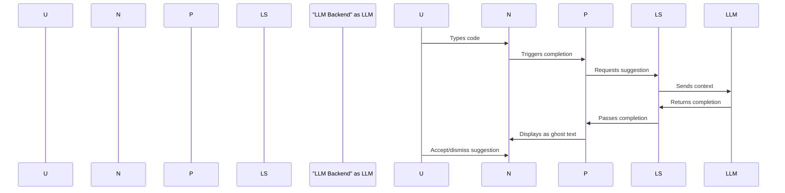

Sources: [README.md:16-20](), [lua/llm/init.lua:8-16]()

### Multiple Backend Support

llm.nvim can connect to various LLM backends:

1. **Hugging Face Inference API** - Cloud-hosted models from Hugging Face
2. **Ollama** - Self-hosted models via Ollama
3. **OpenAI** - OpenAI's API and compatible servers
4. **TGI (Text Generation Inference)** - Hugging Face's optimized inference server

This flexibility allows you to choose the best solution for your specific needs, whether you prefer cloud-based models or local deployment.

Sources: [README.md:34-129]()

### Context-Aware Suggestions

The plugin ensures completions are relevant to your code by:

1. Sending appropriate context to the model
2. Fitting everything within the model's context window using tokenization
3. Supporting Fill-in-the-Middle (FIM) for applicable models

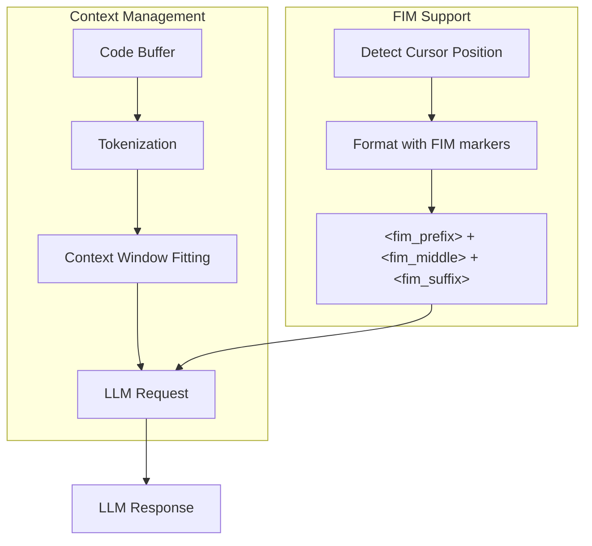

Sources: [README.md:30-31](), [README.md:136-173](), [README.md:211-245]()

## System Architecture

llm.nvim follows a modular design pattern that separates concerns into distinct components:

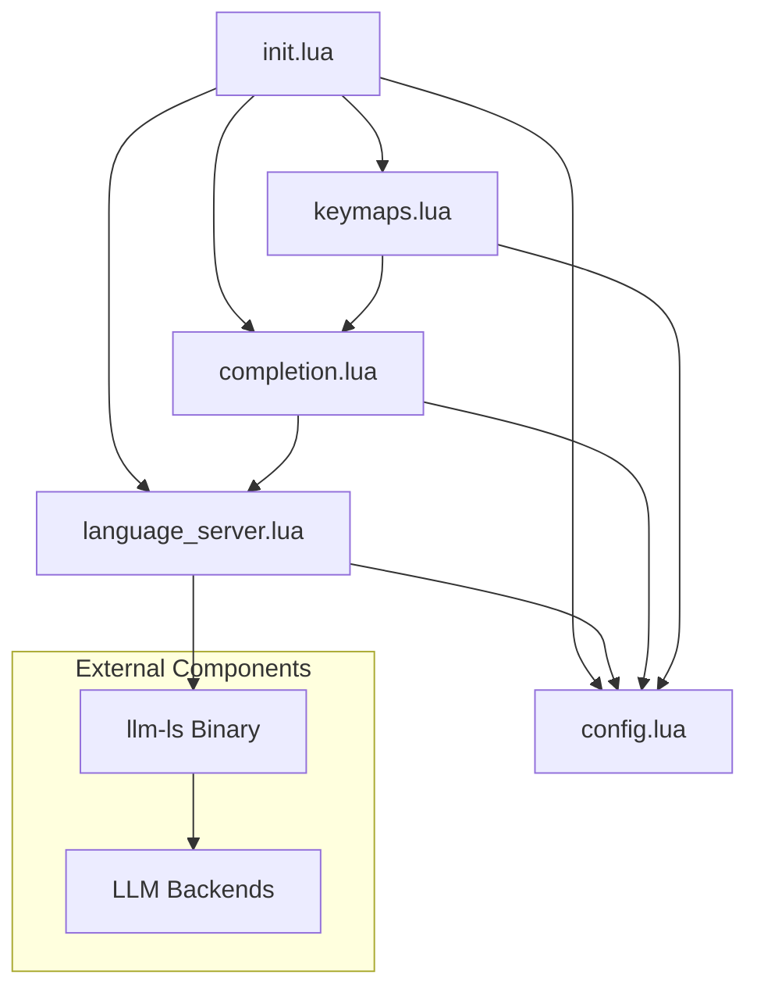

The plugin is initialized through `init.lua`, which sets up the other components:

1. **Configuration** (`config.lua`) - Manages user settings and preferences
2. **Language Server** (`language_server.lua`) - Handles communication with llm-ls
3. **Completion** (`completion.lua`) - Processes suggestions and displays them
4. **Keymaps** (`keymaps.lua`) - Sets up keyboard shortcuts for interacting with suggestions

Sources: [lua/llm/init.lua:1-5](), [lua/llm/init.lua:18-35]()

## Workflow

When using llm.nvim, the typical workflow follows these steps:

1. User types code in Neovim
2. After a configurable debounce period, llm.nvim requests a completion
3. The request is sent through llm-ls to the configured LLM backend
4. The response is processed and displayed as ghost text
5. User accepts or dismisses the suggestion

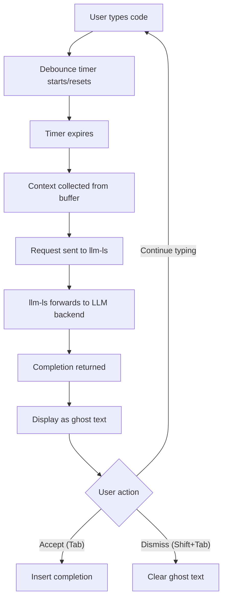

Sources: [README.md:246-264](), [README.md:306-351]()

## Configuration

llm.nvim offers extensive configuration options, which are covered in detail in the [Configuration](#2) page. Key configuration areas include:

1. **Backend configuration** - Choose and configure your LLM provider
2. **Model settings** - Select the model and its parameters
3. **Tokenizer configuration** - Control how the context is tokenized
4. **Behavior settings** - Customize debounce time, keymaps, and more
5. **Language server settings** - Configure the llm-ls binary

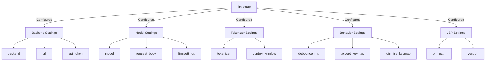

Sources: [README.md:32-351]()

## Commands

llm.nvim provides several commands for controlling its behavior:

| Command | Description |
|---------|-------------|
| `LLMToggleAutoSuggest` | Enables or disables automatic suggestions as you type |
| `LLMSuggestion` | Manually requests a suggestion at the current cursor position |

Sources: [README.md:257-263](), [lua/llm/init.lua:8-16]()

## Summary

llm.nvim provides a powerful, flexible interface to LLM-powered code completion directly in Neovim. Its modular architecture and extensive configuration options make it adaptable to various workflows and preferences. Whether you're using cloud-based models or running your own inference server, llm.nvim offers a seamless integration with your editing environment.

For next steps:
- See [Installation](#1.1) for detailed setup instructions
- Follow the [Quick Start](#1.2) guide to get up and running
- Explore [Configuration](#2) for customization options
- Learn about the [Architecture](#3) for more technical details

Sources: [README.md:1-9](), [README.md:306-351]()

---

# Page: Installation

# Installation

<details>
<summary>Relevant source files</summary>

The following files were used as context for generating this wiki page:

- [README.md](README.md)

</details>


This page explains how to install and set up **llm.nvim**, a Neovim plugin for LLM-powered code completion. For information about configuring the plugin after installation, see [Configuration](#2) and specifically [Backend Configuration](#2.1).

## Installation Overview

**llm.nvim** consists of two main components:
1. The Neovim plugin itself
2. The **llm-ls** language server which handles communication with LLM providers

The following diagram illustrates the components that need to be installed:

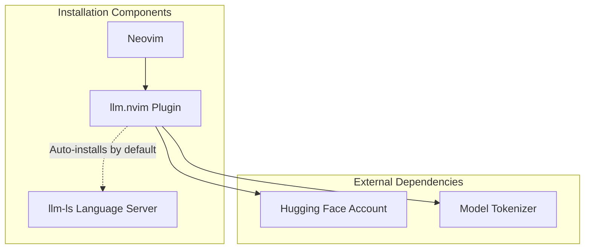

Sources: [README.md:177-189]()

## Prerequisites

Before installing **llm.nvim**, ensure you have:

1. **Neovim** (version 0.8.0 or later recommended)
2. A package manager for Neovim (packer, lazy.nvim, or vim-plug)
3. For Hugging Face backend: A Hugging Face account with an API token

Sources: [README.md:1-15](), [README.md:45-56]()

## Plugin Installation

You can install **llm.nvim** using any common Neovim package manager. Choose one of the following methods:

### Using packer

```lua
require("packer").startup(function(use)
  use {
    'huggingface/llm.nvim',
    config = function()
      require('llm').setup({
        -- configuration options will go here
      })
    end
  }
end)
```

Sources: [README.md:267-280]()

### Using lazy.nvim

```lua
require("lazy").setup({
  {
    'huggingface/llm.nvim',
    opts = {
      -- configuration options will go here
    }
  },
})
```

Sources: [README.md:282-293]()

### Using vim-plug

Add to your Neovim configuration file:

```vim
Plug 'huggingface/llm.nvim'
```

Then configure the plugin:

```lua
require('llm').setup({
  -- configuration options will go here
})
```

Sources: [README.md:295-304]()

## Language Server Installation

**llm.nvim** uses **llm-ls** as its backend language server. There are three ways to set up the language server:

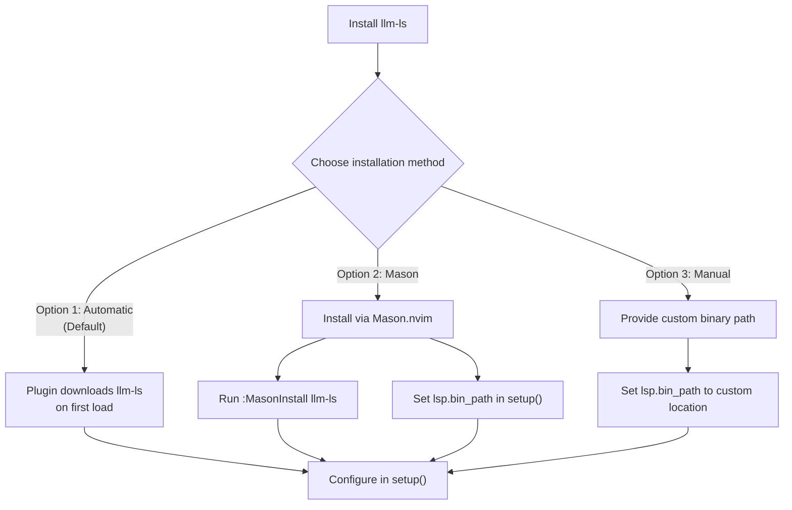

### Automatic Installation (Default)

By default, **llm-ls** is automatically installed by the plugin when first loaded. The binary is downloaded from the [GitHub release page](https://github.com/huggingface/llm-ls/releases) and stored in:

```
stdpath("data") .. "/llm_nvim/bin"
```

This requires no additional configuration.

Sources: [README.md:177-184]()

### Mason Installation

To install via [mason.nvim](https://github.com/williamboman/mason.nvim):

1. Run the following command in Neovim:
   ```vim
   :MasonInstall llm-ls
   ```

2. Reference the Mason binary path in your configuration:
   ```lua
   require('llm').setup({
     -- other options...
     lsp = {
       bin_path = vim.api.nvim_call_function("stdpath", { "data" }) .. "/mason/bin/llm-ls",
     },
     -- other options...
   })
   ```

Sources: [README.md:190-207]()

### Manual Installation

For custom builds or unsupported platforms, you can:

1. Build or download **llm-ls** manually
2. Set the binary path in your configuration:
   ```lua
   require('llm').setup({
     -- other options...
     lsp = {
       bin_path = "/path/to/your/llm-ls",
     },
     -- other options...
   })
   ```

You can also run **llm-ls** via TCP by specifying host and port instead:

```lua
require('llm').setup({
  -- other options...
  lsp = {
    host = "127.0.0.1",
    port = 9988,
  },
  -- other options...
})
```

Sources: [README.md:177-188]()

## API Token Setup

When using the Hugging Face Inference API as a backend, you'll need to set up your API token. You have several options, in order of precedence:

1. Pass token directly in config (not recommended if using version control):
   ```lua
   require('llm').setup({
     api_token = "your-hf-api-token",
     -- other options...
   })
   ```

2. Set the `LLM_NVIM_HF_API_TOKEN` environment variable

3. Define your `HF_HOME` environment variable and create a file with your token at `$HF_HOME/token`

4. Install the [huggingface-cli](https://huggingface.co/docs/huggingface_hub/quick-start) and run `huggingface-cli login`

Sources: [README.md:45-56]()

## Basic Configuration

After installation, you need to configure the plugin. Here's a minimal configuration example:

```lua
require('llm').setup({
  model = "bigcode/starcoder2-15b", -- the model to use
  backend = "huggingface", -- backend provider (huggingface, ollama, openai, tgi)
  context_window = 1024, -- token context window
  tokenizer = {
    repository = "bigcode/starcoder2-15b", -- tokenizer to use
  },
  -- Add other options as needed
})
```

For detailed configuration, see the [Configuration](#2) page.

Sources: [README.md:307-351]()

## Installation Verification

To verify your installation is working properly:

1. Start Neovim
2. Open a code file and start typing
3. The plugin should display ghost text suggestions as you type
4. If no suggestions appear, you can manually trigger them with the `:LLMSuggestion` command

If the plugin isn't working, check the following:
- Language server installation status
- API token configuration
- Network connectivity to the LLM backend
- Log output using `LLM_LOG_LEVEL = "DEBUG"` in `lsp.cmd_env`

Sources: [README.md:258-264](), [README.md:336-343]()

## Installation Architecture

This diagram shows the relationships between the components after installation:

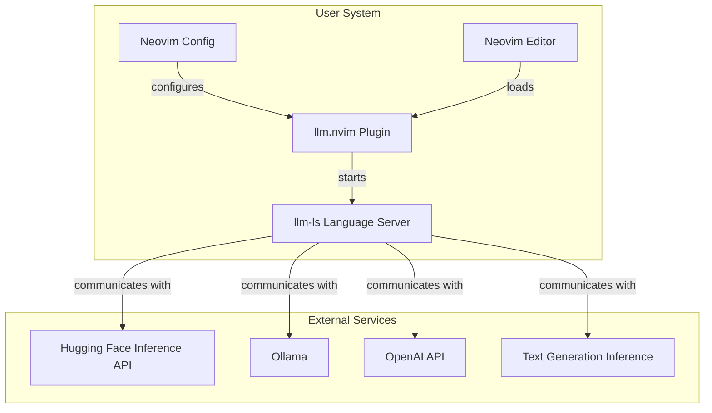

This illustrates how the components interact after successful installation, with **llm.nvim** integrating with Neovim and communicating with LLM providers through the **llm-ls** language server.

Sources: [README.md:34-129]()

---

# Page: Quick Start

# Quick Start

<details>
<summary>Relevant source files</summary>

The following files were used as context for generating this wiki page:

- [README.md](README.md)
- [lua/llm/init.lua](lua/llm/init.lua)

</details>


This page provides a concise guide to help you get started with llm.nvim quickly. For detailed installation instructions, see [Installation](#1.1), and for comprehensive configuration options, see [Configuration](#2).

## What is llm.nvim?

llm.nvim is a Neovim plugin that provides LLM-powered code completion with "ghost text" suggestions similar to GitHub Copilot. It uses [llm-ls](https://github.com/huggingface/llm-ls) as a backend and can connect to various LLM providers including Hugging Face Inference API, Ollama, OpenAI, and Text Generation Inference (TGI).

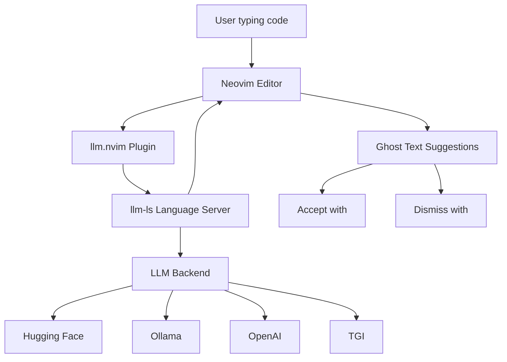

Sources: [README.md:1-9](), [README.md:16-26]()

## Installation

Choose one of the following package managers to install llm.nvim:

### Using Packer

```lua
require("packer").startup(function(use)
  use {
    'huggingface/llm.nvim',
    config = function()
      require('llm').setup({
        -- Configuration will be covered in the next section
      })
    end
  }
end)
```

### Using lazy.nvim

```lua
require("lazy").setup({
  {
    'huggingface/llm.nvim',
    opts = {
      -- Configuration will be covered in the next section
    }
  },
})
```

### Using vim-plug

In your vim configuration:
```vim
Plug 'huggingface/llm.nvim'
```

Then in your lua configuration:
```lua
require('llm').setup({
  -- Configuration will be covered in the next section
})
```

Sources: [README.md:265-304]()

## Minimal Configuration

Here's a basic configuration to get started with the Hugging Face Inference API:

```lua
require('llm').setup({
  model = "bigcode/starcoder2-15b",  -- Model ID
  backend = "huggingface",           -- LLM backend provider
  context_window = 1024,             -- Maximum context window size
  request_body = {                   -- Parameters for generation
    parameters = {
      max_new_tokens = 60,           -- Maximum tokens to generate
      temperature = 0.2,             -- Lower = more deterministic
      top_p = 0.95,                  -- Nucleus sampling parameter
    },
  },
})
```

Sources: [README.md:308-350]()

### Setting Up Your API Token

For Hugging Face Inference API, you need an API token. You have several options to provide it (in order of precedence):

1. Pass it directly in the configuration (not recommended for versioned configs):
   ```lua
   require('llm').setup({
     api_token = "YOUR_TOKEN_HERE",
     -- other configuration options
   })
   ```

2. Set the `LLM_NVIM_HF_API_TOKEN` environment variable

3. Set the `HF_HOME` environment variable and create a file at `$HF_HOME/token`

4. Use the huggingface-cli: `huggingface-cli login`

Sources: [README.md:50-56]()

## Basic Usage Workflow

Once configured, llm.nvim will automatically provide code completion suggestions as you type:

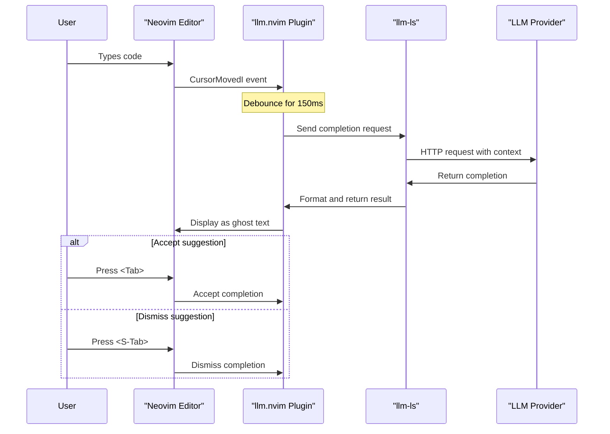

Sources: [README.md:247-263](), [lua/llm/init.lua:1-37]()

### Keyboard Shortcuts

| Action | Default Key | Configuration Option |
|--------|-------------|----------------------|
| Accept suggestion | `<Tab>` | `accept_keymap` |
| Dismiss suggestion | `<S-Tab>` | `dismiss_keymap` |

Sources: [README.md:333-334]()

### Commands

The plugin provides two commands:

- `:LLMToggleAutoSuggest` - Toggle automatic suggestions on/off
- `:LLMSuggestion` - Manually request a suggestion

Sources: [README.md:257-263](), [lua/llm/init.lua:8-16]()

## Quick Backend Configuration

llm.nvim supports multiple backends. Here are minimal configurations for each:

### Hugging Face Inference API (Default)

```lua
{
  backend = "huggingface",
  model = "bigcode/starcoder2-15b",
  -- api_token set via environment variables
}
```

### Ollama

```lua
{
  backend = "ollama",
  model = "codellama:7b",
  url = "http://localhost:11434",
  request_body = {
    options = {
      temperature = 0.2,
      top_p = 0.95,
    }
  }
}
```

### OpenAI

```lua
{
  backend = "openai",
  model = "codellama",
  url = "http://localhost:8000",
  request_body = {
    temperature = 0.2,
    top_p = 0.95,
  }
}
```

### TGI (Text Generation Inference)

```lua
{
  backend = "tgi",
  model = "bigcode/starcoder",
  url = "http://localhost:8080",
  request_body = {
    parameters = {
      temperature = 0.2,
      top_p = 0.95,
    }
  }
}
```

Sources: [README.md:34-129]()

## System Components and Interactions

This diagram shows how llm.nvim's components interact during initialization:

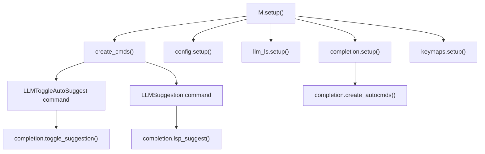

Sources: [lua/llm/init.lua:18-35]()

## Next Steps

After getting your basic setup working, you may want to explore:

- [Backend Configuration](#2.1) for detailed setup of different LLM providers
- [Tokenizer Configuration](#2.2) for optimizing context handling
- [Behavior and Interface Settings](#2.3) for customizing the plugin's behavior
- [Model-Specific Configuration](#4.2) for model-specific optimizations

---

# Page: Configuration

# Configuration

<details>
<summary>Relevant source files</summary>

The following files were used as context for generating this wiki page:

- [README.md](README.md)
- [lua/llm/config.lua](lua/llm/config.lua)

</details>


This page provides an overview of the configuration system used in `llm.nvim`, including the core configuration options, configuration methods, and default settings. It explains how to properly configure the plugin to work with different LLM backends and customize its behavior according to your preferences.

For detailed information about specific configuration areas, see:
- Backend Configuration [Backend Configuration](#2.1)
- Tokenizer Configuration [Tokenizer Configuration](#2.2)
- Behavior and Interface Settings [Behavior and Interface Settings](#2.3)

## Configuration System Overview

The `llm.nvim` plugin uses a centralized configuration system defined in the `config.lua` file. This system manages settings for connecting to LLM backends, controlling tokenization, customizing behavior, and integrating with the language server.

### Configuration Structure

The configuration is organized into several logical categories:

```mermaid
graph TD
    A["llm.nvim Configuration"] --> B["Backend Configuration"]
    A --> C["Tokenizer Settings"]
    A --> D["Behavior Settings"]
    A --> E["Language Server Settings"]
    A --> F["Fill-in-the-Middle Configuration"]
    
    B --> B1["backend"]
    B --> B2["model"]
    B --> B3["url"]
    B --> B4["api_token"]
    B --> B5["request_body"]
    B --> B6["disable_url_path_completion"]
    
    C --> C1["tokenizer"]
    C --> C2["context_window"]
    C --> C3["tokens_to_clear"]
    
    D --> D1["debounce_ms"]
    D --> D2["accept_keymap"]
    D --> D3["dismiss_keymap"]
    D --> D4["enable_suggestions_on_startup"]
    D --> D5["enable_suggestions_on_files"]
    
    E --> E1["bin_path"]
    E --> E2["host"]
    E --> E3["port"]
    E --> E4["cmd_env"]
    E --> E5["version"]
    
    F --> F1["enabled"]
    F --> F2["prefix"]
    F --> F3["middle"]
    F --> F4["suffix"]
```

Sources: [lua/llm/config.lua:1-41](). [README.md:305-349]()

## Configuration Setup

The configuration is initialized by calling the `setup` function from the `llm` module. This function merges the provided options with the default configuration values.

### Basic Setup Example

```lua
require('llm').setup({
  model = "bigcode/starcoder2-15b",
  backend = "huggingface",
  api_token = nil, -- Will be obtained automatically if available
  debounce_ms = 150,
  accept_keymap = "<Tab>",
  dismiss_keymap = "<S-Tab>",
})
```

Sources: [README.md:308-349]()

### Configuration Loading Process

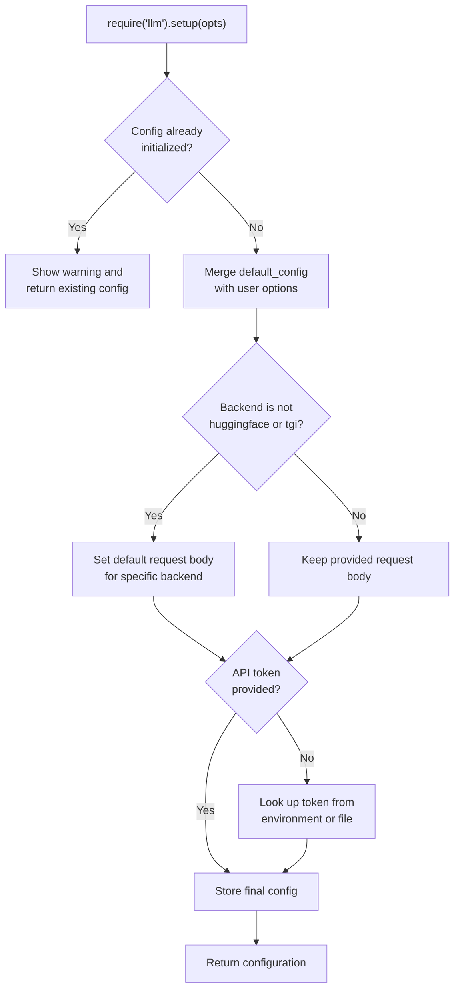

Sources: [lua/llm/config.lua:81-105]()

## Core Configuration Options

The following table outlines the core configuration options available in `llm.nvim`:

| Option | Type | Default | Description |
|--------|------|---------|-------------|
| `backend` | string | "huggingface" | The LLM backend to use; can be "huggingface", "ollama", "openai", or "tgi" |
| `model` | string | "bigcode/starcoder2-15b" | The model identifier to use; behavior depends on the backend |
| `url` | string or nil | nil | The HTTP URL of the backend; if nil, uses backend-specific default |
| `api_token` | string or nil | nil | The API token for authenticated requests |
| `context_window` | number | 1024 | Maximum number of tokens for the context window |
| `debounce_ms` | number | 150 | Debounce time in milliseconds for suggestion requests |
| `accept_keymap` | string | "\<Tab>" | Keymap to accept a suggestion |
| `dismiss_keymap` | string | "\<S-Tab>" | Keymap to dismiss a suggestion |
| `enable_suggestions_on_startup` | boolean | true | Whether to enable automatic suggestions on startup |
| `enable_suggestions_on_files` | string or table | "*" | Pattern(s) to determine which files get suggestions |

Sources: [lua/llm/config.lua:1-41](), [README.md:308-349]()

## Default Configuration

The default configuration is defined in `config.lua` and provides reasonable defaults for most options:

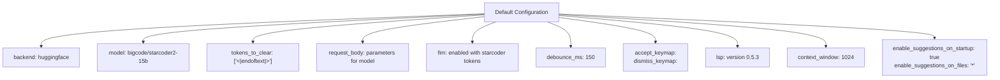

Sources: [lua/llm/config.lua:1-41]()

## Environment Variables

Several environment variables can be used to override configuration settings:

| Environment Variable | Affects |
|----------------------|---------|
| `LLM_NVIM_URL` | Overrides the `url` configuration |
| `LLM_NVIM_HF_API_TOKEN` | Primary source for Hugging Face API token |
| `LLM_NVIM_MODEL` | Overrides the model configuration |
| `HF_HOME` | Used to locate the token file if not specified directly |

Sources: [README.md:38-38](), [README.md:55-56](), [lua/llm/config.lua:60-79]()

## Backend-Specific Configuration

Each backend type has specific configuration requirements and defaults. The configuration system automatically applies the right defaults based on the selected backend.

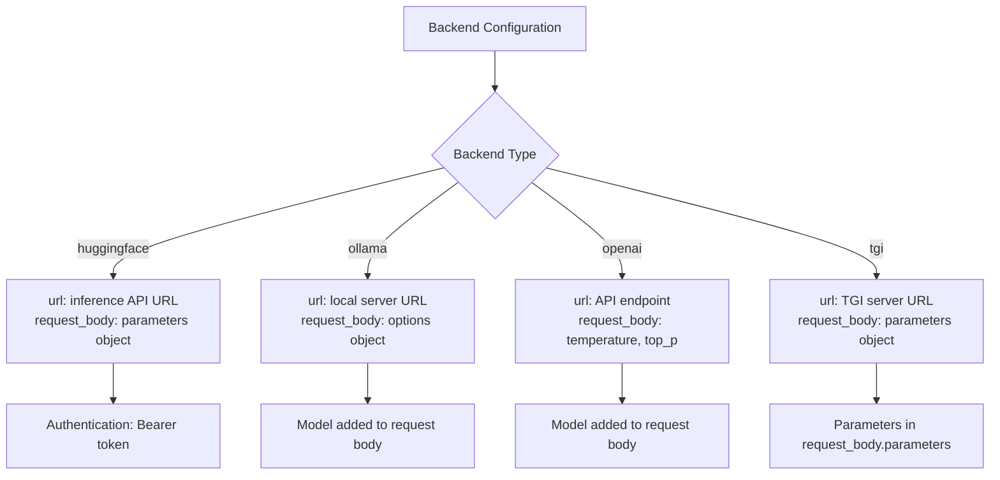

Sources: [README.md:34-129](), [lua/llm/config.lua:43-54](), [lua/llm/config.lua:89-96]()

## API Token Lookup Process

When an API token is needed but not explicitly provided, the system follows a lookup sequence:

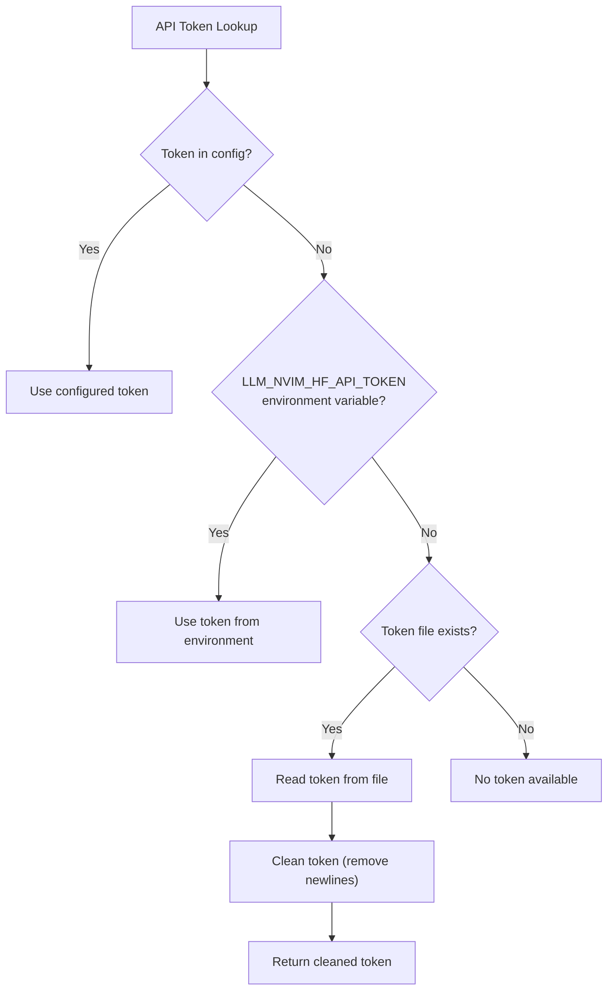

Sources: [lua/llm/config.lua:60-79](), [README.md:50-56]()

## Configuration Retrieval

Once initialized, the configuration can be accessed using the `get` function from the `llm.config` module:

```lua
local config = require('llm.config').get()
```

This function checks if the configuration has been initialized and returns the current configuration. If the configuration has not been initialized, it throws an error.

Sources: [lua/llm/config.lua:107-113]()

## Configuration Interaction with Other Components

The configuration system interacts with multiple other components of the plugin:

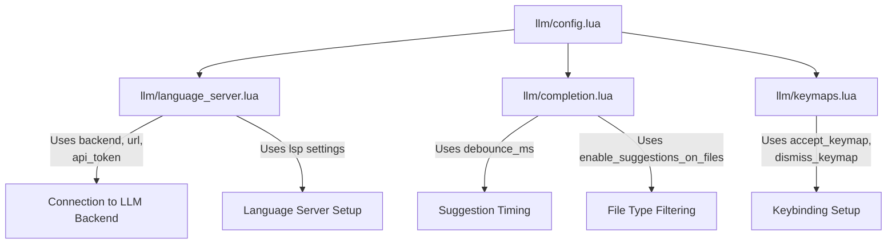

Sources: [README.md:16-31]()

## Related Pages

For more detailed information on specific aspects of configuration, see:
- [Backend Configuration](#2.1) - Detailed configuration of different LLM providers
- [Tokenizer Configuration](#2.2) - Configuration of tokenizers for context window management
- [Behavior and Interface Settings](#2.3) - Settings for user interface and plugin behavior

---

# Page: Backend Configuration

# Backend Configuration

<details>
<summary>Relevant source files</summary>

The following files were used as context for generating this wiki page:

- [README.md](README.md)
- [lua/llm/config.lua](lua/llm/config.lua)

</details>


This page documents how to configure llm.nvim to connect with various Large Language Model (LLM) backends. Backend configuration determines which LLM provider will be used, how to authenticate with it, which model to use, and how requests are formatted. For information about tokenizer settings, see [Tokenizer Configuration](#2.2), and for interface behavior settings, see [Behavior and Interface Settings](#2.3).

## Overview

llm.nvim supports multiple backends for providing LLM-powered completions. Each backend has its own configuration requirements, but they share a common interface within the plugin.

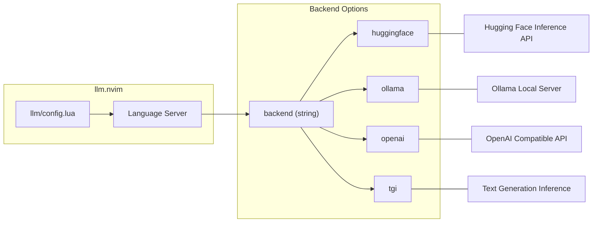

Sources: [README.md:34-38](), [lua/llm/config.lua:3-6]()

## Common Configuration Options

All backends share these common configuration options:

| Option | Type | Description |
|--------|------|-------------|
| `backend` | string | The backend provider to use: "huggingface", "ollama", "openai", or "tgi" |
| `model` | string | The model identifier to use (behavior depends on backend) |
| `url` | string or nil | The HTTP URL of the backend (if nil, uses backend-specific default) |
| `api_token` | string or nil | Authentication token for the backend (required for some backends) |
| `request_body` | table | Parameters to include in requests to the backend |
| `disable_url_path_completion` | boolean | If true, prevents llm-ls from adding API path to the URL |

Sources: [README.md:34-43](), [lua/llm/config.lua:2-7](), [lua/llm/config.lua:40]()

### Request Body Configuration

The `request_body` field lets you configure parameters sent to the LLM:

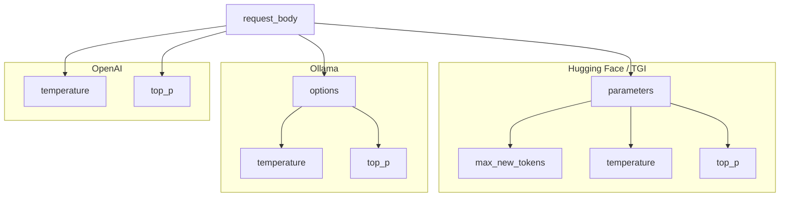

Sources: [lua/llm/config.lua:8-15](), [lua/llm/config.lua:43-54]()

## Backend-Specific Configuration

### Hugging Face Inference API

```mermaid
flowchart LR
    HF["backend = huggingface"]
    
    subgraph "Authentication"
        Token["api_token"]
        EnvVar["LLM_NVIM_HF_API_TOKEN"]
        HFHome["$HF_HOME/token"]
        CLI["huggingface-cli login"]
    end
    
    subgraph "Model Selection"
        ModelOpt["model (config option)"]
        ModelEnv["LLM_NVIM_MODEL env var"]
    end
    
    subgraph "URL Configuration"
        HFURL["url (if nil, uses default)"]
        EnvURL["LLM_NVIM_URL env var"]
    end
    
    HF --> Token
    HF --> ModelOpt
    HF --> HFURL
    
    Token --- EnvVar
    Token --- HFHome
    Token --- CLI
    
    ModelOpt --- ModelEnv
```

The Hugging Face Inference API backend requires:

1. **Authentication**: Your API token can be provided in one of four ways (in order of precedence):
   - Directly in config with `api_token = "your-token"`
   - Through the `LLM_NVIM_HF_API_TOKEN` environment variable
   - From the `$HF_HOME/token` file
   - By using the huggingface-cli to log in

2. **Model Selection**: Choose a model from the [Hugging Face Hub](https://huggingface.co) by either:
   - Setting the `LLM_NVIM_MODEL` environment variable
   - Setting `model = "model-identifier"` in your configuration

3. **URL Format**: The model ID is appended to the URL as `{url}/models/{model}`

Sources: [README.md:44-63](), [lua/llm/config.lua:60-79]()

### Ollama

To use Ollama as a backend:

```lua
{
  backend = "ollama",
  model = "codellama:7b",
  url = "http://localhost:11434", -- llm-ls uses "/api/generate"
  request_body = {
    options = {
      temperature = 0.2,
      top_p = 0.95,
    }
  }
}
```

Key aspects:
- The `model` value is included in the request body
- The default URL is `http://localhost:11434` (Ollama's default port)
- llm-ls appends `/api/generate` to the URL
- Request parameters should be under the `options` key

Sources: [README.md:64-87](), [lua/llm/config.lua:44-49]()

### OpenAI

To use an OpenAI-compatible API as a backend:

```lua
{
  backend = "openai",
  model = "codellama",
  url = "http://localhost:8000", -- llm-ls uses "/v1/completions"
  request_body = {
    temperature = 0.2,
    top_p = 0.95,
  }
}
```

Key aspects:
- The `model` value is included in the request body
- llm-ls appends `/v1/completions` to the URL
- Request parameters are at the root level of `request_body`

Sources: [README.md:88-105](), [lua/llm/config.lua:50-53]()

### Text Generation Inference (TGI)

To use TGI as a backend:

```lua
{
  backend = "tgi",
  model = "bigcode/starcoder",
  url = "http://localhost:8080", -- llm-ls uses "/generate"
  request_body = {
    parameters = {
      temperature = 0.2,
      top_p = 0.95,
    }
  }
}
```

Key aspects:
- The model identifier can be any model supported by your TGI instance
- llm-ls appends `/generate` to the URL
- Request parameters should be under the `parameters` key

Sources: [README.md:106-129](), [lua/llm/config.lua:8-15]()

## Environment Variables and Configuration Precedence

llm.nvim supports several environment variables to override configuration:

```mermaid
flowchart TD
    Root["Configuration Precedence"]
    
    Root --> Model["Model Selection"]
    Model --> ModelConfig["1. model config option"]
    Model --> ModelEnv["2. LLM_NVIM_MODEL env var"]
    
    Root --> URL["URL Configuration"]
    URL --> URLConfig["1. url config option"]
    URL --> URLEnv["2. LLM_NVIM_URL env var"]
    URL --> BackendDefault["3. Backend default"]
    
    Root --> Token["API Token"]
    Token --> TokenConfig["1. api_token config option"]
    Token --> TokenEnv["2. LLM_NVIM_HF_API_TOKEN env var"]
    Token --> TokenFile["3. $HF_HOME/token file"]
    Token --> HFLogin["4. huggingface-cli login"]
```

Important environment variables:
- `LLM_NVIM_URL`: Override the backend URL
- `LLM_NVIM_MODEL`: Override the model identifier
- `LLM_NVIM_HF_API_TOKEN`: Set the Hugging Face API token

Sources: [README.md:38](), [README.md:51-56](), [README.md:58-61]()

## URL Path Completion

By default, llm-ls will try to add the correct path to the URL to get completions. For example:
- Hugging Face: appends `/models/{model}`
- Ollama: appends `/api/generate`
- OpenAI: appends `/v1/completions`
- TGI: appends `/generate`

You can disable this behavior by setting `disable_url_path_completion = true`.

Sources: [README.md:42-43]()

## Complete Backend Configuration Example

Here's a complete example of backend configuration in the setup function:

```lua
require('llm').setup({
  backend = "huggingface",                 -- Which backend to use
  model = "bigcode/starcoder2-15b",        -- The model to use
  url = nil,                               -- Backend URL (nil uses default)
  api_token = nil,                         -- API token (nil tries to find one)
  disable_url_path_completion = false,     -- Whether to let llm-ls add API paths
  request_body = {                         -- Parameters for the backend
    parameters = {
      max_new_tokens = 60,
      temperature = 0.2,
      top_p = 0.95,
    },
  },
  tls_skip_verify_insecure = false,        -- Skip TLS verification (not recommended)
})
```

Sources: [README.md:311-349](), [lua/llm/config.lua:2-40]()

---

# Page: Tokenizer Configuration

# Tokenizer Configuration

<details>
<summary>Relevant source files</summary>

The following files were used as context for generating this wiki page:

- [README.md](README.md)
- [lua/llm/config.lua](lua/llm/config.lua)

</details>


This page explains how to configure the tokenizer in llm.nvim, which is a critical component for ensuring that prompts sent to language models properly fit within the model's context window. For information about backend configuration, see [Backend Configuration](#2.1), and for user interface settings, see [Behavior and Interface Settings](#2.3).

## What is a Tokenizer?

A tokenizer is responsible for converting text into tokens that language models can process. In llm.nvim, the tokenizer serves a crucial purpose: it ensures that the prompt being sent to the model fits within the specified context window by accurately counting tokens rather than characters.

```mermaid
flowchart LR
    Text["Source Text"] --> Tokenizer
    Tokenizer --> Tokens["Tokenized Sequence"]
    Tokens --> ContextCheck["Context Window Check"]
    ContextCheck --> Truncation["Truncate if needed"]
    Truncation --> FinalPrompt["Final Prompt"]
    FinalPrompt --> LLMBackend["LLM Backend"]
```

Sources: [README.md:209-245]()

## Tokenizer Configuration Options

The tokenization process in llm.nvim can be configured in several ways, depending on your needs and the model you're using.

```mermaid
flowchart TD
    TokenizerConfig["Tokenizer Configuration"] --> NoTokenizer["No Tokenization"]
    TokenizerConfig --> LocalFile["Local File"]
    TokenizerConfig --> HuggingFace["Hugging Face Repository"]
    TokenizerConfig --> HTTPEndpoint["HTTP Endpoint"]
    
    NoTokenizer --> CharCount["Character Counting"]
    LocalFile --> LocalPath["JSON File on Disk"]
    HuggingFace --> RepoDownload["Download tokenizer.json"]
    HTTPEndpoint --> URLDownload["HTTP GET Request"]
```

Sources: [README.md:209-245]()

### Option 1: No Tokenization

If you set `tokenizer = nil` in your configuration, llm-ls will not use a tokenizer and will instead count characters to estimate token usage.

```lua
{
  tokenizer = nil,
}
```

This is the default configuration as seen in the config file but may lead to inaccurate context window management since character count doesn't precisely map to token count for most models.

Sources: [lua/llm/config.lua:35](), [README.md:214-219]()

### Option 2: Local File Tokenizer

You can provide a path to a local tokenizer.json file:

```lua
{
  tokenizer = {
    path = "/path/to/my/tokenizer.json"
  }
}
```

This is useful if you've already downloaded a tokenizer file or created a custom one.

Sources: [README.md:220-226]()

### Option 3: Hugging Face Repository

You can specify a Hugging Face repository containing a tokenizer.json file:

```lua
{
  tokenizer = {
    repository = "myusername/myrepo",
    api_token = nil  -- optional, can be different from the main API token
  }
}
```

With this configuration, llm-ls will attempt to download the tokenizer.json file from the root of the specified repository.

Sources: [README.md:227-236]()

### Option 4: HTTP Endpoint

You can configure the tokenizer to be downloaded from any HTTP endpoint:

```lua
{
  tokenizer = {
    url = "https://my-endpoint.example.com/mytokenizer.json",
    to = "/download/path/of/mytokenizer.json"
  }
}
```

This option allows you to host the tokenizer file on your own server or use a proxy.

Sources: [README.md:237-245]()

## Context Window and Tokenization

The context window defines the maximum number of tokens that can be processed by the language model at once. Proper tokenization is essential for accurately measuring the token count and ensuring the prompt fits within this window.

```mermaid
graph TD
    subgraph "Token Processing Flow"
        BufferText["Buffer Text"] --> Tokenizer["Tokenizer.encode()"]
        Tokenizer --> TokenCount["Token Count"]
        TokenCount --> ContextCheck{"Token Count > Context Window?"}
        ContextCheck -->|"Yes"| Truncate["Truncate Text"]
        ContextCheck -->|"No"| KeepText["Use Full Text"]
        Truncate --> SendToModel["Send to LLM"]
        KeepText --> SendToModel
    end
    
    subgraph "Configuration Parameters"
        TokenizerConfig["tokenizer = {...}"] --> Tokenizer
        ContextWindowConfig["context_window = 1024"] --> ContextCheck
    end
```

Sources: [README.md:209-245](), [lua/llm/config.lua:35-36]()

### Default Context Window Size

By default, llm.nvim sets the context window to 1024 tokens:

```lua
context_window = 1024
```

This value should be adjusted based on the model you're using. Larger models typically support larger context windows.

Sources: [lua/llm/config.lua:36]()

## Model-Specific Tokenizer Configurations

Different models require different tokenizer configurations. Here are examples for common models:

### Starcoder Configuration

```lua
{
  model = "bigcode/starcoder",
  context_window = 8192,
  tokenizer = {
    repository = "bigcode/starcoder",
  }
}
```

Sources: [README.md:133-150]()

### CodeLlama Configuration

```lua
{
  model = "codellama/CodeLlama-13b-hf",
  context_window = 4096,
  tokenizer = {
    repository = "codellama/CodeLlama-13b-hf",
  }
}
```

Sources: [README.md:156-171]()

## How Tokenizer Configuration Affects Completion Quality

The tokenizer configuration directly affects the quality and reliability of code completions by:

1. **Accurate Context Management**: Proper tokenization ensures the maximum amount of relevant context is included in prompts.
2. **Model-Specific Processing**: Different models tokenize text differently, so using the correct tokenizer improves results.
3. **Efficiency**: Accurate token counting prevents wasting tokens on unnecessary context.

```mermaid
flowchart TD
    subgraph "Effects of Tokenization on Completion Quality"
        TokenizerConfig["Tokenizer Configuration"] --> AccurateTokenCount["Accurate Token Counting"]
        TokenizerConfig --> ModelMatching["Model-Specific Tokenization"]
        
        AccurateTokenCount --> MaximizeContext["Maximized Context Usage"]
        ModelMatching --> OptimalProcessing["Optimal Text Processing"]
        
        MaximizeContext --> BetterCompletions["Higher Quality Completions"]
        OptimalProcessing --> BetterCompletions
    end
```

Sources: [README.md:28-30]()

## Tokenizer Configuration and Language Server Integration

The tokenizer configuration is handled by the llm-ls language server, which uses the [tokenizers](https://github.com/huggingface/tokenizers) library to process text. The language server is responsible for:

1. Loading the tokenizer based on your configuration
2. Tokenizing the text before sending it to the LLM
3. Ensuring the prompt fits within the context window

```mermaid
sequenceDiagram
    participant Editor as "Neovim Editor"
    participant Plugin as "llm.nvim Plugin"
    participant LS as "llm-ls Language Server"
    participant Tokenizer as "Tokenizers Library"
    participant LLM as "LLM Backend"
    
    Editor->>Plugin: User types text
    Plugin->>LS: Request completion
    LS->>Tokenizer: Tokenize text
    Tokenizer->>LS: Return token count
    LS->>LS: Check against context_window
    LS->>LS: Truncate if necessary
    LS->>LLM: Send optimized prompt
    LLM->>LS: Return completion
    LS->>Plugin: Return formatted result
    Plugin->>Editor: Display as ghost text
```

Sources: [README.md:177-187](), [README.md:209-245]()

## Best Practices for Tokenizer Configuration

1. **Match Model and Tokenizer**: Always use the tokenizer from the same repository as your model
2. **Set Appropriate Context Window**: Configure the context window to match your model's capabilities
3. **Use Repository Option When Possible**: The repository option is the most reliable way to get the correct tokenizer
4. **Monitor Token Usage**: Be aware of how your code patterns affect token usage

Sources: [README.md:209-245]()

## Troubleshooting Tokenizer Issues

If you encounter issues with tokenization:

1. **Check Repository Access**: Ensure the Hugging Face repository is accessible with your API token
2. **Verify Local Files**: If using a local file, check that the path is correct and the file exists
3. **Monitor Downloads**: The tokenizer file is downloaded by llm-ls, so check its logs for errors
4. **Consider No Tokenization**: If all else fails, you can use `tokenizer = nil` as a fallback

Sources: [README.md:209-245](), [lua/llm/config.lua:35]()

## Complete Configuration Example

Here's a complete example showing tokenizer configuration as part of the overall llm.nvim setup:

```lua
require('llm').setup({
  -- Model and backend configuration
  model = "bigcode/starcoder",
  backend = "huggingface",
  
  -- Context window size - model specific
  context_window = 8192,
  
  -- Tokenizer configuration
  tokenizer = {
    repository = "bigcode/starcoder",
    -- Optional API token if different from backend
    -- api_token = "your_hf_token_here"
  },
  
  -- Other configuration options...
})
```

This configuration uses the tokenizer from the bigcode/starcoder repository to properly tokenize text for the Starcoder model, with a context window of 8192 tokens.

Sources: [README.md:306-349](), [README.md:133-150]()

---

# Page: Behavior and Interface Settings

# Behavior and Interface Settings

<details>
<summary>Relevant source files</summary>

The following files were used as context for generating this wiki page:

- [README.md](README.md)
- [lua/llm/completion.lua](lua/llm/completion.lua)
- [lua/llm/config.lua](lua/llm/config.lua)

</details>


This page documents the behavior and interface settings in llm.nvim that control how the code completion suggestions appear, respond, and interact with the user. These settings determine when and how suggestions are displayed, how they can be accepted or dismissed, and how they behave in different contexts. For backend configuration options, see [Backend Configuration](#2.1), and for tokenizer settings, see [Tokenizer Configuration](#2.2).

## Ghost Text Interface

llm.nvim uses a "ghost text" interface, similar to GitHub Copilot, where suggestions appear as dimmed text ahead of your cursor. This non-intrusive approach allows you to see suggestions without interrupting your workflow.

```mermaid
flowchart LR
    subgraph "Neovim Buffer"
        UserText["User Text"]
        GhostText["Ghost Text"]
        UserText --> GhostText
        style UserText stroke-width:2px
        style GhostText stroke-dasharray: 5 5
    end

    subgraph "Rendering"
        Extmark["nvim_buf_set_extmark()"]
        HLGroup["LLMSuggestion\nHighlight Group"]
        Namespace["llm.suggestion\nNamespace"]
        Extmark --- HLGroup
        Extmark --- Namespace
    end

    GhostText -.-> Extmark
```

Ghost text is rendered using Neovim's extmark API, which allows displaying virtual text and virtual lines without modifying the actual buffer content. The suggestion is only inserted into the buffer when explicitly accepted.

Sources: [lua/llm/completion.lua:11-13](https://github.com/huggingface/llm.nvim/blob/main/lua/llm/completion.lua#L11-L13), [lua/llm/completion.lua:84-96](https://github.com/huggingface/llm.nvim/blob/main/lua/llm/completion.lua#L84-L96)

## Suggestion Activation and Control

llm.nvim provides several ways to control when and where suggestions appear:

### Automatic Suggestions

Automatic suggestions are triggered as you type in insert mode, with a configurable delay (debounce) to avoid overwhelming the model with requests.

```mermaid
sequenceDiagram
    participant "User" as U
    participant "Neovim" as N
    participant "llm.completion" as C
    participant "llm.language_server" as LS
    participant "llm-ls" as LLS

    U->>N: Types in insert mode
    N->>C: CursorMovedI autocmd
    C->>C: should_complete()?
    alt suggestions_enabled == true
        C->>C: schedule()
        C->>C: Start debounce timer
        Note over C: Wait debounce_ms
        C->>LS: lsp_suggest()
        LS->>LLS: getCompletions request
        LLS-->>LS: Returns completion
        LS-->>C: Returns completion
        C->>N: Display as ghost text
    else suggestions_enabled == false
        C->>C: reject()
        C->>LS: reject_completion()
    end
```

### Enabling and Disabling Suggestions

The plugin offers several ways to control when suggestions appear:

- **On Startup**: The `enable_suggestions_on_startup` setting determines if suggestions are enabled when Neovim starts
- **Per File Type**: The `enable_suggestions_on_files` setting restricts suggestions to specific file patterns
- **Toggle Command**: The `LLMToggleAutoSuggest` command lets users toggle suggestions on/off during editing

Sources: [lua/llm/config.lua:37-40](https://github.com/huggingface/llm.nvim/blob/main/lua/llm/config.lua#L37-L40), [lua/llm/completion.lua:121-125](https://github.com/huggingface/llm.nvim/blob/main/lua/llm/completion.lua#L121-L125)

### File Pattern Matching

The `enable_suggestions_on_files` setting accepts either a string or a table of strings with glob patterns:

| Pattern | Effect |
|---------|--------|
| `"*"` | Enable on all files (default) |
| `"*.py"` | Enable only on Python files |
| `{"*.py", "*.lua"}` | Enable on both Python and Lua files |
| `"/path/to/project/*"` | Enable on all files in a specific project |

These patterns are passed directly to Neovim's autocmd pattern matching system.

Sources: [README.md:251-254](https://github.com/huggingface/llm.nvim/blob/main/README.md#L251-L254)

## Keymap Settings

llm.nvim provides configurable keymaps for accepting or dismissing suggestions:

```mermaid
graph TD
    subgraph "User Input"
        AcceptKey["accept_keymap\n&lt;Tab&gt; (default)"]
        DismissKey["dismiss_keymap\n&lt;S-Tab&gt; (default)"]
    end

    subgraph "Functions"
        Complete["M.complete()"]
        Reject["M.reject()"]
    end

    subgraph "LSP Actions"
        AcceptCompletion["llm_ls.accept_completion()"]
        RejectCompletion["llm_ls.reject_completion()"]
    end

    AcceptKey --> Complete
    Complete --> AcceptCompletion
    
    DismissKey --> Reject
    Reject --> RejectCompletion
```

### Default Keymaps

| Setting | Default Value | Purpose |
|---------|---------------|---------|
| `accept_keymap` | `<Tab>` | Accept the current suggestion |
| `dismiss_keymap` | `<S-Tab>` | Dismiss the current suggestion |

The keymaps are set up during plugin initialization and can be customized in your configuration.

Sources: [lua/llm/config.lua:24-25](https://github.com/huggingface/llm.nvim/blob/main/lua/llm/config.lua#L24-L25), [README.md:334-335](https://github.com/huggingface/llm.nvim/blob/main/README.md#L334-L335)

## Performance and Timing Settings

### Debounce Timer

To prevent excessive API calls and improve performance, llm.nvim implements a debounce mechanism that delays sending completion requests until after you've stopped typing for a short period:

```mermaid
timeline
    section User Types
        Keystroke 1 : Type "d"
        Keystroke 2 : Type "e"
        Keystroke 3 : Type "f"
    section Debounce
        Timer starts : After Keystroke 1
        Timer resets : After Keystroke 2
        Timer resets : After Keystroke 3
        Timer completes : debounce_ms after Keystroke 3
    section Request
        No request : During typing
        Send request : After debounce period
```

The `debounce_ms` setting controls this delay, with a default value of 150ms. A higher value reduces the number of requests but increases the delay before suggestions appear, while a lower value makes suggestions more responsive but may increase API usage.

Sources: [lua/llm/config.lua:23](https://github.com/huggingface/llm.nvim/blob/main/lua/llm/config.lua#L23), [lua/llm/completion.lua:60-68](https://github.com/huggingface/llm.nvim/blob/main/lua/llm/completion.lua#L60-L68)

## Token Handling

The `tokens_to_clear` setting specifies special tokens that should be removed from the model's output. These are typically end-of-text markers or other special tokens that might appear in the completions but shouldn't be inserted into your code.

Different models use different special tokens, so this setting should be adjusted based on the model you're using:

| Model | Recommended `tokens_to_clear` |
|-------|------------------------------|
| Starcoder | `{ "<|endoftext|>" }` |
| CodeLlama | `{ "<EOT>" }` |

Sources: [lua/llm/config.lua:7](https://github.com/huggingface/llm.nvim/blob/main/lua/llm/config.lua#L7), [README.md:137](https://github.com/huggingface/llm.nvim/blob/main/README.md#L137), [README.md:159](https://github.com/huggingface/llm.nvim/blob/main/README.md#L159)

## Commands

llm.nvim provides the following commands to control suggestion behavior:

| Command | Purpose |
|---------|---------|
| `LLMToggleAutoSuggest` | Toggle automatic "suggest-as-you-type" behavior on/off |
| `LLMSuggestion` | Manually request a suggestion at the current cursor position |

### Toggle Auto-Suggest Flow

```mermaid
flowchart LR
    Command["LLMToggleAutoSuggest\nCommand"]
    Toggle["M.toggle_suggestion()"]
    State{{"M.suggestions_enabled\n(true/false)"}}
    Notify["vim.notify()\n'Auto suggestions are on/off'"]
    
    Command --> Toggle
    Toggle --> State
    State --> Notify
```

The toggle functionality allows users to temporarily disable suggestions when they want to focus on writing without assistance, and re-enable them when they want suggestions again.

Sources: [README.md:259-263](https://github.com/huggingface/llm.nvim/blob/main/README.md#L259-L263), [lua/llm/completion.lua:121-125](https://github.com/huggingface/llm.nvim/blob/main/lua/llm/completion.lua#L121-L125)

## Complete Configuration Example

Here's a configuration example showing all behavior and interface settings with their default values:

```lua
require('llm').setup({
  -- Suggestion behavior
  enable_suggestions_on_startup = true,
  enable_suggestions_on_files = "*", -- or {"*.py", "*.lua"}
  
  -- Interface settings
  debounce_ms = 150,
  accept_keymap = "<Tab>",
  dismiss_keymap = "<S-Tab>",
  
  -- Token handling
  tokens_to_clear = { "<|endoftext|>" },
  
  -- Other settings (for reference)
  -- ...
})
```

Sources: [README.md:311-348](https://github.com/huggingface/llm.nvim/blob/main/README.md#L311-L348)

## Automatic Buffer Attachment

llm.nvim automatically creates autocmds to handle suggestion behavior based on the `enable_suggestions_on_files` pattern. These autocmds trigger on cursor movement in insert mode and insert leave events.

```mermaid
graph TD
    subgraph "Autocommands"
        InsertLeave["InsertLeave\n(Any buffer)"]
        CursorMovedI["CursorMovedI\n(Matching buffer pattern)"]
    end
    
    subgraph "Functions"
        Reject["M.reject()"]
        ShouldComplete["M.should_complete()"]
        Schedule["M.schedule()"]
    end
    
    InsertLeave -->|"Triggers"| Reject
    CursorMovedI -->|"Triggers"| ShouldComplete
    
    ShouldComplete -->|"If true"| Schedule
    ShouldComplete -->|"If false"| Reject
```

This system ensures that suggestions are only shown in appropriate contexts and are properly cleaned up when leaving insert mode.

Sources: [lua/llm/completion.lua:127-143](https://github.com/huggingface/llm.nvim/blob/main/lua/llm/completion.lua#L127-L143)

---

# Page: Architecture

# Architecture

<details>
<summary>Relevant source files</summary>

The following files were used as context for generating this wiki page:

- [README.md](README.md)
- [lua/llm/init.lua](lua/llm/init.lua)

</details>


## Purpose and Scope

This document provides a high-level overview of LLM.nvim's internal architecture, explaining how its components interact with each other and with external systems. The focus is on the core systems, their relationships, and the plugin's integration points with Neovim and language model backends.

For detailed configuration information, see [Configuration](#2). For in-depth explanations of the language server integration and completion system, see [Language Server Integration](#3.1) and [Completion System](#3.2) respectively.

## High-Level System Architecture

LLM.nvim follows a modular architecture with clear separation of concerns. The plugin acts as a bridge between Neovim and various large language model providers through the llm-ls language server.

### Core Component Relationships Diagram

```mermaid
graph TD
    Init["llm/init.lua"] --> Config["llm/config.lua"]
    Init --> LanguageServer["llm/language_server.lua"]
    Init --> Completion["llm/completion.lua"]
    Init --> Keymaps["llm/keymaps.lua"]
    
    LanguageServer --> Config
    Completion --> LanguageServer
    Completion --> Config
    Keymaps --> Completion
    Keymaps --> Config
    
    LanguageServer --> Utils["llm/utils.lua"]
    Completion --> Utils
```

Sources: [lua/llm/init.lua:1-5]()

The plugin is structured around several key modules:

| Module | Responsibility |
|--------|----------------|
| `init.lua` | Entry point and orchestration of plugin setup |
| `config.lua` | Configuration management and validation |
| `language_server.lua` | Integration with llm-ls language server |
| `completion.lua` | Suggestion and completion functionality |
| `keymaps.lua` | Keyboard shortcut handling |
| `utils.lua` | Shared utility functions |

### Integration Architecture

```mermaid
graph TD
    Neovim["Neovim Editor"] -->|"Loads"| Plugin["llm.nvim Plugin"]
    Plugin -->|"Uses"| LLMLS["llm-ls Language Server"]
    LLMLS -->|"HTTP Requests"| Backends{"LLM Backends"}
    Backends -->|"Option 1"| HF["Hugging Face Inference API"]
    Backends -->|"Option 2"| Ollama["Ollama"]
    Backends -->|"Option 3"| OpenAI["OpenAI"]
    Backends -->|"Option 4"| TGI["Text Generation Inference"]
    
    Plugin -->|"Shows"| GhostText["Ghost Text Completions"]
    GhostText -->|"Accept with"| AcceptKey["accept_keymap (<Tab>)"]
    GhostText -->|"Dismiss with"| DismissKey["dismiss_keymap (<S-Tab>)"]
```

Sources: [README.md:16-26](), [README.md:34-129]()

## Initialization Process

The initialization process begins when the user calls `require('llm').setup(opts)` in their Neovim configuration.

### Setup Flow Diagram

```mermaid
flowchart TD
    SetupFunc["M.setup(opts)"] --> SetupCheck{"setup_done?"}
    SetupCheck -->|"Yes"| ReturnEarly["Return early"]
    SetupCheck -->|"No"| CreateCmds["create_cmds()"]
    CreateCmds --> ConfigSetup["config.setup(opts)"]
    ConfigSetup --> LSSetup["llm_ls.setup()"]
    LSSetup --> CompletionSetup["completion.setup()"]
    CompletionSetup --> CreateAutocmds["completion.create_autocmds()"]
    CreateAutocmds --> KeymapsSetup["keymaps.setup()"]
    KeymapsSetup --> MarkDone["M.setup_done = true"]
```

Sources: [lua/llm/init.lua:18-35]()

The setup process:
1. Creates user commands (`LLMToggleAutoSuggest`, `LLMSuggestion`)
2. Initializes configuration with user options
3. Sets up the language server connection
4. Configures the completion system
5. Creates necessary autocommands
6. Sets up keymaps for accepting/dismissing suggestions

### Language Server Setup Process

```mermaid
flowchart TD
    LSSetup["llm_ls.setup()"] --> LSCheck{"Setup done?"}
    LSCheck -->|"Yes"| LSReturnEarly["Return early"]
    LSCheck -->|"No"| HostPortCheck{"Host & Port configured?"}
    
    HostPortCheck -->|"Yes"| ConnectRPC["Connect via RPC"]
    HostPortCheck -->|"No"| BinaryCheck{"Binary exists?"}
    
    BinaryCheck -->|"Yes"| UseBinary["Use existing binary"]
    BinaryCheck -->|"No"| DownloadBinary["Download llm-ls binary"]
    DownloadBinary --> DownloadCheck{"Download successful?"}
    
    DownloadCheck -->|"No"| NotifyError["Notify error"]
    DownloadCheck -->|"Yes"| UseBinary
    
    ConnectRPC --> StartClient["Start LSP client"]
    UseBinary --> StartClient
    
    StartClient --> ClientCheck{"Client started?"}
    ClientCheck -->|"No"| NotifyError
    ClientCheck -->|"Yes"| CreateLSAutocommands["Create autocommands"]
    
    CreateLSAutocommands --> SetClientId["Set client_id"]
    SetClientId --> MarkLSDone["Mark setup as done"]
```

Sources: [README.md:177-208]()

The language server setup process:
1. Connects to an existing llm-ls instance if host and port are configured
2. Otherwise checks for an existing binary or downloads it
3. Starts the LSP client
4. Creates autocommands for buffer attachment
5. Stores the client ID for future communication

## Completion Request Flow

The completion system is the core functionality of the plugin, responsible for requesting and displaying suggestions.

```mermaid
sequenceDiagram
    participant User
    participant Neovim as "Neovim Editor"
    participant Completion as "llm/completion.lua"
    participant LS as "llm/language_server.lua"
    participant LLMLS as "llm-ls Process"
    participant LLM as "LLM Backend"
    
    User->>Neovim: Types in insert mode
    Neovim->>Completion: CursorMovedI event
    Completion->>Completion: M.schedule()
    Note over Completion: Debounces for config.debounce_ms
    Completion->>LS: M.lsp_suggest()
    LS->>LLMLS: llm-ls/getCompletions request
    LLMLS->>LLM: HTTP request with context
    LLM->>LLMLS: Returns completion
    LLMLS->>LS: Returns formatted result
    LS->>Completion: Returns completion
    Completion->>Neovim: Display as ghost text
    
    alt User accepts suggestion
        User->>Neovim: Press accept_keymap
        Neovim->>Completion: complete()
        Completion->>LS: accept_completion()
        LS->>LLMLS: llm-ls/acceptCompletion
    else User rejects suggestion
        User->>Neovim: Press dismiss_keymap/move cursor
        Neovim->>Completion: reject()
        Completion->>LS: reject_completion()
        LS->>LLMLS: llm-ls/rejectCompletion
    end
```

Sources: [lua/llm/init.lua:1-5](), [README.md:248-255]()

The completion flow:
1. User input triggers the `CursorMovedI` event
2. The completion system debounces rapid input
3. When ready, it requests a suggestion from the language server
4. The language server forwards the request to llm-ls
5. llm-ls communicates with the configured LLM backend
6. The response is processed and displayed as ghost text
7. The user can accept or dismiss the suggestion

## Backend Integration

LLM.nvim supports multiple backend providers through a unified interface handled by llm-ls.

### Supported Backends

| Backend | API Endpoint | Description |
|---------|--------------|-------------|
| `huggingface` | `/model/{model}` | Hugging Face Inference API |
| `ollama` | `/api/generate` | Local LLM server |
| `openai` | `/v1/completions` | OpenAI compatible APIs |
| `tgi` | `/generate` | Text Generation Inference |

Sources: [README.md:34-129]()

### Context Window Management

```mermaid
graph TD
    UserInput["User Input"] --> Tokenization["Tokenization"]
    Tokenization --> ContextWindow["Context Window Fitting"]
    ContextWindow --> PromptConstruction["Prompt Construction"]
    PromptConstruction --> Request["Backend Request"]
    
    Tokenization -->|"Uses"| TokenizerConfig["Tokenizer Configuration"]
    ContextWindow -->|"Limited by"| MaxTokens["context_window setting"]
    PromptConstruction -->|"May use"| FIMSupport["Fill-in-the-Middle (FIM)"]
```

Sources: [README.md:130-171](), [README.md:209-246]()

The plugin ensures that prompts fit within the model's context window by:
1. Tokenizing content using the configured tokenizer
2. Truncating context to fit within the `context_window` limit
3. Constructing the prompt, potentially with Fill-in-the-Middle support
4. Sending the request to the backend with appropriate parameters

## Command and Keymap Integration

LLM.nvim provides user commands and keymaps to control its behavior:

| Command | Function | Description |
|---------|----------|-------------|
| `LLMToggleAutoSuggest` | `completion.toggle_suggestion()` | Enable/disable automatic suggestions |
| `LLMSuggestion` | `completion.lsp_suggest()` | Manually request a suggestion |

Sources: [lua/llm/init.lua:8-16](), [README.md:257-263]()

Default keymaps are configured in `keymaps.setup()` and are customizable through configuration:
- Accept suggestion: `<Tab>` (configurable via `accept_keymap`)
- Dismiss suggestion: `<S-Tab>` (configurable via `dismiss_keymap`)

## Summary

LLM.nvim follows a modular architecture that separates concerns into distinct components:

1. **Configuration Management**: Handles user settings and defaults
2. **Language Server Integration**: Bridges Neovim and LLM backends
3. **Completion System**: Manages the core suggestion functionality
4. **Keymap Handling**: Controls user interaction with suggestions

This design allows the plugin to adapt to different LLM backends while maintaining a consistent interface for users. The clear separation of responsibilities makes the codebase more maintainable and extensible.

---

# Page: Language Server Integration

# Language Server Integration

<details>
<summary>Relevant source files</summary>

The following files were used as context for generating this wiki page:

- [README.md](README.md)
- [lua/llm/language_server.lua](lua/llm/language_server.lua)

</details>


This page documents how llm.nvim integrates with the llm-ls language server, which serves as the bridge between Neovim and various LLM backends. The language server handles tokenization, context management, and communication with different LLM providers while presenting a unified interface to the plugin. For information about the completion system itself, see [Completion System](#3.2).

## Architecture Overview

```mermaid
flowchart TD
    subgraph "Neovim"
        Plugin["llm.nvim plugin"]
        LangServer["M.setup() in language_server.lua"]
    end
    
    subgraph "External Process"
        LLMLS["llm-ls language server"]
    end
    
    subgraph "LLM Backends"
        HF["Hugging Face Inference API"]
        Ollama["Ollama"]
        OpenAI["OpenAI"]
        TGI["Text Generation Inference"]
    end
    
    Plugin -->|"starts/connects to"| LangServer
    LangServer -->|"lsp.start_client()"| LLMLS
    LLMLS -->|"HTTP requests"| HF
    LLMLS -->|"HTTP requests"| Ollama
    LLMLS -->|"HTTP requests"| OpenAI
    LLMLS -->|"HTTP requests"| TGI
    
    Plugin -->|"M.get_completions()"| LLMLS
    LLMLS -->|"completion response"| Plugin
    Plugin -->|"M.accept_completion()/\nM.reject_completion()"| LLMLS
```

Sources: [lua/llm/language_server.lua:8-13](), [lua/llm/language_server.lua:179-239](), [README.md:177-208]()

The diagram above shows how llm.nvim integrates with the llm-ls language server. The plugin initializes the language server using `M.setup()` in language_server.lua, which either connects to an existing server instance or starts a new one. The plugin communicates with the language server using LSP requests for getting, accepting, and rejecting completions. The language server then communicates with various LLM backends over HTTP.

## Language Server Setup Process

```mermaid
flowchart TD
    Start["M.setup()"] --> CheckDone{"M.setup_done?"}
    CheckDone -->|"Yes"| Return["Return early"]
    CheckDone -->|"No"| CheckHostPort{"host and port\nconfigured?"}
    
    CheckHostPort -->|"Yes"| ConnectRPC["Connect via RPC\nlsp.rpc.connect(host, port)"]
    CheckHostPort -->|"No"| CheckBinary{"executable(bin_path)?"}
    
    CheckBinary -->|"Yes"| UseBinary["Use existing binary\ncmd = {bin_path}"]
    CheckBinary -->|"No"| Download["download_llm_ls()\nDownload from GitHub releases"]
    
    Download -->|"Success"| SetPath["Set binary path\ncmd = {llm_ls_path}"]
    Download -->|"Failure"| Notify["Notify error and return"]
    
    ConnectRPC --> StartClient["lsp.start_client()"]
    UseBinary --> StartClient
    SetPath --> StartClient
    
    StartClient -->|"Success"| SetupAuto["Create autocommands\nfor buffer attachment"]
    StartClient -->|"Failure"| NotifyError["Notify error"]
    
    SetupAuto --> SetClientId["M.client_id = client_id"]
    SetClientId --> SetupDone["M.setup_done = true"]
```

Sources: [lua/llm/language_server.lua:179-239](), [lua/llm/language_server.lua:77-92]()

The language server setup process begins with the `M.setup()` function. If setup has already been done, the function returns early. Otherwise, it determines how to start or connect to the language server:

1. **TCP Connection**: If `host` and `port` are configured, the plugin connects to an existing language server via TCP using `lsp.rpc.connect(host, port)`.

2. **Binary Execution**: If no TCP connection is configured, the plugin looks for the llm-ls binary:
   - If the binary exists at the configured `bin_path` or is available in the system path, it uses that.
   - If not, it downloads the appropriate binary for the current platform from GitHub releases.

3. **Client Initialization**: The plugin starts the LSP client with the appropriate command and configuration.

4. **Autocommands Setup**: If the client starts successfully, the plugin sets up autocommands to attach the language server to buffers matching the configured patterns.

## Language Server Binary Management

When the language server binary is not found at the specified path, llm.nvim automatically downloads the appropriate version for the current platform:

```mermaid
flowchart TD
    Start["download_llm_ls()"] --> CreateDir["Create bin directory\nin Neovim data path"]
    CreateDir --> GetBinName["build_binary_name()\nDetect OS and architecture"]
    GetBinName --> CheckFile{"Binary already\ndownloaded?"}
    
    CheckFile -->|"Yes"| ReturnPath["Return binary path"]
    CheckFile -->|"No"| BuildURL["build_url()\nConstruct GitHub release URL"]
    
    BuildURL --> Download["download_and_unzip()\nDownload, extract, and make executable"]
    Download --> Notify["Notify success"]
    Notify --> ReturnPath
```

Sources: [lua/llm/language_server.lua:14-92]()

The plugin determines the appropriate binary name based on the operating system and architecture, then downloads it from the GitHub releases page if it doesn't already exist locally. The binary is stored in the Neovim data directory under `llm_nvim/bin`.

## Completion Request Flow

```mermaid
sequenceDiagram
    participant Editor as "Neovim Editor"
    participant Plugin as "llm.nvim Plugin"
    participant LS as "llm-ls Language Server"
    participant Backend as "LLM Backend"
    
    Editor->>Plugin: User action triggers completion
    Plugin->>Plugin: Prepare for completion request
    Plugin->>LS: M.get_completions(callback)
    Note over Plugin,LS: Sends position, model, backend, tokenizer config, etc.
    
    LS->>Backend: HTTP request with context
    Backend->>LS: Return completion
    LS->>Plugin: Return completion via callback
    Plugin->>Editor: Display completion as ghost text
    
    alt User accepts completion
        Editor->>Plugin: User presses accept key
        Plugin->>LS: M.accept_completion(result)
        LS->>Backend: Log acceptance (telemetry)
    else User rejects completion
        Editor->>Plugin: User presses dismiss key or moves cursor
        Plugin->>LS: M.reject_completion(result)
        LS->>Backend: Log rejection (telemetry)
    end
```

Sources: [lua/llm/language_server.lua:109-177]()

The completion request flow involves several steps:

1. When a completion is requested, the plugin calls `M.get_completions(callback)`, which sends an LSP request to the language server with parameters including the cursor position, model, backend, and configuration.

2. The language server processes the request, tokenizes the context, and sends an HTTP request to the configured LLM backend.

3. When the backend responds, the language server formats the result and returns it to the plugin via the callback.

4. The plugin displays the completion as ghost text in the editor.

5. If the user accepts the completion, the plugin calls `M.accept_completion(result)` to notify the language server.

6. If the user rejects the completion, the plugin calls `M.reject_completion(result)` to notify the language server.

## Language Server API

The language server provides several LSP methods that the plugin uses:

| Method | Description | Parameters | Response |
|--------|-------------|------------|----------|
| `llm-ls/getCompletions` | Request completions for the current position | Position, model, backend, config | Array of completion options |
| `llm-ls/acceptCompletion` | Notify server that a completion was accepted | Request ID, accepted completion index | None |
| `llm-ls/rejectCompletion` | Notify server that completions were rejected | Request ID, shown completions | None |

Sources: [lua/llm/language_server.lua:109-147](), [lua/llm/language_server.lua:149-177]()

## Configuration Options

The language server integration can be configured through several options in the plugin's setup:

```lua
lsp = {
  bin_path = nil,      -- Path to the llm-ls binary (optional)
  host = nil,          -- Host for TCP connection (optional)
  port = nil,          -- Port for TCP connection (optional)
  cmd_env = nil,       -- Environment variables for the llm-ls process
  version = "0.5.3",   -- Version of llm-ls to download
},
```

Sources: [README.md:177-208]()

### Binary Path Configuration

You can configure the path to the llm-ls binary in several ways:

1. **Default Behavior**: By default, llm.nvim downloads and manages the binary automatically, storing it in the Neovim data directory.

2. **Custom Path**: You can specify a custom path to the binary with the `lsp.bin_path` option.

3. **Mason Integration**: If you use Mason package manager, you can install llm-ls with `:MasonInstall llm-ls` and set the path accordingly:

```lua
lsp = {
  bin_path = vim.api.nvim_call_function("stdpath", { "data" }) .. "/mason/bin/llm-ls",
}
```

Sources: [README.md:190-208]()

### TCP Connection Configuration

Instead of starting a new language server process, you can connect to an existing one via TCP:

```lua
lsp = {
  host = "127.0.0.1",  -- or "localhost"
  port = 8080,         -- port number
}
```

This is useful for debugging or when running the language server in a separate process.

Sources: [lua/llm/language_server.lua:185-194]()

### Environment Variables

You can pass environment variables to the language server process using the `cmd_env` option:

```lua
lsp = {
  cmd_env = { LLM_LOG_LEVEL = "DEBUG" }
}
```

This can be useful for debugging or configuring the language server behavior.

Sources: [README.md:343]()

## Buffer Attachment

The plugin creates autocommands to automatically attach the language server to buffers that match the patterns in the `enable_suggestions_on_files` configuration:

```mermaid
flowchart TD
    Setup["Language server setup"] --> CreateGroup["Create autogroup"]
    CreateGroup --> CreateAuto["Create BufEnter autocmd"]
    CreateAuto --> Pattern["Pattern: enable_suggestions_on_files"]
    Pattern --> Callback["Callback: attach buffer to language server"]
    
    CreateAuto --> CreateLeave["Create VimLeavePre autocmd"]
    CreateLeave --> StopClient["Stop language server client"]
```

Sources: [lua/llm/language_server.lua:215-235]()

This ensures that the language server is attached to the appropriate buffers, allowing completions to be available only in the files you specify.

---

# Page: Completion System

# Completion System

<details>
<summary>Relevant source files</summary>

The following files were used as context for generating this wiki page:

- [lua/llm/completion.lua](lua/llm/completion.lua)
- [lua/llm/language_server.lua](lua/llm/language_server.lua)

</details>


The Completion System in llm.nvim is responsible for managing the entire lifecycle of LLM-powered code suggestions. This system handles everything from scheduling requests for completions, to displaying suggestions as ghost text, to allowing users to accept or reject these suggestions. This page provides a detailed explanation of the internal architecture and flows within the completion system.

For information about configuring the completion behavior, see [Behavior and Interface Settings](#2.3).

## Overview

The Completion System bridges Neovim's editing capabilities with LLM backends by providing real-time completion suggestions as the user types. It works by:

1. Detecting when the user is typing in insert mode
2. Gathering context from the current buffer
3. Requesting completions from an LLM through the language server
4. Displaying suggestions as ghost text in the editor
5. Handling user acceptance or rejection of suggestions

```mermaid
graph TD
    subgraph "User Interface"
        A["User typing"] --> B["Debounce Timer"]
        B --> C["Request Completion"]
        C --> D["Display Ghost Text"]
        D --> E["Accept/Reject"]
    end
    
    subgraph "Language Server"
        C --> F["llm-ls Language Server"]
        F --> G["LLM Backend"]
        G --> F
        F --> D
    end
```

Sources: [lua/llm/completion.lua:1-156](), [lua/llm/language_server.lua:1-241]()

## Core Components

The Completion System is primarily implemented in two modules:

```mermaid
classDiagram
    class CompletionModule {
        +setup_done: boolean
        +hl_group: string
        +ns_id: number
        +request_id: number|nil
        +shown_suggestion: table|nil
        +suggestion: table|nil
        +suggestions_enabled: boolean
        +timer: number|nil
        +schedule()
        +lsp_suggest()
        +complete()
        +reject()
        +cancel()
        +toggle_suggestion()
        +create_autocmds()
        +setup()
    }
    
    class LanguageServerModule {
        +setup_done: boolean
        +client_id: number|nil
        +get_completions()
        +accept_completion()
        +reject_completion()
        +extract_generation()
        +setup()
    }
    
    CompletionModule --> LanguageServerModule : uses
```

Sources: [lua/llm/completion.lua:1-156](), [lua/llm/language_server.lua:8-241]()

### Completion Module (`completion.lua`)

The Completion Module is responsible for:

1. Managing the state of the current suggestion
2. Scheduling completion requests with debouncing
3. Displaying suggestions as ghost text in the editor
4. Handling user actions to accept or reject suggestions

Key state variables include:
- `suggestion`: The current suggestion content
- `shown_suggestion`: Metadata about the current suggestion, including request ID
- `request_id`: ID of the current completion request
- `suggestions_enabled`: Whether suggestions are currently enabled
- `timer`: Debounce timer for completion requests

Sources: [lua/llm/completion.lua:8-18]()

### Language Server Integration (`language_server.lua`)

The Language Server Module handles communication with the llm-ls language server, including:

1. Setting up and connecting to the language server
2. Sending completion requests with appropriate parameters
3. Handling acceptance and rejection of completions
4. Canceling pending requests

Key functions provided by this module include `get_completions()`, `accept_completion()`, and `reject_completion()`.

Sources: [lua/llm/language_server.lua:109-177]()

## Completion Request Flow

The following sequence diagram illustrates the complete lifecycle of a completion request, from user typing to displaying and handling the suggestion:

```mermaid
sequenceDiagram
    participant User
    participant Editor as "Neovim Editor"
    participant Completion as "Completion Module"
    participant LS as "Language Server Module"
    participant LLMLS as "llm-ls Server"
    participant LLM as "LLM Backend"
    
    User->>Editor: Types in insert mode
    Editor->>Completion: Triggers CursorMovedI event
    
    Note over Completion: Check if suggestions are enabled
    
    Completion->>Completion: M.schedule()
    Note over Completion: Creates debounce timer
    
    Completion->>Completion: Debounce wait (config.debounce_ms)
    Completion->>Completion: M.lsp_suggest()
    
    Completion->>LS: get_completions(callback)
    
    LS->>LLMLS: llm-ls/getCompletions request
    
    LLMLS->>LLM: HTTP request with context
    LLM->>LLMLS: Returns completion
    
    LLMLS->>LS: Returns formatted result
    LS->>Completion: Callback with completion result
    
    Completion->>Editor: Display as ghost text
    
    alt User accepts suggestion
        User->>Editor: Press accept_keymap
        Editor->>Completion: M.complete()
        Completion->>Editor: Insert text
        Completion->>LS: accept_completion()
        LS->>LLMLS: llm-ls/acceptCompletion
    else User rejects suggestion
        User->>Editor: Press dismiss_keymap/move cursor
        Editor->>Completion: M.reject()
        Completion->>LS: reject_completion()
        LS->>LLMLS: llm-ls/rejectCompletion
    end
```

Sources: [lua/llm/completion.lua:60-114](), [lua/llm/language_server.lua:94-177]()

## Detailed Module Functionality

### Request Scheduling and Debouncing

To avoid sending too many requests as the user types, the system uses a debounce timer:

```mermaid
flowchart TD
    Start["CursorMovedI event"] --> Check{"suggestions_enabled?"}
    Check -->|"Yes"| Cancel["Cancel any existing\nrequest/timer"]
    Check -->|"No"| End["Do nothing"]
    Cancel --> Schedule["Start debounce timer\n(config.debounce_ms)"]
    Schedule --> Wait["Wait for timer completion"]
    Wait --> Mode{"Still in insert mode?"}
    Mode -->|"Yes"| Request["Send completion request"]
    Mode -->|"No"| End
    Request --> Callback["Process response when received"]
```

Sources: [lua/llm/completion.lua:20-68]()

The scheduling logic:
1. When cursor movement is detected in insert mode, any existing request is canceled
2. A new timer is started with the configured debounce time
3. When the timer completes, if still in insert mode, a completion request is sent
4. The system waits for the response and displays it when received

### Completion Request and Parameters

When requesting completions from the language server, the system sends a comprehensive set of parameters:

| Parameter | Description | Source |
|-----------|-------------|--------|
| model | The LLM model to use | utils.get_model() |
| backend | Backend provider (OpenAI, Ollama, etc.) | config.get().backend |
| url | API endpoint URL | utils.get_url() |
| requestBody | Request customization | config.get().request_body |
| tokensToClear | Number of tokens to clear | config.get().tokens_to_clear |
| apiToken | API authentication token | config.get().api_token |
| fim | Fill-in-the-middle mode | config.get().fim |
| tokenizerConfig | Tokenizer configuration | config.get().tokenizer |
| contextWindow | Context window size | config.get().context_window |

Sources: [lua/llm/language_server.lua:109-146]()

### Ghost Text Display

When a completion is received, it's displayed as ghost text in the editor:

1. The completion text is extracted from the response
2. The text is split into lines
3. The first line is displayed as virtual text at the cursor position
4. Additional lines are displayed as virtual lines below

```mermaid
flowchart TD
    Response["Completion response"] --> Extract["Extract generated text"]
    Extract --> Split["Split text into lines"]
    Split --> First["Display first line as virtual text"]
    Split --> Rest["Display remaining lines as virtual lines"]
    First --> Store["Store suggestion reference"]
    Rest --> Store
```

Sources: [lua/llm/completion.lua:70-98]()

The ghost text is displayed using Neovim's extmark API, with a dedicated highlight group (`LLMSuggestion`) that is linked to the `Comment` highlight group by default.

### Accepting Completions

When a user accepts a completion:

```mermaid
flowchart TD
    User["User presses accept_keymap"] --> Cancel["Cancel pending requests"]
    Cancel --> Check{"suggestion exists?"}
    Check -->|"Yes"| Insert["Insert suggestion text into buffer"]
    Check -->|"No"| End["End"]
    Insert --> UpdateCursor["Update cursor position"]
    UpdateCursor --> Notify["Notify language server\nof acceptance"]
    Notify --> Clear["Clear suggestion state"]
```

Sources: [lua/llm/completion.lua:100-115](), [lua/llm/language_server.lua:149-163]()

The completion process:
1. Cancels any pending requests
2. Gets the current cursor position and line content
3. Inserts the suggestion text into the buffer
4. Updates the cursor position to the end of the inserted text
5. Notifies the language server that the completion was accepted
6. Clears the suggestion state

### Rejecting Completions

Completions are rejected in several scenarios:

1. User explicitly dismisses the suggestion
2. User moves the cursor 
3. User leaves insert mode
4. A new completion request is scheduled

```mermaid
flowchart TD
    Trigger["Rejection trigger"] --> Cancel["Cancel timer and request"]
    Cancel --> Clear["Clear ghost text"]
    Clear --> Check{"shown_suggestion exists?"}
    Check -->|"Yes"| Notify["Notify language server\nof rejection"]
    Check -->|"No"| End["End"]
    Notify --> Reset["Reset shown_suggestion"]
```

Sources: [lua/llm/completion.lua:42-58](), [lua/llm/language_server.lua:164-177]()

## Autocommands and Events

The completion system sets up several autocommands to manage its behavior:

1. `InsertLeave` - Rejects any active suggestion when leaving insert mode
2. `CursorMovedI` - Schedules a completion request when the cursor moves in insert mode

```mermaid
flowchart TD
    Setup["M.create_autocmds()"] --> Group["Create augroup"]
    Group --> IL["InsertLeave: M.reject()"]
    Group --> CM["CursorMovedI: Check and schedule"]
    CM --> Check{"M.should_complete()?"}
    Check -->|"Yes"| Schedule["M.schedule()"]
    Check -->|"No"| Reject["M.reject()"]
```

Sources: [lua/llm/completion.lua:127-143]()

## Initialization and Setup

The Completion System is initialized through its `setup()` function:

```mermaid
flowchart TD
    Start["M.setup(suggestions_enabled)"] --> Check{"setup_done?"}
    Check -->|"Yes"| Return["Return"]
    Check -->|"No"| Highlight["Set up highlight group"]
    Highlight --> Enable["Set suggestions_enabled state"]
    Enable --> SetupDone["Mark setup as done"]
```

Sources: [lua/llm/completion.lua:145-154]()

This sets up the highlight group for ghost text and initializes the system state. The actual autocommands are created separately through `create_autocmds()`.

## Integration with the Overall Architecture

The Completion System is a core component of llm.nvim, interacting closely with the Language Server system and the configuration system. For more details on how it integrates with these systems, see [Language Server Integration](#3.1) and [Configuration](#2).

```mermaid
graph TD
    User["User"] -->|"Types in insert mode"| Editor["Neovim Editor"]
    Editor -->|"Triggers events"| Completion["Completion System\n(completion.lua)"]
    Completion -->|"Requests completions"| LanguageServer["Language Server Integration\n(language_server.lua)"]
    LanguageServer -->|"Communicates with"| LLMLS["llm-ls Language Server"]
    LLMLS -->|"Requests from"| LLMBackend["LLM Backend\n(OpenAI, Ollama, etc.)"]
    
    Config["Configuration System\n(config.lua)"] -->|"Provides settings to"| Completion
    Config -->|"Provides settings to"| LanguageServer
    
    Keymaps["Keymaps\n(keymaps.lua)"] -->|"Triggers actions in"| Completion
```

Sources: [lua/llm/completion.lua:1-156](), [lua/llm/language_server.lua:1-241]()

## Summary

The Completion System is responsible for the core functionality of llm.nvim, enabling real-time code suggestions powered by LLMs. It handles:

1. Scheduling requests with appropriate debouncing
2. Displaying suggestions as ghost text
3. Managing the acceptance or rejection of suggestions
4. Communicating with the language server to process completions

By understanding this system, users and developers can better utilize and extend the plugin's capabilities for LLM-powered code completion in Neovim.

---

# Page: API and Helper Functions

# API and Helper Functions

<details>
<summary>Relevant source files</summary>

The following files were used as context for generating this wiki page:

- [lua/llm/language_server.lua](lua/llm/language_server.lua)
- [lua/llm/utils.lua](lua/llm/utils.lua)

</details>


This page documents the internal APIs and utility functions used throughout the llm.nvim codebase. It covers two main modules: the Language Server API functions that interface with the LSP backend, and the Utility functions that provide common operations used by various components. For information about the Completion System, see [Completion System](#3.2).

## 1. Language Server API Overview

The Language Server API provides the core interface for interacting with the `llm-ls` language server process. These functions handle communication with the language server using the Language Server Protocol (LSP).

```mermaid
classDiagram
    class "LanguageServerAPI" {
        +setup()
        +get_completions(callback)
        +accept_completion(completion_result)
        +reject_completion(completion_result)
        +cancel_request(request_id)
        +extract_generation(response)
    }
    
    class "LSPInitialization" {
        -build_binary_name()
        -build_url(bin_name)
        -download_and_unzip(url, path)
        -download_llm_ls()
    }
    
    class "NeovimAPI" {
        +lsp.start_client()
        +lsp.buf_attach_client()
        +lsp.get_client_by_id()
    }
    
    "LanguageServerAPI" --> "LSPInitialization" : uses for setup
    "LanguageServerAPI" --> "NeovimAPI" : uses for LSP communication
```

Sources: [lua/llm/language_server.lua:8-241]()

### 1.1 Core API Functions

| Function | Purpose | Parameters | Returns |
|----------|---------|------------|---------|
| `setup()` | Initializes the language server | None | None |
| `get_completions(callback)` | Requests completions from the language server | callback: Function to handle response | request_id: Identifier for the request |
| `accept_completion(completion_result)` | Notifies server that a completion was accepted | completion_result: The completion data | None |
| `reject_completion(completion_result)` | Notifies server that a completion was rejected | completion_result: The completion data | None |
| `cancel_request(request_id)` | Cancels an ongoing completion request | request_id: Identifier for the request to cancel | None |
| `extract_generation(response)` | Extracts generated text from a completion response | response: Raw response data | string: The generated text |

Sources: [lua/llm/language_server.lua:94-177]()

### 1.2 Language Server Setup Process

The `setup()` function handles the initialization of the language server. It follows this process:

```mermaid
flowchart TD
    Start["setup()"] --> CheckSetup{"Setup already\ncompleted?"}
    CheckSetup -->|"Yes"| Return["Return"]
    CheckSetup -->|"No"| CheckHostPort{"Host and Port\nconfigured?"}
    
    CheckHostPort -->|"Yes"| ConnectRPC["Connect via RPC\n(lsp.rpc.connect)"]
    CheckHostPort -->|"No"| CheckBinary{"Binary exists at\nconfigured path?"}
    
    CheckBinary -->|"Yes"| UseBinary["Use existing binary"]
    CheckBinary -->|"No"| Download["Download llm-ls binary\n(download_llm_ls())"]
    
    Download --> DownloadSuccess{"Download\nsuccessful?"}
    DownloadSuccess -->|"No"| NotifyError["Notify error"]
    DownloadSuccess -->|"Yes"| UseBinary
    
    ConnectRPC --> StartClient["Start LSP client\n(lsp.start_client)"]
    UseBinary --> StartClient
    
    StartClient --> ClientSuccess{"Client started\nsuccessfully?"}
    ClientSuccess -->|"No"| NotifyError
    ClientSuccess -->|"Yes"| CreateAutocommands["Create autocommands for\nbuffer attachment"]
    
    CreateAutocommands --> SetClientId["Store client_id"]
    SetClientId --> SetupDone["Mark setup as complete"]
```

Sources: [lua/llm/language_server.lua:179-239]()

### 1.3 Completion Request Flow

```mermaid
sequenceDiagram
    participant App as "Application Code"
    participant LSApi as "Language Server API"
    participant NvimLSP as "Neovim LSP Client"
    participant LSP as "llm-ls Server"
    
    App->>LSApi: get_completions(callback)
    LSApi->>LSApi: Build request parameters
    LSApi->>NvimLSP: client.request("llm-ls/getCompletions", params, callback)
    NvimLSP->>LSP: Send LSP request
    LSP-->>NvimLSP: Return completion data
    NvimLSP-->>LSApi: Forward to callback
    LSApi-->>App: Process completion
    
    alt User accepts completion
        App->>LSApi: accept_completion(result)
        LSApi->>NvimLSP: client.request("llm-ls/acceptCompletion", params)
        NvimLSP->>LSP: Send accept notification
    else User rejects completion
        App->>LSApi: reject_completion(result)
        LSApi->>NvimLSP: client.request("llm-ls/rejectCompletion", params)
        NvimLSP->>LSP: Send reject notification
    end
```

Sources: [lua/llm/language_server.lua:94-177]()

## 2. Utility Functions

The `utils.lua` module provides a collection of helper functions used throughout the codebase. These functions handle common tasks like string manipulation, environment checks, and command execution.

```mermaid
classDiagram
    class "StringUtils" {
        +string_after_delim(str, delimiter)
        +split_str(str, separator)
        +trim(s)
        +startswith(str, begin)
        +ends_with(str, ending)
        +insert_at(dst, at, src)
    }
    
    class "EnvironmentUtils" {
        +get_model()
        +get_url()
        +get_cursor_pos()
        +execute_command(command)
    }
    
    class "ConfigModule" {
        +get()
    }
    
    "EnvironmentUtils" --> "ConfigModule" : uses for default values
```

Sources: [lua/llm/utils.lua:1-90]()

### 2.1 String Manipulation Functions

| Function | Purpose | Parameters | Returns |
|----------|---------|------------|---------|
| `string_after_delim(str, delimiter)` | Gets substring after the last occurrence of a delimiter | str: Input string<br>delimiter: Delimiter to find | string: The substring after the delimiter |
| `split_str(str, separator)` | Splits a string by a separator | str: Input string<br>separator: Character to split on | table: List of substrings |
| `trim(s)` | Removes whitespace from start and end | s: Input string | string: Trimmed string |
| `startswith(str, begin)` | Checks if string starts with a prefix | str: Input string<br>begin: Prefix to check | boolean: true if string starts with prefix |
| `ends_with(str, ending)` | Checks if string ends with a suffix | str: Input string<br>ending: Suffix to check | boolean: true if string ends with suffix |
| `insert_at(dst, at, src)` | Inserts text at a specific position | dst: Destination string<br>at: Position to insert at<br>src: String to insert | string: Resulting string |

Sources: [lua/llm/utils.lua:4-77]()

### 2.2 Environment and Config Functions

| Function | Purpose | Parameters | Returns |
|----------|---------|------------|---------|
| `get_cursor_pos()` | Gets current cursor position | None | row, col: Position coordinates |
| `get_model()` | Gets configured model name | None | string: Model name from env var or config |
| `get_url()` | Gets configured endpoint URL | None | string: URL from env var or config |
| `execute_command(command)` | Executes shell command | command: Command to execute | string: Command output |

Sources: [lua/llm/utils.lua:41-88]()

## 3. Using the API

### 3.1 Configuration Parameter Resolution

The Language Server API leverages utility functions to resolve configuration parameters for requests. Below is a diagram showing how parameters are determined for a completion request:

```mermaid
flowchart TD
    Start["get_completions()"] --> BuildParams["Build request parameters"]
    
    BuildParams --> GetModel["utils.get_model()"]
    BuildParams --> GetURL["utils.get_url()"]
    BuildParams --> GetConfig["config.get()"]
    
    GetModel --> CheckEnv["Check LLM_NVIM_MODEL\nenvironment variable"]
    CheckEnv -->|"Not set"| FallbackModel["Use config.model"]
    CheckEnv -->|"Set"| UseEnvModel["Use environment variable"]
    
    GetURL --> CheckURLEnv["Check LLM_NVIM_URL\nenvironment variable"]
    CheckURLEnv -->|"Not set"| FallbackURL["Use config.url"]
    CheckURLEnv -->|"Set"| UseEnvURL["Use environment variable"]
    
    GetConfig --> GetTokenizer["Extract tokenizer config"]
    GetTokenizer --> CheckToken{"tokenizer.api_token\nis nil?"}
    CheckToken -->|"Yes"| UseDefaultToken["Use config.get_token()"]
    CheckToken -->|"No"| UseConfigToken["Use configured token"]
    
    UseEnvModel --> CombineParams["Combine all parameters\ninto request"]
    FallbackModel --> CombineParams
    UseEnvURL --> CombineParams
    FallbackURL --> CombineParams
    UseDefaultToken --> CombineParams
    UseConfigToken --> CombineParams
```

Sources: [lua/llm/language_server.lua:109-133](), [lua/llm/utils.lua:45-59]()

### 3.2 Common Usage Patterns

#### Requesting and Handling Completions

```lua
-- Example of how to use the API to request completions
local language_server = require("llm.language_server")

-- Define a callback to handle the completion response
local function handle_completion(err, result)
  if err ~= nil then
    vim.notify("[LLM] Error: " .. err.message, vim.log.levels.ERROR)
    return
  end
  
  if result ~= nil then
    local generated_text = language_server.extract_generation(result)
    -- Process the generated text
  end
end

-- Request completions
local request_id = language_server.get_completions(handle_completion)

-- Later, if needed, cancel the request
language_server.cancel_request(request_id)
```

#### Binary Resolution for Different Platforms

The language server module includes a sophisticated system for determining the correct binary name based on the operating system and architecture. This is important for automatically downloading the appropriate language server binary.

```mermaid
flowchart TD
    Start["build_binary_name()"] --> GetOS["Get OS information\n(loop.os_uname())"]
    GetOS --> MapArch["Map architecture\n(x86_64, i686, arm64, etc.)"]
    GetOS --> MapOS["Map OS\n(Linux, Darwin, Windows)"]
    
    MapArch --> CheckLinux{"OS is Linux?"}
    CheckLinux -->|"Yes"| CheckDistro["Check Linux distribution\n(execute_command)"]
    CheckDistro --> IsAlpine{"Distribution\nis Alpine?"}
    IsAlpine -->|"Yes"| SetMusl["Set Linux suffix to\nlinux-musl"]
    
    CheckDistro --> IsRaspbian{"Distribution\nis Raspbian?"}
    IsRaspbian -->|"Yes"| SetArmMapping["Set armv7l mapping\nto arm"]
    IsRaspbian -->|"Yes"| SetGnueabi["Set Linux suffix to\nlinux-gnueabihf"]
    
    MapOS --> CombineResult["Combine prefix and suffix\nllm-ls-{arch}-{os}"]
    MapArch --> CombineResult
    SetMusl --> CombineResult
    SetArmMapping --> CombineResult
    SetGnueabi --> CombineResult
    CheckLinux -->|"No"| CombineResult
    
    CombineResult --> ValidCheck{"Valid combination?"}
    ValidCheck -->|"No"| ReturnNil["Return nil"]
    ValidCheck -->|"Yes"| ReturnName["Return binary name"]
```

Sources: [lua/llm/language_server.lua:14-52]()

## 4. Integration Points

The API and helper functions act as the glue between different components of the llm.nvim system. Below is a diagram showing the main integration points:

```mermaid
flowchart TD
    subgraph "Application Components"
        Completion["Completion Module\n(completion.lua)"]
        Config["Config Module\n(config.lua)"]
        Keymaps["Keymaps Module\n(keymaps.lua)"]
    end
    
    subgraph "API Layer"
        LSApi["Language Server API\n(language_server.lua)"]
        Utils["Utility Functions\n(utils.lua)"]
    end
    
    subgraph "External Systems"
        LSP["llm-ls Process"]
        LLM["LLM Backends\n(HuggingFace, Ollama, etc.)"]
    end
    
    Completion -->|"get_completions()\naccept_completion()\nreject_completion()"| LSApi
    Completion -->|"get_model()\nget_url()\ntrim()"| Utils
    
    Config -->|"read configuration"| Utils
    
    LSApi -->|"LSP requests"| LSP
    LSP -->|"HTTP requests"| LLM
    
    Keymaps -->|"triggers"| Completion
```

Sources: [lua/llm/language_server.lua:8-241](), [lua/llm/utils.lua:1-90]()

## 5. Error Handling

The Language Server API includes error handling mechanisms to ensure graceful failure when problems occur. These include:

1. Validating architecture and OS combinations before downloading binaries
2. Checking that the language server client is properly initialized before making requests
3. Verifying that LSP requests were sent successfully
4. Providing error notifications to users when operations fail

For example, the `get_completions` function includes checks to ensure the client is initialized and the buffer is attached before attempting a request:

```lua
-- From language_server.lua:get_completions
if M.client_id == nil then
  return
end
if not lsp.buf_is_attached(0, M.client_id) then
  return
end
```

Sources: [lua/llm/language_server.lua:109-147]()

## 6. Summary

The API and helper functions form the foundation of the llm.nvim plugin, providing:

1. A clean interface to the language server for completion operations
2. Automatic resolution of the correct language server binary for the current platform
3. Utility functions for common operations across the codebase
4. Environment-aware configuration resolution
5. Error handling and reporting

These components enable the higher-level functionality of the plugin, such as the completion system and user interface elements, while abstracting away the complexity of direct LSP communication and platform-specific details.

---

# Page: Usage

# Usage

<details>
<summary>Relevant source files</summary>

The following files were used as context for generating this wiki page:

- [README.md](README.md)
- [lua/llm/completion.lua](lua/llm/completion.lua)

</details>


This document explains how to effectively use llm.nvim after it has been installed and configured. It covers basic interaction patterns, workflow, and practical examples. For installation instructions, see [Installation](#1.1), and for configuration options, see [Configuration](#2).

## Basic Interaction

Once installed and configured properly, llm.nvim provides code suggestions as you type, similar to GitHub Copilot. The plugin displays suggestions as "ghost text" - dimmed text that appears inline with your cursor but isn't actually inserted into your file until you accept it.

### Automatic Suggestions

By default, llm.nvim will automatically show suggestions as you type in insert mode. The plugin waits for a brief period after you stop typing (controlled by the `debounce_ms` setting) before showing a suggestion.

```mermaid
sequenceDiagram
    participant "User" as User
    participant "Neovim" as Neovim
    participant "llm.nvim" as Plugin
    participant "llm-ls" as LanguageServer
    participant "LLM Backend" as LLM

    User->>Neovim: Types text in insert mode
    Neovim->>Plugin: Triggers CursorMovedI event
    Plugin->>Plugin: Debounces input (wait debounce_ms)
    Plugin->>LanguageServer: Requests completion
    LanguageServer->>LLM: Sends context to model
    LLM->>LanguageServer: Returns completion
    LanguageServer->>Plugin: Returns formatted result
    Plugin->>Neovim: Displays ghost text suggestion
```

Sources: [lua/llm/completion.lua:62-68](), [lua/llm/completion.lua:132-142]()

### Accepting Suggestions

When a suggestion appears, you can:

1. **Accept the suggestion** by pressing the accept key (default: `<Tab>`)
2. **Reject the suggestion** by:
   - Pressing the dismiss key (default: `<S-Tab>`)
   - Moving the cursor
   - Continuing to type
   - Leaving insert mode

```mermaid
flowchart TD
    Start["Suggestion appears"] --> Decision{"What do you want to do?"}
    Decision -->|"Accept"| Accept["Press <Tab> (default)"]
    Decision -->|"Reject"| Reject["Press <S-Tab>,\ncontinue typing,\nmove cursor,\nor leave insert mode"]
    Accept --> AcceptAction["Suggestion inserted into buffer"]
    Reject --> RejectAction["Suggestion cleared"]
```

Sources: [lua/llm/completion.lua:100-115](), [lua/llm/completion.lua:52-58]()

## Commands

The plugin provides the following commands:

| Command | Description |
|---------|-------------|
| `LLMToggleAutoSuggest` | Enables/disables automatic suggestions as you type |
| `LLMSuggestion` | Manually requests a suggestion at the current cursor position |

To use these commands, type `:` followed by the command name in normal mode.

Sources: [README.md:258-263]()

## Keybindings

By default, llm.nvim provides the following key mappings:

| Key | Action |
|-----|--------|
| `<Tab>` (configurable) | Accept the current suggestion |
| `<S-Tab>` (configurable) | Dismiss the current suggestion |

You can customize these keybindings in your configuration. For more detailed information about all available keybindings, see [Commands and Keybindings](#4.1).

Sources: [README.md:333-334]()

## Usage Workflow

The typical workflow when using llm.nvim involves:

```mermaid
flowchart TD
    Start["Open a file/project"] --> Enable["Ensure suggestions are enabled\n(enabled by default or :LLMToggleAutoSuggest)"]
    Enable --> Type["Start typing code"]
    Type --> Wait["Wait for suggestion to appear\n(after debounce_ms)"]
    Wait --> Decision{"Is suggestion good?"}
    Decision -->|"Yes"| Accept["Press <Tab> to accept"]
    Decision -->|"No"| Reject["Reject and keep typing"]
    Decision -->|"Want different suggestion"| Manual["Use :LLMSuggestion to\nrequest new suggestion"]
    Accept --> Continue["Continue coding"]
    Reject --> Continue
    Manual --> Wait
    Continue --> Type
```

Sources: [lua/llm/completion.lua:121-125](), [README.md:258-263]()

## Suggestion Behavior

The suggestion system integrates closely with Neovim's insert mode. Here's how the suggestion system works at a code level:

```mermaid
flowchart TD
    CursorMovedI["CursorMovedI event"] --> ShouldComplete{"Should complete?\n(suggestions_enabled)"}
    ShouldComplete -->|"Yes"| Schedule["schedule()"]
    ShouldComplete -->|"No"| Reject["reject()"]
    Schedule --> Timer["Start timer (debounce_ms)"]
    Timer --> LspSuggest["lsp_suggest()"]
    LspSuggest --> GetCompletions["llm_ls.get_completions()"]
    GetCompletions --> DisplaySuggestion["Display suggestion as extmark"]
    
    Accept["complete() called\nvia <Tab>"] --> CancelRequest["Cancel pending requests"]
    Accept --> SetLines["Insert suggestion into buffer"]
    Accept --> AcceptCompletion["llm_ls.accept_completion()"]
    
    Reject --> StopTimer["Stop timer"]
    Reject --> CancelRequest2["Cancel pending requests"]
    Reject --> ClearPreview["Clear preview extmarks"]
    Reject --> RejectCompletion["llm_ls.reject_completion()"]
```

Sources: [lua/llm/completion.lua:60-114]()

## Practical Examples

### Example 1: Basic Code Completion

1. Open a file in Neovim (e.g., a Python file)
2. Enter insert mode and start typing a function definition:
   ```python
   def calculate_average(numbers):
       # Start typing here
   ```
3. After you type the comment and pause briefly, llm.nvim might suggest:
   ```
   sum = 0
   for num in numbers:
       sum += num
   return sum / len(numbers) if numbers else 0
   ```
4. Press `<Tab>` to accept the suggestion

### Example 2: Toggling Auto-Suggestions

If you want to temporarily disable automatic suggestions:

1. Enter command mode by pressing `:`
2. Type `LLMToggleAutoSuggest` and press Enter
3. A notification will appear confirming that suggestions are turned off
4. To re-enable suggestions, run the same command again

### Example 3: Manual Suggestion Request

If you want to manually request a suggestion:

1. Position your cursor where you want the suggestion
2. Enter command mode by pressing `:`
3. Type `LLMSuggestion` and press Enter
4. Wait for a suggestion to appear
5. Press `<Tab>` to accept or continue typing to reject

## Usage with Different File Types

The plugin can be configured to only show suggestions on specific file types using the `enable_suggestions_on_files` setting. By default, it's set to `"*"` which enables suggestions on all files.

Examples of configuration:
- For all files: `enable_suggestions_on_files = "*"`
- For specific project: `enable_suggestions_on_files = "/path/to/my_project/*"`
- For specific file types: `enable_suggestions_on_files = { "*.py", "*.rs" }`

Sources: [README.md:250-254]()

## Understanding the Suggestion Display

When a suggestion appears, it uses a special highlight group (`LLMSuggestion`) which by default is linked to the `Comment` highlight group, giving it a dimmed appearance distinct from your actual code.

```mermaid
flowchart LR
    UserInput["User Input"] -->|"Actual text"| Buffer["Buffer Content"]
    ModelSuggestion["Model Suggestion"] -->|"Ghost text"| ExtMark["Extmark with LLMSuggestion\nhighlight group"]
    Buffer --> Display["Display"]
    ExtMark --> Display
```

Sources: [lua/llm/completion.lua:11-12](), [lua/llm/completion.lua:150]()

## Advanced Usage Tips

1. **Understand model behavior**: Different models have different strengths and weaknesses. Experiment with various models to find what works best for your programming style and languages.

2. **Adjust debounce time**: If suggestions appear too quickly or too slowly, adjust the `debounce_ms` setting in your configuration.

3. **Combine with other Neovim plugins**: llm.nvim works well alongside other code tools like LSP for static analysis and syntax highlighting.

4. **Model-specific configuration**: For guidance on optimizing settings for specific models, see [Model-Specific Configuration](#4.2).

## Troubleshooting Usage Issues

If you encounter issues while using llm.nvim, check the following:

1. Ensure the plugin is properly configured with a valid model and backend
2. Check that you have appropriate API tokens or access to the configured backend
3. Verify that the plugin is enabled (use `:LLMToggleAutoSuggest` to check/toggle)

For more detailed troubleshooting steps, see the [Troubleshooting](#5) section.

Sources: [README.md:309-348]()

---

# Page: Commands and Keybindings

# Commands and Keybindings

<details>
<summary>Relevant source files</summary>

The following files were used as context for generating this wiki page:

- [README.md](README.md)
- [lua/llm/init.lua](lua/llm/init.lua)
- [lua/llm/keymaps.lua](lua/llm/keymaps.lua)

</details>


This page documents the commands and keyboard shortcuts available in llm.nvim. These are the primary ways users interact with the plugin to control suggestion behavior, accept completions, and manage the plugin's functionality. For configuration options and setup, see [Configuration](#2).

## Available Commands

llm.nvim provides two main user commands that can be executed from Neovim's command mode:

| Command | Description |
|---------|-------------|
| `LLMToggleAutoSuggest` | Enables or disables automatic "suggest-as-you-type" functionality |
| `LLMSuggestion` | Manually triggers a suggestion request regardless of automatic suggestion settings |

These commands are created during the plugin initialization process and provide direct control over the suggestion system.

Sources: [lua/llm/init.lua:8-16]()

## Default Keybindings

The plugin sets up the following default keybindings:

| Key | Mode | Function |
|-----|------|----------|
| `<Tab>` | Insert, Normal | Accept the current suggestion |
| `<S-Tab>` (Shift+Tab) | Insert, Normal | Dismiss the current suggestion |

These keybindings are only active when a suggestion is present, otherwise they fall through to their normal Neovim behavior.

Sources: [lua/llm/keymaps.lua:33-39](), [README.md:333-334]()

## Command and Keybinding Flow

The following diagram illustrates how commands and keybindings are processed within the plugin:

```mermaid
flowchart TD
    UserInput["User Input"] --> CommandOrKey{"Command or Keybinding?"}
    
    CommandOrKey -->|"Command: :LLMToggleAutoSuggest"| ToggleCmd["toggle_suggestion()"]
    CommandOrKey -->|"Command: :LLMSuggestion"| SuggestCmd["lsp_suggest()"]
    
    CommandOrKey -->|"Key: accept_keymap (<Tab>)"| AcceptKey["accept_suggestion()"]
    CommandOrKey -->|"Key: dismiss_keymap (<S-Tab>)"| DismissKey["dismiss_suggestion()"]
    
    ToggleCmd --> CompletionModule["completion module"]
    SuggestCmd --> CompletionModule
    
    AcceptKey --> CheckSuggestion1{"Suggestion exists?"}
    DismissKey --> CheckSuggestion2{"Suggestion exists?"}
    
    CheckSuggestion1 -->|"Yes"| ScheduleComplete["Schedule completion.complete()"]
    CheckSuggestion1 -->|"No"| NoAction1["No action (pass through)"]
    
    CheckSuggestion2 -->|"Yes"| ScheduleCancel["Schedule completion.cancel()"]
    CheckSuggestion2 -->|"No"| NoAction2["No action (pass through)"]
    
    ScheduleComplete --> ApplyCompletion["Apply completion to buffer"]
    ScheduleCancel --> ClearSuggestion["Clear current suggestion"]
```

Sources: [lua/llm/init.lua:8-16](), [lua/llm/keymaps.lua:8-23](), [lua/llm/keymaps.lua:33-39]()

## Interaction with Completion System

This diagram illustrates how the commands and keybindings interact with the completion system:

```mermaid
sequenceDiagram
    participant User
    participant Commands as "Commands<br/>(:LLMToggleAutoSuggest, :LLMSuggestion)"
    participant Keybindings as "Keybindings<br/>(<Tab>, <S-Tab>)"
    participant Completion as "completion<br/>module"
    participant LSP as "language_server<br/>module"
    participant Backend as "LLM Backend"

    User->>Commands: Execute command
    User->>Keybindings: Press keybinding
    
    Commands->>Completion: Toggle auto-suggest or Request suggestion
    Keybindings->>Completion: Accept or Dismiss suggestion
    
    Completion->>LSP: Request completion
    LSP->>Backend: Forward request
    Backend->>LSP: Return completion
    LSP->>Completion: Return formatted result
    
    alt Accept suggestion
        Completion->>LSP: accept_completion()
        LSP->>Backend: Notify acceptance
    else Dismiss suggestion
        Completion->>LSP: reject_completion()
        LSP->>Backend: Notify rejection
    end
    
    Completion-->>User: Update buffer with completion or Clear suggestion
```

Sources: [lua/llm/init.lua:8-16](), [lua/llm/keymaps.lua:8-23]()

## Customizing Keybindings

You can customize the keybindings by setting the `accept_keymap` and `dismiss_keymap` options in your llm.nvim configuration:

```lua
require('llm').setup({
  -- other configuration options...
  accept_keymap = "<C-y>",      -- Change to Ctrl+y
  dismiss_keymap = "<C-n>",     -- Change to Ctrl+n
  -- other configuration options...
})
```

The plugin will use these custom keybindings instead of the defaults. These settings are retrieved during plugin initialization and applied to both insert and normal modes.

Sources: [lua/llm/keymaps.lua:30-31](), [README.md:333-334]()

## Command Implementation Details

The commands are implemented in the following way:

1. `LLMToggleAutoSuggest`: Calls `completion.toggle_suggestion()` which toggles the internal state that controls whether suggestions happen automatically as you type.

2. `LLMSuggestion`: Calls `completion.lsp_suggest()` which makes an immediate request to the language server for a suggestion at the current cursor position.

Sources: [lua/llm/init.lua:8-16]()

## Keybinding Implementation Details

The keybinding handlers work as follows:

1. `accept_suggestion()`: 
   - Checks if a suggestion is present
   - If yes, schedules the `completion.complete()` function to apply the suggestion
   - If no, returns nil which causes the key to act normally in Neovim

2. `dismiss_suggestion()`:
   - Checks if a suggestion is present
   - If yes, schedules the `completion.cancel()` function and clears the suggestion
   - If no, returns nil to allow normal key behavior

Both functions are mapped in both insert and normal modes with the `expr = true` option, which evaluates the function as an expression.

Sources: [lua/llm/keymaps.lua:8-23](), [lua/llm/keymaps.lua:33-39]()

---

# Page: Model-Specific Configuration

# Model-Specific Configuration

<details>
<summary>Relevant source files</summary>

The following files were used as context for generating this wiki page:

- [README.md](README.md)
- [lua/llm/config.lua](lua/llm/config.lua)

</details>


This page provides guidance on configuring the llm.nvim plugin for specific LLM models. It covers model-specific parameters, tokens, Fill-in-the-Middle (FIM) configurations, and tokenizer settings that optimize each model's performance. For general plugin configuration information, see [Configuration](#2), and for backend-specific setup, see [Backend Configuration](#2.1).

## Model Configuration Components

Model-specific configuration in llm.nvim involves several key components that need to be properly configured based on the specific LLM you're using. Each model has unique requirements for optimal performance.

```mermaid
flowchart TD
    subgraph "Model Configuration"
        ModelID["model"]
        TokensToClear["tokens_to_clear"]
        ContextWindow["context_window"]
        FIMConfig["fim configuration"]
        TokenizerConfig["tokenizer configuration"]
    end

    ModelID --> Performance["Affects performance and capabilities"]
    TokensToClear --> OutputCleanup["Cleans up model output"]
    ContextWindow --> TokenLimit["Sets maximum token limit"]
    FIMConfig --> CompletionBehavior["Controls completion behavior"]
    TokenizerConfig --> TokenCounting["Determines how text is tokenized"]
```

Sources: [README.md:131-176](), [lua/llm/config.lua:1-41]()

## Configuring Common Models

llm.nvim provides recommended configurations for popular coding models. These configurations can be used as-is or as a starting point for customization.

### Starcoder

[Starcoder](https://huggingface.co/bigcode/starcoder) is the default model in llm.nvim. Its configuration includes:

```lua
{
  tokens_to_clear = { "<|endoftext|>" },
  fim = {
    enabled = true,
    prefix = "<fim_prefix>",
    middle = "<fim_middle>",
    suffix = "<fim_suffix>",
  },
  model = "bigcode/starcoder",
  context_window = 8192,
  tokenizer = {
    repository = "bigcode/starcoder",
  }
}
```

The key model-specific elements are:
- End-of-text token (`<|endoftext|>`) that needs to be cleared from output
- FIM tokens specific to Starcoder
- 8192 token context window
- Matching tokenizer repository

Sources: [README.md:133-149]()

### CodeLlama

[CodeLlama](https://huggingface.co/codellama/CodeLlama-13b-hf) has a different configuration:

```lua
{
  tokens_to_clear = { "<EOT>" },
  fim = {
    enabled = true,
    prefix = "<PRE> ",
    middle = " <MID>",
    suffix = " <SUF>",
  },
  model = "codellama/CodeLlama-13b-hf",
  context_window = 4096,
  tokenizer = {
    repository = "codellama/CodeLlama-13b-hf",
  }
}
```

Notable differences include:
- Different end-of-text token (`<EOT>`)
- Different FIM tokens with spaces (spaces are important here)
- Smaller context window (4096 tokens)

Sources: [README.md:156-171]()

## Configuration Relationships

The following diagram illustrates how model-specific configuration relates to other parts of the llm.nvim system:

```mermaid
graph TD
    ModelConfig["Model Configuration"]
    ModelConfig --> ModelID["model ID"]
    ModelConfig --> TokenConfig["tokens_to_clear"]
    ModelConfig --> FimConfig["fim configuration"]
    ModelConfig --> ContextWindow["context_window"]
    ModelConfig --> TokenizerConfig["tokenizer config"]
    
    TokenizerConfig --> TokenizerMethod["tokenization method"]
    TokenizerMethod --> Repository["repository"]
    TokenizerMethod --> Path["path"]
    TokenizerMethod --> URL["url"]
    
    ModelID --> BackendIntegration["Backend Integration"]
    BackendIntegration --> HuggingFace["huggingface"]
    BackendIntegration --> Ollama["ollama"]
    BackendIntegration --> OpenAI["openai"]
    BackendIntegration --> TGI["tgi"]
    
    RequestBody["request_body"] --> ModelParams["model parameters"]
    ModelParams --> Temperature["temperature"]
    ModelParams --> TopP["top_p"]
    ModelParams --> MaxTokens["max_new_tokens"]
    
    LLMnvim["llm.nvim"] --> ModelConfig
    LLMnvim --> RequestBody
    LLMnvim --> BackendIntegration
    
    LLMServer["llm-ls"] --> Completion["completions"]
    BackendIntegration --> LLMServer
    ModelConfig --> LLMServer
```

Sources: [README.md:32-129](), [lua/llm/config.lua:1-95]()

## Understanding Fill-in-the-Middle (FIM)

Fill-in-the-Middle is a capability of certain models that allows them to complete code within a context (not just at the end). This is particularly useful for code completion in the middle of functions or blocks.

```mermaid
sequenceDiagram
    participant Editor as "Neovim Editor"
    participant Plugin as "llm.nvim"
    participant LS as "llm-ls"
    participant Model as "LLM Model"
    
    Editor->>Plugin: Cursor in middle of code
    Plugin->>LS: Request completion
    LS->>Model: Format with FIM tokens
    Note over LS,Model: prefix_token + code_before + middle_token + middle_content + suffix_token + code_after
    Model->>LS: Return completion
    LS->>Plugin: Send completion
    Plugin->>Editor: Display as suggestion
```

Different models use different tokens for FIM. For example:
- Starcoder: `<fim_prefix>`, `<fim_middle>`, `<fim_suffix>`
- CodeLlama: `<PRE> `, ` <MID>`, ` <SUF>` (note the spaces)

Proper FIM configuration is crucial for accurate in-context code completion.

Sources: [README.md:138-143](), [README.md:160-165](), [lua/llm/config.lua:16-22]()

## Tokenizer Configuration

The tokenizer determines how text is converted into tokens that the model can process. Proper tokenizer configuration ensures that the context fits within the model's context window.

```mermaid
flowchart TD
    subgraph "Tokenizer Configuration"
        TokenizerType["tokenizer type selection"]
        CharCount["no tokenizer (character count)"]
        LocalFile["local file"]
        HFRepo["HuggingFace repository"]
        HTTPEndpoint["HTTP endpoint"]
    end
    
    TokenizerType --> CharCount
    TokenizerType --> LocalFile
    TokenizerType --> HFRepo
    TokenizerType --> HTTPEndpoint
    
    CharCount -->|"tokenizer = nil"| SimpleCount["simple character counting"]
    LocalFile -->|"tokenizer = {path = ...}"| FilePath["path to tokenizer.json"]
    HFRepo -->|"tokenizer = {repository = ...}"| RepoPath["repository with tokenizer.json"]
    HTTPEndpoint -->|"tokenizer = {url = ..., to = ...}"| URLDownload["download from URL"]
    
    ModelSelection["model selection"] --> RequiresTokenizer["requires matching tokenizer"]
    RequiresTokenizer --> TokenizerType
    
    ContextWindow["context_window parameter"] --> MaxTokens["maximum tokens allowed"]
    TokenizerType --> ProperCounting["proper token counting"]
    ProperCounting --> RespectLimit["respects token limit"]
    MaxTokens --> RespectLimit
```

For optimal performance, the tokenizer should match the model being used:
- For Starcoder: `tokenizer = { repository = "bigcode/starcoder" }`
- For CodeLlama: `tokenizer = { repository = "codellama/CodeLlama-13b-hf" }`

Sources: [README.md:210-245](), [README.md:146-148](), [README.md:167-169]()

## Model-Specific Request Body Parameters

Each model and backend combination may require different parameters in the request body to optimize performance.

### Parameter Comparison Table

| Parameter | Typical Range | Effect | Starcoder Default | CodeLlama Recommended |
|-----------|--------------|--------|-------------------|----------------------|
| max_new_tokens | 1-512 | Maximum length of completions | 60 | 60 |
| temperature | 0.0-1.0 | Randomness (higher = more creative) | 0.2 | 0.2 |
| top_p | 0.0-1.0 | Diversity of completions | 0.95 | 0.95 |
| top_k | 1-100 | Restricts to top K likely tokens | - | 50 |
| repetition_penalty | 1.0-2.0 | Reduces repetition | - | 1.1 |

These parameters can be adjusted in the `request_body` section of your configuration:

```lua
request_body = {
  parameters = {
    max_new_tokens = 60,
    temperature = 0.2,
    top_p = 0.95,
    -- other model-specific parameters
  },
}
```

Note that the structure of the request body varies by backend:
- Hugging Face/TGI: Uses `parameters` object
- Ollama: Uses `options` object
- OpenAI: Places parameters at the root level

Sources: [README.md:74-84](), [README.md:100-104](), [README.md:122-127](), [lua/llm/config.lua:8-15](), [lua/llm/config.lua:43-54]()

## Context Window Management

The context window size determines how much text can be processed by the model at once. Different models have different context window sizes:

- Starcoder: 8192 tokens
- CodeLlama: 4096 tokens

To optimize performance, set the `context_window` parameter to match your model's capabilities. This ensures that:
1. The plugin doesn't send more tokens than the model can handle
2. You maximize the available context for better completions

Sources: [README.md:145](), [README.md:166](), [lua/llm/config.lua:36]()

## Comparing Model Configurations

```mermaid
classDiagram
    class "ModelConfiguration" {
        model: string
        tokens_to_clear: string[]
        fim: FimConfig
        context_window: number
        tokenizer: TokenizerConfig
    }
    
    class "StarcoderConfig" {
        model: "bigcode/starcoder"
        tokens_to_clear: ["<|endoftext|>"]
        fim: {enabled: true, prefix: "<fim_prefix>", middle: "<fim_middle>", suffix: "<fim_suffix>"}
        context_window: 8192
        tokenizer: {repository: "bigcode/starcoder"}
    }
    
    class "CodeLlamaConfig" {
        model: "codellama/CodeLlama-13b-hf"
        tokens_to_clear: ["<EOT>"]
        fim: {enabled: true, prefix: "<PRE> ", middle: " <MID>", suffix: " <SUF>"}
        context_window: 4096
        tokenizer: {repository: "codellama/CodeLlama-13b-hf"}
    }
    
    ModelConfiguration <|-- StarcoderConfig
    ModelConfiguration <|-- CodeLlamaConfig
```

Sources: [README.md:133-170]()

## Best Practices for Model Configuration

1. **Match tokenizer to model**: Always use the tokenizer that matches your model to ensure accurate token counting
2. **Set correct context window**: Match the `context_window` parameter to your model's capabilities
3. **Configure FIM properly**: Check if your model supports FIM and use the correct tokens
4. **Customize token clearing**: Different models output different end-of-text tokens that need clearing
5. **Adjust temperature based on needs**: 
   - Lower (0.1-0.3) for deterministic, precise code completion
   - Higher (0.7-0.9) for more creative suggestions
6. **Consider model size**: Larger models may provide better completions but require more resources
7. **Test your configuration**: Different models perform differently on various programming languages

Sources: [README.md:131-176](), [lua/llm/config.lua:1-41]()

## Setting Model-Specific Configuration

To apply a model-specific configuration, pass the settings to the setup function:

```lua
require('llm').setup({
  -- General settings
  model = "codellama/CodeLlama-13b-hf",
  backend = "huggingface", 
  
  -- Model-specific settings
  tokens_to_clear = { "<EOT>" },
  fim = {
    enabled = true,
    prefix = "<PRE> ",
    middle = " <MID>",
    suffix = " <SUF>",
  },
  context_window = 4096,
  tokenizer = {
    repository = "codellama/CodeLlama-13b-hf",
  },
  
  -- Other settings...
})
```

Sources: [README.md:311-348]()

---

# Page: Troubleshooting

# Troubleshooting

<details>
<summary>Relevant source files</summary>

The following files were used as context for generating this wiki page:

- [README.md](README.md)
- [lua/llm/language_server.lua](lua/llm/language_server.lua)

</details>


This page provides solutions to common issues encountered when using llm.nvim, a Neovim plugin for LLM-powered code completion. The guide is organized by problem category to help you quickly identify and resolve issues that may arise during setup, configuration, or use of the plugin.

## System Architecture Overview

To understand troubleshooting effectively, it's helpful to first understand the communication flow between components:

```mermaid
flowchart TD
    User["User"] --> |"Types code"| Neovim["Neovim Editor"]
    Neovim --> |"Buffer events"| LLMNVIM["llm.nvim Plugin"]
    LLMNVIM --> |"LSP requests"| LLMLS["llm-ls Language Server"]
    LLMLS --> |"HTTP requests"| Backends["LLM Backends"]
    Backends --> HFAPI["Hugging Face API"]
    Backends --> OllamaAPI["Ollama API"]
    Backends --> OpenAIAPI["OpenAI API"]
    Backends --> TGIAPI["TGI API"]

    subgraph "Error Points"
        InstallIssues["Installation Issues"]
        ConfigIssues["Configuration Issues"]
        ConnectionIssues["Connection Issues"]
        ModelIssues["Model Issues"]
        PerformanceIssues["Performance Issues"]
    end

    LLMNVIM -.-> InstallIssues
    LLMLS -.-> InstallIssues
    LLMNVIM -.-> ConfigIssues
    LLMLS -.-> ConnectionIssues
    Backends -.-> ModelIssues
    LLMLS -.-> PerformanceIssues
    Backends -.-> PerformanceIssues
```

Sources: [README.md:1-350]()

## Troubleshooting Process

Follow this flowchart to diagnose and solve common issues:

```mermaid
flowchart TD
    StartIssue["Issue Detected"] --> LSPAttached{"Is llm-ls attached?\nCheck :LspInfo"}
    
    LSPAttached -->|"No"| BinaryExists{"Binary exists or\nconnectable?"}
    BinaryExists -->|"No"| DownloadFailed["Language server\ndownload failed"]
    DownloadFailed --> CheckPlatformSupport["Check platform support or\nmanually install"]
    BinaryExists -->|"Yes"| LSPStartFailed["LSP start failed\nCheck logs"]
    
    LSPAttached -->|"Yes"| SuggestionsEnabled{"Suggestions\nenabled?"}
    SuggestionsEnabled -->|"No"| EnableSuggestions["Run :LLMToggleAutoSuggest"]
    SuggestionsEnabled -->|"Yes"| APIAuthenticated{"API token\nconfigured?"}
    
    APIAuthenticated -->|"No"| ConfigureToken["Configure token through\nconfig or env vars"]
    APIAuthenticated -->|"Yes"| ModelAccessible{"Model\naccessible?"}
    
    ModelAccessible -->|"No"| CheckModelConfig["Check model config\nand permissions"]
    ModelAccessible -->|"Yes"| BackendResponding{"Backend\nresponding?"}
    
    BackendResponding -->|"No"| CheckConnection["Check backend service\nand networking"]
    BackendResponding -->|"Yes"| TokenizerIssue{"Tokenizer\nissues?"}
    
    TokenizerIssue -->|"Yes"| ConfigureTokenizer["Configure appropriate\ntokenizer"]
    TokenizerIssue -->|"No"| PerformanceIssue{"Performance\nissues?"}
    
    PerformanceIssue -->|"Yes"| OptimizePerformance["Optimize context window\nor choose different model"]
    PerformanceIssue -->|"No"| EnableDebug["Enable debug logging\nand report issue"]
```

Sources: [lua/llm/language_server.lua:9-239](), [README.md:176-208]()

## Common Issues and Solutions

### Installation and Setup Issues

#### Language Server Installation Failures

The most common installation issue relates to the `llm-ls` language server:

| Issue | Solution |
|-------|----------|
| Unsupported architecture/OS | Check supported platforms in [lua/llm/language_server.lua:19-29](). If your platform isn't supported, manually compile `llm-ls` or use TCP connection mode. |
| Download failures | Check your internet connection. The plugin attempts to download from GitHub releases. You can manually download and specify the path. |
| Permission issues | Ensure the downloaded binary has execute permissions (`chmod +x`). |
| Binary not found | Set `lsp.bin_path` to the correct path, or install via Mason. |

When automatic installation fails, you'll see an error notification: "[LLM] failed to download llm-ls".

**Using Mason for installation:**

```lua
-- Install with :MasonInstall llm-ls
-- Then configure:
{
  lsp = {
    bin_path = vim.api.nvim_call_function("stdpath", { "data" }) .. "/mason/bin/llm-ls",
  }
}
```

Sources: [lua/llm/language_server.lua:14-92](), [README.md:178-208]()

### Configuration Issues

#### API Token Problems

Authentication failures are common when first setting up the plugin:

| Issue | Solution |
|-------|----------|
| Missing API token | Set up token through one of the methods below, in order of precedence |
| Incorrect token format | Ensure token is provided without any whitespace or quotes |
| Insufficient permissions | Check if your token has access to the model you're trying to use |

**Ways to configure your API token** (in order of precedence):
1. Direct configuration: `api_token = "<your token>"`
2. Environment variable: `LLM_NVIM_HF_API_TOKEN`
3. Token file at `$HF_HOME/token`
4. Via `huggingface-cli login`

Sources: [README.md:46-56]()

#### Backend Configuration Issues

| Issue | Solution |
|-------|----------|
| Incorrect backend type | Set `backend` to one of: "huggingface", "ollama", "openai", or "tgi" |
| Incorrect URL | Verify URL format; check logs for connection attempts |
| Missing model specification | Set `model` or `LLM_NVIM_MODEL` environment variable |
| Request parameters | Check `request_body` configuration for backend-specific requirements |

**Example Ollama configuration:**
```lua
{
  model = "codellama:7b",
  url = "http://localhost:11434", -- llm-ls uses "/api/generate"
  backend = "ollama",
  request_body = {
    options = {
      temperature = 0.2,
      top_p = 0.95,
    }
  }
}
```

Sources: [README.md:34-129]()

### Connection Issues

| Issue | Solution |
|-------|----------|
| Network connectivity | Ensure your network allows connections to the backend URL |
| Local service not running | For Ollama/TGI, verify the service is running (e.g., `curl localhost:11434/api/version`) |
| TLS/SSL issues | For self-hosted services with certificate issues, set `tls_skip_verify_insecure = true` |
| Rate limiting | Check for rate-limit errors in logs, especially with free-tier API access |

**Debug connection with debug logging:**
```lua
lsp = {
  cmd_env = { LLM_LOG_LEVEL = "DEBUG" },
}
```

Sources: [README.md:11-14](), [lua/llm/language_server.lua:94-147]()

### Language Server Issues

| Issue | Solution |
|-------|----------|
| Failed to start | Check the Neovim error log (`:messages`) for startup errors |
| Not attaching to buffers | Verify `enable_suggestions_on_files` pattern matches your files |
| LSP client errors | Inspect with `:LspInfo` to check client status |
| RPC connection failures | If using TCP mode, verify the host and port are correct and accessible |

The plugin tries to connect to the language server in this order:
1. Via RPC if `host` and `port` are configured
2. Using the binary at `bin_path` if it exists
3. Downloading and using a version-matched binary

Sources: [lua/llm/language_server.lua:179-239]()

### Suggestion Display Issues

| Issue | Solution |
|-------|----------|
| No suggestions appearing | Toggle with `:LLMToggleAutoSuggest` |
| Suggestions only in certain files | Check `enable_suggestions_on_files` configuration |
| Delayed suggestions | Adjust `debounce_ms` (default: 150ms) |
| Ghost text not visible | Ensure your colorscheme doesn't hide ghost text |

**File pattern configuration examples:**
```lua
-- All files
enable_suggestions_on_files = "*"

-- Only Python and Lua files
enable_suggestions_on_files = { "*.py", "*.lua" }

-- Only files in specific directory
enable_suggestions_on_files = "/path/to/project/*"
```

Sources: [README.md:250-254]()

### Performance Issues

| Issue | Solution |
|-------|----------|
| Slow suggestions | Reduce `context_window` to send less text to the model |
| High resource usage | Consider using a smaller model or local Ollama instance |
| Unresponsive editor | Increase `debounce_ms` to reduce request frequency |
| Long completion times | Check your network latency to the backend |

**Context window optimization:**
The `context_window` parameter limits how much code is sent to the model. Smaller values reduce request size and improve response time, but may reduce completion quality.

Sources: [README.md:30-31](), [README.md:211-246]()

### Model-Specific Issues

| Issue | Solution |
|-------|----------|
| Special tokens not cleared | Configure `tokens_to_clear` for your model |
| Fill-in-the-Middle not working | Ensure `fim` configuration matches your model's expected format |
| Model not recognized | Verify model name is correct and accessible with your token |

**Model configuration examples:**

For Starcoder:
```lua
{
  tokens_to_clear = { "<|endoftext|>" },
  fim = {
    enabled = true,
    prefix = "<fim_prefix>",
    middle = "<fim_middle>",
    suffix = "<fim_suffix>",
  },
  model = "bigcode/starcoder",
  context_window = 8192,
}
```

For CodeLlama:
```lua
{
  tokens_to_clear = { "<EOT>" },
  fim = {
    enabled = true,
    prefix = "<PRE> ",
    middle = " <MID>",
    suffix = " <SUF>",
  },
  model = "codellama/CodeLlama-13b-hf",
  context_window = 4096,
}
```

Sources: [README.md:133-176]()

## Diagnostic Tools and Reporting Issues

### Enabling Debug Logging

To get detailed diagnostic information:

```lua
lsp = {
  cmd_env = { LLM_LOG_LEVEL = "DEBUG" },
}
```

This will output detailed logs about the language server's operations, including:
- Request and response details
- Tokenization information
- Error messages and stack traces

Sources: [README.md:341-342]()

### Checking Connection Status

1. Use `:LspInfo` to verify that the `llm-ls` client is attached
2. Run `:checkhealth` if you have health-check plugins
3. Check for error notifications in Neovim's message log (`:messages`)

### Common Error Messages and Solutions

| Error Message | Solution |
|---------------|----------|
| "[LLM] request 'llm-ls/getCompletions' failed" | Language server isn't responding correctly. Check configuration and connectivity. |
| "Unsupported architecture or OS" | Your platform isn't directly supported. Consider using TCP mode or building from source. |
| "Error starting llm-ls" | Check if the binary exists and has execute permissions. |
| "failed to download llm-ls" | Network issue or unsupported platform. Try manual installation. |

Sources: [lua/llm/language_server.lua:140-146](), [lua/llm/language_server.lua:47-50](), [lua/llm/language_server.lua:196-198](), [lua/llm/language_server.lua:212-214]()

### Reporting Issues

If you encounter an issue not covered in this guide:

1. Enable debug logging
2. Collect relevant error messages
3. Create an issue on the [GitHub repository](https://github.com/huggingface/llm.nvim/issues) with:
   - Your configuration
   - Error messages
   - Steps to reproduce
   - Neovim and llm.nvim versions

Sources: [README.md:1-7]()

---

# Page: Development Guide

# Development Guide

<details>
<summary>Relevant source files</summary>

The following files were used as context for generating this wiki page:

- [README.md](README.md)
- [lua/llm/completion.lua](lua/llm/completion.lua)
- [lua/llm/config.lua](lua/llm/config.lua)
- [lua/llm/init.lua](lua/llm/init.lua)
- [lua/llm/language_server.lua](lua/llm/language_server.lua)

</details>


This guide provides information for developers who want to contribute to or modify the llm.nvim plugin. It covers the project architecture, setup process, workflow recommendations, and best practices for development.

For user configuration options, see [Configuration](#2), and for general usage information, see [Usage](#4).

## Project Structure Overview

The llm.nvim project is organized into logical modules with clear responsibilities:

```mermaid
graph TD
    subgraph "Main Components"
        Init["init.lua
        Entry point"]
        Config["config.lua
        Configuration management"]
        LanguageServer["language_server.lua
        LSP client integration"]
        Completion["completion.lua
        Suggestion management"]
        Keymaps["keymaps.lua
        Key binding handling"]
        Utils["utils.lua
        Utility functions"]
    end

    Init --> Config
    Init --> LanguageServer
    Init --> Completion
    Init --> Keymaps
    
    LanguageServer --> Config
    Completion --> LanguageServer
    Completion --> Config
    Keymaps --> Completion
    Keymaps --> Config
    
    LanguageServer --> Utils
    Completion --> Utils
```

Sources: [lua/llm/init.lua:1-5](), [lua/llm/language_server.lua:1-6](), [lua/llm/completion.lua:1-6]()

## Development Environment Setup

### Prerequisites

1. Neovim (latest stable version recommended)
2. Lua development tools:
   - luacheck (for linting)
   - busted (for testing)
3. Git

### Local Development Setup

1. Fork the repository on GitHub
2. Clone your fork locally:
   ```bash
   git clone https://github.com/your-username/llm.nvim.git
   cd llm.nvim
   ```
3. Set up the upstream remote:
   ```bash
   git remote add upstream https://github.com/huggingface/llm.nvim.git
   ```

## Development Workflow

```mermaid
flowchart TD
    Fork["Fork repository"] --> Clone["Clone locally"]
    Clone --> Branch["Create feature branch"]
    Branch --> Develop["Make changes"]
    Develop --> Test["Test changes"]
    Test --> |"Issues found"| Develop
    Test --> |"Tests pass"| CreatePR["Create Pull Request"]
    CreatePR --> Review["Address review feedback"]
    Review --> Merge["Changes merged"]
```

### Working with llm-ls

The plugin communicates with the llm-ls language server, which is a separate project. During development, you may want to use a custom build of llm-ls:

1. To use a local build of llm-ls, set the `lsp.bin_path` configuration option to point to your local binary
2. For debugging, you can start llm-ls manually with the `--port` option and connect to it using the `lsp.host` and `lsp.port` settings

```lua
require('llm').setup({
  lsp = {
    bin_path = "/path/to/your/llm-ls",
    -- Alternatively, connect to a running instance:
    -- host = "127.0.0.1",
    -- port = 8080,
  }
})
```

Sources: [lua/llm/language_server.lua:178-239](), [README.md:177-208]()

## Code Architecture

### Component Interaction

The following diagram shows how the main modules interact when processing a completion request:

```mermaid
sequenceDiagram
    participant User
    participant NeoVim as "Neovim"
    participant Init as "llm/init.lua"
    participant Completion as "llm/completion.lua"
    participant LanguageServer as "llm/language_server.lua"
    participant LLMLS as "llm-ls Process"
    participant LLM as "LLM Backend"
    
    User->>NeoVim: Type in editor
    NeoVim->>Completion: Trigger CursorMovedI event
    Completion->>Completion: M.schedule()
    Note over Completion: Debounce timer starts
    Completion->>LanguageServer: M.lsp_suggest()
    LanguageServer->>LLMLS: llm-ls/getCompletions request
    LLMLS->>LLM: HTTP request to model
    LLM->>LLMLS: Return completion
    LLMLS->>LanguageServer: Return formatted result
    LanguageServer->>Completion: Return completion
    Completion->>NeoVim: Display ghost text
    
    alt User accepts suggestion
        User->>NeoVim: Press accept_keymap
        NeoVim->>Completion: M.complete()
        Completion->>LanguageServer: accept_completion()
        LanguageServer->>LLMLS: llm-ls/acceptCompletion
    else User rejects suggestion
        User->>NeoVim: Press dismiss_keymap or move cursor
        NeoVim->>Completion: M.reject()
        Completion->>LanguageServer: reject_completion()
        LanguageServer->>LLMLS: llm-ls/rejectCompletion
    end
```

Sources: [lua/llm/completion.lua:60-114](), [lua/llm/language_server.lua:94-177]()

### Language Server Setup Process

The following diagram illustrates how the language server component is initialized:

```mermaid
flowchart TD
    StartSetup["M.setup()"] --> CheckSetupDone{"Setup already\ndone?"}
    CheckSetupDone -->|"Yes"| Return["Return"]
    CheckSetupDone -->|"No"| HostPort{"Host and port\nconfigured?"}
    
    HostPort -->|"Yes"| ConnectRPC["Connect via RPC"]
    HostPort -->|"No"| CheckBin{"Binary exists at\nconfigured path?"}
    
    CheckBin -->|"Yes"| UseExisting["Use existing binary"]
    CheckBin -->|"No"| DownloadBin["Download llm-ls binary"]
    DownloadBin --> CheckDownload{"Download\nsuccessful?"}
    
    CheckDownload -->|"No"| NotifyError["Notify error"]
    CheckDownload -->|"Yes"| UseExisting
    
    ConnectRPC --> StartClient["Start LSP client"]
    UseExisting --> StartClient
    
    StartClient --> ClientSuccess{"Client started\nsuccessfully?"}
    ClientSuccess -->|"No"| NotifyError
    ClientSuccess -->|"Yes"| CreateAutocommands["Create autocommands"]
    
    CreateAutocommands --> SetClientId["Set client_id"]
    SetClientId --> MarkDone["Mark setup as done"]
```

Sources: [lua/llm/language_server.lua:179-239]()

## Making Changes

### Code Structure and Modules

| Module | File | Responsibility |
|--------|------|----------------|
| Main entry point | `lua/llm/init.lua` | Initializes all components and sets up commands |
| Configuration | `lua/llm/config.lua` | Handles configuration and provides defaults |
| Language Server | `lua/llm/language_server.lua` | Manages communication with llm-ls |
| Completion | `lua/llm/completion.lua` | Handles suggestion display and interaction |
| Keymaps | `lua/llm/keymaps.lua` | Sets up key bindings for accepting/dismissing suggestions |
| Utilities | `lua/llm/utils.lua` | Provides helper functions used by other modules |

Sources: [lua/llm/init.lua:1-37](), [lua/llm/config.lua:1-116](), [lua/llm/language_server.lua:1-241](), [lua/llm/completion.lua:1-156]()

### Adding New Features

When adding new features to llm.nvim, you should follow this workflow:

```mermaid
flowchart TD
    Identify["Identify feature scope"] --> Design["Design implementation"]
    Design --> CheckComponents{"Which components\nneed modification?"}
    
    CheckComponents --> ModConfig["Modify config.lua\nif new settings needed"]
    CheckComponents --> ModBackend["Modify language_server.lua\nif new LSP capabilities needed"]
    CheckComponents --> ModUI["Modify completion.lua\nif UI changes needed"]
    
    ModConfig --> Implement["Implement feature"]
    ModBackend --> Implement
    ModUI --> Implement
    
    Implement --> UpdateDocs["Update documentation"]
    UpdateDocs --> Test["Test changes"]
    Test --> CreatePR["Create pull request"]
```

### Configuration System

To add new configuration options, you'll need to:

1. Add the option to the default configuration in [lua/llm/config.lua:2-41]()
2. Update the setup function if needed in [lua/llm/config.lua:81-105]()
3. Document the new option in README.md

## Testing Your Changes

To test your changes:

1. Install the plugin locally in your Neovim configuration:
   ```lua
   use { '~/path/to/llm.nvim' }
   ```

2. Test all main functional paths:
   - Plugin initialization
   - Completion suggestions
   - Accepting/rejecting completions
   - Configuration changes

## Common Development Tasks

### Adding a New Backend

1. Update the backend type checking in [lua/llm/config.lua:89-96]()
2. Add default request body format to [lua/llm/config.lua:43-54]() if needed
3. Update documentation about the backend in README.md

### Modifying the Completion Behavior

The completion system is primarily implemented in [lua/llm/completion.lua]() with these key functions:

1. `M.schedule()` - Debounces and schedules completion requests
2. `M.lsp_suggest()` - Sends the request to the language server
3. `M.complete()` - Handles accepting the suggestion
4. `M.reject()` - Handles rejecting the suggestion

Sources: [lua/llm/completion.lua:60-115]()

### Language Server Communication

To modify how the plugin communicates with llm-ls:

1. Update the request parameters in [lua/llm/language_server.lua:109-146]()
2. Handle response processing in [lua/llm/language_server.lua:101-107]()
3. For new LSP methods, add corresponding functions similar to the existing ones

## Debugging Tips

1. Enable debug logs for llm-ls by setting:
   ```lua
   lsp = {
     cmd_env = { LLM_LOG_LEVEL = "DEBUG" }
   }
   ```

2. Check LSP communication using Neovim's built-in LSP logging:
   ```vim
   :lua vim.lsp.set_log_level("debug")
   ```

3. View logs:
   ```vim
   :lua vim.cmd('edit ' .. vim.lsp.get_log_path())
   ```

Sources: [README.md:341-342]()

## Releasing Changes

1. Update version information if applicable
2. Ensure documentation is up-to-date
3. Create a pull request against the main repository
4. Respond to review comments