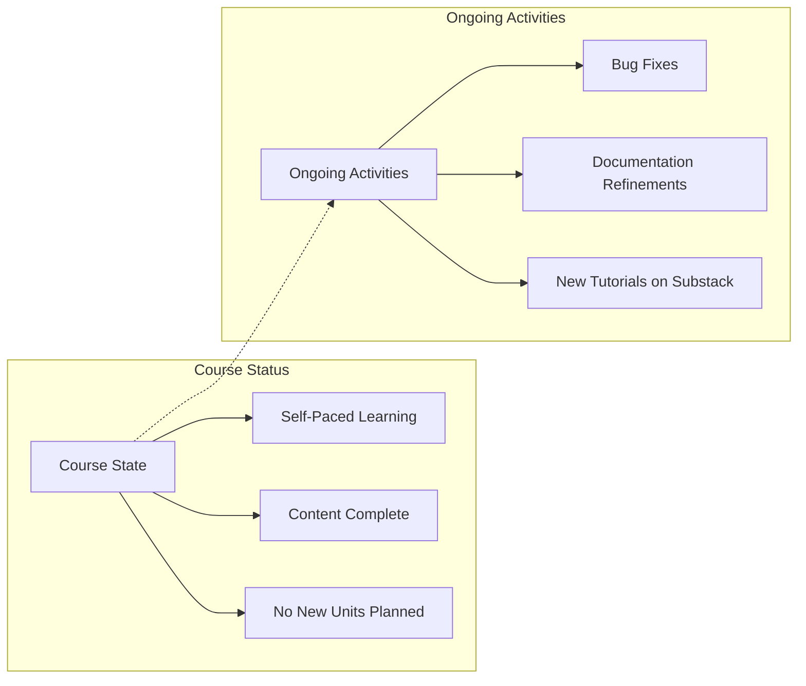
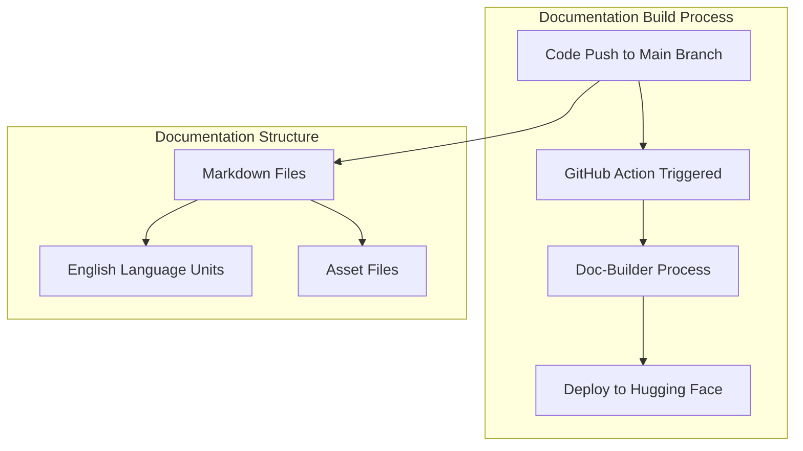
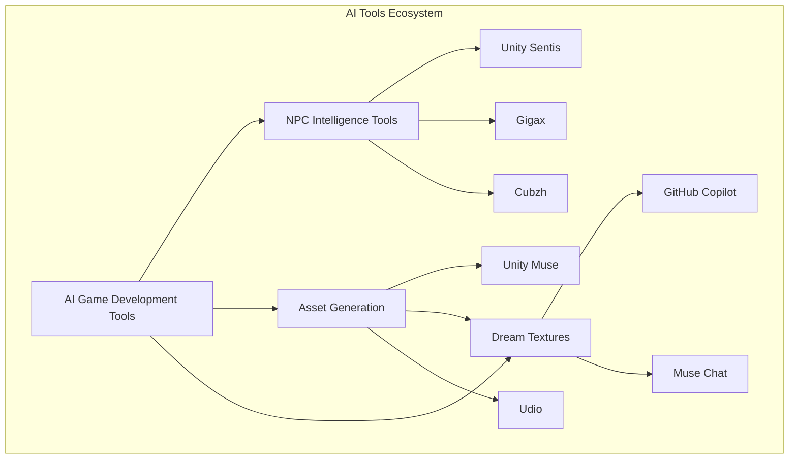
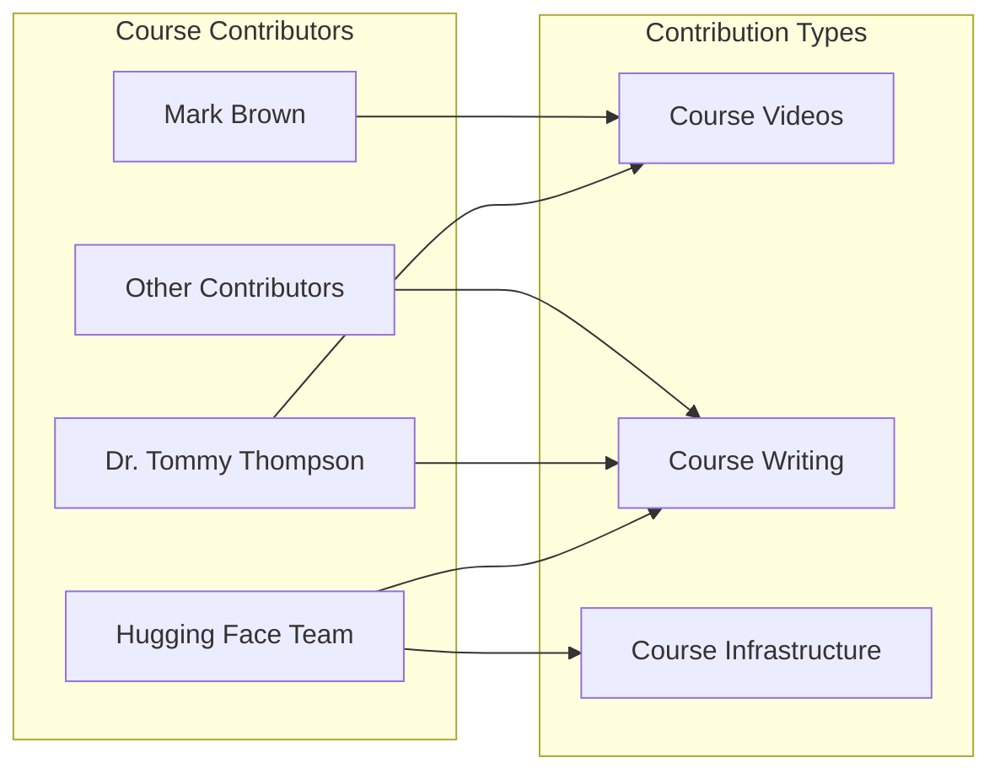

<!-- source: DeepWiki mcp.deepwiki.com · repo huggingface/making-games-with-ai-course · page 5 Resources and Maintenance · fetched 2026-10-26 -->

# Resources and Maintenance

Relevant source files

The following files were used as context for generating this wiki page:

- [.github/workflows/build_documentation.yml](.github/workflows/build_documentation.yml)
- [units/en/communication/publishing-schedule.mdx](units/en/communication/publishing-schedule.mdx)
- [units/en/unitbonus1/conclusion.mdx](units/en/unitbonus1/conclusion.mdx)

This document provides information about additional resources for the Making Games with AI course, as well as details about the course's maintenance status, documentation infrastructure, and acknowledgments. It serves as a reference for finding supplementary learning materials and understanding the ongoing support for the course.

## Course Maintenance Status

The Making Games with AI course is now self-paced and complete. The course has reached its final form with no planned future units.

**Key Points:**
- The course is designed to be completed at your own pace
- No Certificate of Completion is provided
- While no new units will be added to the main course, the creators continue to publish relevant AI in games tutorials on [Thomas Simonini's Substack](https://thomassimonini.substack.com)

Sources: [units/en/communication/publishing-schedule.mdx:1-6]()

## Documentation Infrastructure

The course documentation is automatically built and deployed using GitHub Actions workflows. When changes are pushed to the main branch, the documentation is updated on the Hugging Face platform.

The documentation build process uses Hugging Face's doc-builder to convert Markdown files in the `units/` directory into the published documentation. The process handles both content files and associated assets.

Sources: [.github/workflows/build_documentation.yml:1-22]()

## Additional Learning Resources

Beyond the core course content, several additional resources are available to extend your learning about AI in game development.

### External Resources and Communities

| Resource Type | Description | Access |
|---------------|-------------|--------|
| AI in Games Tutorials | New tutorials written by course creators | [Thomas Simonini's Substack](https://thomassimonini.substack.com) |
| Hugging Face Community | Discussion forums and model sharing | [Hugging Face](https://huggingface.co) |
| GitHub Repository | Source code and examples | [GitHub Repo](https://github.com/huggingface/making-games-with-ai-course) |

### Related AI Game Development Tools

This diagram illustrates the broader ecosystem of AI tools for game development that complement the course content. These tools can be explored after completing the course to further expand your AI game development skills.

Sources: [units/en/communication/publishing-schedule.mdx:1-6]()

## Contribution and Community

While the course content is complete, the GitHub repository remains open for bug reports and issues. The course benefits from community engagement and contributions.

### How to Contribute

- Report bugs or issues on the [GitHub repository](https://github.com/huggingface/making-games-with-ai-course)
- Engage with community discussions on Hugging Face forums
- Share your projects created using the course materials

## Acknowledgments

The course was created through the collaboration of various experts and contributors. Special thanks to:

- Dr. Tommy Thompson for sharing videos and writing introductions
- Mark Brown for sharing videos with the course
- The course creation team at Hugging Face

Sources: [units/en/unitbonus1/conclusion.mdx:1-7]()

## Future Directions

While the course itself is complete, the field of AI in game development continues to evolve rapidly. Students are encouraged to:

1. Apply the course techniques to their own game projects
2. Explore the newer tools and models as they emerge
3. Follow the ongoing tutorials from the course creators
4. Experiment with combining different AI approaches covered in the course

The knowledge and skills gained from this course provide a foundation for adapting to new developments in the field of AI-assisted game development.

Sources: [units/en/communication/publishing-schedule.mdx:1-6]()