# Page: Overview

# Overview

<details>
<summary>Relevant source files</summary>

The following files were used as context for generating this wiki page:

- [README.md](README.md)
- [units/en/_toctree.yml](units/en/_toctree.yml)
- [units/en/unit0/introduction.mdx](units/en/unit0/introduction.mdx)

</details>


This document provides a comprehensive guide to the "making-games-with-ai-course" repository, which contains materials for Hugging Face's Machine Learning for Games Course. The repository teaches game developers how to integrate AI models and tools into game development, with a focus on innovative gameplay and development efficiency.

For detailed setup instructions, see [Setup and Onboarding](#1.2). For specifics about course curriculum, see [Course Structure](#1.1).

Sources: [README.md:1-16](), [units/en/unit0/introduction.mdx:1-46]()

## Purpose and Scope

The "making-games-with-ai-course" repository serves two primary purposes:

1. **Teaching AI Integration for Gameplay**: Demonstrating how to implement AI models to create intelligent NPCs and novel gameplay mechanics.
2. **Showcasing AI-Assisted Development**: Illustrating how AI tools can accelerate game development through asset generation, code assistance, and more.

The course focuses on practical implementations, providing hands-on examples and demos that showcase various AI integration approaches within game development.

Sources: [units/en/unit0/introduction.mdx:17-45](), [README.md:8-13]()

## Core Systems Overview

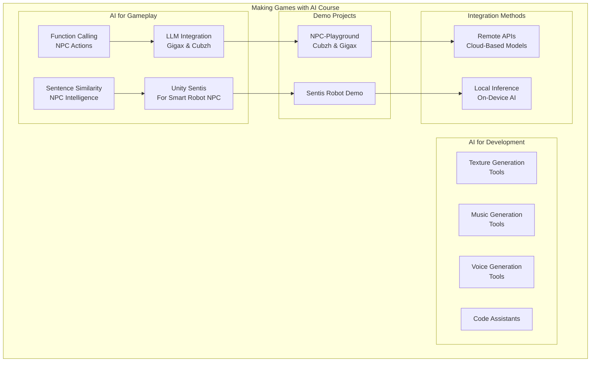

The repository encompasses several core AI systems and integration methods that together provide a comprehensive approach to incorporating AI into games.

Sources: [units/en/_toctree.yml:19-34](), [units/en/_toctree.yml:63-82](), [units/en/_toctree.yml:83-92]()

## Course Structure

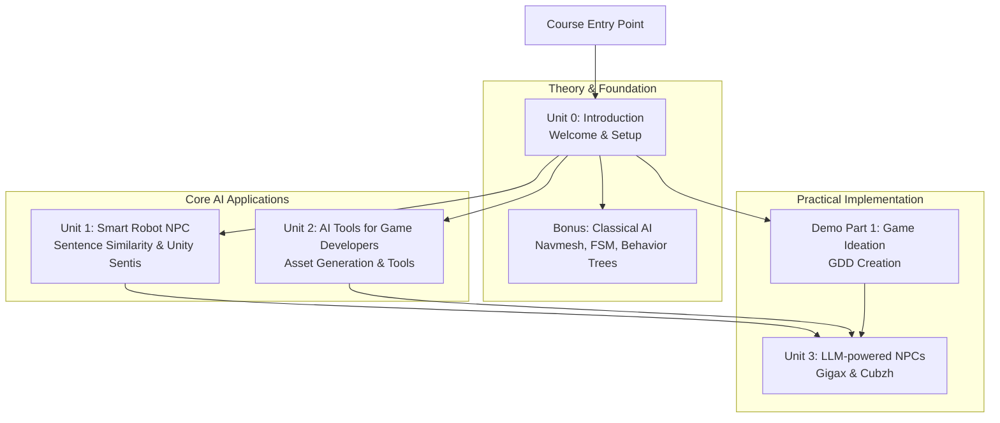

The course follows a structured learning path, starting with foundational knowledge and progressing to specific AI implementations and practical projects.

Sources: [units/en/_toctree.yml:1-96]()

## Game Development Workflow with AI

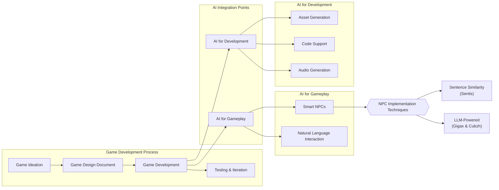

This diagram illustrates how AI technologies integrate into the game development workflow, demonstrating both development-time assistance and runtime gameplay enhancement.

Sources: [units/en/unit0/introduction.mdx:7-16](), [units/en/_toctree.yml:35-46]()

## Major AI Systems

### NPC Intelligence Systems

Two primary approaches to creating intelligent NPCs are covered:

1. **Unity Sentis Robot with Sentence Similarity**: Using on-device inference to create smart NPCs that understand natural language inputs.
2. **LLM-powered NPCs with Gigax and Cubzh**: Leveraging cloud-based language models for more sophisticated character interactions.

These systems demonstrate different integration approaches, performance characteristics, and complexity levels.

Sources: [units/en/_toctree.yml:19-34](), [units/en/_toctree.yml:83-92]()

### Asset Generation Tools

The course covers various AI tools for speeding up game development:

| Asset Type | Technologies Covered |
|------------|----------------------|
| Textures | Unity Muse, Dream Textures |
| Music | Udio, MusicGen |
| Sound Effects | Unity Muse Sound, AudioLDM2 |
| Animation | Muse Animate, Plask.AI |
| Voice | AI Voice Actors |
| 2D Assets | Various generators |

These tools demonstrate how AI can accelerate the asset creation pipeline and enable smaller teams to create higher-quality assets.

Sources: [units/en/_toctree.yml:63-82]()

## Implementation Examples

The repository contains two major implementation examples:

### NPC-Playground (Cubzh & Gigax)

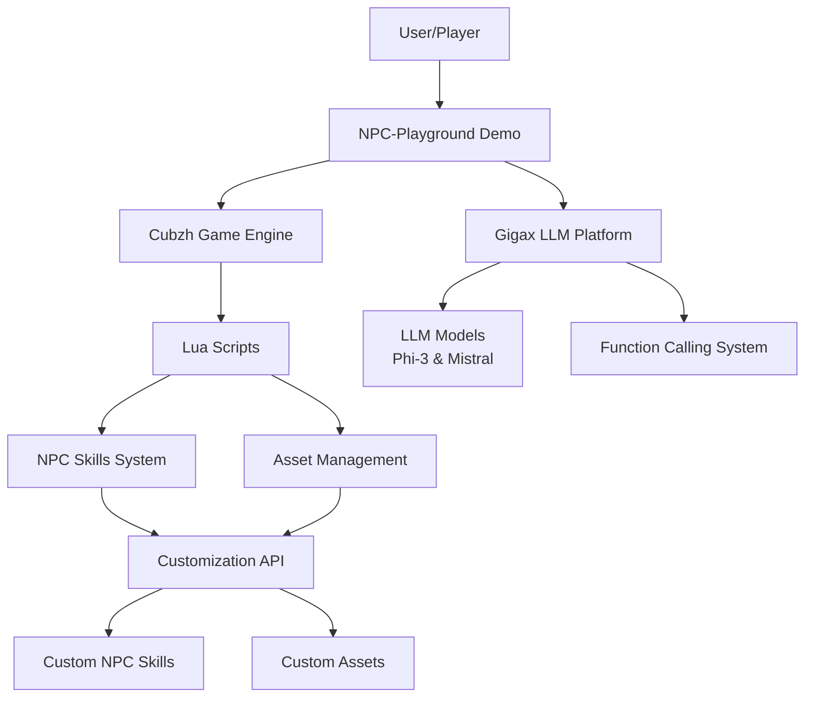

The NPC-Playground demonstrates how to create interactive, intelligent NPCs using the Gigax platform for LLM capabilities and the Cubzh engine for gameplay, with customization options through a Lua scripting interface.

Sources: [units/en/_toctree.yml:83-92]()

### Sentis Robot Demo (Unity & Sentence Similarity)

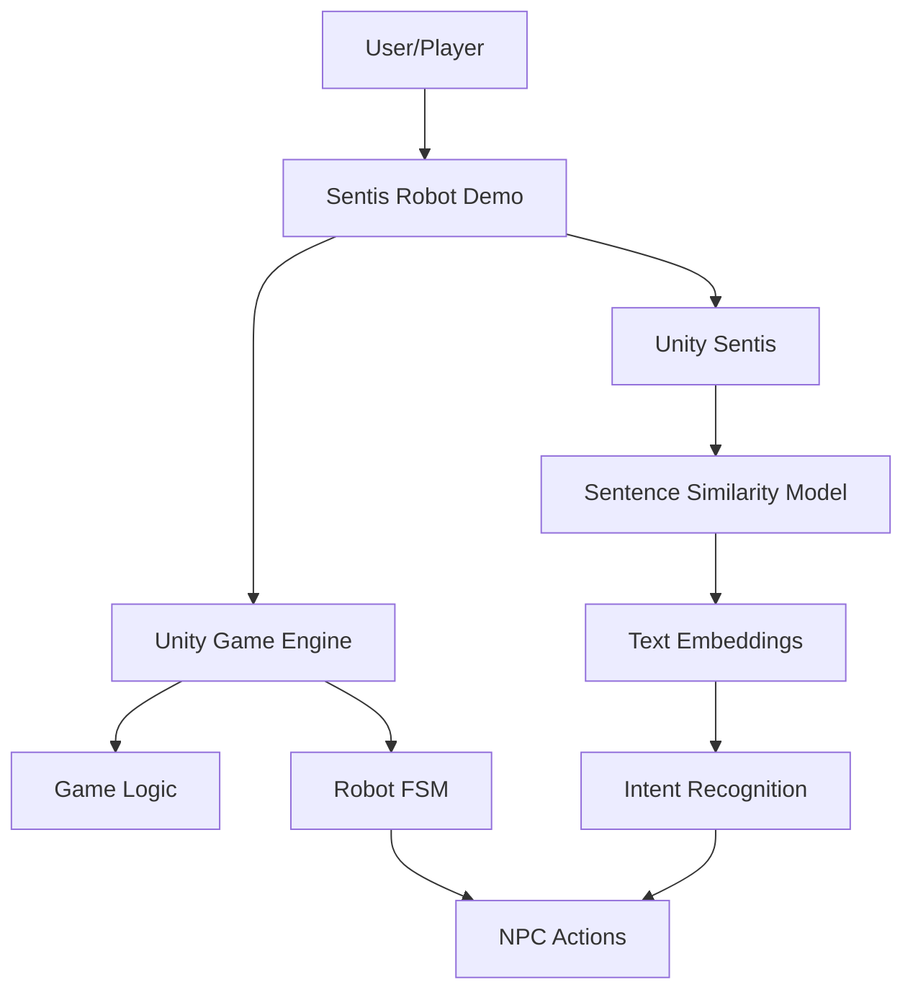

The Sentis Robot Demo showcases how to implement a smart robot NPC that uses sentence similarity to understand player inputs, running entirely on-device using Unity Sentis for local model inference.

Sources: [units/en/_toctree.yml:19-34]()

## Integration Approaches

The course demonstrates several key integration approaches for AI in games:

1. **Local Model Inference**: Running AI models directly in the game engine (Unity Sentis)
   - Advantages: No internet required, lower latency, no usage costs
   - Limitations: Smaller models, less powerful inference capabilities

2. **Remote API Integration**: Using cloud-based models via API calls
   - Advantages: Access to larger, more powerful models
   - Limitations: Requires internet, potential costs, latency considerations

3. **LLM-Powered Systems**: Specialized platforms for language model integration
   - Examples: Gigax platform for function calling and NPC behavior

These approaches represent a spectrum of complexity, capability, and technical requirements that developers can choose based on their game's needs.

Sources: [units/en/unit0/introduction.mdx:36-40](), [units/en/unit1/local-vs-api]() (referenced in TOC)

## Course Learning Approach

The course follows a hands-on learning approach:

1. **Theory & Foundation**: Understanding AI concepts and possibilities
2. **Exploration of Tools & Techniques**: Learning specific AI technologies
3. **Practical Implementation**: Building actual demos and projects
4. **Customization & Extension**: Adapting examples to personal projects

This approach enables developers to not only understand the concepts but to immediately apply them in practical game development contexts.

Sources: [units/en/unit0/introduction.mdx:33-46](), [units/en/unit0/how-to-get-most]() (referenced in TOC)

## Conclusion

The "making-games-with-ai-course" repository provides a comprehensive introduction to integrating AI into games, focusing on both enhancing gameplay with intelligent NPCs and accelerating development with AI-powered tools. Through structured units, practical demos, and hands-on examples, the course equips game developers with the knowledge and skills needed to leverage AI in their own projects.

Sources: [units/en/unit0/introduction.mdx:31-46](), [README.md:1-16]()

---

# Page: Course Structure

# Course Structure

<details>
<summary>Relevant source files</summary>

The following files were used as context for generating this wiki page:

- [units/en/_toctree.yml](units/en/_toctree.yml)
- [units/en/unit0/syllabus.mdx](units/en/unit0/syllabus.mdx)

</details>


This document provides a comprehensive overview of the "Making Games with AI" course structure, including unit organization, progression path, and recommended learning approach. The document covers the course's modular design and how different units relate to one another, helping learners navigate through the content effectively. For information about setting up necessary accounts and joining the course community, see [Setup and Onboarding](#1.2).

## Course Organization

The "Making Games with AI" course is structured into several core units, each focusing on specific aspects of AI integration in game development. The course follows a modular approach allowing learners to progress through conceptual foundations to practical implementations.

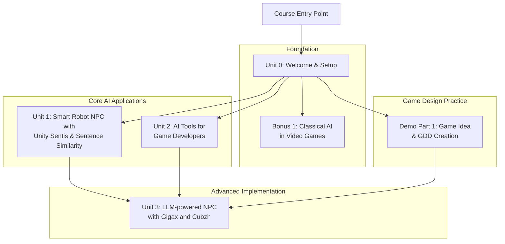

Sources: [units/en/_toctree.yml:1-96](), [units/en/unit0/syllabus.mdx:10-17]()

## Course Units and Content

The course is divided into distinct units, each with a specific focus and learning objectives:

| Unit | Title | Focus Areas | Key Technologies |
|------|-------|-------------|-----------------|
| 0 | Welcome to the course | Introduction, setup, syllabus | Community tools, environment setup |
| 1 | Smart Robot NPC | Sentence similarity, model integration | Unity Sentis, Hugging Face API |
| Demo Part 1 | Game Idea & GDD | Game ideation, design documentation | Game design methodology |
| Bonus 1 | Classical AI in Games | Traditional game AI techniques | Unity/Unreal AI systems |
| 2 | AI Tools for Game Developers | Asset generation | Music, voice, animation, texture tools |
| 3 | LLM-powered NPC | Advanced NPC interactions | Gigax, Cubzh |

Each unit contains both theoretical explanations and hands-on implementation examples, allowing learners to understand concepts and immediately apply them in practical scenarios.

Sources: [units/en/_toctree.yml:1-96](), [units/en/unit0/syllabus.mdx:19-27]()

## Learning Pathways and Skills Development

The course is designed to build skills progressively, with multiple possible learning pathways depending on the learner's interests and goals.

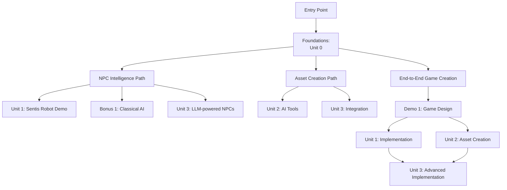

Sources: [units/en/_toctree.yml:1-96](), [units/en/unit0/syllabus.mdx:10-17]()

## Technical Components and Implementation Focus

The course connects theoretical concepts with practical implementations through various technologies and frameworks. This diagram illustrates how course units relate to specific technical components:

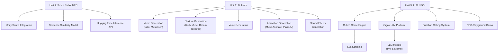

Sources: [units/en/_toctree.yml:19-92]()

## Learning Approach and Components

The course employs a multi-faceted learning approach combining theoretical foundations with practical implementation:

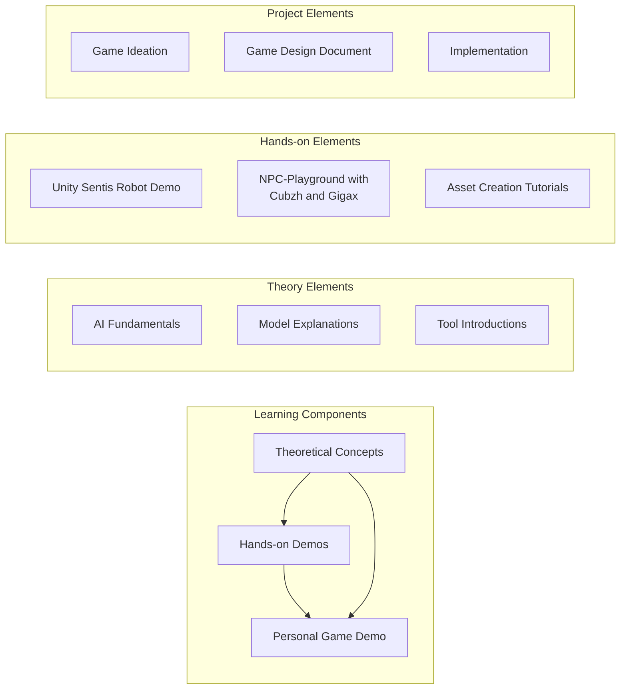

Sources: [units/en/unit0/syllabus.mdx:10-17]()

## Time Commitment and Recommended Pace

The course is designed to be self-paced, with each unit taking approximately one week to complete at the suggested pace.

| Component | Recommended Time | Work Hours |
|-----------|------------------|------------|
| Each unit | 1 week | 3-4 hours |
| Personal demo | 2-4 weeks | Varies by project scope |
| Total course | 6-10 weeks | ~25-40 hours |

The course has no deadlines or time restrictions, allowing learners to progress at their own pace and explore topics in greater depth as desired.

Sources: [units/en/unit0/syllabus.mdx:36-43](), [units/en/unit0/syllabus.mdx:5-8]()

## Implementation Options and Flexibility

The course offers flexibility in how learners can apply AI technologies to game development:

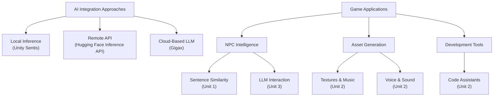

Sources: [units/en/_toctree.yml:19-92](), [units/en/unit0/syllabus.mdx:19-27]()

## Course Prerequisites and Target Audience

The course assumes some prior knowledge and is targeted at specific audience groups:

- **Recommended background**: Basic game development experience with Unity or Unreal
- **Not required**: Detailed machine learning or AI knowledge
- **Ideal for**: Game developers looking to integrate AI into their projects
- **Supplementary resources**: Additional resources are provided for those who want to explore topics in greater depth

Sources: [units/en/unit0/syllabus.mdx:29-34]()

---

# Page: Setup and Onboarding

# Setup and Onboarding

<details>
<summary>Relevant source files</summary>

The following files were used as context for generating this wiki page:

- [units/en/unit0/discord101.mdx](units/en/unit0/discord101.mdx)
- [units/en/unit0/how-to-get-most.mdx](units/en/unit0/how-to-get-most.mdx)
- [units/en/unit0/setup.mdx](units/en/unit0/setup.mdx)

</details>


This page provides a detailed guide for setting up the necessary accounts and joining the community to participate in the Making Games with AI course. The setup process focuses on creating your Hugging Face account and joining the course's Discord server, which are essential platforms for accessing course materials and interacting with the community.

## Onboarding Process Overview

The onboarding process consists of two main steps: creating a Hugging Face account and joining the course's Discord server. These platforms serve as the foundation for both accessing course content and engaging with the community of learners and instructors.

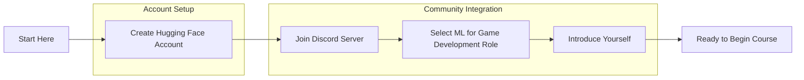

Sources: [units/en/unit0/setup.mdx:4-9]()

## Hugging Face Account Setup

If you don't already have one, you'll need to create a Hugging Face account. This account gives you access to:
- Course content and resources
- Model repositories 
- Spaces for deploying interactive demos
- The Hugging Face community

To create your account:
1. Visit [https://huggingface.co/join](https://huggingface.co/join)
2. Complete the registration process
3. Verify your email address

Sources: [units/en/unit0/setup.mdx:10-12]()

## Discord Community Setup

The course's Discord server is the central hub for community interaction, where you can:
- Chat with other course participants
- Ask questions and get help
- Share your projects and progress
- Communicate directly with instructors

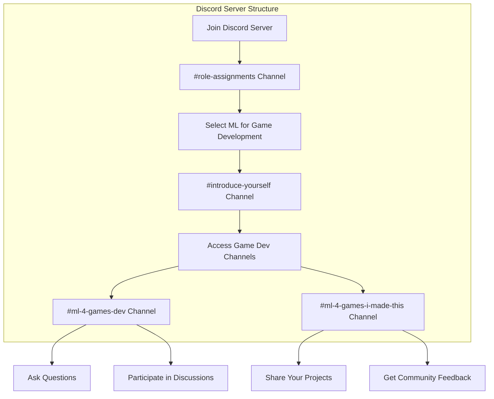

### Joining the Discord Server

To join the Discord community:

1. Click the invitation link: [https://discord.gg/hugging-face-879548962464493619](https://discord.gg/hugging-face-879548962464493619)
2. If you don't have a Discord account, you'll be prompted to create one
3. After joining, go to the `#role-assignments` channel
4. Select the "ML for Game Development" role to access course-specific channels
5. Introduce yourself in the `#introduce-yourself` channel

Sources: [units/en/unit0/setup.mdx:14-24](), [units/en/unit0/discord101.mdx:5-13]()

### Course-Specific Channels

Once you've selected the appropriate role, you'll have access to these dedicated channels:

| Channel | Purpose |
|---------|---------|
| `#ml-4-games-dev` | Discussions about ML for game development, asking questions |
| `#ml-4-games-i-made-this` | Sharing your projects, models, and progress |

Sources: [units/en/unit0/setup.mdx:26-29](), [units/en/unit0/discord101.mdx:15-19]()

## Discord Best Practices

To get the most out of the Discord community:

- **Active Participation**: Engage regularly in the channels to meet others interested in AI for games
- **Use Threads**: Start threads for longer conversations to keep discussions organized
- **Markdown Formatting**: Use markdown formatting for code snippets:
  ```
  ```python
  print("Hello Game AI World!")
  ```
  ```
- **Voice Channels**: Use voice channels for real-time discussions when needed
- **Community Guidelines**: Maintain a respectful environment and report any inappropriate behavior to admins

Sources: [units/en/unit0/discord101.mdx:20-26]()

## Course Engagement Model

The following diagram illustrates how the account setup connects to the broader course engagement:

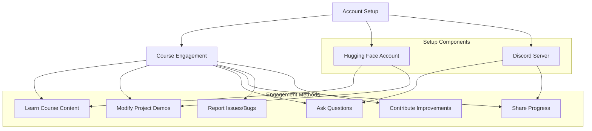

Sources: [units/en/unit0/how-to-get-most.mdx:5-11]()

## Getting Help and Contributing

### Reporting Issues

If you encounter problems with the course:
- For technical bugs: [Open an issue on GitHub](https://github.com/huggingface/making-games-with-ai-course/issues/new/choose)
- For course improvement suggestions: [Open a Pull Request](https://github.com/huggingface/making-games-with-ai-course/compare)

### Getting Help

For general questions:
- Ask in the Discord `#ml-4-game-dev` channel
- Check previous discussions that may have addressed similar questions

Sources: [units/en/unit0/how-to-get-most.mdx:36-45]()

## Next Steps

Once you've completed the onboarding process, you're ready to begin the course. The course structure is designed to guide you through various units covering different aspects of AI in game development. For more details on the course structure and learning path, see [Course Structure](#1.1).

Sources: [units/en/unit0/setup.mdx:31-34]()

---

# Page: Team and Contributors

# Team and Contributors

<details>
<summary>Relevant source files</summary>

The following files were used as context for generating this wiki page:

- [units/en/unit0/who-are-we.mdx](units/en/unit0/who-are-we.mdx)

</details>


This document provides information about the team behind the "Making Games with AI Course," including their roles, expertise, and contributions. The team consists of AI specialists and game developers who have combined their knowledge to create this comprehensive educational resource on integrating AI into game development.

## Main Author

### Thomas Simonini

Thomas Simonini is the primary author of the course and a Game Developer at Hugging Face. His work focuses on integrating AI models into games to create new experiences.

Key responsibilities:
- Creating the core course content
- Developing demos and examples
- Creating tutorials and explanations

Thomas also maintains the AI Playbook for Game Developers blog and creates video tutorials on YouTube, exploring the intersection of AI and game development.

**Contact and Social Media:**
- X (Twitter): @ThomasSimonini
- LinkedIn: Thomas Simonini
- YouTube: Thomas Simonini
- Blog: AI Playbook for Game Developers

Sources: [units/en/unit0/who-are-we.mdx:5-17]()

## Contributors and Reviewers

### Dylan Ebert
**Role:** Contributor and Reviewer

Dylan is a Developer Advocate Engineer at Hugging Face with a PhD in Computer Science from Brown University. His expertise lies at the intersection of ML, 3D, and Game Development.

**Contact and Social Media:**
- X (Twitter): @dylan_ebert_
- TikTok: @individualkex
- YouTube: IndividualKex

### Omar Sanseviero
**Role:** Reviewer

Omar is the Chief Llama Officer at Hugging Face. He works at the intersection of Open Source, Product, Research, and technical communities, leading multidisciplinary teams and open source and science collaborations.

**Contact and Social Media:**
- X (Twitter): @osanseviero
- LinkedIn: Omar Sanseviero

### Pedro Cuenca
**Role:** Reviewer

Pedro is a Machine Learning Engineer at Hugging Face, with interests in image generation and on-device models.

**Contact and Social Media:**
- X (Twitter): @pcuenq
- LinkedIn: Pedro Cuenca

Sources: [units/en/unit0/who-are-we.mdx:19-52]()

## Team Structure and Roles

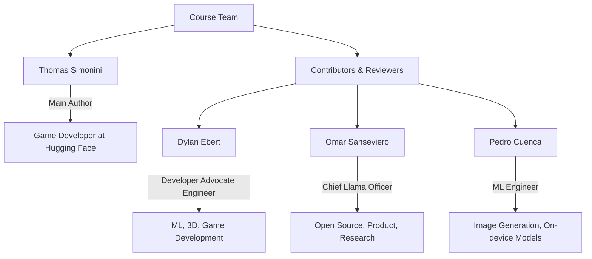

Sources: [units/en/unit0/who-are-we.mdx:5-52]()

## Team Expertise Mapping to Course Systems

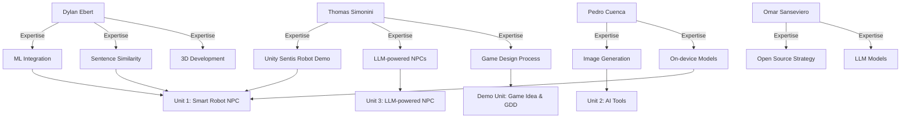

Sources: [units/en/unit0/who-are-we.mdx:5-52]()

## Team Contributions to Course Units

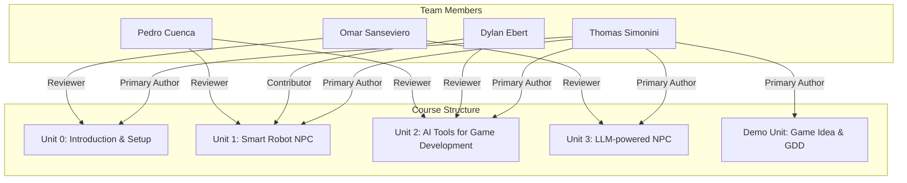

Sources: [units/en/unit0/who-are-we.mdx:5-52]()

## Team in Course Development Context

The team's diverse expertise in game development, machine learning, and AI integration has enabled the creation of a comprehensive course that covers multiple aspects of AI in games. Thomas Simonini serves as the main driving force behind the course content, while the contributors and reviewers provide specialized knowledge in areas such as:

1. **NPC Intelligence Systems** - Expertise in implementing both on-device AI (Unity Sentis) and cloud-based LLM solutions (Gigax)
2. **Asset Generation** - Knowledge of image generation, texture creation, and on-device model implementation
3. **Educational Content Development** - Creation of accessible learning materials for complex AI concepts

For further information about the specific AI systems covered in the course, see [AI Systems for Games](#2).

The team's collective expertise covers the full spectrum of AI integration methods taught in the course, from local inference using Unity Sentis to remote API calls with Hugging Face services to LLM-powered NPCs using Gigax and Cubzh.

Sources: [units/en/unit0/who-are-we.mdx:5-52]()

---

# Page: AI Systems for Games

# AI Systems for Games

<details>
<summary>Relevant source files</summary>

The following files were used as context for generating this wiki page:

- [units/en/unit2/2d-generation.mdx](units/en/unit2/2d-generation.mdx)
- [units/en/unit2/introduction.mdx](units/en/unit2/introduction.mdx)
- [units/en/unit2/music-generation.mdx](units/en/unit2/music-generation.mdx)
- [units/en/unitbonus1/introduction.mdx](units/en/unitbonus1/introduction.mdx)

</details>


## Purpose and Scope

This document provides a technical overview of the major AI systems and technologies covered in the Making Games with AI course. It introduces the primary categories of AI technologies applied to game development, their relationships, and integration approaches. For detailed information about specific implementation examples, see [Implementation Examples](#3).

Sources: [units/en/unit2/introduction.mdx:5-16](), [units/en/unitbonus1/introduction.mdx:1-17]()

## Major AI Systems Overview

The course addresses three main categories of AI systems for game development:

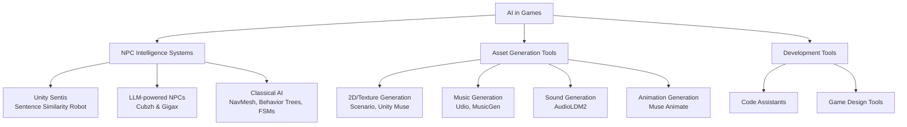

Sources: [units/en/unit2/introduction.mdx:5-16]()

## Primary Use Cases

AI technologies in game development serve two distinct purposes:

1. **Development-time AI** - Tools that assist developers during the creation process
2. **Runtime AI** - Systems that operate within the game during gameplay

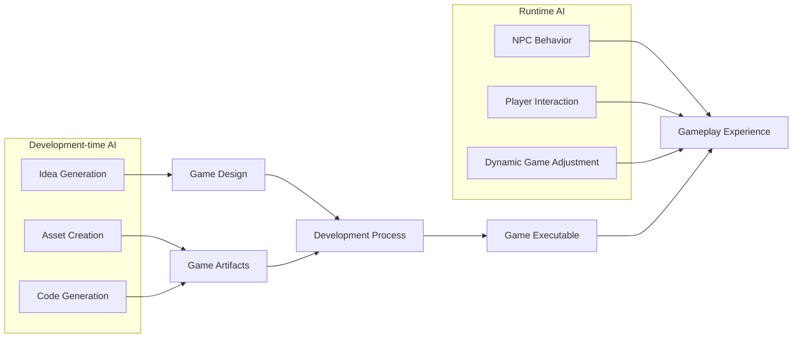

Sources: [units/en/unit2/introduction.mdx:5-16]()

## NPC Intelligence Systems

NPC Intelligence systems provide methods for creating more believable and interactive non-player characters in games. The course covers three main approaches:

### Sentence Similarity with Unity Sentis

Uses embedding models to understand player input, allowing NPCs to respond to natural language based on semantic similarity.

### LLM-powered NPCs with Cubzh & Gigax

Leverages large language models to create NPCs capable of complex, contextual conversations and decision-making.

### Classical AI Techniques

Traditional game AI approaches including navigation meshes, behavior trees, finite state machines, and goal-oriented action planning.

For more detailed information on these systems, see [NPC Intelligence Systems](#2.1).

Sources: [units/en/unitbonus1/introduction.mdx:1-17]()

## Asset Generation Tools

Asset generation tools use AI to create or assist in creating visual, audio, and other game assets.

### 2D Asset Generation

Tools like Scenario enable developers to generate high-quality 2D assets with consistent style through text-to-image models and fine-tuning capabilities.

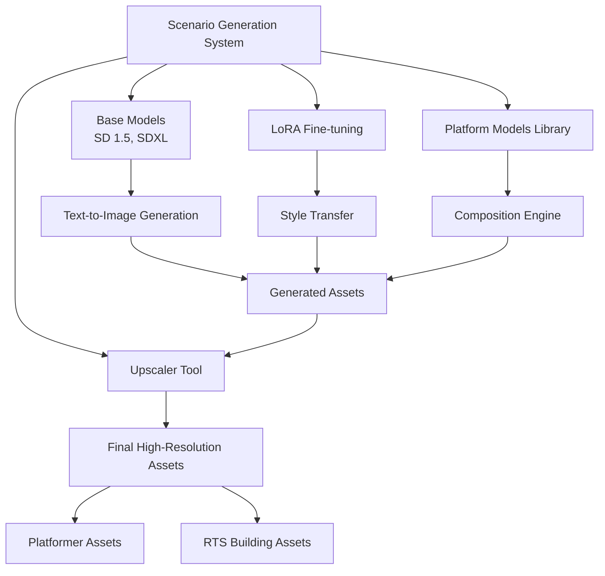

Sources: [units/en/unit2/2d-generation.mdx:1-62]()

### Music Generation

AI-based music generation tools create game soundtracks that match specific moods or scenes.

#### Available Tools:

| Tool | Type | Features |
|------|------|----------|
| Udio | Proprietary, Paid | Instrumental and lyric-based music generation, 600 daily generations, music extension |
| MusicGen | Open-source, Free | 15-second music clips from text prompts, style control via sound files |

Sources: [units/en/unit2/music-generation.mdx:1-34]()

### Other Asset Generation

Additional tools covered in the course include sound effect generation and animation generation, which follow similar AI-assisted workflows.

For more detailed information on asset generation tools, see [Asset Generation Tools](#2.2).

## Integration Approaches

The course teaches several technical approaches to integrate AI systems into games:

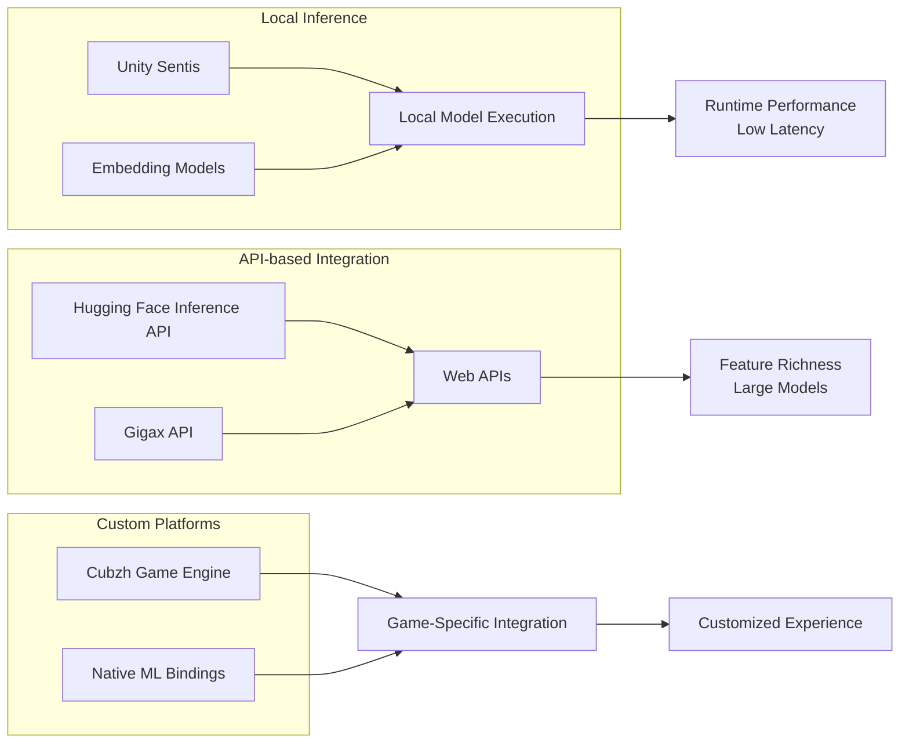

Sources: [units/en/unit2/introduction.mdx:5-16](), [units/en/unitbonus1/introduction.mdx:1-17]()

## Implementation Considerations

When implementing AI systems for games, developers must consider several technical factors:

1. **Computational Requirements**:
   - Local inference requires device-compatible models and optimization
   - Remote APIs need stable internet connectivity and latency management

2. **Model Size and Complexity**:
   - Embedding models (used for sentence similarity) can often run locally
   - Large language models typically require API access

3. **Update Frequency**:
   - Asset generation tools frequently update with new capabilities
   - Runtime AI typically requires stability and consistency

4. **Development vs. Runtime Use**:
   - Development-time AI has different integration requirements than runtime AI
   - Asset generation tools integrate with content pipelines rather than the game executable

For detailed implementation examples, see [Implementation Examples](#3).

## Tool Classification System

The course uses a consistent classification system for AI tools:

| Symbol | Meaning |
|--------|---------|
| 🤗 | Open-source |
| 🔒 | Closed-source (proprietary) |
| 💸 | Paid tool (often with a free tier) |
| 🆓 | Free tool |

Sources: [units/en/unit2/introduction.mdx:16-27]()

## Conclusion

AI systems for games span a wide range of applications from development assistance to in-game intelligence. The technologies covered in this course provide game developers with tools to enhance both the development process and the player experience. For specific implementations of these systems, refer to the dedicated pages on [NPC Intelligence Systems](#2.1), [Asset Generation Tools](#2.2), and [Development Tools](#2.3).

---

# Page: NPC Intelligence Systems

# NPC Intelligence Systems

<details>
<summary>Relevant source files</summary>

The following files were used as context for generating this wiki page:

- [units/en/unit1/introduction.mdx](units/en/unit1/introduction.mdx)
- [units/en/unit3/customize.mdx](units/en/unit3/customize.mdx)
- [units/en/unit3/introduction.mdx](units/en/unit3/introduction.mdx)
- [units/en/unitbonus1/ai-and-games.mdx](units/en/unitbonus1/ai-and-games.mdx)

</details>


This document provides an overview of the different approaches to creating intelligent Non-Player Characters (NPCs) in games as covered in the Making Games with AI course. It focuses on the technical architectures, implementation methods, and trade-offs between various NPC intelligence systems. For information about AI asset generation tools, see [Asset Generation Tools](#2.2).

## Overview of NPC Intelligence Approaches

NPC intelligence systems in modern game development span from classical rule-based approaches to advanced AI-driven solutions. The course covers three primary approaches to creating intelligent NPCs:

1. **Local Inference with Unity Sentis** - Running ML models directly in-game for sentence similarity
2. **LLM-powered NPCs** - Using Large Language Models through Cubzh & Gigax for sophisticated dialog
3. **Classical AI Methods** - Including Finite State Machines, Behavior Trees, and Navigation Meshes

```mermaid
flowchart TD
    NPC["NPC Intelligence Systems"]
    
    NPC --> Local["Local Inference"]
    NPC --> Remote["Remote API"]
    NPC --> Classical["Classical AI"]
    
    Local --> Sentis["Unity Sentis\nSentence Similarity"]
    Sentis --> Robot["Robot NPC\nCommand Understanding"]
    
    Remote --> Gigax["Gigax & Cubzh\nLLM Integration"]
    Gigax --> FunctionCalling["Function Calling\nNPC Skills System"]
    
    Classical --> FSM["Finite State Machines"]
    Classical --> BT["Behavior Trees"]
    Classical --> NavMesh["Navigation Meshes"]
    Classical --> GOAP["Goal Oriented Action Planning"]
```

Sources: [units/en/unit1/introduction.mdx:9-16](), [units/en/unit3/introduction.mdx:7-10](), [units/en/unitbonus1/ai-and-games.mdx:23-96]()

## Local Inference with Unity Sentis

Unity Sentis provides a framework for running machine learning models directly within a Unity game without requiring an internet connection or external API calls. This approach is ideal for simpler models like sentence similarity that need predictable response times and don't require frequent updates.

### System Architecture

```mermaid
flowchart TD
    Player["Player Input"] --> TextInput["Text Command Input"]
    TextInput --> Tokenizer["Tokenizer\nPreprocessing"]
    Tokenizer --> SentisModel["Unity Sentis\nSentence Similarity Model"]
    
    SentisModel --> SharpTransformers["Sharp Transformers\nUtility Layer"]
    
    SharpTransformers --> SimilarityScore["Similarity Scoring\nCommand Matching"]
    SimilarityScore --> Intent["Command Intent\nRecognition"]
    Intent --> RobotFSM["Robot FSM\nAction Execution"]
    
    subgraph "Unity Game Environment"
        TextInput
        Tokenizer
        SentisModel
        SharpTransformers
        SimilarityScore
        Intent
        RobotFSM
    end
```

Sources: [units/en/unit1/introduction.mdx:25-32]()

### Implementation Details

In the Unity robot demo, players can issue natural language commands to a robot character. The system:

1. Takes the player's text input
2. Processes it through a sentence similarity model using Unity Sentis
3. Matches the input against predefined commands
4. Executes the corresponding robot behavior

Key components include:
- Unity Sentis: Neural network inference library for running models in-game
- Sharp Transformers: Unity plugin with utilities for transformer models
- Preprocessing pipeline for text input
- Finite State Machine for robot behavior execution

This approach enables smart robots that can understand variable phrasings of commands without requiring internet connectivity.

Sources: [units/en/unit1/introduction.mdx:17-20](), [units/en/unit1/introduction.mdx:52-56]()

## LLM-powered NPCs with Cubzh & Gigax

For more sophisticated NPC interactions, the course covers using Large Language Models (LLMs) through the Cubzh game engine and Gigax LLM platform. This approach enables NPCs to have complex contextual conversations, understand intent, and perform a wide range of actions.

### System Architecture

```mermaid
flowchart TD
    Player["Player Input"] --> NPCPlayground["NPC-Playground Demo"]
    
    NPCPlayground --> Cubzh["Cubzh Game Engine"]
    NPCPlayground --> GigaxPlatform["Gigax LLM Platform"]
    
    Cubzh --> LuaScripts["Lua Scripts\nGame Logic"]
    LuaScripts --> Skills["NPC Skills System"]
    LuaScripts --> AssetManagement["Asset Management"]
    
    GigaxPlatform --> LLMModels["LLM Models\nPhi-3 & Mistral"]
    GigaxPlatform --> FunctionCalling["Function Calling System"]
    
    FunctionCalling --> Skills
    
    Skills --> SkillLibrary["Skill Library\n(e.g., GIVEHAT)"]
    SkillLibrary --> NPC["NPC Behavior Execution"]
```

Sources: [units/en/unit3/introduction.mdx:7-14](), [units/en/unit3/customize.mdx:15-24]()

### NPC Skills System

The NPC-Playground demo showcases a flexible skill system where NPCs can be taught new capabilities through the Gigax function calling API and Lua scripting. Each skill is defined in Lua and made available to the LLM through function calling.

Skills consist of:
- Name and description for the LLM to understand when to use it
- Parameters the LLM can populate
- Implementation code in Lua that executes the actual behavior

For example, the `GIVEHAT` skill allows NPCs to give different types of hats to players:

```
skill definition in cubzh.lua:
- Name: GIVEHAT
- Implementation: Places hat asset on player character
```

Sources: [units/en/unit3/customize.mdx:45-61]()

### Customization Capabilities

The NPC-Playground system allows for extensive customization:

1. **Modify existing skills** - Change parameters or assets (e.g., switching hat types)
2. **Create new skills** - Define entirely new capabilities for NPCs
3. **Asset replacement** - Swap visual assets used by skills

This customization is done through editing the Lua scripts and requires minimal coding knowledge, making it accessible for game developers to experiment with different NPC behaviors.

Sources: [units/en/unit3/customize.mdx:65-70]()

## Classical AI Approaches for NPCs

While modern ML and LLM approaches offer new capabilities, classical AI techniques remain valuable and often complementary to newer methods.

### Key Classical Techniques

```mermaid
flowchart TD
    Classical["Classical AI\nTechniques"] --> Navigation["Navigation\nSystems"]
    Classical --> Behavior["Behavior\nSystems"]
    Classical --> Decision["Decision\nMaking"]
    Classical --> Experience["Experience\nManagement"]
    
    Navigation --> NavMesh["Navigation Meshes\nPathfinding"]
    
    Behavior --> FSM["Finite State Machines\nState-based behavior"]
    Behavior --> BT["Behavior Trees\nHierarchical tasks"]
    
    Decision --> GOAP["Goal Oriented Action Planning\nPlanning sequences"]
    Decision --> Utility["Utility AI\nAction scoring"]
    
    Experience --> Director["Director AI\nDynamic difficulty"]
    Experience --> Barks["Barks\nCommunicating AI state"]
```

Sources: [units/en/unitbonus1/ai-and-games.mdx:23-62](), [units/en/unitbonus1/ai-and-games.mdx:70-112]()

### Comparison with Modern Approaches

| Approach | Pros | Cons | Best For |
|----------|------|------|----------|
| **Classical AI** | Predictable, controllable, efficient | Limited expressiveness, requires explicit design | Navigation, combat AI, predictable behaviors |
| **Local Inference** | Works offline, consistent performance | Limited model size, less adaptable | Command recognition, specific interactions |
| **LLM-powered** | Highly flexible, conversational | Requires internet, potential latency, less predictable | Rich dialog, complex interactions, storytelling |

Sources: [units/en/unitbonus1/ai-and-games.mdx:10-22](), [units/en/unit1/introduction.mdx:13-16](), [units/en/unit3/introduction.mdx:7-10]()

## Integration Considerations

When implementing NPC intelligence systems, consider:

1. **Performance requirements** - Local inference provides more consistent performance but with limited capabilities
2. **Connectivity assumptions** - LLM approaches typically require internet connectivity
3. **Predictability needs** - Classical approaches offer more deterministic behavior
4. **Hybrid approaches** - Combining methods (e.g., LLMs for dialog with classical AI for navigation)

```mermaid
flowchart TD
    Decision["NPC System\nSelection Decision"] --> Connectivity["Connectivity\nRequirements"]
    Decision --> Complexity["Interaction\nComplexity"]
    Decision --> Performance["Performance\nRequirements"]
    Decision --> Predictability["Predictability\nNeeds"]
    
    Connectivity -->|"Always Online"| LLM["LLM-powered\nGigax & Cubzh"]
    Connectivity -->|"Offline Capable"| Local["Local Inference\nUnity Sentis"]
    
    Complexity -->|"Simple Commands"| Local
    Complexity -->|"Complex Dialog"| LLM
    
    Performance -->|"Consistent\nLow Latency"| Local
    Performance -->|"Variable\nLatency OK"| LLM
    
    Predictability -->|"Highly\nPredictable"| Classical["Classical AI\nFSM & BT"]
    Predictability -->|"Creative\nVariability OK"| LLM
```

Sources: [units/en/unit1/introduction.mdx:13-16](), [units/en/unit3/introduction.mdx:7-14]()

## Conclusion

NPC intelligence systems represent a spectrum of approaches from classical techniques to cutting-edge AI models. This course provides implementations of multiple systems across this spectrum, allowing developers to choose the approach that best fits their game's needs and constraints.

When selecting an NPC intelligence system, consider:
- The type of interactions your game requires
- Performance and connectivity constraints
- The balance between predictability and flexibility
- Development resources and expertise available

The implementations in this course demonstrate both traditional approaches and modern AI techniques, providing a solid foundation for creating compelling NPCs in your games.

---

# Page: Asset Generation Tools

# Asset Generation Tools

<details>
<summary>Relevant source files</summary>

The following files were used as context for generating this wiki page:

- [units/en/unit2/2d-generation.mdx](units/en/unit2/2d-generation.mdx)
- [units/en/unit2/animation-generation.mdx](units/en/unit2/animation-generation.mdx)
- [units/en/unit2/conclusion.mdx](units/en/unit2/conclusion.mdx)
- [units/en/unit2/introduction.mdx](units/en/unit2/introduction.mdx)
- [units/en/unit2/music-generation.mdx](units/en/unit2/music-generation.mdx)
- [units/en/unit2/sound-generation.mdx](units/en/unit2/sound-generation.mdx)
- [units/en/unit2/texture-generation.mdx](units/en/unit2/texture-generation.mdx)

</details>


## Purpose and Scope

This document covers AI-powered tools for generating game assets, including 2D graphics, textures, music, sound effects, and animations. These tools help game developers accelerate asset creation and enable small teams to produce high-quality content that would otherwise require specialized skills or larger teams. For information about AI systems for NPC intelligence, see [NPC Intelligence Systems](#2.1). For AI tools that assist with development processes, see [Development Tools](#2.3).

Sources: [units/en/unit2/introduction.mdx:9-15](), [units/en/unit2/conclusion.mdx:3-5]()

## Overview of Asset Generation Tools

AI asset generation tools are categorized by the type of content they produce. The course covers several key tools across five major categories, focusing on solutions that balance quality with practical implementation.

```mermaid
graph TD
    AssetGen["Asset Generation Tools"]
    
    AssetGen --> TwoD["2D Assets Generation"]
    AssetGen --> Tex["Texture Generation"]
    AssetGen --> Music["Music Generation"]
    AssetGen --> Sound["Sound Effects Generation"]
    AssetGen --> Anim["Animation Generation"]
    
    TwoD --> Scenario["Scenario
    (Closed-source/Paid)"]
    
    Tex --> UnityMuse["Unity Muse Textures
    (Closed-source/Paid)"]
    Tex --> DreamTex["Dream Textures
    (Open-source/Free)"]
    
    Music --> Udio["Udio
    (Closed-source/Paid)"]
    Music --> MusicGen["MusicGen
    (Open-source/Free)"]
    
    Sound --> MuseSound["Unity Muse Sound
    (Closed-source/Paid/Upcoming)"]
    Sound --> ElevenLabs["Eleven Labs Sound Effects
    (Closed-source/Paid/Upcoming)"]
    Sound --> AudioLDM2["AudioLDM2
    (Open-source/Free/Non-commercial)"]
    
    Anim --> MuseAnimate["Unity Muse Animate
    (Closed-source/Paid)"]
    Anim --> PlaskAI["Plask.AI
    (Closed-source/Paid)"]
```

Sources: [units/en/unit2/introduction.mdx:16-27](), [units/en/unit2/2d-generation.mdx:1-5](), [units/en/unit2/texture-generation.mdx:1-3](), [units/en/unit2/music-generation.mdx:1-4](), [units/en/unit2/sound-generation.mdx:1-7](), [units/en/unit2/animation-generation.mdx:1-6]()

## Tool Classification System

The course uses a consistent classification system to help identify the characteristics of each tool:

| Symbol | Meaning |
|--------|---------|
| 🤗 | Open-source |
| 🔒 | Closed-source (proprietary) |
| 💸 | Paid tool (often with a free tier) |
| 🆓 | Free tool |
| 🛑 | Upcoming/Not yet available |

Sources: [units/en/unit2/introduction.mdx:18-27]()

## 2D Assets Generation

### Scenario (Closed-source/Paid)

Scenario is a platform for generating 2D game assets using text-to-image models while maintaining stylistic consistency across multiple generations.

Key features:
- Based on Stable Diffusion (SD 1.5 and SDXL) open-source models
- Fine-tuning capabilities for creating custom LoRA models
- Composition tools for combining multiple models
- Upscaling tools to enhance resolution up to 10K and fix artifacts
- Consistent character generation across multiple images

Use cases:
- Platformer game environments
- 2D RTS building assets
- Character design and iteration

```mermaid
flowchart TD
    Scenario["Scenario Platform"]
    
    Scenario --> Models["Base Models 
    (SD 1.5, SDXL)"]
    
    Scenario --> Finetune["Fine-tuning
    (LoRA Creation)"]
    
    Scenario --> Compose["Model Composition"]
    Compose --> CharacterComp["Character Templates"]
    Compose --> SceneComp["Scene Templates"]
    
    Scenario --> Upscale["Upscaler Tool
    (Up to 10K resolution)"]
    
    Models --> Output["Generated Assets"]
    Finetune --> Output
    CharacterComp --> Output
    SceneComp --> Output
    Upscale --> Output
    
    Output --> Platformer["Platformer Levels"]
    Output --> RTS["RTS Buildings"]
    Output --> Characters["Game Characters"]
```

Sources: [units/en/unit2/2d-generation.mdx:10-62]()

## Texture Generation

Texture generation tools allow developers to create stylized or PBR (Physically Based Rendering) textures for 3D game assets using text prompts.

### Unity Muse Textures Generator (Closed-source/Paid)

Unity's integrated solution for generating textures directly within the Unity editor:
- Text-prompt based texture generation 
- Integration with Unity's asset pipeline

### Dream Textures (Open-source/Free)

An open-source alternative for texture generation:
- Text-prompt based texture creation
- Various texture types supported
- GitHub-hosted project for community contributions

| Tool | License | Integration | Input Method | Notable Features |
|------|---------|-------------|--------------|------------------|
| Unity Muse Textures | Closed-source/Paid | Native Unity | Text prompts | Direct integration with Unity projects |
| Dream Textures | Open-source/Free | External tool | Text prompts | Various texture types, community-supported |

Sources: [units/en/unit2/texture-generation.mdx:1-19]()

## Music Generation

Music generation tools create game soundtracks and musical elements that match specific moods or atmospheric requirements.

### Udio (Closed-source/Paid)

Features:
- Text-prompt based music generation
- Can generate instrumental music or music with lyrics
- 600 daily generations quota
- Music extension capabilities

### MusicGen (Open-source/Free)

Created by Meta AI, this tool offers:
- 15-second music generation from text prompts
- Sound file input for style control
- Available on Hugging Face Spaces for easy access

```mermaid
flowchart LR
    Input["Text Prompt"]
    
    Input --> Udio["Udio Generator"]
    Input --> MusicGen["MusicGen Generator"]
    
    Udio --> UdioOutput["Udio Output:
    • Instrumental or with lyrics
    • 33 seconds initial length
    • Extendable"]
    
    MusicGen --> MusicGenOutput["MusicGen Output:
    • 15 seconds length
    • Style control via sound file"]
    
    UdioOutput --> GameMenu["Game Menu Music"]
    UdioOutput --> Cutscenes["Cutscene Background"]
    UdioOutput --> Levels["Level Themes"]
    
    MusicGenOutput --> Atmosphere["Atmospheric Elements"]
    MusicGenOutput --> ShortSections["Short Musical Sections"]
```

Sources: [units/en/unit2/music-generation.mdx:1-34]()

## Sound Effects Generation

Sound effects generation tools create immersive audio elements for game environments and interactions.

### Current and Upcoming Tools

Several tools are mentioned in the course, though some are still in development:

| Tool | Status | License | Features |
|------|--------|---------|----------|
| Unity Muse Sound | Upcoming | Closed-source/Paid | Text-prompt based sound generation within Unity |
| Eleven Labs Sound Effects | Upcoming (waitlist) | Closed-source/Paid | High-quality sound effects from text prompts |
| AudioLDM2 | Available | Open-source/Free (non-commercial license) | High-quality sound effects, restricted to non-commercial use |

Sources: [units/en/unit2/sound-generation.mdx:1-26]()

## Animation Generation

Animation tools address one of the most challenging aspects of game development by automating or simplifying animation creation.

### Unity Muse Animate (Closed-source/Paid)

- Generates animations based on text prompts
- Direct integration with Unity projects
- Will be used in an upcoming unit of the course

### Plask.AI (Closed-source/Paid)

- Video-based motion capture alternative
- Extracts animations from smartphone video recordings
- Editing capabilities for extracted animations

```mermaid
flowchart TD
    AnimInput["Animation Input Methods"]
    
    AnimInput --> TextPrompt["Text Prompt
    (Unity Muse Animate)"]
    AnimInput --> VideoCapture["Video Capture
    (Plask.AI)"]
    
    TextPrompt --> UnityInt["Unity Integration"]
    VideoCapture --> Import["Video Import to Plask.AI"]
    
    UnityInt --> GeneratedAnim["Generated Animation
    in Unity Project"]
    Import --> Extraction["Animation Extraction"]
    Extraction --> AnimEdit["Animation Editing"]
    
    GeneratedAnim --> GameReady["Game-Ready Animation"]
    AnimEdit --> GameReady
```

Sources: [units/en/unit2/animation-generation.mdx:1-22]()

## Integration in Game Development Workflow

The asset generation tools covered in this document are designed to be integrated into different stages of the game development process, addressing specific production challenges.

```mermaid
flowchart TD
    GameDev["Game Development Process"]
    
    GameDev --> Concept["Concept & Design"]
    GameDev --> Prototype["Prototyping"]
    GameDev --> Production["Production"]
    GameDev --> Polish["Polish & Finalization"]
    
    Concept --> ScenarioChar["Character Concepts
    (Scenario)"]
    Concept --> MusicPlanning["Music Planning
    (Udio samples)"]
    
    Prototype --> DreamTexTemp["Temporary Textures
    (Dream Textures)"]
    Prototype --> PlaskAIRough["Rough Animations
    (Plask.AI)"]
    
    Production --> ScenarioAssets["Final 2D Assets
    (Scenario)"]
    Production --> MuseTextures["Game Textures
    (Unity Muse)"]
    Production --> UdioMusic["Game Soundtrack
    (Udio)"]
    Production --> MuseAnimate["Character Animations
    (Unity Muse Animate)"]
    
    Polish --> AudioLDM["Environment Sounds
    (AudioLDM2 - non-commercial)"]
    Polish --> MuseSound["Final Sound Effects
    (Unity Muse Sound - upcoming)"]
```

Sources: [units/en/unit2/introduction.mdx:12-14](), [units/en/unit2/conclusion.mdx:3-5]()

## Tool Comparison and Selection

When selecting asset generation tools for a project, developers should consider several factors:

| Consideration | Description |
|---------------|-------------|
| License | Is the tool open-source or proprietary? Can it be used for commercial projects? |
| Cost | Free vs. paid (often with free tiers) |
| Integration | Does it integrate with your game engine or workflow? |
| Quality | Output quality and consistency |
| Customization | Ability to fine-tune or control the output |
| Production Stage | Concept art vs. final assets |

The course provides a curated selection with at least two options per category to give developers flexibility based on their specific needs and constraints.

Sources: [units/en/unit2/introduction.mdx:16-27](), [units/en/unit2/conclusion.mdx:9-11]()

## Practical Application in Course

These asset generation tools will be utilized in upcoming units for two game demos, allowing students to see practical applications beyond theoretical knowledge.

Sources: [units/en/unit2/conclusion.mdx:3-7]()

## Additional Resources

For more AI tools for game developers beyond those covered in this document, the course recommends checking the "Awesome AI Tools for Game Developers list":
- GitHub repository: [https://github.com/simoninithomas/awesome-ai-tools-for-game-dev](https://github.com/simoninithomas/awesome-ai-tools-for-game-dev)
- Contributors are encouraged to add tools to this list

Sources: [units/en/unit2/conclusion.mdx:9-11]()

---

# Page: Development Tools

# Development Tools

<details>
<summary>Relevant source files</summary>

The following files were used as context for generating this wiki page:

- [units/en/unit2/code-assistants.mdx](units/en/unit2/code-assistants.mdx)
- [units/en/unitbonus1/ai-in-unity.mdx](units/en/unitbonus1/ai-in-unity.mdx)
- [units/en/unitbonus1/ai-in-unreal.mdx](units/en/unitbonus1/ai-in-unreal.mdx)

</details>


## Purpose and Scope

This document covers AI-powered development tools that assist in the game development process. While the [NPC Intelligence Systems](#2.1) and [Asset Generation Tools](#2.2) focus on creating game content and gameplay features, this section examines tools that enhance the development workflow itself. We'll explore how AI can help developers write code, debug issues, and optimize their development process.

## Overview of AI-Powered Development Assistants

AI development tools serve as intelligent assistants that can significantly increase developer productivity by automating repetitive tasks, suggesting solutions to coding problems, and providing contextual assistance based on the current project state.

```mermaid
flowchart TD
    Dev["Game Developer"] --> Tool["AI-Powered Development Tools"]
    Tool --> Code["Code Generation"]
    Tool --> Debug["Debugging Assistance"]
    Tool --> Optim["Optimization Suggestions"]
    Tool --> Context["Contextual Documentation"]
    
    Code --> Implementation["Game Implementation"]
    Debug --> Implementation
    Optim --> Implementation
    Context --> Implementation
    
    Implementation --> Game["Finished Game"]
```

Sources: [units/en/unit2/code-assistants.mdx:1-14]()

## Code Assistants

Code assistants represent the primary category of AI development tools covered in this course. These tools use large language models trained on vast code repositories to assist developers in writing, understanding, and debugging code.

### Unity Muse Chat

Unity Muse Chat is an AI conversation assistant integrated directly into the Unity Editor. It's designed specifically for Unity development and has several key advantages:

- **Context-aware**: Understands your project structure, game objects, and components
- **In-editor integration**: Accessible directly within the Unity development environment
- **Unity-specific knowledge**: Trained on Unity documentation and common patterns
- **Code generation**: Creates code snippets tailored to your specific project needs
- **Debugging assistance**: Helps identify and fix issues in your code

```mermaid
flowchart LR
    Dev["Unity Developer"] --> Muse["Unity Muse Chat"]
    
    subgraph "Project Context"
        GameObjects["Game Objects"]
        Scripts["Script Files"]
        Components["Components"]
        ProjectSettings["Project Settings"]
    end
    
    Muse --> ProjectContext["Project Context"]
    ProjectContext --> GameObjects
    ProjectContext --> Scripts
    ProjectContext --> Components
    ProjectContext --> ProjectSettings
    
    Muse --> Solutions["Solutions"]
    Solutions --> CodeSnippets["Code Snippets"]
    Solutions --> Explanations["Explanations"]
    Solutions --> Debugging["Debugging Help"]
    
    CodeSnippets --> Implementation["Game Implementation"]
    Explanations --> Implementation
    Debugging --> Implementation
```

Unity Muse Chat is particularly valuable for developers who need assistance implementing specific game features or fixing issues in their Unity projects. The tool can generate complete code solutions with explanations of how the code works, as demonstrated in the example of creating a flickering light effect.

**Availability**: Unity Muse is a paid tool with a 15-day free trial.

Sources: [units/en/unit2/code-assistants.mdx:5-44]()

### GitHub Copilot

GitHub Copilot is a broader coding assistant that works across various programming languages and development environments. It's particularly useful for:

- Non-Unity game engines like Unreal Engine
- General programming tasks in languages like Python, C++, C#, and others
- Projects developed outside of specialized game engines

```mermaid
flowchart TD
    Dev["Developer"] --> Copilot["GitHub Copilot"]
    
    Copilot --> IDEs["Supported IDEs/Editors"]
    IDEs --> VSCode["VS Code"]
    IDEs --> VisualStudio["Visual Studio"]
    IDEs --> JetBrains["JetBrains IDEs"]
    IDEs --> Neovim["Neovim"]
    
    Copilot --> Features["Features"]
    Features --> Autocomplete["Code Autocomplete"]
    Features --> Generation["Function Generation"]
    Features --> Tests["Test Generation"]
    Features --> Comments["Comment-to-Code"]
    
    Copilot --> Languages["Supported Languages"]
    Languages --> Python["Python"]
    Languages --> CSharp["C#"]
    Languages --> CPP["C++"]
    Languages --> Others["Other Languages"]
```

GitHub Copilot integrates directly with popular code editors and IDEs to provide real-time code suggestions as you type. Unlike Unity Muse Chat, it's not specific to game development but offers broader language support.

**Availability**: GitHub Copilot is a paid subscription service, but is free for verified students, teachers, and maintainers of popular open-source projects.

Sources: [units/en/unit2/code-assistants.mdx:46-54]()

## Integration with Game Development Workflow

AI development tools can be integrated throughout the game development process to enhance productivity at different stages.

```mermaid
flowchart LR
    subgraph "Game Development Process"
        Design["Game Design"]
        Prototype["Prototyping"]
        Implementation["Implementation"]
        Testing["Testing"]
        Polish["Polish & Optimization"]
        Release["Release"]
    end
    
    AITools["AI Development Tools"] --> Prototype
    AITools --> Implementation
    AITools --> Testing
    AITools --> Polish
    
    subgraph "Tool Applications"
        CodeGen["Code Generation"]
        BugFix["Bug Fixing"]
        Refactor["Refactoring"]
        Optim["Optimization"]
    end
    
    Prototype --> CodeGen
    Implementation --> CodeGen
    Implementation --> BugFix
    Testing --> BugFix
    Polish --> Refactor
    Polish --> Optim
```

Sources: [units/en/unit2/code-assistants.mdx:1-54]()

## Comparison of Tools

| Feature | Unity Muse Chat | GitHub Copilot |
|---------|----------------|----------------|
| **Environment** | Unity Editor | Multiple IDEs/editors |
| **Context Awareness** | High (Unity-specific) | Medium (general code) |
| **Game Engine Focus** | Unity | Any engine/framework |
| **Language Support** | C# (Unity-focused) | Multiple languages |
| **Integration** | Direct in Unity Editor | Editor plugins |
| **Pricing** | Paid (15-day free trial) | Paid (free for students, teachers, and some open-source contributors) |
| **Best For** | Unity-specific development | Multi-platform development |

Sources: [units/en/unit2/code-assistants.mdx:5-54]()

## Best Practices for Using AI Development Tools

When using AI-powered development tools like Unity Muse Chat and GitHub Copilot, consider the following best practices:

1. **Review generated code**: Always understand and review any AI-generated code before integrating it
2. **Ask specific questions**: Provide clear context and specific requirements for better results
3. **Iterative refinement**: Use the tools as a starting point and refine the suggestions
4. **Learn from the solutions**: Use explanations to improve your own understanding of the code
5. **Test thoroughly**: AI-generated code may contain subtle bugs or assumptions

```mermaid
flowchart TD
    Start["Start Development Task"] --> Question["Formulate Specific Question"]
    Question --> AITool["Use AI Development Tool"]
    AITool --> Review["Review Generated Solution"]
    Review --> Understand["Understand How It Works"]
    Understand --> Modify["Modify if Needed"]
    Modify --> Test["Test Thoroughly"]
    Test --> Integrate["Integrate into Project"]
    
    Review -- "Not suitable" --> Question
    Test -- "Has issues" --> Modify
```

Sources: [units/en/unit2/code-assistants.mdx:25-37]()

## Related Classical AI Tools for Game Development

While the focus of this section is on AI-powered development tools, it's worth noting that there are also tools for implementing classical AI techniques in game engines:

- **Unity**: Visual behavior tree editors, navigation mesh tools
- **Unreal Engine**: Built-in behavior trees, Environment Query System (EQS), AI perception systems

For more information on these classical AI implementations, see:
- [Classical AI in Unity](#unitbonus1)
- [Classical AI in Unreal Engine](#unitbonus1)

Sources: [units/en/unitbonus1/ai-in-unity.mdx:1-9](), [units/en/unitbonus1/ai-in-unreal.mdx:1-12]()

## Example Workflow: Using Unity Muse Chat

The course demonstrates an example of using Unity Muse Chat to create a flickering light effect for a space station environment:

1. The developer selects the point light in their Unity scene
2. They ask Muse how to create a flickering effect
3. Muse generates a complete C# script with explanations of how the code works
4. The developer applies the script to the light object
5. The result is a realistic flickering effect that enhances the game atmosphere

This workflow demonstrates how AI development tools can quickly solve specific implementation challenges with minimal effort from the developer, allowing more time to be spent on creative aspects of game development.

Sources: [units/en/unit2/code-assistants.mdx:15-37]()

## Conclusion

AI-powered development tools represent a significant advancement in game development workflows, offering assistance with coding, debugging, and optimization. The course covers Unity Muse Chat and GitHub Copilot as examples of these tools, demonstrating how they can be integrated into the development process to increase productivity and solve implementation challenges more efficiently.

By leveraging these tools appropriately, game developers can focus more on creative aspects of game design while using AI to handle more routine coding tasks and provide solutions to technical challenges.

---

# Page: Implementation Examples

# Implementation Examples

<details>
<summary>Relevant source files</summary>

The following files were used as context for generating this wiki page:

- [units/en/unit1/introduction.mdx](units/en/unit1/introduction.mdx)
- [units/en/unit3/conclusion.mdx](units/en/unit3/conclusion.mdx)
- [units/en/unit3/demo.mdx](units/en/unit3/demo.mdx)

</details>


## Purpose and Scope

This document explores the practical AI implementations demonstrated in the Making Games with AI course. These examples serve as concrete applications of AI concepts in actual game projects, providing developers with ready-to-use patterns for their own games. This page focuses on two major implementations:

1. The NPC-Playground demo using Cubzh and Gigax
2. The Sentis Robot demo using Unity Sentis and sentence similarity

For information about the theoretical aspects of AI systems for games, see [AI Systems for Games](#2). For details about specific NPC intelligence systems, see [NPC Intelligence Systems](#2.1).

## Overview of Main Implementation Examples

The course features two primary implementation examples that demonstrate different approaches to integrating AI into games:

```mermaid
graph TD
    subgraph "Implementation Examples"
        NPCPlayground["NPC-Playground Demo"]
        SentisRobot["Sentis Robot Demo"]
    end
    
    subgraph "Technical Approaches"
        CloudBased["Cloud-Based LLM Integration"]
        LocalInference["Local Model Inference"]
    end
    
    subgraph "Game Engines"
        Cubzh["Cubzh Engine"]
        Unity["Unity Engine"]
    end
    
    NPCPlayground --- CloudBased
    NPCPlayground --- Cubzh
    
    SentisRobot --- LocalInference
    SentisRobot --- Unity
    
    subgraph "AI Models"
        LLM["Large Language Models\n(Phi-3, Mistral)"]
        SentenceSimilarity["Sentence Similarity Models"]
    end
    
    CloudBased --- LLM
    LocalInference --- SentenceSimilarity
```

Sources: `units/en/unit3/demo.mdx:1-53`, `units/en/unit1/introduction.mdx:1-56`

These implementations demonstrate two distinct approaches to AI integration in games:

1. **NPC-Playground**: A cloud-based implementation using LLMs via Gigax and the Cubzh game engine to create intelligent NPCs with complex conversational abilities.

2. **Sentis Robot Demo**: A local inference implementation using Unity Sentis to run a sentence similarity model directly within the game, enabling natural language commands without requiring internet connectivity.

## NPC-Playground Demo

The NPC-Playground demo showcases the integration of Large Language Models (LLMs) into game NPCs using Cubzh as the game engine and Gigax as the LLM platform.

### Technical Architecture

```mermaid
graph TD
    Player["Player"] --> Space["Hugging Face Space"]
    Space --> NPCPlayground["NPC-Playground Demo"]
    
    NPCPlayground --> CubzhEngine["Cubzh Engine"]
    NPCPlayground --> GigaxPlatform["Gigax Platform"]
    
    CubzhEngine --> LuaScripts["Lua Scripts"]
    LuaScripts --> NPCSkills["NPC Skills System"]
    LuaScripts --> GameWorld["Game World Management"]
    
    GigaxPlatform --> Models["LLM Models\n(Phi-3, Mistral)"]
    GigaxPlatform --> FunctionCalling["Function Calling System"]
    
    NPCSkills --> Actions["NPC Actions"]
    GameWorld --> SceneDescription["Scene Description"]
    
    SceneDescription --> GigaxInput["Gigax Input"]
    Actions --> GigaxInput
    
    GigaxInput --> FunctionCalling
    FunctionCalling --> Models
    Models --> ActionOutput["Action Output"]
    ActionOutput --> CubzhEngine
```

Sources: `units/en/unit3/demo.mdx:4-53`

### Key Components

#### Cubzh
Cubzh is a cross-platform UGC (User Generated Content) game engine that serves as the environment in which the NPCs operate. As described in the demo documentation, Cubzh is:

- A cross-platform engine where users can create game experiences
- Powered by a Lua scripting API for game logic
- Equipped with a library of voxel items (+25K items)
- Available on multiple platforms (Steam, Epic Game Store, mobile, and browser)

In the NPC-Playground, Cubzh handles the game environment, renders the world, processes player inputs, and executes the actions recommended by the LLM.

#### Gigax
Gigax is the platform that powers the LLM-backed NPCs. Key aspects include:

- Fine-tuned large language models specifically for NPC interactions
- Uses the "function calling" principle to translate natural language into game actions
- Offers two open-sourced models on the Hugging Face Hub:
  - Phi-3 fine-tuned model
  - Mistral-7B fine-tuned model

#### Input/Output Flow
The communication between Cubzh and Gigax follows this pattern:

1. **Input to Gigax**:
   - Text description of the 3D scene
   - Description of recent events
   - List of available NPC actions (e.g., `<say>`, `<jump>`, `<attack>`)

2. **Output from Gigax**:
   - One of the available actions with parameters referencing entities in the scene
   - Example: `say NPC1 "Hello, Captain!"`

3. **Execution in Cubzh**:
   - The Lua scripts interpret and execute the action
   - The corresponding animation or behavior is triggered in the game

#### Hugging Face Spaces Integration
The demo is hosted on Hugging Face Spaces, providing an accessible environment for users to interact with the implementation and clone it for their own experiments.

Sources: `units/en/unit3/demo.mdx:14-52`, `units/en/unit3/conclusion.mdx:5-23`

## Sentis Robot Demo

The Sentis Robot Demo showcases the integration of AI models directly into a Unity game using local inference rather than cloud-based API calls.

### Technical Architecture

```mermaid
graph TD
    Player["Player"] --> Game["Unity Game"]
    Game --> Input["Text/Voice Input"]
    
    Input --> SentisModel["Unity Sentis"]
    SentisModel --> SharpTransformers["Sharp Transformers"]
    
    SharpTransformers --> SentenceSimilarity["Sentence Similarity Model"]
    SentenceSimilarity --> IntentRecognition["Intent Recognition"]
    
    IntentRecognition --> RobotFSM["Robot FSM"]
    RobotFSM --> Actions["Robot Actions\n(Dance, Jump, Run, etc.)"]
    
    Actions --> Animation["Animation System"]
    Animation --> RobotCharacter["Jammo Robot Character"]
```

Sources: `units/en/unit1/introduction.mdx:9-32`

### Key Components

#### Unity and Sentis
The demo uses Unity as the game engine and Unity Sentis to run AI models locally:

- Built with Unity 2022.3+ 
- Uses Unity Sentis, a neural network inference library
- Enables running AI models directly inside the game without requiring internet connectivity

#### Sharp Transformers
Sharp Transformers is a Unity plugin providing utilities for running Transformer models from Hugging Face in Unity games:

- Handles preprocessing of input text
- Manages model inference
- Bridges between Unity Sentis and Transformer models

#### Sentence Similarity Model
The core AI functionality comes from a sentence similarity model that:

- Compares player input against predefined commands
- Identifies the closest matching intent
- Allows for natural language understanding without exact command matching

#### Robot Character (Jammo)
The demo features a robot character named Jammo that:

- Responds to player text commands
- Can perform various actions like dancing, jumping, and running
- Uses a finite state machine to manage different behavior states

### Interaction Flow
1. Player provides text input
2. The input is processed by the sentence similarity model through Sentis
3. The model identifies the intended command
4. The robot's FSM transitions to the appropriate state
5. The robot performs the corresponding animation/action

### Extensions and Variations
The documentation shows that the Sentis Robot Demo can be extended or modified in various ways:

- A Dungeon Escape demo where the player gives commands to escape a jail
- A stealth game where commands guide a character to sneak into a party
- Integration with Speech-to-Text for voice command input

Sources: `units/en/unit1/introduction.mdx:39-54`

## Comparison and Use Cases

The two implementation examples demonstrate different approaches to AI integration in games, each with unique advantages and appropriate use cases.

```mermaid
graph LR
    subgraph "NPC-Playground Architecture"
        CloudLLM["CloudLLM_Gigax"]
        Cubzh["Cubzh_Engine"]
        GigaxFunctions["Gigax_FunctionCalling"]
        GigaxModels["Gigax_LLMModels"]
    end
    
    subgraph "Sentis Robot Architecture"
        SentisInference["Unity_Sentis_Inference"]
        SharpTransformers["SharpTransformers_Plugin"]
        SentenceModel["SentenceSimilarityModel"]
        RobotFSM["RobotCharacter_FSM"]
    end
    
    subgraph "Technical Characteristics"
        Online["RequiresInternet"]
        Offline["WorksOffline"]
        ComplexReasoning["ComplexReasoning"]
        SimpleCommands["SimpleCommandParsing"]
        HighLatency["HigherLatency"]
        LowLatency["LowerLatency"]
    end
    
    CloudLLM --- Online
    CloudLLM --- ComplexReasoning
    CloudLLM --- HighLatency
    GigaxFunctions --- ComplexReasoning
    
    SentisInference --- Offline
    SentisInference --- SimpleCommands
    SentisInference --- LowLatency
    SentenceModel --- SimpleCommands
```

Sources: `units/en/unit3/demo.mdx:1-53`, `units/en/unit1/introduction.mdx:1-56`

### Key Differences

| Feature | NPC-Playground | Sentis Robot Demo |
|---------|----------------|-------------------|
| **Game Engine** | Cubzh | Unity |
| **AI Approach** | Cloud-based LLM | Local model inference |
| **AI Complexity** | High (full LLM capabilities) | Moderate (sentence similarity) |
| **Internet Requirement** | Required | Not required |
| **Latency** | Higher (API calls) | Lower (local inference) |
| **Customization** | NPC personas, skills | Command mappings, FSM states |
| **Scale** | Multiple complex NPCs | Single-agent focused |
| **Hosting** | Hugging Face Spaces | Built application |

### When to Use Each Approach

#### NPC-Playground Approach (Cloud LLM)
Best suited for:
- Complex NPCs with conversational abilities
- Games where NPCs need to reason about complex situations
- When internet connectivity can be assumed
- When API call latency is acceptable
- When you need to prototype rapidly using Hugging Face Spaces

#### Sentis Robot Demo Approach (Local Inference)
Best suited for:
- Mobile games where offline play is important
- Games requiring low latency responses
- Simple command recognition systems
- Voice-controlled game mechanics
- Environments with limited or no internet connectivity

Both implementations provide valuable starting points for developers looking to integrate AI into their games, with different trade-offs in terms of complexity, capabilities, and technical requirements.

Sources: `units/en/unit3/demo.mdx:1-53`, `units/en/unit1/introduction.mdx:1-56`, `units/en/unit3/conclusion.mdx:1-28`

---

# Page: NPC-Playground

# NPC-Playground

<details>
<summary>Relevant source files</summary>

The following files were used as context for generating this wiki page:

- [units/en/unit3/conclusion.mdx](units/en/unit3/conclusion.mdx)
- [units/en/unit3/customize.mdx](units/en/unit3/customize.mdx)
- [units/en/unit3/demo.mdx](units/en/unit3/demo.mdx)
- [units/en/unit3/introduction.mdx](units/en/unit3/introduction.mdx)

</details>


## Purpose and Scope

NPC-Playground is a collaborative demonstration system created by the Cubzh and Gigax teams that showcases LLM-powered NPCs (Non-Player Characters) in an interactive 3D environment. This documentation covers the technical architecture of the NPC-Playground system, its core components, implementation details, and customization capabilities. This page focuses specifically on the technical implementation of the demo, not on its usage or tutorial aspects. For information about the Unity Sentis-based NPC implementation, see [Sentis Robot Demo](#3.2).

Sources: [units/en/unit3/introduction.mdx:1-22](), [units/en/unit3/demo.mdx:1-5]()

## System Architecture Overview

NPC-Playground integrates three primary technologies to create an interactive AI-driven game environment:

```mermaid
graph TD
    subgraph "User Interface"
        Player["Player/Developer"]
        HFSpaces["Hugging Face Spaces"]
    end
    
    subgraph "Game Engine Layer"
        Cubzh["Cubzh Engine"]
        LuaScripts["Lua Scripts"]
        VoxelAssets["Voxel Assets Library"]
    end
    
    subgraph "AI Layer"
        Gigax["Gigax Platform"]
        LLMModels["LLM Models (Phi-3/Mistral)"]
        FunctionCalling["Function Calling System"]
    end
    
    Player --> HFSpaces
    HFSpaces --> Cubzh
    
    Cubzh --> LuaScripts
    Cubzh --> VoxelAssets
    
    LuaScripts --> Gigax
    Gigax --> LLMModels
    LLMModels --> FunctionCalling
    FunctionCalling --> LuaScripts
    
    LuaScripts --> SkillSystem["NPC Skill System"]
```

The system functions through a bidirectional flow where:
1. User interactions in the Cubzh environment generate context for the LLM
2. The Gigax platform processes this context through its models
3. Function calling translates LLM outputs into game actions
4. Actions are executed through the Lua scripting layer

Sources: [units/en/unit3/demo.mdx:4-11](), [units/en/unit3/introduction.mdx:7-14]()

## Core Components

### Cubzh Game Engine

Cubzh is a cross-platform UGC (User Generated Content) game engine that provides the 3D environment and gameplay mechanics for NPC-Playground.

Key technical features:
- Runs directly in the browser via Hugging Face Spaces
- Provides a Lua scripting API for game logic
- Includes a voxel rendering system
- Offers access to 25,000+ community-created voxel assets
- Handles physics, user input, and game state management

Sources: [units/en/unit3/demo.mdx:13-29]()

### Gigax LLM Platform

Gigax serves as the AI backend for the NPC-Playground, providing LLM-powered intelligence to the NPCs.

Technical specifications:
- Fine-tuned LLM models specifically for NPC interactions
- Cloud-hosted models with local inference options
- Implements a function calling architecture for action execution
- Available models:
  - Phi-3 fine-tuned model (3.8B parameters)
  - Mistral-7B fine-tuned model (7B parameters)

Sources: [units/en/unit3/demo.mdx:34-52]()

## Function Calling Implementation

The NPC intelligence is implemented using a function calling pattern that translates natural language into game actions:

```mermaid
sequenceDiagram
    participant Player as "Player"
    participant Cubzh as "Cubzh Game Environment"
    participant Gigax as "Gigax Platform"
    participant LLM as "LLM Model"
    
    Player->>Cubzh: Interacts with NPC
    Cubzh->>Gigax: Sends scene description,<br/>events & available actions
    Gigax->>LLM: Processes input context
    LLM->>Gigax: Returns function call<br/>(e.g., `say NPC1 "Hello!"`)
    Gigax->>Cubzh: Translates to game action
    Cubzh->>Player: Executes action in game
```

Input/output flow:
1. **Input**: The model receives:
   - Text description of the 3D scene
   - Description of recent events
   - List of NPC's available actions (e.g., `<say>`, `<jump>`, `<attack>`)

2. **Output**: The model returns one of the available actions with parameters that reference entities in the scene, such as:
   ```
   say NPC1 "Hello, Captain!"
   ```

Sources: [units/en/unit3/demo.mdx:38-45]()

## NPC Skill System

NPC-Playground implements a skill system that defines what actions NPCs can perform. Skills are implemented in Lua and can be customized or extended.

```mermaid
graph LR
    subgraph "NPC System"
        Skills["Available Skills"]
        GigaxLLM["Gigax LLM"]
        LuaImplementation["Lua Implementation"]
    end
    
    subgraph "Example Skills"
        GIVEHAT["GIVEHAT Skill"]
        OtherSkills["Other Skills..."]
    end
    
    Skills --> GigaxLLM
    GigaxLLM --> LuaImplementation
    LuaImplementation --> GIVEHAT
    LuaImplementation --> OtherSkills
    
    GIVEHAT --> AssetLoading["Asset Loading<br/>(e.g., claire.party_hat)"]
```

### Skill Implementation Example

Skills are defined in the Lua scripts within the Cubzh environment. For example, the `GIVEHAT` skill:
- Loads a specific voxel asset (e.g., `claire.party_hat`)
- Attaches it to the player character when triggered
- Can be invoked by the LLM when a player asks for a hat

Sources: [units/en/unit3/customize.mdx:44-61]()

## Customization Capabilities

The NPC-Playground system is designed to be highly customizable, allowing developers to:

### 1. Modify Existing Skills

Developers can modify existing skills by editing the Lua scripts. For example, changing the hat asset in the `GIVEHAT` skill:

```mermaid
graph TD
    EditSkill["Edit cubzh.lua File"] --> FindGIVEHAT["Locate GIVEHAT Skill"]
    FindGIVEHAT --> ReplaceAsset["Replace Asset Name<br/>(e.g., claire.party_hat to claire.cowboy_hat)"]
    ReplaceAsset --> SaveFile["Save File"]
    SaveFile --> TestInGame["Test in Game"]
```

Available hat assets for customization:
- `pratamacam.chicken_hat`: Chicken Hat
- `claire.sombrero`: Sombrero
- `exoticwilper.hat`: Bear hat
- `creativitial.cap`: Child cap
- `claire.napoleon_hat`: Napoleon Hat
- `claire.cowboy_hat`: Cowboy hat

Sources: [units/en/unit3/customize.mdx:25-62]()

### 2. Create New Skills

Developers can teach NPCs new skills by implementing additional Lua functions and making them available to the Gigax LLM:

```mermaid
graph TD
    DefineSkill["Define New Skill in Lua"] --> RegisterFunction["Register Function with Gigax"]
    RegisterFunction --> ImplementLogic["Implement Skill Logic"]
    ImplementLogic --> TestSkill["Test Skill with NPC"]
```

The process typically involves:
1. Defining a new function in the Lua codebase
2. Implementing the logic for the skill (e.g., spawning objects, playing animations)
3. Making the skill available to the Gigax function calling system
4. Testing the skill through NPC interactions

Sources: [units/en/unit3/customize.mdx:65-68]()

## Deployment and Accessibility

NPC-Playground is deployed as a Hugging Face Space, making it easily accessible through a web browser. This implementation allows:

- Immediate access without software installation
- Easy forking and customization of the codebase
- Public sharing of customized versions
- Cross-platform compatibility

The demo can be accessed at: [https://huggingface.co/spaces/cubzh/ai-npcs](https://huggingface.co/spaces/cubzh/ai-npcs)

Sources: [units/en/unit3/introduction.mdx:11-14](), [units/en/unit3/demo.mdx:10-11]()

## Technical Limitations and Considerations

When working with the NPC-Playground system, developers should be aware of:

1. **Latency**: LLM processing happens in the cloud, which may introduce response delays depending on network conditions
2. **Context Window**: LLMs have limited context windows, affecting how much history they can consider
3. **Asset Limitations**: While the system provides access to 25,000+ voxel assets, custom 3D models cannot be directly imported
4. **Skill Complexity**: Complex skills may require additional implementation to work properly with the function calling system

Sources: [units/en/unit3/demo.mdx:46-52]()

## Further Development

The NPC-Playground system is designed as an open-source foundation that developers can build upon. Potential areas for extension include:

- Creating more complex NPC behaviors and interactions
- Implementing multi-NPC coordination and communication
- Developing game-specific skills and mechanics
- Experimenting with different LLM models and parameters

Sources: [units/en/unit3/customize.mdx:15-23](), [units/en/unit3/conclusion.mdx:5-7]()

---

# Page: Sentis Robot Demo

# Sentis Robot Demo

<details>
<summary>Relevant source files</summary>

The following files were used as context for generating this wiki page:

- [units/en/unit1/introduction.mdx](units/en/unit1/introduction.mdx)
- [units/en/unit1/local-vs-api.mdx](units/en/unit1/local-vs-api.mdx)
- [units/en/unit1/make-demo.mdx](units/en/unit1/make-demo.mdx)
- [units/en/unit1/next-steps.mdx](units/en/unit1/next-steps.mdx)
- [units/en/unit1/sentence-similarity-explained.mdx](units/en/unit1/sentence-similarity-explained.mdx)

</details>


The Sentis Robot Demo showcases a smart NPC robot capable of understanding and responding to natural language player commands. This system leverages Unity Sentis to run an AI sentence similarity model locally, allowing for fluid interaction without manual mapping of every possible input. The robot interprets textual commands and performs corresponding actions based on semantic understanding rather than exact string matching.

For information about remote AI integration alternatives using APIs instead of local models, see [NPC Intelligence Systems](#2.1).

## System Architecture Overview

```mermaid
flowchart TD
    subgraph "Player Interaction"
        PlayerInput["Player Text Input"]
    end
    
    subgraph "Language Processing"
        Tokenizer["Tokenizer (Sharp Transformers)"]
        SentenceModel["SentenceSimilarity.cs - MiniLM-L6-v2"]
        SimilarityScores["SentenceSimilarityScores() Method"]
    end
    
    subgraph "Robot Behavior"
        ActionSelection["RankSimilarityScores() Method"]
        FSM["Robot State Machine"]
        Animation["Jammo Robot Animations"]
    end
    
    PlayerInput --> Tokenizer
    Tokenizer --> SentenceModel
    SentenceModel --> SimilarityScores
    SimilarityScores --> ActionSelection
    ActionSelection --> FSM
    FSM --> Animation
```

Sources: [units/en/unit1/make-demo.mdx:38-80](), [units/en/unit1/sentence-similarity-explained.mdx:1-46]()

## Processing Pipeline

The system processes player input through several stages to determine the appropriate robot action:

```mermaid
flowchart LR
    subgraph "Input Processing"
        Input["Player Text Input"]
        Tokens["Tokenized Text (Sharp Transformers)"]
        Embedding["Text Embedding (Encode Method)"]
    end
    
    subgraph "Similarity Calculation"
        ActionList["Predefined Action Embeddings"]
        Comparison["Cosine Similarity (SentenceSimilarityScores)"]
        Scores["Similarity Scores"]
        BestMatch["RankSimilarityScores Method"]
    end
    
    subgraph "Action Execution"
        StateSelection["State Selection (Utility Function)"]
        RobotAction["Robot Action (FSM)"]
    end
    
    Input --> Tokens
    Tokens --> Embedding
    
    Embedding --> Comparison
    ActionList --> Comparison
    Comparison --> Scores
    Scores --> BestMatch
    
    BestMatch -- "Score > 0.2" --> StateSelection
    BestMatch -- "Score <= 0.2" --> Puzzled["Puzzled State"]
    
    StateSelection --> RobotAction
    Puzzled --> RobotAction
```

Sources: [units/en/unit1/sentence-similarity-explained.mdx:42-77](), [units/en/unit1/make-demo.mdx:75-137]()

## Core Components

### 1. Sentence Similarity Model

The demo uses the all-MiniLM-L6-v2 BERT Transformer model for sentence embedding:

- **Model**: A lightweight BERT model that generates vector representations (embeddings) of sentences
- **Tokenizer**: Provided by Sharp Transformers, converts text into token IDs
- **Similarity Measurement**: Uses cosine similarity to compare how semantically close two sentences are

This approach allows the robot to understand player inputs that are semantically similar to predefined actions, even when phrased differently.

Sources: [units/en/unit1/local-vs-api.mdx:1-65](), [units/en/unit1/sentence-similarity-explained.mdx:1-42]()

### 2. SentenceSimilarity.cs Implementation

The `SentenceSimilarity.cs` script handles the AI inference process with three main functions:

1. **Encode**: Takes player input text, tokenizes it using Sharp Transformers, and creates an embedding via the Sentis model
2. **SentenceSimilarityScores**: Calculates similarity scores between the input embedding and the predefined action embeddings
3. **RankSimilarityScores**: Identifies the most similar action and returns its index and score

During initialization in `Awake()`, the script:
- Loads the neural network
- Creates a Sentis inference engine (worker)
- Sets up operators for tensor operations

Sources: [units/en/unit1/make-demo.mdx:50-80]()

### 3. Robot Behavior System

The robot's behavior is implemented using a Finite State Machine (FSM) with 7 distinct states:

```mermaid
stateDiagram-v2
    Idle --> Hello: "Greeting command"
    Idle --> Happy: "Happy command"
    Idle --> GoTo: "Movement command"
    Idle --> Dance: "Dance command"
    Idle --> Bring: "Fetch command"
    Idle --> Puzzled: "Unknown command"
    
    Hello --> Idle
    Happy --> Idle
    GoTo --> Idle
    Dance --> Idle
    Bring --> Idle
    Puzzled --> Idle
```

Each state defines specific behaviors and animations. For example, in the Hello state, the robot moves toward the player, faces them correctly, and plays a greeting animation before returning to Idle.

The FSM is implemented in the `Update()` method using a switch statement, with each case handling a specific state's behavior logic.

Sources: [units/en/unit1/make-demo.mdx:86-108]()

### 4. Action Selection Utility Function

The utility function bridges the sentence similarity system and robot behavior:

```mermaid
flowchart TD
    InputText["Player Input Text"] --> Encode["Encode()"]
    Encode --> Embeddings["Input Embeddings"]
    ActionList["Action List:\n- Sentences\n- Verbs (States)\n- Nouns (Objects)"] --> PrecomputedEmbeddings["Precomputed Embeddings"]
    
    Embeddings --> SimilarityScores["SentenceSimilarityScores()"]
    PrecomputedEmbeddings --> SimilarityScores
    
    SimilarityScores --> RankScores["RankSimilarityScores()"]
    RankScores --> HighestScore["Highest Similarity Score"]
    
    HighestScore -- "Score > 0.2" --> SelectAction["Select Action"]
    HighestScore -- "Score <= 0.2" --> Puzzled["Puzzled State"]
    
    SelectAction --> ExtractVerb["Extract Verb (State)"]
    SelectAction --> ExtractNoun["Extract Noun (Object)"]
    
    ExtractVerb --> SetState["Set FSM State"]
    ExtractNoun --> SetTarget["Set Target Object"]
```

The action list structure contains:
- **Sentence**: What will be embedded in the AI model (e.g., "Go to the blue pillar")
- **Verb**: Corresponding to a state in the FSM (e.g., "GoTo")
- **Noun**: Object to interact with, if applicable (e.g., "BluePillar")

Sources: [units/en/unit1/make-demo.mdx:112-137]()

## Technical Implementation

### Setup Requirements

To implement the Sentis Robot Demo, two key packages must be installed:

1. **Unity Sentis**:
   - Package name: `com.unity.sentis`
   - Version: 1.3.0
   - Installation: Via Package Manager

2. **Sharp Transformers**:
   - Git URL: https://github.com/huggingface/sharp-transformers.git
   - Installation: Add package from git URL in Package Manager

Sources: [units/en/unit1/make-demo.mdx:1-33]()

### Similarity Threshold

The system uses a similarity threshold (0.2) to determine if a player input is close enough to any predefined action:

- If the highest similarity score is **above 0.2**, the robot performs the corresponding action
- If all similarity scores are **below 0.2**, the robot enters the Puzzled state, showing confusion

This threshold was determined through testing and should be adjusted when adding more actions to prevent overlapping interpretations.

| Player Input | Example Processing | Robot Response |
|--------------|------------|--------------|
| "Hello there" | Matches "Hello" with high score | Robot greets player |
| "Go to the blue pillar" | Matches "Move to blue pillar" action | Robot moves to blue pillar |
| "Bring me the red box" | Matches "Bring red box" action | Robot fetches red box |
| "Do you like rabbits?" | No matches above threshold | Robot shows confusion (puzzled) |

Sources: [units/en/unit1/sentence-similarity-explained.mdx:67-76](), [units/en/unit1/make-demo.mdx:138-175]()

## Extending the System

The demo is designed to be easily extendable:

### Adding New Actions

1. Create new game objects in the scene (e.g., a green pillar)
2. Add new entries to the action list:
   - Add a descriptive sentence: "Go to the green column"
   - Specify the verb: "GoTo"
   - Specify the noun: "GreenColumn"
3. Ensure the similarity threshold is appropriate for the expanded action set

### Potential Enhancements

1. **Voice Commands**: Integrate Speech-To-Text functionality using Whisper model
2. **Complex Scenarios**: Build new gameplay scenarios like:
   - Dungeon escape using the same codebase
   - Stealth games with voice commands
   - Interactive NPCs with more diverse actions

Sources: [units/en/unit1/make-demo.mdx:150-175](), [units/en/unit1/next-steps.mdx:1-24]()

## Local AI Integration Advantages

Running the AI model locally offers several benefits in this implementation:

1. **Offline functionality**: Players don't need an internet connection
2. **No API costs**: No per-request charges for inference
3. **Low latency**: No network delays in processing commands
4. **No privacy concerns**: Player inputs aren't sent to external servers

The small size of the MiniLM-L6-v2 model (less than 100MB) makes it practical to include with the game and run on consumer hardware.

Sources: [units/en/unit1/local-vs-api.mdx:39-64]()

---

# Page: Game Design Process

# Game Design Process

<details>
<summary>Relevant source files</summary>

The following files were used as context for generating this wiki page:

- [units/en/demo1/introduction.mdx](units/en/demo1/introduction.mdx)
- [units/en/unit0/game-demo.mdx](units/en/unit0/game-demo.mdx)

</details>


This document outlines the methodical approach to designing games with AI integration, covering the workflow from initial idea generation to Game Design Document (GDD) creation and preparation for development. It focuses on how to strategically incorporate AI either as development assistance tools or as gameplay elements.

For specific techniques for generating game ideas, see [Game Ideation](#4.1). For detailed guidance on structuring your Game Design Document, see [Game Design Document (GDD)](#4.2).

## Process Overview

The game design process for AI-enhanced games follows a structured path with special consideration for AI integration points:

```mermaid
flowchart TD
    A["Game Idea"] --> B["Game Design Document (GDD)"]
    B --> C["Development Planning"]
    C --> D["Implementation"]
    
    B --> E["AI Integration Planning"]
    E --> E1["Development AI Tools"]
    E --> E2["Gameplay AI Systems"]
    E1 --> D
    E2 --> D
    
    E1 --> E11["Asset Generation"]
    E1 --> E12["Code Assistance"]
    E1 --> E13["Sound & Music"]
    
    E2 --> E21["NPC Intelligence"]
    E2 --> E22["Natural Language Processing"]
    E2 --> E23["Adaptive Systems"]
```

Sources: [units/en/demo1/introduction.mdx:10-16]()

## Integration Approaches

The course identifies two primary approaches to AI integration in game development:

```mermaid
flowchart LR
    subgraph "AI Integration Approaches"
        direction TB
        A["AI in Games"]
        A --> B["Development Tools"]
        A --> C["Gameplay Elements"]
        
        B --> B1["AssetGeneration"]
        B1 --> B11["TextureGen"]
        B1 --> B12["MusicGen"]
        B1 --> B13["SoundGen"]
        B1 --> B14["AnimationGen"]
        
        B --> B2["CodeAssistants"]
        
        C --> C1["NPCIntelligence"]
        C1 --> C11["SentisRobot"]
        C1 --> C12["LLMPoweredNPCs"]
        C1 --> C13["ClassicalAI"]
        
        C --> C2["NaturalLangInteraction"]
        C2 --> C21["SentenceSimilarity"]
        C2 --> C22["FunctionCalling"]
    end
```

Sources: [units/en/demo1/introduction.mdx:12-16]()

## Game Design Document Components

For AI-enhanced games, your GDD needs to address both traditional game design elements and AI-specific considerations:

| Component | Description | AI-Specific Documentation |
|-----------|-------------|----------------------------|
| Gameplay mechanics | Core interaction loops and rules | Which mechanics involve AI systems |
| Story | Narrative elements and progression | How AI might enhance storytelling |
| AI models/tools | Technologies to be implemented | Specific models, integration points, fallbacks |
| Asset requirements | Visual, audio, and other resources | Which assets will be AI-generated vs. manual |
| Scope definition | Project boundaries and MVP | Technical limitations of AI approaches |
| Team structure | Roles and responsibilities | AI expertise requirements |

Sources: [units/en/demo1/introduction.mdx:27-35]()

## Development Environment Setup

The course recommends the following technical setup for AI-enhanced game development:

```mermaid
flowchart TD
    A["Development Environment"] --> B["Game Engine"]
    A --> C["AI Tools Access"]
    A --> D["Version Control"]
    
    B --> B1["Unity (Recommended)"]
    B --> B2["Other Engines"]
    
    C --> C1["HuggingFaceAccount"]
    C --> C2["LocalAITools"]
    C --> C3["CloudAPIAccess"]
    
    B1 --> B11["SentisIntegration"]
    B1 --> B12["MuseIntegration"]
    
    C1 --> C11["ModelAccess"]
    C1 --> C12["SpacesDeployment"]
```

Sources: [units/en/unit0/game-demo.mdx:16-40]()

## Scope Management

Effective scope management is crucial when incorporating AI into game development:

### Recommended Scope Control Techniques

- Define a clear Minimum Viable Product (MVP) that demonstrates AI integration
- Prioritize core AI features over secondary game elements
- Account for additional testing time for AI systems
- Consider technical requirements and limitations early
- Plan for fallbacks if AI systems don't perform as expected

Sources: [units/en/demo1/introduction.mdx:37-38]()

## Learning Approach

The course emphasizes a "learn by doing" methodology:

1. Design a small-scope game incorporating AI features
2. Document the design through a focused GDD
3. Implement a functional demo
4. Iterate based on technical discoveries

This practical approach allows for experimentation with AI tools while maintaining a manageable project scope.

Sources: [units/en/unit0/game-demo.mdx:10-14]()

## Technical Requirements

At minimum, the following technical components are required:

- Computer with internet connection
- Hugging Face account for AI model access
- Game engine license (free version sufficient for most projects)
- Optional: GPU for local AI model inference (for certain integration approaches)

Sources: [units/en/unit0/game-demo.mdx:36-40]()

## AI Integration Decision Tree

When deciding how to integrate AI into your game design, consider this decision framework:

```mermaid
flowchart TD
    A["AI Integration Decision"] --> B{"Development Tool or Gameplay Element?"}
    
    B -->|"Development Tool"| C{"Local or Remote Processing?"}
    B -->|"Gameplay Element"| D{"Direct Player Interaction?"}
    
    C -->|"Local"| C1["Unity Sentis / Local Models"]
    C -->|"Remote"| C2["HF Inference API / Cloud Services"]
    
    D -->|"Yes"| D1{"Natural Language Interface?"}
    D -->|"No"| D2{"NPC Behavior?"}
    
    D1 -->|"Yes"| D11["LLM Integration via Gigax"]
    D1 -->|"No"| D12["Traditional Input Processing"]
    
    D2 -->|"Yes"| D21["Smart NPC with Sentis"]
    D2 -->|"No"| D22["Classical AI Techniques"]
```

Sources: [units/en/demo1/introduction.mdx:12-16]()

The process outlined in this document provides a structured approach to designing games that leverage AI technologies. By following this framework, you can create a well-considered design that effectively incorporates AI while maintaining a realistic development scope.

---

# Page: Game Ideation

# Game Ideation

<details>
<summary>Relevant source files</summary>

The following files were used as context for generating this wiki page:

- [units/en/demo1/game-idea.mdx](units/en/demo1/game-idea.mdx)
- [units/en/demo1/introduction.mdx](units/en/demo1/introduction.mdx)

</details>


## Purpose and Scope

Game Ideation is the foundational process of generating and refining game concepts specifically for games that leverage AI, either as development tools or as gameplay mechanics. This document covers methodologies, constraints, and best practices for developing compelling game ideas suitable for AI integration within the Making Games with AI Course framework.

For information about turning your game idea into a formal plan, see [Game Design Document (GDD)](#4.2).

## Game Ideation Process

The process of developing a game idea for AI-enhanced games follows a structured approach that balances creativity with practical constraints.

```mermaid
flowchart TD
    ideaGen["Idea Generation"] --> constraintAnalysis["Constraint Analysis"]
    constraintAnalysis --> aiIntegration["AI Integration Planning"]
    aiIntegration --> scopeDef["Scope Definition"]
    scopeDef --> ideaRefine["Idea Refinement"]
    ideaRefine --> finalConcept["Final Game Concept"]
    
    ideaGen --> inspiration["Inspiration Sources"]
    ideaGen --> aiAssist["AI-Assisted Brainstorming"]
    
    constraintAnalysis --> skillAssess["Skill Assessment"]
    constraintAnalysis --> techLimits["Technical Limitations"]
    
    aiIntegration --> devTools["AI Development Tools"]
    aiIntegration --> gameplayAI["AI Gameplay Mechanics"]
    
    scopeDef --> demoSize["Demo Project Size"]
    scopeDef --> coreFeatures["Core Feature Identification"]
```

Sources: [units/en/demo1/introduction.mdx:10-25](), [units/en/demo1/game-idea.mdx:1-45]()

## Key Ideation Principles

### Embracing Constraints

The course emphasizes working within limitations as a catalyst for innovation. When developing your game idea, consider:

- Your current technical skills and experience
- Available development time
- Resource limitations
- Technical feasibility with current AI tools

The course provides a practical example: developing a detective game where players interview suspects via phone calls due to the difficulty of animating human faces, demonstrating how constraints can guide design decisions.

Sources: [units/en/demo1/game-idea.mdx:9-14]()

### Drawing Inspiration

Finding inspiration is crucial for developing compelling game ideas:

- Analyze favorite games for mechanics you enjoy
- Identify specific elements that captivate you
- Consider small features that could serve as the foundation for your project

Sources: [units/en/demo1/game-idea.mdx:15-19]()

### AI Integration Approaches

The course emphasizes two primary approaches to AI integration that should be considered during the ideation phase:

```mermaid
graph TD
    gameIdea["Game Idea"] --> aiIntegration["AI Integration Approaches"]
    
    aiIntegration --> devTools["Development Tools"]
    aiIntegration --> gameplayAI["Gameplay Elements"]
    
    devTools --> assetGen["Asset Generation"]
    devTools --> codeAssist["Development Assistance"]
    devTools --> audioGen["Audio Creation"]
    
    gameplayAI --> npcSystems["NPC Intelligence"]
    gameplayAI --> playerInteraction["Natural Player Interaction"]
    gameplayAI --> dynamicContent["Dynamic Content Generation"]
    
    assetGen --> textureTools["Texture Generation"]
    assetGen --> musicTools["Music Generation"]
    assetGen --> soundTools["Sound Effects"]
    
    npcSystems --> behaviorModels["Behavioral AI Models"]
    npcSystems --> dialogueSystems["Conversation Systems"]
```

Sources: [units/en/demo1/introduction.mdx:12-15](), [units/en/demo1/game-idea.mdx:21-24]()

## Scope Management: The Scope Curse

The course strongly emphasizes managing scope to ensure project completion, describing this as "The Scope Curse." Key scope management principles include:

- Creating a small, functional demo rather than an ambitious but incomplete concept
- Defining clear project boundaries
- Prioritizing core gameplay over extraneous features
- Setting realistic goals based on available time and resources

```mermaid
graph TD
    scopeMgmt["Scope Management"] --> coreMechanics["Core Mechanics Identification"]
    scopeMgmt --> mvpDef["Minimum Viable Product"]
    scopeMgmt --> timeEst["Time Estimation"]
    
    coreMechanics --> essentialFeatures["Essential Features Only"]
    coreMechanics --> aiComponent["AI Component Focus"]
    
    mvpDef --> playablity["Ensure Playability"]
    mvpDef --> demoGoal["Demonstrate Core Concept"]
    
    timeEst --> courseTimeframe["Course Timeframe"]
    timeEst --> devEffort["Development Effort"]
```

Sources: [units/en/demo1/introduction.mdx:37-38](), [units/en/demo1/game-idea.mdx:25-34]()

## AI-Assisted Ideation

The course recommends using AI tools such as HuggingChat to assist in the ideation process when you're stuck or need to expand your thinking:

```mermaid
graph TD
    aiIdeation["AI-Assisted Ideation"] --> promptDesign["Prompt Design"]
    aiIdeation --> responseEvaluation["Response Evaluation"]
    
    promptDesign --> initialConcepts["Initial Game Concepts"]
    promptDesign --> constraintDescription["Constraints Description"]
    
    responseEvaluation --> conceptRefinement["Concept Refinement"]
    responseEvaluation --> feasibilityCheck["Feasibility Assessment"]
    
    initialConcepts --> huggingChat["HuggingChat Interaction"]
    constraintDescription --> explicitParameters["Technical/Scope Parameters"]
    
    conceptRefinement --> iterativeProcess["Iterative Questioning"]
    feasibilityCheck --> aiComponentEvaluation["AI Integration Evaluation"]
```

Sources: [units/en/demo1/game-idea.mdx:35-39]()

## From Ideation to Implementation

Once a game idea is defined, the course guides students through creating a Game Design Document (GDD), which serves as a blueprint for development. The GDD is structured as a one-page document that defines:

| GDD Component | Description |
|---------------|-------------|
| Gameplay Mechanics | Core interactive elements and rules of the game |
| Story | Narrative elements (if applicable) |
| AI Integration | Specific AI models and tools to be utilized |
| Asset Requirements | Necessary game assets and resources |
| Scope Definition | Clear project boundaries and deliverables |
| Team Composition | Team members and responsibilities (if applicable) |

Sources: [units/en/demo1/introduction.mdx:25-35](), [units/en/demo1/game-idea.mdx:42-44]()

## Game Idea Evaluation Criteria

When evaluating potential game ideas, consider these key criteria:

1. **AI Integration Potential**: How effectively can AI enhance the game experience?
2. **Technical Feasibility**: Can you realistically implement this with your skills and available tools?
3. **Scope Appropriateness**: Is this achievable within the course timeframe?
4. **Core Appeal**: Does the central concept remain engaging even with minimal features?
5. **Uniqueness**: Does the AI integration provide a novel or interesting gameplay experience?

Sources: [units/en/demo1/game-idea.mdx:1-44]()

## Summary

The Game Ideation process for AI-enhanced games involves balancing creative vision with practical constraints, identifying opportunities for meaningful AI integration, and carefully managing scope to ensure project completion. The course emphasizes starting with small, achievable concepts that demonstrate AI integration rather than ambitious projects that risk remaining incomplete.

After finalizing your game idea using these principles, the next step is to formalize it through a Game Design Document, as covered in [Game Design Document (GDD)](#4.2).

Sources: [units/en/demo1/introduction.mdx:10-41](), [units/en/demo1/game-idea.mdx:1-44]()

---

# Page: Game Design Document (GDD)

# Game Design Document (GDD)

<details>
<summary>Relevant source files</summary>

The following files were used as context for generating this wiki page:

- [units/en/demo1/conclusion.mdx](units/en/demo1/conclusion.mdx)
- [units/en/demo1/game-design-document.mdx](units/en/demo1/game-design-document.mdx)

</details>


## Purpose and Scope

The Game Design Document (GDD) serves as the blueprint for a video game project, documenting the gameplay mechanics, features, scope, assets, and—especially relevant for this course—the AI technologies to be integrated. This document ensures a clear definition and understanding of the game's vision for all team members and facilitates the development process.

For AI-enhanced games, the GDD has the critical function of specifying which AI systems will be integrated and how they'll enhance gameplay. This page focuses specifically on creating a GDD for AI-enhanced games in the context of this course.

For information about the initial game ideation process that precedes creating a GDD, see [Game Ideation](#4.1).

## Position in Game Development Workflow

The GDD occupies a pivotal position in game development, bridging the conceptual and implementation phases:

```mermaid
flowchart TD
    Ideation["Game Ideation"] --> GDD["Game Design Document"]
    GDD --> Development["Game Development"]
    
    Development --> AIFeatures["AI Features Implementation"]
    Development --> ConvFeatures["Conventional Features"]
    
    AIFeatures --> SentenceSimNPC["Sentence Similarity NPC"]
    AIFeatures --> LLMpoweredNPC["LLM-powered NPC"]
    
    SentenceSimNPC --> UnitySentis["Unity Sentis Integration"]
    LLMpoweredNPC --> CubzhGigax["Cubzh & Gigax Integration"]
    
    ConvFeatures --> Mechanics["Game Mechanics"]
    ConvFeatures --> Assets["Asset Creation/Acquisition"]
```

Sources: [units/en/demo1/game-design-document.mdx:3-15](), [units/en/demo1/conclusion.mdx:1-9]()

## One-Page GDD Template

In this course, a concise one-page GDD is recommended to keep the scope manageable while ensuring all critical elements are documented. The template includes these essential sections:

```mermaid
graph TD
    GDD["Game Design Document"] --> Title["Game Title"]
    GDD --> Team["Team and Roles"]
    GDD --> Concept["Game Concept"]
    GDD --> Genre["Game Genre"]
    GDD --> Features["Game Features & AI Tools/Models"]
    GDD --> Platform["Platform"]
    GDD --> Scope["Scope"]
    GDD --> Art["Art Style"]
    GDD --> Level["Level Design"]
    GDD --> Assets["Assets List"]
    GDD --> Todo["Todo List"]
```

Sources: [units/en/demo1/game-design-document.mdx:19-67]()

## Key Components of a GDD

### Game Title
A descriptive and memorable name for your game. It's recommended to brainstorm multiple options.

### Team and Roles
Identification of team members and their specific responsibilities, ensuring clear accountability.

### Game Concept
A single sentence description that captures the essence of your game and guides design decisions throughout development.

### Game Genre
Classification of the game type (e.g., platformer, puzzle, strategy), which sets expectations and development parameters.

### Game Features and AI Tools/Models
**This section is particularly crucial for AI-enhanced games.** It should include:
- List of planned game features
- Specific AI tools or models to be implemented
- How AI will enhance gameplay

### Platform
Target platform(s) for deployment. For this course, options include:
- WebGL (for HuggingFace Spaces deployment)
- Windows

### Scope
Definition of the game's scale:
- Expected playtime (10 minutes maximum recommended for course projects)
- Number of levels or amount of content

### Art Style
Visual aesthetic direction (e.g., low-poly, stylized, realistic), guiding asset creation or selection.

### Level Design
Outlines or sketches of planned levels, helping visualize gameplay environments and determine asset requirements.

### Assets
Comprehensive list of all required assets, including models, textures, sounds, and UI elements.

### Todo List
Project management tool listing all tasks that need to be completed.

Sources: [units/en/demo1/game-design-document.mdx:25-67]()

## GDD to AI Component Mapping

For AI-enhanced games, the GDD connects game concepts to specific AI implementations:

```mermaid
graph TD
    GDD["Game Design Document"] --> AISection["AI Tools/Models Section"]
    
    AISection --> NPCIntelligence["NPC Intelligence"]
    AISection --> AssetGeneration["Asset Generation"]
    
    NPCIntelligence --> SentenceSim["Sentence Similarity"]
    NPCIntelligence --> LLMNPC["LLM-powered NPC"]
    
    SentenceSim --> UnitySentis["Unity Sentis Model"]
    LLMNPC --> CubzhGigax["Cubzh & Gigax Platform"]
    
    AssetGeneration --> TextureTools["Texture Generation Tools"]
    AssetGeneration --> SoundTools["Sound Generation Tools"]
    AssetGeneration --> MusicTools["Music Generation Tools"]
    
    UnitySentis --> RobotBehavior["Robot NPC Behavior Logic"]
    CubzhGigax --> FunctionCalling["Function Calling System"]
```

Sources: [units/en/demo1/game-design-document.mdx:41-44]()

## Example GDD: Museum Robery

To illustrate the application of this template, the course provides a complete example GDD for a game called "Museum Robery" (alternatively "Roomba Heist").

### Game Concept
The player controls a robot cleaner in a museum at night using voice commands. The objective is to steal a valuable golden duck statue without being detected by lasers and guards.

### Game Features and AI Integration
The game demonstrates AI integration through:
- Voice command recognition (ASR)
- Sentence similarity for understanding player commands
- Robot behavior logic

| Feature | AI Technology | Implementation |
|---------|--------------|----------------|
| Voice Control | Automatic Speech Recognition | Convert player speech to text |
| Command Processing | Sentence Similarity | Interpret player commands |
| Robot Actions | Pre-defined behaviors | Robot can steal and break objects |

### Level Design
The game includes three levels of increasing complexity:

![Level layouts shown in the GDD example]

### Assets
A detailed asset list includes:
- Environmental elements (floor, walls, pedestals)
- Interactive objects (statues, paintings)
- Special effects (laser beams)
- Character models
- UI elements

```
Asset Count:
- 4 statue models
- 6 paintings
- Environmental elements (floors, walls)
- 1 player character (robot)
- Special effects (laser beams)
- UI elements
```

Sources: [units/en/demo1/game-design-document.mdx:70-156]()

## Learning Goals Integration

When creating a GDD for educational purposes, it's valuable to include learning goals that specify what you hope to gain from the development process:

```mermaid
graph TD
    LearningGoals["Learning Goals"] --> Complete["Complete game from start to finish"]
    LearningGoals --> Publish["Publish the game"]
    LearningGoals --> API["Learn to use Hugging Face API"]
    LearningGoals --> NavMesh["Learn to use NavMesh"]
    LearningGoals --> Sound["Learn to implement sound"]
    LearningGoals --> Animation["Learn animation techniques"]
    LearningGoals --> Feel["Learn to use Feel package"]
```

Sources: [units/en/demo1/game-design-document.mdx:212-223]()

## Next Steps After GDD Completion

After finalizing your GDD, the development process continues with:

1. Asset acquisition or creation (covered in the next demo unit)
2. Implementation of core game mechanics
3. Integration of AI systems as specified in the GDD
4. Testing and refinement
5. Publication

Sources: [units/en/demo1/conclusion.mdx:1-9]()

## Conclusion

A well-crafted GDD, even in the concise one-page format recommended for this course, provides the necessary structure and guidance to ensure successful implementation of both traditional and AI-enhanced game features. It serves as the bridge between the ideation phase and actual development, ensuring that all team members have a clear understanding of the project's vision and requirements.

The GDD is particularly important for AI-enhanced games as it explicitly defines which AI technologies will be integrated and how they will contribute to the gameplay experience, ensuring that technical implementation aligns with the game's design goals.

---

# Page: Resources and Maintenance

# Resources and Maintenance

<details>
<summary>Relevant source files</summary>

The following files were used as context for generating this wiki page:

- [.github/workflows/build_documentation.yml](.github/workflows/build_documentation.yml)
- [units/en/communication/publishing-schedule.mdx](units/en/communication/publishing-schedule.mdx)
- [units/en/unitbonus1/conclusion.mdx](units/en/unitbonus1/conclusion.mdx)

</details>


This document provides information about additional resources for the Making Games with AI course, as well as details about the course's maintenance status, documentation infrastructure, and acknowledgments. It serves as a reference for finding supplementary learning materials and understanding the ongoing support for the course.

## Course Maintenance Status

The Making Games with AI course is now self-paced and complete. The course has reached its final form with no planned future units.

```mermaid
flowchart LR
    subgraph "Course Status"
        CS["Course State"] --> SP["Self-Paced Learning"]
        CS --> CP["Content Complete"]
        CS --> NS["No New Units Planned"]
    end
    
    subgraph "Ongoing Activities"
        OA["Ongoing Activities"] --> BF["Bug Fixes"]
        OA --> DR["Documentation Refinements"]
        OA --> NT["New Tutorials on Substack"]
    end
    
    CS -.-> OA
```

**Key Points:**
- The course is designed to be completed at your own pace
- No Certificate of Completion is provided
- While no new units will be added to the main course, the creators continue to publish relevant AI in games tutorials on [Thomas Simonini's Substack](https://thomassimonini.substack.com)

Sources: [units/en/communication/publishing-schedule.mdx:1-6]()

## Documentation Infrastructure

The course documentation is automatically built and deployed using GitHub Actions workflows. When changes are pushed to the main branch, the documentation is updated on the Hugging Face platform.

```mermaid
flowchart TD
    subgraph "Documentation Build Process"
        CP["Code Push to Main Branch"] --> GHA["GitHub Action Triggered"]
        GHA --> DB["Doc-Builder Process"]
        DB --> HD["Deploy to Hugging Face"]
    end
    
    subgraph "Documentation Structure"
        MD["Markdown Files"] --> EN["English Language Units"]
        MD --> AS["Asset Files"]
    end
    
    CP --> MD
```

The documentation build process uses Hugging Face's doc-builder to convert Markdown files in the `units/` directory into the published documentation. The process handles both content files and associated assets.

Sources: [.github/workflows/build_documentation.yml:1-22]()

## Additional Learning Resources

Beyond the core course content, several additional resources are available to extend your learning about AI in game development.

### External Resources and Communities

| Resource Type | Description | Access |
|---------------|-------------|--------|
| AI in Games Tutorials | New tutorials written by course creators | [Thomas Simonini's Substack](https://thomassimonini.substack.com) |
| Hugging Face Community | Discussion forums and model sharing | [Hugging Face](https://huggingface.co) |
| GitHub Repository | Source code and examples | [GitHub Repo](https://github.com/huggingface/making-games-with-ai-course) |

### Related AI Game Development Tools

```mermaid
graph TD
    subgraph "AI Tools Ecosystem"
        AIGE["AI Game Development Tools"]
        
        AIGE --> NPC["NPC Intelligence Tools"]
        AIGE --> AG["Asset Generation"]
        AIGE --> DT["Developer Tools"]
        
        NPC --> US["Unity Sentis"]
        NPC --> GX["Gigax"]
        NPC --> CZ["Cubzh"]
        
        AG --> UM["Unity Muse"]
        AG --> DT["Dream Textures"]
        AG --> UD["Udio"]
        
        DT --> GC["GitHub Copilot"]
        DT --> MC["Muse Chat"]
    end
```

This diagram illustrates the broader ecosystem of AI tools for game development that complement the course content. These tools can be explored after completing the course to further expand your AI game development skills.

Sources: [units/en/communication/publishing-schedule.mdx:1-6]()

## Contribution and Community

While the course content is complete, the GitHub repository remains open for bug reports and issues. The course benefits from community engagement and contributions.

### How to Contribute

- Report bugs or issues on the [GitHub repository](https://github.com/huggingface/making-games-with-ai-course)
- Engage with community discussions on Hugging Face forums
- Share your projects created using the course materials

## Acknowledgments

The course was created through the collaboration of various experts and contributors. Special thanks to:

- Dr. Tommy Thompson for sharing videos and writing introductions
- Mark Brown for sharing videos with the course
- The course creation team at Hugging Face

```mermaid
flowchart LR
    subgraph "Course Contributors"
        HF["Hugging Face Team"]
        TT["Dr. Tommy Thompson"]
        MB["Mark Brown"]
        OC["Other Contributors"]
    end
    
    subgraph "Contribution Types"
        CV["Course Videos"]
        CW["Course Writing"]
        CI["Course Infrastructure"]
    end
    
    HF --> CW
    HF --> CI
    TT --> CV
    TT --> CW
    MB --> CV
    OC --> CW
```

Sources: [units/en/unitbonus1/conclusion.mdx:1-7]()

## Future Directions

While the course itself is complete, the field of AI in game development continues to evolve rapidly. Students are encouraged to:

1. Apply the course techniques to their own game projects
2. Explore the newer tools and models as they emerge
3. Follow the ongoing tutorials from the course creators
4. Experiment with combining different AI approaches covered in the course

The knowledge and skills gained from this course provide a foundation for adapting to new developments in the field of AI-assisted game development.

Sources: [units/en/communication/publishing-schedule.mdx:1-6]()