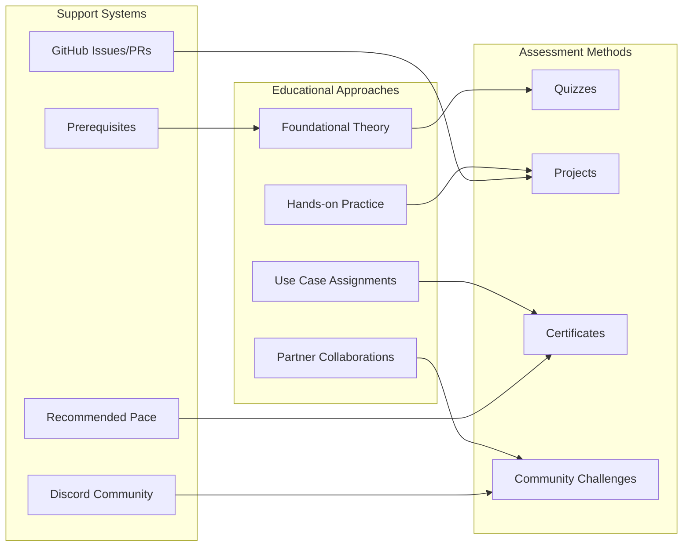
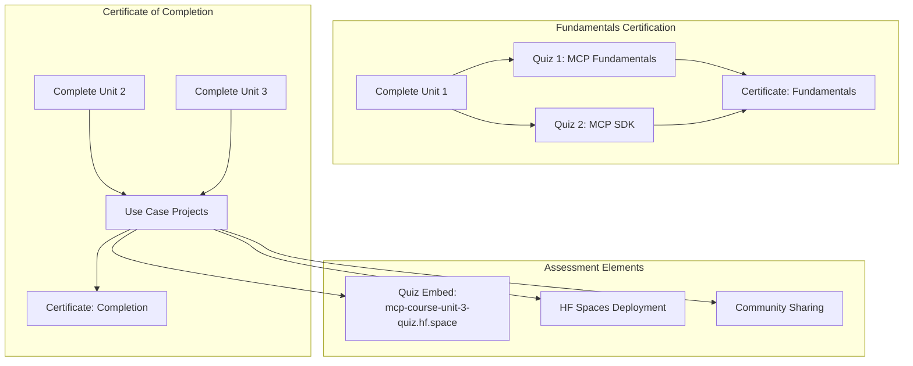
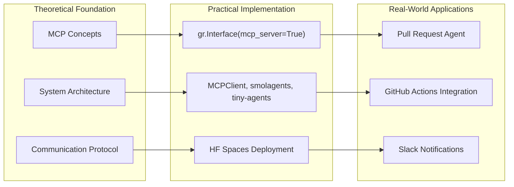

<!-- source: DeepWiki mcp.deepwiki.com · repo huggingface/mcp-course · page 7 Course Structure and Educational Content · fetched 2026-10-26 -->

# Course Structure and Educational Content

Relevant source files

The following files were used as context for generating this wiki page:

- [units/en/_toctree.yml](units/en/_toctree.yml)
- [units/en/unit0/introduction.mdx](units/en/unit0/introduction.mdx)
- [units/en/unit2/introduction.mdx](units/en/unit2/introduction.mdx)
- [units/en/unit3/certificate.mdx](units/en/unit3/certificate.mdx)

This document describes the educational framework, learning progression, and organizational structure of the MCP (Model Context Protocol) course. It covers the course architecture, unit organization, assessment methodology, and certification pathways designed to guide learners from MCP fundamentals to advanced application development.

For technical details about the MCP protocol itself, see [MCP Protocol Fundamentals](#2). For information about specific development tools and frameworks, see [Development Tools and SDKs](#6).

## Course Architecture Overview

The MCP course follows a progressive learning structure with four main educational tracks, combining theoretical foundations with hands-on application development.

### Course Structure Mapping

```mermaid
graph TB
    subgraph "Unit0_Welcome"["Unit 0: Welcome & Setup"]
        unit0_intro["unit0/introduction.mdx"]
    end
    
    subgraph "Unit1_Fundamentals"["Unit 1: MCP Fundamentals"]
        unit1_intro["unit1/introduction.mdx"]
        unit1_concepts["unit1/key-concepts.mdx"]
        unit1_arch["unit1/architectural-components.mdx"]
        unit1_protocol["unit1/communication-protocol.mdx"]
        unit1_capabilities["unit1/capabilities.mdx"]
        unit1_sdk["unit1/sdk.mdx"]
        unit1_clients["unit1/mcp-clients.mdx"]
        unit1_gradio["unit1/gradio-mcp.mdx"]
        unit1_quiz1["unit1/quiz1.mdx"]
        unit1_quiz2["unit1/quiz2.mdx"]
        unit1_cert["unit1/certificate.mdx"]
    end
    
    subgraph "Unit2_EndToEnd"["Unit 2: End-to-End Application"]
        unit2_intro["unit2/introduction.mdx"]
        unit2_server["unit2/gradio-server.mdx"]
        unit2_clients["unit2/clients.mdx"]
        unit2_continue["unit2/continue-client.mdx"]
        unit2_gradio_client["unit2/gradio-client.mdx"]
        unit2_agents["unit2/tiny-agents.mdx"]
    end
    
    subgraph "Unit3_Advanced"["Unit 3: Advanced Development"]
        unit3_intro["unit3/introduction.mdx"]
        unit3_server["unit3/build-mcp-server.mdx"]
        unit3_github["unit3/github-actions-integration.mdx"]
        unit3_slack["unit3/slack-notification.mdx"]
        unit3_solution["unit3/build-mcp-server-solution-walkthrough.mdx"]
        unit3_cert["unit3/certificate.mdx"]
    end
    
    subgraph "Unit3_1_Hub"["Unit 3.1: Hub Pull Request Agent"]
        unit3_1_intro["unit3_1/introduction.mdx"]
        unit3_1_setup["unit3_1/setting-up-the-project.mdx"]
        unit3_1_server["unit3_1/creating-the-mcp-server.mdx"]
        unit3_1_client["unit3_1/mcp-client.mdx"]
        unit3_1_webhook["unit3_1/webhook-listener.mdx"]
        unit3_1_quiz1["unit3_1/quiz1.mdx"]
        unit3_1_quiz2["unit3_1/quiz2.mdx"]
    end
    
    unit0_intro --> unit1_intro
    unit1_cert --> unit2_intro
    unit2_agents --> unit3_intro
    unit3_solution --> unit3_1_intro
    
    unit1_concepts --> unit1_quiz1
    unit1_sdk --> unit1_quiz2
    unit1_quiz1 --> unit1_cert
    unit1_quiz2 --> unit1_cert
    
    unit3_1_server --> unit3_1_quiz1
    unit3_1_webhook --> unit3_1_quiz2
```

Sources: [units/en/_toctree.yml:1-83]()

### Learning Methodology Framework

Sources: [units/en/unit0/introduction.mdx:39-43](), [units/en/unit0/introduction.mdx:88-92]()

## Learning Progression and Units

### Unit Progression and Dependencies

The course is structured with clear prerequisite relationships and progressive skill building:

| Unit | Title | Duration | Prerequisites | Learning Outcomes |
|------|-------|----------|---------------|-------------------|
| 0 | Welcome & Setup | Setup | None | Environment configuration, community onboarding |
| 1 | MCP Fundamentals | 1 week | Basic AI/LLM knowledge | Core concepts, architecture, SDK usage |
| 2 | End-to-End Application | 1 week | Unit 1 completion | Gradio MCP servers, client implementations |
| 3 | Advanced Development | 1 week | Unit 2 completion | Custom workflow servers, CI/CD integration |
| 3.1 | Hub Pull Request Agent | 1 week | Unit 3 completion | Real-world deployment, webhook processing |

Sources: [units/en/unit0/introduction.mdx:94-96](), [units/en/_toctree.yml:1-83]()

### Unit Content Breakdown

```mermaid
graph TD
    subgraph "Unit1_Content"["Unit 1: Fundamentals (9 sections)"]
        u1_theory["Theory: key-concepts.mdx<br/>architectural-components.mdx<br/>communication-protocol.mdx"]
        u1_practical["Practical: capabilities.mdx<br/>sdk.mdx<br/>mcp-clients.mdx<br/>gradio-mcp.mdx"]
        u1_assess["Assessment: quiz1.mdx<br/>quiz2.mdx<br/>certificate.mdx"]
    end
    
    subgraph "Unit2_Content"["Unit 2: End-to-End (6 sections)"]
        u2_server["Server: gradio-server.mdx"]
        u2_clients["Clients: clients.mdx<br/>continue-client.mdx<br/>gradio-client.mdx<br/>tiny-agents.mdx"]
        u2_intro["Introduction: introduction.mdx"]
    end
    
    subgraph "Unit3_Content"["Unit 3: Advanced (6 sections)"]
        u3_modules["Module 1: build-mcp-server.mdx<br/>Module 2: github-actions-integration.mdx<br/>Module 3: slack-notification.mdx"]
        u3_solution["Solution: build-mcp-server-solution-walkthrough.mdx"]
        u3_cert["Certificate: certificate.mdx"]
    end
    
    subgraph "Unit3_1_Content"["Unit 3.1: Hub Agent (7 sections)"]
        u3_1_impl["Implementation: creating-the-mcp-server.mdx<br/>mcp-client.mdx<br/>webhook-listener.mdx"]
        u3_1_setup["Setup: setting-up-the-project.mdx"]
        u3_1_quiz["Quizzes: quiz1.mdx<br/>quiz2.mdx"]
    end
    
    u1_theory --> u1_assess
    u1_practical --> u1_assess
    u2_server --> u2_clients
    u3_modules --> u3_solution
    u3_solution --> u3_cert
    u3_1_setup --> u3_1_impl
    u3_1_impl --> u3_1_quiz
```

Sources: [units/en/_toctree.yml:6-83]()

## Assessment and Certification

### Certification Pathways

The course offers two distinct certification tracks with specific completion requirements:

Sources: [units/en/unit0/introduction.mdx:88-92](), [units/en/unit3/certificate.mdx:7-12]()

### Quiz and Assessment Infrastructure

The assessment system uses embedded Hugging Face Spaces for interactive quizzes:

| Assessment | Location | Format | Integration |
|------------|----------|--------|-------------|
| Quiz 1 | `unit1/quiz1.mdx` | Interactive | Embedded Space |
| Quiz 2 | `unit1/quiz2.mdx` | Interactive | Embedded Space |
| Unit 3 Quiz | `unit3/certificate.mdx` | Interactive | `mcp-course-unit-3-quiz.hf.space` |
| Unit 3.1 Quiz 1 | `unit3_1/quiz1.mdx` | Interactive | Embedded Space |
| Unit 3.1 Quiz 2 | `unit3_1/quiz2.mdx` | Interactive | Embedded Space |

Sources: [units/en/unit3/certificate.mdx:7-18](), [units/en/_toctree.yml:14-15](), [units/en/_toctree.yml:22-23]()

## Educational Methodology

### Hands-On Learning Approach

The course emphasizes practical implementation with pre-configured development environments:

Sources: [units/en/unit0/introduction.mdx:39-43](), [units/en/unit2/introduction.mdx:17-23]()

### Community Integration and Support

The course includes multiple channels for community engagement and support:

| Platform | Purpose | Content Type |
|----------|---------|--------------|
| Discord Server | Study groups, Q&A | `#mcp-course-questions` |
| GitHub Repository | Issues, PRs, contributions | Bug reports, improvements |
| Hugging Face Hub | Project sharing, spaces | Model deployments, demos |
| Course Forum | Discussion, feedback | Community challenges |

Sources: [units/en/unit0/introduction.mdx:105-108](), [units/en/unit0/introduction.mdx:132-138]()

### Prerequisites and Recommended Pace

The course targets developers with specific background knowledge:

**Required Prerequisites:**
- Basic understanding of AI and LLM concepts
- Familiarity with software development principles and API concepts  
- Experience with at least one programming language (Python or TypeScript)

**Recommended Resources:**
- [LLM Course](https://huggingface.co/learn/llm-course) for LLM basics
- [Agents Course](https://huggingface.co/learn/agents-course) for AI agent concepts

**Time Commitment:**
- 1 week per chapter
- 3-4 hours of work per week
- Self-paced with recommended schedule

Sources: [units/en/unit0/introduction.mdx:58-75](), [units/en/unit0/introduction.mdx:94-96]()

## Partner Collaborations and Acknowledgments

The course includes strategic partnerships with key organizations in the MCP ecosystem:

### Partner Organizations

| Partner | Contribution | Integration |
|---------|-------------|-------------|
| Anthropic | Technical content, Unit 3 development | MCP protocol expertise |
| Gradio | MCP server integration | `gr.Interface(mcp_server=True)` |
| Continue | IDE integration examples | Local AI coding assistant |
| Llama.cpp | Local model support | Model deployment options |

Sources: [units/en/unit0/introduction.mdx:127-130]()

### Course Evolution and Contribution Process

The course is designed as a living project with clear contribution guidelines:

**Contribution Types:**
- Bug reports via GitHub issues
- Content improvements via Pull Requests  
- New sections or units (requires issue discussion first)
- Community feedback and suggestions

**Development Process:**
- Open issue for bugs or feature requests
- Discussion before major content additions
- Pull Request review process
- Community feedback integration

Sources: [units/en/unit0/introduction.mdx:132-138](), [units/en/unit0/introduction.mdx:44]()

---

