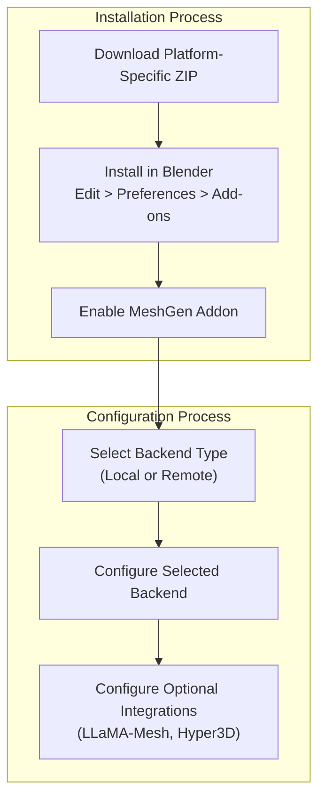
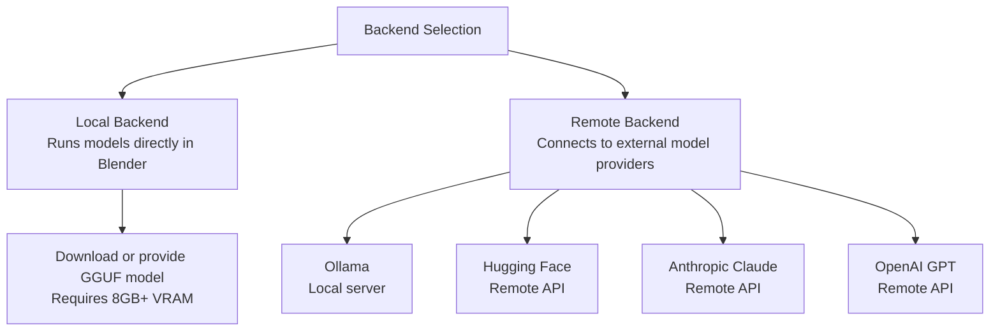
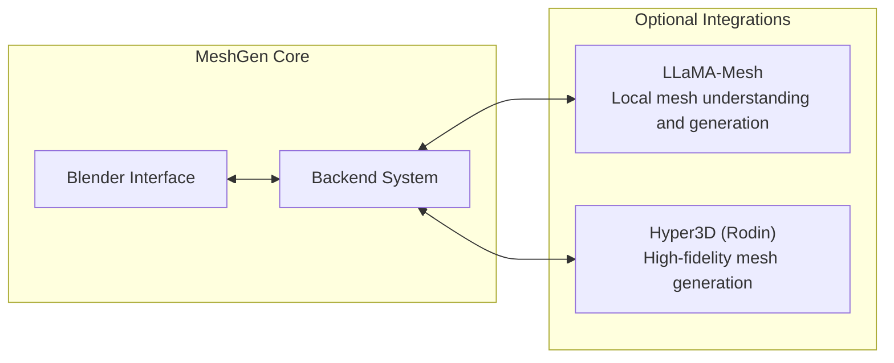
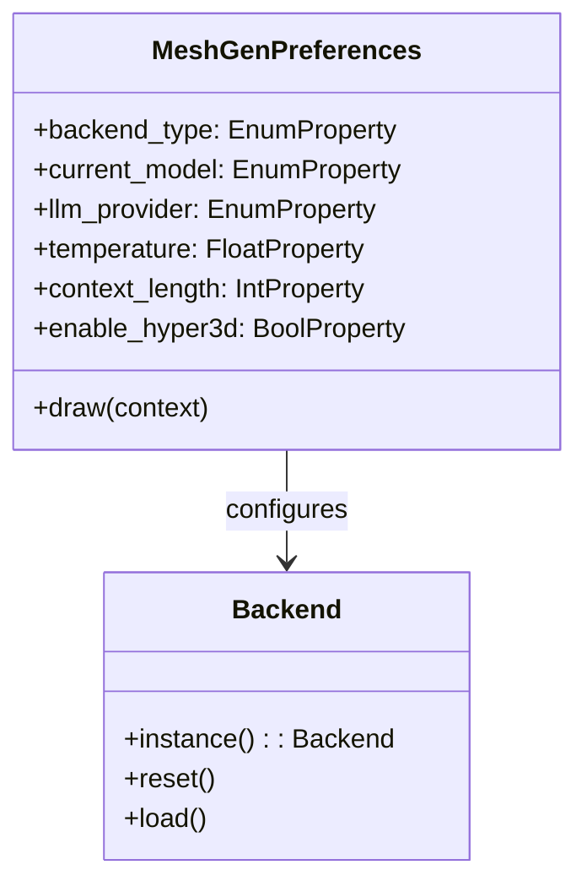

<!-- source: DeepWiki mcp.deepwiki.com · repo huggingface/meshgen · page 2 Installation and Setup · fetched 2026-10-26 -->

# Installation and Setup

Relevant source files

The following files were used as context for generating this wiki page:

- [README.md](README.md)
- [docs/meshgen.gif](docs/meshgen.gif)
- [preferences.py](preferences.py)

This document provides an overview of the installation process and setup options for MeshGen, a Blender addon for using AI agents to generate and manipulate 3D models through natural language. For step-by-step installation instructions for specific platforms, see [Installation Guide](#2.1). For detailed configuration options, see [Configuration Options](#2.2).

## Overview of Installation and Setup Process

MeshGen offers flexible configuration options to accommodate different hardware capabilities and user preferences. The setup process involves two main steps:

1. **Installing the addon in Blender**
2. **Configuring the backend and optional integrations**

Sources: [README.md:16-26]()

## Installation Process

1. Download the appropriate ZIP file for your platform from the [latest release](https://github.com/huggingface/meshgen/releases/latest) 
2. In Blender, navigate to `Edit > Preferences > Add-ons`
3. Click on the top-right arrow and select `Install from Disk...`
4. Select the downloaded ZIP file
5. Enable the addon by checking the box next to it

Sources: [README.md:16-21]()

## Backend Configuration

MeshGen provides two main backend options:

Sources: [README.md:24-26](), [preferences.py:35-49]()

### Local Backend Configuration

The local backend runs models directly within Blender using the integrated `llama_cpp_python` backend.

**Requirements:**
- NVIDIA GPU with at least 8GB of VRAM
- CUDA version of the addon
- Sufficient system RAM

**Setup Steps:**
1. In Blender Preferences, go to the MeshGen addon settings
2. Select `Local` as the backend type
3. Either:
   - Click `Download Recommended Model` to download Meta-Llama-3.1-8B-Instruct-GGUF
   - Manually download a .GGUF model and place it in the models folder (accessible via the folder icon)
4. Select your downloaded model from the dropdown

Sources: [README.md:28-43](), [preferences.py:196-227]()

### Remote Backend Configuration

The remote backend connects to external providers for model inference.

#### Ollama

**Setup Steps:**
1. Install [Ollama](https://ollama.com)
2. Run `ollama serve` in a terminal
3. In MeshGen preferences, select `Remote` as the backend type
4. Select `Ollama` as the provider
5. Configure:
   - Endpoint (default: `http://localhost:11434`)
   - Model name (default: `gemma3`)
   - Optional API key for private models

Sources: [README.md:56-64](), [preferences.py:234-247]()

#### Hugging Face

**Setup Steps:**
1. Create a Hugging Face account
2. Generate an API token at [hf.co/settings/tokens](https://hf.co/settings/tokens)
3. In MeshGen preferences, select `Remote` as the backend type
4. Select `Hugging Face` as the provider
5. Configure:
   - Model ID (default: `meta-llama/Llama-3.3-70B-Instruct`)
   - API key

Sources: [README.md:65-74](), [preferences.py:249-262]()

#### Anthropic

**Setup Steps:**
1. Create an Anthropic account
2. Generate an API key at [console.anthropic.com/settings/keys](https://console.anthropic.com/settings/keys)
3. In MeshGen preferences, select `Remote` as the backend type
4. Select `Anthropic` as the provider
5. Configure:
   - Model ID (default: `claude-3-5-sonnet-latest`)
   - API key

Sources: [README.md:75-84](), [preferences.py:264-277]()

#### OpenAI

**Setup Steps:**
1. Create an OpenAI account
2. Generate a secret key at [platform.openai.com/api-keys](https://platform.openai.com/api-keys)
3. In MeshGen preferences, select `Remote` as the backend type
4. Select `OpenAI` as the provider
5. Configure:
   - Model ID (default: `gpt-4o`)
   - API key

Sources: [README.md:85-94](), [preferences.py:279-292]()

## Generation Settings

MeshGen provides advanced generation settings that can be accessed by expanding the "Generation Settings" section in the preferences:

| Setting | Description | Default | Range |
|---------|-------------|---------|-------|
| Temperature | Controls randomness in generation (higher = more creative) | 0.7 | 0.0-1.0 |
| Context Length | Maximum tokens in the context window | 32768 | 1024-65536 |

Sources: [preferences.py:151-169](), [preferences.py:294-307]()

## Optional Integrations

MeshGen supports optional integrations that enhance its capabilities:

Sources: [README.md:95-124](), [preferences.py:309-354]()

### LLaMA-Mesh Integration

LLaMA-Mesh provides local mesh understanding and generation capabilities.

**Requirements:**
- NVIDIA GPU with at least 8GB of VRAM
- CUDA version of the addon
- Recommended to use with Remote backend (not Local) to conserve VRAM

**Setup Steps:**
1. In MeshGen preferences, expand the "Integrations" section
2. Click `Load LLaMA-Mesh` and wait for the model to load
3. Once loaded, a success message will appear

Sources: [README.md:103-114](), [preferences.py:322-343]()

### Hyper3D Integration

Hyper3D (Rodin) provides high-fidelity 3D mesh generation via an API.

**Setup Steps:**
1. In MeshGen preferences, expand the "Integrations" section
2. Check `Enable Hyper3D` 
3. Enter your Hyper3D API key (free use is currently available with the key `awesomemcp`)

Note: Generating meshes with Hyper3D may take several minutes per mesh.

Sources: [README.md:115-124](), [preferences.py:345-354]()

## Configuration Relationship to MeshGenPreferences Class

The MeshGen preferences UI directly maps to the `MeshGenPreferences` class defined in the codebase:

Sources: [preferences.py:32-355]()

The `MeshGenPreferences` class contains all configuration properties that control the behavior of MeshGen, from backend selection to integration settings. When preferences are changed, the `reset_backend` function is called to update the backend system with the new settings.

Sources: [preferences.py:18-30]()

---

