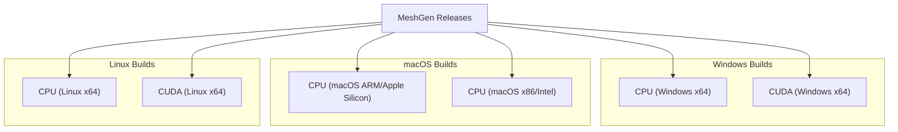
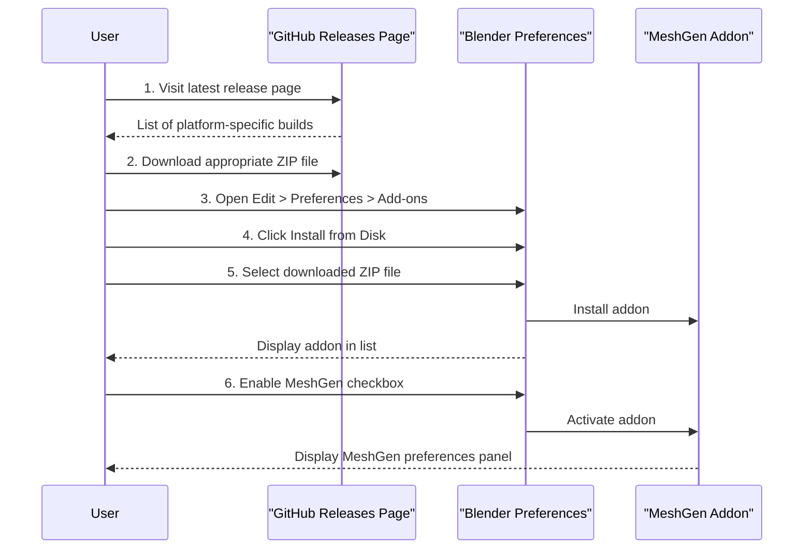
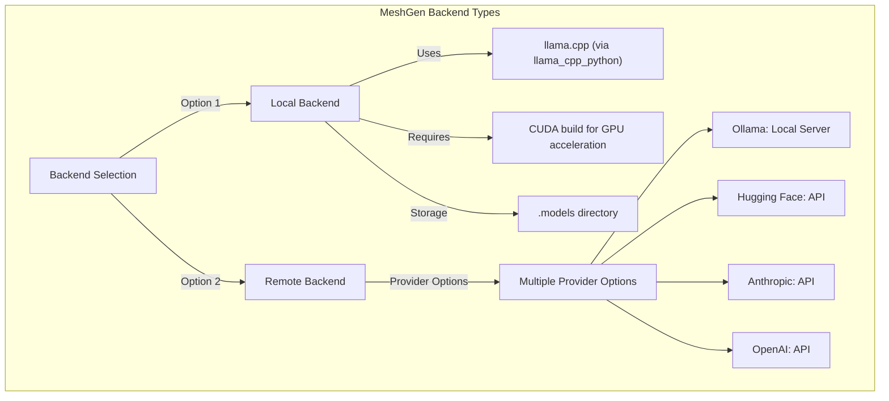
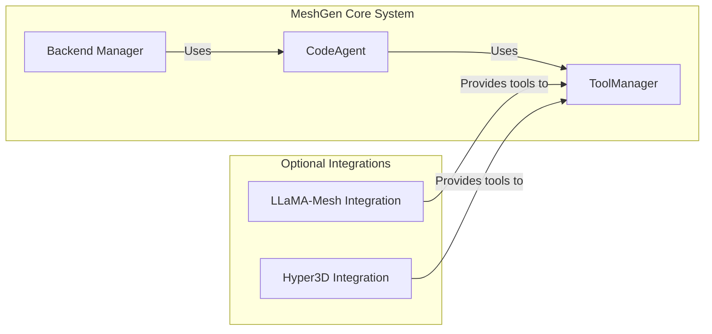

<!-- source: DeepWiki mcp.deepwiki.com · repo huggingface/meshgen · page 2.1 Installation Guide · fetched 2026-10-26 -->

# Installation Guide

Relevant source files

The following files were used as context for generating this wiki page:

- [.github/workflows/package-release.yml](.github/workflows/package-release.yml)
- [README.md](README.md)
- [docs/meshgen.gif](docs/meshgen.gif)

This guide provides detailed instructions for installing and setting up the MeshGen addon for Blender across different platforms. It covers downloading the appropriate release package, installing the addon in Blender, and initial configuration steps. For post-installation configuration options, please refer to [Configuration Options](#2.2).

## System Requirements

Before installing MeshGen, ensure your system meets these requirements:

| Component | Minimum Requirement | Recommended for Local AI |
|-----------|---------------------|--------------------------|
| Blender | 4.0 or newer | 4.2 or newer |
| RAM | 8GB | 16GB+ |
| GPU (for CUDA version) | None (CPU version) | NVIDIA with 8GB+ VRAM |
| Disk Space | 1GB for addon | 5GB+ for models |
| Internet | Required for remote backends | Optional with local backends |

Sources: [README.md:33-38]()

## Platform-Specific Build Variants

MeshGen is available in multiple platform-specific builds:

**Important:** Choose the CUDA version only if you have a compatible NVIDIA GPU and want to run local AI models directly in Blender. Choose the CPU version if you plan to use remote backends or Ollama.

Sources: [.github/workflows/package-release.yml:10-47]()

## Download and Installation Process

### Step-by-Step Installation:

1. Visit the [Latest Release](https://github.com/huggingface/meshgen/releases/latest) page on GitHub
2. Download the appropriate ZIP file for your platform (see platform variants above)
3. In Blender, navigate to `Edit` → `Preferences` → `Add-ons` 
4. Click the top-right arrow button → `Install from Disk...`
5. Select the downloaded ZIP file and click `Install Add-on`
6. Enable the addon by checking the box next to "MeshGen"
7. Configure the backend options as described in the next section

Sources: [README.md:16-21]()

## Backend Configuration

After installation, you must choose and configure a backend option. MeshGen offers two primary backend types:

### Local Backend Setup

The local backend runs AI models directly within Blender using llama.cpp.

**Requirements:**
- CUDA variant of MeshGen (for GPU acceleration)
- NVIDIA GPU with 8GB+ VRAM recommended

**Setup:**
1. In Blender preferences, under MeshGen addon settings, select `Local` backend
2. You can either:
   - Click `Download Recommended Model` to automatically download Meta-Llama-3.1-8B-Instruct
   - Manually download a GGUF model and place it in the models directory (click the folder icon to locate)

Sources: [README.md:28-43]()

### Remote Backend Setup

For those without powerful GPUs or preferring remote inference:

#### Ollama Setup (Local Server)

1. Install [Ollama](https://ollama.com) on your machine
2. Run `ollama serve` in a terminal
3. Select `Ollama` in the Provider dropdown in MeshGen preferences
4. Use default endpoint (`http://localhost:11434`) and model name, or customize as needed

#### Hugging Face Setup (Recommended for most users)

1. Create a Hugging Face account at [huggingface.co](https://huggingface.co)
2. Generate a token at [hf.co/settings/tokens](https://hf.co/settings/tokens)
3. Select `Hugging Face` in the Provider dropdown
4. Enter your token in the `API Key` field
5. Optionally change the `Model ID` (default is recommended for most users)

#### Anthropic Setup

1. Create an Anthropic account at [console.anthropic.com](https://console.anthropic.com)
2. Generate an API key at [console.anthropic.com/settings/keys](https://console.anthropic.com/settings/keys)
3. Select `Anthropic` in the Provider dropdown
4. Enter your API key in the `API Key` field
5. Optionally change the `Model ID` (e.g., `claude-3-5-sonnet-latest`)

#### OpenAI Setup

1. Create an OpenAI account at [platform.openai.com](https://platform.openai.com)
2. Generate an API key at [platform.openai.com/api-keys](https://platform.openai.com/api-keys)
3. Select `OpenAI` in the Provider dropdown
4. Enter your API key in the `API Key` field
5. Optionally change the `Model ID` (e.g., `gpt-4o-mini`)

Sources: [README.md:45-93]()

## Optional Integrations

MeshGen supports two optional integrations that extend its capabilities:

### LLaMA-Mesh Integration

Enables local mesh understanding and generation capabilities:

**Requirements:**
- CUDA variant of MeshGen
- NVIDIA GPU with 8GB+ VRAM
- Recommended for use with remote backends (as LLaMA-Mesh will run locally)

**Setup:**
1. In Blender preferences, under MeshGen addon → Integrations tab
2. Check the LLaMA-Mesh option
3. Click `Load LLama-Mesh` and wait for the model to load

### Hyper3D Integration

Enables high-fidelity 3D mesh generation from text descriptions:

**Setup:**
1. In Blender preferences, under MeshGen addon → Integrations tab
2. Check `Enable Hyper3D`
3. Enter your Hyper3D API key (free use may be available with the key `awesomemcp`)

**Note:** Hyper3D mesh generation may take several minutes per mesh.

Sources: [README.md:95-124]()

## Troubleshooting Installation Issues

If you encounter issues during installation:

1. **Check Blender console for errors:**
   - Windows: `Window` → `Toggle System Console` in Blender
   - macOS/Linux: Launch Blender from a terminal to see outputs

2. **Common issues and solutions:**
   - If addon fails to enable, check if you're using the correct version for your platform
   - CUDA version requires a compatible NVIDIA GPU and drivers
   - Local backend requires sufficient VRAM (8GB+ recommended)
   - Slow mesh generation with Hyper3D is normal (can take several minutes)

3. **Report bugs:** If you encounter persistent issues, report them on the [MeshGen GitHub Issues page](https://github.com/huggingface/meshgen/issues) with details about your system, Blender version, and the error messages.

Sources: [README.md:132-137]()

## Verification of Installation

To verify that MeshGen is installed and working properly:

1. Press `N` in the 3D Viewport to open the sidebar
2. Look for the `MeshGen` tab
3. Ensure you can see the prompt input field and Submit button
4. Try a simple prompt like "Create a cube" to test the system

If the interface appears and processes your prompt, installation is successful. If you encounter any issues, refer to the Troubleshooting section above.

Sources: [README.md:126-131]()

---

