# Page: Overview

# Overview

<details>
<summary>Relevant source files</summary>

The following files were used as context for generating this wiki page:

- [README.md](README.md)
- [blender_manifest.toml](blender_manifest.toml)
- [docs/meshgen.gif](docs/meshgen.gif)
- [preferences.py](preferences.py)

</details>


MeshGen is a Blender addon that enables users to control Blender with natural language through AI agents. This document provides a high-level introduction to the MeshGen system architecture, core components, and how they interact to enable AI-powered 3D modeling in Blender.

For detailed installation instructions, see [Installation Guide](#2.1). For configuration options, see [Configuration Options](#2.2).

## Core Architecture

MeshGen follows a modular architecture that bridges natural language instructions with Blender operations through an AI agent system. The core components work together to process user prompts and convert them into executable Blender operations.

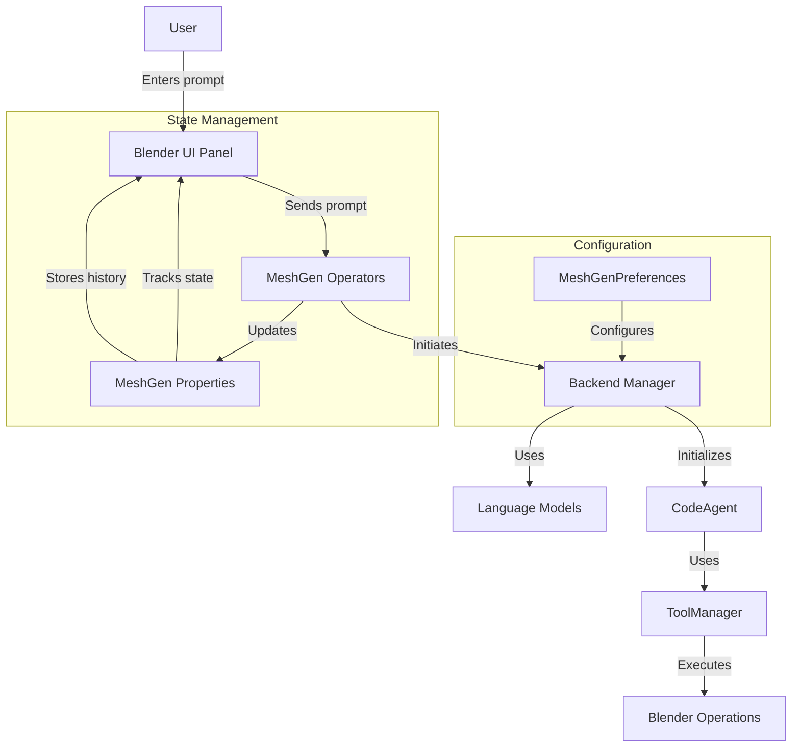

The user interacts with the MeshGen panel in Blender's UI, entering natural language prompts. These prompts are processed by operators that initialize the backend manager. The backend uses language models to power a CodeAgent, which interprets the prompts and uses the ToolManager to execute Blender operations.

Sources: [README.md:3-15](), [preferences.py:32-186]()

## Backend System

MeshGen supports multiple backend configurations for language model inference, offering flexibility for different user needs and hardware capabilities.

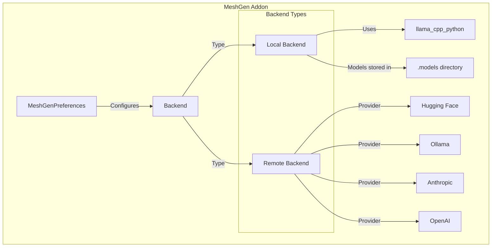

The backend system is configured through MeshGenPreferences and supports two primary types:

1. **Local Backend**: Runs models directly in Blender using llama_cpp_python, requiring at least 8GB of VRAM
2. **Remote Backend**: Connects to external LLM providers, including:
   - Hugging Face
   - Ollama (local server)
   - Anthropic (Claude models)
   - OpenAI (GPT models)

Sources: [preferences.py:32-186](), [README.md:28-94]()

## Tool Management System

The Tool Management system acts as a bridge between the AI agent and Blender's functionality, providing a structured way to execute operations in Blender's main thread.

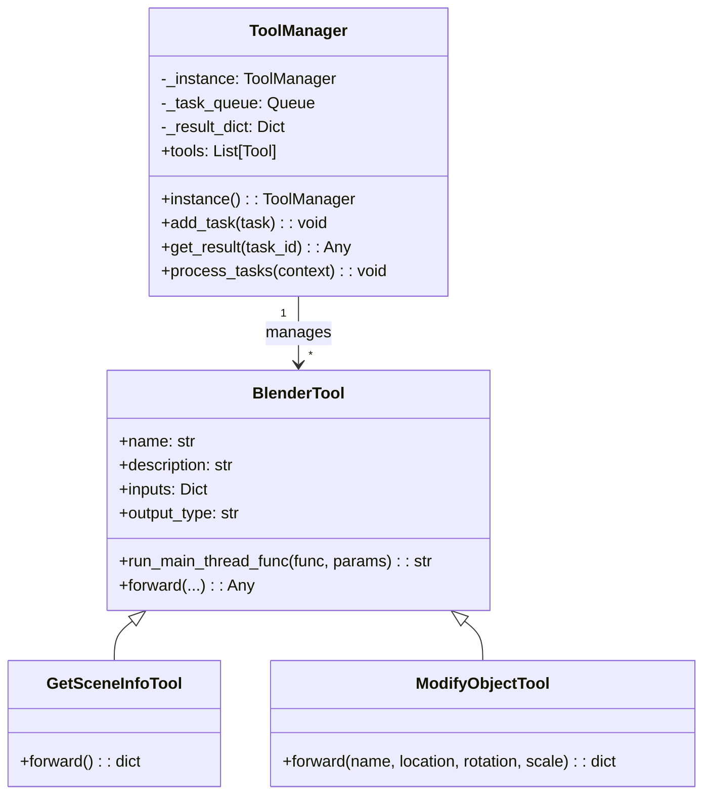

The ToolManager provides a singleton instance that manages a collection of tools. Each tool inherits from BlenderTool and implements a forward method to execute specific Blender operations. This system ensures that Blender operations run in the main thread while allowing the AI agent to function asynchronously.

Sources: [README.md:12-14]()

## Optional Integrations

MeshGen offers optional integrations that extend its capabilities for 3D content creation:

### LLaMA-Mesh Integration

LLaMA-Mesh provides local mesh understanding and generation capabilities, allowing the system to better comprehend and manipulate 3D geometry.

### Hyper3D Integration

Hyper3D (Rodin) integration enables high-fidelity 3D mesh generation through an external API service.

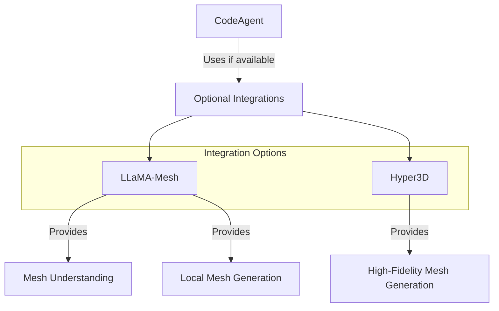

When these integrations are enabled, the agent automatically gains access to their capabilities based on the context of the user's request.

Sources: [preferences.py:320-354](), [README.md:96-124]()

## Workflow and State Management

MeshGen implements a state machine to manage the progression from user input to final result, ensuring a consistent user experience.

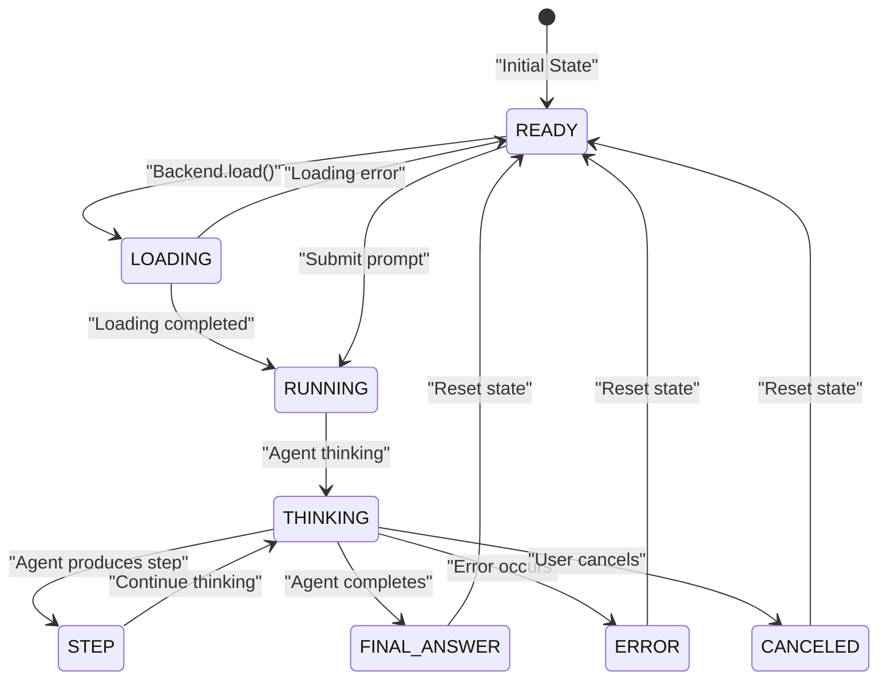

The workflow begins in the READY state. When a user submits a prompt, the system transitions to RUNNING and then THINKING as the agent processes the request. The agent produces intermediate STEP outputs before reaching a FINAL_ANSWER or encountering an ERROR. State changes are tracked in the history, keeping users informed of the process.

Sources: [preferences.py:18-29]()

## Dependencies and Requirements

MeshGen relies on several Python packages to function properly. These dependencies are listed in the blender_manifest.toml file and include:

- llama_cpp_python for local model inference
- smolagents for AI agent functionality
- huggingface_hub for model downloading and remote inference
- Various support libraries (requests, numpy, etc.)

| Requirement | Purpose | Dependency Type |
|-------------|---------|-----------------|
| Python 3.9+ | Base language | Core |
| Blender 4.2.0+ | Host application | Core |
| llama_cpp_python | Local model inference | Optional (Local Backend) |
| CUDA-capable GPU | For GPU acceleration | Optional (Local Backend) |
| Internet connection | For remote backends and model downloads | Optional (Remote Backend) |

Sources: [blender_manifest.toml:1-100](), [README.md:17-27]()

## Technical Implementation

The MeshGen addon is structured according to Blender's addon architecture, with several key Python modules:

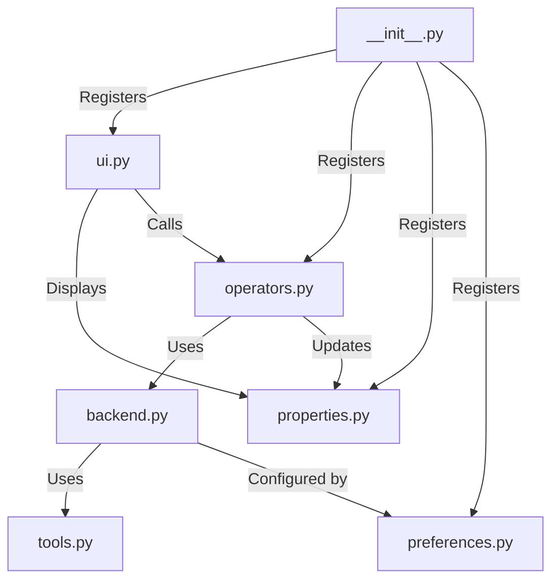

This modular architecture allows for separation of concerns:
- `preferences.py` contains the MeshGenPreferences class that configures the backend
- `backend.py` manages model loading and inference
- `tools.py` implements the tools that execute Blender operations
- `operators.py` contains the Blender operators that users interact with
- `ui.py` defines the user interface elements
- `properties.py` manages state and history

Sources: [preferences.py:32-362](), [blender_manifest.toml:1-25]()

## Getting Started

To start using MeshGen:

1. Install the addon from the [Latest Release](https://github.com/huggingface/meshgen/releases/latest)
2. Configure your preferred backend in Blender's Preferences panel
3. Access the MeshGen panel by pressing `N` in the 3D viewport and selecting the MeshGen tab
4. Enter a natural language prompt (e.g., "Create a snowman")
5. Click Submit to generate the model

For more detailed installation and setup instructions, see [Installation Guide](#2.1) and [Configuration Options](#2.2).

Sources: [README.md:16-27](), [README.md:126-131]()

---

# Page: Installation and Setup

# Installation and Setup

<details>
<summary>Relevant source files</summary>

The following files were used as context for generating this wiki page:

- [README.md](README.md)
- [docs/meshgen.gif](docs/meshgen.gif)
- [preferences.py](preferences.py)

</details>


This document provides an overview of the installation process and setup options for MeshGen, a Blender addon for using AI agents to generate and manipulate 3D models through natural language. For step-by-step installation instructions for specific platforms, see [Installation Guide](#2.1). For detailed configuration options, see [Configuration Options](#2.2).

## Overview of Installation and Setup Process

MeshGen offers flexible configuration options to accommodate different hardware capabilities and user preferences. The setup process involves two main steps:

1. **Installing the addon in Blender**
2. **Configuring the backend and optional integrations**

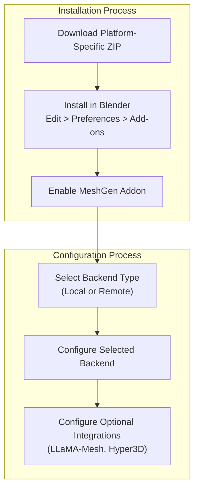

Sources: [README.md:16-26]()

## Installation Process

1. Download the appropriate ZIP file for your platform from the [latest release](https://github.com/huggingface/meshgen/releases/latest) 
2. In Blender, navigate to `Edit > Preferences > Add-ons`
3. Click on the top-right arrow and select `Install from Disk...`
4. Select the downloaded ZIP file
5. Enable the addon by checking the box next to it

Sources: [README.md:16-21]()

## Backend Configuration

MeshGen provides two main backend options:

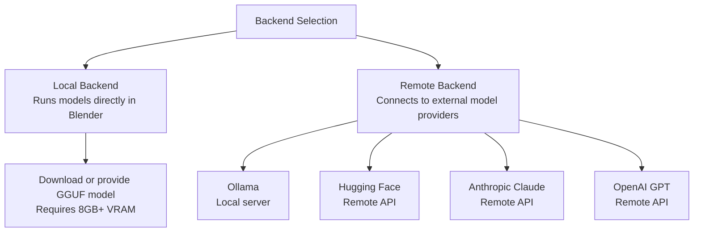

Sources: [README.md:24-26](), [preferences.py:35-49]()

### Local Backend Configuration

The local backend runs models directly within Blender using the integrated `llama_cpp_python` backend.

**Requirements:**
- NVIDIA GPU with at least 8GB of VRAM
- CUDA version of the addon
- Sufficient system RAM

**Setup Steps:**
1. In Blender Preferences, go to the MeshGen addon settings
2. Select `Local` as the backend type
3. Either:
   - Click `Download Recommended Model` to download Meta-Llama-3.1-8B-Instruct-GGUF
   - Manually download a .GGUF model and place it in the models folder (accessible via the folder icon)
4. Select your downloaded model from the dropdown

Sources: [README.md:28-43](), [preferences.py:196-227]()

### Remote Backend Configuration

The remote backend connects to external providers for model inference.

#### Ollama

**Setup Steps:**
1. Install [Ollama](https://ollama.com)
2. Run `ollama serve` in a terminal
3. In MeshGen preferences, select `Remote` as the backend type
4. Select `Ollama` as the provider
5. Configure:
   - Endpoint (default: `http://localhost:11434`)
   - Model name (default: `gemma3`)
   - Optional API key for private models

Sources: [README.md:56-64](), [preferences.py:234-247]()

#### Hugging Face

**Setup Steps:**
1. Create a Hugging Face account
2. Generate an API token at [hf.co/settings/tokens](https://hf.co/settings/tokens)
3. In MeshGen preferences, select `Remote` as the backend type
4. Select `Hugging Face` as the provider
5. Configure:
   - Model ID (default: `meta-llama/Llama-3.3-70B-Instruct`)
   - API key

Sources: [README.md:65-74](), [preferences.py:249-262]()

#### Anthropic

**Setup Steps:**
1. Create an Anthropic account
2. Generate an API key at [console.anthropic.com/settings/keys](https://console.anthropic.com/settings/keys)
3. In MeshGen preferences, select `Remote` as the backend type
4. Select `Anthropic` as the provider
5. Configure:
   - Model ID (default: `claude-3-5-sonnet-latest`)
   - API key

Sources: [README.md:75-84](), [preferences.py:264-277]()

#### OpenAI

**Setup Steps:**
1. Create an OpenAI account
2. Generate a secret key at [platform.openai.com/api-keys](https://platform.openai.com/api-keys)
3. In MeshGen preferences, select `Remote` as the backend type
4. Select `OpenAI` as the provider
5. Configure:
   - Model ID (default: `gpt-4o`)
   - API key

Sources: [README.md:85-94](), [preferences.py:279-292]()

## Generation Settings

MeshGen provides advanced generation settings that can be accessed by expanding the "Generation Settings" section in the preferences:

| Setting | Description | Default | Range |
|---------|-------------|---------|-------|
| Temperature | Controls randomness in generation (higher = more creative) | 0.7 | 0.0-1.0 |
| Context Length | Maximum tokens in the context window | 32768 | 1024-65536 |

Sources: [preferences.py:151-169](), [preferences.py:294-307]()

## Optional Integrations

MeshGen supports optional integrations that enhance its capabilities:

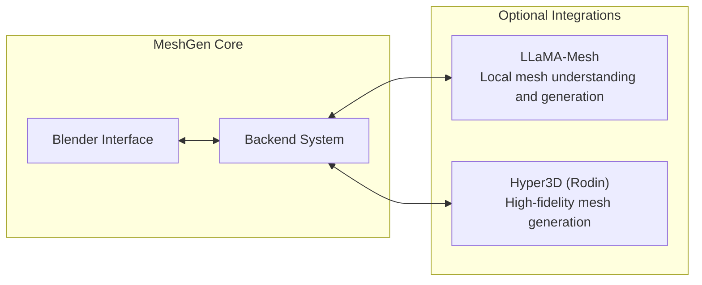

Sources: [README.md:95-124](), [preferences.py:309-354]()

### LLaMA-Mesh Integration

LLaMA-Mesh provides local mesh understanding and generation capabilities.

**Requirements:**
- NVIDIA GPU with at least 8GB of VRAM
- CUDA version of the addon
- Recommended to use with Remote backend (not Local) to conserve VRAM

**Setup Steps:**
1. In MeshGen preferences, expand the "Integrations" section
2. Click `Load LLaMA-Mesh` and wait for the model to load
3. Once loaded, a success message will appear

Sources: [README.md:103-114](), [preferences.py:322-343]()

### Hyper3D Integration

Hyper3D (Rodin) provides high-fidelity 3D mesh generation via an API.

**Setup Steps:**
1. In MeshGen preferences, expand the "Integrations" section
2. Check `Enable Hyper3D` 
3. Enter your Hyper3D API key (free use is currently available with the key `awesomemcp`)

Note: Generating meshes with Hyper3D may take several minutes per mesh.

Sources: [README.md:115-124](), [preferences.py:345-354]()

## Configuration Relationship to MeshGenPreferences Class

The MeshGen preferences UI directly maps to the `MeshGenPreferences` class defined in the codebase:

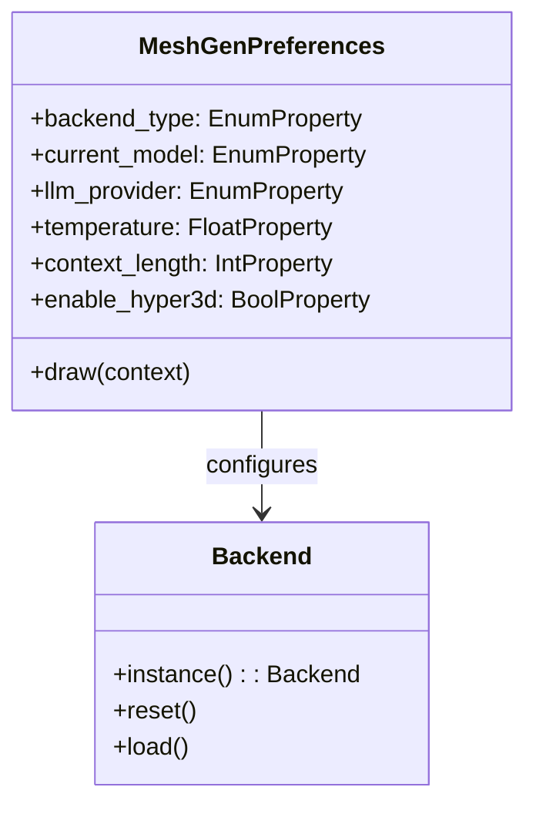

Sources: [preferences.py:32-355]()

The `MeshGenPreferences` class contains all configuration properties that control the behavior of MeshGen, from backend selection to integration settings. When preferences are changed, the `reset_backend` function is called to update the backend system with the new settings.

Sources: [preferences.py:18-30]()

---

# Page: Installation Guide

# Installation Guide

<details>
<summary>Relevant source files</summary>

The following files were used as context for generating this wiki page:

- [.github/workflows/package-release.yml](.github/workflows/package-release.yml)
- [README.md](README.md)
- [docs/meshgen.gif](docs/meshgen.gif)

</details>


This guide provides detailed instructions for installing and setting up the MeshGen addon for Blender across different platforms. It covers downloading the appropriate release package, installing the addon in Blender, and initial configuration steps. For post-installation configuration options, please refer to [Configuration Options](#2.2).

## System Requirements

Before installing MeshGen, ensure your system meets these requirements:

| Component | Minimum Requirement | Recommended for Local AI |
|-----------|---------------------|--------------------------|
| Blender | 4.0 or newer | 4.2 or newer |
| RAM | 8GB | 16GB+ |
| GPU (for CUDA version) | None (CPU version) | NVIDIA with 8GB+ VRAM |
| Disk Space | 1GB for addon | 5GB+ for models |
| Internet | Required for remote backends | Optional with local backends |

Sources: [README.md:33-38]()

## Platform-Specific Build Variants

MeshGen is available in multiple platform-specific builds:

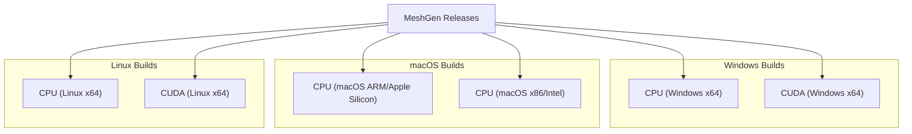

**Important:** Choose the CUDA version only if you have a compatible NVIDIA GPU and want to run local AI models directly in Blender. Choose the CPU version if you plan to use remote backends or Ollama.

Sources: [.github/workflows/package-release.yml:10-47]()

## Download and Installation Process

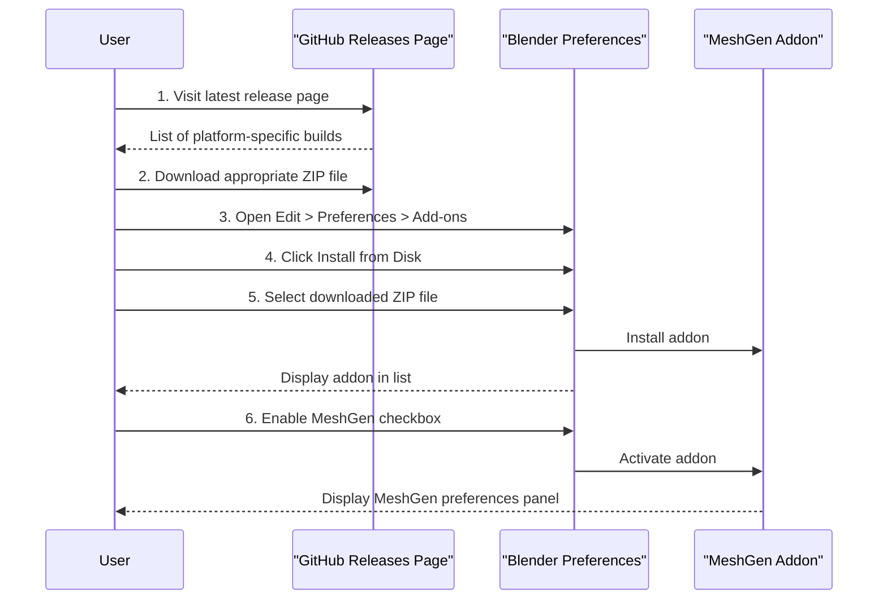

### Step-by-Step Installation:

1. Visit the [Latest Release](https://github.com/huggingface/meshgen/releases/latest) page on GitHub
2. Download the appropriate ZIP file for your platform (see platform variants above)
3. In Blender, navigate to `Edit` → `Preferences` → `Add-ons` 
4. Click the top-right arrow button → `Install from Disk...`
5. Select the downloaded ZIP file and click `Install Add-on`
6. Enable the addon by checking the box next to "MeshGen"
7. Configure the backend options as described in the next section

Sources: [README.md:16-21]()

## Backend Configuration

After installation, you must choose and configure a backend option. MeshGen offers two primary backend types:

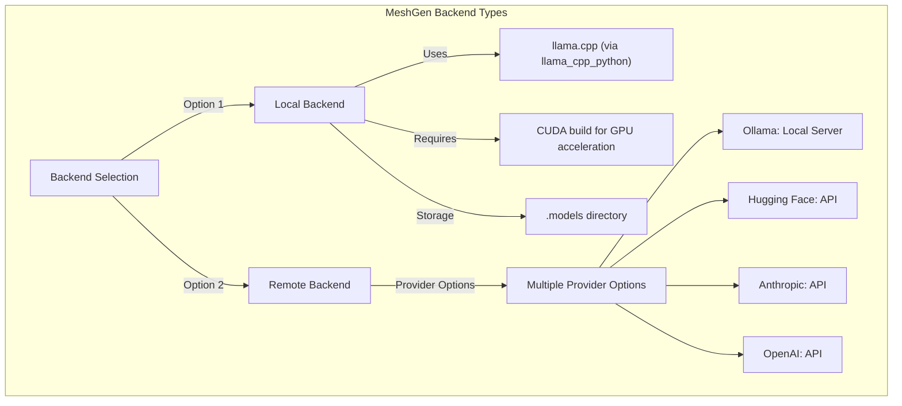

### Local Backend Setup

The local backend runs AI models directly within Blender using llama.cpp.

**Requirements:**
- CUDA variant of MeshGen (for GPU acceleration)
- NVIDIA GPU with 8GB+ VRAM recommended

**Setup:**
1. In Blender preferences, under MeshGen addon settings, select `Local` backend
2. You can either:
   - Click `Download Recommended Model` to automatically download Meta-Llama-3.1-8B-Instruct
   - Manually download a GGUF model and place it in the models directory (click the folder icon to locate)

Sources: [README.md:28-43]()

### Remote Backend Setup

For those without powerful GPUs or preferring remote inference:

#### Ollama Setup (Local Server)

1. Install [Ollama](https://ollama.com) on your machine
2. Run `ollama serve` in a terminal
3. Select `Ollama` in the Provider dropdown in MeshGen preferences
4. Use default endpoint (`http://localhost:11434`) and model name, or customize as needed

#### Hugging Face Setup (Recommended for most users)

1. Create a Hugging Face account at [huggingface.co](https://huggingface.co)
2. Generate a token at [hf.co/settings/tokens](https://hf.co/settings/tokens)
3. Select `Hugging Face` in the Provider dropdown
4. Enter your token in the `API Key` field
5. Optionally change the `Model ID` (default is recommended for most users)

#### Anthropic Setup

1. Create an Anthropic account at [console.anthropic.com](https://console.anthropic.com)
2. Generate an API key at [console.anthropic.com/settings/keys](https://console.anthropic.com/settings/keys)
3. Select `Anthropic` in the Provider dropdown
4. Enter your API key in the `API Key` field
5. Optionally change the `Model ID` (e.g., `claude-3-5-sonnet-latest`)

#### OpenAI Setup

1. Create an OpenAI account at [platform.openai.com](https://platform.openai.com)
2. Generate an API key at [platform.openai.com/api-keys](https://platform.openai.com/api-keys)
3. Select `OpenAI` in the Provider dropdown
4. Enter your API key in the `API Key` field
5. Optionally change the `Model ID` (e.g., `gpt-4o-mini`)

Sources: [README.md:45-93]()

## Optional Integrations

MeshGen supports two optional integrations that extend its capabilities:

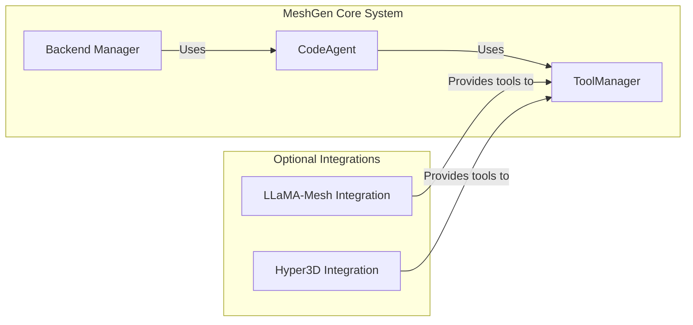

### LLaMA-Mesh Integration

Enables local mesh understanding and generation capabilities:

**Requirements:**
- CUDA variant of MeshGen
- NVIDIA GPU with 8GB+ VRAM
- Recommended for use with remote backends (as LLaMA-Mesh will run locally)

**Setup:**
1. In Blender preferences, under MeshGen addon → Integrations tab
2. Check the LLaMA-Mesh option
3. Click `Load LLama-Mesh` and wait for the model to load

### Hyper3D Integration

Enables high-fidelity 3D mesh generation from text descriptions:

**Setup:**
1. In Blender preferences, under MeshGen addon → Integrations tab
2. Check `Enable Hyper3D`
3. Enter your Hyper3D API key (free use may be available with the key `awesomemcp`)

**Note:** Hyper3D mesh generation may take several minutes per mesh.

Sources: [README.md:95-124]()

## Troubleshooting Installation Issues

If you encounter issues during installation:

1. **Check Blender console for errors:**
   - Windows: `Window` → `Toggle System Console` in Blender
   - macOS/Linux: Launch Blender from a terminal to see outputs

2. **Common issues and solutions:**
   - If addon fails to enable, check if you're using the correct version for your platform
   - CUDA version requires a compatible NVIDIA GPU and drivers
   - Local backend requires sufficient VRAM (8GB+ recommended)
   - Slow mesh generation with Hyper3D is normal (can take several minutes)

3. **Report bugs:** If you encounter persistent issues, report them on the [MeshGen GitHub Issues page](https://github.com/huggingface/meshgen/issues) with details about your system, Blender version, and the error messages.

Sources: [README.md:132-137]()

## Verification of Installation

To verify that MeshGen is installed and working properly:

1. Press `N` in the 3D Viewport to open the sidebar
2. Look for the `MeshGen` tab
3. Ensure you can see the prompt input field and Submit button
4. Try a simple prompt like "Create a cube" to test the system

If the interface appears and processes your prompt, installation is successful. If you encounter any issues, refer to the Troubleshooting section above.

Sources: [README.md:126-131]()

---

# Page: Configuration Options

# Configuration Options

<details>
<summary>Relevant source files</summary>

The following files were used as context for generating this wiki page:

- [README.md](README.md)
- [docs/meshgen.gif](docs/meshgen.gif)
- [preferences.py](preferences.py)

</details>


This page documents the various configuration options available in the MeshGen addon through its preferences panel. These settings control how MeshGen interfaces with language models, generates 3D objects, and integrates with external tools. For installation instructions, please see [Installation Guide](#2.1).

## Overview of Configuration Options

MeshGen provides a comprehensive set of configuration options that can be accessed through Blender's preferences panel. These settings are organized into three main categories:

1. **Backend Configuration** - Controls how MeshGen connects to language models
2. **Generation Settings** - Fine-tunes the behavior of the language model
3. **Integration Settings** - Manages optional third-party integrations

To access these settings:
1. Go to `Edit` → `Preferences` → `Add-ons`
2. Find and select `meshgen`
3. Expand the preference settings

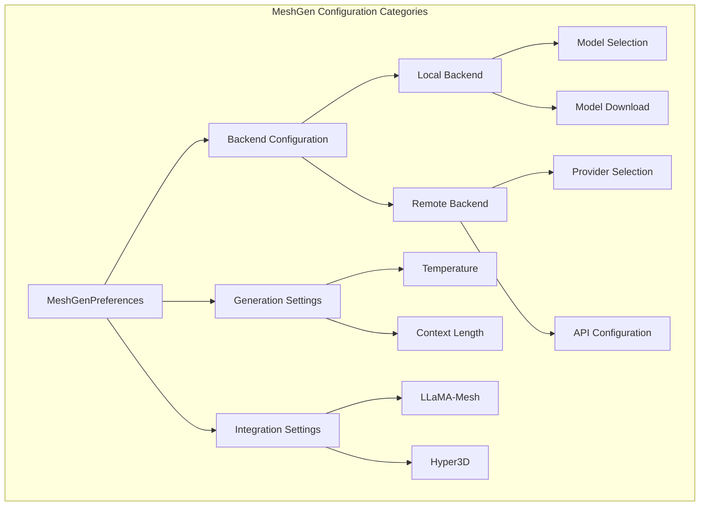

Sources: [preferences.py:32-186](), [README.md:23-27]()

## Backend Configuration

The backend configuration determines how MeshGen interfaces with language models, which are the core engine for understanding and generating 3D content. MeshGen supports two main types of backends: Local and Remote.

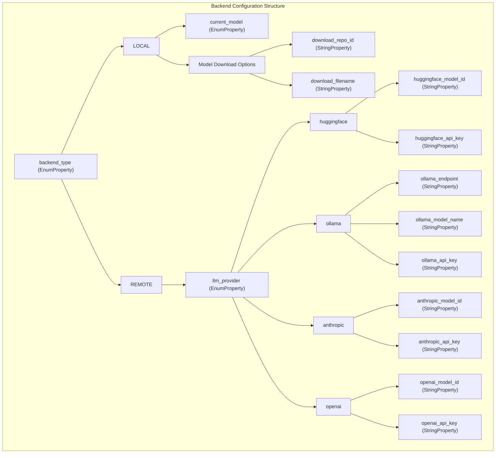

Sources: [preferences.py:36-143](), [README.md:28-93]()

### Local Backend

The Local backend runs language models directly within Blender, providing offline capabilities at the cost of requiring significant GPU resources.

#### Requirements:
- NVIDIA GPU with at least 8GB VRAM
- CUDA version of the addon

#### Configuration Options:

| Option | Type | Description | Default |
|--------|------|-------------|---------|
| `current_model` | EnumProperty | The selected model for local inference | (Dynamically populated from available models) |
| `download_repo_id` | StringProperty | Hugging Face repository ID for model download | "bartowski/Meta-Llama-3.1-8B-Instruct-GGUF" |
| `download_filename` | StringProperty | Filename of the model to download | "Meta-Llama-3.1-8B-Instruct-Q4_K_M.gguf" |

You can download models directly through the preferences panel or manually add `.GGUF` format models to the models folder.

Sources: [preferences.py:54-69](), [preferences.py:196-227](), [README.md:28-44]()

### Remote Backend

The Remote backend connects to external language model providers through APIs, offering access to more powerful models without local resource constraints.

#### Supported Providers:

1. **Hugging Face**
   | Option | Type | Description | Default |
   |--------|------|-------------|---------|
   | `huggingface_model_id` | StringProperty | ID of the model to use | "meta-llama/Llama-3.3-70B-Instruct" |
   | `huggingface_api_key` | StringProperty | API key for authentication | "" |

2. **Ollama**
   | Option | Type | Description | Default |
   |--------|------|-------------|---------|
   | `ollama_endpoint` | StringProperty | Base URL for the Ollama server | "http://localhost:11434" |
   | `ollama_model_name` | StringProperty | Name of the model to use | "gemma3" |
   | `ollama_api_key` | StringProperty | Optional API key for private models | "" |

3. **Anthropic**
   | Option | Type | Description | Default |
   |--------|------|-------------|---------|
   | `anthropic_model_id` | StringProperty | ID of the model to use | "claude-3-5-sonnet-latest" |
   | `anthropic_api_key` | StringProperty | API key for authentication | "" |

4. **OpenAI**
   | Option | Type | Description | Default |
   |--------|------|-------------|---------|
   | `openai_model_id` | StringProperty | ID of the model to use | "gpt-4o" |
   | `openai_api_key` | StringProperty | API key for authentication | "" |

Sources: [preferences.py:70-143](), [preferences.py:228-292](), [README.md:45-94]()

## Generation Settings

These settings control how the language model generates content, affecting its creativity and performance.

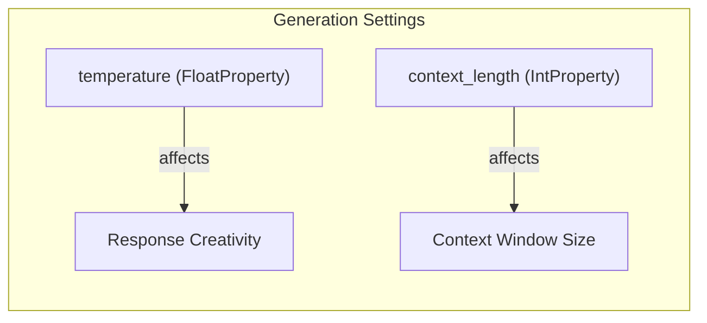

| Option | Type | Description | Range | Default |
|--------|------|-------------|-------|---------|
| `temperature` | FloatProperty | Controls randomness in generation (higher = more creative, lower = more predictable) | 0.0 - 1.0 | 0.7 |
| `context_length` | IntProperty | Maximum number of tokens in the context window | 1024 - 65536 | 32768 |

Sources: [preferences.py:156-169](), [preferences.py:294-307]()

## Integration Settings

MeshGen offers optional integrations with external tools to enhance its mesh generation capabilities.

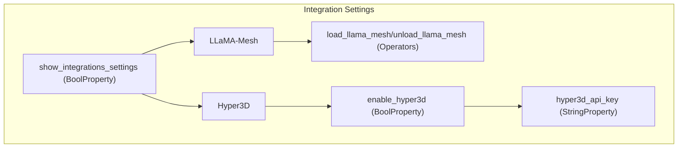

### LLaMA-Mesh Integration

LLaMA-Mesh provides local mesh understanding and generation capabilities.

#### Requirements:
- NVIDIA GPU with at least 8GB VRAM (additional 5GB VRAM required beyond the backend)
- CUDA version of the addon
- Preferably used with a Remote backend to avoid VRAM conflicts

LLaMA-Mesh is loaded on-demand through the preferences panel and can be unloaded when not needed.

### Hyper3D Integration

Hyper3D (Rodin) is an API-based service for high-fidelity 3D mesh generation.

| Option | Type | Description | Default |
|--------|------|-------------|---------|
| `enable_hyper3d` | BoolProperty | Enable Hyper3D integration | False |
| `hyper3d_api_key` | StringProperty | API key for authentication | "awesomemcp" |

Sources: [preferences.py:170-185](), [preferences.py:308-354](), [README.md:95-124]()

## Configuration Data Flow

The following diagram illustrates how configuration options flow through the MeshGen system:

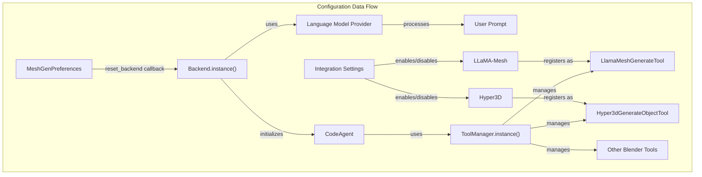

Sources: [preferences.py:18-29]()

## Preferences UI Structure

The MeshGen preferences panel is organized into sections that match the configuration categories described above. The UI dynamically adjusts based on the selected backend type and provider.

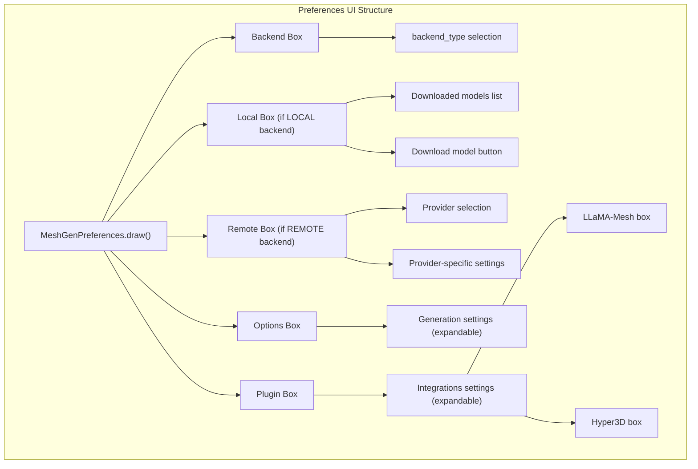

Sources: [preferences.py:188-355]()

## Configuration Reset Mechanism

When configuration options change, MeshGen ensures the system properly adapts by resetting the backend and clearing state.

The `reset_backend` function ([preferences.py:18-29]()) is called whenever critical configuration options are modified. This function:

1. Gets the current backend instance
2. Resets the backend to apply new configuration
3. Resets the MeshGen properties state to "READY"
4. Clears the history
5. Redraws relevant Blender UI areas

Sources: [preferences.py:18-29]()

---

# Page: System Architecture

# System Architecture

<details>
<summary>Relevant source files</summary>

The following files were used as context for generating this wiki page:

- [__init__.py](__init__.py)
- [backend.py](backend.py)
- [preferences.py](preferences.py)
- [tools.py](tools.py)

</details>


This document provides a comprehensive overview of the MeshGen addon's architecture, explaining how the various components interact to create an AI-powered 3D mesh generation system within Blender. For information about installation and setup, see [Installation and Setup](#2), and for details about specific subsystems, see the corresponding pages in [Backend System](#3.1), [Tools System](#3.2), and [State Management](#3.3).

## Core Architecture Overview

MeshGen is built as a Blender addon that integrates language models with Blender's 3D modeling capabilities. The system follows a modular architecture that separates concerns between user interface, backend model management, tool execution, and state tracking.

```mermaid
flowchart TD
    subgraph "User Interface Layer"
        UI["UI Panel"]
        Props["Properties"]
        Ops["Operators"]
    end

    subgraph "Backend Layer"
        BackendMgr["Backend Manager"]
        LLM["Language Models"]
        Agent["Code Agent"]
    end

    subgraph "Tool Execution Layer"
        ToolMgr["Tool Manager"]
        Tools["Blender Tools"]
    end

    subgraph "Configuration"
        Prefs["Preferences"]
    end

    UI -->|"User prompt"| Ops
    Ops -->|"Execute"| BackendMgr
    Ops -->|"Update state"| Props
    UI -->|"Display"| Props
    
    BackendMgr -->|"Initialize"| LLM
    BackendMgr -->|"Create"| Agent
    Prefs -->|"Configure"| BackendMgr
    
    Agent -->|"Use"| ToolMgr
    ToolMgr -->|"Execute in main thread"| Tools
    Tools -->|"Manipulate"| Blender["Blender Objects"]
```

Sources: [__init__.py:33-52](), [backend.py:12-25](), [tools.py:12-90]()

## Component Relationships

The MeshGen addon consists of several key components that work together:

| Component | Purpose | Key Classes | File |
|-----------|---------|-------------|------|
| UI Layer | User interaction | UI panels, operators | ui.py, operators.py |
| Backend | Language model management | `Backend` | backend.py |
| Tool System | Blender operations execution | `ToolManager`, `BlenderTool` | tools.py |
| Configuration | User preferences | `MeshGenPreferences` | preferences.py |
| State | Tracking conversation state | `MeshGenProperties` | properties.py |

### Module Dependencies

```mermaid
graph TD
    init["__init__.py"] -->|"Registers"| operators["operators.py"]
    init -->|"Registers"| ui["ui.py"]
    init -->|"Registers"| prefs["preferences.py"]
    init -->|"Registers"| props["properties.py"]
    
    operators -->|"Uses"| backend["backend.py"]
    operators -->|"Updates"| props
    
    backend -->|"Uses"| tools["tools.py"]
    backend -->|"Configured by"| prefs
    
    ui -->|"Displays"| props
    ui -->|"Calls"| operators
```

Sources: [__init__.py:1-57]()

## Backend System Architecture

The backend system is responsible for managing language models and processing user prompts through an agent.

```mermaid
classDiagram
    class Backend {
        -_instance: Backend
        -_lock: threading.Lock
        -model: Model
        -agent: CodeAgent
        +instance(): Backend
        +is_valid(): bool
        +is_loaded(): bool
        +load()
        +start_chat_completion(messages, temperature, stop_event)
        +reset()
    }
    
    class BackendTypes {
        <<enumeration>>
        LOCAL
        REMOTE
    }
    
    class RemoteProviders {
        <<enumeration>>
        huggingface
        ollama
        anthropic
        openai
    }
    
    Backend --> BackendTypes : supports
    BackendTypes --> RemoteProviders : has providers
```

Sources: [backend.py:12-228](), [preferences.py:35-53](), [preferences.py:70-83]()

### Backend Configuration

The backend system supports two main types of backends:

1. **Local Backend**: Runs models directly within Blender using llama_cpp_python
2. **Remote Backend**: Connects to external API services

```mermaid
flowchart TD
    Backend["Backend"]
    
    subgraph "Backend Types"
        Local["Local Backend"]
        Remote["Remote Backend"]
    end
    
    Backend --> Local
    Backend --> Remote
    
    Local -->|"Uses"| LlamaCpp["llama_cpp_python"]
    Local -->|"Loads models from"| ModelsDir[".models directory"]
    
    Remote -->|"Provider"| HF["Hugging Face API"]
    Remote -->|"Provider"| Ollama["Ollama API"]
    Remote -->|"Provider"| Anthropic["Anthropic API"]
    Remote -->|"Provider"| OpenAI["OpenAI API"]
    
    Prefs["MeshGenPreferences"] -->|"Configures"| Backend
```

Sources: [backend.py:57-136](), [preferences.py:35-143]()

## Tool Management System

The tool management system is responsible for executing operations in Blender's main thread, ensuring thread safety while allowing the AI agent to control Blender.

```mermaid
classDiagram
    class ToolManager {
        -_instance: ToolManager
        -_task_queue: Queue
        -_result_dict: Dict
        -_tools: List[Tool]
        +instance(): ToolManager
        +add_task(task): void
        +get_result(task_id): Any
        +process_tasks(context): void
    }
    
    class BlenderTool {
        +name: str
        +description: str
        +inputs: Dict
        +output_type: str
        +run_main_thread_func(func, params): str
        +forward(...): Any
    }
    
    BlenderTool <|-- GetSceneInfoTool
    BlenderTool <|-- GetObjectInfoTool
    BlenderTool <|-- CreateObjectTool
    BlenderTool <|-- ModifyObjectTool
    BlenderTool <|-- DeleteObjectTool
    BlenderTool <|-- SetMaterialTool
    BlenderTool <|-- LlamaMeshGenerateTool
    BlenderTool <|-- LlamaMeshDescribeTool
    BlenderTool <|-- Hyper3dGenerateObjectTool
    
    ToolManager "1" --> "*" BlenderTool : manages
```

Sources: [tools.py:12-90](), [tools.py:92-112](), [tools.py:164-833]()

### Tool Execution Flow

```mermaid
sequenceDiagram
    participant Agent as "CodeAgent"
    participant Tool as "BlenderTool"
    participant Manager as "ToolManager"
    participant Main as "Blender Main Thread"
    
    Agent->>Tool: forward(params)
    Tool->>Tool: prepare parameters
    Tool->>Manager: run_main_thread_func(func, params)
    Manager->>Manager: add_task(task)
    Main->>Manager: process_tasks(context)
    Main->>Main: execute function
    Main->>Manager: store result
    Manager->>Tool: return result
    Tool->>Agent: return formatted result
```

Sources: [tools.py:99-111](), [tools.py:55-64](), [tools.py:66-82]()

## Code Agent System

The CodeAgent is the bridge between natural language prompts and concrete actions in Blender, using a language model to understand user intent.

```mermaid
flowchart TD
    User["User"] -->|"Text prompt"| UI["UI Panel"]
    UI -->|"Forward prompt"| Backend["Backend"]
    
    Backend -->|"Run agent"| Agent["CodeAgent"]
    
    subgraph "Agent Processing"
        Agent -->|"Generate thought"| Thought["Thinking"]
        Thought -->|"Decide action"| Action["Tool Selection"]
        Action -->|"Execute tool"| Tool["Tool Execution"]
        Tool -->|"Observe result"| Observation["Result Observation"]
        Observation -->|"Continue reasoning"| Thought
        Thought -->|"Reach conclusion"| FinalAnswer["Final Answer"]
    end
    
    FinalAnswer -->|"Return to user"| UI
```

Sources: [backend.py:140-156](), [backend.py:158-179](), [backend.py:180-204]()

## State Management

MeshGen implements a state machine to track the status of user interactions and AI processing.

```mermaid
stateDiagram-v2
    [*] --> READY: Initial State
    
    READY --> LOADING: Backend.load()
    LOADING --> READY: Loading error
    LOADING --> RUNNING: Loading completed
    
    READY --> RUNNING: Submit prompt
    RUNNING --> THINKING: Agent thinking
    THINKING --> STEP: Agent produces step
    STEP --> THINKING: Continue thinking
    
    THINKING --> FINAL_ANSWER: Agent completes
    THINKING --> ERROR: Error occurs
    THINKING --> CANCELED: User cancels
    
    FINAL_ANSWER --> READY: Reset state
    ERROR --> READY: Reset state
    CANCELED --> READY: Reset state
```

Sources: [preferences.py:18-29](), [backend.py:158-179]()

## Integration Architecture

MeshGen supports integrations with external libraries and services to enhance mesh generation capabilities.

```mermaid
flowchart TD
    MeshGen["MeshGen Core"]
    
    subgraph "Integrations"
        LlamaMesh["LLaMA-Mesh Integration"]
        Hyper3D["Hyper3D Integration"]
    end
    
    MeshGen -->|"Optional"| LlamaMesh
    MeshGen -->|"Optional"| Hyper3D
    
    subgraph "LLaMA-Mesh Features"
        LlamaMeshGen["Generate Mesh from Text"]
        LlamaMeshDesc["Describe 3D Object"]
    end
    
    LlamaMesh --> LlamaMeshGen
    LlamaMesh --> LlamaMeshDesc
    
    subgraph "Hyper3D Features"
        Hyper3DGen["Generate High-Quality 3D Object"]
    end
    
    Hyper3D --> Hyper3DGen
```

Sources: [tools.py:842-893](), [tools.py:974-1038](), [tools.py:1110-1155](), [tools.py:1158-1350](), [preferences.py:175-184]()

## Data Flow

The following diagram illustrates how data flows through the MeshGen system, from user input to 3D model creation:

```mermaid
flowchart LR
    User["User"] -->|"Natural language prompt"| UI["Blender UI Panel"]
    UI -->|"Text prompt"| Operators["MeshGen Operators"]
    
    Operators -->|"Forward prompt"| Backend["Backend Manager"]
    Backend -->|"Process with LLM"| Agent["CodeAgent"]
    
    Agent -->|"Execute tools"| ToolMgr["Tool Manager"]
    ToolMgr -->|"Run in main thread"| BlenderAPI["Blender API"]
    
    BlenderAPI -->|"Create/modify"| Objects["3D Objects"]
    BlenderAPI -->|"Set"| Materials["Materials"]
    
    Objects --> Scene["Blender Scene"]
    Materials --> Scene
    
    Scene -->|"Visual feedback"| User
```

Sources: [__init__.py:33-52](), [backend.py:158-179](), [tools.py:278-408](), [tools.py:66-82]()

## System Initialization

The initialization flow for MeshGen shows how components are registered and loaded:

```mermaid
sequenceDiagram
    participant Blender as "Blender"
    participant Init as "__init__.py"
    participant Operators as "operators.py"
    participant UI as "ui.py"
    participant Prefs as "preferences.py"
    participant Props as "properties.py"
    
    Blender->>Init: register()
    Init->>Operators: register()
    Init->>UI: register()
    Init->>Prefs: register()
    Init->>Props: register()
    
    Prefs->>Blender: Register MeshGenPreferences
    Props->>Blender: Register MeshGenProperties
    UI->>Blender: Register UI panels
    Operators->>Blender: Register operators
```

Sources: [__init__.py:34-40]()

## Conclusion

The MeshGen architecture is designed with modularity and extensibility in mind. By separating concerns between the UI, backend, and tool execution layers, the system can support multiple model backends and tool implementations while maintaining a consistent user experience.

For more detailed information about specific subsystems, see the corresponding wiki pages:
- [Backend System](#3.1) for details on language model management
- [Tools System](#3.2) for information about tool implementation and execution
- [State Management](#3.3) for details on conversation state tracking

---

# Page: Backend System

# Backend System

<details>
<summary>Relevant source files</summary>

The following files were used as context for generating this wiki page:

- [backend.py](backend.py)
- [preferences.py](preferences.py)
- [requirements/cpu.txt](requirements/cpu.txt)
- [requirements/cuda.txt](requirements/cuda.txt)

</details>


The Backend System in MeshGen is responsible for managing the connection to AI language models that power all mesh generation functionality. It enables both local model inference (running directly in Blender) and remote API-based inference (connecting to external services). This page documents the backend architecture, its configuration options, and how it connects with the rest of the system.

For information about the tools that the backend uses to interact with Blender, see [Tools System](#3.2).

## Architecture Overview

The Backend System is built around a singleton `Backend` class that manages model loading, initialization, and inference. It supports two main backend types: Local and Remote.

```mermaid
flowchart TD
    subgraph "MeshGen Backend System"
        Backend["Backend (Singleton)"]
        
        subgraph "Backend Types"
            LOCAL["Local Backend"]
            REMOTE["Remote Backend"]
        end
        
        Backend -->|"load()"| TypeDecision{"backend_type?"}
        TypeDecision -->|"LOCAL"| LOCAL
        TypeDecision -->|"REMOTE"| REMOTE
        
        LOCAL -->|"_load_local_model()"| LlamaCpp["LlamaCppModel"]
        
        RemoteDecision{"llm_provider?"}
        REMOTE -->|"_load_litellm_model() or _load_hf_api_model()"| RemoteDecision
        
        RemoteDecision -->|"huggingface"| HfApi["HfApiModel"]
        RemoteDecision -->|"ollama/anthropic/openai"| LiteLLM["LiteLLMModel"]
        
        LlamaCpp --> CodeAgent
        HfApi --> CodeAgent
        LiteLLM --> CodeAgent
        
        Backend -->|"start_chat_completion()"| AgentExecution["Agent Execution"]
        AgentExecution --> OutputQueue["Output Queue"]
    end
    
    Preferences["MeshGenPreferences"] -->|"configures"| Backend
    CodeAgent -->|"uses"| ToolManager["ToolManager"]
```

*Backend System Architecture*

Sources: [backend.py:12-228](), [preferences.py:32-355]()

## Backend Class

The `Backend` class is implemented as a singleton to ensure there's only one instance managing AI models throughout the application.

```mermaid
classDiagram
    class Backend {
        -_instance: Backend
        -_lock: threading.Lock
        -model: Model
        -agent: CodeAgent
        +is_valid(): bool
        +is_loaded(): bool
        +load(): void
        +start_chat_completion(messages, temperature, stop_event): Queue
        -_load_local_model(): void
        -_load_hf_api_model(): void
        -_load_litellm_model(): void
        -_step_callback(step, output_queue): void
        +instance(): Backend
        +reset(): void
    }
```

*Backend Class Structure*

The `Backend` class has these key responsibilities:
- Managing model lifecycle (loading, initialization, cleanup)
- Creating and managing the CodeAgent
- Providing an interface for executing chat completions
- Processing agent execution steps and routing them to the UI

Sources: [backend.py:12-228]()

## Backend Types

### Local Backend

The Local Backend runs inference directly within Blender using the `llama_cpp_python` library, which provides efficient CPU and GPU-based inference of GGUF-format language models.

```mermaid
flowchart TD
    subgraph "Local Backend"
        LocalBackend["_load_local_model()"]
        ModelPath["Get model_path from prefs.current_model"]
        LlamaCppInit["Initialize LlamaCppModel"]
        
        LocalBackend --> ModelPath
        ModelPath --> LlamaCppInit
        LlamaCppInit -->|"n_gpu_layers=-1"| GpuLayers["Use all available GPU layers"]
        LlamaCppInit -->|"n_ctx=prefs.context_length"| Context["Set context window size"]
    end
    
    ModelStorage[".models directory"] -->|"stores"| DownloadedModels["Downloaded models"]
    DownloadedModels -->|"accessed via"| ModelPath
```

*Local Backend Implementation*

Key characteristics of the Local Backend:
- Requires downloading model files to the `.models` directory
- Utilizes GPU acceleration when available
- Configurable context length
- Recommended to have at least 8GB VRAM for optimal performance

Sources: [backend.py:57-67](), [preferences.py:54-59](), [requirements/cpu.txt:1-2](), [requirements/cuda.txt:1-2]()

### Remote Backend

The Remote Backend connects to external API services to perform inference. It supports multiple providers through direct API integration or via the LiteLLM abstraction layer.

```mermaid
flowchart TD
    subgraph "Remote Backend"
        RemoteBackend["Remote Backend"]
        
        RemoteBackend -->|"llm_provider"| ProviderDecision{"Provider?"}
        
        ProviderDecision -->|"huggingface"| HF["HfApiModel"]
        ProviderDecision -->|"ollama"| Ollama["LiteLLMModel (ollama_chat/model)"]
        ProviderDecision -->|"anthropic"| Anthropic["LiteLLMModel (anthropic/model)"]
        ProviderDecision -->|"openai"| OpenAI["LiteLLMModel (openai model)"]
        
        HF -->|"requires"| HFToken["Hugging Face API Token"]
        Ollama -->|"requires"| OllamaEndpoint["Ollama Endpoint URL"]
        Anthropic -->|"requires"| AnthropicKey["Anthropic API Key"]
        OpenAI -->|"requires"| OpenAIKey["OpenAI API Key"]
    end
```

*Remote Backend Providers*

The Remote Backend offers these provider options:

1. **Hugging Face**
   - Uses direct API integration via `HfApiModel`
   - Requires a valid API token
   - Model specified by repository ID

2. **Ollama**
   - Uses LiteLLM wrapper to connect to an Ollama server
   - Can be self-hosted (default: http://localhost:11434)
   - Supports various locally-hosted models

3. **Anthropic**
   - Uses LiteLLM wrapper to connect to Anthropic API
   - Provides access to Claude models
   - Requires an Anthropic API key

4. **OpenAI**
   - Uses LiteLLM wrapper to connect to OpenAI API
   - Provides access to GPT models
   - Requires an OpenAI API key

Sources: [backend.py:69-136](), [preferences.py:70-143](), [requirements/cpu.txt:5](), [requirements/cuda.txt:5]()

## Configuration

The MeshGen backend is configured through the addon preferences panel in Blender. Configuration is managed by the `MeshGenPreferences` class.

```mermaid
flowchart LR
    subgraph "MeshGen Preferences"
        BackendType["backend_type (LOCAL/REMOTE)"]
        
        BackendType -->|"LOCAL"| LocalConfig["Local Configuration"]
        BackendType -->|"REMOTE"| RemoteConfig["Remote Configuration"]
        
        subgraph "Local Settings"
            CurrentModel["current_model"]
            DownloadSettings["download_repo_id/filename"]
        end
        
        subgraph "Remote Settings"
            Provider["llm_provider"]
            Provider -->|"huggingface"| HFSettings["huggingface_model_id/api_key"]
            Provider -->|"ollama"| OllamaSettings["ollama_endpoint/model_name/api_key"]
            Provider -->|"anthropic"| AnthropicSettings["anthropic_model_id/api_key"]
            Provider -->|"openai"| OpenAISettings["openai_model_id/api_key"]
        end
        
        LocalConfig --> CurrentModel
        LocalConfig --> DownloadSettings
        RemoteConfig --> Provider
        
        subgraph "Common Settings"
            Temperature["temperature"]
            ContextLength["context_length"]
        end
    end
    
    MeshGenPreferences["MeshGenPreferences"] -->|"update=reset_backend"| Backend["Backend.reset()"]
```

*Backend Configuration Flow*

Key configuration options include:

| Setting Category | Options | Description |
|-----------------|---------|-------------|
| Backend Type | LOCAL, REMOTE | Determines whether to use local or remote inference |
| Local Settings | Current Model | Selected model file for local inference |
| Remote Provider | huggingface, ollama, anthropic, openai | Selected API provider for remote inference |
| Provider Settings | API Keys, Model IDs, Endpoints | Provider-specific configuration |
| Generation Settings | Temperature | Controls randomness (0.0-1.0) |
| | Context Length | Maximum token context window (1024-65536) |

When preferences are changed, the `reset_backend` function is called, which resets the Backend instance and clears any loaded models.

Sources: [preferences.py:17-31](), [preferences.py:32-186](), [preferences.py:188-354]()

## Integration with CodeAgent

The backend creates and manages a `CodeAgent` instance that handles the execution of prompts and tool calls.

```mermaid
sequenceDiagram
    participant User
    participant Operators as "MeshGen Operators"
    participant Backend as "Backend"
    participant Agent as "CodeAgent"
    participant Tools as "ToolManager"
    participant Blender as "Blender API"
    
    User->>Operators: Submit prompt
    Operators->>Backend: start_chat_completion(messages, temperature, stop_event)
    Backend->>Agent: run(prompt, stream=True)
    
    loop For each step
        Agent->>Agent: Process step
        Agent->>Tools: Call tool if needed
        Tools->>Blender: Execute Blender operations
        Blender-->>Tools: Return results
        Tools-->>Agent: Return observation
        Agent-->>Backend: Yield step
        Backend->>Backend: _step_callback(step, output_queue)
        Backend-->>Operators: Put step in output queue
        Operators-->>User: Update UI with step
    end
    
    alt Final answer
        Agent-->>Backend: Return final answer
        Backend-->>Operators: Put final answer in output queue
        Operators-->>User: Display final answer
    else Error
        Agent-->>Backend: Raise exception
        Backend-->>Operators: Put error in output queue
        Operators-->>User: Display error
    end
```

*Backend and CodeAgent Interaction*

The `CodeAgent` is initialized with:
- The selected language model
- Available tools from the `ToolManager`
- Authorized Python imports
- Logging configuration

When a prompt is processed, the backend creates a separate thread for agent execution, which allows the Blender UI to remain responsive. The agent's execution steps are processed by the `_step_callback` method and placed in a queue for consumption by the UI.

Sources: [backend.py:140-156](), [backend.py:158-201]()

## Model and Agent Lifecycle

The Backend manages the lifecycle of models and agents, ensuring proper initialization and cleanup:

```mermaid
stateDiagram-v2
    [*] --> Uninitialized
    
    Uninitialized --> Loading: load()
    Loading --> Loaded: Successful initialization
    Loading --> Error: Initialization error
    
    Loaded --> Running: start_chat_completion()
    Running --> Loaded: Completion finished
    
    Loaded --> Uninitialized: reset()
    Error --> Uninitialized: reset()
    
    state Loaded {
        [*] --> ModelReady
        [*] --> AgentReady
    }
    
    state Running {
        [*] --> ThreadExecuting
        ThreadExecuting --> QueueProcessing: Agent yields step
        QueueProcessing --> ThreadExecuting: Process next step
        QueueProcessing --> [*]: Final answer/Error/Cancel
    }
```

*Model and Agent Lifecycle States*

The lifecycle includes:
1. **Initialization** - Loading the appropriate model based on preferences
2. **Execution** - Running the agent on a separate thread and processing results
3. **Cleanup** - Properly releasing resources when the backend is reset

The `reset` method ensures proper cleanup of model and agent resources, which is crucial when changing configuration or shutting down the addon.

Sources: [backend.py:209-227](), [preferences.py:17-31]()

## Performance Considerations

The Backend System's performance characteristics vary based on the selected backend type:

| Backend Type | Advantages | Limitations | Requirements |
|--------------|------------|-------------|--------------|
| LOCAL | - No internet required<br>- No API costs<br>- Full privacy | - Requires VRAM<br>- Limited to smaller models<br>- May be slower | - 8GB+ VRAM recommended<br>- GPU support for acceleration |
| REMOTE (Ollama) | - Better local models<br>- No API costs<br>- Control over hosting | - Requires separate server<br>- Additional setup | - Ollama server running<br>- Sufficient system resources |
| REMOTE (API) | - Access to state-of-the-art models<br>- No local resources needed | - Requires internet<br>- API costs<br>- Data leaves system | - API keys<br>- Internet connection |

Sources: [preferences.py:196-202](), [preferences.py:235-242](), [preferences.py:250-257](), [preferences.py:265-272](), [preferences.py:280-287]()

## Integration with External Systems

The Backend System can optionally integrate with specialized AI systems for enhanced functionality:

1. **LLaMA-Mesh Integration**
   - Provides specialized mesh understanding and generation
   - Loaded separately from the main backend
   - Requires additional VRAM when used with local backend

2. **Hyper3D Integration**
   - External API for high-quality mesh generation
   - Enabled through preferences
   - Requires API key

These integrations complement the main language model capabilities with specialized 3D understanding and generation features.

Sources: [preferences.py:323-354]()

---

# Page: Tools System

# Tools System

<details>
<summary>Relevant source files</summary>

The following files were used as context for generating this wiki page:

- [operators.py](operators.py)
- [tools.py](tools.py)

</details>


## Purpose and Scope

The Tools System serves as the crucial bridge between natural language commands and Blender functionality in MeshGen. It provides a structured framework for the AI agent to execute operations in Blender through a collection of well-defined tools. 

The system is responsible for:
- Translating AI intentions into concrete Blender operations
- Managing thread synchronization between the AI engine and Blender
- Providing a discovery mechanism for available tools
- Supporting both basic Blender operations and integration with external AI systems

This page focuses specifically on the architecture and implementation of the Tools System. For information about the AI Backend that uses these tools, see [Backend System](#3.1). For details about how state is managed across chat sessions, see [State Management](#3.3).

## Architecture Overview

The Tools System architecture is built around a central manager that coordinates tool execution and a collection of specialized tools that implement specific Blender operations.

```mermaid
flowchart TB
    subgraph "Natural Language Processing"
        Agent["CodeAgent"]
    end
    
    subgraph "Tools System"
        ToolManager["ToolManager"]
        BlenderTool["BlenderTool Base Class"]
        StandardTools["Standard Tools"]
        IntegrationTools["Integration Tools"]
    end
    
    subgraph "Blender Operations"
        BlenderAPI["Blender Python API"]
    end
    
    Agent -->|"Uses"| ToolManager
    ToolManager -->|"Manages"| BlenderTool
    BlenderTool -->|"Parent Class"| StandardTools
    BlenderTool -->|"Parent Class"| IntegrationTools
    StandardTools -->|"Execute"| BlenderAPI
    IntegrationTools -->|"Execute"| BlenderAPI
    
    StandardTools -->|"Types"| SceneTools["Scene Tools"]
    StandardTools -->|"Types"| ObjectTools["Object Tools"]
    StandardTools -->|"Types"| MaterialTools["Material Tools"]
    
    IntegrationTools -->|"Types"| LlamaMeshTools["LLaMA-Mesh Tools"]
    IntegrationTools -->|"Types"| Hyper3DTools["Hyper3D Tools"]
```

Sources: [tools.py:12-90](), [tools.py:92-111]()

### ToolManager

At the core of the Tools System is the `ToolManager` class - a singleton responsible for managing tool execution and thread synchronization. The ToolManager:

1. Maintains a registry of available tools
2. Queues tasks for execution on the main Blender thread
3. Executes tasks when called from the main thread
4. Manages task results and thread synchronization

```mermaid
classDiagram
    class ToolManager {
        -_instance: ToolManager
        -_task_queue: Queue
        -_result_dict: Dict
        -_condition: threading.Condition
        -_tools: List[Tool]
        +tools: List[Tool]
        +add_task(task): void
        +get_result(task_id): Any
        +process_tasks(context): void
        +instance(): ToolManager
        +reset(): void
    }
```

The ToolManager is implemented as a singleton, which ensures that there's only one instance managing tools throughout the application. The singleton pattern is implemented using a class-level `_instance` variable and a custom `__new__` method that ensures only one instance is created.

Sources: [tools.py:12-90]()

### Thread Management

One of the key challenges the Tools System addresses is Blender's threading model. Blender requires most operations to be performed on the main thread, while the AI agent runs on a separate thread. The Tools System solves this with a task queueing system:

```mermaid
sequenceDiagram
    participant AgentThread as "Agent Thread"
    participant Tool as "BlenderTool"
    participant Manager as "ToolManager"
    participant MainThread as "Blender Main Thread"
    
    AgentThread->>Tool: forward(params)
    Tool->>Tool: Prepare parameters
    Tool->>Manager: run_main_thread_func(func, params)
    Manager->>Manager: Create task with UUID
    Manager->>Manager: add_task(task)
    Tool->>Manager: get_result(task_id)
    Note over Tool,Manager: Waits for result
    
    MainThread->>Manager: process_tasks(context)
    Manager->>MainThread: Execute task function
    MainThread-->>Manager: Return result
    Manager->>Manager: Store result in _result_dict
    Manager-->>Tool: Return result
    Tool-->>AgentThread: Return formatted result
```

The key steps in this process:

1. When a tool is called on the agent thread, it creates a task with a unique ID
2. The task is added to the queue and the tool waits for the result
3. During Blender's event loop, the `process_tasks` method is called from the main thread
4. Tasks are dequeued and executed, with results stored in a dictionary
5. The tool retrieves its result using the task ID

This approach ensures thread-safe execution while maintaining UI responsiveness.

Sources: [tools.py:97-111](), [operators.py:161-162]()

### BlenderTool Base Class

All tools inherit from the `BlenderTool` base class, which extends the `Tool` class from the `smolagents` library. The `BlenderTool` class provides:

1. A consistent interface for defining tools
2. The `run_main_thread_func` utility method to handle thread management
3. Standardized formatting for inputs and outputs

```python
class BlenderTool(Tool):
    """
    Base class for all Blender tools.
    Provides utility method to run functions on the main blender thread.
    """

    def run_main_thread_func(self, func: callable, params: dict = None) -> str:
        task_id = str(uuid.uuid4())
        task = {
            "id": task_id,
            "func": func,
            "params": params,
        }
        tool_manager = ToolManager.instance()
        tool_manager.add_task(task)
        result = tool_manager.get_result(task_id)
        if result["status"] == "error":
            return f"Error in {func.__name__}: {result['data']}"
        return result["data"]
```

Sources: [tools.py:92-111]()

## Standard Tools

The Tools System provides a comprehensive set of standard tools for common Blender operations. Each tool defines its:
- Name: A unique identifier
- Description: Detailed documentation for the AI
- Inputs: Parameters with types and descriptions
- Output type: The format of the returned data
- Forward method: The implementation logic

### Scene Information Tools

- **GetSceneInfoTool**: Retrieves information about the current scene, including objects, materials, and other scene properties

### Object Manipulation Tools

| Tool Name | Purpose | Key Parameters |
|-----------|---------|----------------|
| GetObjectInfoTool | Retrieves detailed information about a specific object | name |
| CreateObjectTool | Creates a new primitive object (cube, sphere, etc.) | type, name, location, rotation, scale |
| ModifyObjectTool | Changes properties of an existing object | name, location, rotation, scale, visible |
| DeleteObjectTool | Removes an object from the scene | name |

### Material Tools

- **SetMaterialTool**: Creates and assigns materials to objects, with options to set colors and other material properties

Sources: [tools.py:164-202](), [tools.py:247-276](), [tools.py:411-547](), [tools.py:606-668](), [tools.py:695-712](), [tools.py:789-839]()

## Integration Tools

The Tools System extends beyond basic Blender operations to integrate with external AI systems, enabling advanced mesh generation capabilities.

### LLaMA-Mesh Tools

When the LLaMA-Mesh model is loaded, the following tools become available:

- **LlamaMeshGenerateTool**: Generates 3D meshes from text descriptions
- **LlamaMeshDescribeTool**: Analyzes 3D objects and generates text descriptions

These tools are managed by the `LlamaMeshModelManager` singleton, which handles model loading and unloading.

### Hyper3D Tools

When the Hyper3D integration is enabled in preferences:

- **Hyper3dGenerateObjectTool**: Generates high-fidelity 3D models from text descriptions using the Hyper3D API

These integration tools significantly extend MeshGen's capabilities by leveraging specialized AI models for 3D content creation.

Sources: [tools.py:842-892](), [tools.py:974-1039](), [tools.py:1110-1156](), [tools.py:1316-1350]()

## Tool Registration and Discovery

Tools are dynamically registered with the ToolManager during initialization based on available integrations:

```python
def _initialize(self):
    prefs = bpy.context.preferences.addons[__package__].preferences

    self._task_queue = queue.Queue()
    self._result_dict = {}
    self._condition = threading.Condition()
    self._tools = [
        PythonInterpreterTool(),
        FinalAnswerTool(),
        GetSceneInfoTool(),
        GetObjectInfoTool(),
        CreateObjectTool(),
        ModifyObjectTool(),
        DeleteObjectTool(),
        SetMaterialTool(),
    ]

    if LlamaMeshModelManager.instance().is_loaded:
        self._tools += [
            LlamaMeshGenerateTool(),
            LlamaMeshDescribeTool(),
        ]

    if prefs.enable_hyper3d:
        self._tools += [Hyper3dGenerateObjectTool()]
```

This approach ensures only available tools are presented to the agent, creating a dynamic tool palette based on the current configuration.

Sources: [tools.py:25-49]()

## Integration with Chat Flow

The Tools System is integrated into the main chat flow through the modal operator, which processes tool tasks during the Blender event loop:

```mermaid
flowchart TB
    subgraph "Agent Thread"
        Agent["CodeAgent"]
        ToolCall["Tool.forward()"]
        WaitResult["Wait for result"]
    end
    
    subgraph "Blender Main Thread"
        EventLoop["Blender Event Loop"]
        Modal["MESHGEN_OT_Chat.modal()"]
        ProcessTasks["ToolManager.process_tasks()"]
        ExecuteTask["Execute Blender operation"]
    end
    
    Agent -->|"Uses tool"| ToolCall
    ToolCall -->|"Queue task"| TaskQueue["ToolManager._task_queue"]
    ToolCall --> WaitResult
    
    EventLoop -->|"Timer event"| Modal
    Modal -->|"Call"| ProcessTasks
    ProcessTasks -->|"Dequeue task"| TaskQueue
    ProcessTasks --> ExecuteTask
    ExecuteTask -->|"Store result"| ResultDict["ToolManager._result_dict"]
    ResultDict -->|"Notify waiting thread"| WaitResult
    WaitResult -->|"Return result"| Agent
```

The `process_tasks` method is called from the `modal` method of the `MESHGEN_OT_Chat` operator, ensuring tasks are processed regularly during the chat session.

Sources: [operators.py:161-162]()

## Creating New Tools

Developers can extend MeshGen by creating new tools that follow the established pattern:

1. Inherit from `BlenderTool`
2. Define name, description, inputs, and output_type
3. Implement the `forward` method
4. Register the tool in the ToolManager initialization

For example, a new tool for joining objects might look like:

```python
class JoinObjectsTool(BlenderTool):
    name = "join_objects"
    description = """
    This is a tool that joins multiple objects into a single object.
    It returns the name of the resulting joined object.
    """
    inputs = {
        "objects": {
            "type": "array",
            "description": "List of object names to join",
        },
        "target_name": {
            "type": "string",
            "description": "Name for the joined object (optional)",
            "nullable": True,
        }
    }
    output_type = "string"
    
    def forward(self, objects: List[str], target_name: Optional[str] = None):
        params = {
            "objects": objects,
            "target_name": target_name,
        }
        return self.run_main_thread_func(join_objects, params)
```

## Conclusion

The Tools System provides a robust framework for AI-driven interaction with Blender, solving complex problems like thread management and tool discovery. By providing a structured interface to Blender operations, it enables the AI agent to create and manipulate 3D content through natural language instructions, forming the operational core of MeshGen.

---

# Page: State Management

# State Management

<details>
<summary>Relevant source files</summary>

The following files were used as context for generating this wiki page:

- [operators.py](operators.py)
- [properties.py](properties.py)
- [ui.py](ui.py)

</details>


## Purpose and Scope

This document details MeshGen's state management system, which tracks the application's runtime state, manages event history, and ensures proper information flow between the backend and UI. The state management system is responsible for:

- Tracking the current operational state of the application
- Recording and displaying history of agent interactions
- Facilitating state transitions during agent execution
- Providing a consistent interface for the UI to display appropriate controls

This system is primarily focused on application state - for information about the backend system itself, see [Backend System](#3.1), and for details about the user interface, see [Blender UI Panel](#4.1).

## Core State Components

MeshGen's state management revolves around two primary property classes:

```mermaid
classDiagram
    class MeshGenProperties {
        prompt: String
        state: Enum(READY, LOADING, RUNNING, CANCELED)
        history: Collection[MeshGenEvent]
    }
    
    class MeshGenEvent {
        type: Enum(THINKING, STEP, ERROR, etc.)
        content: String
    }
    
    MeshGenProperties "1" --> "*" MeshGenEvent : contains
```

### MeshGenProperties

The `MeshGenProperties` class serves as the central state container for the application, stored as a property on the Blender scene:

- `prompt`: Stores the current user input text
- `state`: Tracks the primary application state as an enum 
- `history`: A collection of `MeshGenEvent` instances recording the agent's actions

When a user interacts with MeshGen, these properties update to reflect the current application state and maintain a record of events that have occurred.

Sources: [properties.py:28-47]()

### MeshGenEvent

The `MeshGenEvent` class represents individual events in the agent's processing sequence:

- `type`: An enum indicating the event type (THINKING, STEP, ERROR, etc.)
- `content`: A string containing the event's message or data

This flexible event system allows detailed tracking of agent progress and provides rich information for display in the UI.

Sources: [properties.py:4-25]()

## State Machine and Transitions

The application follows a state machine pattern with well-defined transitions:

```mermaid
stateDiagram-v2
    [*] --> READY: Initial State
    
    READY --> LOADING: Backend.load()
    LOADING --> READY: Loading error
    LOADING --> RUNNING: Loading completed
    
    READY --> RUNNING: Submit prompt
    RUNNING --> THINKING: Agent thinking
    THINKING --> STEP: Agent produces step
    STEP --> THINKING: Continue thinking
    
    THINKING --> FINAL_ANSWER: Agent completes
    THINKING --> ERROR: Error occurs
    THINKING --> CANCELED: User cancels
    
    FINAL_ANSWER --> READY: Reset state
    ERROR --> READY: Reset state
    CANCELED --> READY: Reset state
```

### Primary Application States

MeshGen cycles through four primary states during operation:

| State | Description | Triggered By |
|-------|-------------|-------------|
| READY | System is idle, awaiting user input | Initial state, completion of previous operation |
| LOADING | Backend model is loading | `Backend.load()` when model not loaded |
| RUNNING | Agent is actively processing a request | Submission of user prompt |
| CANCELED | Operation is flagged for cancellation | User clicks Cancel button |

The main state transitions are managed by the `MESHGEN_OT_Chat` operator during its modal execution.

Sources: [properties.py:35-45](), [operators.py:17-192]()

### Event Types and History

Events form a more granular tracking system within the state machine, recording specific actions and progress steps:

| Event Type | Description | Icon |
|------------|-------------|------|
| THINKING | Agent is processing | SORTTIME |
| STEP | Intermediate result/thought | LIGHT |
| ERROR | Error occurred | ERROR |
| CANCELED | User canceled operation | X |
| SUCCESS | Final result produced | CHECKMARK |
| LOADING | Model is loading | SORTTIME |
| LOADING_SUCCESS | Model loaded successfully | CHECKMARK |
| LOADING_ERROR | Model failed to load | ERROR |

Events are added to the history collection as the agent progresses, providing a timeline of actions and results.

Sources: [properties.py:6-18](), [ui.py:5-25]()

## Event Flow and Management

The event management system follows a specific sequence during agent execution:

```mermaid
sequenceDiagram
    participant User
    participant UI as "MESHGEN_PT_Panel"
    participant Operator as "MESHGEN_OT_Chat"
    participant Backend
    participant Props as "MeshGenProperties"
    
    User->>UI: Submit prompt
    UI->>Operator: execute()
    Operator->>Props: Clear history
    Operator->>Backend: start_chat_completion()
    Operator->>Props: Set state to RUNNING
    Operator->>Props: Add THINKING event
    
    loop Modal execution
        Backend->>Operator: Send message via queue
        alt Message is STEP
            Operator->>Props: Remove last event (THINKING)
            Operator->>Props: Add STEP event
            Operator->>Props: Add new THINKING event
        else Message is ERROR/FINAL_ANSWER/CANCELED/DONE
            Operator->>Props: Remove last event (THINKING)
            Operator->>Props: Add appropriate event
            Operator->>Props: Set state to READY
            Operator->>UI: Finish modal execution
        end
    end
```

### Event Addition and Removal

The `MESHGEN_OT_Chat` operator provides methods to manage events:

- `add_event(event_type, message, long_message)`: Creates a new event and adds it to history
- `pop_event()`: Removes the most recent event from history

This allows the operator to replace intermediate states (like "Thinking...") with substantive events (like specific steps or errors) as processing continues.

Sources: [operators.py:165-178]()

### Modal Execution Loop

The heart of the state management system is the modal execution loop in the `MESHGEN_OT_Chat` operator, which:

1. Checks for cancellation requests
2. Processes messages from the backend queue
3. Updates state and history based on message type
4. Manages state transitions

The loop continues until a terminal state is reached (success, error, or cancellation), at which point it resets the state to READY.

Sources: [operators.py:118-163]()

## Integration with Blender UI

The state management system integrates with Blender's UI system through the `MESHGEN_PT_Panel` class:

```mermaid
graph TD
    A["MeshGenProperties (properties.py)"] -->|"state & history"| B["MESHGEN_PT_Panel (ui.py)"]
    C["MESHGEN_OT_Chat (operators.py)"] -->|"updates"| A
    C -->|"executes operations"| D["Backend"]
    B -->|"user input"| C
    
    A -->|"stores on"| E["bpy.types.Scene.meshgen_props"]
    
    subgraph "UI Display Elements"
        F["Prompt field (editable in READY state)"]
        G["Action buttons (Submit/Cancel)"]
        H["Event history display"]
    end
    
    B -->|"controls"| F
    B -->|"controls"| G
    B -->|"populates"| H
```

### UI Adaptation

The UI panel adapts based on the current state:
- In the READY state, the prompt field is editable, and a Submit button is shown
- In LOADING or RUNNING states, the prompt is display-only, and a Cancel button is shown
- The event history is displayed with appropriate icons and labels based on event types

Sources: [ui.py:28-83]()

### Event Visualization

Events are visualized in the UI using predefined labels and icons:

```python
EVENT_LABELS = {
    "THINKING": "Thinking...",
    "STEP": "Step",
    # ...other event types
}

EVENT_ICONS = {
    "THINKING": "SORTTIME",
    "STEP": "LIGHT",
    # ...other event types
}
```

This provides consistent visual feedback about the system's state and progress.

Sources: [ui.py:5-25](), [ui.py:70-82]()

## Implementation Details

### Property Registration

The state management classes are registered with Blender's property system:

```python
def register():
    bpy.utils.register_class(MeshGenEvent)
    bpy.utils.register_class(MeshGenProperties)
    bpy.types.Scene.meshgen_props = bpy.props.PointerProperty(type=MeshGenProperties)
```

This makes the properties accessible from any Blender context via `context.scene.meshgen_props`.

Sources: [properties.py:50-53]()

### State Transitions in Chat Operator

The `MESHGEN_OT_Chat` operator manages state transitions through several key methods:

- `execute()`: Initializes state, clears history, and starts the backend process
- `modal()`: Handles ongoing state updates based on backend messages
- `finish()`: Resets state to READY when operation completes

The operator also handles error states and user cancellations, ensuring the system returns to a consistent state.

Sources: [operators.py:23-185]()

### Cancellation Handling

Cancellation is handled specifically by the `MESHGEN_OT_CancelChat` operator, which sets the state to CANCELED:

```python
def execute(self, context):
    props = context.scene.meshgen_props
    props.state = "CANCELED"
    return {"FINISHED"}
```

The main chat operator detects this state change and performs the necessary cleanup.

Sources: [operators.py:193-202]()

---

# Page: User Interaction

# User Interaction

<details>
<summary>Relevant source files</summary>

The following files were used as context for generating this wiki page:

- [README.md](README.md)
- [docs/meshgen.gif](docs/meshgen.gif)
- [operators.py](operators.py)
- [ui.py](ui.py)

</details>


This page provides a comprehensive overview of how users interact with MeshGen in Blender. It covers the primary interaction points, UI components, and the underlying event flow that enables natural language control of Blender. For detailed documentation of specific UI elements, see [Blender UI Panel](#4.1), and for step-by-step usage instructions, see [Workflow Guide](#4.2).

## User Interaction Overview

MeshGen allows users to control Blender using natural language prompts. The primary interaction happens through a dedicated panel in Blender's sidebar, where users can enter text prompts that are processed by an AI backend to generate or modify 3D content.

```mermaid
flowchart TD
    User["User"]
    Prompt["Text Prompt Entry"]
    Panel["MeshGen Panel"]
    Submit["Submit Button"]
    Cancel["Cancel Button"]
    Log["Log Button"]
    
    Backend["Backend Processing"]
    History["Response History"]
    
    User -->|"1. Opens"| Panel
    User -->|"2. Enters text"| Prompt
    User -->|"3. Clicks"| Submit
    Submit -->|"4. Sends prompt"| Backend
    Backend -->|"5. Returns results"| History
    User -->|"6. Views"| History
    User -->|"Optional: Cancels operation"| Cancel
    User -->|"Optional: Views detailed log"| Log
```

Sources: [ui.py:28-83](), [operators.py:17-186](), [README.md:126-131]()

## UI Panel Structure

The MeshGen UI panel (`MESHGEN_PT_Panel`) is organized into clear sections for user input and agent response. The panel adapts based on the current state of the system.

```mermaid
classDiagram
    class MESHGEN_PT_Panel {
        +draw(context)
    }
    
    class UserBox {
        +prompt_field
        +submit_button
        +cancel_button
        +log_button
    }
    
    class AgentBox {
        +history_events[]
        +event_content
    }
    
    class SetupBox {
        +preferences_button
    }
    
    MESHGEN_PT_Panel --> UserBox: displays
    MESHGEN_PT_Panel --> AgentBox: displays
    MESHGEN_PT_Panel --> SetupBox: displays if not configured
```

Sources: [ui.py:28-83]()

## State Management and User Flow

MeshGen implements a state machine to manage user interactions. The UI and available actions change based on the current state.

```mermaid
stateDiagram-v2
    [*] --> READY: Initial State
    
    READY --> LOADING: User submits prompt
    LOADING --> READY: Loading fails
    LOADING --> RUNNING: Model loaded
    
    RUNNING --> THINKING: AI processing
    THINKING --> STEP: Agent produces step
    STEP --> THINKING: Continue processing
    
    THINKING --> FINAL_ANSWER: Agent completes
    THINKING --> ERROR: Error occurs
    THINKING --> CANCELED: User cancels
    
    FINAL_ANSWER --> READY: Reset state
    ERROR --> READY: Reset state
    CANCELED --> READY: Reset state
```

Sources: [operators.py:17-186](), [ui.py:28-83]()

## Event System

The event system in MeshGen processes user actions and provides real-time feedback. Events are stored in history and displayed in the UI with appropriate icons.

### Event Types and Visualization

| Event Type | Label | Icon | Description |
|------------|-------|------|-------------|
| THINKING | "Thinking..." | SORTTIME | Agent is processing |
| STEP | "Step" | LIGHT | Agent has performed an action |
| ERROR | "Error" | ERROR | An error occurred |
| CANCELED | "Canceled" | X | Operation was canceled |
| SUCCESS | "Finished" | CHECKMARK | Operation completed successfully |
| LOADING | "Loading..." | SORTTIME | Model is loading |
| LOADING_SUCCESS | "Loaded model" | CHECKMARK | Model loaded successfully |
| LOADING_ERROR | "Failed to load model" | ERROR | Failed to load model |

Sources: [ui.py:5-25](), [operators.py:162-175]()

## Modal Operator Architecture

The chat functionality is implemented as a modal operator (`MESHGEN_OT_Chat`) that continuously processes AI responses while allowing the user to maintain control of Blender.

```mermaid
sequenceDiagram
    participant User
    participant Panel as "MESHGEN_PT_Panel"
    participant ChatOp as "MESHGEN_OT_Chat"
    participant BackendMgr as "Backend.instance()"
    participant ToolMgr as "ToolManager.instance()"
    
    User->>Panel: Enter prompt
    User->>Panel: Click "Submit"
    Panel->>ChatOp: Execute operator
    ChatOp->>BackendMgr: start_chat_completion(messages, temperature)
    
    ChatOp->>Blender: Add modal handler
    
    loop Modal Execution
        Blender->>ChatOp: TIMER event
        ChatOp->>BackendMgr: Check for messages
        
        alt New Message Available
            BackendMgr-->>ChatOp: Return message (STEP, ERROR, etc.)
            ChatOp->>Panel: Update history
        end
        
        ChatOp->>ToolMgr: process_tasks(context)
    end
    
    alt Completion
        BackendMgr-->>ChatOp: FINAL_ANSWER
        ChatOp->>Panel: Add SUCCESS event
        ChatOp->>Blender: Remove modal handler
    end
    
    alt User Cancels
        User->>Panel: Click "Cancel"
        Panel->>ChatOp: Set state to CANCELED
        ChatOp->>Panel: Add CANCELED event
        ChatOp->>Blender: Remove modal handler
    end
```

Sources: [operators.py:17-186](), [ui.py:28-83]()

## Log System

MeshGen provides a detailed log system that captures all agent outputs and system messages. The log is implemented as a Blender text datablock and can be opened in a text editor area.

```mermaid
flowchart TD
    LogButton["meshgen.open_log\nOperator"]
    LogText["meshgen log\nText Datablock"]
    TextEditor["Blender Text Editor"]
    EventLog["Event Log Messages"]
    
    LogButton -->|"Opens or creates"| LogText
    LogText -->|"Displayed in"| TextEditor
    EventLog -->|"Written to"| LogText
```

Sources: [operators.py:205-223](), [operators.py:173-174]()

## Mapping UI Elements to Code

The following diagram shows how UI elements correspond to specific code entities:

```mermaid
flowchart TD
    subgraph "MeshGen Panel (MESHGEN_PT_Panel)"
        PromptField["props.prompt\nText Field"]
        SubmitButton["meshgen.chat\nOperator"]
        CancelButton["meshgen.cancel_chat\nOperator"]
        LogButton["meshgen.open_log\nOperator"]
        HistoryList["props.history\nCollection"]
    end
    
    subgraph "Backend Processing"
        ChatOperator["MESHGEN_OT_Chat\nModal Operator"]
        BackendInstance["Backend.instance()\nSingleton"]
        ToolManager["ToolManager.instance()\nSingleton"]
    end
    
    PromptField -->|"User input"| ChatOperator
    SubmitButton -->|"Executes"| ChatOperator
    ChatOperator -->|"Uses"| BackendInstance
    BackendInstance -->|"Returns events"| ChatOperator
    ChatOperator -->|"Updates"| HistoryList
    ChatOperator -->|"Calls"| ToolManager
    CancelButton -->|"Sets state to CANCELED"| ChatOperator
```

Sources: [ui.py:28-83](), [operators.py:17-186]()

## Response Handling and Display

When the AI agent responds, MeshGen processes the response and displays it in the UI panel. The following diagram shows how responses are processed and displayed:

```mermaid
flowchart TD
    OutputQueue["_output_queue\nQueue"]
    ModalOperator["MESHGEN_OT_Chat\nModal Operator"]
    EventHistory["props.history\nCollection"]
    UIPanel["MESHGEN_PT_Panel\nUI Panel"]
    LogText["meshgen log\nText Datablock"]
    
    OutputQueue -->|"message_type, content"| ModalOperator
    ModalOperator -->|"add_event(type, message, long_message)"| EventHistory
    ModalOperator -->|"Writes detailed logs"| LogText
    EventHistory -->|"Displayed as boxes"| UIPanel
```

Sources: [operators.py:126-161](), [operators.py:162-175](), [ui.py:76-82]()

## Interaction with Blender

MeshGen interacts with Blender through the Tools system, which executes operations on the Blender scene. This section provides an overview of how user commands are translated into Blender operations.

```mermaid
flowchart TD
    UserPrompt["User Prompt"]
    ModalOperator["MESHGEN_OT_Chat"]
    Backend["Backend"]
    LLM["Language Model"]
    CodeAgent["CodeAgent"]
    ToolManager["ToolManager"]
    BlenderOps["Blender Operations"]
    Scene["Blender Scene"]
    
    UserPrompt -->|"Submitted through UI"| ModalOperator
    ModalOperator -->|"Sends to"| Backend
    Backend -->|"Processes with"| LLM
    LLM -->|"Initializes"| CodeAgent
    CodeAgent -->|"Uses"| ToolManager
    ToolManager -->|"Executes"| BlenderOps
    BlenderOps -->|"Modifies"| Scene
```

Sources: [operators.py:17-186]()

This diagram shows how user prompts flow through the system to ultimately modify the Blender scene. The prompt is processed by the language model, which generates code for the CodeAgent to execute using the ToolManager, which in turn performs operations on the Blender scene.

---

# Page: Blender UI Panel

# Blender UI Panel

<details>
<summary>Relevant source files</summary>

The following files were used as context for generating this wiki page:

- [properties.py](properties.py)
- [ui.py](ui.py)

</details>


The Blender UI Panel is the primary interface for user interaction with MeshGen. It provides a chat-like interface where users can enter text prompts for creating or modifying 3D objects and view the AI agent's responses in real-time. For information about the overall workflow when using this panel, see [Workflow Guide](#4.2).

## Panel Location and Structure

The MeshGen UI panel is located in Blender's 3D View side panel (accessed with the `N` key) under the "MeshGen" category tab. The panel itself is labeled "Chat" and consists of several key components.

```mermaid
graph TD
    subgraph "MESHGEN_PT_Panel"
        setup["Setup Status Section"]
        userBox["User Box Section"]
        agentBox["Agent Box Section"]
        
        setup --> userBox --> agentBox
        
        subgraph "User Box Components"
            prompt["prompt Property Field"]
            actions["Action Buttons Row"]
            submit["Submit/Cancel Button"]
            log["Log Button"]
            
            prompt --> actions
            actions --> submit
            actions --> log
        end
        
        subgraph "Agent Box Components"
            history["history Collection"]
            events["Event Display Boxes"]
            
            history --> events
        end
    end
```

Sources: [ui.py:28-83]()

## Panel Implementation

The UI panel is implemented as a Blender panel class that renders differently based on the current state of the application.

```mermaid
classDiagram
    class MESHGEN_PT_Panel {
        +bl_label: "Chat"
        +bl_space_type: "VIEW_3D"
        +bl_region_type: "UI"
        +bl_category: "MeshGen"
        +draw(context)
    }
    
    class MeshGenProperties {
        +prompt: StringProperty
        +state: EnumProperty
        +history: CollectionProperty
    }
    
    class MeshGenEvent {
        +type: EnumProperty
        +content: StringProperty
    }
    
    MESHGEN_PT_Panel --> MeshGenProperties: accesses via context.scene.meshgen_props
    MeshGenProperties "1" *-- "*" MeshGenEvent: contains via history collection
```

Sources: [ui.py:28-33](), [properties.py:28-47](), [properties.py:4-25]()

## Panel States and Behavior

The UI panel appearance changes based on the current state stored in `props.state`. This property controls what buttons and inputs are shown to the user.

| State | Input Field | Main Button | Description |
|-------|-------------|-------------|-------------|
| READY | Editable prompt | "Submit" | Ready to process a new request |
| LOADING | Static text (non-editable) | "Cancel" | Model is loading |
| RUNNING | Static text (non-editable) | "Cancel" | Agent is processing the request |
| CANCELED | Static text (non-editable) | - | Marked for cancellation |

```mermaid
stateDiagram-v2
    [*] --> READY: Initial State
    
    READY --> LOADING: User submits prompt
    LOADING --> RUNNING: Backend loads successfully
    LOADING --> READY: Loading fails
    
    RUNNING --> READY: Process completes
    RUNNING --> CANCELED: User cancels
    
    CANCELED --> READY: Process terminates
```

Sources: [properties.py:35-45](), [ui.py:60-68]()

## Event Display System

The agent's responses are displayed in the Agent Box as a series of events. Each event has a type, a corresponding label, and an icon to visually indicate its purpose.

| Event Type | Label | Icon | Description |
|------------|-------|------|-------------|
| THINKING | "Thinking..." | SORTTIME | Agent is processing |
| STEP | "Step" | LIGHT | Intermediate step in processing |
| ERROR | "Error" | ERROR | Error occurred |
| CANCELED | "Canceled" | X | User canceled operation |
| SUCCESS | "Finished" | CHECKMARK | Operation completed |
| LOADING | "Loading..." | SORTTIME | Model is loading |
| LOADING_SUCCESS | "Loaded model" | CHECKMARK | Model loaded successfully |
| LOADING_ERROR | "Failed to load model" | ERROR | Model failed to load |

The event system uses Blender's property system to maintain state between panel redraws:

```mermaid
graph TD
    props["MeshGenProperties"]
    history["history Collection Property"]
    event["MeshGenEvent Items"]
    
    props --> history
    history --> event
    
    subgraph "Event Structure"
        type["type: Enum Property"]
        content["content: String Property"]
        
        event --> type
        event --> content
    end
```

Sources: [ui.py:5-25](), [ui.py:78-82](), [properties.py:4-25]()

## Backend Validation

Before displaying the main UI components, the panel checks if the backend is properly configured:

```mermaid
flowchart TD
    start["Panel Draw"]
    check["Check Backend.is_valid()"]
    showSetup["Display Setup Message"]
    showUI["Display Normal UI"]
    
    start --> check
    check -->|Invalid| showSetup
    check -->|Valid| showUI
    
    subgraph "Setup Display"
        message["Show 'Finish setup in preferences' message"]
        button["Show 'Open Preferences' button"]
        
        message --> button
    end
```

If the backend is not properly configured, the panel displays a message prompting the user to complete setup in the preferences panel, with a button to open it directly.

Sources: [ui.py:37-49]()

## Drawing the UI Components

The panel's drawing logic is handled in the `draw` method, which is called by Blender whenever the panel needs to be redrawn. The method performs the following steps:

1. Check if the backend is valid; if not, show setup instructions
2. Display the User Box with prompt input and action buttons
3. Display the Agent Box with the history of events

```mermaid
sequenceDiagram
    participant Blender as "Blender UI System"
    participant Panel as "MESHGEN_PT_Panel"
    participant Backend as "Backend"
    participant Props as "MeshGenProperties"
    
    Blender->>Panel: call draw(context)
    Panel->>Backend: is_valid()
    
    alt Backend not valid
        Panel->>Blender: Display setup message
    else Backend valid
        Panel->>Props: Access prompt & state
        Panel->>Blender: Display user box
        
        alt state is "READY"
            Panel->>Blender: Show editable prompt field
            Panel->>Blender: Show "Submit" button
        else state is "LOADING" or "RUNNING"
            Panel->>Blender: Show static prompt text
            Panel->>Blender: Show "Cancel" button
        end
        
        Panel->>Props: Access history collection
        Panel->>Blender: Display agent box with events
    end
```

Sources: [ui.py:34-82]()

## User Interaction Flow

The UI panel serves as the entry point for user interaction with the MeshGen system:

1. User enters a prompt describing what they want to create or modify
2. User clicks "Submit" to send the prompt to the AI agent
3. Panel changes to show the operation is in progress
4. Agent responses appear in the history as they are processed
5. When complete (or on error/cancel), the panel returns to the ready state

The panel itself doesn't handle the actual processing of the prompt - it delegates this to the operators system which interacts with the backend and tools components.

Sources: [ui.py:60-68]()

## Summary

The Blender UI Panel is the primary touchpoint for users of MeshGen. It provides a simple, chat-like interface for interacting with the AI agent, with visual feedback on the current state and progress of operations. The panel adapts its appearance based on the current state of the system and displays a history of events to show the agent's thought process and actions.

<chunk>
# Blender UI Panel

The Blender UI Panel is the primary interface for user interaction with MeshGen. It provides a chat-like interface where users can enter text prompts for creating or modifying 3D objects and view the AI agent's responses in real-time. For information about the overall workflow when using this panel, see [Workflow Guide](#4.2).

## Panel Location and Structure

The MeshGen UI panel is located in Blender's 3D View side panel (accessed with the `N` key) under the "MeshGen" category tab. The panel itself is labeled "Chat" and consists of several key components.

```mermaid
graph TD
    subgraph "MESHGEN_PT_Panel"
        setup["Setup Status Section"]
        userBox["User Box Section"]
        agentBox["Agent Box Section"]
        
        setup --> userBox --> agentBox
        
        subgraph "User Box Components"
            prompt["prompt Property Field"]
            actions["Action Buttons Row"]
            submit["Submit/Cancel Button"]
            log["Log Button"]
            
            prompt --> actions
            actions --> submit
            actions --> log
        end
        
        subgraph "Agent Box Components"
            history["history Collection"]
            events["Event Display Boxes"]
            
            history --> events
        end
    end
```

Sources: [ui.py:28-83]()

## Panel Implementation

The UI panel is implemented as a Blender panel class that renders differently based on the current state of the application.

```mermaid
classDiagram
    class MESHGEN_PT_Panel {
        +bl_label: "Chat"
        +bl_space_type: "VIEW_3D"
        +bl_region_type: "UI"
        +bl_category: "MeshGen"
        +draw(context)
    }
    
    class MeshGenProperties {
        +prompt: StringProperty
        +state: EnumProperty
        +history: CollectionProperty
    }
    
    class MeshGenEvent {
        +type: EnumProperty
        +content: StringProperty
    }
    
    MESHGEN_PT_Panel --> MeshGenProperties: accesses via context.scene.meshgen_props
    MeshGenProperties "1" *-- "*" MeshGenEvent: contains via history collection
```

Sources: [ui.py:28-33](), [properties.py:28-47](), [properties.py:4-25]()

## Panel States and Behavior

The UI panel appearance changes based on the current state stored in `props.state`. This property controls what buttons and inputs are shown to the user.

| State | Input Field | Main Button | Description |
|-------|-------------|-------------|-------------|
| READY | Editable prompt | "Submit" | Ready to process a new request |
| LOADING | Static text (non-editable) | "Cancel" | Model is loading |
| RUNNING | Static text (non-editable) | "Cancel" | Agent is processing the request |
| CANCELED | Static text (non-editable) | - | Marked for cancellation |

```mermaid
stateDiagram-v2
    [*] --> READY: Initial State
    
    READY --> LOADING: User submits prompt
    LOADING --> RUNNING: Backend loads successfully
    LOADING --> READY: Loading fails
    
    RUNNING --> READY: Process completes
    RUNNING --> CANCELED: User cancels
    
    CANCELED --> READY: Process terminates
```

Sources: [properties.py:35-45](), [ui.py:60-68]()

## Event Display System

The agent's responses are displayed in the Agent Box as a series of events. Each event has a type, a corresponding label, and an icon to visually indicate its purpose.

| Event Type | Label | Icon | Description |
|------------|-------|------|-------------|
| THINKING | "Thinking..." | SORTTIME | Agent is processing |
| STEP | "Step" | LIGHT | Intermediate step in processing |
| ERROR | "Error" | ERROR | Error occurred |
| CANCELED | "Canceled" | X | User canceled operation |
| SUCCESS | "Finished" | CHECKMARK | Operation completed |
| LOADING | "Loading..." | SORTTIME | Model is loading |
| LOADING_SUCCESS | "Loaded model" | CHECKMARK | Model loaded successfully |
| LOADING_ERROR | "Failed to load model" | ERROR | Model failed to load |

The event system uses Blender's property system to maintain state between panel redraws:

```mermaid
graph TD
    props["MeshGenProperties"]
    history["history Collection Property"]
    event["MeshGenEvent Items"]
    
    props --> history
    history --> event
    
    subgraph "Event Structure"
        type["type: Enum Property"]
        content["content: String Property"]
        
        event --> type
        event --> content
    end
```

Sources: [ui.py:5-25](), [ui.py:78-82](), [properties.py:4-25]()

## Backend Validation

Before displaying the main UI components, the panel checks if the backend is properly configured:

```mermaid
flowchart TD
    start["Panel Draw"]
    check["Check Backend.is_valid()"]
    showSetup["Display Setup Message"]
    showUI["Display Normal UI"]
    
    start --> check
    check -->|Invalid| showSetup
    check -->|Valid| showUI
    
    subgraph "Setup Display"
        message["Show 'Finish setup in preferences' message"]
        button["Show 'Open Preferences' button"]
        
        message --> button
    end
```

If the backend is not properly configured, the panel displays a message prompting the user to complete setup in the preferences panel, with a button to open it directly.

Sources: [ui.py:37-49]()

## Drawing the UI Components

The panel's drawing logic is handled in the `draw` method, which is called by Blender whenever the panel needs to be redrawn. The method performs the following steps:

1. Check if the backend is valid; if not, show setup instructions
2. Display the User Box with prompt input and action buttons
3. Display the Agent Box with the history of events

```mermaid
sequenceDiagram
    participant Blender as "Blender UI System"
    participant Panel as "MESHGEN_PT_Panel"
    participant Backend as "Backend"
    participant Props as "MeshGenProperties"
    
    Blender->>Panel: call draw(context)
    Panel->>Backend: is_valid()
    
    alt Backend not valid
        Panel->>Blender: Display setup message
    else Backend valid
        Panel->>Props: Access prompt & state
        Panel->>Blender: Display user box
        
        alt state is "READY"
            Panel->>Blender: Show editable prompt field
            Panel->>Blender: Show "Submit" button
        else state is "LOADING" or "RUNNING"
            Panel->>Blender: Show static prompt text
            Panel->>Blender: Show "Cancel" button
        end
        
        Panel->>Props: Access history collection
        Panel->>Blender: Display agent box with events
    end
```

Sources: [ui.py:34-82]()

## User Interaction Flow

The UI panel serves as the entry point for user interaction with the MeshGen system:

1. User enters a prompt describing what they want to create or modify
2. User clicks "Submit" to send the prompt to the AI agent
3. Panel changes to show the operation is in progress
4. Agent responses appear in the history as they are processed
5. When complete (or on error/cancel), the panel returns to the ready state

The panel itself doesn't handle the actual processing of the prompt - it delegates this to the operators system which interacts with the backend and tools components.

Sources: [ui.py:60-68]()

## Summary

The Blender UI Panel is the primary touchpoint for users of MeshGen. It provides a simple, chat-like interface for interacting with the AI agent, with visual feedback on the current state and progress of operations. The panel adapts its appearance based on the current state of the system and displays a history of events to show the agent's thought process and actions.
</chunk>

---

# Page: Workflow Guide

# Workflow Guide

<details>
<summary>Relevant source files</summary>

The following files were used as context for generating this wiki page:

- [README.md](README.md)
- [docs/meshgen.gif](docs/meshgen.gif)
- [operators.py](operators.py)
- [ui.py](ui.py)

</details>


This page provides a comprehensive, step-by-step guide for using MeshGen to create 3D models from text prompts. It covers the basic workflow, advanced usage patterns, and troubleshooting tips to help you effectively interact with the AI agent to create the desired 3D content. For information about the UI elements themselves, see [Blender UI Panel](#4.1), and for details on backend configuration, refer to [Backend System](#3.1).

## Basic Workflow

The core workflow of MeshGen follows a conversation-based approach where you provide natural language prompts and an AI agent interprets these to create 3D models in Blender.

```mermaid
flowchart TD
    A["Access MeshGen Panel"] --> B["Enter Text Prompt"]
    B --> C["Submit Prompt"]
    
    C --> D["Agent Processing"]
    D -->|"THINKING"| E["Agent Reasoning"]
    E -->|"STEP"| F["Agent Executes Actions"]
    F --> E
    
    E -->|"FINAL_ANSWER"| G["Generation Complete"]
    
    subgraph "User Actions"
        A
        B
        C
    end
    
    subgraph "Agent Process"
        D
        E
        F
    end
    
    G --> H["Refine or Create New Model"]
    H --> B
```

### 1. Accessing the MeshGen Panel

1. In Blender, press `N` to open the sidebar
2. Select the "MeshGen" tab in the sidebar

Alternatively:
- Go to `View` → `Sidebar` → Select the `MeshGen` tab

### 2. Creating Your First Model

1. In the MeshGen panel, you'll see a text box under "You"
2. Enter a descriptive prompt for your desired 3D model
   - Example: "Create a snowman with three spheres, carrot nose, and stick arms"
3. Click the "Submit" button to send your prompt to the agent

### 3. Understanding the Response Process

After submitting your prompt, the agent goes through several states:

| State | Icon | Description |
|-------|------|-------------|
| LOADING | ⏱️ | Loading the language model (if not already loaded) |
| THINKING | ⏱️ | Agent is processing your request |
| STEP | 💡 | Agent is executing a specific action in Blender |
| SUCCESS | ✓ | Agent has completed the task successfully |
| ERROR | ⚠️ | An error occurred during processing |
| CANCELED | ❌ | The operation was canceled by the user |

The agent will typically progress through multiple "Thinking" and "Step" states as it works on your model, eventually reaching a "Success" state when complete.

Sources: [operators.py:17-157](), [ui.py:5-25](), [README.md:128-131]()

## Example Workflow

Below is a visualization of how a typical interaction flows from user prompt to completed 3D model:

```mermaid
sequenceDiagram
    participant User
    participant UIPanel as "MESHGEN_PT_Panel"
    participant ChatOperator as "MESHGEN_OT_Chat"
    participant Backend as "Backend"
    participant Agent as "CodeAgent"
    participant Tools as "ToolManager"
    participant Blender as "Blender API"
    
    User->>UIPanel: Enter prompt "Create a snowman"
    User->>UIPanel: Click "Submit"
    UIPanel->>ChatOperator: Execute meshgen.chat
    
    ChatOperator->>Backend: start_chat_completion()
    
    alt If model not loaded
        ChatOperator->>Backend: load()
        Backend-->>ChatOperator: Loading status
        ChatOperator->>UIPanel: Add "LOADING" event
    end
    
    Backend->>Agent: process prompt
    
    loop Until completion
        Agent->>Tools: Use Blender tools
        Tools->>Blender: Execute operations
        Blender-->>Tools: Return results
        Tools-->>Agent: Return tool results
        Agent->>Backend: Generate response step
        Backend-->>ChatOperator: Return "STEP" event
        ChatOperator->>UIPanel: Update UI with step
    end
    
    Agent->>Backend: Generate final answer
    Backend-->>ChatOperator: Return "FINAL_ANSWER" event
    ChatOperator->>UIPanel: Display final result
    UIPanel-->>User: Show completed model
```

Sources: [operators.py:17-163](), [ui.py:28-83]()

## Advanced Usage Strategies

### Working with Complex Requests

For complex 3D modeling requests, it's often better to:

1. **Start simple**: Begin with a basic form and then refine
2. **Be specific**: Include details about size, proportion, and positioning
3. **Use references**: Mention familiar objects for scale or style comparison

### Viewing Agent Progress

The agent displays its thought process in two places:

1. **Panel interface**: Shows condensed steps and status
2. **Log window**: Contains detailed reasoning and operations

To open the detailed log:
- Click the small text icon next to the Submit/Cancel button
- This shows complete agent reasoning, which can be helpful for troubleshooting

### Using Multiple Prompts for Refinement

Complex models often require multiple prompts. A good workflow is:

1. Start with a base model: "Create a basic castle with four towers"
2. Refine with specific details: "Add crenellations to the castle walls"
3. Add finishing touches: "Create a moat around the castle"

This incremental approach typically yields better results than attempting to create complex models in a single prompt.

Sources: [operators.py:33-74](), [ui.py:68-83]()

## State Management and Workflow

The diagram below illustrates the state transitions that occur during the MeshGen workflow:

```mermaid
stateDiagram-v2
    [*] --> READY: Initial state
    
    READY --> LOADING: Backend.load()
    LOADING --> READY: Loading error
    LOADING --> RUNNING: Loading completed
    
    READY --> RUNNING: Submit prompt
    RUNNING --> THINKING: Agent processing
    THINKING --> STEP: Agent produces step
    STEP --> THINKING: Continue thinking
    
    THINKING --> FINAL_ANSWER: Agent completes
    THINKING --> ERROR: Error occurs
    THINKING --> CANCELED: User cancels
    
    FINAL_ANSWER --> READY: Reset state
    ERROR --> READY: Reset state
    CANCELED --> READY: Reset state
```

Understanding these states can help you interpret what's happening during model generation and troubleshoot if issues arise.

Sources: [operators.py:23-26](), [operators.py:73-157]()

## Troubleshooting

### Common Issues and Solutions

| Issue | Possible Cause | Solution |
|-------|---------------|----------|
| Generation takes too long | Complex prompt or slow model | Simplify prompt or use a faster model |
| Model doesn't match expectation | Ambiguous prompt | Be more specific and descriptive |
| Agent reports an error | Invalid operation or Blender limitation | Check log for details (click text icon) |
| Operation seems frozen | Agent is still thinking | Wait or cancel and try a simpler prompt |

### Canceling Operations

If the generation is taking too long or not proceeding as expected:

1. Click the "Cancel" button that appears during processing
2. The operation will stop and return to the READY state
3. You can then refine your prompt and try again

### Accessing Logs for Detailed Information

For more detailed information about what's happening:

1. Click the text icon button next to the Submit/Cancel button
2. This opens a text editor with the complete log
3. The log contains detailed information about each step and any errors

Sources: [operators.py:192-223](), [README.md:132-137]()

## Integration-Specific Workflows

### Using LLaMA-Mesh for Enhanced Mesh Generation

When [LLaMA-Mesh Integration](#5.1) is enabled, the agent gains additional capabilities for mesh understanding and creation:

1. The agent can analyze existing meshes for better understanding
2. More sophisticated mesh generation becomes possible
3. Mesh modification can be more precise

To use LLaMA-Mesh effectively:
- Make sure it's enabled in the MeshGen preferences under "Integrations"
- Be patient as it may take additional processing time
- Consider using more detailed prompts about mesh structure

### Using Hyper3D for High-Fidelity Models

When [Hyper3D Integration](#5.2) is enabled, you can generate higher-quality models:

1. Request high-fidelity models using specific terminology
2. Expect longer generation times (several minutes per mesh)
3. For best results, be very specific about the object you want to create

To use Hyper3D effectively:
- Enable it in the MeshGen preferences under "Integrations"
- Use clear, single-object descriptions
- Be prepared for longer processing times

Sources: [README.md:96-124]()

## Processing Flow Between Components

The diagram below shows how your prompt flows through the MeshGen system:

```mermaid
graph TD
    User["User"] -->|"Enters prompt"| PromptField["props.prompt"]
    PromptField -->|"Submitted via"| ChatOperator["MESHGEN_OT_Chat"]
    
    ChatOperator -->|"Creates event queue"| OutputQueue["_output_queue"]
    ChatOperator -->|"Initializes with"| BackendManager["Backend.instance()"]
    
    BackendManager -->|"start_chat_completion()"| CodeAgent["CodeAgent"]
    CodeAgent -->|"Uses"| ToolManager["ToolManager.instance()"]
    
    ToolManager -->|"Executes in Blender"| BlenderAPI["Blender API"]
    BlenderAPI -->|"Creates/modifies"| Scene["3D Scene"]
    
    CodeAgent -->|"Returns steps via"| OutputQueue
    OutputQueue -->|"Updates"| HistoryEvents["props.history"]
    HistoryEvents -->|"Displayed in"| UIPanel["MESHGEN_PT_Panel"]
    
    UIPanel -->|"Shows results to"| User
```

This process creates a continuous feedback loop where:
1. The user provides a prompt
2. The agent processes it through multiple components
3. The Blender scene is updated
4. Results and progress are displayed to the user
5. The user can then provide additional prompts for refinement

Sources: [operators.py:17-186](), [ui.py:28-83]()

By following this workflow guide, you'll be able to effectively use MeshGen to create and refine 3D models using natural language prompts, leveraging the power of AI-assisted modeling within Blender.

---

# Page: Integrations

# Integrations

<details>
<summary>Relevant source files</summary>

The following files were used as context for generating this wiki page:

- [README.md](README.md)
- [docs/integrations.png](docs/integrations.png)
- [docs/local.png](docs/local.png)
- [docs/meshgen.gif](docs/meshgen.gif)
- [docs/remote.png](docs/remote.png)
- [preferences.py](preferences.py)

</details>


This page documents the external integrations available in MeshGen that enhance its core capabilities through specialized mesh generation and understanding features. For information on the core system architecture, see [System Architecture](#3).

## Overview

MeshGen supports optional integrations with specialized AI systems to extend its capabilities beyond what's possible with the core language model backends. These integrations are managed through the preferences system and provide additional tools that the AI agent can utilize when generating 3D content.

```mermaid
graph TD
    User["User"] -->|"Interacts with"| UI["Blender UI Panel"]
    UI -->|"Prompts for mesh generation"| Agent["CodeAgent"]
    
    subgraph "Integration Management"
        Prefs["MeshGenPreferences"] -->|"Configures"| IntegrationSettings["Integration Settings"]
        IntegrationSettings -->|"Enables/Disables"| LlamaMesh["LLaMA-Mesh Integration"]
        IntegrationSettings -->|"Enables/Disables"| Hyper3D["Hyper3D Integration"]
    end
    
    Agent -->|"Uses when appropriate"| ToolManager["ToolManager"]
    ToolManager -->|"Manages"| LlamaMeshTool["LlamaMeshGenerateTool"]
    ToolManager -->|"Manages"| Hyper3DTool["Hyper3dGenerateObjectTool"]
    
    LlamaMesh -->|"Registers"| LlamaMeshTool
    Hyper3D -->|"Registers"| Hyper3DTool
    
    LlamaMeshTool -->|"Generates mesh via"| LLM["Local LLaMA-Mesh Model"]
    Hyper3DTool -->|"Generates mesh via"| API["Remote Hyper3D API"]
```

Sources: [preferences.py:170-354](), [README.md:95-124]()

## Integration Configuration

Integrations are configured through the MeshGen preferences panel under the "Integrations" section. The integration settings are stored in the `MeshGenPreferences` class, which extends Blender's addon preferences system.

```mermaid
classDiagram
    class MeshGenPreferences {
        +show_integrations_settings: BoolProperty
        +enable_hyper3d: BoolProperty
        +hyper3d_api_key: StringProperty
        +draw(context)
    }
    
    class LlamaMeshModelManager {
        -_instance: LlamaMeshModelManager
        +instance(): LlamaMeshModelManager
        +is_loaded: bool
        +load_models()
        +unload_models()
    }
    
    MeshGenPreferences ..> LlamaMeshModelManager : "uses"
```

Sources: [preferences.py:170-185](), [preferences.py:319-354]()

The relevant properties in the `MeshGenPreferences` class include:

| Property | Type | Description |
|----------|------|-------------|
| `show_integrations_settings` | BoolProperty | Controls visibility of integration settings in UI |
| `enable_hyper3d` | BoolProperty | Toggles the Hyper3D integration on/off |
| `hyper3d_api_key` | StringProperty | API key for Hyper3D service |

Sources: [preferences.py:170-185]()

## Current Integrations

MeshGen currently supports two integrations:

1. **LLaMA-Mesh** - Local mesh understanding and generation
2. **Hyper3D** - High-fidelity 3D mesh generation via remote API

### LLaMA-Mesh Integration

LLaMA-Mesh is an integration for local mesh understanding and generation based on NVIDIA research. It requires significant GPU resources (at least 5GB additional VRAM) and is generally recommended for use with a remote backend to avoid VRAM contention with the local backend.

```mermaid
sequenceDiagram
    participant User
    participant Prefs as "MeshGenPreferences"
    participant Manager as "LlamaMeshModelManager"
    participant ToolMgr as "ToolManager"
    participant Agent as "CodeAgent"
    
    User->>Prefs: Click "Load LLaMA-Mesh"
    Prefs->>+Manager: load_llama_mesh operator
    Manager->>Manager: load_models()
    Manager-->>-Prefs: is_loaded = True
    Manager->>ToolMgr: Register LlamaMeshGenerateTool
    
    User->>Agent: Submit prompt involving mesh generation
    Agent->>ToolMgr: Get available tools
    ToolMgr-->>Agent: Include LlamaMeshGenerateTool
    Agent->>ToolMgr: Use LlamaMeshGenerateTool
    ToolMgr->>Manager: Execute mesh generation
    Manager-->>ToolMgr: Return generated mesh
    ToolMgr-->>Agent: Return result
    Agent-->>User: Present generated mesh
```

Sources: [preferences.py:321-343](), [README.md:103-113]()

The LLaMA-Mesh integration UI is defined in the `draw` method of `MeshGenPreferences`:

```python
llama_mesh_box = plugin_box.box()
llama_mesh_box.label(text="LLaMA-Mesh", icon="PACKAGE")
llama_mesh_box.label(text="Use LLaMA-Mesh for local mesh generation and understanding.")

if LlamaMeshModelManager.instance().is_loaded:
    llama_mesh_box.label(text="LLaMA-Mesh is loaded", icon="CHECKBOX_HLT")
    llama_mesh_box.operator("meshgen.unload_llama_mesh", text="Unload LLaMA-Mesh", icon="X")
else:
    if self.backend_type == "LOCAL":
        llama_mesh_box.label(
            text="Requires 5GB additional VRAM. Not recommended with local backend.",
            icon="ERROR",
        )
    llama_mesh_box.operator(
        "meshgen.load_llama_mesh", text="Load LLaMA-Mesh", icon="IMPORT"
    )
```

Sources: [preferences.py:321-343]()

### Hyper3D Integration

Hyper3D (also referred to as Rodin in the code) is an integration for high-fidelity 3D mesh generation via a remote API service. Unlike LLaMA-Mesh, Hyper3D runs remotely and doesn't require local GPU resources, making it suitable for all users regardless of their hardware.

```mermaid
sequenceDiagram
    participant User
    participant Prefs as "MeshGenPreferences"
    participant ToolMgr as "ToolManager"
    participant Agent as "CodeAgent"
    participant API as "Hyper3D API"
    
    User->>Prefs: Enable Hyper3D checkbox
    User->>Prefs: Enter API Key
    Prefs->>ToolMgr: Register Hyper3dGenerateObjectTool
    
    User->>Agent: Submit prompt for high-fidelity mesh
    Agent->>ToolMgr: Get available tools
    ToolMgr-->>Agent: Include Hyper3dGenerateObjectTool
    Agent->>ToolMgr: Use Hyper3dGenerateObjectTool
    ToolMgr->>API: Send request with API key
    Note over API: Generate high-fidelity mesh (may take several minutes)
    API-->>ToolMgr: Return generated mesh
    ToolMgr-->>Agent: Return result
    Agent-->>User: Present generated mesh
```

Sources: [preferences.py:345-354](), [README.md:115-124]()

The Hyper3D integration UI is defined in the `draw` method of `MeshGenPreferences`:

```python
hyper3d_box = plugin_box.box()
hyper3d_box.label(text="Hyper3D", icon="PACKAGE")
hyper3d_box.label(text="Use Hyper3D (Rodin) API for mesh generation.")
hyper3d_box.prop(self, "enable_hyper3d")
if self.enable_hyper3d:
    hyper3d_box.prop(self, "hyper3d_api_key")
```

Sources: [preferences.py:345-354]()

## Integration Tools

The integrations register specialized tools with the ToolManager, which are then available to the AI agent when appropriate for the user's request.

```mermaid
classDiagram
    class BlenderTool {
        +name: str
        +description: str
        +inputs: Dict
        +output_type: str
        +forward(...): Any
    }
    
    class LlamaMeshGenerateTool {
        +forward(object_name, mesh_data): str
    }
    
    class Hyper3dGenerateObjectTool {
        +forward(object_description): dict
    }
    
    BlenderTool <|-- LlamaMeshGenerateTool
    BlenderTool <|-- Hyper3dGenerateObjectTool
```

These tools extend the `BlenderTool` base class and implement specific functionality for their respective integrations:

1. **LlamaMeshGenerateTool** - Generates mesh data using the local LLaMA-Mesh model
2. **Hyper3dGenerateObjectTool** - Creates 3D objects using the remote Hyper3D API

The tools are automatically registered with the ToolManager when their respective integrations are enabled, making them available for the AI agent to use when needed.

Sources: [README.md:101-102]()

## Hardware Requirements and Compatibility

The integrations have different hardware requirements and backend compatibility considerations:

| Integration | Hardware Requirements | Backend Compatibility | Setup |
|-------------|----------------------|---------------------|-------|
| LLaMA-Mesh | NVIDIA GPU with 8GB+ VRAM | Recommended with remote backend | Load via preferences panel |
| Hyper3D | None (remote API) | Compatible with all backends | Enable and provide API key |

When using LLaMA-Mesh with a local backend, the total VRAM requirement becomes quite high (LLaMA-Mesh needs an additional 5GB on top of the local backend's requirements), which may cause performance issues on systems with limited VRAM.

Sources: [preferences.py:336-339](), [README.md:103-113](), [README.md:115-124]()

## Integration Usage Flow

The following diagram illustrates how integrations are used in the typical MeshGen workflow:

```mermaid
graph TD
    Start["User Prompt"] -->|"Contains mesh generation request"| AgentProcessing["Agent Processing"]
    AgentProcessing -->|"Determines tool requirements"| ToolSelection["Tool Selection"]
    
    subgraph "Tool Selection Process"
        ToolSelection -->|"Complex mesh needed"| CheckIntegrations["Check Available Integrations"]
        CheckIntegrations -->|"LLaMA-Mesh enabled"| UseLLaMA["Use LLaMA-Mesh"]
        CheckIntegrations -->|"Hyper3D enabled and high-fidelity needed"| UseHyper3D["Use Hyper3D"]
        CheckIntegrations -->|"No integrations available"| UseCore["Use Core Blender Tools"]
    end
    
    UseLLaMA --> GenerateMesh["Generate Mesh"]
    UseHyper3D --> GenerateMesh
    UseCore --> GenerateMesh
    
    GenerateMesh --> FinalResult["Final Result in Blender"]
```

The AI agent automatically determines which tool is most appropriate for the user's request based on:

1. Which integrations are enabled
2. The specific requirements of the mesh (complexity, fidelity, etc.)
3. Context from the user's prompt

This selection process is transparent to the user, who simply provides a natural language prompt and receives the resulting 3D model in Blender.

Sources: [README.md:101-102](), [README.md:125-131]()

---

# Page: LLaMA-Mesh Integration

# LLaMA-Mesh Integration

<details>
<summary>Relevant source files</summary>

The following files were used as context for generating this wiki page:

- [README.md](README.md)
- [docs/meshgen.gif](docs/meshgen.gif)
- [operators.py](operators.py)
- [preferences.py](preferences.py)
- [tools.py](tools.py)

</details>


## Overview

The LLaMA-Mesh integration enables MeshGen to perform local mesh understanding and generation directly within Blender. This integration leverages [LLaMA-Mesh](https://github.com/nv-tlabs/LLaMA-Mesh), a specialized language model that can both generate 3D meshes from text descriptions and understand existing 3D geometry.

This page focuses on the technical implementation of the LLaMA-Mesh integration within MeshGen. For information about the Hyper3D integration (another mesh generation system), see [Hyper3D Integration](#5.2).

Sources: [README.md:101-114](), [preferences.py:322-343]()

## Architecture

LLaMA-Mesh functions as an optional integration within MeshGen's architecture, providing specialized mesh generation and understanding capabilities through a dedicated model manager and tool system.

### Integration Architecture

```mermaid
flowchart TD
    subgraph "MeshGen Core"
        Backend["Backend Manager"]
        Agent["CodeAgent"]
        ToolSystem["Tool Manager"]
    end

    subgraph "LLaMA-Mesh Integration"
        LLMM["LlamaMeshModelManager"]
        LLMM_Model["LLaMA-Mesh Model (GGUF)"]
        LLMMGenTool["LlamaMeshGenerateTool"]
        LLMMDescTool["LlamaMeshDescribeTool"]
    end

    subgraph "Blender"
        UI["Blender UI Panel"]
        BlenderObjects["Blender Objects"]
    end

    UI -- "1. User enables\nLLaMA-Mesh" --> LLMM
    LLMM -- "2. Loads model" --> LLMM_Model
    Backend -- "Uses" --> Agent
    Agent -- "3. Accesses\ntools" --> ToolSystem
    ToolSystem -- "4. Provides mesh tools\nwhen available" --> LLMMGenTool
    ToolSystem -- "4. Provides mesh tools\nwhen available" --> LLMMDescTool
    LLMMGenTool -- "5. Uses" --> LLMM
    LLMMDescTool -- "5. Uses" --> LLMM
    LLMMGenTool -- "6. Creates" --> BlenderObjects
    BlenderObjects -- "7. Provides mesh\ndata for analysis" --> LLMMDescTool
```

Sources: [tools.py:842-893](), [tools.py:974-1038](), [tools.py:1110-1155]()

### Component Relationships

```mermaid
classDiagram
    class ToolManager {
        -_instance: ToolManager
        -_tools: List[Tool]
        +instance(): ToolManager
        +process_tasks(context)
    }
    
    class BlenderTool {
        +name: str
        +description: str
        +inputs: Dict
        +output_type: str
        +run_main_thread_func()
        +forward()
    }
    
    class LlamaMeshModelManager {
        -_instance: LlamaMeshModelManager
        -_model: Llama
        +is_loaded: bool
        +load_model()
        +unload_model()
        +get_model()
        +instance()
    }
    
    class LlamaMeshGenerateTool {
        +name: "llama_mesh_generate"
        +description: str
        +inputs: Dict
        +output_type: "string"
        +forward(object_name, object_description, temperature)
    }
    
    class LlamaMeshDescribeTool {
        +name: "llama_mesh_describe"
        +description: str
        +inputs: Dict
        +output_type: "string"
        +forward(name)
    }
    
    class Llama {
        +create_chat_completion()
    }
    
    ToolManager "1" --> "*" BlenderTool : manages
    BlenderTool <|-- LlamaMeshGenerateTool
    BlenderTool <|-- LlamaMeshDescribeTool
    LlamaMeshModelManager "1" --> "0..1" Llama : manages
    LlamaMeshGenerateTool --> LlamaMeshModelManager : uses
    LlamaMeshDescribeTool --> LlamaMeshModelManager : uses
```

Sources: [tools.py:12-90](), [tools.py:842-893](), [tools.py:974-1038](), [tools.py:1110-1155]()

## Model Management

The `LlamaMeshModelManager` implements a singleton pattern to manage a single instance of the LLaMA-Mesh model across MeshGen. This ensures efficient memory usage and prevents duplicate model loading.

### Key Features

- **Singleton Pattern**: Maintains a single model instance across the entire application
- **On-Demand Loading**: Loads the model only when requested and not automatically on startup
- **Memory Management**: Properly unloads the model when no longer needed to free GPU memory
- **Thread Safety**: Uses locks to prevent race conditions during initialization

### Model Details

- **Repository**: `bartowski/LLaMA-Mesh-GGUF`
- **Model file**: `LLaMA-Mesh-Q4_K_M.gguf` (quantized model for efficient memory usage)
- **Context size**: 8192 tokens
- **Memory requirement**: ~5GB VRAM

```mermaid
sequenceDiagram
    participant UI as "Blender UI"
    participant Op as "LoadLlamaMeshOperator"
    participant Manager as "LlamaMeshModelManager"
    participant HF as "Hugging Face Hub"
    
    UI->>Op: Clicks "Load LLaMA-Mesh"
    Op->>Manager: model_manager.load_model()
    
    alt Model Not Already Loaded
        Manager->>HF: Loads from repo_id="bartowski/LLaMA-Mesh-GGUF"
        HF-->>Manager: Returns model file
        Manager->>Manager: Initializes Llama with n_gpu_layers=-1
    else Model Already Loaded
        Manager->>Manager: Returns early (no-op)
    end
    
    Op->>UI: Signals completion
    
    Note over UI,HF: Unloading follows similar pattern
```

Sources: [tools.py:842-893](), [operators.py:417-440]()

## LLaMA-Mesh Tool Implementation

MeshGen integrates LLaMA-Mesh functionality through two specialized Blender tools that leverage the model for 3D operations.

### LlamaMeshGenerateTool

This tool converts natural language descriptions into 3D meshes by generating OBJ file data via the LLaMA-Mesh model.

**Input Parameters:**
- `object_name`: Name for the generated object in Blender
- `object_description`: Text description of the desired 3D object
- `temperature` (optional): Controls randomness in generation (0.0-1.0, default: 0.5)

**Process Flow:**
1. Retrieves the LLaMA-Mesh model from the model manager
2. Constructs a chat prompt asking for OBJ file generation
3. Streams the response from the model to build mesh data
4. Calls `llama_mesh_generate` on the main Blender thread to create the object

**Output:**
- Returns the name of the created Blender object

### LlamaMeshDescribeTool

This tool analyzes existing 3D meshes and generates natural language descriptions of what they represent.

**Input Parameters:**
- `name`: Name of the existing Blender object to analyze

**Process Flow:**
1. Retrieves mesh data from the specified Blender object
2. Extracts and prepares OBJ format data with vertices and faces
3. Sends this data to the LLaMA-Mesh model
4. Returns the model's interpretation of what the 3D object represents

**Output:**
- A string description of the analyzed 3D object

**Limitations:**
- Only works with meshes containing fewer than 800 vertices

### Processing Example

```mermaid
sequenceDiagram
    participant Agent as "CodeAgent"
    participant GenTool as "LlamaMeshGenerateTool"
    participant Manager as "LlamaMeshModelManager"
    participant LLMM as "LLaMA-Mesh Model"
    participant Blender as "Blender API"
    
    Agent->>GenTool: forward("snowman", "A simple snowman with three spheres", 0.5)
    GenTool->>Manager: get_model()
    Manager-->>GenTool: Returns loaded model
    
    GenTool->>LLMM: create_chat_completion(messages, stream=True)
    
    loop For each response chunk
        LLMM-->>GenTool: Returns chunk of OBJ data
        GenTool->>GenTool: Accumulates mesh_data
    end
    
    GenTool->>Blender: llama_mesh_generate("snowman", mesh_data)
    
    Blender->>Blender: Creates BMesh from OBJ data
    Blender->>Blender: Creates Blender object
    
    Blender-->>GenTool: Returns object name
    GenTool-->>Agent: Returns created object info
```

Sources: [tools.py:974-1038](), [tools.py:1110-1155](), [tools.py:895-972](), [tools.py:1041-1107]()

## Integration in the Tool System

When LLaMA-Mesh is loaded, its tools are automatically made available to the MeshGen agent, allowing it to use mesh generation and understanding capabilities in its workflows.

### Tool Registration

```python
def _initialize(self):
    prefs = bpy.context.preferences.addons[__package__].preferences

    self._task_queue = queue.Queue()
    self._result_dict = {}
    self._condition = threading.Condition()
    self._tools = [
        PythonInterpreterTool(),
        FinalAnswerTool(),
        GetSceneInfoTool(),
        GetObjectInfoTool(),
        CreateObjectTool(),
        ModifyObjectTool(),
        DeleteObjectTool(),
        SetMaterialTool(),
    ]

    if LlamaMeshModelManager.instance().is_loaded:
        self._tools += [
            LlamaMeshGenerateTool(),
            LlamaMeshDescribeTool(),
        ]

    if prefs.enable_hyper3d:
        self._tools += [Hyper3dGenerateObjectTool()]
```

The tool manager checks if LLaMA-Mesh is loaded during initialization and conditionally adds the LLaMA-Mesh tools to the available tools list. When the Backend is reset (which occurs after loading or unloading LLaMA-Mesh), the tool manager is also reset, ensuring that tools match the currently available capabilities.

Sources: [tools.py:12-50](), [operators.py:426-439]()

## User Interface and Activation

The LLaMA-Mesh integration is managed through the MeshGen preferences panel under the "Integrations" section.

### UI Representation

The integration appears as a box labeled "LLaMA-Mesh" with either:
- A "Load LLaMA-Mesh" button when the model is not loaded
- An "Unload LLaMA-Mesh" button when the model is loaded

When using the LOCAL backend type, a warning is displayed indicating the high VRAM requirements and that it's not recommended to use both local inference and LLaMA-Mesh simultaneously.

### Activation Process

1. User navigates to Edit → Preferences → Add-ons → MeshGen → Integrations
2. User clicks the "Load LLaMA-Mesh" button
3. The model is downloaded (if not already present) and loaded into memory
4. The Backend is reset to incorporate the newly available tools
5. The UI updates to show that LLaMA-Mesh is loaded

Sources: [preferences.py:322-343](), [operators.py:417-440]()

## Technical Requirements and Limitations

### Hardware Requirements

- **GPU**: NVIDIA GPU with CUDA support
- **VRAM**: Minimum 5GB additional VRAM (beyond what's needed for Blender itself)
- **Installation**: Must install the CUDA version of the addon

### Performance Considerations

- Not recommended to use with the local backend because:
  - Combined VRAM usage may exceed what's available on many GPUs
  - Performance may degrade significantly with both models loaded

### Limitations

- **Mesh Generation**: Produces simple, low-polygon meshes suitable for basic shapes
- **Mesh Analysis**: Only works with meshes containing fewer than 800 vertices
- **Memory Management**: Users should unload the model when not needed to free GPU memory

## Usage Examples

### Generating a Simple 3D Object

When LLaMA-Mesh is loaded, the agent can generate simple 3D models from descriptions:

```
User: Create a simple snowman with three spheres
Agent: I'll create a snowman using LLaMA-Mesh to generate the 3D model.
Agent: [Uses llama_mesh_generate tool with "A snowman made of three stacked spheres"]
Agent: I've created a snowman object. The model is simple and low-poly.
```

### Analyzing an Existing Mesh

The agent can also describe existing 3D models:

```
User: What is this object I imported?
Agent: Let me analyze the object using LLaMA-Mesh.
Agent: [Uses llama_mesh_describe tool with the object name]
Agent: This appears to be a simple chair model with four legs and a backrest.
```

Sources: [tools.py:974-1038](), [tools.py:1110-1155]()

## Related Components

For a complete understanding of the MeshGen system, also refer to:
- [Backend System](#3.1) - Details on how language models integrate with MeshGen
- [Tools System](#3.2) - Information on the overall tool architecture
- [Hyper3D Integration](#5.2) - Another integration for high-fidelity mesh generation

---

# Page: Hyper3D Integration

# Hyper3D Integration

<details>
<summary>Relevant source files</summary>

The following files were used as context for generating this wiki page:

- [README.md](README.md)
- [docs/meshgen.gif](docs/meshgen.gif)
- [preferences.py](preferences.py)
- [tools.py](tools.py)

</details>


This page documents the Hyper3D integration in MeshGen, which provides high-fidelity 3D mesh generation through an external API. This allows the MeshGen agent to create detailed 3D models with materials based on natural language descriptions. For information about local mesh generation, see [LLaMA-Mesh Integration](#5.1).

## Overview

Hyper3D (also referred to as Rodin in the API endpoints) is a remote service that generates high-quality 3D meshes with materials from text descriptions. Unlike the LLaMA-Mesh integration which runs locally, Hyper3D operates via API calls to an external service, providing more detailed and visually appealing results at the cost of requiring internet connectivity and longer generation times.

Sources: [README.md:97-124](), [tools.py:1156-1350]()

## Enabling the Integration

The Hyper3D integration is disabled by default and must be explicitly enabled through the MeshGen preferences panel.

### Configuration Steps

1. Navigate to Blender's Preferences → Add-ons → MeshGen
2. Expand the "Integrations" section
3. Check the "Enable Hyper3D" option
4. Enter an API key (the default key "awesomemcp" is pre-filled and provides free usage)

Once enabled, the Hyper3D tool becomes available to the agent automatically.

Sources: [preferences.py:345-355](), [tools.py:47-49]()

## System Architecture

The Hyper3D integration is implemented as a specialized tool within MeshGen's tool management system. When enabled, it's automatically added to the available toolkit for the agent to use.

### Component Diagram

```mermaid
flowchart TD
    subgraph "MeshGen Core"
        ToolManager["ToolManager"]
        BlenderTool["BlenderTool"]
    end
    
    subgraph "Hyper3D Integration"
        Hyper3dGenerateObjectTool["Hyper3dGenerateObjectTool"]
        hyper3d_run_api["hyper3d_run_api()"]
        hyper3d_get_api_key["hyper3d_get_api_key()"]
        hyper3d_generate_object["hyper3d_generate_object()"]
    end
    
    subgraph "External Service"
        Rodin["Rodin API"]
    end
    
    subgraph "Blender"
        GLBImport["GLB Import Operator"]
    end
    
    ToolManager --> Hyper3dGenerateObjectTool
    BlenderTool <-- "extends" --> Hyper3dGenerateObjectTool
    
    Hyper3dGenerateObjectTool --> hyper3d_get_api_key
    Hyper3dGenerateObjectTool --> hyper3d_run_api
    Hyper3dGenerateObjectTool --> hyper3d_generate_object
    
    hyper3d_run_api --> Rodin
    hyper3d_generate_object --> GLBImport
```

Sources: [tools.py:1157-1351](), [preferences.py:175-186]()

## Implementation Details

The Hyper3D integration consists of three main components:

1. **API Communication** - Handling the interaction with the Hyper3D/Rodin API
2. **Job Management** - Polling for job completion and retrieving results
3. **Import Processing** - Importing and cleaning up the generated 3D model in Blender

### API Communication Flow

```mermaid
sequenceDiagram
    participant Agent as "Agent"
    participant Tool as "Hyper3dGenerateObjectTool"
    participant API as "Hyper3D API"
    participant Blender as "Blender"
    
    Agent->>Tool: "forward(object_description, mesh_name)"
    Tool->>Tool: "get_api_key()"
    Tool->>API: "Submit generation request"
    
    loop Job Polling
        Tool->>API: "Check job status"
        API-->>Tool: "Job status"
    end
    
    API-->>Tool: "Download GLB file"
    Tool->>Blender: "Import GLB"
    Tool->>Blender: "Clean up imported structure"
    Tool-->>Agent: "Return object info"
```

Sources: [tools.py:1166-1248](), [tools.py:1251-1314]()

### API Endpoints Used

- Submit generation: `https://hyperhuman.deemos.com/api/v2/rodin`
- Check status: `https://hyperhuman.deemos.com/api/v2/status`
- Download result: `https://hyperhuman.deemos.com/api/v2/download`

The implementation handles authentication, job submission, polling for completion, and downloading results.

Sources: [tools.py:1178-1248]()

### Object Import Process

Once the GLB file is downloaded, the system:

1. Imports it using Blender's GLTF importer
2. Identifies the mesh object from the imported structure
3. Cleans up any unnecessary parent nodes
4. Renames the mesh to the requested name
5. Returns information about the imported object to the agent

This process ensures that only the relevant mesh is retained in the scene with proper naming.

Sources: [tools.py:1251-1314]()

## Tool Structure

The `Hyper3dGenerateObjectTool` class implements the Hyper3D integration as a Blender tool:

```
Hyper3dGenerateObjectTool
├── name: "hyper3d_generate_object"
├── description: Detailed usage guide
├── inputs:
│   ├── object_description: Text description of desired object
│   └── mesh_name: Name for the generated mesh
└── output_type: "object"
```

The tool's forward method orchestrates the entire generation process from API communication to Blender import.

Sources: [tools.py:1316-1350]()

## Usage and Best Practices

The Hyper3D integration is best used for generating high-quality individual objects rather than complex scenes. The generated models include materials and textures, providing ready-to-use assets.

### Recommended Use Cases

- Individual detailed objects
- Characters or creatures
- Props and furniture
- Vehicles and mechanical objects

### Limitations

As noted in the tool's description, there are several important limitations:

1. **Not suitable for generating entire scenes** - Generate individual objects instead
2. **Not effective for terrain generation** - Use Blender's built-in terrain tools
3. **Cannot generate complex multi-part objects** - Generate single cohesive objects
4. **Generation takes several minutes** - Be patient during the generation process

The generated models are normalized in size and may need rescaling to fit specific scene requirements.

Sources: [tools.py:1318-1327](), [README.md:116-124]()

## Integration in the Agent Workflow

When the Hyper3D integration is enabled, the agent is automatically given access to the tool through the ToolManager. The agent can choose to use this tool when appropriate based on the user's request.

```mermaid
flowchart LR
    User["User"] -->|"Prompts for 3D model"| Agent["MeshGen Agent"]
    
    subgraph "Tool Selection"
        Agent -->|"Decides tool based on need"| ToolChoice{"Tool Choice"}
        ToolChoice -->|"Simple geometry"| BasicTools["Basic Blender Tools"]
        ToolChoice -->|"Low-poly mesh"| LLaMaMesh["LLaMA-Mesh Tool"]
        ToolChoice -->|"High-quality model"| Hyper3D["Hyper3D Tool"]
    end
    
    Hyper3D -->|"API Request"| RemoteService["Hyper3D Service"]
    RemoteService -->|"Downloads GLB"| Blender["Blender Scene"]
```

Sources: [tools.py:12-50](), [tools.py:1342-1350]()

## Example Agent Interaction

When the agent decides to use Hyper3D for mesh generation, it will:

1. Call the `hyper3d_generate_object` tool with a description and name
2. Inform the user that generation is in progress and may take several minutes
3. Wait for the generation and import process to complete
4. Receive the object information (name, type, location, etc.)
5. Continue the interaction by potentially modifying the object or adding more scene elements

This process is seamlessly integrated into the agent's workflow when the integration is enabled.

Sources: [tools.py:1316-1350]()

## Technical Implementation Notes

The integration relies on a temporary file to store the downloaded GLB before importing it into Blender. The file is created in the system's temporary directory and is automatically cleaned up after successful import.

The import process includes special handling for different GLB structures, ensuring compatibility with various export formats from the Hyper3D service.

Sources: [tools.py:1227-1248](), [tools.py:1264-1283]()

---

# Page: Development Guide

# Development Guide

<details>
<summary>Relevant source files</summary>

The following files were used as context for generating this wiki page:

- [.github/workflows/package-release.yml](.github/workflows/package-release.yml)
- [__init__.py](__init__.py)
- [blender_manifest.toml](blender_manifest.toml)

</details>


This guide provides information for developers who want to contribute to or extend the MeshGen addon for Blender. It covers the development environment setup, codebase architecture, extension points, and build processes. For user installation instructions, see [Installation Guide](#2.1), and for usage information, see [Workflow Guide](#4.2).

## Development Environment Setup

Setting up a development environment for MeshGen requires:

1. **Blender 4.2+**: MeshGen is developed for Blender 4.2.0 or higher
2. **Python 3.11**: Used for dependency management and building
3. **Git**: For source code management

### Getting Started

```mermaid
flowchart TD
    A["Clone Repository"] --> B["Install Development Dependencies"]
    B --> C["Configure Blender Addon Path"]
    C --> D["Enable Addon in Blender"]
    D --> E["Make Code Changes"]
    E --> F["Test in Blender"]
    F --> G["Create Pull Request"]
```

To set up your development environment:

1. Clone the repository: `git clone https://github.com/huggingface/meshgen.git`
2. Install development dependencies: `pip install tomli tomli-w setuptools`
3. Link or copy the addon to Blender's addon directory for development

Sources: [__init__.py:33-40](), [.github/workflows/package-release.yml:51-63]()

## Codebase Architecture

MeshGen is structured as a Blender addon with several key modules:

```mermaid
classDiagram
    class "__init__.py" {
        +register()
        +unregister()
        +reset_backend()
        +reset_runtime_preferences()
    }
    
    class "operators.py" {
        +MeshGenOperator
        +MeshGenCancelOperator
        +register()
        +unregister()
    }
    
    class "preferences.py" {
        +MeshGenPreferences
        +register()
        +unregister()
    }
    
    class "properties.py" {
        +MeshGenProperties
        +register()
        +unregister()
    }
    
    class "ui.py" {
        +MeshGenPanel
        +register()
        +unregister()
    }
    
    class "backend.py" {
        +Backend
        +LocalBackend
        +RemoteBackend
    }
    
    class "tools.py" {
        +ToolManager
        +BlenderTool
    }
    
    "__init__.py" --> "operators.py" : registers
    "__init__.py" --> "ui.py" : registers
    "__init__.py" --> "preferences.py" : registers
    "__init__.py" --> "properties.py" : registers
    "__init__.py" --> "backend.py" : imports
    "__init__.py" --> "tools.py" : imports
    "operators.py" --> "backend.py" : uses
    "operators.py" --> "properties.py" : updates
    "ui.py" --> "operators.py" : calls
    "ui.py" --> "properties.py" : displays
    "backend.py" --> "tools.py" : uses
    "preferences.py" --> "backend.py" : configures
```

The codebase follows Blender's addon structure with registration/unregistration patterns. Key components include:

1. **Backend System**: Manages language model interactions (local or remote)
2. **Tool Manager**: Handles execution of Blender operations
3. **Operators**: Implements Blender operators for user actions
4. **UI Components**: Provides user interface panels and controls
5. **Properties & Preferences**: Stores configuration and state

Sources: [__init__.py:1-56]()

## Extension Points

MeshGen provides several extension points for developers:

```mermaid
flowchart TD
    subgraph "Extension Points"
        A["New Tools"] --> D["BlenderTool"]
        B["Custom Backends"] --> E["Backend"]
        C["UI Enhancements"] --> F["MeshGenPanel"]
    end
    
    subgraph "Implementation"
        D --> G["Define inputs/outputs"]
        D --> H["Implement forward()"]
        D --> I["Register with ToolManager"]
        
        E --> J["Implement provider interface"]
        E --> K["Register in preferences"]
        
        F --> L["Extend panel layout"]
        F --> M["Add new operators"]
    end
```

### Adding New Tools

To add a new tool to MeshGen:

1. Subclass `BlenderTool` from the tools module
2. Define the tool's inputs, outputs, and behavior
3. Register the tool with the `ToolManager`

Example tool structure:
```python
class MyCustomTool(BlenderTool):
    name = "my_custom_tool"
    description = "Does something useful"
    inputs = {"param1": "Type description", "param2": "Type description"}
    output_type = "Description of return value"
    
    def forward(self, param1, param2):
        # Implementation
        return result
```

### Creating Custom Backends

To add a new language model backend:

1. Extend the `Backend` class with provider-specific implementation
2. Add configuration options to preferences
3. Implement model loading and inference methods

### Enhancing the UI

The UI can be extended by:

1. Adding new panels or extending existing panels
2. Creating new operators for user interactions
3. Updating property definitions to store new states

Sources: Analysis of the core system components diagram

## Build and Release Process

MeshGen uses GitHub Actions for building and releasing packages:

```mermaid
flowchart TD
    A["Push to releases/** branch"] --> B["GitHub Actions Trigger"]
    B --> C["Build Matrix"]
    
    C --> D["Windows CPU"]
    C --> E["Windows CUDA"]
    C --> F["macOS ARM"]
    C --> G["macOS x86"]
    C --> H["Linux CPU"]
    C --> I["Linux CUDA"]
    
    D --> J["Build Process"]
    E --> J
    F --> J
    G --> J
    H --> J
    I --> J
    
    J --> K["Download Dependencies"]
    K --> L["Update Manifest"]
    L --> M["Build Extension"]
    M --> N["Package ZIP"]
    N --> O["Upload Artifact"]
```

### Build Process

The build process:

1. Sets up the environment with required dependencies
2. Downloads Python wheels according to platform requirements
3. Updates the manifest file with wheel paths
4. Builds the Blender extension package
5. Creates platform-specific ZIP packages

### Release Workflow

To create a new release:

1. Create a new branch with the naming pattern `releases/**`
2. Push the branch to GitHub
3. The GitHub Actions workflow automatically builds packages for all platforms
4. Download the artifacts from the GitHub Actions tab

### Package Dependencies

Dependencies are managed in the `blender_manifest.toml` file, which specifies:

1. Addon metadata (name, version, etc.)
2. Required Python wheel dependencies
3. Permissions needed by the addon

Sources: [.github/workflows/package-release.yml:1-137](), [blender_manifest.toml:1-99]()

## Debugging and Testing

When developing MeshGen:

1. Use Blender's Python console for interactive debugging
2. Enable verbose logging in the preferences
3. Test changes with different backends and tools
4. Verify compatibility across platforms

```mermaid
flowchart LR
    A["Code Change"] --> B["Test in Blender"]
    B --> C["Check Console"]
    C -->|"Issue Found"| A
    C -->|"Success"| D["Commit Change"]
    D --> E["Create PR"]
```

## Contributing Guidelines

When contributing to MeshGen:

1. Follow the existing code style and organization
2. Keep changes focused and well-documented
3. Test changes across multiple platforms when possible
4. Submit pull requests with clear descriptions of changes

Sources: Repository analysis and development best practices

---

# Page: Build System

# Build System

<details>
<summary>Relevant source files</summary>

The following files were used as context for generating this wiki page:

- [.github/workflows/package-release.yml](.github/workflows/package-release.yml)
- [blender_manifest.toml](blender_manifest.toml)

</details>


This page documents the MeshGen build system and release workflow. It explains how the addon is built, packaged, and released across different platforms and configurations. For information on extending MeshGen with new functionality, see [Extending MeshGen](#6.2).

## Overview

MeshGen employs a comprehensive build system designed to package the Blender addon with all its dependencies for multiple platforms. The system uses GitHub Actions for automation, generating platform-specific packages that bundle the core code with the necessary Python dependencies.

```mermaid
flowchart TD
    subgraph "Build Trigger"
        push["Release Branch Push"] -->|Triggers| workflow["GitHub Actions Workflow"]
        manual["Manual Workflow Dispatch"] -->|Triggers| workflow
    end

    subgraph "Build Process"
        workflow -->|Executes| matrix["Build Matrix"]
        matrix -->|Builds for| platforms["Platform Configurations"]
        platforms --> win_cpu["Windows CPU"]
        platforms --> win_cuda["Windows CUDA"]
        platforms --> mac_arm["macOS ARM"]
        platforms --> mac_x86["macOS x86"] 
        platforms --> linux_cpu["Linux CPU"]
        platforms --> linux_cuda["Linux CUDA"]
    end

    subgraph "Package Generation"
        platforms -->|For each platform| build_steps["Build Steps"]
        build_steps -->|Results in| packages["Platform-specific Packages"]
        packages -->|Uploaded as| artifacts["GitHub Artifacts"]
    end
```

Sources: [.github/workflows/package-release.yml:1-48]()

## Manifest System

At the core of the build system is the Blender manifest file, which defines the addon's metadata and dependencies. This manifest is dynamically updated during the build process to include all required Python wheels.

```mermaid
classDiagram
    class "blender_manifest.toml" {
        schema_version: "1.0.0"
        id: "meshgen"
        version: "0.7.1"
        name: "meshgen"
        tagline: String
        maintainer: "Hugging Face"
        type: "add-on"
        website: URL
        tags: List[String]
        blender_version_min: "4.2.0"
        license: ["MIT"]
        copyright: ["2024 Hugging Face"]
        wheels: List[String]
        permissions: Object
    }

    class "permissions" {
        network: "Download required models"
        files: "Install required models"
    }

    "blender_manifest.toml" --> "permissions"
```

The manifest contains critical information:
- Addon identification and version
- Blender compatibility requirements (minimum version 4.2.0)
- License and copyright information
- Comprehensive list of Python wheel dependencies
- Required permissions for network access and file operations

Sources: [blender_manifest.toml:1-100]()

## Build Workflow

The build workflow is defined in GitHub Actions and triggers either when changes are pushed to branches matching the pattern `releases/**` or when manually dispatched.

### Build Matrix

The build system employs a matrix strategy to create packages for all supported platforms and configurations:

| Platform | Architecture | CPU | CUDA | Requirements File |
|----------|--------------|-----|------|------------------|
| Windows  | x64          | ✓   | ✓    | cpu.txt/cuda.txt |
| macOS    | ARM          | ✓   | -    | cpu.txt          |
| macOS    | x86          | ✓   | -    | cpu.txt          |
| Linux    | x64          | ✓   | ✓    | cpu.txt/cuda.txt |

This matrix ensures that MeshGen is available for different operating systems and hardware configurations, with appropriate optimizations for each platform.

Sources: [.github/workflows/package-release.yml:8-47]()

### Build Process Steps

Each platform in the build matrix goes through the following process:

```mermaid
sequenceDiagram
    participant GH as "GitHub Actions"
    participant Repo as "MeshGen Repository"
    participant Python as "Python Environment"
    participant Blender as "Blender"
    participant Artifacts as "GitHub Artifacts"

    GH->>Repo: Checkout repository
    GH->>Python: Setup Python 3.11
    GH->>Python: Install build tools
    GH->>Blender: Download & install Blender 4.2
    
    GH->>Python: Download platform wheels
    Note over Python: Requirements from cpu.txt or cuda.txt
    
    GH->>Repo: Update blender_manifest.toml
    Note over Repo: Add downloaded wheels to manifest
    
    GH->>Blender: Build extension
    Note over Blender: blender --command extension build
    
    GH->>Artifacts: Rename and upload package
    Note over Artifacts: meshgen-[platform]-[config].zip
```

Sources: [.github/workflows/package-release.yml:49-137]()

## Dependency Management

MeshGen depends on numerous Python packages for AI capabilities, data processing, and network communication. These dependencies are managed through the build process.

### Wheel Collection

During the build process, the system downloads all required Python wheels based on the platform-specific requirements file (`cpu.txt` or `cuda.txt`). These wheels are stored in a `wheels` directory, which is later included in the addon package.

Key dependencies include:
- AI libraries (`llama_cpp_python`, `tiktoken`, `openai`)
- Data processing (`numpy`, `pandas`)
- HTTP communication (`aiohttp`, `httpx`)
- Hugging Face integrations (`huggingface_hub`)

Sources: [blender_manifest.toml:26-95](), [.github/workflows/package-release.yml:101-107]()

### Manifest Update

A critical step in the build process is updating the manifest with the downloaded wheels:

```mermaid
flowchart LR
    subgraph "Wheel Download"
        download["pip wheel -r requirements/[requirements-file]"] -->|Creates| wheels["wheels/*.whl"]
    end
    
    subgraph "Manifest Update"
        python["Python Script"] -->|Reads| tomli["Load manifest with tomli"]
        tomli -->|Modify| update["Update wheels list"]
        update -->|Write back| tomliw["Write with tomli_w"]
    end
    
    wheels -->|Listed in| update
```

This dynamic update ensures that the manifest always reflects the exact dependencies included in each platform-specific package.

Sources: [.github/workflows/package-release.yml:109-120]()

## Extension Building

The final step in the build process is building the Blender extension package:

```bash
blender --command extension build
```

This command, executed in the repository root, creates a ZIP package containing:
- The addon code
- All dependencies (wheels)
- The updated manifest file

The package is then renamed to include platform information (`meshgen-[platform]-[config].zip`) and uploaded as a GitHub artifact.

Sources: [.github/workflows/package-release.yml:122-137]()

## Release Process

The release process is fully automated through GitHub Actions:

1. A branch with the pattern `releases/**` is created or pushed
2. The GitHub Actions workflow is triggered
3. Packages are built for all platforms and configurations
4. The packages are uploaded as GitHub artifacts
5. These artifacts can then be downloaded and attached to an official GitHub release

This automation ensures consistent builds across all platforms and simplifies the release process.

Sources: [.github/workflows/package-release.yml:1-7]()

## Development Workflow

For developers contributing to MeshGen, the recommended workflow is:

1. Make changes to the code or dependencies
2. Test locally using a similar build process
3. Create a pull request to the main repository
4. Once merged, create a release branch to trigger the build workflow
5. Test the resulting artifacts
6. Create an official GitHub release with the tested artifacts

This process ensures that all changes are properly tested and packaged before release.

Sources: [.github/workflows/package-release.yml:1-137]()

---

# Page: Extending MeshGen

# Extending MeshGen

<details>
<summary>Relevant source files</summary>

The following files were used as context for generating this wiki page:

- [__init__.py](__init__.py)
- [backend.py](backend.py)
- [tools.py](tools.py)

</details>


This guide explains how to extend MeshGen with new functionality for developers who want to contribute to or modify the addon. MeshGen follows a modular architecture that allows for extending the system through tools, backends, and Blender integration components. 

For information about building and packaging MeshGen, see [Build System](#6.1).

## Table of Contents

- [Extension Architecture](#extension-architecture)
- [Creating New Tools](#creating-new-tools)
- [Adding New Backend Providers](#adding-new-backend-providers)
- [Integrating External AI Systems](#integrating-external-ai-systems)
- [UI Extensions](#ui-extensions)
- [Best Practices](#best-practices)

## Extension Architecture

MeshGen's architecture is designed to be modular and extensible. The system consists of several key components that can be extended:

```mermaid
flowchart TD
    subgraph "MeshGen Core Components"
        direction TB
        Backend["Backend System"]
        Tools["Tools System"]
        UI["UI System"]
        Ops["Operators System"]
    end

    subgraph "Extension Points"
        direction TB
        NewTool["Custom Tools"]
        NewBackend["Custom Backend Providers"]
        NewIntegration["External AI Integrations"]
        NewUI["UI Extensions"]
    end

    NewTool -->|"Inherits from"| BlenderTool["BlenderTool Base Class"]
    BlenderTool -->|"Registered with"| ToolManager["ToolManager"]
    ToolManager -->|"Used by"| Tools

    NewBackend -->|"Implemented via"| Backend
    Backend -->|"Creates"| Agent["CodeAgent"]
    Agent -->|"Uses"| ToolManager

    NewIntegration -->|"Added as"| IntTools["Integration Tools"]
    IntTools -->|"Registered with"| ToolManager

    NewUI -->|"Registered during"| Registration["Registration Process"]
    Registration -->|"Updates"| UI
```

Sources: [tools.py:12-89](), [backend.py:12-37](), [__init__.py:34-50]()

This architecture enables:

1. Adding new tools to perform Blender operations
2. Implementing custom backend providers for different LLM services
3. Integrating external AI systems for specialized tasks
4. Extending the UI to support new functionality

## Creating New Tools

The Tool system is the primary way to extend MeshGen's functionality. Tools are Python classes that define operations that can be performed by the AI agent.

### Tool Architecture

```mermaid
classDiagram
    class Tool {
        <<smolagents>>
        +name: str
        +description: str
        +inputs: dict
        +output_type: str
        +forward(): Any
    }
    
    class BlenderTool {
        +run_main_thread_func(func, params): dict
        +forward(...): Any
    }
    
    class CustomTool {
        +name: str
        +description: str
        +inputs: dict
        +output_type: str
        +forward(...): Any
    }
    
    Tool <|-- BlenderTool
    BlenderTool <|-- CustomTool
    
    class ToolManager {
        -_instance: ToolManager
        -_tools: List[Tool]
        +instance(): ToolManager
        +tools: List[Tool]
        +add_task(task): void
        +get_result(task_id): Any
        +process_tasks(context): void
    }
    
    ToolManager o-- BlenderTool : manages
```

Sources: [tools.py:12-111](), [tools.py:92-111]()

### Creating a Custom Tool

To create a new tool for MeshGen:

1. Create a new class that inherits from `BlenderTool`
2. Define the required attributes: `name`, `description`, `inputs`, and `output_type`
3. Implement the `forward` method to perform the tool's operation

Here's the basic structure for creating a custom tool:

```python
class MyCustomTool(BlenderTool):
    name = "my_custom_tool"
    description = """
    Detailed description of what the tool does.
    Include input and output format information.
    """
    inputs = {
        "param1": {
            "type": "string",
            "description": "Description of parameter 1",
        },
        "param2": {
            "type": "number",
            "description": "Description of parameter 2",
            "nullable": True,  # Optional parameter
        },
    }
    output_type = "object"  # Or "string", depending on your return type

    def forward(self, param1: str, param2: Optional[float] = None):
        # Define parameters to pass to the Blender main thread function
        params = {
            "param1": param1,
            "param2": param2,
        }
        
        # Run the function in Blender's main thread and return the result
        return self.run_main_thread_func(my_blender_function, params)
```

The `BlenderTool` base class handles the complex process of:
1. Creating a task with a unique ID
2. Adding the task to the queue
3. Waiting for the result
4. Processing error messages

Sources: [tools.py:92-111](), [tools.py:412-547]()

### Registering Tools with ToolManager

Custom tools must be registered with the `ToolManager` singleton to be available to the AI agent. You can modify the `_initialize` method in the `ToolManager` class to include your custom tools:

```python
def _initialize(self):
    prefs = bpy.context.preferences.addons[__package__].preferences
    
    self._task_queue = queue.Queue()
    self._result_dict = {}
    self._condition = threading.Condition()
    self._tools = [
        # Default tools
        PythonInterpreterTool(),
        FinalAnswerTool(),
        GetSceneInfoTool(),
        # ... other default tools ...
        
        # Your custom tools
        MyCustomTool(),
    ]
    
    # Conditional tools based on preferences
    if prefs.enable_my_feature:
        self._tools += [MyFeatureTool()]
```

This approach allows for dynamic tool registration based on user preferences or available features.

Sources: [tools.py:25-49]()

## Adding New Backend Providers

The Backend system in MeshGen manages the connection to language models. You can extend it to support new model providers.

### Backend Architecture

```mermaid
flowchart TD
    subgraph "Backend System"
        Backend["Backend Singleton"]
        Backend -->|"Creates"| Agent["CodeAgent"]
        
        subgraph "Backend Types"
            LOCAL["Local Backend"]
            REMOTE["Remote Backend"]
        end
        
        Backend -->|"Configured as"| LOCAL
        Backend -->|"Configured as"| REMOTE
        
        subgraph "Model Providers"
            LlamaCpp["LlamaCppModel"]
            HfApi["HfApiModel"]
            LiteLLM["LiteLLMModel"]
            Custom["CustomModel"]
        end
        
        LOCAL -->|"Uses"| LlamaCpp
        REMOTE -->|"Uses"| HfApi
        REMOTE -->|"Uses"| LiteLLM
        REMOTE -->|"Can use"| Custom
        
        Agent -->|"Uses"| ToolManager["ToolManager"]
    end
```

Sources: [backend.py:12-139]()

### Implementing a Custom Model Provider

To add a new model provider:

1. Create a new model implementation class (or use an existing one)
2. Update the `Backend` class to support the new provider:
   - Add validation in the `is_valid` method
   - Create a method to load your model
   - Update the `load` method to call your loading method

Here's an example of adding a new provider:

```python
# 1. Add validation for your provider
def is_valid(self):
    prefs = bpy.context.preferences.addons[__package__].preferences
    if prefs.backend_type == "REMOTE" and prefs.llm_provider == "my_provider":
        return (prefs.my_provider_api_key and prefs.my_provider_model_id)
    # ... existing validation logic ...

# 2. Create a method to load your model
def _load_my_provider_model(self):
    prefs = bpy.context.preferences.addons[__package__].preferences
    model_id = prefs.my_provider_model_id
    api_key = prefs.my_provider_api_key
    
    # Initialize your model implementation
    self.model = MyProviderModel(
        model_id=model_id,
        api_key=api_key,
        max_tokens=prefs.context_length
    )

# 3. Update the load method
def load(self):
    prefs = bpy.context.preferences.addons[__package__].preferences
    if prefs.backend_type == "REMOTE" and prefs.llm_provider == "my_provider":
        self._load_my_provider_model()
    # ... existing load logic ...
```

Sources: [backend.py:26-138]()

## Integrating External AI Systems

MeshGen supports integration with external AI systems like LLaMA-Mesh and Hyper3D. You can extend the system to integrate with additional AI services.

### Integration Architecture

```mermaid
flowchart TD
    subgraph "MeshGen Core"
        direction TB
        ToolManager["ToolManager"]
        Backend["Backend"]
        Agent["CodeAgent"]
    end
    
    subgraph "External AI System Integration"
        direction TB
        ModelManager["ModelManager Singleton"]
        IntegrationTool["IntegrationTool"]
        ExternalAPI["External API Client"]
    end
    
    ModelManager -->|"Manages"| ExternalModel["External Model"]
    IntegrationTool -->|"Uses"| ModelManager
    IntegrationTool -->|"May use"| ExternalAPI
    
    ToolManager -->|"Registers"| IntegrationTool
    Agent -->|"Uses"| IntegrationTool
    
    subgraph "Configuration"
        Preferences["Addon Preferences"]
    end
    
    Preferences -->|"Enables"| ModelManager
    Preferences -->|"Configures"| ExternalAPI
```

Sources: [tools.py:842-893](), [tools.py:1158-1248]()

### Creating an Integration

To integrate an external AI system:

1. Create a model manager singleton (if needed)
2. Implement tools that interface with the external system
3. Update the `ToolManager` to conditionally register your tools

For example, the LLaMA-Mesh integration uses this pattern:

```python
# 1. Model Manager
class MyAIModelManager:
    _instance = None
    _lock = threading.Lock()
    _model = None

    def __new__(cls):
        if cls._instance is None:
            with cls._lock:
                if cls._instance is None:
                    cls._instance = super(MyAIModelManager, cls).__new__(cls)
        return cls._instance

    @property
    def is_loaded(self):
        return self._model is not None

    def load_model(self):
        # Load your AI model here
        pass

    @classmethod
    def instance(cls):
        return cls()

# 2. Integration Tool
class MyAIGenerateTool(BlenderTool):
    name = "my_ai_generate"
    description = "Use MyAI to generate content"
    inputs = {
        "prompt": {
            "type": "string",
            "description": "Description of what to generate",
        }
    }
    output_type = "string"

    def forward(self, prompt: str):
        model_manager = MyAIModelManager.instance()
        model = model_manager.get_model()
        
        # Call your model and process the result
        # ...
        
        return result
```

Then, update the `ToolManager._initialize` method to conditionally add your tools:

```python
if MyAIModelManager.instance().is_loaded:
    self._tools += [MyAIGenerateTool()]
```

Sources: [tools.py:842-893](), [tools.py:974-1039](), [tools.py:25-49]()

## UI Extensions

MeshGen uses Blender's addon registration system to manage UI components. This section covers how to extend the UI for new functionality.

### Registration Process

MeshGen follows Blender's addon registration pattern, where components are registered during the addon initialization:

```mermaid
flowchart TD
    subgraph "Registration Process"
        register["register()"]
        unregister["unregister()"]
        
        register -->|"Registers"| ops["operators.register()"]
        register -->|"Registers"| ui["ui.register()"]
        register -->|"Registers"| prefs["preferences.register()"]
        register -->|"Registers"| props["properties.register()"]
        
        unregister -->|"Unregisters"| ops_un["operators.unregister()"]
        unregister -->|"Unregisters"| ui_un["ui.unregister()"]
        unregister -->|"Unregisters"| prefs_un["preferences.unregister()"]
        unregister -->|"Unregisters"| props_un["properties.unregister()"]
    end
    
    subgraph "Extension Points"
        NewOperator["Custom Operators"]
        NewUIPanel["Custom UI Panels"]
        NewPrefs["Preference Extensions"]
        NewProps["Property Extensions"]
    end
    
    NewOperator -->|"Added to"| ops
    NewUIPanel -->|"Added to"| ui
    NewPrefs -->|"Added to"| prefs
    NewProps -->|"Added to"| props
```

Sources: [__init__.py:34-50]()

To extend the UI, you would typically:

1. Create new operators for user actions
2. Create UI panels to display options
3. Add preferences for configuration
4. Define properties to store state

Each of these components would be registered in their respective module's register function, which is called by the addon's main register function.

## Best Practices

When extending MeshGen, follow these best practices to ensure your extensions work well within the system:

### Thread Safety

MeshGen uses a task queueing system to ensure thread safety when interacting with Blender's API:

```mermaid
sequenceDiagram
    participant ExtThread as "Extension Thread"
    participant ToolManager as "ToolManager"
    participant TaskQueue as "Task Queue"
    participant MainThread as "Blender Main Thread"
    
    ExtThread->>ToolManager: run_main_thread_func(func, params)
    ToolManager->>ToolManager: Create task with unique ID
    ToolManager->>TaskQueue: add_task(task)
    ToolManager->>ToolManager: Wait for result
    
    MainThread->>TaskQueue: process_tasks(context)
    TaskQueue-->>MainThread: Get next task
    MainThread->>MainThread: Execute task function
    MainThread->>ToolManager: Store result
    
    ToolManager-->>ExtThread: Return result
```

Sources: [tools.py:12-89](), [tools.py:92-111]()

Always use the `run_main_thread_func` method from `BlenderTool` when your extension needs to interact with Blender's API.

### Error Handling

MeshGen uses a consistent error handling pattern for tools:

1. Wrap Blender operations in try-except blocks
2. Return results in a standardized format: `{"status": status, "data": data}`
3. Check for errors in the returned status before using results

For example:

```python
def my_blender_function(context, param1, param2):
    try:
        # Your Blender operations here
        result = ...
        return {"status": "success", "data": result}
    except Exception as e:
        print(f"Error in my_blender_function: {str(e)}")
        traceback.print_exc()
        return {"status": "error", "data": str(e)}
```

Sources: [tools.py:164-161](), [tools.py:204-244]()

### Performance Considerations

1. **Lazy Loading**: Use lazy loading for heavy resources, similar to the `LlamaMeshModelManager`
2. **Resource Cleanup**: Implement proper cleanup in unregister methods
3. **Avoid Blocking Operations**: Long-running operations should be executed in separate threads
4. **UI Responsiveness**: Update the UI frequently during long operations

Sources: [tools.py:842-893](), [backend.py:157-179]()

## Conclusion

MeshGen provides a flexible framework for extending its functionality through tools, backends, and UI components. By following the patterns established in the codebase and adhering to the best practices outlined in this guide, you can create powerful extensions that enhance MeshGen's capabilities.

For information about building and packaging your extensions as part of MeshGen, see the [Build System](#6.1) documentation.