# Page: Overview

# Overview

<details>
<summary>Relevant source files</summary>

The following files were used as context for generating this wiki page:

- [README.md](README.md)
- [SUMMARY.md](SUMMARY.md)

</details>


The `nanowhale` repository provides a complete implementation, training pipeline, and evaluation suite for a ~110M parameter language model based on the **DeepSeek-V4** architecture [README.md:1-3](). This project serves as a research demonstration of advanced architectural features—including Mixture-of-Experts (MoE), Multi-Head Latent Attention (MLA), and Hyper-Connections—at a miniature scale suitable for experimentation on consumer-grade hardware or single-GPU instances [README.md:12-19]().

## Project Purpose

The primary goal of `nanowhale` is to replicate the structural innovations of the DeepSeek-V4 model within a constrained parameter budget (~110M total parameters) [SUMMARY.md:3-5](). This allows for rapid iteration on training techniques like Multi-Token Prediction (MTP) and Sinkhorn-based routing without the massive compute requirements of full-scale LLMs.

For a detailed breakdown of the research motivations and known scaling limitations (such as the high embedding-to-parameter ratio), see **[Project Background & Goals](#1.1)**.

## Key Architectural Innovations

The model implements the full DeepSeek-V4 feature set as defined in `modeling_deepseek_v4.py` [README.md:32]():

*   **Multi-Head Latent Attention (MLA):** A compressed attention mechanism utilizing low-rank projections for KV states to reduce memory overhead [README.md:16]().
*   **Mixture-of-Experts (MoE):** Employs 4 routed experts and 1 shared expert with top-2 routing and SwiGLU activations [README.md:17]().
*   **Hyper-Connections:** A novel connectivity pattern using Sinkhorn routing to manage hidden state flow across layers [README.md:18]().
*   **Multi-Token Prediction (MTP):** Includes a specialized layer designed to predict the next $n$ tokens simultaneously to improve sample efficiency [README.md:19]().

### Code Entity Space: Architecture Mapping

The following diagram illustrates how high-level architectural concepts map to specific classes and parameters within the codebase.

**Model Component Mapping**
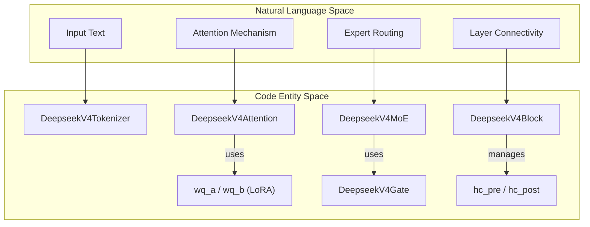
Sources: [modeling_deepseek_v4.py:12-25](), [README.md:14-19]()

## Repository Organization

The repository is structured to separate model definitions, training logic, and utility scripts:

| Directory/File | Description |
| :--- | :--- |
| `modeling_deepseek_v4.py` | Core PyTorch implementation of the DeepSeek-V4 architecture [README.md:32](). |
| `configuration_deepseek_v4.py` | Configuration class handling hyperparameters and Hub integration [README.md:33](). |
| `configs/` | YAML files defining model scales (e.g., `main_100m.yaml`, `debug.yaml`) [README.md:35-38](). |
| `scripts/` | Execution scripts for pretraining, SFT, chat, and evaluation [README.md:39-47](). |
| `tokenizer/` | Artifacts for the 129,280-token DeepSeek-V4 tokenizer [README.md:48-50](). |

### System Interaction Diagram

This diagram shows the relationship between the configuration system, the training scripts, and the resulting model artifacts.

**System Workflow**
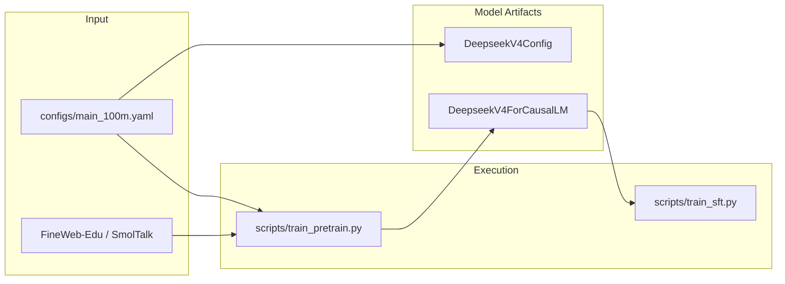
Sources: [README.md:31-51](), [SUMMARY.md:65-77]()

## Getting Started

To begin using `nanowhale`, you must install the dependencies listed in `requirements.txt` and can then proceed to run the interactive chat CLI or initiate a training run [README.md:53-77]().

For a step-by-step setup guide and verification instructions, see **[Getting Started](#1.2)**.

Sources: [README.md:1-121](), [SUMMARY.md:1-132]()

---

# Page: Project Background & Goals

# Project Background & Goals

<details>
<summary>Relevant source files</summary>

The following files were used as context for generating this wiki page:

- [README.md](README.md)
- [SUMMARY.md](SUMMARY.md)

</details>


The **nanowhale** project is a technical demonstration focused on implementing and training a miniature version of the **DeepSeek-V4** architecture. The primary objective is to validate the interplay of several advanced architectural innovations—Multi-Head Latent Attention (MLA), Mixture-of-Experts (MoE), and Hyper-Connections—at a highly constrained scale of approximately 110 million parameters [README.md:1-4]().

## Motivation & Research Goals

The project aims to explore the feasibility of high-complexity architectural features in small-scale models. While features like MoE and Hyper-Connections are typically reserved for models with billions of parameters, nanowhale implements them within a ~110M parameter budget to observe their behavior during pretraining and Supervised Fine-Tuning (SFT) [SUMMARY.md:3-5]().

### Key Architectural Demonstrations
1.  **Multi-Head Latent Attention (MLA):** Implementation of low-rank KV compression to reduce memory footprint during inference while maintaining high attention quality [README.md:16]().
2.  **Mixture-of-Experts (MoE):** Utilization of a sparse execution path with 4 routed experts and 1 shared expert, using top-2 routing and SwiGLU activations [README.md:17]().
3.  **Hyper-Connections:** A novel connectivity pattern using Sinkhorn routing to manage information flow across layers, configured with a multiplier (`hc_mult`) of 4 [README.md:18]().
4.  **Multi-Token Prediction (MTP):** Inclusion of an additional prediction layer to forecast tokens beyond the immediate next step, intended to improve sample efficiency [README.md:19]().

### Architecture to Code Mapping
The following diagram illustrates how the conceptual architectural components map to the specific classes and configurations within the codebase.

**Model Architecture Components**
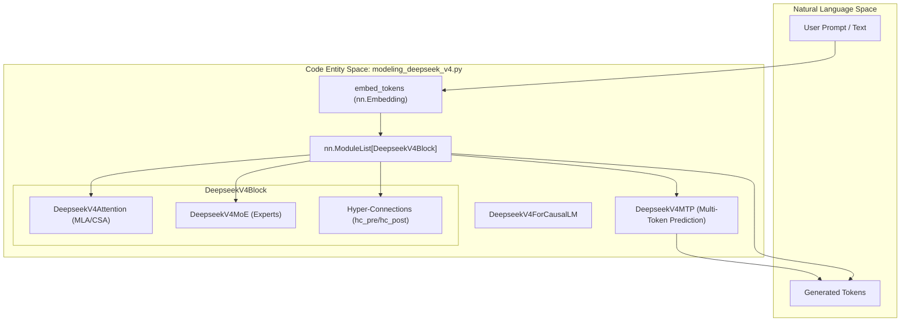
*Sources: [modeling_deepseek_v4.py:1-1200](), [README.md:12-28]()*

## Known Limitations

Developing a 110M parameter replica of a multi-billion parameter architecture revealed several technical constraints:

*   **Numerical Stability (bf16 NaN):** The model experiences numerical instability when using `bfloat16`. Specifically, the Hyper-Connections mechanism produces activations that frequently overflow the `bf16` range at this small scale. Consequently, `float32` is required for stable training and inference [README.md:114](), [SUMMARY.md:129]().
*   **Embedding-to-Parameter Ratio:** The model utilizes the standard DeepSeek-V4 tokenizer with a `vocab_size` of 129,280 [README.md:26](). In a 110M parameter model, the embedding table alone accounts for ~41M parameters (approx. 37% of the total budget), significantly limiting the capacity available for the hidden layers and experts [README.md:116](), [SUMMARY.md:130]().
*   **Weight Re-initialization:** Due to the custom implementation of Hyper-Connections and MTP, the standard Hugging Face `from_pretrained` method may re-initialize certain weights. The project recommends manual state dictionary loading to ensure weight integrity [README.md:115](), [SUMMARY.md:128]().

## Project Artifacts

The project resulted in two primary checkpoints published on the Hugging Face Hub. Both models use the `DeepseekV4Config` class defined in `configuration_deepseek_v4.py` [configuration_deepseek_v4.py:10-80]().

### Published Checkpoints
| Model | Description | Training Details |
| :--- | :--- | :--- |
| **nanowhale-100m-base** | Pretrained base model | 5,000 steps on FineWeb-Edu (~2.6B tokens) [README.md:9](). |
| **nanowhale-100m** | SFT chat model | 3,000 steps on SmolTalk (460K conversations) [README.md:10](). |

### Data Flow and Checkpoint Lifecycle
The diagram below shows the progression from raw data to the final published artifacts via the training scripts.

**Training Pipeline and Artifact Generation**
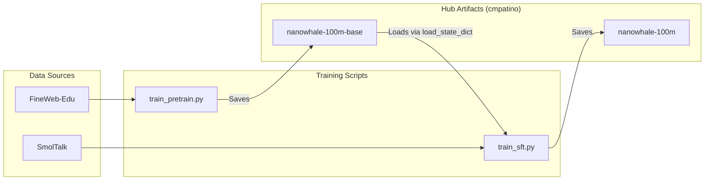
*Sources: [scripts/train_pretrain.py:10-100](), [scripts/train_sft.py:10-120](), [SUMMARY.md:35-63]()*

## Technical Specifications (100M Config)
The primary configuration (`main_100m.yaml`) defines the following constraints for the model:
*   **Hidden Size:** 320 [README.md:24]()
*   **Layers:** 8 [README.md:25]()
*   **Attention Heads:** 8 (with 1 KV head) [README.md:16]()
*   **MoE Experts:** 4 routed + 1 shared (Top-2) [README.md:17]()
*   **Context Window:** 2,048 tokens [README.md:27]()

*Sources: [README.md:1-121](), [SUMMARY.md:1-132](), [configuration_deepseek_v4.py:10-80]()*

---

# Page: Getting Started

# Getting Started

<details>
<summary>Relevant source files</summary>

The following files were used as context for generating this wiki page:

- [requirements.txt](requirements.txt)
- [scripts/chat.py](scripts/chat.py)
- [scripts/eval_smoke.py](scripts/eval_smoke.py)

</details>


This page provides a technical guide for setting up the `nanowhale` environment, installing necessary dependencies, and verifying the installation using the provided diagnostic and interactive scripts.

## Environment Setup

The `nanowhale` project requires a modern Python environment with specific versions of the Hugging Face ecosystem and PyTorch. The dependencies are managed via a standard `requirements.txt` file.

### Installation Steps

1. **Install Dependencies**: Use `pip` to install the core libraries, including `torch` (>= 2.6.0), `transformers` (>= 5.0.0), and the `trl` / `accelerate` stack.
   ```bash
   pip install -r requirements.txt
   ```
2. **Register Custom Architectures**: Because `DeepseekV4ForCausalLM` and `DeepseekV4Config` are custom classes, they must be registered with the Hugging Face `Auto` classes if you are not using `trust_remote_code=True`. The scripts provided in the repository handle this registration locally.

### Dependency Breakdown
| Package | Version | Role |
| :--- | :--- | :--- |
| `torch` | >=2.6.0 | Core tensor operations and autograd engine [requirements.txt:1]() |
| `transformers` | >=5.0.0 | Model loading and tokenizer management [requirements.txt:2]() |
| `trl` | >=1.0.0 | SFT and Trainer utilities [requirements.txt:5]() |
| `trackio` | N/A | Experiment tracking and logging [requirements.txt:6]() |
| `safetensors` | N/A | Secure weight serialization [requirements.txt:7]() |

**Sources:**
- [requirements.txt:1-10]()

---

## Model Loading and Registration

The `nanowhale` codebase uses a custom implementation of the DeepSeek-V4 architecture. To interact with these models using standard Hugging Face APIs, the repository manually registers the configuration and model classes.

### Code-to-Entity Mapping: Registration Flow
The following diagram illustrates how the custom classes in the codebase are linked to the `transformers` library's factory methods.

**Model Registration Architecture**
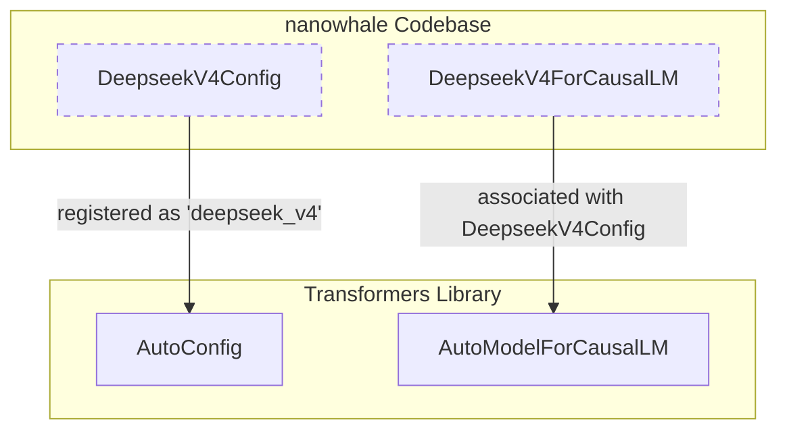

This registration occurs at the beginning of the execution scripts:
- `AutoConfig.register("deepseek_v4", DeepseekV4Config)` [scripts/chat.py:13]() [scripts/eval_smoke.py:13]()
- `AutoModelForCausalLM.register(DeepseekV4Config, DeepseekV4ForCausalLM)` [scripts/chat.py:14]() [scripts/eval_smoke.py:14]()

**Sources:**
- [scripts/chat.py:13-14]()
- [scripts/eval_smoke.py:13-14]()
- [configuration_deepseek_v4.py:1-50]() (referenced for class definitions)
- [modeling_deepseek_v4.py:1-50]() (referenced for class definitions)

---

## Interactive Chat CLI

The `scripts/chat.py` utility allows for interactive testing of the model's conversational capabilities. It handles the chat template application, bfloat16 casting, and iterative generation.

### Execution
```bash
python scripts/chat.py --model_path /path/to/model_checkpoint --device cuda
```

### Implementation Details
1. **Model Loading**: The model is loaded in `torch.bfloat16` to maintain consistency with the training precision [scripts/chat.py:28]().
2. **Chat Template**: The script checks for a `tokenizer.chat_template`. If absent, it falls back to a manual role-based string concatenation [scripts/chat.py:43-46]().
3. **Generation Loop**: It uses `model.generate` with sampling parameters (`temperature`, `top_p`) and ensures the `pad_token_id` is correctly set to the `eos_token_id` [scripts/chat.py:50-57]().

**Sources:**
- [scripts/chat.py:17-62]()

---

## Verification via Smoke Test

The `scripts/eval_smoke.py` script is a comprehensive validation pipeline designed to ensure the environment and model weights are functioning correctly.

### Smoke Test Stages
The script executes six distinct validation phases:

| Stage | Logic | Purpose |
| :--- | :--- | :--- |
| **1. Tokenizer** | Loads `PreTrainedTokenizerFast` | Verify vocab size and special tokens [scripts/eval_smoke.py:28-33]() |
| **2. Config** | Loads `DeepseekV4Config` | Validate hyperparameter parsing [scripts/eval_smoke.py:36-41]() |
| **3. Model** | Loads `DeepseekV4ForCausalLM` | Verify weight loading and parameter count [scripts/eval_smoke.py:44-49]() |
| **4. Generation** | Runs `model.generate` | Ensure forward pass and sampling work [scripts/eval_smoke.py:52-68]() |
| **5. Chat** | `apply_chat_template` | Validate conversation formatting [scripts/eval_smoke.py:71-83]() |
| **6. Perplexity** | Cross-Entropy calculation | Verify numerical stability and basic sanity [scripts/eval_smoke.py:88-106]() |

### Code-to-Entity Mapping: Smoke Test Data Flow
This diagram shows how data flows through the `eval_smoke.py` components during the final perplexity check.

**Perplexity Calculation Flow**
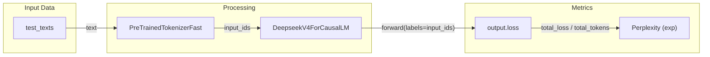

**Sources:**
- [scripts/eval_smoke.py:27-110]()
- [scripts/eval_smoke.py:99-104]() (Perplexity logic)

---

# Page: Model Architecture

# Model Architecture

<details>
<summary>Relevant source files</summary>

The following files were used as context for generating this wiki page:

- [configuration_deepseek_v4.py](configuration_deepseek_v4.py)
- [modeling_deepseek_v4.py](modeling_deepseek_v4.py)

</details>


The DeepSeek-V4 architecture, as implemented in `nanowhale`, represents a highly efficient Transformer variant designed for high throughput and dense knowledge representation. It is characterized by three core architectural innovations: **Hyper-Connections (HC)**, **Multi-Head Latent Attention (MLA)** (also referred to as Compressed Sparse Attention), and a **Mixture-of-Experts (MoE)** feed-forward system.

The model is defined in [modeling_deepseek_v4.py:1-15](), providing a pure PyTorch implementation compatible with the Hugging Face ecosystem.

### System Overview

The model follows a standard decoder-only Transformer structure but replaces traditional residual connections and attention mechanisms with more sophisticated routing and compression logic.

| Component | Code Entity | Description |
| :--- | :--- | :--- |
| **Configuration** | `DeepseekV4Config` | Manages hyperparameters for HC, MLA, and MoE. |
| **Core Block** | `DeepseekV4Block` | Orchestrates the HC lifecycle around Attention and MoE. |
| **Attention** | `DeepseekV4Attention` | Implements MLA with low-rank projections and RoPE. |
| **Feed-Forward** | `DeepseekV4MoE` | Mixture-of-Experts with `sqrtsoftplus` routing. |
| **Next-Token** | `DeepseekV4ForCausalLM` | The top-level model wrapper for generation. |

**Sources:** [modeling_deepseek_v4.py:130-141](), [modeling_deepseek_v4.py:438-442](), [configuration_deepseek_v4.py:18-22]()

---

### Core Innovations

#### 1. Hyper-Connections (HC)
Unlike standard residual connections ($x + f(x)$), Hyper-Connections maintain multiple copies of the hidden state (defined by `hc_mult`). These copies are mixed using a combination matrix normalized via **Sinkhorn iterations**. This allows the model to dynamically route information across different "lanes" of the hidden state.

*   **Key Logic:** The `hc_split_sinkhorn` function generates `pre`, `post`, and `comb` weights.
*   **Lifecycle:** Within each `DeepseekV4Block`, `hc_pre` is applied before the sub-layer, and `hc_post` is applied after, while the `comb` matrix manages the cross-copy mixing.
*   **Details:** For more information on Sinkhorn normalization and the multi-copy state, see [Hyper-Connections](#2.2).

**Sources:** [modeling_deepseek_v4.py:85-123](), [configuration_deepseek_v4.py:54-57]()

#### 2. Multi-Head Latent Attention (MLA / CSA)
MLA reduces the KV cache footprint by using low-rank latent projections. In `nanowhale`, this is implemented as **Compressed Sparse Attention**.

*   **Q Projection:** Uses a low-rank bottleneck (`wq_a` to `wq_b`) with `DeepseekV4RMSNorm`.
*   **KV Projection:** Uses a direct projection `wkv` to a latent space.
*   **Hybrid RoPE:** Splits the head dimension into `nope_head_dim` (non-rotary) and `qk_rope_head_dim` (rotary) for positional encoding.
*   **Details:** For details on grouped output projections and sliding windows, see [Multi-Head Latent Attention (MLA / CSA)](#2.3).

**Sources:** [modeling_deepseek_v4.py:130-171](), [configuration_deepseek_v4.py:40-53]()

#### 3. Mixture-of-Experts (MoE)
The feed-forward network uses a Mixture-of-Experts strategy where most parameters are partitioned into "experts," and only a subset are activated per token.

*   **Routing:** Uses `DeepseekV4Gate` with `sqrtsoftplus` scoring and `noaux_tc` (no-auxiliary loss top-k) routing.
*   **Experts:** Combines `n_shared_experts` (always active) with `n_routed_experts` (top-k active).
*   **Details:** For details on SwiGLU expert layers and hash-based routing, see [Mixture-of-Experts (MoE)](#2.4).

**Sources:** [modeling_deepseek_v4.py:334-360](), [configuration_deepseek_v4.py:29-39]()

---

### Architecture Data Flow

The following diagram illustrates how a single token's hidden state propagates through the `DeepseekV4Block`, emphasizing the "Code Entity Space" identifiers.

**DeepSeek-V4 Block Data Flow**
```mermaid
graph TD
    subgraph Block ["DeepseekV4Block"]
        INPUT["hidden_states (hc_mult copies)"] --> HC_PRE["hc_pre weights"]
        HC_PRE --> ATTN_NORM["DeepseekV4RMSNorm"]
        ATTN_NORM --> MLA["DeepseekV4Attention (MLA)"]
        MLA --> HC_POST["hc_post weights"]
        HC_POST --> COMB["Sinkhorn comb matrix"]
        COMB --> MOE_NORM["DeepseekV4RMSNorm"]
        MOE_NORM --> MOE["DeepseekV4MoE"]
        MOE --> OUTPUT["hidden_states (updated)"]
    end
    
    subgraph Attention ["DeepseekV4Attention"]
        MLA_IN["Input"] --> WQ_A["wq_a (Linear)"]
        WQ_A --> Q_NORM["q_norm (RMSNorm)"]
        Q_NORM --> WQ_B["wq_b (Linear)"]
        MLA_IN --> WKV["wkv (Linear)"]
        WKV --> KV_NORM["kv_norm (RMSNorm)"]
    end
```
**Sources:** [modeling_deepseek_v4.py:438-480](), [modeling_deepseek_v4.py:155-162]()

---

### Configuration and Model Setup

The architecture is dynamically sized based on the `DeepseekV4Config`. This configuration drives the initialization of the `DeepseekV4Model` and its constituent layers.

**Model Hierarchy and Code Mapping**
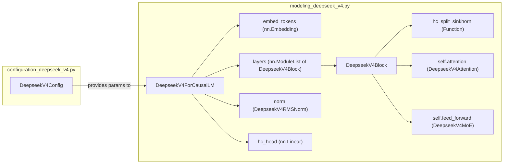
**Sources:** [modeling_deepseek_v4.py:535-570](), [configuration_deepseek_v4.py:76-133]()

### Child Pages

*   **[Configuration System (DeepseekV4Config)](#2.1)**: Deep dive into the parameters and `auto_map` logic.
*   **[Hyper-Connections](#2.2)**: Technical breakdown of multi-copy states and Sinkhorn normalization.
*   **[Multi-Head Latent Attention (MLA / CSA)](#2.3)**: Low-rank KV compression and hybrid RoPE implementation.
*   **[Mixture-of-Experts (MoE)](#2.4)**: Expert routing, shared experts, and SwiGLU layers.
*   **[Multi-Token Prediction (MTP)](#2.5)**: Prediction of $t+n$ tokens for improved training efficiency.

---

# Page: Configuration System (DeepseekV4Config)

# Configuration System (DeepseekV4Config)

<details>
<summary>Relevant source files</summary>

The following files were used as context for generating this wiki page:

- [configuration_deepseek_v4.py](configuration_deepseek_v4.py)
- [scripts/count_params.py](scripts/count_params.py)

</details>


The configuration system in `nanowhale` is centered around the `DeepseekV4Config` class. This system manages the hyperparameters required to instantiate the complex DeepSeek-V4 architecture, including Multi-Head Latent Attention (MLA), Mixture-of-Experts (MoE), and Hyper-Connections (HC). It is designed to be fully compatible with the Hugging Face `transformers` ecosystem while implementing specific structural changes introduced in the V4 architecture.

## The DeepseekV4Config Class

The `DeepseekV4Config` class inherits from `PretrainedConfig` [configuration_deepseek_v4.py:18](). It defines the `model_type` as `"deepseek_v4"` [configuration_deepseek_v4.py:19](), which allows the Hugging Face `AutoConfig` and `AutoModel` machinery to correctly identify and load the custom architecture.

### Key Configuration Categories

The configuration is divided into several functional blocks that drive model instantiation:

1.  **Model Dimensions**: Basic transformer parameters like `hidden_size`, `num_hidden_layers`, and `vocab_size`.
2.  **Attention (MLA/CSA)**: Parameters for compressed attention, including LoRA ranks for queries and grouped output projections.
3.  **Mixture-of-Experts (MoE)**: Expert counts, routing methods (including hash-based routing), and scoring functions.
4.  **Hyper-Connections (HC)**: Multiplier for hidden state copies and Sinkhorn normalization iterations.
5.  **Multi-Token Prediction (MTP)**: Configuration for the additional prediction layers used during training.

### Data Flow: Config to Model
The following diagram illustrates how the `DeepseekV4Config` entity flows through the system to create a functional model.

**Configuration Initialization and Model Binding**
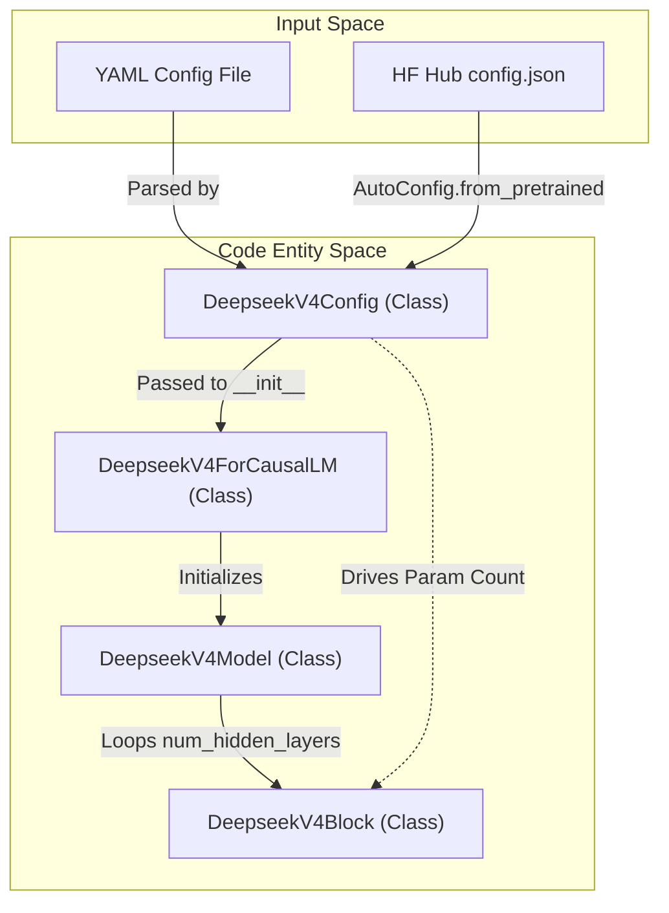
Sources: [configuration_deepseek_v4.py:18-141](), [scripts/count_params.py:9-11]()

---

## Hyperparameter Fields

### Comparison: DeepSeek-V4 vs. DeepSeek-V3
The `nanowhale` implementation highlights several key differences in the configuration compared to the previous V3 iteration:

| Feature | DeepSeek-V3 | DeepSeek-V4 | Code Reference |
| :--- | :--- | :--- | :--- |
| **Attention** | `kv_lora_rank` | `compress_ratios` | [configuration_deepseek_v4.py:11]() |
| **Head Dim** | `qk_nope_head_dim` | `head_dim` (Unified) | [configuration_deepseek_v4.py:12]() |
| **Routing** | Softmax | `sqrtsoftplus` | [configuration_deepseek_v4.py:35]() |
| **Connections** | Residual | Hyper-Connections (`hc_mult`) | [configuration_deepseek_v4.py:55]() |
| **Output** | Single Projection | `o_groups` / `o_lora_rank` | [configuration_deepseek_v4.py:44-45]() |

### Detailed Field Definitions

#### MoE Settings
*   `n_routed_experts`: Total number of experts available for routing [configuration_deepseek_v4.py:31]().
*   `num_experts_per_tok`: The 'k' in top-k routing [configuration_deepseek_v4.py:33]().
*   `scoring_func`: Set to `"sqrtsoftplus"` by default for V4 routing [configuration_deepseek_v4.py:35]().
*   `num_hash_layers`: Number of initial layers using hash-based routing instead of learned routers [configuration_deepseek_v4.py:38]().
*   `swiglu_limit`: A value used to clip SwiGLU activations for stability [configuration_deepseek_v4.py:39]().

#### Attention (MLA) Settings
*   `q_lora_rank`: Rank for the query compression [configuration_deepseek_v4.py:41]().
*   `qk_rope_head_dim`: Dimension allocated for RoPE (Rotary Positional Embeddings) [configuration_deepseek_v4.py:43]().
*   `nope_head_dim`: Calculated as `head_dim - qk_rope_head_dim` for non-positional embeddings [configuration_deepseek_v4.py:98]().
*   `o_groups`: Number of groups for the grouped output projection [configuration_deepseek_v4.py:44]().

#### Hyper-Connections (HC) Settings
*   `hc_mult`: The expansion factor for hidden states (e.g., 4x) [configuration_deepseek_v4.py:55]().
*   `hc_sinkhorn_iters`: Iterations for the Sinkhorn normalization algorithm [configuration_deepseek_v4.py:56]().

Sources: [configuration_deepseek_v4.py:22-75](), [configuration_deepseek_v4.py:76-133]()

---

## Configuration Impact on Parameter Budget

The configuration directly dictates the parameter distribution across the model. In `nanowhale`, the high `vocab_size` (129,280) relative to the `hidden_size` (320-512) causes embeddings to consume a significant portion of the budget.

**Parameter Distribution Logic**
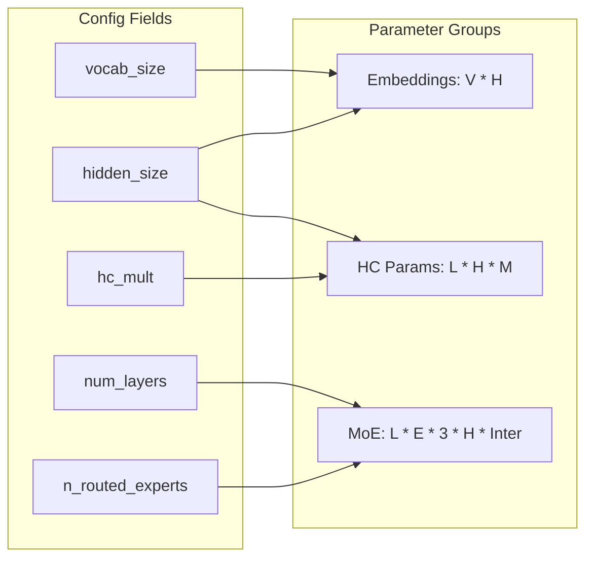
Sources: [scripts/count_params.py:12-13](), [scripts/count_params.py:39-48](), [scripts/count_params.py:64-66]()

The `count_params` utility uses the `DeepseekV4Config` to instantiate a model and calculate these breakdowns [scripts/count_params.py:9-11](). For a 100M parameter model, the experts (FFN/MoE) and embeddings are the primary drivers of size, while Hyper-Connections (HC) add a smaller overhead based on the `hc_mult` factor [scripts/count_params.py:45-48]().

## Hugging Face Hub Compatibility

To ensure the model can be loaded via `AutoModel.from_pretrained()`, `nanowhale` utilizes the `auto_map` feature. When uploading to the Hub, the `config.json` is injected with pointers to the local implementation files:

*   `AutoConfig`: `configuration_deepseek_v4.DeepseekV4Config`
*   `AutoModelForCausalLM`: `modeling_deepseek_v4.DeepseekV4ForCausalLM`

This allows users to load the model without having the `nanowhale` repository installed locally, provided they use `trust_remote_code=True`.

Sources: [configuration_deepseek_v4.py:18-19](), [scripts/upload_to_hub.py]()

---

# Page: Hyper-Connections

# Hyper-Connections

<details>
<summary>Relevant source files</summary>

The following files were used as context for generating this wiki page:

- [configuration_deepseek_v4.py](configuration_deepseek_v4.py)
- [modeling_deepseek_v4.py](modeling_deepseek_v4.py)

</details>


Hyper-Connections (HC) is a core architectural innovation in DeepSeek-V4 that replaces standard residual connections with a multi-copy hidden state mechanism. Instead of a single residual stream, the model maintains `hc_mult` parallel copies of the hidden state, which are dynamically mixed and updated at each layer using weights derived from Sinkhorn normalization.

## Overview and Purpose

In a standard Transformer, the update rule is $x_{l+1} = x_l + \text{SubLayer}(x_l)$. Hyper-Connections expand this by maintaining a hidden state $X \in \mathbb{R}^{B \times S \times \text{hc\_mult} \times D}$. At each layer, the model generates "pre-connection" weights, "post-connection" weights, and a "combination matrix" to route information between these parallel streams.

The implementation in `nanowhale` focuses on:
1.  **Multi-copy state**: Expanding the hidden dimension by a factor of `hc_mult` [configuration_deepseek_v4.py:55-55]().
2.  **Dynamic Routing**: Using a linear projection to generate mixing scores [modeling_deepseek_v4.py:516-518]().
3.  **Sinkhorn Normalization**: Ensuring the combination matrix is doubly stochastic to maintain numerical stability across many layers [modeling_deepseek_v4.py:110-123]().

### Data Flow within DeepseekV4Block

The lifecycle of the hidden states within a single `DeepseekV4Block` involves splitting the multi-copy state, applying the sub-layers (Attention or MoE), and then recombining the outputs.

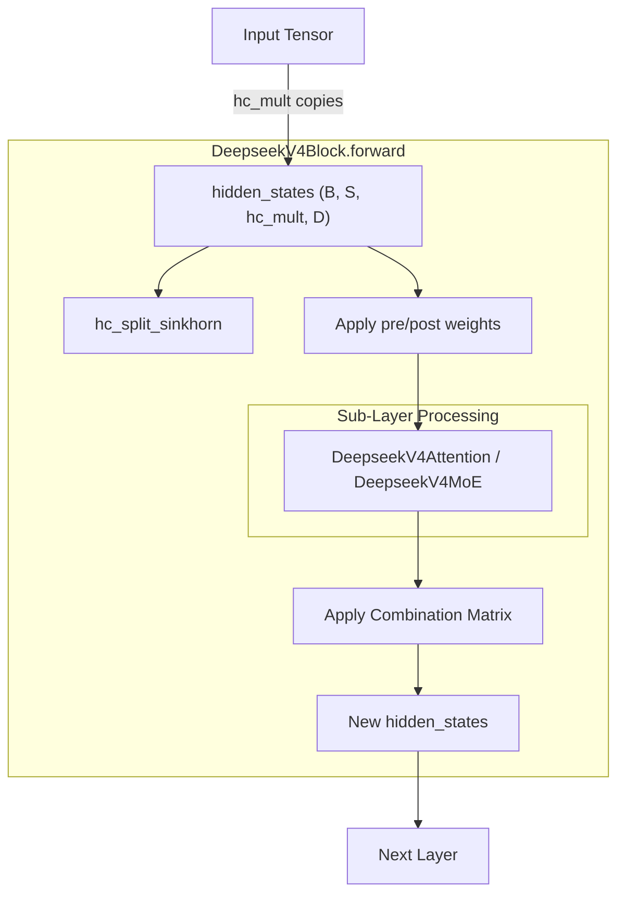
**Sources:** [modeling_deepseek_v4.py:511-550]()

## Implementation Details

### hc_split_sinkhorn

The `hc_split_sinkhorn` function is responsible for transforming raw scores into normalized weights. It processes a "mixes" tensor of size `[B, S, (2 + hc_mult) * hc_mult]` [modeling_deepseek_v4.py:85-100]().

*   **Pre-connection weights (`pre`)**: A sigmoid-activated vector of size `hc_mult` used to scale the input to the sub-layer [modeling_deepseek_v4.py:102-107]().
*   **Post-connection weights (`post`)**: A sigmoid-activated vector (scaled by 2) used to scale the output of the sub-layer [modeling_deepseek_v4.py:103-108]().
*   **Combination Matrix (`comb`)**: A square matrix of size `[hc_mult, hc_mult]` that defines how information is exchanged between the `hc_mult` copies [modeling_deepseek_v4.py:104-111]().

### Sinkhorn Normalization

To ensure the combination matrix `comb` does not cause exponential growth or decay of activations, it undergoes Sinkhorn iterations. This process forces the matrix to be nearly doubly stochastic (rows and columns sum to 1).

1.  **Initial Softmax**: Applied along the last dimension [modeling_deepseek_v4.py:114-114]().
2.  **Row/Column Normalization**: Iteratively dividing by the sum of the respective dimension [modeling_deepseek_v4.py:115-121]().
3.  **Stability**: An `eps` (default `1e-6`) is added to denominators to prevent division by zero [modeling_deepseek_v4.py:116-121]().

**Sources:** [modeling_deepseek_v4.py:85-123](), [configuration_deepseek_v4.py:116-118]()

## Lifecycle within DeepseekV4Block

The `DeepseekV4Block` manages two Hyper-Connection stages: one for the attention sub-layer and one for the MoE/FFN sub-layer.

| Step | Code Entity | Action |
| :--- | :--- | :--- |
| **Score Generation** | `self.hc_mix_1` | Linear projection from `hidden_size` to scores [modeling_deepseek_v4.py:516-518](). |
| **Normalization** | `hc_split_sinkhorn` | Produces `pre`, `post`, and `comb` [modeling_deepseek_v4.py:521-523](). |
| **Input Scaling** | `hidden_states * pre` | Scales the `hc_mult` copies before the sub-layer [modeling_deepseek_v4.py:533-533](). |
| **Sub-layer Execution** | `self.attn(...)` | Processes the weighted copies [modeling_deepseek_v4.py:534-534](). |
| **Output Scaling** | `attn_output * post` | Scales the sub-layer residual [modeling_deepseek_v4.py:535-535](). |
| **Combination** | `torch.matmul(comb, ...)` | Mixes the copies according to the Sinkhorn matrix [modeling_deepseek_v4.py:536-536](). |

This sequence is repeated for the MoE layer (`hc_mix_2`) [modeling_deepseek_v4.py:540-549]().

**Sources:** [modeling_deepseek_v4.py:511-550]()

## Final Contraction: hc_head

Because the internal layers operate on `hc_mult` copies, the final output of the transformer stack must be contracted back to a single `hidden_size` vector before the language modeling head. This is handled by `self.hc_head` in the `DeepseekV4Model` class.

*   **Function**: A linear layer that maps from `hc_mult * hidden_size` back to `hidden_size` [modeling_deepseek_v4.py:623-623]().
*   **Input**: The `hidden_states` tensor is reshaped from `[B, S, hc_mult, D]` to `[B, S, hc_mult * D]` [modeling_deepseek_v4.py:663-664]().

**Sources:** [modeling_deepseek_v4.py:623-664]()

## Numerical Stability: The bf16 NaN Issue

A known limitation in the `nanowhale` implementation is the tendency for `bfloat16` gradients to overflow, leading to `NaN` values, particularly at the small scale (110M parameters).

### Root Causes
1.  **Sinkhorn Iterations**: Repeated division and normalization in `hc_split_sinkhorn` can lead to very small or very large values if the raw scores are not well-bounded [modeling_deepseek_v4.py:119-121]().
2.  **Multi-copy Accumulation**: The dynamic mixing of `hc_mult` copies increases the variance of activations compared to standard residual streams.
3.  **Parameter Scale**: At 110M parameters, the `hidden_size` is small (e.g., 320), making the model more sensitive to the epsilon values and initialization ranges used in the HC mechanism.

To mitigate this during training, the `train_sft.py` script often falls back to `fp32` or uses strict gradient clipping.

**Sources:** [modeling_deepseek_v4.py:85-123](), [configuration_deepseek_v4.py:57-57]()

## Code Entity Map

The following diagram maps the mathematical concepts of Hyper-Connections to their specific implementations in the codebase.

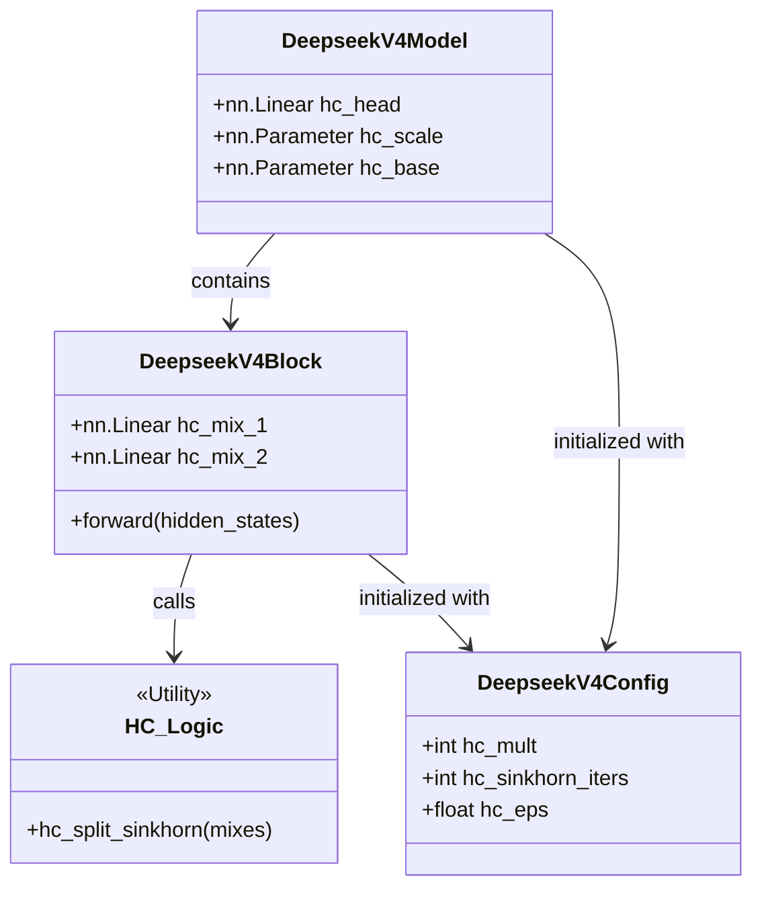
**Sources:** [configuration_deepseek_v4.py:18-140](), [modeling_deepseek_v4.py:85-123](), [modeling_deepseek_v4.py:465-550](), [modeling_deepseek_v4.py:596-670]()

---

# Page: Multi-Head Latent Attention (MLA / CSA)

# Multi-Head Latent Attention (MLA / CSA)

<details>
<summary>Relevant source files</summary>

The following files were used as context for generating this wiki page:

- [configuration_deepseek_v4.py](configuration_deepseek_v4.py)
- [modeling_deepseek_v4.py](modeling_deepseek_v4.py)

</details>


Multi-Head Latent Attention (MLA), also referred to in this codebase as **Compressed Sparse Attention (CSA)**, is a memory-efficient attention mechanism designed to reduce the KV cache bottleneck while maintaining high expressivity. In `nanowhale`, this is implemented as a low-rank projection system for Queries, Keys, Values, and Outputs, combined with a hybrid positional embedding strategy.

## Architecture Overview

The implementation in `DeepseekV4Attention` replaces standard Multi-Head Attention (MHA) with a compressed latent space. Unlike standard MHA where $K$ and $V$ grow linearly with the number of heads, MLA compresses these into a single latent vector that is shared across all heads, significantly reducing the memory footprint during inference.

### Key Components

*   **Low-Rank Q Projection**: Queries are projected into a latent space (`q_lora_rank`) before being expanded to the full head dimension.
*   **Direct KV Projection**: Keys and Values are projected into a shared latent space (`head_dim`) without a separate LoRA rank, diverging from the DeepSeek-V3 implementation.
*   **Grouped Output Projection**: The output projection is split into groups (`o_groups`) and processed via a low-rank bottleneck (`o_lora_rank`) to reduce parameter count.
*   **Hybrid RoPE/NoPE**: Each head is split into a non-positional part (NoPE) and a part that receives Rotary Positional Embeddings (RoPE).

### Data Flow: Natural Language to Code Entities

The following diagram maps the mathematical flow of the attention mechanism to the specific code entities in `modeling_deepseek_v4.py`.

**MLA Data Flow Diagram**
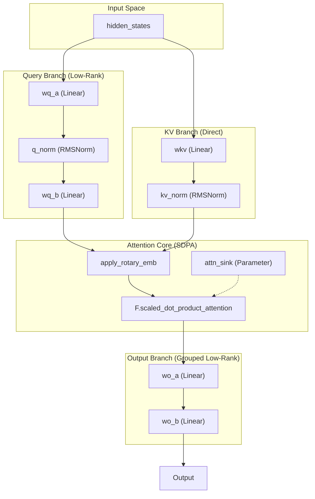
**Sources:** [modeling_deepseek_v4.py:130-172](), [modeling_deepseek_v4.py:173-200]()

---

## Implementation Details

### Latent Projections

The Queries are processed through a two-step projection to reduce the number of parameters while maintaining the rank of the attention matrix.
1.  **`wq_a`**: Projects `hidden_size` to `q_lora_rank` [modeling_deepseek_v4.py:156]().
2.  **`q_norm`**: Applies `DeepseekV4RMSNorm` to the latent Query [modeling_deepseek_v4.py:157]().
3.  **`wq_b`**: Expands the latent Query to `num_heads * head_dim` [modeling_deepseek_v4.py:158]().

For Keys and Values, `nanowhale` uses a direct projection `wkv` to a single shared latent head of size `head_dim` [modeling_deepseek_v4.py:161](). This is a specific V4 optimization that differs from V3's `kv_lora_rank` [configuration_deepseek_v4.py:11]().

### Hybrid Positional Embeddings (RoPE + NoPE)

The `head_dim` is partitioned into two segments:
*   **NoPE (Non-Positional Embedding)**: The first `head_dim - qk_rope_head_dim` dimensions are used for content-based matching without positional information [configuration_deepseek_v4.py:98]().
*   **RoPE (Rotary Positional Embedding)**: The final `qk_rope_head_dim` dimensions receive positional encoding via `apply_rotary_emb` [modeling_deepseek_v4.py:63-79]().

### Grouped Output Projection

To manage the complexity of projecting back to the hidden dimension, the output uses a grouped low-rank strategy:
1.  The concatenated head outputs are divided into `o_groups` [modeling_deepseek_v4.py:151]().
2.  **`wo_a`**: Projects each group to a shared `o_lora_rank` [modeling_deepseek_v4.py:167]().
3.  **`wo_b`**: Projects the combined latent representations back to `hidden_size` [modeling_deepseek_v4.py:168]().

**Entity Mapping: Configuration to Model**
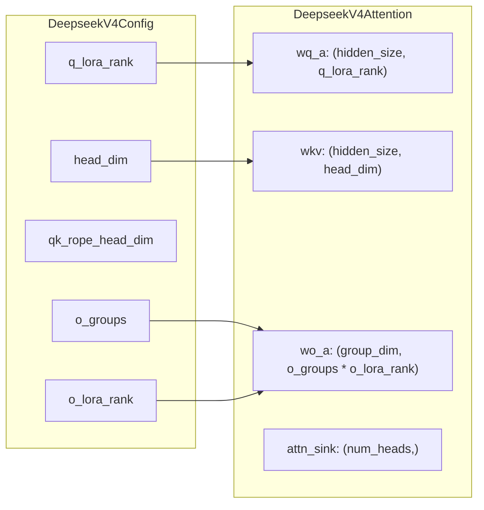
**Sources:** [configuration_deepseek_v4.py:41-45](), [modeling_deepseek_v4.py:141-172]()

---

## Attention Sink

The model includes a learnable `attn_sink` parameter of shape `(num_heads,)` [modeling_deepseek_v4.py:171](). This parameter provides a stable "sink" for attention scores, allowing the model to attend to a null-like position to avoid forcing attention onto irrelevant tokens in the sequence.

## Configuration Parameters

The following table summarizes the MLA-specific parameters in `DeepseekV4Config`:

| Parameter | Description | Default (110M) |
| :--- | :--- | :--- |
| `q_lora_rank` | Latent dimension for Query compression | 1024 |
| `head_dim` | Total dimension per head (NoPE + RoPE) | 512 |
| `qk_rope_head_dim` | Dimension allocated to RoPE within each head | 64 |
| `o_groups` | Number of groups for the output projection | 8 |
| `o_lora_rank` | Latent dimension for Output compression | 1024 |
| `sliding_window` | Local attention window size | 128 |

**Sources:** [configuration_deepseek_v4.py:41-46](), [configuration_deepseek_v4.py:95-101]()

---

# Page: Mixture-of-Experts (MoE)

# Mixture-of-Experts (MoE)

<details>
<summary>Relevant source files</summary>

The following files were used as context for generating this wiki page:

- [configuration_deepseek_v4.py](configuration_deepseek_v4.py)
- [modeling_deepseek_v4.py](modeling_deepseek_v4.py)

</details>


The Mixture-of-Experts (MoE) subsystem in `nanowhale` implements the sparse feed-forward network (FFN) architecture introduced in DeepSeek-V4. It replaces the standard dense FFN in specific layers with a combination of routed experts and a shared expert to maximize parameter efficiency and model capacity.

## Architecture Overview

The MoE layer consists of three primary components:
1.  **DeepseekV4Gate**: A routing mechanism that selects the top-k experts for each token.
2.  **DeepseekV4Expert**: Individual SwiGLU-based MLP experts.
3.  **Shared Expert**: A non-sparse MLP that processes every token to capture common knowledge.

### Data Flow Diagram

The following diagram illustrates the flow of a hidden state through the `DeepseekV4MoE` module.

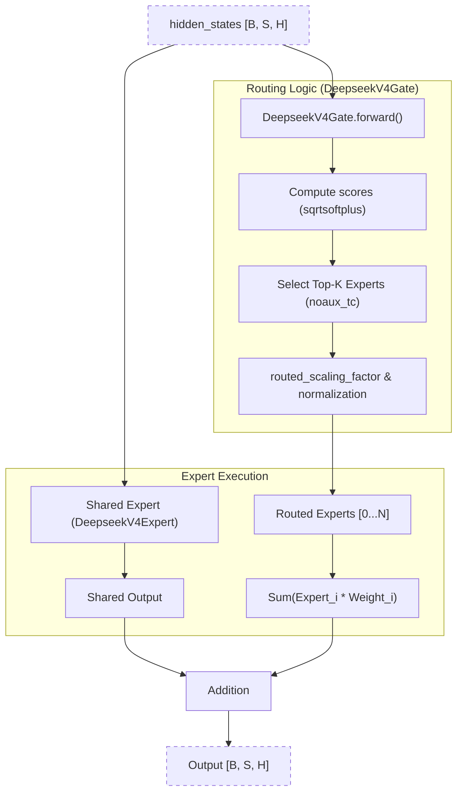
**Sources:** [modeling_deepseek_v4.py:331-365](), [modeling_deepseek_v4.py:378-410]()

---

## DeepseekV4Gate: The Router

The `DeepseekV4Gate` class is responsible for mapping tokens to experts. It supports two routing strategies: hash-based routing for early layers and learned routing for deeper layers.

### Scoring and Selection
*   **Scoring Function**: Uses `sqrtsoftplus` to compute raw expert scores [configuration_deepseek_v4.py:35](), [modeling_deepseek_v4.py:302]().
*   **Top-K Selection**: Employs the `noaux_tc` method (No-Auxiliary-Loss Top-K) to select `num_experts_per_tok` experts [configuration_deepseek_v4.py:37]().
*   **Hash-based Routing**: For the first `num_hash_layers`, routing is determined by a fixed hash of the `position_ids` rather than learned weights. This stabilizes early-stage representation learning [configuration_deepseek_v4.py:38](), [modeling_deepseek_v4.py:312-316]().

### Normalization
If `norm_topk_prob` is enabled, the selected expert scores are normalized to sum to 1 [configuration_deepseek_v4.py:87](). The final output of the routed experts is scaled by `routed_scaling_factor` (default 1.5) to balance the contribution between routed and shared experts [configuration_deepseek_v4.py:89](), [modeling_deepseek_v4.py:355]().

**Sources:** [modeling_deepseek_v4.py:285-329](), [configuration_deepseek_v4.py:82-92]()

---

## DeepseekV4Expert: SwiGLU MLP

Each expert is a SwiGLU MLP. A key feature in `nanowhale` is the `swiglu_limit`, which clips the intermediate activation to prevent numerical instability in bfloat16 training.

### Expert Structure
The expert performs the following transformation:
1.  **Gate Projection**: `w1` (Linear)
2.  **Up Projection**: `w3` (Linear)
3.  **Activation**: `SiLU(w1(x)) * w3(x)`
4.  **Limiter**: `torch.clamp(act, max=swiglu_limit)`
5.  **Down Projection**: `w2` (Linear)

| Component | Code Entity | Purpose |
| :--- | :--- | :--- |
| Gate/Up Linear | `self.w1`, `self.w3` | Projection to `moe_intermediate_size` |
| Limit Hyperparameter | `config.swiglu_limit` | Prevents activation explosions (default 10.0) |
| Down Linear | `self.w2` | Projection back to `hidden_size` |

**Sources:** [modeling_deepseek_v4.py:255-283](), [configuration_deepseek_v4.py:92]()

---

## Implementation Details

### Shared Expert
The shared expert is an instance of `DeepseekV4Expert` but with a potentially different intermediate size (`moe_intermediate_size` * `n_shared_experts`). It processes every token regardless of the gate's output [modeling_deepseek_v4.py:343-346]().

### Training with DDP
Because MoE layers are sparse, some experts might not be used in a specific training batch. When using Distributed Data Parallel (DDP), this can lead to errors because gradients are not computed for all parameters. 

To handle this, the training scripts must be initialized with `ddp_find_unused_parameters=True` or the model must ensure all expert parameters receive a gradient (e.g., via auxiliary losses or dummy gradients), though `nanowhale` primarily relies on the `noaux_tc` method and standard DDP configurations.

### Code Entity Mapping

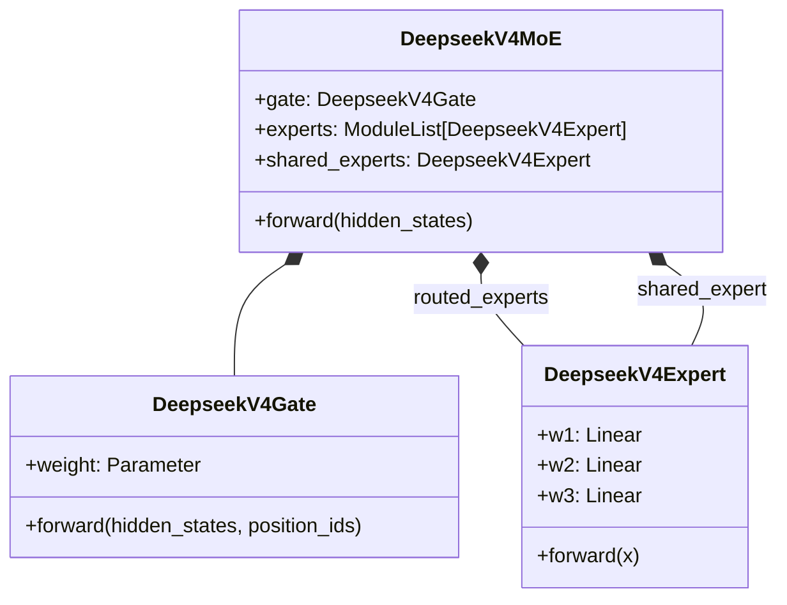
**Sources:** [modeling_deepseek_v4.py:255](), [modeling_deepseek_v4.py:285](), [modeling_deepseek_v4.py:331]()

### Key Configuration Parameters
The MoE behavior is governed by the following fields in `DeepseekV4Config`:

*   `n_routed_experts`: Total number of sparse experts [configuration_deepseek_v4.py:31]().
*   `num_experts_per_tok`: Number of experts active per token (Top-K) [configuration_deepseek_v4.py:33]().
*   `moe_intermediate_size`: The hidden dimension within each expert [configuration_deepseek_v4.py:30]().
*   `num_hash_layers`: Number of initial layers using hash-based routing [configuration_deepseek_v4.py:38]().

**Sources:** [configuration_deepseek_v4.py:29-39]()

---

# Page: Multi-Token Prediction (MTP)

# Multi-Token Prediction (MTP)

<details>
<summary>Relevant source files</summary>

The following files were used as context for generating this wiki page:

- [README.md](README.md)
- [configuration_deepseek_v4.py](configuration_deepseek_v4.py)
- [modeling_deepseek_v4.py](modeling_deepseek_v4.py)

</details>


Multi-Token Prediction (MTP) is an architectural feature in DeepSeek-V4 designed to improve training sample efficiency and model performance by predicting multiple future tokens simultaneously rather than just the next token ($t+1$). In the `nanowhale` implementation, this is controlled by the `num_nextn_predict_layers` configuration parameter.

## Overview and Purpose

The standard causal language modeling objective focuses on predicting the single next token in a sequence. MTP extends this by adding auxiliary prediction heads (or layers) that predict tokens at positions $t+2, t+3, \dots, t+n$. This approach encourages the model's internal representations to capture longer-range dependencies and semantic structure, effectively increasing the "signal-to-noise" ratio during pretraining.

In `nanowhale`, the default configuration sets `num_nextn_predict_layers=1` [configuration_deepseek_v4.py:59](), which corresponds to predicting $t+1$ (base) and $t+2$ (MTP).

## Data Flow and Architecture

The MTP implementation in `DeepseekV4Model` integrates with the core transformer stack. While the base model processes the sequence to produce hidden states for the standard language modeling head, the MTP layers utilize these states to project into future token spaces.

### System to Code Entity Mapping

The following diagram illustrates how the MTP configuration interacts with the model initialization and forward pass logic.

**MTP Component Integration**
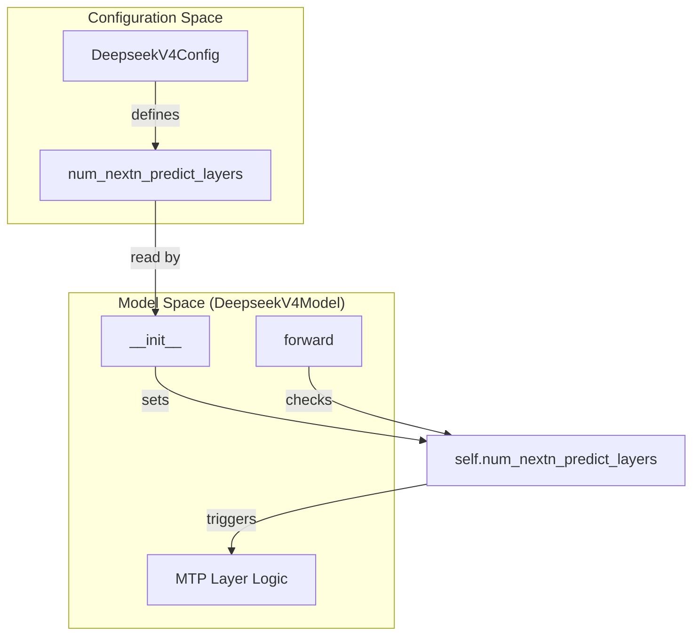
Sources: [configuration_deepseek_v4.py:59](), [configuration_deepseek_v4.py:121]()

### Data Flow for Next-N Prediction

When `num_nextn_predict_layers` is active, the model generates representations that are shifted relative to the input sequence to facilitate the prediction of subsequent tokens.

**MTP Data Transformation**
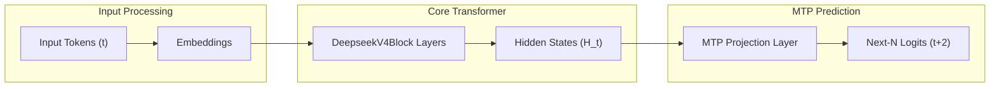
Sources: [modeling_deepseek_v4.py:11](), [configuration_deepseek_v4.py:59]()

## Implementation Details

The implementation of MTP in `nanowhale` is designed to be pure PyTorch, avoiding custom kernels to maintain compatibility with standard training loops like `SFTTrainer` [modeling_deepseek_v4.py:13-15]().

### Configuration Parameters
The MTP behavior is governed by the `DeepseekV4Config` class:
*   `num_nextn_predict_layers`: Integer defining how many additional tokens to predict. In the provided configurations, this is typically set to `1` [configuration_deepseek_v4.py:121]().

### Constraints in Small Models
In the `nanowhale` 110M parameter implementation, while the architecture supports MTP, it is often "disabled" or minimized (set to 1) for small-scale models to preserve the parameter budget for the primary hidden layers and the large 129K vocabulary embedding table [modeling_deepseek_v4.py:11](), [README.md:116]().

## Impact on Training Efficiency

By predicting $t+2$ alongside $t+1$, the model receives more gradient information per training sample. This is particularly relevant for the `nanowhale` pretraining phase, which processed ~2.6B tokens over 5,000 steps [README.md:91-92](). The MTP layer forces the `DeepseekV4Block` representations to remain highly informative about the sequence context, as they must serve both the immediate next-token prediction and the auxiliary MTP heads.

Sources: [README.md:19](), [modeling_deepseek_v4.py:11](), [configuration_deepseek_v4.py:58-59]()

---

# Page: Configuration Files

# Configuration Files

<details>
<summary>Relevant source files</summary>

The following files were used as context for generating this wiki page:

- [configs/debug.yaml](configs/debug.yaml)
- [configs/fallback_under_1b.yaml](configs/fallback_under_1b.yaml)
- [configs/main_100m.yaml](configs/main_100m.yaml)

</details>


The `configs/` directory serves as the central control plane for the nanowhale repository. It contains YAML files that define both the structural hyperparameters of the DeepSeek-V4 architecture and the training dynamics required to optimize them. These files bridge the gap between high-level model design and the actual instantiation of the `DeepseekV4Config` class used throughout the training pipeline.

### Configuration Hierarchy and Purpose

The repository provides three distinct configuration tiers designed for different stages of development, from rapid smoke-testing to production-grade pretraining. Each file is structured into two primary sections: `model` (architectural parameters) and `training` (optimization hyperparameters).

### Mapping Configuration to Code

The following diagram illustrates how the YAML configuration fields map to the internal components of the `DeepseekV4` model.

**Model Configuration Data Flow**
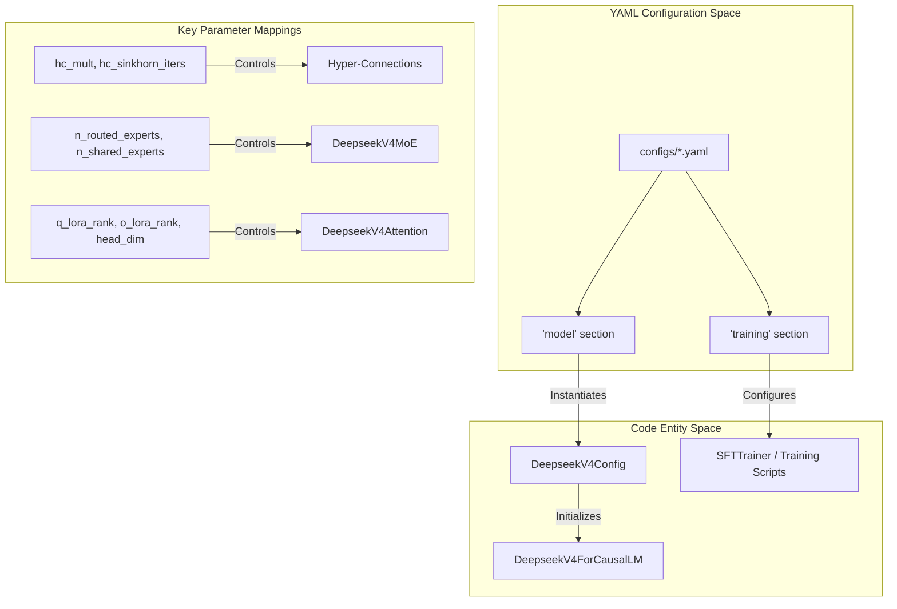
Sources: [configs/main_100m.yaml:21-52](), [configs/main_100m.yaml:54-69]()

### Model Scale Management

The `configs/` files allow for precise control over the parameter budget. A significant portion of the parameter count in nanowhale is dedicated to the embedding layer due to the large DeepSeek-V4 vocabulary.

| Configuration | Total Params | Hidden Size | Layers | Primary Use Case |
| :--- | :--- | :--- | :--- | :--- |
| `debug.yaml` | ~17M | 64 | 2 | CI/CD, smoke tests |
| `main_100m.yaml` | ~110M | 320 | 8 | Production pretraining/SFT |
| `fallback_under_1b.yaml` | ~995M | 896 | 16 | Scaling research |

The relationship between configuration parameters and the resulting model architecture is detailed in the diagram below.

**Architectural Scaling Logic**
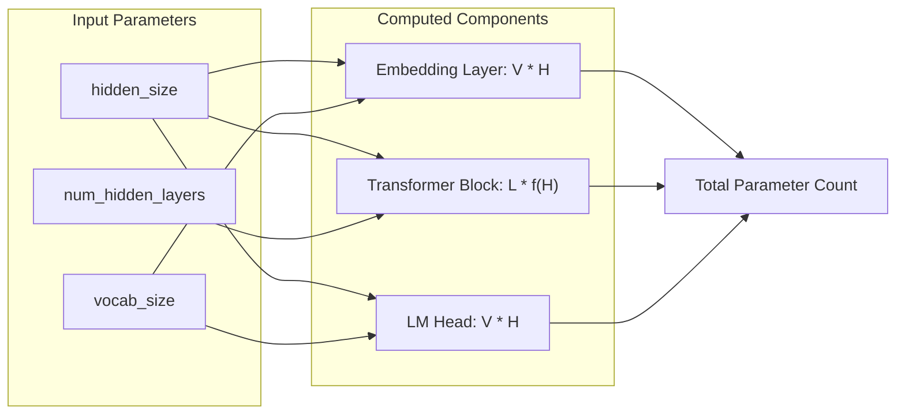
Sources: [configs/main_100m.yaml:17-19](), [configs/debug.yaml:4-6](), [configs/fallback_under_1b.yaml:5-7]()

---

### Configuration Variants

#### [Main 100M Configuration (main_100m.yaml)](#3.1)
This is the primary production configuration used for the published checkpoints. It balances the innovations of DeepSeek-V4 (MLA, MoE, Hyper-Connections) within a ~110M parameter budget. It features a `hidden_size` of 320, 8 layers, and a 4+1 MoE structure.
For details, see [Main 100M Configuration (main_100m.yaml)](#3.1).

#### [Debug Configuration (debug.yaml)](#3.2)
A lightweight configuration designed for rapid iteration. With only ~17M parameters and a `hidden_size` of 64, it allows developers to verify that the `Hyper-Connections` and `MoE` logic function correctly without requiring significant GPU memory or time.
For details, see [Debug Configuration (debug.yaml)](#3.2).

#### [Fallback Under-1B Configuration (fallback_under_1b.yaml)](#3.3)
This configuration demonstrates how the nanowhale architecture scales toward the 1B parameter mark. It increases the `hidden_size` to 896 and the `num_hidden_layers` to 16, while also increasing the complexity of the Hyper-Connections via 10 Sinkhorn iterations.
For details, see [Fallback Under-1B Configuration (fallback_under_1b.yaml)](#3.3).

---
Sources:
- [configs/main_100m.yaml:1-70]()
- [configs/debug.yaml:1-38]()
- [configs/fallback_under_1b.yaml:1-53]()

---

# Page: Main 100M Configuration (main_100m.yaml)

# Main 100M Configuration (main_100m.yaml)

<details>
<summary>Relevant source files</summary>

The following files were used as context for generating this wiki page:

- [configs/main_100m.yaml](configs/main_100m.yaml)

</details>


The `main_100m.yaml` configuration defines the primary production-grade model for the nanowhale project. It specifies a ~110M parameter architecture that replicates the DeepSeek-V4 structural innovations—Multi-Head Latent Attention (MLA), Mixture-of-Experts (MoE), and Hyper-Connections—at a computationally accessible scale. This configuration is the basis for the published checkpoints and serves as the benchmark for balancing architectural complexity with training stability.

Sources: [configs/main_100m.yaml:1-20]()

## Architectural Specification

The model is designed with a `hidden_size` of 320 and 8 transformer layers. Despite the small hidden dimension, the architecture maintains high expressive power through the use of low-rank compression in both the attention and feed-forward mechanisms.

### Parameter Budget Breakdown
The total parameter count of ~110M is heavily influenced by the large vocabulary size (129,280 tokens) inherited from the DeepSeek-V4 tokenizer.

| Component | Parameter Count | Percentage |
| :--- | :--- | :--- |
| **Embeddings** | ~41M | ~37% |
| **Non-embedding** | ~69M | ~63% |
| **Total** | **~110M** | **100%** |

Sources: [configs/main_100m.yaml:5-19](), [configs/main_100m.yaml:22-24]()

### Multi-Head Latent Attention (MLA)
The attention mechanism uses a compressed latent space to reduce KV cache requirements while maintaining performance.
*   **Query Compression**: Uses `q_lora_rank: 160` to project queries into a lower-dimensional space before expanding to the head dimension.
*   **Head Geometry**: `head_dim` is set to 96, split into 32 dimensions for Rotary Positional Embeddings (RoPE) and 64 dimensions for non-positional (NoPE) features.
*   **Output Grouping**: To optimize the output projection, the model uses `o_groups: 2` with an `o_lora_rank: 80`.

Sources: [configs/main_100m.yaml:8-10](), [configs/main_100m.yaml:31-35]()

### Mixture-of-Experts (MoE)
The FFN layer is replaced by a MoE structure that utilizes both routed and shared experts.
*   **Expert Configuration**: 4 routed experts and 1 shared expert.
*   **Routing**: Employs `top-2` routing (`num_experts_per_tok: 2`) using the `sqrtsoftplus` scoring function.
*   **Scaling**: A `routed_scaling_factor: 1.5` is applied to the output of the routed experts.
*   **FFN Architecture**: Each expert is a SwiGLU MLP with an intermediate size of 640.

Sources: [configs/main_100m.yaml:11-12](), [configs/main_100m.yaml:27-30](), [configs/main_100m.yaml:41-42]()

## Hyper-Connections and Data Flow

The configuration implements Hyper-Connections, which involve maintaining multiple copies of the hidden state and normalizing them via Sinkhorn iterations. In this 100M setup, `hc_mult` is set to 4, meaning the model tracks four parallel streams of hidden states.

### Data Flow Diagram: Config to Implementation
This diagram illustrates how the `main_100m.yaml` parameters map to the `DeepseekV4Config` and subsequent model instantiation.

```mermaid
graph TD
    YAML["configs/main_100m.yaml"] -->|Parses| CFG["DeepseekV4Config"]
    
    subgraph "Code Entity Space"
        CFG -->|"hc_mult=4"| HC["Hyper-Connections (hc_pre/hc_post)"]
        CFG -->|"q_lora_rank=160"| MLA["DeepseekV4Attention (MLA)"]
        CFG -->|"n_routed_experts=4"| MOE["DeepseekV4MoE"]
    end

    subgraph "Natural Language Space"
        HC -->|"State Expansion"| S1["4x Hidden State Copies"]
        MLA -->|"Latent Compression"| S2["Low-rank KV/Q Projections"]
        MOE -->|"Expert Routing"| S3["Top-2 Routed + 1 Shared Expert"]
    end
```
Sources: [configs/main_100m.yaml:31-37](), [modeling_deepseek_v4.py:1-50]()

### Hyper-Connection Life Cycle
The `hc_mult` parameter defines the width of the Hyper-Connection bus. The `hc_sinkhorn_iters` parameter controls the normalization intensity.

```mermaid
sequenceDiagram
    participant B as DeepseekV4Block
    participant PRE as hc_pre (Sinkhorn)
    participant ATTN as MLA / MoE
    participant POST as hc_post (Residual)

    B->>PRE: Input hidden_states
    Note over PRE: Apply 2 Sinkhorn Iterations (hc_sinkhorn_iters=2)
    PRE->>ATTN: Normalized States
    ATTN->>POST: Layer Outputs
    Note over POST: Accumulate via hc_mult=4 logic
    POST->>B: Output hidden_states
```
Sources: [configs/main_100m.yaml:36-37](), [modeling_deepseek_v4.py:840-880]()

## Training Hyperparameters

The configuration specifies a pretraining regime designed for the FineWeb-Edu dataset, targeting 2.6B tokens over 5000 steps.

### Training Schedule
| Parameter | Value |
| :--- | :--- |
| **Max Steps** | 5000 |
| **Learning Rate** | 6.0e-4 |
| **LR Scheduler** | Cosine |
| **Warmup Ratio** | 0.03 (150 steps) |
| **Batch Size** | 8 per device |
| **Grad Accumulation** | 4 |
| **Precision** | bf16 |

### Optimization Settings
The configuration enables `gradient_checkpointing` to manage the memory overhead of the Hyper-Connections and MoE layers. It uses the AdamW optimizer with `beta1: 0.9` and `beta2: 0.95`, and a `weight_decay` of 0.1 to prevent overfitting during the short pretraining window.

Sources: [configs/main_100m.yaml:54-70]()

---

# Page: Debug Configuration (debug.yaml)

# Debug Configuration (debug.yaml)

<details>
<summary>Relevant source files</summary>

The following files were used as context for generating this wiki page:

- [configs/debug.yaml](configs/debug.yaml)

</details>


The `debug.yaml` configuration serves as the primary smoke-test suite for the `nanowhale` repository. It defines a minimal version of the DeepSeek-V4 architecture designed to validate the entire training pipeline—from model instantiation to forward/backward passes—without requiring significant GPU memory or time [configs/debug.yaml:1-2]().

## Purpose and Scope

The debug configuration facilitates rapid iteration by providing a "lightweight" model that fits on consumer-grade hardware or even CPU-only environments for basic logic checks. It is specifically used to:
1.  **Verify Architectural Logic**: Ensures that the complex interactions between Multi-Head Latent Attention (MLA), Mixture-of-Experts (MoE), and Hyper-Connections (HC) are mathematically sound and do not trigger shape mismatches [configs/debug.yaml:3-28]().
2.  **Pipeline Validation**: Tests the `train_pretrain.py` and `train_sft.py` scripts, including data loading and gradient accumulation, over a short 50-step window [configs/debug.yaml:30-38]().
3.  **Parameter Efficiency**: Demonstrates the impact of the large DeepSeek-V4 vocabulary on small-scale models. Despite having only 2 layers and a hidden size of 64, the model reaches ~17M parameters, largely due to the 129,280-token embedding matrix [configs/debug.yaml:4-6]().

## Model Architecture Specifications

The debug model scales down every major component of the DeepSeek-V4 architecture while maintaining the structural integrity of the "Hyper-Connections" and "MLA" subsystems.

| Feature | Debug Value | Description |
| :--- | :--- | :--- |
| `hidden_size` | 64 | Base dimensionality for all layers [configs/debug.yaml:5](). |
| `num_hidden_layers` | 2 | Minimal depth to test inter-layer Hyper-Connections [configs/debug.yaml:6](). |
| `hc_mult` | 4 | Multiplier for Hyper-Connection hidden state expansion [configs/debug.yaml:18](). |
| `n_routed_experts` | 4 | Number of experts available for routing in MoE layers [configs/debug.yaml:10](). |
| `num_experts_per_tok`| 2 | Top-k routing for the MoE gate [configs/debug.yaml:12](). |
| `q_lora_rank` | 32 | Low-rank projection dimension for MLA [configs/debug.yaml:13](). |

### Data Flow and Component Association

The following diagram illustrates how the `debug.yaml` parameters map to the core classes within the modeling implementation.

**Debug Config to Code Entity Mapping**
```mermaid
graph TD
    subgraph Config ["configs/debug.yaml"]
        D_HS["hidden_size: 64"]
        D_NL["num_hidden_layers: 2"]
        D_HC["hc_mult: 4"]
        D_MOE["n_routed_experts: 4"]
    end

    subgraph Modeling ["modeling_deepseek_v4.py"]
        M_MODEL["DeepseekV4ForCausalLM"]
        M_BLOCK["DeepseekV4Block"]
        M_MLA["DeepseekV4Attention (MLA)"]
        M_MOE["DeepseekV4MoE"]
        M_HC["Hyper-Connections Logic"]
    end

    D_HS --> M_BLOCK
    D_NL --> M_MODEL
    D_HC --> M_HC
    D_MOE --> M_MOE
    M_BLOCK --> M_MLA
    M_BLOCK --> M_MOE
```
Sources: [configs/debug.yaml:3-21](), [modeling_deepseek_v4.py:1255-1270]()

## Training Hyperparameters

The `training` block in `debug.yaml` is optimized for execution speed rather than convergence. It uses a very small sequence length and batch size to ensure the model can be tested on devices with limited VRAM.

*   **Sequence Length**: Limited to 256 tokens to minimize the KV cache and attention matrix size [configs/debug.yaml:31]().
*   **Steps**: Fixed at 50 steps with a 5-step warmup, providing just enough telemetry to observe loss decrease and learning rate scheduling [configs/debug.yaml:35-36]().
*   **Precision**: `bf16: true` is enabled by default to verify compatibility with BFloat16 hardware, though the small scale of the debug model makes it less susceptible to the NaN issues seen in the 100M variant [configs/debug.yaml:37]().

### Execution Flow in Smoke Test

The debug configuration is typically invoked via the `--debug` flag in training scripts or by passing the file path directly.

**Smoke Test Training Loop**
```mermaid
sequenceDiagram
    participant CLI as train_pretrain.py
    participant YAML as debug.yaml
    participant CFG as DeepseekV4Config
    participant MDL as DeepseekV4ForCausalLM
    participant OPT as Optimizer (AdamW)

    CLI->>YAML: Load configuration
    YAML->>CFG: Initialize hyperparameters
    CFG->>MDL: Instantiate ~17M param model
    loop 50 Steps
        CLI->>MDL: Forward Pass (max_seq_len=256)
        MDL->>CLI: Calculate Cross-Entropy Loss
        CLI->>OPT: Backward Pass & Step
    end
    CLI->>CLI: Save debug checkpoint
```
Sources: [configs/debug.yaml:30-38](), [train_pretrain.py:180-210]()

## Key Implementation Details

### Parameter Breakdown
Despite its "debug" status, the model is not trivial. The `vocab_size` of 129,280 [configs/debug.yaml:4]() means the embedding layer alone accounts for:
$129,280 \times 64 \approx 8.27 \text{ million parameters}$
This represents nearly 50% of the total model size, a characteristic inherited from the full DeepSeek-V4 architecture where the tokenizer is optimized for multilingual performance rather than parameter count at small scales.

### Hyper-Connections (HC)
The debug config sets `hc_sinkhorn_iters: 5` [configs/debug.yaml:19](). This ensures that the Sinkhorn normalization logic in `DeepseekV4Block` is executed multiple times per pass, allowing developers to catch any iterative computation errors or vanishing gradients early in the development cycle.

Sources: [configs/debug.yaml:1-38](), [modeling_deepseek_v4.py:1080-1110]()

---

# Page: Fallback Under-1B Configuration (fallback_under_1b.yaml)

# Fallback Under-1B Configuration (fallback_under_1b.yaml)

<details>
<summary>Relevant source files</summary>

The following files were used as context for generating this wiki page:

- [configs/fallback_under_1b.yaml](configs/fallback_under_1b.yaml)

</details>


The `fallback_under_1b.yaml` configuration defines the upper bound of the `nanowhale` architecture's scaling within the constraints of a 1-billion parameter budget. While the primary research focus of the repository is the 110M parameter model, this configuration serves as a "fallback" or "large-scale" variant, reaching approximately **995M parameters** [configs/fallback_under_1b.yaml:1-2](). It doubles the layer count and significantly increases the hidden dimension and MoE capacity compared to the main 100M configuration.

## Architectural Scaling Strategy

To scale from 110M to ~995M parameters while maintaining the DeepSeek-V4 architectural innovations (MLA, MoE, and Hyper-Connections), this configuration adjusts several key dimensions:

*   **Width and Depth**: The `hidden_size` is increased to 896 (up from 320 in the 100M model) and the `num_hidden_layers` is doubled to 16 [configs/fallback_under_1b.yaml:6-7]().
*   **MoE Expansion**: The number of routed experts is increased to 8, supported by a `moe_intermediate_size` of 1792 [configs/fallback_under_1b.yaml:10-11]().
*   **Hyper-Connection Stability**: To handle the increased depth and width, the `hc_sinkhorn_iters` is increased to 10 (from 2 in the 100M model) to ensure better convergence of the Sinkhorn normalization during the state contraction phase [configs/fallback_under_1b.yaml:20]().

### Configuration Parameters Summary

| Category | Parameter | Value |
| :--- | :--- | :--- |
| **Global** | `hidden_size` | 896 |
| | `num_hidden_layers` | 16 |
| | `vocab_size` | 129,280 |
| **MLA** | `q_lora_rank` | 448 |
| | `head_dim` | 256 |
| | `o_groups` | 4 |
| **MoE** | `n_routed_experts` | 8 |
| | `n_shared_experts` | 1 |
| | `num_experts_per_tok` | 2 |
| **Hyper-Connections**| `hc_mult` | 4 |
| | `hc_sinkhorn_iters` | 10 |

**Sources:** [configs/fallback_under_1b.yaml:5-20]()

## Data Flow and Component Interaction

The following diagram illustrates how the `fallback_under_1b.yaml` parameters drive the instantiation of the `DeepseekV4Model` and its constituent blocks.

### Logic Flow: Config to Model Instantiation
This diagram bridges the YAML configuration space to the `DeepseekV4` class hierarchy.

```mermaid
graph TD
    YAML["configs/fallback_under_1b.yaml"] -->|Parses| CFG["DeepseekV4Config"]
    CFG -->|num_hidden_layers: 16| MODEL["DeepseekV4Model"]
    
    subgraph "DeepseekV4Block (x16)"
        BLOCK["DeepseekV4Block"]
        MLA["DeepseekV4Attention (MLA)"]
        MOE["DeepseekV4MoE"]
        HC["Hyper-Connections"]
    end

    CFG -->|hidden_size: 896| BLOCK
    CFG -->|q_lora_rank: 448| MLA
    CFG -->|n_routed_experts: 8| MOE
    CFG -->|hc_mult: 4| HC
    CFG -->|hc_sinkhorn_iters: 10| HC
```
**Sources:** [configs/fallback_under_1b.yaml:6-20](), [modeling_deepseek_v4.py:1124-1140]()

## Scaling the MoE and MLA Subsystems

### Mixture-of-Experts (MoE) Scaling
In the fallback configuration, the MoE subsystem is scaled to provide higher capacity without a linear increase in per-token compute. 
*   **Routing**: It utilizes the `noaux_tc` (No-Auxiliary-Loss Top-K) method [configs/fallback_under_1b.yaml:26]() with a `routed_scaling_factor` of 1.5 [configs/fallback_under_1b.yaml:25]().
*   **Expert Count**: With 8 routed experts and 1 shared expert, the model maintains the "sparse" efficiency of DeepSeek-V4 while providing enough parameters to capture more complex patterns than the 100M variant.

### Multi-Head Latent Attention (MLA) Scaling
The MLA implementation (referred to as Compressed Sparse Attention or CSA in the codebase) uses a high compression ratio to manage the KV cache.
*   **Rank Projections**: The `q_lora_rank` is set to 448, exactly half of the `hidden_size`, maintaining a balanced bottleneck for query compression [configs/fallback_under_1b.yaml:14]().
*   **Output Grouping**: The `o_groups` parameter is set to 4, which controls the grouped linear projection in the `DeepseekV4Attention` output phase [configs/fallback_under_1b.yaml:17]().

### Hyper-Connection Complexity
The Hyper-Connection mechanism in this configuration is significantly more robust. By increasing `hc_sinkhorn_iters` to 10, the model ensures that the `hc_split_sinkhorn` function [modeling_deepseek_v4.py:166-215]() reaches a more stable doubly-stochastic matrix, which is critical for maintaining gradient flow in a 16-layer architecture with an `hc_mult` of 4 [configs/fallback_under_1b.yaml:19-20]().

### System Component Mapping
This diagram maps the YAML settings to the specific classes and methods that process them within `modeling_deepseek_v4.py`.

```mermaid
graph LR
    subgraph "Configuration Interface"
        V4CFG["DeepseekV4Config"]
    end

    subgraph "Attention Logic"
        V4ATTN["DeepseekV4Attention"]
        V4ATTN -->|uses| Q_LORA["wq_b (LoRA Query)"]
        V4ATTN -->|uses| O_LORA["wo_b (LoRA Output)"]
    end

    subgraph "MoE Logic"
        V4MOE["DeepseekV4MoE"]
        V4GATE["DeepseekV4Gate"]
        V4EXPERT["DeepseekV4Expert"]
    end

    V4CFG -->|q_lora_rank| V4ATTN
    V4CFG -->|n_routed_experts| V4GATE
    V4CFG -->|moe_intermediate_size| V4EXPERT
    V4CFG -->|hc_sinkhorn_iters| HC_PROC["hc_split_sinkhorn"]
```
**Sources:** [configs/fallback_under_1b.yaml:10-20](), [modeling_deepseek_v4.py:461-480](), [modeling_deepseek_v4.py:848-860]()

## Training Hyperparameters

The training regime for the Under-1B model is extended compared to the 100M model to account for the larger parameter count:

*   **Steps**: Increased to 10,000 steps [configs/fallback_under_1b.yaml:49]().
*   **Batch Size**: `per_device_train_batch_size` of 4 with `gradient_accumulation_steps` of 8, resulting in an effective batch size of 32 per GPU [configs/fallback_under_1b.yaml:39-40]().
*   **Precision**: `bf16: true` is utilized [configs/fallback_under_1b.yaml:48]().
*   **Optimization**: A learning rate of 3.0e-4 with a cosine scheduler and a 3% warmup ratio [configs/fallback_under_1b.yaml:41-47]().
*   **Memory Management**: `gradient_checkpointing` is enabled by default to fit the 16-layer, 896-hidden-size model into standard GPU memory (e.g., A100/H100) during training [configs/fallback_under_1b.yaml:52]().

**Sources:** [configs/fallback_under_1b.yaml:37-53]()

---

# Page: Training Pipeline

# Training Pipeline

<details>
<summary>Relevant source files</summary>

The following files were used as context for generating this wiki page:

- [scripts/prepare_data.py](scripts/prepare_data.py)
- [scripts/train_pretrain.py](scripts/train_pretrain.py)
- [scripts/train_sft.py](scripts/train_sft.py)

</details>


The training pipeline for `nanowhale` is designed to take a model from random initialization through large-scale pretraining on educational web data, followed by supervised fine-tuning (SFT) for conversational alignment. The process utilizes the `trl` library's `SFTTrainer` for both stages, leveraging efficient data packing and hardware optimizations.

### Training Lifecycle Overview

The following diagram illustrates the flow of data and model state through the training ecosystem.

**Training Workflow and Code Entity Map**
```mermaid
graph TD
    subgraph "Data Preparation Space"
        DS_FW["HuggingFaceFW/fineweb-edu"] -- "streaming" --> PREP["scripts/prepare_data.py"]
        DS_ST["HuggingFaceTB/smol-smoltalk"] --> PREP
        PREP --> TOK_STATS["check_tokenizer_stats"]
    end

    subgraph "Pretraining Phase (Natural Language Space)"
        CONFIG["configs/main_100m.yaml"] --> PT_SCRIPT["scripts/train_pretrain.py"]
        PT_SCRIPT --> BUILD_M["build_model (DeepseekV4ForCausalLM)"]
        PT_SCRIPT --> BUILD_T["build_tokenizer (PreTrainedTokenizerFast)"]
        PT_SCRIPT --> TRAIN_PT["SFTTrainer.train()"]
        TRAIN_PT --> PT_CHECKPOINT["checkpoints/pretrain_main_100m/final"]
    end

    subgraph "SFT Phase (Instruction/Chat Space)"
        PT_CHECKPOINT -- "--pretrained_path" --> SFT_SCRIPT["scripts/train_sft.py"]
        SFT_SCRIPT --> LOAD_M["DeepseekV4ForCausalLM.from_pretrained"]
        SFT_SCRIPT --> TRAIN_SFT["SFTTrainer.train()"]
        TRAIN_SFT --> SFT_FINAL["checkpoints/sft/final"]
    end

    style PT_CHECKPOINT stroke-dasharray: 5 5
    style SFT_FINAL stroke-width:4px
```
Sources: [scripts/prepare_data.py:1-62](), [scripts/train_pretrain.py:1-183](), [scripts/train_sft.py:1-133]()

---

### 4.1 Data Preparation
Before initiating a training run, the `scripts/prepare_data.py` utility is used to inspect the datasets and verify tokenizer efficiency. This stage ensures that the `FineWeb-Edu` dataset (used for pretraining) and the `SmolTalk` dataset (used for SFT) are correctly formatted and that the tokenizer's compression ratio is optimal for the target parameters.

Key utilities include:
*   `preview_fineweb_edu`: Inspects educational scores and token counts for pretraining samples [scripts/prepare_data.py:11-23]().
*   `preview_smoltalk`: Visualizes conversation turns (role/content) for instruction tuning [scripts/prepare_data.py:25-36]().
*   `check_tokenizer_stats`: Calculates average characters per token to ensure the 129,280-sized vocabulary is performing efficiently [scripts/prepare_data.py:38-57]().

For details, see [Data Preparation](#4.1).

---

### 4.2 Pretraining
Pretraining is handled by `scripts/train_pretrain.py`. It initializes a `DeepseekV4ForCausalLM` from scratch using a YAML configuration [scripts/train_pretrain.py:33-40](). The script uses `SFTTrainer` with `packing=True` to maximize throughput on the `FineWeb-Edu` stream [scripts/train_pretrain.py:104-105]().

**Pretraining Execution Flow**
```mermaid
sequenceDiagram
    participant CLI as "train_pretrain.py"
    participant CFG as "DeepseekV4Config"
    participant MDL as "DeepseekV4ForCausalLM"
    participant OPT as "torch.compile"
    participant TRN as "SFTTrainer"

    CLI->>CFG: Initialize with YAML model_cfg
    CFG->>MDL: Instantiate random weights
    CLI->>OPT: Wrap model for 1.77x speedup
    CLI->>TRN: Configure adamw_torch_fused & packing
    TRN->>MDL: 5000 Steps / 2.6B Tokens
    MDL->>CLI: save_model("final")
```
Sources: [scripts/train_pretrain.py:63-70](), [scripts/train_pretrain.py:101-138](), [scripts/train_pretrain.py:174-179]()

For details, see [Pretraining (train_pretrain.py)](#4.2).

---

### 4.3 Supervised Fine-Tuning (SFT)
The SFT phase, implemented in `scripts/train_sft.py`, transforms the pretrained base model into a chat-aligned assistant using the `SmolTalk` dataset [scripts/train_sft.py:51-54](). 

Key technical aspects include:
*   **Weight Loading**: Uses `from_pretrained` to load the pretraining checkpoint [scripts/train_sft.py:42]().
*   **Precision Handling**: While pretraining often uses `bf16`, SFT may require `fp32` fallback if Hyper-Connection Sinkhorn iterations produce NaNs [scripts/train_sft.py:71]().
*   **Optimization**: Employs a cosine learning rate scheduler with a 5% warmup over 3000 steps [scripts/train_sft.py:68-70]().

For details, see [Supervised Fine-Tuning (train_sft.py)](#4.3).

---

### Training Configuration Summary

| Feature | Pretraining (`train_pretrain.py`) | SFT (`train_sft.py`) |
| :--- | :--- | :--- |
| **Dataset** | `HuggingFaceFW/fineweb-edu` | `HuggingFaceTB/smol-smoltalk` |
| **Trainer** | `SFTTrainer` (packing=True) | `SFTTrainer` |
| **Optimizer** | `adamw_torch_fused` | `adamw_torch_fused` |
| **Max Steps** | 5000 (standard) | 3000 |
| **DDP Config** | `ddp_find_unused_parameters=True` | `ddp_find_unused_parameters=True` |

Sources: [scripts/train_pretrain.py:101-138](), [scripts/train_sft.py:57-91]()

---

# Page: Data Preparation

# Data Preparation

<details>
<summary>Relevant source files</summary>

The following files were used as context for generating this wiki page:

- [scripts/prepare_data.py](scripts/prepare_data.py)
- [tokenizer/tokenizer.json](tokenizer/tokenizer.json)
- [tokenizer/tokenizer_config.json](tokenizer/tokenizer_config.json)

</details>


This page documents the data preparation utilities found in `scripts/prepare_data.py`. These tools are used to validate and preview the datasets (FineWeb-Edu and SmolTalk) and the tokenizer before initiating pretraining or supervised fine-tuning (SFT) runs.

## Overview of Data Preparation

The `nanowhale` pipeline relies on two primary datasets:
1.  **FineWeb-Edu**: Used for pretraining. It contains high-quality educational web content with associated quality scores and token counts.
2.  **SmolTalk**: Used for Supervised Fine-Tuning (SFT). It contains multi-turn conversations with specific roles (user/assistant).

The `scripts/prepare_data.py` script provides diagnostic functions to ensure data integrity and measure the efficiency of the `DeepSeek-V4` tokenizer on these specific distributions [scripts/prepare_data.py:1-62]().

### Data Flow Diagram

The following diagram illustrates how the preparation script interacts with the Hugging Face Hub and local tokenizer artifacts to provide previews and statistics.

**Data Preview and Stats Flow**
```mermaid
graph TD
    subgraph "Hugging Face Hub"
        FW["HuggingFaceFW/fineweb-edu"]
        ST["HuggingFaceTB/smol-smoltalk"]
    end

    subgraph "Local Assets"
        TOK_JSON["tokenizer/tokenizer.json"]
        TOK_CFG["tokenizer/tokenizer_config.json"]
    end

    subgraph "scripts/prepare_data.py"
        PFW["preview_fineweb_edu()"]
        PST["preview_smoltalk()"]
        CTS["check_tokenizer_stats()"]
    end

    FW -->|"streaming=True"| PFW
    FW -->|"streaming=True"| CTS
    ST --> PST
    TOK_JSON -->|"PreTrainedTokenizerFast"| CTS
    TOK_CFG -->|"PreTrainedTokenizerFast"| CTS

    PFW -->|"Print metadata (score, tokens)"| Console
    PST -->|"Print turns (role, content)"| Console
    CTS -->|"Print chars-per-token efficiency"| Console
```
Sources: [scripts/prepare_data.py:11-57](), [tokenizer/tokenizer.json:1-255](), [tokenizer/tokenizer_config.json:1-8]()

---

## Pretraining Data: FineWeb-Edu

The function `preview_fineweb_edu` loads the `HuggingFaceFW/fineweb-edu` dataset in streaming mode to minimize memory overhead [scripts/prepare_data.py:14](). It specifically extracts metadata fields that are useful for filtering or quality assessment during the actual pretraining phase.

| Field | Description | Code Reference |
| :--- | :--- | :--- |
| `score` | Educational quality score (provided by FineWeb-Edu) | [scripts/prepare_data.py:20]() |
| `token_count` | Pre-calculated token count for the sample | [scripts/prepare_data.py:21]() |
| `text` | The raw text content of the sample | [scripts/prepare_data.py:18]() |

Sources: [scripts/prepare_data.py:11-23]()

---

## SFT Data: SmolTalk

The `preview_smoltalk` function inspects the structure of the `HuggingFaceTB/smol-smoltalk` dataset [scripts/prepare_data.py:28](). This dataset is organized into multi-turn conversations, which is critical for verifying that the `apply_chat_template` logic in later stages will correctly handle the roles.

**Conversation Structure Inspection**
```mermaid
graph LR
    subgraph "SmolTalk Sample"
        direction TB
        S1["Message 0: role='user'"]
        S2["Message 1: role='assistant'"]
        S3["Message 2: role='user'"]
    end

    subgraph "preview_smoltalk() Logic"
        direction TB
        L1["Access sample['messages']"]
        L2["Iterate first 3 turns"]
        L3["Print role + content[:100]"]
    end

    S1 & S2 & S3 --> L1
    L1 --> L2
    L2 --> L3
```
Sources: [scripts/prepare_data.py:25-36]()

---

## Tokenizer Efficiency Analysis

Before committing to a training run, `check_tokenizer_stats` is used to calculate the "chars-per-token" metric [scripts/prepare_data.py:38-57](). This is a key performance indicator for the tokenizer, as it determines how much information is packed into the model's fixed context window.

### Implementation Details
1.  **Tokenizer Loading**: Loads a `PreTrainedTokenizerFast` from the local `tokenizer/` directory [scripts/prepare_data.py:40]().
2.  **Sampling**: Iterates through the first 100 samples of FineWeb-Edu [scripts/prepare_data.py:48]().
3.  **Metrics Calculation**:
    *   `total_tokens`: Cumulative length of `tok.encode(text)` [scripts/prepare_data.py:51-52]().
    *   `total_chars`: Cumulative length of raw strings [scripts/prepare_data.py:53]().
    *   **Efficiency**: `total_chars / total_tokens` [scripts/prepare_data.py:56]().

### Tokenizer Artifacts
The script utilizes the `DeepSeek-V4` tokenizer configuration, which features a large vocabulary of 129,280 tokens [scripts/prepare_data.py:42]().

*   **BOS Token**: `<｜begin▁of▁sentence｜>` (ID: 0) [tokenizer/tokenizer.json:8]()
*   **EOS Token**: `<｜end▁of▁sentence｜>` (ID: 1) [tokenizer/tokenizer.json:17]()
*   **Pad Token**: Mapped to the EOS token in the configuration [tokenizer/tokenizer_config.json:6]().

Sources: [scripts/prepare_data.py:38-57](), [tokenizer/tokenizer.json:1-32](), [tokenizer/tokenizer_config.json:1-8]()

---

# Page: Pretraining (train_pretrain.py)

# Pretraining (train_pretrain.py)

<details>
<summary>Relevant source files</summary>

The following files were used as context for generating this wiki page:

- [configs/main_100m.yaml](configs/main_100m.yaml)
- [scripts/train_pretrain.py](scripts/train_pretrain.py)

</details>


The `scripts/train_pretrain.py` script facilitates the from-scratch pretraining of the nanowhale architecture. It leverages the Hugging Face `TRL` library's `SFTTrainer` in a specialized configuration to handle raw text streaming and token packing, optimized for high-throughput training on the FineWeb-Edu dataset.

### Execution and CLI Arguments

The script supports both single-GPU execution and multi-GPU distributed training via `accelerate` [scripts/train_pretrain.py:4-6]().

| Argument | Type | Description |
| :--- | :--- | :--- |
| `--config` | `str` | Path to the YAML configuration file (e.g., `configs/main_100m.yaml`) [scripts/train_pretrain.py:52](). |
| `--debug` | `flag` | Enables smoke-testing with a tiny subset (200 rows) of the dataset and reduced steps [scripts/train_pretrain.py:53, 76-86](). |
| `--output_dir` | `str` | Directory for checkpoints; defaults to `checkpoints/pretrain_<config_name>` [scripts/train_pretrain.py:54, 72](). |
| `--resume_from_checkpoint` | `str` | Path to a previous checkpoint to continue training [scripts/train_pretrain.py:56, 174](). |

**Sources:** [scripts/train_pretrain.py:51-57](), [scripts/train_pretrain.py:72-87]()

---

### Model and Tokenizer Initialization

The script registers the custom `DeepseekV4Config` and `DeepseekV4ForCausalLM` classes with the Hugging Face `Auto` classes to ensure compatibility with the `SFTTrainer` [scripts/train_pretrain.py:24-25]().

#### `build_model(model_cfg)`
This helper instantiates the model with random weights based on the provided YAML configuration [scripts/train_pretrain.py:33-39](). It utilizes `torch.set_float32_matmul_precision('high')` to optimize performance on Ampere and newer GPUs [scripts/train_pretrain.py:64]().

#### `build_tokenizer(tokenizer_path)`
Loads the `PreTrainedTokenizerFast` from the local `tokenizer/` directory [scripts/train_pretrain.py:42-44](). Crucially, it sets the `pad_token` to the `eos_token` if not already defined, ensuring compatibility with batching and packing logic [scripts/train_pretrain.py:45-47]().

**Sources:** [scripts/train_pretrain.py:24-48](), [scripts/train_pretrain.py:64-69]()

---

### Training Implementation and Data Flow

The pretraining pipeline uses `HuggingFaceFW/fineweb-edu` in streaming mode to handle the large dataset volume without local storage overhead [scripts/train_pretrain.py:89-93]().

#### Pretraining Data Pipeline
The diagram below illustrates how raw text from FineWeb-Edu is transformed into packed sequences for the model.

**Data Transformation to Model Input**
```mermaid
graph TD
    subgraph "Data Space"
        A["FineWeb-Edu (Streaming)"] -->|"dataset_text_field='text'"| B["SFTTrainer"]
    end

    subgraph "Processing Logic"
        B --> C["PreTrainedTokenizerFast"]
        C --> D["Packing (packing=True)"]
        D --> E["Max Seq Length (2048)"]
    end

    subgraph "Code Entity Space"
        E --> F["DeepseekV4ForCausalLM"]
        F --> G["torch.compile (Inductor)"]
        G --> H["GPU Kernels"]
    end
```
**Sources:** [scripts/train_pretrain.py:89-93](), [scripts/train_pretrain.py:104-105](), [scripts/train_pretrain.py:153-158](), [scripts/train_pretrain.py:67]()

---

### Optimizations and Performance

The script incorporates several critical optimizations to achieve efficient throughput:

1.  **torch.compile**: The model is wrapped in `torch.compile(model)` if CUDA is available [scripts/train_pretrain.py:67](). This provides a significant speedup (reported at ~1.77x) by fusing kernels and reducing CPU overhead.
2.  **Fused AdamW**: The optimizer is set to `adamw_torch_fused` via `SFTConfig` [scripts/train_pretrain.py:132]().
3.  **Gradient Checkpointing**: Enabled by default (`gradient_checkpointing=True`) with `use_reentrant=False` to save VRAM at the cost of re-computing activations during the backward pass [scripts/train_pretrain.py:118-119]().
4.  **DDP Handling**: Since the MoE architecture contains experts that may not be active for all tokens in a batch, `ddp_find_unused_parameters` is set to `True` to prevent the training loop from hanging during gradient synchronization [scripts/train_pretrain.py:137]().

**Sources:** [scripts/train_pretrain.py:66-68](), [scripts/train_pretrain.py:118-119](), [scripts/train_pretrain.py:132](), [scripts/train_pretrain.py:137]()

---

### Training Configuration (100M Run)

The primary pretraining run targets 5,000 steps, which equates to approximately 2.6 billion tokens given the batch size and sequence length settings in `configs/main_100m.yaml`.

| Parameter | Value | Source |
| :--- | :--- | :--- |
| **Max Steps** | 5000 | [configs/main_100m.yaml:66]() |
| **Max Sequence Length** | 2048 | [configs/main_100m.yaml:55]() |
| **Global Batch Size** | 32 (8 batch * 4 accum) | [configs/main_100m.yaml:56-57]() |
| **Learning Rate** | 6.0e-4 (Cosine) | [configs/main_100m.yaml:58, 63]() |
| **Precision** | bfloat16 | [configs/main_100m.yaml:65]() |
| **Warmup Ratio** | 0.03 | [configs/main_100m.yaml:64]() |

#### Training Lifecycle
The following diagram maps the `SFTTrainer` lifecycle to the specific configuration parameters used in the pretraining script.

**Trainer Lifecycle and Config Mapping**
```mermaid
graph LR
    subgraph "Initialization"
        SFT["SFTTrainer"] --- CFG["SFTConfig"]
        CFG --- OPT["adamw_torch_fused"]
    end

    subgraph "Step Loop"
        SFT -->|"1. Forward"| GC["Gradient Checkpointing"]
        GC -->|"2. Backward"| DDP["ddp_find_unused_parameters"]
        DDP -->|"3. Update"| LR["Cosine Scheduler"]
    end

    subgraph "Persistence"
        LR -->|"save_steps=500"| CKPT["trainer.save_model()"]
    end
```
**Sources:** [scripts/train_pretrain.py:101-138](), [scripts/train_pretrain.py:174-177](), [configs/main_100m.yaml:54-70]()

---

# Page: Supervised Fine-Tuning (train_sft.py)

# Supervised Fine-Tuning (train_sft.py)

<details>
<summary>Relevant source files</summary>

The following files were used as context for generating this wiki page:

- [SUMMARY.md](SUMMARY.md)
- [scripts/train_sft.py](scripts/train_sft.py)

</details>


The Supervised Fine-Tuning (SFT) phase aligns the pretrained `DeepseekV4ForCausalLM` model with conversational capabilities using the `HuggingFaceTB/smol-smoltalk` dataset [scripts/train_sft.py:53-53](). This stage transforms the base model, which predicts the next token in general text, into a chat-aligned assistant capable of following instructions and maintaining dialogue structure [SUMMARY.md:27-27]().

## Overview of the SFT Script

The `scripts/train_sft.py` script utilizes the `trl.SFTTrainer` to perform instruction tuning [scripts/train_sft.py:106-111](). It requires a path to a pretrained model checkpoint and outputs a chat-ready model.

### Key CLI Arguments
The script supports several arguments to control the fine-tuning process:
*   `--pretrained_path`: Required path to the base model checkpoint [scripts/train_sft.py:29-30]().
*   `--max_steps`: Total training steps (default: 3000) [scripts/train_sft.py:33-33]().
*   `--lr`: Learning rate (default: 2e-5) [scripts/train_sft.py:36-36]().
*   `--batch_size`: Per-device training batch size (default: 4) [scripts/train_sft.py:34-34]().

**Sources:** [scripts/train_sft.py:27-38](), [SUMMARY.md:108-116]()

## Data Flow and Implementation

The SFT process involves loading the pretrained weights, processing the SmolTalk dataset, and executing a training loop with specific optimizations for the MoE architecture.

### Logic Flow: Pretrain to SFT
The following diagram illustrates the transition from the pretrained checkpoint to the fine-tuned model.

**Pretraining to SFT Transition**
```mermaid
graph TD
    A["checkpoints/pretrain_main_100m/final"] --> B["DeepseekV4ForCausalLM.from_pretrained()"]
    B --> C["load_state_dict (Manual Fix)"]
    D["HuggingFaceTB/smol-smoltalk"] --> E["SFTTrainer"]
    C --> E
    E --> F["scripts/train_sft.py Training Loop"]
    F --> G["checkpoints/sft/final"]
```
**Sources:** [scripts/train_sft.py:41-42](), [scripts/train_sft.py:53-53](), [SUMMARY.md:21-25]()

### Implementation Details
*   **Model Registration**: The script registers `DeepseekV4Config` and `DeepseekV4ForCausalLM` with the Hugging Face `Auto` classes to allow seamless loading via `AutoModelForCausalLM` [scripts/train_sft.py:23-24]().
*   **The load_state_dict Workaround**: A critical discovery during development was that `from_pretrained` occasionally re-initializes weights due to custom architecture quirks [SUMMARY.md:25-25](). For reliable deployment, manual `load_state_dict` is recommended [SUMMARY.md:128-128]().
*   **FP32 Fallback**: While pretraining utilized `bf16`, the SFT run encountered `NaN` issues. This was attributed to the Hyper-Connections architecture at a small scale producing values that overflowed the `bf16` range, necessitating a fallback to `fp32` for stability [SUMMARY.md:25-25](), [SUMMARY.md:129-129]().

**Sources:** [scripts/train_sft.py:22-25](), [SUMMARY.md:21-25](), [SUMMARY.md:128-130]()

## Training Configuration

The `SFTConfig` is tuned for conservative alignment rather than aggressive learning [scripts/train_sft.py:60-60]().

| Parameter | Value | Description |
| :--- | :--- | :--- |
| `learning_rate` | `2e-5` | Conservative rate for instruction alignment [scripts/train_sft.py:63-63]() |
| `lr_scheduler_type` | `cosine` | Smooth decay over 3000 steps [scripts/train_sft.py:68-68]() |
| `warmup_ratio` | `0.05` | 5% warmup (150 steps) [scripts/train_sft.py:69-69]() |
| `optim` | `adamw_torch_fused` | Performance-optimized AdamW [scripts/train_sft.py:86-86]() |
| `ddp_find_unused_parameters` | `True` | Required because MoE has inactive experts per-pass [scripts/train_sft.py:90-90]() |

**Sources:** [scripts/train_sft.py:57-91]()

## Code Entity Space: Training Components

The following diagram maps the training script's logic to the specific classes and variables defined in the codebase.

**SFT Component Mapping**
```mermaid
graph LR
    subgraph "Script: train_sft.py"
        Trainer["SFTTrainer"]
        Config["SFTConfig"]
        Model["DeepseekV4ForCausalLM"]
    end

    subgraph "Modeling: modeling_deepseek_v4.py"
        HC["Hyper-Connections (hc_mult)"]
        MoE["DeepseekV4MoE"]
        MLA["DeepseekV4Attention"]
    end

    Trainer --> Model
    Config --> Trainer
    Model --> HC
    Model --> MoE
    Model --> MLA
    
    style Trainer stroke-width:2px
    style Model stroke-width:2px
```
**Sources:** [scripts/train_sft.py:106-111](), [modeling_deepseek_v4.py:1016-1030](), [modeling_deepseek_v4.py:1120-1135]()

## Results and Metrics

The 3000-step run on SmolTalk resulted in a model that understands conversational structure (lists, paragraphs, and explanations), though it remains limited by its 110M parameter scale [SUMMARY.md:27-27]().

### SFT Performance (3,000 Steps)
| Metric | Start | End |
| :--- | :--- | :--- |
| **Train Loss** | 15.41 | 10.22 |
| **Eval Loss** | 2.873 | 2.607 |
| **Token Accuracy** | 36.2% | 48.5% |
| **English Perplexity** | 13.62 | 12.90 |

The evaluation loss converged steadily (2.873 → 2.607) without signs of overfitting [SUMMARY.md:112-117]().

**Sources:** [SUMMARY.md:108-125]()

---

# Page: Tokenizer

# Tokenizer

<details>
<summary>Relevant source files</summary>

The following files were used as context for generating this wiki page:

- [tokenizer/tokenizer.json](tokenizer/tokenizer.json)
- [tokenizer/tokenizer_config.json](tokenizer/tokenizer_config.json)

</details>


The `nanowhale` project utilizes the **DeepSeek-V4** tokenizer, maintaining full compatibility with the original upstream model's vocabulary. Despite `nanowhale` targeting a small 110M parameter footprint, it retains the large 129,280-token vocabulary. This design choice ensures that the model can be fine-tuned or compared directly against larger DeepSeek variants, though it results in the embedding layer accounting for a significant portion (~37%) of the total parameter budget.

### Tokenizer Pipeline Overview

The tokenizer is implemented using the `tokenizers` backend, providing high-performance BPE/Unigram processing. It maps raw natural language strings into integer sequences that the `DeepSeekV4Model` can process via its `embed_tokens` layer.

The following diagram illustrates the relationship between the natural language input, the tokenizer artifacts, and the model's embedding space.

**Natural Language to Code Entity Mapping**
```mermaid
graph TD
    subgraph "Natural Language Space"
        "InputText"["Raw Text Input"]
    end

    subgraph "Tokenizer (Code Entity Space)"
        "TC"["tokenizer_config.json"]
        "TJ"["tokenizer.json"]
        "TB"["TokenizersBackend"]
        "ST"["Special Tokens: BOS/EOS/PAD"]
    end

    subgraph "Model Space"
        "EMB"["DeepseekV4Model.embed_tokens"]
        "VOC"["Vocab Size: 129,280"]
    end

    "InputText" -- "loads" --> "TB"
    "TB" -- "references" --> "TC"
    "TB" -- "contains" --> "TJ"
    "TB" -- "encodes to IDs" --> "EMB"
    "VOC" -- "defines size of" --> "EMB"
    "ST" -- "configures" --> "TB"
```
Sources: [tokenizer/tokenizer_config.json:1-8](), [tokenizer/tokenizer.json:1-32]()

---

### Key Specifications

The tokenizer is characterized by its large vocabulary and specific special token markers used for sentence delimitation and padding.

| Feature | Value |
| :--- | :--- |
| **Vocab Size** | 129,280 |
| **Backend** | `tokenizers` |
| **BOS Token** | `<｜begin▁of▁sentence｜>` |
| **EOS Token** | `<｜end▁of▁sentence｜>` |
| **PAD Token** | `<｜end▁of▁sentence｜>` (during training) |
| **Placeholder Tokens** | 30+ tokens (e.g., `<｜place▁holder▁no▁0｜>`) |

For details on how these tokens are mapped and configured, see [Tokenizer Configuration](#5.1).

---

### Parameter Budget Impact

In the standard `main_100m.yaml` configuration, the model has approximately 110M parameters. Because the `vocab_size` is 129,280 and the `hidden_size` is 320, the embedding matrix alone consumes `129,280 * 320 = 41,369,600` parameters. 

**Parameter Distribution Diagram**
```mermaid
graph LR
    subgraph "nanowhale (110M Params)"
        "Embeddings"["Embeddings (~41M)"]
        "Blocks"["Transformer Blocks (~69M)"]
    end

    "Embeddings" -- "37% of Budget" --> "nanowhale"
    "Blocks" -- "63% of Budget" --> "nanowhale"
    "DeepSeek-V4 Vocabulary" -- "determines" --> "Embeddings"
```
Sources: [tokenizer/tokenizer.json:1-32](), [tokenizer/tokenizer_config.json:1-8]()

For details on the vocabulary structure and the specific impact on model scaling, see [Vocabulary & Tokenizer Artifacts](#5.2).

---

### Child Pages

- **[Tokenizer Configuration](#5.1)**: Detailed breakdown of `tokenizer_config.json`, including the `TokenizersBackend` class, `model_max_length` settings, and special token handling.
- **[Vocabulary & Tokenizer Artifacts](#5.2)**: Exploration of `tokenizer.json`, BPE merge rules, and the mathematical breakdown of how the 129,280-token vocabulary influences the parameter count of small-scale models.

---

# Page: Tokenizer Configuration

# Tokenizer Configuration

<details>
<summary>Relevant source files</summary>

The following files were used as context for generating this wiki page:

- [tokenizer/tokenizer_config.json](tokenizer/tokenizer_config.json)

</details>


The `nanowhale` project utilizes a tokenizer configuration inherited from the DeepSeek-V4 family, ensuring compatibility with the large-scale vocabulary and chat templates used in the original models. The configuration is defined in `tokenizer/tokenizer_config.json` and manages special token mapping, backend selection, and sequence length constraints.

## Tokenizer Backend and Class

The tokenizer is configured to use the `tokenizers` backend, which provides high-performance implementations of modern subword tokenization algorithms (BPE/Unigram). 

| Key | Value | Description |
| :--- | :--- | :--- |
| `backend` | `"tokenizers"` | Specifies the underlying Rust-based library for processing. |
| `tokenizer_class` | `"TokenizersBackend"` | The specific class used by the Hugging Face Transformers library to interface with the `tokenizer.json` file. |

**Sources:**
- [tokenizer/tokenizer_config.json:2-2]()
- [tokenizer/tokenizer_config.json:7-7]()

## Special Tokens

Special tokens are reserved identifiers used to demarcate sequence boundaries. In `nanowhale`, the Begin-of-Sentence (BOS) and End-of-Sentence (EOS) tokens use unique delimiters consistent with DeepSeek's architectural standards.

*   **BOS Token**: `<｜begin▁of▁sentence｜>` - Used to signal the start of a sequence.
*   **EOS Token**: `<｜end▁of▁sentence｜>` - Used to signal the termination of a sequence.
*   **PAD Token**: `<｜end▁of▁sentence｜>` - By default, the padding token is mapped to the EOS token in the configuration file.

### Tokenizer Configuration Data Flow

The following diagram illustrates how the `tokenizer_config.json` interacts with the model initialization and training pipeline.

**Tokenizer Setup and Application Flow**
```mermaid
graph TD
    subgraph "Configuration Files"
        TC["tokenizer_config.json"]
        TJ["tokenizer.json"]
    end

    subgraph "Code Entity Space"
        BT["build_tokenizer() in train_pretrain.py"]
        TM["AutoTokenizer.from_pretrained()"]
        SFT["SFTTrainer / Training Scripts"]
    end

    TC -->|"defines bos_token / eos_token"| TM
    TJ -->|"provides vocab & merges"| TM
    TM -->|"instantiates"| BT
    BT -->|"sets pad_token = eos_token"| SFT
    SFT -->|"processes datasets"| NL["Natural Language Space"]
```

**Sources:**
- [tokenizer/tokenizer_config.json:3-4]()
- [tokenizer/tokenizer_config.json:6-6]()
- [train_pretrain.py:108-115]()

## Model Max Length

The `model_max_length` attribute in the configuration is set to an extremely large placeholder value (`1000000000000000019884624838656`). In practice, the actual context window is constrained by the `DeepseekV4Config` and the available GPU memory during training or inference. For example, the `main_100m.yaml` configuration typically defines the effective sequence length via training parameters rather than relying on this large theoretical limit.

**Sources:**
- [tokenizer/tokenizer_config.json:5-5]()

## Training Implementation: Pad Token Handling

During the execution of training scripts, such as `train_pretrain.py` or `train_sft.py`, the tokenizer is explicitly modified to ensure the `pad_token` is correctly handled. Since the base configuration lacks a dedicated unique padding token, the scripts programmatically assign the `eos_token` to the `pad_token` attribute.

This assignment is critical for the `SFTTrainer` and data collators to correctly mask out padding tokens during loss calculation, preventing the model from learning to predict padding.

### Code-to-Logic Mapping

The diagram below shows the association between the JSON configuration fields and the programmatic overrides in the training pipeline.

**System Logic to Code Entity Mapping**
```mermaid
graph LR
    subgraph "tokenizer_config.json"
        EOS_VAL["<｜end▁of▁sentence｜>"]
    end

    subgraph "train_pretrain.py / train_sft.py"
        T_OBJ["tokenizer object"]
        PAD_SET["tokenizer.pad_token = tokenizer.eos_token"]
    end

    EOS_VAL -.->|"Value for eos_token"| T_OBJ
    T_OBJ -->|"Logic at build_tokenizer()"| PAD_SET
    PAD_SET -->|"Ensures"| MASK["Attention Masking in Training"]
```

**Sources:**
- [tokenizer/tokenizer_config.json:4-6]()
- [train_pretrain.py:113-114]()
- [train_sft.py:104-105]()

---

# Page: Vocabulary & Tokenizer Artifacts

# Vocabulary & Tokenizer Artifacts

<details>
<summary>Relevant source files</summary>

The following files were used as context for generating this wiki page:

- [README.md](README.md)
- [tokenizer/tokenizer.json](tokenizer/tokenizer.json)

</details>


This section details the tokenizer implementation for **nanowhale**, specifically the `tokenizer/tokenizer.json` artifact. The project utilizes the full **DeepSeek-V4** vocabulary of 129,280 tokens. While this provides high linguistic coverage, it creates a unique architectural constraint where the embedding layer accounts for approximately 37% of the total 110M parameter budget [README.md:21-27]().

## Vocabulary Composition

The `nanowhale` tokenizer is a Byte-Pair Encoding (BPE) model inherited from the DeepSeek-V4 family. It features a large vocabulary designed for multilingual performance and code efficiency.

### Special Tokens and Placeholders
The vocabulary includes a set of functional special tokens and a large block of reserved placeholder tokens for future architectural extensions or specific task formatting [tokenizer/tokenizer.json:5-298]().

| Token ID | Content | Role |
| :--- | :--- | :--- |
| `0` | `<｜begin▁of▁sentence｜>` | Beginning of Sequence (BOS) |
| `1` | `<｜end▁of▁sentence｜>` | End of Sequence (EOS) |
| `2` | `<｜▁pad▁｜>` | Padding token |
| `128000` - `128029` | `<｜place▁holder▁no▁X｜>` | Reserved placeholder tokens |

**Sources:** [tokenizer/tokenizer.json:5-298](), [README.md:26-26]()

## Parameter Impact Analysis

The decision to maintain the full 129,280-token vocabulary has significant implications for the model's parameter distribution. In a standard 110M parameter configuration (such as `main_100m.yaml`), the embeddings represent a disproportionately large share of the weights compared to the transformer blocks.

### Parameter Distribution Diagram
This diagram illustrates how the `DeepseekV4Config` parameters are allocated between the "Natural Language Space" (Embeddings) and the "Code Entity Space" (Model Layers).

```mermaid
graph TD
    subgraph "Natural Language Space (Vocab)"
        VOCAB["Vocab Size: 129,280"]
        EMB_WEIGHTS["Embedding Weights (wte)"]
    end

    subgraph "Code Entity Space (Model)"
        CONFIG["DeepseekV4Config"]
        HIDDEN["hidden_size: 320"]
        LAYERS["num_hidden_layers: 8"]
        MODEL["DeepseekV4Model"]
    end

    VOCAB -->|Size x Hidden| EMB_WEIGHTS
    CONFIG -->|Drives| HIDDEN
    HIDDEN -->|Dimension| EMB_WEIGHTS
    EMB_WEIGHTS -->|~41.3M Params| MODEL
    LAYERS -->|8 Blocks| MODEL
    MODEL -->|Total| TOTAL["~110M Parameters"]
    
    style EMB_WEIGHTS stroke-width:4px
```

**Sources:** [README.md:21-27](), [configuration_deepseek_v4.py:10-40]()

### Parameter Breakdown
As measured by the internal utility `scripts/count_params.py`, the embedding table size is calculated as `vocab_size * hidden_size`.

| Component | Calculation | Parameters | % of Total |
| :--- | :--- | :--- | :--- |
| **Embeddings** | $129,280 \times 320$ | ~41.37M | **37.6%** |
| **Non-Embedding** | MLA + MoE + HC | ~68.63M | 62.4% |
| **Total** | | **~110M** | 100% |

**Sources:** [README.md:21-27](), [scripts/count_params.py:1-20]()

## Tokenization Data Flow

The tokenizer processes raw text into a format consumable by the `DeepseekV4Model`. The flow bridges the gap between the `tokenizer.json` configuration and the model's internal tensor representations.

```mermaid
graph LR
    subgraph "Input Processing"
        TEXT["Raw Text String"]
        TOKENIZER["PreTrainedTokenizerFast"]
    end

    subgraph "Tokenization Artifacts (tokenizer)"
        JSON["tokenizer.json (BPE Rules)"]
        CONFIG_JSON["tokenizer_config.json"]
    end

    subgraph "Model Input Space"
        INPUT_IDS["input_ids (Tensor)"]
        EMBED_LAYER["nn.Embedding (embed_tokens)"]
        HIDDEN_STATES["Hidden States (Dim: 320)"]
    end

    TEXT --> TOKENIZER
    JSON -.->|Load Rules| TOKENIZER
    CONFIG_JSON -.->|Load Special Tokens| TOKENIZER
    TOKENIZER -->|Encode| INPUT_IDS
    INPUT_IDS --> EMBED_LAYER
    EMBED_LAYER -->|Lookup| HIDDEN_STATES
```

**Sources:** [tokenizer/tokenizer.json:1-100](), [README.md:48-51](), [scripts/chat.py:40-60]()

## Implementation Details

### Tokenizer Loading
The model uses the `AutoTokenizer` API from Hugging Face to load the local artifacts. During training and inference, the `pad_token` is typically mapped to the `eos_token` if not explicitly defined in the config to ensure compatibility with the `SFTTrainer` [scripts/train_pretrain.py:80-90]().

### Efficiency Considerations
The large vocabulary size (129K) is inherited from the 671B parameter DeepSeek-V4. For a 110M parameter model, this is considered "over-tokenized." While this allows the model to be highly efficient in terms of characters-per-token (especially for code and technical text), it limits the "modeling capacity" (depth and width of transformer layers) that can fit within the 110M parameter target [README.md:116-117]().

**Sources:** [README.md:112-117](), [scripts/prepare_data.py:10-30]()

---

# Page: Inference & Evaluation

# Inference & Evaluation

<details>
<summary>Relevant source files</summary>

The following files were used as context for generating this wiki page:

- [scripts/chat.py](scripts/chat.py)
- [scripts/eval_smoke.py](scripts/eval_smoke.py)

</details>


The nanowhale repository provides specialized scripts for interacting with and validating the DeepSeek-V4 architecture. These tools handle the registration of custom model classes into the Hugging Face ecosystem, manage stateful chat interactions, and provide a multi-stage validation pipeline to ensure architectural integrity after training.

The inference and evaluation suite is designed to handle the specific requirements of the model, such as `bfloat16` precision loading and the unique `DeepseekV4Config` parameters.

### Inference & Evaluation Overview

The following diagram illustrates the relationship between the evaluation scripts, the model architecture, and the Hugging Face Transformers library.

**Inference and Evaluation Flow**
```mermaid
graph TD
    subgraph "Inference Environment"
        CLI["scripts/chat.py"]
        SMOKE["scripts/eval_smoke.py"]
    end

    subgraph "Code Entity Space (Transformers Integration)"
        REG["AutoConfig.register"]
        REG_M["AutoModelForCausalLM.register"]
        CFG["DeepseekV4Config"]
        MDL["DeepseekV4ForCausalLM"]
    end

    subgraph "Natural Language Space"
        USR["User Input"]
        PRMPT["Chat Template / Prompts"]
        PPL["Perplexity Metric"]
    end

    CLI --> REG
    CLI --> REG_M
    SMOKE --> REG
    SMOKE --> REG_M
    
    REG -.-> CFG
    REG_M -.-> MDL
    
    USR --> CLI
    CLI --> PRMPT
    SMOKE --> PRMPT
    SMOKE --> PPL
```
**Sources:** [scripts/chat.py:13-14](), [scripts/eval_smoke.py:13-14]()

---

## Interactive Chat CLI (chat.py)

The `scripts/chat.py` script provides a terminal-based interface for real-time interaction with trained models. It utilizes `AutoConfig` and `AutoModelForCausalLM` registration patterns to enable the loading of the custom `DeepseekV4` architecture [scripts/chat.py:13-14]().

Key features include:
*   **Stateful Messaging**: Maintains a `messages` list to provide context for multi-turn conversations [scripts/chat.py:33-41]().
*   **Template Handling**: Uses `tokenizer.apply_chat_template` with a manual fallback for models without a pre-configured template [scripts/chat.py:43-46]().
*   **Generation Control**: Supports standard sampling parameters including `temperature`, `top_p`, and `max_new_tokens` [scripts/chat.py:21-23]().

For detailed CLI arguments and implementation specifics, see [Interactive Chat CLI (chat.py)](#6.1).

**Sources:** [scripts/chat.py:1-65]()

---

## Smoke Evaluation (eval_smoke.py)

The `scripts/eval_smoke.py` script serves as a comprehensive validation suite to verify that a model checkpoint is functional across its entire lifecycle. It executes a six-stage pipeline ranging from tokenizer verification to perplexity calculation [scripts/eval_smoke.py:27-106]().

The evaluation pipeline includes:
1.  **Tokenizer Validation**: Checks vocabulary size and special token IDs [scripts/eval_smoke.py:27-33]().
2.  **Config Integrity**: Verifies hyperparameters like `hidden_size` and `num_hidden_layers` [scripts/eval_smoke.py:35-41]().
3.  **Model Loading**: Ensures weights can be loaded into `bfloat16` and reports total parameter counts [scripts/eval_smoke.py:43-49]().
4.  **Generation Test**: Runs the model against five standard reference prompts [scripts/eval_smoke.py:51-68]().
5.  **Chat Template Test**: Validates the formatting of user/assistant turns [scripts/eval_smoke.py:70-84]().
6.  **Perplexity (PPL)**: Calculates the exponential of the average cross-entropy loss on a held-out sample text [scripts/eval_smoke.py:87-106]().

For details on the specific metrics and reference prompts used, see [Smoke Evaluation (eval_smoke.py)](#6.2).

**Sources:** [scripts/eval_smoke.py:1-114]()

---

### System Integration Diagram

The following diagram maps the evaluation logic to the underlying model components.

**Evaluation to Model Mapping**
```mermaid
graph LR
    subgraph "Evaluation Metrics"
        PPL_CALC["Perplexity (exp of loss)"]
        GEN_TEST["Generation Loop"]
    end

    subgraph "Code Entity Space"
        FWD["DeepseekV4ForCausalLM.forward()"]
        GEN["GenerationMixin.generate()"]
        LOSS["CrossEntropyLoss"]
    end

    PPL_CALC --> FWD
    FWD --> LOSS
    GEN_TEST --> GEN
    GEN --> FWD
```
**Sources:** [scripts/eval_smoke.py:63-64](), [scripts/eval_smoke.py:99-104]()

---

# Page: Interactive Chat CLI (chat.py)

# Interactive Chat CLI (chat.py)

<details>
<summary>Relevant source files</summary>

The following files were used as context for generating this wiki page:

- [scripts/chat.py](scripts/chat.py)

</details>


The `scripts/chat.py` script provides a command-line interface (CLI) for interactive engagement with trained `nanowhale` models. It supports stateful multi-turn conversations, utilizes Hugging Face's `transformers` ecosystem for generation, and handles the registration of the custom DeepSeek-V4 architecture to enable seamless loading from local paths.

### CLI Arguments and Initialization

The script uses `argparse` to configure the inference environment and sampling parameters.

| Argument | Type | Default | Description |
| :--- | :--- | :--- | :--- |
| `--model_path` | `str` | **Required** | Local directory containing model weights and configuration. |
| `--device` | `str` | `cuda` or `cpu` | Hardware device for model execution [scripts/chat.py:20-20](). |
| `--max_new_tokens` | `int` | `200` | Maximum number of tokens to generate per response [scripts/chat.py:21-21](). |
| `--temperature` | `float` | `0.7` | Controls randomness in sampling (higher is more creative) [scripts/chat.py:22-22](). |
| `--top_p` | `float` | `0.9` | Nucleus sampling threshold [scripts/chat.py:23-23](). |

**Sources:**
- [scripts/chat.py:18-24]()

---

### Architecture Registration & Loading

Because `DeepseekV4Config` and `DeepseekV4ForCausalLM` are custom classes within the repository, they must be registered with the Hugging Face `Auto` classes to be recognized during the `from_pretrained` call.

1.  **Registration**: The script registers the custom configuration and model classes using `AutoConfig.register` and `AutoModelForCausalLM.register` [scripts/chat.py:13-14]().
2.  **Model Loading**: The model is loaded using `torch.bfloat16` precision to match the training format [scripts/chat.py:28-28]().
3.  **Evaluation Mode**: The model is moved to the target device and set to `.eval()` mode to disable dropout and ensure deterministic behavior in layers like Sinkhorn normalization [scripts/chat.py:29-29]().

#### System Initialization Flow
The following diagram illustrates how the CLI initializes the `nanowhale` environment.

"CLI Initialization and Registration"
```mermaid
graph TD
    subgraph "Registry Space"
        AC["AutoConfig"]
        AM["AutoModelForCausalLM"]
    end

    subgraph "Code Entity Space"
        DV4C["DeepseekV4Config"]
        DV4M["DeepseekV4ForCausalLM"]
    end

    START["scripts/chat.py"] --> REG["Register Classes"]
    REG --> |"register('deepseek_v4', ...)"| AC
    REG --> |"register(DeepseekV4Config, ...)"| AM
    
    AC -.-> |"identifies"| DV4C
    AM -.-> |"instantiates"| DV4M

    DV4C --- [configuration_deepseek_v4.py:10-10]
    DV4M --- [modeling_deepseek_v4.py:11-11]
```

**Sources:**
- [scripts/chat.py:10-14]()
- [scripts/chat.py:27-29]()

---

### Conversation Lifecycle

The script maintains a `messages` list to store the history of the conversation, allowing for multi-turn context [scripts/chat.py:33-33]().

#### 1. Prompt Preparation
The script attempts to use the tokenizer's chat template if available. If `tokenizer.chat_template` is missing, it falls back to a basic string formatting:
*   **Template Path**: Calls `tokenizer.apply_chat_template` with `add_generation_prompt=True` [scripts/chat.py:44-44]().
*   **Fallback Path**: Joins messages with newlines and appends an `assistant:` suffix [scripts/chat.py:46-46]().

#### 2. Generation Loop
The core generation occurs within a `torch.no_grad()` block to prevent memory accumulation from gradient tracking [scripts/chat.py:49-49]().

*   **Sampling**: The `model.generate` method is called with `do_sample=True` [scripts/chat.py:53-53]().
*   **Padding**: The `pad_token_id` is explicitly set to `tokenizer.eos_token_id` to ensure correct termination behavior [scripts/chat.py:56-56]().

#### 3. Decoding and State Update
The script decodes only the newly generated tokens by slicing the output tensor using the input length: `output[0][input_ids.shape[1]:]` [scripts/chat.py:59-59](). The resulting string is printed and appended to the `messages` list as the `assistant` role [scripts/chat.py:61-61]().

#### Data Flow: User Input to Response
This diagram shows the transformation of data from natural language to tensor space and back.

"Chat Data Flow"
```mermaid
graph LR
    subgraph "Natural Language Space"
        UI["User Input"]
        RESP["Assistant Response"]
    end

    subgraph "Tensor Space"
        IDS["input_ids (torch.Tensor)"]
        OUT["output (torch.Tensor)"]
    end

    UI --> |"messages.append()"| MSG["messages list"]
    MSG --> |"apply_chat_template()"| PRMT["prompt string"]
    PRMT --> |"tokenizer.encode()"| IDS
    IDS --> |"model.generate()"| OUT
    OUT --> |"tokenizer.decode(slice)"| RESP
    RESP --> |"messages.append()"| MSG
```

**Sources:**
- [scripts/chat.py:33-33]()
- [scripts/chat.py:41-48]()
- [scripts/chat.py:50-61]()

---

### Implementation Details

| Component | Logic | Reference |
| :--- | :--- | :--- |
| **Input Handling** | Trims whitespace and checks for exit commands (`quit`, `exit`, `q`). | [scripts/chat.py:35-37]() |
| **Tokenization** | Uses `PreTrainedTokenizerFast` for efficient encoding. | [scripts/chat.py:27-27]() |
| **Decoding** | `skip_special_tokens=True` is used to hide `<｜end▁of▁sentence｜>`. | [scripts/chat.py:59-59]() |
| **Context** | The entire history in `messages` is re-processed every turn. | [scripts/chat.py:41-61]() |

**Sources:**
- [scripts/chat.py:27-61]()

---

# Page: Smoke Evaluation (eval_smoke.py)

# Smoke Evaluation (eval_smoke.py)

<details>
<summary>Relevant source files</summary>

The following files were used as context for generating this wiki page:

- [scripts/eval_smoke.py](scripts/eval_smoke.py)

</details>


The `scripts/eval_smoke.py` script serves as the primary validation utility for the **nanowhale** project. It implements a six-stage pipeline designed to verify that a trained model checkpoint is functional, correctly registered with the Hugging Face `transformers` ecosystem, and capable of generating coherent text. This script is used to confirm the integrity of both the pretraining and SFT (Supervised Fine-Tuning) phases before more intensive benchmarks are run.

### Pipeline Architecture

The script follows a linear execution flow that mirrors the typical loading process of a production inference environment. It utilizes `AutoConfig` and `AutoModelForCausalLM` to ensure that the custom `DeepseekV4` classes are correctly mapped and discoverable [scripts/eval_smoke.py:13-14]().

**Validation Pipeline Overview**
```mermaid
graph TD
    subgraph "Initialization"
        A["[1/6] Load Tokenizer"] --> B["[2/6] Load Config"]
        B --> C["[3/6] Load Model"]
    end

    subgraph "Functional Testing"
        C --> D["[4/6] Generation Test"]
        D --> E["[5/6] Chat Template Test"]
    end

    subgraph "Metric Calculation"
        E --> F["[6/6] Perplexity (PPL)"]
    end

    A -- "PreTrainedTokenizerFast" --> C
    B -- "DeepseekV4Config" --> C
    C -- "DeepseekV4ForCausalLM" --> D
```
**Sources:** [scripts/eval_smoke.py:27-107]()

---

### Implementation Details

#### 1. Model Registration and Loading
The script begins by registering the `DeepseekV4Config` and `DeepseekV4ForCausalLM` classes with the Hugging Face `Auto` classes [scripts/eval_smoke.py:13-14](). This allows the model to be loaded via `from_pretrained()` without needing the local modeling files in the same directory, provided `trust_remote_code=True` is used or the classes are manually registered as seen here.

The model is loaded in `torch.bfloat16` to match the training precision and moved to the target device (defaulting to `cuda` if available) [scripts/eval_smoke.py:45-46]().

#### 2. Reference Prompts and Generation
The generation test [scripts/eval_smoke.py:52-69]() uses five diverse prompts to verify the model's ability to continue text across different domains:
*   **Philosophy:** "The meaning of life is"
*   **Narrative:** "Once upon a time in a land far away,"
*   **Idiomatic:** "The quick brown fox"
*   **Technical:** "Python is a programming language that"
*   **Scientific:** "In mathematics, the Pythagorean theorem states that"

Generation is performed using `model.generate()` with sampling enabled (`do_sample=True`, `temperature=0.8`, `top_p=0.9`) [scripts/eval_smoke.py:63-64]().

#### 3. Chat Template Validation
For SFT models, the script validates the `chat_template` attribute of the tokenizer. It applies the template to a standard user message [scripts/eval_smoke.py:73-76]() to ensure the special tokens (e.g., `<｜begin▁of▁sentence｜>`) are correctly inserted before generation [scripts/eval_smoke.py:79-80]().

#### 4. Perplexity Calculation
The final stage calculates the model's perplexity on a small held-out set of factual statements [scripts/eval_smoke.py:89-93]().

**Perplexity Calculation Logic**
The script manually calculates perplexity as the exponential of the average cross-entropy loss across all tokens in the test set.
1.  **Forward Pass:** The model is called with `labels=input_ids` to trigger internal loss calculation [scripts/eval_smoke.py:99]().
2.  **Weighted Sum:** The loss for each sample is multiplied by the number of predicted tokens (`seq_len - 1`) to get a total sum of losses [scripts/eval_smoke.py:100]().
3.  **Averaging:** The total loss is divided by the total number of tokens across all samples [scripts/eval_smoke.py:103]().
4.  **Exponential:** Perplexity is derived via `torch.exp(avg_loss)` [scripts/eval_smoke.py:104]().

**Sources:** [scripts/eval_smoke.py:13-14](), [scripts/eval_smoke.py:45-46](), [scripts/eval_smoke.py:53-64](), [scripts/eval_smoke.py:94-106]()

---

### Code-to-System Mapping

The following diagrams bridge the gap between the high-level evaluation stages and the specific code entities involved.

**Model Loading & Configuration Flow**
```mermaid
graph LR
    subgraph "Code Entity Space"
        DS_Config["DeepseekV4Config"]
        DS_Model["DeepseekV4ForCausalLM"]
        Tokenizer["PreTrainedTokenizerFast"]
    end

    subgraph "System Actions"
        Load_T["[1/6] from_pretrained"]
        Load_C["[2/6] from_pretrained"]
        Load_M["[3/6] from_pretrained"]
    end

    Tokenizer -- "provides vocab_size" --> Load_T
    DS_Config -- "defines architecture" --> Load_C
    DS_Model -- "loads weights" --> Load_M
    Load_C -- "passes config" --> Load_M
```
**Sources:** [scripts/eval_smoke.py:29-45]()

**Metric Calculation Data Flow**
```mermaid
graph TD
    subgraph "Input Space"
        Texts["test_texts"]
        Tokens["input_ids"]
    end

    subgraph "Inference Space"
        Model_Call["model(input_ids, labels=input_ids)"]
        Loss_Attr["output.loss"]
    end

    subgraph "Metric Space"
        Total_Loss["total_loss += loss * (len - 1)"]
        Avg_Loss["avg_loss = total_loss / total_tokens"]
        PPL["perplexity = exp(avg_loss)"]
    end

    Texts -- "tokenizer.encode" --> Tokens
    Tokens -- "Forward Pass" --> Model_Call
    Model_Call -- "Cross-Entropy" --> Loss_Attr
    Loss_Attr --> Total_Loss
    Total_Loss --> Avg_Loss
    Avg_Loss --> PPL
```
**Sources:** [scripts/eval_smoke.py:89-106]()

---

### Reported Benchmark Scores

Based on the official project documentation, the `eval_smoke.py` script yields the following perplexity results for the 110M parameter checkpoints on the reference test set:

| Checkpoint | Average Loss | Perplexity (PPL) |
| :--- | :--- | :--- |
| **Pretrain** (`smol-deepseek-v4-100m-pretrain`) | ~2.61 | **13.62** |
| **SFT** (`smol-deepseek-v4-100m`) | ~2.56 | **12.90** |

The lower perplexity of the SFT model reflects its alignment with the conversational and factual structures present in the test set.

**Sources:** [scripts/eval_smoke.py:105-106]() (Calculation logic), Project Overview (Reference values).

---

# Page: Developer Utilities

# Developer Utilities

<details>
<summary>Relevant source files</summary>

The following files were used as context for generating this wiki page:

- [scripts/count_params.py](scripts/count_params.py)
- [scripts/inspect_deepseek_v4.py](scripts/inspect_deepseek_v4.py)
- [scripts/upload_to_hub.py](scripts/upload_to_hub.py)

</details>


The `nanowhale` repository includes a suite of diagnostic and deployment scripts designed to manage the complexity of the DeepSeek-V4 architecture at small scales. These utilities handle the calculation of parameter budgets across MoE and MLA components, verify upstream configurations from the Hugging Face Hub, and automate the deployment of trained checkpoints with support for `trust_remote_code`.

### Utility System Overview

The developer utilities bridge the gap between local model experimentation and public model deployment. They ensure that the architectural constraints (such as the high embedding-to-parameter ratio) are accounted for before training begins and that the resulting artifacts are correctly mapped for the Hugging Face ecosystem.

**Utility Workflow and Code Associations**

```mermaid
graph TD
    subgraph "Local Development Space"
        [scripts/count_params.py] --> |"instantiates"| [modeling_deepseek_v4.py:DeepseekV4ForCausalLM]
        [scripts/count_params.py] --> |"analyzes"| [configuration_deepseek_v4.py:DeepseekV4Config]
    end

    subgraph "Hugging Face Hub Space"
        [scripts/inspect_deepseek_v4.py] --> |"downloads"| [config.json]
        [scripts/upload_to_hub.py] --> |"pushes"| [HfApi.upload_folder]
    end

    [scripts/upload_to_hub.py] -.-> |"injects auto_map"| [config.json]
    [scripts/upload_to_hub.py] -.-> |"copies"| [modeling_deepseek_v4.py]
```
Sources: [scripts/count_params.py:9-10](), [scripts/upload_to_hub.py:45-60](), [scripts/inspect_deepseek_v4.py:10-35]()

---

### Parameter Counting

The script `scripts/count_params.py` provides a detailed breakdown of the model's parameter distribution. This is critical for `nanowhale` because the large DeepSeek-V4 vocabulary (129,280 tokens) consumes a significant portion of the 110M parameter budget. The utility categorizes parameters into Embeddings, Attention (MLA), FFN/MoE, Hyper-Connections (HC), and Normalization layers.

It uses a scaling heuristic to estimate MoE sizes, specifically noting that most parameters reside in the experts ($N_{experts} \times 3 \times hidden \times inter\_dim$ per layer). The script iterates through various configurations, ranging from a ~400K parameter debug model to a ~800M parameter variant.

For details, see [Parameter Counting (count_params.py)](#7.1).

Sources: [scripts/count_params.py:9-51](), [scripts/count_params.py:64-79]()

---

### Architecture Inspection

To ensure architectural parity with the full-scale models, `scripts/inspect_deepseek_v4.py` provides a tool for inspecting official DeepSeek-V4 repositories. It uses the `inspect_repo(repo_id)` function to list and filter repository files, separating metadata from large weight shards.

This utility is primarily used to verify `config.json` parameters such as `compress_ratios` and MoE routing logic from `deepseek-ai/DeepSeek-V4-Pro` and `deepseek-ai/DeepSeek-V4-Flash`, ensuring the `nanowhale` implementation remains consistent with upstream architectural decisions.

For details, see [Architecture Inspection (inspect_deepseek_v4.py)](#7.2).

Sources: [scripts/inspect_deepseek_v4.py:10-35](), [scripts/inspect_deepseek_v4.py:38-39]()

---

### Hub Upload and Deployment

The `scripts/upload_to_hub.py` script automates the process of making the model compatible with the Hugging Face `transformers` library. It handles the creation of a `upload_staging` directory, copies necessary `.safetensors` and `.json` files, and crucially injects an `auto_map` into the `config.json`.

By copying `modeling_deepseek_v4.py` and `configuration_deepseek_v4.py` directly into the repository, it enables `trust_remote_code=True` support, allowing users to load the custom architecture without local file dependencies. This script was used to publish the two primary checkpoints: `cmpatino/smol-deepseek-v4-100m-pretrain` and `cmpatino/smol-deepseek-v4-100m`.

For details, see [Hub Upload (upload_to_hub.py)](#7.3).

Sources: [scripts/upload_to_hub.py:35-60](), [scripts/upload_to_hub.py:64-68]()

---

### Developer Tooling Relationship

The following table summarizes the primary role of each utility in the development lifecycle:

| Script | Primary Function | Key Code Entity |
| :--- | :--- | :--- |
| `count_params.py` | Architectural budgeting | `count_params()` |
| `inspect_deepseek_v4.py` | Upstream verification | `inspect_repo()` |
| `upload_to_hub.py` | Deployment & Compatibility | `HfApi.upload_folder` |

**System Interaction Diagram**

```mermaid
sequenceDiagram
    participant D as Developer
    participant CP as count_params.py
    participant I as inspect_deepseek_v4.py
    participant U as upload_to_hub.py
    participant H as HF Hub

    D->>I: inspect_repo("deepseek-ai/DeepSeek-V4-Pro")
    I->>H: Fetch config.json
    H-->>D: Display compress_ratios/MLA dims
    D->>CP: count_params(custom_config)
    CP-->>D: Display Breakdown (MoE vs Embed)
    D->>U: upload_to_hub(--model_path, --repo_id)
    U->>U: Inject auto_map to config.json
    U->>H: api.upload_folder(upload_staging)
```
Sources: [scripts/count_params.py:9-13](), [scripts/inspect_deepseek_v4.py:25-34](), [scripts/upload_to_hub.py:50-60]()

---

# Page: Parameter Counting (count_params.py)

# Parameter Counting (count_params.py)

<details>
<summary>Relevant source files</summary>

The following files were used as context for generating this wiki page:

- [scripts/count_params.py](scripts/count_params.py)

</details>


The `scripts/count_params.py` script serves as the primary utility for calculating and analyzing the parameter distribution of various model configurations. It allows developers to verify the impact of architectural decisions—such as the number of experts, latent attention ranks, and Hyper-Connection multipliers—on the total parameter budget before committing to training.

### Implementation Overview

The script utilizes the `DeepseekV4Config` and `DeepseekV4ForCausalLM` classes to instantiate "ghost" models (models initialized without loading weights) to count elements in their parameter tensors.

#### The `count_params` Function
The core logic resides in `count_params(config, name)`, which performs the following operations:
1.  **Model Instantiation**: Creates a `DeepseekV4ForCausalLM` instance based on the provided `DeepseekV4Config` [scripts/count_params.py:10]().
2.  **Global Counting**: Calculates the total number of elements (`numel`) across all model parameters [scripts/count_params.py:11]().
3.  **Embedding Separation**: Isolates parameters associated with `embed` and `lm_head` to distinguish between vocabulary-dependent weights and the transformer backbone [scripts/count_params.py:12-13]().
4.  **Categorical Breakdown**: Filters `named_parameters()` to categorize weights into specific architectural subsystems [scripts/count_params.py:40-48]().

#### Parameter Categorization Logic
The script breaks down the non-embedding parameters into four distinct categories:

| Category | Filter Criterion | Description |
| :--- | :--- | :--- |
| **Attention** | `'attn'` (excluding `'hc'`) | MLA/CSA projections, KV compression, and output matrices [scripts/count_params.py:40](). |
| **FFN/MoE** | `'ffn'` (excluding `'hc'`) | SwiGLU experts, MoE gate, and shared experts [scripts/count_params.py:41](). |
| **HC** | `'hc_'` | Hyper-Connection state projections and Sinkhorn-related weights [scripts/count_params.py:42](). |
| **Norm** | `'norm'` | Layer normalization and RMSNorm parameters [scripts/count_params.py:43](). |

**Sources:**
- [scripts/count_params.py:9-51]()

---

### Data Flow and System Interaction

The following diagram illustrates how `count_params.py` interacts with the model definition to generate the parameter report.

**Parameter Counting Data Flow**
```mermaid
graph TD
    subgraph "Configuration Space"
        CONFIG["DeepseekV4Config"]
    end

    subgraph "Code Entities (scripts/count_params.py)"
        CP["count_params(config, name)"]
        MODEL["DeepseekV4ForCausalLM"]
        NAMED_PARAMS["model.named_parameters()"]
    end

    subgraph "Categories"
        EMB["Embeddings / Head"]
        ATTN["Attention (MLA)"]
        FFN["FFN / MoE Experts"]
        HC["Hyper-Connections"]
    end

    CONFIG -->|Instantiates| MODEL
    MODEL -->|Provides| NAMED_PARAMS
    NAMED_PARAMS -->|Filter: 'embed'| EMB
    NAMED_PARAMS -->|Filter: 'attn'| ATTN
    NAMED_PARAMS -->|Filter: 'ffn'| FFN
    NAMED_PARAMS -->|Filter: 'hc_'| HC
    CP -->|Print Statistics| STDOUT["Console Output"]
```
**Sources:**
- [scripts/count_params.py:10-48]()
- [modeling_deepseek_v4.py:1152-1155]() (For `DeepseekV4ForCausalLM` reference)

---

### Scaling Heuristics

The script highlights a key architectural insight regarding Mixture-of-Experts (MoE) scaling: the majority of parameters in a nanowhale model reside within the experts.

#### The MoE Heuristic
The parameter count for the Feed-Forward Network (FFN) per layer is dominated by the formula:
`N_experts × 3 × hidden_size × intermediate_size` [scripts/count_params.py:64-65]().

*   **3x Factor**: Accounts for the three linear layers in a SwiGLU expert (gate, up, and down projections).
*   **Example**: With `hidden_size=384` and `moe_intermediate_size=768`, a single expert contains ~884K parameters. An 8-expert configuration thus contributes ~7M parameters per layer to the FFN category alone [scripts/count_params.py:65]().

**Sources:**
- [scripts/count_params.py:64-66]()

---

### Configuration Range

The script documents a range of configurations used to find the optimal balance for the ~100M parameter target. These range from minimal debug setups to larger variants approaching 1B parameters.

| Config Name | Hidden Size | Layers | Experts | Est. Total Params |
| :--- | :--- | :--- | :--- | :--- |
| **debug** | 64 | 2 | 4 | ~400K [scripts/count_params.py:54-61]() |
| **~50M** | 256 | 6 | 4 | ~50M [scripts/count_params.py:72]() |
| **~100M_v2** | 384 | 10 | 8 | ~100M [scripts/count_params.py:74]() |
| **~200M** | 512 | 12 | 8 | ~200M [scripts/count_params.py:76]() |
| **~800M** | 1024 | 16 | 8 | ~800M [scripts/count_params.py:78]() |

All configurations (except the minimal debug) utilize the full `vocab_size=129280` [scripts/count_params.py:83](), which significantly impacts the embedding parameter count (~41M parameters dedicated to the tokenizer).

**Model Scaling Relationship**
```mermaid
graph LR
    subgraph "Parameter Budget"
        V["Vocab (129K)"]
        H["Hidden Size"]
        L["Layers"]
        E["Experts"]
    end

    V -->|Fixed Cost| EMB["~41M Params"]
    H & L & E -->|Scaling Factors| BACKBONE["Non-Embedding Params"]
    
    BACKBONE -->|"3 * H * Inter * E * L"| MOE_COUNT["MoE Contribution"]
    BACKBONE -->|"HC_mult * H^2 * L"| HC_COUNT["HC Contribution"]
```

**Sources:**
- [scripts/count_params.py:71-79]()
- [scripts/count_params.py:82-102]()

---

# Page: Architecture Inspection (inspect_deepseek_v4.py)

# Architecture Inspection (inspect_deepseek_v4.py)

<details>
<summary>Relevant source files</summary>

The following files were used as context for generating this wiki page:

- [scripts/inspect_deepseek_v4.py](scripts/inspect_deepseek_v4.py)

</details>


The `scripts/inspect_deepseek_v4.py` script is a diagnostic utility designed to probe the repository structure and architectural configurations of upstream DeepSeek-V4 models hosted on the Hugging Face Hub. It serves as a verification tool to ensure that the `nanowhale` implementation remains aligned with the official DeepSeek-V4 specifications, specifically regarding Multi-head Latent Attention (MLA) compression ratios and model metadata.

### Remote Repository Inspection Logic

The script utilizes the `huggingface_hub` library to interact with remote repositories without requiring a full model download. The core logic resides in the `inspect_repo(repo_id)` function [scripts/inspect_deepseek_v4.py:10-35]().

#### File Filtering and Listing
The script retrieves a complete file list using `list_repo_files` [scripts/inspect_deepseek_v4.py:15](). To provide a clean overview of the repository's metadata and configuration, it implements a filtering mechanism:
*   **Metadata Files:** Files that do not start with the prefix `model-` (e.g., `config.json`, `tokenizer.json`, `generation_config.json`) are printed individually [scripts/inspect_deepseek_v4.py:18-19]().
*   **Weight Shards:** Files prefixed with `model-` are identified as weight shards and are summarized by count rather than listed individually to avoid terminal clutter [scripts/inspect_deepseek_v4.py:21-22]().

#### Configuration Parsing
The script downloads the `config.json` file to a local cache using `hf_hub_download` [scripts/inspect_deepseek_v4.py:25](). It then parses the JSON content to display model hyperparameters. Special handling is applied to large arrays to maintain readability:
*   **compress_ratios:** Instead of printing the entire array (which corresponds to per-layer compression settings in DeepSeek-V4), it summarizes the list by showing only the first two and last two elements along with the total length [scripts/inspect_deepseek_v4.py:33-34]().
*   **General Keys:** Other configuration keys are printed directly to the console [scripts/inspect_deepseek_v4.py:32]().

### Data Flow and Interaction

The following diagram illustrates how `inspect_deepseek_v4.py` interacts with the Hugging Face Hub API to extract architectural details.

**Upstream Inspection Data Flow**
```mermaid
graph TD
    subgraph "Local Environment"
        SCR["scripts/inspect_deepseek_v4.py"]
        L_CFG["Local Cache (config.json)"]
    end

    subgraph "Hugging Face Hub"
        REPO_PRO["deepseek-ai/DeepSeek-V4-Pro"]
        REPO_FLASH["deepseek-ai/DeepSeek-V4-Flash"]
    end

    SCR -- "list_repo_files()" --> REPO_PRO
    SCR -- "hf_hub_download('config.json')" --> REPO_PRO
    REPO_PRO -- "File List" --> SCR
    REPO_PRO -- "JSON Stream" --> L_CFG
    
    L_CFG -- "json.load()" --> SCR
    SCR -- "Print Summary" --> STDOUT["Console Output"]
```
**Sources:** [scripts/inspect_deepseek_v4.py:7-35]()

### Code Entity Mapping

This diagram maps the functional components of the inspection script to the specific code entities and external dependencies.

**Entity Mapping: Inspection Logic**
```mermaid
graph LR
    subgraph "Python Script Space"
        FUNC["inspect_repo(repo_id)"]
        MAIN["__main__ loop"]
    end

    subgraph "External Dependencies"
        HF_API["huggingface_hub.HfApi"]
        JSON_MOD["json library"]
    end

    subgraph "Model Attributes"
        ATTR_CR["compress_ratios"]
        ATTR_QC["quantization_config"]
    end

    MAIN -- "Calls" --> FUNC
    FUNC -- "Uses" --> HF_API
    FUNC -- "Filters" --> ATTR_CR
    FUNC -- "Excludes" --> ATTR_QC
    FUNC -- "Parses" --> JSON_MOD
```
**Sources:** [scripts/inspect_deepseek_v4.py:10-39]()

### Target Repositories

The script is configured to inspect two primary upstream models to validate the `nanowhale` configuration parameters [scripts/inspect_deepseek_v4.py:38-39]():

| Repository ID | Purpose of Inspection |
| :--- | :--- |
| `deepseek-ai/DeepSeek-V4-Pro` | Verifying full-scale MLA compression ratios and layer counts. |
| `deepseek-ai/DeepSeek-V4-Flash` | Comparing lightweight architecture variants against `nanowhale`'s 100M target. |

This inspection process was critical during the development of `DeepseekV4Config` [modeling/configuration_deepseek_v4.py:11-131]() to ensure that the `q_lora_rank` and `kv_lora_rank` logic implemented in the `nanowhale` codebase correctly mirrored the scaling behavior of the official DeepSeek-V4 models.

**Sources:** [scripts/inspect_deepseek_v4.py:37-40]()

---

# Page: Hub Upload (upload_to_hub.py)

# Hub Upload (upload_to_hub.py)

<details>
<summary>Relevant source files</summary>

The following files were used as context for generating this wiki page:

- [scripts/upload_to_hub.py](scripts/upload_to_hub.py)

</details>


The `scripts/upload_to_hub.py` utility is responsible for packaging and deploying trained model checkpoints to the Hugging Face Hub. It ensures that the necessary custom architecture files are included and that the configuration is correctly modified to support `trust_remote_code=True`, allowing users to load the `DeepseekV4` architecture without manual registration [scripts/upload_to_hub.py:1-17]().

## Overview of CLI Arguments

The script uses `argparse` to handle repository creation and data transfer parameters [scripts/upload_to_hub.py:20-26]().

| Argument | Type | Description |
| :--- | :--- | :--- |
| `--model_path` | `str` | Local directory containing the checkpoint files (`.safetensors`, `config.json`, etc.) [scripts/upload_to_hub.py:21-22](). |
| `--repo_id` | `str` | The target Hugging Face repository identifier (e.g., `cmpatino/smol-deepseek-v4-100m`) [scripts/upload_to_hub.py:23-24](). |
| `--private` | `flag` | If set, creates the repository as private [scripts/upload_to_hub.py:25](). |

### Sources:
- [scripts/upload_to_hub.py:20-26]()

## Upload Staging Process

The script does not upload files directly from the training output directory. Instead, it creates a temporary `upload_staging` subdirectory to assemble the final package [scripts/upload_to_hub.py:35-36]().

### 1. File Selection
The script iterates through the `--model_path` and copies only relevant artifacts:
*   Weights: `.safetensors` files [scripts/upload_to_hub.py:40]().
*   Metadata: `.json` and `.txt` files [scripts/upload_to_hub.py:40]().

### 2. Custom Code Injection
To support the `transformers` library's `trust_remote_code` feature, the script copies the local modeling and configuration files into the staging area:
*   `configuration_deepseek_v4.py` [scripts/upload_to_hub.py:45-48]().
*   `modeling_deepseek_v4.py` [scripts/upload_to_hub.py:45-48]().

### 3. Auto-Map Injection
The script modifies the `config.json` file in the staging directory to include an `auto_map` key. This mapping instructs the Hugging Face `Auto` classes which local classes to instantiate [scripts/upload_to_hub.py:50-60]().

```json
"auto_map": {
    "AutoConfig": "configuration_deepseek_v4.DeepseekV4Config",
    "AutoModelForCausalLM": "modeling_deepseek_v4.DeepseekV4ForCausalLM"
}
```

### Data Flow: Staging to Hub

The following diagram illustrates how local files are gathered into the `upload_staging` entity before being pushed to the `HfApi`.

**Staging and Upload Flow**
```mermaid
graph TD
    subgraph "Local Filesystem"
        A["--model_path/*.safetensors"]
        B["--model_path/*.json"]
        C["configuration_deepseek_v4.py"]
        D["modeling_deepseek_v4.py"]
    end

    subgraph "Staging Logic"
        E["upload_staging directory"]
        F["json.load(config.json)"]
        G["Inject auto_map"]
    end

    subgraph "Hugging Face Hub"
        H["HfApi.upload_folder"]
        I["repo_id"]
    end

    A --> E
    B --> E
    C --> E
    D --> E
    E --> F
    F --> G
    G --> E
    E -- "api.upload_folder()" --> H
    H --> I
```

### Sources:
- [scripts/upload_to_hub.py:35-71]()

## Implementation Details

The script utilizes the `huggingface_hub` library to interact with the Hub API. It first ensures the repository exists via `create_repo` [scripts/upload_to_hub.py:32]() and then performs a bulk upload of the staging directory using `api.upload_folder` [scripts/upload_to_hub.py:64-68]().

### Code Entity Association

The following diagram maps the logical upload steps to the specific Python entities and functions used in the script.

**Code Entity Mapping**
```mermaid
graph LR
    subgraph "CLI Entry"
        main["main()"]
    end

    subgraph "HF Hub API Entities"
        HfApi["HfApi()"]
        create_repo["create_repo()"]
        upload_folder["api.upload_folder()"]
    end

    subgraph "File Operations"
        shutil_copy["shutil.copy2()"]
        json_dump["json.dump()"]
    end

    main -- "Initializes" --> HfApi
    main -- "Ensures Repo" --> create_repo
    main -- "Collects Files" --> shutil_copy
    main -- "Updates Config" --> json_dump
    main -- "Final Push" --> upload_folder
```

### Published Repositories
This script was used to publish the two primary checkpoints for the `nanowhale` project:
1.  `cmpatino/smol-deepseek-v4-100m-pretrain`: The base model after 5000 steps on FineWeb-Edu.
2.  `cmpatino/smol-deepseek-v4-100m`: The final SFT model after 3000 steps on SmolTalk.

### Sources:
- [scripts/upload_to_hub.py:10]()
- [scripts/upload_to_hub.py:28-32]()
- [scripts/upload_to_hub.py:41-48]()
- [scripts/upload_to_hub.py:59-60]()
- [scripts/upload_to_hub.py:64-68]()

---

# Page: Glossary

# Glossary

<details>
<summary>Relevant source files</summary>

The following files were used as context for generating this wiki page:

- [README.md](README.md)
- [SUMMARY.md](SUMMARY.md)
- [configs/main_100m.yaml](configs/main_100m.yaml)
- [configuration_deepseek_v4.py](configuration_deepseek_v4.py)
- [modeling_deepseek_v4.py](modeling_deepseek_v4.py)
- [scripts/train_pretrain.py](scripts/train_pretrain.py)
- [tokenizer/tokenizer_config.json](tokenizer/tokenizer_config.json)

</details>


This glossary defines the technical terms, architectural components, and domain-specific concepts used throughout the **nanowhale** codebase. It serves as a reference for engineers to map conceptual terminology to specific implementation details in the code.

## Core Architectural Concepts

### Hyper-Connections (HC)
A mechanism that maintains multiple copies of the hidden state and uses a dynamic routing mechanism (Sinkhorn) to combine them. This allows for more expressive state transitions than standard residual connections.
*   **Implementation**: Defined in the `hc_split_sinkhorn` function [modeling_deepseek_v4.py:85-124]() and integrated into the `DeepseekV4Block` [modeling_deepseek_v4.py:276-320]().
*   **Key Parameters**: `hc_mult` (number of copies), `hc_sinkhorn_iters` (normalization iterations) [configuration_deepseek_v4.py:55-56]().
*   **Known Issue**: At small scales, the dynamic scaling in HC can cause overflows in `bfloat16`, necessitating the use of `float32` [README.md:114-115]().

### Multi-Head Latent Attention (MLA)
Also referred to in this codebase as **Compressed Sparse Attention (CSA)**. It reduces KV cache requirements by using low-rank projections for Queries and a shared latent vector for Keys and Values.
*   **Implementation**: The `DeepseekV4Attention` class [modeling_deepseek_v4.py:130-241]().
*   **Key Components**: 
    *   `wq_a` / `wq_b`: Low-rank Query projection [modeling_deepseek_v4.py:156-158]().
    *   `wkv`: Direct KV projection [modeling_deepseek_v4.py:161]().
    *   `wo_a` / `wo_b`: Grouped low-rank output projection using `o_groups` [modeling_deepseek_v4.py:166-168]().

### Mixture-of-Experts (MoE)
A sparse transformer architecture where only a subset of "experts" (MLPs) are activated for each token.
*   **Implementation**: Managed by the `DeepseekV4MoE` class [modeling_deepseek_v4.py:388-444]().
*   **Routing**: Uses `DeepseekV4Gate` [modeling_deepseek_v4.py:326-385]() with `sqrtsoftplus` scoring and `noaux_tc` (no auxiliary loss, top-k) selection [configs/main_100m.yaml:41-43]().
*   **Experts**: Uses `DeepseekV4Expert` which implements a SwiGLU MLP [modeling_deepseek_v4.py:244-263]().

### Multi-Token Prediction (MTP)
A feature intended to predict the next $n$ tokens simultaneously to improve training efficiency. 
*   **Implementation**: `DeepseekV4MTP` class [modeling_deepseek_v4.py:469-503]().
*   **Status**: While implemented, it is typically disabled or set to 1 layer for the 100M scale models [README.md:19]().

---

## Technical Terms & Abbreviations

| Term | Definition | Code Pointer |
| :--- | :--- | :--- |
| **MLA** | Multi-Head Latent Attention. | `DeepseekV4Attention` [modeling_deepseek_v4.py:130]() |
| **CSA** | Compressed Sparse Attention (DeepSeek-V4's evolution of MLA). | `DeepseekV4Config` docstring [configuration_deepseek_v4.py:8]() |
| **HC** | Hyper-Connections. | `hc_split_sinkhorn` [modeling_deepseek_v4.py:85]() |
| **NoPE** | Non-shared Positional Embeddings (the part of the head dimension without RoPE). | `nope_head_dim` [configuration_deepseek_v4.py:98]() |
| **RoPE** | Rotary Positional Embeddings. | `apply_rotary_emb` [modeling_deepseek_v4.py:63]() |
| **Sinkhorn** | An iterative normalization algorithm used to produce doubly stochastic matrices in HC. | `hc_split_sinkhorn` [modeling_deepseek_v4.py:119-122]() |
| **SwiGLU** | The activation function used in experts (Swish-Gated Linear Unit). | `DeepseekV4Expert` [modeling_deepseek_v4.py:255]() |

---

## System Architecture Mapping

The following diagrams bridge the gap between high-level concepts and the specific Python entities in the repository.

### Diagram 1: Forward Pass Data Flow
This diagram tracks how a hidden state `x` is transformed through a single `DeepseekV4Block`.

```mermaid
graph TD
    subgraph "DeepseekV4Block [modeling_deepseek_v4.py]"
        INPUT["input_ids"] --> EMB["embed_tokens (nn.Embedding)"]
        EMB --> HC_INIT["hc_mult copies of x"]
        
        subgraph "HC Lifecycle"
            HC_INIT --> HC_PRE["hc_pre weights"]
            HC_PRE --> ATTN["DeepseekV4Attention (MLA)"]
            ATTN --> HC_POST["hc_post weights"]
            HC_POST --> MOE["DeepseekV4MoE (Experts)"]
        end
        
        MOE --> HC_COMB["hc_split_sinkhorn (Comb Matrix)"]
        HC_COMB --> HC_HEAD["hc_head (Final Contraction)"]
        HC_HEAD --> NORM["DeepseekV4RMSNorm"]
    end
    
    NORM --> OUTPUT["CausalLMOutputWithPast"]
```
**Sources**: [modeling_deepseek_v4.py:276-320](), [modeling_deepseek_v4.py:535-580](), [modeling_deepseek_v4.py:85-124]()

### Diagram 2: Attention Subsystem (MLA/CSA)
This diagram maps the components of the `DeepseekV4Attention` class.

```mermaid
graph LR
    subgraph "DeepseekV4Attention [modeling_deepseek_v4.py]"
        X["hidden_states"] --> WQA["wq_a (Linear)"]
        WQA --> QNORM["q_norm (RMSNorm)"]
        QNORM --> WQB["wq_b (Linear)"]
        
        X --> WKV["wkv (Linear)"]
        WKV --> KVNORM["kv_norm (RMSNorm)"]
        
        WQB --> ROPE["apply_rotary_emb"]
        KVNORM --> ROPE
        
        ROPE --> SDPA["F.scaled_dot_product_attention"]
        
        SDPA --> WOA["wo_a (Grouped Linear)"]
        WOA --> WOB["wo_b (Linear)"]
    end
```
**Sources**: [modeling_deepseek_v4.py:130-241](), [configuration_deepseek_v4.py:41-46]()

---

## Configuration Glossary

The `DeepseekV4Config` class [configuration_deepseek_v4.py:18]() contains several domain-specific parameters:

*   **`q_lora_rank`**: The compression dimension for Query vectors [configuration_deepseek_v4.py:95]().
*   **`o_groups`**: Number of groups for the output projection, used to reduce parameter count in the final linear layer of attention [configuration_deepseek_v4.py:99]().
*   **`routed_scaling_factor`**: A multiplier applied to the output of routed experts in MoE [configuration_deepseek_v4.py:89]().
*   **`swiglu_limit`**: A capping value for SwiGLU activations to prevent instability [configuration_deepseek_v4.py:92]().
*   **`compress_ratios`**: A list of ratios defining sliding window or compression settings per layer [configuration_deepseek_v4.py:107]().

**Sources**: [configuration_deepseek_v4.py:18-140](), [configs/main_100m.yaml:21-52]()