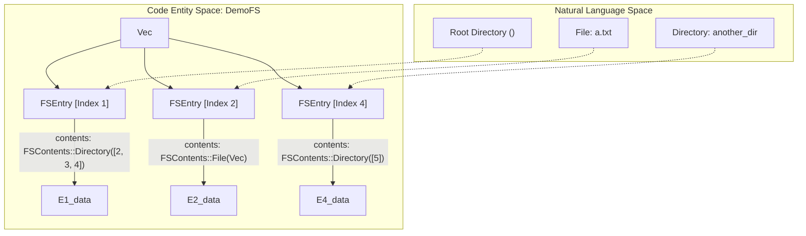
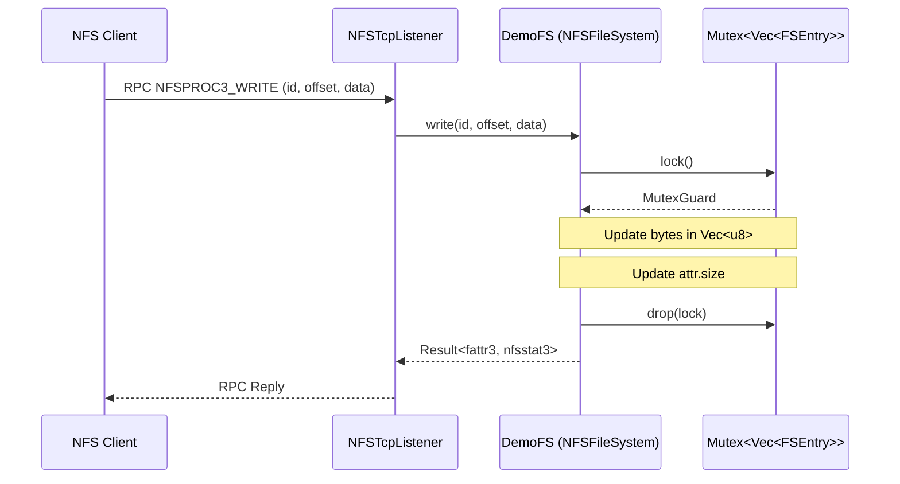

<!-- source: DeepWiki mcp.deepwiki.com · repo huggingface/nfsserve · page 4.2 DemoFS — In-Memory Filesystem · fetched 2026-10-26 -->

# DemoFS — In-Memory Filesystem

<details>
<summary>Relevant source files</summary>

The following files were used as context for generating this wiki page:

- [examples/demo.rs](examples/demo.rs)
- [src/config.rs](src/config.rs)

</details>


`DemoFS` is a reference implementation of the `NFSFileSystem` trait, providing a fully functional in-memory filesystem. It serves as both a testing tool and a pedagogical example of how to map NFS protocol operations to a custom data store. It supports basic file operations, directory navigation, and simple persistence within the lifecycle of the process.

Sources: [examples/demo.rs:75-78](), [examples/demo.rs:118-118]()

## Data Model and Storage

`DemoFS` uses a flat indexing strategy where every filesystem object (file or directory) is stored in a single `Vec<FSEntry>`. The `fileid3` (NFS file identifier) corresponds directly to the index of the entry within this vector.

### Core Structures

*   **`FSEntry`**: The primary unit of storage, containing metadata (`fattr3`), the object name, parent reference, and the actual data content. [examples/demo.rs:16-22]()
*   **`FSContents`**: An enum that distinguishes between file data (a `Vec<u8>`) and directory data (a `Vec<fileid3>` containing the IDs of child entries). [examples/demo.rs:10-13]()
*   **`DemoFS`**: The top-level structure which wraps the entry vector in a `std::sync::Mutex` to ensure thread-safe access during concurrent RPC requests. [examples/demo.rs:75-78]()

### Memory Layout Diagram
The following diagram illustrates how the `DemoFS` maps the logical directory tree to the flat `Vec` storage.

**DemoFS Storage Mapping**

Sources: [examples/demo.rs:10-22](), [examples/demo.rs:75-78](), [examples/demo.rs:89-106]()

## Implementation of NFS Operations

`DemoFS` implements the `NFSFileSystem` trait using `async_trait`. Because the underlying data is in memory, most operations are handled by locking the `Mutex` and performing standard `Vec` or `slice` manipulations.

### Directory Lookup and Navigation
The `lookup` function performs a linear search through the IDs stored in a directory's `FSContents::Directory` block. It explicitly handles the special Unix directory entries `.` (self) and `..` (parent).

*   **`.` (Current)**: Returns the `dirid` passed to the function. [examples/demo.rs:169-171]()
*   **`..` (Parent)**: Returns the `parent` field stored in the `FSEntry`. [examples/demo.rs:173-175]()

### ReadDir Pagination
NFS v3 requires support for paginated directory listing via a "cookie" or `start_after` mechanism. In `DemoFS`, this is implemented by using the index within the directory's child list.

| Function | Logic |
| :--- | :--- |
| `readdir` | Iterates through `FSContents::Directory(dir)`. If `start_after` is provided, it skips entries until the ID matches `start_after`, then returns the subsequent entries. |
| `getattr` | Performs a direct O(1) lookup in the `Vec` using the `id` as an index. |
| `write` | Resizes the `Vec<u8>` in `FSContents::File` if the write offset + data length exceeds current size, then copies the buffer. |

Sources: [examples/demo.rs:127-143](), [examples/demo.rs:162-185](), [examples/demo.rs:186-190](), [examples/demo.rs:218-245]()

### Concurrency Model
The implementation uses a synchronous `Mutex` (`std::sync::Mutex`) inside asynchronous trait methods. While this blocks the executor thread during the lock duration, it is acceptable for `DemoFS` as the in-memory operations (memory copies and vector lookups) are extremely fast and do not involve I/O wait.

**Request Data Flow**

Sources: [examples/demo.rs:76-76](), [examples/demo.rs:127-130](), [examples/demo.rs:141-143]()

## Initialization and Usage

The `Default` implementation for `DemoFS` constructs a hardcoded directory structure for demonstration purposes.

### Example Directory Structure
The default setup creates:
*   `/` (ID 1)
*   `/a.txt` (ID 2)
*   `/b.txt` (ID 3)
*   `/another_dir` (ID 4)
    *   `/another_dir/thisworks.txt` (ID 5)

Sources: [examples/demo.rs:80-112]()

### Running the Demo
The demo is executed by providing a port and an export name. It utilizes the `nfsserve::tcp::NFSTcpListener` to bind the filesystem to a network socket.

```rust
// Logic within examples/demo.rs main (implied)
let fs = DemoFS::default();
let listener = NFSTcpListener::new("0.0.0.0:11111", "demo").await?;
listener.handle_forever(fs).await?;
```

To run from the command line:
```bash
cargo run --example demo
```
Once running, it can be mounted using standard NFS clients:
```bash
mount -t nfs -o port=11111,mountport=11111,nfsvers=3 localhost:/demo /mnt/nfs
```
Sources: [examples/demo.rs:80-112](), [src/tcp.rs:1-20]() (for listener context)

---

