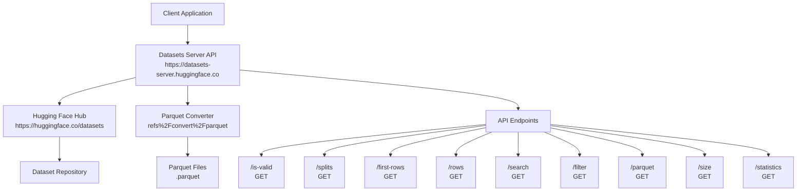
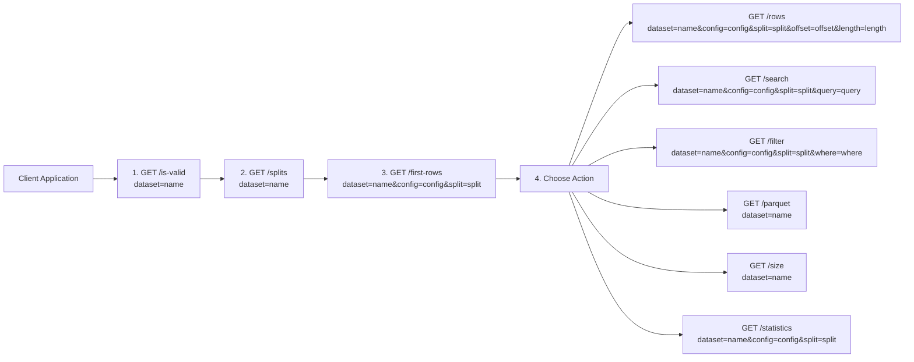
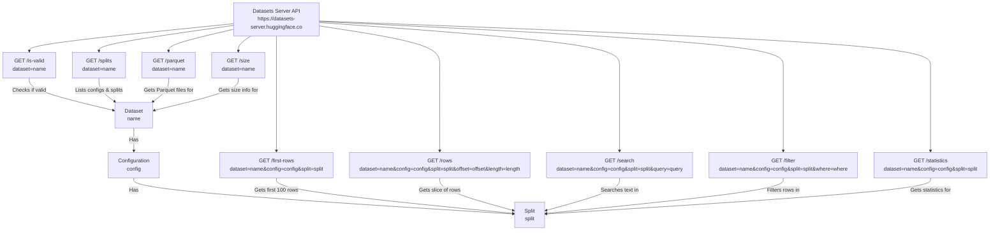

<!-- source: DeepWiki mcp.deepwiki.com · repo huggingface/notebooks · page 6.1 Datasets Server API · fetched 2026-10-26 -->

# Datasets Server API

<details>
<summary>Relevant source files</summary>

The following files were used as context for generating this wiki page:

- [datasets-server_doc/en/analyze_data.ipynb](datasets-server_doc/en/analyze_data.ipynb)
- [datasets-server_doc/en/pytorch/analyze_data.ipynb](datasets-server_doc/en/pytorch/analyze_data.ipynb)
- [datasets-server_doc/en/pytorch/quick_start.ipynb](datasets-server_doc/en/pytorch/quick_start.ipynb)
- [datasets-server_doc/en/quick_start.ipynb](datasets-server_doc/en/quick_start.ipynb)
- [datasets-server_doc/en/tensorflow/analyze_data.ipynb](datasets-server_doc/en/tensorflow/analyze_data.ipynb)
- [datasets-server_doc/en/tensorflow/quick_start.ipynb](datasets-server_doc/en/tensorflow/quick_start.ipynb)

</details>


The Datasets Server API is a REST API that provides programmatic access to datasets hosted on the Hugging Face Hub. This document describes how to use the API to check dataset validity, explore dataset configurations and splits, preview data, download specific slices of datasets, search for text, filter rows, access datasets in Parquet format, and obtain size and statistical information about datasets.

## Overview

The Datasets Server API allows you to interact with any dataset on the Hugging Face Hub without needing to download the entire dataset or use the `datasets` library. It provides a lightweight way to explore and extract data from datasets through simple HTTP requests.

### API Architecture



Sources: [datasets-server_doc/en/quick_start.ipynb:31-74](), [datasets-server_doc/en/tensorflow/quick_start.ipynb:31-74]()

## Base URL

All API requests should be made to the following base URL:

```
https://datasets-server.huggingface.co
```

Sources: [datasets-server_doc/en/quick_start.ipynb:70-74](), [datasets-server_doc/en/tensorflow/quick_start.ipynb:70-74]()

## Authentication

While most public datasets can be accessed without authentication, you'll need to provide your Hugging Face user token to access gated datasets like CommonVoice and ImageNet.

To authenticate, include your token in the request headers:

```
Authorization: Bearer YOUR_HF_TOKEN
```

Sources: [datasets-server_doc/en/quick_start.ipynb:81-153](), [datasets-server_doc/en/tensorflow/quick_start.ipynb:81-153]()

## API Endpoints

### Typical API Workflow



Sources: [datasets-server_doc/en/quick_start.ipynb:38-51](), [datasets-server_doc/en/tensorflow/quick_start.ipynb:38-51]()

### Endpoint Relationships



Sources: [datasets-server_doc/en/quick_start.ipynb:38-51](), [datasets-server_doc/en/tensorflow/quick_start.ipynb:38-51]()

### Endpoints Summary

| Endpoint | Method | Description | Query Parameters |
|----------|--------|-------------|------------------|
| `/is-valid` | GET | Check whether a specific dataset is valid | `dataset`: name of the dataset |
| `/splits` | GET | Get the list of configurations and splits of a dataset | `dataset`: name of the dataset |
| `/first-rows` | GET | Get the first rows of a dataset split | `dataset`: name of the dataset<br>`config`: name of the config<br>`split`: name of the split |
| `/rows` | GET | Get a slice of rows of a dataset split | `dataset`: name of the dataset<br>`config`: name of the config<br>`split`: name of the split<br>`offset`: offset of the slice<br>`length`: length of the slice (maximum 100) |
| `/search` | GET | Search text in a dataset split | `dataset`: name of the dataset<br>`config`: name of the config<br>`split`: name of the split<br>`query`: text to search for |
| `/filter` | GET | Filter rows in a dataset split | `dataset`: name of the dataset<br>`config`: name of the config<br>`split`: name of the split<br>`where`: filter query<br>`offset`: offset of the slice<br>`length`: length of the slice (maximum 100) |
| `/parquet` | GET | Get the list of parquet files of a dataset | `dataset`: name of the dataset |
| `/size` | GET | Get the size of a dataset | `dataset`: name of the dataset |
| `/statistics` | GET | Get statistics about a dataset split | `dataset`: name of the dataset<br>`config`: name of the config<br>`split`: name of the split |

Sources: [datasets-server_doc/en/quick_start.ipynb:38-51](), [datasets-server_doc/en/tensorflow/quick_start.ipynb:38-51]()

## Detailed Endpoint Documentation

### 1. Check Dataset Validity

The `/is-valid` endpoint allows you to check whether a specific dataset is valid and what features it supports.

**Request:**
```
GET https://datasets-server.huggingface.co/is-valid?dataset=rotten_tomatoes
```

**Response:**
```json
{
  "preview": true,
  "viewer": true,
  "search": true,
  "filter": true
}
```

Sources: [datasets-server_doc/en/quick_start.ipynb:159-222](), [datasets-server_doc/en/tensorflow/quick_start.ipynb:159-222]()

### 2. List Configurations and Splits

The `/splits` endpoint returns a list of available configurations and splits in a dataset.

**Request:**
```
GET https://datasets-server.huggingface.co/splits?dataset=rotten_tomatoes
```

**Response:**
```json
{
  "splits": [
    { "dataset": "rotten_tomatoes", "config": "default", "split": "train" },
    { "dataset": "rotten_tomatoes", "config": "default", "split": "validation" },
    { "dataset": "rotten_tomatoes", "config": "default", "split": "test" }
  ],
  "pending": [],
  "failed": []
}
```

Sources: [datasets-server_doc/en/quick_start.ipynb:228-303](), [datasets-server_doc/en/tensorflow/quick_start.ipynb:228-303]()

### 3. Preview Dataset

The `/first-rows` endpoint returns the first 100 rows of a dataset split, along with metadata about the features (column types).

**Request:**
```
GET https://datasets-server.huggingface.co/first-rows?dataset=rotten_tomatoes&config=default&split=train
```

**Response:**
```json
{
  "dataset": "rotten_tomatoes",
  "config": "default",
  "split": "train",
  "features": [
    {
      "feature_idx": 0,
      "name": "text",
      "type": { "dtype": "string", "_type": "Value" }
    },
    {
      "feature_idx": 1,
      "name": "label",
      "type": { "names": ["neg", "pos"], "_type": "ClassLabel" }
    }
  ],
  "rows": [
    {
      "row_idx": 0,
      "row": {
        "text": "the rock is destined to be the 21st century's new \" conan \" and that he's going to make a splash even greater than arnold schwarzenegger , jean-claud van damme or steven segal .",
        "label": 1
      },
      "truncated_cells": []
    },
    // More rows...
  ]
}
```

Sources: [datasets-server_doc/en/quick_start.ipynb:309-408](), [datasets-server_doc/en/tensorflow/quick_start.ipynb:309-408]()

### 4. Download Slices of a Dataset

The `/rows` endpoint lets you download a specific slice of rows from a dataset split.

**Request:**
```
GET https://datasets-server.huggingface.co/rows?dataset=rotten_tomatoes&config=default&split=train&offset=150&length=10
```

**Response:**
```json
{
  "features": [
    {
      "feature_idx": 0,
      "name": "text",
      "type": { "dtype": "string", "_type": "Value" }
    },
    {
      "feature_idx": 1,
      "name": "label",
      "type": { "names": ["neg", "pos"], "_type": "ClassLabel" }
    }
  ],
  "rows": [
    {
      "row_idx": 150,
      "row": {
        "text": "enormously likable , partly because it is aware of its own grasp of the absurd .",
        "label": 1
      },
      "truncated_cells": []
    },
    // More rows...
  ],
  "num_rows_total": 8530,
  "num_rows_per_page": 100,
  "partial": false
}
```

Note: You can download a maximum of 100 rows at a time.

Sources: [datasets-server_doc/en/quick_start.ipynb:414-517](), [datasets-server_doc/en/tensorflow/quick_start.ipynb:414-517]()

### 5. Search Text in a Dataset

The `/search` endpoint allows you to search for text in string columns of a dataset split.

**Request:**
```
GET https://datasets-server.huggingface.co/search?dataset=rotten_tomatoes&config=default&split=train&query=cat
```

**Response:**
```json
{
  "features": [
    // Feature definitions...
  ],
  "rows": [
    {
      "row_idx": 9,
      "row": {
        "text": "take care of my cat offers a refreshingly different slice of asian cinema .",
        "label": 1
      },
      "truncated_cells": []
    },
    // More matching rows...
  ],
  "num_rows_total": 12,
  "num_rows_per_page": 100,
  "partial": false
}
```

Sources: [datasets-server_doc/en/quick_start.ipynb:523-626](), [datasets-server_doc/en/tensorflow/quick_start.ipynb:523-626]()

### 6. Access Parquet Files

The `/parquet` endpoint provides URLs to the Parquet files for each split of the dataset.

**Request:**
```
GET https://datasets-server.huggingface.co/parquet?dataset=rotten_tomatoes
```

**Response:**
```json
{
  "parquet_files": [
    {
      "dataset": "rotten_tomatoes",
      "config": "default",
      "split": "test",
      "url": "https://huggingface.co/datasets/rotten_tomatoes/resolve/refs%2Fconvert%2Fparquet/default/test/0000.parquet",
      "filename": "0000.parquet",
      "size": 92206
    },
    // More parquet files...
  ],
  "pending": [],
  "failed": [],
  "partial": false
}
```

Sources: [datasets-server_doc/en/quick_start.ipynb:632-724](), [datasets-server_doc/en/tensorflow/quick_start.ipynb:632-724]()

### 7. Get Dataset Size

The `/size` endpoint returns size information about the dataset, including the number of rows and size in bytes.

**Request:**
```
GET https://datasets-server.huggingface.co/size?dataset=rotten_tomatoes
```

**Response:**
```json
{
  "size": {
    "dataset": {
      "dataset": "rotten_tomatoes",
      "num_bytes_original_files": 487770,
      "num_bytes_parquet_files": 881052,
      "num_bytes_memory": 1345449,
      "num_rows": 10662
    },
    "configs": [
      // Configuration-level size information...
    ],
    "splits": [
      // Split-level size information...
    ]
  },
  "pending": [],
  "failed": [],
  "partial": false
}
```

Sources: [datasets-server_doc/en/quick_start.ipynb:730-847](), [datasets-server_doc/en/tensorflow/quick_start.ipynb:730-847]()

## Working with the API

### Making Requests in Python

```python
import requests

# Check dataset validity
API_URL = "https://datasets-server.huggingface.co/is-valid?dataset=rotten_tomatoes"
response = requests.get(API_URL)
data = response.json()
print(data)  # {'preview': true, 'viewer': true, 'search': true, 'filter': true}
```

Sources: [datasets-server_doc/en/quick_start.ipynb:178-183](), [datasets-server_doc/en/tensorflow/quick_start.ipynb:178-183]()

### Authenticating for Gated Datasets

```python
import requests

# Your Hugging Face API token
API_TOKEN = "your_token_here"
headers = {"Authorization": f"Bearer {API_TOKEN}"}

# Access a gated dataset
API_URL = "https://datasets-server.huggingface.co/is-valid?dataset=mozilla-foundation/common_voice_10_0"
response = requests.get(API_URL, headers=headers)
data = response.json()
```

Sources: [datasets-server_doc/en/quick_start.ipynb:100-107](), [datasets-server_doc/en/tensorflow/quick_start.ipynb:100-107]()

### Data Analysis with Parquet Files

You can use the `/parquet` endpoint to get a URL to the dataset in Parquet format, and then use tools like Pandas for data analysis:

```python
import requests
import pandas as pd

# Get Parquet URL
API_URL = "https://datasets-server.huggingface.co/parquet?dataset=codeparrot/codecomplex"
response = requests.get(API_URL)
data = response.json()
parquet_url = data["parquet_files"][0]["url"]

# Load into Pandas
df = pd.read_parquet(parquet_url)
print(df.head())
```

Sources: [datasets-server_doc/en/analyze_data.ipynb:43-82](), [datasets-server_doc/en/tensorflow/analyze_data.ipynb:43-82](), [datasets-server_doc/en/pytorch/analyze_data.ipynb:43-82]()

## Limitations

- The API returns a maximum of 100 rows per request for the `/rows`, `/search`, and `/filter` endpoints.
- For very large datasets, some operations may take longer to complete.
- Gated datasets require authentication with a valid Hugging Face token.

Sources: [datasets-server_doc/en/quick_start.ipynb:474-475](), [datasets-server_doc/en/tensorflow/quick_start.ipynb:474-475]()

## Additional Resources

- API Reference: [ReDoc](https://redocly.github.io/redoc/?url=https://datasets-server.huggingface.co/openapi.json)
- Interactive API Testing: [Postman](https://www.postman.com/huggingface/workspace/hugging-face-apis/documentation/23242779-d068584e-96d1-4d92-a703-7cb12cbd8053)
- RapidAPI Integration: [RapidAPI](https://rapidapi.com/hugging-face-hugging-face-default/api/hugging-face-datasets-api)

Sources: [datasets-server_doc/en/quick_start.ipynb:67-68](), [datasets-server_doc/en/tensorflow/quick_start.ipynb:67-68]()

---

