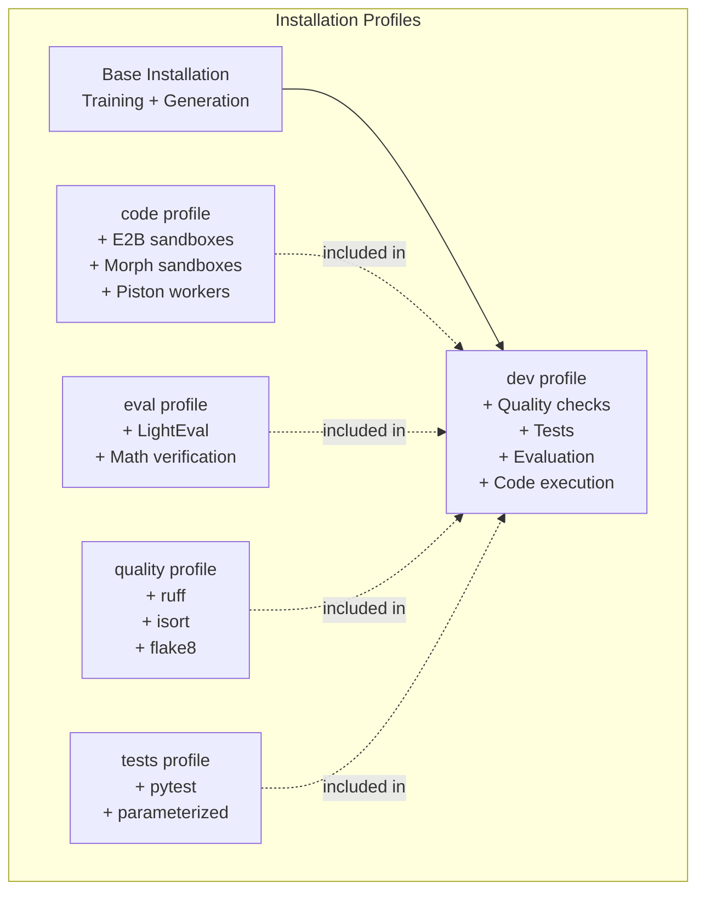
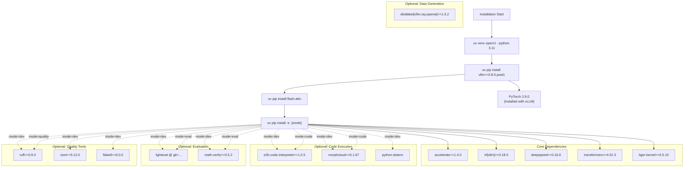

<!-- source: DeepWiki mcp.deepwiki.com · repo huggingface/open-r1 · page 1.1 Installation and Setup · fetched 2026-10-26 -->

# Installation and Setup

<details>
<summary>Relevant source files</summary>

The following files were used as context for generating this wiki page:

- [README.md](README.md)
- [setup.py](setup.py)

</details>


This document provides comprehensive instructions for installing and configuring the Open R1 development environment. It covers creating a Python virtual environment, installing core dependencies (vLLM, Flash Attention, etc.), configuring authentication with external services, and verifying the installation. For information about deploying infrastructure components on a Slurm cluster, see [SLURM Integration](#6.1). For model serving configuration, see [Model Serving with vLLM](#6.3).

## Prerequisites

Before beginning installation, ensure your system meets the following requirements:

| Requirement | Specification | Verification Command |
|-------------|---------------|---------------------|
| CUDA | 12.4 | `nvcc --version` |
| Python | ≥3.10.9 | `python --version` |
| Git LFS | Any version | `git-lfs --version` |
| GPU Memory | 80GB recommended (H100) | `nvidia-smi` |

**Critical**: The project dependencies are compiled for CUDA 12.4. Mismatched CUDA versions will cause segmentation faults during execution.

Sources: [README.md:51-53](), [setup.py:137]()

## Installation Modes

The project supports multiple installation profiles depending on your use case:



**Installation Profile Breakdown**

Sources: [setup.py:92-98]()

## Step 1: Create Python Virtual Environment

The project uses `uv` for fast Python environment management. Install `uv` following the [UV Installation Guide](https://docs.astral.sh/uv/getting-started/installation), then create the environment:

```bash
uv venv openr1 --python 3.11 && source openr1/bin/activate && uv pip install --upgrade pip
```

**For Hugging Face cluster users**: Add `export UV_LINK_MODE=copy` to your `.bashrc` to suppress cache warnings from `uv`.

Sources: [README.md:54-67]()

## Step 2: Install Core Dependencies

### 2.1 Install vLLM and Flash Attention

These are the foundational dependencies for fast inference and memory-efficient attention:

```bash
uv pip install vllm==0.8.5.post1
uv pip install setuptools && uv pip install flash-attn --no-build-isolation
```

This installation also brings in PyTorch `v2.6.0`, which is **critical** because vLLM binaries are compiled specifically for this version.

Sources: [README.md:69-74](), [setup.py:70-72]()

### 2.2 Install Project Dependencies

Choose the appropriate installation mode based on your use case:

```bash
# For contributors (recommended - includes all tools)
GIT_LFS_SKIP_SMUDGE=1 uv pip install -e ".[dev]"

# For training only
GIT_LFS_SKIP_SMUDGE=1 uv pip install -e .

# For code execution rewards only
uv pip install -e ".[code]"

# For evaluation only
uv pip install -e ".[eval]"
```

The `GIT_LFS_SKIP_SMUDGE=1` flag prevents Git LFS from downloading large model files during package installation.

**Shortcut**: Run `make install` to automatically setup all development libraries.

Sources: [README.md:76-80](), [setup.py:92-120]()

### Dependency Version Table

| Dependency | Version | Purpose |
|------------|---------|---------|
| `accelerate` | 1.4.0 | Multi-GPU training orchestration |
| `torch` | 2.6.0 | Deep learning framework |
| `vllm` | 0.8.5.post1 | Fast inference engine |
| `trl` | 0.18.0 | Reinforcement learning trainer |
| `deepspeed` | 0.16.8 | ZeRO optimization |
| `transformers` | 4.52.3 | Model loading and tokenization |
| `liger-kernel` | ≥0.5.10 | Memory-efficient kernels |
| `datasets` | ≥3.2.0 | Dataset loading and processing |
| `wandb` | ≥0.19.1 | Experiment tracking |
| `lighteval` | git+... | Model evaluation framework |
| `math-verify` | 0.5.2 | Math answer verification |
| `e2b-code-interpreter` | ≥1.0.5 | Python code execution |
| `morphcloud` | 0.1.67 | Multi-language code execution |
| `distilabel` | ≥1.5.2 | Data generation pipeline |

Sources: [setup.py:43-77]()

## Step 3: Authentication Setup

### 3.1 Hugging Face Hub Authentication

Authenticate with Hugging Face Hub for model/dataset downloads and uploads:

```bash
huggingface-cli login
```

This command will prompt for your Hugging Face access token. The token is stored in `~/.cache/huggingface/token` and used automatically by all scripts.

**Required permissions**: Your token must have `write` access to push models and datasets to the Hub.

Sources: [README.md:84-86]()

### 3.2 Weights & Biases Authentication

Authenticate with Weights & Biases for experiment tracking:

```bash
wandb login
```

Override default W&B settings in training commands:

```bash
accelerate launch --config_file recipes/accelerate_configs/zero3.yaml src/open_r1/sft.py \
    --config recipes/OpenR1-Distill-7B/sft/config_distill.yaml \
    --wandb_entity your_entity --wandb_project your_project --run_name your_run
```

Sources: [README.md:84-87](), [README.md:148-154]()

### 3.3 Code Execution Service Authentication

For training with code execution rewards, create a `.env` file in the project root:

```bash
# E2B API key (for Python sandboxes)
E2B_API_KEY="e2b_xxx"

# Morph API key (for multi-language sandboxes)
MORPH_API_KEY="YOUR_MORPH_API_KEY"

# Codeforces test cases path (for competitive programming)
CF_TESTS_FOLDER=/path/to/codeforces/tests
```

**E2B Setup**: Sign up at [e2b.dev](https://e2b.dev) to obtain an API key.

**Morph Setup**: Install the client (`pip install morphcloud`) and sign up at [cloud.morph.so](https://cloud.morph.so/web) for an API key.

**Piston Setup**: For self-hosted execution workers, set `PISTON_ENDPOINTS=slurm` or provide a comma-separated list of worker URLs. See [SLURM Integration](#6.1) for deployment instructions.

Sources: [README.md:256-275](), [README.md:350-375]()

## Step 4: Install Git LFS

Git LFS is required for pushing large model checkpoints and datasets to Hugging Face Hub:

```bash
# Check if already installed
git-lfs --version

# Install if missing (Debian/Ubuntu)
sudo apt-get install git-lfs
```

Sources: [README.md:89-99]()

## Installation Verification

### Verify Core Installation

Create a test script `verify_install.py`:

```python
import torch
import vllm
import transformers
import trl
import accelerate

print(f"PyTorch: {torch.__version__}")
print(f"vLLM: {vllm.__version__}")
print(f"Transformers: {transformers.__version__}")
print(f"TRL: {trl.__version__}")
print(f"Accelerate: {accelerate.__version__}")
print(f"CUDA Available: {torch.cuda.is_available()}")
print(f"CUDA Version: {torch.version.cuda}")
print(f"GPU Count: {torch.cuda.device_count()}")
```

Expected output:
```
PyTorch: 2.6.0
vLLM: 0.8.5.post1
Transformers: 4.52.3
TRL: 0.18.0
Accelerate: 1.4.0
CUDA Available: True
CUDA Version: 12.4
GPU Count: 8
```

### Verify Authentication

```bash
# Test Hugging Face Hub access
huggingface-cli whoami

# Test Weights & Biases access
wandb verify
```

### Verify Installation Modes

Test specific installation profiles:

```bash
# Test evaluation tools
python -c "import lighteval; from open_r1.evaluation import LIGHTEVAL_TASKS; print('Evaluation OK')"

# Test code execution
python -c "from e2b_code_interpreter import AsyncSandbox; print('E2B OK')"

# Test quality tools
ruff check src/ --select I
isort --check-only src/
flake8 src/
```

Sources: [README.md:59](), [setup.py:92-98]()

## Dependency Installation Flow



**Installation Order is Critical**: vLLM must be installed before project dependencies because it determines the PyTorch version. Installing PyTorch separately may cause version conflicts.

Sources: [README.md:49-99](), [setup.py:43-120]()

## Environment Variables Reference

| Variable | Purpose | Required For | Example Value |
|----------|---------|--------------|---------------|
| `UV_LINK_MODE` | Suppress uv cache warnings | HF cluster users | `copy` |
| `VLLM_WORKER_MULTIPROC_METHOD` | vLLM process spawning | Evaluation | `spawn` |
| `CUDA_VISIBLE_DEVICES` | GPU selection | Multi-GPU setups | `0,1,2,3` |
| `ACCELERATE_LOG_LEVEL` | Training log verbosity | Training | `info` |
| `GIT_LFS_SKIP_SMUDGE` | Skip LFS downloads | Installation | `1` |
| `E2B_API_KEY` | E2B authentication | Code rewards | `e2b_xxx` |
| `MORPH_API_KEY` | Morph authentication | Code rewards | `YOUR_KEY` |
| `CF_TESTS_FOLDER` | Codeforces tests path | CF rewards | `/data/cf_tests` |
| `PISTON_ENDPOINTS` | Piston workers | IOI/CF rewards | `slurm` or `ip:port,ip:port` |
| `HF_TOKEN` | HF Hub access | Hub operations | `hf_xxx` |
| `WANDB_API_KEY` | W&B tracking | Experiment logging | `wandb_xxx` |

Sources: [README.md:66-67](), [README.md:256-368](), [README.md:449]()

## Common Installation Issues

### Issue: Segmentation Fault During Training

**Cause**: CUDA version mismatch. vLLM binaries are compiled for CUDA 12.4.

**Solution**: Verify CUDA version with `nvcc --version`. If using a different version, rebuild vLLM from source or switch to CUDA 12.4.

Sources: [README.md:51-53]()

### Issue: Flash Attention Build Failure

**Cause**: Missing `setuptools` or build isolation issues.

**Solution**: Install setuptools before flash-attn and disable build isolation:
```bash
uv pip install setuptools && uv pip install flash-attn --no-build-isolation
```

Sources: [README.md:72-74]()

### Issue: Git LFS Not Fetching Files

**Cause**: Git LFS not installed or not initialized in repository.

**Solution**: Install Git LFS system-wide (`sudo apt-get install git-lfs`), then run `git lfs install` in the repository.

Sources: [README.md:89-99]()

### Issue: Import Error for lighteval

**Cause**: lighteval must be installed from Git with specific bug fixes.

**Solution**: The correct version is specified in setup.py and will be installed automatically with `.[eval]` or `.[dev]` profiles.

Sources: [setup.py:59]()

## Next Steps

After completing installation:

1. **Training**: Proceed to [Supervised Fine-Tuning (SFT)](#2.1) or [Group Relative Policy Optimization (GRPO)](#2.2) to train models.
2. **Evaluation**: See [Benchmark Execution](#4.1) to evaluate models on standard benchmarks.
3. **Data Generation**: See [Distilabel Pipeline](#5.1) to generate synthetic training data.
4. **Infrastructure**: See [SLURM Integration](#6.1) to deploy training and evaluation jobs on a cluster.

For development workflows including code quality checks and testing, see [Development Tools](#6.2).

Sources: [README.md:101-196](), [README.md:444-666]()

---

