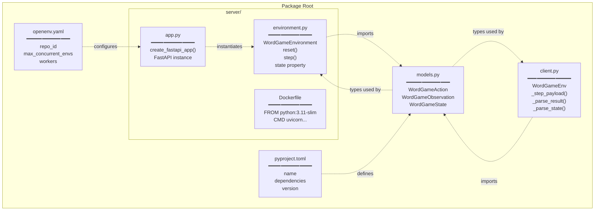
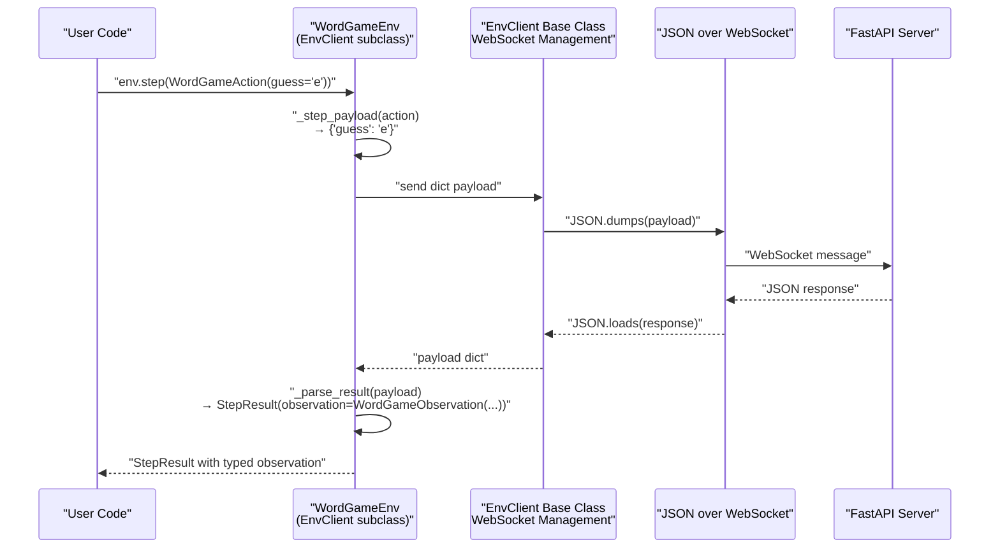
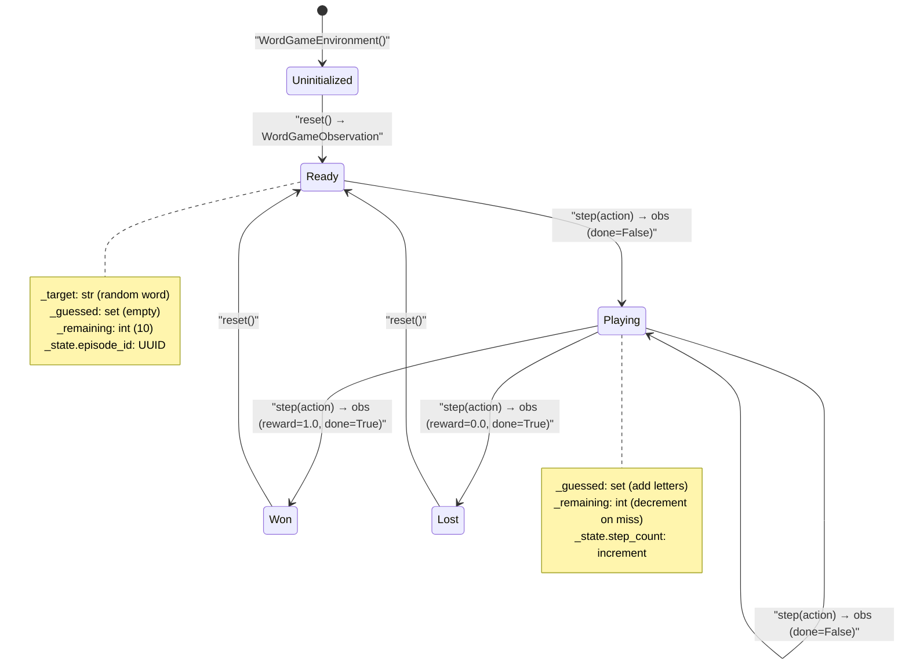
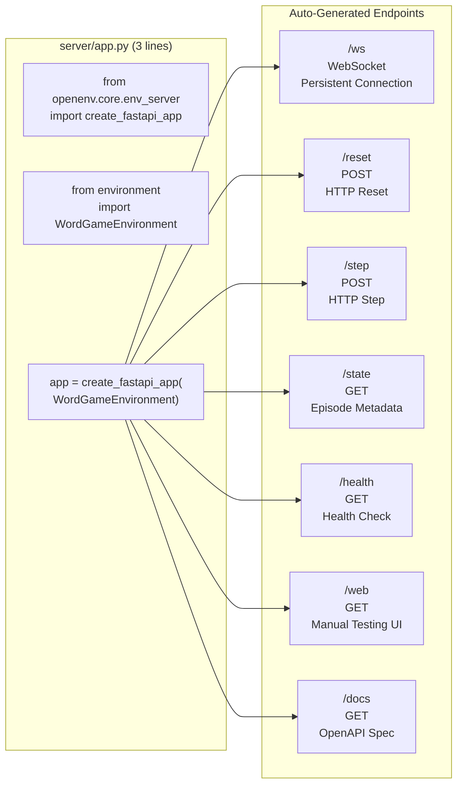
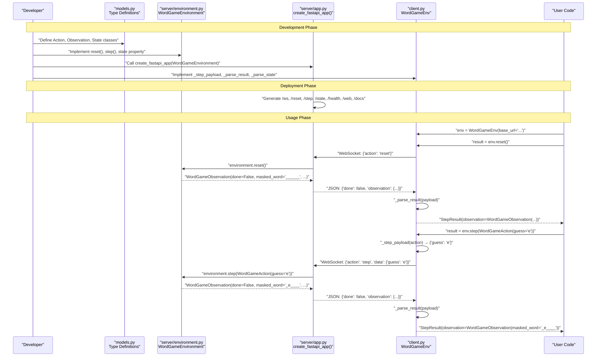
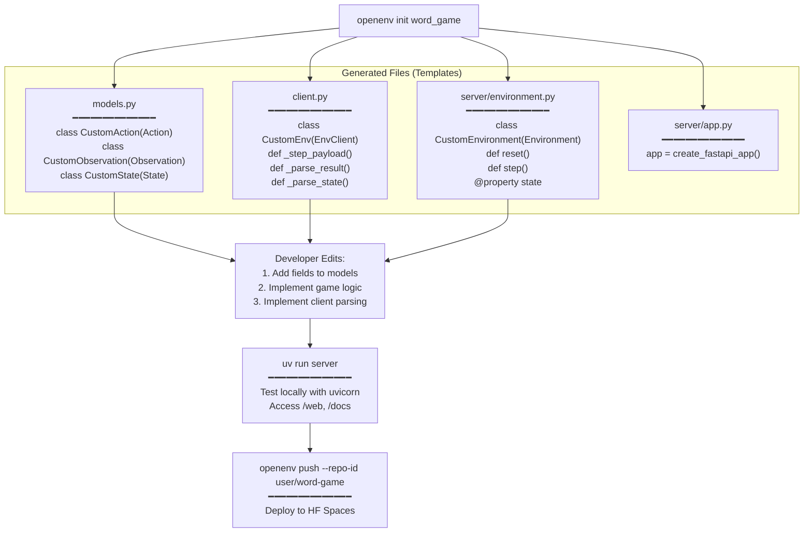
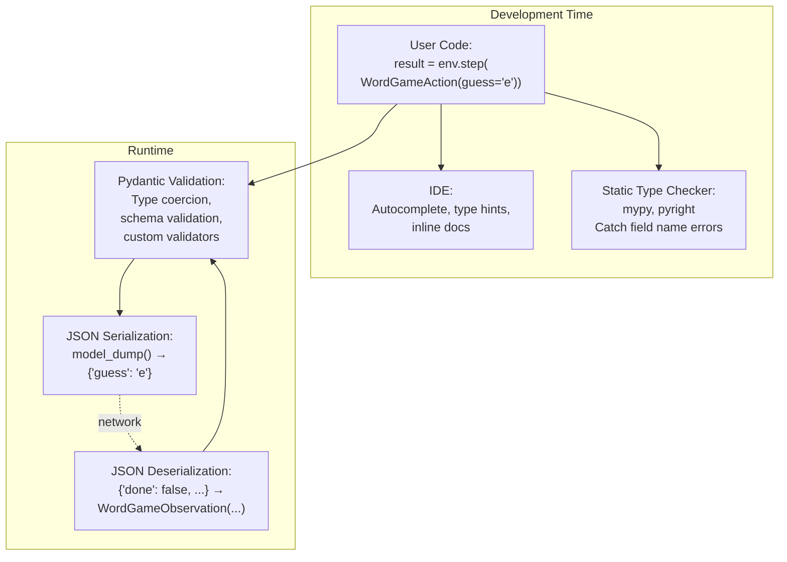

<!-- source: DeepWiki mcp.deepwiki.com · repo huggingface/openenv-course · page 5.1 The 3-Component Pattern · fetched 2026-10-26 -->

# The 3-Component Pattern

<details>
<summary>Relevant source files</summary>

The following files were used as context for generating this wiki page:

- [module-4/README.md](module-4/README.md)
- [module-4/notebook.ipynb](module-4/notebook.ipynb)

</details>


This document explains the standardized structure for building custom OpenEnv environments, consisting of three components: type definitions (`models.py`), client implementation (`client.py`), and server implementation (`server/`). This pattern enables creation of production-ready environments in approximately 100 lines of meaningful code.

For information about the core interface methods that environments expose, see [The 3-Method Interface](#2.1). For information about deploying environments once built, see [Deployment to HF Spaces](#4.3).

## Purpose and Scope

The 3-Component Pattern defines the directory structure, file organization, and implementation contracts required to build a custom OpenEnv environment from scratch. This pattern is introduced in Module 4 and applies to all custom environments, whether scaffolded with `openenv init` or written manually. The pattern ensures consistency across environments, enabling the same deployment and client infrastructure to work with any custom environment.

**Sources:** [module-4/README.md:1-19]()

## Directory Structure

Every OpenEnv environment follows a standardized file layout. The three components are `models.py` (type contracts), `client.py` (network client), and `server/` (environment runtime).

```
my_env/
├── models.py              # Component 1: Type definitions
├── client.py              # Component 2: Client implementation
├── server/
│   ├── environment.py     # Component 3: Environment logic
│   ├── app.py             # FastAPI server
│   └── Dockerfile         # Container definition
├── openenv.yaml           # Manifest for deployment
└── pyproject.toml         # Package metadata
```

**Directory Layout Overview**



**Sources:** [module-4/README.md:5-17](), [module-4/notebook.ipynb:209-307]()

## Component 1: Type Definitions (models.py)

The `models.py` file defines three Pydantic models that serve as the type contracts for the environment. These models inherit from base classes provided by `openenv.core.env_server`.

### Type Hierarchy

| Model Class | Inherits From | Required Fields | Purpose |
|-------------|---------------|-----------------|---------|
| `*Action` | `Action` (Pydantic BaseModel) | Custom action fields | Defines what actions players can take |
| `*Observation` | `Observation` (includes `done`, `reward`) | Custom observation fields | Defines what players observe after actions |
| `*State` | `State` (includes `episode_id`, `step_count`) | Custom state fields | Defines episode metadata |

The base classes `Action`, `Observation`, and `State` are imported from `openenv.core.env_server`. `Observation` provides `done: bool` and `reward: Optional[float]` by default. `State` provides `episode_id: Optional[str]` and `step_count: int` by default.

**Type System Architecture**

```mermaid
graph TB
    subgraph "openenv.core.env_server Base Classes"
        ActionBase["Action<br/>━━━━━━━━━━━━━━<br/>(Pydantic BaseModel)<br/>metadata: Dict"]
        ObsBase["Observation<br/>━━━━━━━━━━━━━━<br/>(Pydantic BaseModel)<br/>done: bool<br/>reward: Optional[float]<br/>metadata: Dict"]
        StateBase["State<br/>━━━━━━━━━━━━━━<br/>(Pydantic BaseModel)<br/>episode_id: Optional[str]<br/>step_count: int"]
    end
    
    subgraph "Custom Environment Types (models.py)"
        CustomAction["WordGameAction<br/>━━━━━━━━━━━━━━<br/>guess: str"]
        CustomObs["WordGameObservation<br/>━━━━━━━━━━━━━━<br/>masked_word: str<br/>guessed_letters: List[str]<br/>attempts_remaining: int<br/>message: str"]
        CustomState["WordGameState<br/>━━━━━━━━━━━━━━<br/>target_word: str<br/>max_attempts: int"]
    end
    
    ActionBase --> CustomAction
    ObsBase --> CustomObs
    StateBase --> CustomState
    
    CustomAction -.serializes to.-> JSON1["JSON<br/>{\"guess\": \"e\"}"]
    CustomObs -.deserializes from.-> JSON2["JSON<br/>{\"done\": false, \"masked_word\": \"p_th_n\", ...}"]
    CustomState -.deserializes from.-> JSON3["JSON<br/>{\"episode_id\": \"abc-123\", \"target_word\": \"python\", ...}"]
```

**Example Implementation:**

The WordGame environment defines its types at [module-4/README.md:25-46](). The key characteristics:
- Inherits from base Pydantic models (`Action`, `Observation`, `State`)
- Adds domain-specific fields (e.g., `guess`, `masked_word`, `guessed_letters`)
- No `@dataclass` decorator needed - Pydantic handles validation
- Provides IDE autocomplete (e.g., `obs.masked_word` instead of `obs["masked_word"]`)
- Enables type checking at development time

**Sources:** [module-4/README.md:21-52](), [module-4/notebook.ipynb:215-244]()

## Component 2: Client Implementation (client.py)

The `client.py` file implements a subclass of `EnvClient` that handles serialization and deserialization between typed Pydantic models and JSON payloads sent over WebSocket.

### EnvClient Contract

The `EnvClient` base class (from `openenv.core.env_client`) requires implementation of three abstract methods:

| Method | Parameters | Returns | Purpose |
|--------|-----------|---------|---------|
| `_step_payload()` | `action: ActionType` | `dict` | Serialize action object to JSON-serializable dict |
| `_parse_result()` | `payload: dict` | `StepResult` | Deserialize server response to typed observation |
| `_parse_state()` | `payload: dict` | `StateType` | Deserialize state endpoint response to typed state |

The `EnvClient` base class handles all WebSocket connection management, message framing, and the `.sync()` context manager for async-to-sync conversion.

**Client Data Flow**



**Example Implementation:**

The WordGame client is defined at [module-4/README.md:143-174](). Key implementation details:

- `_step_payload()`: Extracts fields from action object into flat dict [module-4/notebook.ipynb:257-258]()
- `_parse_result()`: Constructs typed observation from nested payload structure [module-4/notebook.ipynb:260-273]()
- `_parse_state()`: Maps state fields from payload to typed state object [module-4/notebook.ipynb:275-281]()

The client is parameterized with generic types: `EnvClient[WordGameAction, WordGameObservation, WordGameState]` [module-4/notebook.ipynb:256]().

**Sources:** [module-4/README.md:139-176](), [module-4/notebook.ipynb:249-282]()

## Component 3: Server Implementation (server)

The server component consists of three files: `environment.py` (game logic), `app.py` (FastAPI wiring), and `Dockerfile` (containerization).

### Environment Logic (environment.py)

The environment implements the `Environment` abstract base class from `openenv.core.env_server`. This class must implement three methods and one property:

| Method/Property | Signature | Purpose |
|-----------------|-----------|---------|
| `reset()` | `(seed=None, episode_id=None, **kwargs) -> Observation` | Initialize new episode, return initial observation |
| `step()` | `(action: Action, timeout_s=None, **kwargs) -> Observation` | Execute action, update state, return observation |
| `state` | `@property -> State` | Return current episode metadata |
| `SUPPORTS_CONCURRENT_SESSIONS` | `bool` class attribute | Whether environment supports multiple simultaneous sessions |

**Environment State Machine**



**Example Implementation:**

The WordGame environment is implemented at [module-4/README.md:57-137](). Key implementation details:

- `__init__()`: Initializes internal state variables (`_target`, `_guessed`, `_remaining`, `_state`) [module-4/README.md:71-75]()
- `reset()`: Selects random word, resets state, returns initial observation [module-4/README.md:77-94]()
- `step()`: Processes letter guess, updates state, checks win/loss conditions [module-4/README.md:96-129]()
- `state` property: Returns current `WordGameState` instance [module-4/README.md:131-133]()
- Helper method `_mask()`: Generates masked word representation [module-4/README.md:135-136]()

The environment sets `SUPPORTS_CONCURRENT_SESSIONS = True` to allow multiple simultaneous clients [module-4/README.md:67]().

**Sources:** [module-4/README.md:53-137](), [module-4/notebook.ipynb:79-85]()

### FastAPI Server (app.py)

The `app.py` file uses `create_fastapi_app()` to automatically generate all required endpoints. This function is provided by `openenv.core.env_server`.

```python
from openenv.core.env_server import create_fastapi_app
from environment import WordGameEnvironment

app = create_fastapi_app(WordGameEnvironment)
```

The `create_fastapi_app()` function generates these endpoints automatically:

| Endpoint | Method | Purpose |
|----------|--------|---------|
| `/ws` | WebSocket | Persistent connection for low-latency interaction |
| `/reset` | POST | HTTP-based reset for stateless scenarios |
| `/step` | POST | HTTP-based step for stateless scenarios |
| `/state` | GET | Retrieve current episode state |
| `/health` | GET | Health check for monitoring |
| `/web` | GET | Web-based UI for manual testing |
| `/docs` | GET | Auto-generated OpenAPI documentation |

**FastAPI Endpoint Generation**



**Sources:** [module-4/README.md:178-190](), [module-4/notebook.ipynb:288-294]()

### Dockerfile

The Dockerfile defines the container image for deployment. Standard pattern:

```dockerfile
FROM python:3.11-slim
WORKDIR /app
COPY requirements.txt .
RUN pip install --no-cache-dir -r requirements.txt
COPY . .
CMD ["uvicorn", "server.app:app", "--host", "0.0.0.0", "--port", "8000"]
```

This Dockerfile is referenced at [module-4/README.md:193-202]().

**Sources:** [module-4/README.md:191-203]()

## Component Interaction Pattern

The three components interact in a specific sequence during environment usage:

**Complete Interaction Flow**



**Sources:** [module-4/README.md:1-229](), [module-4/notebook.ipynb:1-369]()

## Scaffolding with openenv init

The `openenv init` command generates the complete 3-component structure with placeholder code. This eliminates manual file creation.

```bash
openenv init word_game
cd word_game
```

Generated structure:
- `models.py` with template Action, Observation, State classes
- `client.py` with template EnvClient subclass and three abstract methods
- `server/environment.py` with template Environment subclass
- `server/app.py` with `create_fastapi_app()` call
- `server/Dockerfile` with standard Python container definition
- `openenv.yaml` with deployment configuration
- `pyproject.toml` with package metadata

Developers fill in:
1. Custom fields in type models
2. Game logic in `reset()` and `step()` methods
3. Serialization logic in client parsing methods

**Scaffold-to-Deploy Workflow**



**Sources:** [module-4/README.md:204-223](), [module-4/notebook.ipynb:320-333]()

## Code Volume Analysis

The 3-Component Pattern achieves production-ready environments with minimal code:

| File | Purpose | Typical Lines of Code |
|------|---------|----------------------|
| `models.py` | Pydantic type definitions | ~30 lines |
| `server/environment.py` | Game logic (reset, step, state) | ~60 lines |
| `client.py` | Serialization methods | ~25 lines |
| `server/app.py` | FastAPI wiring | ~3 lines |
| **Total** | **Complete environment** | **~118 lines** |

Additional files with minimal customization:
- `server/Dockerfile`: ~6 lines (standard template)
- `openenv.yaml`: ~5 lines (deployment config)
- `pyproject.toml`: ~10 lines (package metadata)

The pattern achieves this efficiency through:
1. **Base class abstractions**: `EnvClient` and `Environment` handle infrastructure
2. **Auto-generation**: `create_fastapi_app()` creates all endpoints
3. **Type inference**: Pydantic models eliminate boilerplate validation code
4. **Standardization**: Consistent patterns reduce decision-making

**Sources:** [module-4/README.md:343-349](), [module-4/notebook.ipynb:339-353]()

## Type Safety Guarantees

The 3-Component Pattern enforces type safety at three levels:

### Compile-Time Type Checking

Pydantic models enable static type checkers (mypy, pyright) to catch errors:
- Misspelled field names: `obs.masked_werd` fails type checking
- Wrong field types: `WordGameAction(guess=123)` fails validation
- Missing required fields: `WordGameAction()` fails validation

### Runtime Validation

Pydantic validates data at runtime:
- Incoming JSON deserialized with schema validation
- Type coercion (e.g., numeric strings to integers)
- Custom validators for domain constraints

### IDE Support

Typed models provide IDE features:
- Autocomplete: `obs.` shows available fields
- Type hints: parameter types displayed in function signatures
- Inline documentation: docstrings displayed on hover

**Type Safety Architecture**



**Sources:** [module-4/README.md:48-52]()

## Pattern Consistency Across Environments

All OpenEnv environments follow the same 3-component structure, whether built-in or custom:

| Environment | models.py | client.py | server/environment.py |
|-------------|-----------|-----------|----------------------|
| EchoEnv | `EchoAction`, `EchoObservation`, `EchoState` | `EchoEnv` | `EchoEnvironment` |
| OpenSpielEnv | `OpenSpielAction`, `OpenSpielObservation`, `OpenSpielState` | `OpenSpielEnv` | `OpenSpielEnvironment` |
| TextArenaEnv | `TextArenaAction`, `TextArenaObservation`, `TextArenaState` | `TextArenaEnv` | `TextArenaEnvironment` |
| WordGameEnv | `WordGameAction`, `WordGameObservation`, `WordGameState` | `WordGameEnv` | `WordGameEnvironment` |

This consistency enables:
- **Learning transfer**: Understand one environment, understand all environments
- **Code reuse**: Same deployment pipeline for all environments
- **Tooling uniformity**: Same CLI commands (`openenv push`) for all environments
- **Documentation templates**: Same structure for documenting any environment

**Sources:** [module-4/README.md:1-19](), [module-4/notebook.ipynb:1-369]()

---

