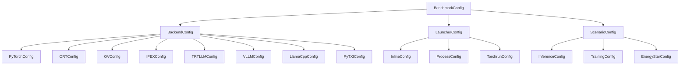
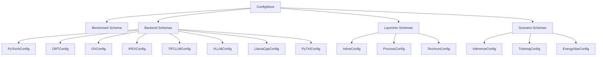
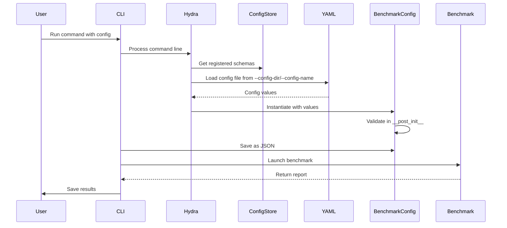
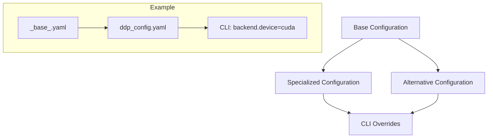
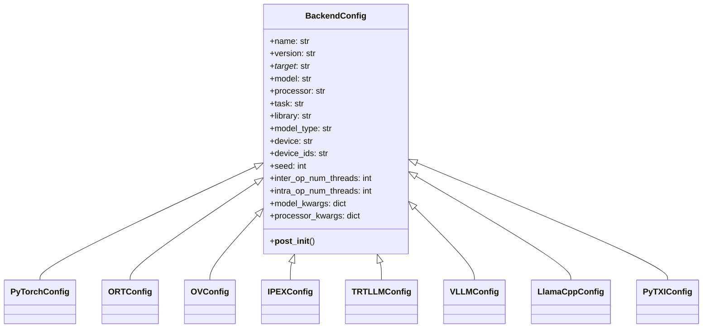
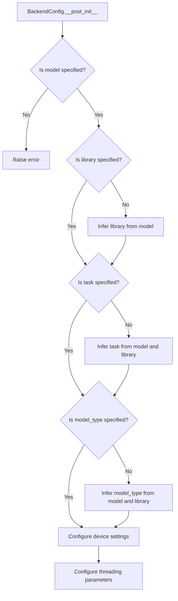
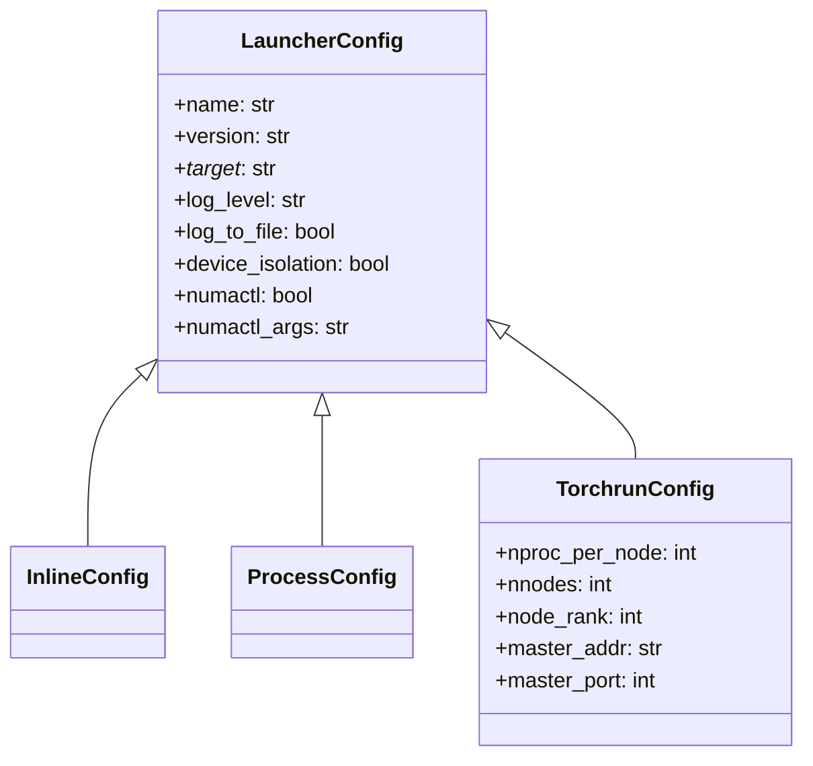
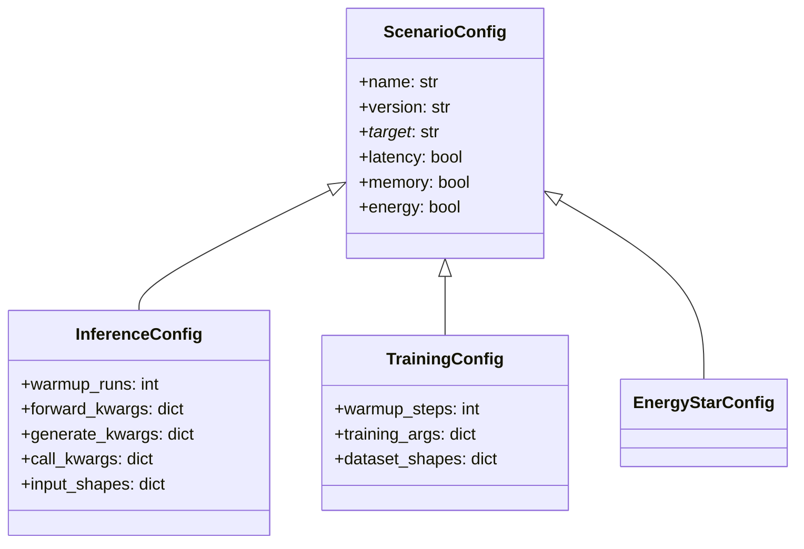
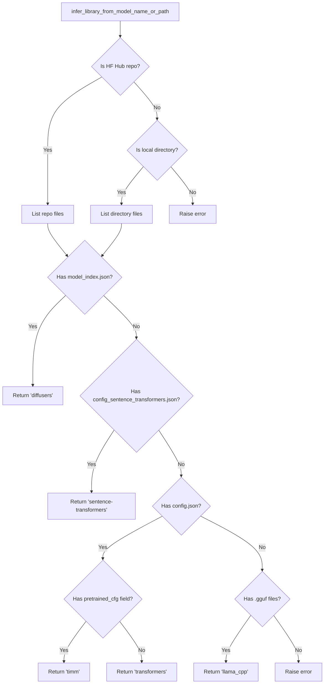

<!-- source: DeepWiki mcp.deepwiki.com · repo huggingface/optimum-benchmark · page 2.2 Configuration System · fetched 2026-10-26 -->

# Configuration System

<details>
<summary>Relevant source files</summary>

The following files were used as context for generating this wiki page:

- [.github/workflows/test_cli_cpu_ipex.yaml](.github/workflows/test_cli_cpu_ipex.yaml)
- [.github/workflows/test_cli_cpu_llama_cpp.yaml](.github/workflows/test_cli_cpu_llama_cpp.yaml)
- [.gitignore](.gitignore)
- [README.md](README.md)
- [optimum_benchmark/__init__.py](optimum_benchmark/__init__.py)
- [optimum_benchmark/backends/__init__.py](optimum_benchmark/backends/__init__.py)
- [optimum_benchmark/backends/base.py](optimum_benchmark/backends/base.py)
- [optimum_benchmark/backends/config.py](optimum_benchmark/backends/config.py)
- [optimum_benchmark/backends/transformers_utils.py](optimum_benchmark/backends/transformers_utils.py)
- [optimum_benchmark/cli.py](optimum_benchmark/cli.py)
- [optimum_benchmark/import_utils.py](optimum_benchmark/import_utils.py)
- [optimum_benchmark/task_utils.py](optimum_benchmark/task_utils.py)
- [setup.py](setup.py)
- [tests/configs/_base_.yaml](tests/configs/_base_.yaml)
- [tests/configs/_ddp_.yaml](tests/configs/_ddp_.yaml)

</details>


The Configuration System in Optimum-Benchmark provides a structured approach to configuring benchmark runs through a hierarchical, inheritance-based mechanism powered by Hydra. This page explains how configurations are defined, loaded, validated, and used throughout the benchmarking framework.

## Overview

Optimum-Benchmark uses a configuration system that combines the flexibility of YAML files with the type-safety of Python dataclasses. The system is built around three core configuration components:

1. **Backend Configurations** - Define the specific ML framework implementation
2. **Launcher Configurations** - Control how benchmarks are executed
3. **Scenario Configurations** - Determine the benchmarking workflow

Together, these components form a complete `BenchmarkConfig` that defines every aspect of a benchmark run.



Sources: [optimum_benchmark/__init__.py:1-41](), [optimum_benchmark/backends/__init__.py:1-24](), [optimum_benchmark/cli.py:8-53]()

## Hydra Integration

Optimum-Benchmark uses [Hydra](https://hydra.cc) for configuration management, offering several advantages:

1. **Type-safe configurations** - Python dataclasses with validation
2. **Configuration composition** - Combine configuration fragments
3. **Configuration inheritance** - Define defaults and override as needed
4. **CLI parameter overrides** - Override config values from command line
5. **Configuration sweeps** - Run multiple configurations in sequence

### Configuration Store Registration

All configuration classes are registered with Hydra's ConfigStore, making them available for composition and instantiation:



Sources: [optimum_benchmark/cli.py:32-54]()

### Configuration Loading Flow

The CLI uses Hydra to handle configuration loading, validation, and application:



Sources: [optimum_benchmark/cli.py:57-82]()

## Configuration Structure and Inheritance

Configurations in Optimum-Benchmark follow a hierarchical inheritance model using Hydra's `defaults` mechanism. This allows defining common settings in base configurations and overriding them in specific configurations.

### Base Configuration Structure

A typical configuration file includes:

```yaml
defaults:
  - benchmark          # parent schema
  - backend: pytorch   # default backend
  - launcher: process  # default launcher
  - scenario: inference # default scenario
  - _self_             # override with settings in this file

name: my_benchmark
print_report: true
log_report: true

# backend-specific settings
backend:
  model: bert-base-uncased
  device: cpu

# scenario-specific settings
scenario:
  latency: true
  memory: true
```

Sources: [tests/configs/_base_.yaml:1-28]()

### Configuration Inheritance and Overrides

Configurations can inherit from base configurations and override specific values:



Sources: [tests/configs/_base_.yaml:1-28](), [tests/configs/_ddp_.yaml:1-17]()

## Backend Configuration

The `BackendConfig` class forms the foundation for all backend-specific configurations. It handles common parameters and validation:



Sources: [optimum_benchmark/backends/config.py:1-129]()

### Automatic Model Information Inference

A key feature of the backend configuration is its ability to automatically infer model information:



Sources: [optimum_benchmark/backends/config.py:47-126](), [optimum_benchmark/task_utils.py:201-340]()

## Launcher Configuration

Launcher configurations control how benchmark workloads are executed:



Sources: [optimum_benchmark/__init__.py:16]()

## Scenario Configuration

Scenario configurations define the benchmarking workflow:



Sources: [optimum_benchmark/__init__.py:17]()

## Configuration Validation and Post-Processing

The configuration system performs extensive validation and post-processing in the `__post_init__` methods of configuration classes. This includes:

1. Required parameter validation
2. Automatic inference of model information (task, library, model type)
3. Device configuration and environment variable setup
4. Thread configuration
5. Parameter normalization and defaults

### Model Information Inference System

A critical part of the configuration system is the automatic inference of model information:



Sources: [optimum_benchmark/task_utils.py:201-233](), [optimum_benchmark/backends/config.py:47-126]()

## Using the Configuration System

### Via Command Line Interface

The configuration system is typically used through the CLI:

```bash
optimum-benchmark --config-dir examples/ --config-name cuda_pytorch_bert
```

You can also override specific configuration values:

```bash
optimum-benchmark --config-dir examples/ --config-name pytorch_bert backend.model=gpt2 backend.device=cuda
```

Or run configuration sweeps:

```bash
optimum-benchmark --config-dir examples --config-name pytorch_bert -m backend.device=cpu,cuda
```

Sources: [README.md:171-203]()

### Via Python API

The configuration system can also be used programmatically:

```python
from optimum_benchmark import Benchmark, BenchmarkConfig, TorchrunConfig, InferenceConfig, PyTorchConfig

launcher_config = TorchrunConfig(nproc_per_node=2)
scenario_config = InferenceConfig(latency=True, memory=True)
backend_config = PyTorchConfig(model="gpt2", device="cuda", device_ids="0,1", no_weights=True)
benchmark_config = BenchmarkConfig(
    name="pytorch_gpt2",
    scenario=scenario_config,
    launcher=launcher_config,
    backend=backend_config,
)
benchmark_report = Benchmark.launch(benchmark_config)
```

Sources: [README.md:126-163]()

## Configuration File Structure and Locations

Hydra looks for configuration files in the directory specified by `--config-dir` with the name specified by `--config-name`.

A typical configuration directory structure might look like:

```
examples/
├── _base_.yaml              # Common settings
├── backends/                # Backend-specific configurations
│   ├── pytorch.yaml
│   ├── onnxruntime.yaml
│   └── ...
├── launchers/               # Launcher-specific configurations
│   ├── process.yaml
│   ├── torchrun.yaml
│   └── ...
├── scenarios/               # Scenario-specific configurations
│   ├── inference.yaml
│   ├── training.yaml
│   └── ...
└── cuda_pytorch_bert.yaml   # Complete benchmark configuration
```

Sources: [README.md:170-185]()

## Conclusion

The Configuration System in Optimum-Benchmark provides a flexible, type-safe, and extensible way to define benchmark configurations. By leveraging Hydra, it offers powerful features such as configuration composition, inheritance, and validation, while maintaining ease of use through both CLI and API interfaces.

The system's ability to automatically infer model information simplifies configuration and reduces errors, while the hierarchical structure allows for precise control over all aspects of the benchmarking process.

---

