# Page: Overview

# Overview

<details>
<summary>Relevant source files</summary>

The following files were used as context for generating this wiki page:

- [README.md](README.md)
- [optimum_benchmark/backends/base.py](optimum_benchmark/backends/base.py)
- [optimum_benchmark/backends/config.py](optimum_benchmark/backends/config.py)
- [optimum_benchmark/backends/transformers_utils.py](optimum_benchmark/backends/transformers_utils.py)
- [optimum_benchmark/task_utils.py](optimum_benchmark/task_utils.py)
- [optimum_benchmark/version.py](optimum_benchmark/version.py)

</details>


Optimum-Benchmark is a unified framework for evaluating the performance of machine learning models from the Hugging Face ecosystem. It provides a standardized approach to benchmark machine learning models across various hardware, frameworks, and optimization techniques, making it easier to compare performance characteristics like latency, throughput, memory usage, and energy consumption.

This page provides a high-level overview of Optimum-Benchmark, introducing its architecture, components, and workflow. For detailed information about specific components, refer to their respective pages in this wiki.

## Purpose and Scope

Optimum-Benchmark aims to address several key benchmarking needs:

1. **Hardware Evaluation**: Enabling hardware providers and users to compare performance across different hardware platforms
2. **Model Comparison**: Measuring performance metrics (latency, throughput, memory, energy) across different models
3. **Optimization Assessment**: Benchmarking hardware & backend-specific optimizations and quantization techniques

The project supports:
- Multiple ML libraries (Transformers, Diffusers, PEFT, TIMM, and Optimum)
- Various hardware targets (CPU, NVIDIA/AMD GPUs, and more)
- Different execution scenarios (inference and training)
- Distributed and non-distributed setups

Sources: [README.md:12-31]()

## System Architecture

Optimum-Benchmark follows a modular design with several key abstractions that work together to perform benchmarking tasks.

### High-Level Architecture

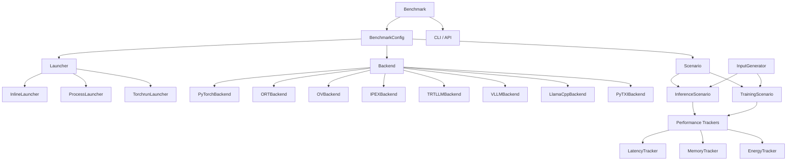

The main components of the system include:

1. **Benchmark**: The central entry point that orchestrates the benchmarking process
2. **BenchmarkConfig**: Configures the benchmark parameters
3. **Launchers**: Control how benchmark workloads are executed
4. **Backends**: Interface with different ML frameworks and acceleration libraries
5. **Scenarios**: Define benchmarking workflows (inference or training)
6. **Trackers**: Monitor and record performance metrics
7. **Input Generators**: Create appropriate inputs for different model types and tasks

Sources: [optimum_benchmark/backends/base.py:36-147]()

## Core Components

### Backend System

The Backend abstraction is central to Optimum-Benchmark. It provides a common interface for loading models and executing operations (inference or training) across different frameworks and acceleration libraries.

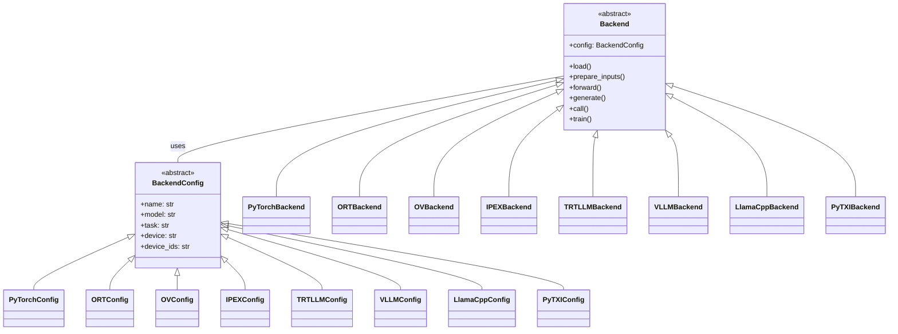

Each backend:
- Loads models from the Hugging Face Hub or local directory
- Prepares inputs in the format required by the framework
- Executes model operations (forward, generate, call, train)
- Returns outputs in a standardized format

Sources: [optimum_benchmark/backends/base.py:36-147](), [optimum_benchmark/backends/config.py:19-48]()

### Task Handling System

The framework automatically infers tasks from model architectures, enabling proper handling of different model types (text generation, image diffusion, etc.).

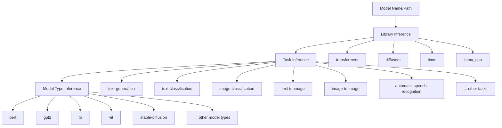

The task inference system identifies:
- Which library the model belongs to (Transformers, Diffusers, TIMM, LlamaCPP)
- What task the model performs (text generation, classification, etc.)
- The specific model architecture or type

This information is crucial for loading the correct model class and generating appropriate inputs for benchmarking.

Sources: [optimum_benchmark/task_utils.py:8-340]()

## Benchmark Workflow

The benchmark execution follows a standardized flow from configuration to reporting.

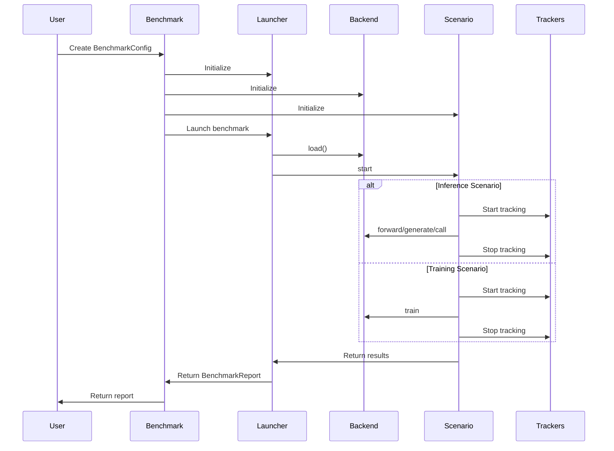

The workflow involves:
1. Creating a configuration that specifies the backend, scenario, and launcher
2. Initializing the components based on the configuration
3. Launching the benchmark, which loads the model and runs the appropriate operations
4. Tracking performance metrics during execution
5. Collecting results into a benchmark report

Sources: [README.md:120-163]()

## Supported Technologies

Optimum-Benchmark supports a wide range of technologies:

### Backends and Devices

| Backend | CPU | NVIDIA GPU | AMD GPU | Intel XPU | Others |
|---------|-----|------------|---------|-----------|--------|
| PyTorch | ✅ | ✅ | ✅ | ❌ | MPS |
| ONNX Runtime | ✅ | ✅ | ✅ | ❌ | - |
| OpenVINO | ✅ | ✅ | ❌ | ❌ | - |
| TensorRT-LLM | ❌ | ✅ | ❌ | ❌ | - |
| vLLM | ✅ | ✅ | ✅ | ❌ | - |
| IPEX | ✅ | ❌ | ❌ | ✅ | - |
| LlamaCpp | ✅ | ✅ | ✅ | ❌ | - |
| PyTXI | ✅ | ✅ | ❌ | ❌ | - |

### Scenarios

1. **Inference Scenario**: Benchmarks model inference (forward, call, or generate)
   - Supports latency, memory, and energy tracking
   - Configurable number of warmup runs
   - Customizable input shapes and generation parameters

2. **Training Scenario**: Benchmarks model training
   - Supports latency, memory, and energy tracking
   - Configurable number of warmup steps
   - Customizable dataset shapes and training arguments

### Launchers

1. **Process Launcher**: Runs benchmarks in isolated processes
2. **Torchrun Launcher**: Runs distributed benchmarks using `torch.distributed`
3. **Inline Launcher**: Runs benchmarks in the same process (for debugging)

Sources: [README.md:212-285]()

## Getting Started

Optimum-Benchmark can be installed via pip and used through either a Python API or a command-line interface.

### Installation

```bash
pip install optimum-benchmark
```

### Python API Example

```python
from optimum_benchmark import Benchmark, BenchmarkConfig, TorchrunConfig, InferenceConfig, PyTorchConfig

# Configure the benchmark components
launcher_config = TorchrunConfig(nproc_per_node=2)
scenario_config = InferenceConfig(latency=True, memory=True)
backend_config = PyTorchConfig(model="gpt2", device="cuda", device_ids="0,1")

# Create the benchmark configuration
benchmark_config = BenchmarkConfig(
    name="pytorch_gpt2",
    scenario=scenario_config,
    launcher=launcher_config,
    backend=backend_config,
)

# Run the benchmark
benchmark_report = Benchmark.launch(benchmark_config)

# Save or view the results
benchmark_report.save_json("benchmark_report.json")
```

Sources: [README.md:69-163]()

## Use Cases

Optimum-Benchmark is designed to support several key use cases:

1. **Hardware Comparison**: Evaluate the performance of different hardware platforms (CPUs, GPUs) on the same models
2. **Model Evaluation**: Compare the performance characteristics of different models on the same hardware
3. **Optimization Assessment**: Measure the impact of optimizations and quantization techniques on model performance
4. **Distributed Training Evaluation**: Assess the scaling efficiency of models across multiple devices

By providing a standardized benchmarking framework, Optimum-Benchmark helps users make informed decisions about hardware, models, and optimization techniques for their specific use cases.

Sources: [README.md:27-31]()

---

# Page: Architecture

# Architecture

<details>
<summary>Relevant source files</summary>

The following files were used as context for generating this wiki page:

- [.github/workflows/test_cli_cpu_ipex.yaml](.github/workflows/test_cli_cpu_ipex.yaml)
- [.github/workflows/test_cli_cpu_llama_cpp.yaml](.github/workflows/test_cli_cpu_llama_cpp.yaml)
- [.gitignore](.gitignore)
- [README.md](README.md)
- [optimum_benchmark/__init__.py](optimum_benchmark/__init__.py)
- [optimum_benchmark/backends/__init__.py](optimum_benchmark/backends/__init__.py)
- [optimum_benchmark/backends/base.py](optimum_benchmark/backends/base.py)
- [optimum_benchmark/backends/config.py](optimum_benchmark/backends/config.py)
- [optimum_benchmark/backends/transformers_utils.py](optimum_benchmark/backends/transformers_utils.py)
- [optimum_benchmark/cli.py](optimum_benchmark/cli.py)
- [optimum_benchmark/import_utils.py](optimum_benchmark/import_utils.py)
- [optimum_benchmark/task_utils.py](optimum_benchmark/task_utils.py)
- [setup.py](setup.py)

</details>


This document outlines the high-level architecture of the Optimum-Benchmark framework, detailing its core components, their relationships, and how they work together to provide a comprehensive benchmarking system for machine learning models. For a general introduction to the system, see [Overview](#1). For detailed information about specific components, refer to their respective wiki pages linked throughout this document.

## High-Level Architecture

Optimum-Benchmark is designed with a modular architecture that separates concerns between different aspects of the benchmarking process. The framework consists of four main components that work together to provide comprehensive benchmarking capabilities:

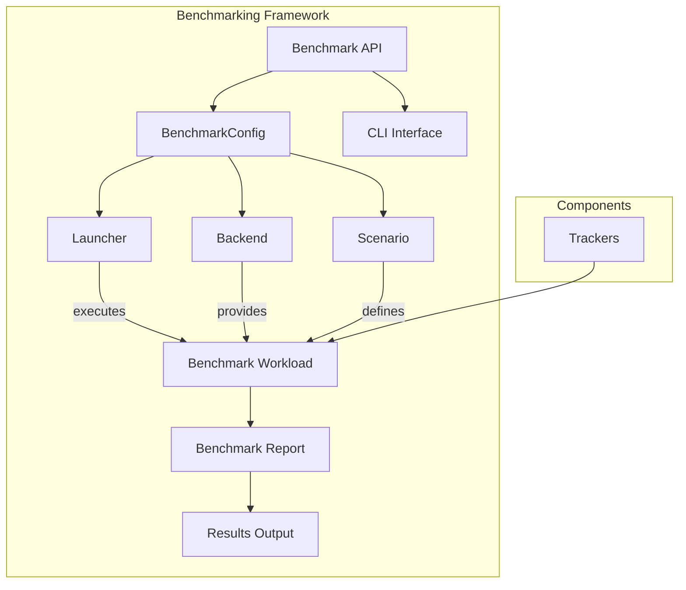

**Key Components:**

1. **Benchmark API**: The central entry point for running benchmarks programmatically.
2. **Benchmark Configuration**: Defines what and how to benchmark.
3. **Launcher**: Controls how benchmark workloads are executed.
4. **Backend**: Represents machine learning frameworks and optimizations.
5. **Scenario**: Defines benchmarking workflows (inference, training).
6. **Trackers**: Monitor and record performance metrics.

Sources: [optimum_benchmark/benchmark/base.py](), [optimum_benchmark/benchmark/config.py](), [optimum_benchmark/cli.py:1-82]()

## Core Component Relationships

The following diagram shows the detailed relationships between the core components of the system, highlighting how they interact:

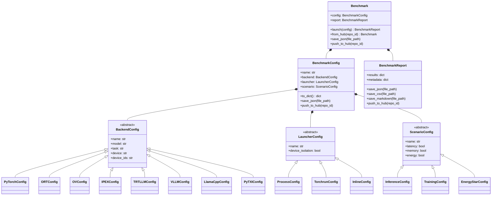

Sources: [optimum_benchmark/__init__.py:1-41](), [optimum_benchmark/benchmark/base.py](), [optimum_benchmark/backends/config.py:1-129]()

## Backend Subsystem

The backend subsystem is responsible for interfacing with different machine learning frameworks and optimization libraries. It provides a unified API for loading models, preparing inputs, and executing workloads.

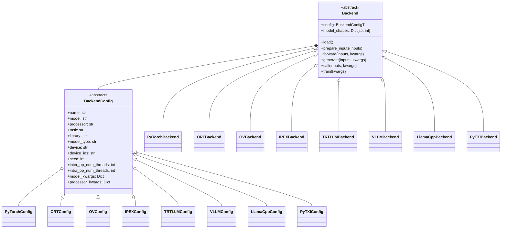

The backend system is designed for flexibility and extensibility, allowing easy integration of new machine learning frameworks and optimization libraries. Each backend implements the same interface but handles framework-specific details internally.

Key features of the backend system:

1. **Universal Interface**: All backends implement the same methods (`load`, `forward`, `generate`, etc.)
2. **Library Support**: Works with Transformers, Diffusers, TIMM, and LlamaCpp models
3. **Device Flexibility**: Supports CPU, NVIDIA GPUs (CUDA), AMD GPUs (ROCm), and specialized hardware
4. **Optimization Options**: Each backend can apply framework-specific optimizations

Sources: [optimum_benchmark/backends/base.py:1-147](), [optimum_benchmark/backends/config.py:1-129](), [optimum_benchmark/backends/__init__.py:1-24]()

## Task and Model Type Handling

Optimum-Benchmark has a sophisticated system for inferring tasks and model types from model names or directories, allowing it to automatically configure the appropriate benchmarking environment.

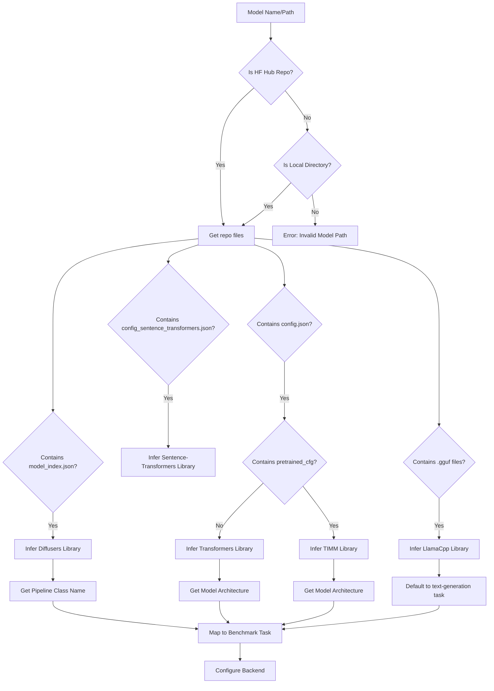

Sources: [optimum_benchmark/task_utils.py:1-340](), [optimum_benchmark/backends/config.py:1-129]()

## Launcher Subsystem

The launcher subsystem is responsible for executing benchmark workloads. It provides different strategies for running benchmarks, from simple in-process execution to distributed training across multiple devices.

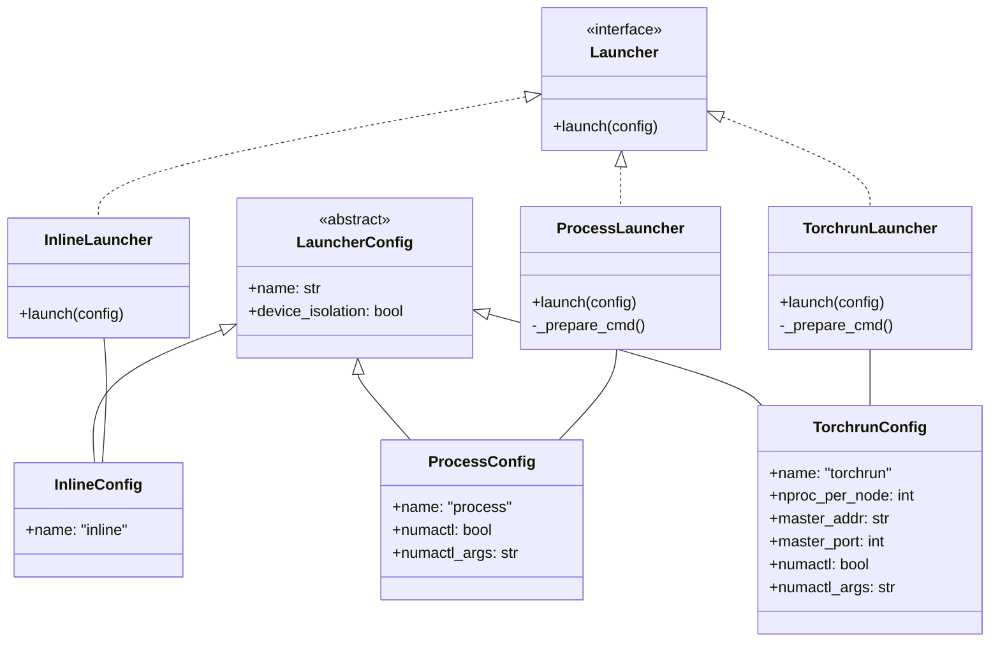

Each launcher provides a different execution strategy:

1. **InlineLauncher**: Executes the benchmark in the same process (mainly for debugging)
2. **ProcessLauncher**: Runs the benchmark in a separate process for isolation
3. **TorchrunLauncher**: Uses PyTorch's distributed execution tools for multi-GPU benchmarking

Sources: [optimum_benchmark/launchers/__init__.py](), [optimum_benchmark/__init__.py:16-16](), [optimum_benchmark/cli.py:51-54]()

## Scenario Subsystem

The scenario subsystem defines different benchmarking workflows, configuring what aspects of model performance to measure and how.

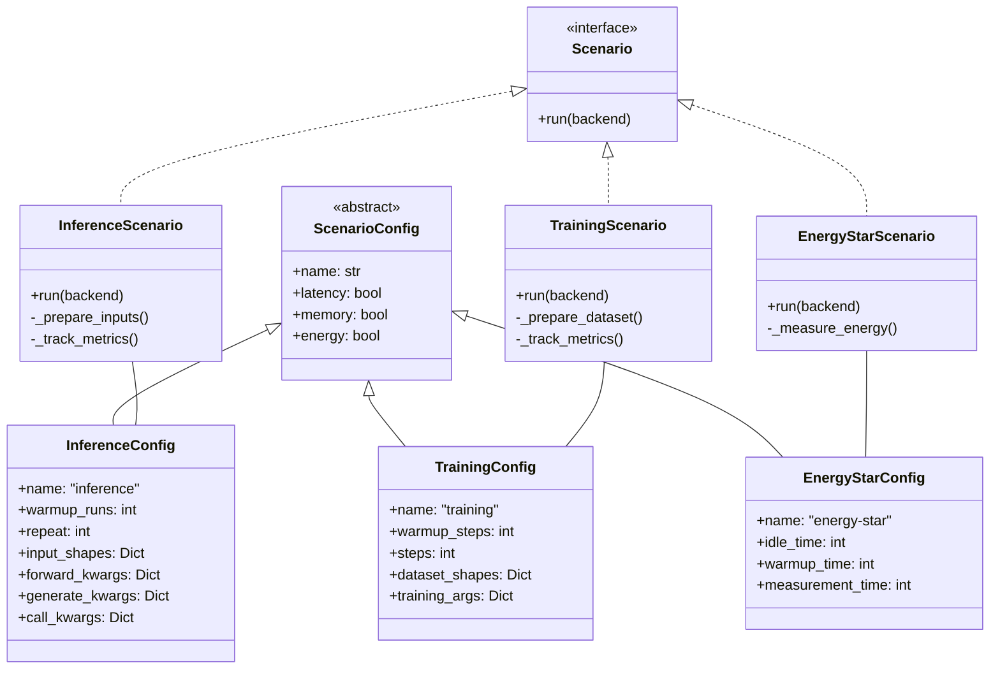

Each scenario type focuses on different aspects of model performance:

1. **InferenceScenario**: Measures the performance of model inference (forward pass, generation)
2. **TrainingScenario**: Evaluates model training performance
3. **EnergyStarScenario**: Focuses on energy efficiency metrics

Sources: [optimum_benchmark/__init__.py:17-17](), [optimum_benchmark/cli.py:47-50]()

## Performance Tracking System

The performance tracking system is responsible for measuring and recording various performance metrics during benchmark execution.

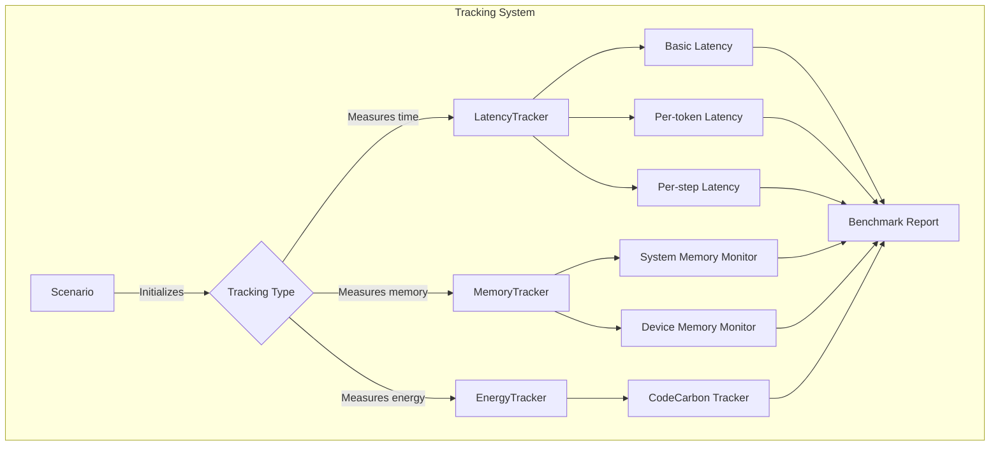

Key features of the tracking system:

1. **Latency Tracking**: Measures execution time with specialized trackers for token generation and training steps
2. **Memory Tracking**: Monitors RAM and device (GPU/TPU) memory usage
3. **Energy Tracking**: Records energy consumption using CodeCarbon

Sources: [README.md:245-247](), [README.md:252-255]()

## Benchmark Execution Flow

The following sequence diagram illustrates the flow of execution when running a benchmark:

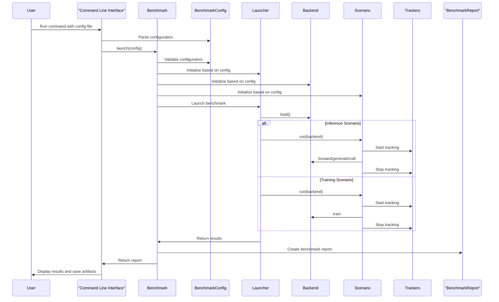

Sources: [optimum_benchmark/cli.py:56-82](), [README.md:120-163]()

## CLI and Configuration System

Optimum-Benchmark provides a command-line interface built on Hydra, allowing for flexible configuration and execution of benchmarks.

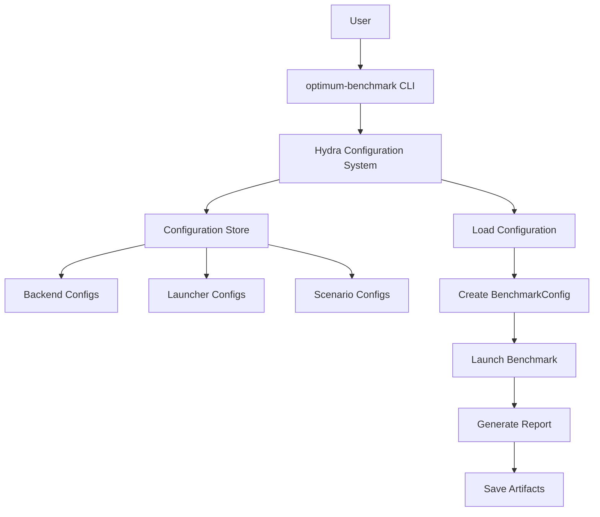

The CLI enables users to:

1. Run benchmarks with predefined configurations
2. Override configuration parameters from the command line
3. Perform parameter sweeps for comparative benchmarking
4. Save and share benchmark results

Sources: [optimum_benchmark/cli.py:1-82](), [README.md:164-209]()

## System Requirements and Dependencies

Optimum-Benchmark has a modular dependency system, only loading necessary libraries based on the backends and features being used.

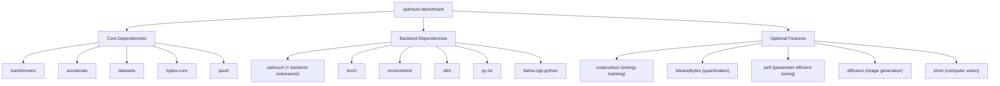

The setup system automatically detects available hardware and suggests appropriate dependencies to install:

1. Detects NVIDIA GPUs and installs NVIDIA utilities
2. Detects AMD GPUs and installs AMD utilities
3. Provides extras for specific backends (e.g., `pip install optimum-benchmark[vllm]`)

Sources: [setup.py:1-123](), [import_utils.py:1-277]()

## Summary

The architecture of Optimum-Benchmark is designed to be:

1. **Modular**: Components can be swapped or extended independently
2. **Extensible**: New backends, scenarios, and trackers can be added easily
3. **Flexible**: Supports various hardware, frameworks, and benchmarking scenarios
4. **Comprehensive**: Measures multiple aspects of performance (speed, memory, energy)

This design allows Optimum-Benchmark to support a wide range of machine learning models, frameworks, and hardware, making it a versatile tool for performance evaluation and optimization.

---

# Page: Core Components

# Core Components

<details>
<summary>Relevant source files</summary>

The following files were used as context for generating this wiki page:

- [.github/workflows/test_cli_cpu_ipex.yaml](.github/workflows/test_cli_cpu_ipex.yaml)
- [.github/workflows/test_cli_cpu_llama_cpp.yaml](.github/workflows/test_cli_cpu_llama_cpp.yaml)
- [.gitignore](.gitignore)
- [README.md](README.md)
- [optimum_benchmark/__init__.py](optimum_benchmark/__init__.py)
- [optimum_benchmark/backends/__init__.py](optimum_benchmark/backends/__init__.py)
- [optimum_benchmark/backends/base.py](optimum_benchmark/backends/base.py)
- [optimum_benchmark/backends/config.py](optimum_benchmark/backends/config.py)
- [optimum_benchmark/backends/transformers_utils.py](optimum_benchmark/backends/transformers_utils.py)
- [optimum_benchmark/cli.py](optimum_benchmark/cli.py)
- [optimum_benchmark/hub_utils.py](optimum_benchmark/hub_utils.py)
- [optimum_benchmark/import_utils.py](optimum_benchmark/import_utils.py)
- [optimum_benchmark/launchers/config.py](optimum_benchmark/launchers/config.py)
- [optimum_benchmark/launchers/inline/config.py](optimum_benchmark/launchers/inline/config.py)
- [optimum_benchmark/launchers/process/config.py](optimum_benchmark/launchers/process/config.py)
- [optimum_benchmark/launchers/torchrun/config.py](optimum_benchmark/launchers/torchrun/config.py)
- [optimum_benchmark/task_utils.py](optimum_benchmark/task_utils.py)
- [setup.py](setup.py)

</details>


This page documents the main abstractions and classes that form the foundation of the Optimum-Benchmark system. These core components provide the structure upon which the entire benchmarking framework is built, enabling the flexibility to benchmark various models across different hardware and optimization backends.

For information about how to configure specific components, see [Configuration System](#2.2). For details about specific backend implementations, see [Backends](#3).

## Component Architecture Overview

Optimum-Benchmark follows a modular design with three main component types that work together to create a flexible benchmarking system:

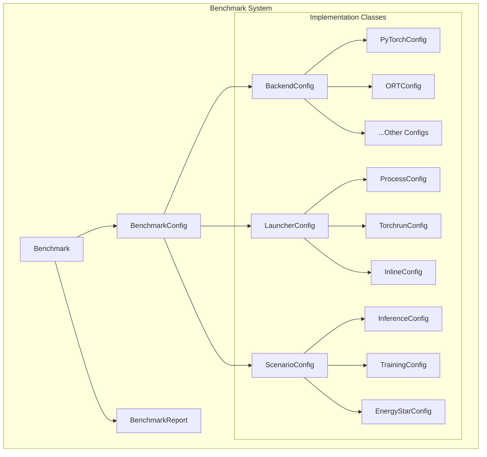

The system consists of:

1. **Backend**: Provides an abstraction over different ML frameworks and optimizations
2. **Launcher**: Controls how benchmarks are executed (in-process, isolated process, distributed)
3. **Scenario**: Defines the benchmarking workflow (inference, training, energy measurement)
4. **Configuration**: Ties together the above components with specific settings

Sources: [optimum_benchmark/__init__.py:1-41](), [optimum_benchmark/backends/__init__.py:1-24](), [optimum_benchmark/cli.py:1-82]()

## Core Classes and Abstractions

The system is built around several abstract base classes that define the interfaces for each component type:

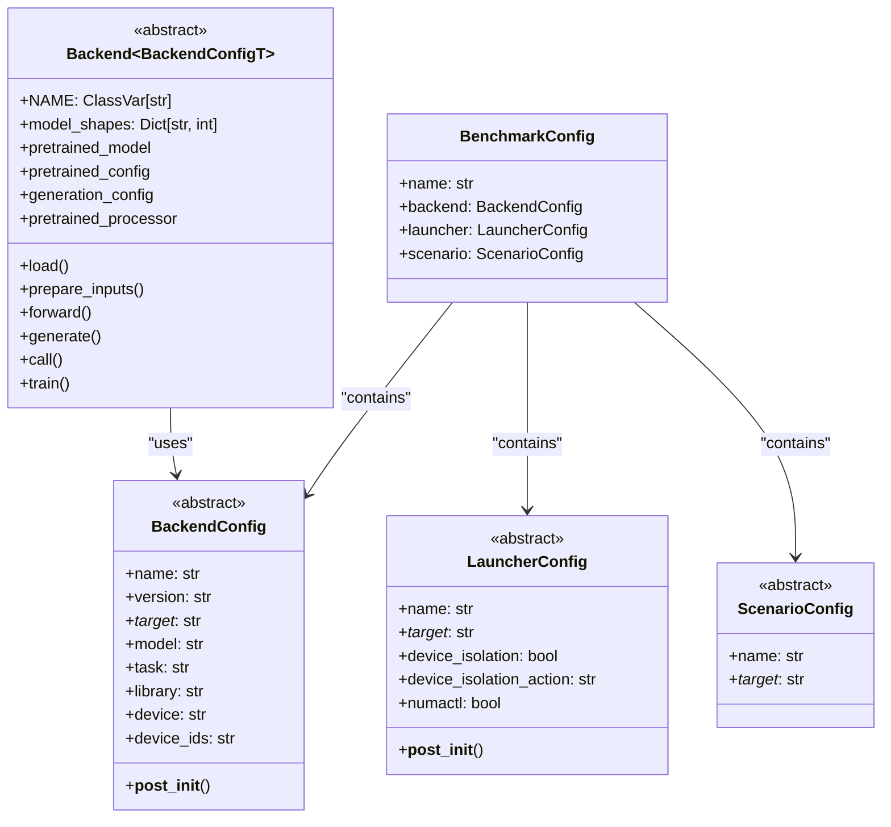

Sources: [optimum_benchmark/backends/base.py:36-147](), [optimum_benchmark/backends/config.py:19-129](), [optimum_benchmark/launchers/config.py:11-45](), [optimum_benchmark/cli.py:33-54]()

### Backend System

The `Backend` class is the foundation of the model execution abstraction. It provides a unified interface to different ML frameworks:

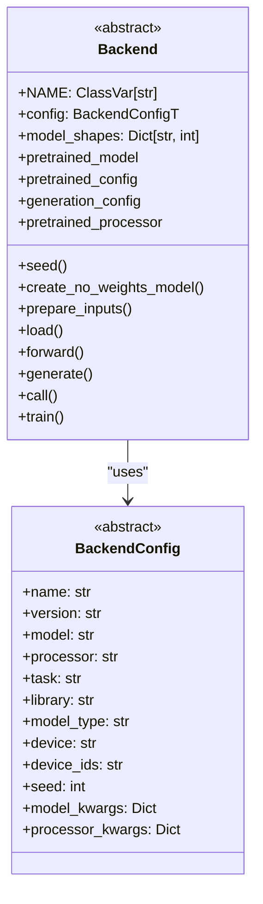

Key responsibilities of the `Backend` class:
- Load models with appropriate settings
- Prepare inputs in the format required by the framework
- Execute model operations (forward, generate, etc.)
- Handle model training when applicable

The `Backend` abstraction handles differences in model interfaces across frameworks like PyTorch, ONNX Runtime, OpenVINO, etc., providing consistent methods regardless of the underlying implementation.

Sources: [optimum_benchmark/backends/base.py:36-147](), [optimum_benchmark/backends/config.py:19-129]()

### Launcher System

The launcher system controls how benchmark workloads are executed:

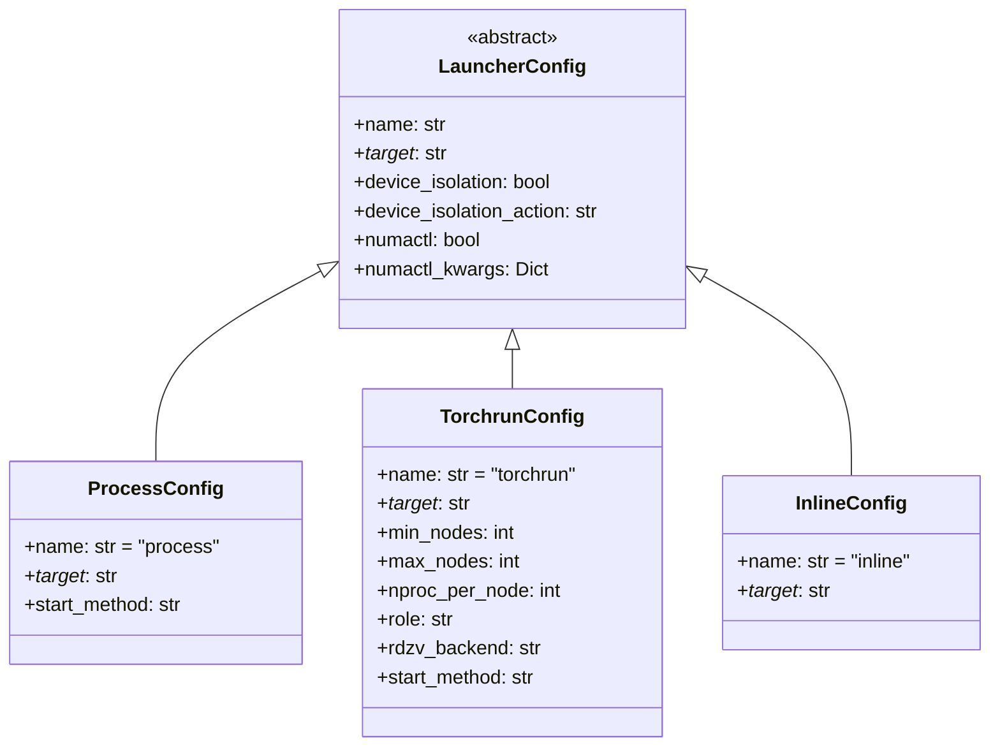

The three main launcher types are:
- **InlineLauncher**: Runs benchmarks in the same process (for debugging)
- **ProcessLauncher**: Runs benchmarks in isolated processes 
- **TorchrunLauncher**: Runs benchmarks in distributed settings using PyTorch's distributed capabilities

Each launcher ensures benchmarks execute in consistent and isolated environments to produce reliable results.

Sources: [optimum_benchmark/launchers/config.py:11-45](), [optimum_benchmark/launchers/process/config.py:1-18](), [optimum_benchmark/launchers/torchrun/config.py:1-54](), [optimum_benchmark/launchers/inline/config.py:1-23]()

### Supported Libraries and Tasks

The system provides extensive integration with various ML libraries and task types:

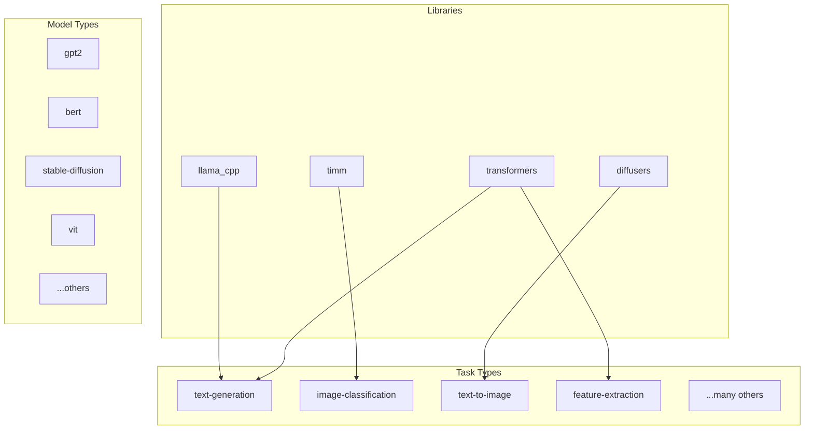

The task utilities system handles automatic inference of:
- Library type (transformers, diffusers, timm, llama_cpp)
- Task type (text-generation, image-classification, etc.) 
- Model type (architecture specific information)

Sources: [optimum_benchmark/task_utils.py:1-341](), [optimum_benchmark/backends/config.py:61-90]()

## Import and Dependency Management

Optimum-Benchmark handles dependencies flexibly through its import utilities system:

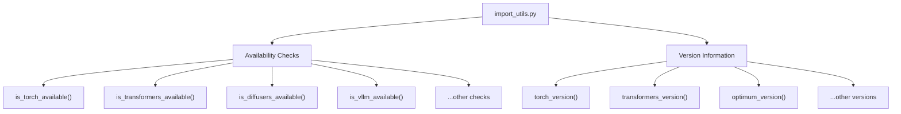

This system ensures:
- Optional dependencies are properly handled
- Clear error messages when required dependencies are missing
- Version information is available for reporting 

These utilities allow the codebase to adapt to different installation configurations and handle missing dependencies gracefully.

Sources: [optimum_benchmark/import_utils.py:1-259](), [setup.py:63-90]()

## Integration with Hugging Face Ecosystem

The core components provide integration with the Hugging Face ecosystem:

```mermaid
classDiagram
    class PushToHubMixin {
        +to_dict(flat: bool): Dict
        +from_dict(data: Dict): Self
        +save_json(path: str)
        +from_json(path: str): Self
        +to_dataframe(): DataFrame
        +from_dataframe(df: DataFrame): Self
        +save_csv(path: str)
        +from_csv(path: str): Self
        +push_to_hub(repo_id: str)
        +from_pretrained(repo_id: str): Self
    }
    
    class BenchmarkConfig {
        +name: str
        +backend: BackendConfig
        +launcher: LauncherConfig
        +scenario: ScenarioConfig
    }
    
    class BenchmarkReport {
        +artifacts: Dict
    }
    
    PushToHubMixin <|-- BenchmarkConfig
    PushToHubMixin <|-- BenchmarkReport
```

Key integration features:
- Loading models from the Hugging Face Hub
- Pushing benchmark results to the Hub
- Serialization and deserialization of configurations and reports
- Repository management and file operations

This integration allows for easy sharing and comparison of benchmark results across the community.

Sources: [optimum_benchmark/hub_utils.py:1-161](), [optimum_benchmark/task_utils.py:146-196]()

## System Entry Points

The system provides two main entry points:

1. **CLI Interface**: Based on Hydra for configuration management
```python
# Command line usage
optimum-benchmark --config-dir examples/ --config-name cuda_pytorch_bert
```

2. **Python API**: For programmatic usage
```python
from optimum_benchmark import Benchmark, BenchmarkConfig, PyTorchConfig, ProcessConfig, InferenceConfig

benchmark_config = BenchmarkConfig(
    name="pytorch_benchmark",
    backend=PyTorchConfig(model="gpt2", device="cuda"),
    launcher=ProcessConfig(),
    scenario=InferenceConfig(latency=True, memory=True)
)
report = Benchmark.launch(benchmark_config)
```

Sources: [optimum_benchmark/cli.py:57-82](), [README.md:120-163]()

## Component Relationships and Flow

The core components interact in a specific sequence when running a benchmark:

```mermaid
sequenceDiagram
    participant U as User
    participant B as Benchmark
    participant L as Launcher
    participant BE as Backend
    participant S as Scenario
    
    U->>B: create BenchmarkConfig
    U->>B: launch(config)
    
    B->>L: initialize
    B->>BE: initialize
    B->>S: initialize
    
    B->>L: run_benchmark(backend, scenario)
    
    L->>BE: load()
    L->>BE: prepare environment
    
    alt Inference Scenario
        L->>BE: run forward/generate/call
    else Training Scenario
        L->>BE: run train
    end
    
    L->>B: collect metrics
    B->>U: return BenchmarkReport
```

This flow ensures that:
1. Components are properly initialized with their configurations
2. The execution environment is prepared by the launcher
3. The appropriate backend methods are called based on the scenario
4. Metrics are collected and returned in a structured report

Sources: [optimum_benchmark/backends/base.py:36-147](), [optimum_benchmark/cli.py:57-82](), [README.md:120-163]()

## Core Components Summary

The core components of Optimum-Benchmark establish a flexible and extensible system for benchmarking ML models with key features:

| Component | Primary Role | Key Classes |
|-----------|--------------|-------------|
| Backend | Framework abstraction | `Backend`, `BackendConfig` |
| Launcher | Execution control | `LauncherConfig`, `ProcessConfig`, `TorchrunConfig` |
| Scenario | Benchmark workflow | `ScenarioConfig`, `InferenceConfig`, `TrainingConfig` |
| Configuration | Component integration | `BenchmarkConfig` |
| Utilities | Cross-cutting concerns | `import_utils`, `task_utils`, `hub_utils` |

This modular design allows for:
- Supporting multiple ML frameworks through a consistent interface
- Running benchmarks in various execution environments
- Measuring different aspects of model performance
- Easy extension to new frameworks, hardware, and metrics

Sources: [optimum_benchmark/__init__.py:1-41](), [optimum_benchmark/cli.py:33-54](), [README.md:12-41]()

---

# Page: Configuration System

# Configuration System

<details>
<summary>Relevant source files</summary>

The following files were used as context for generating this wiki page:

- [.github/workflows/test_cli_cpu_ipex.yaml](.github/workflows/test_cli_cpu_ipex.yaml)
- [.github/workflows/test_cli_cpu_llama_cpp.yaml](.github/workflows/test_cli_cpu_llama_cpp.yaml)
- [.gitignore](.gitignore)
- [README.md](README.md)
- [optimum_benchmark/__init__.py](optimum_benchmark/__init__.py)
- [optimum_benchmark/backends/__init__.py](optimum_benchmark/backends/__init__.py)
- [optimum_benchmark/backends/base.py](optimum_benchmark/backends/base.py)
- [optimum_benchmark/backends/config.py](optimum_benchmark/backends/config.py)
- [optimum_benchmark/backends/transformers_utils.py](optimum_benchmark/backends/transformers_utils.py)
- [optimum_benchmark/cli.py](optimum_benchmark/cli.py)
- [optimum_benchmark/import_utils.py](optimum_benchmark/import_utils.py)
- [optimum_benchmark/task_utils.py](optimum_benchmark/task_utils.py)
- [setup.py](setup.py)
- [tests/configs/_base_.yaml](tests/configs/_base_.yaml)
- [tests/configs/_ddp_.yaml](tests/configs/_ddp_.yaml)

</details>


The Configuration System in Optimum-Benchmark provides a structured approach to configuring benchmark runs through a hierarchical, inheritance-based mechanism powered by Hydra. This page explains how configurations are defined, loaded, validated, and used throughout the benchmarking framework.

## Overview

Optimum-Benchmark uses a configuration system that combines the flexibility of YAML files with the type-safety of Python dataclasses. The system is built around three core configuration components:

1. **Backend Configurations** - Define the specific ML framework implementation
2. **Launcher Configurations** - Control how benchmarks are executed
3. **Scenario Configurations** - Determine the benchmarking workflow

Together, these components form a complete `BenchmarkConfig` that defines every aspect of a benchmark run.

```mermaid
graph TD
    A["BenchmarkConfig"] --> B["BackendConfig"]
    A --> C["LauncherConfig"]
    A --> D["ScenarioConfig"]
    
    B --> B1["PyTorchConfig"]
    B --> B2["ORTConfig"]
    B --> B3["OVConfig"]
    B --> B4["IPEXConfig"]
    B --> B5["TRTLLMConfig"]
    B --> B6["VLLMConfig"]
    B --> B7["LlamaCppConfig"]
    B --> B8["PyTXIConfig"]
    
    C --> C1["InlineConfig"]
    C --> C2["ProcessConfig"]
    C --> C3["TorchrunConfig"]
    
    D --> D1["InferenceConfig"]
    D --> D2["TrainingConfig"]
    D --> D3["EnergyStarConfig"]
```

Sources: [optimum_benchmark/__init__.py:1-41](), [optimum_benchmark/backends/__init__.py:1-24](), [optimum_benchmark/cli.py:8-53]()

## Hydra Integration

Optimum-Benchmark uses [Hydra](https://hydra.cc) for configuration management, offering several advantages:

1. **Type-safe configurations** - Python dataclasses with validation
2. **Configuration composition** - Combine configuration fragments
3. **Configuration inheritance** - Define defaults and override as needed
4. **CLI parameter overrides** - Override config values from command line
5. **Configuration sweeps** - Run multiple configurations in sequence

### Configuration Store Registration

All configuration classes are registered with Hydra's ConfigStore, making them available for composition and instantiation:

```mermaid
graph TD
    A["ConfigStore"] --> B["Benchmark Schema"]
    A --> C["Backend Schemas"]
    A --> D["Launcher Schemas"]
    A --> E["Scenario Schemas"]
    
    C --> C1["PyTorchConfig"]
    C --> C2["ORTConfig"]
    C --> C3["OVConfig"]
    C --> C4["IPEXConfig"]
    C --> C5["TRTLLMConfig"]
    C --> C6["VLLMConfig"]
    C --> C7["LlamaCppConfig"]
    C --> C8["PyTXIConfig"]
    
    D --> D1["InlineConfig"]
    D --> D2["ProcessConfig"]
    D --> D3["TorchrunConfig"]
    
    E --> E1["InferenceConfig"]
    E --> E2["TrainingConfig"]
    E --> E3["EnergyStarConfig"]
```

Sources: [optimum_benchmark/cli.py:32-54]()

### Configuration Loading Flow

The CLI uses Hydra to handle configuration loading, validation, and application:

```mermaid
sequenceDiagram
    participant User
    participant CLI
    participant Hydra
    participant ConfigStore
    participant YAML
    participant BenchmarkConfig
    participant Benchmark
    
    User->>CLI: Run command with config
    CLI->>Hydra: Process command line
    Hydra->>ConfigStore: Get registered schemas
    Hydra->>YAML: Load config file from --config-dir/--config-name
    YAML-->>Hydra: Config values
    Hydra->>BenchmarkConfig: Instantiate with values
    BenchmarkConfig->>BenchmarkConfig: Validate in __post_init__
    CLI->>BenchmarkConfig: Save as JSON
    CLI->>Benchmark: Launch benchmark
    Benchmark-->>CLI: Return report
    CLI->>User: Save results
```

Sources: [optimum_benchmark/cli.py:57-82]()

## Configuration Structure and Inheritance

Configurations in Optimum-Benchmark follow a hierarchical inheritance model using Hydra's `defaults` mechanism. This allows defining common settings in base configurations and overriding them in specific configurations.

### Base Configuration Structure

A typical configuration file includes:

```yaml
defaults:
  - benchmark          # parent schema
  - backend: pytorch   # default backend
  - launcher: process  # default launcher
  - scenario: inference # default scenario
  - _self_             # override with settings in this file

name: my_benchmark
print_report: true
log_report: true

# backend-specific settings
backend:
  model: bert-base-uncased
  device: cpu

# scenario-specific settings
scenario:
  latency: true
  memory: true
```

Sources: [tests/configs/_base_.yaml:1-28]()

### Configuration Inheritance and Overrides

Configurations can inherit from base configurations and override specific values:

```mermaid
graph TD
    A["Base Configuration"] --> B["Specialized Configuration"]
    B --> C["CLI Overrides"]
    
    A --> D["Alternative Configuration"]
    D --> C
    
    subgraph "Example"
        E["_base_.yaml"] --> F["ddp_config.yaml"]
        F --> G["CLI: backend.device=cuda"]
    end
```

Sources: [tests/configs/_base_.yaml:1-28](), [tests/configs/_ddp_.yaml:1-17]()

## Backend Configuration

The `BackendConfig` class forms the foundation for all backend-specific configurations. It handles common parameters and validation:

```mermaid
classDiagram
    class BackendConfig {
        +name: str
        +version: str
        +_target_: str
        +model: str
        +processor: str
        +task: str
        +library: str
        +model_type: str
        +device: str
        +device_ids: str
        +seed: int
        +inter_op_num_threads: int
        +intra_op_num_threads: int
        +model_kwargs: dict
        +processor_kwargs: dict
        +__post_init__()
    }
    
    BackendConfig <|-- PyTorchConfig
    BackendConfig <|-- ORTConfig
    BackendConfig <|-- OVConfig
    BackendConfig <|-- IPEXConfig
    BackendConfig <|-- TRTLLMConfig
    BackendConfig <|-- VLLMConfig
    BackendConfig <|-- LlamaCppConfig
    BackendConfig <|-- PyTXIConfig
```

Sources: [optimum_benchmark/backends/config.py:1-129]()

### Automatic Model Information Inference

A key feature of the backend configuration is its ability to automatically infer model information:

```mermaid
flowchart TD
    A["BackendConfig.__post_init__"] --> B{"Is model specified?"}
    B -- No --> C["Raise error"]
    B -- Yes --> D{"Is library specified?"}
    D -- No --> E["Infer library from model"]
    D -- Yes --> F{"Is task specified?"}
    E --> F
    F -- No --> G["Infer task from model and library"]
    F -- Yes --> H{"Is model_type specified?"}
    G --> H
    H -- No --> I["Infer model_type from model and library"]
    H -- Yes --> J["Configure device settings"]
    I --> J
    J --> K["Configure threading parameters"]
```

Sources: [optimum_benchmark/backends/config.py:47-126](), [optimum_benchmark/task_utils.py:201-340]()

## Launcher Configuration

Launcher configurations control how benchmark workloads are executed:

```mermaid
classDiagram
    class LauncherConfig {
        +name: str
        +version: str
        +_target_: str
        +log_level: str
        +log_to_file: bool
        +device_isolation: bool
        +numactl: bool
        +numactl_args: str
    }
    
    LauncherConfig <|-- InlineConfig
    LauncherConfig <|-- ProcessConfig
    LauncherConfig <|-- TorchrunConfig
    
    class TorchrunConfig {
        +nproc_per_node: int
        +nnodes: int
        +node_rank: int
        +master_addr: str
        +master_port: int
    }
```

Sources: [optimum_benchmark/__init__.py:16]()

## Scenario Configuration

Scenario configurations define the benchmarking workflow:

```mermaid
classDiagram
    class ScenarioConfig {
        +name: str
        +version: str
        +_target_: str
        +latency: bool
        +memory: bool
        +energy: bool
    }
    
    ScenarioConfig <|-- InferenceConfig
    ScenarioConfig <|-- TrainingConfig
    ScenarioConfig <|-- EnergyStarConfig
    
    class InferenceConfig {
        +warmup_runs: int
        +forward_kwargs: dict
        +generate_kwargs: dict
        +call_kwargs: dict
        +input_shapes: dict
    }
    
    class TrainingConfig {
        +warmup_steps: int
        +training_args: dict
        +dataset_shapes: dict
    }
```

Sources: [optimum_benchmark/__init__.py:17]()

## Configuration Validation and Post-Processing

The configuration system performs extensive validation and post-processing in the `__post_init__` methods of configuration classes. This includes:

1. Required parameter validation
2. Automatic inference of model information (task, library, model type)
3. Device configuration and environment variable setup
4. Thread configuration
5. Parameter normalization and defaults

### Model Information Inference System

A critical part of the configuration system is the automatic inference of model information:

```mermaid
flowchart TD
    A["infer_library_from_model_name_or_path"] --> B{"Is HF Hub repo?"}
    B -- Yes --> C["List repo files"]
    B -- No --> D{"Is local directory?"}
    D -- Yes --> E["List directory files"]
    D -- No --> F["Raise error"]
    C --> G{"Has model_index.json?"}
    E --> G
    G -- Yes --> H["Return 'diffusers'"]
    G -- No --> I{"Has config_sentence_transformers.json?"}
    I -- Yes --> J["Return 'sentence-transformers'"]
    I -- No --> K{"Has config.json?"}
    K -- Yes --> L{"Has pretrained_cfg field?"}
    L -- Yes --> M["Return 'timm'"]
    L -- No --> N["Return 'transformers'"]
    K -- No --> O{"Has .gguf files?"}
    O -- Yes --> P["Return 'llama_cpp'"]
    O -- No --> Q["Raise error"]
```

Sources: [optimum_benchmark/task_utils.py:201-233](), [optimum_benchmark/backends/config.py:47-126]()

## Using the Configuration System

### Via Command Line Interface

The configuration system is typically used through the CLI:

```bash
optimum-benchmark --config-dir examples/ --config-name cuda_pytorch_bert
```

You can also override specific configuration values:

```bash
optimum-benchmark --config-dir examples/ --config-name pytorch_bert backend.model=gpt2 backend.device=cuda
```

Or run configuration sweeps:

```bash
optimum-benchmark --config-dir examples --config-name pytorch_bert -m backend.device=cpu,cuda
```

Sources: [README.md:171-203]()

### Via Python API

The configuration system can also be used programmatically:

```python
from optimum_benchmark import Benchmark, BenchmarkConfig, TorchrunConfig, InferenceConfig, PyTorchConfig

launcher_config = TorchrunConfig(nproc_per_node=2)
scenario_config = InferenceConfig(latency=True, memory=True)
backend_config = PyTorchConfig(model="gpt2", device="cuda", device_ids="0,1", no_weights=True)
benchmark_config = BenchmarkConfig(
    name="pytorch_gpt2",
    scenario=scenario_config,
    launcher=launcher_config,
    backend=backend_config,
)
benchmark_report = Benchmark.launch(benchmark_config)
```

Sources: [README.md:126-163]()

## Configuration File Structure and Locations

Hydra looks for configuration files in the directory specified by `--config-dir` with the name specified by `--config-name`.

A typical configuration directory structure might look like:

```
examples/
├── _base_.yaml              # Common settings
├── backends/                # Backend-specific configurations
│   ├── pytorch.yaml
│   ├── onnxruntime.yaml
│   └── ...
├── launchers/               # Launcher-specific configurations
│   ├── process.yaml
│   ├── torchrun.yaml
│   └── ...
├── scenarios/               # Scenario-specific configurations
│   ├── inference.yaml
│   ├── training.yaml
│   └── ...
└── cuda_pytorch_bert.yaml   # Complete benchmark configuration
```

Sources: [README.md:170-185]()

## Conclusion

The Configuration System in Optimum-Benchmark provides a flexible, type-safe, and extensible way to define benchmark configurations. By leveraging Hydra, it offers powerful features such as configuration composition, inheritance, and validation, while maintaining ease of use through both CLI and API interfaces.

The system's ability to automatically infer model information simplifies configuration and reduces errors, while the hierarchical structure allows for precise control over all aspects of the benchmarking process.

---

# Page: Backends

# Backends

<details>
<summary>Relevant source files</summary>

The following files were used as context for generating this wiki page:

- [README.md](README.md)
- [optimum_benchmark/backends/base.py](optimum_benchmark/backends/base.py)
- [optimum_benchmark/backends/config.py](optimum_benchmark/backends/config.py)
- [optimum_benchmark/backends/onnxruntime/backend.py](optimum_benchmark/backends/onnxruntime/backend.py)
- [optimum_benchmark/backends/onnxruntime/config.py](optimum_benchmark/backends/onnxruntime/config.py)
- [optimum_benchmark/backends/onnxruntime/utils.py](optimum_benchmark/backends/onnxruntime/utils.py)
- [optimum_benchmark/backends/openvino/backend.py](optimum_benchmark/backends/openvino/backend.py)
- [optimum_benchmark/backends/openvino/config.py](optimum_benchmark/backends/openvino/config.py)
- [optimum_benchmark/backends/openvino/utils.py](optimum_benchmark/backends/openvino/utils.py)
- [optimum_benchmark/backends/pytorch/backend.py](optimum_benchmark/backends/pytorch/backend.py)
- [optimum_benchmark/backends/pytorch/config.py](optimum_benchmark/backends/pytorch/config.py)
- [optimum_benchmark/backends/transformers_utils.py](optimum_benchmark/backends/transformers_utils.py)
- [optimum_benchmark/task_utils.py](optimum_benchmark/task_utils.py)
- [tests/configs/_diffusers_.yaml](tests/configs/_diffusers_.yaml)

</details>


The Backends system in Optimum-Benchmark provides a unified interface for running machine learning models across various execution engines. This page documents the core Backend abstraction, common interfaces for inference and training, and the architecture supporting multiple hardware devices and optimization techniques.

For information about specific backend implementations such as PyTorch, ONNX Runtime, or OpenVINO, see the corresponding subpages ([PyTorch Backend](#3.1), [ONNX Runtime Backend](#3.2), etc.).

## Core Backend Architecture

The Backend system is designed around a common interface that enables benchmarking models with different execution engines while maintaining a consistent API. Each backend implementation inherits from a base class that defines the standard methods for loading models and executing inference or training operations.

### Backend Abstract Base Class

The central component of the Backends system is the abstract `Backend` class, which defines the interface that all backend implementations must implement.

```mermaid
classDiagram
    class Backend {
        <<abstract>>
        +model_shapes: Dict[str, int]
        +pretrained_model
        +pretrained_config
        +generation_config
        +pretrained_processor
        +__init__(config: BackendConfig)
        +seed(): void
        +load(): void
        +prepare_inputs(inputs: Dict): Dict
        +forward(inputs: Dict, kwargs: Dict): OrderedDict
        +prefill(inputs: Dict, kwargs: Dict): OrderedDict
        +generate(inputs: Dict, kwargs: Dict): OrderedDict
        +call(inputs: Dict, kwargs: Dict): OrderedDict
        +train(**kwargs): TrainerState
    }

    class BackendConfig {
        <<abstract>>
        +name: str
        +version: str
        +model: str
        +processor: str
        +task: str
        +library: str
        +model_type: str
        +device: str
        +device_ids: str
        +seed: int
        +inter_op_num_threads: int
        +intra_op_num_threads: int
        +model_kwargs: Dict
        +processor_kwargs: Dict
        +__post_init__(): void
    }

    Backend --> BackendConfig: "uses"
```

Sources: [optimum_benchmark/backends/base.py:36-148](), [optimum_benchmark/backends/config.py:18-129]()

### Backend Implementations

Optimum-Benchmark supports multiple backend implementations to run models with different execution engines.

```mermaid
classDiagram
    class Backend {
        <<abstract>>
        +load()
        +prepare_inputs()
        +forward()
        +generate()
        +call()
        +train()
    }
    
    class PyTorchBackend {
        +NAME="pytorch"
        +load()
        +forward()
        +prefill()
        +generate()
        +call()
        +train()
        +create_no_weights_model()
        +is_quantized
        +is_gptq_quantized
        +is_awq_quantized
    }
    
    class ORTBackend {
        +NAME="onnxruntime"
        +load()
        +forward()
        +prefill()
        +generate()
        +call()
        +is_optimized
        +is_quantized
        +is_calibrated
        +optimize_onnx_files()
        +quantize_onnx_files()
    }
    
    class OVBackend {
        +NAME="openvino"
        +load()
        +forward()
        +prefill()
        +generate()
        +call()
    }
    
    class IPEXBackend
    class TRTLLMBackend
    class VLLMBackend
    class LlamaCppBackend
    class PyTXIBackend
    
    Backend <|-- PyTorchBackend
    Backend <|-- ORTBackend
    Backend <|-- OVBackend
    Backend <|-- IPEXBackend
    Backend <|-- TRTLLMBackend
    Backend <|-- VLLMBackend
    Backend <|-- LlamaCppBackend
    Backend <|-- PyTXIBackend
```

Sources: [optimum_benchmark/backends/pytorch/backend.py:63-486](), [optimum_benchmark/backends/onnxruntime/backend.py:43-319](), [optimum_benchmark/backends/openvino/backend.py:21-128](), [README.md:267-285]()

## Backend Configuration System

Each backend implementation has its own configuration class that inherits from `BackendConfig`, providing type safety and setting specific parameters needed for that backend.

```mermaid
classDiagram
    class BackendConfig {
        <<abstract>>
        +name: str
        +version: str
        +model: str
        +device: str
        +device_ids: str
        +task: str
        +library: str
        +model_type: str
        +__post_init__(): void
    }
    
    class PyTorchConfig {
        +no_weights: bool
        +device_map: str
        +torch_dtype: str
        +eval_mode: bool
        +to_bettertransformer: bool
        +allow_tf32: bool
        +autocast_enabled: bool
        +torch_compile: bool
        +quantization_scheme: str
        +deepspeed_inference: bool
        +peft_type: str
    }
    
    class ORTConfig {
        +no_weights: bool
        +export: bool
        +provider: str
        +use_cache: bool
        +use_merged: bool
        +use_io_binding: bool
        +auto_optimization: str
        +auto_quantization: str
        +auto_calibration: str
        +optimization: bool
        +quantization: bool
        +calibration: bool
    }
    
    class OVConfig {
        +no_weights: bool
        +export: bool
        +use_cache: bool
        +use_merged: bool
        +load_in_8bit: bool
        +load_in_4bit: bool
        +half: bool
        +compile: bool
        +reshape: bool
    }
    
    BackendConfig <|-- PyTorchConfig
    BackendConfig <|-- ORTConfig
    BackendConfig <|-- OVConfig
```

Sources: [optimum_benchmark/backends/config.py:18-129](), [optimum_benchmark/backends/pytorch/config.py:17-89](), [optimum_benchmark/backends/onnxruntime/config.py:28-106](), [optimum_benchmark/backends/openvino/config.py:8-42]()

## Backend Loading and Initialization Flow

The backend loading process follows a consistent flow, with customizations for each implementation.

```mermaid
sequenceDiagram
    participant Benchmark
    participant BackendConfig
    participant Backend
    participant ModelLoader
    participant InferenceMethod
    
    Benchmark->>BackendConfig: Create config
    Benchmark->>Backend: Initialize(config)
    Backend->>Backend: seed()
    alt library == "transformers"
        Backend->>ModelLoader: Get auto model class for task
        Backend->>ModelLoader: Get pretrained config
        Backend->>ModelLoader: Get generation config
        Backend->>ModelLoader: Get pretrained processor
    else library == "diffusers"
        Backend->>ModelLoader: Get diffusers pipeline class
        Backend->>ModelLoader: Get pretrained config
    else library == "timm"
        Backend->>ModelLoader: Get timm model creator
        Backend->>ModelLoader: Get pretrained config
    else library == "llama_cpp"
        Backend->>Backend: Setup llama_cpp specifics
    end
    
    Benchmark->>Backend: load()
    alt config.no_weights
        Backend->>Backend: create_no_weights_model()
        Backend->>ModelLoader: Load model with random weights
    else
        Backend->>ModelLoader: Load model with pretrained weights
    end
    
    alt Backend-specific optimizations
        Backend->>Backend: Apply optimizations
    end
    
    Backend->>Benchmark: Ready for inference/training
    
    Benchmark->>Backend: prepare_inputs(inputs)
    alt InferenceMethod == "forward"
        Benchmark->>Backend: forward(inputs, kwargs)
    else InferenceMethod == "generate"
        Benchmark->>Backend: generate(inputs, kwargs)
    else InferenceMethod == "call"
        Benchmark->>Backend: call(inputs, kwargs)
    end
```

Sources: [optimum_benchmark/backends/base.py:36-148](), [optimum_benchmark/backends/pytorch/backend.py:99-295](), [optimum_benchmark/backends/onnxruntime/backend.py:64-108](), [optimum_benchmark/backends/openvino/backend.py:36-77]()

## Common Backend Features

All backend implementations share common features and functionality, while adding backend-specific optimizations.

### Model Loading

Backends provide a unified interface for loading models from both the Hugging Face Hub and local directories:

1. **Regular Loading**: Loads models with their pre-trained weights
2. **No-Weights Loading**: Creates models with random weights for benchmarking architecture performance
3. **Library Support**: Handles models from transformers, diffusers, timm, and llama_cpp

### Inference Methods

All backends implement standardized inference methods:

| Method | Purpose |
|--------|---------|
| `forward()` | Standard model forward pass (used for most models) |
| `generate()` | Text generation for language models |
| `prefill()` | Initial token generation for language models |
| `call()` | Pipeline calls (mainly for diffusers models) |

### Device Management

Backends handle device placement, with support for:

1. CPU execution
2. CUDA GPU execution (with device selection)
3. ROCm GPU execution (AMD GPUs)
4. Various specialized accelerators depending on backend

### Optimization Features

Depending on the backend, various optimization techniques are available:

| Backend | Key Optimizations |
|---------|------------------|
| PyTorch | Quantization (GPTQ, AWQ), DeepSpeed, torch.compile, BetterTransformer, PEFT |
| ONNX Runtime | Provider selection, optimization levels, quantization, I/O binding |
| OpenVINO | Half-precision, model reshaping, compilation |
| IPEX | Intel optimizations for PyTorch |
| TensorRT-LLM | NVIDIA GPU optimizations for LLMs |
| vLLM | Paged attention mechanism |
| LlamaCpp | GGUF format, various precisions |

Sources: [optimum_benchmark/backends/base.py:104-146](), [optimum_benchmark/backends/pytorch/backend.py:169-235](), [optimum_benchmark/backends/onnxruntime/backend.py:174-204](), [optimum_benchmark/backends/openvino/backend.py:49-59](), [README.md:267-285]()

## Backend Execution Flow

When a benchmark is run, the backend executes in a specific sequence:

```mermaid
flowchart TD
    A["Benchmark Configuration"] --> B["Backend Initialization"]
    B --> C["Model Loading"]
    C --> D["Apply Backend-Specific Optimizations"]
    D --> E["Prepare Inputs"]
    
    E --> F{"Choose Execution Method"}
    F -->|"forward()"| G1["Model Forward Pass"]
    F -->|"generate()"| G2["Text Generation"]
    F -->|"call()"| G3["Pipeline Call"]
    F -->|"train()"| G4["Model Training"]
    
    G1 --> H["Return Results"]
    G2 --> H
    G3 --> H
    G4 --> H
    
    H --> I["Clean Up Resources"]
```

Sources: [optimum_benchmark/backends/base.py:109-147](), [optimum_benchmark/backends/pytorch/backend.py:432-483](), [optimum_benchmark/backends/onnxruntime/backend.py:304-318](), [optimum_benchmark/backends/openvino/backend.py:117-127]()

## Backend Implementation Details

Each backend implements specific functionality to handle the unique aspects of its underlying execution engine.

### Task and Model Type Inference

The backend system automatically infers the appropriate task and model type from the model name or path if not explicitly specified in the configuration:

```mermaid
flowchart TD
    A["Model Name or Path"] --> B{"Library Type"}
    
    B -->|"transformers"| C1["Extract from config.json"]
    B -->|"diffusers"| C2["Extract from model_index.json"]
    B -->|"timm"| C3["Extract from config.json"]
    B -->|"llama_cpp"| C4["Default to text-generation"]
    
    C1 --> D["Map architecture to task"]
    C2 --> D
    C3 --> D
    C4 --> D
    
    D --> E["Backend Configuration"]
```

Sources: [optimum_benchmark/task_utils.py:132-290](), [optimum_benchmark/backends/config.py:65-90]()

### PyTorch Backend Specifics

The PyTorch backend supports a wide range of optimization techniques:

1. **TF32 Precision**: Enables tensor float 32 for faster matrix multiplications on NVIDIA GPUs
2. **Quantization**: Supports GPTQ and AWQ quantization for reduced memory footprint
3. **BetterTransformer**: Transforms models to use optimized kernels
4. **Torch.compile**: Applies compiler optimizations to model execution
5. **DeepSpeed Integration**: Enables distributed inference

Sources: [optimum_benchmark/backends/pytorch/backend.py:69-96](), [optimum_benchmark/backends/pytorch/backend.py:169-235]()

### ONNX Runtime Backend Specifics

The ONNX Runtime backend focuses on cross-platform optimizations:

1. **Model Export**: Converts models to ONNX format
2. **Execution Providers**: Supports various hardware backends (CPU, CUDA, TensorRT, etc.)
3. **Graph Optimization**: Applies optimization levels (O1-O4)
4. **Quantization**: Supports static and dynamic quantization

Sources: [optimum_benchmark/backends/onnxruntime/backend.py:64-108](), [optimum_benchmark/backends/onnxruntime/backend.py:174-284]()

### OpenVINO Backend Specifics

The OpenVINO backend provides Intel-specific optimizations:

1. **Half-precision**: Converts models to FP16 for faster execution
2. **Model Reshaping**: Optimizes models for specific input shapes
3. **Compilation**: Compiles models for optimal performance on Intel hardware

Sources: [optimum_benchmark/backends/openvino/backend.py:36-77](), [optimum_benchmark/backends/openvino/backend.py:49-59]()

## Task Support by Backend

Different backends support various ML tasks, with task-specific model classes:

| Task | PyTorch | ONNX Runtime | OpenVINO |
|------|---------|--------------|-----------|
| Text Generation | ✓ | ✓ | ✓ |
| Text Classification | ✓ | ✓ | ✓ |
| Text2Text Generation | ✓ | ✓ | ✓ |
| Image Classification | ✓ | ✓ | ✓ |
| Text-to-Image | ✓ | ✓ | ✓ |
| Image-to-Image | ✓ | ✓ | ✓ |
| Feature Extraction | ✓ | ✓ | ✓ |
| Inpainting | ✓ | ✓ | ✓ |
| Question Answering | ✓ | ✓ | ✓ |

Sources: [optimum_benchmark/task_utils.py:9-125](), [optimum_benchmark/backends/onnxruntime/utils.py:6-14](), [optimum_benchmark/backends/openvino/utils.py:1-17]()

## Extending the Backend System

To add a new backend to the system, developers need to:

1. Create a new backend configuration class inheriting from `BackendConfig`
2. Implement a backend class inheriting from `Backend`
3. Implement the required methods (`load()`, `forward()`, etc.)
4. Register the backend in the appropriate utility modules

This modular design allows the system to evolve and support new execution engines as they become available.

Sources: [optimum_benchmark/backends/base.py:36-147](), [README.md:312-322]()

---

# Page: PyTorch Backend

# PyTorch Backend

<details>
<summary>Relevant source files</summary>

The following files were used as context for generating this wiki page:

- [optimum_benchmark/backends/onnxruntime/backend.py](optimum_benchmark/backends/onnxruntime/backend.py)
- [optimum_benchmark/backends/onnxruntime/config.py](optimum_benchmark/backends/onnxruntime/config.py)
- [optimum_benchmark/backends/onnxruntime/utils.py](optimum_benchmark/backends/onnxruntime/utils.py)
- [optimum_benchmark/backends/openvino/backend.py](optimum_benchmark/backends/openvino/backend.py)
- [optimum_benchmark/backends/openvino/config.py](optimum_benchmark/backends/openvino/config.py)
- [optimum_benchmark/backends/openvino/utils.py](optimum_benchmark/backends/openvino/utils.py)
- [optimum_benchmark/backends/pytorch/backend.py](optimum_benchmark/backends/pytorch/backend.py)
- [optimum_benchmark/backends/pytorch/config.py](optimum_benchmark/backends/pytorch/config.py)
- [tests/configs/_diffusers_.yaml](tests/configs/_diffusers_.yaml)

</details>


## Purpose and Scope

This document details the PyTorch backend implementation in Optimum-Benchmark, which serves as the default execution engine for running benchmarks with native PyTorch models. The PyTorch backend provides a foundation for measuring the performance of models running on the core PyTorch framework, as well as access to various PyTorch-specific optimizations like torch.compile, mixed precision, and quantization.

For information about other execution backends, see [Backends](#3) and their specific implementations such as [ONNX Runtime Backend](#3.2), [OpenVINO Backend](#3.3), and others.

## Overview

The PyTorch backend implements the standard Backend interface while providing PyTorch-specific functionality for model loading, optimization, and execution. It enables benchmarking of models from various libraries including Transformers, Diffusers, and TIMM.

```mermaid
classDiagram
    class Backend {
        <<abstract>>
        +load()
        +prepare_inputs()
        +forward()
        +generate()
        +call()
        +train()
    }
    
    class BackendConfig {
        <<abstract>>
    }

    class PyTorchBackend {
        +NAME: str = "pytorch"
        +load()
        +forward()
        +generate()
        +call()
        +train()
        -load_transformers_model()
        -load_diffusers_model()
        -load_timm_model()
        -create_no_weights_model()
        -process_quantization_config()
        -prepare_inputs()
    }
    
    class PyTorchConfig {
        +name: str = "pytorch"
        +version: str
        +no_weights: bool
        +device_map: str
        +torch_dtype: str
        +eval_mode: bool
        +to_bettertransformer: bool
        +allow_tf32: bool
        +autocast_enabled: bool
        +torch_compile: bool
        +quantization_scheme: str
        +deepspeed_inference: bool
    }
    
    Backend <|-- PyTorchBackend
    BackendConfig <|-- PyTorchConfig
    PyTorchBackend --> PyTorchConfig: uses
```

Sources:
- [optimum_benchmark/backends/pytorch/backend.py:63-486]()
- [optimum_benchmark/backends/pytorch/config.py:17-88]()

## Key Components

### Configuration

The PyTorchBackend is configured using the PyTorchConfig class, which provides various settings to control model loading, device placement, and optimization techniques.

```mermaid
graph TD
    subgraph "PyTorchConfig"
        A["PyTorchConfig"] --> B["Device Settings"]
        A --> C["Model Loading Settings"]
        A --> D["Optimization Settings"]
        A --> E["Quantization Settings"]
        A --> F["Distributed Settings"]
        
        B --> B1["device"]
        B --> B2["device_map"]
        B --> B3["device_ids"]
        
        C --> C1["model"]
        C --> C2["library"]
        C --> C3["no_weights"]
        C --> C4["torch_dtype"]
        
        D --> D1["eval_mode"]
        D --> D2["to_bettertransformer"]
        D --> D3["allow_tf32"]
        D --> D4["autocast_enabled"]
        D --> D5["torch_compile"]
        D --> D6["torch_compile_target"]
        
        E --> E1["quantization_scheme"]
        E --> E2["quantization_config"]
        
        F --> F1["deepspeed_inference"]
        F --> F2["deepspeed_inference_config"]
    end
```

Sources:
- [optimum_benchmark/backends/pytorch/config.py:17-88]()

### Model Loading Process

The backend supports loading models from different libraries (Transformers, Diffusers, TIMM) with various optimizations applied during or after loading.

```mermaid
flowchart TD
    A["PyTorchBackend.load()"] --> B{Library?}
    
    B -->|"transformers"| C["load_transformers_model()"]
    B -->|"diffusers"| D["load_diffusers_model()"]
    B -->|"timm"| E["load_timm_model()"]
    
    C --> C1{No weights?}
    C1 -->|Yes| C2["create_no_weights_model()"]
    C2 --> C3["load_transformers_model_with_no_weights()"]
    C1 -->|No| C4["load_transformers_model_from_pretrained()"]
    
    C3 --> F["Apply optimizations"]
    C4 --> F
    D --> F
    E --> F
    
    F --> F1{Quantized?}
    F1 -->|Yes| F2["process_quantization_config()"]
    
    F --> F3{BetterTransformer?}
    F3 -->|Yes| F4["to_bettertransformer()"]
    
    F --> F5{PEFT?}
    F5 -->|Yes| F6["apply_peft()"]
    
    F --> F7{DeepSpeed?}
    F7 -->|Yes| F8["deepspeed.init_inference()"]
    
    F --> F9{Torch Compile?}
    F9 -->|Yes| F10["torch.compile()"]
```

Sources:
- [optimum_benchmark/backends/pytorch/backend.py:99-296]()

## Features and Capabilities

### Thread and Hardware Configuration

The PyTorch backend allows configuration of threading and hardware-specific settings to optimize performance:

- **Thread Control**: Set `inter_op_num_threads` and `intra_op_num_threads`
- **TF32 Support**: Enable TF32 precision on supporting NVIDIA GPUs
- **Mixed Precision**: Configure automatic mixed precision using `autocast_enabled` and `autocast_dtype`

Sources:
- [optimum_benchmark/backends/pytorch/backend.py:66-97]()

### Model Loading Options

Models can be loaded in different ways depending on the use case:

1. **Standard loading**: Load models with pretrained weights
2. **No weights loading**: Create models with random initialization for faster loading
3. **Device mapping**: Control where model components are placed using `device_map`
4. **Dtype configuration**: Set model precision using `torch_dtype`

Sources:
- [optimum_benchmark/backends/pytorch/backend.py:115-140]()
- [optimum_benchmark/backends/pytorch/backend.py:170-235]()

### Quantization Support

The backend supports various quantization schemes:

| Quantization Type | Description | Requirements |
|------------------|-------------|------------|
| GPTQ | Post-training quantization for large language models | exllamav2_kernels |
| AWQ | Activation-aware weight quantization | exlv2_ext |
| BitsAndBytes | INT8/INT4 quantization | bitsandbytes library |

The quantization configuration is handled through the `quantization_scheme` and `quantization_config` parameters.

Sources:
- [optimum_benchmark/backends/pytorch/backend.py:326-357]()
- [optimum_benchmark/backends/pytorch/backend.py:360-396]()

### Torch Compile

The backend provides multiple strategies for using torch.compile:

1. **Forward**: Compile only the forward method using `torch_compile_target="forward"`
2. **Model**: Compile the entire model using `torch_compile_target="model"`
3. **Regions**: Perform regional compilation, compiling specific submodules using `torch_compile_target="regions"`

```mermaid
graph TD
    A["torch_compile=True"] --> B{torch_compile_target?}
    B -->|"forward"| C["Compile model.forward()"]
    B -->|"model"| D["Compile entire model"]
    B -->|"regions"| E["Regional compilation"]
    E --> F["regional_compilation()"]
    F --> G["Recursive compilation of submodules"]
```

Sources:
- [optimum_benchmark/backends/pytorch/backend.py:216-234]()
- [optimum_benchmark/backends/pytorch/backend.py:32-60]()

### DeepSpeed Integration

For large model inference, the backend supports DeepSpeed:

- Enable with `deepspeed_inference=True`
- Configure using `deepspeed_inference_config`
- DeepSpeed is applied after model loading but before torch.compile

Sources:
- [optimum_benchmark/backends/pytorch/backend.py:209-214]()

### PEFT (Parameter-Efficient Fine-Tuning)

The backend supports applying PEFT adapters to models:

- Enable with `peft_type` set to the desired PEFT method
- Configure using `peft_config`

Sources:
- [optimum_benchmark/backends/pytorch/backend.py:205-207]()

## Execution Interface

The PyTorch backend implements the standard Backend interface methods with PyTorch-specific optimizations:

```mermaid
sequenceDiagram
    participant B as BenchmarkScenario
    participant PB as PyTorchBackend
    participant PM as PyTorch Model
    
    B->>PB: prepare_inputs(inputs)
    Note over PB: Convert inputs to device
    PB-->>B: prepared_inputs
    
    alt forward operation
        B->>PB: forward(inputs, kwargs)
        PB->>PM: model.forward(**inputs, **kwargs)
        PM-->>PB: outputs
        PB-->>B: outputs
    else generate operation
        B->>PB: generate(inputs, kwargs)
        PB->>PM: model.generate(**inputs, **kwargs)
        PM-->>PB: generated_outputs
        PB-->>B: generated_outputs
    else call operation
        B->>PB: call(inputs, kwargs)
        PB->>PM: model(**inputs, **kwargs)
        PM-->>PB: outputs
        PB-->>B: outputs
    else train operation
        B->>PB: train(dataset, args, callbacks, collator)
        PB->>PB: Initialize Trainer
        PB->>PM: trainer.train()
        PM-->>PB: trainer_state
        PB-->>B: trainer_state
    end
```

All inference methods use `@torch.inference_mode()` for improved performance.

Sources:
- [optimum_benchmark/backends/pytorch/backend.py:432-485]()

## Comparison with Other Backends

The PyTorch backend serves as the baseline for comparing with optimized backends. Here's how it compares to other backends in the system:

| Feature | PyTorch | ONNX Runtime | OpenVINO |
|---------|---------|--------------|-----------|
| Primary use | Default execution, baseline measurement | Optimized inference, cross-platform | Intel CPU/GPU optimization |
| Quantization | GPTQ, AWQ, BnB | Dynamic/Static via ORTQuantizer | INT8/INT4 via OpenVINO |
| Compilation | torch.compile | Session optimization | Model compilation |
| Model Types | Transformers, Diffusers, TIMM | Exported ONNX models | Exported IR models |
| Platform Focus | CUDA, CPU | Cross-platform | Intel CPU/GPU |

Sources:
- [optimum_benchmark/backends/pytorch/backend.py:63-486]()
- [optimum_benchmark/backends/onnxruntime/backend.py:43-318]()
- [optimum_benchmark/backends/openvino/backend.py:21-127]()

## Configuration Examples

### Basic PyTorch Configuration

```yaml
backend:
  name: pytorch
  device: cuda
  device_ids: [0]
  library: transformers
  model: gpt2
  torch_dtype: float16
  eval_mode: true
```

### PyTorch with Quantization

```yaml
backend:
  name: pytorch
  device: cuda
  device_ids: [0]
  library: transformers
  model: TheBloke/Llama-2-7B-GPTQ
  quantization_config:
    quant_method: gptq
    bits: 4
    group_size: 128
    exllama_config:
      version: 2
```

### PyTorch with Torch Compile

```yaml
backend:
  name: pytorch
  device: cuda
  device_ids: [0]
  library: transformers
  model: gpt2
  torch_dtype: float16
  torch_compile: true
  torch_compile_target: model
  torch_compile_config:
    mode: reduce-overhead
```

### PyTorch with DeepSpeed

```yaml
backend:
  name: pytorch
  device: cuda
  device_ids: [0, 1, 2, 3]
  library: transformers
  model: bigscience/bloom
  deepspeed_inference: true
  deepspeed_inference_config:
    replace_with_kernel_inject: true
```

Sources:
- [optimum_benchmark/backends/pytorch/config.py:17-88]()

---

# Page: ONNX Runtime Backend

# ONNX Runtime Backend

<details>
<summary>Relevant source files</summary>

The following files were used as context for generating this wiki page:

- [optimum_benchmark/backends/onnxruntime/backend.py](optimum_benchmark/backends/onnxruntime/backend.py)
- [optimum_benchmark/backends/onnxruntime/config.py](optimum_benchmark/backends/onnxruntime/config.py)
- [optimum_benchmark/backends/onnxruntime/utils.py](optimum_benchmark/backends/onnxruntime/utils.py)
- [optimum_benchmark/backends/openvino/backend.py](optimum_benchmark/backends/openvino/backend.py)
- [optimum_benchmark/backends/openvino/config.py](optimum_benchmark/backends/openvino/config.py)
- [optimum_benchmark/backends/openvino/utils.py](optimum_benchmark/backends/openvino/utils.py)
- [optimum_benchmark/backends/pytorch/backend.py](optimum_benchmark/backends/pytorch/backend.py)
- [optimum_benchmark/backends/pytorch/config.py](optimum_benchmark/backends/pytorch/config.py)
- [tests/configs/_diffusers_.yaml](tests/configs/_diffusers_.yaml)

</details>


This document details the ONNX Runtime Backend within the optimum-benchmark framework, which enables performance benchmarking of machine learning models using ONNX Runtime as the inference engine. This backend leverages the optimizations available in ONNX Runtime to provide efficient model execution with options for further performance improvements through optimization and quantization techniques.

For information on the parent Backend abstraction, see [Backends](#3).
For information on other optimized backends like OpenVINO, see [OpenVINO Backend](#3.3).

## Overview

The ONNX Runtime Backend (`ORTBackend`) provides a standardized interface for running benchmarks using ONNX Runtime, Microsoft's high-performance inference engine. This backend handles the conversion of Hugging Face models to ONNX format, optimization of those models, and execution using various execution providers (CPU, CUDA, etc.).

```mermaid
flowchart TD
    A["ORTBackend"] --> B["Model Loading"]
    A --> C["Optimization"]
    A --> D["Quantization"]
    A --> E["Inference"]
    
    B --> B1["from_pretrained()"]
    B --> B2["no_weights model"]
    
    C --> C1["AutoOptimizationConfig"]
    C --> C2["ORTOptimizer"]
    
    D --> D1["AutoQuantizationConfig"]
    D --> D2["ORTQuantizer"]
    D --> D3["Calibration"]
    
    E --> E1["forward()"]
    E --> E2["generate()"]
    E --> E3["call()"]
```

Sources: [optimum_benchmark/backends/onnxruntime/backend.py:43-127](), [optimum_benchmark/backends/onnxruntime/config.py:30-109]()

## Backend Architecture

The ONNX Runtime Backend integrates with the overall benchmark system by implementing the common Backend interface. It provides specialized implementations for model loading, input preparation, and execution that leverage ONNX Runtime's features.

```mermaid
classDiagram
    class Backend {
        <<abstract>>
        +load()
        +prepare_inputs()
        +forward()
        +generate()
        +call()
    }
    
    class ORTBackend {
        -ort_model_loader
        -tmpdir
        -pretrained_model
        +load()
        +load_ortmodel_from_pretrained()
        +load_ortmodel_with_no_weights()
        +optimize_onnx_files()
        +quantize_onnx_files()
        +prepare_inputs()
        +forward()
        +generate()
        +call()
    }
    
    class ORTConfig {
        +name: str
        +version: str
        +export: bool
        +provider: str
        +use_io_binding: bool
        +auto_optimization: str
        +auto_quantization: str
        +auto_calibration: str
    }
    
    Backend <|-- ORTBackend
    ORTBackend --> ORTConfig
```

Sources: [optimum_benchmark/backends/onnxruntime/backend.py:43-54](), [optimum_benchmark/backends/onnxruntime/config.py:30-42]()

## Configuration Options

The ONNX Runtime Backend is configured through the `ORTConfig` class, which provides numerous options to control how models are loaded, optimized, and executed.

### Core Configuration

| Option | Type | Description |
|--------|------|-------------|
| `export` | bool | Whether to export the model to ONNX format |
| `provider` | str | The execution provider to use (e.g., "CPUExecutionProvider", "CUDAExecutionProvider") |
| `use_cache` | bool | Whether to use KV cache for text generation |
| `use_merged` | bool | Whether to use a merged model |
| `torch_dtype` | str | The torch data type to use for conversion |
| `use_io_binding` | bool | Whether to use IO binding for faster data transfer |
| `session_options` | dict | Options for the ONNX Runtime session |
| `provider_options` | dict | Provider-specific options |

Sources: [optimum_benchmark/backends/onnxruntime/config.py:38-46](), [optimum_benchmark/backends/onnxruntime/backend.py:134-161]()

### Optimization Options

The backend supports both automatic and manual optimization through ONNX Runtime's optimization capabilities:

```mermaid
flowchart TD
    A["Optimization Options"] --> B["Automatic Optimization"]
    A --> C["Manual Optimization"]
    
    B --> B1["auto_optimization: 'O1', 'O2', 'O3', 'O4'"]
    B --> B2["auto_optimization_config"]
    
    C --> C1["optimization: bool"]
    C --> C2["optimization_config"]
```

Sources: [optimum_benchmark/backends/onnxruntime/config.py:48-62](), [optimum_benchmark/backends/onnxruntime/backend.py:175-204]()

### Quantization and Calibration Options

The backend supports quantization to reduce model size and improve inference speed:

| Quantization Type | Options | Description |
|-------------------|---------|-------------|
| Automatic | `auto_quantization`: "arm64", "avx2", "avx512", "avx512_vnni", "tensorrt" | Predefined quantization strategies |
| Manual | `quantization`: bool, `quantization_config`: dict | Custom quantization configuration |
| Calibration | `auto_calibration`: "minmax", "entropy", "l2norm", "percentiles" | Methods for calibrating quantization |

Sources: [optimum_benchmark/backends/onnxruntime/config.py:52-70](), [optimum_benchmark/backends/onnxruntime/backend.py:205-284]()

## Backend Implementation

### Model Loading Process

The ONNX Runtime Backend has a sophisticated model loading process that supports various scenarios:

```mermaid
flowchart TD
    A["load()"] --> B{"no_weights?"}
    B -->|"Yes"| C["create_no_weights_model()"]
    B -->|"No"| D["load_ortmodel_from_pretrained()"]
    C --> E["load_ortmodel_with_no_weights()"]
    D --> F{"is_optimized?"}
    E --> F
    F -->|"Yes"| G["optimize_onnx_files()"]
    F -->|"No"| H{"is_quantized?"}
    G --> H
    H -->|"Yes"| I["quantize_onnx_files()"]
    H -->|"No"| J["validate_execution_provider()"]
    I --> J
```

Sources: [optimum_benchmark/backends/onnxruntime/backend.py:64-102]()

### Optimization Process

When optimization is enabled, the backend uses `ORTOptimizer` to improve model performance:

1. Create an optimization configuration (automatic or manual)
2. Initialize the optimizer with the model and file names
3. Apply optimization based on the configuration
4. Save the optimized model to a temporary directory

Sources: [optimum_benchmark/backends/onnxruntime/backend.py:175-204]()

### Quantization Process

The quantization process involves several steps:

1. Generate a quantization configuration
2. For static quantization, create a calibration dataset and configuration
3. For each ONNX file in the model:
   - Initialize an `ORTQuantizer`
   - For static quantization, fit the calibration tensors range
   - Apply quantization with the configuration
4. Save the quantized model to a temporary directory

Sources: [optimum_benchmark/backends/onnxruntime/backend.py:205-284]()

## Task and Model Support

The ONNX Runtime Backend supports various tasks through specialized model classes from the Optimum library:

### Supported Tasks and Models

The backend uses a mapping from task types to appropriate ONNX Runtime model classes:

```python
TASKS_TO_ORTMODELS = {
    "fill-mask": "optimum.onnxruntime.ORTModelForMaskedLM",
    "text-generation": "optimum.onnxruntime.ORTModelForCausalLM",
    "text2text-generation": "optimum.onnxruntime.ORTModelForSeq2SeqLM",
    # and many more
}

TASKS_TO_ORTPIPELINES = {
    "inpainting": "optimum.onnxruntime.ORTPipelineForInpainting",
    "text-to-image": "optimum.onnxruntime.ORTPipelineForText2Image",
    "image-to-image": "optimum.onnxruntime.ORTPipelineForImage2Image",
}
```

Sources: [optimum_benchmark/backends/onnxruntime/utils.py:6-14]()

## Inference Methods

The backend provides several methods for running inference:

| Method | Description |
|--------|-------------|
| `forward()` | Executes the model's forward pass |
| `prefill()` | Executes the model's generate method for token prefill |
| `generate()` | Executes the model's generate method for text generation |
| `call()` | Executes the model directly using the `__call__` method |

All these methods run within a PyTorch inference mode context to ensure no gradient computation.

Sources: [optimum_benchmark/backends/onnxruntime/backend.py:304-318]()

## Input Preparation

The backend prepares inputs for inference through the `prepare_inputs` method:

1. If distributed training is active, the inputs are split between processes
2. Tensors are moved to the appropriate device
3. Input keys not required by the model are removed

Sources: [optimum_benchmark/backends/onnxruntime/backend.py:289-302]()

## Execution Providers

ONNX Runtime supports multiple execution providers for running models on different hardware:

```mermaid
flowchart LR
    A["ONNX Runtime"] --> B["Execution Providers"]
    B --> C["CPUExecutionProvider"]
    B --> D["CUDAExecutionProvider"]
    B --> E["TensorrtExecutionProvider"]
    B --> F[Other Providers]
    
    C --> G["CPU Device"]
    D --> H["CUDA Device"]
    E --> I["TensorRT-optimized\nCUDA Device"]
```

The ORTBackend maps devices to appropriate execution providers:

```python
DEVICE_PROVIDER_MAP = {
    "cpu": "CPUExecutionProvider",
    "cuda": "CUDAExecutionProvider"
}
```

Sources: [optimum_benchmark/backends/onnxruntime/config.py:26-26](), [optimum_benchmark/backends/onnxruntime/config.py:81-82]()

## Key Implementation Details

### IO Binding

The backend can use IO binding to optimize data transfer between CPU and GPU:

```python
IO_BINDING_LIBRARIES = ["transformers", "timm"]
IO_BINDING_PROVIDERS = ["CPUExecutionProvider", "CUDAExecutionProvider"]
```

IO binding is automatically enabled when using a supported provider and library, but can be manually controlled through the `use_io_binding` configuration option.

Sources: [optimum_benchmark/backends/onnxruntime/config.py:24-25](), [optimum_benchmark/backends/onnxruntime/config.py:84-85]()

### Configuration Validation

The `ORTConfig` class performs various validations to ensure the configuration is valid:

- Checks that the device is supported (CPU or CUDA)
- Ensures consistent configuration between static quantization and calibration
- Sets default provider based on the selected device

Sources: [optimum_benchmark/backends/onnxruntime/config.py:72-109]()

## Conclusion

The ONNX Runtime Backend provides a powerful way to benchmark models using Microsoft's ONNX Runtime inference engine. It supports various optimization techniques including graph optimization and quantization, making it suitable for performance-critical scenarios. The backend's modular design allows it to be extended with new features and optimizations as they become available in ONNX Runtime.

---

# Page: OpenVINO Backend

# OpenVINO Backend

<details>
<summary>Relevant source files</summary>

The following files were used as context for generating this wiki page:

- [optimum_benchmark/backends/onnxruntime/backend.py](optimum_benchmark/backends/onnxruntime/backend.py)
- [optimum_benchmark/backends/onnxruntime/config.py](optimum_benchmark/backends/onnxruntime/config.py)
- [optimum_benchmark/backends/onnxruntime/utils.py](optimum_benchmark/backends/onnxruntime/utils.py)
- [optimum_benchmark/backends/openvino/backend.py](optimum_benchmark/backends/openvino/backend.py)
- [optimum_benchmark/backends/openvino/config.py](optimum_benchmark/backends/openvino/config.py)
- [optimum_benchmark/backends/openvino/utils.py](optimum_benchmark/backends/openvino/utils.py)
- [optimum_benchmark/backends/pytorch/backend.py](optimum_benchmark/backends/pytorch/backend.py)
- [optimum_benchmark/backends/pytorch/config.py](optimum_benchmark/backends/pytorch/config.py)
- [tests/configs/_diffusers_.yaml](tests/configs/_diffusers_.yaml)

</details>


This document provides technical documentation for the OpenVINO Backend implementation in the optimum-benchmark framework. It covers the architecture, configuration options, and capabilities of the OpenVINO backend for running benchmarks on Intel hardware.

For information about other backends, see [Backends](#3) and for specific information about the ONNX Runtime backend, which has some similarities, see [ONNX Runtime Backend](#3.2).

## Overview

The OpenVINO Backend enables optimum-benchmark to execute models using Intel's OpenVINO framework, which is optimized for Intel CPUs and GPUs. It provides a standard interface that integrates with the benchmarking system while leveraging OpenVINO-specific optimizations for improved performance on Intel hardware.

```mermaid
graph TD
    subgraph "optimum-benchmark System"
        A["Benchmark API"] --> B["BenchmarkConfig"]
        B --> C["Launcher"]
        B --> D["Backend"]
        B --> E["Scenario"]

        D --> D1["PyTorchBackend"]
        D --> D2["ORTBackend"]
        D --> D3["OVBackend"]
        D --> D4["Other Backends"]
    end

    subgraph "OpenVINO Backend Implementation"
        D3 --> F["OVBackend Class"]
        F --> G["OVConfig"]
        F --> H["Model Loading"]
        F --> I["Inference Methods"]
    end
```

Sources: [optimum_benchmark/backends/openvino/backend.py:21-49](), [optimum_benchmark/backends/openvino/config.py:8-12]()

## Architecture

The OpenVINO Backend follows the same interface contract as other backends in the system. It extends the abstract `Backend` base class and implements methods for loading models and performing inference.

```mermaid
classDiagram
    class "Backend~T~" {
        <<abstract>>
        +load()
        +prepare_inputs()
        +forward()
        +generate()
        +call()
    }

    class "OVBackend" {
        -ovmodel_class
        -pretrained_model
        -tmpdir
        +load()
        +load_ovmodel_from_pretrained()
        +load_ovmodel_with_no_weights()
        +prepare_inputs()
        +forward()
        +generate()
        +prefill()
        +call()
    }

    class "OVConfig" {
        +name: str = "openvino"
        +version: Optional[str]
        +no_weights: bool
        +export: Optional[bool]
        +use_cache: Optional[bool]
        +use_merged: Optional[bool]
        +load_in_8bit: Optional[bool]
        +load_in_4bit: Optional[bool]
        +ov_config: Dict[str, Any]
        +half: bool
        +compile: bool
        +reshape: bool
        +reshape_kwargs: Dict[str, int]
    }

    "Backend~T~" <|-- "OVBackend"
    "OVBackend" --> "OVConfig"
```

Sources: [optimum_benchmark/backends/openvino/backend.py:21-27](), [optimum_benchmark/backends/openvino/config.py:8-29]()

## Configuration Options

The OpenVINO Backend is configured via the `OVConfig` class, which extends the `BackendConfig` base class. It provides multiple options for controlling how models are loaded, optimized, and executed.

| Option | Type | Default | Description |
|--------|------|---------|-------------|
| `name` | str | "openvino" | Name identifier for the backend |
| `no_weights` | bool | False | Whether to load models without pretrained weights |
| `export` | Optional[bool] | None | Whether to export the model to OpenVINO IR format |
| `use_cache` | Optional[bool] | None | Whether to use KV-cache for text generation models |
| `use_merged` | Optional[bool] | None | Whether to use a merged model instead of separate components |
| `load_in_8bit` | Optional[bool] | None | Whether to load the model in 8-bit quantized format |
| `load_in_4bit` | Optional[bool] | None | Whether to load the model in 4-bit quantized format |
| `ov_config` | Dict[str, Any] | {} | OpenVINO-specific configuration options |
| `half` | bool | False | Whether to convert model to half precision (FP16) |
| `compile` | bool | False | Whether to compile the model after loading |
| `reshape` | bool | False | Whether to reshape the model with static shapes |
| `reshape_kwargs` | Dict[str, int] | {} | Parameters for reshaping (e.g., sequence_length) |

Sources: [optimum_benchmark/backends/openvino/config.py:8-29]()

## Supported Model Types

The OpenVINO Backend supports a range of model types from Hugging Face, including both transformer models and diffusion models. It automatically selects the appropriate OpenVINO model class based on the task specified in the configuration.

### Transformer Models

```mermaid
graph LR
    subgraph "Task to Model Mapping"
        A["OVBackend"] --> B{"Task Type"}
        
        B -->|"fill-mask"| C1["OVModelForMaskedLM"]
        B -->|"text-generation"| C2["OVModelForCausalLM"]
        B -->|"text2text-generation"| C3["OVModelForSeq2SeqLM"]
        B -->|"feature-extraction"| C4["OVModelForFeatureExtraction"]
        B -->|"text-classification"| C5["OVModelForSequenceClassification"]
        B -->|"token-classification"| C6["OVModelForTokenClassification"]
        B -->|"question-answering"| C7["OVModelForQuestionAnswering"]
        B -->|"image-classification"| C8["OVModelForImageClassification"]
        B -->|"audio-classification"| C9["OVModelForAudioClassification"]
        B -->|"pix2struct"| C10["OVModelForPix2Struct"]
    end
```

### Diffusion Pipeline Models

```mermaid
graph LR
    subgraph "Diffusion Pipeline Mapping"
        A["OVBackend"] --> B{"Task Type"}
        
        B -->|"inpainting"| C1["OVPipelineForInpainting"]
        B -->|"text-to-image"| C2["OVPipelineForText2Image"]
        B -->|"image-to-image"| C3["OVPipelineForImage2Image"]
    end
```

Sources: [optimum_benchmark/backends/openvino/utils.py:1-17](), [optimum_benchmark/backends/openvino/backend.py:27-34]()

## Model Loading Process

The OpenVINO Backend handles model loading through a multi-step process that includes optional optimizations:

```mermaid
flowchart TD
    A["OVBackend.load()"] --> B{"no_weights?"}
    
    B -->|"Yes"| C["create_no_weights_model()"]
    B -->|"No"| D["load_ovmodel_from_pretrained()"]
    
    C --> E["load_ovmodel_with_no_weights()"]
    D --> F[Load from Hugging Face]
    E --> G{"reshape?"}
    F --> G
    
    G -->|"Yes"| H["Reshape model with static shapes"]
    G -->|"No"| I{"half?"}
    
    H --> I
    
    I -->|"Yes"| J["Convert to half precision (FP16)"]
    I -->|"No"| K{"reshape or half?"}
    
    J --> K
    
    K -->|"Yes"| L["Compile model"]
    K -->|"No"| M["Return loaded model"]
    
    L --> M
```

Sources: [optimum_benchmark/backends/openvino/backend.py:36-61]()

## Inference Methods

The OpenVINO Backend implements several inference methods that conform to the common backend interface:

| Method | Description |
|--------|-------------|
| `forward` | Standard model forward pass |
| `generate` | Text generation for language models |
| `prefill` | Initial token generation for LLMs |
| `call` | Generic model invocation (similar to model.__call__) |

These methods use the underlying OpenVINO model's corresponding methods and handle input preparation.

Sources: [optimum_benchmark/backends/openvino/backend.py:117-127]()

## Input Preparation

The `prepare_inputs` method handles preprocessing of inputs before they are passed to the model:

```mermaid
flowchart TD
    A["prepare_inputs(inputs)"] --> B{"Is distributed?"}
    
    B -->|"Yes"| C["Split inputs between processes"]
    B -->|"No"| D["Keep inputs as is"]
    
    C --> E["Filter inputs to match model inputs"]
    D --> E
    
    E --> F["Return prepared inputs"]
```

This ensures that inputs are properly distributed in multi-GPU scenarios and that only the inputs expected by the model are passed to it.

Sources: [optimum_benchmark/backends/openvino/backend.py:102-115]()

## Device Support

The OpenVINO Backend supports both CPU and GPU (Intel iGPU/dGPU) devices. The device is specified in the configuration and validated during initialization.

```python
# Example configuration validation
if self.device not in ["cpu", "gpu"]:
    raise ValueError(f"OVBackend only supports CPU devices, got {self.device}")
```

Note that the OpenVINO Backend uses a different device naming convention than some other backends:
- `cpu` - Intel CPU execution
- `gpu` - Intel integrated or discrete GPU execution

Sources: [optimum_benchmark/backends/openvino/config.py:33-35]()

## Optimization Features

The OpenVINO Backend supports several performance optimization techniques:

1. **Model Quantization**: Load models in 8-bit or 4-bit precision
2. **Half Precision**: Convert models to FP16 precision 
3. **Static Shapes**: Reshape models with static input dimensions for better performance
4. **Compilation**: Compile models for optimized execution
5. **OpenVINO-specific Config**: Pass custom configuration options directly to OpenVINO

These optimizations can be enabled via the corresponding configuration options.

Sources: [optimum_benchmark/backends/openvino/config.py:18-28](), [optimum_benchmark/backends/openvino/backend.py:49-59]()

## Usage with Benchmark System

The OpenVINO Backend integrates with the overall benchmark system, allowing it to be used alongside other backends for performance comparisons.

```mermaid
sequenceDiagram
    participant User
    participant CLI
    participant Benchmark
    participant OVBackend
    participant OVModel
    
    User->>CLI: Run command with openvino backend
    CLI->>Benchmark: Create BenchmarkConfig
    Benchmark->>OVBackend: Initialize with OVConfig
    Benchmark->>OVBackend: load()
    
    OVBackend->>OVModel: from_pretrained()
    OVModel-->>OVBackend: Return model
    
    OVBackend->>OVModel: Apply optimizations (reshape/half/compile)
    
    Benchmark->>OVBackend: prepare_inputs(inputs)
    OVBackend-->>Benchmark: Return prepared inputs
    
    Benchmark->>OVBackend: forward/generate/call
    OVBackend->>OVModel: Execute model method
    OVModel-->>OVBackend: Return results
    OVBackend-->>Benchmark: Return results
    
    Benchmark->>CLI: Return BenchmarkReport
    CLI->>User: Display results
```

Sources: [optimum_benchmark/backends/openvino/backend.py:21-127]()

## Limitations

The OpenVINO Backend has some specific limitations:

1. **Device Support**: Only supports Intel CPUs and GPUs (not NVIDIA or AMD)
2. **Thread Control**: Does not directly support `intra_op_num_threads` and `inter_op_num_threads` parameters (must use `ov_config` instead)
3. **Task Support**: Supports a specific set of tasks defined in the task mapping dictionaries

These limitations should be considered when selecting a backend for benchmarking.

Sources: [optimum_benchmark/backends/openvino/config.py:37-41]()

## Comparison with Other Backends

The OpenVINO Backend shares similarities with the ONNX Runtime Backend, as both work with optimized runtime environments and provide similar interfaces. The main differences are:

| Feature | OpenVINO Backend | ONNX Runtime Backend |
|---------|-----------------|---------------------|
| Target Hardware | Intel CPUs and GPUs | CPUs and NVIDIA GPUs |
| Quantization | 4-bit and 8-bit options | Various quantization schemes |
| Optimization | FP16, static shapes, compilation | Optimization levels, graph optimizations |
| Runtime | OpenVINO runtime | ONNX Runtime |

Understanding these differences can help in selecting the appropriate backend for specific benchmarking needs.

Sources: [optimum_benchmark/backends/openvino/config.py:8-42](), [optimum_benchmark/backends/onnxruntime/config.py:29-105]()

---

# Page: IPEX Backend

# IPEX Backend

<details>
<summary>Relevant source files</summary>

The following files were used as context for generating this wiki page:

- [optimum_benchmark/backends/ipex/__init__.py](optimum_benchmark/backends/ipex/__init__.py)
- [optimum_benchmark/backends/ipex/backend.py](optimum_benchmark/backends/ipex/backend.py)
- [optimum_benchmark/backends/ipex/config.py](optimum_benchmark/backends/ipex/config.py)
- [optimum_benchmark/backends/ipex/utils.py](optimum_benchmark/backends/ipex/utils.py)

</details>


This page documents the Intel Extension for PyTorch (IPEX) Backend in the optimum-benchmark framework. The IPEX Backend enables benchmarking of models using Intel-specific optimizations that enhance performance on Intel hardware. This page focuses specifically on the implementation details and configuration options for the IPEX Backend. For information about other backends, please refer to the [Backends](#3) main page.

## Overview

The Intel Extension for PyTorch (IPEX) is a library that extends PyTorch with optimizations for Intel CPUs and GPUs. The IPEX Backend in optimum-benchmark leverages these optimizations to enable efficient benchmarking of models on Intel hardware. It provides integration with the `optimum.intel` library to support various machine learning tasks.

```mermaid
classDiagram
    class Backend {
        <<abstract>>
        +load()
        +prepare_inputs()
        +forward()
        +generate()
        +call()
    }
    
    class IPEXBackend {
        +NAME = "ipex"
        -ipexmodel_class
        -pretrained_model
        -tmpdir
        +load()
        +prepare_inputs()
        +forward()
        +prefill()
        +generate()
        +call()
        -load_ipexmodel_from_pretrained()
        -load_ipexmodel_with_no_weights()
    }
    
    class BackendConfig {
        <<abstract>>
        +name: str
        +model: str
        +task: str
        +device: str
    }
    
    class IPEXConfig {
        +name = "ipex"
        +version
        +no_weights: bool
        +export: bool
        +torch_dtype: str
    }
    
    Backend <|-- IPEXBackend
    BackendConfig <|-- IPEXConfig
    IPEXBackend --> IPEXConfig
```

Sources: [optimum_benchmark/backends/ipex/backend.py:21-96](), [optimum_benchmark/backends/ipex/config.py:10-37]()

## Implementation Details

The `IPEXBackend` class inherits from the abstract `Backend` class and implements its methods to support Intel-optimized model execution. The implementation includes:

1. Model loading mechanism for both pretrained and no-weights scenarios
2. Support for distributed inference using Accelerator
3. Implementation of core model execution methods (forward, generate, call)

```mermaid
sequenceDiagram
    participant Client
    participant IPEXBackend
    participant IPEXModel
    
    Client->>IPEXBackend: Create with IPEXConfig
    Client->>IPEXBackend: load()
    alt no_weights=True
        IPEXBackend->>IPEXBackend: create_no_weights_model()
        IPEXBackend->>IPEXBackend: load_ipexmodel_with_no_weights()
    else no_weights=False
        IPEXBackend->>IPEXModel: from_pretrained(model_name, **kwargs)
        IPEXModel-->>IPEXBackend: Return pretrained model
    end
    
    Client->>IPEXBackend: prepare_inputs(inputs)
    alt distributed execution
        IPEXBackend->>Accelerator: split_between_processes(inputs)
        Accelerator-->>IPEXBackend: process_inputs
    end
    
    Client->>IPEXBackend: forward/generate/call(inputs, kwargs)
    IPEXBackend->>IPEXModel: forward/generate/call(**inputs, **kwargs)
    IPEXModel-->>IPEXBackend: Return results
    IPEXBackend-->>Client: Return OrderedDict with results
```

Sources: [optimum_benchmark/backends/ipex/backend.py:33-96]()

### Key Methods

The `IPEXBackend` implements several key methods:

1. `load()`: Initializes the model based on configuration
2. `prepare_inputs()`: Prepares inputs, handling distributed scenarios if needed
3. `forward()`: Executes the model's forward pass
4. `generate()`: Executes text generation
5. `prefill()`: Similar to generate but potentially optimized differently
6. `call()`: General method for model execution

The backend dynamically determines the appropriate `IPEXModel` class based on the task specified in the configuration.

Sources: [optimum_benchmark/backends/ipex/backend.py:33-96]()

## Configuration

The `IPEXConfig` class extends the abstract `BackendConfig` class and provides IPEX-specific configuration options:

| Parameter | Type | Description |
|-----------|------|-------------|
| `name` | str | Backend name, fixed as "ipex" |
| `version` | str | IPEX version being used |
| `no_weights` | bool | Whether to create a model without pretrained weights |
| `export` | bool | Whether to export the model during initialization |
| `torch_dtype` | str | PyTorch data type (bfloat16, float16, float32, auto) |

The configuration enforces that:
- The device must be either "cpu" or "gpu"
- The torch_dtype, if specified, must be one of the supported types

```python
# Example IPEXConfig
config = IPEXConfig(
    model="distilbert-base-uncased",
    task="text-classification",
    device="cpu",
    torch_dtype="bfloat16",
    export=True
)
```

Sources: [optimum_benchmark/backends/ipex/config.py:10-37]()

## Supported Tasks

The IPEX Backend supports a variety of tasks through specialized model classes from the `optimum.intel` library:

| Task | Model Class |
|------|-------------|
| fill-mask | IPEXModelForMaskedLM |
| text-generation | IPEXModelForCausalLM |
| feature-extraction | IPEXModel |
| text-classification | IPEXModelForSequenceClassification |
| token-classification | IPEXModelForTokenClassification |
| question-answering | IPEXModelForQuestionAnswering |
| image-classification | IPEXModelForImageClassification |
| audio-classification | IPEXModelForAudioClassification |

The backend uses these task-to-model mappings to dynamically load the appropriate model class during initialization.

Sources: [optimum_benchmark/backends/ipex/utils.py:1-10]()

## Device Support

The IPEX Backend is designed specifically for Intel hardware:

- **CPU**: Optimized for Intel CPUs, leveraging IPEX's CPU-specific optimizations
- **GPU**: Also supports Intel GPUs

The backend automatically validates that the device specified in the configuration is appropriate for IPEX.

Sources: [optimum_benchmark/backends/ipex/config.py:26-28]()

## Distributed Execution

The IPEX Backend supports distributed execution when PyTorch distributed is initialized. When operating in a distributed setting, the `prepare_inputs` method uses the Accelerator from the Hugging Face Accelerate library to split inputs between processes:

```mermaid
flowchart TD
    A["Client calls prepare_inputs()"] --> B{"Is torch.distributed initialized?"}
    B -->|Yes| C["Use Accelerator to split inputs"]
    B -->|No| D["Return inputs unchanged"]
    C --> E["Return process-specific inputs"]
    D --> E
```

Sources: [optimum_benchmark/backends/ipex/backend.py:76-84]()

## Data Type Support

The IPEX Backend supports various numerical precision options through the `torch_dtype` configuration parameter:

- `bfloat16`: BFloat16 precision (good for Intel CPUs with native BF16 support)
- `float16`: Half precision (FP16)
- `float32`: Full precision (FP32)
- `auto`: Automatically determine the appropriate precision

The chosen data type affects both performance and accuracy, with lower precision typically offering better performance at the cost of reduced numerical precision.

Sources: [optimum_benchmark/backends/ipex/config.py:7-7](), [optimum_benchmark/backends/ipex/backend.py:70-71]()

## Usage in the Benchmarking Framework

To use the IPEX Backend in the benchmarking framework, you need to specify it in your benchmark configuration:

```yaml
backend:
  _target_: optimum_benchmark.backends.ipex.backend.IPEXBackend
  name: ipex
  model: distilbert-base-uncased
  task: text-classification
  device: cpu
  torch_dtype: bfloat16
  export: true
```

The benchmark system will then use this configuration to instantiate the IPEX Backend and execute the benchmarking scenario using Intel-optimized model execution.

Sources: [optimum_benchmark/backends/ipex/config.py:14-14]()

## Limitations and Considerations

When using the IPEX Backend, consider the following:

1. It is specifically designed for Intel hardware (CPUs and GPUs)
2. Not all tasks are supported - the backend raises a `NotImplementedError` for unsupported tasks
3. The `torch_dtype` parameter cannot be specified in both `model_kwargs` and the main configuration
4. Temporary directories are created and cleaned up during model loading

Sources: [optimum_benchmark/backends/ipex/backend.py:27-31](), [optimum_benchmark/backends/ipex/config.py:30-34]()

## Relationship with Other Components

The IPEX Backend interacts with several other components in the optimum-benchmark system:

```mermaid
flowchart TD
    A["BenchmarkConfig"] --> B["IPEXConfig"]
    B --> C["IPEXBackend"]
    C --> D["IPEXModel\n(from optimum.intel)"]
    E["InputGenerator"] --> F["Inputs"]
    F --> C
    C --> G["Scenario"]
    G --> H["Trackers\n(Latency, Memory, Energy)"]
    
    subgraph "Intel-optimized Execution"
    C
    D
    end
```

Sources: [optimum_benchmark/backends/ipex/backend.py:76-96]()

The IPEX Backend leverages the common benchmarking infrastructure while providing Intel-specific optimizations through the IPEX library. It seamlessly integrates with various benchmarking scenarios to provide performance metrics for models running on Intel hardware.

---

# Page: TensorRT-LLM Backend

# TensorRT-LLM Backend

<details>
<summary>Relevant source files</summary>

The following files were used as context for generating this wiki page:

- [examples/cpu_ipex_bert.yaml](examples/cpu_ipex_bert.yaml)
- [examples/cpu_ipex_llama.yaml](examples/cpu_ipex_llama.yaml)
- [examples/cpu_openvino_8bit_bert.yaml](examples/cpu_openvino_8bit_bert.yaml)
- [examples/cpu_openvino_diffusion.yaml](examples/cpu_openvino_diffusion.yaml)
- [examples/cuda_tgi_llama.yaml](examples/cuda_tgi_llama.yaml)
- [examples/cuda_trt_llama.yaml](examples/cuda_trt_llama.yaml)
- [examples/cuda_vllm_llama.yaml](examples/cuda_vllm_llama.yaml)
- [examples/mps_pytorch_bert.yaml](examples/mps_pytorch_bert.yaml)
- [optimum_benchmark/backends/tensorrt_llm/backend.py](optimum_benchmark/backends/tensorrt_llm/backend.py)
- [optimum_benchmark/backends/tensorrt_llm/config.py](optimum_benchmark/backends/tensorrt_llm/config.py)
- [optimum_benchmark/backends/tensorrt_llm/utils.py](optimum_benchmark/backends/tensorrt_llm/utils.py)

</details>


## Purpose and Scope

This document details the TensorRT-LLM backend implementation in the optimum-benchmark framework. The TensorRT-LLM backend enables benchmarking of large language models (LLMs) using NVIDIA's TensorRT-LLM optimization library, which provides high-performance, GPU-accelerated inference for transformer-based models. This backend is specifically designed for CUDA devices and offers tensor parallelism and pipeline parallelism capabilities for distributing model execution across multiple GPUs.

For information about other backends for LLM acceleration, see [VLLM and PyTXI Backends](#3.6).

## Architecture Overview

The TensorRT-LLM backend integrates with the overall benchmarking system as follows:

```mermaid
flowchart TD
    A["BenchmarkConfig"] --> B["Backend System"]
    B --> C["TRTLLMBackend Class"]
    C --> D["TensorRT-LLM Library"]
    C --> E["TRTLLMConfig"]
    E --> F["Backend-specific parameters\n(TP, PP, dtype, etc.)"]
    C --> G["MODEL_TYPE_TO_TRTLLMMODELS"]
    G --> H["Model type mapping"]
    
    subgraph "Benchmark Execution"
        I["Launcher"] --> J["load()"]
        J --> K["prefill() / generate()"]
    end
```

Sources: [optimum_benchmark/backends/tensorrt_llm/backend.py:18-169](), [optimum_benchmark/backends/tensorrt_llm/config.py:10-51](), [optimum_benchmark/backends/tensorrt_llm/utils.py:1-2]()

## Backend Components

The TensorRT-LLM backend consists of the following key components:

```mermaid
classDiagram
    class Backend {
        <<abstract>>
        +load()
        +prepare_inputs()
        +forward()
        +generate()
        +call()
        +train()
    }
    
    class BackendConfig {
        <<abstract>>
        +name: str
        +model: str
        +task: str
        +device: str
        +device_ids: List[int]
    }
    
    class TRTLLMBackend {
        +NAME: str
        +load()
        +download_pretrained_model()
        +prepare_generation_config()
        +create_no_weights_model()
        +load_trtllm_with_no_weights()
        +load_trtllm_from_pretrained()
        +trtllm_kwargs
        +prefill()
        +generate()
    }
    
    class TRTLLMConfig {
        +name: str
        +version: str
        +no_weights: bool
        +tp: int
        +pp: int
        +dtype: str
        +use_fp8: bool
        +world_size: int
        +gpus_per_node: int
        +max_input_len: int
        +max_output_len: int
        +max_batch_size: int
        +max_new_tokens: int
        +max_prompt_length: int
        +optimization_level: int
        +use_cuda_graph: bool
    }
    
    Backend <|-- TRTLLMBackend
    BackendConfig <|-- TRTLLMConfig
    TRTLLMBackend -- TRTLLMConfig
```

Sources: [optimum_benchmark/backends/tensorrt_llm/backend.py:18-169](), [optimum_benchmark/backends/tensorrt_llm/config.py:10-51]()

## Configuration Options

The `TRTLLMConfig` class provides numerous configuration options specific to TensorRT-LLM:

| Parameter | Type | Description |
|-----------|------|-------------|
| `no_weights` | bool | If True, creates a model without actual weights for benchmarking |
| `tp` | int | Tensor parallelism degree |
| `pp` | int | Pipeline parallelism degree |
| `dtype` | str | Data type for model execution (float16, bfloat16, float32) |
| `use_fp8` | bool | Whether to use FP8 precision |
| `world_size` | int | Total number of GPUs |
| `gpus_per_node` | int | Number of GPUs per node |
| `max_input_len` | int | Maximum input sequence length |
| `max_output_len` | int | Maximum output sequence length |
| `max_batch_size` | int | Maximum batch size |
| `max_new_tokens` | int | Maximum number of new tokens to generate |
| `max_prompt_length` | int | Maximum prompt length |
| `optimization_level` | int | TensorRT optimization level |
| `use_cuda_graph` | bool | Whether to use CUDA graphs for optimization |

Sources: [optimum_benchmark/backends/tensorrt_llm/config.py:10-51](), [optimum_benchmark/backends/tensorrt_llm/backend.py:107-150]()

## Implementation Details

### Model Loading Process

The TensorRT-LLM backend follows a specific flow for loading models:

```mermaid
flowchart TD
    A["load()"] --> B{"no_weights?"}
    B -->|"Yes"| C["create_no_weights_model()"]
    B -->|"No"| D["download_pretrained_model()"]
    
    C --> E["load_trtllm_with_no_weights()"]
    D --> F{"TEXT_GENERATION_TASKS?"}
    
    F -->|"Yes"| G["prepare_generation_config()"]
    F -->|"No"| H["load_trtllm_from_pretrained()"]
    G --> H
    E --> I["Cleanup temporary directory"]
    H --> I
```

Sources: [optimum_benchmark/backends/tensorrt_llm/backend.py:30-49]()

### No-Weights Model Creation

For benchmarking purposes, the backend supports creating a "no weights" model, which follows these steps:

1. Create a temporary directory
2. Create a minimal state dictionary
3. Save it as a safetensors file
4. Save the pretrained configuration and processor
5. Load a model with fast weights initialization
6. Save the model to the temporary directory
7. Configure generation parameters if applicable

Sources: [optimum_benchmark/backends/tensorrt_llm/backend.py:65-94]()

### Model Type Support

Currently, the TensorRT-LLM backend only supports certain model architectures:

```python
MODEL_TYPE_TO_TRTLLMMODELS = {"llama": "optimum.nvidia.models.llama.LlamaForCausalLM"}
```

Sources: [optimum_benchmark/backends/tensorrt_llm/utils.py:1-2]()

### Text Generation Implementation

The backend implements two key methods for text generation:

1. `prefill()`: Processes the initial input tokens
2. `generate()`: Generates new tokens based on the input

Both methods delegate to the TensorRT-LLM model's `generate()` method with appropriate parameters.

Sources: [optimum_benchmark/backends/tensorrt_llm/backend.py:152-168]()

## Required Environment

The TensorRT-LLM backend has specific requirements:

1. It only works on CUDA devices
2. It requires the TensorRT-LLM library to be installed
3. It supports specific data types: float16, bfloat16, and float32
4. For distributed execution, world_size must equal pp × tp (pipeline parallelism × tensor parallelism)

Sources: [optimum_benchmark/backends/tensorrt_llm/config.py:33-51]()

## Example Configuration

Here's an example configuration for benchmarking a LLaMA model with TensorRT-LLM:

```yaml
defaults:
  - benchmark
  - backend: tensorrt-llm
  - scenario: inference
  - launcher: process
  - _base_
  - _self_

name: cuda_trt_llama

launcher:
  device_isolation: true
  device_isolation_action: warn

backend:
  device: cuda
  device_ids: 0
  no_weights: true
  max_batch_size: 4
  max_new_tokens: 32
  max_prompt_length: 64
  model: TinyLlama/TinyLlama-1.1B-Chat-v1.0

scenario:
  input_shapes:
    batch_size: 1
    sequence_length: 64

  generate_kwargs:
    max_new_tokens: 32
    min_new_tokens: 32
```

Sources: [examples/cuda_trt_llama.yaml:1-32]()

## Benchmarking Workflow

The typical workflow when using the TensorRT-LLM backend for benchmarking involves:

```mermaid
sequenceDiagram
    participant User
    participant CLI
    participant Benchmark
    participant TRTLLMBackend
    participant TensorRT as "TensorRT-LLM Library"
    
    User->>CLI: Run command with config
    CLI->>Benchmark: Create TRTLLMConfig
    Benchmark->>TRTLLMBackend: Initialize
    
    alt no_weights = true
        TRTLLMBackend->>TRTLLMBackend: create_no_weights_model()
        TRTLLMBackend->>TRTLLMBackend: load_trtllm_with_no_weights()
    else no_weights = false
        TRTLLMBackend->>TRTLLMBackend: download_pretrained_model()
        TRTLLMBackend->>TRTLLMBackend: prepare_generation_config()
        TRTLLMBackend->>TRTLLMBackend: load_trtllm_from_pretrained()
    end
    
    TRTLLMBackend->>TensorRT: Load model via TensorRT-LLM API
    
    alt Inference scenario
        TRTLLMBackend->>TensorRT: generate()
        TensorRT->>TRTLLMBackend: Return generated tokens
    end
    
    TRTLLMBackend->>Benchmark: Return results
    Benchmark->>CLI: Return BenchmarkReport
    CLI->>User: Display/save results
```

Sources: [optimum_benchmark/backends/tensorrt_llm/backend.py:30-49](), [optimum_benchmark/backends/tensorrt_llm/backend.py:152-168]()

## Limitations and Considerations

When using the TensorRT-LLM backend, consider the following:

1. Only supports LLaMA architecture models currently
2. Requires CUDA devices; not compatible with CPU or other device types
3. For proper operation of tensor and pipeline parallelism, world_size must equal pp × tp
4. When using tensor or pipeline parallelism, the gpus_per_node should equal world_size
5. The backend creates temporary directories during model loading which are cleaned up afterward

Sources: [optimum_benchmark/backends/tensorrt_llm/config.py:33-51](), [optimum_benchmark/backends/tensorrt_llm/backend.py:30-49](), [optimum_benchmark/backends/tensorrt_llm/utils.py:1-2]()

---

# Page: LlamaCpp Backend

# LlamaCpp Backend

<details>
<summary>Relevant source files</summary>

The following files were used as context for generating this wiki page:

- [optimum_benchmark/backends/diffusers_utils.py](optimum_benchmark/backends/diffusers_utils.py)
- [optimum_benchmark/backends/llama_cpp/backend.py](optimum_benchmark/backends/llama_cpp/backend.py)
- [optimum_benchmark/backends/llama_cpp/config.py](optimum_benchmark/backends/llama_cpp/config.py)
- [optimum_benchmark/trackers/__init__.py](optimum_benchmark/trackers/__init__.py)
- [tests/configs/_gguf_.yaml](tests/configs/_gguf_.yaml)

</details>


## Introduction

The LlamaCpp Backend is a component of the Optimum-Benchmark system that enables benchmarking of GGUF (GPT-Generated Unified Format) models using the llama-cpp-python library. This backend is specifically designed for running inference benchmarks on quantized Large Language Models (LLMs) in GGUF format, providing an efficient way to evaluate the performance of these models in resource-constrained environments.

This document covers the implementation, configuration, and usage of the LlamaCpp Backend within the Optimum-Benchmark framework. For information about other backends like PyTorch or VLLM, see their respective documentation pages ([PyTorch Backend](#3.1) and [VLLM and PyTXI Backends](#3.6)).

Sources: [optimum_benchmark/backends/llama_cpp/backend.py:1-66](), [optimum_benchmark/backends/llama_cpp/config.py:1-30]()

## Architecture Overview

The LlamaCpp Backend follows the standard backend architecture of the Optimum-Benchmark system, implementing the required interface methods while providing specialized functionality for working with GGUF models.

```mermaid
classDiagram
    class Backend {
        <<abstract>>
        +load()
        +prepare_inputs()
        +forward()
        +generate()
    }
    
    class BackendConfig {
        <<abstract>>
        +name: str
        +model: str
        +task: str
        +device: str
    }
    
    class LlamaCppBackend {
        +NAME: str = "llama_cpp"
        +pretrained_model: Llama
        +load()
        +load_model_from_pretrained()
        +llama_cpp_kwargs
        +prepare_inputs()
        +forward()
        +prefill()
        +generate()
    }
    
    class LlamaCppConfig {
        +name: str = "llama_cpp"
        +version: str
        +no_weights: bool
        +filename: str
    }
    
    Backend <|-- LlamaCppBackend
    BackendConfig <|-- LlamaCppConfig
    LlamaCppBackend --> LlamaCppConfig
    LlamaCppBackend --> "llama_cpp.Llama"
```

Sources: [optimum_benchmark/backends/llama_cpp/backend.py:10-15](), [optimum_benchmark/backends/llama_cpp/config.py:8-29]()

## Key Components

### LlamaCppBackend Class

The `LlamaCppBackend` class implements the core functionality for loading and running GGUF models:

- Inherits from the abstract `Backend` class
- Uses the `Llama` class from llama-cpp-python to load and run models
- Supports text generation and feature extraction tasks
- Provides methods for model loading, input preparation, and inference

The backend uses a temporary directory during model loading and manages the lifecycle of the GGUF model objects.

Sources: [optimum_benchmark/backends/llama_cpp/backend.py:10-66]()

### LlamaCppConfig Class

The `LlamaCppConfig` class defines the configuration parameters specific to the LlamaCpp backend:

- Inherits from the abstract `BackendConfig` class
- Specifies the default backend name as "llama_cpp"
- Includes configuration options like `filename` for specifying the GGUF file
- Validates that only supported tasks ("feature-extraction" and "text-generation") are used

Sources: [optimum_benchmark/backends/llama_cpp/config.py:8-29]()

## Workflow

The LlamaCpp Backend follows a specific workflow for loading and running models:

```mermaid
sequenceDiagram
    participant Benchmark as "Benchmark Runner"
    participant Backend as "LlamaCppBackend"
    participant Config as "LlamaCppConfig"
    participant LlamaCpp as "llama_cpp.Llama"
    
    Benchmark->>Backend: Initialize with config
    Backend->>Config: Validate configuration
    Config-->>Backend: Configuration validated
    
    Benchmark->>Backend: load()
    Backend->>Backend: Create temporary directory
    Backend->>LlamaCpp: Llama.from_pretrained(model, filename, ...)
    LlamaCpp-->>Backend: Return Llama instance
    Backend-->>Benchmark: Model loaded
    
    Benchmark->>Backend: prepare_inputs(inputs)
    alt Text Generation Task
        Backend->>Backend: Convert input_ids to tokens list
    else Feature Extraction Task
        Backend->>Backend: Convert input_ids to text
    end
    Backend-->>Benchmark: Prepared inputs
    
    alt Feature Extraction
        Benchmark->>Backend: forward(inputs, kwargs)
        Backend->>LlamaCpp: embed(**inputs)
    else Text Generation
        Benchmark->>Backend: generate(inputs, kwargs)
        Backend->>LlamaCpp: generate(**inputs)
        loop For each new token
            LlamaCpp-->>Backend: Next token
        end
    end
    
    Backend-->>Benchmark: Results
```

Sources: [optimum_benchmark/backends/llama_cpp/backend.py:18-65]()

## Supported Tasks and Features

The LlamaCpp Backend currently supports two main tasks:

1. **Text Generation** (`text-generation`): Generates text from a given prompt using the loaded GGUF model
2. **Feature Extraction** (`feature-extraction`): Extracts embeddings from input text using the model

The backend has specific limitations and requirements:

- Only supports batch size 1 for text generation
- Requires a valid GGUF file, specified through the `filename` parameter
- Does not support the `no_weights` benchmarking option available in some other backends

Sources: [optimum_benchmark/backends/llama_cpp/backend.py:44-65](), [optimum_benchmark/backends/llama_cpp/config.py:25-29]()

## Integration with the Benchmarking System

The LlamaCpp Backend integrates with the broader Optimum-Benchmark system for comprehensive performance evaluation:

```mermaid
graph TD
    A["BenchmarkRunner"] --> B["LlamaCppBackend"]
    B --> C["llama_cpp.Llama"]
    A --> D["InferenceScenario"]
    D --> B
    D --> E["LatencyTracker"]
    D --> F["MemoryTracker"]
    D --> G["EnergyTracker"]
    
    subgraph "LlamaCpp Backend"
        B
        C
    end
    
    subgraph "Benchmarking Infrastructure"
        A
        D
        E
        F
        G
    end
```

The backend works with:

- **Trackers**: LatencyTracker, MemoryTracker, and EnergyTracker to measure performance metrics
- **Scenarios**: Primarily the InferenceScenario for benchmarking inference tasks
- **Launchers**: Can be used with different launchers like InlineLauncher or ProcessLauncher

Sources: [optimum_benchmark/backends/llama_cpp/backend.py:1-66](), [optimum_benchmark/trackers/__init__.py:1-26]()

## Configuration and Usage

### Required Configuration Parameters

| Parameter | Description | Example |
|-----------|-------------|---------|
| `backend.name` | Must be set to "llama_cpp" | "llama_cpp" |
| `backend.model` | HF repo or local path containing GGUF model | "mradermacher/DistilGPT2-TinyStories-GGUF" |
| `backend.task` | Task to benchmark (text-generation or feature-extraction) | "text-generation" |
| `backend.filename` | Specific GGUF file to load from the model repo/path | "DistilGPT2-TinyStories.Q4_K_S.gguf" |

### Example Configuration (YAML)

```yaml
backend:
  name: llama_cpp
  model: mradermacher/DistilGPT2-TinyStories-GGUF
  task: text-generation
  filename: DistilGPT2-TinyStories.Q4_K_S.gguf
```

Sources: [tests/configs/_gguf_.yaml:1-8]()

## Implementation Details

### Model Loading

The LlamaCpp Backend loads models using the `Llama.from_pretrained` method from the llama-cpp-python library:

```python
self.pretrained_model = Llama.from_pretrained(
    self.config.model,
    **self.llama_cpp_kwargs,
)
```

The `llama_cpp_kwargs` property provides configuration options:

```python
@property
def llama_cpp_kwargs(self) -> Dict[str, Any]:
    return {
        "embedding": self.config.task == "feature-extraction",
        "filename": self.config.filename,
        "verbose": False,
        "echo": False,
    }
```

Sources: [optimum_benchmark/backends/llama_cpp/backend.py:25-42]()

### Input Preparation

The backend prepares inputs differently based on the task:

- For **text generation**: Converts tensor input_ids to a list of token IDs
- For **feature extraction**: Converts input_ids to text strings using the model's detokenizer

Sources: [optimum_benchmark/backends/llama_cpp/backend.py:44-52]()

### Inference Methods

The backend implements different methods for different inference types:

- `forward()`: Used for feature extraction (embeddings)
- `prefill()` and `generate()`: Used for text generation, with token-by-token generation

Sources: [optimum_benchmark/backends/llama_cpp/backend.py:54-65]()

## Limitations and Considerations

When using the LlamaCpp Backend, be aware of these limitations:

1. Currently only supports single-sample inference (batch size of 1) for text generation
2. Requires a valid GGUF model and file specification
3. Limited to CPU inference (no GPU acceleration through this backend)
4. Only supports text generation and feature extraction tasks

Sources: [optimum_benchmark/backends/llama_cpp/backend.py:46-48](), [optimum_benchmark/backends/llama_cpp/config.py:25-29]()

## Conclusion

The LlamaCpp Backend provides a way to benchmark GGUF models within the Optimum-Benchmark framework. It leverages the llama-cpp-python library to load and run these models efficiently for text generation and feature extraction tasks, allowing for performance evaluation in terms of latency, memory usage, and energy consumption.

Sources: [optimum_benchmark/backends/llama_cpp/backend.py:1-66](), [optimum_benchmark/backends/llama_cpp/config.py:1-30]()

---

# Page: Performance Tracking

# Performance Tracking

<details>
<summary>Relevant source files</summary>

The following files were used as context for generating this wiki page:

- [optimum_benchmark/scenarios/energy_star/scenario.py](optimum_benchmark/scenarios/energy_star/scenario.py)
- [optimum_benchmark/scenarios/inference/scenario.py](optimum_benchmark/scenarios/inference/scenario.py)
- [optimum_benchmark/scenarios/training/scenario.py](optimum_benchmark/scenarios/training/scenario.py)
- [optimum_benchmark/trackers/energy.py](optimum_benchmark/trackers/energy.py)
- [optimum_benchmark/trackers/latency.py](optimum_benchmark/trackers/latency.py)
- [optimum_benchmark/trackers/memory.py](optimum_benchmark/trackers/memory.py)
- [tests/configs/_inference_.yaml](tests/configs/_inference_.yaml)
- [tests/test_api.py](tests/test_api.py)

</details>


The Performance Tracking system in optimum-benchmark provides comprehensive monitoring and measurement of key performance metrics during model inference and training. It offers standardized ways to track latency, memory usage, and energy consumption across different hardware, backends, and scenarios.

For information about specific benchmarking scenarios that use these tracking capabilities, see [Benchmarking Scenarios](#5).

## System Overview

The performance tracking system consists of three main tracker components:

```mermaid
graph TD
    A["Benchmarking Scenario"] --> B{"Tracking Type"}
    
    B --> C["LatencyTracker"]
    B --> D["MemoryTracker"]
    B --> E["EnergyTracker"]
    
    C --> C1["Basic Latency"]
    C --> C2["LatencySessionTracker"]
    C2 --> C3["PerTokenLatencyTracker"]
    C2 --> C4["PerStepLatencyTracker"]
    
    D --> D1["RAM Usage"]
    D --> D2["GPU Memory"]
    
    E --> E1["CPU Energy"]
    E --> E2["RAM Energy"]
    E --> E3["GPU Energy"]
    
    C1 --> F["BenchmarkReport"]
    C3 --> F
    C4 --> F
    D1 --> F
    D2 --> F
    E1 --> F
    E2 --> F
    E3 --> F
```

Each tracker is designed to:
- Work with all supported backends (PyTorch, ONNX Runtime, TensorRT-LLM, etc.)
- Support various devices (CPU, NVIDIA GPUs, AMD GPUs)
- Provide detailed metrics in standardized formats
- Integrate seamlessly with benchmarking scenarios

Sources: [optimum_benchmark/trackers/latency.py:1-167](), [optimum_benchmark/trackers/memory.py:1-126](), [optimum_benchmark/trackers/energy.py:1-150]()

## Tracker Architecture

The performance tracking components follow a consistent architecture with data classes for metrics and tracker classes that handle the measurement process:

```mermaid
classDiagram
    class Tracker {
        <<interface>>
        +device: str
        +backend: str
        +track()
        +reset()
    }
    
    class MetricData {
        <<interface>>
        +unit: str
        +to_plain_text()
        +to_markdown_text()
        +log()
        +print()
    }
    
    class LatencyTracker {
        +is_pytorch_cuda: bool
        +start_event
        +end_event
        +track()
        +get_latency()
    }
    
    class MemoryTracker {
        +device_ids: List[int]
        +max_ram_memory
        +max_global_vram_memory
        +max_process_vram_memory
        +track()
        +get_max_memory()
    }
    
    class EnergyTracker {
        +device_ids: List[int]
        +emission_tracker
        +track(task_name)
        +get_energy()
    }
    
    class Latency {
        +values: List[float]
        +count: int
        +mean: float
        +p50: float
        +p90: float
        +p95: float
        +p99: float
        +stdev: float
    }
    
    class Memory {
        +max_ram: float
        +max_global_vram: float
        +max_process_vram: float
        +max_allocated: float
        +max_reserved: float
    }
    
    class Energy {
        +cpu: float
        +ram: float
        +gpu: float
        +total: float
    }
    
    Tracker <|-- LatencyTracker
    Tracker <|-- MemoryTracker
    Tracker <|-- EnergyTracker
    
    MetricData <|-- Latency
    MetricData <|-- Memory
    MetricData <|-- Energy
    
    LatencyTracker --> Latency : produces
    MemoryTracker --> Memory : produces
    EnergyTracker --> Energy : produces
```

Sources: [optimum_benchmark/trackers/latency.py:22-120](), [optimum_benchmark/trackers/memory.py:44-124](), [optimum_benchmark/trackers/energy.py:32-147]()

## Latency Tracking

The latency tracking system provides multiple options for tracking execution time, each designed for different use cases:

### Basic Latency Tracking

The most straightforward approach uses `LatencyTracker`, which measures the time taken by a single operation:

```mermaid
sequenceDiagram
    participant User
    participant LatencyTracker
    participant Backend
    
    User->>LatencyTracker: Initialize(device, backend)
    Note over LatencyTracker: Select timing method<br>(CUDA events or CPU counter)
    
    User->>LatencyTracker: track() context manager
    LatencyTracker->>LatencyTracker: Record start event/time
    
    User->>Backend: Execute operation
    
    LatencyTracker->>LatencyTracker: Record end event/time
    User->>LatencyTracker: get_latency()
    
    LatencyTracker->>User: Return Latency object
```

The `LatencyTracker` class selects the appropriate timing method based on the device and backend:
- For PyTorch on CUDA devices: Uses CUDA events for accurate GPU timing
- For other configurations: Uses CPU performance counter

Sources: [optimum_benchmark/trackers/latency.py:168-208]()

### Session-Based Tracking

For benchmarks requiring multiple iterations of an operation, the `LatencySessionTracker` provides a session context:

```python
tracker = LatencySessionTracker(device="cuda", backend="pytorch")

with tracker.session():
    while tracker.count() < required_iterations:
        with tracker.track():
            model.forward(inputs)

latency = tracker.get_latency()  # Returns statistics over all iterations
```

This approach is used for standard inference and enables monitoring the number of iterations and elapsed time during the benchmark.

Sources: [optimum_benchmark/trackers/latency.py:211-286](), [tests/test_api.py:164-191]()

### Specialized Tracking

For more complex benchmarking scenarios, specialized trackers are available:

1. **Per-Token Tracking** (`PerTokenLatencySessionTrackerLogitsProcessor`):
   - Designed for text generation models
   - Tracks prefill, decode, and per-token latencies
   - Implemented as a LogitsProcessor for seamless integration with generation pipelines

2. **Per-Step Tracking** (`PerStepLatencySessionTrackerPipelineCallback`):
   - Designed for diffusion models
   - Tracks step-by-step latency for diffusion processes
   - Implemented as a Pipeline callback for integration with diffusion pipelines

3. **Training Step Tracking** (`StepLatencyTrackerTrainerCallback`):
   - Designed for training scenarios
   - Tracks per-step latency during training
   - Implemented as a Trainer callback for integration with Hugging Face Trainer

Sources: [optimum_benchmark/trackers/latency.py:289-650](), [optimum_benchmark/scenarios/inference/scenario.py:60-104]()

## Memory Tracking

The memory tracking system monitors RAM and GPU memory usage during operations using `MemoryTracker`:

```mermaid
sequenceDiagram
    participant User
    participant MemoryTracker
    participant RamMonitor as "CPU RAM Monitor Process"
    participant VramMonitor as "GPU VRAM Monitor Process"
    participant Backend
    
    User->>MemoryTracker: Initialize(device, backend, device_ids)
    
    User->>MemoryTracker: track() context manager
    MemoryTracker->>RamMonitor: Start RAM monitoring
    
    alt GPU Device
        MemoryTracker->>VramMonitor: Start VRAM monitoring
    end
    
    User->>Backend: Execute operation
    
    MemoryTracker->>RamMonitor: Stop monitoring
    alt GPU Device
        MemoryTracker->>VramMonitor: Stop monitoring
    end
    
    User->>MemoryTracker: get_max_memory()
    MemoryTracker->>User: Return Memory object
```

The memory tracker records:
- For all devices: Process RAM usage
- For GPU devices:
  - Global GPU memory usage (device-level)
  - Process-specific GPU memory (when available)
- For PyTorch CUDA: Additional PyTorch-specific memory metrics (allocated/reserved)

The tracking is implemented using:
- `psutil` for RAM monitoring
- `pynvml` for NVIDIA GPU monitoring
- `amdsmi` and `pyrsmi` for AMD GPU monitoring
- PyTorch's memory stats API for framework-specific metrics

Sources: [optimum_benchmark/trackers/memory.py:126-270](), [optimum_benchmark/trackers/memory.py:273-414](), [tests/test_api.py:194-246]()

## Energy Tracking

The energy tracking system measures power consumption and calculates energy usage using the `EnergyTracker` class:

```mermaid
sequenceDiagram
    participant User
    participant EnergyTracker
    participant CodeCarbon
    participant Backend
    
    User->>EnergyTracker: Initialize(device, backend, device_ids)
    
    EnergyTracker->>CodeCarbon: Initialize tracker
    
    User->>EnergyTracker: track(task_name) context manager
    EnergyTracker->>CodeCarbon: start_task(task_name)
    
    User->>Backend: Execute operation
    
    EnergyTracker->>CodeCarbon: stop_task()
    CodeCarbon-->>EnergyTracker: Return EmissionsData
    
    User->>EnergyTracker: get_energy()
    EnergyTracker->>User: Return Energy object
```

The energy tracking:
- Uses the `codecarbon` library to measure power consumption
- Records CPU, RAM, and GPU energy usage
- Calculates efficiency metrics (throughput per energy unit)
- Supports both online and offline tracking modes
- Saves detailed emissions data to JSON files

Sources: [optimum_benchmark/trackers/energy.py:150-260](), [optimum_benchmark/scenarios/inference/scenario.py:374-451]()

## Integration with Benchmarking Scenarios

Trackers are integrated into benchmarking scenarios to provide comprehensive performance metrics:

```mermaid
graph TB
    subgraph "Benchmark API"
        A["Benchmark.launch()"]
        B["BenchmarkConfig"]
    end
    
    subgraph "Scenario Initialization"
        C["InferenceScenario"]
        D["TrainingScenario"]
        E["EnergyStarScenario"]
    end
    
    subgraph "Tracker Initialization"
        F["Initialize trackers<br>based on config"]
        G["LatencyTracker(s)"]
        H["MemoryTracker"]
        I["EnergyTracker"]
    end
    
    subgraph "Execution"
        J["Execute operations<br>with tracking"]
        K["Track load_model"]
        L["Track warmup operations"]
        M["Track benchmark operations"]
    end
    
    subgraph "Reporting"
        N["Collect metrics"]
        O["Create BenchmarkReport"]
    end
    
    A --> B
    B --> C
    B --> D
    B --> E
    
    C --> F
    D --> F
    E --> F
    
    F --> G
    F --> H
    F --> I
    
    G --> J
    H --> J
    I --> J
    
    J --> K
    J --> L
    J --> M
    
    K --> N
    L --> N
    M --> N
    
    N --> O
```

### Inference Scenario Integration

In inference scenarios, tracking is used to measure:
- Model loading performance
- First run (cold start) latency
- Per-operation latency (forward, generate, call)
- Task-specific metrics (per-token latency, per-step latency)
- Memory usage during operations
- Energy consumption and efficiency

Sources: [optimum_benchmark/scenarios/inference/scenario.py:60-168](), [optimum_benchmark/scenarios/inference/scenario.py:231-451]()

### Training Scenario Integration

In training scenarios, tracking is used to measure:
- Overall training performance
- Warmup vs. steady-state performance
- Per-step latency, memory, and energy consumption
- Throughput in samples per second
- Energy efficiency in samples per kWh

Sources: [optimum_benchmark/scenarios/training/scenario.py:18-92]()

### Energy Star Scenario Integration

In energy star scenarios, tracking is used to measure:
- Dataset loading and preprocessing efficiency
- Model loading performance
- End-to-end inference energy efficiency
- Task-specific energy metrics (prefill, decode, call)

Sources: [optimum_benchmark/scenarios/energy_star/scenario.py:56-129](), [optimum_benchmark/scenarios/energy_star/scenario.py:226-352]()

## Output Formats and Reporting

All tracking metrics can be presented in multiple formats:

### Plain Text Output

```
+ count: 100
+ total: 1.234567 (s)
+ mean: 0.012346 (s)
+ p50: 0.012000 (s)
+ p90: 0.013500 (s)
+ p95: 0.014000 (s)
+ p99: 0.015000 (s)
+ stdev: 0.001000 (s)
+ stdev_: 8.10 (%)
```

### Markdown Table Output

| metric | value     | unit |
| :----- | --------: | ---: |
| count  |       100 |    - |
| mean   |  0.012346 |    s |
| p50    |  0.012000 |    s |
| p90    |  0.013500 |    s |
| stdev  |  0.001000 |    s |
| stdev_ |      8.10 |    % |

### Metrics Data Classes

The metrics are stored in standardized data classes:

| Metric Class | Description | Key Fields |
| ------------ | ----------- | ---------- |
| `Latency` | Time measurements | `values`, `mean`, `p50`, `p90`, `p95`, `p99`, `stdev` |
| `Throughput` | Processing rate | `value`, `unit` |
| `Memory` | Memory usage | `max_ram`, `max_global_vram`, `max_process_vram`, `max_allocated` |
| `Energy` | Energy consumption | `cpu`, `ram`, `gpu`, `total` |
| `Efficiency` | Energy efficiency | `value`, `unit` |

Sources: [optimum_benchmark/trackers/latency.py:22-120](), [optimum_benchmark/trackers/latency.py:123-165](), [optimum_benchmark/trackers/memory.py:44-124](), [optimum_benchmark/trackers/energy.py:32-104](), [optimum_benchmark/trackers/energy.py:106-147]()

## Usage Examples

### Basic Latency Tracking

```python
from optimum_benchmark.trackers import LatencySessionTracker

# Initialize tracker
tracker = LatencySessionTracker(device="cuda", backend="pytorch")

# Use session-based tracking
with tracker.session():
    while tracker.count() < 10:  # Run 10 iterations
        with tracker.track():
            model(inputs)  # Operation to time

# Get results
latency = tracker.get_latency()
latency.print()  # Print formatted results
```

### Memory Tracking

```python
from optimum_benchmark.trackers import MemoryTracker

# Initialize tracker
tracker = MemoryTracker(
    device="cuda", 
    backend="pytorch",
    device_ids=[0, 1]  # For multi-GPU setups
)

# Track memory usage
with tracker.track():
    model(inputs)

# Get results
memory = tracker.get_max_memory()
memory.log()  # Log results
```

### Energy Tracking

```python
from optimum_benchmark.trackers import EnergyTracker

# Initialize tracker
tracker = EnergyTracker(
    device="cuda",
    backend="pytorch",
    device_ids=[0]
)

# Track energy consumption
with tracker.track(task_name="inference"):
    for _ in range(10):
        model(inputs)

# Get results
energy = tracker.get_energy()
energy.print()  # Print formatted results
```

Sources: [tests/test_api.py:164-246]()

## Configuration

Tracking is configured through the scenario configurations:

```yaml
scenario:
  # Enable/disable different tracking types
  memory: true
  latency: true
  energy: true  # May not be available on all systems
  
  # Configure benchmarking parameters
  duration: 30        # Minimum benchmark duration in seconds
  iterations: 10      # Minimum number of iterations
  warmup_runs: 5      # Number of warmup runs before measurement
```

Sources: [tests/configs/_inference_.yaml:1-22]()

---

# Page: Latency Tracking

# Latency Tracking

<details>
<summary>Relevant source files</summary>

The following files were used as context for generating this wiki page:

- [optimum_benchmark/scenarios/energy_star/scenario.py](optimum_benchmark/scenarios/energy_star/scenario.py)
- [optimum_benchmark/scenarios/inference/scenario.py](optimum_benchmark/scenarios/inference/scenario.py)
- [optimum_benchmark/scenarios/training/scenario.py](optimum_benchmark/scenarios/training/scenario.py)
- [optimum_benchmark/trackers/energy.py](optimum_benchmark/trackers/energy.py)
- [optimum_benchmark/trackers/latency.py](optimum_benchmark/trackers/latency.py)
- [optimum_benchmark/trackers/memory.py](optimum_benchmark/trackers/memory.py)
- [tests/configs/_inference_.yaml](tests/configs/_inference_.yaml)
- [tests/test_api.py](tests/test_api.py)

</details>


This document explains the latency tracking system in Optimum-Benchmark, which measures the execution time of various operations across different machine learning model types, backends, and hardware. For information on memory tracking, see [Memory Tracking](#4.2), and for energy consumption tracking, see [Energy Tracking](#4.3).

## Overview

The latency tracking system in Optimum-Benchmark provides precise timing measurements for model operations, supporting both CPU and GPU executions. It offers specialized tracking capabilities for different model architectures and operations, such as per-token latency for text generation models and per-step latency for diffusion models.

```mermaid
flowchart TD
    A["LatencyTracker"] --> B["Basic Timing"]
    
    C["LatencySessionTracker"] --> D["Multiple Measurements"]
    
    E["PerTokenLatencySessionTrackerLogitsProcessor"] --> F["Text Generation Tracking"]
    F --> F1["Prefill Latency"]
    F --> F2["Per-token Latency"]
    F --> F3["Decode Latency"]
    
    G["PerStepLatencySessionTrackerPipelineCallback"] --> H["Diffusion Model Tracking"]
    H --> H1["Per-step Latency"]
    H --> H2["Overall Call Latency"]
    
    I["StepLatencyTrackerTrainerCallback"] --> J["Training Latency"]
    J --> J1["Per-step Training Latency"]
    
    K["Latency Data Class"] --> L["Statistical Metrics"]
    L --> L1["Mean, P50, P90, P95, P99"]
    L --> L2["Standard Deviation"]
    
    M["Throughput Data Class"] --> N["Derived Performance Metrics"]
    N --> N1["samples/s"]
    N --> N2["tokens/s"]
    N --> N3["images/s"]
```

Sources: [optimum_benchmark/trackers/latency.py:1-650]()

## Core Data Classes

At the heart of the latency tracking system are two primary data classes that store and analyze timing information:

### Latency Class

The `Latency` class stores timing measurements and calculates key statistics:

```mermaid
classDiagram
    class Latency {
        +unit: str
        +values: List[float]
        +count: int
        +total: float
        +mean: float
        +p50: float
        +p90: float
        +p95: float
        +p99: float
        +stdev: float
        +stdev_: float
        +from_values(values, unit)
        +aggregate_across_processes(latencies)
        +to_plain_text()
        +to_markdown_text()
        +log()
        +print()
    }
```

The `Latency` class provides:
- Storage of individual measurement values
- Statistical processing (mean, percentiles, standard deviation)
- Reporting methods for various output formats
- Mathematical operations for combining measurements

Sources: [optimum_benchmark/trackers/latency.py:22-120]()

### Throughput Class

The `Throughput` class represents performance in terms of processing rate:

```mermaid
classDiagram
    class Throughput {
        +unit: str
        +value: float
        +from_latency(latency, volume, unit)
        +aggregate_across_processes(throughputs)
        +to_plain_text()
        +to_markdown_text()
        +log()
        +print()
    }
```

The `Throughput` class:
- Calculates processing rates from latency measurements
- Supports different units (samples/s, tokens/s, images/s)
- Provides reporting methods similar to the Latency class

Sources: [optimum_benchmark/trackers/latency.py:123-165]()

## Basic Latency Tracking

The most basic tracker is the `LatencyTracker`, which measures the duration of a single operation:

```mermaid
sequenceDiagram
    participant User
    participant LatencyTracker
    participant Backend
    
    User->>LatencyTracker: Create tracker(device, backend)
    User->>LatencyTracker: with tracker.track():
    LatencyTracker->>LatencyTracker: Record start time/event
    LatencyTracker->>Backend: Execute operation
    Backend->>LatencyTracker: Return result
    LatencyTracker->>LatencyTracker: Record end time/event
    User->>LatencyTracker: get_latency()
    LatencyTracker->>User: Return Latency object
```

The `LatencyTracker` automatically selects the appropriate timing mechanism based on the device:
- For CUDA devices with PyTorch, it uses CUDA events for precise GPU timing
- For CPU or other backends, it uses the CPU performance counter

Sources: [optimum_benchmark/trackers/latency.py:168-208]()

## Session-Based Latency Tracking

The `LatencySessionTracker` extends the basic tracker to measure multiple operations in a session:

```mermaid
classDiagram
    class LatencySessionTracker {
        -device: str
        -backend: str
        -is_pytorch_cuda: bool
        -start_events: List
        -end_events: List
        -start_time: float
        +session()
        +track()
        +count()
        +elapsed()
        +get_latency()
    }
```

This tracker is designed for scenarios where:
- Multiple operations need to be timed within a single benchmark run
- Statistics across multiple runs are required
- Time constraints or iteration counts control the benchmarking process

Example usage pattern:
```python
tracker = LatencySessionTracker(device="cuda", backend="pytorch")
with tracker.session():
    while tracker.elapsed() < duration or tracker.count() < iterations:
        with tracker.track():
            model.forward(inputs)
latency = tracker.get_latency()
```

Sources: [optimum_benchmark/trackers/latency.py:211-286](), [tests/test_api.py:166-191]()

## Specialized Latency Trackers

The system provides specialized trackers for different model architectures:

### Text Generation Latency Tracking

The `PerTokenLatencySessionTrackerLogitsProcessor` tracks latency for each token in text generation:

```mermaid
flowchart LR
    A["Input Prompt"] --> B["Prefill Phase"]
    B --> C["Token 1 Generation"]
    C --> D["Token 2 Generation"]
    D --> E["..."]
    E --> F["Token N Generation"]
    
    B -- "Prefill\nLatency" --> G["Metrics"]
    C -- "Token 1\nLatency" --> G
    D -- "Token 2\nLatency" --> G
    F -- "Token N\nLatency" --> G
    
    subgraph "Per-token Latency Tracking"
        B
        C
        D
        E
        F
    end
```

This tracker:
- Integrates with text generation models as a `LogitsProcessor`
- Separates prefill (initial processing) and decode (token generation) phases
- Tracks individual token generation times
- Produces detailed metrics about token generation performance

Sources: [optimum_benchmark/trackers/latency.py:289-470](), [optimum_benchmark/scenarios/inference/scenario.py:96-101]()

### Diffusion Model Latency Tracking

The `PerStepLatencySessionTrackerPipelineCallback` measures per-step latency in diffusion models:

```mermaid
flowchart LR
    A["Input Prompt"] --> B["Step 1"]
    B --> C["Step 2"]
    C --> D["..."]
    D --> E["Step N"]
    
    B -- "Step 1\nLatency" --> F["Metrics"]
    C -- "Step 2\nLatency" --> F
    E -- "Step N\nLatency" --> F
    
    subgraph "Per-step Latency Tracking"
        B
        C
        D
        E
    end
```

This tracker:
- Integrates with diffusion pipelines as a callback
- Records the latency of individual denoising steps
- Captures the overall call latency as well as step-level metrics
- Handles interaction with the device-specific timing mechanisms

Sources: [optimum_benchmark/trackers/latency.py:473-595](), [optimum_benchmark/scenarios/inference/scenario.py:102-107]()

### Training Latency Tracking

The `StepLatencyTrackerTrainerCallback` integrates with the Transformers `Trainer` class to measure training step latency:

```mermaid
classDiagram
    class StepLatencyTrackerTrainerCallback {
        -device: str
        -backend: str
        -is_pytorch_cuda: bool
        -start_events: List
        -end_events: List
        +on_step_begin()
        +on_step_end()
        +get_latency()
    }
```

This tracker:
- Implements the `TrainerCallback` interface
- Records the start and end of each training step
- Aggregates latency statistics across training steps

Sources: [optimum_benchmark/trackers/latency.py:598-650](), [optimum_benchmark/scenarios/training/scenario.py:42-76]()

## Hardware-Specific Timing

The latency tracking system adapts its timing method based on the hardware platform:

| Platform | Timing Mechanism | Resolution | Notes |
|----------|------------------|------------|-------|
| CPU | `time.perf_counter()` | Microseconds | High-resolution CPU timer |
| CUDA GPU with PyTorch | `torch.cuda.Event` | Nanoseconds | Requires explicit synchronization |
| Other GPU backends | `time.perf_counter()` | Microseconds | Falls back to CPU timing |

PyTorch CUDA events provide more accurate GPU timing as they:
- Operate directly on the GPU
- Synchronize with the GPU execution stream
- Eliminate latency introduced by CPU-GPU communication

Sources: [optimum_benchmark/trackers/latency.py:172-180](), [optimum_benchmark/trackers/latency.py:184-195]()

## Integration with Benchmarking Scenarios

The latency tracking system integrates with the different benchmarking scenarios in Optimum-Benchmark:

```mermaid
flowchart TD
    A["Benchmark API"] --> B["BenchmarkConfig"]
    B --> C["Scenario"]
    
    C --> D["InferenceScenario"]
    C --> E["TrainingScenario"]
    C --> F["EnergyStarScenario"]
    
    D --> G["LatencyTracking"]
    E --> G
    F --> G
    
    G --> H["LatencyTracker"]
    G --> I["LatencySessionTracker"]
    G --> J["PerTokenLatencySessionTrackerLogitsProcessor"]
    G --> K["PerStepLatencySessionTrackerPipelineCallback"]
    G --> L["StepLatencyTrackerTrainerCallback"]
```

### Inference Scenario Integration

In the `InferenceScenario`, latency tracking is used to measure:
- Model loading time
- Forward pass latency
- Text generation (prefill and decode phases)
- Diffusion model steps

The scenario detects the appropriate tracker based on the model task and configures it accordingly.

Sources: [optimum_benchmark/scenarios/inference/scenario.py:91-106](), [optimum_benchmark/scenarios/inference/scenario.py:230-371]()

### Training Scenario Integration

The `TrainingScenario` uses the `StepLatencyTrackerTrainerCallback` to:
- Measure per-step training time
- Track warmup vs. regular training steps
- Calculate throughput in samples processed per second

Sources: [optimum_benchmark/scenarios/training/scenario.py:42-76]()

### Energy Star Scenario Integration

The `EnergyStarScenario` uses latency tracking alongside energy tracking to:
- Measure latency across a dataset
- Calculate energy efficiency metrics
- Track processing time for different phases (dataset loading, preprocessing, inference)

Sources: [optimum_benchmark/scenarios/energy_star/scenario.py:85-90](), [optimum_benchmark/scenarios/energy_star/scenario.py:226-324]()

## Practical Usage

Here's how to use the latency tracking system in practice:

### Basic Tracking

```python
tracker = LatencyTracker(device="cuda", backend="pytorch")
with tracker.track():
    model.forward(inputs)
latency = tracker.get_latency()
latency.log()  # Print detailed statistics
```

### Session-Based Tracking

```python
tracker = LatencySessionTracker(device="cuda", backend="pytorch")
with tracker.session():
    while tracker.elapsed() < duration or tracker.count() < iterations:
        with tracker.track():
            model.forward(inputs)
latency = tracker.get_latency()
throughput = Throughput.from_latency(latency, batch_size, unit="samples/s")
```

### Text Generation Tracking

```python
tracker = PerTokenLatencySessionTrackerLogitsProcessor(device="cuda", backend="pytorch")
generate_kwargs = {"logits_processor": LogitsProcessorList([tracker])}

with tracker.session():
    while tracker.count() < iterations:
        with tracker.track():
            model.generate(inputs, **generate_kwargs)

prefill_latency = tracker.get_prefill_latency()
per_token_latency = tracker.get_per_token_latency()
decode_latency = tracker.get_decode_latency()
```

## Configuration

Latency tracking can be enabled through the scenario configuration. For example, in an inference scenario:

```yaml
scenario:
  latency: true    # Enable latency tracking
  duration: 10     # Run for 10 seconds
  iterations: 5    # Run at least 5 iterations
  warmup_runs: 2   # Perform 2 warmup runs before measurement
```

Sources: [tests/configs/_inference_.yaml:1-22]()

## Conclusion

The latency tracking system in Optimum-Benchmark provides a comprehensive solution for measuring performance across different model types, backends, and hardware. By using the appropriate trackers and integration points, users can obtain detailed insights into their model's execution time characteristics.

For more information about the complete benchmarking system, refer to the [Overview](#1) and [Architecture](#2) pages.

---

# Page: Memory Tracking

# Memory Tracking

<details>
<summary>Relevant source files</summary>

The following files were used as context for generating this wiki page:

- [optimum_benchmark/scenarios/energy_star/scenario.py](optimum_benchmark/scenarios/energy_star/scenario.py)
- [optimum_benchmark/scenarios/inference/scenario.py](optimum_benchmark/scenarios/inference/scenario.py)
- [optimum_benchmark/scenarios/training/scenario.py](optimum_benchmark/scenarios/training/scenario.py)
- [optimum_benchmark/trackers/energy.py](optimum_benchmark/trackers/energy.py)
- [optimum_benchmark/trackers/latency.py](optimum_benchmark/trackers/latency.py)
- [optimum_benchmark/trackers/memory.py](optimum_benchmark/trackers/memory.py)
- [tests/configs/_inference_.yaml](tests/configs/_inference_.yaml)
- [tests/test_api.py](tests/test_api.py)

</details>


## Purpose and Scope

This document describes the memory tracking system within optimum-benchmark, which monitors and reports RAM and GPU memory usage during benchmarking. The memory tracking functionality enables precise measurement of memory consumption across different hardware, backends, and operational phases. For information about latency tracking, see [Latency Tracking](#4.1), and for information about energy consumption measurement, see [Energy Tracking](#4.3).

## Memory Tracking Architecture

The memory tracking system consists of two main components: a `Memory` dataclass that represents memory metrics, and a `MemoryTracker` class that handles the actual monitoring of memory resources.

```mermaid
classDiagram
    class Memory {
        +unit: str
        +max_ram: float
        +max_global_vram: float
        +max_process_vram: float
        +max_reserved: float
        +max_allocated: float
        +aggregate_across_processes(memories)
        +to_plain_text()
        +log()
        +to_markdown_text()
        +print()
    }
    
    class MemoryTracker {
        +device: str
        +backend: str
        +device_ids: List[int]
        +is_gpu: bool
        +is_pytorch_cuda: bool
        +max_ram_memory: float
        +max_global_vram_memory: float
        +max_process_vram_memory: float
        +max_reserved_memory: float
        +max_allocated_memory: float
        +reset()
        +track()
        +get_max_memory()
        -_cuda_pytorch_memory()
        -_gpu_memory()
        -_cpu_memory()
    }
    
    MemoryTracker ..> Memory : creates
```

Sources: [optimum_benchmark/trackers/memory.py:44-124](), [optimum_benchmark/trackers/memory.py:126-270]()

## How Memory Tracking Works

The memory tracking system uses a multi-process approach to continuously monitor memory usage without affecting the performance of the benchmarking process itself.

```mermaid
graph TD
    A["MemoryTracker"] -->|"track() context manager"| B["Memory type detection"]
    
    B -->|"PyTorch CUDA"| C["_cuda_pytorch_memory()"]
    B -->|"GPU (non-PyTorch)"| D["_gpu_memory()"]
    B -->|"CPU"| E["_cpu_memory()"]
    
    C --> F["Reset PyTorch peak memory stats"]
    C --> D
    C --> G["Collect PyTorch memory metrics"]
    
    D --> H["Start GPU memory monitor process"]
    D --> I["Run workload"]
    D --> J["Get max VRAM usage"]
    
    E --> K["Start CPU memory monitor process"]
    E --> L["Run workload"]
    E --> M["Get max RAM usage"]
    
    A --> N["get_max_memory()"]
    N --> O["Memory object"]
```

Sources: [optimum_benchmark/trackers/memory.py:175-258]()

### CPU Memory Tracking

CPU memory tracking uses `psutil` to monitor the RAM usage of the benchmark process and its child processes. This tracking happens in a separate process that polls memory usage at regular intervals.

```mermaid
sequenceDiagram
    participant Parent as "Main Process"
    participant Tracker as "MemoryTracker"
    participant Monitor as "CPU Monitor Process"
    participant psutil
    
    Parent->>Tracker: with tracker.track()
    Tracker->>Monitor: Create and start process
    Monitor->>psutil: Get Process(pid)
    Monitor->>Tracker: Signal ready
    
    loop Until signaled to stop
        Monitor->>psutil: Get memory_info()
        Monitor->>Monitor: Update max memory
    end
    
    Tracker->>Monitor: Signal stop
    Monitor->>Tracker: Return max_ram_memory
    Tracker->>Parent: Continue execution
```

Sources: [optimum_benchmark/trackers/memory.py:273-290]()

### GPU Memory Tracking

GPU memory tracking varies by vendor:

1. **NVIDIA GPUs**: Uses the `pynvml` library to track both global VRAM usage and process-specific VRAM usage
2. **AMD GPUs**: Uses `amdsmi` and `pyrsmi` to track VRAM usage on ROCm systems

```mermaid
sequenceDiagram
    participant Parent as "Main Process"
    participant Tracker as "MemoryTracker"
    participant Monitor as "GPU Monitor Process"
    participant GPU_API as "pynvml/amdsmi/pyrsmi"
    
    Parent->>Tracker: with tracker.track()
    Tracker->>Monitor: Create and start process
    Monitor->>GPU_API: Initialize API
    
    alt NVIDIA System
        Monitor->>pynvml: nvmlInit()
    else AMD ROCm System
        Monitor->>amdsmi: amdsmi_init()
        Monitor->>pyrsmi: smi_initialize()
    end
    
    Monitor->>Tracker: Signal ready
    
    loop Until signaled to stop
        Monitor->>GPU_API: Get device memory info
        Monitor->>GPU_API: Get process memory info
        Monitor->>Monitor: Update max memory
    end
    
    Tracker->>Monitor: Signal stop
    Monitor->>Tracker: Return max_global_vram_memory
    Monitor->>Tracker: Return max_process_vram_memory
    Tracker->>Parent: Continue execution
```

Sources: [optimum_benchmark/trackers/memory.py:293-414]()

### PyTorch CUDA Memory Tracking

When using PyTorch with CUDA devices, additional memory metrics are tracked using PyTorch's built-in memory management functions:

```mermaid
sequenceDiagram
    participant Parent as "Main Process"
    participant Tracker as "MemoryTracker"
    participant PyTorch as "torch.cuda"
    
    Parent->>Tracker: with tracker.track()
    
    loop For each device
        Tracker->>PyTorch: reset_peak_memory_stats(device)
    end
    
    Tracker->>PyTorch: synchronize()
    Tracker->>Tracker: Run GPU memory tracking
    Tracker->>PyTorch: synchronize()
    
    loop For each device
        Tracker->>PyTorch: max_memory_allocated(device)
        Tracker->>PyTorch: max_memory_reserved(device)
        Tracker->>Tracker: Accumulate memory stats
    end
    
    Tracker->>Parent: Continue execution
```

Sources: [optimum_benchmark/trackers/memory.py:184-206]()

## Tracked Memory Metrics

The memory tracking system captures multiple memory metrics:

| Metric | Description | Applicability |
|--------|-------------|--------------|
| `max_ram` | Maximum RAM usage by process and children | All platforms |
| `max_global_vram` | Maximum total VRAM usage on GPU devices | GPU platforms |
| `max_process_vram` | Maximum VRAM usage specific to monitored process | GPU platforms |
| `max_reserved` | Maximum memory reserved by PyTorch on CUDA devices | PyTorch CUDA |
| `max_allocated` | Maximum memory allocated by PyTorch for tensors | PyTorch CUDA |

Sources: [optimum_benchmark/trackers/memory.py:263-270]()

## Integration with Benchmarking Scenarios

Memory tracking is integrated into various benchmarking scenarios:

### Inference Scenario

In the inference scenario, memory tracking is applied to various operations including model loading, forward pass, text generation (prefill and decode phases), and image diffusion.

```mermaid
graph TD
    A["InferenceScenario"] --> B["Initialize MemoryTracker"]
    A --> C["run_model_loading_tracking()"]
    
    A --> D{Task type}
    D -->|"Text Generation"| E["run_text_generation_memory_tracking()"]
    D -->|"Image Diffusion"| F["run_image_diffusion_memory_tracking()"]
    D -->|"Other"| G["run_inference_memory_tracking()"]
    
    E --> H["Track prefill memory"]
    E --> I["Track decode memory"]
    
    F --> J["Track call memory"]
    
    G --> K["Track forward memory"]
```

Sources: [optimum_benchmark/scenarios/inference/scenario.py:110-116](), [optimum_benchmark/scenarios/inference/scenario.py:231-260]()

### Training Scenario

In the training scenario, memory tracking covers the entire training process:

```mermaid
sequenceDiagram
    participant Scenario as "TrainingScenario"
    participant MemoryTracker
    participant Backend
    
    Scenario->>MemoryTracker: Initialize
    Scenario->>MemoryTracker: Start tracking
    Scenario->>Backend: Train model
    Scenario->>MemoryTracker: Stop tracking
    Scenario->>MemoryTracker: Get max memory
    Scenario->>Scenario: Add to overall/warmup/train reports
```

Sources: [optimum_benchmark/scenarios/training/scenario.py:47-52](), [optimum_benchmark/scenarios/training/scenario.py:79-83]()

## Using the Memory Tracker

The `MemoryTracker` class provides a simple context manager interface for monitoring memory usage:

```python
memory_tracker = MemoryTracker(
    device="cuda",            # or "cpu"
    backend="pytorch",        # or other backend names
    device_ids=[0, 1]         # optional list of GPU device IDs
)

with memory_tracker.track():
    # Run operations to be monitored
    model.forward(inputs)

# Get memory usage statistics
memory_metrics = memory_tracker.get_max_memory()
memory_metrics.log()  # Print to console
```

Sources: [optimum_benchmark/trackers/memory.py:175-182](), [tests/test_api.py:194-245]()

## Multi-Process Aggregation

When running distributed benchmarks, the `Memory` class provides a method to aggregate metrics across multiple processes:

```mermaid
graph TD
    A["List of Memory objects"] --> B["Memory.aggregate_across_processes()"]
    B --> C["Aggregated Memory object"]
    
    C --> D["Sum process-specific metrics"]
    C --> E["Average global metrics"]
    
    D --> F["max_ram"]
    D --> G["max_reserved"]
    D --> H["max_allocated"]
    D --> I["max_process_vram"]
    
    E --> J["max_global_vram"]
```

Sources: [optimum_benchmark/trackers/memory.py:54-85]()

## Platform-Specific Considerations

### NVIDIA GPU Memory Tracking

For NVIDIA GPUs, memory tracking requires the `pynvml` library to access NVIDIA Management Library functions. The tracking captures both global VRAM usage across all processes and process-specific usage.

Sources: [optimum_benchmark/trackers/memory.py:302-341]()

### AMD ROCm Memory Tracking

For AMD GPUs with ROCm, the system uses two libraries:
- `amdsmi` for process-specific memory usage
- `pyrsmi` for global device memory information

Sources: [optimum_benchmark/trackers/memory.py:343-405]()

### PyTorch CUDA Memory Management

When using PyTorch with CUDA, the tracker captures two key metrics:
- **Allocated Memory**: Memory actively used by tensors
- **Reserved Memory**: Memory reserved by PyTorch's allocator (includes allocated memory plus overhead)

The difference between reserved and allocated memory can indicate memory fragmentation or caching by PyTorch's memory allocator.

Sources: [optimum_benchmark/trackers/memory.py:184-206]()

## Summary

The memory tracking system in optimum-benchmark provides comprehensive monitoring of memory usage across different hardware platforms and backends. By tracking both CPU and GPU memory metrics, it enables users to analyze the memory efficiency of models and identify potential bottlenecks or optimization opportunities. The system is deeply integrated with the benchmarking scenarios, ensuring consistent memory measurement throughout the benchmark lifecycle.

---

# Page: Energy Tracking

# Energy Tracking

<details>
<summary>Relevant source files</summary>

The following files were used as context for generating this wiki page:

- [optimum_benchmark/scenarios/energy_star/scenario.py](optimum_benchmark/scenarios/energy_star/scenario.py)
- [optimum_benchmark/scenarios/inference/scenario.py](optimum_benchmark/scenarios/inference/scenario.py)
- [optimum_benchmark/scenarios/training/scenario.py](optimum_benchmark/scenarios/training/scenario.py)
- [optimum_benchmark/trackers/energy.py](optimum_benchmark/trackers/energy.py)
- [optimum_benchmark/trackers/latency.py](optimum_benchmark/trackers/latency.py)
- [optimum_benchmark/trackers/memory.py](optimum_benchmark/trackers/memory.py)
- [tests/configs/_inference_.yaml](tests/configs/_inference_.yaml)
- [tests/test_api.py](tests/test_api.py)

</details>


This page documents the energy consumption tracking capabilities in optimum-benchmark, explaining how the system measures, records, and reports the energy used by machine learning models during benchmarking. For information about other performance metrics like latency tracking, see [Latency Tracking](#4.1) or [Memory Tracking](#4.2).

## Purpose and Scope

The energy tracking system enables benchmarking of model energy consumption across different hardware configurations, model architectures, and optimization techniques. This is increasingly important for:

1. Evaluating the environmental impact of ML workloads
2. Comparing the energy efficiency of different backends and optimizations
3. Making informed decisions about deployment configurations
4. Supporting energy-aware hardware selection for inference and training

## Architecture Overview

Energy tracking is implemented as one of the three main tracking systems in optimum-benchmark (alongside latency and memory tracking). It integrates with the benchmark scenarios to measure energy consumption during different operations.

```mermaid
graph TD
    A["Benchmark"] --> B["BenchmarkConfig"]
    B --> C["Scenario"]
    
    C --> D["InferenceScenario"]
    C --> E["TrainingScenario"]
    C --> F["EnergyStarScenario"]
    
    D --> G["Trackers"]
    E --> G
    F --> G
    
    G --> H["LatencyTracker"]
    G --> I["MemoryTracker"]
    G --> J["EnergyTracker"]
    
    J --> K["codecarbon\nEmissionsTracker"]
    
    J --> L["Energy"]
    J --> M["Efficiency"]
    
    L --> N["BenchmarkReport"]
    M --> N
```

Sources: [optimum_benchmark/trackers/energy.py:1-261](), [optimum_benchmark/scenarios/inference/scenario.py:117-123](), [optimum_benchmark/scenarios/training/scenario.py:52-56](), [optimum_benchmark/scenarios/energy_star/scenario.py:98-104]()

## Core Components

### Energy Tracker

The `EnergyTracker` class is the central component responsible for measuring energy consumption during workload execution. It wraps the codecarbon library to track energy usage across different hardware components.

```mermaid
classDiagram
    class EnergyTracker {
        +device: str
        +backend: str
        +device_ids: Optional[Union[str, int, List[int]]]
        +is_gpu: bool
        +is_pytorch_cuda: bool
        +emission_tracker: EmissionsTracker
        +total_energy: Optional[float]
        +cpu_energy: Optional[float]
        +gpu_energy: Optional[float]
        +ram_energy: Optional[float]
        +__init__(device, backend, device_ids)
        +reset()
        +track(task_name)
        +get_energy() -> Energy
    }
    
    class Energy {
        +unit: Energy_Unit_Literal
        +cpu: float
        +ram: float
        +gpu: float
        +total: float
        +__sub__(other) -> Energy
        +__truediv__(scalar) -> Energy
        +aggregate_across_processes(energies) -> Energy
        +to_plain_text() -> str
        +log()
        +to_markdown_text() -> str
        +print()
    }
    
    class Efficiency {
        +unit: Efficiency_Unit_Literal
        +value: float
        +aggregate_across_processes(efficiencies) -> Efficiency
        +from_energy(energy, volume, unit) -> Efficiency
        +to_plain_text() -> str
        +log()
        +to_markdown_text() -> str
        +print()
    }
    
    EnergyTracker --> Energy : "creates"
    Energy --> Efficiency : "used to calculate"
```

Sources: [optimum_benchmark/trackers/energy.py:150-261](), [optimum_benchmark/trackers/energy.py:32-104](), [optimum_benchmark/trackers/energy.py:106-148]()

### Data Model

The energy tracking system uses two main data classes:

1. **Energy**: Represents energy consumption with breakdown by hardware component
2. **Efficiency**: Represents the efficiency of operations in terms of work done per unit of energy

#### Energy Class

`Energy` stores energy measurements with the following properties:

| Property | Type | Description |
|----------|------|-------------|
| unit | str | Energy unit (typically "kWh") |
| cpu | float | Energy consumed by CPU |
| ram | float | Energy consumed by RAM |
| gpu | float | Energy consumed by GPU(s) |
| total | float | Total energy consumption |

#### Efficiency Class

`Efficiency` stores efficiency metrics with these properties:

| Property | Type | Description |
|----------|------|-------------|
| unit | str | Efficiency unit (e.g., "samples/kWh", "tokens/kWh") |
| value | float | Efficiency value (work done per energy unit) |

Sources: [optimum_benchmark/trackers/energy.py:32-104](), [optimum_benchmark/trackers/energy.py:106-148]()

## Implementation Details

### Codecarbon Integration

Energy tracking is implemented through integration with the codecarbon library, which measures energy consumption at the machine level. The energy tracking system uses:

- **EmissionsTracker**: For online measurements when possible
- **OfflineEmissionsTracker**: As a fallback when online measurements aren't available

```mermaid
flowchart TD
    A["EnergyTracker.track()"] --> B{"Is online tracking\navailable?"}
    B -->|Yes| C["EmissionsTracker"]
    B -->|No| D["OfflineEmissionsTracker"]
    C --> E["Energy measurement"]
    D --> E
    E --> F["Energy data calculation"]
    F --> G["Energy object creation"]
```

Sources: [optimum_benchmark/trackers/energy.py:176-253]()

### Energy Measurement Process

The energy tracking process follows these steps:

1. The tracker is initialized with device and backend information
2. A context manager (`track()`) starts tracking at the beginning of a workload
3. The workload is executed
4. The context manager ends tracking and retrieves energy consumption data
5. The data is stored in an `Energy` object
6. Optionally, an `Efficiency` object is created to represent work done per energy unit

Sources: [optimum_benchmark/trackers/energy.py:232-254]()

## Integration with Benchmark Scenarios

The energy tracking system is integrated with all three benchmark scenarios. Each scenario has specific patterns of energy tracking:

### Inference Scenario

In inference scenarios, energy tracking is used to measure:

- Model loading energy consumption
- Energy used during forward passes
- Energy used during text generation (prefill and decode phases separately)
- Energy used during image generation

```mermaid
sequenceDiagram
    participant BenchmarkConfig
    participant InferenceScenario
    participant EnergyTracker
    participant Backend
    
    BenchmarkConfig->>InferenceScenario: config.energy = true
    InferenceScenario->>EnergyTracker: create(device, backend, device_ids)
    
    alt Text Generation Task
        InferenceScenario->>EnergyTracker: track("prefill")
        EnergyTracker->>Backend: prefill(inputs, kwargs)
        EnergyTracker->>InferenceScenario: prefill_energy
        
        InferenceScenario->>EnergyTracker: track("generate")
        EnergyTracker->>Backend: generate(inputs, kwargs)
        EnergyTracker->>InferenceScenario: generate_energy
        
        InferenceScenario->>InferenceScenario: decode_energy = generate_energy - prefill_energy
    else Image Diffusion Task
        InferenceScenario->>EnergyTracker: track("call")
        EnergyTracker->>Backend: call(inputs, kwargs)
        EnergyTracker->>InferenceScenario: call_energy
    else Other Tasks
        InferenceScenario->>EnergyTracker: track("forward")
        EnergyTracker->>Backend: forward(inputs, kwargs)
        EnergyTracker->>InferenceScenario: forward_energy
    end
    
    InferenceScenario->>BenchmarkReport: store energy & efficiency data
```

Sources: [optimum_benchmark/scenarios/inference/scenario.py:374-451]()

### Training Scenario

In training scenarios, energy tracking captures the energy used during the entire training process:

1. The energy tracker is initialized
2. The entire training process is wrapped in the energy tracking context
3. Both overall energy consumption and efficiency (samples/kWh) are recorded

Sources: [optimum_benchmark/scenarios/training/scenario.py:52-90]()

### Energy Star Scenario

The Energy Star scenario is specifically designed for comprehensive energy benchmarking, tracking:

1. Energy used during dataset loading and preprocessing
2. Energy used for model loading
3. Task-specific energy consumption (forward, generate, or call operations)
4. Energy efficiency across the entire pipeline

Sources: [optimum_benchmark/scenarios/energy_star/scenario.py:98-313]()

## Configuration

### Enabling Energy Tracking

Energy tracking can be enabled through the benchmark configuration system:

```yaml
scenario:
  energy: true  # Enable energy tracking
```

For GPU benchmarks, you'll need to specify device IDs:

```yaml
backend:
  device: "cuda"
  device_ids: [0]  # Or multiple GPUs: [0, 1, 2]
```

Sources: [tests/configs/_inference_.yaml:1-22](), [tests/test_api.py:77-87]()

### Hardware Support

Energy tracking is supported on:

- CPU-only systems
- NVIDIA GPU systems
- AMD GPU systems (with some limitations)

Note that energy tracking is not available on all platforms. The system will fall back gracefully if energy tracking isn't supported.

Sources: [optimum_benchmark/trackers/energy.py:150-203]()

## Technical Considerations

### Measurement Accuracy

Energy tracking is performed at the machine level, which has important implications:

- The measurements represent the energy consumption of the entire system, not just the ML workload
- For accurate measurements, benchmarks should be run on dedicated machines with minimal background activity
- When comparing energy consumption across different configurations, ensure the testing environment remains consistent

### Device Isolation and Energy Attribution

Energy tracking does not provide perfect attribution of energy to specific processes or devices:

- CPU and RAM energy is measured at the machine level
- GPU energy is tracked for the specified devices, but may include some system-level overhead

### Integration with Other Trackers

Energy tracking is designed to work alongside latency and memory tracking:

```mermaid
flowchart LR
    A["Benchmark"] --> B["Scenario.run()"]
    B --> C["global_tracking()"]
    C --> D["energy_tracker.track()"]
    C --> E["memory_tracker.track()"]
    C --> F["latency_tracker.track()"]
    D --> G["Backend operation"]
    E --> G
    F --> G
    G --> H["Report generation"]
```

When multiple trackers are active, they all wrap the same workload, enabling comprehensive performance analysis.

Sources: [optimum_benchmark/scenarios/inference/scenario.py:175-194]()

## Common Usage Patterns

### Basic Usage

Energy tracking is typically enabled in benchmark configurations:

```python
scenario_config = InferenceConfig(
    memory=True,
    latency=True,
    energy=True,  # Enable energy tracking
    duration=60,  # Benchmark for 60 seconds
    iterations=10  # Or at least 10 iterations
)
```

### Analyzing Energy Efficiency

Energy efficiency metrics help compare different backends or optimization techniques:

```python
# In the benchmark report
efficiency = report.generate.efficiency  # For text generation
efficiency = report.forward.efficiency   # For inference tasks
efficiency = report.call.efficiency      # For diffusion models

# Example output: "5.2 samples/kWh" or "1203.7 tokens/kWh" 
```

## Conclusion

The energy tracking system provides a valuable tool for measuring and optimizing the energy consumption of machine learning models. By integrating with the codecarbon library and providing standardized reporting, it enables meaningful comparisons of energy efficiency across different hardware configurations, model architectures, and optimization techniques.

Sources: [optimum_benchmark/trackers/energy.py:1-261]()

---

# Page: Benchmarking Scenarios

# Benchmarking Scenarios

<details>
<summary>Relevant source files</summary>

The following files were used as context for generating this wiki page:

- [optimum_benchmark/scenarios/energy_star/scenario.py](optimum_benchmark/scenarios/energy_star/scenario.py)
- [optimum_benchmark/scenarios/inference/scenario.py](optimum_benchmark/scenarios/inference/scenario.py)
- [optimum_benchmark/scenarios/training/scenario.py](optimum_benchmark/scenarios/training/scenario.py)
- [optimum_benchmark/trackers/energy.py](optimum_benchmark/trackers/energy.py)
- [optimum_benchmark/trackers/latency.py](optimum_benchmark/trackers/latency.py)
- [optimum_benchmark/trackers/memory.py](optimum_benchmark/trackers/memory.py)
- [tests/configs/_inference_.yaml](tests/configs/_inference_.yaml)
- [tests/test_api.py](tests/test_api.py)

</details>


This page describes the benchmarking scenarios supported by Optimum-Benchmark, which define the different workflows for evaluating model performance. For information about tracking specific metrics like latency or memory usage, see [Performance Tracking](#4).

## Overview

Benchmarking scenarios in Optimum-Benchmark are responsible for orchestrating the benchmarking process, including:

1. Coordinating with backends to execute model operations
2. Setting up trackers to collect performance metrics
3. Generating appropriate inputs for benchmarking
4. Running the benchmark with specified parameters
5. Collecting and reporting results

The framework provides three specialized scenario implementations, each designed for different use cases:

```mermaid
graph TD
    A["Scenario<br><i>(Abstract Base Class)</i>"] --> B["InferenceScenario"]
    A --> C["TrainingScenario"]
    A --> D["EnergyStarScenario"]
    
    B --> B1["Regular Inference"]
    B --> B2["Text Generation"]
    B --> B3["Image Diffusion"]
    
    C --> C1["Training with<br>Latency Tracking"]
    C --> C2["Training with<br>Memory Tracking"]
    C --> C3["Training with<br>Energy Tracking"]
    
    D --> D1["Real-world Dataset<br>Energy Efficiency"]
```

Sources:
- [optimum_benchmark/scenarios/inference/scenario.py:61-67]()
- [optimum_benchmark/scenarios/training/scenario.py:18-24]()
- [optimum_benchmark/scenarios/energy_star/scenario.py:56-62]()

## Scenario Architecture

All benchmarking scenarios share a common architecture and interface but implement different workflows. Each scenario:

1. Accepts a specialized configuration object
2. Works with a backend to execute model operations
3. Uses trackers to collect performance metrics
4. Generates a benchmark report with results

```mermaid
classDiagram
    class Scenario {
        <<abstract>>
        +run(backend) BenchmarkReport
    }
    
    class InferenceScenario {
        +run(backend) BenchmarkReport
        -run_model_loading_tracking()
        -run_inference_latency_tracking()
        -run_text_generation_latency_tracking()
        -run_image_diffusion_latency_tracking()
        -run_inference_memory_tracking()
        -run_text_generation_memory_tracking()
        -run_image_diffusion_memory_tracking()
        -run_inference_energy_tracking()
        -run_text_generation_energy_tracking()
        -run_image_diffusion_energy_tracking()
    }
    
    class TrainingScenario {
        +run(backend) BenchmarkReport
    }
    
    class EnergyStarScenario {
        +run(backend) BenchmarkReport
        -run_dataset_loading_tracking()
        -run_dataset_preprocessing_tracking()
        -run_model_loading_tracking()
        -run_text_generation_tracking()
        -run_image_diffusion_tracking()
        -run_inference_tracking()
    }
    
    class BenchmarkReport {
        +targets
        +results
    }
    
    class Backend {
        <<interface>>
        +load()
        +forward()
        +generate()
        +call()
        +train()
    }
    
    class Trackers {
        +LatencyTracker
        +MemoryTracker
        +EnergyTracker
    }
    
    Scenario <|-- InferenceScenario
    Scenario <|-- TrainingScenario
    Scenario <|-- EnergyStarScenario
    
    Scenario --> BenchmarkReport : creates
    Scenario --> Backend : uses
    Scenario --> Trackers : uses
```

Sources:
- [optimum_benchmark/scenarios/inference/scenario.py:67-173]()
- [optimum_benchmark/scenarios/training/scenario.py:24-92]()
- [optimum_benchmark/scenarios/energy_star/scenario.py:62-130]()

## InferenceScenario

The `InferenceScenario` focuses on benchmarking model inference performance, including forward passes, text generation, and image diffusion. It's the most commonly used scenario for evaluating deployed models.

### Key Features

- Supports standard forward passes for classification and other tasks
- Provides specialized tracking for text generation (prefill and decode phases)
- Offers per-token latency tracking for text generation
- Includes step-by-step tracking for image diffusion models
- Measures throughput in samples/second or tokens/second

### Workflow

```mermaid
sequenceDiagram
    participant User
    participant Benchmark
    participant InferenceScenario
    participant Backend
    participant Trackers
    
    User->>Benchmark: launch(config)
    Benchmark->>InferenceScenario: run(backend)
    InferenceScenario->>Backend: load()
    
    alt Text Generation
        InferenceScenario->>Trackers: initialize per-token tracker
        InferenceScenario->>Backend: warmup_text_generation()
        InferenceScenario->>Trackers: start tracking
        InferenceScenario->>Backend: prefill()
        InferenceScenario->>Trackers: collect prefill metrics
        InferenceScenario->>Trackers: start tracking
        InferenceScenario->>Backend: generate()
        InferenceScenario->>Trackers: collect generation metrics
    else Image Diffusion
        InferenceScenario->>Trackers: initialize per-step tracker
        InferenceScenario->>Backend: warmup_image_diffusion()
        InferenceScenario->>Trackers: start tracking
        InferenceScenario->>Backend: call()
        InferenceScenario->>Trackers: collect diffusion metrics
    else Standard Inference
        InferenceScenario->>Backend: warmup_inference()
        InferenceScenario->>Trackers: start tracking
        InferenceScenario->>Backend: forward()
        InferenceScenario->>Trackers: collect inference metrics
    end
    
    InferenceScenario->>Benchmark: return BenchmarkReport
```

### Configuration

The `InferenceConfig` allows customization of:

- Duration and number of iterations for the benchmark
- Number of warmup runs to perform
- Input shapes (batch size, sequence length, etc.)
- Task-specific parameters:
  - `generate_kwargs` for text generation
  - `call_kwargs` for image diffusion
  - `forward_kwargs` for standard inference
- Which metrics to track (latency, memory, energy)

Sources:
- [optimum_benchmark/scenarios/inference/scenario.py:61-479]()
- [tests/configs/_inference_.yaml:1-22]()

## TrainingScenario

The `TrainingScenario` is designed to benchmark model training performance, providing insights into training speed, memory usage, and energy consumption.

### Key Features

- Benchmarks the training process from end to end
- Tracks per-step latency for training batches
- Measures throughput in samples/second
- Separates metrics for warmup steps and training steps
- Works with synthetic datasets for reproducible benchmarks

### Workflow

```mermaid
sequenceDiagram
    participant User
    participant Benchmark
    participant TrainingScenario
    participant Backend
    participant Trackers
    
    User->>Benchmark: launch(config)
    Benchmark->>TrainingScenario: run(backend)
    
    TrainingScenario->>TrainingScenario: create dataset generator
    TrainingScenario->>TrainingScenario: generate training dataset
    
    TrainingScenario->>Backend: load()
    
    TrainingScenario->>Trackers: initialize latency tracker
    TrainingScenario->>Trackers: initialize memory tracker
    TrainingScenario->>Trackers: initialize energy tracker
    
    TrainingScenario->>Backend: train(dataset, callbacks, args)
    
    TrainingScenario->>Trackers: collect overall metrics
    TrainingScenario->>TrainingScenario: separate warmup/training metrics
    
    TrainingScenario->>Benchmark: return BenchmarkReport
```

### Configuration

The `TrainingConfig` allows customization of:

- Number of warmup steps and maximum steps to run
- Training arguments (batch size, learning rate, etc.)
- Dataset shapes (size, sequence length, etc.)
- Which metrics to track (latency, memory, energy)

Sources:
- [optimum_benchmark/scenarios/training/scenario.py:18-116]()
- [optimum_benchmark/trackers/latency.py:598-650]()

## EnergyStarScenario

The `EnergyStarScenario` is specialized for measuring energy efficiency of models on real-world datasets, making it suitable for comparing the environmental impact of different models and optimizations.

### Key Features

- Works with standard datasets from Hugging Face Hub
- Measures energy consumption across the entire ML pipeline
- Includes dataset loading and preprocessing in the benchmark
- Reports energy efficiency metrics (samples/kWh, tokens/kWh)
- Provides insights for sustainable ML deployment

### Workflow

```mermaid
sequenceDiagram
    participant User
    participant Benchmark
    participant EnergyStarScenario
    participant Backend
    participant Trackers
    
    User->>Benchmark: launch(config)
    Benchmark->>EnergyStarScenario: run(backend)
    
    EnergyStarScenario->>Trackers: initialize trackers
    
    EnergyStarScenario->>Trackers: start tracking
    EnergyStarScenario->>EnergyStarScenario: load dataset
    EnergyStarScenario->>Trackers: collect dataset loading metrics
    
    EnergyStarScenario->>Trackers: start tracking
    EnergyStarScenario->>EnergyStarScenario: preprocess dataset
    EnergyStarScenario->>Trackers: collect preprocessing metrics
    
    EnergyStarScenario->>Trackers: start tracking
    EnergyStarScenario->>Backend: load()
    EnergyStarScenario->>Trackers: collect model loading metrics
    
    EnergyStarScenario->>Backend: warmup runs
    
    alt Text Generation
        EnergyStarScenario->>Trackers: start tracking
        EnergyStarScenario->>Backend: prefill(samples)
        EnergyStarScenario->>Trackers: collect prefill metrics
        
        EnergyStarScenario->>Trackers: start tracking
        EnergyStarScenario->>Backend: generate(samples)
        EnergyStarScenario->>Trackers: collect generation metrics
    else Image Diffusion
        EnergyStarScenario->>Trackers: start tracking
        EnergyStarScenario->>Backend: call(samples)
        EnergyStarScenario->>Trackers: collect diffusion metrics
    else Standard Inference
        EnergyStarScenario->>Trackers: start tracking
        EnergyStarScenario->>Backend: forward(samples)
        EnergyStarScenario->>Trackers: collect inference metrics
    end
    
    EnergyStarScenario->>Benchmark: return BenchmarkReport
```

### Configuration

The `EnergyStarConfig` allows customization of:

- Dataset name, configuration, and split
- Number of samples to process from the dataset
- Input shapes and task-specific parameters
- Number of warmup runs
- Which metrics to track (latency, memory, energy)

Sources:
- [optimum_benchmark/scenarios/energy_star/scenario.py:56-352]()
- [optimum_benchmark/trackers/energy.py:150-260]()

## Performance Tracking in Scenarios

All scenarios leverage a common set of trackers to measure performance metrics, with specialized tracking methods for different tasks.

### Latency Tracking

```mermaid
graph TD
    A["Latency Tracking"] --> B["Standard Latency<br><i>LatencyTracker</i>"]
    A --> C["Session Latency<br><i>LatencySessionTracker</i>"]
    
    C --> D["Per-Token Latency<br><i>PerTokenLatencySessionTrackerLogitsProcessor</i>"]
    C --> E["Per-Step Latency<br><i>PerStepLatencySessionTrackerPipelineCallback</i>"]
    C --> F["Step Latency<br><i>StepLatencyTrackerTrainerCallback</i>"]
    
    D --> G["prefill/decode<br>separation"]
    E --> H["diffusion step<br>timing"]
    F --> I["training step<br>timing"]
```

Each scenario uses the appropriate latency tracker:
- `InferenceScenario` uses `LatencySessionTracker` for general inference and specialized trackers for text generation and image diffusion
- `TrainingScenario` uses `StepLatencyTrackerTrainerCallback` for training steps
- `EnergyStarScenario` uses `LatencyTracker` for overall operation timing

Sources:
- [optimum_benchmark/trackers/latency.py:168-230]() 
- [optimum_benchmark/trackers/latency.py:289-470]()
- [optimum_benchmark/trackers/latency.py:598-650]()

### Memory Tracking

The `MemoryTracker` is used by all scenarios to monitor:
- RAM usage for CPU operations
- VRAM usage for GPU operations (using different methods for NVIDIA and AMD)
- Allocated and reserved memory for PyTorch operations

The memory tracking uses separate monitoring processes to avoid interference with the benchmarked workload.

Sources:
- [optimum_benchmark/trackers/memory.py:126-270]()

### Energy Tracking

The `EnergyTracker` measures:
- CPU energy consumption
- RAM energy consumption
- GPU energy consumption (if applicable)
- Total energy consumption

Energy tracking is particularly important for the `EnergyStarScenario` but is available in all scenarios when the `energy` configuration option is enabled.

Sources:
- [optimum_benchmark/trackers/energy.py:150-260]()

## Using Benchmarking Scenarios

To use a benchmarking scenario, you need to:

1. Create a configuration object for the desired scenario
2. Initialize a backend for the model you want to benchmark
3. Run the benchmark with the Benchmark API

Example configuration for an inference benchmark:

```yaml
scenario:
  _target_: InferenceConfig
  memory: true
  latency: true
  energy: true
  
  duration: 30
  iterations: 10
  warmup_runs: 5
  
  input_shapes:
    batch_size: 8
    sequence_length: 512
  
  generate_kwargs:
    max_new_tokens: 100
    min_new_tokens: 100
```

Sources:
- [tests/test_api.py:63-87]()
- [tests/configs/_inference_.yaml:1-22]()

The scenarios handle all the details of running the benchmark, coordinating with backends and trackers, and producing a comprehensive benchmark report with performance metrics.

Sources:
- [tests/test_api.py:107-113]()

---

# Page: Inference Scenario

# Inference Scenario

<details>
<summary>Relevant source files</summary>

The following files were used as context for generating this wiki page:

- [optimum_benchmark/scenarios/energy_star/scenario.py](optimum_benchmark/scenarios/energy_star/scenario.py)
- [optimum_benchmark/scenarios/inference/scenario.py](optimum_benchmark/scenarios/inference/scenario.py)
- [optimum_benchmark/scenarios/training/scenario.py](optimum_benchmark/scenarios/training/scenario.py)
- [optimum_benchmark/trackers/energy.py](optimum_benchmark/trackers/energy.py)
- [optimum_benchmark/trackers/latency.py](optimum_benchmark/trackers/latency.py)
- [optimum_benchmark/trackers/memory.py](optimum_benchmark/trackers/memory.py)
- [tests/configs/_inference_.yaml](tests/configs/_inference_.yaml)
- [tests/test_api.py](tests/test_api.py)

</details>


This document details the Inference Scenario benchmarking component in optimum-benchmark, which measures model performance during inference operations. For training benchmarking, see [Training Scenario](#5.2). For energy efficiency benchmarking, see [Energy Star Scenario](#5.3).

## Purpose and Overview

The Inference Scenario is designed to provide comprehensive performance metrics for ML models during inference across various hardware and backend configurations. It supports different model types (text, image, etc.) and captures multiple performance aspects including latency, memory usage, and energy consumption.

```mermaid
graph TD
    subgraph "Inference Scenario Components"
        IS["InferenceScenario"] --> Config["InferenceConfig"]
        IS --> Track["Performance Tracking"]
        IS --> Model["Model Benchmarking"]
        
        Track --> LT["Latency Tracking"]
        Track --> MT["Memory Tracking"]
        Track --> ET["Energy Tracking"]
        
        Model --> TG["Text Generation<br/>- prefill<br/>- decode<br/>- per-token"]
        Model --> ID["Image Diffusion<br/>- call<br/>- per-step"]
        Model --> GI["General Inference<br/>- forward"]
    end
```

Sources: [optimum_benchmark/scenarios/inference/scenario.py:61-173]()

## Configuration Options

The InferenceScenario is configured through the `InferenceConfig` class, which provides extensive options to control the benchmark behavior:

| Parameter | Type | Description |
|-----------|------|-------------|
| `latency` | bool | Enable latency tracking |
| `memory` | bool | Enable memory tracking |
| `energy` | bool | Enable energy consumption tracking |
| `duration` | int | Minimum duration for benchmarking (seconds) |
| `iterations` | int | Minimum number of iterations to run |
| `warmup_runs` | int | Number of warm-up iterations before measuring |
| `input_shapes` | dict | Model input dimensions (batch_size, sequence_length, etc.) |
| `generate_kwargs` | dict | Parameters for text generation (max_new_tokens, etc.) |
| `forward_kwargs` | dict | Parameters for model forward passes |
| `call_kwargs` | dict | Parameters for pipeline calls (e.g., diffusion steps) |

Example configuration from tests:

```yaml
scenario:
  memory: true
  latency: true
  duration: 1
  iterations: 1
  warmup_runs: 1
  input_shapes:
    batch_size: 1
    sequence_length: 16
  generate_kwargs:
    max_new_tokens: 16
    min_new_tokens: 16
  call_kwargs:
    num_inference_steps: 4
```

Sources: [tests/configs/_inference_.yaml:1-22](), [optimum_benchmark/scenarios/inference/scenario.py:65-67]()

## Benchmark Execution Flow

The InferenceScenario orchestrates a comprehensive benchmarking flow that adapts to different model types:

```mermaid
sequenceDiagram
    participant User
    participant Benchmark
    participant IS as InferenceScenario
    participant Backend
    participant Trackers as "Performance Trackers"
    
    User->>Benchmark: Launch with InferenceConfig
    Benchmark->>IS: Initialize scenario
    IS->>IS: Setup trackers based on config
    IS->>IS: Generate inputs for model
    
    IS->>Backend: Load model
    Note over IS,Backend: Track model loading performance
    
    IS->>Backend: Prepare inputs
    
    alt Warmup Phase
        IS->>Backend: Execute warmup iterations
    end
    
    alt Task-specific Benchmarking
        alt Text Generation Models
            IS->>Trackers: Start tracking
            IS->>Backend: Run text generation
            Note over IS,Trackers: Track prefill, decode, per-token metrics
            IS->>Trackers: Stop tracking
        else Image Diffusion Models
            IS->>Trackers: Start tracking  
            IS->>Backend: Run image generation
            Note over IS,Trackers: Track call, per-step metrics
            IS->>Trackers: Stop tracking
        else General Models
            IS->>Trackers: Start tracking
            IS->>Backend: Run forward pass
            Note over IS,Trackers: Track forward pass metrics
            IS->>Trackers: Stop tracking
        end
    end
    
    IS->>Benchmark: Return benchmark report
    Benchmark->>User: Return results
```

Sources: [optimum_benchmark/scenarios/inference/scenario.py:67-173]()

## Model Type Handling

The InferenceScenario implements specialized benchmarking for different types of models:

### Text Generation Models

For text generation models (like LLMs), the scenario:
1. Measures prefill phase (processing the input prompt)
2. Measures decode phase (generating new tokens)
3. Optionally tracks per-token latency for supported backends
4. Calculates throughput in tokens/second and samples/second
5. Measures token generation efficiency (tokens/kWh)

```mermaid
graph TD
    subgraph "Text Generation Benchmarking"
        TG["Text Generation Model"] --> PF["Prefill Phase Metrics"]
        TG --> DC["Decode Phase Metrics"]
        TG --> PT["Per-Token Metrics"]
        
        PF --> PFL["Prefill Latency"]
        PF --> PFT["Prefill Throughput<br/>(samples/s)"]
        PF --> PFE["Prefill Energy"]
        PF --> PFEF["Prefill Efficiency<br/>(samples/kWh)"]
        
        DC --> DCL["Decode Latency"]
        DC --> DCT["Decode Throughput<br/>(tokens/s)"]
        DC --> DCE["Decode Energy"]
        DC --> DCEF["Decode Efficiency<br/>(tokens/kWh)"]
        
        PT --> PTL["Per-Token Latency"]
    end
```

Sources: [optimum_benchmark/scenarios/inference/scenario.py:147-151](), [optimum_benchmark/scenarios/inference/scenario.py:231-245](), [optimum_benchmark/scenarios/inference/scenario.py:374-411]()

### Image Diffusion Models

For diffusion models (like Stable Diffusion), the scenario:
1. Measures overall pipeline call performance
2. Tracks per-step latency in the diffusion process
3. Calculates throughput in images/second
4. Measures image generation efficiency (images/kWh)

```mermaid
graph TD
    subgraph "Image Diffusion Benchmarking"
        ID["Image Diffusion Model"] --> CL["Call Metrics"]
        ID --> PS["Per-Step Metrics"]
        
        CL --> CAL["Call Latency"]
        CL --> CAT["Call Throughput<br/>(images/s)"]
        CL --> CAE["Call Energy"]
        CL --> CAEF["Call Efficiency<br/>(images/kWh)"]
        
        PS --> PSL["Per-Step Latency"]
    end
```

Sources: [optimum_benchmark/scenarios/inference/scenario.py:152-154](), [optimum_benchmark/scenarios/inference/scenario.py:246-252](), [optimum_benchmark/scenarios/inference/scenario.py:413-431]()

### General Inference Models

For standard models (classification, etc.), the scenario:
1. Measures forward pass performance
2. Calculates throughput in samples/second
3. Measures inference efficiency (samples/kWh)

```mermaid
graph TD
    subgraph "General Inference Benchmarking"
        GM["General Model"] --> FM["Forward Pass Metrics"]
        
        FM --> FWL["Forward Latency"]
        FM --> FWT["Forward Throughput<br/>(samples/s)"]
        FM --> FWE["Forward Energy"]
        FM --> FWEF["Forward Efficiency<br/>(samples/kWh)"]
    end
```

Sources: [optimum_benchmark/scenarios/inference/scenario.py:155-165](), [optimum_benchmark/scenarios/inference/scenario.py:253-260](), [optimum_benchmark/scenarios/inference/scenario.py:433-451]()

## Performance Tracking System

The Inference Scenario leverages specialized tracker classes to monitor different performance aspects:

### Latency Tracking

Latency tracking measures execution time with different granularity levels:

```mermaid
classDiagram
    class LatencyTracker {
        +track() context_manager
        +get_latency() Latency
    }
    
    class LatencySessionTracker {
        +session() context_manager
        +track() context_manager
        +get_latency() Latency
        +count() int
        +elapsed() float
    }
    
    class PerTokenLatencySessionTrackerLogitsProcessor {
        +session() context_manager
        +track() context_manager
        +__call__() LogitsProcessor
        +get_generate_latency() Latency
        +get_prefill_latency() Latency
        +get_decode_latency() Latency
        +get_per_token_latency() Latency
    }
    
    class PerStepLatencySessionTrackerPipelineCallback {
        +session() context_manager
        +track() context_manager
        +__call__() PipelineCallback
        +get_step_latency() Latency
        +get_call_latency() Latency
    }
    
    class Latency {
        +unit: str
        +values: List[float]
        +count: int
        +mean: float
        +p50: float
        +p90: float
        +p95: float
        +p99: float
        +stdev: float
        +stdev_: float
    }
    
    class Throughput {
        +unit: str
        +value: float
        +from_latency() Throughput
    }
    
    LatencyTracker <|-- LatencySessionTracker
    LatencySessionTracker <|-- PerTokenLatencySessionTrackerLogitsProcessor
    LatencySessionTracker <|-- PerStepLatencySessionTrackerPipelineCallback
    
    LatencyTracker ..> Latency
    Latency ..> Throughput
```

Sources: [optimum_benchmark/trackers/latency.py:168-208](), [optimum_benchmark/trackers/latency.py:211-286](), [optimum_benchmark/trackers/latency.py:289-470](), [optimum_benchmark/trackers/latency.py:473-595]()

### Memory Tracking

Memory tracking monitors RAM and GPU memory consumption:

```mermaid
classDiagram
    class MemoryTracker {
        +track() context_manager
        +reset()
        +get_max_memory() Memory
    }
    
    class Memory {
        +unit: str
        +max_ram: float
        +max_global_vram: float
        +max_process_vram: float
        +max_reserved: float
        +max_allocated: float
    }
    
    MemoryTracker ..> Memory
```

Sources: [optimum_benchmark/trackers/memory.py:126-271](), [optimum_benchmark/trackers/memory.py:44-124]()

### Energy Tracking

Energy tracking measures power consumption and calculates efficiency:

```mermaid
classDiagram
    class EnergyTracker {
        +track() context_manager
        +reset()
        +get_energy() Energy
    }
    
    class Energy {
        +unit: str
        +cpu: float
        +ram: float
        +gpu: float
        +total: float
    }
    
    class Efficiency {
        +unit: str
        +value: float
        +from_energy() Efficiency
    }
    
    EnergyTracker ..> Energy
    Energy ..> Efficiency
```

Sources: [optimum_benchmark/trackers/energy.py:150-260](), [optimum_benchmark/trackers/energy.py:32-104](), [optimum_benchmark/trackers/energy.py:107-147]()

## Integration with Backends

The Inference Scenario is designed to work with all backend implementations:

```mermaid
graph TD
    IS["InferenceScenario"] -->|uses| Backend["Backend Interface"]
    
    Backend --> PyTorch["PyTorchBackend"]
    Backend --> ONNX["ORTBackend"]
    Backend --> OV["OVBackend"]
    Backend --> IPEX["IPEXBackend"]
    Backend --> TRTLLM["TRTLLMBackend"]
    Backend --> VLLM["VLLMBackend"]
    Backend --> LlamaCpp["LlamaCppBackend"]
    Backend --> PyTXI["PyTXIBackend"]
    
    IS -->|adapts to| Tasks
    Tasks --> TextGen["Text Generation"]
    Tasks --> ImgDiff["Image Diffusion"]
    Tasks --> GenInf["General Inference"]
```

Key backend integrations include:
1. Task-specific API calls (`generate()`, `call()`, `forward()`)
2. Specialized tracking for PyTorch-CUDA (using CUDA events)
3. Special handling for token-by-token tracking with supported backends
4. Support for diffusion callback tracking with pipeline models

Sources: [optimum_benchmark/scenarios/inference/scenario.py:68-76](), [optimum_benchmark/scenarios/inference/scenario.py:135-145]()

## Warmup Mechanism

The scenario implements task-specific warmup mechanisms to ensure measurements reflect steady-state performance:

```mermaid
graph TD
    Warmup["Warmup Process"] --> TGW["Text Generation Warmup<br/>Generate with reduced tokens"]
    Warmup --> IDW["Image Diffusion Warmup<br/>Generate with reduced steps"]
    Warmup --> GIW["General Inference Warmup<br/>Multiple forward passes"]
```

Text generation models warmup with shorter generation lengths, while diffusion models warmup with fewer diffusion steps. This helps stabilize the model performance before taking measurements.

Sources: [optimum_benchmark/scenarios/inference/scenario.py:202-228]()

## Common Usage Patterns

The Inference Scenario is typically used through the Benchmark API:

```python
# Create inference configuration
inference_config = InferenceConfig(
    latency=True,
    memory=True,
    energy=True,
    duration=5,
    iterations=3,
    warmup_runs=2,
    input_shapes={"batch_size": 1, "sequence_length": 128},
    generate_kwargs={"max_new_tokens": 50, "min_new_tokens": 50}
)

# Configure backend (example: PyTorch)
backend_config = PyTorchConfig(
    model="gpt2",
    task="text-generation",
    device="cuda"
)

# Create benchmark configuration
benchmark_config = BenchmarkConfig(
    name="gpt2-text-generation",
    scenario=inference_config,
    backend=backend_config
)

# Run benchmark
report = Benchmark.launch(benchmark_config)
```

Sources: [tests/test_api.py:76-87](), [tests/test_api.py:91-107]()

## Benchmark Report Structure

The Inference Scenario generates a structured benchmark report with metrics for each tracked stage:

For text generation models:
- `load_model`: Model loading metrics
- `first_generate`: Cold-start generation metrics
- `generate`: Text generation metrics (complete process)
- `prefill`: Prefill phase metrics
- `decode`: Decode phase metrics
- `per_token`: Token-by-token metrics (if available)

For image diffusion models:
- `load_model`: Model loading metrics
- `first_call`: Cold-start pipeline call metrics
- `call`: Pipeline call metrics
- `per_step`: Step-by-step diffusion metrics

For general inference models:
- `load_model`: Model loading metrics
- `first_forward`: Cold-start forward pass metrics
- `forward`: Forward pass metrics

Each section contains available latency, throughput, memory, energy, and efficiency metrics.

Sources: [optimum_benchmark/scenarios/inference/scenario.py:89-89]()

---

# Page: Training Scenario

# Training Scenario

<details>
<summary>Relevant source files</summary>

The following files were used as context for generating this wiki page:

- [optimum_benchmark/scenarios/energy_star/scenario.py](optimum_benchmark/scenarios/energy_star/scenario.py)
- [optimum_benchmark/scenarios/inference/scenario.py](optimum_benchmark/scenarios/inference/scenario.py)
- [optimum_benchmark/scenarios/training/scenario.py](optimum_benchmark/scenarios/training/scenario.py)
- [optimum_benchmark/trackers/energy.py](optimum_benchmark/trackers/energy.py)
- [optimum_benchmark/trackers/latency.py](optimum_benchmark/trackers/latency.py)
- [optimum_benchmark/trackers/memory.py](optimum_benchmark/trackers/memory.py)
- [tests/configs/_inference_.yaml](tests/configs/_inference_.yaml)
- [tests/test_api.py](tests/test_api.py)

</details>


The Training Scenario module provides a comprehensive framework for benchmarking machine learning model training performance across different hardware and backend configurations. It measures key metrics such as latency, memory usage, and energy consumption during the training process to help users make informed decisions about hardware and software optimizations for training workloads.

For information about inference benchmarking, see [Inference Scenario](#5.1).

## Overview

The Training Scenario integrates with the broader optimum-benchmark architecture to provide standardized training performance evaluation. It specifically focuses on measuring performance metrics during the training phase of machine learning models, tracking both the warmup phase and the main training phase separately.

```mermaid
flowchart TD
    A["BenchmarkConfig"] --> B["TrainingConfig"]
    B --> C["TrainingScenario"]
    C --> D["Backend"]
    D --> E["train()"]
    
    C --> F["DatasetGenerator"]
    F --> G["training_dataset"]
    
    C --> H["Trackers"]
    H --> I["StepLatencyTrackerTrainerCallback"]
    H --> J["MemoryTracker"]
    H --> K["EnergyTracker"]
    
    E --> L["BenchmarkReport"]
    I --> L
    J --> L
    K --> L
```

Sources: [optimum_benchmark/scenarios/training/scenario.py:18-117]()

## Components and Execution Flow

The Training Scenario orchestrates several key components to perform a complete training benchmark:

```mermaid
sequenceDiagram
    participant User
    participant Benchmark
    participant TrainingScenario
    participant Backend
    participant DatasetGenerator
    participant Trackers
    
    User->>Benchmark: Launch with TrainingConfig
    Benchmark->>TrainingScenario: Initialize
    TrainingScenario->>DatasetGenerator: Create
    DatasetGenerator->>TrainingScenario: Return training dataset
    TrainingScenario->>Trackers: Initialize (Latency, Memory, Energy)
    TrainingScenario->>Backend: load()
    
    TrainingScenario->>Backend: train(dataset, callbacks, arguments)
    Backend->>Trackers: Register callbacks
    
    loop For each training step
        Backend->>Backend: Training step
        Backend->>Trackers: Record metrics
    end
    
    Trackers->>TrainingScenario: Return collected metrics
    TrainingScenario->>Benchmark: Return BenchmarkReport
    Benchmark->>User: Return results
```

Sources: [optimum_benchmark/scenarios/training/scenario.py:24-92]()

### Dataset Generation

Training benchmarks require datasets to train on. The scenario uses `DatasetGenerator` to create a synthetic dataset appropriate for the task and model being benchmarked.

```mermaid
flowchart LR
    A["TrainingScenario"] --> B["DatasetGenerator"]
    B --> C["task"]
    B --> D["model_shapes"]
    B --> E["dataset_shapes"]
    B --> F["training_dataset"]
    F --> G["default_data_collator"]
    G --> H["Backend.train()"]
```

Sources: [optimum_benchmark/scenarios/training/scenario.py:25-31]()

## Metrics Tracking

The Training Scenario collects three primary types of metrics:

1. **Latency**: Measures the time taken for each training step
2. **Memory**: Monitors RAM and GPU memory usage
3. **Energy**: Tracks energy consumption across CPU, RAM, and GPU

### Latency Tracking

Latency tracking is implemented using a specialized `StepLatencyTrackerTrainerCallback` that hooks into the HuggingFace Trainer's step events:

```mermaid
classDiagram
    class TrainerCallback {
        <<abstract>>
    }
    
    class StepLatencyTrackerTrainerCallback {
        +device: str
        +backend: str
        +start_events: List
        +end_events: List
        +on_step_begin()
        +on_step_end()
        +get_latency()
    }
    
    TrainerCallback <|-- StepLatencyTrackerTrainerCallback
```

The callback records timing events at the beginning and end of each training step, allowing precise measurement of per-step latency.

Sources: [optimum_benchmark/trackers/latency.py:598-650]()

### Memory Tracking

Memory tracking monitors both CPU and GPU memory usage during training:

```mermaid
flowchart TD
    A["MemoryTracker"] --> B["CPU Memory"]
    A --> C["GPU Memory"]
    
    B --> D["monitor_cpu_ram_memory()"]
    C --> E["monitor_gpu_vram_memory()"]
    
    D --> F["psutil.Process()"]
    E --> G{"GPU Type"}
    
    G -- "NVIDIA" --> H["pynvml"]
    G -- "AMD" --> I["amdsmi/pyrsmi"]
    
    H --> J["Memory measurements"]
    I --> J
    F --> J
```

For PyTorch CUDA backends, additional metrics are collected using PyTorch's memory tracking APIs.

Sources: [optimum_benchmark/trackers/memory.py:126-270]()

### Energy Tracking

Energy tracking measures power consumption across different hardware components:

```mermaid
flowchart TD
    A["EnergyTracker"] --> B["codecarbon"]
    B --> C["EmissionsTracker"]
    C --> D["track()"]
    D --> E["Energy measurements"]
    E --> F["cpu energy"]
    E --> G["gpu energy"]
    E --> H["ram energy"]
    E --> I["total energy"]
```

Energy is reported in kilowatt-hours (kWh) and efficiency is calculated as samples processed per kWh.

Sources: [optimum_benchmark/trackers/energy.py:150-260]()

## Configuration Options

The `TrainingConfig` class allows customization of various benchmark parameters:

| Parameter | Description | Default |
|-----------|-------------|---------|
| `latency` | Enable latency tracking | `True` |
| `memory` | Enable memory tracking | `True` |
| `energy` | Enable energy tracking | `True` |
| `warmup_steps` | Number of initial steps to consider as warmup | `2` |
| `max_steps` | Total number of training steps to run | `5` |
| `dataset_shapes` | Size parameters for generated dataset | - |
| `training_arguments` | Arguments passed to trainer | - |

Example configuration from test code:

```
scenario_config = TrainingConfig(
    memory=True,
    latency=True,
    energy=True,
    warmup_steps=2,
    max_steps=5,
)
```

Sources: [tests/test_api.py:68-74]()

## Benchmark Reports

The Training Scenario produces a structured report with metrics for three measurement categories:

1. **overall**: Metrics for the entire training run (warmup + training)
2. **warmup**: Metrics for just the warmup steps
3. **train**: Metrics for the actual training steps (excluding warmup)

For each category, the following metrics are reported when enabled:

- **Latency**: Mean, min, max, percentiles (p50, p90, p95, p99)
- **Throughput**: Samples processed per second
- **Memory**: RAM and GPU memory usage
- **Energy**: Energy consumption in kWh
- **Efficiency**: Samples processed per kWh

Sources: [optimum_benchmark/scenarios/training/scenario.py:34-92]()

## Volume Calculations

The Training Scenario calculates three "volume" metrics, which represent the number of samples processed:

```python
@property
def overall_volume(self) -> int:
    return (
        self.config.max_steps
        * self.config.training_arguments["per_device_train_batch_size"]
        * self.config.training_arguments["gradient_accumulation_steps"]
    )

@property
def warmup_volume(self) -> int:
    return (
        self.config.warmup_steps
        * self.config.training_arguments["per_device_train_batch_size"]
        * self.config.training_arguments["gradient_accumulation_steps"]
    )

@property
def train_volume(self) -> int:
    return (
        (self.config.max_steps - self.config.warmup_steps)
        * self.config.training_arguments["per_device_train_batch_size"]
        * self.config.training_arguments["gradient_accumulation_steps"]
    )
```

These volume calculations are used to compute throughput and efficiency metrics.

Sources: [optimum_benchmark/scenarios/training/scenario.py:94-116]()

## Usage Example

Here's how to configure and run a training benchmark:

```python
from optimum_benchmark import Benchmark, BenchmarkConfig, TrainingConfig, ProcessConfig, PyTorchConfig

# Configure the training scenario
training_config = TrainingConfig(
    memory=True,
    latency=True,
    energy=True,
    warmup_steps=2,
    max_steps=10,
    training_arguments={
        "per_device_train_batch_size": 8,
        "gradient_accumulation_steps": 1,
        "learning_rate": 5e-5,
        "weight_decay": 0.01,
    }
)

# Configure the backend
backend_config = PyTorchConfig(
    device="cuda",
    device_ids="0",
    model="bert-base-uncased",
    task="text-classification"
)

# Configure the launcher
launcher_config = ProcessConfig(device_isolation=True)

# Create the benchmark configuration
benchmark_config = BenchmarkConfig(
    name="training_benchmark",
    scenario=training_config,
    launcher=launcher_config,
    backend=backend_config,
    print_report=True,
    log_report=True
)

# Launch the benchmark
benchmark_report = Benchmark.launch(benchmark_config)
```

Sources: [tests/test_api.py:38-110]()

## Limitations and Compatibility

- Training benchmarks are currently only supported with transformers library models
- Not all backend implementations support training (e.g., ONNX Runtime, TensorRT-LLM)
- Energy tracking may not be supported on all platforms (e.g., ROCm systems)

Sources: [tests/test_api.py:42-43]()

---

# Page: Energy Star Scenario

# Energy Star Scenario

<details>
<summary>Relevant source files</summary>

The following files were used as context for generating this wiki page:

- [optimum_benchmark/scenarios/energy_star/scenario.py](optimum_benchmark/scenarios/energy_star/scenario.py)
- [optimum_benchmark/scenarios/inference/scenario.py](optimum_benchmark/scenarios/inference/scenario.py)
- [optimum_benchmark/scenarios/training/scenario.py](optimum_benchmark/scenarios/training/scenario.py)
- [optimum_benchmark/trackers/energy.py](optimum_benchmark/trackers/energy.py)
- [optimum_benchmark/trackers/latency.py](optimum_benchmark/trackers/latency.py)
- [optimum_benchmark/trackers/memory.py](optimum_benchmark/trackers/memory.py)
- [tests/configs/_inference_.yaml](tests/configs/_inference_.yaml)
- [tests/test_api.py](tests/test_api.py)

</details>


The Energy Star Scenario is a specialized benchmarking approach designed to evaluate energy efficiency and resource consumption of machine learning models when processing complete datasets. Unlike the standard [Inference Scenario](#5.1) which focuses on isolated performance measurements, the Energy Star Scenario provides a holistic view of a model's energy footprint throughout the entire inference pipeline, including dataset loading, preprocessing, model loading, and inference across a dataset.

## Overview

```mermaid
flowchart TD
    A["EnergyStarScenario"] --> B["Dataset Loading"]
    B --> C["Dataset Preprocessing"]
    C --> D["Model Loading"]
    D --> E["Inference on Dataset"]
    
    E --> F1["Text Generation"]
    E --> F2["Image Diffusion"]
    E --> F3["General Inference"]
    
    subgraph "Tracking Systems"
        G1["EnergyTracker"]
        G2["MemoryTracker"]
        G3["LatencyTracker"]
    end
    
    A --- G1
    A --- G2
    A --- G3
    
    subgraph "Output Metrics"
        H1["Energy (kWh)"]
        H2["Memory (MB)"]
        H3["Latency (s)"]
        H4["Throughput (samples/s)"]
        H5["Efficiency (samples/kWh)"]
    end
    
    G1 --> H1
    G1 --> H5
    G2 --> H2
    G3 --> H3
    G3 --> H4
```

Sources: 
- [optimum_benchmark/scenarios/energy_star/scenario.py:56-352]()
- [optimum_benchmark/trackers/energy.py:150-260]()
- [optimum_benchmark/trackers/memory.py:126-270]()

## Architecture

The Energy Star Scenario fits into the overall benchmarking framework as one of three available scenarios, alongside Inference and Training. It's specifically designed for measuring real-world energy consumption patterns.

```mermaid
classDiagram
    class Scenario {
        <<abstract>>
        +run(backend: Backend) BenchmarkReport
    }
    
    class EnergyStarScenario {
        +NAME: "energy-star"
        +run(backend: Backend) BenchmarkReport
        -run_dataset_loading_tracking()
        -run_dataset_preprocessing_tracking()
        -run_model_loading_tracking()
        -run_text_generation_tracking()
        -run_image_diffusion_tracking()
        -run_inference_tracking()
        -warmup_text_generation()
        -warmup_image_diffusion()
        -warmup_inference()
    }
    
    class EnergyStarConfig {
        +dataset_name: str
        +dataset_config: str
        +dataset_split: str
        +num_samples: int
        +input_shapes: Dict
        +warmup_runs: int
        +energy: bool
        +latency: bool
        +memory: bool
        +generate_kwargs: Dict
        +forward_kwargs: Dict
        +call_kwargs: Dict
    }
    
    Scenario <|-- EnergyStarScenario
    EnergyStarScenario -- EnergyStarConfig
    
    class Backend {
        <<abstract>>
        +load()
        +prepare_inputs()
        +forward()
        +generate()
        +call()
    }
    
    class BenchmarkReport {
        +targets: Dict[str, TargetReport]
        +to_dict()
        +to_dataframe()
        +save_json()
        +save_csv()
        +push_to_hub()
    }
    
    EnergyStarScenario --> Backend: uses
    EnergyStarScenario --> BenchmarkReport: produces
```

Sources:
- [optimum_benchmark/scenarios/energy_star/scenario.py:56-62]()
- [optimum_benchmark/scenarios/base.py]()

## Execution Flow

The Energy Star Scenario follows a specific workflow to measure the end-to-end energy consumption:

```mermaid
sequenceDiagram
    participant User
    participant ESS as EnergyStarScenario
    participant HF as HuggingFace Hub
    participant ET as EnergyTracker
    participant MT as MemoryTracker
    participant LT as LatencyTracker
    participant Backend
    
    User->>ESS: Create with EnergyStarConfig
    ESS->>ESS: Initialize trackers
    
    %% Dataset loading phase
    ESS->>ET: Start tracking (load_dataset)
    ESS->>MT: Start tracking
    ESS->>LT: Start tracking
    ESS->>HF: Load dataset
    ESS->>ET: Stop tracking
    ESS->>MT: Stop tracking
    ESS->>LT: Stop tracking
    
    %% Dataset preprocessing phase
    ESS->>ET: Start tracking (preprocess_dataset)
    ESS->>MT: Start tracking
    ESS->>LT: Start tracking
    ESS->>ESS: Preprocess dataset
    ESS->>ET: Stop tracking
    ESS->>MT: Stop tracking
    ESS->>LT: Stop tracking
    
    %% Model loading phase
    ESS->>ET: Start tracking (load_model)
    ESS->>MT: Start tracking
    ESS->>LT: Start tracking
    ESS->>Backend: load()
    ESS->>ET: Stop tracking
    ESS->>MT: Stop tracking
    ESS->>LT: Stop tracking
    
    %% Warmup phase (optional)
    opt warmup_runs > 0
        ESS->>Backend: prepare_inputs(sample_inputs)
        ESS->>Backend: Run warmup iterations
    end
    
    %% Task-specific tracking
    alt Text Generation Task
        ESS->>ET: Start tracking (prefill)
        ESS->>MT: Start tracking
        ESS->>LT: Start tracking
        loop For each batch
            ESS->>Backend: prepare_inputs(batch)
            ESS->>Backend: prefill(inputs, prefill_kwargs)
        end
        ESS->>ET: Stop tracking
        ESS->>MT: Stop tracking
        ESS->>LT: Stop tracking
        
        ESS->>ET: Start tracking (generate)
        ESS->>MT: Start tracking
        ESS->>LT: Start tracking
        loop For each batch
            ESS->>Backend: prepare_inputs(batch)
            ESS->>Backend: generate(inputs, generate_kwargs)
        end
        ESS->>ET: Stop tracking
        ESS->>MT: Stop tracking
        ESS->>LT: Stop tracking
        
        ESS->>ESS: Calculate decode metrics (generate - prefill)
        
    else Image Diffusion Task
        ESS->>ET: Start tracking (call)
        ESS->>MT: Start tracking
        ESS->>LT: Start tracking
        loop For each batch
            ESS->>Backend: prepare_inputs(batch)
            ESS->>Backend: call(inputs, call_kwargs)
        end
        ESS->>ET: Stop tracking
        ESS->>MT: Stop tracking
        ESS->>LT: Stop tracking
        
    else General Inference Task
        ESS->>ET: Start tracking (forward)
        ESS->>MT: Start tracking
        ESS->>LT: Start tracking
        loop For each batch
            ESS->>Backend: prepare_inputs(batch)
            ESS->>Backend: forward(inputs, forward_kwargs)
        end
        ESS->>ET: Stop tracking
        ESS->>MT: Stop tracking
        ESS->>LT: Stop tracking
    end
    
    ESS->>User: Return BenchmarkReport
```

Sources:
- [optimum_benchmark/scenarios/energy_star/scenario.py:62-131]()
- [optimum_benchmark/scenarios/energy_star/scenario.py:226-324]()

## Tracking Mechanisms

The Energy Star Scenario relies on three primary tracking mechanisms:

### Energy Tracking

Energy tracking is performed using the `EnergyTracker` class, which utilizes the codecarbon library to measure energy consumption across different hardware components:

| Component | Measurement |
|-----------|-------------|
| CPU       | Energy used by processor |
| RAM       | Energy used by system memory |
| GPU       | Energy used by graphics processor |
| Total     | Combined energy consumption |

The energy is reported in kilowatt-hours (kWh), and the system calculates efficiency metrics such as samples/kWh to measure how many processing units can be completed per unit of energy.

### Memory Tracking

Memory usage is tracked using the `MemoryTracker` class, which monitors:

| Memory Type | Description |
|-------------|-------------|
| RAM         | System memory usage |
| Global VRAM | Total GPU memory usage (if applicable) |
| Process VRAM | GPU memory used by the process (if applicable) |
| Reserved Memory | Memory reserved by the framework (PyTorch) |
| Allocated Memory | Memory actively allocated (PyTorch) |

Memory metrics are reported in megabytes (MB).

### Latency Tracking

Timing performance is measured using the `LatencyTracker` class, which records execution time for each operation. From these measurements, throughput metrics are calculated to show processing speed.

Sources:
- [optimum_benchmark/trackers/energy.py:150-260]()
- [optimum_benchmark/trackers/memory.py:126-270]()
- [optimum_benchmark/trackers/latency.py:168-208]()

## Task-Specific Metrics

The Energy Star Scenario reports different metrics based on the task being benchmarked:

### Text Generation Metrics

For text generation tasks, the following stages are measured separately:

1. **Prefill Stage** (processing the input prompt):
   - Latency (s)
   - Memory (MB)
   - Energy (kWh)
   - Throughput (samples/s)
   - Efficiency (samples/kWh)

2. **Decode Stage** (generating the output tokens):
   - Latency (s)
   - Memory (MB)
   - Energy (kWh)
   - Throughput (tokens/s)
   - Efficiency (tokens/kWh)

### Image Diffusion Metrics

For image diffusion tasks:

- Latency (s)
- Memory (MB)
- Energy (kWh)
- Throughput (images/s)
- Efficiency (images/kWh)

### General Inference Metrics

For other inference tasks:

- Latency (s)
- Memory (MB)
- Energy (kWh)
- Throughput (samples/s)
- Efficiency (samples/kWh)

Sources:
- [optimum_benchmark/scenarios/energy_star/scenario.py:43-53]()
- [optimum_benchmark/scenarios/energy_star/scenario.py:226-324]()

## Configuration Options

The Energy Star Scenario is highly configurable through the `EnergyStarConfig` class:

### Dataset Configuration

```python
# Dataset configuration
dataset_name = "glue"            # HuggingFace dataset name
dataset_config = "mrpc"          # Dataset configuration
dataset_split = "validation"     # Dataset split to use
num_samples = 100                # Number of samples to process
```

### Tracking Options

```python
# Which metrics to track
energy = True                    # Track energy consumption
latency = True                   # Track latency and throughput
memory = True                    # Track memory usage
```

### Model Configuration

```python
# Task-specific parameters
input_shapes = {
    "batch_size": 8,             # Batch size for processing
    "sequence_length": 128       # For text processing tasks
}

# Text generation parameters
generate_kwargs = {
    "max_new_tokens": 100,       # Maximum tokens to generate
    "min_new_tokens": 100,       # Minimum tokens to generate
    "num_beams": 1,              # Beam search size
    "do_sample": False           # Whether to sample or greedy decode
}

# Image diffusion parameters
call_kwargs = {
    "num_inference_steps": 30,   # Number of diffusion steps
    "num_images_per_prompt": 1   # Images to generate per prompt
}
```

Sources:
- [optimum_benchmark/scenarios/energy_star/scenario.py:16-40]()
- [tests/configs/_inference_.yaml:1-22]()

## Integration with Backends

The Energy Star Scenario is designed to work with all available backends in the Optimum Benchmark framework, including:

- PyTorch
- ONNX Runtime
- OpenVINO
- IPEX
- TensorRT-LLM
- vLLM
- LlamaCpp
- PyTXI

The backend implementation determines how the model is loaded and executed, while the Energy Star Scenario focuses on how to measure and report the energy efficiency metrics.

## Use Cases

The Energy Star Scenario is particularly useful for:

1. **Green AI Research**: Evaluating and comparing the environmental impact of different models and optimization techniques
2. **Infrastructure Planning**: Estimating energy costs for running inference at scale
3. **Model Selection**: Choosing the most energy-efficient model for deployment
4. **Optimization Verification**: Measuring the energy savings from model optimizations
5. **Regulatory Compliance**: Documenting energy efficiency for compliance with environmental standards

## Example Workflow

A typical usage of the Energy Star Scenario involves:

1. Selecting an appropriate dataset that represents real-world usage
2. Configuring the scenario with the desired tracking options
3. Running the benchmark with a specific backend implementation
4. Analyzing the energy, memory, and latency metrics to evaluate efficiency
5. Comparing results with different model optimizations or hardware configurations

Sources:
- [optimum_benchmark/scenarios/energy_star/scenario.py:56-131]()

---

# Page: Launcher System

# Launcher System

<details>
<summary>Relevant source files</summary>

The following files were used as context for generating this wiki page:

- [.github/workflows/test_cli_misc.yaml](.github/workflows/test_cli_misc.yaml)
- [optimum_benchmark/launchers/base.py](optimum_benchmark/launchers/base.py)
- [optimum_benchmark/launchers/inline/launcher.py](optimum_benchmark/launchers/inline/launcher.py)
- [optimum_benchmark/launchers/process/launcher.py](optimum_benchmark/launchers/process/launcher.py)
- [optimum_benchmark/launchers/torchrun/launcher.py](optimum_benchmark/launchers/torchrun/launcher.py)
- [tests/test_cli.py](tests/test_cli.py)

</details>


The Launcher System in optimum-benchmark provides the infrastructure for executing benchmark workloads in different environments and configurations. It controls how and where benchmark code runs - from simple in-process execution to isolated processes and distributed multi-node setups. This system ensures benchmarks can be executed consistently across different hardware configurations while providing isolation capabilities for accurate measurements.

For information about benchmark scenarios that run within these launchers, see [Benchmarking Scenarios](#5).

## Architecture Overview

The Launcher System follows an object-oriented design with a base abstract class and specialized implementations:

```mermaid
classDiagram
    class "Launcher[LauncherConfigT]" {
        <<abstract>>
        +NAME: ClassVar[str]
        +config: LauncherConfigT
        +logger
        +launch(worker, worker_args): BenchmarkReport
        +device_isolation(pid, device_ids)
        +numactl_executable()
    }
    
    class "InlineLauncher" {
        +NAME = "inline"
        +launch(worker, worker_args): BenchmarkReport
    }
    
    class "ProcessLauncher" {
        +NAME = "process"
        +launch(worker, worker_args): BenchmarkReport
    }
    
    class "TorchrunLauncher" {
        +NAME = "torchrun"
        +launch_config: LaunchConfig
        +launch(worker, worker_args): BenchmarkReport
    }
    
    "Launcher[LauncherConfigT]" <|-- "InlineLauncher"
    "Launcher[LauncherConfigT]" <|-- "ProcessLauncher"
    "Launcher[LauncherConfigT]" <|-- "TorchrunLauncher"
```

Sources: [optimum_benchmark/launchers/base.py:26-96](), [optimum_benchmark/launchers/inline/launcher.py:8-19](), [optimum_benchmark/launchers/process/launcher.py:18-77](), [optimum_benchmark/launchers/torchrun/launcher.py:20-104]()

Each launcher implements the abstract `launch()` method with behavior specific to its execution model. All launchers take a worker function and its arguments, execute the worker in their respective environment, and return a `BenchmarkReport`.

## Launcher Types and Capabilities

| Launcher Type | Purpose | Isolation | Distributed | Use Cases |
|---------------|---------|-----------|-------------|-----------|
| InlineLauncher | Executes benchmark in the same process | None | No | Debugging, development |
| ProcessLauncher | Executes benchmark in an isolated process | Process | No | Single-device benchmarks, accurate measurement |
| TorchrunLauncher | Executes benchmark across distributed processes | Process | Yes | Multi-GPU, multi-node benchmarks |

Sources: [optimum_benchmark/launchers/inline/launcher.py](), [optimum_benchmark/launchers/process/launcher.py](), [optimum_benchmark/launchers/torchrun/launcher.py]()

### InlineLauncher

The simplest launcher that runs the benchmark worker directly in the current process. It offers no isolation guarantees and is primarily intended for debugging rather than for collecting accurate benchmark metrics.

```python
# Simplified implementation
def launch(self, worker, worker_args):
    self.logger.warning("The inline launcher is only recommended for debugging purposes")
    report = worker(*worker_args)
    return report
```

Sources: [optimum_benchmark/launchers/inline/launcher.py:14-19]()

### ProcessLauncher

Executes benchmarks in isolated processes to provide accurate measurements by eliminating interference from other Python code. It uses multiprocessing's `Pipe` for communication between the main process and the isolated benchmark process.

### TorchrunLauncher

Leverages PyTorch's distributed capabilities to run benchmarks across multiple GPUs or nodes. It's the most sophisticated launcher, supporting distributed training scenarios and large model inference with tensor parallelism.

## Execution Flow

### ProcessLauncher Execution Flow

```mermaid
sequenceDiagram
    participant "Main Process" as Main
    participant "Isolated Process" as Process
    participant "Benchmark Worker" as Worker
    
    Main->>Process: Create and launch isolated process
    Process->>Main: Synchronize (ready signal)
    
    alt If numactl=True
        Main->>Process: Setup NUMA control
    end
    
    alt If device_isolation=True
        Main->>Process: Create device isolation
    end
    
    Process->>Main: Synchronize (ready signal)
    Process->>Worker: Execute benchmark worker
    Note over Worker: Run benchmark code
    Worker->>Process: Return BenchmarkReport
    Process->>Main: Send report via Pipe
    Main->>Main: Convert to BenchmarkReport object
```

Sources: [optimum_benchmark/launchers/process/launcher.py:28-76](), [optimum_benchmark/launchers/process/launcher.py:79-113]()

### TorchrunLauncher Execution Flow

```mermaid
sequenceDiagram
    participant "Main Process" as Main
    participant "Isolated Process" as Isolated
    participant "PyTorch Elastic" as Elastic
    participant "Rank 0" as Rank0
    participant "Rank 1" as Rank1
    
    Main->>Isolated: Create isolated process
    Isolated->>Main: Synchronize (ready signal)
    
    alt If numactl=True
        Main->>Isolated: Setup NUMA control
    end
    
    alt If device_isolation=True
        Main->>Isolated: Create device isolation
    end
    
    Isolated->>Main: Synchronize (ready signal)
    Isolated->>Elastic: Call elastic_launch
    Elastic->>Rank0: Create rank 0 process
    Elastic->>Rank1: Create rank 1 process
    
    par Rank Processes
        Rank0->>Rank0: Initialize torch.distributed
        Rank0->>Rank0: Execute benchmark worker
        Rank0->>Elastic: Return report
    and
        Rank1->>Rank1: Initialize torch.distributed
        Rank1->>Rank1: Execute benchmark worker
        Rank1->>Elastic: Return report
    end
    
    Elastic->>Isolated: Aggregate reports from all ranks
    Isolated->>Main: Send aggregated report
    Main->>Main: Convert to BenchmarkReport object
```

Sources: [optimum_benchmark/launchers/torchrun/launcher.py:46-104](), [optimum_benchmark/launchers/torchrun/launcher.py:107-143](), [optimum_benchmark/launchers/torchrun/launcher.py:146-177]()

## Advanced Features

### Device Isolation

All launchers support device isolation to ensure the benchmark has exclusive access to GPU resources. This prevents interference from other processes that might try to use the GPU during benchmarking.

```mermaid
flowchart TD
    A["device_isolation(pid, device_ids)"] --> B{"is ROCM system?"}
    B -->|Yes| C["Read ROCR_VISIBLE_DEVICES"]
    B -->|No| D{"is NVIDIA system?"}
    D -->|Yes| E["Read CUDA_VISIBLE_DEVICES"]
    
    C --> F["Start isolation monitor process"]
    E --> F
    
    F --> G["Monitor GPU usage"]
    G --> H{"Is isolation violated?"}
    H -->|Yes| I["Execute isolation_action"]
    H -->|No| G
    
    subgraph "isolation_action Options"
    I --> J["warning: Log warning only"]
    I --> K["exception: Raise exception"]
    I --> L["kill: Kill offending process"]
    end
```

Sources: [optimum_benchmark/launchers/base.py:39-61]()

### NUMA Control

For benchmarks on CPU systems with NUMA architecture, the launcher system supports `numactl` to optimize CPU core and memory allocation, leading to more consistent and often better performance.

```mermaid
flowchart TD
    A["numactl_executable() context manager"] --> B["Create temporary shell script"]
    B --> C["Set multiprocessing executable to script"]
    C --> D["Run benchmark with numactl parameters"]
    D --> E["Restore original multiprocessing executable"]
    
    subgraph "NUMA Script Template"
    F["{numactl_path} {numactl_args} {python_path} $@"]
    end
```

Sources: [optimum_benchmark/launchers/base.py:63-92]()

## Configuration Options

Each launcher type has its own configuration class that allows customizing its behavior:

### Common Configuration Options

| Option | Description | Default | Used By |
|--------|-------------|---------|---------|
| `start_method` | Python multiprocessing start method (`fork`, `spawn`, `forkserver`) | `spawn` | ProcessLauncher, TorchrunLauncher |
| `numactl` | Whether to use NUMA control | `False` | ProcessLauncher, TorchrunLauncher |
| `numactl_kwargs` | Arguments to pass to numactl (e.g., `cpunodebind`, `membind`) | `{}` | ProcessLauncher, TorchrunLauncher |
| `device_isolation` | Whether to isolate GPU devices | `False` | ProcessLauncher, TorchrunLauncher |
| `device_isolation_action` | Action on isolation violation (`warning`, `exception`, `kill`) | `warning` | ProcessLauncher, TorchrunLauncher |

### TorchrunLauncher-specific Options

| Option | Description | Default |
|--------|-------------|---------|
| `nproc_per_node` | Number of processes per node | `1` |
| `min_nodes` | Minimum number of nodes | `1` |
| `max_nodes` | Maximum number of nodes | `1` |
| `rdzv_backend` | Rendezvous backend | `c10d` |
| `rdzv_endpoint` | Rendezvous endpoint | `localhost:29500` |
| `rdzv_id` | Rendezvous ID | (random) |
| `role` | Process role | `default` |

Sources: [optimum_benchmark/launchers/torchrun/launcher.py:30-44]()

## Usage Examples

Launchers are typically selected via configuration in the CLI:

```bash
# Using ProcessLauncher
optimum-benchmark --config-name <config> launcher=process

# Using TorchrunLauncher with 2 GPUs
optimum-benchmark --config-name <config> launcher=torchrun launcher.nproc_per_node=2

# Using ProcessLauncher with NUMA control
optimum-benchmark --config-name <config> launcher=process launcher.numactl=True
```

Sources: [tests/test_cli.py:54-76](), [tests/test_cli.py:106-129]()

## Platform Compatibility

| Launcher | Linux | macOS | Windows | Notes |
|----------|-------|-------|---------|-------|
| InlineLauncher | ✓ | ✓ | ✓ | Fully supported on all platforms |
| ProcessLauncher | ✓ | ✓ | ✓ | NUMA control only available on Linux |
| TorchrunLauncher | ✓ | ✓ | ✗ | Not supported on Windows |

Sources: [tests/test_cli.py:54-57](), [.github/workflows/test_cli_misc.yaml:32-68]()

## Technical Implementation Details

### Process Communication

Both the `ProcessLauncher` and `TorchrunLauncher` use Python's multiprocessing `Pipe` for inter-process communication, enabling the transfer of benchmark reports from isolated processes back to the main process.

### Report Aggregation

The `TorchrunLauncher` uniquely supports aggregating benchmark reports from multiple rank processes, allowing it to produce a unified report for distributed benchmarks:

```python
# Simplified aggregation flow
reports = []
for output in response:
    if "report" in output:
        reports.append(BenchmarkReport.from_dict(output["report"]))
report = BenchmarkReport.aggregate_across_processes(reports)
```

Sources: [optimum_benchmark/launchers/torchrun/launcher.py:84-103]()

### Error Handling

All launchers implement robust error handling to ensure that exceptions in benchmark code are properly captured and propagated back to the main process:

```python
# In isolated process
try:
    report = worker(*worker_args)
except Exception:
    # Send traceback to main process
    child_connection.send({"traceback": traceback.format_exc()})
```

Sources: [optimum_benchmark/launchers/process/launcher.py:102-107](), [optimum_benchmark/launchers/torchrun/launcher.py:131-136](), [optimum_benchmark/launchers/torchrun/launcher.py:165-169]()

## Related Components

The Launcher System works closely with:

- The Benchmark API that provides the worker functions
- Backend implementations that are executed within the launcher
- The tracking system that measures performance metrics
- The scenario implementations that define the benchmark methodology

For more information on benchmark scenarios that utilize the launcher system, see [Benchmarking Scenarios](#5).

---

# Page: Process Launcher

# Process Launcher

<details>
<summary>Relevant source files</summary>

The following files were used as context for generating this wiki page:

- [.github/workflows/test_cli_misc.yaml](.github/workflows/test_cli_misc.yaml)
- [optimum_benchmark/launchers/base.py](optimum_benchmark/launchers/base.py)
- [optimum_benchmark/launchers/inline/launcher.py](optimum_benchmark/launchers/inline/launcher.py)
- [optimum_benchmark/launchers/process/launcher.py](optimum_benchmark/launchers/process/launcher.py)
- [optimum_benchmark/launchers/torchrun/launcher.py](optimum_benchmark/launchers/torchrun/launcher.py)
- [tests/test_cli.py](tests/test_cli.py)

</details>


The Process Launcher is a critical component of the optimum-benchmark framework responsible for executing benchmark workloads in isolated processes. This isolation ensures consistent and reliable benchmarking results by separating the benchmark execution environment from the main application. For other execution methods, see [Inline Launcher](#6.3) and [Torchrun Launcher](#6.2).

## Architecture and Position Within the System

The ProcessLauncher is one of three launcher implementations in the optimum-benchmark system, each providing different execution environments for benchmarks:

```mermaid
classDiagram
    class Launcher {
        <<abstract>>
        +config: LauncherConfigT
        +launch(worker, worker_args): BenchmarkReport
        +device_isolation(pid, device_ids)
        +numactl_executable()
    }
    
    class ProcessLauncher {
        +NAME: "process"
        +launch(worker, worker_args): BenchmarkReport
    }
    
    class InlineLauncher {
        +NAME: "inline"
        +launch(worker, worker_args): BenchmarkReport
    }
    
    class TorchrunLauncher {
        +NAME: "torchrun"
        +launch(worker, worker_args): BenchmarkReport
    }
    
    class ProcessConfig {
        +start_method: str
        +device_isolation: bool
        +device_isolation_action: str
        +numactl: bool
        +numactl_kwargs: Dict
    }
    
    Launcher <|-- ProcessLauncher
    Launcher <|-- InlineLauncher
    Launcher <|-- TorchrunLauncher
    ProcessLauncher -- ProcessConfig
```

Sources: [optimum_benchmark/launchers/base.py](), [optimum_benchmark/launchers/process/launcher.py](), [optimum_benchmark/launchers/inline/launcher.py](), [optimum_benchmark/launchers/torchrun/launcher.py]()

## Process Isolation Mechanism

The Process Launcher creates a separate Python process to execute benchmarks, providing isolation from the main application. This prevents potential interference from the main process while ensuring accurate performance measurements.

```mermaid
sequenceDiagram
    participant MainProcess
    participant ProcessLauncher
    participant IsolatedProcess
    participant BenchmarkWorker
    
    MainProcess->>ProcessLauncher: launch(worker, worker_args)
    ProcessLauncher->>ProcessLauncher: Create Pipe connection
    
    opt NUMA Control Enabled
        ProcessLauncher->>ProcessLauncher: Set up NUMA wrapper executable
    end
    
    ProcessLauncher->>IsolatedProcess: Create and start isolated process
    IsolatedProcess->>MainProcess: Synchronize (ready check)
    
    opt Device Isolation Enabled
        ProcessLauncher->>ProcessLauncher: Start device isolation monitor
        Note over ProcessLauncher: Restricts GPU access to<br/>this process only
    end
    
    IsolatedProcess->>MainProcess: Synchronize (isolation check)
    
    IsolatedProcess->>BenchmarkWorker: Execute worker function
    BenchmarkWorker-->>IsolatedProcess: Return BenchmarkReport
    
    alt Success Case
        IsolatedProcess-->>ProcessLauncher: Send report through pipe
    else Error Case
        IsolatedProcess-->>ProcessLauncher: Send exception/traceback
    end
    
    IsolatedProcess->>IsolatedProcess: Exit process
    ProcessLauncher-->>MainProcess: Return BenchmarkReport
```

Sources: [optimum_benchmark/launchers/process/launcher.py:28-76]()

## Key Features

### 1. Process Isolation

The primary benefit of the Process Launcher is that it runs benchmark workloads in isolated processes, which provides several advantages:

- Prevents resource contention with the main application
- Ensures clean memory state for each benchmark
- Allows for more accurate memory tracking
- Enables separate error handling and logging
- Prevents global state from the main application affecting benchmark results

### 2. Device Isolation

Process Launcher can enforce device isolation to ensure that only the benchmark process has access to specified GPU devices:

```mermaid
graph TD
    A["ProcessLauncher.launch()"] --> B["Create Isolated Process"]
    B --> C["Synchronize with Child Process"]
    C --> D{"device_isolation=True?"}
    D -->|Yes| E["Enter device_isolation Context"]
    D -->|No| F["Continue Execution"]
    E --> G["Monitor Process Device Access"]
    G --> H["React to Unauthorized Access Attempts"]
    H --> I["Execute isolation_action"]
    I --> J["Kill/Warn Violating Process"]
```

Sources: [optimum_benchmark/launchers/base.py:39-62](), [optimum_benchmark/launchers/process/launcher.py:46-47]()

### 3. NUMA Control

For CPU benchmarks, the Process Launcher includes NUMA (Non-Uniform Memory Access) control capabilities to bind processes to specific CPU cores/nodes:

- Creates a temporary executable wrapper around Python using `numactl`
- Allows fine-grained control over CPU affinity and memory allocation policies
- Helps produce more consistent and reproducible CPU benchmark results
- Can specify NUMA configuration through `numactl_kwargs`

Sources: [optimum_benchmark/launchers/base.py:64-92](), [optimum_benchmark/launchers/process/launcher.py:36-37]()

## Implementation Details

### Initialization

The ProcessLauncher initialization sets up the multiprocessing start method:

```python
def __init__(self, config: ProcessConfig):
    super().__init__(config)

    if get_start_method(allow_none=True) != self.config.start_method:
        self.logger.info(f"\t+ Setting multiprocessing start method to {self.config.start_method}")
        set_start_method(self.config.start_method, force=True)
```

Sources: [optimum_benchmark/launchers/process/launcher.py:18-26]()

### Launch Method

The `launch()` method is the core functionality of the ProcessLauncher:

1. Creates a bidirectional pipe for communication with the isolated process
2. Starts an isolated process running the worker function
3. Synchronizes with the child process at key points
4. Optionally applies device isolation and NUMA control
5. Waits for the process to complete and collects results
6. Handles errors and returns the benchmark report

Sources: [optimum_benchmark/launchers/process/launcher.py:28-76]()

### Worker Process Target Function

The isolated process runs a target function that:

1. Sets up logging for the isolated process
2. Synchronizes with the main process
3. Executes the worker function with the provided arguments
4. Captures any exceptions or the benchmark report
5. Sends the result back to the main process through the pipe connection
6. Exits the process cleanly

Sources: [optimum_benchmark/launchers/process/launcher.py:79-113]()

## Configuration Options

The ProcessLauncher accepts various configuration options through the `ProcessConfig` class:

| Option | Description | Default |
|--------|-------------|---------|
| `start_method` | Multiprocessing start method ('spawn', 'fork', 'forkserver') | 'spawn' |
| `device_isolation` | Whether to enable device isolation | `False` |
| `device_isolation_action` | Action to take on isolation violation ('warn', 'kill') | 'warn' |
| `numactl` | Whether to enable NUMA control | `False` |
| `numactl_kwargs` | NUMA control parameters (e.g., 'cpunodebind', 'membind') | `{}` |

Sources: [optimum_benchmark/launchers/process/launcher.py](), [optimum_benchmark/launchers/base.py]()

## Usage and Examples

Process Launcher is typically selected in the benchmark configuration when isolated execution is desired. It can be explicitly specified in CLI commands:

```bash
optimum-benchmark --config-name my_config launcher=process
```

Or with specific launcher options:

```bash
optimum-benchmark --config-name my_config launcher=process launcher.device_isolation=True
```

Tests demonstrate usage of different launcher types, including Process Launcher:

```python
@pytest.mark.parametrize("launcher", ["inline", "process", "torchrun"])
def test_cli_exit_code_0(launcher):
    args_0 = [
        "optimum-benchmark",
        "--config-dir",
        TEST_CONFIG_DIR,
        "--config-name",
        "_base_",
        "name=test",
        "launcher=" + launcher,
        # additional args...
    ]
```

Sources: [tests/test_cli.py:54-77]()

## NUMA Control Testing

The Process Launcher's NUMA control capabilities are tested on Linux systems:

```python
@pytest.mark.parametrize("launcher", ["process", "torchrun"])
def test_cli_numactl(launcher):
    if sys.platform != "linux":
        pytest.skip("numactl is only supported on Linux")

    args = [
        "optimum-benchmark",
        "--config-dir",
        TEST_CONFIG_DIR,
        "--config-name",
        "_base_",
        "name=test",
        "launcher=" + launcher,
        "launcher.numactl=True",
        # additional args...
    ]
```

Sources: [tests/test_cli.py:106-129](), [.github/workflows/test_cli_misc.yaml:52-55]()

## Comparison with Other Launchers

| Launcher | Purpose | Use Case |
|----------|---------|----------|
| Process Launcher | Executes benchmarks in isolated processes | Standard benchmarking with reliable process isolation |
| Inline Launcher | Executes benchmarks in the same process | Debugging and development purposes |
| Torchrun Launcher | Executes benchmarks in distributed mode | Multi-GPU and distributed benchmarking |

The Process Launcher provides a good balance between isolation and simplicity, making it suitable for most benchmarking scenarios where process isolation is important but distributed execution is not needed.

Sources: [optimum_benchmark/launchers/process/launcher.py](), [optimum_benchmark/launchers/inline/launcher.py](), [optimum_benchmark/launchers/torchrun/launcher.py]()

---

# Page: Torchrun Launcher

# Torchrun Launcher

<details>
<summary>Relevant source files</summary>

The following files were used as context for generating this wiki page:

- [.github/workflows/test_cli_misc.yaml](.github/workflows/test_cli_misc.yaml)
- [optimum_benchmark/launchers/base.py](optimum_benchmark/launchers/base.py)
- [optimum_benchmark/launchers/inline/launcher.py](optimum_benchmark/launchers/inline/launcher.py)
- [optimum_benchmark/launchers/process/launcher.py](optimum_benchmark/launchers/process/launcher.py)
- [optimum_benchmark/launchers/torchrun/launcher.py](optimum_benchmark/launchers/torchrun/launcher.py)
- [tests/test_cli.py](tests/test_cli.py)

</details>


The Torchrun Launcher is a specialized launcher component in the optimum-benchmark framework that enables distributed benchmarking using PyTorch's distributed training capabilities. It leverages `torch.distributed` and PyTorch's Elastic Launch API to run benchmarks across multiple processes and potentially multiple nodes, making it ideal for benchmarking workloads that benefit from distributed execution, such as large language models.

For information about other launcher options, see [Process Launcher](#6.1) or [Inline Launcher](#6.3).

## Overview

The Torchrun Launcher is built on PyTorch's distributed training infrastructure, specifically using the `elastic_launch` function from `torch.distributed.launcher.api`. This provides a robust mechanism for launching distributed workloads with features like fault tolerance, dynamic scaling, and rendezvous coordination.

```mermaid
graph TD
    A["BenchmarkConfig"] --> B["Launcher Selection"]
    B --> C["TorchrunLauncher"]
    B --> D["ProcessLauncher"]
    B --> E["InlineLauncher"]
    
    C --> F["LaunchConfig"]
    F --> G["elastic_launch"]
    G --> H["torch.distributed.init_process_group"]
    
    C -.-> I["Device Isolation"]
    C -.-> J["NUMA Control"]
    
    H --> K["Worker Function"]
    K --> L["BenchmarkReport"]
    L --> M["Report Aggregation"]
```

Sources: [optimum_benchmark/launchers/torchrun/launcher.py:20-45](), [optimum_benchmark/launchers/base.py:26-37]()

## Architecture and Process Flow

The TorchrunLauncher follows a multi-level process hierarchy to isolate and distribute benchmark workloads:

1. **Main Process**: The original process that initializes the launcher
2. **Isolated Process**: A separate process that runs the elastic launcher
3. **Rank Processes**: Individual worker processes spawned by the elastic launcher

```mermaid
sequenceDiagram
    participant Main as "Main Process"
    participant Isolated as "Isolated Process"
    participant Elastic as "Elastic Agent"
    participant Rank as "Rank Processes (0...n)"
    
    Main->>Main: Create TorchrunLauncher
    Main->>Main: Configure LaunchConfig
    Main->>Isolated: Create isolated process with Pipe
    
    alt NUMA Control Enabled
        Main->>Main: Setup NUMA wrapper
    end
    
    Main->>Isolated: Start process
    Main->>Isolated: Synchronize (1st)
    
    alt Device Isolation Enabled
        Main->>Main: Setup device isolation
    end
    
    Main->>Isolated: Synchronize (2nd)
    
    Isolated->>Elastic: Call elastic_launch
    Elastic->>Rank: Spawn rank processes
    
    Note over Rank: Each rank initializes torch.distributed
    Note over Rank: Each rank sets appropriate CUDA device
    
    Rank->>Rank: Run worker function
    Rank->>Rank: Collect benchmark results
    Rank->>Elastic: Return benchmark report
    
    Elastic->>Isolated: Aggregate reports
    Isolated->>Main: Send reports via Pipe
    
    Main->>Main: Aggregate reports across processes
```

Sources: [optimum_benchmark/launchers/torchrun/launcher.py:46-104](), [optimum_benchmark/launchers/torchrun/launcher.py:107-143](), [optimum_benchmark/launchers/torchrun/launcher.py:146-177]()

## Implementation Details

### Launcher Initialization

The TorchrunLauncher is initialized with a `TorchrunConfig` that specifies how the distributed environment should be set up. This includes parameters for the rendezvous mechanism, process counts, and other distributed training options.

Key components of the initialization include:

1. Setting the multiprocessing start method
2. Creating a PyTorch `LaunchConfig` with distributed parameters
3. Preparing the environment for process isolation

Sources: [optimum_benchmark/launchers/torchrun/launcher.py:20-45]()

### Launch Process

The `launch` method is the main entry point for executing benchmark workloads. It:

1. Creates a communication pipe between the main process and the isolated process
2. Starts an isolated process that will run the elastic launcher
3. Sets up device isolation and NUMA control if configured
4. Synchronizes with the isolated process at key points
5. Collects and aggregates benchmark reports from all worker processes

Sources: [optimum_benchmark/launchers/torchrun/launcher.py:46-104]()

### Isolated Process and Worker Functions

The isolated process serves as an intermediary that:

1. Runs in a separate process from the main application
2. Sets up logging for the isolated environment
3. Calls PyTorch's elastic launcher to spawn distributed worker processes
4. Collects outputs from all worker processes and communicates them back to the main process

Each worker process (rank):

1. Initializes its distributed environment
2. Sets the appropriate CUDA device if available
3. Runs the actual benchmark workload
4. Returns a benchmark report to the isolated process

Sources: [optimum_benchmark/launchers/torchrun/launcher.py:107-143](), [optimum_benchmark/launchers/torchrun/launcher.py:146-177]()

## Configuration Options

The TorchrunLauncher supports various configuration options to customize the distributed environment:

| Parameter | Description | Default |
|-----------|-------------|---------|
| `min_nodes` | Minimum number of nodes required | 1 |
| `max_nodes` | Maximum number of nodes allowed | 1 |
| `nproc_per_node` | Number of processes per node | Auto |
| `rdzv_id` | Rendezvous ID | Generated |
| `rdzv_endpoint` | Rendezvous endpoint | "localhost:29500" |
| `rdzv_backend` | Rendezvous backend | "c10d" |
| `rdzv_timeout` | Rendezvous timeout in seconds | 900 |
| `start_method` | Multiprocessing start method | "spawn" |
| `numactl` | Whether to use NUMA control | False |
| `device_isolation` | Whether to isolate devices | False |
| `device_isolation_action` | Action to take when isolation is violated | "log" |

Sources: [optimum_benchmark/launchers/torchrun/launcher.py:30-44](), [optimum_benchmark/launchers/base.py:39-62]()

## Device Isolation and NUMA Control

### Device Isolation

The TorchrunLauncher can enforce device isolation, ensuring that only the benchmark processes access the specified GPU devices. This is particularly useful for obtaining consistent benchmark results by preventing interference from other processes.

When enabled, a monitoring process checks that only the benchmark processes and their children access the specified GPU devices. If a violation is detected, the configured action is taken (logging, warning, or killing the violating process).

Sources: [optimum_benchmark/launchers/base.py:39-62]()

### NUMA Control

For CPU-intensive benchmarks, the launcher supports NUMA (Non-Uniform Memory Access) control via the `numactl` utility. This can improve performance by controlling CPU affinity and memory allocation policies.

When enabled, the launcher creates a wrapper script that uses `numactl` to launch Python processes with specific NUMA configurations.

Sources: [optimum_benchmark/launchers/base.py:63-92]()

## Report Aggregation

One key feature of the TorchrunLauncher is its ability to aggregate benchmark reports from multiple distributed processes. After all rank processes complete their benchmarks, the reports are:

1. Collected by the isolated process
2. Sent back to the main process
3. Aggregated into a single consolidated report using `BenchmarkReport.aggregate_across_processes`

This aggregation provides a unified view of the benchmark results across all distributed workers, including statistics like mean, median, and percentiles of performance metrics.

Sources: [optimum_benchmark/launchers/torchrun/launcher.py:95-104]()

## Error Handling

The TorchrunLauncher includes robust error handling to capture and report issues at different levels:

1. **Isolated Process Errors**: If the isolated process encounters an error, it sends a traceback to the main process
2. **Rank Process Errors**: If any rank process fails, its traceback is captured and forwarded to the main process
3. **Process Exit Codes**: The launcher checks process exit codes and raises appropriate exceptions

This comprehensive error handling ensures that benchmark failures can be quickly diagnosed and addressed.

Sources: [optimum_benchmark/launchers/torchrun/launcher.py:76-100](), [optimum_benchmark/launchers/torchrun/launcher.py:132-136](), [optimum_benchmark/launchers/torchrun/launcher.py:167-169]()

## Platform Compatibility

The TorchrunLauncher is designed to work on most Unix-like systems, including Linux and macOS. However, it has some platform-specific considerations:

- **Windows**: The TorchrunLauncher is not supported on Windows platforms
- **Linux**: Full support, including NUMA control and device isolation
- **macOS**: Basic support without NUMA control

Sources: [tests/test_cli.py:56-57]()

## Usage Examples

The TorchrunLauncher can be used through the command-line interface or programmatically:

### CLI Usage

```bash
optimum-benchmark --config-name my_config launcher=torchrun
```

Additional parameters can be specified to customize the launcher:

```bash
optimum-benchmark --config-name my_config \
  launcher=torchrun \
  launcher.nproc_per_node=4 \
  launcher.numactl=True
```

### Common Use Cases

1. **Multi-GPU Benchmarking**: Distribute a benchmark across multiple GPUs on a single node
2. **Distributed Training Evaluation**: Evaluate model training across multiple processes or nodes
3. **Scaling Studies**: Assess performance scaling with different numbers of processes

Sources: [tests/test_cli.py:54-83](), [tests/test_cli.py:106-129]()

## Summary

The TorchrunLauncher provides a powerful mechanism for running distributed benchmarks using PyTorch's distributed training infrastructure. With features like device isolation, NUMA control, and comprehensive error handling, it enables accurate and reliable performance measurements of distributed workloads.

When to use the TorchrunLauncher:
- When benchmarking multi-GPU or distributed workloads
- When evaluating models that benefit from data parallelism
- When assessing scaling behavior of training or inference

When not to use the TorchrunLauncher:
- On Windows platforms (not supported)
- For simple single-process benchmarks (the [Process Launcher](#6.1) may be more appropriate)
- For debugging purposes (the [Inline Launcher](#6.3) is recommended instead)

---

# Page: Inline Launcher

# Inline Launcher

<details>
<summary>Relevant source files</summary>

The following files were used as context for generating this wiki page:

- [.github/workflows/test_cli_misc.yaml](.github/workflows/test_cli_misc.yaml)
- [optimum_benchmark/launchers/base.py](optimum_benchmark/launchers/base.py)
- [optimum_benchmark/launchers/inline/launcher.py](optimum_benchmark/launchers/inline/launcher.py)
- [optimum_benchmark/launchers/process/launcher.py](optimum_benchmark/launchers/process/launcher.py)
- [optimum_benchmark/launchers/torchrun/launcher.py](optimum_benchmark/launchers/torchrun/launcher.py)
- [tests/test_cli.py](tests/test_cli.py)

</details>


The Inline Launcher is the simplest implementation of the launcher system in optimum-benchmark. It executes benchmarks directly within the same process, providing a straightforward execution path primarily intended for debugging purposes rather than for production benchmarking.

For information about other launchers, see [Process Launcher](#6.1) and [Torchrun Launcher](#6.2). For general information about the launcher system, see [Launcher System](#6).

## Purpose and Functionality

The Inline Launcher runs benchmarks directly within the caller's process, without any process isolation or distributed execution capabilities. This direct execution approach offers:

- **Simplified debugging** - Easier to trace errors and inspect variables
- **Quick testing** - No overhead from process creation or communication
- **Direct access** - Direct access to all objects and memory in the benchmark

However, the Inline Launcher lacks the isolation properties that make the other launchers more suitable for accurate benchmarking.

```mermaid
flowchart TB
    subgraph "Benchmark API"
        BenchmarkConfig["BenchmarkConfig"]
        BenchmarkAPI["Benchmark()"]
    end
    
    subgraph "Launcher System"
        BaseLauncher["Launcher (Base)"]
        InlineLauncher["InlineLauncher"]
        ProcessLauncher["ProcessLauncher"]
        TorchrunLauncher["TorchrunLauncher"]
    end
    
    BaseLauncher --> InlineLauncher
    BaseLauncher --> ProcessLauncher
    BaseLauncher --> TorchrunLauncher
    
    BenchmarkConfig -- "configures" --> BaseLauncher
    BenchmarkAPI -- "uses" --> InlineLauncher
    
    InlineLauncher -- "runs" --> WorkerFunction["Worker Function"]
    WorkerFunction -- "returns" --> BenchmarkReport["BenchmarkReport"]
```

Sources: [optimum_benchmark/launchers/inline/launcher.py:1-20](), [optimum_benchmark/launchers/base.py:26-36]()

## Implementation Details

The InlineLauncher is the simplest of all launchers in the optimum-benchmark system, consisting of just a few lines of code. Unlike the other launchers, it doesn't create any additional processes, doesn't handle inter-process communication, and doesn't provide isolation mechanisms.

```mermaid
classDiagram
    class Launcher {
        <<abstract>>
        +config: LauncherConfigT
        +logger
        +launch(worker, worker_args): BenchmarkReport
        +device_isolation()
        +numactl_executable()
    }
    
    class InlineLauncher {
        +NAME: "inline"
        +launch(worker, worker_args): BenchmarkReport
    }
    
    class InlineConfig {
    }
    
    Launcher <|-- InlineLauncher
    InlineLauncher -- InlineConfig : uses
```

Sources: [optimum_benchmark/launchers/inline/launcher.py:1-20](), [optimum_benchmark/launchers/base.py:26-36]()

### Core Implementation

The `launch` method of InlineLauncher is straightforward:

1. It logs a warning that the launcher is only recommended for debugging purposes
2. It directly calls the worker function with the provided arguments
3. It returns the resulting BenchmarkReport

The simplicity of this implementation contrasts with the more complex ProcessLauncher and TorchrunLauncher, which handle process creation, inter-process communication, device isolation, and error handling.

Sources: [optimum_benchmark/launchers/inline/launcher.py:14-19]()

## Comparison with Other Launchers

The Inline Launcher differs significantly from the other launchers in several aspects:

| Feature | Inline Launcher | Process Launcher | Torchrun Launcher |
|---------|----------------|------------------|-------------------|
| Execution environment | Same process | Separate process | Distributed processes |
| Process isolation | None | Full | Full |
| NUMA support | No | Yes | Yes |
| Device isolation | No | Yes | Yes |
| Error propagation | Direct | Through pipe | Through pipe |
| Multiprocessing | No | Single process | Multiple processes |
| Distributed execution | No | No | Yes |
| Main use case | Debugging | Single-node benchmarking | Multi-node/GPU benchmarking |

Sources: [optimum_benchmark/launchers/inline/launcher.py:1-20](), [optimum_benchmark/launchers/process/launcher.py:1-114](), [optimum_benchmark/launchers/torchrun/launcher.py:1-178]()

## Execution Flow

The execution flow when using the Inline Launcher is much simpler than with other launchers:

```mermaid
sequenceDiagram
    participant User
    participant Benchmark as Benchmark API
    participant InlineLauncher
    participant Worker
    participant Backend
    
    User->>Benchmark: run_benchmark()
    Benchmark->>InlineLauncher: create launcher
    Benchmark->>InlineLauncher: launch(worker, args)
    
    Note over InlineLauncher: Logs warning about debugging use only
    
    InlineLauncher->>Worker: call worker(*args)
    Worker->>Backend: load()
    Worker->>Backend: execute benchmark operations
    Backend-->>Worker: results
    Worker-->>InlineLauncher: BenchmarkReport
    InlineLauncher-->>Benchmark: BenchmarkReport
    Benchmark-->>User: BenchmarkReport
```

Sources: [optimum_benchmark/launchers/inline/launcher.py:14-19]()

## Usage Examples

The Inline Launcher is typically used in a configuration file or via the CLI by specifying `"launcher=inline"`:

```yaml
# Example configuration
name: debug_benchmark
launcher: inline  # Use inline launcher for debugging
backend:
  name: pytorch
  model: facebook/opt-125m
  task: text-generation
  device: cpu
```

In code, it can be used as follows:

```python
from optimum_benchmark import run_benchmark
from optimum_benchmark.launchers.inline.config import InlineConfig

# Create benchmark configuration with inline launcher
benchmark_config = {
    "name": "debug_benchmark",
    "launcher": "inline",
    "backend": {
        "name": "pytorch",
        "model": "facebook/opt-125m",
        "task": "text-generation",
        "device": "cpu"
    }
}

# Run benchmark
report = run_benchmark(benchmark_config)
```

Sources: [tests/test_cli.py:54-77]()

## Best Practices and Recommendations

When using the Inline Launcher, keep the following recommendations in mind:

1. **Use for debugging only**: The inline launcher is primarily designed for debugging and should not be used for actual performance benchmarking as it lacks process isolation.

2. **No resource isolation**: Since benchmarks run in the same process, there's no isolation of resources (memory, CPU, etc.), which can lead to interference and inaccurate measurements.

3. **Easier troubleshooting**: The inline launcher is ideal for troubleshooting issues with benchmarks, as you can easily add debug prints or set breakpoints in your code.

4. **Testing scenarios**: It's useful for testing benchmark configurations before running them with more robust launchers.

5. **No device isolation**: Unlike other launchers, the inline launcher doesn't support device isolation, which is important for accurate GPU benchmarking.

Sources: [optimum_benchmark/launchers/inline/launcher.py:15](), [optimum_benchmark/launchers/base.py:39-62]()

## Summary

The Inline Launcher provides a simple way to run benchmarks for debugging purposes. While it lacks the isolation features of the other launchers that make them suitable for accurate benchmarking, it offers simplicity and ease of use that can be valuable during development and testing.

It's important to remember that performance measurements obtained using the Inline Launcher may not be accurate due to the lack of process isolation, so it should only be used for debugging and testing purposes.

---

# Page: Input Generation

# Input Generation

<details>
<summary>Relevant source files</summary>

The following files were used as context for generating this wiki page:

- [optimum_benchmark/backends/timm_utils.py](optimum_benchmark/backends/timm_utils.py)
- [optimum_benchmark/generators/base.py](optimum_benchmark/generators/base.py)
- [optimum_benchmark/generators/dataset_generator.py](optimum_benchmark/generators/dataset_generator.py)
- [optimum_benchmark/generators/input_generator.py](optimum_benchmark/generators/input_generator.py)
- [optimum_benchmark/generators/model_generator.py](optimum_benchmark/generators/model_generator.py)
- [optimum_benchmark/generators/task_generator.py](optimum_benchmark/generators/task_generator.py)
- [optimum_benchmark/scenarios/inference/config.py](optimum_benchmark/scenarios/inference/config.py)

</details>


The Input Generation system in Optimum-Benchmark is responsible for creating synthetic inputs for models during benchmarking. Its purpose is to generate appropriate inputs based on a model's architecture, task type, and expected input shapes, allowing for consistent and reproducible benchmarking across different model types and backends.

## System Overview

The Input Generation system uses a hierarchical approach to generate inputs for various model types and tasks. It provides entry points for both single inference inputs and training datasets.

```mermaid
graph TD
    A["InputGenerator"] --> B["Generator Selection"]
    C["DatasetGenerator"] --> B
    
    B -->|"Model Type Known"| D["Model-specific Generator"]
    B -->|"Task Type Known"| E["Task-specific Generator"]
    
    D --> F["BaseGenerator"]
    E --> F
    
    F --> G["__call__()"]
    G --> H["Generate Random Inputs"]
    
    subgraph "Generator Types"
        E1["TextGenerator"]
        E2["ImageGenerator"]
        E3["AudioGenerator"]
        E4["MultiModalGenerator"]
        D1["IdeficsGenerator"]
        D2["Qwen2VLGenerator"]
    end
    
    E --> E1
    E --> E2
    E --> E3
    E --> E4
    D --> D1
    D --> D2
```

Sources: [optimum_benchmark/generators/input_generator.py:1-37](), [optimum_benchmark/generators/base.py:1-53](), [optimum_benchmark/generators/task_generator.py:1-53](), [optimum_benchmark/generators/model_generator.py:1-53]()

## Key Components

### 1. Generator Architecture

The Input Generation system is built around several key components that work together to create appropriate inputs for different types of models and tasks.

```mermaid
classDiagram
    class BaseGenerator {
        <<abstract>>
        +shapes: Dict[str, int]
        +with_labels: bool
        +assert_not_missing_shapes()
        +generate_constant_integers()
        +generate_constant_floats()
        +generate_random_integers()
        +generate_random_floats()
        +generate_ranges()
        +generate_random_strings()
        +__call__()
    }
    
    class InputGenerator {
        +generator: BaseGenerator
        +__init__(task, input_shapes, model_shapes, model_type)
        +__call__() -> Dict
    }
    
    class DatasetGenerator {
        +generator: BaseGenerator
        +__init__(task, dataset_shapes, model_shapes, model_type)
        +__call__() -> Dataset
    }
    
    class TextGenerator {
        +input_ids()
        +attention_mask()
        +token_type_ids()
        +position_ids()
        +requires_token_type_ids()
        +requires_position_ids()
    }
    
    class ImageGenerator {
        +pixel_values()
    }
    
    class AudioGenerator {
        +input_values()
        +input_features()
    }
    
    BaseGenerator <|-- TextGenerator
    BaseGenerator <|-- ImageGenerator
    BaseGenerator <|-- AudioGenerator
    
    InputGenerator o-- BaseGenerator
    DatasetGenerator o-- BaseGenerator
```

Sources: [optimum_benchmark/generators/base.py:12-53](), [optimum_benchmark/generators/input_generator.py:8-37](), [optimum_benchmark/generators/dataset_generator.py:10-42](), [optimum_benchmark/generators/task_generator.py:12-53]()

### 2. Entry Points

The system provides two main entry points for generating inputs:

1. **InputGenerator**: Generates inputs for a single inference run
2. **DatasetGenerator**: Generates a complete dataset for training benchmarks

Both entry points follow a similar pattern of selecting an appropriate generator based on the model type or task and then using it to create the required inputs.

#### InputGenerator

```python
def __init__(
    self,
    task: str,
    input_shapes: Dict[str, int],
    model_shapes: Dict[str, int],
    model_type: Optional[str] = None,
) -> None:
    # input_shapes take precedence over model_shapes
    all_shapes = {**model_shapes, **input_shapes}

    if model_type in MODEL_TYPE_TO_GENERATORS:
        self.generator = MODEL_TYPE_TO_GENERATORS[model_type](shapes=all_shapes, with_labels=False)
    elif task in TASKS_TO_GENERATORS:
        self.generator = TASKS_TO_GENERATORS[task](shapes=all_shapes, with_labels=False)
    else:
        raise NotImplementedError(
            f"Task {task} is not supported for input generation. "
            f"Available tasks: {list(TASKS_TO_GENERATORS.keys())}. "
            f"Available model types: {list(MODEL_TYPE_TO_GENERATORS.keys())}. "
            "If you want to add support for this task or model type, "
            "please submit a PR or a feature request to optimum-benchmark."
        )
```

Sources: [optimum_benchmark/generators/input_generator.py:8-37]()

### 3. Base Generator

All generators inherit from `BaseGenerator`, which provides utility methods for generating various types of inputs.

```python
class BaseGenerator(ABC):
    def __init__(self, shapes: Dict[str, int], with_labels: bool):
        self.shapes = shapes
        self.with_labels = with_labels

    def assert_not_missing_shapes(self, required_shapes: List[str]):
        # Ensure all required shapes are provided
        
    @staticmethod
    def generate_constant_integers(value: int, shape: Tuple[int]):
        return torch.full(shape, value, dtype=torch.int64)
        
    # Other utility methods for generating different types of inputs
    
    def __call__(self):
        raise NotImplementedError("Generator must implement __call__ method")
```

Sources: [optimum_benchmark/generators/base.py:12-53]()

## Task-Specific Generators

The Input Generation system includes specialized generators for different tasks, each designed to create inputs in the appropriate format.

### 1. Text Generators

Text generators create inputs like `input_ids`, `attention_mask`, `token_type_ids`, etc. for text-based models.

```mermaid
graph TD
    A["TextGenerator"] --> B["input_ids()"]
    A --> C["attention_mask()"]
    A --> D["token_type_ids()"]
    A --> E["position_ids()"]
    
    A --> F["Task-specific Generators"]
    
    F --> G["TextClassificationGenerator"]
    F --> H["TokenClassificationGenerator"]
    F --> I["TextGenerationGenerator"]
    F --> J["QuestionAnsweringGenerator"]
    F --> K["MaskedLanguageModelingGenerator"]
    F --> L["MultipleChoiceGenerator"]
    
    G --> G1["labels()"]
    H --> H1["labels()"]
    J --> J1["start_positions()"]
    J --> J2["end_positions()"]
```

Sources: [optimum_benchmark/generators/task_generator.py:12-230]()

### 2. Image Generators

Image generators create `pixel_values` for vision models.

```mermaid
graph TD
    A["ImageGenerator"] --> B["pixel_values()"]
    
    A --> C["Task-specific Generators"]
    
    C --> D["ImageClassificationGenerator"]
    C --> E["ObjectDetectionGenerator"]
    C --> F["SemanticSegmentationGenerator"]
    
    D --> D1["labels()"]
    E --> E1["labels()"]
    F --> F1["labels()"]
```

Sources: [optimum_benchmark/generators/task_generator.py:57-344]()

### 3. Audio Generators

Audio generators create inputs for speech and audio models.

```mermaid
graph TD
    A["AudioGenerator"] --> B["input_values()"]
    A --> C["input_features()"]
    
    A --> D["Task-specific Generators"]
    
    D --> E["AudioClassificationGenerator"]
    D --> F["AutomaticSpeechRecognitionGenerator"]
    
    E --> E1["labels()"]
    F --> F1["labels()"]
```

Sources: [optimum_benchmark/generators/task_generator.py:73-382]()

### 4. Multi-Modal Generators

Multi-modal generators combine text, image, or audio inputs for models that work with multiple modalities.

```mermaid
graph TD
    A["FeatureExtractionGenerator"] --> B["TextGenerator + ImageGenerator"]
    C["ImageTextToTextGenerator"] --> B
    D["PromptGenerator"] --> E["prompt()"]
```

Sources: [optimum_benchmark/generators/task_generator.py:385-429]()

## Model-Specific Generators

For models with unique input requirements, specialized generators are provided. These are particularly important for multi-modal models with complex architecture-specific input formats.

```mermaid
graph TD
    A["MODEL_TYPE_TO_GENERATORS"] --> B["idefics: IdeficsGenerator"]
    A --> C["idefics2: Idefics2Generator"]
    A --> D["qwen2_vl: Qwen2VLGenerator"]
    
    B --> B1["input_ids()"]
    B --> B2["attention_mask()"]
    B --> B3["pixel_values()"]
    B --> B4["image_attention_mask()"]
    
    C --> C1["input_ids()"]
    C --> C2["attention_mask()"]
    C --> C3["pixel_values()"]
    C --> C4["pixel_attention_mask()"]
    
    D --> D1["input_ids()"]
    D --> D2["pixel_values()"]
    D --> D3["image_grid_thw()"]
```

Sources: [optimum_benchmark/generators/model_generator.py:12-259]()

## Input Shape Management

The Input Generation system manages input shapes through a combination of:

1. Default shapes provided by the scenario configuration
2. Model-specific shapes extracted from model configurations
3. User-provided shapes that override the defaults

For inference scenarios, input shapes are configured through the `input_shapes` parameter in the scenario configuration.

```python
@dataclass
class InferenceConfig(ScenarioConfig):
    # ...
    input_shapes: Dict[str, Any] = field(
        default_factory=dict,
        metadata={"help": "Input shapes for the model. Missing keys will be filled with default values."},
    )
    # ...
    
    def __post_init__(self):
        # ...
        self.input_shapes = {**INPUT_SHAPES, **self.input_shapes}
        # ...
```

Sources: [optimum_benchmark/scenarios/inference/config.py:15-105]()

## Task-to-Generator Mapping

The system uses a dictionary to map task names to their corresponding generator classes:

```python
TASKS_TO_GENERATORS = {
    # transformers models tasks
    "feature-extraction": FeatureExtractionGenerator,
    "text-classification": TextClassificationGenerator,
    "token-classification": TokenClassificationGenerator,
    "text-generation": TextGenerationGenerator,
    "text2text-generation": Text2TextGenerationGenerator,
    "question-answering": QuestionAnsweringGenerator,
    "fill-mask": MaskedLanguageModelingGenerator,
    "multiple-choice": MultipleChoiceGenerator,
    "image-classification": ImageClassificationGenerator,
    "object-detection": ObjectDetectionGenerator,
    "semantic-segmentation": SemanticSegmentationGenerator,
    "image-text-to-text": ImageTextToTextGenerator,
    # diffusers pipelines tasks
    "text-to-image": PromptGenerator,
}
```

Sources: [optimum_benchmark/generators/task_generator.py:432-448]()

## Usage Example

Here's a simplified workflow showing how the input generation system is used within the benchmarking process:

```mermaid
sequenceDiagram
    participant User
    participant BenchmarkConfig
    participant InferenceScenario
    participant InputGenerator
    participant Backend
    
    User->>BenchmarkConfig: Configure benchmark with input_shapes
    BenchmarkConfig->>InferenceScenario: Create scenario with input shapes
    InferenceScenario->>InputGenerator: Create InputGenerator(task, input_shapes, model_shapes)
    
    alt Model type is known
        InputGenerator->>InputGenerator: Use model-specific generator
    else
        InputGenerator->>InputGenerator: Use task-specific generator
    end
    
    InferenceScenario->>InputGenerator: Call generator to create inputs
    InputGenerator->>InferenceScenario: Return generated inputs
    InferenceScenario->>Backend: Pass inputs to backend for benchmarking
```

Sources: [optimum_benchmark/generators/input_generator.py:1-37](), [optimum_benchmark/scenarios/inference/config.py:15-105]()

## Related Systems

For information about:
- Task-specific benchmarking scenarios, see [Benchmarking Scenarios](#5)
- Backends that use these inputs, see [Backends](#3)
- Dataset generation for training benchmarks, see [Training Scenario](#5.2)

---

# Page: Task-specific Generators

# Task-specific Generators

<details>
<summary>Relevant source files</summary>

The following files were used as context for generating this wiki page:

- [optimum_benchmark/backends/timm_utils.py](optimum_benchmark/backends/timm_utils.py)
- [optimum_benchmark/generators/base.py](optimum_benchmark/generators/base.py)
- [optimum_benchmark/generators/dataset_generator.py](optimum_benchmark/generators/dataset_generator.py)
- [optimum_benchmark/generators/input_generator.py](optimum_benchmark/generators/input_generator.py)
- [optimum_benchmark/generators/model_generator.py](optimum_benchmark/generators/model_generator.py)
- [optimum_benchmark/generators/task_generator.py](optimum_benchmark/generators/task_generator.py)
- [optimum_benchmark/scenarios/inference/config.py](optimum_benchmark/scenarios/inference/config.py)

</details>


## Purpose and Overview

Task-specific Generators provide a mechanism for generating synthetic inputs for different machine learning tasks during benchmarking. These generators create appropriate tensor shapes and values based on the task (e.g., text classification, image generation) and model requirements. They are a critical component in the Optimum-Benchmark framework, enabling automated testing across diverse model types without requiring real datasets.

For model-specific generators tailored to specific architectures like IDEFICS or Qwen2-VL, see [Model-specific Generators](#7.2).

```mermaid
graph TD
    A["InputGenerator"] --> B["Task-specific Generators"]
    A --> C["Model-specific Generators"]
    
    B --> D["TextGenerator"]
    B --> E["ImageGenerator"]
    B --> F["AudioGenerator"]
    B --> G["PromptGenerator"]
    B --> H["FeatureExtractionGenerator"]
    
    D --> D1["TextClassificationGenerator"]
    D --> D2["TokenClassificationGenerator"]
    D --> D3["TextGenerationGenerator"]
    D --> D4["Text2TextGenerationGenerator"]
    D --> D5["QuestionAnsweringGenerator"]
    D --> D6["MaskedLanguageModelingGenerator"]
    D --> D7["MultipleChoiceGenerator"]
    
    E --> E1["ImageClassificationGenerator"]
    E --> E2["ObjectDetectionGenerator"]
    E --> E3["SemanticSegmentationGenerator"]
    
    F --> F1["AudioClassificationGenerator"]
    F --> F2["AutomaticSpeechRecognitionGenerator"]
    
    B --> I["ImageTextToTextGenerator"]
    
    subgraph "InputGenerator Usage"
        J["Benchmarking Scenario"] --> K["InputGenerator"]
        K --> L["Generate Synthetic Inputs"]
        L --> M["Backend Execution"]
    end
```

Sources:
[optimum_benchmark/generators/task_generator.py:1-449]()
[optimum_benchmark/generators/input_generator.py:1-37]()

## Base Generator Architecture

All task-specific generators inherit from the `BaseGenerator` abstract base class, which provides common functionality for generating random tensors and validating required shape parameters.

```mermaid
classDiagram
    class BaseGenerator {
        <<abstract>>
        +shapes: Dict[str, int]
        +with_labels: bool
        +assert_not_missing_shapes(required_shapes)
        +generate_constant_integers(value, shape)
        +generate_constant_floats(value, shape)
        +generate_random_integers(min_value, max_value, shape)
        +generate_random_floats(min_value, max_value, shape)
        +generate_ranges(start, stop, shape)
        +generate_random_strings(num_seq)
        +__call__()
    }
    
    class TextGenerator {
        +input_ids()
        +attention_mask()
        +token_type_ids()
        +position_ids()
        +requires_token_type_ids()
        +requires_position_ids()
    }
    
    class ImageGenerator {
        +pixel_values()
    }
    
    class AudioGenerator {
        +input_values()
        +input_features()
    }
    
    BaseGenerator <|-- TextGenerator
    BaseGenerator <|-- ImageGenerator 
    BaseGenerator <|-- AudioGenerator
    BaseGenerator <|-- PromptGenerator
    
    TextGenerator <|-- TextClassificationGenerator
    TextGenerator <|-- TokenClassificationGenerator
    TextGenerator <|-- QuestionAnsweringGenerator
    
    ImageGenerator <|-- ImageClassificationGenerator
    ImageGenerator <|-- ObjectDetectionGenerator
    
    AudioGenerator <|-- AudioClassificationGenerator
    
    TextGenerator <|-- FeatureExtractionGenerator
    ImageGenerator <|-- FeatureExtractionGenerator
```

Sources:
[optimum_benchmark/generators/base.py:1-53]()
[optimum_benchmark/generators/task_generator.py:3-49]()

## Core Task Generator Types

The benchmark framework provides base generators for major modality types:

### TextGenerator

Handles inputs for text-based models, generating:

- `input_ids`: Token IDs representing text
- `attention_mask`: Mask indicating which tokens to attend to (all 1s by default)
- `token_type_ids`: Optional segment IDs for models like BERT
- `position_ids`: Optional position embeddings

Required shapes: `batch_size`, `sequence_length`
Optional shapes: `vocab_size`, `type_vocab_size`, `max_position_embeddings`

Sources:
[optimum_benchmark/generators/task_generator.py:12-55]()

### ImageGenerator

Handles inputs for vision models, generating:

- `pixel_values`: Tensor of pixel values scaled between 0 and 1

Required shapes: `batch_size`, `num_channels`, `height`, `width`

Sources:
[optimum_benchmark/generators/task_generator.py:57-70]()

### AudioGenerator

Handles inputs for audio models, generating:

- `input_values`: Raw audio waveform values (-1 to 1)
- `input_features`: Processed audio features

Required shapes: `batch_size`, `sequence_length` (for `input_values`)
or `batch_size`, `feature_size`, `nb_max_frames` (for `input_features`)

Sources:
[optimum_benchmark/generators/task_generator.py:73-97]()

### PromptGenerator

Generates text prompts for diffusion models and other prompt-based models:

- `prompt`: List of random text strings

Required shapes: `batch_size`

Sources:
[optimum_benchmark/generators/task_generator.py:385-395]()

## Task-Specific Generator Classes

The framework provides dedicated generators for common ML tasks:

### Text Task Generators

| Generator Class | Inputs | Labels | Required Shapes |
|-----------------|--------|--------|-----------------|
| TextClassificationGenerator | `input_ids`, `attention_mask`, `token_type_ids` (optional), `position_ids` (optional) | Integer class labels | `batch_size`, `sequence_length` |
| TokenClassificationGenerator | Same as TextClassification | Token-level class labels | `batch_size`, `sequence_length` |
| TextGenerationGenerator | `input_ids`, `attention_mask` | Same as input_ids | `batch_size`, `sequence_length` |
| Text2TextGenerationGenerator | `input_ids`, `attention_mask` | Same as input_ids | `batch_size`, `sequence_length` |
| QuestionAnsweringGenerator | `input_ids`, `attention_mask`, `token_type_ids` | `start_positions`, `end_positions` | `batch_size`, `sequence_length` |
| MaskedLanguageModelingGenerator | `input_ids`, `attention_mask`, `token_type_ids` (optional), `position_ids` (optional) | Same as input_ids | `batch_size`, `sequence_length` |
| MultipleChoiceGenerator | 3D versions of text inputs with choice dimension | Integer choice index | `batch_size`, `num_choices`, `sequence_length` |

Sources:
[optimum_benchmark/generators/task_generator.py:100-278]()

### Image Task Generators

| Generator Class | Inputs | Labels | Required Shapes |
|-----------------|--------|--------|-----------------|
| ImageClassificationGenerator | `pixel_values` | Integer class labels | `batch_size`, `num_channels`, `height`, `width` |
| ObjectDetectionGenerator | `pixel_values` | List of dicts with `class_labels` and `boxes` | `batch_size`, `num_channels`, `height`, `width`, `num_queries` |
| SemanticSegmentationGenerator | `pixel_values` | Pixel-level class labels | `batch_size`, `num_channels`, `height`, `width` |

Sources:
[optimum_benchmark/generators/task_generator.py:281-344]()

### Audio Task Generators

| Generator Class | Inputs | Labels | Required Shapes |
|-----------------|--------|--------|-----------------|
| AudioClassificationGenerator | `input_values` | Integer class labels | `batch_size`, `sequence_length` |
| AutomaticSpeechRecognitionGenerator | `input_values` | Token IDs | `batch_size`, `sequence_length`, `vocab_size` |

Sources:
[optimum_benchmark/generators/task_generator.py:347-383]()

### Multimodal Task Generators

| Generator Class | Inputs | Labels | Required Shapes |
|-----------------|--------|--------|-----------------|
| FeatureExtractionGenerator | Text and/or image inputs | None | Text and/or image shapes |
| ImageTextToTextGenerator | `input_ids`, `attention_mask`, `pixel_values` | Same as input_ids | Text and image shapes |

Sources:
[optimum_benchmark/generators/task_generator.py:398-430]()

## Task-to-Generator Mapping

The `TASKS_TO_GENERATORS` dictionary maps task identifiers to the appropriate generator classes:

```mermaid
graph TD
    A["TASKS_TO_GENERATORS Dictionary"]
    
    A --> B1["text-classification: TextClassificationGenerator"]
    A --> B2["token-classification: TokenClassificationGenerator"]
    A --> B3["text-generation: TextGenerationGenerator"]
    A --> B4["text2text-generation: Text2TextGenerationGenerator"]
    A --> B5["question-answering: QuestionAnsweringGenerator"]
    A --> B6["fill-mask: MaskedLanguageModelingGenerator"]
    A --> B7["multiple-choice: MultipleChoiceGenerator"]
    
    A --> C1["image-classification: ImageClassificationGenerator"]
    A --> C2["object-detection: ObjectDetectionGenerator"]
    A --> C3["semantic-segmentation: SemanticSegmentationGenerator"]
    
    A --> D1["feature-extraction: FeatureExtractionGenerator"]
    A --> D2["image-text-to-text: ImageTextToTextGenerator"]
    
    A --> E1["text-to-image: PromptGenerator"]
```

Sources:
[optimum_benchmark/generators/task_generator.py:432-448]()

## Input Generation System

The `InputGenerator` class serves as the entry point for using task-specific generators in benchmarking scenarios:

```mermaid
sequenceDiagram
    participant B as "Benchmark Scenario"
    participant IG as "InputGenerator"
    participant TG as "TASKS_TO_GENERATORS"
    participant MG as "MODEL_TYPE_TO_GENERATORS"
    participant G as "Specific Generator"
    
    B->>IG: __init__(task, input_shapes, model_shapes, model_type)
    IG->>IG: Merge shapes dictionaries
    
    alt Has model_type in MODEL_TYPE_TO_GENERATORS
        IG->>MG: Get generator class for model_type
    else Has task in TASKS_TO_GENERATORS
        IG->>TG: Get generator class for task
    else
        IG->>IG: Raise NotImplementedError
    end
    
    IG->>G: Create generator instance
    
    B->>IG: __call__()
    IG->>G: __call__()
    G->>IG: Return generated inputs
    IG->>B: Return inputs for benchmarking
```

When creating an `InputGenerator`:

1. It takes a task name, input shapes, model shapes, and optional model type
2. Model-specific generators take precedence over task-specific ones
3. Input shapes take precedence over model shapes
4. The `__call__` method generates appropriate inputs for the task

Sources:
[optimum_benchmark/generators/input_generator.py:1-37]()
[optimum_benchmark/generators/dataset_generator.py:1-42]()

## Dataset Generation

The framework also provides a similar `DatasetGenerator` class that creates entire Hugging Face Datasets for training scenarios:

- Takes the same parameters as `InputGenerator`
- Returns a PyTorch-formatted `Dataset` object
- Always includes labels (using `with_labels=True`)

The key difference from `InputGenerator`:
- `InputGenerator` creates single examples for inference
- `DatasetGenerator` creates dataset batches for training

Sources:
[optimum_benchmark/generators/dataset_generator.py:1-42]()

## Extending the System

To add a new task-specific generator:

1. Create a new class that inherits from an appropriate base generator
2. Implement the required methods (e.g., `input_ids()`, `labels()`)
3. Implement the `__call__()` method to return all inputs as a dictionary
4. Add the new generator to the `TASKS_TO_GENERATORS` dictionary

For example, adding a new text-based task would follow this pattern:

```python
class NewTaskGenerator(TextGenerator):
    def labels(self):
        # Implement label generation
        pass
    
    def __call__(self):
        dummy = {}
        # Add inputs to the dictionary
        return dummy

# Add to mapping
TASKS_TO_GENERATORS["new-task"] = NewTaskGenerator
```

---

# Page: Model-specific Generators

# Model-specific Generators

<details>
<summary>Relevant source files</summary>

The following files were used as context for generating this wiki page:

- [optimum_benchmark/backends/timm_utils.py](optimum_benchmark/backends/timm_utils.py)
- [optimum_benchmark/generators/base.py](optimum_benchmark/generators/base.py)
- [optimum_benchmark/generators/dataset_generator.py](optimum_benchmark/generators/dataset_generator.py)
- [optimum_benchmark/generators/input_generator.py](optimum_benchmark/generators/input_generator.py)
- [optimum_benchmark/generators/model_generator.py](optimum_benchmark/generators/model_generator.py)
- [optimum_benchmark/generators/task_generator.py](optimum_benchmark/generators/task_generator.py)
- [optimum_benchmark/scenarios/inference/config.py](optimum_benchmark/scenarios/inference/config.py)

</details>


## Purpose and Scope

Model-specific generators are specialized components within the optimum-benchmark system that create appropriate input data for benchmarking models with unique architectures. Unlike task-specific generators (covered in [Task-specific Generators](#7.1)), which create inputs based on the NLP/CV task type, model-specific generators are tailored to the specific requirements of certain model architectures that have unique input processing needs.

These generators handle complex multimodal models and other architectures that require specialized input formats that don't fit neatly into the standard task categories.

## Overview

```mermaid
graph TD
    A["InputGenerator"] --> B{"Model Type Available?"}
    B -->|Yes| C["MODEL_TYPE_TO_GENERATORS\n(Model-specific Generator)"]
    B -->|No| D["TASKS_TO_GENERATORS\n(Task-specific Generator)"]
    C --> E["Generate Model-Specific Inputs"]
    D --> F["Generate Task-Specific Inputs"]
    
    subgraph "Model-specific Generators"
        G["BaseGenerator"] --> H["IdeficsGenerator"]
        G --> I["Idefics2Generator"]
        G --> J["Qwen2VLGenerator"]
    end
```

Sources: [optimum_benchmark/generators/input_generator.py:11-36](), [optimum_benchmark/generators/model_generator.py:255-259]()

## Architecture and Components

Model-specific generators extend the `BaseGenerator` class, which provides common utilities for generating random data. Each model-specific generator implements specialized methods to create the unique input formats required by its target architecture.

```mermaid
classDiagram
    class BaseGenerator {
        <<abstract>>
        +shapes: Dict[str, int]
        +with_labels: bool
        +assert_not_missing_shapes()
        +generate_constant_integers()
        +generate_constant_floats()
        +generate_random_integers()
        +generate_random_floats()
        +generate_ranges()
        +generate_random_strings()
        +__call__()
    }
    
    class IdeficsGenerator {
        +input_ids()
        +attention_mask()
        +pixel_values()
        +image_attention_mask()
        +__call__()
    }
    
    class Idefics2Generator {
        +input_ids()
        +attention_mask()
        +pixel_values()
        +pixel_attention_mask()
        +__call__()
    }
    
    class Qwen2VLGenerator {
        +input_ids()
        +pixel_values()
        +image_grid_thw()
        +__call__()
    }
    
    BaseGenerator <|-- IdeficsGenerator
    BaseGenerator <|-- Idefics2Generator
    BaseGenerator <|-- Qwen2VLGenerator
    
    class ModelTypeToGenerators {
        +idefics: IdeficsGenerator
        +idefics2: Idefics2Generator
        +qwen2_vl: Qwen2VLGenerator
    }
```

Sources: [optimum_benchmark/generators/base.py:12-52](), [optimum_benchmark/generators/model_generator.py:12-259]()

## Input Generation Flow

The input generation process prioritizes model-specific generators over task-specific ones when a supported model type is specified:

```mermaid
sequenceDiagram
    participant User
    participant InputGenerator
    participant ModelGenerator
    participant TaskGenerator
    participant BaseGenerator
    
    User->>InputGenerator: Create(task, shapes, model_type)
    Note over InputGenerator: Combine model_shapes and input_shapes
    
    alt model_type is in MODEL_TYPE_TO_GENERATORS
        InputGenerator->>ModelGenerator: Get generator for model_type
        ModelGenerator-->>InputGenerator: Return model-specific generator
    else
        InputGenerator->>TaskGenerator: Get generator for task
        TaskGenerator-->>InputGenerator: Return task-specific generator
    end
    
    User->>InputGenerator: __call__()
    InputGenerator->>BaseGenerator: __call__()
    BaseGenerator->>BaseGenerator: Generate appropriate inputs
    BaseGenerator-->>InputGenerator: Return generated inputs
    InputGenerator-->>User: Return formatted inputs
```

Sources: [optimum_benchmark/generators/input_generator.py:11-36]()

## Supported Model Types

Currently, the system supports the following model-specific generators:

| Model Type | Generator Class | Description |
|------------|-----------------|-------------|
| `idefics` | `IdeficsGenerator` | Generates inputs for the IDEFICS multimodal model which combines text and image inputs |
| `idefics2` | `Idefics2Generator` | Specialized for IDEFICS 2 with support for image splitting and more complex attention patterns |
| `qwen2_vl` | `Qwen2VLGenerator` | Supports Qwen2 VL with its unique patching and grid-based vision-language approach |

Sources: [optimum_benchmark/generators/model_generator.py:255-259]()

## IdeficsGenerator

The `IdeficsGenerator` creates appropriate inputs for the IDEFICS multimodal model, which combines text and image processing:

```mermaid
graph LR
    A["input_ids()"] --> B["Random text tokens + image tokens"]
    C["attention_mask()"] --> D["Constant mask for text + images"]
    E["pixel_values()"] --> F["Random image pixel values"]
    G["image_attention_mask()"] --> H["Specialized mask for image tokens"]
    
    subgraph "IdeficsGenerator"
        A
        C
        E
        G
    end
    
    subgraph "Generated Output Format"
        I["input_ids: [batch_size, sequence_length + num_images]"]
        J["attention_mask: [batch_size, sequence_length + num_images]"]
        K["pixel_values: [batch_size, num_images, channels, height, width]"]
        L["image_attention_mask: [batch_size, sequence_length + num_images, num_images]"]
    end
    
    B --> I
    D --> J
    F --> K
    H --> L
```

The generator creates inputs with the following key shapes:
- `input_ids`: Concatenates text tokens with special image tokens
- `pixel_values`: Contains the actual image data
- `attention_mask`: Masks for text and image tokens
- `image_attention_mask`: Specialized attention mask for the visual component

Sources: [optimum_benchmark/generators/model_generator.py:12-78]()

## Idefics2Generator

The `Idefics2Generator` extends the functionality of the original IDEFICS generator with support for image splitting and more complex token patterns:

```mermaid
graph TD
    A["input_ids()"] --> B["Text tokens + image tokens"]
    C["attention_mask()"] --> D["Mask for text + images"]
    E["pixel_values()"] --> F["Image pixel values"]
    G["pixel_attention_mask()"] --> H["Mask for pixel attention"]
    
    subgraph "Input Requirements"
        I["batch_size, sequence_length"]
        J["num_images, image_seq_len"]
        K["do_image_splitting"]
        L["image_token_id"]
    end
    
    I --> A
    J --> A
    K --> A
    L --> A
    
    I --> C
    J --> C
    K --> C
    
    J --> E
    K --> E
    
    I --> G
    J --> G
    K --> G
```

Key differences from the original IDEFICS generator:
- Support for image splitting (when `do_image_splitting=True`, the image is split into 5 parts)
- Uses a `pixel_attention_mask` instead of `image_attention_mask`
- More complex handling of image sequence lengths

Sources: [optimum_benchmark/generators/model_generator.py:81-165]()

## Qwen2VLGenerator

The `Qwen2VLGenerator` is specialized for the Qwen2 VL (Vision-Language) model architecture, which uses a unique patching approach:

```mermaid
graph TD
    A["input_ids()"] --> B["Text tokens + image tokens"]
    C["pixel_values()"] --> D["Patched pixel values"]
    E["image_grid_thw()"] --> F["Tensor with temporal/height/width info"]
    
    subgraph "Key Shape Parameters"
        G["patch_size"]
        H["temporal_patch_size"]
        I["spatial_merge_size"]
        J["height, width, num_channels"]
    end
    
    G --> A
    H --> A
    I --> A
    J --> A
    
    G --> C
    H --> C
    J --> C
    
    G --> E
    J --> E
```

Unique aspects of the Qwen2VL generator:
- Uses patching with configurable `patch_size`, `temporal_patch_size`, and `spatial_merge_size`
- Generates an `image_grid_thw` tensor that describes the temporal, height, and width dimensions of the image grid
- Complex calculation of token counts based on patching parameters

Sources: [optimum_benchmark/generators/model_generator.py:168-252]()

## Integration with Input Generation System

The model-specific generators are integrated into the overall input generation system through the `InputGenerator` class, which selects an appropriate generator based on the provided model type or task:

```python
def __init__(
    self,
    task: str,
    input_shapes: Dict[str, int],
    model_shapes: Dict[str, int],
    model_type: Optional[str] = None,
) -> None:
    # input_shapes take precedence over model_shapes
    all_shapes = {**model_shapes, **input_shapes}

    if model_type in MODEL_TYPE_TO_GENERATORS:
        self.generator = MODEL_TYPE_TO_GENERATORS[model_type](shapes=all_shapes, with_labels=False)
    elif task in TASKS_TO_GENERATORS:
        self.generator = TASKS_TO_GENERATORS[task](shapes=all_shapes, with_labels=False)
    else:
        raise NotImplementedError(
            f"Task {task} is not supported for input generation. "
            f"Available tasks: {list(TASKS_TO_GENERATORS.keys())}. "
            f"Available model types: {list(MODEL_TYPE_TO_GENERATORS.keys())}. "
            "If you want to add support for this task or model type, "
            "please submit a PR or a feature request to optimum-benchmark."
        )
```

This prioritization allows the system to use specialized generators for models with unique input requirements while falling back to task-specific generators for more standard model architectures.

Sources: [optimum_benchmark/generators/input_generator.py:11-36]()

## Dataset Generation

In addition to generating inputs for benchmarking inference, model-specific generators are also used in the `DatasetGenerator` class for creating training datasets:

```python
def __init__(
    self,
    task: str,
    dataset_shapes: Dict[str, int],
    model_shapes: Dict[str, int],
    model_type: Optional[str] = None,
) -> None:
    # dataset_shapes take precedence over model_shapes
    all_shapes = {**model_shapes, **dataset_shapes}
    all_shapes["batch_size"] = all_shapes.pop("dataset_size", None)

    if model_type in MODEL_TYPE_TO_GENERATORS:
        self.generator = MODEL_TYPE_TO_GENERATORS[model_type](shapes=all_shapes, with_labels=True)
    elif task in TASKS_TO_GENERATORS:
        self.generator = TASKS_TO_GENERATORS[task](shapes=all_shapes, with_labels=True)
    else:
        raise NotImplementedError(
            f"Task {task} is not supported for dataset generation. "
            f"Available tasks: {list(TASKS_TO_GENERATORS.keys())}. "
            f"Available model types: {list(MODEL_TYPE_TO_GENERATORS.keys())}. "
            "If you want to add support for this task or model type, "
            "please submit a PR or a feature request to optimum-benchmark."
        )
```

The key difference is that dataset generation sets `with_labels=True` to include ground truth labels in the generated data.

Sources: [optimum_benchmark/generators/dataset_generator.py:10-41]()

## Adding New Model-specific Generators

To add support for a new model architecture, you need to:

1. Create a new generator class that extends `BaseGenerator`
2. Implement the necessary methods to generate the required inputs
3. Add the generator to the `MODEL_TYPE_TO_GENERATORS` dictionary in `model_generator.py`

The framework is designed to be extensible, allowing for easy addition of new model types as they become available.

---

# Page: CLI and API Usage

# CLI and API Usage

<details>
<summary>Relevant source files</summary>

The following files were used as context for generating this wiki page:

- [.github/workflows/test_cli_cpu_ipex.yaml](.github/workflows/test_cli_cpu_ipex.yaml)
- [.github/workflows/test_cli_cpu_llama_cpp.yaml](.github/workflows/test_cli_cpu_llama_cpp.yaml)
- [.github/workflows/test_cli_misc.yaml](.github/workflows/test_cli_misc.yaml)
- [.gitignore](.gitignore)
- [optimum_benchmark/__init__.py](optimum_benchmark/__init__.py)
- [optimum_benchmark/backends/__init__.py](optimum_benchmark/backends/__init__.py)
- [optimum_benchmark/cli.py](optimum_benchmark/cli.py)
- [optimum_benchmark/import_utils.py](optimum_benchmark/import_utils.py)
- [optimum_benchmark/launchers/base.py](optimum_benchmark/launchers/base.py)
- [optimum_benchmark/launchers/inline/launcher.py](optimum_benchmark/launchers/inline/launcher.py)
- [optimum_benchmark/launchers/process/launcher.py](optimum_benchmark/launchers/process/launcher.py)
- [optimum_benchmark/launchers/torchrun/launcher.py](optimum_benchmark/launchers/torchrun/launcher.py)
- [setup.py](setup.py)
- [tests/test_cli.py](tests/test_cli.py)

</details>


This document provides a comprehensive guide for using optimum-benchmark through both its command-line interface (CLI) and Python API. It covers the basic usage patterns, configuration options, and examples for both interfaces. For information about specific backend implementations, see [Backends](#3).

## Overview

Optimum-benchmark provides two primary interfaces for executing benchmarks:

1. **Command-line interface (CLI)** - For quick benchmarking and integration with scripts
2. **Python API** - For programmatic control and integration with Python applications

Both interfaces share the same underlying configuration system based on Hydra, allowing for consistent benchmarking across different usage patterns.

```mermaid
graph TD
    A["User"] --> B["Command Line Interface"]
    A --> C["Python API"]
    
    B --> D["Hydra Configuration"]
    C --> D
    
    D --> E["BenchmarkConfig"]
    E --> F["Benchmark Execution"]
    
    F --> G["Backend"]
    F --> H["Scenario"]
    F --> I["Launcher"]
    
    G --> J["Model Execution"]
    H --> K["Performance Tracking"]
    I --> L["Execution Environment"]
    
    J --> M["BenchmarkReport"]
    K --> M
    L --> M
    
    M --> N["Results Output"]
```

Sources: [optimum_benchmark/cli.py:1-32](). [optimum_benchmark/__init__.py:1-42]()

## Command Line Interface

The CLI is installed as `optimum-benchmark` when you install the package. It provides a Hydra-based interface for configuring and running benchmarks.

### Basic Usage

The basic format for the command is:

```
optimum-benchmark --config-name CONFIG_NAME [OPTIONS]
```

Where:
- `CONFIG_NAME` is the name of a predefined configuration
- `OPTIONS` are Hydra overrides for the configuration

### Key Configuration Parameters

Key parameters that can be specified via command line:

| Parameter | Description | Example |
|-----------|-------------|---------|
| `backend` | Specifies which backend to use (PyTorch, ONNX Runtime, etc.) | `backend=pytorch` |
| `backend.model` | The model to benchmark | `backend.model=google-bert/bert-base-uncased` |
| `backend.task` | The task to benchmark | `backend.task=text-classification` |
| `backend.device` | The device to run on | `backend.device=cuda:0` |
| `scenario` | The benchmarking scenario (inference, training, etc.) | `scenario=inference` |
| `launcher` | How to launch the benchmark process | `launcher=process` |

### Example Commands

**Basic inference benchmark with PyTorch:**

```bash
optimum-benchmark --config-name _base_ \
  name=bert_inference \
  backend=pytorch \
  backend.model=google-bert/bert-base-uncased \
  backend.task=text-classification \
  backend.device=cpu \
  scenario=inference \
  +scenario.input_shapes.batch_size=1 \
  +scenario.input_shapes.sequence_length=16
```

**Distributed training with torchrun:**

```bash
optimum-benchmark --config-name _base_ \
  name=bert_training \
  backend=pytorch \
  backend.model=google-bert/bert-base-uncased \
  backend.task=text-classification \
  backend.device=cuda \
  launcher=torchrun \
  launcher.nproc_per_node=2 \
  scenario=training
```

### Launcher Options

The CLI supports three launcher types:

1. **inline** - Runs the benchmark in the same process (useful for debugging)
2. **process** - Runs the benchmark in a separate process 
3. **torchrun** - Uses PyTorch's distributed launcher for multi-GPU scenarios

```mermaid
flowchart TD
    A["optimum-benchmark CLI"] --> B{"Launcher Type"}
    
    B -->|"inline"| C["InlineLauncher"]
    B -->|"process"| D["ProcessLauncher"]
    B -->|"torchrun"| E["TorchrunLauncher"]
    
    C --> F["Same Process\nExecution"]
    D --> G["Isolated Process\nExecution"]
    E --> H["Distributed\nExecution"]
    
    G --> I["Device Isolation"]
    G --> J["NUMA Control"]
    
    H --> K["Multi-GPU\nExecution"]
    H --> L["Multi-Node\nExecution"]
    H --> I
    H --> J
```

Sources: [optimum_benchmark/cli.py:32-83](), [optimum_benchmark/launchers/inline/launcher.py:1-20](), [optimum_benchmark/launchers/process/launcher.py:1-114](), [optimum_benchmark/launchers/torchrun/launcher.py:1-178](), [tests/test_cli.py:1-130]()

## Python API

The Python API provides programmatic access to the benchmarking functionality. This interface is useful for integrating benchmarking into Python applications or custom workflows.

### Basic Usage

```python
from optimum_benchmark import (
    Benchmark, 
    BenchmarkConfig, 
    PyTorchConfig, 
    InferenceConfig, 
    ProcessConfig
)

# Create configurations
backend_config = PyTorchConfig(
    model="google-bert/bert-base-uncased",
    task="text-classification",
    device="cpu"
)

scenario_config = InferenceConfig(
    input_shapes={"batch_size": 1, "sequence_length": 16}
)

launcher_config = ProcessConfig()

# Create benchmark configuration
benchmark_config = BenchmarkConfig(
    name="bert_inference",
    backend=backend_config,
    scenario=scenario_config,
    launcher=launcher_config
)

# Run the benchmark
benchmark_report = Benchmark.launch(benchmark_config)

# Save the results
benchmark_report.save_json("benchmark_report.json")
benchmark_report.save_markdown("benchmark_report.md")
```

### Key Classes and Interfaces

The main components of the API include:

#### `Benchmark`

The central class for executing benchmarks. Its main methods include:

- `launch(config)` - Static method to launch a benchmark
- `save_json(path)` - Save the benchmark (config + report) to a JSON file

#### `BenchmarkConfig`

The configuration for a benchmark run. It combines:

- `BackendConfig` - Configuration for the model backend
- `ScenarioConfig` - Configuration for the benchmarking scenario
- `LauncherConfig` - Configuration for how to launch the benchmark

#### `BenchmarkReport`

Contains the results of a benchmark run. It includes methods for:

- `save_json(path)` - Save the report to a JSON file
- `save_markdown(path)` - Save the report as a Markdown file
- `save_text(path)` - Save the report as plain text

```mermaid
classDiagram
    class Benchmark {
        +config: BenchmarkConfig
        +report: BenchmarkReport
        +launch(config): BenchmarkReport
        +save_json(path)
    }
    
    class BenchmarkConfig {
        +name: str
        +backend: BackendConfig
        +scenario: ScenarioConfig
        +launcher: LauncherConfig
        +save_json(path)
    }
    
    class BenchmarkReport {
        +metrics: Dict
        +system_info: Dict
        +save_json(path)
        +save_markdown(path)
        +save_text(path)
    }
    
    class BackendConfig {
        <<abstract>>
        +name: str
        +model: str
        +task: str
        +device: str
    }
    
    class ScenarioConfig {
        <<abstract>>
        +name: str
    }
    
    class LauncherConfig {
        <<abstract>>
        +name: str
    }
    
    BenchmarkConfig --> BackendConfig
    BenchmarkConfig --> ScenarioConfig
    BenchmarkConfig --> LauncherConfig
    
    Benchmark --> BenchmarkConfig
    Benchmark --> BenchmarkReport
    
    BackendConfig <|-- PyTorchConfig
    BackendConfig <|-- ORTConfig
    BackendConfig <|-- OVConfig
    BackendConfig <|-- IPEXConfig
    
    ScenarioConfig <|-- InferenceConfig
    ScenarioConfig <|-- TrainingConfig
    ScenarioConfig <|-- EnergyStarConfig
    
    LauncherConfig <|-- InlineConfig
    LauncherConfig <|-- ProcessConfig
    LauncherConfig <|-- TorchrunConfig
```

Sources: [optimum_benchmark/__init__.py:1-42]()

## Configuration Options

Optimum-benchmark uses a structured configuration system based on Hydra. Each benchmark combines three core configuration components:

### Backend Configurations

Backend configurations determine how models are loaded and executed:

| Backend | Description |
|---------|-------------|
| `pytorch` | Standard PyTorch execution |
| `onnxruntime` | ONNX Runtime inference |
| `openvino` | OpenVINO acceleration |
| `ipex` | Intel PyTorch Extensions |
| `tensorrt-llm` | NVIDIA TensorRT-LLM optimization |
| `torch-ort` | PyTorch with ONNX Runtime training |
| `vllm` | vLLM for fast LLM inference |
| `llama-cpp` | Llama.cpp for GGUF models |
| `py-txi` | PyTXI for optimized text generation |

### Scenario Configurations

Scenario configurations define the benchmarking approach and what's measured:

| Scenario | Description |
|----------|-------------|
| `inference` | Model inference performance testing |
| `training` | Model training performance testing |
| `energy-star` | Energy efficiency benchmarking |

### Launcher Configurations

Launcher configurations control how benchmarks are executed:

| Launcher | Description |
|----------|-------------|
| `inline` | Run in the same process (debugging only) |
| `process` | Run in a separate isolated process |
| `torchrun` | Run with PyTorch's distributed launcher |

#### Launcher Advanced Options

Both the `process` and `torchrun` launchers support advanced isolation options:

| Option | Description |
|--------|-------------|
| `device_isolation` | Ensure benchmark process only uses specified devices |
| `numactl` | Control NUMA node affinity for CPU benchmarks |

```mermaid
graph TD
    subgraph "Benchmark Configuration"
        A["BenchmarkConfig"]
        A --> B["Backend"]
        A --> C["Scenario"]
        A --> D["Launcher"]
    end
    
    subgraph "Backend Options"
        B --> B1["PyTorchConfig"]
        B --> B2["ORTConfig"]
        B --> B3["OVConfig"]
        B --> B4["IPEXConfig"]
        B --> B5["TRTLLMConfig"]
        B --> B6["VLLMConfig"]
        B --> B7["LlamaCppConfig"]
        B --> B8["PyTXIConfig"]
    end
    
    subgraph "Scenario Options"
        C --> C1["InferenceConfig"]
        C --> C2["TrainingConfig"]
        C --> C3["EnergyStarConfig"]
    end
    
    subgraph "Launcher Options"
        D --> D1["InlineConfig"]
        D --> D2["ProcessConfig"]
        D --> D3["TorchrunConfig"]
    end
```

Sources: [optimum_benchmark/backends/__init__.py:1-24](), [optimum_benchmark/cli.py:33-54](), [optimum_benchmark/launchers/base.py:1-97]()

## Configuration Examples

### Text Generation with PyTorch

```bash
optimum-benchmark --config-name _base_ \
  name=llm_generation \
  backend=pytorch \
  backend.model=google/gemma-2b \
  backend.task=text-generation \
  backend.device=cuda \
  scenario=inference \
  scenario.tracking_mode=per_token \
  scenario.input_shapes.batch_size=1 \
  scenario.input_shapes.sequence_length=20 \
  scenario.generation_kwargs.max_new_tokens=100
```

### Image Classification with ONNX Runtime

```bash
optimum-benchmark --config-name _base_ \
  name=resnet_inference \
  backend=onnxruntime \
  backend.model=microsoft/resnet-50 \
  backend.task=image-classification \
  backend.device=cuda \
  scenario=inference \
  scenario.input_shapes.batch_size=32 \
  scenario.input_shapes.height=224 \
  scenario.input_shapes.width=224
```

### Multi-GPU Training with torchrun

```bash
optimum-benchmark --config-name _base_ \
  name=bert_distributed_training \
  backend=pytorch \
  backend.model=google-bert/bert-base-uncased \
  backend.task=text-classification \
  backend.device=cuda \
  launcher=torchrun \
  launcher.nproc_per_node=4 \
  scenario=training \
  scenario.batch_size=32 \
  scenario.num_train_epochs=2
```

### Energy Efficiency Benchmarking

```bash
optimum-benchmark --config-name _base_ \
  name=energy_benchmark \
  backend=pytorch \
  backend.model=google-bert/bert-base-uncased \
  backend.task=text-classification \
  backend.device=cpu \
  scenario=energy-star \
  scenario.input_shapes.batch_size=1 \
  scenario.input_shapes.sequence_length=128 \
  scenario.tracking.energy=true
```

Sources: [tests/test_cli.py:1-130](), [optimum_benchmark/cli.py:1-83]()

## Environment Variables

The CLI and API behavior can be modified with environment variables:

| Environment Variable | Description | Default |
|---------------------|-------------|---------|
| `LOG_LEVEL` | Sets the logging verbosity | `INFO` |
| `LOG_TO_FILE` | Whether to save logs to file | `1` (true) |
| `OVERRIDE_BENCHMARKS` | Whether to override existing benchmark results | `0` (false) |
| `CUDA_VISIBLE_DEVICES` | NVIDIA GPUs to use | System-dependent |
| `ROCR_VISIBLE_DEVICES` | AMD GPUs to use | System-dependent |
| `LOG_ALL_RANKS` | Whether to log from all distributed ranks | `0` (false) |
| `USE_CUDA` | Force CUDA support | System-dependent |
| `USE_ROCM` | Force ROCm support | System-dependent |

Sources: [setup.py:1-123](), [optimum_benchmark/cli.py:56-63](), [optimum_benchmark/launchers/torchrun/launcher.py:147-156](), [optimum_benchmark/import_utils.py:1-278]()

## Installation Options

Optimum-benchmark supports various backend-specific installations through extras:

```bash
# Basic installation
pip install optimum-benchmark

# With specific backend support
pip install optimum-benchmark[onnxruntime]
pip install optimum-benchmark[openvino]
pip install optimum-benchmark[ipex]
pip install optimum-benchmark[vllm]
pip install optimum-benchmark[llama-cpp]
pip install optimum-benchmark[tensorrt-llm]

# Multiple backends
pip install optimum-benchmark[onnxruntime,openvino,ipex]

# Optional features
pip install optimum-benchmark[codecarbon]  # For energy tracking
pip install optimum-benchmark[flash-attn]  # For FlashAttention support
```

Sources: [setup.py:63-90]()

By combining the CLI or API with the right configuration options, you can benchmark models across a wide range of hardware, frameworks, and scenarios to measure performance characteristics such as latency, throughput, memory usage, and energy consumption.

---

# Page: Command Line Interface

# Command Line Interface

<details>
<summary>Relevant source files</summary>

The following files were used as context for generating this wiki page:

- [.github/workflows/test_cli_cpu_ipex.yaml](.github/workflows/test_cli_cpu_ipex.yaml)
- [.github/workflows/test_cli_cpu_llama_cpp.yaml](.github/workflows/test_cli_cpu_llama_cpp.yaml)
- [.github/workflows/test_cli_misc.yaml](.github/workflows/test_cli_misc.yaml)
- [.gitignore](.gitignore)
- [optimum_benchmark/__init__.py](optimum_benchmark/__init__.py)
- [optimum_benchmark/backends/__init__.py](optimum_benchmark/backends/__init__.py)
- [optimum_benchmark/cli.py](optimum_benchmark/cli.py)
- [optimum_benchmark/import_utils.py](optimum_benchmark/import_utils.py)
- [optimum_benchmark/launchers/base.py](optimum_benchmark/launchers/base.py)
- [optimum_benchmark/launchers/inline/launcher.py](optimum_benchmark/launchers/inline/launcher.py)
- [optimum_benchmark/launchers/process/launcher.py](optimum_benchmark/launchers/process/launcher.py)
- [optimum_benchmark/launchers/torchrun/launcher.py](optimum_benchmark/launchers/torchrun/launcher.py)
- [setup.py](setup.py)
- [tests/test_cli.py](tests/test_cli.py)

</details>


This page documents the Command Line Interface (CLI) of Optimum-Benchmark, which provides a unified way to run benchmarks for machine learning models across different hardware configurations, backends, and scenarios. For programmatic usage via Python API, see [Python API](#8.2).

## Overview

The Optimum-Benchmark CLI is built on top of the [Hydra](https://hydra.cc) configuration framework, which provides a flexible way to configure and run benchmarks. It's installed as the command `optimum-benchmark` when you install the optimum-benchmark package.

```mermaid
flowchart TD
    A["CLI Entry Point<br>(optimum-benchmark)"] --> B["Configuration System<br>(Hydra)"]
    B --> C["Benchmark Execution"]
    
    C --> D{"Launcher Type"}
    D --> D1["InlineLauncher<br>(same process)"]
    D --> D2["ProcessLauncher<br>(separate process)"]
    D --> D3["TorchrunLauncher<br>(distributed)"]
    
    C --> E{"Backend Type"}
    E --> E1["PyTorch"]
    E --> E2["ONNX Runtime"]
    E --> E3["OpenVINO"]
    E --> E4["IPEX"]
    E --> E5["TensorRT-LLM"]
    E --> E6["vLLM"]
    E --> E7["LlamaCpp"]
    E --> E8["PyTXI"]
    
    C --> F{"Scenario Type"}
    F --> F1["Inference"]
    F --> F2["Training"]
    F --> F3["Energy Star"]
    
    C --> G["Report Generation"]
    G --> G1["Markdown Report"]
    G --> G2["JSON Report"]
    G --> G3["Text Report"]
```

Sources: [optimum_benchmark/cli.py:1-83](), [setup.py:93-123]()

## Installation

The CLI is installed automatically when you install the optimum-benchmark package:

```bash
pip install optimum-benchmark
```

For specific backends, you need to install additional dependencies:

```bash
# For ONNX Runtime
pip install "optimum-benchmark[onnxruntime]"

# For TensorRT-LLM
pip install "optimum-benchmark[tensorrt-llm]"

# For OpenVINO
pip install "optimum-benchmark[openvino]"

# For multiple backends
pip install "optimum-benchmark[onnxruntime,openvino,ipex]"
```

Sources: [setup.py:17-123]()

## Basic Usage

The basic command structure is:

```bash
optimum-benchmark --config-name CONFIG_NAME [OPTIONS]
```

Where:
- `CONFIG_NAME` is a predefined configuration name
- `OPTIONS` are Hydra configuration overrides

You can also specify a custom configuration directory:

```bash
optimum-benchmark --config-dir /path/to/configs --config-name my_config
```

Sources: [tests/test_cli.py:26-51](), [optimum_benchmark/cli.py:57-83]()

## Configuration System

### Configuration Architecture

The configuration system uses Hydra's hierarchical structure to organize parameters:

```mermaid
classDiagram
    class BenchmarkConfig {
        +name: str
        +push_to_hub: bool
        +organization: str
    }
    
    class BackendConfig {
        <<abstract>>
        +name: str
        +model: str
        +task: str
        +device: str
        +device_ids: List[int]
    }
    
    class ScenarioConfig {
        <<abstract>>
        +name: str
        +batch_sizes: List[int]
        +sequence_lengths: List[int]
        +num_iterations: int
    }
    
    class LauncherConfig {
        <<abstract>>
        +name: str
        +device_isolation: bool
        +numactl: bool
    }
    
    BenchmarkConfig --> BackendConfig: backend
    BenchmarkConfig --> ScenarioConfig: scenario
    BenchmarkConfig --> LauncherConfig: launcher
    
    BackendConfig <|-- PyTorchConfig
    BackendConfig <|-- ORTConfig
    BackendConfig <|-- OVConfig
    BackendConfig <|-- IPEXConfig
    BackendConfig <|-- TRTLLMConfig
    BackendConfig <|-- VLLMConfig
    BackendConfig <|-- LlamaCppConfig
    BackendConfig <|-- PyTXIConfig
    
    ScenarioConfig <|-- InferenceConfig
    ScenarioConfig <|-- TrainingConfig
    ScenarioConfig <|-- EnergyStarConfig
    
    LauncherConfig <|-- InlineConfig
    LauncherConfig <|-- ProcessConfig
    LauncherConfig <|-- TorchrunConfig
```

Sources: [optimum_benchmark/cli.py:32-54](), [optimum_benchmark/__init__.py:1-41](), [optimum_benchmark/backends/__init__.py:1-24]()

### Command Line Overrides

You can override any configuration parameter using Hydra's dot notation:

```bash
optimum-benchmark --config-name base_config backend.model=bert-base-uncased backend.task=text-classification
```

To add new parameters that don't exist in the base configuration, use the `+` prefix:

```bash
optimum-benchmark --config-name base_config +scenario.input_shapes.batch_size=1
```

Sources: [tests/test_cli.py:59-74](), [tests/test_cli.py:82-100]()

## Launchers

Optimum-Benchmark provides three different launchers to run benchmarks:

### Inline Launcher

Runs the benchmark in the same process. Useful for debugging but not recommended for actual benchmarking.

```bash
optimum-benchmark --config-name base_config launcher=inline
```

Sources: [optimum_benchmark/launchers/inline/launcher.py:1-20]()

### Process Launcher

Runs the benchmark in a separate process with proper isolation. This is the recommended launcher for most benchmarks.

```bash
optimum-benchmark --config-name base_config launcher=process
```

The Process Launcher provides:
- Process isolation for more accurate measurements
- Optional NUMA control for CPU pinning
- Optional device isolation to prevent other processes from using the same GPU

Sources: [optimum_benchmark/launchers/process/launcher.py:1-114]()

### Torchrun Launcher

Runs the benchmark in a distributed environment using PyTorch's distributed training utilities. Useful for multi-GPU benchmarks.

```bash
optimum-benchmark --config-name base_config launcher=torchrun launcher.nproc_per_node=2
```

Sources: [optimum_benchmark/launchers/torchrun/launcher.py:1-178]()

## Output and Reporting

When a benchmark completes, several report files are generated:

1. `benchmark_config.json`: The configuration used for the benchmark
2. `benchmark_report.md`: A human-readable Markdown report
3. `benchmark_report.json`: A machine-readable JSON report
4. `benchmark_report.txt`: A plain text summary report
5. `benchmark.json`: The full benchmark object serialized to JSON

```mermaid
flowchart LR
    A["Benchmark Execution"] --> B["BenchmarkReport"]
    B --> C1["benchmark_report.md"]
    B --> C2["benchmark_report.json"]
    B --> C3["benchmark_report.txt"]
    A --> D["benchmark_config.json"]
    A --> E["benchmark.json"]
```

Sources: [optimum_benchmark/cli.py:74-82]()

## Advanced Usage

### Environment Variables

The CLI respects several environment variables:

- `LOG_LEVEL`: Controls the logging verbosity (default: "INFO")
- `LOG_TO_FILE`: Whether to save logs to a file (default: "1")
- `OVERRIDE_BENCHMARKS`: Whether to override existing benchmark results (default: "0")
- `CUDA_VISIBLE_DEVICES`: Controls which NVIDIA GPUs are visible to the process
- `ROCR_VISIBLE_DEVICES`: Controls which AMD GPUs are visible to the process
- `LOG_ALL_RANKS`: For distributed benchmarks, whether to log from all ranks (default: "0")

Sources: [optimum_benchmark/cli.py:60-63](), [tests/test_cli.py:46-48](), [optimum_benchmark/launchers/torchrun/launcher.py:147-155]()

### NUMA Control

For CPU benchmarks, you can use NUMA control to pin processes to specific CPU cores:

```bash
optimum-benchmark --config-name base_config launcher.numactl=True launcher.numactl_kwargs.cpunodebind=0
```

This is particularly useful for consistent benchmarks on multi-socket systems.

Sources: [optimum_benchmark/launchers/base.py:16-93](), [tests/test_cli.py:106-129]()

### Device Isolation

The launchers support device isolation to ensure that no other processes use the same GPU during benchmarking:

```bash
optimum-benchmark --config-name base_config launcher.device_isolation=True
```

Sources: [optimum_benchmark/launchers/base.py:39-62]()

## Common Examples

### Text Generation Benchmark

```bash
optimum-benchmark --config-name base_config \
    name=text-generation-benchmark \
    backend=pytorch \
    backend.model=gpt2 \
    backend.task=text-generation \
    backend.device=cuda \
    scenario=inference \
    +scenario.input_shapes.batch_size=1 \
    +scenario.input_shapes.sequence_length=128 \
    scenario.generation_kwargs.max_new_tokens=32
```

### Image Classification Benchmark

```bash
optimum-benchmark --config-name base_config \
    name=image-classification-benchmark \
    backend=pytorch \
    backend.model=google/vit-base-patch16-224 \
    backend.task=image-classification \
    backend.device=cuda \
    scenario=inference \
    +scenario.input_shapes.batch_size=16
```

### Multi-GPU Training Benchmark

```bash
optimum-benchmark --config-name base_config \
    name=multi-gpu-training-benchmark \
    launcher=torchrun \
    launcher.nproc_per_node=2 \
    backend=pytorch \
    backend.model=bert-base-uncased \
    backend.task=text-classification \
    backend.device=cuda \
    scenario=training \
    +scenario.input_shapes.batch_size=32 \
    +scenario.input_shapes.sequence_length=128
```

Sources: [tests/test_cli.py:1-129]()

## CLI Architecture

The following diagram shows how the CLI fits into the overall Optimum-Benchmark architecture:

```mermaid
sequenceDiagram
    participant User
    participant CLI as "optimum-benchmark CLI"
    participant Hydra as "Hydra Config System"
    participant Benchmark as "Benchmark"
    participant Launcher as "Launcher"
    participant Backend as "Backend"
    participant Scenario as "Scenario"
    participant Report as "BenchmarkReport"
    
    User->>CLI: Run command with config
    CLI->>Hydra: Parse configuration
    Hydra->>CLI: Return DictConfig
    CLI->>Benchmark: Create BenchmarkConfig
    
    Benchmark->>Launcher: Initialize
    Benchmark->>Backend: Initialize
    Benchmark->>Scenario: Initialize
    
    Benchmark->>Launcher: Launch benchmark
    Launcher->>Backend: Execute with scenario
    Backend->>Scenario: Run benchmark
    Scenario->>Backend: Return metrics
    
    Backend->>Launcher: Return results
    Launcher->>Benchmark: Return BenchmarkReport
    Benchmark->>CLI: Return BenchmarkReport
    CLI->>User: Save report files
```

Sources: [optimum_benchmark/cli.py:1-83](), [setup.py:93-123]()

## Troubleshooting

### Exit Codes

The CLI returns different exit codes based on the outcome:

- **0**: Successful execution
- **1**: Error during benchmark execution

You can determine what went wrong by examining the error messages and logs.

Sources: [tests/test_cli.py:54-103]()

### Common Issues

1. **Backend not found**: Make sure you've installed the appropriate backend dependencies using the extras in pip
2. **CUDA out of memory**: Reduce batch size or model size, or use a different launcher
3. **Performance inconsistencies**: Use process launcher with device_isolation=True for more consistent results

## Integration with CI/CD

The optimum-benchmark CLI is designed to integrate well with CI/CD systems. The repository includes several GitHub Actions workflows that demonstrate how to use the CLI in automated testing:

- Testing on different operating systems (Linux, macOS, Windows)
- Testing with different Python versions
- Testing with different backends (CPU, CUDA, ROCm)

Sources: [.github/workflows/test_cli_misc.yaml:1-69](), [.github/workflows/test_cli_cpu_ipex.yaml:1-53](), [.github/workflows/test_cli_cpu_llama_cpp.yaml:1-60]()

---

# Page: Python API

# Python API

<details>
<summary>Relevant source files</summary>

The following files were used as context for generating this wiki page:

- [.github/workflows/test_cli_cpu_ipex.yaml](.github/workflows/test_cli_cpu_ipex.yaml)
- [.github/workflows/test_cli_cpu_llama_cpp.yaml](.github/workflows/test_cli_cpu_llama_cpp.yaml)
- [.gitignore](.gitignore)
- [README.md](README.md)
- [optimum_benchmark/__init__.py](optimum_benchmark/__init__.py)
- [optimum_benchmark/backends/__init__.py](optimum_benchmark/backends/__init__.py)
- [optimum_benchmark/backends/base.py](optimum_benchmark/backends/base.py)
- [optimum_benchmark/backends/config.py](optimum_benchmark/backends/config.py)
- [optimum_benchmark/backends/transformers_utils.py](optimum_benchmark/backends/transformers_utils.py)
- [optimum_benchmark/cli.py](optimum_benchmark/cli.py)
- [optimum_benchmark/import_utils.py](optimum_benchmark/import_utils.py)
- [optimum_benchmark/task_utils.py](optimum_benchmark/task_utils.py)
- [setup.py](setup.py)

</details>


This document provides a comprehensive guide to using the Optimum-Benchmark Python API for programmatically running benchmarks of machine learning models. The API offers a flexible way to configure, execute, and analyze benchmarks while providing a consistent interface across different backends, scenarios, and launchers.

For information about using the command-line interface instead, see [Command Line Interface](#8.1).

## Core Components

The Optimum-Benchmark Python API is built around several key components that work together to provide a comprehensive benchmarking framework:

```mermaid
classDiagram
    class Benchmark {
        +config: BenchmarkConfig
        +report: BenchmarkReport
        +launch(config) BenchmarkReport$
        +save_json(path)
        +save_csv(path)
        +push_to_hub(repo_id)
        +from_hub(repo_id)$ Benchmark
        +load_json(path)$ Benchmark
    }
    
    class BenchmarkConfig {
        +name: str
        +scenario: ScenarioConfig
        +launcher: LauncherConfig
        +backend: BackendConfig
        +to_dict()
        +to_dataframe()
        +save_json(path)
        +push_to_hub(repo_id)
    }
    
    class BenchmarkReport {
        +results: Dict
        +metadata: Dict
        +to_dict()
        +to_dataframe()
        +save_json(path)
        +save_csv(path)
        +save_markdown(path)
        +save_text(path)
        +push_to_hub(repo_id)
    }
    
    class BackendConfig {
        <<abstract>>
        +model: str
        +device: str
        +device_ids: str
        +task: str
        +library: str
    }
    
    class ScenarioConfig {
        <<abstract>>
        +latency: bool
        +memory: bool
        +energy: bool
    }
    
    class LauncherConfig {
        <<abstract>>
        +device_isolation: bool
    }
    
    BackendConfig <|-- PyTorchConfig
    BackendConfig <|-- ORTConfig
    BackendConfig <|-- OVConfig
    BackendConfig <|-- IPEXConfig
    BackendConfig <|-- TRTLLMConfig
    BackendConfig <|-- VLLMConfig
    BackendConfig <|-- LlamaCppConfig
    BackendConfig <|-- PyTXIConfig
    
    ScenarioConfig <|-- InferenceConfig
    ScenarioConfig <|-- TrainingConfig
    ScenarioConfig <|-- EnergyStarConfig
    
    LauncherConfig <|-- InlineConfig
    LauncherConfig <|-- ProcessConfig
    LauncherConfig <|-- TorchrunConfig
    
    Benchmark o-- BenchmarkConfig
    Benchmark o-- BenchmarkReport
    BenchmarkConfig o-- ScenarioConfig
    BenchmarkConfig o-- LauncherConfig
    BenchmarkConfig o-- BackendConfig
```

Sources: [optimum_benchmark/__init__.py:1-41](), [README.md:120-163]()

## Basic Usage

Using the Python API involves three main steps:

1. Creating configuration objects for your benchmark
2. Running the benchmark using the `Benchmark.launch()` method
3. Working with the results in the `BenchmarkReport` object

Here's a typical workflow illustrated with the key classes and methods:

```mermaid
sequenceDiagram
    participant User as "User Code"
    participant Config as "Configuration Objects"
    participant Benchmark as "Benchmark"
    participant Launcher as "Launcher"
    participant Backend as "Backend"
    participant Report as "BenchmarkReport"
    
    User->>Config: Create configuration objects
    Note over Config: BackendConfig, ScenarioConfig, LauncherConfig
    User->>Config: Create BenchmarkConfig
    User->>Benchmark: Benchmark.launch(benchmark_config)
    Benchmark->>Launcher: Initialize launcher
    Benchmark->>Launcher: Run benchmark
    Launcher->>Backend: Load model
    Launcher->>Backend: Execute operation (forward/generate/train)
    Backend-->>Launcher: Return metrics
    Launcher-->>Benchmark: Return results
    Benchmark-->>Report: Create BenchmarkReport
    Benchmark-->>User: Return BenchmarkReport
    User->>Report: Process results (save, convert, push to Hub)
```

Sources: [README.md:122-163](), [optimum_benchmark/cli.py:1-83]()

## Configuration System

The configuration system is the foundation of the API, allowing you to specify all aspects of your benchmark:

### BenchmarkConfig

The `BenchmarkConfig` class is the main entry point for configuring a benchmark. It combines three key configuration components:

1. **Backend** - Specifies the ML framework and hardware to use
2. **Scenario** - Defines what operation to benchmark (inference or training)
3. **Launcher** - Controls how the benchmark will be executed

This class also provides methods for serialization and sharing of configurations:

- `to_dict()` / `to_dataframe()` - Convert configuration to Python dictionaries or pandas DataFrames
- `save_json(path)` - Save configuration to a JSON file
- `push_to_hub(repo_id)` - Upload configuration to Hugging Face Hub

Sources: [optimum_benchmark/__init__.py:13-15](), [optimum_benchmark/cli.py:36-37]()

### Backend Configurations

Backend configurations specify the model to benchmark and the hardware to use:

| Backend Class | Purpose |
|---------------|---------|
| `PyTorchConfig` | Configure PyTorch-based benchmarks |
| `ORTConfig` | Configure ONNX Runtime benchmarks |
| `OVConfig` | Configure OpenVINO benchmarks |
| `IPEXConfig` | Configure Intel Extension for PyTorch benchmarks |
| `TRTLLMConfig` | Configure TensorRT-LLM benchmarks |
| `VLLMConfig` | Configure vLLM benchmarks |
| `LlamaCppConfig` | Configure LlamaCpp benchmarks |
| `PyTXIConfig` | Configure PyTXI benchmarks |

All backend configurations inherit from the abstract `BackendConfig` class and share common parameters:

- `model`: Model identifier or path (required)
- `processor`: Processor identifier or path (defaults to model value)
- `task`: Task type (auto-inferred if not specified)
- `library`: Library to use (auto-inferred if not specified)
- `device`: Device to run on (e.g., "cpu", "cuda")
- `device_ids`: Specific device IDs to use (e.g., "0,1" for multi-GPU)
- `seed`: Random seed for reproducibility
- `model_kwargs`: Additional arguments for model initialization
- `processor_kwargs`: Additional arguments for processor initialization

Sources: [optimum_benchmark/backends/config.py:19-129](), [optimum_benchmark/backends/__init__.py:1-24]()

### Scenario Configurations

Scenario configurations define what operation to benchmark and what metrics to track:

| Scenario Class | Purpose |
|----------------|---------|
| `InferenceConfig` | Configure inference benchmarks (forward/generate/call) |
| `TrainingConfig` | Configure training benchmarks |
| `EnergyStarConfig` | Configure energy efficiency benchmarks |

Common parameters across scenarios include:

- `latency`: Enable latency tracking
- `memory`: Enable memory usage tracking
- `energy`: Enable energy consumption tracking

Sources: [optimum_benchmark/__init__.py:17](), [optimum_benchmark/cli.py:47-51]()

### Launcher Configurations

Launcher configurations control how benchmarks are executed:

| Launcher Class | Purpose |
|----------------|---------|
| `InlineConfig` | Run benchmarks in the same process (for debugging) |
| `ProcessConfig` | Run benchmarks in a separate process |
| `TorchrunConfig` | Run benchmarks with PyTorch distributed (multi-GPU) |

Key parameters include:

- `device_isolation`: Ensure only the benchmark is using the specified devices
- `nproc_per_node`: Number of processes per node (for TorchrunConfig)
- `numa_config`: NUMA configuration for CPU pinning

Sources: [optimum_benchmark/__init__.py:16](), [optimum_benchmark/cli.py:52-54]()

## Running Benchmarks

The primary way to execute benchmarks is through the `Benchmark.launch()` static method:

```mermaid
flowchart TD
    A["Create configurations"] --> B["Configure backend (PyTorchConfig, ORTConfig, etc.)"]
    B --> C["Configure scenario (InferenceConfig, TrainingConfig)"]
    C --> D["Configure launcher (ProcessConfig, TorchrunConfig)"]
    D --> E["Create BenchmarkConfig"]
    E --> F["Benchmark.launch(benchmark_config)"]
    F --> G["Get BenchmarkReport"]
    G --> H["Process results (save, analyze, push to Hub)"]
```

### Example Workflow

1. Create specific configurations for backend, scenario, and launcher
2. Create a `BenchmarkConfig` that combines these configurations
3. Launch the benchmark using `Benchmark.launch()`
4. Work with the returned `BenchmarkReport`

The `Benchmark.launch()` method handles:
- Setting up the benchmark environment
- Initializing the specified backend
- Loading the model
- Executing the benchmark according to the scenario
- Collecting and aggregating metrics
- Returning a structured report

Sources: [README.md:132-143](), [optimum_benchmark/cli.py:76-77]()

## Working with Results

After running a benchmark, you'll receive a `BenchmarkReport` object that contains all measured metrics and metadata:

### BenchmarkReport Methods

The `BenchmarkReport` class provides several methods for working with benchmark results:

- Data conversion:
  - `to_dict()`: Convert results to a Python dictionary
  - `to_dataframe()`: Convert results to a pandas DataFrame

- Saving results:
  - `save_json(path)`: Save results as JSON
  - `save_csv(path)`: Save results as CSV
  - `save_markdown(path)`: Save results as Markdown
  - `save_text(path)`: Save results as plain text

- Sharing results:
  - `push_to_hub(repo_id)`: Upload results to Hugging Face Hub

Sources: [README.md:144-156](), [optimum_benchmark/cli.py:77-80]()

### Benchmark Class Integration

The `Benchmark` class can combine both configuration and results:

```python
# Create a Benchmark object with both config and report
benchmark = Benchmark(config=benchmark_config, report=benchmark_report)

# Save the complete benchmark data
benchmark.save_json("benchmark.json")

# Push to Hugging Face Hub
benchmark.push_to_hub("username/benchmark-name")

# Load a benchmark from Hub or file
loaded_benchmark = Benchmark.from_hub("username/benchmark-name")
loaded_benchmark = Benchmark.load_json("benchmark.json")
```

This approach allows for easy storage and sharing of both the benchmark configuration and its results as a single entity.

Sources: [README.md:153-162](), [optimum_benchmark/cli.py:81-82]()

## Task Handling and Model Type Inference

The API includes automatic detection of model tasks and types, which simplifies configuration:

```mermaid
flowchart TD
    A["model parameter"] --> B{"is_hf_hub_repo?"}
    B -->|Yes| C["Get repo files"]
    B -->|No| D{"is_local_dir_repo?"}
    D -->|Yes| E["Get local files"]
    D -->|No| F["Error"]
    
    C --> G{"Has model_index.json?"}
    G -->|Yes| H["infer_library = diffusers"]
    G -->|No| I{"Has config_sentence_transformers.json?"}
    
    I -->|Yes| J["infer_library = sentence-transformers"]
    I -->|No| K{"Has config.json?"}
    
    K -->|Yes| L{"Has pretrained_cfg field?"}
    L -->|Yes| M["infer_library = timm"]
    L -->|No| N["infer_library = transformers"]
    
    K -->|No| O{"Has .gguf files?"}
    O -->|Yes| P["infer_library = llama_cpp"]
    O -->|No| Q["Error: can't determine library"]
    
    E --> G
    
    H --> R["Further infer task/model_type based on library"]
    J --> R
    M --> R
    N --> R
    P --> R
```

The API automatically:

1. Determines the library (transformers, diffusers, timm, llama_cpp) based on the model structure
2. Infers the appropriate task based on model architecture
3. Identifies the model type for proper initialization

This system makes it easier to configure benchmarks without having to specify all details manually.

Sources: [optimum_benchmark/task_utils.py:186-340](), [optimum_benchmark/backends/config.py:47-90]()

## Dependency and Import Management

The Optimum-Benchmark package carefully manages optional dependencies to support a wide range of backends:

```mermaid
flowchart TD
    A["optimum-benchmark"] --> B["Core Dependencies"]
    B --> B1["transformers"]
    B --> B2["accelerate"]
    B --> B3["datasets"]
    B --> B4["hydra-core"]
    B --> B5["psutil"]
    B --> B6["pandas"]
    
    A --> C["Optional Backend Dependencies"]
    C --> C1["openvino"]
    C --> C2["torch-ort"]
    C --> C3["onnxruntime"]
    C --> C4["tensorrt-llm"]
    C --> C5["py-txi"]
    C --> C6["vllm"]
    C --> C7["ipex"]
    C --> C8["llama-cpp-python"]
    
    A --> D["Additional Features"]
    D --> D1["autoawq"]
    D --> D2["auto-gptq"]
    D --> D3["bitsandbytes"]
    D --> D4["codecarbon"]
    D --> D5["flash-attn"]
    D --> D6["deepspeed"]
    D --> D7["diffusers"]
    D --> D8["timm"]
    D --> D9["peft"]
```

The API includes utility functions to check for available dependencies, allowing it to gracefully adapt to the user's environment:

- `is_[library]_available()`: Check if a specific library is installed
- `[library]_version()`: Get the version of an installed library
- `get_hf_libs_info()`: Get information about all installed Hugging Face libraries

These functions allow the API to provide appropriate error messages or fallbacks based on what's available in the user's environment.

Sources: [optimum_benchmark/import_utils.py:1-277](), [setup.py:17-115]()

## Complete API Example

Here's a complete example of using the Python API to benchmark a GPT-2 model on multiple GPUs:

```python
from optimum_benchmark import Benchmark, BenchmarkConfig, TorchrunConfig, InferenceConfig, PyTorchConfig
from optimum_benchmark.logging_utils import setup_logging

# Configure logging
setup_logging(level="INFO", handlers=["console"])

# Create launcher configuration for distributed execution
launcher_config = TorchrunConfig(nproc_per_node=2)

# Create scenario configuration for inference with metrics tracking
scenario_config = InferenceConfig(
    latency=True,  # Track latency metrics
    memory=True,   # Track memory usage
    energy=False   # Don't track energy consumption
)

# Create backend configuration
backend_config = PyTorchConfig(
    model="gpt2",     # Use GPT-2 model
    device="cuda",    # Run on GPU
    device_ids="0,1", # Use first two GPUs
    no_weights=True   # Use random weights (faster for testing)
)

# Create the benchmark configuration
benchmark_config = BenchmarkConfig(
    name="pytorch_gpt2_benchmark",
    scenario=scenario_config,
    launcher=launcher_config,
    backend=backend_config,
)

# Run the benchmark
benchmark_report = Benchmark.launch(benchmark_config)

# Save the results
benchmark_report.save_json("benchmark_report.json")
benchmark_report.save_csv("benchmark_report.csv")
benchmark_report.save_markdown("benchmark_report.md")

# Create a full benchmark object and save it
benchmark = Benchmark(config=benchmark_config, report=benchmark_report)
benchmark.save_json("benchmark.json")

# Optionally push to Hugging Face Hub
benchmark.push_to_hub("username/pytorch_gpt2_benchmark")
```

This example demonstrates the complete workflow from configuration to execution to result processing.

Sources: [README.md:126-163]()

## Summary

The Optimum-Benchmark Python API provides a flexible and powerful way to benchmark machine learning models across different frameworks, hardware, and scenarios. Its key features include:

1. **Unified interface** across different backends, scenarios, and launchers
2. **Automatic configuration** with sensible defaults and inference capabilities
3. **Comprehensive metrics tracking** for latency, memory, and energy
4. **Distributed benchmarking** support through different launchers
5. **Structured reporting** with multiple output formats
6. **Integration with Hugging Face Hub** for easy sharing of results

By providing both high-level abstractions and detailed configuration options, the API allows users to quickly set up benchmarks while maintaining the flexibility to customize every aspect of the benchmarking process.

---

# Page: Configuration Examples

# Configuration Examples

<details>
<summary>Relevant source files</summary>

The following files were used as context for generating this wiki page:

- [tests/configs/_base_.yaml](tests/configs/_base_.yaml)
- [tests/configs/_ddp_.yaml](tests/configs/_ddp_.yaml)

</details>


This page provides practical examples of common configurations for benchmarking ML models with optimum-benchmark. For information about using the command-line interface and Python API to execute these configurations, see [Command Line Interface](#8.1) and [Python API](#8.2).

## Configuration System Overview

Optimum-benchmark uses a hierarchical configuration system powered by Hydra. Configurations can be specified through YAML files or command-line overrides. The system supports configuration inheritance, allowing you to build complex configurations from simple building blocks.

### Configuration Hierarchy

```mermaid
graph TD
    A["BenchmarkConfig"] --> B["_base_.yaml"]
    B --> C["backend/pytorch.yaml"]
    B --> D["launcher/process.yaml"]
    B --> E["scenario/inference.yaml"]
    
    F["User Config File"] --> A
    G["Command Line Overrides"] --> A
    
    A --> H["Benchmark Execution"]
```

Sources: [tests/configs/_base_.yaml:1-7]()

## Base Configuration Structure

The base configuration defines defaults for the benchmarking system:

```yaml
defaults:
  - benchmark # parent schema
  - backend: pytorch # default backend
  - launcher: process # default launcher
  - scenario: inference # default scenario
  - _self_

print_report: true
log_report: true
```

This configuration sets up:
- The `pytorch` backend by default
- The `process` launcher for running benchmarks
- The `inference` scenario
- Options to print and log the benchmark reports

Sources: [tests/configs/_base_.yaml:1-10]()

## Configuration Components

Each benchmark configuration consists of several key components:

```mermaid
classDiagram
    class "BenchmarkConfig" {
        +String name
        +BackendConfig backend
        +LauncherConfig launcher
        +ScenarioConfig scenario
        +bool print_report
        +bool log_report
    }
    
    class "BackendConfig" {
        +String name
        +String model
        +String task
        +String device
        +List device_ids
    }
    
    class "LauncherConfig" {
        +String name
        +int nproc_per_node
        +String master_addr
        +int master_port
    }
    
    class "ScenarioConfig" {
        +String name
        +List batch_sizes
        +Dict input_shapes
        +int num_iterations
        +Dict options
    }
    
    "BenchmarkConfig" --> "BackendConfig"
    "BenchmarkConfig" --> "LauncherConfig"
    "BenchmarkConfig" --> "ScenarioConfig"
```

## Common Configuration Examples

### Example 1: Basic Inference with PyTorch

```yaml
# basic_pytorch_inference.yaml
defaults:
  - benchmark
  - backend: pytorch
  - launcher: process
  - scenario: inference
  - _self_

backend:
  model: facebook/opt-125m
  task: text-generation
  device: cuda:0

scenario:
  batch_sizes: [1, 2, 4, 8]
  input_shapes:
    sequence_length: 128
  num_iterations: 10
```

### Example 2: Multi-GPU Distributed Configuration

For multi-GPU benchmarking using Distributed Data Parallel (DDP):

```yaml
# ddp_config.yaml
defaults:
  - benchmark
  - override launcher: torchrun
  - _self_

launcher:
  nproc_per_node: 2

backend:
  device_ids: 0,1
  model: openai-community/gpt2
  task: text-generation

scenario:
  batch_sizes: [1, 4]
  input_shapes:
    sequence_length: 256
  num_iterations: 5
```

Sources: [tests/configs/_ddp_.yaml:1-16]()

### Example 3: ONNX Runtime Inference

```yaml
# ort_inference.yaml
defaults:
  - benchmark
  - backend: ort
  - launcher: process
  - scenario: inference
  - _self_

backend:
  model: facebook/opt-125m
  task: text-generation
  device: cuda:0
  onnx_opset: 15
  optimize_model: true
  execution_provider: CUDAExecutionProvider

scenario:
  batch_sizes: [1, 4, 16]
  input_shapes:
    sequence_length: 128
  num_iterations: 10
```

### Example 4: OpenVINO Inference on CPU

```yaml
# openvino_inference.yaml
defaults:
  - benchmark
  - backend: ov
  - launcher: process
  - scenario: inference
  - _self_

backend:
  model: facebook/opt-125m
  task: text-generation
  device: CPU
  optimize_model: true
  compression_config:
    quantization_approach: DYNAMIC_QUANTIZATION

scenario:
  batch_sizes: [1, 4, 16, 32]
  input_shapes:
    sequence_length: 128
  num_iterations: 10
```

### Example 5: TensorRT-LLM for Large Language Models

```yaml
# trtllm_config.yaml
defaults:
  - benchmark
  - backend: trtllm
  - launcher: process
  - scenario: inference
  - _self_

backend:
  model: meta-llama/Llama-2-7b-hf
  task: text-generation
  device: cuda:0
  build_config:
    max_batch_size: 8
    max_input_len: 1024
    max_output_len: 128
    use_fp16: true

scenario:
  batch_sizes: [1, 4]
  input_shapes:
    sequence_length: 512
  num_iterations: 5
  generation_config:
    max_new_tokens: 128
```

### Example 6: Training Benchmark

```yaml
# training_benchmark.yaml
defaults:
  - benchmark
  - backend: pytorch
  - launcher: process
  - scenario: training
  - _self_

backend:
  model: facebook/opt-350m
  task: text-generation
  device: cuda:0
  
scenario:
  batch_sizes: [4, 8, 16]
  input_shapes:
    sequence_length: 512
  num_iterations: 5
  warmup_iterations: 1
  training_config:
    learning_rate: 5e-5
    optimizer: adamw
    num_steps: 100
```

### Example 7: Energy Star Benchmark

```yaml
# energy_benchmark.yaml
defaults:
  - benchmark
  - backend: pytorch
  - launcher: process
  - scenario: energy-star
  - _self_

backend:
  model: facebook/opt-125m
  task: text-generation
  device: cuda:0
  
scenario:
  batch_sizes: [1]
  input_shapes:
    sequence_length: 128
  num_iterations: 3
  energy_config:
    duration: 300  # in seconds
    sampling_interval: 1  # in seconds
```

## Backend-Specific Configuration Options

### PyTorch Backend Options

```yaml
backend:
  name: pytorch
  model: facebook/opt-1.3b  # model ID or path
  task: text-generation  # ML task
  device: cuda:0  # device to use
  device_ids: [0, 1]  # for multi-device setups
  dtype: float16  # precision setting
  use_compile: true  # for torch.compile
  compile_mode: reduce-overhead  # compile mode
```

### ONNX Runtime Backend Options

```yaml
backend:
  name: ort
  model: facebook/opt-125m
  task: text-generation
  device: cuda:0
  onnx_opset: 15
  optimize_model: true
  execution_provider: CUDAExecutionProvider
  provider_options:
    device_id: 0
    cuda_mem_limit: 2147483648
```

### OpenVINO Backend Options

```yaml
backend:
  name: ov
  model: facebook/opt-125m
  task: text-generation
  device: CPU  # CPU, GPU, etc.
  optimize_model: true
  compression_config:
    quantization_approach: DYNAMIC_QUANTIZATION
  inference_config:
    num_streams: 4
    affinity: NUMA
```

### VLLM Backend Options

```yaml
backend:
  name: vllm
  model: meta-llama/Llama-2-7b-hf
  task: text-generation
  device: cuda:0
  tensor_parallel_size: 2
  max_model_len: 4096
  quantization: awq
```

### LlamaCpp Backend Options

```yaml
backend:
  name: llamacpp
  model: TheBloke/Llama-2-7B-GGUF/llama-2-7b.Q4_K_M.gguf
  task: text-generation
  device: cpu
  n_threads: 8
  n_batch: 512
  n_gpu_layers: 0  # 0 for CPU, higher for GPU offloading
```

## Launcher Configuration Options

### Process Launcher Options

```yaml
launcher:
  name: process
  timeout: 600  # seconds
  log_file: benchmark.log
```

### Torchrun Launcher Options (for distributed benchmarks)

```yaml
launcher:
  name: torchrun
  nproc_per_node: 2
  master_addr: localhost
  master_port: 29500
  timeout: 1200  # seconds
```

## Scenario Configuration Options

### Inference Scenario Options

```yaml
scenario:
  name: inference
  batch_sizes: [1, 2, 4, 8]
  input_shapes:
    sequence_length: 128
  num_iterations: 10
  warmup_iterations: 3
  repeat_inputs: true
  generation_config:  # for text generation
    max_new_tokens: 64
    do_sample: false
    temperature: 1.0
```

### Training Scenario Options

```yaml
scenario:
  name: training
  batch_sizes: [4, 8, 16]
  input_shapes:
    sequence_length: 512
  num_iterations: 5
  warmup_iterations: 1
  training_config:
    learning_rate: 5e-5
    optimizer: adamw
    num_steps: 100
    gradient_accumulation_steps: 1
```

## Command Line Configuration Overrides

You can override configuration values directly from the command line:

```bash
python -m optimum_benchmark.run backend=pytorch backend.model=facebook/opt-350m scenario.batch_sizes=[1,4,16]
```

You can also specify a configuration file and override specific values:

```bash
python -m optimum_benchmark.run --config-path=/path/to/config.yaml backend.device=cuda:1
```

## Output and Run Configuration

You can configure where and how outputs are saved:

```yaml
hydra:
  run:
    dir: runs/${name}  # Define run directory
  sweep:
    dir: sweeps/${name}  # Define sweep directory
    subdir: ${hydra.job.override_dirname}  # Subdirectory for each run in sweep
  job:
    chdir: true  # Change working directory to the job directory
    env_set:
      OVERRIDE_BENCHMARKS: 1  # Override benchmarks that have been run before
```

Sources: [tests/configs/_base_.yaml:11-27]()

## Environment Variable Configuration

For distributed benchmarks, you can configure environment variables:

```yaml
hydra:
  job:
    env_set:
      LOG_ALL_RANKS: 1  # Log output from all ranks in distributed setup
```

Sources: [tests/configs/_ddp_.yaml:12-16]()

## Configuration File Structure

The benchmark configuration system follows a specific directory structure:

```
configs/
├── _base_.yaml
├── backend/
│   ├── pytorch.yaml
│   ├── ort.yaml
│   ├── ov.yaml
│   └── ...
├── launcher/
│   ├── process.yaml
│   ├── inline.yaml
│   └── torchrun.yaml
├── scenario/
│   ├── inference.yaml
│   ├── training.yaml
│   └── energy-star.yaml
└── specialized/
    ├── _ddp_.yaml
    └── ...
```

This structure allows for modular composition of configurations, where each component (backend, launcher, scenario) is defined separately and combined as needed.

---

# Page: Development and Deployment

# Development and Deployment

<details>
<summary>Relevant source files</summary>

The following files were used as context for generating this wiki page:

- [.github/workflows/test_api_rocm.yaml](.github/workflows/test_api_rocm.yaml)
- [.github/workflows/test_cli_rocm_pytorch.yaml](.github/workflows/test_cli_rocm_pytorch.yaml)
- [Makefile](Makefile)
- [docker/cpu/Dockerfile](docker/cpu/Dockerfile)
- [docker/cuda-ort/Dockerfile](docker/cuda-ort/Dockerfile)
- [docker/cuda/Dockerfile](docker/cuda/Dockerfile)
- [docker/rocm/Dockerfile](docker/rocm/Dockerfile)
- [optimum_benchmark/system_utils.py](optimum_benchmark/system_utils.py)
- [pyproject.toml](pyproject.toml)
- [scripts/install_quantization_libs.py](scripts/install_quantization_libs.py)

</details>


This page documents the tools, environments, and processes used for developing, testing, and deploying the Optimum-Benchmark framework. It provides a comprehensive guide to setting up development environments, using Docker containers, understanding the CI/CD workflows, and working with the testing infrastructure.

## Development Environment Setup

Optimum-Benchmark supports multiple hardware platforms (CPU, NVIDIA GPUs, AMD GPUs) and various ML backends, requiring different development environments.

### Basic Installation

For basic development, you can install the package in development mode:

```bash
pip install -e .
```

This allows code changes to take effect without reinstallation. Additional dependencies can be installed based on your development needs:

```bash
# Install testing dependencies
pip install -e .[testing]

# Install with specific backend support
pip install -e .[testing,peft,timm,diffusers,onnxruntime]
```

Sources: [Makefile:16-17]()

## Docker Environments

The repository provides Docker environments for consistent development and testing across different hardware platforms.

### Available Docker Images

```mermaid
flowchart TD
    A["Optimum-Benchmark Docker Environments"] --> B["optimum-benchmark:latest-cpu"]
    A --> C["optimum-benchmark:latest-cuda"]
    A --> D["optimum-benchmark:latest-rocm"]
    A --> E["optimum-benchmark:latest-cuda-ort"]
    
    B --> F["Ubuntu 22.04 + Python 3.10 + PyTorch CPU"]
    C --> G["Ubuntu 22.04 + CUDA 12.4.1 + PyTorch + Quantization Libs"]
    D --> H["Ubuntu 22.04 + ROCm 5.7.1 + PyTorch + Quantization Libs"]
    E --> I["Ubuntu 22.04 + CUDA 11.8.0 + PyTorch + ONNX Runtime"]
```

Sources: [docker/cpu/Dockerfile](), [docker/cuda/Dockerfile](), [docker/rocm/Dockerfile](), [docker/cuda-ort/Dockerfile]()

### Building and Running Docker Containers

The Makefile provides commands for building and running each Docker environment:

| Environment | Build Command | Run Command |
|-------------|--------------|-------------|
| CPU | `make build_cpu_image` | `make run_cpu_container` |
| CUDA (NVIDIA) | `make build_cuda_image` | `make run_cuda_container` |
| ROCm (AMD) | `make build_rocm_image` | `make run_rocm_container` |
| CUDA with ONNX Runtime | `make build_cuda_ort_image` | `make run_cuda_ort_container` |

Sources: [Makefile:21-79]()

### CPU Docker Environment

The CPU environment provides a base Ubuntu image with Python 3.10 and PyTorch CPU dependencies:

```
FROM ubuntu:22.04
```

Key features:
- Python 3.10
- PyTorch CPU version
- tcmalloc for memory optimization
- Intel OpenMP support

Sources: [docker/cpu/Dockerfile:15-43]()

### CUDA Docker Environment

The CUDA environment provides an Ubuntu image with CUDA, Python 3.10, and PyTorch GPU dependencies:

```
FROM nvidia/cuda:12.4.1-cudnn-devel-ubuntu22.04
```

Key features:
- CUDA 12.4.1 with cuDNN
- PyTorch CUDA
- Quantization libraries (AutoGPTQ and AutoAWQ) built from source

Sources: [docker/cuda/Dockerfile:15-49](), [scripts/install_quantization_libs.py:10-112]()

### ROCm Docker Environment

The ROCm environment supports AMD GPUs with PyTorch:

```
FROM rocm/dev-ubuntu-22.04:5.7.1
```

Key features:
- ROCm 5.7.1
- PyTorch ROCm
- AMD-specific optimizations
- Quantization libraries compatible with AMD GPUs

Sources: [docker/rocm/Dockerfile:15-51]()

### CUDA with ONNX Runtime Environment

This environment combines CUDA with ONNX Runtime:

```
FROM nvidia/cuda:11.8.0-cudnn8-devel-ubuntu22.04
```

Key features:
- CUDA 11.8.0 with cuDNN 8
- PyTorch CUDA
- ONNX Runtime with GPU support
- torch-ort integration

Sources: [docker/cuda-ort/Dockerfile:15-46]()

## CI/CD Workflows

The repository uses GitHub Actions for continuous integration and testing across multiple hardware configurations and backends.

```mermaid
flowchart TD
    A["GitHub CI/CD Workflows"] --> B["Hardware-Based Testing"]
    A --> C["Component-Based Testing"]
    
    B --> D["CPU Tests"]
    B --> E["CUDA Tests (NVIDIA GPUs)"]
    B --> F["ROCm Tests (AMD GPUs)"]
    
    C --> G["API Tests"]
    C --> H["CLI Tests"]
    
    D --> D1["PyTorch Backend"]
    D --> D2["ONNX Runtime Backend"]
    D --> D3["OpenVINO Backend"]
    D --> D4["Neural Compressor"]
    
    E --> E1["PyTorch Single-GPU"]
    E --> E2["PyTorch Multi-GPU"]
    E --> E3["ONNX Runtime"]
    E --> E4["torch-ort"]
    E --> E5["vLLM"]
    
    F --> F1["PyTorch Single-GPU"]
    F --> F2["PyTorch Multi-GPU"]
    
    G -.-> G1["test_api.py"]
    H -.-> H1["test_cli.py"]
```

Sources: [.github/workflows/test_api_rocm.yaml](), [.github/workflows/test_cli_rocm_pytorch.yaml]()

### Workflow Organization

The CI/CD system is organized along these dimensions:

1. **Hardware platform**: Tests run on CPU, CUDA (NVIDIA GPUs), and ROCm (AMD GPUs)
2. **Testing component**: Separated API and CLI testing
3. **Backend**: Tests for different ML backends (PyTorch, ONNX Runtime, OpenVINO, etc.)
4. **GPU configuration**: Single GPU vs Multi-GPU testing

### API Testing Workflows

API tests verify that the Python API functions correctly across different platforms. For example, the ROCm API test workflow:

```yaml
name: API ROCm Tests
on:
  workflow_dispatch:
  push:
    branches: [main]
  pull_request:
    branches: [main]
jobs:
  run_api_rocm_tests:
    uses: huggingface/hf-workflows/.github/workflows/optimum_benchmark_instinct_ci.yaml@testing
    with:
      machine_type: single-gpu
      install_extras: testing,timm,diffusers,codecarbon
      test_file: test_api.py
      pytest_keywords: api and cuda
```

Sources: [.github/workflows/test_api_rocm.yaml:1-39]()

### CLI Testing Workflows

CLI tests verify that the command-line interface works correctly. The ROCm CLI testing is separated into single-GPU and multi-GPU workflows:

```yaml
jobs:
  run_cli_rocm_pytorch_single_gpu_tests:
    uses: huggingface/hf-workflows/.github/workflows/optimum_benchmark_instinct_ci.yaml@testing
    with:
      machine_type: single-gpu
      install_extras: testing,diffusers,timm,peft,autoawq,auto-gptq
      test_file: test_cli.py
      pytest_keywords: cli and cuda and pytorch and not (dp or ddp or device_map or deepspeed) and not bnb
      
  run_cli_rocm_pytorch_multi_gpu_tests:
    uses: huggingface/hf-workflows/.github/workflows/optimum_benchmark_instinct_ci.yaml@testing
    with:
      machine_type: multi-gpu
      install_extras: testing,diffusers,timm,peft
      test_file: test_cli.py
      pytest_keywords: cli and cuda and pytorch and (dp or ddp or device_map)
```

Sources: [.github/workflows/test_cli_rocm_pytorch.yaml:23-57]()

## Testing Infrastructure

The testing infrastructure is designed to verify functionality across different hardware, backends, and usage scenarios.

```mermaid
flowchart TD
    A["Testing Infrastructure"] --> B["Test Selection System"]
    A --> C["Hardware Detection System"]
    A --> D["Test Runner"]
    
    B --> B1["pytest Keywords"]
    B1 --> B2["api/cli"]
    B1 --> B3["cpu/cuda/rocm"]
    B1 --> B4["Backend-specific"]
    B1 --> B5["Multi-GPU modes"]
    
    C --> C1["CPU Detection"]
    C --> C2["NVIDIA GPU Detection"]
    C --> C3["AMD GPU Detection"]
    
    D --> D1["Makefile Test Targets"]
    
    C1 -->|"get_cpu()"| E["system_utils.py"]
    C2 -->|"is_nvidia_system()"| E
    C3 -->|"is_rocm_system()"| E
    
    D1 --> D2["test_api_*"]
    D1 --> D3["test_cli_*"]
```

Sources: [Makefile:123-176](), [optimum_benchmark/system_utils.py:1-243](), [pyproject.toml:12-16]()

### Hardware Detection

The framework includes utilities for detecting and utilizing different hardware:

- **CPU detection**: Identifies CPU model and capabilities
- **NVIDIA GPU detection**: Uses PyNVML to detect NVIDIA GPUs
- **AMD GPU detection**: Uses AMD SMI or PyRSMI to detect AMD GPUs

These utilities allow tests to be appropriately selected based on available hardware.

Sources: [optimum_benchmark/system_utils.py:21-243]()

### Test Selection with Pytest

Tests are filtered using pytest keywords to match the hardware environment and testing needs:

```bash
# Run API tests on CPU
pytest -s -k "api and cpu"

# Run CLI tests on NVIDIA GPU with PyTorch
pytest -s -k "cli and cuda and pytorch"

# Run CLI tests on AMD GPU for multi-GPU PyTorch
pytest -s -k "cli and cuda and pytorch and (dp or ddp or device_map or deepspeed)"
```

The Makefile provides standardized targets for common test combinations:

```bash
# API tests
make test_api_cpu
make test_api_cuda
make test_api_rocm

# CLI tests
make test_cli_cpu_pytorch
make test_cli_cuda_pytorch_single_gpu
make test_cli_rocm_pytorch_multi_gpu
```

Sources: [Makefile:123-176](), [pyproject.toml:12-16]()

## Deployment

### Package Installation

For deployment, the package can be installed with the appropriate dependencies:

```bash
# Basic installation
pip install optimum-benchmark

# Installation with specific backend support
pip install optimum-benchmark[timm,diffusers,peft,onnxruntime]
```

### Hardware-Specific Deployment

Different hardware platforms require specific setup:

1. **CPU deployment**:
   - Install CPU PyTorch: `pip install -e .[testing,peft,timm,diffusers]`

2. **NVIDIA GPU deployment**:
   - Install CUDA PyTorch and quantization libraries: `pip install -e .[testing,timm,diffusers,peft,autoawq,auto-gptq,bitsandbytes,deepspeed]`

3. **AMD GPU deployment**:
   - Install ROCm PyTorch and compatible quantization: `pip install -e .[testing,timm,diffusers,peft,autoawq,auto-gptq] "deepspeed<0.15"`

Sources: [Makefile:83-120]()

### Docker-Based Deployment

For reproducible deployment, the Docker containers provide consistent environments:

```bash
# Build CUDA container
make build_cuda_image

# Run benchmarks in container
docker run --gpus all --shm-size 64G \
  -v /path/to/models:/models \
  -v /path/to/results:/results \
  optimum-benchmark:latest-cuda \
  python -m optimum_benchmark.cli benchmark [options]
```

Sources: [Makefile:39-79]()

---

# Page: Docker Environments

# Docker Environments

<details>
<summary>Relevant source files</summary>

The following files were used as context for generating this wiki page:

- [docker/cpu/Dockerfile](docker/cpu/Dockerfile)
- [docker/cuda-ort/Dockerfile](docker/cuda-ort/Dockerfile)
- [docker/cuda/Dockerfile](docker/cuda/Dockerfile)
- [docker/rocm/Dockerfile](docker/rocm/Dockerfile)
- [scripts/install_quantization_libs.py](scripts/install_quantization_libs.py)

</details>


This page documents the Docker environments available in Optimum-Benchmark for running benchmarks across different hardware platforms. These Docker images provide consistent, pre-configured environments with all the necessary dependencies for benchmarking machine learning models.

## Available Docker Images

Optimum-Benchmark provides four specialized Docker images targeting different hardware platforms and optimization backends:

```mermaid
flowchart TD
    A["Base Ubuntu Image"] --> B["CPU Image"]
    C["NVIDIA CUDA Base Image"] --> D["CUDA Image"]
    C --> F["CUDA-ORT Image"]
    G["ROCm Base Image"] --> H["ROCm Image"]
    
    B --> I["CPU Benchmarking"]
    D --> J["NVIDIA GPU Benchmarking"]
    H --> K["AMD GPU Benchmarking"]
    F --> L["ONNX Runtime Benchmarking"]
    
    class A,B,C,D,F,G,H,I,J,K,L base
```

Sources: [docker/cpu/Dockerfile](), [docker/cuda/Dockerfile](), [docker/rocm/Dockerfile](), [docker/cuda-ort/Dockerfile]()

The table below summarizes the key characteristics of each Docker image:

| Docker Image | Base Image | Hardware Target | Notable Features |
|--------------|------------|-----------------|------------------|
| CPU | Ubuntu | CPU-only | tcmalloc, Intel OpenMP |
| CUDA | NVIDIA CUDA | NVIDIA GPUs | AutoGPTQ, AutoAWQ quantization |
| ROCm | ROCm/dev-ubuntu | AMD GPUs | ROCm libraries, PyTorch ROCm build |
| CUDA-ORT | NVIDIA CUDA | NVIDIA GPUs | ONNX Runtime, torch-ort integration |

## Docker Image Architecture

```mermaid
classDiagram
    class DockerBaseImage {
        Ubuntu
        Python 3.10
        Development tools
    }
    
    class CPUImage {
        tcmalloc
        Intel OpenMP
        PyTorch CPU build
    }
    
    class CUDAImage {
        CUDA libraries
        cuDNN
        PyTorch CUDA build
        AutoGPTQ/AutoAWQ
    }
    
    class ROCmImage {
        ROCm libraries
        PyTorch ROCm build
        AutoGPTQ/AutoAWQ
    }
    
    class CUDAORTImage {
        CUDA libraries
        cuDNN
        PyTorch CUDA build
        torch-ort
        onnxruntime-training
    }
    
    DockerBaseImage <|-- CPUImage
    DockerBaseImage <|-- CUDAImage
    DockerBaseImage <|-- ROCmImage
    DockerBaseImage <|-- CUDAORTImage
```

Sources: [docker/cpu/Dockerfile](), [docker/cuda/Dockerfile](), [docker/rocm/Dockerfile](), [docker/cuda-ort/Dockerfile]()

## CPU Docker Image

The CPU Docker image is designed for benchmarking on CPU-only environments. It includes performance optimizations such as tcmalloc and Intel OpenMP.

### Key Components

- Base image: Ubuntu (default 22.04)
- Python 3.10 with development tools
- PyTorch CPU build (configurable version)
- Performance optimizations:
  - Google perftools (tcmalloc)
  - Intel OpenMP

### Build Arguments

- `UBUNTU_VERSION`: Ubuntu version (default: 22.04)
- `TORCH_VERSION`: Specific PyTorch version (optional)
- `TORCH_RELEASE_TYPE`: "stable" or "nightly" (default: "stable")

Sources: [docker/cpu/Dockerfile:15-43]()

## CUDA Docker Image

The CUDA Docker image is optimized for NVIDIA GPUs and includes support for quantization libraries like AutoGPTQ and AutoAWQ.

### Key Components

- Base image: nvidia/cuda with cuDNN
- Python 3.10 with development tools
- PyTorch CUDA build (configurable version)
- Quantization libraries (built from source):
  - AutoGPTQ
  - AutoAWQ

### Build Arguments

- `CUDA_VERSION`: CUDA version (default: 12.4.1)
- `UBUNTU_VERSION`: Ubuntu version (default: 22.04)
- `TORCH_VERSION`: Specific PyTorch version (optional)
- `TORCH_CUDA`: CUDA version for PyTorch (default: cu124)
- `TORCH_RELEASE_TYPE`: "stable" or "nightly" (default: "stable")

The image is configured with support for multiple CUDA architectures through the environment variable:
```
TORCH_CUDA_ARCH_LIST="6.0 7.0 7.5 8.0 8.6 9.0+PTX"
```

Sources: [docker/cuda/Dockerfile:15-49](), [scripts/install_quantization_libs.py:67-81]()

## ROCm Docker Image

The ROCm Docker image is designed for AMD GPUs and includes the necessary ROCm libraries and PyTorch ROCm build.

### Key Components

- Base image: rocm/dev-ubuntu
- Python 3.10 with development tools
- PyTorch ROCm build (configurable version)
- ROCm libraries: rocsparse, hipsparse, rocthrust, rocblas, hipblas
- Quantization libraries (built from source):
  - AutoGPTQ
  - AutoAWQ

### Build Arguments

- `ROCM_VERSION`: ROCm version (default: 5.7.1)
- `UBUNTU_VERSION`: Ubuntu version (default: 22.04)
- `TORCH_VERSION`: Specific PyTorch version (optional)
- `TORCH_ROCM`: ROCm version for PyTorch (default: rocm5.7)
- `TORCH_RELEASE_TYPE`: "stable" or "nightly" (default: "stable")

The image is configured with support for multiple ROCm architectures through the environment variable:
```
PYTORCH_ROCM_ARCH="gfx900;gfx906;gfx908;gfx90a;gfx1030;gfx1100"
```

Sources: [docker/rocm/Dockerfile:15-52](), [scripts/install_quantization_libs.py:67-81]()

## CUDA-ORT Docker Image

The CUDA-ORT Docker image is specifically designed for ONNX Runtime integration with CUDA support, enabling benchmarks that leverage ONNX Runtime optimizations.

### Key Components

- Base image: nvidia/cuda with cuDNN
- Python 3.10 with development tools
- PyTorch CUDA build (configurable version)
- ONNX Runtime:
  - torch-ort
  - onnxruntime-training

### Build Arguments

- `CUDNN_VERSION`: cuDNN version (default: 8)
- `CUDA_VERSION`: CUDA version (default: 11.8.0)
- `UBUNTU_VERSION`: Ubuntu version (default: 22.04)
- `TORCH_CUDA`: CUDA version for PyTorch (default: cu118)
- `TORCH_VERSION`: Specific PyTorch version or "stable"/"nightly" (default: "stable")

The image is configured with support for multiple CUDA architectures through the environment variable:
```
TORCH_CUDA_ARCH_LIST="5.0 6.0 7.0 7.5 8.0 8.6 9.0+PTX"
```

Sources: [docker/cuda-ort/Dockerfile:15-46]()

## Quantization Libraries Installation

The CUDA and ROCm Docker images include specialized quantization libraries that are built from source during the Docker image creation. This is handled by the script `install_quantization_libs.py`.

```mermaid
flowchart TD
    A["install_quantization_libs.py"] --> B["--install-autogptq-from-source"]
    A --> C["--install-autoawq-from-source"]
    
    B --> D["Clone AutoGPTQ repository"]
    D --> E["Install from source"]
    
    C --> F["Clone AutoAWQ_kernels repository"]
    F --> G["Install kernels from source"]
    C --> H["Clone AutoAWQ repository"]
    H --> I["Modify setup.py"]
    I --> J["Install from source"]
```

Sources: [scripts/install_quantization_libs.py:10-82]()

## Building and Using Docker Images

### Building Docker Images

To build any of the Docker images, navigate to the repository root and use the `docker build` command with the appropriate Dockerfile:

For CPU image:
```bash
docker build -f docker/cpu/Dockerfile -t optimum-benchmark-cpu .
```

For CUDA image:
```bash
docker build -f docker/cuda/Dockerfile -t optimum-benchmark-cuda .
```

For ROCm image:
```bash
docker build -f docker/rocm/Dockerfile -t optimum-benchmark-rocm .
```

For CUDA-ORT image:
```bash
docker build -f docker/cuda-ort/Dockerfile -t optimum-benchmark-cuda-ort .
```

You can customize the build by passing build arguments:

```bash
docker build -f docker/cuda/Dockerfile \
  --build-arg CUDA_VERSION=11.8.0 \
  --build-arg TORCH_VERSION=2.0.1 \
  --build-arg TORCH_CUDA=cu118 \
  -t optimum-benchmark-cuda:2.0.1-cu118 .
```

### Running Benchmarks with Docker

To run benchmarks using the Docker images, you can mount your local benchmark configuration and code:

For CPU benchmarks:
```bash
docker run -it --rm \
  -v $(pwd):/workspace \
  optimum-benchmark-cpu \
  python -m optimum_benchmark <benchmark_arguments>
```

For CUDA benchmarks:
```bash
docker run -it --rm --gpus all \
  -v $(pwd):/workspace \
  optimum-benchmark-cuda \
  python -m optimum_benchmark <benchmark_arguments>
```

For ROCm benchmarks:
```bash
docker run -it --rm --device=/dev/kfd --device=/dev/dri \
  -v $(pwd):/workspace \
  optimum-benchmark-rocm \
  python -m optimum_benchmark <benchmark_arguments>
```

For information about the CLI and benchmark arguments, see [Command Line Interface](#8.1).

Sources: [docker/cpu/Dockerfile](), [docker/cuda/Dockerfile](), [docker/rocm/Dockerfile](), [docker/cuda-ort/Dockerfile]()

---

# Page: CI/CD Workflows

# CI/CD Workflows

<details>
<summary>Relevant source files</summary>

The following files were used as context for generating this wiki page:

- [.github/workflows/test_api_cpu.yaml](.github/workflows/test_api_cpu.yaml)
- [.github/workflows/test_api_cuda.yaml](.github/workflows/test_api_cuda.yaml)
- [.github/workflows/test_api_misc.yaml](.github/workflows/test_api_misc.yaml)
- [.github/workflows/test_api_rocm.yaml](.github/workflows/test_api_rocm.yaml)
- [.github/workflows/test_cli_cpu_onnxruntime.yaml](.github/workflows/test_cli_cpu_onnxruntime.yaml)
- [.github/workflows/test_cli_cpu_openvino.yaml](.github/workflows/test_cli_cpu_openvino.yaml)
- [.github/workflows/test_cli_cpu_pytorch.yaml](.github/workflows/test_cli_cpu_pytorch.yaml)
- [.github/workflows/test_cli_cuda_onnxruntime.yaml](.github/workflows/test_cli_cuda_onnxruntime.yaml)
- [.github/workflows/test_cli_cuda_pytorch.yaml](.github/workflows/test_cli_cuda_pytorch.yaml)
- [.github/workflows/test_cli_cuda_tensorrt_llm.yaml](.github/workflows/test_cli_cuda_tensorrt_llm.yaml)
- [.github/workflows/test_cli_cuda_torch_ort.yaml](.github/workflows/test_cli_cuda_torch_ort.yaml)
- [.github/workflows/test_cli_cuda_vllm.yaml](.github/workflows/test_cli_cuda_vllm.yaml)
- [.github/workflows/test_cli_rocm_pytorch.yaml](.github/workflows/test_cli_rocm_pytorch.yaml)
- [Makefile](Makefile)
- [optimum_benchmark/system_utils.py](optimum_benchmark/system_utils.py)
- [pyproject.toml](pyproject.toml)

</details>


This document describes the continuous integration and continuous deployment (CI/CD) workflows used in the Optimum-Benchmark repository. It covers the GitHub Actions configurations, testing infrastructure, and methods for testing across different hardware platforms and ML backends.

For information about the testing methodology itself, see [Testing Infrastructure](#9.3). For details on Docker environments used in testing, see [Docker Environments](#9.1).

## Workflow Architecture

The Optimum-Benchmark CI/CD system follows a matrix-based approach where tests are organized by multiple dimensions:

1. **Interface Type**: API vs CLI testing
2. **Hardware Platform**: CPU, CUDA (NVIDIA GPUs), ROCm (AMD GPUs)
3. **Backend Framework**: PyTorch, ONNX Runtime, OpenVINO, TensorRT-LLM, vLLM, etc.
4. **GPU Configuration**: Single GPU vs Multi-GPU

```mermaid
flowchart TD
    subgraph "Workflow Trigger"
        A["Pull Request"] --> B{"Label Filter"}
        C["Push to Main"] --> D["Run All Workflows"]
        E["Manual Trigger"] --> D
    end

    subgraph "Workflow Types"
        B --> F["API Tests"]
        B --> G["CLI Tests"]
        
        F --> F1["API Misc Tests"]
        F --> F2["API CPU Tests"]
        F --> F3["API CUDA Tests"]
        F --> F4["API ROCm Tests"]
        
        G --> G1["CLI CPU Tests"]
        G --> G2["CLI CUDA Tests"]
        G --> G3["CLI ROCm Tests"]
    end
    
    subgraph "Backend Types"
        G1 --> CP["PyTorch"]
        G1 --> CO["ONNX Runtime"]
        G1 --> CV["OpenVINO"]
        G1 --> CNC["Neural Compressor"]
        
        G2 --> GP["PyTorch"]
        G2 --> GO["ONNX Runtime"] 
        G2 --> GV["vLLM"]
        G2 --> GTO["Torch-ORT"]
        G2 --> GTL["TensorRT-LLM"]
    end
    
    subgraph "GPU Configs"
        GP --> GS["Single-GPU"]
        GP --> GM["Multi-GPU"]
        GO --> GOS["Single-GPU"]
        GV --> GVS["Single-GPU"]
        GV --> GVM["Multi-GPU"]
        GTO --> GTOS["Single-GPU"]
        GTO --> GTOM["Multi-GPU"]
        GTL --> GTLS["Single-GPU"]
        GTL --> GTLM["Multi-GPU"]
    end
```

Sources: [.github/workflows/test_api_cuda.yaml](), [.github/workflows/test_cli_cuda_pytorch.yaml](), [.github/workflows/test_cli_cuda_onnxruntime.yaml](), [.github/workflows/test_cli_cuda_vllm.yaml](), [.github/workflows/test_cli_rocm_pytorch.yaml](), [.github/workflows/test_api_rocm.yaml]()

## Workflow Triggering and Filters

GitHub workflows are triggered in three ways:
1. **Push to main branch**: Runs all workflows
2. **Pull request events**: Runs workflows based on PR labels
3. **Manual dispatch**: Triggered manually via GitHub Actions UI

Pull requests use a label-based filtering system to selectively run relevant workflows, reducing the computational resources needed for CI. Labels can target specific components of the system:

| Label Type | Examples | Purpose |
|------------|----------|---------|
| Interface  | `api`, `cli` | Target API or CLI tests |
| Hardware   | `cuda`, `cpu`, `rocm` | Target specific hardware platform |
| Backend    | `pytorch`, `onnxruntime`, `openvino` | Target specific ML backend |
| GPU Config | `single_gpu`, `multi_gpu` | Test specific GPU configurations |
| Combined   | `api_cuda`, `cli_cpu_pytorch` | Target specific combinations |

Each workflow defines conditional expressions that check for these labels:

```yaml
if: ${{
  (github.event_name == 'push') ||
  (github.event_name == 'workflow_dispatch') ||
  contains( github.event.pull_request.labels.*.name, 'api') ||
  contains( github.event.pull_request.labels.*.name, 'cuda') ||
  contains( github.event.pull_request.labels.*.name, 'api_cuda')
  }}
```

Sources: [.github/workflows/test_api_cuda.yaml:23-30](), [.github/workflows/test_cli_cuda_pytorch.yaml:23-32](), [.github/workflows/test_cli_cpu_pytorch.yaml:23-31]()

## Hardware Test Environments

The CI/CD system runs tests on various hardware configurations, managed through GitHub Actions runners.

```mermaid
flowchart LR
    subgraph "CPU Platforms"
        direction TB
        C["Ubuntu Linux"] 
        M["macOS"]
        W["Windows"]
    end
    
    subgraph "GPU Platforms"
        direction TB
        N["NVIDIA GPUs<br>(aws-g5-4xlarge-plus)"]
        NM["NVIDIA Multi-GPU<br>(aws-g5-12xlarge-plus)"]
        A["AMD GPUs<br>(MI100/MI200)"]
    end
    
    subgraph "Docker Containers"
        direction TB
        DC["CPU<br>(optimum-benchmark:latest-cpu)"]
        DG["CUDA<br>(optimum-benchmark:latest-cuda)"]
        DO["CUDA-ORT<br>(optimum-benchmark:latest-cuda-ort)"]
        DR["ROCm<br>(optimum-benchmark:latest-rocm)"]
        DV["vLLM<br>(vllm/vllm-openai:latest)"]
        DT["TensorRT-LLM<br>(huggingface/optimum-nvidia:latest)"]
    end
    
    C --- DC
    N --- DG
    N --- DO
    N --- DV
    N --- DT
    NM --- DG
    NM --- DO
    NM --- DV
    NM --- DT
    A --- DR
```

Sources: [.github/workflows/test_api_misc.yaml:32-36](), [.github/workflows/test_api_cuda.yaml:32-38](), [.github/workflows/test_cli_cuda_vllm.yaml:34-40](), [.github/workflows/test_cli_cuda_tensorrt_llm.yaml:34-39](), [.github/workflows/test_cli_rocm_pytorch.yaml:33-40]()

The hardware detection in the system is managed through the `system_utils.py` module, which provides functions for detecting available CPUs, GPUs, and their capabilities.

Sources: [optimum_benchmark/system_utils.py:45-242]()

## API Testing Workflows

API tests ensure the proper functioning of the Python API across different platforms.

### Misc API Tests

These tests run on multiple operating systems and Python versions without specific hardware requirements.

```yaml
strategy:
  fail-fast: false
  matrix:
    os: [ubuntu-latest, "macos-latest", windows-latest]
    python: ["3.8", "3.12"]
```

Sources: [.github/workflows/test_api_misc.yaml:32-36]()

### Hardware-specific API Tests

These test the API on specific hardware configurations:

- **CPU API Tests**: Run on Ubuntu with PyTorch CPU
- **CUDA API Tests**: Run on NVIDIA GPUs with PyTorch CUDA
- **ROCm API Tests**: Run on AMD GPUs with PyTorch ROCm

Sources: [.github/workflows/test_api_cpu.yaml](), [.github/workflows/test_api_cuda.yaml](), [.github/workflows/test_api_rocm.yaml]()

## CLI Testing Workflows

CLI tests validate the command-line interface across various backends and hardware configurations.

### CPU CLI Tests

Tests for CPU-based backends:
- PyTorch CPU
- ONNX Runtime CPU
- OpenVINO
- Neural Compressor

Sources: [.github/workflows/test_cli_cpu_pytorch.yaml](), [.github/workflows/test_cli_cpu_onnxruntime.yaml](), [.github/workflows/test_cli_cpu_openvino.yaml]()

### CUDA CLI Tests

Tests for NVIDIA GPU-based backends on single and multi-GPU configurations:
- PyTorch CUDA
- ONNX Runtime GPU
- Torch-ORT
- TensorRT-LLM
- vLLM

```mermaid
graph TD
    subgraph "CUDA CLI Tests"
        direction TB
        CUDA["CUDA Backend<br>Testing"]
        
        CUDA --> PT["PyTorch Tests"]
        CUDA --> ORT["ONNX Runtime Tests"]
        CUDA --> TORT["Torch-ORT Tests"]
        CUDA --> TRTL["TensorRT-LLM Tests"]
        CUDA --> VLLM["vLLM Tests"]
        
        PT --> PTS["Single GPU Tests"]
        PT --> PTM["Multi GPU Tests<br>(DP/DDP/Device Map)"]
        PT --> PTD["DeepSpeed Tests"]
        
        TRTL --> TRTLS["Single GPU Tests"]
        TRTL --> TRTLM["Multi GPU Tests<br>(Tensor Parallel/Pipeline Parallel)"]
        
        VLLM --> VLLMS["Single GPU Tests"]
        VLLM --> VLLMM["Multi GPU Tests<br>(Tensor Parallel/Pipeline Parallel)"]
    end
```

Sources: [.github/workflows/test_cli_cuda_pytorch.yaml](), [.github/workflows/test_cli_cuda_onnxruntime.yaml](), [.github/workflows/test_cli_cuda_torch_ort.yaml](), [.github/workflows/test_cli_cuda_tensorrt_llm.yaml](), [.github/workflows/test_cli_cuda_vllm.yaml]()

### ROCm CLI Tests

Tests for AMD GPU-based backends:
- PyTorch ROCm (single and multi-GPU)

Sources: [.github/workflows/test_cli_rocm_pytorch.yaml]()

## Testing Configuration

The testing infrastructure uses pytest with specific keywords to select relevant tests. For example:

```bash
# CLI PyTorch CUDA Multi-GPU tests
pytest tests/test_cli.py -x -s -k "cli and cuda and pytorch and (dp or ddp or device_map)"

# API CUDA tests
pytest tests/test_api.py -x -s -k "api and cuda"
```

Additional environment variables are used to control test behavior:

| Variable | Purpose |
|----------|---------|
| `FORCE_SEQUENTIAL=1` | Run tests sequentially (for resource-intensive tests) |
| `HF_TOKEN` | Authentication token for Hugging Face Hub access |
| `PUSH_REPO_ID` | Repository ID for pushing benchmark results |

Sources: [.github/workflows/test_cli_cuda_pytorch.yaml:87-93](), [.github/workflows/test_api_cuda.yaml:46-52](), [.github/workflows/test_cli_cuda_vllm.yaml:49-51]()

## Running Workflows Locally

The project includes Makefile targets for running tests locally that match those in CI:

```bash
# API tests
make test_api_misc
make test_api_cpu
make test_api_cuda
make test_api_rocm

# CLI tests
make test_cli_misc
make test_cli_cpu_pytorch
make test_cli_cuda_pytorch_single_gpu
make test_cli_cuda_pytorch_multi_gpu
# ... and many more targets
```

Sources: [Makefile:123-193]()

## Docker Images for Reproducible Testing

The repository provides Docker images for different hardware configurations:

| Docker Image | Purpose | Build Command |
|--------------|---------|--------------|
| `optimum-benchmark:latest-cpu` | CPU-only environments | `make build_cpu_image` |
| `optimum-benchmark:latest-cuda` | NVIDIA GPU environments | `make build_cuda_image` |
| `optimum-benchmark:latest-cuda-ort` | NVIDIA GPU with ONNX Runtime | `make build_cuda_ort_image` |
| `optimum-benchmark:latest-rocm` | AMD GPU environments | `make build_rocm_image` |

These images can be run with the corresponding Makefile commands:

```bash
# Run CPU container
make run_cpu_container

# Run CUDA container
make run_cuda_container

# Run CUDA-ORT container
make run_cuda_ort_container

# Run ROCm container
make run_rocm_container
```

Sources: [Makefile:21-79]()

## Integration with GitHub Repositories

The CI/CD system also integrates with external repositories, such as:

1. **Hugging Face Workflows**: Uses shared workflows from the huggingface/hf-workflows repository:
   ```yaml
   uses: huggingface/hf-workflows/.github/workflows/optimum_benchmark_instinct_ci.yaml@testing
   ```

2. **Container Registry**: Pulls Docker images from GitHub Container Registry:
   ```yaml
   image: ghcr.io/huggingface/optimum-benchmark:latest-cuda
   ```

Sources: [.github/workflows/test_api_rocm.yaml:32-36](), [.github/workflows/test_cli_cuda_pytorch.yaml:38]()

## PyTest Configuration

The project uses PyTest for testing, with specific settings configured in `pyproject.toml`:

```toml
[tool.pytest.ini_options]
log_cli = true
log_cli_level = "INFO"
log_cli_date_format = "%Y-%m-%d %H:%M:%S"
log_cli_format = "[PYTEST-PROCESS][%(asctime)s][%(name)s][%(levelname)s] - %(message)s"
```

This configuration enables detailed logging during test execution, making it easier to debug test failures.

Sources: [pyproject.toml:12-16]()

---

# Page: Testing Infrastructure

# Testing Infrastructure

<details>
<summary>Relevant source files</summary>

The following files were used as context for generating this wiki page:

- [.github/workflows/test_api_cpu.yaml](.github/workflows/test_api_cpu.yaml)
- [.github/workflows/test_api_cuda.yaml](.github/workflows/test_api_cuda.yaml)
- [.github/workflows/test_api_misc.yaml](.github/workflows/test_api_misc.yaml)
- [.github/workflows/test_api_rocm.yaml](.github/workflows/test_api_rocm.yaml)
- [.github/workflows/test_cli_cpu_onnxruntime.yaml](.github/workflows/test_cli_cpu_onnxruntime.yaml)
- [.github/workflows/test_cli_cpu_openvino.yaml](.github/workflows/test_cli_cpu_openvino.yaml)
- [.github/workflows/test_cli_cpu_pytorch.yaml](.github/workflows/test_cli_cpu_pytorch.yaml)
- [.github/workflows/test_cli_cuda_onnxruntime.yaml](.github/workflows/test_cli_cuda_onnxruntime.yaml)
- [.github/workflows/test_cli_cuda_pytorch.yaml](.github/workflows/test_cli_cuda_pytorch.yaml)
- [.github/workflows/test_cli_cuda_tensorrt_llm.yaml](.github/workflows/test_cli_cuda_tensorrt_llm.yaml)
- [.github/workflows/test_cli_cuda_torch_ort.yaml](.github/workflows/test_cli_cuda_torch_ort.yaml)
- [.github/workflows/test_cli_cuda_vllm.yaml](.github/workflows/test_cli_cuda_vllm.yaml)
- [.github/workflows/test_cli_rocm_pytorch.yaml](.github/workflows/test_cli_rocm_pytorch.yaml)
- [Makefile](Makefile)
- [optimum_benchmark/system_utils.py](optimum_benchmark/system_utils.py)
- [pyproject.toml](pyproject.toml)

</details>


This page documents the testing infrastructure used in optimum-benchmark to ensure code quality, functionality, and compatibility across different hardware platforms and ML backends. The testing system is designed to validate both the API and CLI interfaces of optimum-benchmark across various hardware environments (CPU, NVIDIA GPUs, AMD GPUs) and backend implementations.

For information about CI/CD workflows, see [CI/CD Workflows](#9.2).

## Overview of Testing Architecture

The testing infrastructure in optimum-benchmark is built around a comprehensive matrix of test cases covering different components, hardware platforms, and backend frameworks. The system uses pytest as the primary testing framework with customized test selection mechanisms.

```mermaid
flowchart TD
    A["Testing Infrastructure"] --> B["Test Categories"]
    A --> C["Hardware Environments"]
    A --> D["Execution Methods"]
    
    B --> B1["API Tests"]
    B --> B2["CLI Tests"]
    B --> B3["Example Tests"]
    
    C --> C1["CPU"]
    C --> C2["CUDA (NVIDIA)"]
    C --> C3["ROCm (AMD)"]
    
    D --> D1["Local Testing"]
    D --> D2["CI/CD Pipelines"]
    D --> D3["Docker Containers"]
    
    B1 --> E["Test Matrix"]
    B2 --> E
    C1 --> E
    C2 --> E
    C3 --> E
    
    E --> F["PyTorch Tests"]
    E --> G["ONNX Runtime Tests"]
    E --> H["OpenVINO Tests"]
    E --> I["TensorRT-LLM Tests"]
    E --> J["vLLM Tests"]
    E --> K["LlamaCpp Tests"]
    E --> L["IPEX Tests"]
    E --> M["PyTXI Tests"]
    
    F --> F1["Single-GPU Tests"]
    F --> F2["Multi-GPU Tests"]
    G --> G1["CPU Tests"]
    G --> G2["GPU Tests"]
```

Sources: [.github/workflows/test_api_misc.yaml](), [.github/workflows/test_api_cpu.yaml](), [.github/workflows/test_api_cuda.yaml](), [.github/workflows/test_api_rocm.yaml](), [Makefile:123-177]()

## Test Categories

The tests in optimum-benchmark are organized into two main categories:

1. **API Tests**: These tests focus on the Python API functionality, validating that the core classes and functions work as expected.
2. **CLI Tests**: These tests validate the command-line interface behavior, ensuring that users can run benchmarks correctly from the command line.

Each category is further divided by hardware platform (CPU, CUDA, ROCm) and backend implementation.

| Test Category | Hardware Platforms | Backends Tested |
|---------------|-------------------|-----------------|
| API Tests     | CPU, CUDA, ROCm   | PyTorch, with focus on core functionality |
| CLI Tests     | CPU               | PyTorch, ONNX Runtime, OpenVINO, Neural Compressor, LlamaCpp |
| CLI Tests     | CUDA (NVIDIA)     | PyTorch, ONNX Runtime, TensorRT-LLM, vLLM, Torch-ORT, PyTXI |
| CLI Tests     | ROCm (AMD)        | PyTorch |

Sources: [Makefile:123-177](), [.github/workflows/test_cli_cpu_pytorch.yaml](), [.github/workflows/test_cli_cpu_onnxruntime.yaml](), [.github/workflows/test_cli_cpu_openvino.yaml]()

## CI/CD Testing Pipeline

The optimum-benchmark repository uses GitHub Actions for continuous integration and testing. The CI system automatically runs tests when code is pushed to the main branch or when a pull request is opened or updated.

```mermaid
sequenceDiagram
    participant Developer
    participant GitHub
    participant WorkflowDispatch
    participant TestRunner
    participant TestMatrix
    
    Developer->>GitHub: Push code or open PR
    GitHub->>WorkflowDispatch: Trigger workflows
    
    Note over WorkflowDispatch: Check PR labels to determine which tests to run
    
    WorkflowDispatch->>TestMatrix: Build test matrix
    
    TestMatrix->>TestRunner: Run API misc tests (all OS)
    TestMatrix->>TestRunner: Run API CPU tests
    TestMatrix->>TestRunner: Run API CUDA tests
    TestMatrix->>TestRunner: Run API ROCm tests
    
    TestMatrix->>TestRunner: Run CLI CPU tests (PyTorch)
    TestMatrix->>TestRunner: Run CLI CPU tests (ONNX Runtime)
    TestMatrix->>TestRunner: Run CLI CPU tests (OpenVINO)
    
    TestMatrix->>TestRunner: Run CLI CUDA tests (PyTorch)
    TestMatrix->>TestRunner: Run CLI CUDA tests (ONNX Runtime)
    TestMatrix->>TestRunner: Run CLI CUDA tests (Torch-ORT)
    TestMatrix->>TestRunner: Run CLI CUDA tests (TensorRT-LLM)
    TestMatrix->>TestRunner: Run CLI CUDA tests (vLLM)
    
    TestMatrix->>TestRunner: Run CLI ROCm tests (PyTorch)
    
    TestRunner->>GitHub: Report test results
    GitHub->>Developer: Display test status
```

Sources: [.github/workflows/test_api_misc.yaml:1-66](), [.github/workflows/test_cli_cuda_pytorch.yaml:1-94](), [.github/workflows/test_cli_rocm_pytorch.yaml:1-58]()

## PR-Based Test Selection

To avoid running all tests for every pull request (which would be time-consuming and resource-intensive), the CI system uses GitHub PR labels to determine which tests to run. This optimizes resources while ensuring relevant tests are executed.

```mermaid
flowchart TD
    A["Pull Request"] --> B{"Check PR Labels"}
    
    B -->|"api" label| C["Run API Tests"]
    B -->|"cli" label| D["Run CLI Tests"]
    B -->|"cpu" label| E["Run CPU Tests"]
    B -->|"cuda" label| F["Run CUDA Tests"]
    B -->|"rocm" label| G["Run ROCm Tests"]
    B -->|"pytorch" label| H["Run PyTorch Tests"]
    B -->|"onnxruntime" label| I["Run ONNX Runtime Tests"]
    B -->|"openvino" label| J["Run OpenVINO Tests"]
    B -->|"tensorrt_llm" label| K["Run TensorRT-LLM Tests"]
    B -->|"vllm" label| L["Run vLLM Tests"]
    B -->|"torch_ort" label| M["Run Torch-ORT Tests"]
    B -->|"examples" label| N["Run Examples Tests"]
    B -->|"single_gpu" label| O["Run Single-GPU Tests"]
    B -->|"multi_gpu" label| P["Run Multi-GPU Tests"]
    
    C --> Q["Test Intersection"]
    D --> Q
    E --> Q
    F --> Q
    G --> Q
    H --> Q
    I --> Q
    J --> Q
    K --> Q
    L --> Q
    M --> Q
    N --> Q
    O --> Q
    P --> Q
    
    Q --> R["Execute Selected Tests"]
```

Each workflow file contains a conditional block that determines whether to run based on the PR labels:

```yaml
if: ${{
  (github.event_name == 'push') ||
  (github.event_name == 'workflow_dispatch') ||
  contains( github.event.pull_request.labels.*.name, 'api') ||
  contains( github.event.pull_request.labels.*.name, 'cuda') ||
  contains( github.event.pull_request.labels.*.name, 'api_cuda')
  }}
```

Sources: [.github/workflows/test_api_cuda.yaml:23-30](), [.github/workflows/test_cli_cuda_pytorch.yaml:23-32](), [.github/workflows/test_cli_rocm_pytorch.yaml:23-32]()

## Hardware Environments and Test Runners

Tests are run on different hardware platforms to ensure compatibility:

| Hardware | GitHub Runner | Docker Image |
|----------|--------------|--------------|
| CPU | ubuntu-latest | optimum-benchmark:latest-cpu |
| NVIDIA GPU | aws-g5-4xlarge-plus (single GPU)<br>aws-g5-12xlarge-plus (multi-GPU) | optimum-benchmark:latest-cuda<br>optimum-benchmark:latest-cuda-ort |
| AMD GPU | Custom AMD runner | N/A (uses HF workflows) |

For NVIDIA GPU tests, customized self-hosted runners are used to ensure access to GPUs with sufficient memory. The system uses different runners for single-GPU and multi-GPU tests.

Sources: [.github/workflows/test_cli_cuda_pytorch.yaml:34-78](), [.github/workflows/test_api_rocm.yaml:31-39](), [Makefile:21-35]()

## Docker Testing Environments

Docker containers are used to provide consistent testing environments. Multiple Docker images are available for different hardware and backend combinations:

```mermaid
flowchart TD
    A["Docker Testing Environments"] --> B["optimum-benchmark:latest-cpu"]
    A --> C["optimum-benchmark:latest-cuda"]
    A --> D["optimum-benchmark:latest-cuda-ort"]
    A --> E["optimum-benchmark:latest-rocm"]
    A --> F["vllm/vllm-openai:latest"]
    A --> G["huggingface/optimum-nvidia:latest"]
    
    B --> B1["CPU Tests"]
    C --> C1["CUDA PyTorch Tests"]
    D --> D1["CUDA ONNX Runtime & Torch-ORT Tests"]
    E --> E1["ROCm PyTorch Tests"]
    F --> F1["CUDA vLLM Tests"]
    G --> G1["CUDA TensorRT-LLM Tests"]
    
    B1 --> H["Test Execution"]
    C1 --> H
    D1 --> H
    E1 --> H
    F1 --> H
    G1 --> H
```

The Docker images are built using dockerfiles in the `/docker` directory with specific requirements for each environment.

Sources: [Makefile:21-79](), [.github/workflows/test_cli_cuda_vllm.yaml:38-39](), [.github/workflows/test_cli_cuda_tensorrt_llm.yaml:38-39]()

## Test Selection with Pytest

The testing infrastructure uses pytest's keyword filtering to select specific tests to run. This allows precise targeting of tests based on hardware, backend, and other criteria.

Example of a pytest command for CLI CUDA PyTorch single-GPU tests:

```bash
pytest tests/test_cli.py -x -s -k "cli and cuda and pytorch and not (dp or ddp or device_map or deepspeed)"
```

This command runs only CLI tests that target CUDA with PyTorch and excludes any tests related to distributed training (dp, ddp, device_map, deepspeed).

Sources: [Makefile:138-173](), [.github/workflows/test_cli_cuda_pytorch.yaml:51](), [.github/workflows/test_api_cuda.yaml:49]()

## Test Configuration in pyproject.toml

The pytest configuration is defined in `pyproject.toml`, which sets up logging and output formatting:

```toml
[tool.pytest.ini_options]
log_cli = true
log_cli_level = "INFO"
log_cli_date_format = "%Y-%m-%d %H:%M:%S"
log_cli_format = "[PYTEST-PROCESS][%(asctime)s][%(name)s][%(levelname)s] - %(message)s"
```

This configuration enables verbose logging during test execution, which is helpful for debugging test failures.

Sources: [pyproject.toml:12-16]()

## System Information Detection

The testing infrastructure uses system detection utilities to identify hardware capabilities and adapt tests accordingly. The `system_utils.py` module provides functions for detecting:

- CPU information
- RAM capacity
- GPU presence and type (NVIDIA or AMD)
- GPU memory
- Available GPU devices

```mermaid
flowchart TD
    A["system_utils.py"] --> B["Hardware Detection"]
    
    B --> C["CPU Detection"]
    B --> D["GPU Detection"]
    B --> E["Memory Detection"]
    B --> F["System Info Gathering"]
    
    C --> C1["get_cpu()"]
    C --> C2["get_cpu_ram_mb()"]
    
    D --> D1["is_nvidia_system()"]
    D --> D2["is_rocm_system()"]
    D --> D3["get_gpus()"]
    D --> D4["get_gpu_device_ids()"]
    
    E --> E1["get_cpu_ram_mb()"]
    E --> E2["get_gpu_vram_mb()"]
    
    F --> F1["get_system_info()"]
    
    F1 --- G{"Hardware Type"}
    G -->|CPU| G1["CPU Tests Only"]
    G -->|NVIDIA GPU| G2["CPU & CUDA Tests"]
    G -->|AMD GPU| G3["CPU & ROCm Tests"]
```

This system information is used to skip tests that aren't applicable to the current hardware, ensuring that tests run only on compatible environments.

Sources: [optimum_benchmark/system_utils.py:1-242]()

## Local Test Execution with Make

The repository includes a comprehensive Makefile with targets for running different test categories locally:

```mermaid
flowchart TD
    A["make command"] --> B{"Test Category"}
    
    B -->|API Tests| C["test_api_misc"]
    B -->|API Tests| D["test_api_cpu"]
    B -->|API Tests| E["test_api_cuda"]
    B -->|API Tests| F["test_api_rocm"]
    
    B -->|CLI Tests| G["test_cli_misc"]
    B -->|CLI Tests| H["test_cli_cpu_pytorch"]
    B -->|CLI Tests| I["test_cli_cpu_openvino"]
    B -->|CLI Tests| J["test_cli_cpu_onnxruntime"]
    B -->|CLI Tests| K["test_cli_cpu_neural_compressor"]
    B -->|CLI Tests| L["test_cli_cuda_onnxruntime"]
    B -->|CLI Tests| M["test_cli_cuda_vllm"]
    B -->|CLI Tests| N["test_cli_cuda_pytorch_multi_gpu"]
    B -->|CLI Tests| O["test_cli_cuda_pytorch_single_gpu"]
    B -->|CLI Tests| P["test_cli_cuda_torch_ort_multi_gpu"]
    B -->|CLI Tests| Q["test_cli_cuda_torch_ort_single_gpu"]
    B -->|CLI Tests| R["test_cli_rocm_pytorch_multi_gpu"]
    B -->|CLI Tests| S["test_cli_rocm_pytorch_single_gpu"]
    B -->|CLI Tests| T["test_cli_llama_cpp"]
    
    C --> AA["pytest -s -k 'api and not (cpu or cuda or mps)'"]
    D --> AB["pytest -s -k 'api and cpu'"]
    E --> AC["pytest -s -k 'api and cuda'"]
    F --> AD["pytest -s -k 'api and cuda'"]
    
    H --> AE["pytest -s -k 'cli and cpu and pytorch'"]
    I --> AF["pytest -s -k 'cli and cpu and openvino'"]
    J --> AG["pytest -s -k 'cli and cpu and onnxruntime'"]
    K --> AH["pytest -s -k 'cli and cpu and neural-compressor'"]
    L --> AI["pytest -s -k 'cli and cuda and onnxruntime'"]
    M --> AJ["pytest -s -k 'cli and cuda and vllm'"]
    N --> AK["pytest -s -k 'cli and cuda and pytorch and (dp or ddp or device_map or deepspeed) and not awq'"]
    O --> AL["pytest -s -k 'cli and cuda and pytorch and not (dp or ddp or device_map or deepspeed) and not awq'"]
```

These Make targets simplify running tests locally and are used in the CI/CD pipelines as well.

Sources: [Makefile:123-177]()

## Sequential vs. Parallel Test Execution

For some tests, especially those using multiple GPUs or specialized backends, sequential execution is necessary to avoid resource conflicts. The `FORCE_SEQUENTIAL=1` environment variable is used to force sequential test execution:

```bash
FORCE_SEQUENTIAL=1 pytest tests/test_cli.py -x -s -k "cli and cuda and pytorch and (deepspeed_inference)"
```

This ensures that tests that might interfere with each other are run one after another rather than in parallel.

Sources: [.github/workflows/test_cli_cuda_pytorch.yaml:92-93](), [.github/workflows/test_cli_cuda_vllm.yaml:49-51](), [.github/workflows/test_cli_cuda_tensorrt_llm.yaml:88-90]()

## Cross-Platform Testing

For API tests, the system runs tests across multiple operating systems and Python versions to ensure broad compatibility:

```yaml
strategy:
  fail-fast: false
  matrix:
    os: [ubuntu-latest, "macos-latest", windows-latest]
    python: ["3.8", "3.12"]
```

This matrix testing helps identify platform-specific issues early in the development process.

Sources: [.github/workflows/test_api_misc.yaml:32-36]()

## Conclusion

The testing infrastructure in optimum-benchmark provides comprehensive coverage across different hardware platforms, backends, and configurations. The system uses a combination of pytest, GitHub Actions, and Docker to ensure that the benchmarking framework functions correctly in a wide range of environments. This robust testing approach helps maintain code quality and reliability across the entire codebase.