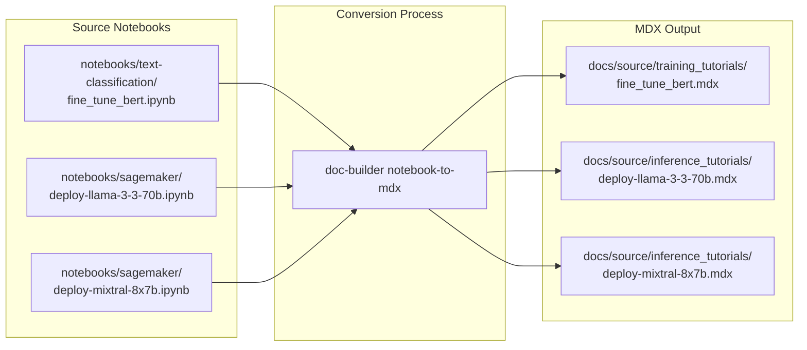
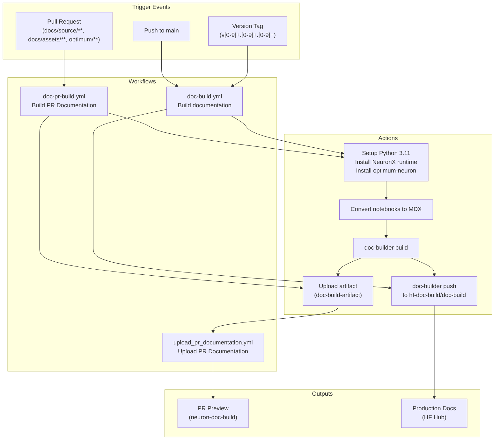

<!-- source: DeepWiki mcp.deepwiki.com · repo huggingface/optimum-neuron · page 12.4 Documentation System · fetched 2026-10-26 -->

# Documentation System

<details>
<summary>Relevant source files</summary>

The following files were used as context for generating this wiki page:

- [docs/source/_toctree.yml](docs/source/_toctree.yml)

</details>


This document explains the documentation build system used in optimum-neuron, including the doc-builder tool, notebook conversion process, and automated CI/CD workflows. For information about the general build system and Makefile targets, see [Build System and Makefile](#11.1).

## Overview

The optimum-neuron documentation system uses Hugging Face's `doc-builder` tool to generate HTML documentation from Markdown/MDX source files and Jupyter notebooks. The system supports local development with live preview, automated PR previews, and production builds that are published to the Hugging Face documentation hub.

Key capabilities:
- Convert Jupyter notebooks to MDX format
- Build HTML documentation from source files
- Preview documentation locally with live reload
- Automated PR documentation previews
- Production documentation deployment

Sources: [docs/README.md:1-30](), [.github/workflows/doc-build.yml:1-83]()

## Documentation Structure

The documentation is organized across three primary directories:

| Directory | Purpose | Contents |
|-----------|---------|----------|
| `docs/source/` | Main documentation content | MDX/Markdown files with guides, tutorials, and API references |
| `notebooks/` | Interactive tutorials | Jupyter notebooks demonstrating workflows |
| `docs/assets/` | Static assets | Images and other media files |

Documentation files in `docs/source/` are written in MDX format, which supports both Markdown and React components. Assets must be referenced using HTTPS URLs with the prefix `https://raw.githubusercontent.com/huggingface/optimum-neuron/main/docs/assets/` since the build system requires remote URLs.

Sources: [docs/README.md:1-30](), [docs/source/containers.mdx:1-39](), [.github/workflows/doc-pr-build.yml:6-10]()

## doc-builder Tool

The `doc-builder` is a Python package maintained by Hugging Face that provides commands for building and previewing documentation. It is installed from the GitHub repository:

```bash
pip install "git+https://github.com/huggingface/doc-builder.git"
```

### Core Commands

**notebook-to-mdx**: Converts Jupyter notebooks to MDX format

```bash
doc-builder notebook-to-mdx <input_notebook> --output_dir <output_directory>
```

**preview**: Starts a local development server with live reload

```bash
doc-builder preview optimum.neuron docs/source/
```

**build**: Generates static HTML documentation

```bash
doc-builder build optimum.neuron docs/source/ \
  --repo_name optimum-neuron \
  --build_dir <output_directory> \
  --version <version_tag> \
  --html \
  --clean
```

**push**: Uploads built documentation to the doc-build Hub repository

```bash
doc-builder push optimum-neuron \
  --doc_build_repo_id "hf-doc-build/doc-build" \
  --token <hf_token> \
  --commit_msg "<message>"
```

Sources: [docs/README.md:4-19](), [.github/workflows/doc-build.yml:65-82]()

## Notebook Conversion Pipeline



The conversion process transforms Jupyter notebooks into MDX files suitable for inclusion in the documentation. Three notebooks are currently converted:

1. Training tutorial: `fine_tune_bert.ipynb` → `docs/source/training_tutorials/`
2. Inference tutorial: `deploy-llama-3-3-70b.ipynb` → `docs/source/inference_tutorials/`
3. Inference tutorial: `deploy-mixtral-8x7b.ipynb` → `docs/source/inference_tutorials/`

Each notebook is converted using the `doc-builder notebook-to-mdx` command with the notebook path and target output directory specified.

Sources: [.github/workflows/doc-build.yml:69-71](), [.github/workflows/doc-pr-build.yml:53-55](), [docs/README.md:10-13]()

## Local Development Workflow

The local development workflow follows these steps:

### 1. Install Dependencies

```bash
pip install "git+https://github.com/huggingface/doc-builder.git" watchdog --upgrade
```

The `watchdog` package enables live reloading during development.

### 2. Convert Notebooks

```bash
doc-builder notebook-to-mdx notebooks/text-classification/fine_tune_bert.ipynb \
  --output_dir docs/source/training_tutorials/
  
doc-builder notebook-to-mdx notebooks/sagemaker/deploy-llama-3-3-70b.ipynb \
  --output_dir docs/source/inference_tutorials/
  
doc-builder notebook-to-mdx notebooks/sagemaker/deploy-mixtral-8x7b.ipynb \
  --output_dir docs/source/inference_tutorials/
```

### 3. Start Preview Server

```bash
doc-builder preview optimum.neuron docs/source/
```

This starts a local web server with live reloading. Changes to source files are automatically reflected in the browser.

### 4. Build Static Documentation

```bash
doc-builder build optimum.neuron docs/source/ --build_dir build/
```

This generates static HTML files in the `build/` directory for verification before deployment.

Sources: [docs/README.md:1-30]()

## CI/CD Workflows

The documentation system includes three GitHub Actions workflows that automate the build and deployment process.



### PR Documentation Build Workflow

The `doc-pr-build.yml` workflow builds documentation for pull requests to provide preview links.

**Trigger conditions:**
- Pull requests targeting the `main` branch
- Changes to `docs/source/**`, `docs/assets/**`, `optimum/**`, or the workflow file itself

**Key steps:**
1. Checkout repository at PR head SHA
2. Setup Node.js (v20) and Python (3.11)
3. Install NeuronX runtime and optimum-neuron dependencies
4. Install doc-builder from GitHub
5. Convert notebooks to MDX format
6. Build documentation with version tag `pr_<PR_NUMBER>`
7. Save commit SHA and PR number to output directory
8. Upload artifact named `doc-build-artifact`

The workflow uses concurrency control to cancel previous builds when new commits are pushed to the PR:

```yaml
concurrency:
  group: ${{ github.workflow }}-${{ github.head_ref || github.run_id }}
  cancel-in-progress: true
```

Sources: [.github/workflows/doc-pr-build.yml:1-76]()

### Production Documentation Build Workflow

The `doc-build.yml` workflow builds and publishes documentation for the main branch and version tags.

**Trigger conditions:**
- Pushes to `main` branch
- Version tags matching pattern `v[0-9]+.[0-9]+.[0-9]+`
- Changes to documentation paths
- Manual workflow dispatch

**Version detection logic:**

The workflow extracts the version from `optimum/neuron/version.py` and determines the version tag:

```bash
version=`echo "$(grep '^__version__ =' neuron/version.py | cut -d '=' -f 2- | xargs)"`

if [[ $version == *.dev* ]]
then
  echo "VERSION=main" >> $GITHUB_ENV
else
  echo "VERSION=v$version" >> $GITHUB_ENV
fi
```

Development versions (containing `.dev`) are tagged as `main`, while release versions are tagged with the version number prefixed with `v`.

**Build and publish steps:**

After building the documentation, the workflow pushes it to the Hugging Face doc-build repository:

```bash
doc-builder push optimum-neuron \
  --doc_build_repo_id "hf-doc-build/doc-build" \
  --token "${{ secrets.HF_DOC_BUILD_PUSH }}" \
  --commit_msg "Updated with commit $COMMIT_SHA" \
  --n_retries 5
```

The output directory is renamed from `optimum.neuron` to `optimum-neuron` before pushing to match the repository name.

Sources: [.github/workflows/doc-build.yml:1-83]()

### PR Documentation Upload Workflow

The `upload_pr_documentation.yml` workflow handles uploading PR documentation artifacts to create preview links.

**Trigger condition:**
- Completion of the "Build PR Documentation" workflow

This workflow uses a reusable workflow from the doc-builder repository:

```yaml
jobs:
  build:
    uses: huggingface/doc-builder/.github/workflows/upload_pr_documentation.yml@main
    with:
      package_name: optimum-neuron
    secrets:
      hf_token: ${{ secrets.HF_DOC_BUILD_PUSH }}
      comment_bot_token: ${{ secrets.COMMENT_BOT_TOKEN }}
```

The reusable workflow downloads the `doc-build-artifact`, uploads it to the doc-build Hub repository, and posts a comment on the PR with the preview link.

Sources: [.github/workflows/upload_pr_documentation.yml:1-17]()

## Build Environment Setup

Both workflows follow a similar environment setup process:

### 1. Python and Node.js Setup

```yaml
- uses: actions/setup-node@v4
  with:
    node-version: '20'
    cache-dependency-path: "kit/package-lock.json"
    
- name: Set up Python
  uses: actions/setup-python@v4
  with:
    python-version: '3.11'
```

### 2. NeuronX Runtime Installation

The workflows use a custom action to install the NeuronX runtime:

```yaml
- name: Install Neuronx runtime
  uses: ./.github/actions/install_neuronx_runtime
```

### 3. Virtual Environment Preparation

```yaml
- name: Prepare virtual environment
  uses: ./.github/actions/prepare_venv
  
- name: Install optimum-neuron
  uses: ./.github/actions/install_optimum_neuron
```

### 4. Documentation Dependencies

```bash
source aws_neuron_venv_pytorch/bin/activate
pip install --upgrade pip
pip install ".[quality, diffusers]"
pip install "git+https://github.com/huggingface/doc-builder.git"
```

The `[quality, diffusers]` extras ensure all necessary dependencies for documentation examples are available.

Sources: [.github/workflows/doc-build.yml:26-64](), [.github/workflows/doc-pr-build.yml:26-48]()

## Build Parameters and Configuration

The `doc-builder build` command uses several parameters to configure the build:

| Parameter | Description | PR Build Value | Production Build Value |
|-----------|-------------|----------------|------------------------|
| `--repo_name` | Repository name for URLs | `optimum-neuron` | `optimum-neuron` |
| `--build_dir` | Output directory | `neuron-doc-build/` | `neuron-doc-build/` |
| `--version` | Version tag for docs | `pr_<PR_NUMBER>` | `main` or `v<version>` |
| `--version_tag_suffix` | Suffix for version tags | `""` | `""` |
| `--html` | Generate HTML output | ✓ | ✓ |
| `--clean` | Clean build directory first | ✓ | ✓ |
| `--notebook_dir` | Additional notebook directory | `docs/notebooks/` | `docs/notebooks/` |

The first positional argument `optimum.neuron` specifies the Python package name, while the second argument `docs/source/` specifies the source directory containing MDX files.

Sources: [.github/workflows/doc-build.yml:72-79](), [.github/workflows/doc-pr-build.yml:56-63]()

## Output Artifacts

### PR Build Artifacts

PR builds create an artifact with the following structure:

```
neuron-doc-build/
├── optimum-neuron/        # Renamed from optimum.neuron
│   ├── index.html
│   ├── guides/
│   ├── tutorials/
│   └── ...
├── commit_sha             # File containing commit SHA
└── pr_number              # File containing PR number
```

The `commit_sha` and `pr_number` files are used by the upload workflow to associate the documentation with the correct PR.

Sources: [.github/workflows/doc-pr-build.yml:65-75]()

### Production Build Artifacts

Production builds are pushed directly to the `hf-doc-build/doc-build` repository on Hugging Face Hub without creating local artifacts. The push includes a commit message referencing the source commit SHA for traceability.

Sources: [.github/workflows/doc-build.yml:80-82]()

## Asset Management

Documentation assets (images, diagrams) must be hosted remotely and referenced using HTTPS URLs. The standard pattern is:

```markdown
" alt="Description" />
```

This requirement exists because the doc-builder processes assets differently than local file references. Assets should be committed to the `docs/assets/` directory in the repository, then referenced using the GitHub raw content URL.

Sources: [docs/README.md:21-29](), [docs/source/containers.mdx:1-39]()

## Error Handling and Retries

The production build workflow includes retry logic when pushing to the doc-build repository:

```bash
--n_retries 5
```

This ensures transient network issues or Hub availability problems don't cause build failures. Each retry waits before attempting the push again.

Sources: [.github/workflows/doc-build.yml:82]()

---

