# Page: Overview

# Overview

<details>
<summary>Relevant source files</summary>

The following files were used as context for generating this wiki page:

- [docs/source/_toctree.yml](docs/source/_toctree.yml)
- [optimum/neuron/__init__.py](optimum/neuron/__init__.py)
- [optimum/neuron/modeling.py](optimum/neuron/modeling.py)
- [optimum/neuron/modeling_base.py](optimum/neuron/modeling_base.py)
- [optimum/neuron/pipelines/transformers/base.py](optimum/neuron/pipelines/transformers/base.py)
- [optimum/neuron/utils/__init__.py](optimum/neuron/utils/__init__.py)

</details>


This document provides a high-level introduction to the **optimum-neuron** library, its architecture, and core systems. Optimum-neuron enables the use of Hugging Face Transformers models on AWS Neuron accelerators (Inferentia 1/2 for inference and Trainium for training) through model compilation, distributed training frameworks, and optimized inference engines.

For detailed information on specific subsystems:
- Model export configurations and compilation: see [Model Export System](#4)
- Training workflows and distributed strategies: see [Training on AWS Neuron](#5)
- Inference patterns and serving: see [Inference with Neuron Models](#6)
- Pre-compiled model management: see [Model Cache System](#8)
- Production deployment options: see [Deployment Guide](#9)

## Purpose and Scope

Optimum-neuron serves as the bridge between the PyTorch/Transformers ecosystem and AWS Neuron hardware. It provides:

1. **Model Export**: Ahead-of-time (AOT) compilation of standard Hugging Face models to Neuron-optimized format (`.neuron` files)
2. **Training**: Distributed fine-tuning on Trainium with tensor parallelism, pipeline parallelism, and ZeRO-1 optimization
3. **Inference**: Low-latency serving on Inferentia with batching strategies and generation features
4. **Caching**: Repository system for sharing pre-compiled models to eliminate redundant compilation
5. **Integration**: Drop-in compatibility with Transformers API, pipelines, vLLM, and Text Generation Inference (TGI)

The library supports encoder models (BERT, DistilBERT), decoder models (Llama, Qwen, Granite), encoder-decoder models (T5, BART), diffusion models (Stable Diffusion, SDXL, Flux), audio models (Whisper, Wav2Vec2), and vision models (ViT, YOLOS).

Sources: [docs/source/_toctree.yml:1-150](), [optimum/neuron/__init__.py:1-179]()

## System Architecture

The following diagram shows the layered architecture of optimum-neuron, from user-facing interfaces to hardware execution:

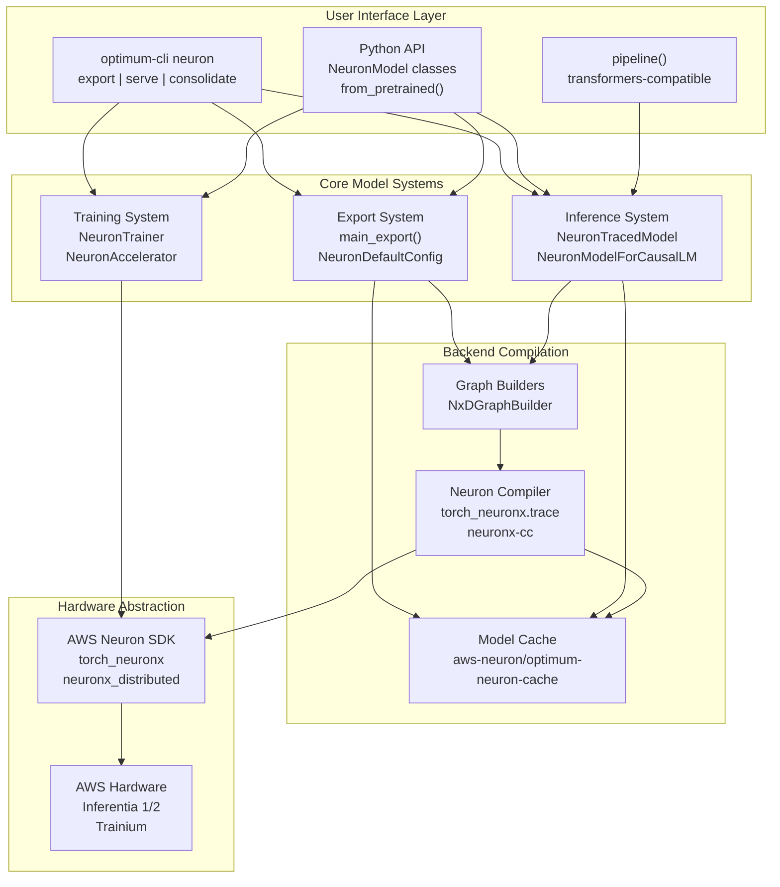

The architecture is organized into four primary layers:

| Layer | Components | Responsibility |
|-------|-----------|----------------|
| **User Interface** | CLI tools, Python API, pipeline function | Provide accessible entry points for model operations |
| **Core Systems** | Export, Training, Inference | Implement the three main workflows with model-specific logic |
| **Backend** | Graph builders, compiler, cache | Handle low-level compilation and artifact management |
| **Hardware** | Neuron SDK, Devices | Bridge to AWS Neuron accelerators through runtime libraries |

Sources: [optimum/neuron/__init__.py:35-88](), [optimum/neuron/pipelines/transformers/base.py:69-136]()

## Core Components

### Model Classes Hierarchy

The library provides a hierarchy of model classes that mirror Transformers' API:

```mermaid
graph TB
    NeuronModel["NeuronModel<br/>(modeling_base.py)<br/>Base abstract class"]
    NeuronTracedModel["NeuronTracedModel<br/>(modeling_traced.py)<br/>Base for traced models"]
    NeuronModelForCausalLM["NeuronModelForCausalLM<br/>(models.inference.modeling_utils)<br/>LLM generation"]
    
    NeuronModelForFeatureExtraction["NeuronModelForFeatureExtraction"]
    NeuronModelForSequenceClassification["NeuronModelForSequenceClassification"]
    NeuronModelForTokenClassification["NeuronModelForTokenClassification"]
    NeuronModelForQuestionAnswering["NeuronModelForQuestionAnswering"]
    NeuronModelForMaskedLM["NeuronModelForMaskedLM"]
    
    NeuronModelForImageClassification["NeuronModelForImageClassification"]
    NeuronModelForSemanticSegmentation["NeuronModelForSemanticSegmentation"]
    NeuronModelForObjectDetection["NeuronModelForObjectDetection"]
    
    NeuronModelForAudioClassification["NeuronModelForAudioClassification"]
    NeuronModelForCTC["NeuronModelForCTC"]
    
    DiffusionPipelines["NeuronStableDiffusionPipeline<br/>NeuronStableDiffusionXLPipeline<br/>NeuronFluxPipeline"]
    
    NeuronModel --> NeuronTracedModel
    NeuronModel --> NeuronModelForCausalLM
    NeuronModel --> DiffusionPipelines
    
    NeuronTracedModel --> NeuronModelForFeatureExtraction
    NeuronTracedModel --> NeuronModelForSequenceClassification
    NeuronTracedModel --> NeuronModelForTokenClassification
    NeuronTracedModel --> NeuronModelForQuestionAnswering
    NeuronTracedModel --> NeuronModelForMaskedLM
    
    NeuronTracedModel --> NeuronModelForImageClassification
    NeuronTracedModel --> NeuronModelForSemanticSegmentation
    NeuronTracedModel --> NeuronModelForObjectDetection
    
    NeuronTracedModel --> NeuronModelForAudioClassification
    NeuronTracedModel --> NeuronModelForCTC
```

All model classes inherit from `NeuronModel` base class and implement:
- `from_pretrained()`: Load compiled models from local storage or Hugging Face Hub
- `forward()`: Execute model inference on Neuron hardware
- `export()`: Compile PyTorch models to Neuron format (for applicable classes)

The separation between `NeuronTracedModel` (for traced/static models) and `NeuronModelForCausalLM` (for dynamic generation models) reflects different compilation strategies for encoder vs decoder architectures.

Sources: [optimum/neuron/modeling_base.py:21-44](), [optimum/neuron/modeling.py:79-671](), [optimum/neuron/__init__.py:43-103]()

### Entry Points and Interfaces

Users interact with optimum-neuron through three primary interfaces:

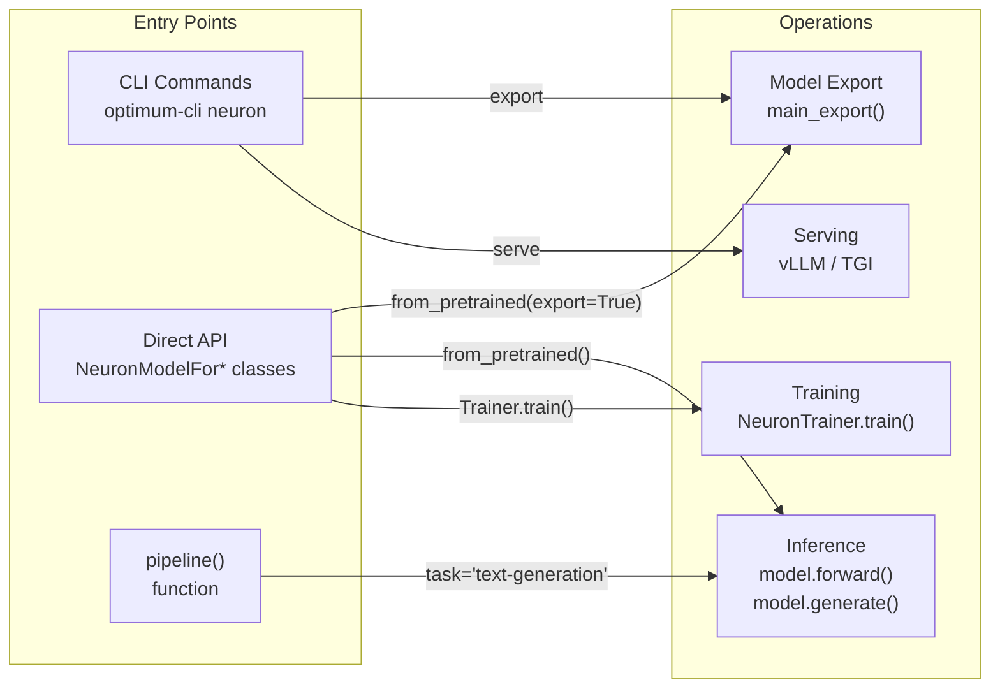

**CLI Interface** (`optimum-cli neuron`):
- `export`: Compile models to Neuron format with specified input shapes
- `serve`: Launch vLLM server for model serving
- `consolidate`: Merge distributed training checkpoints

**Direct API**:
- Model classes provide `from_pretrained()` for loading and `export()` for compilation
- Training uses `NeuronTrainer` and `NeuronSFTTrainer` classes
- Generation uses `model.generate()` method

**Pipeline Function**:
- High-level API compatible with `transformers.pipeline()`
- Supports 60+ tasks with automatic model export if needed
- Defined in [optimum/neuron/pipelines/transformers/base.py:225-405]()

Sources: [optimum/neuron/pipelines/transformers/base.py:225-405](), [optimum/neuron/__init__.py:36-88]()

## Model Support Matrix

Optimum-neuron supports multiple model categories, each with different levels of export, inference, and training support:

| Model Category | Examples | Export | Inference | Training | Key Classes |
|----------------|----------|--------|-----------|----------|-------------|
| **Text Encoders** | BERT, DistilBERT, RoBERTa | ✓ | ✓ | Limited | `NeuronModelForSequenceClassification`, `NeuronModelForTokenClassification` |
| **Text Decoders** | Llama, Qwen, Granite, Phi, Mistral | ✓ | ✓ | ✓ | `NeuronModelForCausalLM` |
| **Encoder-Decoders** | T5, BART | ✓ | ✓ | - | `NeuronModelForSeq2SeqLM` |
| **Vision Models** | ViT, MobileViT, YOLOS | ✓ | ✓ | - | `NeuronModelForImageClassification`, `NeuronModelForObjectDetection` |
| **Audio Models** | Whisper, Wav2Vec2 | ✓ | ✓ | - | `NeuronModelForCTC`, `NeuronWhisperForConditionalGeneration` |
| **Diffusion Models** | Stable Diffusion, SDXL, Flux | ✓ | ✓ | - | `NeuronStableDiffusionPipeline`, `NeuronFluxPipeline` |
| **MultiModal** | CLIP | ✓ | ✓ | - | `NeuronCLIPModel` |

**Training Support**: Decoder models have custom implementations with distributed training capabilities including tensor parallelism, pipeline parallelism, and ZeRO-1 optimizer sharding. Custom implementations are located in `optimum/neuron/models/training/` and include specialized parallel layers.

**Export Configurations**: Each model category has a corresponding `NeuronDefaultConfig` subclass that defines dummy input generators, validation strategies, and compilation parameters.

Sources: [optimum/neuron/__init__.py:43-103](), [optimum/neuron/pipelines/transformers/base.py:69-136]()

## Compilation and Execution Flow

The following diagram traces how models flow from PyTorch format through compilation to hardware execution:

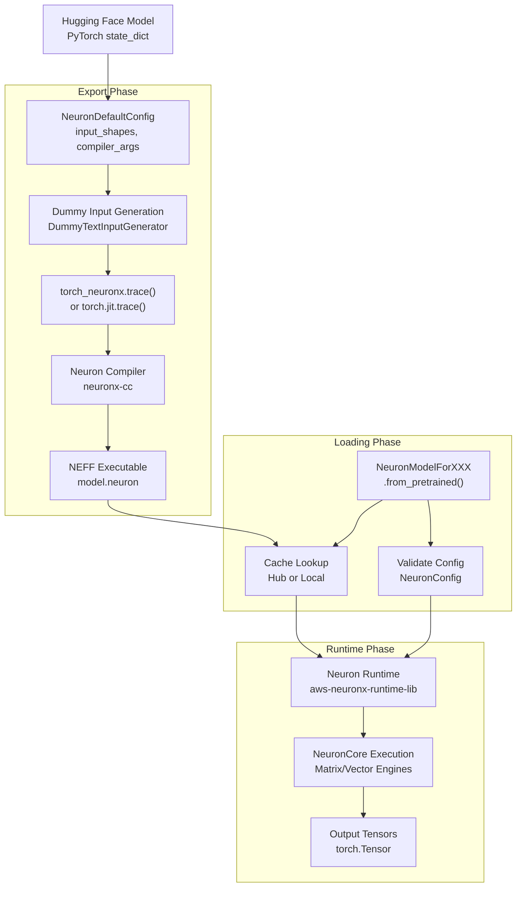

**Compilation Requirements**:
- **Static Shapes**: All input dimensions must be specified at compile time (batch_size, sequence_length, image dimensions)
- **Graph Tracing**: Models are traced with example inputs to create a static computation graph
- **NEFF Format**: Neuron Executable File Format is the compiled artifact that runs on hardware

**Runtime Constraints**:
- Models can only execute with the exact input shapes used during compilation
- Dynamic batching requires pre-compilation of multiple batch sizes
- Sequence length padding is handled automatically by `NeuronTracedModel.neuron_padding_manager`

Sources: [optimum/neuron/pipelines/transformers/base.py:146-223](), [optimum/neuron/modeling.py:79-130]()

## Training vs Inference Paths

Training and inference follow fundamentally different execution paths with distinct requirements:

```mermaid
graph TB
    subgraph TrainingPath["Training Path (Trainium)"]
        TrainEntry["NeuronTrainer.train()"]
        Accelerator["NeuronAccelerator<br/>Distributed state setup"]
        CustomModels["Custom Model Implementations<br/>NeuronLlama, NeuronQwen<br/>Parallel layers"]
        TrainLoop["Training Loop<br/>Forward + Backward<br/>xm.mark_step()"]
        ZeroOpt["ZeRO-1 Sharding<br/>Optimizer state distribution"]
        Checkpoints["Sharded Checkpoints<br/>Per TP/PP rank"]
    end
    
    subgraph InferencePath["Inference Path (Inferentia)"]
        InfEntry["model.from_pretrained()"]
        CacheLoad["Cache Lookup<br/>Pre-compiled NEFF"]
        GraphExec["Graph Execution<br/>Prefill → Decode<br/>KV cache management"]
        BatchOps["Batching<br/>Continuous/Dynamic<br/>batching"]
    end
    
    TrainEntry --> Accelerator
    Accelerator --> CustomModels
    CustomModels --> TrainLoop
    TrainLoop --> ZeroOpt
    ZeroOpt --> Checkpoints
    
    InfEntry --> CacheLoad
    CacheLoad --> GraphExec
    GraphExec --> BatchOps
```

**Training Path Characteristics**:
- Requires custom model implementations with `NeuronModelMixin` for distributed layers
- Uses `neuronx_distributed` for tensor/pipeline parallelism coordination
- Employs `xm.mark_step()` for explicit gradient synchronization across NeuronCores
- Produces sharded checkpoints that must be consolidated for inference

**Inference Path Characteristics**:
- Uses pre-compiled NEFF files loaded from cache
- Optimized for low latency with prefill/decode separation for autoregressive models
- Supports advanced serving features like continuous batching (vLLM) and speculative decoding
- Fixed computation graph with no weight updates

The separation allows specialized optimizations for each use case while maintaining a unified model format after checkpoint consolidation.

Sources: [optimum/neuron/__init__.py:37-42](), [optimum/neuron/pipelines/transformers/base.py:100-105]()

## Cache System Architecture

The cache system eliminates redundant compilation by storing and retrieving pre-compiled models:

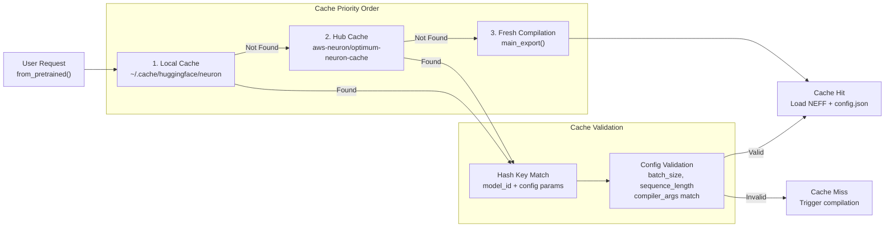

**Cache Key Components**:
- Model identifier (e.g., `meta-llama/Llama-3.1-8B`)
- Input shape parameters (batch_size, sequence_length, num_channels, height, width)
- Compiler arguments (optimization level, precision mode)
- Tensor parallel size (for distributed inference)

**Cache Population**:
- GitHub Actions workflows build cache periodically: `inference_cache_llm.yml`, `inference_cache_diffusion.yml`
- Scripts `auto_fill_llm_cache.py` and `auto_fill_diffusion_cache.py` compile popular configurations
- Users can push custom models to private cache repositories on Hugging Face Hub

The Hub cache (`aws-neuron/optimum-neuron-cache`) provides centralized access to pre-compiled models, significantly reducing first-run latency for common configurations.

Sources: [docs/source/_toctree.yml:13-14]()

## Configuration System

The configuration system manages compilation and runtime parameters through dataclasses:

| Configuration Class | Purpose | Key Parameters | Used In |
|--------------------|---------|----------------|---------|
| `NeuronDefaultConfig` | Base export configuration | `batch_size`, `sequence_length`, `compiler_type`, `compiler_args` | Model export |
| `NeuronTrainingArguments` | Training hyperparameters | `tensor_parallel_size`, `pipeline_parallel_size`, `gradient_accumulation_steps` | Training |
| `NeuronSFTConfig` | Supervised fine-tuning config | Extends `SFTConfig` with Neuron-specific parameters | SFT training |
| `TrainingNeuronConfig` | Model parallelism settings | `tensor_parallel_size`, `pipeline_parallel_size`, `sequence_parallel_enabled` | Custom models |
| `NxDNeuronConfig` | Backend inference config | `batch_size`, `tp_degree`, `n_positions`, `attention_layout` | Low-level inference |

**Configuration Flow**:
1. Export: `NeuronDefaultConfig` → stored in `config.json` alongside compiled model
2. Training: `NeuronTrainingArguments` + `TrainingNeuronConfig` → configure distributed training
3. Inference: Restore `NeuronConfig` from `config.json` during `from_pretrained()`
4. Validation: Runtime checks ensure loaded model matches required input shapes

Each model class has a specialized config class (e.g., `TextEncoderNeuronConfig`, `TextDecoderNeuronConfig`) that inherits from `NeuronDefaultConfig` and adds task-specific parameters.

Sources: [optimum/neuron/__init__.py:36-42](), [optimum/neuron/pipelines/transformers/base.py:269-279]()

## Hardware Targets

Optimum-neuron targets two AWS Neuron device families:

| Device Family | Hardware | Primary Use Case | Key Features | SDK |
|---------------|----------|------------------|--------------|-----|
| **Inferentia 1** | AWS Inf1 instances | Inference | 4 NeuronCores per chip, 128 TOPS INT8 | neuron-cc, torch-neuron |
| **Inferentia 2** | AWS Inf2 instances | Inference | 2 NeuronCores per chip, 380 TOPS FP16 | neuronx-cc, torch-neuronx |
| **Trainium** | AWS Trn1/Trn1n instances | Training & Inference | 2 NeuronCores per chip, 210 TFLOPS FP16 | neuronx-cc, torch-neuronx |

**NeuronCore Architecture**:
- Each NeuronCore contains matrix multiply engines and vector compute engines
- Supports data types: INT8, FP16, BF16, FP32 (with varying performance characteristics)
- Hardware-accelerated attention mechanisms including Flash Attention support

**SDK Components**:
- `torch-neuronx` / `torch-neuron`: PyTorch extensions for Neuron compilation
- `neuronx-cc` / `neuron-cc`: Ahead-of-time compilers
- `neuronx-distributed`: Distributed training primitives (tensor/pipeline parallelism)
- `aws-neuronx-runtime-lib`: Runtime library for loading and executing compiled models

Instance types like `inf2.xlarge` (1 Neuron device), `inf2.48xlarge` (12 devices), and `trn1.32xlarge` (16 devices) provide different scales of compute capacity.

Sources: [optimum/neuron/__init__.py:26-32]()

## Development Workflow

The repository follows standard Python packaging with optimum-neuron-specific tooling:

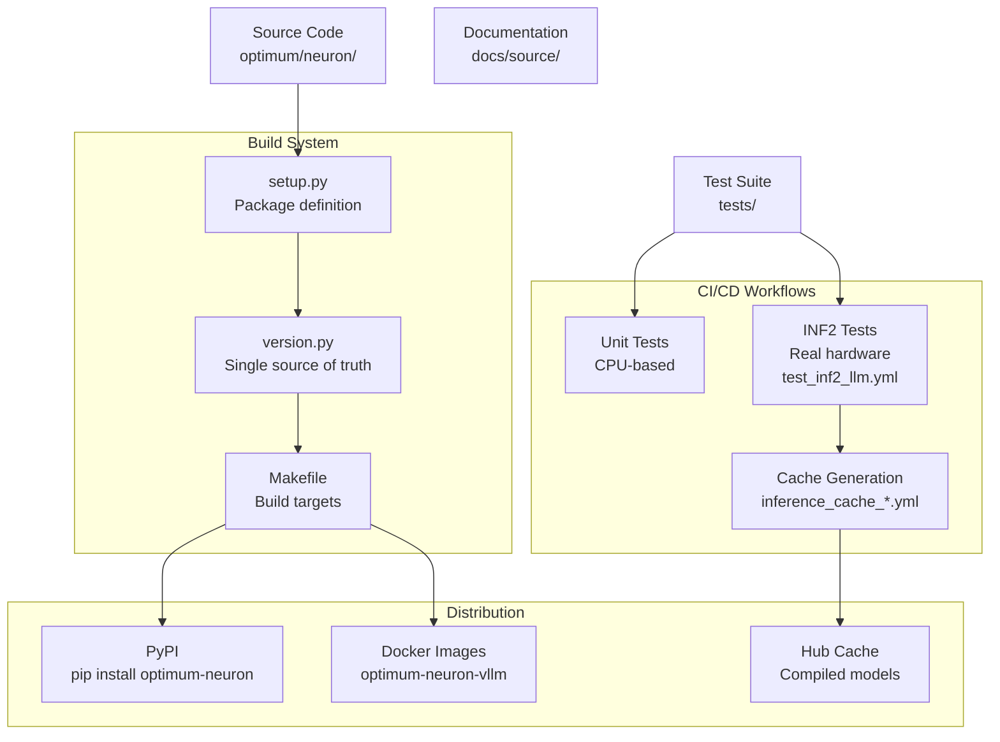

**Key Development Files**:
- [setup.py](): Defines package dependencies, entry points for CLI
- [version.py](): Centralized version string (`__version__`)
- [Makefile](): Build targets for Docker images, distribution, linting
- [.github/workflows/](): CI/CD pipeline definitions

**Testing Infrastructure**:
- Unit tests run on CPU using mocked Neuron components
- Integration tests run on `aws-inf2-8xlarge` runners with real Neuron hardware
- `@is_inferentia_test` decorator marks tests requiring Neuron devices
- Parametrized tests validate multiple model architectures in parallel

**Release Process**:
1. Version bump in `version.py`
2. Git tag creation triggers CI workflows
3. PyPI upload via `make release`
4. Docker image build and push to container registry
5. Cache population workflows refresh pre-compiled models

Sources: [docs/source/_toctree.yml:67-74]()

---

# Page: Installation and Setup

# Installation and Setup

<details>
<summary>Relevant source files</summary>

The following files were used as context for generating this wiki page:

- [Makefile](Makefile)
- [docs/source/guides/benchmark.mdx](docs/source/guides/benchmark.mdx)
- [docs/source/guides/export_model.mdx](docs/source/guides/export_model.mdx)
- [docs/source/guides/vllm_plugin.mdx](docs/source/guides/vllm_plugin.mdx)
- [docs/source/index.mdx](docs/source/index.mdx)
- [docs/source/inference_tutorials/llama2-13b-chatbot.mdx](docs/source/inference_tutorials/llama2-13b-chatbot.mdx)
- [docs/source/inference_tutorials/notebooks.mdx](docs/source/inference_tutorials/notebooks.mdx)
- [optimum/neuron/version.py](optimum/neuron/version.py)

</details>


This document provides comprehensive instructions for installing and configuring optimum-neuron, the bridge between Hugging Face libraries and AWS Neuron accelerators. It covers package installation, dependency management, hardware-specific SDK setup, and environment configuration.

For information about using optimum-neuron after installation, see the [Quick Start Guide](#3). For detailed export and inference workflows, refer to the [Model Export System](#4) and [Inference with Neuron Models](#6).

## Prerequisites

Before installing optimum-neuron, ensure your environment meets the following requirements:

**Python Version**: Python 3.10 or higher is required [pyproject.toml:23]().

**Hardware**: Depending on your use case, you will need access to:
- AWS Inferentia1 (`inf1.*` instances) for the legacy Neuron SDK
- AWS Inferentia2 (`inf2.*` instances) or AWS Trainium (`trn1.*` instances) for the NeuronX SDK

**Note**: The Neuron and NeuronX SDKs are mutually exclusive and require different PyTorch versions. Choose the appropriate installation path based on your target hardware.

Sources: [pyproject.toml:23](), [pyproject.toml:82-99]()

## Core Dependencies

The optimum-neuron package has the following core dependencies that are always installed:

| Package | Version | Purpose |
|---------|---------|---------|
| `transformers` | ~4.55.4 | Model architectures and utilities |
| `accelerate` | ==1.8.1 | Training orchestration and distributed execution |
| `optimum` | ~1.24.0 | Base optimization utilities |
| `huggingface_hub` | >=0.29.0 | Model and cache repository management |
| `numpy` | >=1.22.2, <=1.26.4 | Numerical operations |
| `protobuf` | >=3.20.3, <4 | Data serialization |

Sources: [pyproject.toml:39-46]()

## Installation Paths

### Dependency Resolution Hierarchy

The following diagram illustrates how optimum-neuron resolves dependencies based on the installation profile:

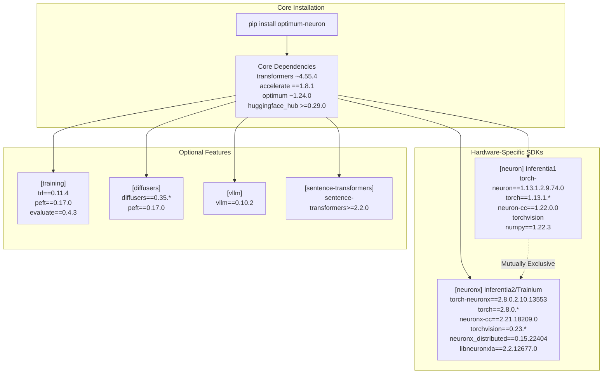

Sources: [pyproject.toml:39-112]()

### Basic Installation

To install optimum-neuron with only core dependencies (no hardware-specific SDK):

```bash
pip install optimum-neuron
```

This installs the package structure and utilities but does not include the Neuron compilation toolchain. This is useful for development environments or when running on CPU-only machines for testing purposes.

**Note**: When running on a CPU-only machine, optimum-neuron automatically sets `NEURON_PLATFORM_TARGET_OVERRIDE=trn1` to prevent import errors [optimum/neuron/__init__.py:25-31]().

Sources: [optimum/neuron/__init__.py:25-31]()

### Hardware-Specific Installation

#### Inferentia1 Installation

For AWS Inferentia1 instances (`inf1.*`), install the legacy Neuron SDK:

```bash
pip install optimum-neuron[neuron]
```

This installs:
- PyTorch 1.13.1
- `torch-neuron` 1.13.1.2.9.74.0
- `neuron-cc` 1.22.0.0 (Neuron compiler)
- Compatible torchvision and numpy versions

**PyTorch Version Constraint**: The neuron extra pins PyTorch to 1.13.1.* [pyproject.toml:84-90]().

Sources: [pyproject.toml:82-90]()

#### Inferentia2/Trainium Installation

For AWS Inferentia2 (`inf2.*`) or Trainium (`trn1.*`) instances, install the NeuronX SDK:

```bash
pip install optimum-neuron[neuronx]
```

This installs:
- PyTorch 2.8.0
- `torch-neuronx` 2.8.0.2.10.13553
- `neuronx-cc` 2.21.18209.0 (NeuronX compiler)
- `neuronx_distributed` 0.15.22404 (distributed training library)
- `libneuronxla` 2.2.12677.0 (XLA backend)
- Compatible torchvision (0.23.*)

**PyTorch Version Constraint**: The neuronx extra pins PyTorch to 2.8.0.* [pyproject.toml:94-99]().

**Important**: The `neuron` and `neuronx` extras are mutually exclusive due to incompatible PyTorch versions. Installing both will result in dependency conflicts.

Sources: [pyproject.toml:91-99]()

### Feature-Specific Installations

#### Training Capabilities

To enable training functionality (NeuronTrainer, NeuronSFTTrainer):

```bash
pip install optimum-neuron[neuronx,training]
```

The `training` extra adds:
- `trl` 0.11.4 (Transformer Reinforcement Learning)
- `peft` 0.17.0 (Parameter-Efficient Fine-Tuning)
- `evaluate` 0.4.3 (evaluation metrics)

Sources: [pyproject.toml:77-81]()

#### Diffusion Models

To enable Stable Diffusion and other diffusion pipelines:

```bash
pip install optimum-neuron[neuronx,diffusers]
```

The `diffusers` extra adds:
- `diffusers` 0.35.*
- `peft` 0.17.0 (for LoRA adapters)

Sources: [pyproject.toml:100-103]()

#### vLLM Integration

To enable high-throughput serving via vLLM:

```bash
pip install optimum-neuron[neuronx,vllm]
```

The `vllm` extra adds:
- `vllm` 0.10.2

The package registers a vLLM platform plugin via entry points [pyproject.toml:123-124]().

Sources: [pyproject.toml:110-112](), [pyproject.toml:123-124]()

#### Sentence Transformers

For embedding models and sentence transformers:

```bash
pip install optimum-neuron[neuronx,sentence-transformers]
```

Sources: [pyproject.toml:107-109]()

#### Development and Testing

For development with all test dependencies:

```bash
pip install optimum-neuron[neuronx,tests,quality]
```

The `tests` extra includes pytest, datasets, and model-specific dependencies. The `quality` extra includes linting tools (ruff, isort, pre-commit).

Sources: [pyproject.toml:52-76]()

## Installation Combinations

### Installation Matrix

The following table summarizes common installation combinations:

| Use Case | Command | Hardware | Key Packages |
|----------|---------|----------|--------------|
| Inferentia1 Inference | `pip install optimum-neuron[neuron]` | inf1.* | torch 1.13.1, neuron-cc |
| Inferentia2 Inference | `pip install optimum-neuron[neuronx]` | inf2.*, trn1.* | torch 2.8.0, neuronx-cc |
| Trainium Training | `pip install optimum-neuron[neuronx,training]` | trn1.* | torch 2.8.0, trl, peft |
| Diffusion Inference | `pip install optimum-neuron[neuronx,diffusers]` | inf2.* | diffusers, peft |
| vLLM Serving | `pip install optimum-neuron[neuronx,vllm]` | inf2.* | vllm 0.10.2 |
| Full Development | `pip install optimum-neuron[neuronx,training,diffusers,vllm,tests,quality]` | inf2.*, trn1.* | All optional deps |

Sources: [pyproject.toml:51-118]()

### SDK Version Compatibility

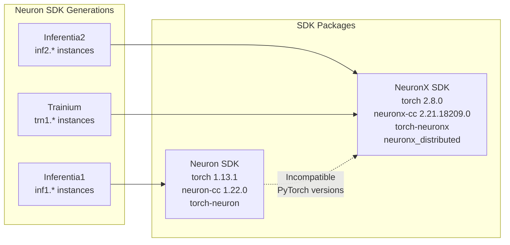

Sources: [pyproject.toml:82-99]()

## Package Entry Points

The installation creates the following command-line tools:

### CLI Commands

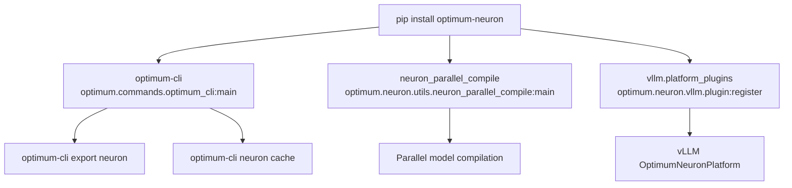

**Command Registration**: The `optimum-cli` and `neuron_parallel_compile` commands are registered via `[project.scripts]` [pyproject.toml:119-122]().

**vLLM Plugin**: The vLLM platform plugin is automatically registered via `[project.entry-points."vllm.platform_plugins"]` [pyproject.toml:123-124]().

Sources: [pyproject.toml:119-124]()

## Environment Configuration

### Required Environment Variables

After installation, certain environment variables control Neuron behavior:

| Variable | Purpose | Default | Example |
|----------|---------|---------|---------|
| `NEURON_CC_FLAGS` | Compiler flags for neuron-cc/neuronx-cc | None | `"--model-type=transformer"` |
| `NEURON_COMPILE_CACHE_URL` | Local cache directory | `/var/tmp/neuron-compile-cache` | Custom path |
| `CUSTOM_CACHE_REPO` | Custom Hub cache repository | None | `"myorg/my-cache"` |
| `NEURON_PLATFORM_TARGET_OVERRIDE` | Override target platform | Auto-detected | `"trn1"` |

**Automatic Override**: On CPU-only machines, optimum-neuron sets `NEURON_PLATFORM_TARGET_OVERRIDE=trn1` automatically to prevent import errors when loading `torch_neuronx` [optimum/neuron/__init__.py:25-31]().

Sources: [optimum/neuron/__init__.py:25-31]()

### Cache Directory Configuration

The Neuron compiler cache is critical for performance. By default, compiled models are cached in `/var/tmp/neuron-compile-cache`. 

For cache management details, see the [Cache System](#7) documentation.

## Verification

### Import Check

After installation, verify the package is correctly installed:

```python
import optimum.neuron
print(optimum.neuron.__version__)  # Should print: "0.3.1.dev7"
```

The version is defined in [optimum/neuron/version.py:15]().

Sources: [optimum/neuron/version.py:15]()

### SDK Detection

Verify SDK availability using utility functions:

```python
from optimum.neuron.utils import is_neuron_available, is_neuronx_available

print(f"Neuron SDK available: {is_neuron_available()}")
print(f"NeuronX SDK available: {is_neuronx_available()}")
```

These functions are defined in [optimum/neuron/utils/__init__.py:46-52]() and check for the presence of `torch_neuron` or `torch_neuronx` packages.

Sources: [optimum/neuron/utils/__init__.py:46-52](), [optimum/neuron/__init__.py:175-176]()

### CLI Availability

Verify CLI tools are installed:

```bash
optimum-cli --help
optimum-cli export neuron --help
optimum-cli neuron cache --help
neuron_parallel_compile --help
```

Sources: [pyproject.toml:119-122]()

### Hardware Detection

Check Neuron hardware availability:

```python
from optimum.neuron.utils.system import get_neuron_major

neuron_major = get_neuron_major()
if neuron_major == -1:
    print("No Neuron hardware detected (CPU-only)")
elif neuron_major == 1:
    print("Inferentia1 detected")
elif neuron_major == 2:
    print("Inferentia2/Trainium detected")
```

The `get_neuron_major()` function is imported in [optimum/neuron/__init__.py:22]() and used to detect the hardware generation.

Sources: [optimum/neuron/__init__.py:22-31]()

## Package Structure

### Module Initialization

The package uses lazy loading for efficient imports:

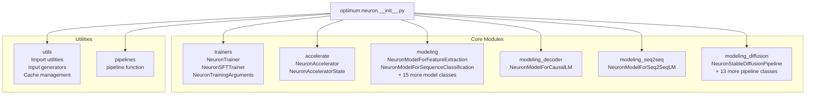

The package defines an import structure using `_LazyModule` for deferred loading [optimum/neuron/__init__.py:34-172]().

Sources: [optimum/neuron/__init__.py:34-172]()

## Troubleshooting

### Common Installation Issues

#### Issue: Dependency Conflict Between neuron and neuronx

**Symptom**: Pip reports conflicts between PyTorch 1.13.1 and 2.8.0.

**Solution**: Never install both `[neuron]` and `[neuronx]` extras. Choose one based on your hardware:
- Use `[neuron]` for Inferentia1 only
- Use `[neuronx]` for Inferentia2 or Trainium

**Resolution**: Create separate virtual environments for each SDK generation.

Sources: [pyproject.toml:82-99]()

#### Issue: Import Error on CPU-Only Machine

**Symptom**: `ImportError` when importing `torch_neuronx` on a machine without Neuron hardware.

**Solution**: The package automatically sets `NEURON_PLATFORM_TARGET_OVERRIDE=trn1` [optimum/neuron/__init__.py:31](). If this doesn't resolve the issue, manually set the environment variable:

```bash
export NEURON_PLATFORM_TARGET_OVERRIDE=trn1
```

Sources: [optimum/neuron/__init__.py:25-31]()

#### Issue: Wrong NumPy Version

**Symptom**: Incompatibility errors related to NumPy.

**Solution**: The `[neuron]` extra pins NumPy to 1.22.3 for compatibility with PyTorch 1.13.1 [pyproject.toml:89](). The core package allows NumPy >=1.22.2, <=1.26.4 [pyproject.toml:44](). Ensure you're using the correct version for your installation profile.

Sources: [pyproject.toml:44](), [pyproject.toml:89]()

#### Issue: vLLM Not Registering Plugin

**Symptom**: vLLM doesn't detect the OptimumNeuronPlatform.

**Solution**: Ensure vLLM is installed with the `[vllm]` extra. The plugin is registered via entry points [pyproject.toml:123-124](). Verify registration:

```python
from importlib.metadata import entry_points
plugins = entry_points(group='vllm.platform_plugins')
print(list(plugins))
```

Sources: [pyproject.toml:123-124]()

### Build System Issues

The package uses `setuptools` 69.5.1 as the build backend [pyproject.toml:15-16]().

If encountering build issues, ensure your pip is up-to-date:

```bash
pip install --upgrade pip setuptools wheel
```

Sources: [pyproject.toml:14-16]()

## Next Steps

After successful installation:

1. **Quick Start**: Follow the [Quick Start Guide](#3) for your first model export and inference
2. **Model Export**: Learn about the [Model Export System](#4) for converting models
3. **Training**: See [Training on AWS Neuron](#5) for distributed training setup
4. **Cache Management**: Configure the [Cache System](#7) for faster compilation
5. **Deployment**: Review [Deployment Guide](#8) for production deployments

Sources: [pyproject.toml:1-163](), [optimum/neuron/version.py:1-18](), [optimum/neuron/__init__.py:1-177]()

---

# Page: Quick Start Guide

# Quick Start Guide

<details>
<summary>Relevant source files</summary>

The following files were used as context for generating this wiki page:

- [docs/source/guides/benchmark.mdx](docs/source/guides/benchmark.mdx)
- [docs/source/guides/export_model.mdx](docs/source/guides/export_model.mdx)
- [docs/source/guides/vllm_plugin.mdx](docs/source/guides/vllm_plugin.mdx)
- [docs/source/index.mdx](docs/source/index.mdx)
- [docs/source/inference_tutorials/llama2-13b-chatbot.mdx](docs/source/inference_tutorials/llama2-13b-chatbot.mdx)
- [docs/source/inference_tutorials/notebooks.mdx](docs/source/inference_tutorials/notebooks.mdx)
- [optimum/neuron/__init__.py](optimum/neuron/__init__.py)
- [optimum/neuron/modeling.py](optimum/neuron/modeling.py)
- [optimum/neuron/modeling_base.py](optimum/neuron/modeling_base.py)
- [optimum/neuron/pipelines/transformers/base.py](optimum/neuron/pipelines/transformers/base.py)
- [optimum/neuron/utils/__init__.py](optimum/neuron/utils/__init__.py)

</details>


This guide provides hands-on examples to quickly get started with optimum-neuron. You will learn how to export a model to Neuron format, run inference on AWS Inferentia, and perform basic fine-tuning on AWS Trainium. Each section includes working code examples you can run immediately.

**Prerequisites**: This guide assumes you have installed optimum-neuron and have access to AWS Inferentia or Trainium instances. For installation instructions, see [Installation and Setup](#2). For comprehensive documentation on each workflow, see [Model Export System](#4), [Inference with Neuron Models](#6), and [Training on AWS Neuron](#5).

## Overview: Three Core Workflows

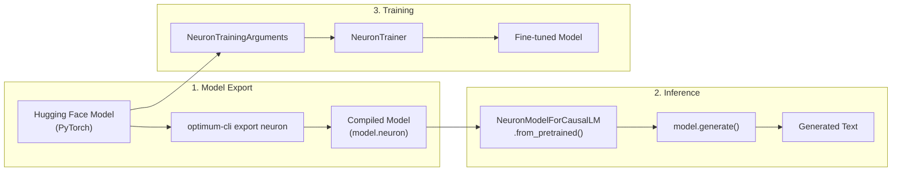

**Workflow Connections**: The diagram shows how models flow through optimum-neuron. Models begin as PyTorch checkpoints, are compiled via the CLI or export API, and can be loaded for inference or training. All three workflows use standard Hugging Face APIs extended with Neuron capabilities.

Sources: [optimum/neuron/__init__.py:36-88](), [docs/source/guides/export_model.mdx:17-51]()

---

## Quick Start 1: Export a Model

### Export a Text Classification Model

The simplest way to export a model is using the `optimum-cli` command-line tool. This example exports a BERT model for sequence classification:

```bash
optimum-cli export neuron \
  --model distilbert-base-uncased-finetuned-sst-2-english \
  --task text-classification \
  --batch_size 1 \
  --sequence_length 128 \
  distilbert_neuron/
```

**Parameters Explained**:
- `--model`: Hugging Face model ID or local path
- `--task`: Task type (automatically detected for Hub models)
- `--batch_size`: Static batch size for compilation (must match inference)
- `--sequence_length`: Maximum sequence length (must match inference)
- Output directory: Where compiled model is saved

After export, the directory contains:
- `model.neuron`: Compiled Neuron executable
- `config.json`: Model configuration with Neuron settings
- Tokenizer files copied from source model

### Export a Large Language Model

LLMs require additional parameters for tensor parallelism:

```bash
optimum-cli export neuron \
  --model meta-llama/Llama-3.2-1B \
  --batch_size 1 \
  --sequence_length 4096 \
  --tensor_parallel_size 2 \
  llama_neuron/
```

**Tensor Parallelism**: The `--tensor_parallel_size` splits the model across multiple NeuronCores (each core has 16GB memory). A 2B parameter model typically requires 2-4 cores.

**Compilation Time**: Standard models export in seconds, but LLMs can take 15-60+ minutes. Pre-compiled models are available in the [Neuron model cache](#8) to avoid this wait.

Sources: [docs/source/guides/export_model.mdx:78-162](), [docs/source/guides/export_model.mdx:252-314]()

---

## Quick Start 2: Run Inference

### Inference with Encoder Models

Load and use an exported encoder model for classification:

```python
from transformers import AutoTokenizer
from optimum.neuron import NeuronModelForSequenceClassification

# Load compiled model
model = NeuronModelForSequenceClassification.from_pretrained(
    "distilbert_neuron/"
)
tokenizer = AutoTokenizer.from_pretrained(
    "distilbert-base-uncased-finetuned-sst-2-english"
)

# Run inference
inputs = tokenizer("This movie is fantastic!", return_tensors="pt")
outputs = model(**inputs)
predicted_class = outputs.logits.argmax().item()
print(f"Sentiment: {model.config.id2label[predicted_class]}")
```

**Key Classes**: 
- `NeuronModelForSequenceClassification`: Wrapper for classification models
- Other classes: `NeuronModelForQuestionAnswering`, `NeuronModelForTokenClassification`, `NeuronModelForMaskedLM`

**Input Padding**: Inputs are automatically padded to the static shapes used during export. The model handles padding internally via the `neuron_padding_manager` context manager.

### Inference with Large Language Models

```python
from transformers import AutoTokenizer
from optimum.neuron import NeuronModelForCausalLM

# Load compiled LLM
model = NeuronModelForCausalLM.from_pretrained("llama_neuron/")
tokenizer = AutoTokenizer.from_pretrained("meta-llama/Llama-3.2-1B")

# Generate text
inputs = tokenizer("The future of AI is", return_tensors="pt")
outputs = model.generate(
    **inputs,
    max_new_tokens=50,
    do_sample=True,
    temperature=0.7,
    top_k=50
)
print(tokenizer.decode(outputs[0], skip_special_tokens=True))
```

**Generation Methods**: The `generate()` method supports greedy search, sampling with temperature/top-k/top-p, and beam search. All standard transformers generation parameters are supported.

### Using the Pipeline API

The `pipeline` function provides a high-level interface for common tasks:

```python
from optimum.neuron import pipeline

# Create pipeline (exports model if needed)
classifier = pipeline(
    "text-classification",
    model="distilbert-base-uncased-finetuned-sst-2-english",
    export=True,
    input_shapes={"batch_size": 1, "sequence_length": 128}
)

# Run inference
result = classifier("I love using AWS Inferentia!")
print(result)
# [{'label': 'POSITIVE', 'score': 0.9998}]
```

**Pipeline Benefits**:
- Automatically handles tokenization and post-processing
- Supports 60+ tasks via `NEURONX_SUPPORTED_TASKS`
- Can export models on-the-fly with `export=True`

Sources: [optimum/neuron/modeling.py:85-128](), [optimum/neuron/pipelines/transformers/base.py:225-406](), [docs/source/guides/export_model.mdx:164-177]()

---

## Quick Start 3: Basic Fine-tuning

### Fine-tune a Text Classification Model

```python
from transformers import AutoTokenizer, AutoModelForSequenceClassification
from optimum.neuron import NeuronTrainer, NeuronTrainingArguments
from datasets import load_dataset

# Load model and tokenizer
model = AutoModelForSequenceClassification.from_pretrained(
    "bert-base-uncased",
    num_labels=2
)
tokenizer = AutoTokenizer.from_pretrained("bert-base-uncased")

# Prepare dataset
dataset = load_dataset("imdb", split="train[:1000]")
def tokenize(batch):
    return tokenizer(batch["text"], truncation=True, padding="max_length", max_length=128)
dataset = dataset.map(tokenize, batched=True)

# Configure training
training_args = NeuronTrainingArguments(
    output_dir="./bert_finetuned",
    num_train_epochs=3,
    per_device_train_batch_size=8,
    learning_rate=5e-5,
)

# Train
trainer = NeuronTrainer(
    model=model,
    args=training_args,
    train_dataset=dataset,
    tokenizer=tokenizer,
)
trainer.train()
```

**NeuronTrainer vs Trainer**: `NeuronTrainer` extends `transformers.Trainer` with Neuron-specific features like `NeuronAccelerator` for distributed training and automatic `xm.mark_step()` synchronization.

### Supervised Fine-tuning for Chat Models

For instruction-tuning LLMs, use `NeuronSFTTrainer`:

```python
from transformers import AutoTokenizer, AutoModelForCausalLM
from optimum.neuron import NeuronSFTTrainer, NeuronSFTConfig
from datasets import load_dataset

# Load base model
model = AutoModelForCausalLM.from_pretrained("meta-llama/Llama-3.2-1B")
tokenizer = AutoTokenizer.from_pretrained("meta-llama/Llama-3.2-1B")

# Prepare chat dataset
dataset = load_dataset("HuggingFaceH4/ultrachat_200k", split="train_sft[:1000]")

# Configure SFT training
sft_config = NeuronSFTConfig(
    output_dir="./llama_sft",
    num_train_epochs=1,
    per_device_train_batch_size=1,
    learning_rate=2e-5,
    max_seq_length=2048,
    tensor_parallel_size=2,  # Split across 2 cores
)

# Train
trainer = NeuronSFTTrainer(
    model=model,
    args=sft_config,
    train_dataset=dataset,
    tokenizer=tokenizer,
)
trainer.train()
```

**SFT Features**:
- Automatic chat template formatting
- Fixed-length padding via `NeuronDataCollatorForLanguageModeling`
- Supports LoRA/QLoRA for parameter-efficient fine-tuning

Sources: [optimum/neuron/__init__.py:37-42](), [docs/source/guides/export_model.mdx:283-314]()

---

## Class and Command Reference

### Key Commands

| Command | Purpose | Common Options |
|---------|---------|----------------|
| `optimum-cli export neuron` | Compile model to Neuron format | `--model`, `--batch_size`, `--sequence_length`, `--tensor_parallel_size` |
| `optimum-cli neuron serve` | Serve model with vLLM | `--model`, `--batch_size`, `--tensor_parallel_size` |

### Key Classes for Inference

| Class | Purpose | Source |
|-------|---------|--------|
| `NeuronModelForCausalLM` | LLM inference with generate() | [optimum/neuron/__init__.py:102]() |
| `NeuronModelForSequenceClassification` | Text classification | [optimum/neuron/modeling.py:231-268]() |
| `NeuronModelForQuestionAnswering` | Extractive QA | [optimum/neuron/modeling.py:183-221]() |
| `NeuronModelForTokenClassification` | NER, token-level tasks | [optimum/neuron/modeling.py:278-316]() |
| `NeuronTracedModel` | Base class for all traced models | [optimum/neuron/__init__.py:43]() |
| `pipeline` | High-level task interface | [optimum/neuron/pipelines/transformers/base.py:225-406]() |

### Key Classes for Training

| Class | Purpose | Source |
|-------|---------|--------|
| `NeuronTrainer` | Standard training on Trainium | [optimum/neuron/__init__.py:38]() |
| `NeuronSFTTrainer` | Supervised fine-tuning for chat models | [optimum/neuron/__init__.py:39]() |
| `NeuronTrainingArguments` | Training configuration | [optimum/neuron/__init__.py:40]() |
| `NeuronSFTConfig` | SFT-specific configuration | [optimum/neuron/__init__.py:41]() |
| `NeuronAccelerator` | Distributed training coordinator | [optimum/neuron/__init__.py:83]() |

Sources: [optimum/neuron/__init__.py:35-88]()

---

## Code Path Diagram

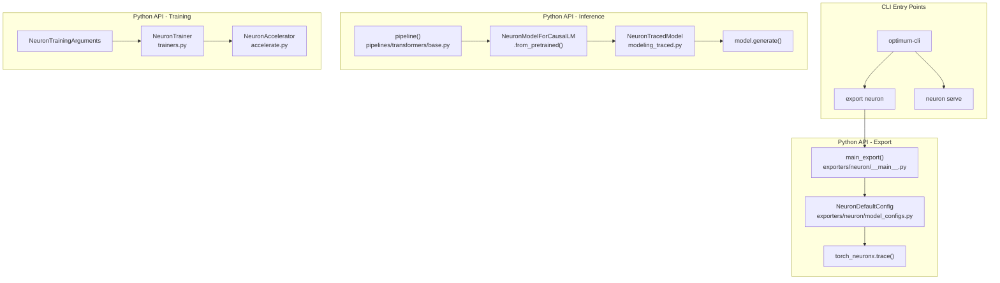

**Navigation Guide**: This diagram maps user-facing commands and classes to their implementations. Use it to find the source code for each workflow component.

Sources: [optimum/neuron/__init__.py:35-88](), [optimum/neuron/modeling.py:1-44]()

---

## Next Steps

After completing these quick start examples:

1. **Learn export options**: See [Model Export System](#4) for advanced export configurations, compiler arguments, and multi-component models
2. **Deploy for production**: See [vLLM and TGI Integration](#7) for serving models at scale with continuous batching
3. **Optimize training**: See [Training on AWS Neuron](#5) for distributed training strategies, mixed precision, and PEFT techniques
4. **Use pre-compiled models**: See [Model Cache System](#8) to avoid compilation time by using cached model artifacts
5. **Deploy on AWS**: See [Deployment Guide](#9) for EC2, SageMaker, and container-based deployments

Sources: [docs/source/index.mdx:1-69]()

---

# Page: Model Export System

# Model Export System

<details>
<summary>Relevant source files</summary>

The following files were used as context for generating this wiki page:

- [optimum/commands/export/neuron.py](optimum/commands/export/neuron.py)
- [optimum/commands/export/neuronx.py](optimum/commands/export/neuronx.py)
- [optimum/exporters/neuron/__main__.py](optimum/exporters/neuron/__main__.py)
- [optimum/exporters/neuron/base.py](optimum/exporters/neuron/base.py)
- [optimum/exporters/neuron/convert.py](optimum/exporters/neuron/convert.py)
- [optimum/exporters/neuron/model_configs.py](optimum/exporters/neuron/model_configs.py)
- [optimum/exporters/neuron/utils.py](optimum/exporters/neuron/utils.py)
- [optimum/neuron/modeling_diffusion.py](optimum/neuron/modeling_diffusion.py)
- [optimum/neuron/modeling_seq2seq.py](optimum/neuron/modeling_seq2seq.py)
- [optimum/neuron/modeling_traced.py](optimum/neuron/modeling_traced.py)
- [optimum/neuron/utils/argument_utils.py](optimum/neuron/utils/argument_utils.py)
- [optimum/neuron/utils/optimization_utils.py](optimum/neuron/utils/optimization_utils.py)
- [tests/exporters/exporters_utils.py](tests/exporters/exporters_utils.py)
- [tests/inference/inference_utils.py](tests/inference/inference_utils.py)

</details>


The Model Export System converts PyTorch models from Hugging Face libraries (transformers, diffusers, sentence-transformers) into Neuron-compiled TorchScript modules (`.neuron` files) optimized for AWS Inferentia and Trainium hardware. The system orchestrates model loading, configuration creation, ahead-of-time (AOT) compilation via neuron(x)-cc, output validation, and automatic caching.

**Key responsibilities:**
- Task and library inference from model identifiers
- Static shape configuration and dummy input generation
- Multi-component model decomposition (diffusers pipelines, encoder-decoder models)
- Compilation parameter management (auto-casting, optimization level, tensor parallelism)
- Output validation against PyTorch CPU reference
- Compiled artifact caching to Hub

Related pages: [Inference with Neuron Models](page 6) for loading exported models, [Model Cache System](page 8) for cache details, [Training on AWS Neuron](page 5) for training-specific compilation.

---

## Export Entry Points

The export system provides two primary interfaces: a command-line interface via `optimum-cli` and a programmatic Python API.

### CLI Interface

The `optimum-cli export neuron` command serves as the primary user interface:

```bash
optimum-cli export neuron \
  --model bert-base-uncased \
  --task text-classification \
  --batch_size 1 \
  --sequence_length 128 \
  --auto_cast matmul \
  --auto_cast_type bf16 \
  output/
```

**CLI Execution Flow**

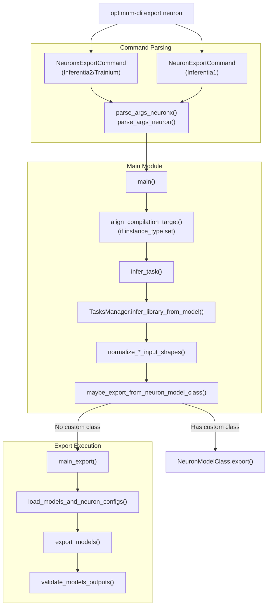

The CLI dispatches to [optimum/exporters/neuron/__main__.py:806-905]() which handles argument normalization, task inference, and invokes `main_export()`. For models with registered custom classes (e.g., LLMs with NxD backend), the system uses `maybe_export_from_neuron_model_class()` at [optimum/exporters/neuron/__main__.py:741-804]() instead of the standard export path.

**Sources:** [optimum/commands/export/neuronx.py:28-336](), [optimum/commands/export/neuron.py:25-157](), [optimum/exporters/neuron/__main__.py:806-905]()

### Programmatic API

The `main_export()` function at [optimum/exporters/neuron/__main__.py:618-739]() provides direct programmatic access:

```python
from optimum.exporters.neuron import main_export

main_export(
    model_name_or_path="bert-base-uncased",
    output="./compiled_model",
    task="text-classification",
    batch_size=1,
    sequence_length=128,
    compiler_kwargs={"auto_cast": "matmul", "auto_cast_type": "bf16"},
    torch_dtype="float32",
    inline_weights_to_neff=True,
    optlevel="2",
    do_validation=True,
)
```

**Key Parameters:**
- `model_name_or_path`: Model ID or local path
- `output`: Directory for compiled `.neuron` files
- `task`: Task type (auto-inferred if `"auto"`)
- `compiler_kwargs`: Dictionary of compiler flags (auto_cast, instance_type, etc.)
- `tensor_parallel_size`: Number of NeuronCores for sharding (default: 1)
- `dynamic_batch_size`: Enable variable batch sizes (default: False)
- `input_shapes`: Keyword arguments for static shapes (batch_size, sequence_length, etc.)

**Sources:** [optimum/exporters/neuron/__main__.py:618-739]()

---

## Export Process Flow

The export system executes a multi-stage pipeline from model loading through compilation to validation and caching:

**High-Level Export Pipeline**

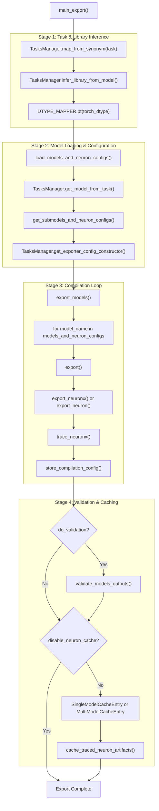

**Sources:** [optimum/exporters/neuron/__main__.py:618-739](), [optimum/exporters/neuron/convert.py:296-441]()

### Stage Details

**Stage 1 - Task & Library Inference**

The system determines the library (transformers/diffusers/sentence-transformers) and task from the model configuration:

```python
# At optimum/exporters/neuron/__main__.py:654-658
task = TasksManager.map_from_synonym(task)
library_name = TasksManager.infer_library_from_model(
    model_name_or_path, revision=revision, cache_dir=cache_dir, token=token
)
```

For transformers models, tasks include `text-classification`, `token-classification`, `feature-extraction`, `question-answering`, etc. For diffusers models, tasks are `text-to-image` or related variants. For sentence-transformers, tasks are `feature-extraction` or `sentence-similarity`.

**Stage 2 - Model Loading & Configuration**

Models are loaded from Hub or local path via `load_models_and_neuron_configs()` at [optimum/exporters/neuron/__main__.py:548-616]():

1. **Load PyTorch model:** `TasksManager.get_model_from_task()` instantiates the model
2. **Decompose if needed:** `get_submodels_and_neuron_configs()` splits multi-component models:
   - Diffusers pipelines → text_encoder, unet/transformer, vae_encoder, vae_decoder
   - Encoder-decoder models → encoder, decoder
   - Single models → one component
3. **Create configurations:** Each component gets a `NeuronDefaultConfig` instance from `TasksManager.get_exporter_config_constructor()`

**Stage 3 - Compilation Loop**

`export_models()` at [optimum/exporters/neuron/convert.py:296-441]() iterates over submodels:

1. **Export each component:** `export()` → `export_neuronx()` → `trace_neuronx()`
2. **Generate dummy inputs:** Configuration's `generate_dummy_inputs()` creates sample tensors
3. **Compile:** Either `torch_neuronx.trace()` for single-device or `neuronx_distributed.trace.ModelBuilder` for tensor-parallel
4. **Save configuration:** `store_compilation_config()` embeds compilation metadata in config.json

**Stage 4 - Validation & Caching**

Post-compilation checks at [optimum/exporters/neuron/__main__.py:699-739]():

1. **Validate outputs:** `validate_models_outputs()` compares Neuron vs PyTorch CPU outputs
2. **Check tolerance:** Uses `torch.allclose()` with model-specific `ATOL_FOR_VALIDATION`
3. **Cache artifacts:** If not disabled, creates cache entry and calls `cache_traced_neuron_artifacts()`

**Sources:** [optimum/exporters/neuron/__main__.py:618-739](), [optimum/exporters/neuron/convert.py:296-441](), [optimum/exporters/neuron/convert.py:486-597]()

---

## Configuration System

The configuration system defines how models should be compiled for Neuron hardware through a hierarchy of configuration classes.

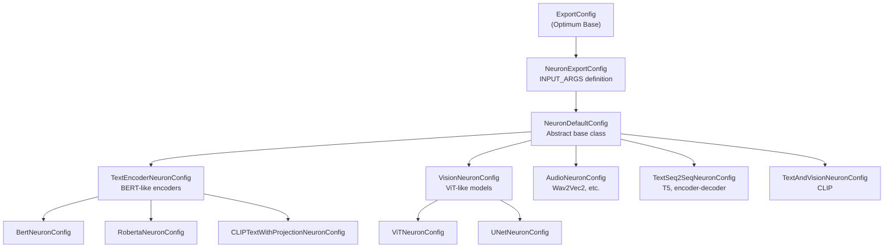

**Sources:** [optimum/exporters/neuron/base.py:41-76](), [optimum/exporters/neuron/base.py:78-487](), [optimum/exporters/neuron/model_configs.py:103-375]()

### NeuronDefaultConfig Attributes

The `NeuronDefaultConfig` class is instantiated with compilation-specific parameters:

| Attribute | Type | Description |
|-----------|------|-------------|
| `config` | `PretrainedConfig` | Original model configuration |
| `task` | `str` | Task type (e.g., "text-classification") |
| `input_shapes` | `InputShapesArguments` | Static input dimensions |
| `tensor_parallel_size` | `int` | Number of NeuronCores for sharding (default: 1) |
| `dynamic_batch_size` | `bool` | Enable dynamic batching (default: False) |
| `int_dtype` | `str` | Integer tensor dtype ("int64", "int32", "int8") |
| `float_dtype` | `str` | Float tensor dtype ("fp32", "fp16", "bf16") |
| `output_attentions` | `bool` | Include attention tensors in outputs |
| `output_hidden_states` | `bool` | Include hidden states in outputs |

**Sources:** [optimum/exporters/neuron/base.py:144-222]()

### Model-Specific Configurations

Each model architecture has a specialized configuration class registered with `TasksManager`:

```python
@register_in_tasks_manager("bert", *COMMON_TEXT_TASKS)
class BertNeuronConfig(TextEncoderNeuronConfig):
    NORMALIZED_CONFIG_CLASS = NormalizedConfigManager.get_normalized_config_class("bert")
    ATOL_FOR_VALIDATION = 1e-3
    
    @property
    def inputs(self) -> list[str]:
        return ["input_ids", "attention_mask", "token_type_ids"]
```

The `@register_in_tasks_manager` decorator makes the configuration discoverable for automatic export. The `inputs` property defines which tensors the compiled model accepts.

**Sources:** [optimum/exporters/neuron/model_configs.py:103-111]()

### Input Shape Arguments

The `InputShapesArguments` dataclass specifies static compilation dimensions:

```python
@dataclass
class InputShapesArguments:
    batch_size: int | None = None
    sequence_length: int | None = None
    num_choices: int | None = None
    width: int | None = None
    height: int | None = None
    num_channels: int | None = None
    # ... additional shape parameters
```

For transformers models, `batch_size` and `sequence_length` are typically mandatory. For vision models, `width`, `height`, and `num_channels` are required. For diffusers models, additional parameters like `vae_scale_factor` and `encoder_hidden_size` may be needed.

**Sources:** [optimum/neuron/utils/argument_utils.py:77-99]()

---

## Compilation Pipeline

The compilation pipeline transforms PyTorch models into Neuron Executable File Format (NEFF) artifacts through tracing and graph optimization.

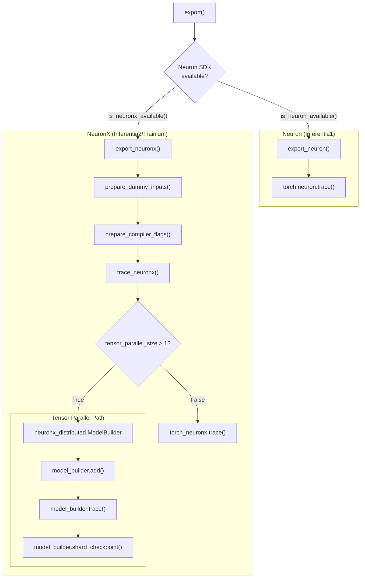

**Sources:** [optimum/exporters/neuron/convert.py:444-486](), [optimum/exporters/neuron/convert.py:489-597](), [optimum/exporters/neuron/convert.py:666-724]()

### Dummy Input Generation

Each `NeuronDefaultConfig` implements `generate_dummy_inputs()` at [optimum/exporters/neuron/base.py:306-340]() to create sample tensors:

```python
def generate_dummy_inputs(self, return_tuple=False, **kwargs):
    dummy_inputs_generators = self._create_dummy_input_generator_classes(**kwargs)
    dummy_inputs = {}
    
    for input_name in self.inputs:
        input_was_inserted = False
        for dummy_input_gen in dummy_inputs_generators:
            if dummy_input_gen.supports_input(input_name):
                dummy_inputs[input_name] = dummy_input_gen.generate(
                    input_name,
                    framework="pt",
                    int_dtype=DTYPE_MAPPER.str(self.int_dtype),
                    float_dtype=DTYPE_MAPPER.str(self.float_dtype),
                )
                input_was_inserted = True
                break
        if not input_was_inserted:
            raise RuntimeError(f'Could not generate dummy inputs for "{input_name}".')
    
    return tuple(dummy_inputs.values()) if return_tuple else dummy_inputs
```

**Generator Classes:** Configurations specify `DUMMY_INPUT_GENERATOR_CLASSES` tuples:
- `DummyTextInputGenerator`: Produces `input_ids`, `attention_mask`, `token_type_ids`
- `DummyVisionInputGenerator`: Produces `pixel_values` with shape `[batch, channels, height, width]`
- `DummySeq2SeqDecoderTextInputGenerator`: Produces `decoder_input_ids`, `encoder_hidden_states`
- `DummyTimestepInputGenerator`: Produces `timestep` for diffusion models
- `DummyBeamValuesGenerator`: Produces `beam_idx`, `beam_scores` for beam search

**Sources:** [optimum/exporters/neuron/base.py:306-340](), [optimum/neuron/utils/input_generators.py]()

### Compiler Flags

The `prepare_compiler_flags()` function constructs the compiler argument string passed to `neuronx-cc`:

```python
def prepare_compiler_flags(config, auto_cast, auto_cast_type, optlevel, instance_type):
    compiler_args = []
    
    if auto_cast is not None:
        auto_cast = "matmult" if auto_cast == "matmul" else auto_cast
        compiler_args.extend(["--auto-cast", auto_cast])
        compiler_args.extend(["--auto-cast-type", auto_cast_type])
    else:
        compiler_args.extend(["--auto-cast", "none"])
    
    compiler_args.extend(["--optlevel", optlevel])
    
    if instance_type == "trn2":
        compiler_args.extend(["--target", "trn2"])
    elif instance_type == "trn1":
        compiler_args.extend(["--target", "trn1"])
    
    # Model-type specific flags
    if config.MODEL_TYPE not in exception_models:
        compiler_args.extend(["--model-type", "transformer"])
    
    return " ".join(compiler_args)
```

Key flags:
- `--auto-cast`: Controls precision casting (`none`, `matmul`, `all`)
- `--auto-cast-type`: Target dtype for casting (`bf16`, `fp16`, `tf32`)
- `--optlevel`: Optimization level (`1`, `2`, `3`)
- `--target`: Hardware target (`trn1`, `trn2`)
- `--model-type`: Model architecture hint (`transformer`, `unet-inference`)

**Sources:** [optimum/exporters/neuron/convert.py:613-663]()

### Tracing Process

The `trace_neuronx()` function at [optimum/exporters/neuron/convert.py:666-724]() compiles models using either single-device or tensor-parallel paths:

**Single-Device Tracing (tensor_parallel_size == 1):**

```python
with torch.no_grad():
    traced_model = torch_neuronx.trace(
        model,
        dummy_inputs,
        compiler_workdir=compiler_workdir,
        compiler_args=compiler_args,
        inline_weights_to_neff=inline_weights_to_neff,
    )
torch.jit.save(traced_model, output)
```

`torch_neuronx.trace()` invokes the neuronx-cc compiler, which:
1. Captures the PyTorch computational graph via JIT tracing
2. Converts operations to Neuron-optimized HLO (High-Level Operations)
3. Applies graph-level optimizations (fusion, layout, precision casting)
4. Generates NEFF (Neuron Executable File Format) binary
5. Wraps NEFF in TorchScript module

**Tensor-Parallel Tracing (tensor_parallel_size > 1):**

```python
model_builder = neuronx_distributed.trace.ModelBuilder(
    router=None,
    debug=False,
    tp_degree=tensor_parallel_size,
    checkpoint_loader=config.get_checkpoint_loader_fn,
    compiler_workdir=compiler_workdir,
)

model_builder.add(
    key=subfolder,
    model_instance=base_model_instance,
    example_inputs=[dummy_inputs],
    priority_model_idx=0,
    compiler_args=compiler_args,
)

neuron_model = model_builder.trace(initialize_model_weights=False)
model_builder.shard_checkpoint(serialize_path=output.parent / "weights/")
torch.jit.save(neuron_model, output)
```

`ModelBuilder` orchestrates parallel tracing:
1. Distributes layers across `tensor_parallel_size` NeuronCores
2. Inserts collective communication ops (all-reduce, all-gather)
3. Compiles each shard separately
4. Saves sharded weights to `weights/` directory

**Custom Model Handling:** Some models use `BaseModelInstance` wrappers from configurations' `patch_model_and_prepare_aliases()` method to enable tracing with custom input/output aliases.

**Sources:** [optimum/exporters/neuron/convert.py:666-724](), [optimum/exporters/neuron/convert.py:598-664]()

---

## Model Type Support

The export system supports three major model categories through specialized decomposition logic.

### Transformers Encoders

Single-component architectures (BERT, RoBERTa, ViT, etc.) export directly without decomposition:

**Encoder Export Flow**

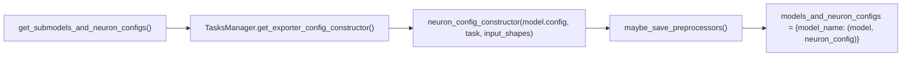

The configuration defines:
- `inputs`: List of input tensor names (e.g., `["input_ids", "attention_mask"]`)
- `outputs`: List of output tensor names (e.g., `["last_hidden_state", "logits"]`)
- `INPUT_ARGS`: Mandatory shape parameters (e.g., `("batch_size", "sequence_length")`)

Example: `BertNeuronConfig` at [optimum/exporters/neuron/model_configs.py:103-111]() requires `batch_size` and `sequence_length`, accepts inputs `["input_ids", "attention_mask", "token_type_ids"]`, and returns task-specific outputs.

**Sources:** [optimum/exporters/neuron/__main__.py:373-395](), [optimum/exporters/neuron/model_configs.py:103-111]()

### Encoder-Decoder Models

Seq2seq models (T5, BART, Whisper) decompose into encoder and decoder via `get_encoder_decoder_models_for_export()` at [optimum/exporters/neuron/utils.py:783-863]():

**Encoder-Decoder Decomposition**

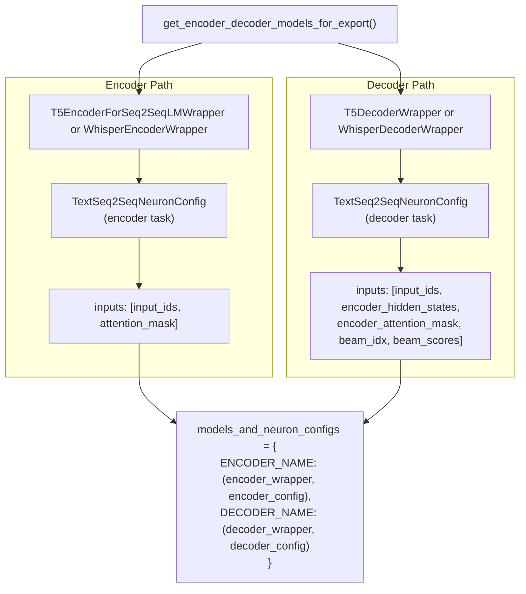

**Component Details:**

| Component | Model Wrapper | Inputs | Outputs |
|-----------|---------------|--------|---------|
| Encoder | `T5EncoderForSeq2SeqLMWrapper` | `input_ids`, `attention_mask` | `decoder_input_ids`, `encoder_hidden_states`, `encoder_attention_mask` |
| Decoder | `T5DecoderWrapper` | `input_ids`, `decoder_attention_mask`, `encoder_hidden_states`, `encoder_attention_mask`, `beam_idx`, `beam_scores` | `logits`, `past_key_values` |

The encoder is actually a monolith of encoder+decoder_without_cache to handle T5's complex control flow. The decoder contains the KV-cached decoding logic. Both export to separate subdirectories: `encoder/model.neuron` and `decoder/model.neuron`.

**Sources:** [optimum/exporters/neuron/__main__.py:509-545](), [optimum/exporters/neuron/utils.py:783-863](), [optimum/exporters/neuron/model_wrappers.py:69-83]()

### Diffusers Pipelines

Stable Diffusion, SDXL, Flux, and PixArt pipelines decompose into components via `get_diffusion_models_for_export()` at [optimum/exporters/neuron/utils.py:115-273]():

**Diffusion Pipeline Decomposition**

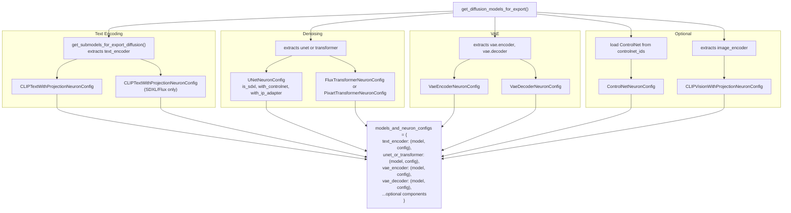

**Component Input/Output Specifications:**

| Component | Configuration | Key Inputs | Notes |
|-----------|---------------|------------|-------|
| `text_encoder` | `CLIPTextWithProjectionNeuronConfig` | `input_ids` | Returns `text_embeds`, `last_hidden_state` |
| `text_encoder_2` | `CLIPTextWithProjectionNeuronConfig` | `input_ids` | SDXL/Flux only |
| `unet` | `UNetNeuronConfig` | `sample`, `timestep`, `encoder_hidden_states`, optional `down_block_additional_residuals_*` (ControlNet), optional `image_embeds` (IP-Adapter) | Returns `sample` |
| `transformer` | `FluxTransformerNeuronConfig` | `hidden_states`, `encoder_hidden_states`, `pooled_projections`, `timestep`, `image_rotary_emb` | Flux/PixArt only |
| `vae_encoder` | `VaeEncoderNeuronConfig` | `sample` | Returns `latent_sample` |
| `vae_decoder` | `VaeDecoderNeuronConfig` | `latent_sample` | Returns `sample` |
| `controlnet_0` | `ControlNetNeuronConfig` | Same as UNet | Returns `down_block_res_samples`, `mid_block_res_sample` |
| `image_encoder` | `CLIPVisionWithProjectionNeuronConfig` | `pixel_values` | IP-Adapter only |

Each component exports to its own subdirectory with `config.json` containing compilation metadata (shapes, dtype, compiler version).

**Sources:** [optimum/exporters/neuron/__main__.py:423-506](), [optimum/exporters/neuron/utils.py:115-273](), [optimum/exporters/neuron/model_configs.py:648-951]()

---

## Validation System

The validation system at [optimum/exporters/neuron/convert.py:80-294]() compares compiled Neuron outputs against PyTorch CPU reference to verify correctness.

**Validation Flow**

```mermaid
graph TB
    ValidateModels["validate_models_outputs()"]
    
    subgraph "For Each Submodel"
        CopyModel["copy.deepcopy(submodel)"]
        ValidateModel["validate_model_outputs()"]
        
        subgraph "Validation Steps"
            PrepInputs["Generate dummy inputs<br/>(2x batch_size if dynamic_batch_size)"]
            RefForward["ref_model.eval()<br/>ref_outputs = reference_model(**inputs)"]
            LoadNeuron["neuron_model = torch.jit.load(neuron_model_path)"]
            NeuronForward["neuron_outputs = neuron_model(*inputs)"]
            
            CheckNames{"Output names match?"}
            CheckShapes["for name, output in zip(names, outputs):<br/>  check output.shape == ref_output.shape"]
            CheckValues["torch.allclose(ref_output, output, atol=atol)"]
        end
    end
    
    CollectErrors["Collect ShapeError, AtolError, OutputMatchError"]
    CheckAnyErrors{"Any errors?"}
    RaiseError["Raise last exception"]
    Success["Validation passed"]
    
    ValidateModels --> CopyModel
    CopyModel --> ValidateModel
    ValidateModel --> PrepInputs
    PrepInputs --> RefForward
    PrepInputs --> LoadNeuron
    LoadNeuron --> NeuronForward
    
    RefForward --> CheckNames
    NeuronForward --> CheckNames
    CheckNames -->|"Mismatch"| CollectErrors
    CheckNames -->|"OK"| CheckShapes
    CheckShapes -->|"Mismatch"| CollectErrors
    CheckShapes -->|"OK"| CheckValues
    CheckValues -->|"Mismatch"| CollectErrors
    CheckValues -->|"OK"| Success
    
    CollectErrors --> CheckAnyErrors
    CheckAnyErrors -->|"Yes"| RaiseError
    CheckAnyErrors -->|"No"| Success
```

**Sources:** [optimum/exporters/neuron/convert.py:80-146](), [optimum/exporters/neuron/convert.py:148-294]()

### Validation Steps

`validate_model_outputs()` at [optimum/exporters/neuron/convert.py:148-294]() executes:

**1. Generate Dummy Inputs**

```python
input_shapes = {}
for axis in config.mandatory_axes:
    input_shapes[axis] = getattr(config, axis)
if config.dynamic_batch_size is True and "batch_size" in input_shapes:
    input_shapes["batch_size"] *= 2  # Test with larger batch
```

**2. Reference Forward Pass**

```python
with torch.no_grad():
    reference_model.eval()
    inputs = config.generate_dummy_inputs(return_tuple=False, **input_shapes)
    ref_inputs = config.unflatten_inputs(inputs)
    ref_outputs = reference_model(**ref_inputs)
```

**3. Neuron Forward Pass**

```python
neuron_model = torch.jit.load(neuron_model_path)
neuron_inputs = tuple(config.flatten_inputs(inputs).values())
neuron_outputs = neuron_model(*neuron_inputs)
```

**4. Output Name Validation**

```python
neuron_output_names_set = set(neuron_named_outputs)
ref_output_names_set = set(ref_outputs.keys())
if not neuron_output_names_set.issubset(ref_output_names_set):
    raise OutputMatchError(...)
```

**5. Shape & Value Validation**

```python
for name, neuron_output in zip(neuron_output_names_list, neuron_outputs):
    ref_output = ref_outputs[name]
    
    # Shape check
    if not output.shape == ref_output.shape:
        shape_failures.append((name, ref_output.shape, output.shape))
    
    # Value check
    if not torch.allclose(ref_output, output.to(ref_output.dtype), atol=atol):
        max_diff = torch.max(torch.abs(ref_output - output))
        value_failures.append((name, max_diff))
```

**Tolerance Lookup:** The `atol` parameter defaults to `config.ATOL_FOR_VALIDATION`, which is model-type specific:
- Most models: `1e-5`
- BERT/CLIP: `1e-3`
- ConvBERT: `1e-1`

**Error Handling:**

| Error Type | Condition | Behavior |
|------------|-----------|----------|
| `ShapeError` | Output shapes mismatch | Export fails |
| `AtolError` | Value difference > atol | Export succeeds with warning |
| `OutputMatchError` | Output names mismatch | Export succeeds with warning |
| Success | All checks pass | Export completes |

Validation is skippable via `--disable-validation` CLI flag or `do_validation=False` parameter. It's automatically disabled for tensor-parallel models (validation not yet supported) and when no NeuronCores are detected.

**Sources:** [optimum/exporters/neuron/convert.py:148-294](), [optimum/exporters/neuron/__main__.py:699-739]()

---

## Compiler Arguments

The compilation process accepts numerous arguments controlling optimization behavior.

### Auto-Casting Arguments

| Argument | Values | Description |
|----------|--------|-------------|
| `auto_cast` | `"none"`, `"matmul"`, `"all"` | Which operations to cast from FP32 |
| `auto_cast_type` | `"bf16"`, `"fp16"`, `"tf32"` | Target dtype for casted operations |

- `auto_cast="none"`: No automatic casting (full FP32 precision)
- `auto_cast="matmul"`: Cast matrix multiplications only
- `auto_cast="all"`: Cast all compatible FP32 operations

**Sources:** [optimum/exporters/neuron/__main__.py:100-110]()

### Optimization Level

| Level | Description | Compile Time | Performance |
|-------|-------------|--------------|-------------|
| `-O1` | Core optimizations, minimal compile time | Fastest | Baseline |
| `-O2` | Balanced optimization (default) | Moderate | Good |
| `-O3` | Maximum optimization | Slowest | Best |

Higher optimization levels may increase compilation time and host memory usage during compilation.

**Sources:** [optimum/commands/export/neuronx.py:289-303]()

### Instance-Specific Arguments

| Argument | Values | Description |
|----------|--------|-------------|
| `instance_type` | `"trn1"`, `"trn2"`, `"inf2"` | Target hardware instance |
| `tensor_parallel_size` | Integer | Number of NeuronCores for model sharding |
| `dynamic_batch_size` | Boolean | Enable dynamic batching |

Tensor parallelism (`tensor_parallel_size > 1`) splits model layers across multiple NeuronCores within a device for memory scaling. Dynamic batching allows variable batch sizes at inference (in multiples of the compilation batch size) with potential latency tradeoff.

**Sources:** [optimum/commands/export/neuronx.py:111-129]()

### Weight Management

| Argument | Description |
|----------|-------------|
| `inline_weights_to_neff` | Whether to embed weights in the NEFF file (default: True) |
| `compiler_workdir` | Directory for compiler intermediate files |

When `inline_weights_to_neff=False`, weights are stored separately from the NEFF graph, enabling weight replacement without recompilation. However, this disables caching and is incompatible with dynamic batching.

**Sources:** [optimum/exporters/neuron/convert.py:575-579]()

---

## Special Model Handling

Certain architectures require specialized export logic implemented in utility functions and wrappers.

### ControlNet Export

ControlNet adds spatial conditioning to diffusion U-Nets. The export system at [optimum/exporters/neuron/utils.py:330-354]() handles ControlNet integration:

**ControlNet Loading:**

```python
if controlnet_ids:
    if isinstance(controlnet_ids, str):
        controlnet_ids = [controlnet_ids]
    
    controlnets = []
    for controlnet_id in controlnet_ids:
        controlnet = ControlNetModel.from_pretrained(controlnet_id)
        controlnets.append(controlnet)
    
    models_for_export["controlnet"] = controlnets if len(controlnets) > 1 else controlnets[0]
```

**U-Net Modification:**

```python
unet_neuron_config.with_controlnet = True
```

This sets the U-Net configuration to expect additional inputs. The `UnetNeuronWrapper` at [optimum/exporters/neuron/model_wrappers.py:169-239]() flattens ControlNet outputs:

```python
# ControlNet returns tuple of down_block_residuals + mid_block_residual
# Flatten to individual inputs: down_block_additional_residuals_0, ..., mid_block_additional_residual
```

Each ControlNet exports separately to `controlnet_0/model.neuron`, `controlnet_1/model.neuron`, etc.

**Sources:** [optimum/exporters/neuron/utils.py:330-354](), [optimum/exporters/neuron/model_wrappers.py:169-239]()

### LoRA Adapter Fusion

LoRA (Low-Rank Adaptation) adapters can be fused into diffusion models during export via `_load_lora_weights_to_pipeline()` at [optimum/exporters/neuron/utils.py:460-553]():

**LoRA Fusion Process:**

```python
lora_args = LoRAAdapterArguments(
    model_ids=["ostris/super-cereal-sdxl-lora"],
    weight_names=["super-cereal-sdxl-lora.safetensors"],
    adapter_names=["super_cereal"],
    scales=[0.8],
)

# In _load_lora_weights_to_pipeline:
for model_id, weight_name, adapter_name, scale in zip(...):
    pipeline.load_lora_weights(
        model_id,
        weight_name=weight_name,
        adapter_name=adapter_name,
    )
    pipeline.set_adapters([adapter_name], [scale])
    
    # Fuse LoRA weights into base model
    pipeline.fuse_lora(adapter_names=[adapter_name], lora_scale=scale)
    pipeline.unload_lora_weights()
```

After fusion, the modified U-Net/Transformer is compiled with LoRA weights baked in. Multiple LoRA adapters can be fused sequentially with different scales. The fused model has no runtime LoRA overhead.

**Sources:** [optimum/exporters/neuron/utils.py:460-553]()

### IP-Adapter Integration

IP-Adapters (Image Prompt Adapters) add image-based conditioning to diffusion U-Nets. The system detects IP-Adapter support at [optimum/exporters/neuron/utils.py:248-263]():

**IP-Adapter Detection:**

```python
# Check if U-Net has IP-Adapter projection layer
if getattr(unet.config, "encoder_hid_dim_type", None) == "ip_image_proj":
    unet_neuron_config.with_ip_adapter = True
    unet_neuron_config.image_encoder_shapes = ImageEncoderArguments(
        sequence_length=model.image_encoder.vision_model.embeddings.position_embedding.weight.shape[0],
        hidden_size=model.image_encoder.vision_model.embeddings.position_embedding.weight.shape[1],
        projection_dim=model.image_encoder.config.projection_dim,
    )
```

**Component Export:**

1. **Image Encoder:** CLIP Vision model exports to `image_encoder/model.neuron` with `CLIPVisionWithProjectionNeuronConfig`
2. **U-Net Modification:** U-Net configuration adds `image_encoder_shapes` to its mandatory axes, enabling `image_embeds` or `image_enc_hidden_states` inputs depending on projection type

At inference, the pipeline encodes image prompts through the image encoder, projects embeddings, and passes them to the U-Net for cross-attention conditioning.

**Sources:** [optimum/exporters/neuron/utils.py:248-263](), [optimum/exporters/neuron/model_configs.py:687-692]()

### Custom Model Wrappers

Some architectures require wrapper classes from [optimum/exporters/neuron/model_wrappers.py]() to enable compilation. Configurations specify wrappers via `CUSTOM_MODEL_WRAPPER` attribute:

**Common Wrappers:**

| Wrapper Class | Purpose | Applied To |
|---------------|---------|------------|
| `NoCacheModelWrapper` | Disables KV-cache for non-causal models | Phi (for classification/feature-extraction) |
| `T5EncoderForSeq2SeqLMWrapper` | Combines encoder + decoder-without-cache | T5 encoder component |
| `T5DecoderWrapper` | Adds beam search inputs, wraps outputs | T5 decoder component |
| `WhisperEncoderWrapper` | Handles Whisper-specific encoder inputs | Whisper encoder |
| `WhisperDecoderWrapper` | Handles Whisper-specific decoder inputs | Whisper decoder |
| `UnetNeuronWrapper` | Flattens nested inputs (added_cond_kwargs, ControlNet residuals) | Stable Diffusion U-Net |
| `ControlNetNeuronWrapper` | Flattens ControlNet output tuple to list | ControlNet |
| `PixartTransformerNeuronWrapper` | Handles PixArt-specific inputs | PixArt Transformer |
| `FluxTransformerNeuronWrapper` | Handles Flux-specific inputs, rotary embeddings | Flux Transformer |
| `SentenceTransformersTransformerNeuronWrapper` | Handles sentence-transformers output format | Sentence-Transformers models |
| `SentenceTransformersCLIPNeuronWrapper` | Handles CLIP dual-encoder output | Sentence-Transformers CLIP |
| `CLIPVisionWithProjectionNeuronWrapper` | Handles CLIP vision projection | CLIP image encoder |

**Wrapper Application:**

Wrappers are applied in `export_neuronx()` at [optimum/exporters/neuron/convert.py:534-544]():

```python
if config.CUSTOM_MODEL_WRAPPER is not None:
    model = config.CUSTOM_MODEL_WRAPPER(model)
```

Wrappers typically:
1. Modify `forward()` signature to match neuronx-cc expectations (flat inputs, no nested dicts)
2. Pre/post-process tensors (e.g., splitting/concatenating)
3. Add or remove outputs based on task requirements

**Sources:** [optimum/exporters/neuron/model_wrappers.py](), [optimum/exporters/neuron/convert.py:534-544](), [optimum/exporters/neuron/base.py:122]()

---

## Integration with Cache System

Successful exports are automatically cached to avoid recompilation. The caching process:

```mermaid
graph TB
    ExportComplete["export_models() completes"]
    CheckDisabled{"disable_neuron_cache?"}
    CheckNeuronX{"is_neuronx_available()?"}
    
    CreateEntry["Create cache entry"]
    SingleModel{"Single model?"}
    SingleEntry["SingleModelCacheEntry"]
    MultiEntry["MultiModelCacheEntry"]
    
    CacheArtifacts["cache_traced_neuron_artifacts()"]
    
    NoCache["Skip caching"]
    
    ExportComplete --> CheckDisabled
    CheckDisabled -->|"True"| NoCache
    CheckDisabled -->|"False"| CheckNeuronX
    CheckNeuronX -->|"False (Neuron)"| NoCache
    CheckNeuronX -->|"True (NeuronX)"| CreateEntry
    
    CreateEntry --> SingleModel
    SingleModel -->|"len==1"| SingleEntry
    SingleModel -->|"len>1"| MultiEntry
    
    SingleEntry --> CacheArtifacts
    MultiEntry --> CacheArtifacts
```

Cache entries store:
- Compiled NEFF files (`.neuron` TorchScript modules)
- Configuration files with compilation parameters
- Model weights (if not inlined)
- Metadata (compiler version, shapes, dtype, etc.)

The cache is identified by a hash of compilation parameters, enabling automatic cache hits for identical export configurations.

**Sources:** [optimum/exporters/neuron/convert.py:426-434]()

For detailed cache management, see [Cache System](#7).

---

# Page: Export Architecture and Workflow

# Export Architecture and Workflow

<details>
<summary>Relevant source files</summary>

The following files were used as context for generating this wiki page:

- [optimum/commands/export/neuron.py](optimum/commands/export/neuron.py)
- [optimum/commands/export/neuronx.py](optimum/commands/export/neuronx.py)
- [optimum/exporters/neuron/__main__.py](optimum/exporters/neuron/__main__.py)
- [optimum/exporters/neuron/base.py](optimum/exporters/neuron/base.py)
- [optimum/exporters/neuron/convert.py](optimum/exporters/neuron/convert.py)
- [optimum/exporters/neuron/model_configs.py](optimum/exporters/neuron/model_configs.py)
- [optimum/exporters/neuron/utils.py](optimum/exporters/neuron/utils.py)
- [optimum/neuron/modeling_diffusion.py](optimum/neuron/modeling_diffusion.py)
- [optimum/neuron/modeling_seq2seq.py](optimum/neuron/modeling_seq2seq.py)
- [optimum/neuron/modeling_traced.py](optimum/neuron/modeling_traced.py)
- [optimum/neuron/utils/argument_utils.py](optimum/neuron/utils/argument_utils.py)
- [optimum/neuron/utils/optimization_utils.py](optimum/neuron/utils/optimization_utils.py)
- [tests/exporters/exporters_utils.py](tests/exporters/exporters_utils.py)
- [tests/inference/inference_utils.py](tests/inference/inference_utils.py)

</details>


The export system transforms PyTorch models into Neuron-compiled artifacts through a multi-stage pipeline. The `main_export` function orchestrates this process, coordinating configuration construction, model loading, dummy input generation, tracing, compilation, and validation. This page explains how models flow through the export pipeline from CLI invocation to compiled `.neuron` files.

For details on model-specific configurations, see [Model Type Configurations](#4.2). For input shape handling, see [Input Shape Handling and Compilation Parameters](#4.3).

## Export System Overview

The export pipeline consists of multiple coordinated stages that transform a Hugging Face model into a Neuron-compiled artifact:

```mermaid
graph TB
    CLI["CLI Entry<br/>optimum-cli export neuron"]
    main["main()<br/>__main__.py:806-905"]
    main_export["main_export()<br/>__main__.py:618-739"]
    
    load["load_models_and_neuron_configs()<br/>__main__.py:548-615"]
    export_models["export_models()<br/>convert.py:296-440"]
    validate["validate_models_outputs()<br/>convert.py:80-145"]
    
    subgraph "Configuration Stage"
        infer_task["infer_task()<br/>__main__.py:117-128"]
        get_config["get_neuron_config_class()<br/>__main__.py:138-151"]
        get_shapes["get_input_shapes()<br/>__main__.py:132-135"]
        get_submodels["get_submodels_and_neuron_configs()<br/>__main__.py:315-398"]
    end
    
    subgraph "Compilation Stage"
        export["export()<br/>convert.py:443-483"]
        export_neuronx["export_neuronx()<br/>convert.py:486-723"]
        trace["torch_neuronx.trace()"]
        neuroncc["Neuron Compiler<br/>neuronx-cc"]
    end
    
    CLI --> main
    main --> main_export
    main_export --> load
    
    load --> infer_task
    infer_task --> get_config
    get_config --> get_shapes
    get_shapes --> get_submodels
    
    main_export --> export_models
    export_models --> export
    export --> export_neuronx
    export_neuronx --> trace
    trace --> neuroncc
    
    main_export --> validate
```

**Sources:** [optimum/exporters/neuron/__main__.py:1-906](), [optimum/exporters/neuron/convert.py:1-723]()

## CLI Entry Point

The export process begins through the CLI command `optimum-cli export neuron` which invokes the main entry point:

**Title:** CLI to main() Flow

```mermaid
sequenceDiagram
    participant User
    participant CLI as "optimum-cli export neuron"
    participant parse_args as "parse_args_neuron()<br/>neuronx.py:28-316"
    participant main as "main()<br/>__main__.py:806-905"
    participant align as "align_compilation_target()"
    participant main_export as "main_export()<br/>__main__.py:618-739"
    
    User->>CLI: --model MODEL --output DIR<br/>--batch_size 1 --sequence_length 128
    CLI->>parse_args: Parse arguments
    parse_args-->>CLI: args Namespace
    
    CLI->>main: args
    main->>align: Set instance_type target
    main->>main: infer_task(args.model)
    main->>main: infer_compiler_kwargs(args)
    main->>main: get_input_shapes(task, args)
    
    main->>main_export: model_name_or_path, output,<br/>compiler_kwargs, **input_shapes
    main_export-->>CLI: Compiled model saved
```

The `main()` function at [optimum/exporters/neuron/__main__.py:806-905]() performs initial setup including:
- Parsing CLI arguments via `parse_args_neuron()` at [optimum/commands/export/neuronx.py:28-316]()
- Setting compilation target with `align_compilation_target()` at [optimum/exporters/neuron/__main__.py:816]()
- Inferring task from model via `infer_task()` at [optimum/exporters/neuron/__main__.py:818]()
- Building compiler kwargs via `infer_compiler_kwargs()` at [optimum/exporters/neuron/__main__.py:860]()
- Extracting input shapes via `get_input_shapes()` at [optimum/exporters/neuron/__main__.py:856]()

**Sources:** [optimum/exporters/neuron/__main__.py:806-905](), [optimum/commands/export/neuronx.py:28-316]()

## The main_export Function

The `main_export()` function at [optimum/exporters/neuron/__main__.py:618-739]() is the core orchestrator of the export pipeline:

**Title:** main_export Workflow

```mermaid
graph TB
    entry["main_export()<br/>line 618"]
    
    setup["Setup<br/>• Parse torch_dtype<br/>• Create output dir<br/>• Infer library_name<br/>lines 649-658"]
    
    load["load_models_and_neuron_configs()<br/>line 660-683"]
    
    export["export_models()<br/>line 685-696"]
    
    validate["validate_models_outputs()<br/>line 710-734"]
    
    complete["Return compiled model"]
    
    entry --> setup
    setup --> load
    load --> export
    export --> validate
    validate --> complete
    
    load --> config_stage["Configuration Stage"]
    export --> compile_stage["Compilation Stage"]
    validate --> check_stage["Validation Stage"]
```

| Stage | Function | Line Range | Purpose |
|-------|----------|------------|---------|
| Setup | `main_export` | 649-658 | Parse dtype, create dirs, infer library |
| Load | `load_models_and_neuron_configs` | 660-683 | Construct configs and load models |
| Export | `export_models` | 685-696 | Trace and compile models |
| Validate | `validate_models_outputs` | 710-734 | Compare Neuron vs CPU outputs |

**Sources:** [optimum/exporters/neuron/__main__.py:618-739]()

## Configuration Construction Pipeline

The `load_models_and_neuron_configs()` function at [optimum/exporters/neuron/__main__.py:548-615]() builds the configuration objects that guide compilation:

**Title:** Configuration Construction Flow

```mermaid
sequenceDiagram
    participant main_export
    participant load as "load_models_and_neuron_configs"
    participant TasksManager
    participant get_submodels as "get_submodels_and_neuron_configs"
    participant get_config as "get_neuron_config_class"
    participant NeuronConfig as "NeuronDefaultConfig"
    
    main_export->>load: model_name_or_path, task, input_shapes
    
    alt Model is None
        load->>TasksManager: get_model_from_task()
        TasksManager-->>load: loaded model
    end
    
    load->>get_submodels: model, input_shapes, task
    
    alt Multi-component (diffusers/encoder-decoder)
        get_submodels->>get_submodels: Split into subcomponents
        loop For each subcomponent
            get_submodels->>get_config: model_type, task
            get_config->>TasksManager: get_exporter_config_constructor
            TasksManager-->>get_config: config_constructor
            get_config-->>get_submodels: config_constructor
            get_submodels->>NeuronConfig: config_constructor(config, task, input_shapes)
            NeuronConfig-->>get_submodels: neuron_config
        end
    else Single model
        get_submodels->>get_config: model_type, task
        get_config->>TasksManager: get_exporter_config_constructor
        TasksManager-->>get_config: config_constructor
        get_submodels->>NeuronConfig: config_constructor(config, task, input_shapes)
    end
    
    get_submodels-->>load: models_and_neuron_configs
    load-->>main_export: models_and_neuron_configs, output_model_names
```

The configuration construction involves:

1. **Task Inference**: `infer_task()` at [optimum/exporters/neuron/__main__.py:117-128]() determines the task from model config
2. **Config Constructor**: `get_neuron_config_class()` at [optimum/exporters/neuron/__main__.py:138-151]() retrieves the appropriate config class
3. **Input Shapes**: `get_input_shapes()` at [optimum/exporters/neuron/__main__.py:132-135]() extracts mandatory shape parameters
4. **Config Instantiation**: `NeuronDefaultConfig.__init__()` at [optimum/exporters/neuron/base.py:144-223]() validates shapes and creates config

**Sources:** [optimum/exporters/neuron/__main__.py:548-615](), [optimum/exporters/neuron/__main__.py:315-398](), [optimum/exporters/neuron/__main__.py:138-151]()

## NeuronDefaultConfig System

The `NeuronDefaultConfig` class hierarchy at [optimum/exporters/neuron/base.py:78-305]() provides the blueprint for export:

**Title:** NeuronDefaultConfig Class Structure

```mermaid
graph TB
    NeuronDefaultConfig["NeuronDefaultConfig<br/>base.py:78-305"]
    
    attributes["Key Attributes<br/>• NORMALIZED_CONFIG_CLASS<br/>• DUMMY_INPUT_GENERATOR_CLASSES<br/>• ATOL_FOR_VALIDATION<br/>• INPUT_ARGS<br/>• mandatory_axes"]
    
    methods["Key Methods<br/>• generate_dummy_inputs()<br/>• _validate_mandatory_axes()<br/>• flatten_inputs()<br/>• unflatten_inputs()"]
    
    properties["Properties<br/>• inputs (abstract)<br/>• outputs<br/>• values_override"]
    
    NeuronDefaultConfig --> attributes
    NeuronDefaultConfig --> methods
    NeuronDefaultConfig --> properties
    
    subclasses["Specialized Configs"]
    TextEncoderNeuronConfig["TextEncoderNeuronConfig<br/>Text models"]
    VisionNeuronConfig["VisionNeuronConfig<br/>Vision models"]
    UNetNeuronConfig["UNetNeuronConfig<br/>Diffusion UNet"]
    TextSeq2SeqNeuronConfig["TextSeq2SeqNeuronConfig<br/>Encoder-decoder"]
    
    NeuronDefaultConfig --> subclasses
    subclasses --> TextEncoderNeuronConfig
    subclasses --> VisionNeuronConfig
    subclasses --> UNetNeuronConfig
    subclasses --> TextSeq2SeqNeuronConfig
```

The configuration system serves three primary functions:

1. **Shape Management**: Validates that all mandatory input dimensions are specified
2. **Dummy Input Generation**: Creates sample tensors for model tracing
3. **Output Specification**: Defines expected output tensor names for validation

**Sources:** [optimum/exporters/neuron/base.py:78-305](), [optimum/exporters/neuron/model_configs.py:1-100]()

## Model and Submodel Handling

The `get_submodels_and_neuron_configs()` function at [optimum/exporters/neuron/__main__.py:315-398]() handles single models and multi-component pipelines:

**Title:** Submodel Configuration Strategy

```mermaid
graph TB
    get_submodels["get_submodels_and_neuron_configs()<br/>line 315"]
    
    check_type{"Model Type?"}
    
    diffusion["Diffusion Pipeline<br/>_get_submodels_for_diffusion<br/>line 423"]
    encoder_decoder["Encoder-Decoder<br/>_get_submodels_for_encoder_decoder<br/>line 509"]
    single["Single Model<br/>Create single config<br/>line 379"]
    
    get_submodels --> check_type
    check_type -->|"library_name=='diffusers'"| diffusion
    check_type -->|"is_encoder_decoder==True"| encoder_decoder
    check_type -->|"Standard model"| single
    
    diffusion --> components_diff["Components:<br/>• text_encoder<br/>• text_encoder_2<br/>• unet/transformer<br/>• vae_encoder<br/>• vae_decoder<br/>• controlnet<br/>• image_encoder"]
    
    encoder_decoder --> components_seq["Components:<br/>• encoder<br/>• decoder"]
    
    single --> single_config["Single config for model"]
    
    components_diff --> reorder["_reorder_models_and_neuron_configs()<br/>TP models first<br/>line 401"]
    components_seq --> reorder
    single_config --> reorder
    
    reorder --> output["models_and_neuron_configs<br/>output_model_names"]
```

The function branches based on model type:

| Model Type | Handler Function | Line Range | Components |
|------------|------------------|------------|------------|
| Diffusion | `_get_submodels_and_neuron_configs_for_diffusion` | 423-506 | text_encoder, unet/transformer, vae_encoder, vae_decoder, controlnet |
| Encoder-Decoder | `_get_submodels_and_neuron_configs_for_encoder_decoder` | 509-545 | encoder, decoder |
| Standard | Direct config creation | 379-394 | Single model |

**Sources:** [optimum/exporters/neuron/__main__.py:315-398](), [optimum/exporters/neuron/__main__.py:423-506](), [optimum/exporters/neuron/__main__.py:509-545]()

## Compilation Pipeline

The `export_models()` function at [optimum/exporters/neuron/convert.py:296-440]() coordinates the compilation of all model components:

**Title:** export_models Compilation Loop

```mermaid
sequenceDiagram
    participant main_export
    participant export_models as "export_models()<br/>convert.py:296"
    participant export as "export()<br/>convert.py:443"
    participant export_neuronx as "export_neuronx()<br/>convert.py:486"
    participant ModelBuilder as "neuronx_distributed.trace.ModelBuilder"
    participant trace as "torch_neuronx.trace()"
    participant cache as "cache_traced_neuron_artifacts()"
    
    main_export->>export_models: models_and_neuron_configs,<br/>output_dir, compiler_kwargs
    
    loop For each model in models_and_neuron_configs
        export_models->>export_models: Log "***** Compiling {model_name} *****"
        export_models->>export: model, config, output_path,<br/>compiler_workdir, optlevel
        
        alt Tensor parallel (TP > 1)
            export->>export_neuronx: Use NxD backend
            export_neuronx->>ModelBuilder: Build parallel model
            ModelBuilder->>trace: Trace with neuronx_distributed
        else No tensor parallelism
            export->>export_neuronx: Standard path
            export_neuronx->>trace: torch_neuronx.trace(model, example_inputs)
        end
        
        trace-->>export: Traced ScriptModule
        export-->>export_models: neuron_inputs, neuron_outputs
        
        export_models->>export_models: store_compilation_config(config)
        export_models->>export_models: Save config.json
    end
    
    alt disable_neuron_cache == False
        export_models->>cache: Cache compiled artifacts
    end
    
    export_models-->>main_export: all_inputs, all_outputs
```

Key compilation steps:

1. **Iteration**: Loop through each model component (lines 355-419)
2. **Export Call**: Invoke `export()` which dispatches to `export_neuronx()` (lines 373-381)
3. **Tracing**: Use `torch_neuronx.trace()` or `ModelBuilder` for TP models (lines 568-617)
4. **Config Storage**: Save compilation metadata via `store_compilation_config()` (lines 401-418)
5. **Caching**: Optionally cache artifacts to Hub (lines 424-433)

**Sources:** [optimum/exporters/neuron/convert.py:296-440](), [optimum/exporters/neuron/convert.py:443-483](), [optimum/exporters/neuron/convert.py:486-723]()

## Graph Building and Tracing

The `export_neuronx()` function at [optimum/exporters/neuron/convert.py:486-723]() performs the actual model tracing and compilation:

**Title:** Tracing and Compilation Process

```mermaid
graph TB
    export_neuronx["export_neuronx()<br/>line 486"]
    
    prepare["Prepare Model<br/>• Set return_dict=True<br/>• Set torchscript=True<br/>• Apply values_override<br/>lines 531-543"]
    
    dummy["Generate Dummy Inputs<br/>config.generate_dummy_inputs()<br/>lines 546-548"]
    
    check_tp{"Tensor Parallel?<br/>TP > 1"}
    
    standard_path["Standard Tracing Path"]
    tp_path["Tensor Parallel Path"]
    
    export_neuronx --> prepare
    prepare --> dummy
    dummy --> check_tp
    
    check_tp -->|"No"| standard_path
    check_tp -->|"Yes"| tp_path
    
    standard_path --> patch["patch_model_and_prepare_aliases()<br/>lines 570-574"]
    patch --> trace_standard["torch_neuronx.trace()<br/>lines 578-611"]
    
    tp_path --> nxd_builder["neuronx_distributed.trace.ModelBuilder<br/>lines 618-675"]
    nxd_builder --> trace_parallel["parallel_model_trace()<br/>line 677"]
    
    trace_standard --> save["torch.jit.save()<br/>line 686"]
    trace_parallel --> save
    
    save --> output["Return inputs/outputs"]
```

The tracing process differs based on tensor parallelism:

| Path | Condition | Tracing Method | Line Range |
|------|-----------|----------------|------------|
| Standard | `tensor_parallel_size == 1` | `torch_neuronx.trace(model, example_inputs)` | 578-611 |
| Tensor Parallel | `tensor_parallel_size > 1` | `ModelBuilder` + `parallel_model_trace()` | 618-677 |

For tensor parallel models, the `ModelBuilder` from `neuronx_distributed.trace` at [optimum/exporters/neuron/convert.py:618-675]() coordinates:
- Creating parallel model wrapper via `config.patch_model_and_prepare_aliases()`
- Generating parallel-aware dummy inputs
- Tracing with distributed context

**Sources:** [optimum/exporters/neuron/convert.py:486-723](), [optimum/exporters/neuron/convert.py:568-617](), [optimum/exporters/neuron/convert.py:618-677]()

## Dummy Input Generation

The `NeuronDefaultConfig.generate_dummy_inputs()` method at [optimum/exporters/neuron/base.py:306-341]() creates sample tensors for tracing:

**Title:** Dummy Input Generation Flow

```mermaid
graph TB
    config["NeuronDefaultConfig"]
    
    gen_method["generate_dummy_inputs()<br/>line 306"]
    
    create_gen["_create_dummy_input_generator_classes()<br/>line 268"]
    
    DUMMY_CLASSES["DUMMY_INPUT_GENERATOR_CLASSES<br/>• DummyTextInputGenerator<br/>• DummyVisionInputGenerator<br/>• DummyTimestepInputGenerator<br/>etc."]
    
    iterate["Iterate over inputs property<br/>line 319"]
    
    match["Find generator for input_name<br/>generator.supports_input(input_name)<br/>lines 320-330"]
    
    generate["generator.generate(input_name,<br/>framework='pt', int_dtype, float_dtype)<br/>lines 323-329"]
    
    output["Return dict[str, torch.Tensor]<br/>or tuple[torch.Tensor]"]
    
    config --> gen_method
    gen_method --> create_gen
    create_gen --> DUMMY_CLASSES
    DUMMY_CLASSES --> iterate
    iterate --> match
    match --> generate
    generate --> output
```

The generation process:

1. Instantiate generator classes from `DUMMY_INPUT_GENERATOR_CLASSES` (line 272)
2. Loop through required inputs from `config.inputs` property (line 319)
3. Find a generator that supports each input name (lines 320-330)
4. Generate tensor with correct dtype and shape (lines 323-329)
5. Return flattened dict or tuple (lines 337-340)

**Sources:** [optimum/exporters/neuron/base.py:306-341](), [optimum/exporters/neuron/base.py:268-272]()

## Validation Stage

The `validate_models_outputs()` function at [optimum/exporters/neuron/convert.py:80-145]() compares compiled model outputs against PyTorch CPU references:

**Title:** Validation Process

```mermaid
sequenceDiagram
    participant main_export
    participant validate as "validate_models_outputs()<br/>convert.py:80"
    participant validate_model as "validate_model_outputs()<br/>convert.py:148"
    participant ref_model as "Reference PyTorch Model<br/>CPU"
    participant neuron_model as "Compiled Neuron Model<br/>torch.jit.load()"
    
    main_export->>validate: models_and_neuron_configs,<br/>neuron_named_outputs, output_dir
    
    loop For each model
        validate->>validate->>validate: Create ref_submodel copy
        validate->>validate_model: config, ref_submodel,<br/>neuron_model_path, neuron_named_outputs
        
        validate_model->>ref_model: Generate dummy inputs<br/>config.generate_dummy_inputs()
        ref_model->>validate_model: reference_outputs
        
        validate_model->>neuron_model: torch.jit.load(neuron_model_path)
        neuron_model->>validate_model: neuron_outputs
        
        validate_model->>validate_model: Compare shapes<br/>Check output.shape == ref_output.shape
        validate_model->>validate_model: Compare values<br/>torch.allclose(ref, output, atol)
        
        alt Validation passes
            validate_model-->>validate: Success
        else Shape mismatch
            validate_model-->>validate: Raise ShapeError
        else Value mismatch
            validate_model-->>validate: Raise AtolError
        end
    end
    
    validate-->>main_export: All validations complete
```

Validation checks performed at [optimum/exporters/neuron/convert.py:248-283]():

1. **Output Names**: Verify Neuron outputs match reference (lines 221-235)
2. **Output Shapes**: Compare tensor dimensions (lines 264-274)
3. **Output Values**: Check numerical accuracy with `torch.allclose()` (lines 276-282)

| Check | Criterion | Error Type |
|-------|-----------|------------|
| Names | `neuron_outputs.keys() ⊆ ref_outputs.keys()` | `OutputMatchError` |
| Shapes | `output.shape == ref_output.shape` | `ShapeError` |
| Values | `torch.allclose(ref, output, atol=config.ATOL_FOR_VALIDATION)` | `AtolError` (warning) |

**Sources:** [optimum/exporters/neuron/convert.py:80-145](), [optimum/exporters/neuron/convert.py:148-294]()

## Multi-Component Export Workflows

For complex models, the export system handles multiple subcomponents:

**Title:** Multi-Component Export Strategies

```mermaid
graph TB
    subgraph "Diffusion Pipeline Export"
        diff_entry["get_diffusion_models_for_export()<br/>utils.py:115"]
        
        diff_components["Components to Export:<br/>• text_encoder<br/>• text_encoder_2<br/>• unet/transformer<br/>• vae_encoder<br/>• vae_decoder<br/>• controlnet (optional)<br/>• image_encoder (optional)"]
        
        diff_configs["Create Config per Component<br/>TasksManager.get_exporter_config_constructor()"]
        
        diff_entry --> diff_components
        diff_components --> diff_configs
    end
    
    subgraph "Encoder-Decoder Export"
        seq_entry["get_encoder_decoder_models_for_export()<br/>utils.py:662"]
        
        seq_components["Components to Export:<br/>• encoder (with dummy decoder)<br/>• decoder (with past_key_values)"]
        
        seq_configs["Create Config per Component<br/>Separate input shapes"]
        
        seq_entry --> seq_components
        seq_components --> seq_configs
    end
    
    subgraph "Compilation Loop"
        export_each["export_models() loops<br/>over each component"]
    end
    
    diff_configs --> export_each
    seq_configs --> export_each
    
    export_each --> save["Save to output_dir/<br/>• text_encoder/model.neuron<br/>• unet/model.neuron<br/>• vae_decoder/model.neuron<br/>etc."]
```

Diffusion pipeline export at [optimum/exporters/neuron/utils.py:115-390]():
- Creates separate configs for text_encoder, unet/transformer, vae components
- Infers component-specific shapes (e.g., VAE latent dimensions)
- Handles conditional components (ControlNet, IP-Adapter)

Encoder-decoder export at [optimum/exporters/neuron/utils.py:662-774]():
- Splits into encoder (first pass) and decoder (autoregressive) components
- Configures separate beam search and sequence length parameters
- Manages past_key_values for decoder caching

**Sources:** [optimum/exporters/neuron/utils.py:115-390](), [optimum/exporters/neuron/utils.py:662-774](), [optimum/exporters/neuron/__main__.py:423-506]()

## Compilation Output and Caching

After successful compilation, the system saves artifacts and optionally caches them:

**Title:** Output Saving and Caching

```mermaid
graph TB
    compiled["Compiled Models"]
    
    save_neff["Save .neuron Files<br/>output_dir/model.neuron<br/>or subdir/model.neuron"]
    
    save_config["Save Compilation Config<br/>store_compilation_config()<br/>config.json with neuron section"]
    
    check_cache{"disable_neuron_cache?"}
    
    create_entry["Create Cache Entry<br/>SingleModelCacheEntry or<br/>MultiModelCacheEntry"]
    
    cache_artifacts["cache_traced_neuron_artifacts()<br/>Upload to Hub cache"]
    
    compiled --> save_neff
    compiled --> save_config
    
    save_config --> check_cache
    check_cache -->|"False"| create_entry
    check_cache -->|"True"| done["Complete"]
    
    create_entry --> cache_artifacts
    cache_artifacts --> done
```

The compilation output includes:

1. **Neuron Files**: TorchScript `.neuron` files containing traced graphs and (optionally) weights
2. **Configuration Files**: `config.json` with compilation metadata in `neuron` section
3. **Preprocessors**: Tokenizers and feature extractors if applicable
4. **Cache Entry**: Optional upload to `aws-neuron/optimum-neuron-cache` Hub repository

The `store_compilation_config()` function at [optimum/neuron/utils/argument_utils.py:258-328]() adds metadata:
- Compiler type and version
- Input shapes (static_batch_size, static_sequence_length, etc.)
- Compiler flags (optlevel, auto_cast, auto_cast_type)
- Data types (int_dtype, float_dtype)
- Parallelism settings (tensor_parallel_size)

**Sources:** [optimum/exporters/neuron/convert.py:400-433](), [optimum/neuron/utils/argument_utils.py:258-328]()

## Configuration Construction Flow

The export process constructs configurations through a multi-step pipeline:

```mermaid
sequenceDiagram
    participant CLI as CLI Arguments
    participant Main as main_export()
    participant Infer as infer_task()
    participant GetConfig as get_neuron_config_class()
    participant TasksManager
    participant Constructor as NeuronConfig Constructor
    participant Validate as Validation
    
    CLI->>Main: model, output, shapes, compiler_kwargs
    Main->>Infer: model_name_or_path
    Infer-->>Main: task
    
    Main->>GetConfig: task, model_id
    GetConfig->>TasksManager: get_exporter_config_constructor
    TasksManager-->>GetConfig: config_constructor
    GetConfig-->>Main: config_constructor
    
    Main->>Constructor: config, task, input_shapes
    Constructor->>Constructor: Set mandatory_axes from task
    Constructor->>Constructor: Initialize _axes dict
    Constructor->>Validate: _validate_mandatory_axes()
    
    alt Missing mandatory axes
        Validate-->>Main: MissingMandatoryAxisDimension
    else All axes valid
        Validate-->>Main: Ready for export
    end
```

**Sources:** [optimum/exporters/neuron/__main__.py:614-681](), [optimum/exporters/neuron/__main__.py:134-148]()

## Dummy Input Generation

Configurations generate dummy inputs for model tracing using specialized generator classes:

```mermaid
graph TB
    config["NeuronDefaultConfig"]
    dummy_gen["DUMMY_INPUT_GENERATOR_CLASSES"]
    
    text_gen["DummyTextInputGenerator<br/>input_ids<br/>attention_mask<br/>token_type_ids"]
    vision_gen["DummyVisionInputGenerator<br/>pixel_values"]
    audio_gen["DummyAudioInputGenerator<br/>input_values"]
    timestep_gen["DummyTimestepInputGenerator<br/>timestep"]
    
    config --> dummy_gen
    dummy_gen --> text_gen
    dummy_gen --> vision_gen
    dummy_gen --> audio_gen
    dummy_gen --> timestep_gen
    
    generate["generate_dummy_inputs()"]
    text_gen --> generate
    vision_gen --> generate
    audio_gen --> generate
    timestep_gen --> generate
    
    generate --> flatten["flatten_inputs()"]
    flatten --> tuple["Tuple for tracing"]
```

The `generate_dummy_inputs()` method iterates through configured generators to create tensors matching the expected input specification:

**Sources:** [optimum/exporters/neuron/base.py:306-341](), [optimum/exporters/neuron/base.py:268-272]()

## Configuration Serialization

After compilation, configuration metadata is stored in the model's config for reproducibility:

```mermaid
graph LR
    compile["Compilation Complete"]
    
    config["Model Config<br/>(config.json)"]
    neuron_section["neuron: {...}"]
    
    shapes["static_batch_size<br/>static_sequence_length<br/>..."]
    compiler["compiler_type<br/>compiler_version<br/>optlevel<br/>auto_cast<br/>auto_cast_type"]
    dtypes["int_dtype<br/>float_dtype"]
    io["input_names<br/>output_names"]
    flags["dynamic_batch_size<br/>tensor_parallel_size<br/>inline_weights_to_neff"]
    
    compile --> config
    config --> neuron_section
    neuron_section --> shapes
    neuron_section --> compiler
    neuron_section --> dtypes
    neuron_section --> io
    neuron_section --> flags
```

The `store_compilation_config()` function adds the `neuron` section to the model config:

**Sources:** [optimum/neuron/utils/argument_utils.py:258-332](), [optimum/exporters/neuron/convert.py:400-421]()

## Key Configuration Files Reference

| File | Purpose |
|------|---------|
| [optimum/exporters/neuron/base.py]() | `NeuronExportConfig`, `NeuronDefaultConfig` base classes |
| [optimum/exporters/neuron/model_configs.py]() | Model-specific configuration implementations |
| [optimum/exporters/neuron/__main__.py]() | Configuration construction in export pipeline |
| [optimum/neuron/utils/argument_utils.py]() | `InputShapesArguments`, `store_compilation_config()` |
| [optimum/commands/export/neuronx.py]() | CLI argument definitions |
| [optimum/exporters/neuron/utils.py]() | Diffusion model configuration helpers |

---

# Page: Model Type Configurations

# Model Type Configurations

<details>
<summary>Relevant source files</summary>

The following files were used as context for generating this wiki page:

- [optimum/commands/export/neuron.py](optimum/commands/export/neuron.py)
- [optimum/commands/export/neuronx.py](optimum/commands/export/neuronx.py)
- [optimum/exporters/neuron/__main__.py](optimum/exporters/neuron/__main__.py)
- [optimum/exporters/neuron/base.py](optimum/exporters/neuron/base.py)
- [optimum/exporters/neuron/convert.py](optimum/exporters/neuron/convert.py)
- [optimum/exporters/neuron/model_configs.py](optimum/exporters/neuron/model_configs.py)
- [optimum/exporters/neuron/utils.py](optimum/exporters/neuron/utils.py)
- [optimum/neuron/modeling_diffusion.py](optimum/neuron/modeling_diffusion.py)
- [optimum/neuron/modeling_seq2seq.py](optimum/neuron/modeling_seq2seq.py)
- [optimum/neuron/modeling_traced.py](optimum/neuron/modeling_traced.py)
- [optimum/neuron/utils/argument_utils.py](optimum/neuron/utils/argument_utils.py)
- [optimum/neuron/utils/optimization_utils.py](optimum/neuron/utils/optimization_utils.py)
- [tests/exporters/exporters_utils.py](tests/exporters/exporters_utils.py)
- [tests/inference/inference_utils.py](tests/inference/inference_utils.py)

</details>


This document explains the model type configuration system in optimum-neuron's export pipeline. Model type configurations define how specific architectures (BERT, ViT, UNet, etc.) are exported to Neuron format, including their input/output specifications and how to generate dummy inputs for tracing.

For information about the export workflow and compilation process, see [Export Architecture and Workflow](#4.1). For details on input shape handling, see [Input Shape Handling and Compilation Parameters](#4.3).

## Overview and Purpose

Each model architecture supported by optimum-neuron requires a specialized configuration class that extends `NeuronDefaultConfig`. These configurations serve three primary purposes:

1. **Define Model Interface**: Specify the exact input and output names the compiled model will accept/produce
2. **Generate Dummy Inputs**: Provide logic to create example inputs for the tracing process with correct shapes and dtypes
3. **Task Registration**: Map model types to supported tasks in the `TasksManager` registry

The configuration system is located primarily in [optimum/exporters/neuron/model_configs.py:1-1473]() and uses a registration pattern to associate model types with export configurations.

Sources: [optimum/exporters/neuron/model_configs.py:1-100](), [optimum/exporters/neuron/base.py:78-123]()

## Configuration Class Hierarchy

```mermaid
graph TB
    ExportConfig["ExportConfig<br/>(optimum.exporters.base)"]
    NeuronExportConfig["NeuronExportConfig<br/>base.py"]
    NeuronDefaultConfig["NeuronDefaultConfig<br/>Abstract Base"]
    
    TextEncoderNeuronConfig["TextEncoderNeuronConfig"]
    VisionNeuronConfig["VisionNeuronConfig"]
    AudioNeuronConfig["AudioNeuronConfig"]
    TextSeq2SeqNeuronConfig["TextSeq2SeqNeuronConfig"]
    TextAndVisionNeuronConfig["TextAndVisionNeuronConfig"]
    
    BertNeuronConfig["BertNeuronConfig"]
    DistilBertNeuronConfig["DistilBertNeuronConfig"]
    RobertaNeuronConfig["RobertaNeuronConfig"]
    ViTNeuronConfig["ViTNeuronConfig"]
    UNetNeuronConfig["UNetNeuronConfig"]
    Wav2Vec2NeuronConfig["Wav2Vec2NeuronConfig"]
    CLIPNeuronConfig["CLIPNeuronConfig"]
    
    ExportConfig --> NeuronExportConfig
    NeuronExportConfig --> NeuronDefaultConfig
    
    NeuronDefaultConfig --> TextEncoderNeuronConfig
    NeuronDefaultConfig --> VisionNeuronConfig
    NeuronDefaultConfig --> AudioNeuronConfig
    NeuronDefaultConfig --> TextSeq2SeqNeuronConfig
    NeuronDefaultConfig --> TextAndVisionNeuronConfig
    
    TextEncoderNeuronConfig --> BertNeuronConfig
    TextEncoderNeuronConfig --> DistilBertNeuronConfig
    TextEncoderNeuronConfig --> RobertaNeuronConfig
    VisionNeuronConfig --> ViTNeuronConfig
    VisionNeuronConfig --> UNetNeuronConfig
    AudioNeuronConfig --> Wav2Vec2NeuronConfig
    TextAndVisionNeuronConfig --> CLIPNeuronConfig
    
    style NeuronDefaultConfig fill:#f9f9f9
    style TextEncoderNeuronConfig fill:#e6f3ff
    style VisionNeuronConfig fill:#ffe6f0
    style AudioNeuronConfig fill:#fff0e6
```

**Configuration Class Hierarchy**

The hierarchy provides progressively specialized configurations. `NeuronDefaultConfig` at [optimum/exporters/neuron/base.py:78-305]() defines the abstract interface, while intermediate classes like `TextEncoderNeuronConfig` add modality-specific defaults, and concrete classes like `BertNeuronConfig` implement architecture-specific details.

Sources: [optimum/exporters/neuron/base.py:78-143](), [optimum/exporters/neuron/config.py:1-100](), [optimum/exporters/neuron/model_configs.py:103-116]()

## Task Registration System

Model configurations are registered with the `TasksManager` using the `@register_in_tasks_manager` decorator, which maps model types to tasks they support:

```mermaid
graph LR
    Decorator["@register_in_tasks_manager"]
    TasksManager["TasksManager<br/>Registry"]
    
    BertConfig["'bert', *COMMON_TEXT_TASKS"]
    ViTConfig["'vit', 'feature-extraction',<br/>'image-classification'"]
    UNetConfig["'unet', 'semantic-segmentation'"]
    
    Decorator --> BertConfig
    Decorator --> ViTConfig
    Decorator --> UNetConfig
    
    BertConfig --> TasksManager
    ViTConfig --> TasksManager
    UNetConfig --> TasksManager
    
    TasksManager --> GetExporterConfig["get_exporter_config_constructor()"]
    GetExporterConfig --> ExportFlow["Export Flow"]
```

**Task Registration Flow**

The registration pattern at [optimum/exporters/neuron/model_configs.py:100-103]() allows the export system to look up the correct configuration class for any model type and task combination. `COMMON_TEXT_TASKS` is defined at [optimum/exporters/neuron/model_configs.py:92-99]() as `["feature-extraction", "fill-mask", "multiple-choice", "question-answering", "text-classification", "token-classification"]`.

Sources: [optimum/exporters/neuron/model_configs.py:92-103](), [optimum/exporters/neuron/__main__.py:133-151]()

## Text Encoder Configurations

Text encoder configurations handle BERT-style models and their variants. The base configuration is `TextEncoderNeuronConfig` at [optimum/exporters/neuron/config.py](), with specific implementations for different architectures.

### Common Text Encoder Configurations

| Configuration Class | Model Type | Inputs | Special Features |
|-------------------|------------|--------|------------------|
| `BertNeuronConfig` | bert, albert, mobilebert | input_ids, attention_mask, token_type_ids | Standard BERT interface |
| `DistilBertNeuronConfig` | distilbert | input_ids, attention_mask | No token_type_ids |
| `RobertaNeuronConfig` | roberta, camembert, xlm-roberta | input_ids, attention_mask | No token_type_ids |
| `ElectraNeuronConfig` | electra, flaubert, xlm | input_ids, attention_mask, token_type_ids | feature-extraction returns last_hidden_state only |
| `DebertaNeuronConfig` | deberta | input_ids, attention_mask, (optional token_type_ids) | Conditionally includes token_type_ids |
| `ModernBertNeuronConfig` | modernbert | input_ids, attention_mask | No token_type_ids |
| `PhiNeuronConfig` | phi | input_ids, attention_mask | Uses `NoCacheModelWrapper` |

**Example: BertNeuronConfig**

```python
@register_in_tasks_manager("bert", *COMMON_TEXT_TASKS)
class BertNeuronConfig(TextEncoderNeuronConfig):
    NORMALIZED_CONFIG_CLASS = NormalizedConfigManager.get_normalized_config_class("bert")
    ATOL_FOR_VALIDATION = 1e-3

    @property
    def inputs(self) -> list[str]:
        return ["input_ids", "attention_mask", "token_type_ids"]
```

The configuration at [optimum/exporters/neuron/model_configs.py:103-111]() defines BERT's input interface and validation tolerance. Subclasses may override `inputs` to modify the interface (e.g., DistilBERT removes `token_type_ids`).

Sources: [optimum/exporters/neuron/model_configs.py:103-248](), [optimum/exporters/neuron/config.py:1-100]()

## Vision Model Configurations

Vision configurations handle image processing models, extending `VisionNeuronConfig` with image-specific input shapes.

### Vision Configuration Details

```mermaid
graph TB
    VisionNeuronConfig["VisionNeuronConfig<br/>Base Class"]
    
    ViTNeuronConfig["ViTNeuronConfig<br/>INPUT_ARGS: batch_size"]
    BeitNeuronConfig["BeitNeuronConfig"]
    ConvNextNeuronConfig["ConvNextNeuronConfig"]
    SwinNeuronConfig["SwinNeuronConfig"]
    MobileNetNeuronConfig["MobileNetV2NeuronConfig"]
    YolosNeuronConfig["YolosTNeuronConfig"]
    
    DummyVision["DummyVisionInputGenerator"]
    DummyMasked["DummyMaskedPosGenerator"]
    
    VisionNeuronConfig --> ViTNeuronConfig
    VisionNeuronConfig --> BeitNeuronConfig
    VisionNeuronConfig --> ConvNextNeuronConfig
    VisionNeuronConfig --> SwinNeuronConfig
    VisionNeuronConfig --> MobileNetNeuronConfig
    VisionNeuronConfig --> YolosNeuronConfig
    
    ViTNeuronConfig --> DummyVision
    ViTNeuronConfig --> DummyMasked
```

**Vision Model Configuration Relationships**

**ViTNeuronConfig Example**

The ViT configuration at [optimum/exporters/neuron/model_configs.py:391-404]() demonstrates vision model patterns:

```python
@register_in_tasks_manager("vit", *["feature-extraction", "image-classification"])
class ViTNeuronConfig(VisionNeuronConfig):
    ATOL_FOR_VALIDATION = 1e-3
    NORMALIZED_CONFIG_CLASS = NormalizedVisionConfig
    DUMMY_INPUT_GENERATOR_CLASSES = (DummyVisionInputGenerator, DummyMaskedPosGenerator)
    INPUT_ARGS = ("batch_size",)  # num_channels and image_size inferred from config

    @property
    def inputs(self) -> list[str]:
        common_inputs = ["pixel_values"]
        if self.task == "masked-im":
            common_inputs.append("bool_masked_pos")
        return common_inputs
```

Note that `INPUT_ARGS = ("batch_size",)` because `num_channels` and `image_size` are automatically inferred from the model's config. The inputs vary by task, adding `bool_masked_pos` for masked image modeling.

**YOLOS Special Case**

YOLOS at [optimum/exporters/neuron/model_configs.py:474-482]() adds `last_hidden_state` to outputs for object detection:

```python
@property
def outputs(self) -> list[str]:
    common_outputs = super().outputs
    if self.task == "object-detection":
        common_outputs.append("last_hidden_state")
    return common_outputs
```

Sources: [optimum/exporters/neuron/model_configs.py:391-482](), [optimum/exporters/neuron/config.py]()

## Audio Model Configurations

Audio configurations handle speech and audio processing models, extending `AudioNeuronConfig`.

| Configuration Class | Model Type | Primary Input | Output Variations |
|-------------------|------------|---------------|-------------------|
| `Wav2Vec2NeuronConfig` | wav2vec2 | input_values | Adds `embeddings` for audio-xvector |
| `HubertNeuronConfig` | hubert | input_values | Returns only last_hidden_state for feature-extraction |
| `ASTNeuronConfig` | audio-spectrogram-transformer | input_values | Uses `ASTDummyAudioInputGenerator` |
| `UniSpeechNeuronConfig` | unispeech | input_values | Standard wav2vec2 interface |
| `UniSpeechSATNeuronConfig` | unispeech-sat | input_values | Supports all audio tasks |
| `WavLMNeuronConfig` | wavlm | input_values | Standard wav2vec2 interface |

**Wav2Vec2NeuronConfig Details**

At [optimum/exporters/neuron/model_configs.py:494-510](), the configuration shows task-specific output handling:

```python
@register_in_tasks_manager(
    "wav2vec2",
    *["feature-extraction", "automatic-speech-recognition", 
      "audio-classification", "audio-frame-classification", "audio-xvector"],
)
class Wav2Vec2NeuronConfig(AudioNeuronConfig):
    NORMALIZED_CONFIG_CLASS = NormalizedConfig
    MODEL_TYPE = "wav2vec2"

    @property
    def outputs(self) -> list[str]:
        common_outputs = super().outputs
        if self.task == "feature-extraction":
            common_outputs = ["last_hidden_state", "extract_features"]
        if self.task == "audio-xvector":
            common_outputs.append("embeddings")
        return common_outputs
```

The outputs property demonstrates how configurations adapt to different tasks, adding task-specific outputs like `embeddings` for speaker recognition tasks.

Sources: [optimum/exporters/neuron/model_configs.py:494-646]()

## Diffusion Model Configurations

Diffusion models require specialized configurations for their unique components: text encoders, UNet/Transformer, VAE encoder/decoder, and optional ControlNet.

### Diffusion Component Configurations

```mermaid
graph TB
    subgraph "Text Components"
        CLIPTE["CLIPTextWithProjectionNeuronConfig<br/>DIFFUSION_MODEL_TEXT_ENCODER_NAME"]
        CLIPTE2["CLIPTextNeuronConfig<br/>DIFFUSION_MODEL_TEXT_ENCODER_2_NAME"]
    end
    
    subgraph "Denoising Components"
        UNet["UNetNeuronConfig<br/>DIFFUSION_MODEL_UNET_NAME"]
        Transformer["FluxTransformerNeuronConfig<br/>DIFFUSION_MODEL_TRANSFORMER_NAME"]
        ControlNet["ControlNetNeuronConfig<br/>DIFFUSION_MODEL_CONTROLNET_NAME"]
    end
    
    subgraph "VAE Components"
        VAEEnc["VAE Encoder Config<br/>DIFFUSION_MODEL_VAE_ENCODER_NAME"]
        VAEDec["VAE Decoder Config<br/>DIFFUSION_MODEL_VAE_DECODER_NAME"]
    end
    
    subgraph "Optional Components"
        ImgEnc["CLIPVisionWithProjectionNeuronConfig<br/>DIFFUSION_MODEL_IMAGE_ENCODER_NAME"]
    end
    
    Pipeline["DiffusionPipeline<br/>(SD, SDXL, Flux)"]
    
    Pipeline --> CLIPTE
    Pipeline --> CLIPTE2
    Pipeline --> UNet
    Pipeline --> Transformer
    Pipeline --> VAEEnc
    Pipeline --> VAEDec
    Pipeline --> ControlNet
    Pipeline --> ImgEnc
```

**Diffusion Pipeline Component Configurations**

### UNet Configuration

The UNet configuration at [optimum/exporters/neuron/model_configs.py:648-751]() is complex due to its many conditional inputs:

```python
@register_in_tasks_manager("unet", *["semantic-segmentation"], library_name="diffusers")
class UNetNeuronConfig(VisionNeuronConfig):
    INPUT_ARGS = ("batch_size", "sequence_length", "num_channels", 
                  "width", "height", "vae_scale_factor")
    CUSTOM_MODEL_WRAPPER = UnetNeuronWrapper
    
    @property
    def inputs(self) -> list[str]:
        common_inputs = ["sample", "timestep", "encoder_hidden_states"]
        
        # SDXL additions
        if getattr(self._normalized_config, "addition_embed_type", None) == "text_time":
            common_inputs.append("text_embeds")
            common_inputs.append("time_ids")
        
        # ControlNet outputs
        if self.with_controlnet:
            common_inputs += ["down_block_additional_residuals", 
                            "mid_block_additional_residual"]
        
        # IP-Adapter inputs
        if self.with_ip_adapter:
            if self.image_encoder_output_hidden_states:
                common_inputs += ["image_enc_hidden_states"]
            else:
                common_inputs += ["image_embeds"]
        
        return common_inputs
```

The configuration has properties `is_sdxl`, `with_controlnet`, and `with_ip_adapter` that modify its behavior. These are set by the export system at [optimum/exporters/neuron/utils.py:245-250]().

### Flux Transformer Configuration

Flux transformers use a different architecture, configured at [optimum/exporters/neuron/model_configs.py:794-938]():

```python
@register_in_tasks_manager("flux-transformer-2d", *["semantic-segmentation"], 
                          library_name="diffusers")
class FluxTransformerNeuronConfig(VisionNeuronConfig):
    INPUT_ARGS = ("batch_size", "sequence_length", "num_channels", 
                  "width", "height", "vae_scale_factor", 
                  "encoder_hidden_size", "rotary_axes_dim")
    CUSTOM_MODEL_WRAPPER = FluxTransformerNeuronWrapper
    
    @property
    def inputs(self) -> list[str]:
        common_inputs = [
            "hidden_states",
            "encoder_hidden_states",
            "pooled_projections",
            "timestep",
            "image_rotary_emb",  # Pre-computed on CPU to save Neuron memory
        ]
        if getattr(self._config, "guidance_embeds", False):
            common_inputs.append("guidance")
        return common_inputs
```

Note the use of `image_rotary_emb` instead of computing it on device - this is a memory optimization. The configuration also provides custom methods like `patch_model_and_prepare_aliases()` at [optimum/exporters/neuron/model_configs.py:845-850]() and `get_checkpoint_loader_fn()` at [optimum/exporters/neuron/model_configs.py:866-909]() for NxD backend integration.

### ControlNet Configuration

ControlNet at [optimum/exporters/neuron/model_configs.py:940-1038]() outputs residual blocks:

```python
@property
def inputs(self) -> list[str]:
    common_inputs = [
        "sample",
        "timestep",
        "encoder_hidden_states",
        "controlnet_cond",
    ]
    if getattr(self._normalized_config, "addition_embed_type", None) == "text_time":
        common_inputs.append("text_embeds")
        common_inputs.append("time_ids")
    return common_inputs

@property
def outputs(self) -> list[str]:
    return ["down_block_res_samples", "mid_block_res_sample"]
```

The outputs are then consumed by the UNet configuration.

Sources: [optimum/exporters/neuron/model_configs.py:648-1038](), [optimum/exporters/neuron/utils.py:115-280]()

## Encoder-Decoder Configurations

Encoder-decoder models like T5 and BART require separate configurations for encoder and decoder components, handled by `TextSeq2SeqNeuronConfig`.

### T5 Configuration Structure

```mermaid
graph LR
    T5Config["T5NeuronConfig<br/>Base Configuration"]
    
    EncoderConfig["T5EncoderNeuronConfig<br/>MODEL_TYPE: 't5-encoder'"]
    DecoderConfig["T5DecoderNeuronConfig<br/>MODEL_TYPE: 't5-decoder'"]
    
    EncoderWrapper["T5EncoderForSeq2SeqLMWrapper<br/>Combines encoder + initial decoder"]
    DecoderWrapper["T5DecoderWrapper<br/>Decoder with past_key_values"]
    
    T5Config --> EncoderConfig
    T5Config --> DecoderConfig
    
    EncoderConfig --> EncoderWrapper
    DecoderConfig --> DecoderWrapper
    
    EncoderWrapper --> EncoderNeuron["encoder.neuron"]
    DecoderWrapper --> DecoderNeuron["decoder.neuron"]
```

**T5 Encoder-Decoder Configuration**

The T5 configuration at [optimum/exporters/neuron/model_configs.py:1040-1166]() splits the model:

```python
@register_in_tasks_manager(
    "t5",
    *["text2text-generation", "automatic-speech-recognition"],
)
class T5NeuronConfig(TextSeq2SeqNeuronConfig):
    NORMALIZED_CONFIG_CLASS = NormalizedSeq2SeqConfig.with_args(
        num_layers="num_layers",
        num_attention_heads="num_heads",
        hidden_size="d_model",
        allow_new=True,
    )
    ATOL_FOR_VALIDATION = 1e-4
```

**T5 Encoder Configuration**

At [optimum/exporters/neuron/model_configs.py:1107-1139]():

```python
class T5EncoderNeuronConfig(T5NeuronConfig):
    MODEL_TYPE = "t5-encoder"
    CUSTOM_MODEL_WRAPPER = T5EncoderForSeq2SeqLMWrapper
    
    @property
    def inputs(self) -> list[str]:
        return ["input_ids", "attention_mask"]
    
    @property
    def outputs(self) -> list[str]:
        return [
            "logits",
            "encoder_hidden_states",
            *[f"decoder_past_key_values_{i}" for i in range(self._num_layers)],
        ]
```

The encoder actually includes the first decoder pass (without past) to handle control flow. It outputs both logits and all the past key values for the decoder.

**T5 Decoder Configuration**

At [optimum/exporters/neuron/model_configs.py:1142-1166]():

```python
class T5DecoderNeuronConfig(T5NeuronConfig):
    MODEL_TYPE = "t5-decoder"
    CUSTOM_MODEL_WRAPPER = T5DecoderWrapper
    
    @property
    def inputs(self) -> list[str]:
        return [
            "input_ids",
            "encoder_hidden_states",
            "encoder_attention_mask",
            *[f"past_key_values_{i}" for i in range(self._num_layers)],
        ]
```

The decoder takes the encoder outputs and past key values as inputs.

**Whisper Configuration**

Similar pattern at [optimum/exporters/neuron/model_configs.py:1169-1302]() with `WhisperEncoderWrapper` and `WhisperDecoderWrapper`.

Sources: [optimum/exporters/neuron/model_configs.py:1040-1302](), [optimum/exporters/neuron/model_wrappers.py]()

## Multi-Modal Configurations

Multi-modal models like CLIP combine text and vision processing, using `TextAndVisionNeuronConfig`.

### CLIP Configuration

```mermaid
graph TB
    CLIPNeuronConfig["CLIPNeuronConfig<br/>Text + Vision"]
    
    TextInput["Text Inputs<br/>input_ids, attention_mask"]
    VisionInput["Vision Inputs<br/>pixel_values"]
    
    DummyText["DummyTextInputGenerator<br/>batch_size=text_batch_size"]
    DummyVision["DummyVisionInputGenerator<br/>batch_size=image_batch_size"]
    
    TextOutput["Text Outputs<br/>text_embeds, text_model_output"]
    VisionOutput["Vision Outputs<br/>image_embeds, vision_model_output"]
    CrossOutput["Cross-Modal<br/>logits_per_image, logits_per_text"]
    
    CLIPNeuronConfig --> TextInput
    CLIPNeuronConfig --> VisionInput
    
    TextInput --> DummyText
    VisionInput --> DummyVision
    
    CLIPNeuronConfig --> TextOutput
    CLIPNeuronConfig --> VisionOutput
    CLIPNeuronConfig --> CrossOutput
```

**CLIP Configuration Architecture**

The CLIP configuration at [optimum/exporters/neuron/model_configs.py:268-331]() handles dual input streams:

```python
@register_in_tasks_manager("clip", 
    *["feature-extraction", "zero-shot-image-classification", "image-classification"])
class CLIPNeuronConfig(TextAndVisionNeuronConfig):
    NORMALIZED_CONFIG_CLASS = CLIPNormalizedConfig
    INPUT_ARGS = ("text_batch_size", "image_batch_size", "sequence_length", 
                  "num_channels", "width", "height")
    
    @property
    def inputs(self) -> list[str]:
        if self.task == "image-classification":
            return ["pixel_values"]
        else:
            return ["input_ids", "pixel_values", "attention_mask"]
    
    def _create_dummy_input_generator_classes(self, **kwargs) -> list[DummyInputGenerator]:
        # Separate batch sizes for text and vision
        text_batch_size = self._axes.pop("text_batch_size")
        images_batch_size = self._axes.pop("image_batch_size")
        
        return [
            DummyTextInputGenerator(self.task, self._normalized_config, 
                                   batch_size=text_batch_size, **other_axes),
            DummyVisionInputGenerator(self.task, self._normalized_config, 
                                     batch_size=images_batch_size, **other_axes),
        ]
```

Note the separate `text_batch_size` and `image_batch_size` parameters, allowing different batch sizes for each modality.

**CLIP Components for Diffusion**

CLIP components used in diffusion pipelines have simpler configurations:

- `CLIPTextWithProjectionNeuronConfig` at [optimum/exporters/neuron/model_configs.py:333-361]()
- `CLIPTextNeuronConfig` at [optimum/exporters/neuron/model_configs.py:363-375]()
- `CLIPVisionWithProjectionNeuronConfig` at [optimum/exporters/neuron/model_configs.py:273-289]()

Sources: [optimum/exporters/neuron/model_configs.py:268-390]()

## Dummy Input Generation

Each configuration specifies `DUMMY_INPUT_GENERATOR_CLASSES` that create example inputs for tracing. The base generation process is in `NeuronDefaultConfig.generate_dummy_inputs()` at [optimum/exporters/neuron/base.py:306-340]().

### Input Generator Mapping

```mermaid
graph TB
    subgraph "Text Generators"
        DummyTextInput["DummyTextInputGenerator<br/>input_ids, attention_mask"]
        WhisperTextInput["WhisperDummyTextInputGenerator<br/>decoder_input_ids"]
    end
    
    subgraph "Vision Generators"
        DummyVisionInput["DummyVisionInputGenerator<br/>pixel_values"]
        DummyMaskedPos["DummyMaskedPosGenerator<br/>bool_masked_pos"]
    end
    
    subgraph "Audio Generators"
        DummyAudioInput["DummyAudioInputGenerator<br/>input_values"]
        ASTAudioInput["ASTDummyAudioInputGenerator<br/>Custom audio inputs"]
    end
    
    subgraph "Diffusion Generators"
        DummyTimestep["DummyTimestepInputGenerator<br/>timestep"]
        DummyControlNet["DummyControNetInputGenerator<br/>controlnet_cond"]
        DummyIPAdapter["DummyIPAdapterInputGenerator<br/>image_embeds"]
        FluxRotary["DummyFluxTransformerRotaryEmbGenerator<br/>image_rotary_emb"]
    end
    
    subgraph "Seq2Seq Generators"
        DummySeq2SeqDecoder["DummySeq2SeqDecoderTextInputGenerator<br/>decoder inputs"]
        DummyBeamValues["DummyBeamValuesGenerator<br/>beam_idx, beam_scores"]
    end
    
    GenerateMethod["generate_dummy_inputs()"]
    
    GenerateMethod --> DummyTextInput
    GenerateMethod --> WhisperTextInput
    GenerateMethod --> DummyVisionInput
    GenerateMethod --> DummyAudioInput
    GenerateMethod --> DummyTimestep
    GenerateMethod --> DummySeq2SeqDecoder
```

**Dummy Input Generator Types**

### Text Input Generation

`DummyTextInputGenerator` creates standard transformer text inputs:

```python
# From optimum.utils
class DummyTextInputGenerator(DummyInputGenerator):
    def generate(self, input_name: str, framework: str = "pt", 
                 int_dtype: str = "int64", float_dtype: str = "fp32"):
        if input_name == "input_ids":
            return self.random_int_tensor(
                shape=[self.batch_size, self.sequence_length],
                max_value=self.vocab_size,
                framework=framework,
                dtype=int_dtype,
            )
        elif input_name == "attention_mask":
            return self.random_mask(
                shape=[self.batch_size, self.sequence_length],
                framework=framework,
            )
        elif input_name == "token_type_ids":
            return self.random_int_tensor(
                shape=[self.batch_size, self.sequence_length],
                max_value=self.type_vocab_size,
                framework=framework,
                dtype=int_dtype,
            )
```

### Vision Input Generation

`DummyVisionInputGenerator` creates image tensors with proper channel ordering:

```python
class DummyVisionInputGenerator(DummyInputGenerator):
    def generate(self, input_name: str, framework: str = "pt", 
                 int_dtype: str = "int64", float_dtype: str = "fp32"):
        if input_name == "pixel_values":
            return self.random_float_tensor(
                shape=[self.batch_size, self.num_channels, 
                       self.height, self.width],
                min_value=0.0,
                max_value=1.0,
                framework=framework,
                dtype=float_dtype,
            )
```

### Diffusion-Specific Generators

Diffusion models use specialized generators defined in [optimum/neuron/utils/input_generators.py]():

- `DummyTimestepInputGenerator`: Creates timestep scalars
- `DummyControNetInputGenerator`: Creates controlnet conditioning images
- `DummyIPAdapterInputGenerator`: Creates IP-Adapter image embeddings
- `DummyFluxTransformerRotaryEmbGenerator`: Creates pre-computed rotary embeddings for Flux

### Generator Assignment Example

At [optimum/exporters/neuron/model_configs.py:662-669](), UNet assigns multiple generators:

```python
DUMMY_INPUT_GENERATOR_CLASSES = (
    DummyVisionInputGenerator,
    DummySeq2SeqDecoderTextInputGenerator,
    DummyTimestepInputGenerator,
    DummyControNetInputGenerator,
    DummyIPAdapterInputGenerator,
)
```

The generation process iterates through these classes to handle all input types defined in the `inputs` property.

Sources: [optimum/exporters/neuron/base.py:306-340](), [optimum/neuron/utils/input_generators.py](), [optimum/exporters/neuron/model_configs.py:662-669]()

## Configuration Lookup and Usage

The export system uses `TasksManager` to look up configurations. The flow is:

```mermaid
sequenceDiagram
    participant User
    participant main_export
    participant TasksManager
    participant NeuronDefaultConfig
    participant export_models
    
    User->>main_export: model_id, task, input_shapes
    main_export->>TasksManager: get_exporter_config_constructor(model_type, task)
    TasksManager-->>main_export: BertNeuronConfig (constructor)
    main_export->>NeuronDefaultConfig: BertNeuronConfig(config, input_shapes)
    NeuronDefaultConfig-->>main_export: neuron_config instance
    main_export->>NeuronDefaultConfig: generate_dummy_inputs()
    NeuronDefaultConfig-->>main_export: dummy_inputs dict
    main_export->>export_models: model, neuron_config, dummy_inputs
    export_models-->>User: compiled model
```

**Configuration Lookup and Usage Flow**

### Key Methods

**1. Configuration Constructor Lookup**

At [optimum/exporters/neuron/__main__.py:138-151]():

```python
def get_neuron_config_class(task: str, model_id: str) -> NeuronExportConfig:
    config = AutoConfig.from_pretrained(model_id)
    
    model_type = config.model_type
    if config.is_encoder_decoder:
        model_type = model_type + "-encoder"
    
    neuron_config_constructor = TasksManager.get_exporter_config_constructor(
        model_type=model_type,
        exporter="neuron",
        task=task,
        library_name="transformers",
    )
    return neuron_config_constructor
```

**2. Configuration Instantiation**

At [optimum/exporters/neuron/__main__.py:385-393]():

```python
input_shapes = check_mandatory_input_shapes(neuron_config_constructor, task, input_shapes)
input_shapes = InputShapesArguments(**input_shapes)
neuron_config = neuron_config_constructor(
    model.config, 
    dynamic_batch_size=dynamic_batch_size, 
    input_shapes=input_shapes
)
```

**3. Input Generation for Export**

At [optimum/exporters/neuron/convert.py:546-549]():

```python
input_shapes = {}
for axis in config.mandatory_axes:
    input_shapes[axis] = getattr(config, axis)

dummy_inputs = config.generate_dummy_inputs(return_tuple=False, **input_shapes)
```

**4. Model Tracing**

The dummy inputs are used for tracing at [optimum/exporters/neuron/convert.py:550-600](), either with standard PyTorch tracing or NxD backend for tensor parallelism.

Sources: [optimum/exporters/neuron/__main__.py:138-393](), [optimum/exporters/neuron/convert.py:486-600]()

## Configuration Attributes Reference

Each `NeuronDefaultConfig` subclass can define:

| Attribute | Type | Purpose | Example |
|-----------|------|---------|---------|
| `MODEL_TYPE` | str | Override model type name | `"t5-encoder"`, `"unet"` |
| `NORMALIZED_CONFIG_CLASS` | Type | Config normalization class | `NormalizedTextConfig` |
| `DUMMY_INPUT_GENERATOR_CLASSES` | tuple | Input generator classes | `(DummyTextInputGenerator,)` |
| `ATOL_FOR_VALIDATION` | float \| dict | Validation tolerance | `1e-3` or `{"task": 1e-3}` |
| `INPUT_ARGS` | tuple | Mandatory shape arguments | `("batch_size", "sequence_length")` |
| `CUSTOM_MODEL_WRAPPER` | Type | Model wrapper class | `UnetNeuronWrapper` |
| `LIBRARY_NAME` | str | Source library | `"transformers"`, `"diffusers"` |
| `_TASK_TO_COMMON_OUTPUTS` | dict | Default outputs per task | Defined in base class |

### Properties to Implement

Required properties:
- `inputs` (property): List of input names
- `outputs` (property): List of output names (has default implementation)

Optional properties:
- `values_override` (property): Config values to override before export
- Task-specific customization (e.g., `is_sdxl` for UNet)

### Configuration Initialization

At [optimum/exporters/neuron/base.py:144-223](), the base `__init__` method:

1. Stores the pretrained config and creates normalized config
2. Extracts mandatory axes from `INPUT_ARGS` based on task
3. Stores input shape arguments (batch_size, sequence_length, etc.)
4. Sets dtype for int and float tensors
5. Validates that all mandatory axes have values

Sources: [optimum/exporters/neuron/base.py:41-305](), [optimum/exporters/neuron/model_configs.py:1-1473]()

## Adding New Model Type Support

To add support for a new model architecture:

1. **Create Configuration Class**: Extend appropriate base config (`TextEncoderNeuronConfig`, `VisionNeuronConfig`, etc.)

2. **Register with TasksManager**: Use `@register_in_tasks_manager` decorator with model type and supported tasks

3. **Define Inputs**: Implement `inputs` property returning list of input names

4. **Define Outputs** (optional): Override `outputs` if default task outputs aren't sufficient

5. **Specify Input Generators**: Set `DUMMY_INPUT_GENERATOR_CLASSES` tuple with appropriate generator classes

6. **Set Validation Tolerance**: Define `ATOL_FOR_VALIDATION` based on model precision

7. **Add Model Wrapper** (if needed): Create wrapper in `model_wrappers.py` for models needing preprocessing

**Example Skeleton**:

```python
@register_in_tasks_manager("my-model", *["feature-extraction", "text-classification"])
class MyModelNeuronConfig(TextEncoderNeuronConfig):
    NORMALIZED_CONFIG_CLASS = NormalizedConfigManager.get_normalized_config_class("my-model")
    ATOL_FOR_VALIDATION = 1e-3
    INPUT_ARGS = ("batch_size", "sequence_length")
    
    @property
    def inputs(self) -> list[str]:
        return ["input_ids", "attention_mask"]
    
    @property
    def outputs(self) -> list[str]:
        if self.task == "feature-extraction":
            return ["last_hidden_state"]
        return self._TASK_TO_COMMON_OUTPUTS[self.task]
```

Sources: [optimum/exporters/neuron/model_configs.py:103-1473]()

---

# Page: Input Shape Handling and Compilation Parameters

# Input Shape Handling and Compilation Parameters

<details>
<summary>Relevant source files</summary>

The following files were used as context for generating this wiki page:

- [docs/source/guides/benchmark.mdx](docs/source/guides/benchmark.mdx)
- [docs/source/guides/export_model.mdx](docs/source/guides/export_model.mdx)
- [docs/source/guides/vllm_plugin.mdx](docs/source/guides/vllm_plugin.mdx)
- [docs/source/index.mdx](docs/source/index.mdx)
- [docs/source/inference_tutorials/llama2-13b-chatbot.mdx](docs/source/inference_tutorials/llama2-13b-chatbot.mdx)
- [docs/source/inference_tutorials/notebooks.mdx](docs/source/inference_tutorials/notebooks.mdx)
- [optimum/commands/export/neuron.py](optimum/commands/export/neuron.py)
- [optimum/commands/export/neuronx.py](optimum/commands/export/neuronx.py)
- [optimum/exporters/neuron/__main__.py](optimum/exporters/neuron/__main__.py)
- [optimum/exporters/neuron/base.py](optimum/exporters/neuron/base.py)
- [optimum/exporters/neuron/convert.py](optimum/exporters/neuron/convert.py)
- [optimum/exporters/neuron/model_configs.py](optimum/exporters/neuron/model_configs.py)
- [optimum/exporters/neuron/utils.py](optimum/exporters/neuron/utils.py)
- [optimum/neuron/modeling_diffusion.py](optimum/neuron/modeling_diffusion.py)
- [optimum/neuron/modeling_seq2seq.py](optimum/neuron/modeling_seq2seq.py)
- [optimum/neuron/modeling_traced.py](optimum/neuron/modeling_traced.py)
- [optimum/neuron/utils/argument_utils.py](optimum/neuron/utils/argument_utils.py)
- [optimum/neuron/utils/optimization_utils.py](optimum/neuron/utils/optimization_utils.py)
- [tests/exporters/exporters_utils.py](tests/exporters/exporters_utils.py)
- [tests/inference/inference_utils.py](tests/inference/inference_utils.py)

</details>


## Purpose and Scope

This page explains how input shapes are specified, validated, and used during the Neuron model export process, and how compilation parameters control the trade-offs between performance and accuracy. Input shapes are critical because Neuron compilation requires static dimensions that cannot be changed after compilation. This document covers the shape specification system, mandatory axes validation, compiler arguments, and their relationship to hardware constraints.

For information about the overall export workflow and how shapes fit into the compilation pipeline, see [Export Architecture and Workflow](#4.1). For model-specific shape requirements, see [Model Type Configurations](#4.2).

---

## Static Shape Requirement

Neuron compilation uses Ahead-Of-Time (AOT) compilation with static shapes. Unlike dynamic frameworks that adapt to varying input sizes at runtime, Neuron models are optimized for specific, fixed input dimensions specified at compilation time.

```mermaid
graph TB
    UserInput["User Specifies Shapes<br/>batch_size=1<br/>sequence_length=128"]
    Validation["Shape Validation<br/>check_mandatory_input_shapes<br/>_validate_mandatory_axes"]
    InputGen["Dummy Input Generation<br/>DummyInputGenerator<br/>with specified shapes"]
    Tracing["Model Tracing<br/>torch.jit.trace<br/>or torch_neuronx.trace"]
    Compilation["Neuron Compilation<br/>neuronx-cc<br/>generates NEFF"]
    CompiledModel["Compiled Model<br/>Fixed input shapes<br/>Optimized for hardware"]
    
    UserInput --> Validation
    Validation --> InputGen
    InputGen --> Tracing
    Tracing --> Compilation
    Compilation --> CompiledModel
    
    CompiledModel -.Constraints.-> Runtime["Runtime Requirement:<br/>Input must match<br/>compiled shapes"]
```

**Why Static Shapes?**

The compiled model contains hardware-specific optimizations that depend on knowing tensor dimensions in advance. Padding, memory allocation, and kernel selection are all determined at compile time. This enables maximum performance but requires that inference inputs match the compiled dimensions.

**Sources:** [optimum/exporters/neuron/__main__.py:44-48](), [optimum/exporters/neuron/convert.py:546-549](), [docs/source/guides/export_model.mdx:43-48]()

---

## Input Shape Parameters

The `InputShapesArguments` dataclass defines all possible shape parameters that can be specified during export. Different model types require different subsets of these parameters.

### Core Shape Parameters

| Parameter | Description | Applicable Models |
|-----------|-------------|-------------------|
| `batch_size` | Number of samples processed together | All models |
| `sequence_length` | Maximum token length for text models | Text models |
| `num_channels` | Image channel count (e.g., 3 for RGB) | Vision models |
| `height` | Image height in pixels | Vision, diffusion models |
| `width` | Image width in pixels | Vision, diffusion models |
| `audio_sequence_length` | Audio sample length | Audio models |
| `num_beams` | Beam search width | Seq2seq models |

### Multi-Modal Shape Parameters

For models processing multiple input types (e.g., CLIP):

| Parameter | Description |
|-----------|-------------|
| `text_batch_size` | Batch size for text inputs |
| `image_batch_size` | Batch size for image inputs |

### Diffusion-Specific Parameters

| Parameter | Description |
|-----------|-------------|
| `num_images_per_prompt` | Images generated per prompt |
| `vae_scale_factor` | VAE downsampling factor |
| `encoder_hidden_size` | Text encoder output dimension |

**InputShapesArguments Structure:**

```mermaid
classDiagram
    class InputShapesArguments {
        +batch_size: int | None
        +text_batch_size: int | None
        +image_batch_size: int | None
        +sequence_length: int | None
        +num_choices: int | None
        +width: int | None
        +height: int | None
        +num_channels: int | None
        +feature_size: int | None
        +nb_max_frames: int | None
        +audio_sequence_length: int | None
        +num_beams: int | None
        +image_size: int | None
        +patch_size: int | None
        +vae_scale_factor: int | None
        +encoder_hidden_size: int | None
        +image_encoder_shapes: ImageEncoderArguments
        +rotary_axes_dim: int | None
    }
    
    class ImageEncoderArguments {
        +sequence_length: int | None
        +hidden_size: int | None
        +projection_dim: int | None
    }
    
    InputShapesArguments --> ImageEncoderArguments
```

**Sources:** [optimum/neuron/utils/argument_utils.py:78-101](), [optimum/exporters/neuron/base.py:183-208]()

---

## Mandatory Axes System

Each model configuration defines which shape parameters are mandatory for compilation via the `INPUT_ARGS` class attribute. The system validates that all required dimensions are provided before export begins.

### How Mandatory Axes Work

```mermaid
graph LR
    ConfigClass["NeuronDefaultConfig<br/>Subclass"]
    InputArgs["INPUT_ARGS = <br/>('batch_size',<br/> 'sequence_length')"]
    TaskCheck{"Task-specific<br/>axes?"}
    MandatoryAxes["mandatory_axes<br/>tuple"]
    Validation["_validate_mandatory_axes()"]
    Export["Proceed with<br/>export"]
    Error["Raise<br/>MissingMandatoryAxisDimension"]
    
    ConfigClass --> InputArgs
    InputArgs --> TaskCheck
    TaskCheck -->|Yes| TaskFilter["Filter by task<br/>get_input_args_for_task()"]
    TaskCheck -->|No| MandatoryAxes
    TaskFilter --> MandatoryAxes
    MandatoryAxes --> Validation
    Validation -->|All provided| Export
    Validation -->|Missing| Error
```

### Task-Specific Axes

Some axes are only required for certain tasks. The `INPUT_ARGS` tuple can specify conditional requirements:

```python
# From model_configs.py concept
INPUT_ARGS = (
    "batch_size",           # Always required
    "sequence_length",      # Always required
    ("multiple-choice", "num_choices")  # Only for multiple-choice task
)
```

The `get_input_args_for_task()` method filters axes based on the task.

### Common Mandatory Axes Patterns

| Model Type | Mandatory Axes |
|------------|----------------|
| Text Encoders (BERT, RoBERTa) | `batch_size`, `sequence_length` |
| Vision Models (ViT, ResNet) | `batch_size`, (`num_channels`, `height`, `width` inferred from config) |
| Diffusion UNet | `batch_size`, `sequence_length`, `num_channels`, `height`, `width`, `vae_scale_factor` |
| Audio Models (Wav2Vec2) | `batch_size`, `audio_sequence_length` |
| Multi-modal (CLIP) | `text_batch_size`, `image_batch_size`, `sequence_length`, `num_channels`, `width`, `height` |

**Sources:** [optimum/exporters/neuron/base.py:46-75](), [optimum/exporters/neuron/base.py:224-236](), [optimum/exporters/neuron/base.py:261-266](), [optimum/exporters/neuron/model_configs.py:294-295]()

---

## Compiler Arguments

Compiler arguments control how the Neuron compiler optimizes the model, trading off between inference speed and numerical accuracy. These are separate from input shapes but equally important for model behavior.

### Key Compiler Parameters

```mermaid
graph TB
    CompilerArgs["Compiler Arguments"]
    
    AutoCast["auto_cast<br/>Options: none, matmul, all"]
    AutoCastType["auto_cast_type<br/>Options: bf16, fp16, tf32"]
    OptLevel["optlevel<br/>Options: O1, O2, O3"]
    InstanceType["instance_type<br/>Options: inf2, trn1, trn2"]
    
    CompilerArgs --> AutoCast
    CompilerArgs --> AutoCastType
    CompilerArgs --> OptLevel
    CompilerArgs --> InstanceType
    
    AutoCast --> Performance1["Controls which ops<br/>cast from FP32"]
    AutoCastType --> Performance2["Precision for<br/>casted ops"]
    OptLevel --> Performance3["Compilation time vs<br/>execution speed"]
    InstanceType --> Performance4["Target hardware<br/>optimizations"]
```

### Auto-Cast Configuration

Auto-casting reduces precision for certain operations to improve performance:

| `auto_cast` | `auto_cast_type` | Behavior |
|-------------|------------------|----------|
| `none` | N/A | No automatic casting, full FP32 |
| `matmul` | `bf16` | Cast matrix multiplications to BF16 |
| `matmul` | `fp16` | Cast matrix multiplications to FP16 |
| `all` | `bf16` | Cast all FP32 operations to BF16 |

**Default Recommendation:** `auto_cast=matmul` with `auto_cast_type=bf16` provides a good balance between speed and accuracy for most models.

### Optimization Levels

| Level | Description | Use Case |
|-------|-------------|----------|
| `-O1` | Fast compilation, basic optimizations | Development, quick iterations |
| `-O2` | Balanced (default) | Production deployment |
| `-O3` | Maximum optimization, slow compilation | Critical performance paths |

### INF1-Specific Arguments (Legacy)

For Inferentia 1 (`neuron-cc`), additional arguments exist:

- `disable_fast_relayout`: Disables matrix multiplier-based transpose optimization
- `disable_fallback`: Prevents CPU fallback for unsupported operations

**Compiler Argument Construction:**

```mermaid
graph LR
    CLIArgs["CLI Arguments<br/>--auto_cast matmul<br/>--auto_cast_type bf16<br/>--O2"]
    InferFunc["infer_compiler_kwargs()"]
    CompilerDict["compiler_kwargs dict<br/>{auto_cast: matmul,<br/> auto_cast_type: bf16}"]
    Export["main_export()"]
    NeuronCC["Neuron Compiler<br/>neuronx-cc or neuron-cc"]
    
    CLIArgs --> InferFunc
    InferFunc --> CompilerDict
    CompilerDict --> Export
    Export --> NeuronCC
```

**Sources:** [optimum/exporters/neuron/__main__.py:102-114](), [optimum/commands/export/neuronx.py:103-115](), [optimum/commands/export/neuronx.py:299-315](), [optimum/exporters/neuron/convert.py:513-522]()

---

## Dynamic Batch Size

While input shapes are generally static, Neuron supports **dynamic batch size** where the runtime batch can be a multiple of the compiled batch size.

### How Dynamic Batch Size Works

When `dynamic_batch_size=True`:
- The model is compiled with `batch_size=1`
- At runtime, inputs can have batch sizes of 1, 2, 3, 4, etc.
- The Neuron runtime executes multiple passes for batch > 1
- There is a latency tradeoff: larger batches process more samples but take longer

```mermaid
graph TB
    Compile["Compile with<br/>batch_size=1<br/>dynamic_batch_size=True"]
    Runtime1["Runtime input<br/>batch_size=1"]
    Runtime4["Runtime input<br/>batch_size=4"]
    
    Execute1["1 execution<br/>Single pass"]
    Execute4["4 executions<br/>Sequential passes"]
    
    Output1["Output shape:<br/>(1, ...)"]
    Output4["Output shape:<br/>(4, ...)"]
    
    Compile --> Runtime1
    Compile --> Runtime4
    
    Runtime1 --> Execute1
    Runtime4 --> Execute4
    
    Execute1 --> Output1
    Output4 --> Output4
```

### Limitations

- Only available on **Inferentia 2** (neuronx-cc), not Inferentia 1
- The batch dimension must be the first dimension
- Performance degrades linearly with batch size (4x batch = ~4x latency)
- Not all operations support dynamic batching efficiently

**CLI Usage:**

```bash
optimum-cli export neuron \
  --model bert-base-uncased \
  --sequence_length 128 \
  --batch_size 1 \
  --dynamic-batch-size \
  output/
```

**Sources:** [optimum/exporters/neuron/base.py:169-173](), [optimum/commands/export/neuronx.py:130-133](), [optimum/exporters/neuron/convert.py:182-183]()

---

## Hardware Constraints

Input shapes interact with hardware memory and core constraints. Understanding these relationships helps choose optimal compilation parameters.

### NeuronCore Memory

Each NeuronCore has **16 GB** of memory. The model weights, activations, and KV cache must fit within this limit.

```mermaid
graph TB
    TotalMemory["16 GB per NeuronCore"]
    
    Weights["Model Weights<br/>Size depends on<br/>tensor_parallel_size"]
    Activations["Activations<br/>Depends on batch_size,<br/>sequence_length"]
    KVCache["KV Cache (LLMs)<br/>~2 * num_layers *<br/>hidden_size *<br/>sequence_length"]
    
    TotalMemory --> Weights
    TotalMemory --> Activations
    TotalMemory --> KVCache
    
    Weights -.-> TPSharding["tensor_parallel_size=2<br/>splits across 2 cores"]
    Activations -.-> BatchSize["Larger batch_size<br/>= more memory"]
    KVCache -.-> SeqLen["Larger sequence_length<br/>= more cache memory"]
```

### Tensor Parallelism and Shapes

For large models that don't fit on a single core, tensor parallelism shards the model across multiple cores:

| Model Size | Recommended `tensor_parallel_size` | Total Cores Used |
|------------|-------------------------------------|------------------|
| < 7B parameters | 1 | 1 |
| 7B - 13B | 2 | 2 |
| 13B - 30B | 4 | 4 |
| 30B - 70B | 8-12 | 8-12 |
| 70B+ | 24 | 24 |

**Important:** `tensor_parallel_size` affects compilation but not input shapes. Shapes remain the same regardless of parallelism.

### Sequence Length Constraints

For causal language models:
- `sequence_length` constrains both input tokens and generated tokens
- Total tokens (input + output) cannot exceed `sequence_length`
- KV cache grows with `sequence_length`, consuming memory

**Example Memory Calculation for Llama 2 13B:**

```
# Assumptions
num_layers = 40
hidden_size = 5120
sequence_length = 4096
batch_size = 1
tensor_parallel_size = 2

# KV cache per layer (key + value)
kv_per_layer = 2 * hidden_size * sequence_length * 2 bytes (fp16)
            = 2 * 5120 * 4096 * 2
            = ~84 MB per layer

# Total KV cache
total_kv = 40 * 84 MB = 3.36 GB

# Split across 2 cores = 1.68 GB per core
```

**Sources:** [docs/source/guides/export_model.mdx:254-267](), [optimum/exporters/neuron/__main__.py:753-755](), [optimum/commands/export/neuronx.py:124-128]()

---

## Practical Examples

### Example 1: BERT for Sequence Classification

```bash
optimum-cli export neuron \
  --model bert-base-uncased \
  --task text-classification \
  --batch_size 1 \
  --sequence_length 128 \
  --auto_cast matmul \
  --auto_cast_type bf16 \
  bert_neuron/
```

**Shape Parameters:**
- `batch_size=1`: Process one input at a time
- `sequence_length=128`: Maximum 128 tokens per input

**Compiler Parameters:**
- `auto_cast=matmul`: Cast matrix ops to lower precision
- `auto_cast_type=bf16`: Use bfloat16 for better numerical stability

### Example 2: Stable Diffusion 2.1

```bash
optimum-cli export neuron \
  --model stabilityai/stable-diffusion-2-1-base \
  --task stable-diffusion \
  --batch_size 1 \
  --height 512 \
  --width 512 \
  --num_images_per_prompt 4 \
  --auto_cast matmul \
  --auto_cast_type bf16 \
  sd_neuron/
```

**Shape Parameters:**
- `batch_size=1`: One prompt at a time
- `height=512`, `width=512`: Generate 512x512 images
- `num_images_per_prompt=4`: Generate 4 variations per prompt

This compiles multiple components with inferred shapes:
- Text encoder: `(1, max_length)`
- UNet: `(4, 4, 64, 64)` (latent space)
- VAE decoder: `(4, 4, 64, 64)` → `(4, 3, 512, 512)`

### Example 3: Llama 2 7B with Tensor Parallelism

```bash
optimum-cli export neuron \
  --model meta-llama/Llama-2-7b-hf \
  --batch_size 1 \
  --sequence_length 4096 \
  --tensor_parallel_size 2 \
  llama_neuron/
```

**Shape Parameters:**
- `batch_size=1`: Single input
- `sequence_length=4096`: Max context + generation length

**Compiler Parameters:**
- `tensor_parallel_size=2`: Split across 2 NeuronCores (32 GB total)

### Example 4: Dynamic Batch Size for DistilBERT

```bash
optimum-cli export neuron \
  --model distilbert-base-uncased \
  --task text-classification \
  --batch_size 1 \
  --sequence_length 128 \
  --dynamic-batch-size \
  distilbert_neuron/
```

At runtime, this model accepts any batch size:

```python
from optimum.neuron import NeuronModelForSequenceClassification
from transformers import AutoTokenizer

model = NeuronModelForSequenceClassification.from_pretrained("distilbert_neuron/")
tokenizer = AutoTokenizer.from_pretrained("distilbert-base-uncased")

# Works with batch_size=1
inputs = tokenizer("Hello world", return_tensors="pt", padding="max_length", max_length=128)
outputs = model(**inputs)

# Also works with batch_size=3
inputs = tokenizer(["Hello", "World", "Test"], return_tensors="pt", padding="max_length", max_length=128)
outputs = model(**inputs)  # Sequential execution: 3 passes
```

**Sources:** [docs/source/guides/export_model.mdx:106-116](), [docs/source/guides/export_model.mdx:207-218](), [docs/source/guides/export_model.mdx:254-267](), [docs/source/guides/export_model.mdx:145-147]()

---

## Shape Validation Flow

The complete flow from user input to validated shapes:

```mermaid
graph TB
    CLI["CLI Arguments<br/>optimum-cli export neuron<br/>--batch_size 1<br/>--sequence_length 128"]
    ParseArgs["parse_args_neuronx()<br/>Parse CLI arguments"]
    GetShapes["get_input_shapes()<br/>Extract shape params"]
    InputShapesArgs["InputShapesArguments<br/>batch_size=1<br/>sequence_length=128"]
    
    LoadConfig["Load Model Config<br/>AutoConfig.from_pretrained()"]
    GetConfigClass["get_neuron_config_class()<br/>Get NeuronDefaultConfig subclass"]
    
    CreateConfig["Instantiate Config<br/>neuron_config = ConfigClass(...)"]
    ValidateAxes["_validate_mandatory_axes()<br/>Check all required dims provided"]
    
    Success["Generate dummy inputs<br/>Proceed with export"]
    Failure["Raise MissingMandatoryAxisDimension"]
    
    CLI --> ParseArgs
    ParseArgs --> GetShapes
    GetShapes --> InputShapesArgs
    
    CLI -.model arg.-> LoadConfig
    LoadConfig --> GetConfigClass
    
    InputShapesArgs --> CreateConfig
    GetConfigClass --> CreateConfig
    
    CreateConfig --> ValidateAxes
    ValidateAxes -->|Valid| Success
    ValidateAxes -->|Invalid| Failure
```

**Key Functions:**

1. **`parse_args_neuronx()`** [optimum/commands/export/neuronx.py:28-316]() - Parses CLI arguments including all shape parameters

2. **`get_input_shapes()`** [optimum/exporters/neuron/__main__.py:132-135]() - Extracts shape values relevant to the task

3. **`check_mandatory_input_shapes()`** [optimum/exporters/neuron/utils.py:360-388]() - Validates required shapes are present

4. **`_validate_mandatory_axes()`** [optimum/exporters/neuron/base.py:261-266]() - Checks no mandatory axis is None

**Sources:** [optimum/exporters/neuron/__main__.py:132-135](), [optimum/exporters/neuron/__main__.py:138-151](), [optimum/exporters/neuron/base.py:261-266](), [optimum/commands/export/neuronx.py:230-297]()

---

## Configuration Storage

After successful compilation, both input shapes and compiler arguments are stored in the model's `config.json` for later reference:

```json
{
  "neuron": {
    "static_batch_size": 1,
    "static_sequence_length": 128,
    "dynamic_batch_size": false,
    "compiler_type": "neuronx-cc",
    "compiler_version": "2.15.0.0",
    "auto_cast": "matmul",
    "auto_cast_type": "bf16",
    "optlevel": "2",
    "instance_type": "inf2",
    "tensor_parallel_size": 1
  }
}
```

This allows `NeuronModelForXXX.from_pretrained()` to restore the exact compilation configuration and validate that runtime inputs are compatible.

**Storage Function:**

The `store_compilation_config()` function [optimum/neuron/utils/argument_utils.py:259-301]() serializes all compilation metadata into the config.

**Sources:** [optimum/neuron/utils/argument_utils.py:259-301](), [optimum/exporters/neuron/convert.py:401-417]()

---

# Page: Multi-Component Model Export

# Multi-Component Model Export

<details>
<summary>Relevant source files</summary>

The following files were used as context for generating this wiki page:

- [optimum/commands/export/neuron.py](optimum/commands/export/neuron.py)
- [optimum/commands/export/neuronx.py](optimum/commands/export/neuronx.py)
- [optimum/exporters/neuron/__main__.py](optimum/exporters/neuron/__main__.py)
- [optimum/exporters/neuron/base.py](optimum/exporters/neuron/base.py)
- [optimum/exporters/neuron/convert.py](optimum/exporters/neuron/convert.py)
- [optimum/exporters/neuron/model_configs.py](optimum/exporters/neuron/model_configs.py)
- [optimum/exporters/neuron/utils.py](optimum/exporters/neuron/utils.py)
- [optimum/neuron/modeling_diffusion.py](optimum/neuron/modeling_diffusion.py)
- [optimum/neuron/modeling_seq2seq.py](optimum/neuron/modeling_seq2seq.py)
- [optimum/neuron/modeling_traced.py](optimum/neuron/modeling_traced.py)
- [optimum/neuron/utils/argument_utils.py](optimum/neuron/utils/argument_utils.py)
- [optimum/neuron/utils/optimization_utils.py](optimum/neuron/utils/optimization_utils.py)
- [tests/exporters/exporters_utils.py](tests/exporters/exporters_utils.py)
- [tests/inference/inference_utils.py](tests/inference/inference_utils.py)

</details>


This page details the export process for complex models that require multiple sub-components to be compiled separately. Multi-component export is necessary for diffusion pipelines (Stable Diffusion, SDXL, Flux) and encoder-decoder models (T5, BART) where different architectural components have distinct compilation requirements, memory constraints, and reusability patterns.

For information about exporting single-component models, see [Model Export System](#4). For configuration of individual components, see [Model Type Configurations](#4.2).

---

## Overview of Multi-Component Models

Optimum-Neuron supports two primary categories of multi-component models:

| Model Category | Components | Use Case |
|----------------|------------|----------|
| **Diffusion Pipelines** | text_encoder, text_encoder_2, unet/transformer, vae_encoder, vae_decoder, controlnet, image_encoder | Image generation (Stable Diffusion, SDXL, Flux, PixArt) |
| **Encoder-Decoder** | encoder, decoder | Sequence-to-sequence tasks (T5, BART, Whisper) |

Each component is compiled into a separate `.neuron` file with its own configuration, allowing:
- **Independent optimization**: Different components can use different compiler settings
- **Memory efficiency**: Components can be loaded on different NeuronCores
- **Reusability**: Pre-compiled components can be shared across model variants
- **Tensor parallelism**: Large components (like SDXL UNet) can be sharded across multiple cores

**Multi-Component Export Workflow**

```mermaid
graph TB
    Input["User initiates export<br/>main_export()"]
    
    subgraph "Component Identification"
        Detect["Detect model type<br/>library_name = diffusers<br/>or is_encoder_decoder"]
        Route{"Route to handler"}
        DiffusionHandler["_get_submodels_and_neuron_configs_for_diffusion()"]
        EncoderDecoderHandler["_get_submodels_and_neuron_configs_for_encoder_decoder()"]
    end
    
    subgraph "Component Preparation"
        ExtractModels["Extract submodels<br/>get_submodels_for_export_*()"]
        CreateConfigs["Create NeuronDefaultConfig<br/>per component"]
        OrderModels["Reorder for tensor parallel<br/>_reorder_models_and_neuron_configs()"]
    end
    
    subgraph "Export Execution"
        ExportLoop["For each component:<br/>export_models()"]
        CompileComponent["Compile component<br/>export_neuronx()"]
        SaveComponent["Save to subdirectory<br/>text_encoder/model.neuron"]
        StoreConfig["Store compilation config<br/>config.json per component"]
    end
    
    Output["Output directory structure<br/>with all components"]
    
    Input --> Detect
    Detect --> Route
    Route -->|"diffusers"| DiffusionHandler
    Route -->|"is_encoder_decoder"| EncoderDecoderHandler
    
    DiffusionHandler --> ExtractModels
    EncoderDecoderHandler --> ExtractModels
    
    ExtractModels --> CreateConfigs
    CreateConfigs --> OrderModels
    OrderModels --> ExportLoop
    
    ExportLoop --> CompileComponent
    CompileComponent --> SaveComponent
    SaveComponent --> StoreConfig
    StoreConfig --> ExportLoop
    
    ExportLoop --> Output
```

Sources: [optimum/exporters/neuron/__main__.py:315-398](), [optimum/exporters/neuron/__main__.py:423-545](), [optimum/exporters/neuron/convert.py:296-440]()

---

## Export Entry Point

The `main_export()` function orchestrates multi-component export by detecting the model type and routing to the appropriate handler:

```python
# Key parameters for multi-component export
main_export(
    model_name_or_path="stabilityai/stable-diffusion-xl-base-1.0",
    output="./sdxl_neuron",
    task="stable-diffusion-xl",
    library_name="diffusers",  # Auto-detected
    # Component-specific shapes
    batch_size=1,
    height=1024,
    width=1024,
    num_images_per_prompt=1,
    # ...
)
```

The function calls `get_submodels_and_neuron_configs()` [optimum/exporters/neuron/__main__.py:315-398]() which determines whether to use the diffusion or encoder-decoder export path based on `library_name` and model configuration.

Sources: [optimum/exporters/neuron/__main__.py:618-739](), [optimum/exporters/neuron/__main__.py:315-398]()

---

## Diffusion Model Export

### Component Extraction

Diffusion models are decomposed into up to 8 separate components:

**Diffusion Pipeline Components**

```mermaid
graph LR
    subgraph "Text Processing"
        TE1["text_encoder<br/>CLIP Text Model"]
        TE2["text_encoder_2<br/>CLIP-L or T5<br/>(SDXL, Flux only)"]
    end
    
    subgraph "Image Processing"
        VE["vae_encoder<br/>Input: RGB image<br/>Output: latents"]
        VD["vae_decoder<br/>Input: latents<br/>Output: RGB image"]
    end
    
    subgraph "Denoising"
        UN["unet<br/>UNet2DConditionModel<br/>(Stable Diffusion)"]
        TR["transformer<br/>Transformer2DModel<br/>(Flux, PixArt)"]
    end
    
    subgraph "Conditioning (Optional)"
        CN["controlnet<br/>ControlNetModel(s)"]
        IE["image_encoder<br/>CLIP Vision<br/>(IP-Adapter)"]
    end
    
    TE1 -.-> UN
    TE1 -.-> TR
    TE2 -.-> UN
    TE2 -.-> TR
    VE -.-> UN
    UN -.-> VD
    TR -.-> VD
    CN -.-> UN
    IE -.-> UN
```

Sources: [optimum/exporters/neuron/utils.py:115-285](), [optimum/exporters/neuron/__main__.py:423-506]()

### Diffusion Export Process

The export process is handled by `_get_submodels_and_neuron_configs_for_diffusion()` [optimum/exporters/neuron/__main__.py:423-506]():

1. **Replace submodels** if custom components provided via `--unet` argument [optimum/exporters/neuron/__main__.py:436]()

2. **Infer component shapes** based on pipeline configuration [optimum/exporters/neuron/__main__.py:441-445]():
   ```python
   input_shapes = infer_shapes_of_diffusers(
       input_shapes=input_shapes,
       model=model,
       has_controlnets=controlnet_ids is not None,
   )
   ```

3. **Extract submodels** via `get_diffusion_models_for_export()` [optimum/exporters/neuron/utils.py:115-285]():
   - Fetches each component from the pipeline
   - Creates appropriate `NeuronDefaultConfig` for each
   - Handles SDXL-specific configurations
   - Configures ControlNet and IP-Adapter if present

4. **Build output paths** [optimum/exporters/neuron/__main__.py:475-502]():
   ```python
   output_model_names = {
       DIFFUSION_MODEL_TEXT_ENCODER_NAME: "text_encoder/model.neuron",
       DIFFUSION_MODEL_UNET_NAME: "unet/model.neuron",
       DIFFUSION_MODEL_VAE_ENCODER_NAME: "vae_encoder/model.neuron",
       DIFFUSION_MODEL_VAE_DECODER_NAME: "vae_decoder/model.neuron",
       # ...
   }
   ```

### Component-Specific Configurations

Each diffusion component gets a specialized `NeuronDefaultConfig`:

| Component | Config Class | Key Parameters |
|-----------|--------------|----------------|
| `text_encoder` | `CLIPTextNeuronConfig` | `batch_size`, `sequence_length` |
| `text_encoder_2` | `CLIPTextWithProjectionNeuronConfig` | `batch_size`, `sequence_length` |
| `unet` | `UNetNeuronConfig` | `batch_size`, `height`, `width`, `num_channels`, `sequence_length`, `is_sdxl`, `with_controlnet` |
| `transformer` | `FluxTransformerNeuronConfig` | `batch_size`, `height`, `width`, `encoder_hidden_size`, `rotary_axes_dim` |
| `vae_encoder` | `VaeEncoderNeuronConfig` | `batch_size`, `height`, `width`, `num_channels` |
| `vae_decoder` | `VaeDecoderNeuronConfig` | `batch_size`, `height//8`, `width//8`, `num_channels` |
| `controlnet` | `ControlNetNeuronConfig` | Matches UNet dimensions |
| `image_encoder` | `CLIPVisionWithProjectionNeuronConfig` | `batch_size`, `num_channels`, `height`, `width` |

The UNet configuration includes special flags like `is_sdxl`, `with_controlnet`, and `with_ip_adapter` [optimum/exporters/neuron/utils.py:248-250]() that modify the input signature and compilation behavior.

Sources: [optimum/exporters/neuron/utils.py:183-252](), [optimum/exporters/neuron/model_configs.py:648-751](), [optimum/exporters/neuron/model_configs.py:794-937]()

---

## Encoder-Decoder Model Export

### Component Decomposition

Encoder-decoder models (T5, BART, Whisper) are split into two components:

**Encoder-Decoder Architecture**

```mermaid
graph TB
    subgraph "Encoder Component"
        EncInput["Input:<br/>input_ids<br/>attention_mask"]
        EncModel["Encoder Model<br/>+ Decoder without PKV"]
        EncOutput["Output:<br/>last_hidden_state<br/>encoder_hidden_states<br/>logits"]
    end
    
    subgraph "Decoder Component"
        DecInput["Input:<br/>decoder_input_ids<br/>decoder_attention_mask<br/>encoder_hidden_states<br/>encoder_attention_mask<br/>beam_idx<br/>beam_scores"]
        DecModel["Decoder Model<br/>with past_key_values"]
        DecOutput["Output:<br/>logits<br/>past_key_values"]
    end
    
    EncInput --> EncModel
    EncModel --> EncOutput
    EncOutput -.->|"Passed during<br/>generation"| DecInput
    DecInput --> DecModel
    DecModel --> DecOutput
    DecOutput -.->|"Autoregressive<br/>feedback"| DecInput
```

Sources: [optimum/exporters/neuron/utils.py:287-377](), [optimum/neuron/modeling_seq2seq.py:68-155]()

### Encoder-Decoder Export Process

The `_get_submodels_and_neuron_configs_for_encoder_decoder()` function [optimum/exporters/neuron/__main__.py:509-545]() handles this:

1. **Check Neuron compatibility** - encoder-decoder export requires INF2/TRN1 [optimum/exporters/neuron/__main__.py:521-524]()

2. **Extract encoder and decoder** via `get_encoder_decoder_models_for_export()` [optimum/exporters/neuron/utils.py:287-377]():
   - Wraps encoder and decoder with custom model wrappers
   - Creates separate configs for each component
   - Handles beam search parameters

3. **Build output structure** [optimum/exporters/neuron/__main__.py:537-540]():
   ```python
   output_model_names = {
       ENCODER_NAME: "encoder/model.neuron",
       DECODER_NAME: "decoder/model.neuron",
   }
   ```

4. **Save shared configurations** [optimum/exporters/neuron/__main__.py:541-543]():
   - Main model `config.json`
   - `generation_config.json`
   - Preprocessors (tokenizer)

### Encoder-Decoder Component Shapes

The encoder and decoder have different input shape requirements:

| Component | Required Shapes | Purpose |
|-----------|-----------------|---------|
| **Encoder** | `batch_size`, `sequence_length` | Context encoding, first decoder pass |
| **Decoder** | `batch_size`, `sequence_length`, `num_beams` | Autoregressive decoding with KV cache |

The encoder component actually includes both the encoder and an initial decoder pass without past key values [optimum/neuron/modeling_seq2seq.py:97-119]() to handle the first token generation.

Sources: [optimum/exporters/neuron/__main__.py:509-545](), [optimum/exporters/neuron/utils.py:287-377]()

---

## Export Execution Flow

Once components are identified and configured, the `export_models()` function [optimum/exporters/neuron/convert.py:296-440]() compiles each component:

**Component Export Loop**

```mermaid
graph TB
    Start["export_models()<br/>models_and_neuron_configs dict"]
    
    Reorder["_reorder_models_and_neuron_configs()<br/>Put TP models first"]
    
    Loop["For each component"]
    
    subgraph "Per-Component Compilation"
        CreatePath["Create output path<br/>output_dir / component_name / model.neuron"]
        CheckSDXL["Check SDXL weights/neff<br/>separation compatibility"]
        Compile["export_neuronx()<br/>Compile with neuronx-cc"]
        Time["Track compilation time"]
        StoreConfig["store_compilation_config()<br/>Save to config.json"]
    end
    
    Cache["cache_traced_neuron_artifacts()<br/>Upload to hub cache if enabled"]
    
    Return["Return all_inputs, all_outputs<br/>for validation"]
    
    Start --> Reorder
    Reorder --> Loop
    Loop --> CreatePath
    CreatePath --> CheckSDXL
    CheckSDXL --> Compile
    Compile --> Time
    Time --> StoreConfig
    StoreConfig --> Loop
    Loop --> Cache
    Cache --> Return
```

Sources: [optimum/exporters/neuron/convert.py:296-440](), [optimum/exporters/neuron/convert.py:401-420]()

### Tensor Parallel Reordering

Before compilation, components are reordered to ensure tensor parallel models compile first [optimum/exporters/neuron/__main__.py:401-420]():

```python
def _reorder_models_and_neuron_configs(models_and_neuron_configs):
    """
    Reorder to ensure that the export starts with NxD backend in case of TP
    (otherwise, runtime error).
    """
    tp_model = next(
        (
            model_name
            for model_name, (_, config) in models_and_neuron_configs.items()
            if getattr(config, "tensor_parallel_size", 1) > 1
        ),
        None,
    )
    
    if tp_model:
        models_and_neuron_configs = {
            tp_model: models_and_neuron_configs[tp_model],
            **{k: v for k, v in models_and_neuron_configs.items() if k != tp_model},
        }
    
    return models_and_neuron_configs
```

This is critical for models like SDXL where the text encoder or transformer may use tensor parallelism.

Sources: [optimum/exporters/neuron/__main__.py:401-420]()

---

## Output Directory Structure

After export, the output directory contains separate subdirectories for each component:

### Diffusion Model Structure

```
sdxl_neuron/
├── model_index.json              # Pipeline configuration
├── scheduler/
│   └── scheduler_config.json     # Scheduler settings
├── tokenizer/
│   ├── tokenizer_config.json
│   └── vocab.json
├── tokenizer_2/
│   └── ...
├── text_encoder/
│   ├── model.neuron              # Compiled text encoder
│   └── config.json               # Component config with neuron metadata
├── text_encoder_2/
│   ├── model.neuron
│   └── config.json
├── unet/
│   ├── model.neuron
│   └── config.json
├── vae_encoder/
│   ├── model.neuron
│   └── config.json
└── vae_decoder/
    ├── model.neuron
    └── config.json
```

### Encoder-Decoder Structure

```
t5_neuron/
├── config.json                   # Main model config
├── generation_config.json        # Generation parameters
├── tokenizer/
│   └── ...
├── encoder/
│   ├── model.neuron              # Compiled encoder
│   └── config.json               # Encoder config with shapes
└── decoder/
    ├── model.neuron              # Compiled decoder
    └── config.json               # Decoder config with shapes
```

Each `config.json` contains a `neuron` section with compilation metadata:

```json
{
  "neuron": {
    "static_batch_size": 1,
    "static_sequence_length": 77,
    "compiler_type": "neuronx-cc",
    "compiler_version": "2.15.0",
    "dynamic_batch_size": false,
    "tensor_parallel_size": 1,
    "inline_weights_to_neff": false,
    "optlevel": "2",
    "model_type": "clip-text-model",
    "task": "feature-extraction"
  }
}
```

Sources: [optimum/exporters/neuron/convert.py:388-419](), [optimum/neuron/utils/argument_utils.py:259-327]()

---

## Component Loading and Reassembly

Multi-component models are loaded back together through specialized model classes:

### Diffusion Pipeline Loading

The `NeuronDiffusionPipelineBase` class [optimum/neuron/modeling_diffusion.py:125-390]() reconstructs the pipeline:

```python
# Load all components
components = NeuronDiffusionPipelineBase.load_model(
    data_parallel_mode="unet",
    tensor_parallel_size=1,
    text_encoder_path=model_dir / "text_encoder/model.neuron",
    text_encoder_2_path=model_dir / "text_encoder_2/model.neuron",
    unet_path=model_dir / "unet/model.neuron",
    vae_encoder_path=model_dir / "vae_encoder/model.neuron",
    vae_decoder_path=model_dir / "vae_decoder/model.neuron",
    dynamic_batch_size=False,
    to_neuron=False,
)

# Wrap components in helper classes
self.text_encoder = NeuronModelTextEncoder(text_encoder, ...)
self.unet = NeuronModelUnet(unet, ...)
self.vae = NeuronModelVae(vae_encoder, vae_decoder)
```

Each component is wrapped in a helper class (`NeuronModelTextEncoder`, `NeuronModelUnet`, etc.) that provides the appropriate forward signature and manages input/output transformations.

Sources: [optimum/neuron/modeling_diffusion.py:399-445](), [optimum/neuron/modeling_diffusion.py:238-295]()

### Encoder-Decoder Loading

The `NeuronModelForConditionalGeneration` class [optimum/neuron/modeling_seq2seq.py:157-324]() loads both components:

```python
encoder, decoder = cls.load_model(
    encoder_path=model_dir / "encoder/model.neuron",
    decoder_path=model_dir / "decoder/model.neuron",
    tensor_parallel_size=1,
)

# Wrap in specialized classes
self.encoder = NeuronEncoder(encoder, self, encoder_config, encoder_neuron_config)
self.decoder = NeuronDecoder(decoder, self, decoder_config, decoder_neuron_config)
```

The `NeuronEncoder` and `NeuronDecoder` classes [optimum/neuron/modeling_seq2seq.py:97-154]() handle the specific input/output signatures required for beam search generation.

Sources: [optimum/neuron/modeling_seq2seq.py:219-236](), [optimum/neuron/modeling_seq2seq.py:97-154](), [optimum/neuron/modeling_seq2seq.py:238-324]()

---

## Component Validation

Each component is validated independently by `validate_models_outputs()` [optimum/exporters/neuron/convert.py:80-145]():

**Per-Component Validation Flow**

```mermaid
graph TB
    Start["validate_models_outputs()<br/>For each component"]
    
    LoadRef["Load reference model<br/>copy.deepcopy(submodel)"]
    LoadNeuron["Load Neuron model<br/>torch.jit.load(neuron_model_path)"]
    
    GenInputs["Generate dummy inputs<br/>config.generate_dummy_inputs()"]
    
    RefForward["Reference forward pass<br/>CPU PyTorch"]
    NeuronForward["Neuron forward pass<br/>NeuronCore execution"]
    
    CheckNames["Check output names match"]
    CheckShapes["Check output shapes match"]
    CheckValues["Check values within atol<br/>torch.allclose()"]
    
    Report["Log validation results"]
    
    Start --> LoadRef
    LoadRef --> LoadNeuron
    LoadNeuron --> GenInputs
    GenInputs --> RefForward
    GenInputs --> NeuronForward
    RefForward --> CheckNames
    NeuronForward --> CheckNames
    CheckNames --> CheckShapes
    CheckShapes --> CheckValues
    CheckValues --> Report
    Report --> Start
```

Validation ensures each component produces outputs matching the original PyTorch implementation within the specified tolerance (default `atol=1e-5`, configurable per model type).

Sources: [optimum/exporters/neuron/convert.py:80-145](), [optimum/exporters/neuron/convert.py:148-293](), [optimum/exporters/neuron/__main__.py:699-738]()

---

## CLI Usage Examples

### Exporting Stable Diffusion XL

```bash
optimum-cli export neuron \
  --model stabilityai/stable-diffusion-xl-base-1.0 \
  --task stable-diffusion-xl \
  --batch_size 1 \
  --height 1024 \
  --width 1024 \
  --num_images_per_prompt 1 \
  --auto_cast matmul \
  --auto_cast_type bf16 \
  sdxl_neuron/
```

This exports 7 components: `text_encoder`, `text_encoder_2`, `unet`, `vae_encoder`, `vae_decoder`.

### Exporting with ControlNet

```bash
optimum-cli export neuron \
  --model stabilityai/stable-diffusion-xl-base-1.0 \
  --controlnet_ids diffusers/controlnet-canny-sdxl-1.0 \
  --batch_size 1 \
  --height 1024 \
  --width 1024 \
  sdxl_controlnet_neuron/
```

Adds `controlnet_0` component to the export.

### Exporting T5

```bash
optimum-cli export neuron \
  --model t5-small \
  --task text2text-generation \
  --batch_size 1 \
  --sequence_length 128 \
  --num_beams 4 \
  t5_neuron/
```

This exports 2 components: `encoder`, `decoder`.

Sources: [optimum/commands/export/neuronx.py:28-316](), [optimum/exporters/neuron/__main__.py:806-901]()

---

# Page: Validation and Troubleshooting

# Validation and Troubleshooting Export

<details>
<summary>Relevant source files</summary>

The following files were used as context for generating this wiki page:

- [optimum/commands/export/neuron.py](optimum/commands/export/neuron.py)
- [optimum/commands/export/neuronx.py](optimum/commands/export/neuronx.py)
- [optimum/exporters/neuron/__main__.py](optimum/exporters/neuron/__main__.py)
- [optimum/exporters/neuron/base.py](optimum/exporters/neuron/base.py)
- [optimum/exporters/neuron/convert.py](optimum/exporters/neuron/convert.py)
- [optimum/exporters/neuron/model_configs.py](optimum/exporters/neuron/model_configs.py)
- [optimum/exporters/neuron/utils.py](optimum/exporters/neuron/utils.py)
- [optimum/neuron/modeling_diffusion.py](optimum/neuron/modeling_diffusion.py)
- [optimum/neuron/modeling_seq2seq.py](optimum/neuron/modeling_seq2seq.py)
- [optimum/neuron/modeling_traced.py](optimum/neuron/modeling_traced.py)
- [optimum/neuron/utils/argument_utils.py](optimum/neuron/utils/argument_utils.py)
- [optimum/neuron/utils/optimization_utils.py](optimum/neuron/utils/optimization_utils.py)
- [tests/exporters/exporters_utils.py](tests/exporters/exporters_utils.py)
- [tests/inference/inference_utils.py](tests/inference/inference_utils.py)

</details>


This page explains the validation system that verifies exported Neuron models match their source PyTorch models, and provides troubleshooting guidance for common export errors. The validation process compares outputs between the original model and the compiled Neuron model to ensure correctness.

For information about the export configuration and compilation process, see [Export Configuration](#4.1). For details on exporting specific model types, see [Exporting Different Model Types](#4.2).

---

## Overview of Validation Process

After a model is compiled to Neuron format, the export system automatically validates that the compiled model produces outputs matching the original PyTorch model. This validation ensures that the compilation process has not introduced numerical errors or structural changes that would affect model behavior.

### Validation Architecture

```mermaid
graph TB
    subgraph "Export Flow"
        EXPORT["main_export()<br/>optimum/exporters/neuron/__main__.py:614"]
        COMPILE["export_models()<br/>optimum/exporters/neuron/convert.py:294"]
        VALIDATE["validate_models_outputs()<br/>optimum/exporters/neuron/convert.py:78"]
    end
    
    subgraph "Validation Steps"
        VALMODEL["validate_model_outputs()<br/>For each submodel<br/>convert.py:146"]
        GENREF["Generate reference outputs<br/>PyTorch model on CPU<br/>convert.py:184-208"]
        GENNEU["Generate Neuron outputs<br/>Load TorchScript model<br/>convert.py:211-216"]
        CHECKNAMES["Check output names<br/>convert.py:218-233"]
        CHECKSHAPE["Check output shapes<br/>convert.py:262-272"]
        CHECKVAL["Check output values<br/>with atol tolerance<br/>convert.py:274-280"]
    end
    
    subgraph "Error Handling"
        SHAPEERR["ShapeError<br/>Raised on shape mismatch<br/>convert.py:283-284"]
        ATOLERR["AtolError<br/>Warning on value mismatch<br/>convert.py:286-291"]
        OUTERR["OutputMatchError<br/>Raised on name mismatch<br/>convert.py:225-230"]
    end
    
    EXPORT --> COMPILE
    COMPILE --> VALIDATE
    VALIDATE --> VALMODEL
    
    VALMODEL --> GENREF
    GENREF --> GENNEU
    GENNEU --> CHECKNAMES
    CHECKNAMES --> CHECKSHAPE
    CHECKSHAPE --> CHECKVAL
    
    CHECKNAMES -->|Mismatch| OUTERR
    CHECKSHAPE -->|Mismatch| SHAPEERR
    CHECKVAL -->|Exceeds atol|ATOLERR
    
    style VALIDATE fill:#e1f5ff
    style SHAPEERR fill:#f8d7da
    styleATOLERR fill:#fff3cd
    style OUTERR fill:#f8d7da
```

**Sources:**
- [optimum/exporters/neuron/__main__.py:614-734]()
- [optimum/exporters/neuron/convert.py:78-291]()

---

## Validation Checks

The validation system performs three primary checks to ensure model correctness:

### 1. Output Name Validation

The validator first checks that the exported Neuron model produces outputs with names matching the expected output specification.

| Check | Description | Error Type |
|-------|-------------|------------|
| **Output names match** | Neuron output names must be a subset of reference output names | `OutputMatchError` |
| **Output count** | Number of outputs must match expected count | `OutputMatchError` |

**Implementation:**
```mermaid
graph LR
    NEUOUT["Neuron output names<br/>neuron_named_outputs"]
    REFOUT["Reference output names<br/>ref_outputs.keys()"]
    CHECK{"Names subset?<br/>convert.py:224"}
    
    PASS["Log success<br/>convert.py:233"]
    FAIL["Raise OutputMatchError<br/>convert.py:225-230"]
    
    NEUOUT --> CHECK
    REFOUT --> CHECK
    CHECK -->|Yes| PASS
    CHECK -->|No| FAIL
```

**Sources:**
- [optimum/exporters/neuron/convert.py:218-244]()

### 2. Shape Validation

After verifying output names, the system compares tensor shapes between reference and Neuron outputs.

**Shape checking logic:**

```mermaid
graph TB
    START["For each named output<br/>convert.py:249"]
    
    GETREF["Get reference tensor<br/>ref_outputs[name]"]
    GETNEU["Get Neuron tensor<br/>neuron_outputs[i]"]
    
    COMPARE{"Shapes equal?<br/>convert.py:268"}
    
    LOGSUCCESS["Log shape match<br/>convert.py:272"]
    LOGERROR["Log shape mismatch<br/>convert.py:269-270"]
    RECORD["Record failure<br/>shape_failures.append()<br/>convert.py:270"]
    
    NEXT["Next output"]
    
    FINAL{"Any failures?<br/>convert.py:282"}
    RAISE["Raise ShapeError<br/>convert.py:283-284"]
    CONTINUE["Continue to value check"]
    
    START --> GETREF
    GETREF --> GETNEU
    GETNEU --> COMPARE
    
    COMPARE -->|Yes| LOGSUCCESS
    COMPARE -->|No| LOGERROR
    LOGERROR --> RECORD
    LOGSUCCESS --> NEXT
    RECORD --> NEXT
    
    NEXT --> FINAL
    FINAL -->|Yes| RAISE
    FINAL -->|No| CONTINUE
```

**Sources:**
- [optimum/exporters/neuron/convert.py:262-284]()

### 3. Value Validation with Tolerance

The final check compares output values using an absolute tolerance (atol) to account for minor numerical differences from compilation.

**Tolerance configuration:**

| Configuration Level | Priority | Source |
|---------------------|----------|--------|
| CLI argument `--atol` | Highest | [optimum/commands/export/neuronx.py:54-58]() |
| Config task-specific | Medium | [optimum/exporters/neuron/base.py:119]() |
| Config default | Lowest | Model-specific configs |

**Value checking process:**

```mermaid
graph TB
    GETCONF["Get atol from config<br/>convert.py:171-175"]
    DYNAMICB{"dynamic_batch_size?<br/>convert.py:180"}
    DOUBLE["Double batch size<br/>convert.py:181"]
    
    GENIN["Generate inputs<br/>config.generate_dummy_inputs()<br/>convert.py:186"]
    
    REFCALC["Calculate reference<br/>reference_model(inputs)<br/>convert.py:186-208"]
    
    NEUCALC["Calculate Neuron<br/>neuron_model(inputs)<br/>convert.py:211-216"]
    
    COMPARE{"torch.allclose()<br/>atol=atol<br/>convert.py:275"}
    
    PASS["Log success<br/>convert.py:280"]
    FAIL["Calculate max_diff<br/>Log warning<br/>convert.py:276-278"]
    RECORD["Record value_failures<br/>convert.py:278"]
    
    GETCONF --> DYNAMICB
    DYNAMICB -->|Yes| DOUBLE
    DYNAMICB -->|No| GENIN
    DOUBLE --> GENIN
    
    GENIN --> REFCALC
    REFCALC --> NEUCALC
    NEUCALC --> COMPARE
    
    COMPARE -->|Pass| PASS
    COMPARE -->|Fail| FAIL
    FAIL --> RECORD
```

**Sources:**
- [optimum/exporters/neuron/convert.py:171-280]()
- [optimum/exporters/neuron/base.py:116-122]()

---

## Common Export Errors and Solutions

### ShapeError: Output Shape Mismatch

**Error message:**
```
Output shapes do not match between reference model and the Neuron exported model:
- output_name: got (batch, seq, hidden) (reference) and (batch, seq, different) (neuron)
```

**Common causes:**

1. **Dynamic shape configuration mismatch**
   - Exported with `dynamic_batch_size=True` but shapes don't account for it
   - Solution: Ensure input shapes during validation match compilation configuration

2. **Model wrapper issues**
   - Custom model wrappers (e.g., `CUSTOM_MODEL_WRAPPER`) modify output structure
   - Check [optimum/exporters/neuron/model_wrappers.py]() for wrapper behavior

3. **Encoder-decoder model issues**
   - Decoder outputs may have unexpected shapes
   - Verify [optimum/exporters/neuron/convert.py:188-199]() patching logic

**Debugging approach:**

```mermaid
graph LR
    ERR["ShapeError raised"]
    
    CHECK1["Check compilation config<br/>Input shapes in neuron_config"]
    CHECK2["Check validation inputs<br/>generate_dummy_inputs()"]
    CHECK3["Check model wrapper<br/>CUSTOM_MODEL_WRAPPER"]
    CHECK4["Review model outputs<br/>config.outputs property"]
    
    ERR --> CHECK1
    CHECK1 --> CHECK2
    CHECK2 --> CHECK3
    CHECK3 --> CHECK4
```

**Sources:**
- [optimum/exporters/neuron/convert.py:283-284]()
- [optimum/exporters/neuron/__main__.py:718-719]()

### AtolError: Value Tolerance Exceeded

**Error message:**
```
The maximum absolute difference between the output of the reference model and the Neuron 
exported model is not within the set tolerance 1e-05:
- logits: max diff = 0.0023
```

**This is typically a WARNING, not a failure.** The export succeeds but indicates numerical differences.

**Common causes:**

1. **Model architecture sensitivity**
   - Some architectures (e.g., ConvBert) have naturally higher tolerances
   - Default ATOL_FOR_VALIDATION varies: 1e-5 (default), 1e-3 (BERT), 1e-1 (ConvBert)

2. **Precision modes**
   - Using `auto_cast=all` or `auto_cast_type=bf16` introduces precision loss
   - Check compiler arguments: [optimum/exporters/neuron/__main__.py:100-110]()

3. **Compilation optimizations**
   - Higher optimization levels (O2, O3) may trade accuracy for performance
   - Consider using O1 if accuracy is critical

**Adjusting tolerance:**

| Method | Command | File Reference |
|--------|---------|----------------|
| CLI argument | `--atol 1e-3` | [optimum/commands/export/neuronx.py:54-58]() |
| Config override | Set in model config | [optimum/exporters/neuron/model_configs.py:106]() |

**Example tolerance values:**

```mermaid
graph TB
    BASE["Base Config<br/>ATOL_FOR_VALIDATION=1e-5"]
    
    BERT["BertNeuronConfig<br/>ATOL_FOR_VALIDATION=1e-3<br/>model_configs.py:106"]
    CONV["ConvBertNeuronConfig<br/>ATOL_FOR_VALIDATION=1e-1<br/>model_configs.py:120"]
    CLIP["CLIPTextNeuronConfig<br/>ATOL_FOR_VALIDATION=1e-3<br/>model_configs.py:336"]
    VIT["ViTNeuronConfig<br/>ATOL_FOR_VALIDATION=1e-3<br/>model_configs.py:393"]
    
    BASE --> BERT
    BASE --> CONV
    BASE --> CLIP
    BASE --> VIT
```

**Sources:**
- [optimum/exporters/neuron/convert.py:286-291]()
- [optimum/exporters/neuron/__main__.py:720-724]()
- [optimum/exporters/neuron/model_configs.py:106-394]()

### OutputMatchError: Output Name Mismatch

**Error message:**
```
Neuron model output names do not match reference model output names.
Reference model output names: {'logits', 'hidden_states'}
Neuron model output names: {'logits', 'pooler_output'}
Difference: {'pooler_output'}
```

**Common causes:**

1. **Task configuration mismatch**
   - Task specified doesn't match model architecture
   - Verify task with `infer_task()`: [optimum/exporters/neuron/__main__.py:113-124]()

2. **Optional outputs configuration**
   - `output_attentions` or `output_hidden_states` flags don't match
   - Check [optimum/exporters/neuron/__main__.py:165-174]()

3. **Model-specific output requirements**
   - Some models have task-specific outputs (e.g., `outputs` property in configs)
   - Review [optimum/exporters/neuron/base.py:296-304]()

**Resolution steps:**

```mermaid
graph TD
    ERROR["OutputMatchError"]
    
    STEP1["Verify task<br/>Check --task argument"]
    STEP2["Check output flags<br/>--output_attentions<br/>--output_hidden_states"]
    STEP3["Review config.outputs<br/>Property definition"]
    STEP4["Check model wrapper<br/>May modify output structure"]
    
    FIX1["Use correct task"]
    FIX2["Add/remove flags"]
    FIX3["Update config class"]
    FIX4["Review wrapper logic"]
    
    ERROR --> STEP1
    STEP1 --> FIX1
    ERROR --> STEP2
    STEP2 --> FIX2
    ERROR --> STEP3
    STEP3 --> FIX3
    ERROR --> STEP4
    STEP4 --> FIX4
```

**Sources:**
- [optimum/exporters/neuron/convert.py:225-230]()
- [optimum/exporters/neuron/__main__.py:725-729]()

---

## Validation Configuration

### Disabling Validation

Validation can be disabled entirely for faster exports when you're confident in the model configuration.

**CLI usage:**
```bash
optimum-cli export neuron \
  --model bert-base-uncased \
  --disable-validation \
  output_dir/
```

**Programmatic control:**

The `do_validation` parameter controls validation:

```mermaid
graph LR
    ARGS["--disable-validation flag<br/>neuronx.py:86-89"]
    MAIN["main_export()<br/>do_validation parameter<br/>__main__.py:637"]
    
    CHECK{"do_validation<br/>and<br/>tensor_parallel_size==1<br/>__main__.py:699-704"}
    
    VALIDATE["Call validate_models_outputs()<br/>__main__.py:707-713"]
    SKIP["Skip validation<br/>Log compilation success<br/>__main__.py:716"]
    
    ARGS --> MAIN
    MAIN --> CHECK
    CHECK -->|True| VALIDATE
    CHECK -->|False| SKIP
```

**Note:** Validation is automatically disabled for tensor parallel models (`tensor_parallel_size > 1`) as stated in [optimum/exporters/neuron/__main__.py:699-704]().

**Sources:**
- [optimum/commands/export/neuronx.py:86-89]()
- [optimum/exporters/neuron/__main__.py:637-734]()

### Custom Tolerance Configuration

Tolerance can be configured at multiple levels:

**1. Command-line override:**
```bash
optimum-cli export neuron \
  --model my-model \
  --atol 1e-3 \
  output_dir/
```

**2. Model config class:**

```python
class MyModelNeuronConfig(TextEncoderNeuronConfig):
    ATOL_FOR_VALIDATION = 1e-3  # Single value
    
    # OR task-specific
    ATOL_FOR_VALIDATION = {
        "text-classification": 1e-3,
        "token-classification": 1e-4,
    }
```

**3. Validation function call:**

The atol is resolved with this priority:
1. Explicit `atol` parameter (CLI argument)
2. Config's `ATOL_FOR_VALIDATION[task]` (task-specific)
3. Config's `ATOL_FOR_VALIDATION` (default value)

**Sources:**
- [optimum/exporters/neuron/convert.py:171-175]()
- [optimum/exporters/neuron/base.py:116-122]()
- [optimum/commands/export/neuronx.py:54-58]()

---

## Advanced Debugging Strategies

### Inspecting Dummy Inputs

The validation system generates dummy inputs for testing. To debug shape or type issues, examine the input generation:

**Input generation flow:**

```mermaid
graph TB
    CONFIG["NeuronDefaultConfig<br/>base.py:78-379"]
    
    SHAPES["input_shapes parameter<br/>InputShapesArguments<br/>argument_utils.py:78-100"]
    
    MANDATORY["mandatory_axes<br/>get_mandatory_axes_for_task()<br/>base.py:225-226"]
    
    GENERATORS["DUMMY_INPUT_GENERATOR_CLASSES<br/>base.py:118"]
    
    CREATE["_create_dummy_input_generator_classes()<br/>base.py:268-272"]
    
    GENERATE["generate_dummy_inputs()<br/>For each input name<br/>base.py:306-340"]
    
    INPUTS["Dummy input tensors<br/>Dict[str, torch.Tensor]"]
    
    CONFIG --> SHAPES
    CONFIG --> MANDATORY
    CONFIG --> GENERATORS
    
    SHAPES --> CREATE
    MANDATORY --> CREATE
    GENERATORS --> CREATE
    
    CREATE --> GENERATE
    GENERATE --> INPUTS
```

**Checking generated inputs:**

The dummy inputs respect:
- `int_dtype`: Data type for integer tensors (default: int64)
- `float_dtype`: Data type for float tensors (default: fp32)
- Input shape arguments passed during export

**Sources:**
- [optimum/exporters/neuron/base.py:268-340]()
- [optimum/neuron/utils/argument_utils.py:78-100]()
- [optimum/exporters/neuron/convert.py:600-610]()

### Validation for Special Models

#### Diffusion Models

Diffusion models (Stable Diffusion, SDXL) validate multiple submodels independently:

```mermaid
graph TB
    PIPELINE["DiffusionPipeline"]
    
    TE["text_encoder<br/>validate independently"]
    TE2["text_encoder_2<br/>(SDXL only)"]
    UNET["unet<br/>Custom attention validation"]
    VAEE["vae_encoder"]
    VAED["vae_decoder"]
    CN["controlnet<br/>(if present)"]
    
    VAL["validate_models_outputs()<br/>For each component<br/>convert.py:78"]
    
    PIPELINE --> TE
    PIPELINE --> TE2
    PIPELINE --> UNET
    PIPELINE --> VAEE
    PIPELINE --> VAED
    PIPELINE --> CN
    
    TE --> VAL
    TE2 --> VAL
    UNET --> VAL
    VAEE --> VAL
    VAED --> VAL
    CN --> VAL
```

**Special considerations:**
- VAE components may return tuples of tensors (e.g., `hidden_states`)
- UNet with ControlNet has additional residual outputs
- Custom lowering for Softmax/SILU operations: [optimum/exporters/neuron/__main__.py:337-338]()

**Sources:**
- [optimum/exporters/neuron/__main__.py:419-502]()
- [optimum/exporters/neuron/convert.py:194-199]()

#### Encoder-Decoder Models

Encoder-decoder models (T5, BART) require special patching during validation:

```mermaid
graph LR
    MODEL["Encoder-Decoder Model"]
    
    PATCH["patch_model_and_prepare_aliases()<br/>base.py:380-437"]
    
    VALIDATE["Validation with patched model<br/>convert.py:188-199"]
    
    MODEL --> PATCH
    PATCH --> VALIDATE
```

The patching:
- Adjusts forward signatures
- Handles decoder cross-attention properly
- Wraps models if needed (e.g., T5EncoderWrapper)

**Sources:**
- [optimum/exporters/neuron/convert.py:188-199]()
- [optimum/exporters/neuron/__main__.py:505-541]()

### Debugging Compilation vs. Validation Issues

When export fails, determine whether it's a compilation or validation issue:

**Decision tree:**

```mermaid
graph TB
    START["Export fails"]
    
    Q1{"Does compilation<br/>complete?"}
    Q2{"Does .neuron file<br/>exist?"}
    Q3{"What error type?"}
    
    COMP_FAIL["Compilation failure<br/>Check compiler logs<br/>neuronx-cc errors"]
    FILE_FAIL["File I/O issue<br/>Check permissions<br/>Check disk space"]
    
    SHAPE["ShapeError<br/>See Shape Validation<br/>section above"]
    ATOL["AtolError<br/>See Value Tolerance<br/>section above"]
    OUTPUT["OutputMatchError<br/>See Output Name<br/>section above"]
    OTHER["Other exception<br/>Check model compatibility<br/>Check neuron SDK version"]
    
    START --> Q1
    Q1 -->|No| COMP_FAIL
    Q1 -->|Yes| Q2
    Q2 -->|No| FILE_FAIL
    Q2 -->|Yes| Q3
    
    Q3 -->|ShapeError| SHAPE
    Q3 -->|AtolError| ATOL
    Q3 -->|OutputMatchError| OUTPUT
    Q3 -->|Other| OTHER
```

**Log analysis:**

Validation logging provides detailed information:
- Each submodel validation: `"Validating {model_name} model..."` ([convert.py:129]())
- Per-output checks: `"Validating Neuron Model output..."` ([convert.py:260]())
- Success indicators: `"[✓]"` markers
- Failure indicators: `"[x]"` markers with details

**Sources:**
- [optimum/exporters/neuron/convert.py:129-143]()
- [optimum/exporters/neuron/__main__.py:699-734]()

### Compiler Arguments Impact

Certain compiler arguments affect validation outcomes:

| Argument | Effect on Validation | Recommendation |
|----------|---------------------|----------------|
| `auto_cast=all` | Higher tolerance needed | Use `--atol 1e-3` or higher |
| `auto_cast_type=fp16` | Significant precision loss | Increase atol, monitor outputs |
| `optlevel=3` | May increase numerical drift | Test with O2 first |
| `dynamic_batch_size=True` | Validation uses 2x batch | Ensure sufficient memory |

**Compiler argument configuration:**

The `infer_compiler_kwargs()` function at [optimum/exporters/neuron/__main__.py:100-110]() processes:
- `auto_cast`: Controls precision casting
- `auto_cast_type`: Target precision (bf16, fp16, tf32)
- `disable_fast_relayout`: Affects memory layout optimization
- `disable_fallback`: Forces all ops to Neuron (may cause failures)

**Sources:**
- [optimum/exporters/neuron/__main__.py:100-110]()
- [optimum/exporters/neuron/convert.py:613-663]()

---

## Summary

The validation system provides three levels of checks:
1. **Output name matching** - Ensures structural correctness
2. **Shape validation** - Verifies tensor dimensions
3. **Value validation** - Confirms numerical accuracy within tolerance

When debugging export issues:
- Check error type (Shape, Atol, OutputMatch) to identify root cause
- Adjust tolerance with `--atol` for numerical precision issues
- Disable validation with `--disable-validation` only after verifying correctness
- Review compiler arguments impact on numerical precision
- Use detailed logs to identify specific failing outputs

The validation process is automatic but configurable, balancing correctness verification with flexibility for different model architectures and precision requirements.

---

# Page: Training on AWS Neuron

# Training on AWS Neuron

<details>
<summary>Relevant source files</summary>

The following files were used as context for generating this wiki page:

- [docs/source/training_tutorials/finetune_llama.mdx](docs/source/training_tutorials/finetune_llama.mdx)
- [docs/source/training_tutorials/finetune_qwen3.mdx](docs/source/training_tutorials/finetune_qwen3.mdx)
- [examples/training/llama/finetune_llama.py](examples/training/llama/finetune_llama.py)
- [examples/training/qwen3/finetune_qwen3.py](examples/training/qwen3/finetune_qwen3.py)
- [optimum/neuron/accelerate/accelerator.py](optimum/neuron/accelerate/accelerator.py)
- [optimum/neuron/accelerate/state.py](optimum/neuron/accelerate/state.py)
- [optimum/neuron/accelerate/utils/dataclasses.py](optimum/neuron/accelerate/utils/dataclasses.py)
- [optimum/neuron/trainers/sft_config.py](optimum/neuron/trainers/sft_config.py)
- [optimum/neuron/trainers/sft_trainer.py](optimum/neuron/trainers/sft_trainer.py)
- [optimum/neuron/trainers/training_args.py](optimum/neuron/trainers/training_args.py)
- [optimum/neuron/trainers/transformers.py](optimum/neuron/trainers/transformers.py)
- [optimum/neuron/trainers/trl_utils.py](optimum/neuron/trainers/trl_utils.py)
- [pyproject.toml](pyproject.toml)
- [tests/training/test_neuron_sft_trainer.py](tests/training/test_neuron_sft_trainer.py)

</details>


## Purpose and Scope

This page provides an overview of the training system in `optimum-neuron`, which enables distributed training of large language models and other deep learning models on AWS Trainium accelerators. The training system extends HuggingFace Accelerate with Neuron-specific optimizations and distributed training strategies.

This page introduces the core training components and their architecture. For detailed information on specific topics, see:
- Training API details: [NeuronTrainer and NeuronAccelerator](#5.1)
- Distributed parallelism strategies: [Distributed Training Strategies](#5.2)
- Precision and optimization settings: [Mixed Precision Training](#5.3)
- Neuron-optimized model implementations: [Custom Model Architectures](#5.4)

For inference on Neuron accelerators, see [Inference with Neuron Models](#6).

---

## Overview

The `optimum-neuron` training system is built on three foundational layers:

1. **HuggingFace Accelerate** - Provides the base distributed training abstraction
2. **NeuronAccelerator** - Extends Accelerate with XLA and Neuron-specific functionality
3. **neuronx_distributed** - Provides low-level distributed primitives for model and data parallelism

The training system supports both standard transformers models and custom Neuron-optimized models with tensor parallelism, pipeline parallelism, sequence parallelism, and ZeRO-1 optimizer sharding.

**Sources:** [optimum/neuron/accelerate/accelerator.py:79-597](), [optimum/neuron/accelerate/state.py:85-177]()

---

## Core Training Components

### Component Hierarchy

```mermaid
graph TB
    HFA["accelerate.Accelerator<br/>HuggingFace Accelerate base class"]
    NA["NeuronAccelerator<br/>optimum.neuron.accelerate.accelerator.NeuronAccelerator<br/>XLA and Neuron extensions"]
    NT["NeuronTrainer<br/>optimum.neuron.NeuronTrainer<br/>Training loop implementation"]
    NSFT["NeuronSFTTrainer<br/>optimum.neuron.NeuronSFTTrainer<br/>Supervised fine-tuning"]
    
    NAS["NeuronAcceleratorState<br/>optimum.neuron.accelerate.state.NeuronAcceleratorState<br/>Environment and device state"]
    NPS["NeuronPartialState<br/>optimum.neuron.accelerate.state.NeuronPartialState<br/>Base distributed state"]
    
    TNC["TrainingNeuronConfig<br/>optimum.neuron.models.neuron_config.TrainingNeuronConfig<br/>Parallelism configuration"]
    MPC["MixedPrecisionConfig<br/>optimum.neuron.accelerate.utils.dataclasses.MixedPrecisionConfig<br/>Precision settings"]
    
    HFA --> NA
    NA --> NT
    NT --> NSFT
    
    NA --> NAS
    NAS --> NPS
    
    NA --> TNC
    NA --> MPC
    
    style NA fill:#e1f5ff
    style NT fill:#e1f5ff
    style NAS fill:#fff3cd
```

### NeuronAccelerator

`NeuronAccelerator` is the central class that manages training on Neuron hardware. It extends `accelerate.Accelerator` and provides:

| Feature | Description | Implementation |
|---------|-------------|----------------|
| **XLA Integration** | Manages XLA device and graph execution | [optimum/neuron/accelerate/accelerator.py:79-157]() |
| **Distributed Setup** | Initializes process groups and parallel state | [optimum/neuron/accelerate/state.py:43-83]() |
| **Model Preparation** | Patches models for Neuron, applies mixed precision | [optimum/neuron/accelerate/accelerator.py:338-398]() |
| **Optimizer Wrapping** | Supports ZeRO-1 optimizer sharding | [optimum/neuron/accelerate/accelerator.py:253-306]() |
| **Data Parallel Loading** | Configures distributed data loaders | [optimum/neuron/accelerate/accelerator.py:208-251]() |
| **Checkpointing** | Handles model and optimizer state persistence | [optimum/neuron/accelerate/accelerator.py:436-548]() |

**Key initialization parameters:**

- `trn_config: TrainingNeuronConfig` - Configures tensor/pipeline parallelism
- `zero_1: bool` - Enables ZeRO-1 optimizer state sharding
- `mixed_precision_config: MixedPrecisionConfig` - Controls precision modes
- `gradient_accumulation_steps: int` - Number of microbatches before optimizer step

**Sources:** [optimum/neuron/accelerate/accelerator.py:79-170]()

### NeuronAcceleratorState

`NeuronAcceleratorState` manages the global training environment state, including:

- Distributed backend initialization (XLA/torch.distributed)
- Device assignment and process topology
- Parallel state initialization via `neuronx_distributed.parallel_layers.parallel_state`
- Training configuration (`TrainingNeuronConfig`) storage

The state is a singleton that persists across the training session.

**Sources:** [optimum/neuron/accelerate/state.py:85-177]()

---

## Training System Architecture

### Full System View

```mermaid
graph TB
    subgraph "User API"
        ARGS["NeuronTrainingArguments<br/>Command-line & config parameters"]
        TRAINER["NeuronTrainer<br/>Training loop orchestration"]
    end
    
    subgraph "Acceleration Layer"
        ACCEL["NeuronAccelerator<br/>optimum.neuron.accelerate.accelerator.NeuronAccelerator"]
        STATE["NeuronAcceleratorState<br/>Process groups & device state"]
    end
    
    subgraph "Distributed Backend"
        XLA["torch_xla<br/>XLA graph execution"]
        NXDIST["neuronx_distributed<br/>Distributed primitives"]
        PSTATE["parallel_state<br/>TP/PP process groups"]
    end
    
    subgraph "Model Layer"
        STD["Standard Models<br/>transformers.PreTrainedModel<br/>BERT, RoBERTa, etc."]
        CUSTOM["Custom Models<br/>Llama, Granite, Qwen3<br/>With TP/PP support"]
    end
    
    subgraph "Optimization"
        OPT["Optimizer<br/>torch.optim.Optimizer"]
        ZERO["NeuronZero1Optimizer<br/>neuronx_distributed.optimizer<br/>Sharded optimizer state"]
        SCHED["Scheduler<br/>torch.optim.lr_scheduler"]
    end
    
    subgraph "Data Pipeline"
        DLOAD["DataLoader<br/>torch.utils.data.DataLoader"]
        DSAMP["DistributedSampler<br/>Data parallel sharding"]
        MPDEV["MpDeviceLoader<br/>XLA device transfer"]
    end
    
    ARGS --> TRAINER
    TRAINER --> ACCEL
    ACCEL --> STATE
    
    STATE --> XLA
    STATE --> NXDIST
    NXDIST --> PSTATE
    
    ACCEL --> STD
    ACCEL --> CUSTOM
    
    ACCEL --> OPT
    OPT --> ZERO
    ACCEL --> SCHED
    
    ACCEL --> DLOAD
    DLOAD --> DSAMP
    DLOAD --> MPDEV
    
    STD --> XLA
    CUSTOM --> NXDIST
    
    style ACCEL fill:#e1f5ff
    style STATE fill:#fff3cd
    style ZERO fill:#d4edda
```

**Sources:** [optimum/neuron/accelerate/accelerator.py:79-597](), [optimum/neuron/accelerate/state.py:85-177]()

---

## Distributed Training Support

The training system supports multiple distributed parallelism strategies that can be combined:

### Parallelism Strategies

| Strategy | Purpose | Configuration | Support Level |
|----------|---------|---------------|---------------|
| **Data Parallelism** | Replicate model across devices | Automatic via process count | Standard models |
| **Tensor Parallelism** | Shard model layers across devices | `trn_config.tensor_parallel_size` | Custom models only |
| **Pipeline Parallelism** | Split model stages across devices | `trn_config.pipeline_parallel_size` | Custom models only |
| **Sequence Parallelism** | Shard activation tensors | `trn_config.sequence_parallel_enabled` | Custom models only |
| **ZeRO-1** | Shard optimizer states | `zero_1=True` | All models |

### Process Group Topology

```mermaid
graph LR
    subgraph "World Size = 32"
        subgraph "TP Group 0"
            TP0_0["Worker 0"]
            TP0_1["Worker 1"]
            TP0_2["Worker 2"]
            TP0_3["Worker 3"]
        end
        
        subgraph "TP Group 1"
            TP1_0["Worker 4"]
            TP1_1["Worker 5"]
            TP1_2["Worker 6"]
            TP1_3["Worker 7"]
        end
        
        subgraph "TP Group 2"
            TP2_0["Worker 8"]
            TP2_1["Worker 9"]
            TP2_2["Worker 10"]
            TP2_3["Worker 11"]
        end
        
        DOTS["..."]
    end
    
    TP0_0 -.TP Sync.-> TP0_1
    TP0_1 -.TP Sync.-> TP0_2
    TP0_2 -.TP Sync.-> TP0_3
    
    TP0_0 ==DP Sync==> TP1_0
    TP1_0 ==DP Sync==> TP2_0
    TP2_0 ==DP Sync==> DOTS
```

**Example:** With `tensor_parallel_size=4` and 32 workers, you get 8 data parallel replicas, each containing 4 tensor parallel shards.

The parallel state is initialized by `neuronx_distributed.parallel_layers.parallel_state.initialize_model_parallel()` during `NeuronAcceleratorState` setup.

**Sources:** [optimum/neuron/accelerate/state.py:153-157](), [optimum/neuron/accelerate/accelerator.py:253-300]()

---

## Training Workflow

### Typical Training Loop

```mermaid
sequenceDiagram
    participant User
    participant NeuronTrainer
    participant NeuronAccelerator
    participant Model
    participant Optimizer
    participant XLA
    
    User->>NeuronTrainer: train()
    NeuronTrainer->>NeuronAccelerator: __init__(trn_config, zero_1, mixed_precision)
    NeuronAccelerator->>NeuronAccelerator: Initialize NeuronAcceleratorState
    NeuronAccelerator->>XLA: init_process_group()
    
    NeuronTrainer->>NeuronAccelerator: prepare_model(model)
    NeuronAccelerator->>Model: patch_model_for_neuron()
    NeuronAccelerator->>Model: to(device) / to(bfloat16)
    NeuronAccelerator->>XLA: move_model_to_device()
    
    NeuronTrainer->>NeuronAccelerator: prepare_optimizer(optimizer)
    alt zero_1 enabled
        NeuronAccelerator->>Optimizer: wrap with NeuronZero1Optimizer
    end
    
    NeuronTrainer->>NeuronAccelerator: prepare_data_loader(dataloader)
    NeuronAccelerator->>NeuronAccelerator: wrap with DistributedSampler
    
    loop Training Steps
        NeuronTrainer->>Model: forward(inputs)
        Model-->>NeuronTrainer: loss
        NeuronTrainer->>NeuronAccelerator: backward(loss)
        NeuronAccelerator->>XLA: loss.backward()
        alt gradient_accumulation_steps reached
            NeuronTrainer->>Optimizer: step()
            NeuronTrainer->>XLA: mark_step()
        end
    end
    
    NeuronTrainer->>NeuronAccelerator: save_state(output_dir)
    NeuronAccelerator->>Model: save_pretrained()
    NeuronAccelerator->>Optimizer: save_state_dict()
```

### Model Preparation Pipeline

The `prepare_model()` method performs these steps:

1. **Patching** - Disables incompatible features ([optimum/neuron/accelerate/accelerator.py:312-336]())
   - Sets `config.layerdrop = 0`
   - Disables cache and attention outputs
   - Replaces `save_pretrained` for standard models
   - Adds `no_sync` context manager

2. **Precision Conversion** - Applies mixed precision ([optimum/neuron/accelerate/accelerator.py:361-389]())
   - `FULL_BF16`: Convert entire model to bfloat16
   - `AUTOCAST_BF16`: Enable autocast for selective bf16 operations

3. **Device Placement** - Moves model to Neuron cores ([optimum/neuron/accelerate/accelerator.py:363-391]())
   - Standard models: `move_model_to_device(model, xm.xla_device())`
   - Custom models with PP: `create_nxdpp_model()` and `model.move_model_to_device()`
   - Custom models without PP: `move_model_to_device(model, self.device)`

4. **Weight Tying** - Ensures embeddings are tied ([optimum/neuron/accelerate/accelerator.py:373-391]())

5. **Registration** - Adds to `self._models` list for lifecycle management

**Sources:** [optimum/neuron/accelerate/accelerator.py:338-398]()

---

## Mixed Precision Training

The training system supports three mixed precision modes via `MixedPrecisionConfig`:

| Mode | Description | Use Case |
|------|-------------|----------|
| `NO` | Full FP32 training | Maximum accuracy, slow |
| `FULL_BF16` | All operations in BF16 | Fast training, requires stochastic rounding or master weights |
| `AUTOCAST_BF16` | Selective BF16 with FP32 accumulation | Balanced speed/accuracy |

### MixedPrecisionConfig Options

- `stochastic_rounding: bool` - Enables SR to reduce BF16 quantization error
- `optimizer_use_master_weights: bool` - Maintains FP32 optimizer state
- `optimizer_use_fp32_grad_acc: bool` - Uses FP32 for gradient accumulation
- `optimizer_save_master_weights_in_ckpt: bool` - Saves FP32 weights to checkpoint

The configuration sets environment variables and compiler flags to control precision behavior.

**Sources:** [optimum/neuron/accelerate/utils/dataclasses.py:28-70]()

For detailed information, see [Mixed Precision Training](#5.3).

---

## Custom Model Support

For models requiring tensor or pipeline parallelism, `optimum-neuron` provides custom implementations:

- `LlamaForCausalLM` - Base Llama architecture with parallel layers
- `GraniteForCausalLM` - Extends Llama with Granite-specific modifications  
- `Qwen3ForCausalLM` - Extends Llama with Qwen3 architecture changes

These models use:
- `neuronx_distributed.parallel_layers` - ColumnParallelLinear, RowParallelLinear, ParallelEmbedding
- `GQAQKVColumnParallelLinear` - Fused QKV projection for Grouped Query Attention
- `nki_flash_attn_func` - Flash Attention v2 implementation

The `NeuronModelMixin` provides shared functionality for weight transformations between HuggingFace and Neuron formats.

**Sources:** [optimum/neuron/accelerate/accelerator.py:348-373]()

For detailed information, see [Custom Model Architectures](#5.4).

---

## Environment Initialization

The training system initializes the XLA and Neuron environment through several steps:

1. **Flag Setting** - `set_common_flags()` configures Neuron compiler flags
2. **Process Group** - `init_process_group()` initializes torch.distributed backend
3. **Parallel State** - `parallel_state.initialize_model_parallel()` sets up TP/PP groups
4. **Device Assignment** - Workers receive device ordinal from `xm.xla_device()`

These operations occur during `NeuronAcceleratorState.__init__()` and are performed once per training session.

**Sources:** [optimum/neuron/accelerate/state.py:69-76](), [optimum/neuron/accelerate/state.py:153-157]()

---

## Unsupported Features

The following Accelerate features are **not supported** by `NeuronAccelerator`:

- DeepSpeed plugin - Neuron has native distributed strategies
- FSDP plugin - Use ZeRO-1 instead
- Dynamo backend - XLA graph compilation incompatible
- Megatron-LM plugin - Use neuronx_distributed instead
- Torch distributed tensor parallel - Use custom models with TP

Attempting to use these will raise `NotImplementedError`.

**Sources:** [optimum/neuron/accelerate/accelerator.py:95-129]()

---

## Summary

The `optimum-neuron` training system provides a comprehensive framework for distributed training on AWS Trainium, combining:

- **HuggingFace compatibility** through extended Accelerate APIs
- **Scalable parallelism** via tensor, pipeline, sequence, and data parallelism
- **Optimized execution** using XLA graph compilation
- **Flexible precision** with full BF16, autocast, and master weight options
- **Production-ready checkpointing** with optimizer state sharding support

For hands-on examples, see the training tutorials in the documentation tree at [docs/source/_toctree.yml:29-42]().

---

# Page: Training Configuration System

# Training Configuration System

<details>
<summary>Relevant source files</summary>

The following files were used as context for generating this wiki page:

- [docs/source/training_tutorials/finetune_llama.mdx](docs/source/training_tutorials/finetune_llama.mdx)
- [docs/source/training_tutorials/finetune_qwen3.mdx](docs/source/training_tutorials/finetune_qwen3.mdx)
- [examples/training/llama/finetune_llama.py](examples/training/llama/finetune_llama.py)
- [examples/training/qwen3/finetune_qwen3.py](examples/training/qwen3/finetune_qwen3.py)
- [optimum/neuron/accelerate/accelerator.py](optimum/neuron/accelerate/accelerator.py)
- [optimum/neuron/accelerate/state.py](optimum/neuron/accelerate/state.py)
- [optimum/neuron/accelerate/utils/dataclasses.py](optimum/neuron/accelerate/utils/dataclasses.py)
- [optimum/neuron/trainers/sft_config.py](optimum/neuron/trainers/sft_config.py)
- [optimum/neuron/trainers/sft_trainer.py](optimum/neuron/trainers/sft_trainer.py)
- [optimum/neuron/trainers/training_args.py](optimum/neuron/trainers/training_args.py)
- [optimum/neuron/trainers/transformers.py](optimum/neuron/trainers/transformers.py)
- [optimum/neuron/trainers/trl_utils.py](optimum/neuron/trainers/trl_utils.py)
- [pyproject.toml](pyproject.toml)
- [tests/training/test_neuron_sft_trainer.py](tests/training/test_neuron_sft_trainer.py)

</details>


This document describes the configuration dataclasses used to control training behavior on AWS Trainium accelerators. These configurations define training hyperparameters, distributed training strategies, mixed precision settings, and hardware-specific optimizations.

For information about how these configurations are used by the training execution system, see [NeuronTrainer and NeuronAccelerator](#5.2). For details on the distributed training strategies these configurations enable, see [Distributed Training Strategies](#5.3). For mixed precision implementation details, see [Mixed Precision Training](#5.4).

## Configuration Architecture

The training configuration system is organized hierarchically, with specialized configurations for different training modes:

```mermaid
graph TB
    NTA["NeuronTrainingArguments<br/>(training_args.py)"]
    TNC["TrainingNeuronConfig<br/>(models/training/config.py)"]
    MPC["MixedPrecisionConfig<br/>(accelerate/utils/dataclasses.py)"]
    NSFTC["NeuronSFTConfig<br/>(sft_config.py)"]
    
    NTA -->|"creates in __post_init__"| TNC
    NTA -->|"used by NeuronAccelerator to create"| MPC
    NTA -.->|"inherits from"| NSFTC
    
    TNC -->|"passed to"| NeuronAccel["NeuronAccelerator"]
    MPC -->|"passed to"| NeuronAccel
    
    subgraph "Configuration Dataclasses"
        NTA
        TNC
        MPC
        NSFTC
    end
    
    subgraph "Runtime Usage"
        NeuronAccel
        ModelLoad["Model Loading"]
        OptimizerSetup["Optimizer Setup"]
    end
    
    TNC -->|"configures"| ModelLoad
    MPC -->|"configures"| OptimizerSetup
    
    style NTA fill:#e1f5ff
    style TNC fill:#fff4e1
    style MPC fill:#ffe1e1
    style NSFTC fill:#f0e1ff
```

**Sources:**
- [optimum/neuron/trainers/training_args.py:49-677]()
- [optimum/neuron/accelerate/utils/dataclasses.py:34-70]()
- [optimum/neuron/trainers/sft_config.py:33-56]()

## NeuronTrainingArguments

`NeuronTrainingArguments` is the primary configuration class, extending the standard transformers `TrainingArguments` pattern with Neuron-specific parameters. It is defined at [optimum/neuron/trainers/training_args.py:49]().

### Core Training Parameters

The class defines standard training hyperparameters inherited from transformers conventions:

| Parameter | Type | Default | Description |
|-----------|------|---------|-------------|
| `output_dir` | `str` | `"trainer_output"` | Directory for checkpoints and outputs |
| `per_device_train_batch_size` | `int` | `1` | Batch size per NeuronCore |
| `per_device_eval_batch_size` | `int` | `1` | Evaluation batch size per NeuronCore |
| `gradient_accumulation_steps` | `int` | `1` | Steps to accumulate before backward pass |
| `learning_rate` | `float` | `5e-5` | Initial learning rate |
| `num_train_epochs` | `float` | `3.0` | Total training epochs |
| `max_steps` | `int` | `-1` | Total training steps (overrides epochs) |
| `bf16` | `bool` | `False` | Enable bfloat16 precision |
| `logging_steps` | `float` | `500` | Log every N steps |
| `save_steps` | `float` | `500` | Save checkpoint every N steps |

**Sources:**
- [optimum/neuron/trainers/training_args.py:62-238]()

### Neuron-Specific Parameters

Trainium-specific optimizations and distributed training configurations:

| Parameter | Type | Default | Description |
|-----------|------|---------|-------------|
| `zero_1` | `bool` | `True` | Enable ZeRO Stage 1 optimizer sharding |
| `tensor_parallel_size` | `int` | `1` | Number of tensor parallel replicas |
| `pipeline_parallel_size` | `int` | `1` | Number of pipeline parallel stages |
| `pipeline_parallel_num_microbatches` | `int` | `-1` | Microbatches for pipeline execution |
| `disable_sequence_parallel` | `bool` | `False` | Disable sequence parallelism |
| `use_autocast` | `bool` | `False` | Use torch autocast for mixed precision |
| `stochastic_rounding_enabled` | `bool` | `True` | Enable stochastic rounding for bf16 |
| `optimizer_use_master_weights` | `bool` | `True` | Use FP32 master weights with bf16 |
| `optimizer_use_fp32_grad_acc` | `bool` | `True` | Use FP32 for gradient accumulation |
| `optimizer_save_master_weights_in_ckpt` | `bool` | `False` | Save master weights in checkpoint |
| `kv_size_multiplier` | `int` | `None` | KV head replication for GQA with TP |
| `num_local_ranks_per_step` | `int` | `8` | Concurrent ranks for checkpointing |
| `use_xser` | `bool` | `True` | Use torch-xla serialization |
| `async_save` | `bool` | `False` | Asynchronous checkpoint saving |
| `fuse_qkv` | `bool` | `False` | Fuse Q/K/V linear layers |
| `recompute_causal_mask` | `bool` | `True` | Recompute causal mask in forward pass |

**Sources:**
- [optimum/neuron/trainers/training_args.py:311-428]()

### Training Metrics Configuration

Performance and efficiency metric collection settings:

| Parameter | Type | Default | Description |
|-----------|------|---------|-------------|
| `enable_throughput_metrics` | `bool` | `True` | Calculate tokens/sec and samples/sec |
| `enable_mfu_metrics` | `bool` | `True` | Calculate Model FLOPs Utilization |
| `enable_efficiency_metrics` | `bool` | `True` | Calculate training efficiency metrics |
| `metrics_window_size` | `int` | `50` | Moving average window size |

**Sources:**
- [optimum/neuron/trainers/training_args.py:431-465]()

### Configuration Initialization Flow

```mermaid
graph TB
    Init["NeuronTrainingArguments.__init__"]
    PostInit["__post_init__"]
    ValidateParams["Validate Parameters"]
    CreateTrnConfig["Create TrainingNeuronConfig"]
    SetupDevice["Setup Device State"]
    
    Init --> PostInit
    PostInit --> ValidateParams
    ValidateParams --> CreateTrnConfig
    CreateTrnConfig --> SetupDevice
    
    ValidateParams -->|"checks"| PipelineParams["Pipeline Parallelism:<br/>adjust microbatches,<br/>scale batch size"]
    ValidateParams -->|"checks"| ZeroParams["ZeRO-1 Settings:<br/>disable if zero_1=False"]
    ValidateParams -->|"checks"| OutputDir["Output Directory:<br/>default to 'trainer_output'"]
    
    CreateTrnConfig -->|"creates"| TNC["TrainingNeuronConfig<br/>with TP/PP/SP settings"]
    
    SetupDevice -->|"initializes"| AccelState["NeuronAcceleratorState<br/>with trn_config"]
    
    style Init fill:#e1f5ff
    style CreateTrnConfig fill:#fff4e1
    style TNC fill:#fff4e1
```

The `__post_init__` method performs several critical setup tasks at [optimum/neuron/trainers/training_args.py:467-684]():

1. **Parameter validation and defaults**: Sets `output_dir` to `"trainer_output"` if not provided
2. **Pipeline parallelism adjustments**: When `pipeline_parallel_size > 1`, scales batch size and sets `gradient_accumulation_steps=1`
3. **ZeRO-1 dependency checks**: Disables optimizer master weights and FP32 grad accumulation if `zero_1=False`
4. **TrainingNeuronConfig creation**: Instantiates the distributed training config at line 662
5. **Device setup**: Initializes `NeuronAcceleratorState` with the configuration

**Sources:**
- [optimum/neuron/trainers/training_args.py:467-684]()
- [optimum/neuron/trainers/training_args.py:662-676]()

## TrainingNeuronConfig

`TrainingNeuronConfig` is a specialized configuration class that encapsulates distributed training and model parallelism settings. It is created automatically by `NeuronTrainingArguments.__post_init__` and passed to model loading and accelerator initialization.

### Core Configuration Fields

```mermaid
graph LR
    TNC["TrainingNeuronConfig"]
    
    subgraph "Parallelism"
        TP["tensor_parallel_size"]
        PP["pipeline_parallel_size"]
        SP["sequence_parallel_enabled"]
        KV["kv_size_multiplier"]
    end
    
    subgraph "Checkpointing"
        CkptDir["checkpoint_dir"]
        NumRanks["num_local_ranks_per_step"]
        UseXser["use_xser"]
        AsyncSave["async_save"]
    end
    
    subgraph "Optimizations"
        FuseQKV["fuse_qkv"]
        RecomputeMask["recompute_causal_mask"]
        GradCkpt["gradient_checkpointing"]
    end
    
    TNC --> TP
    TNC --> PP
    TNC --> SP
    TNC --> KV
    TNC --> CkptDir
    TNC --> NumRanks
    TNC --> UseXser
    TNC --> AsyncSave
    TNC --> FuseQKV
    TNC --> RecomputeMask
    TNC --> GradCkpt
```

The configuration is instantiated at [optimum/neuron/trainers/training_args.py:662-676]():

```python
self.trn_config = TrainingNeuronConfig(
    self.tensor_parallel_size,
    sequence_parallel_enabled=not self.disable_sequence_parallel,
    kv_size_multiplier=self.kv_size_multiplier,
    pipeline_parallel_size=self.pipeline_parallel_size,
    pipeline_parallel_num_microbatches=self.pipeline_parallel_num_microbatches,
    pipeline_parallel_use_zero1_optimizer=self.zero_1,
    checkpoint_dir=resume_from_checkpoint,
    num_local_ranks_per_step=self.num_local_ranks_per_step,
    use_xser=self.use_xser,
    async_save=self.async_save,
    fuse_qkv=self.fuse_qkv,
    recompute_causal_mask=self.recompute_causal_mask,
    gradient_checkpointing=self.gradient_checkpointing,
)
```

### Usage in Model Loading

The configuration is passed to custom model implementations when loading models for training:

```python
# From examples/training/qwen3/finetune_qwen3.py:66-72
model = NeuronModelForCausalLM.from_pretrained(
    model_id,
    trn_config,  # TrainingNeuronConfig instance
    torch_dtype=dtype,
    attn_implementation="flash_attention_2",
)
```

### Distributed State Initialization

`TrainingNeuronConfig` is used by `NeuronAcceleratorState` to initialize model parallelism at [optimum/neuron/accelerate/state.py:148-157]():

```python
if self.distributed_type == DistributedType.XLA:
    if trn_config is None:
        trn_config = TrainingNeuronConfig()
    
    self.trn_config = trn_config
    
    if torch.distributed.is_initialized() and not parallel_state.model_parallel_is_initialized():
        parallel_state.initialize_model_parallel(
            tensor_model_parallel_size=self.trn_config.tensor_parallel_size,
            pipeline_model_parallel_size=self.trn_config.pipeline_parallel_size,
        )
```

**Sources:**
- [optimum/neuron/trainers/training_args.py:662-676]()
- [optimum/neuron/accelerate/state.py:148-157]()
- [examples/training/qwen3/finetune_qwen3.py:60-72]()

## MixedPrecisionConfig

`MixedPrecisionConfig` defines precision modes and optimizer precision settings for training. It is defined at [optimum/neuron/accelerate/utils/dataclasses.py:34-70]().

### Precision Modes

```mermaid
graph TB
    MPC["MixedPrecisionConfig"]
    Mode["mode: MixedPrecisionMode"]
    
    Mode --> NO["NO<br/>FP32 training"]
    Mode --> FULL["FULL_BF16<br/>All operations in BF16"]
    Mode --> AUTO["AUTOCAST_BF16<br/>Selective BF16 with autocast"]
    
    NO -->|"disables"| SR["stochastic_rounding = False"]
    NO -->|"disables"| MW["optimizer_use_master_weights = False"]
    
    FULL -->|"recommends"| SR2["stochastic_rounding = True<br/>or master_weights = True"]
    FULL -->|"keeps"| DefaultPrec["Default precision settings"]
    
    AUTO -->|"sets compiler flag"| CCFlag["--auto-cast=none"]
    AUTO -->|"enables"| TorchAuto["torch.autocast context"]
    
    MPC --> Mode
    MPC --> SR3["stochastic_rounding: bool"]
    MPC --> MW2["optimizer_use_master_weights: bool"]
    MPC --> FP32GA["optimizer_use_fp32_grad_acc: bool"]
    MPC --> SaveMW["optimizer_save_master_weights_in_ckpt: bool"]
```

### Configuration Fields

| Field | Type | Default | Description |
|-------|------|---------|-------------|
| `mode` | `MixedPrecisionMode` | - | Precision mode (NO, FULL_BF16, AUTOCAST_BF16) |
| `stochastic_rounding` | `bool` | `True` | Enable stochastic rounding for BF16 |
| `optimizer_use_master_weights` | `bool` | `False` | Use FP32 master weights in optimizer |
| `optimizer_use_fp32_grad_acc` | `bool` | `False` | Use FP32 for gradient accumulation |
| `optimizer_save_master_weights_in_ckpt` | `bool` | `False` | Save master weights in checkpoint |

**Sources:**
- [optimum/neuron/accelerate/utils/dataclasses.py:28-70]()

### Creation from NeuronTrainingArguments

`MixedPrecisionConfig` is created by `NeuronTrainer` based on `NeuronTrainingArguments` settings at [optimum/neuron/trainers/transformers.py:348-360]():

```python
if self.args.bf16 and self.args.use_autocast:
    mode = "AUTOCAST_BF16"
elif self.args.bf16:
    mode = "FULL_BF16"
else:
    mode = "NO"

self.mixed_precision_config = MixedPrecisionConfig(
    mode=mode,
    stochastic_rounding=self.args.stochastic_rounding_enabled,
    optimizer_use_master_weights=self.args.optimizer_use_master_weights,
    optimizer_use_fp32_grad_acc=self.args.optimizer_use_fp32_grad_acc,
    optimizer_save_master_weights_in_ckpt=self.args.optimizer_save_master_weights_in_ckpt,
)
```

### Validation Logic

The `__post_init__` method enforces consistency rules at [optimum/neuron/accelerate/utils/dataclasses.py:42-69]():

1. **NO mode**: Disables all precision-related features
2. **FULL_BF16 mode**: Warns if neither stochastic rounding nor master weights are enabled
3. **AUTOCAST_BF16 mode**: Sets Neuron compiler flag `--auto-cast=none`
4. **Dependencies**: Validates that `optimizer_use_fp32_grad_acc` and `optimizer_save_master_weights_in_ckpt` require `optimizer_use_master_weights=True`
5. **Environment variable**: Sets `NEURON_RT_STOCHASTIC_ROUNDING_EN` based on `stochastic_rounding` setting

**Sources:**
- [optimum/neuron/trainers/transformers.py:348-360]()
- [optimum/neuron/accelerate/utils/dataclasses.py:42-69]()

## NeuronSFTConfig

`NeuronSFTConfig` extends `NeuronTrainingArguments` with supervised fine-tuning specific parameters from TRL's `SFTConfig`. It is defined at [optimum/neuron/trainers/sft_config.py:33-56]().

### Class Hierarchy

```mermaid
graph TB
    NSFTC["NeuronSFTConfig"]
    NTA["NeuronTrainingArguments"]
    SFTC["trl.SFTConfig"]
    
    NSFTC -.->|"inherits"| NTA
    NSFTC -.->|"inherits"| SFTC
    
    NTA -->|"provides"| TrainingParams["Training Parameters:<br/>learning_rate, batch_size,<br/>TP/PP settings, etc."]
    
    SFTC -->|"provides"| SFTParams["SFT Parameters:<br/>max_length, packing,<br/>dataset_text_field,<br/>completion_only_loss"]
    
    NSFTC -->|"overrides"| PaddingFree["padding_free = False<br/>(always, for Neuron)"]
    
    style NSFTC fill:#f0e1ff
    style NTA fill:#e1f5ff
    style SFTC fill:#ffe1e1
```

### Neuron-Specific Adaptations

The `__post_init__` method enforces Neuron compatibility at [optimum/neuron/trainers/sft_config.py:46-55]():

```python
def __post_init__(self):
    # Handle max_seq_length -> max_length migration for backward compatibility
    if hasattr(self, "max_seq_length") and self.max_seq_length is not None:
        self.max_length = self.max_seq_length
    
    # Force padding_free to False for Neuron - critical for avoiding recompilation
    # Neuron devices require fixed input shapes; padding_free flattening breaks this requirement
    self.padding_free = False
    
    super().__post_init__()
```

The `padding_free` parameter must always be `False` because Neuron compilation requires fixed input shapes. Variable-length sequences without padding would trigger recompilation for each unique sequence length.

### Usage in NeuronSFTTrainer

`NeuronSFTConfig` is passed to `NeuronSFTTrainer` at [optimum/neuron/trainers/sft_trainer.py:158-166]():

```python
args = training_args.to_dict()

sft_config = NeuronSFTConfig(
    max_length=4096,
    packing=True,
    **args,
)

trainer = NeuronSFTTrainer(
    args=sft_config,
    model=model,
    peft_config=lora_config,
    processing_class=tokenizer,
    train_dataset=dataset,
    formatting_func=formatting_function,
)
```

**Sources:**
- [optimum/neuron/trainers/sft_config.py:33-56]()
- [examples/training/qwen3/finetune_qwen3.py:83-104]()

## Configuration Lifecycle and Interactions

The configuration system flows through several initialization stages:

```mermaid
graph TB
    UserCode["User Code<br/>Creates NeuronTrainingArguments"]
    
    PostInit["NeuronTrainingArguments.__post_init__<br/>- Validates parameters<br/>- Creates TrainingNeuronConfig<br/>- Initializes device state"]
    
    TrnConfig["TrainingNeuronConfig<br/>- tensor_parallel_size<br/>- pipeline_parallel_size<br/>- sequence_parallel_enabled"]
    
    TrainerInit["NeuronTrainer.__init__<br/>- Creates MixedPrecisionConfig<br/>- Creates NeuronAccelerator"]
    
    MPC["MixedPrecisionConfig<br/>- mode (NO/FULL_BF16/AUTOCAST_BF16)<br/>- optimizer precision settings"]
    
    AccelInit["NeuronAccelerator.__init__<br/>- Receives trn_config<br/>- Receives mixed_precision_config"]
    
    AccelState["NeuronAcceleratorState<br/>- Initializes parallel_state<br/>- Sets up distributed environment"]
    
    ModelPrep["Model Preparation<br/>- Load with trn_config<br/>- Apply precision settings<br/>- Initialize parallelism"]
    
    OptimizerPrep["Optimizer Preparation<br/>- Apply ZeRO-1 if enabled<br/>- Use master weights if configured<br/>- Set up FP32 grad accumulation"]
    
    UserCode --> PostInit
    PostInit --> TrnConfig
    PostInit --> TrainerInit
    
    TrainerInit --> MPC
    TrainerInit --> AccelInit
    
    TrnConfig --> AccelInit
    MPC --> AccelInit
    
    AccelInit --> AccelState
    
    AccelState --> ModelPrep
    AccelState --> OptimizerPrep
    
    TrnConfig -.->|"passed to"| ModelPrep
    MPC -.->|"configures"| ModelPrep
    MPC -.->|"configures"| OptimizerPrep
    
    style UserCode fill:#e1f5ff
    style TrnConfig fill:#fff4e1
    style MPC fill:#ffe1e1
    style AccelInit fill:#f0e1ff
```

### Stage 1: User Configuration Creation

Users create training arguments in their script, as shown in [examples/training/qwen3/finetune_qwen3.py:117-131]():

```python
training_args = NeuronTrainingArguments(
    output_dir=output_dir,
    num_train_epochs=3,
    per_device_train_batch_size=1,
    gradient_accumulation_steps=8,
    learning_rate=5e-4,
    bf16=True,
    tensor_parallel_size=8,
    logging_steps=2,
    lr_scheduler_type="cosine",
)
```

### Stage 2: Configuration Initialization

`NeuronTrainingArguments.__post_init__` creates `TrainingNeuronConfig` and initializes the accelerator state at [optimum/neuron/trainers/training_args.py:662-684]().

### Stage 3: Trainer Initialization

`NeuronTrainer.__init__` creates `MixedPrecisionConfig` and `NeuronAccelerator` at [optimum/neuron/trainers/transformers.py:348-368]().

### Stage 4: Accelerator Setup

`NeuronAccelerator.__init__` receives both configurations and initializes distributed state at [optimum/neuron/accelerate/accelerator.py:80-169]().

### Stage 5: Model and Optimizer Preparation

The accelerator uses the configurations to prepare the model and optimizer with appropriate distributed and precision settings at [optimum/neuron/accelerate/accelerator.py:338-398]() and [optimum/neuron/accelerate/accelerator.py:253-306]().

**Sources:**
- [optimum/neuron/trainers/training_args.py:467-684]()
- [optimum/neuron/trainers/transformers.py:118-176]()
- [optimum/neuron/trainers/transformers.py:348-368]()
- [optimum/neuron/accelerate/accelerator.py:80-169]()
- [optimum/neuron/accelerate/accelerator.py:338-398]()
- [examples/training/qwen3/finetune_qwen3.py:117-131]()

---

# Page: NeuronTrainer and NeuronAccelerator

# NeuronTrainer and NeuronAccelerator

<details>
<summary>Relevant source files</summary>

The following files were used as context for generating this wiki page:

- [optimum/neuron/accelerate/accelerator.py](optimum/neuron/accelerate/accelerator.py)
- [optimum/neuron/accelerate/state.py](optimum/neuron/accelerate/state.py)
- [optimum/neuron/accelerate/utils/dataclasses.py](optimum/neuron/accelerate/utils/dataclasses.py)

</details>


This page documents the core training infrastructure for AWS Neuron accelerators, focusing on `NeuronAccelerator` which manages distributed state and orchestrates the training loop with XLA synchronization. The `NeuronTrainer` class (documented in page 13.2) extends `transformers.Trainer` and uses `NeuronAccelerator` internally to handle Neuron-specific operations. For distributed training strategies (ZeRO-1, Tensor Parallelism, Pipeline Parallelism), see page 5.3. For mixed precision configuration, see page 5.4. For custom model implementations, see page 5.5.

## Purpose and Scope

`NeuronAccelerator` is the primary orchestrator for training models on AWS Trainium and Inferentia2 hardware. It extends `accelerate.Accelerator` to provide:

- **Distributed state management** via `NeuronAcceleratorState` singleton
- **XLA graph synchronization** through `xm.mark_step()` coordination
- **Component preparation** for models, optimizers, schedulers, and dataloaders
- **Neuron-specific optimizations** including ZeRO-1, model patching, and checkpoint handling
- **Mixed precision training** with BF16 autocast and master weights support

This page covers the architecture, initialization, component preparation, training loop operations, and checkpointing mechanisms that enable efficient training on Neuron hardware.

## Architecture Overview

```mermaid
graph TB
    subgraph "Hugging Face Ecosystem"
        ACC["accelerate.Accelerator<br/>Base class"]
        ACCSTATE["accelerate.AcceleratorState<br/>Environment state"]
    end
    
    subgraph "Neuron Extensions"
        NACC["NeuronAccelerator<br/>optimum/neuron/accelerate/accelerator.py"]
        NSTATE["NeuronAcceleratorState<br/>optimum/neuron/accelerate/state.py"]
        NPARTIAL["NeuronPartialState<br/>Partial state management"]
    end
    
    subgraph "Configuration"
        TRN["TrainingNeuronConfig<br/>TP/PP/SP settings"]
        MIX["MixedPrecisionConfig<br/>BF16 modes"]
    end
    
    subgraph "Component Preparation"
        PREP_MODEL["prepare_model()<br/>Patching & device placement"]
        PREP_OPT["prepare_optimizer()<br/>ZeRO-1 wrapping"]
        PREP_SCHED["prepare_scheduler()<br/>LR scheduling"]
        PREP_DATA["prepare_data_loader()<br/>DistributedSampler"]
    end
    
    subgraph "Training Operations"
        BACKWARD["backward()<br/>Gradient scaling"]
        AUTOCAST["autocast()<br/>BF16 context"]
        ACCUM["accumulate()<br/>Gradient accumulation"]
        CLIP["clip_grad_norm_()<br/>Gradient clipping"]
    end
    
    ACC --> NACC
    ACCSTATE --> NSTATE
    NSTATE --> NPARTIAL
    
    TRN --> NSTATE
    MIX --> NACC
    
    NACC --> PREP_MODEL
    NACC --> PREP_OPT
    NACC --> PREP_SCHED
    NACC --> PREP_DATA
    
    NACC --> BACKWARD
    NACC --> AUTOCAST
    NACC --> ACCUM
    NACC --> CLIP
```

**Sources:** [optimum/neuron/accelerate/accelerator.py:79-157](), [optimum/neuron/accelerate/state.py:85-177]()

## Class Hierarchy

| Class | Location | Purpose |
|-------|----------|---------|
| `NeuronAccelerator` | [optimum/neuron/accelerate/accelerator.py:79]() | Main training orchestrator, extends `accelerate.Accelerator` |
| `NeuronAcceleratorState` | [optimum/neuron/accelerate/state.py:85]() | Singleton managing training environment state |
| `NeuronPartialState` | [optimum/neuron/accelerate/state.py:43]() | Base state class for distributed setup |
| `MixedPrecisionConfig` | [optimum/neuron/accelerate/utils/dataclasses.py:35]() | Configuration for BF16 training modes |
| `NeuronAcceleratedOptimizer` | [optimum/neuron/accelerate/optimizer.py]() | Wrapper for Neuron-optimized optimizers |
| `NeuronAcceleratedScheduler` | [optimum/neuron/accelerate/scheduler.py]() | Wrapper for learning rate schedulers |

**Sources:** [optimum/neuron/accelerate/accelerator.py:1-70](), [optimum/neuron/accelerate/state.py:1-42]()

## Initialization

### NeuronAccelerator Constructor

```mermaid
graph LR
    INIT["NeuronAccelerator.__init__()"]
    
    subgraph "Plugin Validation"
        CHECK1["Reject dynamo_plugin"]
        CHECK2["Reject deepspeed_plugin"]
        CHECK3["Reject fsdp_plugin"]
        CHECK4["Reject torch_tp_plugin"]
        CHECK5["Reject megatron_lm_plugin"]
    end
    
    subgraph "Configuration Setup"
        MIX_CFG["MixedPrecisionConfig<br/>from string or object"]
        GRAD_ACC["Adjust gradient_accumulation_steps<br/>for XLA"]
        TRN_CFG["TrainingNeuronConfig<br/>TP/PP settings"]
    end
    
    subgraph "State Initialization"
        PATCH["Patch AcceleratorState<br/>→ NeuronAcceleratorState"]
        SUPER["Call parent __init__()"]
        HANDLER["Setup autocast_handler"]
    end
    
    INIT --> CHECK1
    INIT --> CHECK2
    INIT --> CHECK3
    INIT --> CHECK4
    INIT --> CHECK5
    
    CHECK1 --> MIX_CFG
    CHECK2 --> MIX_CFG
    CHECK3 --> MIX_CFG
    CHECK4 --> MIX_CFG
    CHECK5 --> MIX_CFG
    
    MIX_CFG --> GRAD_ACC
    GRAD_ACC --> TRN_CFG
    TRN_CFG --> PATCH
    PATCH --> SUPER
    SUPER --> HANDLER
```

**Constructor Signature:**

```python
def __init__(
    self,
    *args,
    trn_config: TrainingNeuronConfig | None = None,
    zero_1: bool = False,
    mixed_precision_config: MixedPrecisionConfig | str | None = None,
    **kwargs,
)
```

**Key Parameters:**

| Parameter | Type | Default | Description |
|-----------|------|---------|-------------|
| `trn_config` | `TrainingNeuronConfig` | `None` | Configuration for tensor/pipeline parallelism, sequence parallelism |
| `zero_1` | `bool` | `False` | Enable ZeRO-1 optimizer state sharding |
| `mixed_precision_config` | `MixedPrecisionConfig \| str` | `None` | BF16 mode: `"NO"`, `"FULL_BF16"`, or `"AUTOCAST_BF16"` |

**Unsupported Plugins:**

The following Accelerate plugins are explicitly rejected with `NotImplementedError`:
- `dynamo_plugin` - Dynamic compilation not supported on Neuron
- `deepspeed_plugin` - Use ZeRO-1 instead
- `fsdp_plugin` - Use Tensor/Pipeline Parallelism instead
- `torch_tp_plugin` - Use `TrainingNeuronConfig.tensor_parallel_size` instead
- `megatron_lm_plugin` - Not compatible with NeuronX Distributed

**Sources:** [optimum/neuron/accelerate/accelerator.py:80-170]()

### NeuronAcceleratorState Initialization

The state singleton manages the XLA/Neuron training environment:

```mermaid
graph TB
    STATE_INIT["NeuronAcceleratorState.__init__()"]
    
    subgraph "Partial State Setup"
        NPARTIAL["NeuronPartialState<br/>Backend detection"]
        ENV["Set environment variables<br/>XLA flags"]
        PG["init_process_group()<br/>torch.distributed"]
    end
    
    subgraph "Model Parallelism"
        TRN["TrainingNeuronConfig"]
        PARALLEL["parallel_state.initialize_model_parallel()<br/>TP/PP groups"]
    end
    
    subgraph "State Attributes"
        DEVICE["device = xm.xla_device()"]
        PROCS["num_processes = xr.world_size()"]
        RANK["process_index = xr.global_ordinal()"]
        LOCAL["local_process_index = xm.get_local_ordinal()"]
    end
    
    STATE_INIT --> NPARTIAL
    NPARTIAL --> ENV
    ENV --> PG
    PG --> TRN
    TRN --> PARALLEL
    
    PARALLEL --> DEVICE
    DEVICE --> PROCS
    PROCS --> RANK
    RANK --> LOCAL
```

**Key State Attributes:**

| Attribute | Type | Description |
|-----------|------|-------------|
| `device` | `torch.device` | XLA device (`xm.xla_device()`) |
| `num_processes` | `int` | Total number of workers (`xr.world_size()`) |
| `process_index` | `int` | Global rank (`xr.global_ordinal()`) |
| `local_process_index` | `int` | Local rank on node (`xm.get_local_ordinal()`) |
| `distributed_type` | `DistributedType` | Always `DistributedType.XLA` for Neuron |
| `trn_config` | `TrainingNeuronConfig` | Parallelism configuration |
| `mixed_precision` | `str` | `"bf16"` or `"no"` |

**Sources:** [optimum/neuron/accelerate/state.py:85-163]()

## Component Preparation

### Model Preparation

```mermaid
graph TB
    PREP["prepare_model(model, device_placement, evaluation_mode)"]
    
    subgraph "Validation"
        CHECK["Check if already prepared"]
        MP_CHECK["Validate model parallelism<br/>requires custom modeling"]
    end
    
    subgraph "Patching"
        PATCH["patch_model_for_neuron()"]
        LAYERDROP["config.layerdrop → 0"]
        NOSYNC["no_sync → nullcontext()"]
        SAVEPT["save_pretrained → patched version"]
    end
    
    subgraph "Configuration"
        CACHE["config.use_cache = False"]
        ATTN["config.output_attentions = False"]
        HIDDEN["config.output_hidden_states = False"]
    end
    
    subgraph "Device Placement"
        CUSTOM_Q{"is_custom_modeling_model?"}
        PP_Q{"pipeline_parallel_size > 1?"}
        CREATE_PP["create_nxdpp_model()"]
        MOVE_PP["model.move_model_to_device()"]
        MOVE_TP["move_model_to_device(model, device)"]
        TIE["model.tie_weights()"]
    end
    
    subgraph "Mixed Precision"
        BF16_Q{"FULL_BF16 mode?"}
        TO_BF16["model.to(torch.bfloat16)"]
    end
    
    PREP --> CHECK
    CHECK --> MP_CHECK
    MP_CHECK --> PATCH
    
    PATCH --> LAYERDROP
    LAYERDROP --> NOSYNC
    NOSYNC --> SAVEPT
    
    SAVEPT --> CACHE
    CACHE --> ATTN
    ATTN --> HIDDEN
    
    HIDDEN --> BF16_Q
    BF16_Q -->|Yes| TO_BF16
    BF16_Q -->|No| CUSTOM_Q
    TO_BF16 --> CUSTOM_Q
    
    CUSTOM_Q -->|Yes| PP_Q
    CUSTOM_Q -->|No| MOVE_TP
    
    PP_Q -->|Yes| CREATE_PP
    PP_Q -->|No| MOVE_TP
    
    CREATE_PP --> MOVE_PP
    MOVE_TP --> TIE
    MOVE_PP --> TIE
```

**Model Patching Specifications:**

The following attributes/methods are patched on the model:

| Attribute/Method | Patched Value | Purpose |
|------------------|---------------|---------|
| `config.layerdrop` | `0` | Disable layer dropout for deterministic execution |
| `no_sync` | `contextlib.nullcontext()` | Remove gradient synchronization wrapper (XLA handles it) |
| `save_pretrained` | Custom function | Handle Neuron-specific checkpoint format |

**Activation Checkpointing:**

For non-custom models with gradient checkpointing enabled, the standard checkpointing is replaced with Neuron-specific implementation via `apply_activation_checkpointing()`.

**SDPA Disabling:**

Scaled Dot Product Attention (SDPA) is disabled on PyTorch 2.x+ because Neuron uses custom attention kernels: [optimum/neuron/accelerate/accelerator.py:382-384]()

**Sources:** [optimum/neuron/accelerate/accelerator.py:338-398](), [optimum/neuron/accelerate/accelerator.py:312-336]()

### Optimizer Preparation

```mermaid
graph TB
    PREP_OPT["prepare_optimizer(optimizer, device_placement)"]
    
    subgraph "ZeRO-1 Path"
        ZERO_Q{"zero_1 enabled?"}
        ZERO_PREP["_prepare_optimizer_for_zero_1()"]
        
        subgraph "ZeRO-1 Configuration"
            GROUPS["sharding_groups = get_data_parallel_replica_groups()<br/>grad_norm_groups = get_tensor_model_parallel_replica_groups()"]
            BUCKET["Bucket cap configuration<br/>ALL_GATHER_REDUCE_SCATTER_BUCKET_CAP_MB"]
            DTYPE["optimizer_dtype based on<br/>mixed_precision_config.optimizer_use_master_weights"]
            GRAD_ACC["use_grad_acc_hook from<br/>mixed_precision_config.optimizer_use_fp32_grad_acc"]
        end
        
        WRAP["NeuronZero1Optimizer(param_groups, optimizer_class, **config)"]
    end
    
    subgraph "Standard Path"
        ACCEL_OPT["AcceleratedOptimizer → NeuronAcceleratedOptimizer"]
    end
    
    PREP_OPT --> ZERO_Q
    ZERO_Q -->|Yes| ZERO_PREP
    ZERO_Q -->|No| ACCEL_OPT
    
    ZERO_PREP --> GROUPS
    GROUPS --> BUCKET
    BUCKET --> DTYPE
    DTYPE --> GRAD_ACC
    GRAD_ACC --> WRAP
    WRAP --> ACCEL_OPT
```

**ZeRO-1 Configuration Parameters:**

| Parameter | Computation | Description |
|-----------|-------------|-------------|
| `sharding_groups` | `get_data_parallel_replica_groups()` | Process groups for optimizer state sharding |
| `grad_norm_groups` | `get_tensor_model_parallel_replica_groups()` | Groups for gradient norm computation across TP ranks |
| `bucket_cap_mb_all_gather` | `max(1, bucket_cap // get_data_parallel_size())` | All-gather bucket size in MB |
| `bucket_cap_mb_reduce_scatter` | `bucket_cap` (default: 130 MB) | Reduce-scatter bucket size in MB |
| `optimizer_dtype` | `torch.float32` if master weights, else `torch.bfloat16` | Optimizer state storage dtype |
| `use_grad_acc_hook` | From `mixed_precision_config.optimizer_use_fp32_grad_acc` | Use FP32 for gradient accumulation |
| `higher_cc_precision` | From `mixed_precision_config.optimizer_use_fp32_grad_acc` | Use higher precision for collective communication |
| `save_master_weights` | From `mixed_precision_config.optimizer_save_master_weights_in_ckpt` | Include FP32 weights in checkpoints |

**Context Model Parallelism Restriction:**

ZeRO-1 cannot be used with context model parallelism (`context_model_parallel_size > 1`) due to incompatible sharding strategies: [optimum/neuron/accelerate/accelerator.py:256-260]()

**Sources:** [optimum/neuron/accelerate/accelerator.py:253-306]()

### Scheduler Preparation

Scheduler preparation is straightforward, wrapping the scheduler in `NeuronAcceleratedScheduler`:

```python
@patch_within_function(("accelerate.accelerator.AcceleratedScheduler", NeuronAcceleratedScheduler))
def prepare_scheduler(self, scheduler: torch.optim.lr_scheduler.LRScheduler):
    return super().prepare_scheduler(scheduler)
```

**Sources:** [optimum/neuron/accelerate/accelerator.py:308-310]()

### DataLoader Preparation

```mermaid
graph TB
    PREP_DL["prepare_data_loader(data_loader, device_placement,<br/>slice_fn_for_dispatch, use_mp_device_loader, batches_per_execution)"]
    
    subgraph "Parallelism Configuration"
        MP_Q{"model_parallelism_enabled?"}
        MP_PARAMS["num_replicas = get_data_parallel_size()<br/>rank = get_data_parallel_rank()"]
        STD_PARAMS["num_replicas = xr.world_size()<br/>rank = xr.global_ordinal()"]
    end
    
    subgraph "Sampler Setup"
        ITER_Q{"IterableDataset?"}
        WARN["Warning: Ensure each process<br/>loads correct data"]
        DIST_Q{"Already DistributedSampler?"}
        CREATE["Create DistributedSampler"]
        DROP["force_drop_last for PP > 1"]
    end
    
    subgraph "MpDeviceLoader Wrapping"
        MP_LOADER_Q{"use_mp_device_loader && PP == 1?"}
        WRAP["MpDeviceLoader(data_loader, device,<br/>batches_per_execution, prefetch)"]
    end
    
    PREP_DL --> MP_Q
    MP_Q -->|Yes| MP_PARAMS
    MP_Q -->|No| STD_PARAMS
    
    MP_PARAMS --> ITER_Q
    STD_PARAMS --> ITER_Q
    
    ITER_Q -->|Yes| WARN
    ITER_Q -->|No| DIST_Q
    
    DIST_Q -->|Yes| MP_LOADER_Q
    DIST_Q -->|No| CREATE
    
    CREATE --> DROP
    DROP --> MP_LOADER_Q
    
    MP_LOADER_Q -->|Yes| WRAP
```

**MpDeviceLoader Configuration:**

When `use_mp_device_loader=True` and pipeline parallelism is disabled:
- `loader_prefetch_size`: `2 * batches_per_execution`
- `device_prefetch_size`: `batches_per_execution`

This reduces host-device communication by batching transfers.

**Pipeline Parallelism Constraint:**

When `pipeline_parallel_size > 1`, the dataloader is forced to drop the last incomplete batch to prevent failures with uneven microbatch distribution: [optimum/neuron/accelerate/accelerator.py:224-228]()

**Sources:** [optimum/neuron/accelerate/accelerator.py:208-251](), [optimum/neuron/accelerate/accelerator.py:171-206]()

## Training Loop Operations

### Backward Pass

```python
def backward(self, loss, **kwargs):
    if self.distributed_type != DistributedType.DEEPSPEED:
        loss = loss / self.gradient_accumulation_steps
    if self.scaler is not None:
        self.scaler.scale(loss).backward(**kwargs)
    else:
        loss.backward(**kwargs)
```

**Gradient Accumulation Scaling:**

Loss is automatically divided by `gradient_accumulation_steps` to ensure correct gradient magnitude when accumulating.

**XLA Synchronization:**

Note that `backward()` does not call `xm.mark_step()` directly. The training loop must explicitly call `xm.mark_step()` after optimizer steps to commit pending operations to the XLA device. This gives fine-grained control over when graph compilation and execution occur.

**Sources:** [optimum/neuron/accelerate/accelerator.py:400-406]()

### Autocast Context

```mermaid
graph LR
    AUTOCAST["autocast(autocast_handler)"]
    
    subgraph "Handler Selection"
        HANDLER_Q{"autocast_handler provided?"}
        USE_DEFAULT["Use self.autocast_handler"]
        USE_PROVIDED["Use provided handler"]
    end
    
    subgraph "Context Creation"
        ENABLED_Q{"handler.enabled?"}
        BF16_CTX["torch.autocast(dtype=torch.bfloat16, device_type='xla')"]
        NULL_CTX["contextlib.nullcontext()"]
    end
    
    AUTOCAST --> HANDLER_Q
    HANDLER_Q -->|None| USE_DEFAULT
    HANDLER_Q -->|Provided| USE_PROVIDED
    
    USE_DEFAULT --> ENABLED_Q
    USE_PROVIDED --> ENABLED_Q
    
    ENABLED_Q -->|Yes| BF16_CTX
    ENABLED_Q -->|No| NULL_CTX
```

**Default Behavior:**

`self.autocast_handler` is automatically enabled when `mixed_precision="bf16"` (i.e., `AUTOCAST_BF16` mode).

**Sources:** [optimum/neuron/accelerate/accelerator.py:408-422](), [optimum/neuron/accelerate/accelerator.py:161-163]()

### Gradient Clipping

```python
def clip_grad_norm_(
    self, parameters, max_norm, norm_type=2, 
    postpone_clipping_to_optimizer_step: bool = False
):
    if postpone_clipping_to_optimizer_step:
        parameters = list(parameters)
        if len(self._optimizers) > 1:
            raise RuntimeError(
                "Postponing gradient clipping to the optimizer step is not possible "
                "when multiple optimizer were prepared by the NeuronAccelerator."
            )
        self._optimizers[0].prepare_clip_grad_norm(parameters, max_norm, norm_type=norm_type)
    else:
        return super().clip_grad_norm_(parameters, max_norm, norm_type=norm_type)
```

**Postponed Clipping:**

Setting `postpone_clipping_to_optimizer_step=True` defers gradient clipping until the optimizer step, which can be more efficient for distributed training. This requires exactly one optimizer.

**Sources:** [optimum/neuron/accelerate/accelerator.py:424-434]()

### Gradient Accumulation

```python
@contextlib.contextmanager
def accumulate(self):
    self._do_sync()
    yield
```

The `accumulate()` context manager calls `_do_sync()` to synchronize gradients at the end of accumulation steps.

**Sources:** [optimum/neuron/accelerate/accelerator.py:593-596]()

## Gathering Operations

### Standard Gather

```python
def gather(self, tensor, out_of_graph: bool = False):
    return _xla_gather(tensor, out_of_graph=out_of_graph)
```

The `out_of_graph` parameter controls whether the gather operation is performed outside the XLA computation graph, which is necessary to prevent recompilation.

### Gather for Metrics

```mermaid
graph TB
    GATHER["gather_for_metrics(input_data, use_gather_object)"]
    
    subgraph "Type Detection"
        CHECK["Check if all tensors<br/>recursively_apply()"]
        TENSOR_Q{"All tensors?"}
        FORCE_OBJ["use_gather_object = True"]
    end
    
    subgraph "Gathering Method"
        METHOD_Q{"use_gather_object?"}
        GATHER_OBJ["gather_object(input_data)"]
        GATHER_XLA["_xla_gather(input_data, out_of_graph=True)"]
    end
    
    subgraph "Remainder Handling"
        EOD_Q{"end_of_dataloader?"}
        REM_Q{"remainder > 0?"}
        TRUNCATE["Truncate to remainder<br/>tensor[:remainder]"]
        RETURN["Return gathered data"]
    end
    
    GATHER --> CHECK
    CHECK --> TENSOR_Q
    TENSOR_Q -->|No| FORCE_OBJ
    TENSOR_Q -->|Yes| METHOD_Q
    FORCE_OBJ --> METHOD_Q
    
    METHOD_Q -->|Yes| GATHER_OBJ
    METHOD_Q -->|No| GATHER_XLA
    
    GATHER_OBJ --> EOD_Q
    GATHER_XLA --> EOD_Q
    
    EOD_Q -->|Yes| REM_Q
    EOD_Q -->|No| RETURN
    
    REM_Q -->|Yes| TRUNCATE
    REM_Q -->|No| RETURN
    
    TRUNCATE --> RETURN
```

**Out-of-Graph Gathering:**

Using `out_of_graph=True` is critical for evaluation to prevent recompilation at every evaluation step: [optimum/neuron/accelerate/accelerator.py:565-566]()

**Remainder Handling:**

When the dataset doesn't divide evenly across processes, the last batch is truncated to the actual number of samples to avoid duplication in metrics.

**Sources:** [optimum/neuron/accelerate/accelerator.py:550-591]()

## Checkpointing

### Save State

```mermaid
graph TB
    SAVE["save_state(output_dir, safe_serialization)"]
    
    subgraph "Mode Selection"
        MP_Q{"model_parallelism_enabled?"}
        SAVE_MP["save_state_for_mp()"]
        SAVE_STD["super().save_state()"]
    end
    
    subgraph "Model Parallelism Checkpoint"
        MARK["xm.mark_step()"]
        MODEL_FUNC["save_model_func = None"]
        OPT_FUNC["save_optimizer_func:<br/>model.save_pretrained(output_dir, optimizer)"]
        CUSTOM["_custom_save_state()"]
    end
    
    subgraph "Directory Management"
        AUTO_Q{"automatic_checkpoint_naming?"}
        CREATE_DIR["Create checkpoint_N directory"]
        LIMIT["Enforce total_limit<br/>Delete old checkpoints"]
    end
    
    SAVE --> MP_Q
    MP_Q -->|Yes| SAVE_MP
    MP_Q -->|No| SAVE_STD
    
    SAVE_MP --> MARK
    MARK --> MODEL_FUNC
    MODEL_FUNC --> OPT_FUNC
    OPT_FUNC --> CUSTOM
    
    CUSTOM --> AUTO_Q
    AUTO_Q -->|Yes| CREATE_DIR
    CREATE_DIR --> LIMIT
```

**Model Parallelism Checkpointing:**

For models with tensor or pipeline parallelism, the model and optimizer are saved together using the model's custom `save_pretrained()` method, which handles sharded state: [optimum/neuron/accelerate/accelerator.py:523-539]()

**Checkpoint Rotation:**

When `automatic_checkpoint_naming=True` and `total_limit` is set, old checkpoints are automatically deleted to maintain the limit: [optimum/neuron/accelerate/accelerator.py:455-467]()

**XLA Synchronization:**

`xm.mark_step()` is called before checkpointing to ensure all pending operations complete: [optimum/neuron/accelerate/accelerator.py:477]()

**Sources:** [optimum/neuron/accelerate/accelerator.py:436-548]()

## Mixed Precision Configuration

The `MixedPrecisionConfig` dataclass controls BF16 training behavior:

```mermaid
graph TB
    CONFIG["MixedPrecisionConfig"]
    
    subgraph "Mode Selection"
        MODE["mode: MixedPrecisionMode"]
        NO["NO: Full FP32"]
        FULL["FULL_BF16: All ops in BF16"]
        AUTO["AUTOCAST_BF16: Selective BF16"]
    end
    
    subgraph "Stochastic Rounding"
        SR["stochastic_rounding: bool"]
        SR_ENV["NEURON_RT_STOCHASTIC_ROUNDING_EN"]
    end
    
    subgraph "Optimizer Settings"
        MW["optimizer_use_master_weights: bool"]
        DTYPE["optimizer_dtype:<br/>float32 if MW else bfloat16"]
        FP32_ACC["optimizer_use_fp32_grad_acc: bool"]
        SAVE_MW["optimizer_save_master_weights_in_ckpt: bool"]
    end
    
    subgraph "Validation"
        V1["FP32 grad acc requires master weights"]
        V2["Save master weights requires master weights"]
        V3["FULL_BF16 warning:<br/>Enable SR or master weights"]
    end
    
    CONFIG --> MODE
    MODE --> NO
    MODE --> FULL
    MODE --> AUTO
    
    CONFIG --> SR
    SR --> SR_ENV
    
    CONFIG --> MW
    MW --> DTYPE
    MW --> FP32_ACC
    MW --> SAVE_MW
    
    FP32_ACC --> V1
    SAVE_MW --> V2
    FULL --> V3
```

**Configuration Parameters:**

| Parameter | Default | Description |
|-----------|---------|-------------|
| `mode` | Required | `"NO"`, `"FULL_BF16"`, or `"AUTOCAST_BF16"` |
| `stochastic_rounding` | `True` | Enable stochastic rounding for BF16 to improve convergence |
| `optimizer_use_master_weights` | `False` | Store optimizer state in FP32 for better numerical stability |
| `optimizer_use_fp32_grad_acc` | `False` | Accumulate gradients in FP32 (requires master weights) |
| `optimizer_save_master_weights_in_ckpt` | `False` | Include FP32 weights in checkpoints (requires master weights) |

**Mode-Specific Behavior:**

| Mode | Model Weights | Computation | Compiler Flag |
|------|---------------|-------------|---------------|
| `NO` | FP32 | FP32 | Default |
| `FULL_BF16` | BF16 | BF16 | Default |
| `AUTOCAST_BF16` | FP32 | Mixed (BF16 where safe) | `--auto-cast none` |

**Sources:** [optimum/neuron/accelerate/utils/dataclasses.py:28-70](), [optimum/neuron/accelerate/accelerator.py:146-153]()

## XLA Graph Synchronization with xm.mark_step()

The XLA/Neuron execution model requires explicit synchronization points to commit pending operations. The `xm.mark_step()` function serves as the boundary between graph construction and execution.

```mermaid
graph TB
    subgraph "Training Loop Iteration"
        FORWARD["Forward pass<br/>Builds XLA graph"]
        BACKWARD["accelerator.backward(loss)<br/>Adds gradient ops to graph"]
        OPT_STEP["optimizer.step()<br/>Adds parameter update ops"]
        MARK["xm.mark_step()<br/>Execute accumulated graph"]
    end
    
    subgraph "XLA Execution"
        COMPILE["Compile graph<br/>(first iteration only)"]
        EXECUTE["Execute on NeuronCore<br/>All pending ops"]
        CLEAR["Clear pending ops<br/>Start new graph"]
    end
    
    FORWARD --> BACKWARD
    BACKWARD --> OPT_STEP
    OPT_STEP --> MARK
    
    MARK --> COMPILE
    COMPILE --> EXECUTE
    EXECUTE --> CLEAR
    CLEAR -.Next iteration.-> FORWARD
```

**Key Synchronization Points in NeuronAccelerator:**

| Location | Purpose | Code Reference |
|----------|---------|----------------|
| After model preparation | Ensure model is fully placed on device before training | [optimum/neuron/accelerate/accelerator.py:393]() |
| Before checkpointing | Flush pending operations before saving state | [optimum/neuron/accelerate/accelerator.py:477]() |
| After optimizer step | Commit weight updates (called by training loop, not accelerator) | Training loop responsibility |

**Why Not Automatic?**

`NeuronAccelerator` does not automatically insert `xm.mark_step()` after every operation because:
1. **Gradient accumulation**: Multiple backward passes must accumulate before synchronization
2. **Performance**: Larger graphs can be more efficiently compiled and executed
3. **Flexibility**: Users can control synchronization granularity based on their needs

**Training Loop Pattern:**

```python
for batch in dataloader:
    with accelerator.accumulate(model):
        outputs = model(**batch)
        loss = outputs.loss
        accelerator.backward(loss)
        
        if accelerator.sync_gradients:
            # Only clip/update after accumulation is complete
            accelerator.clip_grad_norm_(model.parameters(), max_norm)
            optimizer.step()
            scheduler.step()
            optimizer.zero_grad()
            # Synchronization happens here
            xm.mark_step()
```

**Sources:** [optimum/neuron/accelerate/accelerator.py:393](), [optimum/neuron/accelerate/accelerator.py:477]()

## Integration with NeuronTrainer

`NeuronTrainer` (detailed in API reference page 13.2) extends `transformers.Trainer` and uses `NeuronAccelerator` to orchestrate Neuron-specific training operations.

```mermaid
graph TB
    subgraph "NeuronTrainer Initialization"
        ARGS["NeuronTrainingArguments<br/>User-specified config"]
        TRN_CONFIG["Extract TrainingNeuronConfig<br/>TP/PP/ZeRO settings"]
        MIX_CONFIG["Extract MixedPrecisionConfig<br/>BF16 mode"]
        CREATE_ACCEL["Create NeuronAccelerator<br/>(trn_config, zero_1, mixed_precision_config)"]
    end
    
    subgraph "Component Preparation"
        PREP_MODEL["accelerator.prepare_model(model)"]
        PREP_OPT["accelerator.prepare_optimizer(optimizer)"]
        PREP_SCHED["accelerator.prepare_scheduler(scheduler)"]
        PREP_DL["accelerator.prepare_data_loader(train_dataloader)"]
    end
    
    subgraph "Training Loop"
        FORWARD["Forward pass"]
        LOSS["Compute loss"]
        BACKWARD["accelerator.backward(loss)"]
        SYNC_Q{"accelerator.sync_gradients?"}
        CLIP["accelerator.clip_grad_norm_()"]
        STEP["optimizer.step()"]
        MARK["xm.mark_step()"]
        ZERO["optimizer.zero_grad()"]
    end
    
    subgraph "Checkpointing"
        SAVE_Q{"Save checkpoint?"}
        SAVE["accelerator.save_state(output_dir)"]
    end
    
    ARGS --> TRN_CONFIG
    ARGS --> MIX_CONFIG
    TRN_CONFIG --> CREATE_ACCEL
    MIX_CONFIG --> CREATE_ACCEL
    
    CREATE_ACCEL --> PREP_MODEL
    CREATE_ACCEL --> PREP_OPT
    CREATE_ACCEL --> PREP_SCHED
    CREATE_ACCEL --> PREP_DL
    
    PREP_DL --> FORWARD
    FORWARD --> LOSS
    LOSS --> BACKWARD
    BACKWARD --> SYNC_Q
    
    SYNC_Q -->|Yes| CLIP
    SYNC_Q -->|No| FORWARD
    CLIP --> STEP
    STEP --> MARK
    MARK --> ZERO
    ZERO --> SAVE_Q
    
    SAVE_Q -->|Yes| SAVE
    SAVE_Q -->|No| FORWARD
    SAVE --> FORWARD
```

**NeuronTrainer Responsibilities:**

| Responsibility | Implementation |
|----------------|----------------|
| **Create NeuronAccelerator** | Instantiate with `TrainingNeuronConfig` and `MixedPrecisionConfig` from `NeuronTrainingArguments` |
| **Prepare components** | Call `accelerator.prepare_*()` methods for model, optimizer, scheduler, and dataloaders |
| **Training loop** | Use `accelerator.backward()`, check `accelerator.sync_gradients` for synchronization |
| **XLA synchronization** | Call `xm.mark_step()` after optimizer step when `sync_gradients=True` |
| **Gradient clipping** | Use `accelerator.clip_grad_norm_()` with optional postponement |
| **Checkpointing** | Use `accelerator.save_state()` which handles model parallelism automatically |
| **Evaluation** | Use `accelerator.gather_for_metrics()` with out-of-graph gathering |

**Key Integration Points:**

1. **Gradient Accumulation**: `NeuronTrainer` uses `accelerator.accumulate()` context manager and checks `accelerator.sync_gradients` to determine when to update parameters
2. **Mixed Precision**: `NeuronTrainer` wraps forward pass with `accelerator.autocast()` when using `AUTOCAST_BF16` mode
3. **Distributed Metrics**: `NeuronTrainer` uses `accelerator.gather_for_metrics()` during evaluation to collect results across all processes
4. **State Persistence**: `NeuronTrainer` delegates checkpoint saving to `accelerator.save_state()` which handles both standard and model-parallel checkpoints

**Sources:** [optimum/neuron/accelerate/accelerator.py:79-597]()

## Key Design Decisions

| Decision | Rationale |
|----------|-----------|
| Extend `Accelerator` instead of replacing it | Maintain compatibility with Hugging Face ecosystem |
| Reject unsupported plugins explicitly | Provide clear error messages for incompatible features |
| Force gradient accumulation adjustment | XLA requires special handling for gradient accumulation |
| Patch `AcceleratorState` during initialization | Inject Neuron-specific state management |
| Use `NeuronZero1Optimizer` wrapper | Integrate NeuronX Distributed optimizer sharding |
| Disable model caching and unused outputs | Reduce memory and communication overhead |
| Force `drop_last=True` for pipeline parallelism | Prevent failures with uneven microbatch distribution |
| Use out-of-graph gather for metrics | Prevent recompilation during evaluation |
| Separate checkpoint path for model parallelism | Handle sharded state correctly |

**Sources:** [optimum/neuron/accelerate/accelerator.py:79-597]()

---

# Page: Distributed Training Strategies

# Distributed Training Strategies

<details>
<summary>Relevant source files</summary>

The following files were used as context for generating this wiki page:

- [docs/source/guides/distributed_training.mdx](docs/source/guides/distributed_training.mdx)
- [optimum/neuron/accelerate/accelerator.py](optimum/neuron/accelerate/accelerator.py)
- [optimum/neuron/accelerate/state.py](optimum/neuron/accelerate/state.py)
- [optimum/neuron/accelerate/utils/dataclasses.py](optimum/neuron/accelerate/utils/dataclasses.py)
- [optimum/neuron/models/training/config.py](optimum/neuron/models/training/config.py)
- [optimum/neuron/models/training/granite/modeling_granite.py](optimum/neuron/models/training/granite/modeling_granite.py)
- [optimum/neuron/models/training/llama/modeling_llama.py](optimum/neuron/models/training/llama/modeling_llama.py)
- [optimum/neuron/models/training/modeling_utils.py](optimum/neuron/models/training/modeling_utils.py)
- [optimum/neuron/models/training/qwen3/modeling_qwen3.py](optimum/neuron/models/training/qwen3/modeling_qwen3.py)
- [tests/training/test_custom_modeling.py](tests/training/test_custom_modeling.py)

</details>


## Overview

This document details the distributed training parallelism strategies available in optimum-neuron, explaining how they distribute computation and memory across multiple NeuronCores on AWS Trainium instances. Each parallelism strategy addresses different memory bottlenecks in large model training.

For the high-level training APIs, see page 5.2. For mixed precision settings, see page 5.4. For custom model implementations, see page 5.5.

### Available Strategies

| Strategy | What It Shards | Memory Reduction | Configuration Parameter | Requires Custom Model |
|----------|----------------|------------------|------------------------|----------------------|
| Data Parallelism (DP) | Batches across replicas | N/A (replicates model) | Automatic | No |
| ZeRO-1 | Optimizer state | Optimizer state ÷ DP size | `zero_1=True` | No |
| Tensor Parallelism (TP) | Layers horizontally | Model params ÷ TP size | `tensor_parallel_size` | Yes |
| Sequence Parallelism (SP) | Activations along sequence | Activations ÷ TP size | `sequence_parallel_enabled` | Yes |
| Pipeline Parallelism (PP) | Layers vertically | Model params ÷ PP size | `pipeline_parallel_size` | Yes |

### World Size and Process Coordination

The total number of processes (`world_size`) must satisfy:

```
world_size = data_parallel_size × tensor_parallel_size × pipeline_parallel_size
```

Each process runs on one NeuronCore. For example, on a `trn1.32xlarge` instance with 32 NeuronCores:
- `world_size=32` total processes
- Configuration: `tp_size=4, pp_size=2` → `dp_size = 32 / (4 × 2) = 4`
- Result: 4 data-parallel model replicas, each using 8 NeuronCores (4 for TP, 2 for PP)

## Data Parallelism

Data Parallelism (DP) is the fundamental parallelism strategy where multiple model replicas process different batches of data in parallel. Each replica has a complete copy of the model.

### How It Works

```mermaid
graph TB
    subgraph "Data Parallel Training"
        Batch["Global Batch<br/>size = batch_per_device × DP size"]
        
        Split["Split batch across<br/>data parallel ranks"]
        
        R0["Rank 0 (Replica 0)<br/>Process batch shard 0<br/>Complete model copy"]
        R1["Rank 1 (Replica 1)<br/>Process batch shard 1<br/>Complete model copy"]
        R2["Rank 2 (Replica 2)<br/>Process batch shard 2<br/>Complete model copy"]
        R3["Rank 3 (Replica 3)<br/>Process batch shard 3<br/>Complete model copy"]
        
        AllReduce["All-reduce gradients<br/>across DP ranks"]
        
        Update["Each replica updates<br/>with averaged gradients"]
    end
    
    Batch --> Split
    Split --> R0
    Split --> R1
    Split --> R2
    Split --> R3
    
    R0 --> AllReduce
    R1 --> AllReduce
    R2 --> AllReduce
    R3 --> AllReduce
    
    AllReduce --> Update
```

### Data Parallel Size Computation

When using model parallelism (TP or PP), the data parallel size is automatically computed:

```python
# From TrainingNeuronConfig.__post_init__
# After initializing model parallelism
self.data_parallel_size = parallel_state.get_data_parallel_size()

# Which computes: world_size / (tensor_parallel_size × pipeline_parallel_size)
```

### DataLoader Distribution

The `NeuronAccelerator` automatically distributes data across DP ranks using `DistributedSampler`:

```mermaid
graph TB
    subgraph "Data Loader Preparation"
        PrepDL["prepare_data_loader()<br/>(accelerator.py:208-251)"]
        
        CheckMP{"Model parallelism<br/>enabled?"}
        
        GetDP["num_replicas = get_data_parallel_size()<br/>rank = get_data_parallel_rank()"]
        
        GetXLA["num_replicas = xr.world_size()<br/>rank = xr.global_ordinal()"]
        
        CreateDS["DistributedSampler(<br/>dataset,<br/>num_replicas=num_replicas,<br/>rank=rank,<br/>shuffle=shuffle<br/>)"]
        
        WrapDL["Create new DataLoader<br/>with DistributedSampler"]
    end
    
    PrepDL --> CheckMP
    CheckMP -->|"Yes"| GetDP
    CheckMP -->|"No"| GetXLA
    GetDP --> CreateDS
    GetXLA --> CreateDS
    CreateDS --> WrapDL
```

**Sources:**
- [optimum/neuron/models/training/config.py:55]()
- [optimum/neuron/accelerate/accelerator.py:208-251]()

## Configuration Architecture

The distributed training configuration is managed through `TrainingNeuronConfig` and applied via `NeuronAccelerator`.

### TrainingNeuronConfig Class Structure

```mermaid
graph TB
    subgraph "Configuration Dataclass"
        TNC["TrainingNeuronConfig<br/>(config.py)"]
        
        subgraph "Parallelism Parameters"
            TP["tensor_parallel_size: int = 1"]
            SP["sequence_parallel_enabled: bool = False"]
            PP["pipeline_parallel_size: int = 1"]
            VPP["virtual_pipeline_parallel_size: int = 1"]
            MICROBATCH["pipeline_parallel_num_microbatches: int = 1"]
        end
        
        subgraph "Optimization Parameters"
            KV["kv_size_multiplier: int | None"]
            GC["gradient_checkpointing: bool = False"]
            FUSE["fuse_qkv: bool = False"]
            MASK["recompute_causal_mask: bool = True"]
        end
        
        subgraph "Checkpoint Parameters"
            CKPT["checkpoint_dir: Path | None"]
            XSER["use_xser: bool = True"]
            ASYNC["async_save: bool = False"]
        end
        
        subgraph "Derived Properties"
            DP["data_parallel_size (computed)"]
            MP["model_parallelism_enabled (property)"]
        end
    end
    
    TNC --> TP
    TNC --> SP
    TNC --> PP
    TNC --> VPP
    TNC --> MICROBATCH
    TNC --> KV
    TNC --> GC
    TNC --> FUSE
    TNC --> MASK
    TNC --> CKPT
    TNC --> XSER
    TNC --> ASYNC
    TNC --> DP
    TNC --> MP
```

**TrainingNeuronConfig Initialization Flow**

```mermaid
graph TB
    Init["TrainingNeuronConfig.__post_init__"]
    
    CheckDist["Check torch.distributed<br/>is_initialized()"]
    InitPG["init_process_group()<br/>(torch_xla_and_neuronx_initialization.py)"]
    
    CheckMP["Check parallel_state<br/>model_parallel_is_initialized()"]
    InitMP["parallel_state.initialize_model_parallel()<br/>tensor_model_parallel_size<br/>pipeline_model_parallel_size"]
    
    OverrideVals["Override config values with<br/>actual parallel_state values:<br/>data_parallel_size<br/>tensor_parallel_size<br/>pipeline_parallel_size"]
    
    DisableSP["If tensor_parallel_size == 1:<br/>sequence_parallel_enabled = False"]
    
    Init --> CheckDist
    CheckDist -->|Not initialized| InitPG
    CheckDist -->|Initialized| CheckMP
    InitPG --> CheckMP
    CheckMP -->|Not initialized| InitMP
    CheckMP -->|Initialized| OverrideVals
    InitMP --> OverrideVals
    OverrideVals --> DisableSP
```

**Sources:**
- [optimum/neuron/models/training/config.py:1-74]()
- [optimum/neuron/utils/torch_xla_and_neuronx_initialization.py]()

### Integration with NeuronAccelerator

The `TrainingNeuronConfig` is integrated into the training pipeline through `NeuronAcceleratorState` and `NeuronAccelerator`.

```mermaid
graph TB
    subgraph "Accelerator Initialization"
        NA["NeuronAccelerator.__init__<br/>(accelerator.py:79-170)"]
        TNC["trn_config: TrainingNeuronConfig"]
        Z1["zero_1: bool = False"]
        MPC["mixed_precision_config:<br/>MixedPrecisionConfig"]
    end
    
    subgraph "State Initialization"
        NAS["NeuronAcceleratorState<br/>(state.py:85-177)"]
        PatchedState["Patched via Patcher<br/>NeuronAcceleratorState"]
    end
    
    subgraph "Process Group Setup"
        InitPG2["init_process_group()"]
        InitMP2["parallel_state.initialize_model_parallel()<br/>if not already initialized"]
    end
    
    subgraph "Model Preparation"
        PrepModel["prepare_model()<br/>(accelerator.py:338-398)"]
        CheckCustom["Check is_custom_modeling_model()"]
        PP["Pipeline Parallelism:<br/>create_nxdpp_model()"]
        TP["Tensor Parallelism:<br/>move_model_to_device()"]
    end
    
    NA --> TNC
    NA --> Z1
    NA --> MPC
    NA --> PatchedState
    PatchedState --> NAS
    NAS --> InitPG2
    InitPG2 --> InitMP2
    NA --> PrepModel
    PrepModel --> CheckCustom
    CheckCustom -->|Custom model + PP| PP
    CheckCustom -->|Custom model, no PP| TP
```

**Sources:**
- [optimum/neuron/accelerate/accelerator.py:79-170]()
- [optimum/neuron/accelerate/state.py:85-177]()
- [optimum/neuron/accelerate/accelerator.py:338-398]()

## Process Coordination and Initialization

Distributed training on Neuron requires coordinating processes across NeuronCores through torch.distributed and neuronx_distributed process groups.

### Initialization Flow

```mermaid
graph TB
    subgraph "Process Group Initialization"
        Launch["torchrun --nproc_per_node=N<br/>Launch N processes,<br/>one per NeuronCore"]
        
        TNCInit["TrainingNeuronConfig.__post_init__<br/>(config.py:30-61)"]
        
        CheckDist{"torch.distributed<br/>initialized?"}
        
        InitPG["init_process_group()<br/>(torch_xla_and_neuronx_initialization.py)<br/>- Set backend='xla'<br/>- Initialize XLA runtime"]
        
        CheckMP{"parallel_state<br/>initialized?"}
        
        InitMP["parallel_state.initialize_model_parallel(<br/>tensor_model_parallel_size,<br/>pipeline_model_parallel_size<br/>)"]
        
        CreateGroups["Create process groups:<br/>- Data parallel groups<br/>- Tensor parallel groups<br/>- Pipeline parallel groups"]
        
        ComputeDP["Compute data_parallel_size:<br/>world_size / (TP × PP)"]
    end
    
    Launch --> TNCInit
    TNCInit --> CheckDist
    CheckDist -->|"No"| InitPG
    CheckDist -->|"Yes"| CheckMP
    InitPG --> CheckMP
    CheckMP -->|"No"| InitMP
    CheckMP -->|"Yes"| ComputeDP
    InitMP --> CreateGroups
    CreateGroups --> ComputeDP
```

### Process Group Topology

Each process belongs to multiple overlapping groups:

| Group Type | Purpose | Members | Communication Pattern |
|------------|---------|---------|----------------------|
| **World** | All processes | All ranks [0, world_size) | All-to-all coordination |
| **Data Parallel** | Gradient synchronization | Ranks with same TP/PP coordinates | All-reduce gradients |
| **Tensor Parallel** | Layer-wise parallel ops | Ranks within same TP group | All-reduce, all-gather, scatter |
| **Pipeline Parallel** | Send/recv activations | Ranks across PP stages | Point-to-point |

### Example: 32 Processes, TP=4, PP=2

```
world_size = 32
tensor_parallel_size = 4
pipeline_parallel_size = 2
data_parallel_size = 32 / (4 × 2) = 4

Data Parallel Group 0: Ranks [0, 1, 2, 3, 4, 5, 6, 7]
  ├─ TP Group 0, PP Stage 0: Ranks [0, 1, 2, 3]
  └─ TP Group 0, PP Stage 1: Ranks [4, 5, 6, 7]

Data Parallel Group 1: Ranks [8, 9, 10, 11, 12, 13, 14, 15]
  ├─ TP Group 1, PP Stage 0: Ranks [8, 9, 10, 11]
  └─ TP Group 1, PP Stage 1: Ranks [12, 13, 14, 15]

Data Parallel Group 2: Ranks [16, 17, 18, 19, 20, 21, 22, 23]
  ├─ TP Group 2, PP Stage 0: Ranks [16, 17, 18, 19]
  └─ TP Group 2, PP Stage 1: Ranks [20, 21, 22, 23]

Data Parallel Group 3: Ranks [24, 25, 26, 27, 28, 29, 30, 31]
  ├─ TP Group 3, PP Stage 0: Ranks [24, 25, 26, 27]
  └─ TP Group 3, PP Stage 1: Ranks [28, 29, 30, 31]
```

**Sources:**
- [optimum/neuron/models/training/config.py:30-61]()
- [optimum/neuron/accelerate/state.py:68-76]()
- [optimum/neuron/accelerate/state.py:153-157]()

## ZeRO-1 Optimizer State Sharding

ZeRO-1 (Zero Redundancy Optimizer Stage 1) shards the optimizer state (gradients, momentum, variance) across data parallel ranks, reducing memory usage without changing model architecture.

### Memory Savings

Without ZeRO-1, each data parallel rank maintains:
- Full optimizer state (momentum, variance) for all parameters
- Memory cost: `optimizer_state_size × data_parallel_size` total across all ranks

With ZeRO-1:
- Optimizer state sharded across data parallel ranks
- Each rank maintains `1/data_parallel_size` of the optimizer state
- Memory saving per rank: `(data_parallel_size - 1) / data_parallel_size` of optimizer memory

### Configuration

ZeRO-1 is enabled via the `zero_1` parameter in `NeuronAccelerator`:

```python
accelerator = NeuronAccelerator(
    trn_config=trn_config,
    zero_1=True,  # Enable ZeRO-1
)
```

### Implementation Architecture

```mermaid
graph TB
    subgraph "Optimizer Preparation Flow"
        PrepOpt["prepare_optimizer()<br/>(accelerator.py:303-306)"]
        CheckZ1{"zero_1 enabled?"}
        WrapZ1["_prepare_optimizer_for_zero_1()<br/>(accelerator.py:253-300)"]
        SuperPrep["super().prepare_optimizer()"]
    end
    
    subgraph "ZeRO-1 Optimizer Setup"
        GetGroups["Get process groups:<br/>get_data_parallel_replica_groups()<br/>get_tensor_model_parallel_replica_groups()"]
        
        Config["ZeRO-1 Config:<br/>sharding_groups<br/>grad_norm_groups<br/>bucket_cap_mb"]
        
        MixedPrec["Mixed Precision Settings:<br/>optimizer_dtype<br/>use_grad_acc_hook<br/>save_master_weights"]
        
        CreateZ1["NeuronZero1Optimizer(<br/>optimizer.param_groups,<br/>optimizer.__class__,<br/>**zero_1_config)"]
    end
    
    subgraph "neuronx_distributed Integration"
        NXDZero1["NeuronZero1Optimizer<br/>(neuronx_distributed.optimizer)"]
        Sharding["Optimizer state sharded<br/>across data parallel ranks"]
    end
    
    PrepOpt --> CheckZ1
    CheckZ1 -->|Yes| WrapZ1
    CheckZ1 -->|No| SuperPrep
    WrapZ1 --> GetGroups
    GetGroups --> Config
    Config --> MixedPrec
    MixedPrec --> CreateZ1
    CreateZ1 --> NXDZero1
    NXDZero1 --> Sharding
    WrapZ1 --> SuperPrep
```

### ZeRO-1 Configuration Details

The ZeRO-1 optimizer wraps the base optimizer with sharding logic:

| Parameter | Source | Description |
|-----------|--------|-------------|
| `sharding_groups` | `get_data_parallel_replica_groups()` | Process groups for sharding optimizer state across DP ranks |
| `grad_norm_groups` | `get_tensor_model_parallel_replica_groups()` | Process groups for gradient norm computation when TP is used |
| `bucket_cap_mb_all_gather` | `ALL_GATHER_REDUCE_SCATTER_BUCKET_CAP_MB` env var | Bucket size for all-gather (default: 130 MB / DP size) |
| `bucket_cap_mb_reduce_scatter` | `ALL_GATHER_REDUCE_SCATTER_BUCKET_CAP_MB` env var | Bucket size for reduce-scatter (default: 130 MB) |
| `optimizer_dtype` | Based on `mixed_precision_config` | `torch.float32` if master weights enabled, else `torch.bfloat16` |
| `use_grad_acc_hook` | `mixed_precision_config.optimizer_use_fp32_grad_acc` | Enable FP32 gradient accumulation |
| `save_master_weights` | `mixed_precision_config.optimizer_save_master_weights_in_ckpt` | Save FP32 master weights in checkpoint |

### Gradient Synchronization

With ZeRO-1, gradients are synchronized using reduce-scatter and all-gather:

1. **Backward pass**: Each rank computes gradients for all parameters
2. **Reduce-scatter**: Gradients are reduced and scattered across DP ranks
   - Each rank ends up with full gradient for its shard of parameters
3. **Optimizer step**: Each rank updates its shard of parameters
4. **All-gather** (implicit): During forward pass, parameters are gathered from all DP ranks

**Sources:**
- [optimum/neuron/accelerate/accelerator.py:253-306]()
- [optimum/neuron/accelerate/utils/dataclasses.py:34-70]()

## Tensor Parallelism

Tensor Parallelism (TP) splits individual model layers across multiple devices by sharding matrix multiplications along rows or columns.

### Requirements and Configuration

Tensor Parallelism requires custom model implementations from `optimum.neuron.models.training` (e.g., `LlamaForCausalLM`, `GraniteForCausalLM`, `Qwen3ForCausalLM`).

Configuration is done via `TrainingNeuronConfig`:

```python
trn_config = TrainingNeuronConfig(
    tensor_parallel_size=8,
    sequence_parallel_enabled=True,  # Recommended with TP
    kv_size_multiplier=None,  # Auto-computed or manually set
    fuse_qkv=True,  # Optimization flag
)
```

### Parallel Layer Types

```mermaid
graph TB
    subgraph "neuronx_distributed Parallel Layers"
        BaseLayer["BaseParallelLinear<br/>(abstract base)"]
        
        ColPar["ColumnParallelLinear<br/>Splits output dimension<br/>gather_output flag"]
        
        RowPar["RowParallelLinear<br/>Splits input dimension<br/>input_is_parallel flag"]
        
        ParEmbed["ParallelEmbedding<br/>Splits vocab dimension"]
        
        GQA["GQAQKVColumnParallelLinear<br/>Grouped Query Attention<br/>q, k, v projections"]
    end
    
    subgraph "Model Implementation"
        LlamaMLP["LlamaMLP<br/>(llama/modeling_llama.py:175-241)"]
        LlamaAttn["LlamaAttention<br/>(llama/modeling_llama.py:289-530)"]
        
        GateUp["gate_up_proj: ColumnParallelLinear<br/>stride=2, gather_output=False"]
        Down["down_proj: RowParallelLinear<br/>input_is_parallel=True"]
        
        QKV["qkv_proj: GQAQKVColumnParallelLinear<br/>or individual q/k/v projections"]
        OProj["o_proj: RowParallelLinear<br/>input_is_parallel=True"]
    end
    
    BaseLayer --> ColPar
    BaseLayer --> RowPar
    BaseLayer --> ParEmbed
    ColPar --> GQA
    
    LlamaMLP --> GateUp
    LlamaMLP --> Down
    LlamaAttn --> QKV
    LlamaAttn --> OProj
    
    ColPar -.implements.- GateUp
    RowPar -.implements.- Down
    GQA -.implements.- QKV
    RowPar -.implements.- OProj
```

### Weight Transformation Specifications

Custom models use `ModelWeightTransformationSpecs` to define how standard Transformers weights are converted to tensor-parallel weights.

```mermaid
graph TB
    subgraph "Transformation Specs"
        Specs["ModelWeightTransformationSpecs<br/>(transformations_utils.py)"]
        
        FusedSpec["FusedLinearsSpec<br/>Fuses multiple linears<br/>e.g., gate_proj + up_proj"]
        
        GQASpec["GQAQKVColumnParallelLinearSpec<br/>Transforms q/k/v projections<br/>to GQAQKVColumnParallelLinear"]
    end
    
    subgraph "Adaptation Flow"
        LoadStateDict["Load checkpoint state_dict"]
        AdaptSD["adapt_state_dict()<br/>(modeling_utils.py:576-583)"]
        ApplySpecs["Apply transformation specs:<br/>1. Fuse linears<br/>2. Shard across TP ranks<br/>3. Handle GQA"]
        LoadToModel["_load_state_dict_into_model()"]
    end
    
    subgraph "Reverse Transformation"
        SaveModel["Save model"]
        ToOriginal["to_original_weights()<br/>(transformations_utils.py)"]
        Unfuse["1. Concat shards<br/>2. Unfuse weights<br/>3. Restore original names"]
        SaveCheckpoint["Save checkpoint"]
    end
    
    FusedSpec --> Specs
    GQASpec --> Specs
    
    LoadStateDict --> AdaptSD
    AdaptSD --> ApplySpecs
    ApplySpecs --> LoadToModel
    
    SaveModel --> ToOriginal
    ToOriginal --> Unfuse
    Unfuse --> SaveCheckpoint
```

**Example: FusedLinearsSpec for MLP**

The MLP layer fuses `gate_proj` and `up_proj` into a single `gate_up_proj`:

```python
# From LlamaMLP.__init__
self.specs = ModelWeightTransformationSpecs(
    specs=FusedLinearsSpec(
        fused_linear_name="gate_up_proj",
        linear_names=["gate_proj", "up_proj"],
        bias=False,
        fuse_axis="column",
        original_dims=[self.intermediate_size] * 2,
    )
)
```

During loading, the spec:
1. Gathers `gate_proj.weight` and `up_proj.weight` from checkpoint
2. Shards each along column dimension across TP ranks
3. Concatenates sharded pieces into `gate_up_proj.weight`

**Sources:**
- [optimum/neuron/models/training/llama/modeling_llama.py:175-241]()
- [optimum/neuron/models/training/llama/modeling_llama.py:289-530]()
- [optimum/neuron/models/training/transformations_utils.py:365-733]()
- [optimum/neuron/models/training/modeling_utils.py:576-583]()

### KV Size Multiplier for GQA

When `num_key_value_heads < tensor_parallel_size`, the Key and Value heads must be replicated to enable sharding. This is controlled by `kv_size_multiplier`:

```python
# From TrainingNeuronConfig
def auto_kv_size_multiplier(self, num_key_value_heads: int) -> int:
    kv_size_multiplier = max(1, self.tensor_parallel_size // num_key_value_heads)
    return kv_size_multiplier
```

For example, with `tensor_parallel_size=8` and `num_key_value_heads=2`:
- `kv_size_multiplier = 8 // 2 = 4`
- Each KV head is replicated 4 times before sharding

**Sources:**
- [optimum/neuron/models/training/config.py:62-69]()
- [optimum/neuron/models/training/llama/modeling_llama.py:314-322]()

## Sequence Parallelism

Sequence Parallelism (SP) is an optimization that works alongside Tensor Parallelism to reduce activation memory by sharding activations along the sequence dimension in regions where tensors are not already sharded by TP.

### Configuration and Requirements

Sequence Parallelism requires:
1. `tensor_parallel_size > 1`
2. `sequence_parallel_enabled=True` in `TrainingNeuronConfig`
3. Custom model implementation

If `tensor_parallel_size == 1`, sequence parallelism is automatically disabled.

### Implementation in Custom Models

```mermaid
graph TB
    subgraph "Sequence Parallel Regions"
        Input["Input Embeddings<br/>(batch, seq, hidden)"]
        
        ScatterSP["scatter_to_sequence_parallel_region()<br/>Shard along sequence dimension<br/>(seq/TP, batch, hidden)"]
        
        Layers["Transformer Layers<br/>Operate on sharded sequences"]
        
        GatherSP["gather_from_sequence_parallel_region()<br/>before output projection<br/>(batch, seq, hidden)"]
        
        Output["Output Logits"]
    end
    
    subgraph "Layer-Level Sharding"
        LayerNorm["LayerNorm weights have<br/>sequence_parallel_enabled=True<br/>attribute"]
        
        ParallelLinear["ColumnParallelLinear/<br/>RowParallelLinear with<br/>sequence_parallel_enabled=True"]
        
        SeqDim["sequence_dimension parameter<br/>specifies which dim is sharded"]
    end
    
    Input --> ScatterSP
    ScatterSP --> Layers
    Layers --> GatherSP
    GatherSP --> Output
    
    Layers --> LayerNorm
    Layers --> ParallelLinear
    ParallelLinear --> SeqDim
```

**Example from GraniteModel:**

```python
# Scatter at the beginning
if self.trn_config.sequence_parallel_enabled:
    inputs_embeds = inputs_embeds.transpose(0, 1).contiguous()
    inputs_embeds = scatter_to_sequence_parallel_region(inputs_embeds)

# ... transformer layers operate on sharded sequence ...

# Gather before output
if self.trn_config.sequence_parallel_enabled:
    logits = gather_from_sequence_parallel_region(logits)
    logits = logits.transpose(0, 1).contiguous()
```

**Sources:**
- [optimum/neuron/models/training/granite/modeling_granite.py:136-139]()
- [optimum/neuron/models/training/granite/modeling_granite.py:252-254]()
- [optimum/neuron/models/training/llama/modeling_llama.py:63-84]()

## Pipeline Parallelism

Pipeline Parallelism (PP) splits model layers into stages, with each stage running on different devices. It uses microbatching to keep all devices busy and reduce pipeline bubbles.

### Configuration and Requirements

Pipeline Parallelism requires:
1. Model with `SUPPORTS_PIPELINE_PARALLELISM = True`
2. Defined `PIPELINE_TRANSFORMER_LAYER_CLS`
3. `pipeline_parallel_size > 1` in `TrainingNeuronConfig`
4. Optional: `pipeline_parallel_num_microbatches` for scheduling

### Model Support Matrix

| Model | Supports PP | Transformer Layer Class |
|-------|-------------|------------------------|
| LlamaForCausalLM | Yes | `LlamaDecoderLayer` |
| GraniteForCausalLM | No (explicitly disabled) | - |
| Qwen3ForCausalLM | Yes | `Qwen3DecoderLayer` |

```python
# Example from Qwen3ForCausalLM
SUPPORTS_PIPELINE_PARALLELISM = True
PIPELINE_TRANSFORMER_LAYER_CLS = Qwen3DecoderLayer
PIPELINE_INPUT_NAMES = ["input_ids", "attention_mask", "labels"]
PIPELINE_LEAF_MODULE_CLASSE_NAMES = ["Qwen3RMSNorm", "LlamaRotaryEmbedding"]
```

### Pipeline Parallelism Flow

```mermaid
graph TB
    subgraph "Model Preparation with PP"
        PrepModel["prepare_model()<br/>(accelerator.py:338-398)"]
        CheckPP{"pipeline_parallel_size > 1?"}
        CreatePP["create_nxdpp_model()<br/>(pipeline_utils.py)"]
        MoveModel["move_model_to_device()<br/>to current PP stage devices"]
    end
    
    subgraph "Pipeline Model Wrapper"
        NxDPP["neuronx_distributed.pipeline<br/>NxDPipelineModel"]
        
        Stages["Model split into stages:<br/>Stage 0: embeddings + first N layers<br/>Stage 1: middle layers<br/>...<br/>Stage K: last layers + head"]
        
        Schedule["Pipeline schedule:<br/>1F1B (1-forward-1-backward)<br/>with num_microbatches"]
    end
    
    subgraph "Parameter Loading"
        GetPPParams["get_pipeline_parameters_for_current_stage()<br/>(pipeline_utils.py)"]
        
        LoadOnlyStage["Only load parameters<br/>for current PP stage<br/>Others remain on meta device"]
    end
    
    PrepModel --> CheckPP
    CheckPP -->|Yes| CreatePP
    CreatePP --> NxDPP
    NxDPP --> Stages
    NxDPP --> Schedule
    CreatePP --> MoveModel
    
    LoadOnlyStage --> GetPPParams
```

### Pipeline Stage Assignment

Parameters are assigned to pipeline stages based on the transformer layer structure:

```python
# From get_pipeline_parameters_for_current_stage
pp_rank = get_pipeline_model_parallel_rank()
pp_size = get_pipeline_model_parallel_size()

# Each stage gets approximately num_layers / pp_size layers
layers_per_stage = num_layers // pp_size
start_layer = pp_rank * layers_per_stage
end_layer = (pp_rank + 1) * layers_per_stage if pp_rank < pp_size - 1 else num_layers

# Stage 0 also gets embeddings
# Last stage also gets final norm + lm_head
```

**Sources:**
- [optimum/neuron/accelerate/accelerator.py:364-368]()
- [optimum/neuron/models/training/qwen3/modeling_qwen3.py:217-221]()
- [optimum/neuron/models/training/granite/modeling_granite.py:204]()
- [optimum/neuron/models/training/pipeline_utils.py]()

## Combining Parallelism Strategies

Multiple parallelism strategies can be combined. The relationship between world_size and parallelism dimensions is:

```
world_size = data_parallel_size × tensor_parallel_size × pipeline_parallel_size
```

Each strategy targets different memory bottlenecks:
- **TP + SP**: Reduce model parameter and activation memory per device
- **PP**: Reduce model parameter memory per device with different communication pattern than TP
- **DP + ZeRO-1**: Scale to more devices while reducing optimizer memory per device
- **TP + PP + DP + ZeRO-1**: Maximum scalability for very large models

### Process Group Hierarchy

```mermaid
graph TB
    subgraph "Process Group Topology"
        Total["World: All Processes<br/>world_size NeuronCores"]
        
        DP["Data Parallel Dimension<br/>Model replicas processing different batches<br/>dp_size = world_size / (tp_size × pp_size)"]
        
        TP["Tensor Parallel Dimension<br/>Within each replica<br/>Shard layers horizontally across tp_size devices"]
        
        PP["Pipeline Parallel Dimension<br/>Within each TP group<br/>Split stages vertically across pp_size devices"]
    end
    
    subgraph "Example: world_size=32, TP=4, PP=2"
        Config["Configuration:<br/>world_size = 32<br/>tensor_parallel_size = 4<br/>pipeline_parallel_size = 2<br/>data_parallel_size = 32 / (4 × 2) = 4"]
        
        G0["Data Parallel Replica 0: Ranks 0-7<br/>├─ PP Stage 0: TP Group [0,1,2,3]<br/>└─ PP Stage 1: TP Group [4,5,6,7]"]
        
        G1["Data Parallel Replica 1: Ranks 8-15<br/>├─ PP Stage 0: TP Group [8,9,10,11]<br/>└─ PP Stage 1: TP Group [12,13,14,15]"]
        
        G2["Data Parallel Replica 2: Ranks 16-23<br/>├─ PP Stage 0: TP Group [16,17,18,19]<br/>└─ PP Stage 1: TP Group [20,21,22,23]"]
        
        G3["Data Parallel Replica 3: Ranks 24-31<br/>├─ PP Stage 0: TP Group [24,25,26,27]<br/>└─ PP Stage 1: TP Group [28,29,30,31]"]
    end
    
    Total --> DP
    DP --> TP
    TP --> PP
    
    Config --> G0
    Config --> G1
    Config --> G2
    Config --> G3
```

### Combined Configuration Example

```python
# Configure all parallelism strategies
trn_config = TrainingNeuronConfig(
    tensor_parallel_size=4,              # Shard layers across 4 devices
    sequence_parallel_enabled=True,       # Shard activations with TP
    pipeline_parallel_size=2,             # Split model into 2 stages
    pipeline_parallel_num_microbatches=8, # 8 microbatches for pipeline
    gradient_checkpointing=True,          # Save activation memory
    fuse_qkv=True,                        # Optimization: fuse Q,K,V projections
)

accelerator = NeuronAccelerator(
    trn_config=trn_config,
    zero_1=True,                          # Shard optimizer state across DP ranks
    mixed_precision="bf16",
)

# Launch with: torchrun --nproc_per_node=32 train.py
# Results in: dp_size=4, tp_size=4, pp_size=2
```

With 32 processes on a `trn1.32xlarge` instance:
- TP=4, PP=2 → 8 processes per data parallel replica
- DP = 32 / (4 × 2) = 4 data parallel replicas
- ZeRO-1 shards optimizer state across the 4 DP groups
- Total: 4 model replicas, each using 8 NeuronCores

### Memory Breakdown Per Rank

For a model with parameter memory M:

| Component | Without Parallelism | With TP=4, PP=2, DP=4, ZeRO-1 |
|-----------|--------------------|-----------------------------|
| Model Parameters | M | M / (TP × PP) = M / 8 |
| Activations | A | A / TP (with SP) = A / 4 |
| Gradients | M | M / (TP × PP) = M / 8 |
| Optimizer State | 2M (Adam) | 2M / (TP × PP × DP) = 2M / 32 |

**Sources:**
- [optimum/neuron/accelerate/state.py:153-157]()
- [optimum/neuron/models/training/config.py:48-61]()

## Implementation Architecture Deep Dive

### Model Preparation Pipeline

```mermaid
graph TB
    subgraph "NeuronAccelerator.prepare_model()"
        Start["prepare_model(model)<br/>(accelerator.py:338-398)"]
        
        CheckPrepared{"Model already<br/>in _models?"}
        ReturnEarly["Return model"]
        
        CheckCustom{"is_custom_modeling_model?"}
        RaiseError["Raise NotImplementedError<br/>if model_parallelism_enabled"]
        
        Patch["patch_model_for_neuron()<br/>- Disable layerdrop<br/>- Replace no_sync<br/>- Patch save_pretrained"]
    end
    
    subgraph "Configuration Application"
        DisableCache["model.config.use_cache = False<br/>model.config.output_attentions = False<br/>model.config.output_hidden_states = False"]
        
        CheckBF16{"FULL_BF16 mode?"}
        ToBF16["model.to(torch.bfloat16)"]
    end
    
    subgraph "Parallelism Setup"
        CheckPP2{"pipeline_parallel_size > 1?"}
        CreatePP2["create_nxdpp_model(model)"]
        MoveDevice["move_model_to_device(model, device)"]
        TieWeights["model.tie_weights()"]
    end
    
    subgraph "Gradient Checkpointing"
        CheckGC{"gradient_checkpointing<br/>enabled?"}
        ApplyGC["apply_activation_checkpointing(model)<br/>(utils/misc.py)"]
    end
    
    Start --> CheckPrepared
    CheckPrepared -->|Yes| ReturnEarly
    CheckPrepared -->|No| CheckCustom
    CheckCustom -->|No + MP enabled| RaiseError
    CheckCustom -->|OK| Patch
    Patch --> DisableCache
    DisableCache --> CheckBF16
    CheckBF16 -->|Yes| ToBF16
    CheckBF16 -->|No| CheckPP2
    ToBF16 --> CheckPP2
    CheckPP2 -->|Yes| CreatePP2
    CheckPP2 -->|No| CheckGC
    CreatePP2 --> MoveDevice
    CheckGC -->|Yes (non-custom)| ApplyGC
    CheckGC -->|No or custom| MoveDevice
    ApplyGC --> MoveDevice
    MoveDevice --> TieWeights
```

### Parallel Layer Weight Management

```mermaid
graph TB
    subgraph "Weight Initialization"
        InitMethod["init_method = partial(_init_normal, std)"]
        
        CreateLayer["ColumnParallelLinear(<br/>input_size, output_size,<br/>init_method=init_method,<br/>sequence_parallel_enabled=...<br/>)"]
        
        SetTPAttrs["Set TP attributes on weight:<br/>- tensor_model_parallel<br/>- partition_dim<br/>- partition_stride"]
    end
    
    subgraph "Weight Loading"
        LoadCkpt["Load checkpoint state_dict"]
        
        AdaptFlow["adapt_state_dict():<br/>1. Check for fused linears<br/>2. Shard full weights<br/>3. Create local weight slice"]
        
        CreateLocal["create_local_weight(<br/>full_weight,<br/>partition_dim,<br/>stride<br/>)"]
        
        SetWeight["Set parameter.data<br/>with local weight"]
    end
    
    subgraph "Weight Saving"
        GatherWeights["Gather sharded weights<br/>from all TP ranks"]
        
        ToOriginal["to_original_weights():<br/>1. Concat shards<br/>2. Unfuse if needed<br/>3. Rename to original names"]
        
        SaveCkpt["Save consolidated checkpoint"]
    end
    
    InitMethod --> CreateLayer
    CreateLayer --> SetTPAttrs
    
    LoadCkpt --> AdaptFlow
    AdaptFlow --> CreateLocal
    CreateLocal --> SetWeight
    
    GatherWeights --> ToOriginal
    ToOriginal --> SaveCkpt
```

**Sources:**
- [optimum/neuron/accelerate/accelerator.py:338-398]()
- [optimum/neuron/models/training/modeling_utils.py:308-633]()
- [optimum/neuron/models/training/transformations_utils.py:54-88]()

### Checkpoint Saving with Model Parallelism

When using model parallelism (TP or PP), checkpoints are saved in a sharded format:

```mermaid
graph TB
    subgraph "Save State Flow"
        SaveState["save_state_for_mp()<br/>(accelerator.py:523-539)"]
        
        MarkStep["xm.mark_step()<br/>Wait for previous step"]
        
        SaveLoop["For each model:<br/>model.save_pretrained(<br/>output_dir,<br/>optimizer=optimizer<br/>)"]
    end
    
    subgraph "Sharded Checkpoint Structure"
        OutputDir["output_dir/"]
        
        ShardsDir["shards/<br/>tp_rank_XX_pp_rank_YY/"]
        
        ModelFiles["model.pt or<br/>model.safetensors<br/>(local shard)"]
        
        OptFiles["optimizer.pt<br/>(if ZeRO-1, also sharded)"]
        
        Config["config.json<br/>trn_config.json"]
    end
    
    subgraph "Consolidation"
        Consolidate["optimum-cli neuron consolidate<br/>checkpoint_dir output_dir"]
        
        Gather["Gather all shards<br/>to_original_weights()"]
        
        Save["Save consolidated<br/>pytorch_model.bin or<br/>model.safetensors"]
    end
    
    SaveState --> MarkStep
    MarkStep --> SaveLoop
    SaveLoop --> OutputDir
    OutputDir --> ShardsDir
    ShardsDir --> ModelFiles
    ShardsDir --> OptFiles
    OutputDir --> Config
    
    OutputDir --> Consolidate
    Consolidate --> Gather
    Gather --> Save
```

**Sources:**
- [optimum/neuron/accelerate/accelerator.py:523-548]()
- [optimum/neuron/models/training/modeling_utils.py:116-128]()

### Attention Implementation with Parallelism

The attention mechanism in custom models uses parallel layers and can leverage flash attention:

```mermaid
graph TB
    subgraph "LlamaAttention Forward Pass"
        InputHS["hidden_states<br/>(batch, seq, hidden) or<br/>(seq, batch, hidden) if SP"]
        
        CheckQKVFused{"fuse_qkv enabled?"}
        
        FusedPath["qkv_proj(hidden_states)<br/>split into Q, K, V"]
        
        GQAPath["qkv_proj(hidden_states)<br/>returns Q, K, V"]
        
        SeparatePath["q_proj(hidden_states)<br/>k_proj(hidden_states)<br/>v_proj(hidden_states)"]
    end
    
    subgraph "Reshape and Permute"
        Permute["permute_qkv_for_attn():<br/>Handle SP and flash attn layouts"]
        
        SPLayout["If SP: (seq/TP, batch, ...) layout"]
        FlashLayout["If flash attn + transpose_nki:<br/>(batch, heads, dim, seq) layout"]
        RegularLayout["Otherwise:<br/>(batch, heads, seq, dim) layout"]
    end
    
    subgraph "Apply RoPE"
        RoPE["apply_rotary_pos_emb(<br/>query, key, cos, sin<br/>)"]
    end
    
    subgraph "Attention Computation"
        CheckFlash{"use_flash_attention_v2?"}
        
        FlashAttn["nki_flash_attn_func(<br/>query, key, value,<br/>causal=True,<br/>mixed_precision=True<br/>)"]
        
        EagerAttn["eager_attention_forward():<br/>1. repeat_kv() for GQA<br/>2. Q @ K^T * scaling<br/>3. Apply mask<br/>4. Softmax<br/>5. @ V"]
    end
    
    subgraph "Output Projection"
        ReshapeOut["Reshape back to<br/>(batch, seq, hidden) or<br/>(seq, batch, hidden)"]
        
        OProj["o_proj(attn_output)<br/>RowParallelLinear"]
        
        Output["Output tensor"]
    end
    
    InputHS --> CheckQKVFused
    CheckQKVFused -->|Yes| FusedPath
    CheckQKVFused -->|qkv_linear| GQAPath
    CheckQKVFused -->|No| SeparatePath
    
    FusedPath --> Permute
    GQAPath --> Permute
    SeparatePath --> Permute
    
    Permute --> SPLayout
    Permute --> FlashLayout
    Permute --> RegularLayout
    
    SPLayout --> RoPE
    FlashLayout --> RoPE
    RegularLayout --> RoPE
    
    RoPE --> CheckFlash
    CheckFlash -->|Yes| FlashAttn
    CheckFlash -->|No| EagerAttn
    
    FlashAttn --> ReshapeOut
    EagerAttn --> ReshapeOut
    ReshapeOut --> OProj
    OProj --> Output
```

**Sources:**
- [optimum/neuron/models/training/llama/modeling_llama.py:458-530]()
- [optimum/neuron/models/training/llama/modeling_llama.py:432-456]()
- [optimum/neuron/models/training/llama/modeling_llama.py:256-286]()

## Loss Computation with Tensor Parallelism

When using tensor parallelism, the loss computation must account for the vocabulary being sharded across TP ranks.

### Parallel Cross Entropy

```mermaid
graph TB
    subgraph "ForCausalLMLoss"
        Logits["logits<br/>(batch, seq, vocab_size)"]
        Shift["Shift logits and labels:<br/>shift_logits = logits[..., :-1, :]<br/>shift_labels = labels[..., 1:]"]
        Flatten["Flatten:<br/>shift_logits.view(-1, vocab_size)<br/>shift_labels.view(-1)"]
        ComputeLoss["fixed_cross_entropy()"]
    end
    
    subgraph "fixed_cross_entropy"
        CheckTP{"TP size > 1?"}
        ParallelCE["parallel_cross_entropy()"]
        RegularCE["nn.functional.cross_entropy()"]
    end
    
    subgraph "Parallel Cross Entropy Implementation"
        AllReduceMax["All-reduce max logits<br/>across TP ranks"]
        SubtractMax["Subtract max for<br/>numerical stability"]
        
        GetVocabRange["Get vocab range<br/>for current TP rank:<br/>vocab_start_index,<br/>vocab_end_index"]
        
        MaskTarget["Mask target:<br/>keep only targets in<br/>current rank's vocab range"]
        
        GatherPredicted["Gather predicted logits:<br/>logits[target]<br/>All-reduce across TP ranks"]
        
        ComputeExpSum["Compute exp(logits).sum()<br/>All-reduce across TP ranks"]
        
        FinalLoss["loss = log(sum_exp) - predicted"]
    end
    
    Logits --> Shift
    Shift --> Flatten
    Flatten --> ComputeLoss
    ComputeLoss --> CheckTP
    CheckTP -->|Yes| ParallelCE
    CheckTP -->|No| RegularCE
    
    ParallelCE --> AllReduceMax
    AllReduceMax --> SubtractMax
    SubtractMax --> GetVocabRange
    GetVocabRange --> MaskTarget
    MaskTarget --> GatherPredicted
    GatherPredicted --> ComputeExpSum
    ComputeExpSum --> FinalLoss
```

**Sources:**
- [optimum/neuron/models/training/loss_utils.py:198-212]()
- [optimum/neuron/models/training/loss_utils.py:27-131]()
- [optimum/neuron/models/training/loss_utils.py:185-195]()

---

# Page: Mixed Precision Training

# Mixed Precision Training

<details>
<summary>Relevant source files</summary>

The following files were used as context for generating this wiki page:

- [docs/source/training_tutorials/finetune_llama.mdx](docs/source/training_tutorials/finetune_llama.mdx)
- [docs/source/training_tutorials/finetune_qwen3.mdx](docs/source/training_tutorials/finetune_qwen3.mdx)
- [examples/training/llama/finetune_llama.py](examples/training/llama/finetune_llama.py)
- [examples/training/qwen3/finetune_qwen3.py](examples/training/qwen3/finetune_qwen3.py)
- [optimum/neuron/accelerate/accelerator.py](optimum/neuron/accelerate/accelerator.py)
- [optimum/neuron/accelerate/state.py](optimum/neuron/accelerate/state.py)
- [optimum/neuron/accelerate/utils/dataclasses.py](optimum/neuron/accelerate/utils/dataclasses.py)
- [optimum/neuron/trainers/sft_config.py](optimum/neuron/trainers/sft_config.py)
- [optimum/neuron/trainers/sft_trainer.py](optimum/neuron/trainers/sft_trainer.py)
- [optimum/neuron/trainers/training_args.py](optimum/neuron/trainers/training_args.py)
- [optimum/neuron/trainers/transformers.py](optimum/neuron/trainers/transformers.py)
- [optimum/neuron/trainers/trl_utils.py](optimum/neuron/trainers/trl_utils.py)
- [pyproject.toml](pyproject.toml)
- [tests/training/test_neuron_sft_trainer.py](tests/training/test_neuron_sft_trainer.py)

</details>


## Purpose and Scope

This document covers mixed precision training capabilities in `optimum-neuron`, which enable training neural networks using lower-precision data types (bfloat16) instead of full float32 precision. Mixed precision training reduces memory consumption and accelerates training on AWS Neuron accelerators while maintaining model quality through various numerical stability techniques.

For general training configuration including distributed strategies, see [Distributed Training Strategies](#5.2). For custom model architectures that utilize mixed precision, see [Custom Model Architectures](#5.4).

**Sources:** [optimum/neuron/accelerate/utils/dataclasses.py:1-70](), [optimum/neuron/accelerate/accelerator.py:79-157]()

## Mixed Precision Modes

The system provides three mixed precision modes through the `MixedPrecisionMode` enum:

```mermaid
graph TB
    MODE["MixedPrecisionMode<br/>(enum)"]
    
    NO["NO<br/>Full FP32 training<br/>No precision reduction"]
    FULL["FULL_BF16<br/>All operations in BF16<br/>Model + gradients in BF16"]
    AUTO["AUTOCAST_BF16<br/>Selective BF16 casting<br/>Uses torch.autocast"]
    
    MODE --> NO
    MODE --> FULL
    MODE --> AUTO
    
    NO --> NO_USE["• Full precision<br/>• Highest memory usage<br/>• Slowest training"]
    FULL --> FULL_USE["• Model cast to BF16<br/>• Stochastic rounding recommended<br/>• OR use master weights"]
    AUTO --> AUTO_USE["• Selective casting per op<br/>• Compiler flag: --auto-cast none<br/>• torch.autocast context"]
    
    FULL_USE --> SR["Stochastic Rounding<br/>NEURON_RT_STOCHASTIC_ROUNDING_EN=1"]
    FULL_USE --> MW["Master Weights<br/>FP32 optimizer state"]
```

**Mode Descriptions:**

| Mode | Description | Use Case |
|------|-------------|----------|
| `NO` | Full FP32 training with no precision reduction | Baseline training, debugging numerical issues |
| `FULL_BF16` | Entire model and gradients in BF16 | Maximum memory savings and speed with stochastic rounding or master weights |
| `AUTOCAST_BF16` | Selective BF16 casting via `torch.autocast` | Balance between speed and numerical stability |

**Sources:** [optimum/neuron/accelerate/utils/dataclasses.py:28-32](), [optimum/neuron/accelerate/accelerator.py:146-153]()

## MixedPrecisionConfig Dataclass

The `MixedPrecisionConfig` dataclass configures all mixed precision behavior:

```mermaid
classDiagram
    class MixedPrecisionConfig {
        +MixedPrecisionMode mode
        +bool stochastic_rounding
        +bool optimizer_use_master_weights
        +bool optimizer_use_fp32_grad_acc
        +bool optimizer_save_master_weights_in_ckpt
        +__post_init__()
    }
    
    class MixedPrecisionMode {
        <<enumeration>>
        NO
        FULL_BF16
        AUTOCAST_BF16
    }
    
    class NeuronAccelerator {
        +mixed_precision_config: MixedPrecisionConfig
        +__init__(mixed_precision_config)
        +autocast()
        +prepare_model()
        +_prepare_optimizer_for_zero_1()
    }
    
    MixedPrecisionConfig --> MixedPrecisionMode
    NeuronAccelerator --> MixedPrecisionConfig
```

**Initialization:**

```python
# String shorthand
config = MixedPrecisionConfig("FULL_BF16")

# Explicit configuration
config = MixedPrecisionConfig(
    mode="FULL_BF16",
    stochastic_rounding=True,
    optimizer_use_master_weights=False
)
```

**Sources:** [optimum/neuron/accelerate/utils/dataclasses.py:34-70](), [optimum/neuron/accelerate/accelerator.py:85-86]()

## Configuration Options

### Stochastic Rounding

Stochastic rounding randomly rounds values instead of using deterministic rounding. This prevents systematic bias accumulation during gradient updates in BF16 precision.

**Behavior:**

- **Default:** `True` for `FULL_BF16` mode
- **Environment Variable:** Sets `NEURON_RT_STOCHASTIC_ROUNDING_EN=1` when enabled
- **Warning:** In `FULL_BF16` mode without stochastic rounding or master weights, a warning is logged recommending one of these techniques

```mermaid
graph LR
    SR["stochastic_rounding=True"]
    ENV["NEURON_RT_STOCHASTIC_ROUNDING_EN"]
    RUNTIME["Neuron Runtime"]
    
    SR -->|"__post_init__"| ENV
    ENV -->|"=1"| RUNTIME
    RUNTIME --> RAND["Random rounding<br/>prevents bias"]
    
    SR_FALSE["stochastic_rounding=False"]
    SR_FALSE -->|"__post_init__"| ENV_FALSE["NEURON_RT_STOCHASTIC_ROUNDING_EN=0"]
    ENV_FALSE --> DET["Deterministic rounding<br/>may accumulate bias"]
```

**Sources:** [optimum/neuron/accelerate/utils/dataclasses.py:37,46-51,66-69]()

### Master Weights

Master weights maintain a full FP32 copy of model parameters in the optimizer state. Gradients are accumulated in FP32, then parameters are updated in FP32 and cast back to BF16.

**Configuration:**

- `optimizer_use_master_weights`: Enable FP32 master weights
- `optimizer_save_master_weights_in_ckpt`: Save master weights in checkpoints (requires master weights enabled)

**Integration with ZeRO-1:**

```mermaid
graph TB
    CONFIG["MixedPrecisionConfig<br/>optimizer_use_master_weights"]
    
    PREPARE["_prepare_optimizer_for_zero_1()"]
    
    CHECK{Master weights<br/>enabled?}
    
    FP32["zero_1_config['optimizer_dtype']<br/>= torch.float32"]
    BF16["zero_1_config['optimizer_dtype']<br/>= torch.bfloat16"]
    
    ZERO["NeuronZero1Optimizer"]
    
    CONFIG --> PREPARE
    PREPARE --> CHECK
    CHECK -->|Yes| FP32
    CHECK -->|No| BF16
    FP32 --> ZERO
    BF16 --> ZERO
```

**Sources:** [optimum/neuron/accelerate/utils/dataclasses.py:38,40,63-64](), [optimum/neuron/accelerate/accelerator.py:280-283,292]()

### FP32 Gradient Accumulation

When enabled with master weights, gradients are accumulated in FP32 instead of BF16, providing higher precision for gradient accumulation across multiple micro-batches.

**Requirements and Configuration:**

| Option | Required | Effect |
|--------|----------|--------|
| `optimizer_use_fp32_grad_acc` | Requires `optimizer_use_master_weights=True` | Accumulates gradients in FP32 |
| Sets `use_grad_acc_hook=True` | - | Enables gradient accumulation hook in ZeRO-1 |
| Sets `higher_cc_precision=True` | - | Uses higher precision in collective communication |

**Validation:**

The `__post_init__` method validates that `optimizer_use_fp32_grad_acc` cannot be `True` if `optimizer_use_master_weights` is `False`, raising a `ValueError` if misconfigured.

**Sources:** [optimum/neuron/accelerate/utils/dataclasses.py:39,60-61](), [optimum/neuron/accelerate/accelerator.py:287-288]()

## Integration with NeuronAccelerator

The `NeuronAccelerator` integrates mixed precision configuration throughout the training lifecycle:

```mermaid
graph TB
    INIT["NeuronAccelerator.__init__()"]
    
    MP_ARG["mixed_precision_config<br/>parameter"]
    
    CONVERT{String or<br/>MixedPrecisionConfig?}
    
    STR["String → MixedPrecisionConfig(str)"]
    NONE["None → MixedPrecisionConfig('NO')"]
    OBJ["MixedPrecisionConfig object"]
    
    STORE["self.mixed_precision_config"]
    
    ACCEL_MP["Accelerate mixed_precision"]
    CHECK{mode ==<br/>AUTOCAST_BF16?}
    
    BF16["mixed_precision='bf16'"]
    NO_MP["mixed_precision='no'"]
    
    SUPER["super().__init__()"]
    
    INIT --> MP_ARG
    MP_ARG --> CONVERT
    CONVERT -->|String| STR
    CONVERT -->|None| NONE
    CONVERT -->|Object| OBJ
    STR --> STORE
    NONE --> STORE
    OBJ --> STORE
    
    STORE --> CHECK
    CHECK -->|Yes| BF16
    CHECK -->|No| NO_MP
    BF16 --> ACCEL_MP
    NO_MP --> ACCEL_MP
    ACCEL_MP --> SUPER
```

**Key Integration Points:**

1. **Initialization** [optimum/neuron/accelerate/accelerator.py:146-153](): Converts input to `MixedPrecisionConfig` and maps to Accelerate's mixed precision string
2. **Model Preparation** [optimum/neuron/accelerate/accelerator.py:361-391](): Casts model to BF16 if `mode is FULL_BF16`
3. **Optimizer Preparation** [optimum/neuron/accelerate/accelerator.py:254-300](): Configures ZeRO-1 optimizer with mixed precision settings
4. **Autocast Handler** [optimum/neuron/accelerate/accelerator.py:161-163](): Creates `AutocastKwargs` if in AUTOCAST_BF16 mode

**Sources:** [optimum/neuron/accelerate/accelerator.py:80-157]()

## Optimizer Configuration with ZeRO-1

The `_prepare_optimizer_for_zero_1` method translates `MixedPrecisionConfig` into ZeRO-1 optimizer settings:

```mermaid
graph TB
    METHOD["_prepare_optimizer_for_zero_1()"]
    
    CONFIG["self.mixed_precision_config"]
    
    Z1_CONFIG["zero_1_config dict"]
    
    MW{optimizer_use_<br/>master_weights?}
    MW -->|True| FP32["optimizer_dtype = torch.float32"]
    MW -->|No| BF16_OPT["optimizer_dtype = torch.bfloat16"]
    
    FP32 --> GA_HOOK
    BF16_OPT --> GA_HOOK
    
    GA_HOOK{optimizer_use_<br/>fp32_grad_acc?}
    GA_HOOK --> GA_TRUE["use_grad_acc_hook = True<br/>higher_cc_precision = True"]
    GA_HOOK --> GA_FALSE["use_grad_acc_hook = False<br/>higher_cc_precision = False"]
    
    GA_TRUE --> SAVE
    GA_FALSE --> SAVE
    
    SAVE{optimizer_save_<br/>master_weights_in_ckpt?}
    SAVE --> SAVE_TRUE["save_master_weights = True"]
    SAVE --> SAVE_FALSE["save_master_weights = False"]
    
    SAVE_TRUE --> ZERO1["NeuronZero1Optimizer"]
    SAVE_FALSE --> ZERO1
    
    METHOD --> CONFIG
    CONFIG --> Z1_CONFIG
    Z1_CONFIG --> MW
```

**ZeRO-1 Configuration Mapping:**

| MixedPrecisionConfig Field | ZeRO-1 Config Key | Effect |
|----------------------------|-------------------|--------|
| `optimizer_use_master_weights=True` | `optimizer_dtype=torch.float32` | Optimizer maintains FP32 state |
| `optimizer_use_master_weights=False` | `optimizer_dtype=torch.bfloat16` | Optimizer uses BF16 state |
| `optimizer_use_fp32_grad_acc=True` | `use_grad_acc_hook=True`<br/>`higher_cc_precision=True` | FP32 gradient accumulation and communication |
| `optimizer_save_master_weights_in_ckpt=True` | `save_master_weights=True` | Master weights persisted in checkpoints |

**Sources:** [optimum/neuron/accelerate/accelerator.py:253-300]()

## Model Preparation with Mixed Precision

The `prepare_model` method applies mixed precision configuration to models:

```mermaid
graph TB
    PREP["prepare_model()"]
    
    CHECK["self.mixed_precision_config.mode"]
    
    FULL_BF16{mode ==<br/>FULL_BF16?}
    
    CUSTOM{is_custom_<br/>modeling_model?}
    
    PP{pipeline_parallel<br/>_size > 1?}
    
    CAST1["model.to(torch.bfloat16)"]
    NXDPP["create_nxdpp_model()"]
    MOVE_PP["model.move_model_to_device()"]
    
    CAST2["model.to(torch.bfloat16)"]
    MOVE_DEVICE["move_model_to_device(model, device)"]
    TIE["model.tie_weights()"]
    
    CAST3["model.to(torch.bfloat16)"]
    MOVE_XLA["move_model_to_device(model, xla_device)"]
    TIE2["model.tie_weights()"]
    
    MARK["xm.mark_step()"]
    
    PREP --> CHECK
    CHECK --> FULL_BF16
    FULL_BF16 -->|Yes| CUSTOM
    FULL_BF16 -->|No| MARK
    
    CUSTOM -->|Yes| PP
    CUSTOM -->|No| CAST3
    
    PP -->|Yes| CAST1
    PP -->|No| CAST2
    
    CAST1 --> NXDPP
    NXDPP --> MOVE_PP
    MOVE_PP --> MARK
    
    CAST2 --> MOVE_DEVICE
    MOVE_DEVICE --> TIE
    TIE --> MARK
    
    CAST3 --> MOVE_XLA
    MOVE_XLA --> TIE2
    TIE2 --> MARK
```

**Casting Behavior:**

- **When `FULL_BF16`:** Model is cast to `torch.bfloat16` before device placement
- **When `NO` or `AUTOCAST_BF16`:** Model remains in original dtype (typically FP32)
- **After Casting:** Model is moved to device (XLA device or specific Neuron cores) and weight tying is performed

**Sources:** [optimum/neuron/accelerate/accelerator.py:338-398]()

## Autocast Context Manager

The `autocast` method provides selective mixed precision for operations when using `AUTOCAST_BF16` mode:

```mermaid
graph TB
    METHOD["NeuronAccelerator.autocast()"]
    
    HANDLER_ARG["autocast_handler parameter"]
    
    CHECK_NONE{handler<br/>is None?}
    
    USE_SELF["Use self.autocast_handler"]
    USE_ARG["Use provided handler"]
    
    ENABLED{handler.enabled<br/>== True?}
    
    KWARGS["autocast_handler.to_kwargs()"]
    
    CTX_AUTOCAST["torch.autocast(<br/>  dtype=torch.bfloat16,<br/>  device_type='xla',<br/>  **kwargs<br/>)"]
    
    CTX_NULL["contextlib.nullcontext()"]
    
    ENTER["context.__enter__()"]
    YIELD["yield"]
    EXIT["context.__exit__()"]
    
    METHOD --> HANDLER_ARG
    HANDLER_ARG --> CHECK_NONE
    CHECK_NONE -->|Yes| USE_SELF
    CHECK_NONE -->|No| USE_ARG
    
    USE_SELF --> ENABLED
    USE_ARG --> ENABLED
    
    ENABLED -->|Yes| KWARGS
    ENABLED -->|No| CTX_NULL
    
    KWARGS --> CTX_AUTOCAST
    
    CTX_AUTOCAST --> ENTER
    CTX_NULL --> ENTER
    ENTER --> YIELD
    YIELD --> EXIT
```

**Default Behavior:**

When `mixed_precision_config.mode is AUTOCAST_BF16`, the accelerator initializes with `mixed_precision="bf16"` passed to the parent `Accelerator` class. This creates an `AutocastKwargs` with `enabled=True`.

**Usage Example:**

```python
# Inside training loop
with accelerator.autocast():
    outputs = model(inputs)  # Operations automatically cast to BF16 where beneficial
    loss = outputs.loss
```

**Sources:** [optimum/neuron/accelerate/accelerator.py:161-164,408-422]()

## Compiler Integration

Mixed precision configuration affects Neuron compiler behavior:

```mermaid
graph LR
    MODE["MixedPrecisionConfig.mode"]
    
    AUTOCAST{mode ==<br/>AUTOCAST_BF16?}
    
    FLAG["set_neuron_cc_flag(<br/>  '--auto-cast', 'none'<br/>)"]
    
    ENV["NEURON_CC_FLAGS"]
    
    COMPILER["neuronx-cc compiler"]
    
    NO_FLAG["No compiler flag set"]
    
    MODE --> AUTOCAST
    AUTOCAST -->|Yes| FLAG
    AUTOCAST -->|No| NO_FLAG
    
    FLAG --> ENV
    ENV --> COMPILER
```

**Compiler Flag Behavior:**

- **`AUTOCAST_BF16` mode:** Sets `--auto-cast=none` to disable automatic casting by the compiler, relying instead on PyTorch's `torch.autocast`
- **`FULL_BF16` mode:** No special compiler flag; compiler sees BF16 model directly
- **`NO` mode:** No compiler flags set; standard FP32 compilation

**Sources:** [optimum/neuron/accelerate/utils/dataclasses.py:52-53]()

## Complete Configuration Example

```python
from optimum.neuron.accelerate import NeuronAccelerator
from optimum.neuron.accelerate.utils.dataclasses import MixedPrecisionConfig

# Full BF16 with stochastic rounding (recommended for memory efficiency)
config = MixedPrecisionConfig(
    mode="FULL_BF16",
    stochastic_rounding=True,
    optimizer_use_master_weights=False
)

# Full BF16 with master weights (recommended for numerical stability)
config_master = MixedPrecisionConfig(
    mode="FULL_BF16",
    stochastic_rounding=False,
    optimizer_use_master_weights=True,
    optimizer_use_fp32_grad_acc=True,
    optimizer_save_master_weights_in_ckpt=True
)

# Autocast mode (selective casting)
config_autocast = MixedPrecisionConfig(
    mode="AUTOCAST_BF16"
)

# Initialize accelerator
accelerator = NeuronAccelerator(
    mixed_precision_config=config,
    zero_1=True  # ZeRO-1 optimizer sharding
)

# Prepare model and optimizer
model = accelerator.prepare_model(model)
optimizer = accelerator.prepare_optimizer(optimizer)

# Training loop with autocast
for batch in dataloader:
    with accelerator.autocast():
        outputs = model(**batch)
        loss = outputs.loss
    
    accelerator.backward(loss)
    optimizer.step()
```

**Sources:** [optimum/neuron/accelerate/accelerator.py:80-157](), [optimum/neuron/accelerate/utils/dataclasses.py:34-70]()

---

# Page: Custom Model Implementations

# Custom Model Implementations

<details>
<summary>Relevant source files</summary>

The following files were used as context for generating this wiki page:

- [docs/source/guides/distributed_training.mdx](docs/source/guides/distributed_training.mdx)
- [optimum/neuron/models/training/config.py](optimum/neuron/models/training/config.py)
- [optimum/neuron/models/training/granite/modeling_granite.py](optimum/neuron/models/training/granite/modeling_granite.py)
- [optimum/neuron/models/training/llama/modeling_llama.py](optimum/neuron/models/training/llama/modeling_llama.py)
- [optimum/neuron/models/training/modeling_utils.py](optimum/neuron/models/training/modeling_utils.py)
- [optimum/neuron/models/training/qwen3/modeling_qwen3.py](optimum/neuron/models/training/qwen3/modeling_qwen3.py)
- [tests/training/test_custom_modeling.py](tests/training/test_custom_modeling.py)

</details>


This page documents the custom model implementations in `optimum.neuron.models.training` that enable distributed training on AWS Trainium. These implementations replace standard PyTorch layers with neuronx_distributed parallel layers to support Tensor Parallelism, Pipeline Parallelism, and Sequence Parallelism.

For information about configuring distributed training strategies (TP, PP, ZeRO-1), see [Distributed Training Strategies](#5.3). For information about training configuration parameters, see [Training Configuration System](#5.1).

## Overview and Purpose

Standard Transformers models use regular PyTorch layers (`nn.Linear`, `nn.Embedding`) that cannot be automatically sharded across devices for Tensor Parallelism. Custom model implementations solve this by:

1. Replacing standard layers with `neuronx_distributed` parallel layers (`ColumnParallelLinear`, `RowParallelLinear`, `ParallelEmbedding`)
2. Implementing weight transformation logic to convert between standard checkpoints and parallel layer formats
3. Supporting pipeline parallelism by defining which layers can be distributed across pipeline stages
4. Integrating with Sequence Parallelism for activation sharding

Custom implementations inherit from `NeuronModelMixin` [optimum/neuron/models/training/modeling_utils.py:177-244]() and must be used for any training with `tensor_parallel_size > 1` or `pipeline_parallel_size > 1`.

**Available Implementations**: Llama, Qwen3, Granite (all decoder-only causal language models)

Sources: [optimum/neuron/models/training/modeling_utils.py:177-244](), [optimum/neuron/models/training/llama/modeling_llama.py:1-15](), [docs/source/guides/distributed_training.mdx:156-157]()

## Architecture Overview

```mermaid
graph TB
    subgraph "Custom Model Class"
        ModelClass["LlamaForCausalLM<br/>(custom)"]
        BaseModel["LlamaModel<br/>(custom)"]
        DecoderLayer["LlamaDecoderLayer"]
        Attention["LlamaAttention"]
        MLP["LlamaMLP"]
    end
    
    subgraph "Mixins and Base Classes"
        NeuronMixin["NeuronModelMixin"]
        PreTrained["LlamaPreTrainedModel"]
        CustomModule["CustomModule"]
    end
    
    subgraph "Parallel Layers"
        ParallelEmbed["ParallelEmbedding"]
        ColumnParallel["ColumnParallelLinear"]
        RowParallel["RowParallelLinear"]
        GQAQKVLinear["GQAQKVColumnParallelLinear"]
    end
    
    subgraph "Weight Transformations"
        Specs["ModelWeightTransformationSpecs"]
        FusedSpec["FusedLinearsSpec"]
        GQASpec["GQAQKVColumnParallelLinearSpec"]
    end
    
    ModelClass --> NeuronMixin
    ModelClass --> PreTrained
    ModelClass --> BaseModel
    BaseModel --> DecoderLayer
    DecoderLayer --> Attention
    DecoderLayer --> MLP
    
    Attention --> CustomModule
    MLP --> CustomModule
    
    BaseModel --> ParallelEmbed
    Attention --> ColumnParallel
    Attention --> RowParallel
    Attention --> GQAQKVLinear
    MLP --> ColumnParallel
    MLP --> RowParallel
    ModelClass --> ColumnParallel
    
    CustomModule --> Specs
    Specs --> FusedSpec
    Specs --> GQASpec
```

**Custom Model Implementation Hierarchy**

Sources: [optimum/neuron/models/training/llama/modeling_llama.py:578-703](), [optimum/neuron/models/training/modeling_utils.py:177-244]()

## NeuronModelMixin

`NeuronModelMixin` [optimum/neuron/models/training/modeling_utils.py:177-244]() provides the base functionality for all custom model implementations.

### Key Methods and Properties

| Method/Property | Purpose |
|----------------|---------|
| `supports_pipeline_parallelism()` | Returns whether model supports PP; checks for required attributes |
| `parameters_for_current_stage` | Returns parameter names for current PP rank; caches result |
| `from_pretrained()` | Custom loading logic that handles TP/PP weight distribution |
| `_load_pretrained_model()` | Loads weights and applies transformations for parallel layers |
| `_fix_state_dict_key_on_load()` | Fixes legacy parameter names (e.g., LayerNorm.beta → bias) |
| `_check_and_adjust_attn_implementation()` | Validates attention implementation (eager or flash_attention_2) |

### Pipeline Parallelism Support

Models declare PP support via class attributes [optimum/neuron/models/training/llama/modeling_llama.py:699-702]():

```python
SUPPORTS_PIPELINE_PARALLELISM = True
PIPELINE_TRANSFORMER_LAYER_CLS = LlamaDecoderLayer  # Which layer to split
PIPELINE_INPUT_NAMES = ["input_ids", "attention_mask", "labels"]  # Required inputs
PIPELINE_LEAF_MODULE_CLASSE_NAMES = ["LlamaRMSNorm", "LlamaRotaryEmbedding"]  # Don't split these
```

The `parameters_for_current_stage` property [optimum/neuron/models/training/modeling_utils.py:197-205]() determines which parameters belong to the current PP rank, allowing `from_pretrained` to load only relevant weights to CPU while keeping others on meta device.

Sources: [optimum/neuron/models/training/modeling_utils.py:177-244](), [optimum/neuron/models/training/llama/modeling_llama.py:699-702]()

## Parallel Layer Integration

Custom models replace standard PyTorch layers with neuronx_distributed parallel layers that implement tensor parallelism.

### Parallel Layer Types

```mermaid
graph LR
    subgraph "Standard Layers"
        Embedding["nn.Embedding"]
        Linear["nn.Linear"]
    end
    
    subgraph "Parallel Layers"
        ParallelEmb["ParallelEmbedding<br/>shards vocab"]
        ColumnLinear["ColumnParallelLinear<br/>shards output"]
        RowLinear["RowParallelLinear<br/>shards input"]
        GQALinear["GQAQKVColumnParallelLinear<br/>handles GQA"]
    end
    
    Embedding -.replaces.-> ParallelEmb
    Linear -.replaces.-> ColumnLinear
    Linear -.replaces.-> RowLinear
    Linear -.replaces.-> GQALinear
```

**Parallel Layer Replacement Strategy**

| Layer | Standard | Parallel Replacement | Sharding Strategy |
|-------|----------|---------------------|-------------------|
| Embeddings | `nn.Embedding` | `ParallelEmbedding` | Shard vocabulary across TP ranks |
| Query/Key/Value projections | `nn.Linear` | `GQAQKVColumnParallelLinear` or `ColumnParallelLinear` | Shard output dimension (heads) |
| Output projection | `nn.Linear` | `RowParallelLinear` | Shard input dimension, all-reduce output |
| MLP up/gate projections | `nn.Linear` | `ColumnParallelLinear` (fused) | Shard output dimension |
| MLP down projection | `nn.Linear` | `RowParallelLinear` | Shard input dimension |
| LM head | `nn.Linear` | `ColumnParallelLinear` | Shard vocabulary |

### Example: Llama Attention with Parallel Layers

The `LlamaAttention` class [optimum/neuron/models/training/llama/modeling_llama.py:289-421]() demonstrates parallel layer usage:

**Initialization** [optimum/neuron/models/training/llama/modeling_llama.py:314-416]():
```python
# Option 1: GQAQKVColumnParallelLinear for GQA (num_kv_heads < tp_size)
self.qkv_proj = GQAQKVColumnParallelLinear(
    self.hidden_size,
    [self.num_heads * self.head_dim, self.num_key_value_heads * self.head_dim],
    bias=False,
    gather_output=False,
    kv_size_multiplier=self.kv_size_multiplier,
    fuse_qkv=trn_config.fuse_qkv,
)

# Option 2: Separate projections
self.q_proj = ColumnParallelLinear(...)
self.k_proj = ColumnParallelLinear(...)
self.v_proj = ColumnParallelLinear(...)

# Output projection always uses RowParallelLinear
self.o_proj = RowParallelLinear(
    self.num_heads * self.head_dim,
    self.hidden_size,
    input_is_parallel=True,  # Input already sharded from attention
)
```

**Sequence Parallel Integration** [optimum/neuron/models/training/llama/modeling_llama.py:204-224](): All parallel layers accept `sequence_parallel_enabled` parameter to enable activation sharding along sequence dimension.

Sources: [optimum/neuron/models/training/llama/modeling_llama.py:289-421](), [optimum/neuron/models/training/llama/modeling_llama.py:175-241]()

## Weight Transformation System

Custom models define `ModelWeightTransformationSpecs` to convert between standard checkpoint formats and parallel layer formats during loading/saving.

### Transformation Flow

```mermaid
graph TB
    subgraph "Loading from_pretrained"
        CheckpointWeights["Standard Checkpoint<br/>q_proj, k_proj, v_proj<br/>gate_proj, up_proj"]
        StateDict["state_dict"]
        AdaptStateDict["adapt_state_dict()"]
        ParallelWeights["Parallel Layer Weights<br/>qkv_proj (fused)<br/>gate_up_proj (fused)"]
    end
    
    subgraph "Saving"
        ParallelWeightsSave["Parallel Layer Weights<br/>(sharded per TP rank)"]
        ConsolidateCheckpoint["consolidate_model_parallel_checkpoints()"]
        StandardCheckpoint["Standard Checkpoint<br/>(consolidated)"]
    end
    
    CheckpointWeights --> StateDict
    StateDict --> AdaptStateDict
    AdaptStateDict --> ParallelWeights
    
    ParallelWeightsSave --> ConsolidateCheckpoint
    ConsolidateCheckpoint --> StandardCheckpoint
```

**Weight Transformation During Loading and Saving**

### Transformation Specs

Modules inherit from `CustomModule` [optimum/neuron/models/training/transformations_utils.py:49]() and define specs in their `__init__`:

**FusedLinearsSpec** - Fuses multiple linear layers [optimum/neuron/models/training/llama/modeling_llama.py:195-203]():
```python
self.specs = ModelWeightTransformationSpecs(
    specs=FusedLinearsSpec(
        fused_linear_name="gate_up_proj",  # Name in custom model
        linear_names=["gate_proj", "up_proj"],  # Names in checkpoint
        bias=False,
        fuse_axis="column",  # Concatenate along output dimension
        original_dims=[self.intermediate_size] * 2,
    )
)
```

**GQAQKVColumnParallelLinearSpec** - Handles GQA attention projections [optimum/neuron/models/training/llama/modeling_llama.py:339-352]():
```python
gqa_qkv_specs = GQAQKVColumnParallelLinearSpec(
    gqa_qkv_projection_name="qkv_proj",
    query_projection_name="q_proj",
    key_projection_name="k_proj", 
    value_projection_name="v_proj",
    output_projection_name="o_proj",
    num_attention_heads=self.num_heads,
    num_key_value_heads=self.num_key_value_heads,
    kv_size_multiplier=self.kv_size_multiplier,  # Replicate KV heads when < tp_size
    fuse_qkv=trn_config.fuse_qkv,
)
```

### Adaptation Process

The `adapt_state_dict()` function [optimum/neuron/models/training/transformations_utils.py:604-650]() applies transformations:

1. **Specialization** [optimum/neuron/models/training/modeling_utils.py:569](): Specs are specialized for the model structure
2. **Metadata Creation** [optimum/neuron/models/training/transformations_utils.py:100-123](): Creates metadata about TP attributes for each parameter
3. **Weight Transformation** [optimum/neuron/models/training/transformations_utils.py:604-650](): Applies transformations based on specs
   - Fuses weights (e.g., gate_proj + up_proj → gate_up_proj)
   - Handles GQA query index mapping and KV replication
   - Shards weights across TP ranks
4. **Loading** [optimum/neuron/models/training/modeling_utils.py:639](): Transformed weights loaded into model

Sources: [optimum/neuron/models/training/llama/modeling_llama.py:175-241](), [optimum/neuron/models/training/transformations_utils.py:604-650](), [optimum/neuron/models/training/modeling_utils.py:569-639]()

## from_pretrained and Model Loading

### Custom Loading Process

```mermaid
graph TB
    HFHub["Hugging Face Hub<br/>Standard Checkpoint"]
    FromPretrained["from_pretrained()<br/>NeuronModelMixin"]
    
    subgraph "Initialization"
        InitDistributed["Initialize Distributed<br/>parallel_state"]
        CreateMeta["Create Model on Meta Device"]
        TieWeights["Tie Weights if Needed"]
    end
    
    subgraph "Weight Loading"
        DetermineParams["Determine Parameters<br/>for Current PP Rank"]
        LoadShards["Load Checkpoint Shards"]
        SpecializeSpecs["Specialize Transformation Specs"]
        AdaptWeights["adapt_state_dict()"]
        LoadIntoModel["_load_state_dict_into_model()"]
    end
    
    PreparedModel["Model on CPU<br/>(current PP rank only)"]
    
    HFHub --> FromPretrained
    FromPretrained --> InitDistributed
    InitDistributed --> CreateMeta
    CreateMeta --> TieWeights
    TieWeights --> DetermineParams
    DetermineParams --> LoadShards
    LoadShards --> SpecializeSpecs
    SpecializeSpecs --> AdaptWeights
    AdaptWeights --> LoadIntoModel
    LoadIntoModel --> PreparedModel
```

**Custom Model Loading Flow**

The custom `from_pretrained()` [optimum/neuron/models/training/modeling_utils.py:704-1022]() differs from standard Transformers:

1. **Requires `TrainingNeuronConfig`**: Must pass `trn_config` parameter [optimum/neuron/models/training/modeling_utils.py:708]()
2. **Initializes Parallel State**: Sets up TP/PP groups [optimum/neuron/models/training/config.py:40-52]()
3. **PP-Aware Loading**: Only loads weights for current PP rank to CPU; others stay on meta device [optimum/neuron/models/training/modeling_utils.py:613-620]()
4. **Weight Transformation**: Applies specs during loading [optimum/neuron/models/training/modeling_utils.py:604-609]()
5. **Preserves TP Attributes**: Caches and restores TP metadata after loading [optimum/neuron/models/training/modeling_utils.py:152-163]()

### Usage Example

From [docs/source/guides/distributed_training.mdx:269-272]():
```python
from optimum.neuron.models.training import LlamaForCausalLM
from optimum.neuron.models.training.config import TrainingNeuronConfig

trn_config = TrainingNeuronConfig(
    tensor_parallel_size=4,
    pipeline_parallel_size=2,
)

model = LlamaForCausalLM.from_pretrained(
    "meta-llama/Llama-3.2-3B",
    trn_config=trn_config
)
```

Sources: [optimum/neuron/models/training/modeling_utils.py:704-1022](), [optimum/neuron/models/training/config.py:30-58](), [docs/source/guides/distributed_training.mdx:269-272]()

## Checkpoint Saving and Consolidation

### Sharded Checkpoint Format

Training with TP/PP produces sharded checkpoints per rank [optimum/neuron/models/training/modeling_utils.py:108]():

```
output_dir/
└── shards/
    ├── tp_rank_00_pp_rank_00/
    │   ├── model.pt
    │   └── optimizer.pt
    ├── tp_rank_01_pp_rank_00/
    ├── tp_rank_00_pp_rank_01/
    └── tp_rank_01_pp_rank_01/
```

Each shard contains:
- Model weights for that TP/PP rank
- Optimizer state for that rank (when using ZeRO-1, optimizer state is also sharded)

### Consolidation Process

The `optimum-cli neuron consolidate` command [docs/source/guides/distributed_training.mdx:384-396]() merges sharded checkpoints back to standard format:

```bash
optimum-cli neuron consolidate checkpoint_dir output_dir [--format safetensors]
```

**Consolidation Steps** [optimum/neuron/models/training/transformations_utils.py:744-870]():

1. **Load All Shards**: Reads checkpoints from all TP/PP ranks
2. **Gather Weights**: Concatenates TP-sharded parameters
3. **Reverse Transformations**: Unfuses layers (e.g., gate_up_proj → gate_proj + up_proj)
4. **Handle GQA**: Removes replicated KV heads, maps query heads back
5. **Save Standard Format**: Writes consolidated checkpoint in PyTorch or SafeTensors format

### Consolidation Implementation

Key function: `consolidate_model_parallel_checkpoints()` [optimum/neuron/models/training/transformations_utils.py:744-870]()

- Loads metadata about TP sharding from checkpoint [optimum/neuron/models/training/transformations_utils.py:100-123]()
- Applies reverse transformations defined in specs [optimum/neuron/models/training/transformations_utils.py:486-540]()
- Handles both embeddings and linear layers
- Outputs standard checkpoint loadable by vanilla Transformers

Sources: [optimum/neuron/models/training/modeling_utils.py:108](), [docs/source/guides/distributed_training.mdx:377-449](), [optimum/neuron/models/training/transformations_utils.py:744-870]()

## Available Custom Implementations

### Implementation Comparison

| Model | Base Implementation | Key Differences | PP Support |
|-------|-------------------|----------------|------------|
| `LlamaForCausalLM` | Llama 2/3 architecture | Base implementation | Yes [optimum/neuron/models/training/llama/modeling_llama.py:699]() |
| `Qwen3ForCausalLM` | Extends Llama | Adds Q/K normalization [optimum/neuron/models/training/qwen3/modeling_qwen3.py:84-89]() | Yes [optimum/neuron/models/training/qwen3/modeling_qwen3.py:218]() |
| `GraniteForCausalLM` | Extends Llama | Adds residual/embedding multipliers [optimum/neuron/models/training/granite/modeling_granite.py:55-100]() | No [optimum/neuron/models/training/granite/modeling_granite.py:204]() |

### Llama Implementation

**Location**: [optimum/neuron/models/training/llama/modeling_llama.py]()

**Architecture**:
- `LlamaForCausalLM` [optimum/neuron/models/training/llama/modeling_llama.py:696-750]() - Top-level causal LM model
- `LlamaModel` [optimum/neuron/models/training/llama/modeling_llama.py:594-693]() - Base model (embeddings + layers + norm)
- `LlamaDecoderLayer` [optimum/neuron/models/training/llama/modeling_llama.py:533-575]() - Single transformer layer
- `LlamaAttention` [optimum/neuron/models/training/llama/modeling_llama.py:289-530]() - Multi-head attention with parallel layers
- `LlamaMLP` [optimum/neuron/models/training/llama/modeling_llama.py:175-241]() - Feed-forward network with fused gate/up projections
- `LlamaRMSNorm` [optimum/neuron/models/training/llama/modeling_llama.py:63-84]() - RMS normalization
- `LlamaRotaryEmbedding` [optimum/neuron/models/training/llama/modeling_llama.py:87-145]() - Rotary position embeddings

**Key Features**:
- Support for GQA via `GQAQKVColumnParallelLinear` or `kv_size_multiplier`
- Fused QKV projections when `fuse_qkv=True`
- Fused gate/up projections in MLP
- Flash Attention 2 support via `nki_flash_attn_func`
- Sequence parallel support throughout

### Qwen3 Implementation

**Location**: [optimum/neuron/models/training/qwen3/modeling_qwen3.py]()

**Differences from Llama**:
- Inherits most structure from Llama [optimum/neuron/models/training/qwen3/modeling_qwen3.py:29-39]()
- Adds `Qwen3RMSNorm` with configurable `reduction_dim` [optimum/neuron/models/training/qwen3/modeling_qwen3.py:49-75]()
- `Qwen3Attention` applies Q/K normalization after projection [optimum/neuron/models/training/qwen3/modeling_qwen3.py:119-120]()
- Validates that sliding window attention is disabled [optimum/neuron/models/training/qwen3/modeling_qwen3.py:183-186]()

### Granite Implementation  

**Location**: [optimum/neuron/models/training/granite/modeling_granite.py]()

**Differences from Llama**:
- Adds `attention_multiplier` scaling [optimum/neuron/models/training/granite/modeling_granite.py:55]()
- Adds `residual_multiplier` in decoder layer [optimum/neuron/models/training/granite/modeling_granite.py:61-89]()
- Adds `embedding_multiplier` for embeddings [optimum/neuron/models/training/granite/modeling_granite.py:100-140]()
- Adds `logits_scaling` for output logits [optimum/neuron/models/training/granite/modeling_granite.py:250]()
- Does not support pipeline parallelism [optimum/neuron/models/training/granite/modeling_granite.py:204]()

Sources: [optimum/neuron/models/training/llama/modeling_llama.py:1-750](), [optimum/neuron/models/training/qwen3/modeling_qwen3.py:1-226](), [optimum/neuron/models/training/granite/modeling_granite.py:1-267]()

## Integration with Training

### Usage with NeuronTrainer

From [docs/source/guides/distributed_training.mdx:253-282]():

```python
from optimum.neuron import NeuronTrainingArguments, NeuronTrainer
from optimum.neuron.models.training import LlamaForCausalLM

training_args = NeuronTrainingArguments(
    tensor_parallel_size=4,
    pipeline_parallel_size=2,
    # ... other args
)

# Must load with custom implementation for TP/PP
model = LlamaForCausalLM.from_pretrained(
    "meta-llama/Llama-3.2-3B",
    trn_config=training_args.trn_config  # Auto-generated from training_args
)

trainer = NeuronTrainer(
    model=model,
    args=training_args,
    train_dataset=train_dataset,
)
```

### Usage with NeuronAccelerator

```python
from optimum.neuron import NeuronAccelerator
from optimum.neuron.models.training.config import TrainingNeuronConfig
from optimum.neuron.models.training import LlamaForCausalLM

trn_config = TrainingNeuronConfig(
    tensor_parallel_size=4,
    pipeline_parallel_size=2,
)

model = LlamaForCausalLM.from_pretrained(
    "meta-llama/Llama-3.2-3B",
    trn_config=trn_config
)

accelerator = NeuronAccelerator(trn_config=trn_config)
model = accelerator.prepare(model)
```

**Important**: Custom model class must be imported directly, not via `AutoModelForCausalLM`, when using TP/PP.

Sources: [docs/source/guides/distributed_training.mdx:253-282](), [tests/training/test_custom_modeling.py:232-298]()

## Testing Custom Models

The test suite validates custom models against original Transformers implementations [tests/training/test_custom_modeling.py:112-231]():

**Test Coverage**:
- Output matching between custom and original models [tests/training/test_custom_modeling.py:76-110]()
- QKV implementations (regular, fused, qkv_linear) [tests/training/test_custom_modeling.py:233]()
- Pipeline parallelism [tests/training/test_custom_modeling.py:256-259]()
- Checkpoint consolidation [tests/training/test_custom_modeling.py:401-412]()
- Weight tying [tests/training/test_custom_modeling.py:500-580]()
- Attention implementations [tests/training/test_custom_modeling.py:611-669]()
- PEFT/LoRA integration [tests/training/test_custom_modeling.py:671-735]()

**Test Execution** [tests/training/test_custom_modeling.py:288-298]():
```python
run_fn = partial(
    _custom_model_matches_original_model,
    model_class_name,
    model_name_or_path,
    (world_size, tp_size, pp_size),
    sequence_parallel_enabled,
    qkv_implementation,
    attn_implementation,
    monkeypatch,
)
run_distributed_test(run_fn, world_size=world_size, tp_size=tp_size, pp_size=pp_size)
```

Sources: [tests/training/test_custom_modeling.py:61-298]()

---

# Page: Supervised Fine-Tuning and PEFT

# Supervised Fine-Tuning and PEFT

<details>
<summary>Relevant source files</summary>

The following files were used as context for generating this wiki page:

- [docs/source/training_tutorials/finetune_llama.mdx](docs/source/training_tutorials/finetune_llama.mdx)
- [docs/source/training_tutorials/finetune_qwen3.mdx](docs/source/training_tutorials/finetune_qwen3.mdx)
- [examples/training/llama/finetune_llama.py](examples/training/llama/finetune_llama.py)
- [examples/training/qwen3/finetune_qwen3.py](examples/training/qwen3/finetune_qwen3.py)
- [optimum/neuron/trainers/sft_config.py](optimum/neuron/trainers/sft_config.py)
- [optimum/neuron/trainers/sft_trainer.py](optimum/neuron/trainers/sft_trainer.py)
- [optimum/neuron/trainers/training_args.py](optimum/neuron/trainers/training_args.py)
- [optimum/neuron/trainers/transformers.py](optimum/neuron/trainers/transformers.py)
- [optimum/neuron/trainers/trl_utils.py](optimum/neuron/trainers/trl_utils.py)
- [pyproject.toml](pyproject.toml)
- [tests/training/test_neuron_sft_trainer.py](tests/training/test_neuron_sft_trainer.py)

</details>


This page documents the supervised fine-tuning (SFT) system for training language models on AWS Trainium using optimum-neuron, including integration with Parameter-Efficient Fine-Tuning (PEFT) techniques like LoRA. For general training configuration, see [Training Configuration System](#5.1). For the base trainer implementation, see [NeuronTrainer and NeuronAccelerator](#5.2). For custom model architectures used in training, see [Custom Model Implementations](#5.5).

## Purpose and Scope

Supervised fine-tuning adapts pre-trained language models to specific tasks by training on instruction-response pairs. The `NeuronSFTTrainer` provides a Neuron-optimized implementation of TRL's `SFTTrainer`, enabling efficient fine-tuning on Trainium accelerators with support for:

- Chat-based instruction datasets with formatting functions
- PEFT techniques (LoRA, QLoRA) for memory-efficient training
- Fixed-length sequence padding required by Neuron compilation
- Distributed training with tensor and pipeline parallelism
- Dataset packing for improved throughput

## System Architecture

```mermaid
graph TB
    subgraph "User Interface"
        UserDataset["Dataset<br/>(instruction, response pairs)"]
        FormattingFunc["formatting_func<br/>(converts to chat format)"]
        PeftConfig["LoraConfig<br/>(PEFT parameters)"]
    end
    
    subgraph "NeuronSFTTrainer"
        SFTTrainer["NeuronSFTTrainer<br/>Inherits: NeuronTrainer + SFTTrainer"]
        SFTConfig["NeuronSFTConfig<br/>(max_length, packing, etc)"]
        DataCollator["NeuronDataCollatorForLanguageModeling<br/>(enforces fixed max_length)"]
    end
    
    subgraph "Model Preparation"
        BaseModel["NeuronModelForCausalLM<br/>(custom training model)"]
        PeftWrapping["get_peft_model()<br/>(wraps with LoRA adapters)"]
        PeftModel["NeuronPeftModel<br/>(trainable adapters only)"]
    end
    
    subgraph "Training Execution"
        TrainLoop["train()<br/>(from NeuronTrainer)"]
        ComputeLoss["compute_loss()<br/>(uses completion_only_loss)"]
        Optimizer["ZeRO-1 Optimizer<br/>(with master weights)"]
    end
    
    subgraph "Output"
        Checkpoints["Sharded Checkpoints<br/>(per TP/PP rank)"]
        Consolidation["optimum-cli neuron consolidate<br/>(merges shards)"]
        AdapterWeights["adapter_model.safetensors<br/>(consolidated LoRA weights)"]
    end
    
    UserDataset --> SFTTrainer
    FormattingFunc --> SFTTrainer
    PeftConfig --> SFTTrainer
    
    SFTTrainer --> SFTConfig
    SFTTrainer --> DataCollator
    SFTTrainer --> BaseModel
    
    BaseModel --> PeftWrapping
    PeftConfig --> PeftWrapping
    PeftWrapping --> PeftModel
    
    PeftModel --> TrainLoop
    DataCollator --> TrainLoop
    TrainLoop --> ComputeLoss
    ComputeLoss --> Optimizer
    
    Optimizer --> Checkpoints
    Checkpoints --> Consolidation
    Consolidation --> AdapterWeights
    
    style SFTTrainer fill:#fff4e1
    style DataCollator fill:#ffe1e1
    style PeftModel fill:#f0e1ff
    style AdapterWeights fill:#d4edda
```

**Sources:** [optimum/neuron/trainers/sft_trainer.py:132-420](), [optimum/neuron/trainers/sft_config.py:34-56]()

## NeuronSFTTrainer Class

The `NeuronSFTTrainer` class provides supervised fine-tuning capabilities for Neuron devices by combining `NeuronTrainer`'s distributed training infrastructure with TRL's `SFTTrainer` dataset processing functionality.

### Class Hierarchy

```mermaid
graph TB
    SFTTrainer_TRL["trl.SFTTrainer<br/>(dataset formatting)"]
    NeuronTrainer["NeuronTrainer<br/>(distributed training)"]
    _SFTTrainer["_SFTTrainer<br/>(dynamically created hybrid)"]
    NeuronSFTTrainer["NeuronSFTTrainer<br/>(final implementation)"]
    
    SFTTrainer_TRL -.methods copied.-> _SFTTrainer
    NeuronTrainer -.inherits.-> _SFTTrainer
    _SFTTrainer --> NeuronSFTTrainer
    
    style NeuronSFTTrainer fill:#fff4e1
    style _SFTTrainer fill:#ffe1e1
```

The trainer is constructed using dynamic class composition at [optimum/neuron/trainers/sft_trainer.py:76-80]() to combine functionality from both base classes while avoiding multiple inheritance conflicts.

### Key Responsibilities

| Responsibility | Implementation | Location |
|---------------|----------------|----------|
| Dataset Formatting | Applies `formatting_func` to convert structured data to text | [optimum/neuron/trainers/sft_trainer.py:345-358]() |
| PEFT Integration | Wraps model with LoRA adapters via `get_peft_model` | [optimum/neuron/trainers/sft_trainer.py:258-278]() |
| Fixed-Length Padding | Uses `NeuronDataCollatorForLanguageModeling` | [optimum/neuron/trainers/sft_trainer.py:315-321]() |
| Chat Templates | Handles tokenizer chat template configuration | [optimum/neuron/trainers/sft_trainer.py:206-216]() |
| Training Loop | Delegates to `NeuronTrainer.train()` | [optimum/neuron/trainers/sft_trainer.py:381-385]() |

**Sources:** [optimum/neuron/trainers/sft_trainer.py:132-420]()

## NeuronSFTConfig

`NeuronSFTConfig` combines Neuron-specific training parameters from `NeuronTrainingArguments` with SFT-specific parameters from TRL's `SFTConfig`.

### Configuration Parameters

```python
@dataclass
class NeuronSFTConfig(NeuronTrainingArguments, SFTConfig):
    # From NeuronTrainingArguments (see section 5.1)
    tensor_parallel_size: int = 1
    pipeline_parallel_size: int = 1
    bf16: bool = True
    zero_1: bool = True
    
    # From SFTConfig (TRL)
    max_length: int = 512
    packing: bool = False
    dataset_text_field: str | None = None
    completion_only_loss: bool | None = None
    pad_to_multiple_of: int | None = None
```

### Neuron-Specific Constraints

The `__post_init__` method enforces critical constraints for Neuron compilation at [optimum/neuron/trainers/sft_config.py:46-55]():

1. **`padding_free` is always `False`**: Neuron devices require fixed input shapes to avoid recompilation. Padding-free training with flattened sequences would change input dimensions dynamically.

2. **`max_length` enforcement**: All sequences are padded or truncated to exactly `max_length` to maintain static shapes throughout training.

**Sources:** [optimum/neuron/trainers/sft_config.py:34-56]()

## Fixed-Length Data Collation

### NeuronDataCollatorForLanguageModeling

The `NeuronDataCollatorForLanguageModeling` extends TRL's data collator to enforce strict `max_length` padding, which is critical for avoiding recompilation on Neuron devices.

```mermaid
graph LR
    Input["Variable-length<br/>Examples"]
    Collator["NeuronDataCollatorForLanguageModeling"]
    Truncate["Truncate<br/>(if > max_length)"]
    Pad["Pad<br/>(if < max_length)"]
    Output["Fixed-length<br/>Batch<br/>(shape: [batch, max_length])"]
    
    Input --> Collator
    Collator --> Truncate
    Collator --> Pad
    Truncate --> Output
    Pad --> Output
```

### Implementation Details

The collator processes each example at [optimum/neuron/trainers/sft_trainer.py:98-129]():

| Field | Truncation | Padding Value |
|-------|-----------|---------------|
| `input_ids` | First `max_length` tokens | `pad_token_id` |
| `labels` | First `max_length` tokens | `-100` (ignored in loss) |
| `attention_mask` | First `max_length` positions | `0` |
| `completion_mask` | First `max_length` positions | `0` |

This ensures all batches have consistent shape `[batch_size, max_length]` regardless of original sequence lengths.

**Sources:** [optimum/neuron/trainers/sft_trainer.py:86-129]()

## PEFT/LoRA Integration

### LoRA Configuration and Application

The trainer integrates with PEFT to enable parameter-efficient fine-tuning. When a `peft_config` is provided, the trainer wraps the base model with trainable adapter layers.

```mermaid
graph TB
    BaseModel["NeuronModelForCausalLM<br/>(frozen base weights)"]
    LoraConfig["LoraConfig<br/>(r=64, lora_alpha=128,<br/>target_modules=[q_proj, v_proj, ...])"]
    GetPeftModel["get_peft_model()<br/>(wraps with adapters)"]
    PeftModel["NeuronPeftModel<br/>(trainable adapters + frozen base)"]
    
    GradientCheckpoint["gradient_checkpointing<br/>(if enabled)"]
    InputRequireGrad["enable_input_require_grads()<br/>(for non-reentrant checkpointing)"]
    
    BaseModel --> GradientCheckpoint
    GradientCheckpoint --> InputRequireGrad
    InputRequireGrad --> GetPeftModel
    LoraConfig --> GetPeftModel
    GetPeftModel --> PeftModel
    
    style PeftModel fill:#f0e1ff
    style LoraConfig fill:#fff4e1
```

### PEFT Setup Process

The trainer applies PEFT at [optimum/neuron/trainers/sft_trainer.py:258-278]():

1. **Gradient Checkpointing**: If enabled with non-reentrant mode, enables gradient computation on input embeddings
2. **Adapter Wrapping**: Calls `get_peft_model()` to inject LoRA layers into target modules
3. **Virtual Tokens**: Extracts `num_virtual_tokens` for prompt tuning configurations (used in accuracy calculations)

### Trainable Parameter Reduction

LoRA significantly reduces memory requirements by training only adapter parameters:

```
Total Parameters: ~8B (for Llama 3.1 8B)
Trainable Parameters: ~100M (with r=64, ~1.25% of total)
```

The test at [tests/training/test_neuron_sft_trainer.py:202-206]() verifies trainable parameters are less than 10% of total when using LoRA.

**Sources:** [optimum/neuron/trainers/sft_trainer.py:229-278](), [optimum/neuron/peft/__init__.py](), [tests/training/test_neuron_sft_trainer.py:141-241]()

## Dataset Formatting and Chat Templates

### Formatting Function

The `formatting_func` parameter converts structured dataset examples into formatted text suitable for causal language modeling. It receives dataset examples and returns formatted strings.

Example formatting function from [docs/source/training_tutorials/finetune_llama.mdx:77-93]():

```python
def format_dolly(example, tokenizer):
    """Format Dolly dataset examples using chat template."""
    user_content = example["instruction"]
    if len(example["context"]) > 0:
        user_content += f"\n\nContext: {example['context']}"
    
    messages = [
        {"role": "system", "content": "You are a helpful assistant"},
        {"role": "user", "content": user_content},
        {"role": "assistant", "content": example["response"]}
    ]
    
    return tokenizer.apply_chat_template(messages, tokenize=False)
```

### Chat Template Handling

The trainer supports three ways to specify chat templates at [optimum/neuron/trainers/sft_trainer.py:206-216]():

1. **Custom EOS Token**: Set via `args.eos_token` to override tokenizer's default
2. **Template File**: Load `.jinja` or `.j2` file from `args.chat_template_path`
3. **Template Cloning**: Clone template from another model using TRL's `clone_chat_template`

When cloning adds new tokens, the trainer automatically ensures they're trainable by updating `peft_config.trainable_token_indices` and adding `lm_head` to `modules_to_save`.

### Dataset Preparation Pipeline

```mermaid
graph LR
    RawDataset["Raw Dataset<br/>(instruction, response)"]
    FormatFunc["formatting_func<br/>(applies chat template)"]
    PrepareDataset["_prepare_dataset<br/>(tokenization, packing)"]
    Tokenize["Tokenize<br/>(convert to input_ids)"]
    Pack["Pack Sequences<br/>(if packing=True)"]
    FinalDataset["Final Dataset<br/>(ready for collator)"]
    
    RawDataset --> FormatFunc
    FormatFunc --> PrepareDataset
    PrepareDataset --> Tokenize
    Tokenize --> Pack
    Pack --> FinalDataset
```

The dataset preparation occurs at [optimum/neuron/trainers/sft_trainer.py:345-358](), with special handling for:
- **Completion-only loss**: When `completion_only_loss=True`, only assistant responses contribute to loss
- **Packing**: Multiple sequences are concatenated to fill `max_length` (improves throughput)
- **Vision datasets**: Special path for datasets containing image data

**Sources:** [optimum/neuron/trainers/sft_trainer.py:206-216](), [optimum/neuron/trainers/sft_trainer.py:345-358](), [docs/source/training_tutorials/finetune_llama.mdx:77-93]()

## Complete Training Example

### Initialization and Configuration

A complete training workflow from [examples/training/qwen3/finetune_qwen3.py:60-105]():

```python
# 1. Load dataset and define formatting function
dataset = load_dataset("tengomucho/simple_recipes", split="train")

def formatting_function(examples):
    return tokenizer.apply_chat_template(
        examples["messages"], 
        tokenize=False, 
        add_generation_prompt=False
    )

# 2. Configure training arguments
training_args = NeuronTrainingArguments(
    output_dir="qwen3-finetuned",
    num_train_epochs=3,
    per_device_train_batch_size=1,
    gradient_accumulation_steps=8,
    learning_rate=5e-4,
    bf16=True,
    tensor_parallel_size=8,
    logging_steps=2
)

# 3. Load model with TrainingNeuronConfig
model = NeuronModelForCausalLM.from_pretrained(
    "Qwen/Qwen3-8B",
    training_args.trn_config,
    dtype=torch.bfloat16,
    attn_implementation="flash_attention_2"
)

# 4. Configure LoRA
lora_config = LoraConfig(
    r=64,
    lora_alpha=128,
    target_modules=["q_proj", "v_proj", "o_proj", "k_proj", 
                    "up_proj", "down_proj", "gate_proj"],
    task_type="CAUSAL_LM"
)

# 5. Create SFT configuration
sft_config = NeuronSFTConfig(
    max_length=4096,
    packing=True,
    **training_args.to_dict()
)

# 6. Initialize trainer
trainer = NeuronSFTTrainer(
    args=sft_config,
    model=model,
    peft_config=lora_config,
    processing_class=tokenizer,
    train_dataset=dataset,
    formatting_func=formatting_function
)

# 7. Train
trainer.train()
```

### Training Execution Flow

```mermaid
graph TB
    Init["trainer = NeuronSFTTrainer(...)"]
    Train["trainer.train()"]
    
    subgraph "Training Loop (from NeuronTrainer)"
        GetData["get_train_dataloader()<br/>(with fixed-length collator)"]
        TrainingStep["training_step()<br/>(forward + backward)"]
        ComputeLoss["compute_loss()<br/>(use_cache=False)"]
        OptStep["optimizer.step()<br/>(ZeRO-1 if enabled)"]
        MarkStep["xm.mark_step()<br/>(sync XLA graph)"]
    end
    
    subgraph "Checkpointing"
        SaveCheck["_save_checkpoint()"]
        ShardedSave["Save sharded weights<br/>(per TP/PP rank)"]
    end
    
    Init --> Train
    Train --> GetData
    GetData --> TrainingStep
    TrainingStep --> ComputeLoss
    ComputeLoss --> OptStep
    OptStep --> MarkStep
    MarkStep --> TrainingStep
    
    TrainingStep --> SaveCheck
    SaveCheck --> ShardedSave
    
    style Train fill:#fff4e1
    style ComputeLoss fill:#ffe1e1
```

The training loop delegates to `NeuronTrainer.train()` at [optimum/neuron/trainers/sft_trainer.py:381-385](), which handles:
- Distributed data parallel training across data parallel ranks
- Gradient accumulation across `gradient_accumulation_steps`
- XLA graph synchronization with `xm.mark_step()`
- Periodic checkpointing of sharded model weights

**Sources:** [examples/training/qwen3/finetune_qwen3.py:60-105](), [optimum/neuron/trainers/sft_trainer.py:381-419]()

## Checkpoint Consolidation

### Sharded Checkpoint Structure

During distributed training with tensor parallelism, the trainer saves separate checkpoint shards for each TP rank. The checkpoint directory structure:

```
output_dir/
├── checkpoint-100/
│   ├── pytorch_model_neuronx_mp_rank_00_000.pt
│   ├── pytorch_model_neuronx_mp_rank_01_000.pt
│   ├── ...
│   └── pytorch_model_neuronx_mp_rank_07_000.pt
├── adapter_default/  # LoRA adapter directory
│   ├── adapter_config.json
│   └── adapter_model_neuronx_mp_rank_XX_000.pt (sharded)
```

### Consolidation Process

The `optimum-cli neuron consolidate` command merges sharded adapters into a single file:

```bash
optimum-cli neuron consolidate \
    output_dir \
    output_dir/adapter_default
```

This creates `adapter_model.safetensors` at [output_dir/adapter_default/adapter_model.safetensors](), which can be loaded with standard PEFT APIs:

```python
from peft import PeftModel, PeftConfig

# Load base model
base_model = AutoModelForCausalLM.from_pretrained("Qwen/Qwen3-8B")

# Load consolidated adapter
adapter_config = PeftConfig.from_pretrained("output_dir/adapter_default")
model = PeftModel.from_pretrained(
    base_model, 
    "output_dir/adapter_default", 
    config=adapter_config
)

# Merge adapter into base model for inference
merged_model = model.merge_and_unload()
```

The consolidation process is documented in [docs/source/training_tutorials/finetune_qwen3.mdx:245-283]().

**Sources:** [docs/source/training_tutorials/finetune_qwen3.mdx:245-283](), [docs/source/training_tutorials/finetune_llama.mdx:248-286]()

## Key Implementation Details

### Method Override Strategy

The `NeuronSFTTrainer` overrides specific methods to use `NeuronTrainer` implementations instead of TRL's:

| Method | Override Reason | Location |
|--------|----------------|----------|
| `train()` | Use NeuronTrainer's distributed training loop | [optimum/neuron/trainers/sft_trainer.py:381-385]() |
| `log()` | Use NeuronTrainer's logging (avoids TRL metrics) | [optimum/neuron/trainers/sft_trainer.py:387-393]() |
| `_save_checkpoint()` | Use NeuronTrainer's sharded checkpoint saving | [optimum/neuron/trainers/sft_trainer.py:395-401]() |
| `compute_loss()` | Set `use_cache=False` for gradient checkpointing | [optimum/neuron/trainers/sft_trainer.py:403-411]() |
| `training_step()` | Use NeuronTrainer's XLA-optimized training step | [optimum/neuron/trainers/sft_trainer.py:413-419]() |

### Unsupported Features

Several TRL features are explicitly disabled for Neuron compatibility:

1. **Padding-free training** (`padding_free=False`): Fixed shapes required for compilation at [optimum/neuron/trainers/sft_trainer.py:282-288]()
2. **NeFTune noise** (`_trainer_supports_neftune=False`): Not supported on Neuron devices at [optimum/neuron/trainers/sft_trainer.py:361]()
3. **Vision-language packing**: VLM datasets cannot use packing at [optimum/neuron/trainers/sft_trainer.py:219-227]()

### Validation During Initialization

The trainer performs several validation checks:

- **TRL version**: Requires exactly `trl==0.24.0` at [optimum/neuron/trainers/sft_trainer.py:154-155]()
- **Dataset format**: Detects vision datasets and validates model compatibility at [optimum/neuron/trainers/sft_trainer.py:297-302]()
- **Pad token**: Ensures tokenizer has a valid pad token at [optimum/neuron/trainers/sft_trainer.py:306-313]()
- **Fixed-length validation**: Test verifies all sequences are exactly `max_length` at [tests/training/test_neuron_sft_trainer.py:99-109]()

**Sources:** [optimum/neuron/trainers/sft_trainer.py:154-420](), [tests/training/test_neuron_sft_trainer.py:47-138]()

## Dependencies and Version Requirements

The SFT training system requires specific package versions:

```python
# From pyproject.toml
dependencies = [
    "trl == 0.24.0",     # SFT trainer base functionality
    "peft == 0.17.0",    # LoRA and adapter support
]
```

The version constraint is enforced at [optimum/neuron/trainers/trl_utils.py:16]() and checked during `NeuronSFTTrainer` initialization.

**Sources:** [pyproject.toml:77-80](), [optimum/neuron/trainers/trl_utils.py:16](), [optimum/neuron/trainers/sft_trainer.py:154-155]()

---

# Page: Inference with Neuron Models

# Inference with Neuron Models

<details>
<summary>Relevant source files</summary>

The following files were used as context for generating this wiki page:

- [optimum/neuron/__init__.py](optimum/neuron/__init__.py)
- [optimum/neuron/modeling.py](optimum/neuron/modeling.py)
- [optimum/neuron/modeling_base.py](optimum/neuron/modeling_base.py)
- [optimum/neuron/models/inference/auto_models.py](optimum/neuron/models/inference/auto_models.py)
- [optimum/neuron/pipelines/transformers/base.py](optimum/neuron/pipelines/transformers/base.py)
- [optimum/neuron/utils/__init__.py](optimum/neuron/utils/__init__.py)
- [tests/decoder/test_cli.py](tests/decoder/test_cli.py)
- [tests/decoder/test_decoder_export.py](tests/decoder/test_decoder_export.py)
- [tests/decoder/test_decoder_generation.py](tests/decoder/test_decoder_generation.py)
- [tests/decoder/test_decoder_hub.py](tests/decoder/test_decoder_hub.py)
- [tests/decoder/test_decoder_pipelines.py](tests/decoder/test_decoder_pipelines.py)
- [tests/fixtures/llm/export_models.py](tests/fixtures/llm/export_models.py)
- [tests/vllm/engine/test_vllm_engine_generate.py](tests/vllm/engine/test_vllm_engine_generate.py)

</details>


This page provides an overview of the inference system in optimum-neuron, explaining the model class architecture, how to load pre-compiled Neuron models, and the organization of model classes by task and modality.

**Scope**: This page covers the general concepts and architecture of the inference system. For detailed information on specific model types, see:
- Catalog of all model classes: [Model Class Reference](#6.1)
- Text generation models: [Causal Language Models](#6.2)
- BERT-like encoder models: [Encoder Models and Pipelines](#6.3)
- Image generation: [Diffusion Pipelines](#6.4)
- High-throughput serving: [vLLM Integration](#6.5)

For exporting models to Neuron format, see [Model Export System](#4).

---

## Model Class Architecture

The inference system is built on a hierarchical class structure where all Neuron models inherit from `NeuronModel`, an abstract base class that provides device management and common functionality.

### Class Hierarchy

```mermaid
graph TB
    subgraph "Base Layer"
        NM["NeuronModel<br/>(modeling_base.py)"]
        PTM["PreTrainedModel<br/>(fake class for transformers)"]
    end
    
    subgraph "Intermediate Abstractions"
        NTM["NeuronTracedModel<br/>(modeling_traced.py)"]
        NMCLM["NeuronModelForCausalLM<br/>(modeling_decoder.py)"]
        NMSLM["NeuronModelForSeq2SeqLM<br/>(modeling_seq2seq.py)"]
        NDPB["NeuronDiffusionPipelineBase<br/>(modeling_diffusion.py)"]
    end
    
    subgraph "Task-Specific Models"
        NMFE["NeuronModelForFeatureExtraction"]
        NMMLM["NeuronModelForMaskedLM"]
        NMQA["NeuronModelForQuestionAnswering"]
        NMSC["NeuronModelForSequenceClassification"]
        NMTC["NeuronModelForTokenClassification"]
        NMMC["NeuronModelForMultipleChoice"]
        NMIC["NeuronModelForImageClassification"]
        NMSS["NeuronModelForSemanticSegmentation"]
        NMOD["NeuronModelForObjectDetection"]
        NMAC["NeuronModelForAudioClassification"]
        NMAFC["NeuronModelForAudioFrameClassification"]
        NMCTC["NeuronModelForCTC"]
        NMXV["NeuronModelForXVector"]
    end
    
    subgraph "Specific Implementations"
        NBERT["NeuronBertForXXX<br/>(models/inference/bert.py)"]
        NCLIP["NeuronCLIPModel<br/>(models/inference/clip.py)"]
        NWHISPER["NeuronWhisperForConditionalGeneration<br/>(models/inference/whisper.py)"]
        NYOLOS["NeuronYolosForObjectDetection<br/>(models/inference/yolos.py)"]
        NSDP["NeuronStableDiffusionPipeline"]
        NSDXLP["NeuronStableDiffusionXLPipeline"]
        NFPP["NeuronFluxPipeline"]
    end
    
    PTM --> NM
    NM --> NTM
    NM --> NMCLM
    NM --> NMSLM
    NM --> NDPB
    
    NTM --> NMFE
    NTM --> NMMLM
    NTM --> NMQA
    NTM --> NMSC
    NTM --> NMTC
    NTM --> NMMC
    NTM --> NMIC
    NTM --> NMSS
    NTM --> NMOD
    NTM --> NMAC
    NTM --> NMAFC
    NTM --> NMCTC
    NTM --> NMXV
    
    NTM --> NBERT
    NTM --> NCLIP
    NMSLM --> NWHISPER
    NTM --> NYOLOS
    
    NDPB --> NSDP
    NDPB --> NSDXLP
    NDPB --> NFPP
```

**Key Classes**:

| Class | Location | Role |
|-------|----------|------|
| `NeuronModel` | [optimum/neuron/modeling_base.py:28-44]() | Abstract base providing device management and `__call__` interface |
| `NeuronTracedModel` | [optimum/neuron/modeling_traced.py]() | Handles compiled models with static shapes, padding management |
| `NeuronModelForCausalLM` | [optimum/neuron/modeling_decoder.py:105-368]() | Abstract base for decoder-only text generation models |
| `NeuronDiffusionPipelineBase` | [optimum/neuron/modeling_diffusion.py]() | Base for multi-component diffusion pipelines |

**Sources**: [optimum/neuron/modeling_base.py:1-44](), [optimum/neuron/modeling_decoder.py:1-368](), [optimum/neuron/__init__.py:34-88]()

---

## Loading Pre-Compiled Models

Neuron models can be loaded in two ways: by loading an already-compiled model from disk or the Hub, or by exporting a standard model during loading.

### Loading from Pre-Compiled Checkpoint

```python
from optimum.neuron import NeuronModelForSequenceClassification

# Load from Hub or local path
model = NeuronModelForSequenceClassification.from_pretrained(
    "optimum/distilbert-base-uncased-finetuned-sst-2-english-neuronx"
)
```

### Exporting During Load

```python
from optimum.neuron import NeuronModelForSequenceClassification

# Export on-the-fly with export=True
model = NeuronModelForSequenceClassification.from_pretrained(
    "distilbert-base-uncased-finetuned-sst-2-english",
    export=True,
    batch_size=1,
    sequence_length=128
)
```

### Loading Workflow

```mermaid
flowchart TD
    START["model.from_pretrained(model_id, **kwargs)"]
    
    CHECK_EXPORT{"export=True<br/>in kwargs?"}
    
    subgraph "Export Path"
        GET_CONFIG["Get NeuronConfig<br/>via get_neuron_config()"]
        CALL_EXPORT["Call cls.export()<br/>with NeuronConfig"]
        COMPILE["Compile model<br/>(check cache first)"]
        LOAD_COMPILED["Load compiled artifacts"]
    end
    
    subgraph "Direct Load Path"
        LOAD_CONFIG["Load config.json<br/>and neuron_config.json"]
        FIND_CLASS["Determine specific<br/>model class from config"]
        LOAD_ARTIFACTS["Load compiled model<br/>files (*.neuron)"]
    end
    
    INIT_MODEL["Initialize model instance<br/>with loaded artifacts"]
    RETURN["Return model"]
    
    START --> CHECK_EXPORT
    CHECK_EXPORT -->|Yes| GET_CONFIG
    CHECK_EXPORT -->|No| LOAD_CONFIG
    
    GET_CONFIG --> CALL_EXPORT
    CALL_EXPORT --> COMPILE
    COMPILE --> LOAD_COMPILED
    LOAD_COMPILED --> INIT_MODEL
    
    LOAD_CONFIG --> FIND_CLASS
    FIND_CLASS --> LOAD_ARTIFACTS
    LOAD_ARTIFACTS --> INIT_MODEL
    
    INIT_MODEL --> RETURN
```

**Key Methods**:

- **`from_pretrained()`**: Class method that handles both loading and export scenarios [optimum/neuron/modeling_decoder.py:251-260]()
- **`get_neuron_config()`**: Creates appropriate `NeuronConfig` for the model architecture [optimum/neuron/modeling_decoder.py:107-196]()
- **`export()`**: Compiles model to Neuron format [optimum/neuron/modeling_decoder.py:199-248]()
- **`_from_pretrained()`**: Subclass-specific loading logic (abstract method) [optimum/neuron/modeling_decoder.py:263-269]()

**Sources**: [optimum/neuron/modeling_decoder.py:106-270](), [tests/inference/inference_utils.py:78-157]()

---

## Model Organization by Modality

The inference system provides model classes organized by task and input modality. All model classes follow a consistent API pattern with `from_pretrained()`, `forward()`, and `save_pretrained()` methods.

### NLP Models (Text Input)

| Class | Auto Model | Task | Output Type |
|-------|------------|------|-------------|
| `NeuronModelForFeatureExtraction` | `AutoModel` | Feature extraction, embeddings | `BaseModelOutputWithPooling` |
| `NeuronModelForSentenceTransformers` | `AutoModel` | Sentence embeddings | `ModelOutput` with `sentence_embedding` |
| `NeuronModelForMaskedLM` | `AutoModelForMaskedLM` | Masked language modeling | `MaskedLMOutput` |
| `NeuronModelForQuestionAnswering` | `AutoModelForQuestionAnswering` | Extractive QA | `QuestionAnsweringModelOutput` |
| `NeuronModelForSequenceClassification` | `AutoModelForSequenceClassification` | Text classification | `SequenceClassifierOutput` |
| `NeuronModelForTokenClassification` | `AutoModelForTokenClassification` | NER, POS tagging | `TokenClassifierOutput` |
| `NeuronModelForMultipleChoice` | `AutoModelForMultipleChoice` | Multiple choice tasks | `MultipleChoiceModelOutput` |
| `NeuronModelForCausalLM` | Various | Text generation | Varies by implementation |
| `NeuronModelForSeq2SeqLM` | Various | Seq2seq translation | Varies by implementation |

### Vision Models (Image Input)

| Class | Auto Model | Task | Output Type |
|-------|------------|------|-------------|
| `NeuronModelForImageClassification` | `AutoModelForImageClassification` | Image classification | `ImageClassifierOutput` |
| `NeuronModelForSemanticSegmentation` | `AutoModelForSemanticSegmentation` | Semantic segmentation | `SemanticSegmenterOutput` |
| `NeuronModelForObjectDetection` | `AutoModelForObjectDetection` | Object detection | `ModelOutput` with `logits`, `pred_boxes` |

### Audio Models

| Class | Auto Model | Task | Output Type |
|-------|------------|------|-------------|
| `NeuronModelForAudioClassification` | `AutoModelForAudioClassification` | Audio classification | `SequenceClassifierOutput` |
| `NeuronModelForAudioFrameClassification` | `AutoModelForAudioFrameClassification` | Frame-level classification | `TokenClassifierOutput` |
| `NeuronModelForCTC` | `AutoModelForCTC` | Speech recognition (CTC) | `CausalLMOutput` |
| `NeuronModelForXVector` | `AutoModelForAudioXVector` | Speaker verification | `XVectorOutput` |

### Diffusion Models (Image Generation)

| Class | Task | Key Components |
|-------|------|----------------|
| `NeuronStableDiffusionPipeline` | Text-to-image | UNet, VAE, Text Encoder |
| `NeuronStableDiffusionImg2ImgPipeline` | Image-to-image | UNet, VAE, Text Encoder |
| `NeuronStableDiffusionInpaintPipeline` | Inpainting | UNet, VAE, Text Encoder |
| `NeuronStableDiffusionXLPipeline` | SDXL text-to-image | UNet, VAE, 2× Text Encoders |
| `NeuronStableDiffusionControlNetPipeline` | Conditioned generation | UNet, VAE, Text Encoder, ControlNet |
| `NeuronFluxPipeline` | Flux text-to-image | Transformer, VAE, Text Encoders |

**Sources**: [optimum/neuron/__init__.py:43-88](), [optimum/neuron/modeling.py:86-744]()

---

## Common Inference Patterns

All Neuron model classes follow consistent patterns for inference execution, padding management, and device handling.

### Forward Method Pattern

Most traced models follow this pattern in their `forward()` method:

```mermaid
flowchart TD
    INPUT["Receive inputs:<br/>input_ids, attention_mask, etc."]
    
    DICT["Create neuron_inputs dict<br/>with required keys"]
    
    CONTEXT["Enter neuron_padding_manager<br/>context manager"]
    
    PAD["Pad inputs to compiled<br/>batch_size/sequence_length"]
    
    EXECUTE["Execute self.model(*inputs)<br/>on Neuron device"]
    
    UNPAD["Remove padding from outputs<br/>using remove_padding()"]
    
    EXIT["Exit context manager"]
    
    OUTPUT["Return ModelOutput<br/>with unpadded tensors"]
    
    INPUT --> DICT
    DICT --> CONTEXT
    CONTEXT --> PAD
    PAD --> EXECUTE
    EXECUTE --> UNPAD
    UNPAD --> EXIT
    EXIT --> OUTPUT
```

**Example from `NeuronModelForSequenceClassification`**:

```python
# From optimum/neuron/modeling.py:319-341
def forward(self, input_ids, attention_mask, token_type_ids=None, **kwargs):
    neuron_inputs = {
        "input_ids": input_ids,
        "attention_mask": attention_mask,
    }
    if token_type_ids is not None:
        neuron_inputs["token_type_ids"] = token_type_ids

    with self.neuron_padding_manager(neuron_inputs) as inputs:
        outputs = self.model(*inputs)  # Execute on Neuron
        outputs = self.remove_padding(
            outputs, dims=[0], indices=[input_ids.shape[0]]
        )  # Remove batch padding

    logits = outputs[0]
    return SequenceClassifierOutput(logits=logits)
```

### Padding Management

Models compiled with static shapes require inputs to match the compiled dimensions. The `neuron_padding_manager` context manager handles this automatically:

1. **Pad inputs** to match `batch_size` and `sequence_length` from `NeuronConfig`
2. **Execute model** on padded inputs
3. **Remove padding** from outputs using `remove_padding()` with dimension indices

**Key Dimensions**:
- **dim=0**: Batch size padding (common to all models)
- **dim=1**: Sequence length padding (text and audio models)
- **dim=-1**: Last dimension padding (e.g., `num_choices` in multiple choice)

**Sources**: [optimum/neuron/modeling.py:304-390]()

### Device Handling

The `NeuronModel` base class restricts device placement to prevent errors:

```python
# From optimum/neuron/modeling_base.py:36-40
def to(self, device: str | torch.device):
    if not isinstance(device, torch.device):
        device = torch.device(device)
    if device.type != self.device.type:
        raise ValueError(f"Neuron models cannot be moved to {device.type}.")
```

Neuron models are always executed on the Neuron device (via the Neuron Runtime), though tensors may reside in CPU memory. The `device` attribute defaults to `torch.device("cpu")` [optimum/neuron/modeling_base.py:31]().

**Sources**: [optimum/neuron/modeling_base.py:21-44]()

---

## Saving Models

After loading or exporting a model, it can be saved to disk for later use:

```python
# Save model locally
model.save_pretrained("./my_neuron_model")

# Push to Hugging Face Hub
model.push_to_hub("my-org/my-neuron-model")
```

The `save_pretrained()` method saves:
- Model configuration (`config.json`)
- Neuron configuration (`neuron_config.json`)
- Compiled model artifacts (`*.neuron` files or model subdirectories)
- Generation configuration (for generative models)

**Implementation**: Each model class implements `_save_pretrained()` for class-specific saving logic, called by the base `save_pretrained()` method [optimum/neuron/modeling_decoder.py:340-367]().

**Sources**: [optimum/neuron/modeling_decoder.py:340-367]()

---

## Integration with Transformers Pipelines

All `NeuronTracedModel` subclasses are compatible with the `transformers` pipeline interface through the fake `PreTrainedModel` parent class [optimum/neuron/modeling_base.py:21-24]():

```python
from optimum.neuron import pipeline

# Create pipeline with Neuron model
classifier = pipeline(
    "text-classification",
    model="optimum/distilbert-base-uncased-finetuned-sst-2-english-neuronx"
)

result = classifier("This movie is great!")
```

The `pipeline()` function in [optimum/neuron/pipelines.py]() provides a Neuron-aware wrapper around the standard transformers pipeline framework.

**Sources**: [optimum/neuron/modeling_base.py:21-24](), [optimum/neuron/__init__.py:87]()

---

## Next Steps

For detailed information on specific model types and usage patterns:

- **All model classes and their methods**: [Model Class Reference](#6.1)
- **Text generation with decoder models**: [Causal Language Models](#6.2)
- **Encoder models (BERT, RoBERTa, etc.)**: [Encoder Models and Pipelines](#6.3)
- **Image generation pipelines**: [Diffusion Pipelines](#6.4)
- **High-throughput serving**: [vLLM Integration](#6.5)

For information on converting models to Neuron format, see [Model Export System](#4).

---

# Page: Model Loading and Pipeline API

# Model Loading and Pipeline API

<details>
<summary>Relevant source files</summary>

The following files were used as context for generating this wiki page:

- [optimum/neuron/__init__.py](optimum/neuron/__init__.py)
- [optimum/neuron/modeling.py](optimum/neuron/modeling.py)
- [optimum/neuron/modeling_base.py](optimum/neuron/modeling_base.py)
- [optimum/neuron/pipelines/transformers/base.py](optimum/neuron/pipelines/transformers/base.py)
- [optimum/neuron/utils/__init__.py](optimum/neuron/utils/__init__.py)

</details>


This page documents how to load compiled Neuron models and use the high-level pipeline API for inference. The loading system provides two main entry points: the `pipeline()` function for task-oriented inference, and the `from_pretrained()` method for direct model instantiation. Both mechanisms handle loading pre-compiled models from cache, exporting models on-the-fly, and restoring compilation configurations from saved artifacts.

For causal language model specifics, see [Causal Language Models and Text Generation](#6.2). For backend inference architecture details, see [Backend Inference Architecture](#6.3). For encoder model usage, see [Encoder Models and Task Pipelines](#6.4). For diffusion models, see [Diffusion Pipelines](#6.5).

## Loading Architecture Overview

The model loading system provides two primary interfaces: the high-level `pipeline()` function and the direct `from_pretrained()` method. Both support loading pre-compiled models from cache or exporting models on-demand.

```mermaid
graph TB
    subgraph "Entry Points"
        PL["pipeline(task, model)<br/>optimum/neuron/pipelines/<br/>transformers/base.py:225"]
        FP["Model.from_pretrained(model_id)<br/>NeuronModelForXXX classes"]
    end
    
    subgraph "Loading Logic"
        LP["load_pipeline()<br/>base.py:146"]
        CHK{"Is model<br/>a string?"}
        NCHK{"export=True?"}
        CACHE["Cache lookup<br/>Local → Hub → Compile"]
        EXP["Model export<br/>Compile to .neuron"]
    end
    
    subgraph "Model Classes"
        NTM["NeuronTracedModel<br/>modeling_traced.py<br/>Base class"]
        SPEC["Task-specific classes<br/>NeuronModelForXXX<br/>modeling.py"]
        NCLM["NeuronModelForCausalLM<br/>models/inference/<br/>modeling_utils.py"]
    end
    
    subgraph "Configuration"
        CFG["config.json<br/>Transformers config"]
        NCFG["neuron attribute<br/>NeuronConfig metadata"]
        RESTORE["Restore compilation<br/>parameters"]
    end
    
    PL --> LP
    FP --> CHK
    LP --> CHK
    CHK -->|Yes| NCHK
    CHK -->|No| SPEC
    NCHK -->|Yes| EXP
    NCHK -->|No| CACHE
    EXP --> SPEC
    CACHE --> SPEC
    
    SPEC --> NTM
    NCLM --> NTM
    
    NTM --> CFG
    CFG --> NCFG
    NCFG --> RESTORE
```

**Sources:** [optimum/neuron/pipelines/transformers/base.py:146-223](), [optimum/neuron/pipelines/transformers/base.py:225-405](), [optimum/neuron/modeling_base.py:21-44]()

## The pipeline() Function

The `pipeline()` function provides a high-level interface for task-oriented inference, automatically selecting the appropriate model class and handling preprocessing.

### Function Signature

```python
def pipeline(
    task: str = None,
    model: str | NeuronModel | None = None,
    tokenizer: str | PreTrainedTokenizer | None = None,
    feature_extractor: str | PreTrainedFeatureExtractor | None = None,
    image_processor: str | BaseImageProcessor | None = None,
    use_fast: bool = True,
    export: bool = False,
    input_shapes: dict[str, int] | None = {},
    compiler_args: dict[str, int] | None = {},
    token: str | bool | None = None,
    revision: str | None = None,
    trust_remote_code: bool | None = None,
    **kwargs,
) -> Pipeline
```

**Sources:** [optimum/neuron/pipelines/transformers/base.py:225-239]()

### Supported Tasks

The `NEURONX_SUPPORTED_TASKS` dictionary defines all available tasks and their configurations:

| Task | Implementation | Model Class | Default Model | Modality |
|------|----------------|-------------|---------------|----------|
| `"feature-extraction"` | `FeatureExtractionPipeline` | `NeuronModelForFeatureExtraction` | `distilbert-base-cased` | text |
| `"fill-mask"` | `FillMaskPipeline` | `NeuronModelForMaskedLM` | `bert-base-cased` | text |
| `"question-answering"` | `QuestionAnsweringPipeline` | `NeuronModelForQuestionAnswering` | `distilbert-base-cased-distilled-squad` | text |
| `"text-classification"` | `TextClassificationPipeline` | `NeuronModelForSequenceClassification` | `distilbert-base-uncased-finetuned-sst-2-english` | text |
| `"token-classification"` | `TokenClassificationPipeline` | `NeuronModelForTokenClassification` | `dbmdz/bert-large-cased-finetuned-conll03-english` | text |
| `"text-generation"` | `TextGenerationPipeline` | `NeuronModelForCausalLM` | `Qwen/Qwen2.5-0.5B-Instruct` | text |
| `"image-classification"` | `ImageClassificationPipeline` | `NeuronModelForImageClassification` | `microsoft/beit-base-patch16-224-pt22k-ft22k` | image |
| `"image-segmentation"` | `ImageSegmentationPipeline` | `NeuronModelForSemanticSegmentation` | `apple/deeplabv3-mobilevit-small` | image |
| `"object-detection"` | `ObjectDetectionPipeline` | `NeuronModelForSemanticSegmentation` | `apple/deeplabv3-mobilevit-small` | image |
| `"automatic-speech-recognition"` | `AutomaticSpeechRecognitionPipeline` | `NeuronModelForCTC` | `facebook/wav2vec2-large-960h-lv60-self` | audio |
| `"audio-classification"` | `AudioClassificationPipeline` | `NeuronModelForAudioClassification` | `facebook/wav2vec2-large-960h-lv60-self` | audio |

**Sources:** [optimum/neuron/pipelines/transformers/base.py:69-136]()

### Export vs Load Behavior

The `export` parameter controls whether models are compiled on-the-fly or loaded from cache:

```mermaid
graph TB
    CALL["pipeline(task, model, export)"]
    ECHECK{"export=True?"}
    COMPILED{"Model already<br/>compiled?"}
    
    ECHECK -->|Yes| COMPILED
    ECHECK -->|No| NCCHECK
    
    COMPILED -->|Yes| ERROR["ValueError:<br/>Already exported"]
    COMPILED -->|No| SHAPES
    
    SHAPES["Input shapes required<br/>batch_size, sequence_length"]
    EXPRT["Export model<br/>Compile to Neuron"]
    EXPRT --> LOAD
    
    NCCHECK{"NeuronConfig<br/>exists?"}
    NCCHECK -->|No| ERROR2["ValueError:<br/>Must export first"]
    NCCHECK -->|Yes| LOAD
    
    LOAD["Load compiled model<br/>from cache"]
    PREP["Load preprocessors<br/>tokenizer/feature_extractor"]
    PIPE["Return Pipeline instance"]
    
    LOAD --> PREP
    PREP --> PIPE
    
    CALL --> ECHECK
    ERROR2 --> END1[" "]
    ERROR --> END2[" "]
```

**Sources:** [optimum/neuron/pipelines/transformers/base.py:280-306]()

### Batch Size Configuration

The pipeline automatically determines batch size from the model's `NeuronConfig`:

```python
# Priority order for batch_size:
# 1. Explicit batch_size parameter
# 2. config.neuron.batch_size
# 3. config.neuron.static_batch_size  
# 4. Default to 1

neuron_config = getattr(config, "neuron", None)
if isinstance(neuron_config, NeuronConfig):
    batch_size = neuron_config.batch_size
elif isinstance(neuron_config, dict):
    for attr in ["batch_size", "static_batch_size"]:
        batch_size = neuron_config.get(attr, batch_size)
```

When batch_size > 1 and the tokenizer lacks a pad token, the pipeline automatically sets `tokenizer.pad_token_id = model.config.eos_token_id`.

**Sources:** [optimum/neuron/pipelines/transformers/base.py:369-389]()

### Usage Examples

**Loading a pre-compiled model:**

```python
from optimum.neuron import pipeline

# Load from Hub cache
classifier = pipeline("text-classification", model="optimum/distilbert-base-uncased-finetuned-sst-2-english-neuronx")
result = classifier("I love using Neuron models!")
```

**Exporting and using in one step:**

```python
# Export on-the-fly with custom shapes
classifier = pipeline(
    "text-classification",
    model="distilbert-base-uncased-finetuned-sst-2-english",
    export=True,
    batch_size=4,
    sequence_length=128
)
```

**Using a NeuronModel directly:**

```python
from optimum.neuron import NeuronModelForSequenceClassification, pipeline
from transformers import AutoTokenizer

model = NeuronModelForSequenceClassification.from_pretrained("my-model-neuronx")
tokenizer = AutoTokenizer.from_pretrained("my-model-neuronx")

# Pass model instance to pipeline
classifier = pipeline("text-classification", model=model, tokenizer=tokenizer)
```

**Sources:** [optimum/neuron/pipelines/transformers/base.py:225-405]()

## Model Loading with from_pretrained()

All Neuron model classes inherit a `from_pretrained()` method that loads compiled models from disk or Hugging Face Hub. The loading process differs between encoder models and decoder models.

### Loading Flow for Encoder Models

```mermaid
graph TB
    FP["NeuronModelForXXX.from_pretrained(model_id, export)"]
    EXPCHK{"export=True?"}
    
    EXPCHK -->|Yes| SHAPES["Require input_shapes<br/>batch_size, sequence_length"]
    EXPCHK -->|No| LOADCFG
    
    SHAPES --> EXPORT["Export model<br/>Call main_export()"]
    EXPORT --> SAVELOCAL["Save to temp directory<br/>model.neuron + config.json"]
    SAVELOCAL --> LOADMODEL
    
    LOADCFG["Load config.json<br/>Look for neuron attribute"]
    LOADCFG --> CFGCHK{"NeuronConfig<br/>exists?"}
    CFGCHK -->|No| ERR["ValueError: Must export first"]
    CFGCHK -->|Yes| LOADMODEL
    
    LOADMODEL["Load .neuron files<br/>torch.jit.load()"]
    LOADPREP["Load preprocessors<br/>tokenizer/feature_extractor"]
    WRAP["Wrap in NeuronTracedModel<br/>Set config, device, padding"]
    
    LOADMODEL --> LOADPREP
    LOADPREP --> WRAP
    
    ERR --> END1[" "]
```

**Sources:** [optimum/neuron/modeling_traced.py]() (referenced in modeling.py), [optimum/neuron/modeling.py:90-142]()

### Loading Flow for Causal LM Models

`NeuronModelForCausalLM` has a different loading path that uses the backend infrastructure:

```mermaid
graph TB
    FP["NeuronModelForCausalLM.from_pretrained(model_id)"]
    CHK{"Compiled<br/>model exists?"}
    
    CHK -->|No| GEN["Generate NeuronConfig<br/>from model defaults"]
    GEN --> EXP["Export model<br/>Compile context/token graphs"]
    EXP --> LOAD
    
    CHK -->|Yes| LOAD["Load from cache<br/>Validate configuration"]
    
    LOAD --> BACKEND["Initialize backend<br/>NxDModelForCausalLM"]
    BACKEND --> GRAPHS["Load graph files<br/>context_*.neuron<br/>token_*.neuron"]
    GRAPHS --> WRAP["Wrap in NeuronModelForCausalLM<br/>Set generation config"]
    
    WRAP --> RET["Return model instance"]
```

**Sources:** [optimum/neuron/models/inference/modeling_utils.py]() (referenced in __init__.py:102)

### Configuration Restoration

When loading a compiled model, the system restores compilation metadata from the `config.json` file's `neuron` attribute:

```python
# config.json structure
{
    "model_type": "bert",
    "hidden_size": 768,
    ...,
    "neuron": {
        "batch_size": 4,
        "sequence_length": 128,
        "num_cores": 1,
        "auto_cast_type": "fp32",
        "compiler_type": "neuronx-cc",
        "compiler_version": "2.10.0.35",
        "input_names": ["input_ids", "attention_mask", "token_type_ids"],
        "output_names": ["logits"],
        "dynamic_batch_size": false
    }
}
```

The `NeuronConfig` class stores these parameters and validates them during loading:

| Parameter | Purpose | Validation |
|-----------|---------|------------|
| `batch_size` | Compiled batch dimension | Must match input batch size at runtime |
| `sequence_length` | Compiled sequence dimension | Inputs are padded to this length |
| `num_cores` or `tensor_parallel_size` | Number of NeuronCores used | Must match available hardware |
| `compiler_type` | Neuron compiler version | `"neuronx-cc"` or `"neuron-cc"` |
| `input_names` | Expected input tensor names | Used for validation |
| `output_names` | Model output tensor names | Used for output extraction |

**Sources:** [optimum/neuron/pipelines/transformers/base.py:269-279](), [optimum/neuron/configuration_utils.py]() (referenced)

### Cache Priority

The loading system searches for compiled models in this priority order:

1. **Local cache**: `~/.cache/huggingface/hub/models--<org>--<model>/snapshots/<hash>/`
2. **Hub cache repository**: `aws-neuron/optimum-neuron-cache` or custom cache repo
3. **Compilation**: If not found, compile from scratch (when `export=True`)

```mermaid
graph LR
    START["from_pretrained(model_id)"]
    LOCAL["Check local cache<br/>~/.cache/huggingface/"]
    FOUND1{"Found?"}
    
    HUB["Check Hub cache<br/>aws-neuron/optimum-neuron-cache"]
    FOUND2{"Found?"}
    
    COMPILE["Compile model<br/>if export=True"]
    LOAD["Load model"]
    
    START --> LOCAL
    LOCAL --> FOUND1
    FOUND1 -->|Yes| LOAD
    FOUND1 -->|No| HUB
    HUB --> FOUND2
    FOUND2 -->|Yes| LOAD
    FOUND2 -->|No| COMPILE
    COMPILE --> LOAD
```

**Sources:** See page [8.1 Cache Architecture and Priority](#8.1) for detailed cache mechanism

## NeuronTracedModel Base Class

`NeuronTracedModel` is the base class for all encoder-based Neuron models. It provides common functionality for loading compiled models, managing static shapes, and handling preprocessing.

### Class Responsibilities

```mermaid
graph TB
    subgraph "NeuronTracedModel"
        INIT["__init__()<br/>Initialize model"]
        LOAD["_load_model()<br/>Load .neuron files"]
        PAD["neuron_padding_manager<br/>Context manager"]
        REM["remove_padding()<br/>Extract outputs"]
        SAVE["save_pretrained()<br/>Save to disk"]
        PUSH["push_to_hub()<br/>Upload to Hub"]
    end
    
    subgraph "Attributes"
        MODEL["self.model<br/>torch.jit.ScriptModule"]
        CONFIG["self.config<br/>PretrainedConfig"]
        NCONFIG["self.neuron_config<br/>NeuronConfig"]
        PREP["self.preprocessors<br/>List of preprocessors"]
        DEVICE["self.device<br/>torch.device('cpu')"]
    end
    
    subgraph "Subclasses"
        NFE["NeuronModelForFeatureExtraction"]
        NMLM["NeuronModelForMaskedLM"]
        NSC["NeuronModelForSequenceClassification"]
        MORE["... 10+ other classes"]
    end
    
    INIT --> MODEL
    INIT --> CONFIG
    INIT --> NCONFIG
    INIT --> PREP
    INIT --> DEVICE
    
    LOAD --> MODEL
    PAD --> MODEL
    MODEL --> REM
    
    NFE -.inherits.-> INIT
    NMLM -.inherits.-> INIT
    NSC -.inherits.-> INIT
    MORE -.inherits.-> INIT
```

**Sources:** [optimum/neuron/modeling_traced.py]() (referenced), [optimum/neuron/modeling_base.py:21-44]()

### Padding Management

The `neuron_padding_manager` context manager handles the conversion from dynamic runtime shapes to static compiled shapes:

```python
# Usage in forward() method
def forward(self, input_ids, attention_mask, **kwargs):
    neuron_inputs = {
        "input_ids": input_ids,
        "attention_mask": attention_mask,
    }
    
    # Pad inputs to compiled shape
    with self.neuron_padding_manager(neuron_inputs) as padded_inputs:
        # Execute on NeuronCores
        outputs = self.model(*padded_inputs)
        
        # Remove padding from outputs
        outputs = self.remove_padding(
            outputs,
            dims=[0, 1],  # batch_size, sequence_length
            indices=[input_ids.shape[0], input_ids.shape[1]]
        )
    
    return outputs
```

The padding manager:
1. Validates input shapes against `neuron_config.input_names`
2. Pads tensors to `neuron_config.batch_size` and `neuron_config.sequence_length`
3. Converts to the appropriate device
4. Yields padded inputs for model execution

**Sources:** [optimum/neuron/modeling.py:107-127]() (pattern usage)

### Output Padding Removal

The `remove_padding()` method extracts the actual output dimensions from the padded results:

```python
# Remove padding from batch and sequence dimensions
outputs = self.remove_padding(
    outputs,
    dims=[0, 1],           # Which dimensions to unpad
    indices=[batch_size, seq_len]  # Actual sizes
)

# Remove padding from batch dimension only
outputs = self.remove_padding(
    outputs,
    dims=[0],
    indices=[batch_size]
)
```

**Sources:** [optimum/neuron/modeling.py:118-120]() (feature extraction), [optimum/neuron/modeling.py:168-170]() (masked LM)

### Preprocessor Management

`NeuronTracedModel` stores references to preprocessors (tokenizers, feature extractors, image processors) loaded during initialization:

```python
# Automatic preprocessor loading from model
if isinstance(model, NeuronModel):
    if tokenizer is None and load_tokenizer:
        for preprocessor in model.preprocessors:
            if isinstance(preprocessor, (PreTrainedTokenizer, PreTrainedTokenizerFast)):
                tokenizer = preprocessor
                break
```

This enables pipelines to automatically retrieve preprocessors without requiring separate `AutoTokenizer.from_pretrained()` calls.

**Sources:** [optimum/neuron/pipelines/transformers/base.py:188-196]()

### Saving and Sharing Models

`NeuronTracedModel` provides methods to save compiled models:

```python
# Save to local directory
model.save_pretrained("./my-neuron-model")
# Creates:
# - model.neuron (compiled graph)
# - config.json (with neuron attribute)
# - tokenizer files

# Upload to Hub
model.push_to_hub("my-org/my-neuron-model")
# Uploads all files to Hugging Face Hub
```

**Sources:** [optimum/neuron/modeling_traced.py]() (referenced method signatures)

## Available Model Classes

The following model classes are available for different tasks. All classes inherit from `NeuronTracedModel` (for encoder models) or have specialized implementations (for causal LM and diffusion models).

### Text Models

| Class | Task | Typical Use Cases | Sources |
|-------|------|-------------------|---------|
| `NeuronModelForFeatureExtraction` | Feature extraction | Embeddings, semantic search | [optimum/neuron/modeling.py:85-129]() |
| `NeuronModelForMaskedLM` | Masked language modeling | Fill-mask, pre-training | [optimum/neuron/modeling.py:137-175]() |
| `NeuronModelForSequenceClassification` | Text classification | Sentiment, intent classification | [optimum/neuron/modeling.py:231-269]() |
| `NeuronModelForTokenClassification` | Token classification | NER, POS tagging | [optimum/neuron/modeling.py:278-317]() |
| `NeuronModelForQuestionAnswering` | Extractive QA | SQuAD, reading comprehension | [optimum/neuron/modeling.py:183-222]() |
| `NeuronModelForMultipleChoice` | Multiple choice | SWAG, RocStories | [optimum/neuron/modeling.py:326-365]() |
| `NeuronModelForCausalLM` | Text generation | Chat, completion, code generation | [optimum/neuron/models/inference/modeling_utils.py]() |
| `NeuronModelForSeq2SeqLM` | Seq2seq | Translation, summarization | [optimum/neuron/modeling_seq2seq.py]() |

### Vision Models

| Class | Task | Typical Use Cases | Sources |
|-------|------|-------------------|---------|
| `NeuronModelForImageClassification` | Image classification | ImageNet, custom categories | [optimum/neuron/modeling.py:373-412]() |
| `NeuronModelForSemanticSegmentation` | Semantic segmentation | Scene parsing, masking | [optimum/neuron/modeling.py:420-459]() |
| `NeuronModelForObjectDetection` | Object detection | COCO detection, localization | [optimum/neuron/modeling.py:467-508]() |

### Audio Models

| Class | Task | Typical Use Cases | Sources |
|-------|------|-------------------|---------|
| `NeuronModelForAudioClassification` | Audio classification | Keyword spotting, sound classification | [optimum/neuron/modeling.py:516-549]() |
| `NeuronModelForAudioFrameClassification` | Frame classification | Speaker diarization, VAD | [optimum/neuron/modeling.py:557-589]() |
| `NeuronModelForCTC` | Speech recognition | ASR with CTC decoder | [optimum/neuron/modeling.py:597-630]() |
| `NeuronModelForXVector` | Speaker verification | Speaker recognition, verification | [optimum/neuron/modeling.py:638-671]() |

### Specialized Implementations

Some architectures have optimized implementations:

- **BERT models**: [optimum/neuron/models/inference/bert.py]() - `NeuronBertModel`, `NeuronBertForMaskedLM`, etc.
- **CLIP models**: [optimum/neuron/models/inference/clip.py]() - `NeuronCLIPModel`, `NeuronCLIPForImageClassification`
- **Whisper models**: [optimum/neuron/models/inference/whisper.py]() - `NeuronWhisperForConditionalGeneration`
- **YOLOS models**: [optimum/neuron/models/inference/yolos.py]() - `NeuronYolosForObjectDetection`

**Sources:** [optimum/neuron/__init__.py:44-88](), [optimum/neuron/__init__.py:91-102]()

### Diffusion Pipelines

Diffusion pipelines are documented separately in [Diffusion Pipelines](#6.5). Available pipelines include:

- Stable Diffusion variants (SD 1.x, SDXL)
- ControlNet pipelines
- PixArt pipelines (Alpha, Sigma)
- Flux pipelines (base, Kontext, inpainting)
- Latent Consistency Models

**Sources:** [optimum/neuron/__init__.py:59-76]()

## Common Usage Patterns

### Loading Pre-compiled Models

The most common pattern is loading a pre-compiled model from Hugging Face Hub:

```python
from optimum.neuron import NeuronModelForSequenceClassification

# Load from Hub - automatically uses cache
model = NeuronModelForSequenceClassification.from_pretrained(
    "optimum/distilbert-base-uncased-finetuned-sst-2-english-neuronx"
)

# Model configuration is restored from config.json
print(model.neuron_config.batch_size)  # e.g., 1
print(model.neuron_config.sequence_length)  # e.g., 128
```

### Exporting During Loading

To compile a model on-the-fly, use the `export=True` parameter:

```python
# Export with custom input shapes
model = NeuronModelForSequenceClassification.from_pretrained(
    "distilbert-base-uncased-finetuned-sst-2-english",
    export=True,
    batch_size=4,
    sequence_length=256
)

# Model is compiled and cached locally
model.save_pretrained("./my-neuron-model")
```

### Using the Pipeline API

The pipeline API provides the simplest interface:

```python
from optimum.neuron import pipeline

# Load pre-compiled model
classifier = pipeline(
    "text-classification",
    model="optimum/distilbert-base-uncased-finetuned-sst-2-english-neuronx"
)

# Automatic preprocessing and inference
results = classifier(["I love Neuron!", "This is great."])
# [{'label': 'POSITIVE', 'score': 0.999}, ...]
```

### Batch Processing

Models automatically handle batching up to their compiled batch size:

```python
# Model compiled with batch_size=8
results = classifier([
    "First text",
    "Second text",
    # ... up to 8 texts processed in parallel
])

# Inputs exceeding batch_size are processed in multiple batches
large_batch = ["text"] * 100  # Automatically chunked into batches of 8
results = classifier(large_batch)
```

**Sources:** [optimum/neuron/pipelines/transformers/base.py:225-405](), [optimum/neuron/modeling.py:231-269]()

### Custom Preprocessors

When loading models directly, you can specify custom preprocessors:

```python
from optimum.neuron import NeuronModelForTokenClassification
from transformers import AutoTokenizer

model = NeuronModelForTokenClassification.from_pretrained("my-neuron-model")
tokenizer = AutoTokenizer.from_pretrained("my-neuron-model")

# Manual preprocessing
inputs = tokenizer("Hello world", return_tensors="pt")
outputs = model(**inputs)

# Or use with pipeline
from optimum.neuron import pipeline
ner = pipeline("token-classification", model=model, tokenizer=tokenizer)
```

**Sources:** [optimum/neuron/pipelines/transformers/base.py:362-367]()

## Input Shape Requirements

Neuron models are compiled for specific input shapes. Understanding these requirements is essential for proper usage:

| Shape Parameter | Encoder Models | Causal LM Models | Vision Models | Audio Models |
|-----------------|----------------|------------------|---------------|--------------|
| `batch_size` | Required | Optional (dynamic) | Required | Required |
| `sequence_length` | Required | Optional (dynamic) | N/A | Required |
| `height`, `width` | N/A | N/A | Required | N/A |
| `num_beams` | N/A | Optional | N/A | N/A |

**Padding behavior:**
- Inputs smaller than compiled shape are padded automatically
- Inputs larger than compiled shape cause an error
- Padding is removed from outputs before returning

```python
# Model compiled with sequence_length=128
inputs = tokenizer("Short text", return_tensors="pt")
# input_ids.shape = [1, 5] -> padded to [1, 128] internally

outputs = model(**inputs)
# outputs.logits.shape = [1, 5] -> padding removed
```

**Sources:** [optimum/neuron/modeling.py:107-120](), [optimum/neuron/pipelines/transformers/base.py:285-287]()

## Related Documentation

- For loading and exporting models, see [Export a model to Inferentia](#4)
- For text generation specifics, see [Causal Language Models](#6.2)
- For pipeline integration, see [Encoder Models and Pipelines](#6.3)
- For diffusion model usage, see [Diffusion Pipelines](#6.4)
- For high-throughput serving, see [vLLM Integration](#6.5)
- For complete API reference, see [Inference API](#12.2)

**Sources:** [docs/source/_toctree.yml:1-150](), [docs/source/model_doc/modeling_auto.mdx:1-151]()

---

# Page: Causal Language Models and Text Generation

# Causal Language Models

<details>
<summary>Relevant source files</summary>

The following files were used as context for generating this wiki page:

- [optimum/neuron/__init__.py](optimum/neuron/__init__.py)
- [optimum/neuron/modeling.py](optimum/neuron/modeling.py)
- [optimum/neuron/modeling_base.py](optimum/neuron/modeling_base.py)
- [optimum/neuron/models/inference/auto_models.py](optimum/neuron/models/inference/auto_models.py)
- [optimum/neuron/pipelines/transformers/base.py](optimum/neuron/pipelines/transformers/base.py)
- [optimum/neuron/utils/__init__.py](optimum/neuron/utils/__init__.py)
- [tests/decoder/test_cli.py](tests/decoder/test_cli.py)
- [tests/decoder/test_decoder_export.py](tests/decoder/test_decoder_export.py)
- [tests/decoder/test_decoder_generation.py](tests/decoder/test_decoder_generation.py)
- [tests/decoder/test_decoder_hub.py](tests/decoder/test_decoder_hub.py)
- [tests/decoder/test_decoder_pipelines.py](tests/decoder/test_decoder_pipelines.py)
- [tests/fixtures/llm/export_models.py](tests/fixtures/llm/export_models.py)
- [tests/vllm/engine/test_vllm_engine_generate.py](tests/vllm/engine/test_vllm_engine_generate.py)

</details>


## Purpose and Scope

This document covers the `NeuronModelForCausalLM` class and its concrete implementations, which provide text generation capabilities on AWS Neuron hardware. This page focuses on loading pretrained Neuron models, exporting standard models to Neuron format, and performing inference with text generation.

For information about training causal language models on Neuron, see [Training on AWS Neuron](#5). For encoder-decoder models (seq2seq), see [Encoder Models and Pipelines](#6.3). For general information about the model class hierarchy, see [Model Class Reference](#6.1).

---

## Class Architecture

The causal language model system is built on an abstract base class with model-specific implementations. All causal language models share a common interface but delegate implementation details to specialized subclasses.

### Class Hierarchy

```mermaid
graph TB
    NeuronModel["NeuronModel<br/>(modeling_base.py)<br/>Base for all Neuron models"]
    AbstractCausalLM["NeuronModelForCausalLM<br/>(modeling_decoder.py:105)<br/>Abstract base class"]
    
    subgraph "Model-Specific Implementations"
        LlamaNxD["LlamaNxDModelForCausalLM<br/>(llama/modeling_llama.py)"]
        Qwen2NxD["Qwen2NxDModelForCausalLM<br/>(qwen2/modeling_qwen2.py)"]
        GraniteNxD["GraniteNxDModelForCausalLM<br/>(granite/modeling_granite.py)"]
        Phi3NxD["Phi3NxDModelForCausalLM<br/>(phi3/modeling_phi3.py)"]
        Qwen3NxD["Qwen3NxDModelForCausalLM<br/>(qwen3/modeling_qwen3.py)"]
        MixtralNxD["MixtralNxDModelForCausalLM<br/>(mixtral/modeling_mixtral.py)"]
        SmolLM3NxD["SmolLM3NxDModelForCausalLM<br/>(smollm3/modeling_smollm3.py)"]
    end
    
    subgraph "Registration Layer"
        AutoReg["register_neuron_model<br/>(auto_models.py:39-124)<br/>Auto model registration"]
    end
    
    NeuronModel --> AbstractCausalLM
    AbstractCausalLM --> LlamaNxD
    AbstractCausalLM --> Qwen2NxD
    AbstractCausalLM --> GraniteNxD
    AbstractCausalLM --> Phi3NxD
    AbstractCausalLM --> Qwen3NxD
    AbstractCausalLM --> MixtralNxD
    AbstractCausalLM --> SmolLM3NxD
    
    LlamaNxD --> AutoReg
    Qwen2NxD --> AutoReg
    GraniteNxD --> AutoReg
    Phi3NxD --> AutoReg
    Qwen3NxD --> AutoReg
    MixtralNxD --> AutoReg
    SmolLM3NxD --> AutoReg
```

**Sources:** [optimum/neuron/modeling_decoder.py:105-368](), [optimum/neuron/models/inference/auto_models.py:1-125]()

### Abstract Methods

The `NeuronModelForCausalLM` base class defines several abstract methods that subclasses must implement:

| Method | Line Reference | Purpose |
|--------|---------------|---------|
| `_get_neuron_config` | [modeling_decoder.py:290-300]() | Create model-specific NeuronConfig |
| `_export` | [modeling_decoder.py:303-338]() | Export model to Neuron format |
| `_from_pretrained` | [modeling_decoder.py:263-269]() | Load compiled Neuron model |
| `_save_pretrained` | [modeling_decoder.py:359-367]() | Save model artifacts |
| `generate` | [modeling_decoder.py:279-287]() | Perform text generation |

**Sources:** [optimum/neuron/modeling_decoder.py:263-367]()

---

## Loading Pretrained Models

The `from_pretrained` method loads a Neuron-compiled model from a local directory or the Hugging Face Hub. The method automatically selects the appropriate model class based on the model configuration.

### Basic Usage

```python
from optimum.neuron import NeuronModelForCausalLM

# Load from Hub
model = NeuronModelForCausalLM.from_pretrained("your-org/neuron-model-name")

# Load from local path
model = NeuronModelForCausalLM.from_pretrained("./local/path/to/model")
```

### Method Flow

```mermaid
flowchart TD
    Start["NeuronModelForCausalLM.from_pretrained<br/>(modeling_decoder.py:251-260)"]
    LoadConfig["AutoConfig.from_pretrained<br/>Load model configuration"]
    CheckClass{"Is cls abstract?<br/>cls is NeuronModelForCausalLM"}
    GetClass["get_neuron_causal_lm_model_class<br/>(modeling_decoder.py:92-96)<br/>Find concrete class from config"]
    CallSubclass["Call concrete class<br/>_from_pretrained"]
    Return["Return NeuronModelForCausalLM instance"]
    
    Start --> LoadConfig
    LoadConfig --> CheckClass
    CheckClass -->|Yes| GetClass
    CheckClass -->|No| CallSubclass
    GetClass --> CallSubclass
    CallSubclass --> Return
```

**Sources:** [optimum/neuron/modeling_decoder.py:251-260](), [optimum/neuron/modeling_decoder.py:92-96]()

### Class Selection

When calling `from_pretrained` on the abstract `NeuronModelForCausalLM` class, the system automatically determines the correct concrete implementation using the model's configuration:

```python
def get_neuron_causal_lm_model_class(config: PretrainedConfig):
    cls = get_neuron_model_class(config.model_type, task="text-generation", mode="inference")
    if not issubclass(cls, NeuronModelForCausalLM):
        raise ValueError(f"Model {config.model_type} is not a causal language model")
    return cls
```

**Sources:** [optimum/neuron/modeling_decoder.py:92-96]()

---

## Exporting Models to Neuron Format

The `export` method converts a standard Hugging Face model to Neuron-optimized format. This involves compiling the model for the Neuron hardware with specific configuration parameters.

### Export Configuration

Before exporting, create a `NeuronConfig` using the `get_neuron_config` class method:

```mermaid
flowchart LR
    Input["Model Parameters<br/>batch_size, sequence_length<br/>tensor_parallel_size<br/>auto_cast_type"]
    GetConfig["get_neuron_config<br/>(modeling_decoder.py:107-196)"]
    
    subgraph "Configuration Resolution"
        ResolveBS["Resolve batch_size<br/>default: 1"]
        ResolveSeq["Resolve sequence_length<br/>from config.n_positions or<br/>config.max_position_embeddings<br/>default: 1024, max: 4096"]
        ResolveTP["Resolve tensor_parallel_size<br/>default: all available cores"]
        ResolveDtype["Resolve auto_cast_type<br/>from config.torch_dtype<br/>default: fp32"]
    end
    
    ConcreteConfig["Concrete class<br/>_get_neuron_config<br/>Returns NeuronConfig"]
    Output["NeuronConfig instance"]
    
    Input --> GetConfig
    GetConfig --> ResolveBS
    ResolveBS --> ResolveSeq
    ResolveSeq --> ResolveTP
    ResolveTP --> ResolveDtype
    ResolveDtype --> ConcreteConfig
    ConcreteConfig --> Output
```

**Sources:** [optimum/neuron/modeling_decoder.py:107-196]()

### Configuration Parameters

| Parameter | Line Reference | Default Value | Description |
|-----------|---------------|---------------|-------------|
| `batch_size` | [modeling_decoder.py:162-163]() | 1 | Number of sequences processed in parallel |
| `sequence_length` | [modeling_decoder.py:165-173]() | From config, max 4096 | Maximum input + output sequence length |
| `tensor_parallel_size` | [modeling_decoder.py:174-176]() | All available cores | Number of Neuron cores for tensor parallelism |
| `auto_cast_type` | [modeling_decoder.py:177-182]() | From `config.torch_dtype` | Data type for computation (fp32, fp16, bf16) |

**Sources:** [optimum/neuron/modeling_decoder.py:162-182]()

### Export Examples

```python
from optimum.neuron import NeuronModelForCausalLM

# Example 1: Export with automatic configuration
neuron_config = NeuronModelForCausalLM.get_neuron_config(
    "meta-llama/Llama-3.2-1B",
    batch_size=4,
    sequence_length=2048,
    tensor_parallel_size=2,
    auto_cast_type="bf16"
)

model = NeuronModelForCausalLM.export(
    "meta-llama/Llama-3.2-1B",
    neuron_config=neuron_config,
    load_weights=True  # Load weights during export
)

# Save the compiled model
model.save_pretrained("./neuron-llama-3.2-1b")

# Example 2: Export from local checkpoint
model = NeuronModelForCausalLM.export(
    "./local/checkpoint",
    neuron_config=neuron_config,
    load_weights=False  # Skip weight loading for faster export
)
```

**Sources:** [optimum/neuron/modeling_decoder.py:199-248](), [tests/decoder/test_decoder_export.py:78-106]()

### Export Process Flow

```mermaid
sequenceDiagram
    participant User
    participant AbstractCausalLM as "NeuronModelForCausalLM"
    participant ConcreteClass as "Concrete Implementation<br/>(e.g., LlamaNxDModelForCausalLM)"
    participant Compiler as "Neuron Compiler"
    participant Cache as "Cache System"
    
    User->>AbstractCausalLM: export(model_id, neuron_config)
    AbstractCausalLM->>AbstractCausalLM: Check if cls is abstract
    AbstractCausalLM->>ConcreteClass: Find concrete class from config
    AbstractCausalLM->>ConcreteClass: Call _export()
    ConcreteClass->>Cache: Check cache for compiled model
    alt Cache Hit
        Cache-->>ConcreteClass: Return cached artifacts
    else Cache Miss
        ConcreteClass->>Compiler: Compile model with neuron_config
        Compiler-->>ConcreteClass: Compiled artifacts
        ConcreteClass->>Cache: Store artifacts
    end
    ConcreteClass->>ConcreteClass: Load weights if requested
    ConcreteClass-->>User: Return NeuronModelForCausalLM instance
```

**Sources:** [optimum/neuron/modeling_decoder.py:199-248](), [optimum/neuron/modeling_decoder.py:303-338]()

---

## Text Generation

The `generate` method performs autoregressive text generation using the compiled Neuron model. It supports both greedy decoding and sampling strategies.

### Generation Interface

```mermaid
graph LR
    subgraph "Input Preparation"
        InputIDs["input_ids<br/>torch.Tensor<br/>(batch_size, prompt_length)"]
        AttentionMask["attention_mask<br/>torch.Tensor<br/>(batch_size, prompt_length)"]
    end
    
    subgraph "Generation Configuration"
        GenConfig["GenerationConfig<br/>do_sample, temperature<br/>top_k, top_p<br/>max_new_tokens"]
        StopCrit["StoppingCriteriaList<br/>Custom stopping logic"]
    end
    
    Generate["generate()<br/>(modeling_decoder.py:279-287)"]
    
    subgraph "Output"
        OutputIDs["torch.LongTensor<br/>(batch_size, total_length)"]
    end
    
    InputIDs --> Generate
    AttentionMask --> Generate
    GenConfig --> Generate
    StopCrit --> Generate
    Generate --> OutputIDs
```

**Sources:** [optimum/neuron/modeling_decoder.py:279-287](), [optimum/neuron/modeling_decoder.py:42-71]()

### Generation Modes

The `generate` method supports two primary generation strategies:

| Mode | Configuration | Description |
|------|---------------|-------------|
| Greedy | `do_sample=False` | Select the most probable token at each step |
| Sampling | `do_sample=True` | Sample from the probability distribution with optional temperature, top-k, and top-p |

**Sources:** [tests/decoder/test_decoder_generation.py:42-56]()

### Generation Examples

```python
from transformers import AutoTokenizer
from optimum.neuron import NeuronModelForCausalLM

model = NeuronModelForCausalLM.from_pretrained("neuron-model-path")
tokenizer = AutoTokenizer.from_pretrained("neuron-model-path")

# Example 1: Greedy generation
prompt = "What is Deep Learning?"
inputs = tokenizer(prompt, return_tensors="pt")
outputs = model.generate(**inputs, do_sample=False, max_new_tokens=20)
print(tokenizer.decode(outputs[0]))

# Example 2: Sampling with temperature
outputs = model.generate(
    **inputs,
    do_sample=True,
    temperature=0.7,
    top_k=50,
    top_p=0.9,
    max_new_tokens=50
)

# Example 3: Repetition penalty
outputs = model.generate(
    **inputs,
    do_sample=False,
    repetition_penalty=1.2,
    max_new_tokens=30
)
```

**Sources:** [tests/decoder/test_decoder_generation.py:42-56](), [tests/decoder/test_decoder_generation.py:95-113]()

### Stopping Criteria

The generation supports multiple stopping mechanisms:

#### Multiple EOS Token IDs

```python
generation_config = model.generation_config
generation_config.eos_token_id = [eos_id_1, eos_id_2, eos_id_3]
outputs = model.generate(**inputs, generation_config=generation_config)
```

**Sources:** [tests/decoder/test_decoder_generation.py:118-132]()

#### Stop Strings

```python
generation_config = model.generation_config
generation_config.stop_strings = ["END", "STOP"]
outputs = model.generate(
    **inputs,
    generation_config=generation_config,
    tokenizer=tokenizer  # Required for stop strings
)
```

**Sources:** [tests/decoder/test_decoder_generation.py:137-156]()

#### Custom Stopping Criteria

```python
from transformers.generation import StoppingCriteria

class CustomStoppingCriteria(StoppingCriteria):
    def __call__(self, input_ids, scores, **kwargs):
        # Return True to stop generation
        return some_condition(input_ids)

criteria = CustomStoppingCriteria()
outputs = model.generate(**inputs, stopping_criteria=[criteria])
```

**Sources:** [tests/decoder/test_decoder_generation.py:77-90]()

---

## Advanced Features

### Continuous Batching

Continuous batching allows different sequences in a batch to have different lengths and to be prefilled/decoded independently, enabling efficient multi-request serving.

```mermaid
flowchart TB
    subgraph "Prefill Phase"
        Req1P["Request 1<br/>Prefill at index 0"]
        Req2P["Request 2<br/>Prefill at index 2"]
    end
    
    subgraph "Decode Phase"
        Decode1["Decode Request 1<br/>tokens at index 0"]
        Decode2["Decode Request 2<br/>tokens at index 2"]
        DecodeBoth["Decode both requests<br/>in single batch"]
    end
    
    subgraph "Key Components"
        SeqIDs["seq_ids<br/>torch.Tensor<br/>Identifies active sequences"]
        PrepPrefill["prepare_inputs_for_prefill()<br/>Prepare prefill inputs"]
        PrepDecode["prepare_inputs_for_decode()<br/>Prepare decode inputs"]
    end
    
    Req1P --> Decode1
    Decode1 --> DecodeBoth
    Req2P --> DecodeBoth
    DecodeBoth --> Decode2
    
    SeqIDs --> PrepPrefill
    SeqIDs --> PrepDecode
```

**Sources:** [tests/decoder/test_decoder_generation.py:161-243]()

#### Continuous Batching API

The model provides specific input preparation methods for continuous batching:

- **`prepare_inputs_for_prefill`**: Prepares inputs for the initial prefill phase
- **`prepare_inputs_for_decode`**: Prepares inputs for subsequent decode steps
- **`seq_ids`**: Tensor specifying which batch indices contain active sequences

```python
# Check if model supports continuous batching
if model.neuron_config.continuous_batching:
    # Prefill first request at index 0
    first_inputs = {
        "input_ids": input_ids,
        "attention_mask": attention_mask,
        "seq_ids": torch.tensor([0])
    }
    outputs = model(**model.prepare_inputs_for_prefill(**first_inputs))
    
    # Decode a few tokens
    first_inputs["input_ids"] = outputs.logits[:, -1, :].argmax(dim=-1, keepdim=True)
    for _ in range(5):
        outputs = model(**model.prepare_inputs_for_decode(**first_inputs))
    
    # Prefill second request at index 2
    second_inputs = {
        "input_ids": input_ids,
        "attention_mask": attention_mask,
        "seq_ids": torch.tensor([2])
    }
    outputs = model(**model.prepare_inputs_for_prefill(**second_inputs))
    
    # Continue decoding both requests together
    combined_inputs = {
        "input_ids": torch.cat([first_tokens, second_tokens]),
        "attention_mask": torch.cat([first_mask, second_mask]),
        "seq_ids": torch.tensor([0, 2])
    }
    outputs = model(**model.prepare_inputs_for_decode(**combined_inputs))
```

**Sources:** [tests/decoder/test_decoder_generation.py:161-243]()

### Speculative Decoding

Speculative decoding (also called assisted decoding) accelerates generation by using a smaller draft model to generate candidate tokens, which are then verified by the target model.

```mermaid
sequenceDiagram
    participant User
    participant TargetModel as "Target Model<br/>(larger)"
    participant DraftModel as "Assistant Model<br/>(smaller, faster)"
    
    User->>DraftModel: Generate N candidate tokens
    DraftModel-->>User: N speculative tokens
    User->>TargetModel: Verify candidates in parallel
    TargetModel-->>User: Accept/reject each token
    
    Note over User,TargetModel: Accepted tokens are used<br/>Generation continues from first rejection
```

**Sources:** [tests/decoder/test_decoder_generation.py:246-258](), [tests/decoder/conftest.py:211-270]()

#### Speculative Decoding Setup

To use speculative decoding:

1. Export the target model with `speculation_length` parameter
2. Export a draft model without speculation
3. Pass the draft model as `assistant_model` during generation

```python
from optimum.neuron.models.inference.backend.config import NxDNeuronConfig
from optimum.neuron.models.inference.llama.modeling_llama import LlamaNxDModelForCausalLM

# Export target model with speculation
target_config = NxDNeuronConfig(
    checkpoint_id="meta-llama/Llama-3.2-1B",
    batch_size=1,
    sequence_length=4096,
    tp_degree=2,
    torch_dtype="bf16",
    speculation_length=5  # Number of speculative tokens
)
target_model = LlamaNxDModelForCausalLM.export(
    "meta-llama/Llama-3.2-1B",
    neuron_config=target_config
)

# Export draft model (smaller, faster variant)
draft_config = NxDNeuronConfig(
    checkpoint_id="meta-llama/Llama-3.2-1B",
    batch_size=1,
    sequence_length=4096,
    tp_degree=2,
    torch_dtype="bf16"
)
draft_model = LlamaNxDModelForCausalLM.export(
    "meta-llama/Llama-3.2-1B",
    neuron_config=draft_config
)

# Generate with speculative decoding
outputs = target_model.generate(
    **inputs,
    assistant_model=draft_model,
    do_sample=False,
    max_new_tokens=50
)
```

**Sources:** [tests/decoder/conftest.py:211-270](), [tests/decoder/test_decoder_generation.py:246-258]()

---

## Supported Model Architectures

The following table lists the causal language model architectures supported for inference on Neuron:

| Model Type | Implementation Class | Registration | Model Examples |
|------------|---------------------|--------------|----------------|
| Llama | `LlamaNxDModelForCausalLM` | [auto_models.py:55-61]() | Llama 2, Llama 3, Llama 3.1, Llama 3.2 |
| Llama 4 | `Llama4NxDModelForCausalLM` | [auto_models.py:64-70]() | Llama 4 |
| Qwen2 | `Qwen2NxDModelForCausalLM` | [auto_models.py:91-97]() | Qwen2, Qwen2.5 |
| Qwen3 | `Qwen3NxDModelForCausalLM` | [auto_models.py:100-106]() | Qwen3 |
| Qwen3-MoE | `Qwen3MoeNxDModelForCausalLM` | [auto_models.py:109-115]() | Qwen3 Mixture of Experts |
| Granite | `GraniteNxDModelForCausalLM` | [auto_models.py:46-52]() | IBM Granite |
| Phi-3 | `Phi3NxDModelForCausalLM` | [auto_models.py:82-88]() | Microsoft Phi-3, Phi-4 |
| Mixtral | `MixtralNxDModelForCausalLM` | [auto_models.py:73-79]() | Mixtral (MoE) |
| SmolLM3 | `SmolLM3NxDModelForCausalLM` | [auto_models.py:118-124]() | HuggingFace SmolLM3 |

**Sources:** [optimum/neuron/models/inference/auto_models.py:46-124](), [tests/decoder/conftest.py:30-85]()

### Backend Implementation

All causal language models use the **NxD (NeuronX Distributed) backend**, which provides:
- Tensor parallelism across multiple Neuron cores
- Optimized attention mechanisms
- Continuous batching support
- On-device sampling capabilities

**Sources:** [optimum/neuron/models/inference/auto_models.py:1-34]()

---

## Pipeline Integration

Causal language models integrate with the Hugging Face `pipeline` API for text generation tasks.

### Pipeline Creation

```mermaid
flowchart TD
    User["User calls pipeline()"]
    CheckTask{"task == 'text-generation'"}
    LoadModel{"Model is string?"}
    
    subgraph "Export Path"
        Export["export=True"]
        GetConfig["neuronx_model_class.get_neuron_config"]
        ExportModel["neuronx_model_class.export"]
    end
    
    subgraph "Load Path"
        Load["export=False"]
        LoadPretrained["neuronx_model_class.from_pretrained"]
    end
    
    CreatePipeline["TextGenerationPipeline<br/>with NeuronModelForCausalLM"]
    Return["Return configured pipeline"]
    
    User --> CheckTask
    CheckTask -->|Yes| LoadModel
    LoadModel -->|Yes| Export
    LoadModel -->|Yes| Load
    Export --> GetConfig
    GetConfig --> ExportModel
    Load --> LoadPretrained
    ExportModel --> CreatePipeline
    LoadPretrained --> CreatePipeline
    CreatePipeline --> Return
```

**Sources:** [optimum/neuron/pipelines/transformers/base.py:146-223](), [optimum/neuron/pipelines/transformers/base.py:225-406]()

### Pipeline Usage

```python
from optimum.neuron.pipelines import pipeline

# Example 1: Export and use in one step
generator = pipeline(
    "text-generation",
    model="meta-llama/Llama-3.2-1B",
    export=True,
    batch_size=2,
    sequence_length=1024,
    tensor_parallel_size=2,
    auto_cast_type="bf16"
)

outputs = generator("Hello, how are you?", max_new_tokens=20)

# Example 2: Load pre-exported model
generator = pipeline("text-generation", model="./neuron-llama-3.2-1b")
outputs = generator(
    ["First prompt", "Second prompt"],
    batch_size=2,
    do_sample=True,
    temperature=0.9
)

# Example 3: From model instance
from optimum.neuron import NeuronModelForCausalLM
from transformers import AutoTokenizer

model = NeuronModelForCausalLM.from_pretrained("./neuron-model")
tokenizer = AutoTokenizer.from_pretrained("./neuron-model")

generator = pipeline("text-generation", model=model, tokenizer=tokenizer)
```

**Sources:** [tests/decoder/test_decoder_pipelines.py:46-110](), [optimum/neuron/pipelines/transformers/base.py:100-105]()

### Pipeline Configuration

The pipeline automatically infers batch size from the Neuron configuration and sets appropriate padding tokens:

```python
# The pipeline extracts batch_size from neuron_config
batch_size = neuron_config.batch_size

# If the tokenizer lacks a pad_token_id, the pipeline sets it to eos_token_id
if tokenizer.pad_token_id is None:
    tokenizer.pad_token_id = model.config.eos_token_id
```

**Sources:** [optimum/neuron/pipelines/transformers/base.py:370-390]()

---

## Model Persistence

### Saving Models

The `save_pretrained` method saves both the compiled model artifacts and configuration files:

```python
model.save_pretrained("./output/directory")
```

This saves:
- `neuron_config.json` - Neuron compilation configuration
- `config.json` - Model configuration
- Model-specific artifacts (weights, compiled graphs, etc.)

**Sources:** [optimum/neuron/modeling_decoder.py:340-357]()

### Hub Integration

Models can be pushed to and loaded from the Hugging Face Hub:

```python
# Push to Hub
model.push_to_hub(
    save_directory="./local/path",
    repository_id="your-org/model-name",
    token="your_token"
)

# Load from Hub
model = NeuronModelForCausalLM.from_pretrained("your-org/model-name")
```

**Sources:** [tests/decoder/test_decoder_hub.py:28-70]()

---

## Input Validation

Causal language models enforce input dimension constraints based on the compilation configuration:

### Batch Size Validation

```python
if input_batch_size != model.neuron_config.batch_size:
    raise ValueError(
        f"The specified batch_size {input_batch_size} does not match "
        f"the model's compiled batch_size {model.neuron_config.batch_size}"
    )
```

### Sequence Length Validation

```python
if input_length > model.neuron_config.sequence_length:
    raise ValueError(
        f"The input sequence length {input_length} exceeds "
        f"the model's maximum sequence_length {model.neuron_config.sequence_length}"
    )
```

**Sources:** [tests/decoder/test_decoder_generation.py:61-72]()

---

## Summary

The `NeuronModelForCausalLM` class provides a unified interface for text generation on AWS Neuron hardware:

1. **Loading**: Use `from_pretrained()` to load compiled Neuron models
2. **Exporting**: Use `export()` with `get_neuron_config()` to compile standard models
3. **Generation**: Use `generate()` with flexible configuration options
4. **Advanced Features**: Support for continuous batching and speculative decoding
5. **Architecture Support**: Multiple model families (Llama, Qwen, Granite, Phi, Mixtral, etc.)
6. **Integration**: Seamless integration with Hugging Face pipelines

All implementations use the NeuronX Distributed (NxD) backend for optimized inference on Inferentia2 and Trainium hardware.

**Sources:** [optimum/neuron/modeling_decoder.py:1-368](), [optimum/neuron/models/inference/auto_models.py:1-125]()

---

# Page: Backend Inference Architecture

# Backend Inference Architecture

<details>
<summary>Relevant source files</summary>

The following files were used as context for generating this wiki page:

- [optimum/neuron/models/inference/backend/config.py](optimum/neuron/models/inference/backend/config.py)
- [optimum/neuron/models/inference/backend/graph_builder.py](optimum/neuron/models/inference/backend/graph_builder.py)
- [optimum/neuron/models/inference/backend/modules/attention/attention_base.py](optimum/neuron/models/inference/backend/modules/attention/attention_base.py)
- [optimum/neuron/models/inference/backend/modules/decoder/modeling_decoder.py](optimum/neuron/models/inference/backend/modules/decoder/modeling_decoder.py)
- [optimum/neuron/models/inference/backend/modules/kvcache/kv_cache_manager.py](optimum/neuron/models/inference/backend/modules/kvcache/kv_cache_manager.py)
- [optimum/neuron/models/inference/backend/pretrained_model.py](optimum/neuron/models/inference/backend/pretrained_model.py)

</details>


## Purpose and Scope

This page documents the low-level backend infrastructure that powers inference on AWS Neuron devices. It covers the `NxDPreTrainedModel` base class, graph builders, KV cache management, and attention mechanisms including Flash Attention. This is the implementation layer that sits beneath the user-facing inference APIs.

For information about the high-level inference APIs, see [Model Loading and Pipeline API](#6.1) and [Causal Language Models and Text Generation](#6.2). For training architecture, see [Training on AWS Neuron](#5).

---

## Architecture Overview

The backend inference system is built around a layered architecture where compilation, model management, and execution are separated into distinct components:

```mermaid
graph TB
    subgraph "User-Facing Layer"
        NeuronModelForCausalLM["NeuronModelForCausalLM<br/>(modeling_utils.py)"]
    end
    
    subgraph "Backend Core Layer"
        NxDPreTrainedModel["NxDPreTrainedModel<br/>Abstract Base Class"]
        NxDModelForCausalLM["NxDModelForCausalLM<br/>Causal LM Implementation"]
        NxDModelForEmbedding["NxDModelForEmbedding<br/>Embedding Implementation"]
    end
    
    subgraph "Model Execution Layer"
        NxDDecoderModelForCausalLM["NxDDecoderModelForCausalLM<br/>Forward Pass Logic"]
        ContextWrapper["NxDDecoderWrapperForCausalLM<br/>CONTEXT_ENCODING_MODEL_TAG"]
        TokenWrapper["NxDDecoderWrapperForCausalLM<br/>TOKEN_GENERATION_MODEL_TAG"]
        SpecWrapper["NxDDecoderWrapperForCausalLM<br/>SPECULATION_MODEL_TAG"]
    end
    
    subgraph "Graph Building Layer"
        GraphBuilder["NxDGraphBuilder<br/>Abstract Base"]
        DecoderBuilderCausalLM["NxDDecoderBuilderForCausalLM"]
        DecoderBuilderEmbedding["NxDDecoderBuilderForEmbedding"]
    end
    
    subgraph "Components"
        KVCacheManager["KVCacheManager<br/>Cache State Management"]
        NeuronAttentionBase["NeuronAttentionBase<br/>Attention + Flash Attn"]
        Sampler["Sampler<br/>On-device Sampling"]
    end
    
    subgraph "Configuration"
        NxDNeuronConfig["NxDNeuronConfig<br/>Backend Configuration"]
    end
    
    NeuronModelForCausalLM --> NxDModelForCausalLM
    NxDModelForCausalLM --> NxDPreTrainedModel
    NxDModelForEmbedding --> NxDPreTrainedModel
    
    NxDModelForCausalLM --> ContextWrapper
    NxDModelForCausalLM --> TokenWrapper
    NxDModelForCausalLM --> SpecWrapper
    
    ContextWrapper --> NxDDecoderModelForCausalLM
    TokenWrapper --> NxDDecoderModelForCausalLM
    SpecWrapper --> NxDDecoderModelForCausalLM
    
    NxDDecoderModelForCausalLM --> KVCacheManager
    NxDDecoderModelForCausalLM --> Sampler
    
    NxDPreTrainedModel --> GraphBuilder
    GraphBuilder --> DecoderBuilderCausalLM
    GraphBuilder --> DecoderBuilderEmbedding
    
    DecoderBuilderCausalLM --> NxDDecoderModelForCausalLM
    
    NxDDecoderModelForCausalLM --> NeuronAttentionBase
    
    NxDPreTrainedModel -.uses.-> NxDNeuronConfig
    NxDModelForCausalLM -.uses.-> NxDNeuronConfig
```

**Sources:** [optimum/neuron/models/inference/backend/pretrained_model.py:103-148](), [optimum/neuron/models/inference/backend/modules/decoder/modeling_decoder.py:345-437]()

---

## NxDPreTrainedModel: Base Class

`NxDPreTrainedModel` is the abstract base class for all backend inference models. It provides the core compilation, loading, and weight management infrastructure.

### Class Hierarchy and Responsibilities

| Class | Location | Responsibility |
|-------|----------|---------------|
| `NxDPreTrainedModel` | `backend/pretrained_model.py` | Abstract base for compilation, weight loading, save/load |
| `NxDModelForCausalLM` | `backend/modules/decoder/modeling_decoder.py` | Causal LM with context/token/speculation graphs |
| `NxDModelForEmbedding` | `backend/modules/decoder/modeling_decoder.py` | Text embedding extraction |
| `NxDDecoderModelForCausalLM` | `backend/modules/decoder/modeling_decoder.py` | Forward pass implementation (traced module) |
| `NxDDecoderModelForEmbedding` | `backend/modules/decoder/modeling_decoder.py` | Embedding forward pass (traced module) |

**Sources:** [optimum/neuron/models/inference/backend/pretrained_model.py:103-310]()

### Key Methods

The `NxDPreTrainedModel` class defines several abstract methods that subclasses must implement:

```python
# Abstract methods that subclasses must implement
@abstractmethod
def forward(self, *args, **kwargs)
    
@classmethod
@abstractmethod
def get_compiler_args(cls, neuron_config) -> str | None
    
@classmethod
@abstractmethod
def create_graph_builders(cls, config, neuron_config) -> dict[str, NxDGraphBuilder]
```

And concrete methods for compilation and loading:

```python
# Compilation
@staticmethod
def compile(neuron_config, graph_builders, compiler_args, debug=False)

# Export workflow
@classmethod
def _export(cls, model_id, config, neuron_config, ...)

# Loading workflow  
@classmethod
def _from_pretrained(cls, model_id, config, ...)

# Weight management
def load_weights(self, model_name_or_path, ...)
def checkpoint_loader_fn(self, checkpoint_path, config, neuron_config)
```

**Sources:** [optimum/neuron/models/inference/backend/pretrained_model.py:124-149](), [optimum/neuron/models/inference/backend/pretrained_model.py:313-441]()

---

## Graph Builder System

Graph builders are responsible for constructing the model graphs that will be traced and compiled. Each graph builder defines the model structure and example inputs for a specific use case.

### NxDGraphBuilder Abstract Class

```mermaid
graph LR
    NxDGraphBuilder["NxDGraphBuilder<br/>Abstract Base"]
    
    DecoderBuilderCausalLM["NxDDecoderBuilderForCausalLM<br/>max_tokens, active_tokens"]
    DecoderBuilderEmbedding["NxDDecoderBuilderForEmbedding<br/>max_tokens"]
    
    ModelBuilder["neuronx_distributed.trace<br/>ModelBuilder"]
    
    NxDGraphBuilder --> DecoderBuilderCausalLM
    NxDGraphBuilder --> DecoderBuilderEmbedding
    
    DecoderBuilderCausalLM --> ModelBuilder
    DecoderBuilderEmbedding --> ModelBuilder
```

The abstract `NxDGraphBuilder` class defines two key methods:

```python
@abstractmethod
def input_generator(self) -> list[torch.Tensor]:
    """Return the list of model input tensors for tracing"""
    
@abstractmethod  
def get_model_instance(self) -> BaseModelInstance:
    """Return the underlying ModelInstance for compilation"""
```

**Sources:** [optimum/neuron/models/inference/backend/graph_builder.py:21-41]()

### Graph Builder Usage in Compilation

The `get_builder()` function orchestrates the compilation process by combining graph builders with the NeuronX Distributed `ModelBuilder`:

```mermaid
graph TB
    NxDNeuronConfig["NxDNeuronConfig<br/>batch_size, tp_degree, etc"]
    GraphBuilders["dict[str, NxDGraphBuilder]<br/>{'context_encoding': ...,<br/>'token_generation': ...,<br/>'speculation_model': ...}"]
    
    GetBuilder["get_builder()<br/>pretrained_model.py:53-100"]
    
    ModelBuilder["neuronx_distributed.trace<br/>ModelBuilder"]
    
    TraceMethod["builder.trace()<br/>Returns traced_model"]
    ShardMethod["builder.shard_checkpoint()<br/>Returns sharded weights"]
    
    TracedModel["torch.jit.ScriptModule<br/>Compiled NEFF graphs"]
    
    NxDNeuronConfig --> GetBuilder
    GraphBuilders --> GetBuilder
    GetBuilder --> ModelBuilder
    
    ModelBuilder --> TraceMethod
    ModelBuilder --> ShardMethod
    
    TraceMethod --> TracedModel
```

The function creates a `ModelBuilder` instance and registers each graph:

```python
# For each graph builder
for tag, graph_builder in graph_builders.items():
    builder.add(
        key=tag,
        model_instance=graph_builder.get_model_instance(),
        example_inputs=graph_builder.input_generator(),
        compiler_args=compiler_args,
        priority_model_idx=graph_builder.priority_model_idx,
    )
```

**Sources:** [optimum/neuron/models/inference/backend/pretrained_model.py:53-100](), [optimum/neuron/models/inference/backend/modules/decoder/modeling_decoder.py:404-436]()

---

## NxDModelForCausalLM: Multiple Graph Architecture

`NxDModelForCausalLM` implements causal language modeling using three separate compiled graphs, each optimized for a specific phase of generation:

### Three Graph Types

```mermaid
graph TB
    subgraph "Context Encoding Graph"
        CtxConfig["ctx_neuron_config<br/>batch_size = ctx_batch_size<br/>(1 for continuous batching)"]
        CtxBuilder["NxDDecoderBuilderForCausalLM<br/>max_tokens = max_context_length<br/>active_tokens = max_context_length"]
        CtxWrapper["NxDDecoderWrapperForCausalLM<br/>tag = CONTEXT_ENCODING_MODEL_TAG"]
    end
    
    subgraph "Token Generation Graph"
        TkgConfig["tkg_neuron_config<br/>batch_size = tkg_batch_size"]
        TkgBuilder["NxDDecoderBuilderForCausalLM<br/>max_tokens = sequence_length<br/>active_tokens = 1<br/>priority_model_idx = 0"]
        TkgWrapper["NxDDecoderWrapperForCausalLM<br/>tag = TOKEN_GENERATION_MODEL_TAG"]
    end
    
    subgraph "Speculation Graph"
        SpecConfig["spec_neuron_config<br/>batch_size = tkg_batch_size"]
        SpecBuilder["NxDDecoderBuilderForCausalLM<br/>max_tokens = sequence_length<br/>active_tokens = speculation_length"]
        SpecWrapper["NxDDecoderWrapperForCausalLM<br/>tag = SPECULATION_MODEL_TAG"]
    end
    
    Forward["forward() method<br/>Routes to correct graph based on<br/>input_ids.shape[-1]"]
    
    CtxConfig --> CtxBuilder
    CtxBuilder --> CtxWrapper
    CtxWrapper --> Forward
    
    TkgConfig --> TkgBuilder
    TkgBuilder --> TkgWrapper
    TkgWrapper --> Forward
    
    SpecConfig --> SpecBuilder
    SpecBuilder --> SpecWrapper
    SpecWrapper --> Forward
```

### Graph Selection Logic

The `forward()` method routes to the appropriate graph based on input characteristics:

| Condition | Graph Used | Description |
|-----------|------------|-------------|
| `input_ids.shape[-1] > 1` AND `position_ids.min() == 0` | Context Encoding | Processing initial prompt with multiple tokens |
| `input_ids.shape[-1] == speculation_length` | Speculation | Generating multiple tokens at once (speculative decoding) |
| Otherwise | Token Generation | Standard autoregressive generation (1 token at a time) |

**Sources:** [optimum/neuron/models/inference/backend/modules/decoder/modeling_decoder.py:364-402](), [optimum/neuron/models/inference/backend/modules/decoder/modeling_decoder.py:512-554]()

### NxDDecoderModelForCausalLM: Forward Pass Logic

The `NxDDecoderModelForCausalLM` class implements the actual forward pass that gets traced and compiled. It manages KV cache, attention masks, and sampling:

```mermaid
graph TB
    InputIds["input_ids<br/>attention_mask<br/>position_ids<br/>seq_ids<br/>sampling_params"]
    
    IsContextEncoding["_is_context_encoding()<br/>input_ids.shape[-1] > 1?"]
    IsSpeculation["_is_for_speculation()<br/>input_ids.shape[-1] == speculation_length?"]
    
    CreateAttnMask["create_attn_mask()<br/>Context: Lower triangle causal mask<br/>Speculation: Batch+active mask<br/>Token Gen: Simple broadcast mask"]
    
    GetModelOutput["get_model_output()<br/>Runs through decoder layers<br/>Returns hidden_states, past_key_values"]
    
    UpdateCache["kv_mgr.update_cache()<br/>Updates KV cache based on phase"]
    
    LMHead["lm_head(hidden_states)<br/>Projects to vocabulary"]
    
    OnDeviceSampling["if on_device_sampling:<br/>sampler() or nxd_argmax()"]
    
    OutputLogits["if output_logits:<br/>Gather logits across TP"]
    
    Return["Returns [tokens/logits, logits?, ...kv_cache]"]
    
    InputIds --> IsContextEncoding
    InputIds --> IsSpeculation
    IsContextEncoding --> CreateAttnMask
    IsSpeculation --> CreateAttnMask
    
    CreateAttnMask --> GetModelOutput
    GetModelOutput --> UpdateCache
    UpdateCache --> LMHead
    LMHead --> OnDeviceSampling
    OnDeviceSampling --> OutputLogits
    OutputLogits --> Return
```

**Sources:** [optimum/neuron/models/inference/backend/modules/decoder/modeling_decoder.py:59-343]()

---

## KV Cache Management

The `KVCacheManager` class manages the key-value cache state across inference steps. It handles cache initialization, reading, and updating for all decoder layers.

### Cache Layout and Structure

The KV cache uses a **BHSD layout** (Batch, Heads, Sequence, Dimension):

```python
# Cache shape per layer: (batch_size, num_kv_heads_per_rank, max_len, head_dim)
kv_shape = (
    max_batch_size,
    num_kv_heads_per_rank,
    max_len,
    hidden_dim_per_head,
)
```

The cache is stored as a `nn.ParameterList` with `num_layers * 2` entries (K and V for each layer):

```python
self.past_key_values = nn.ParameterList([
    nn.Parameter(torch.zeros(self.kv_shape, dtype=dtype), requires_grad=False) 
    for _ in range(num_layer * 2)
])
```

**Sources:** [optimum/neuron/models/inference/backend/modules/kvcache/kv_cache_manager.py:35-80]()

### Cache Operations

```mermaid
graph TB
    subgraph "Context Encoding"
        CtxUpdate["fill_prefix() or<br/>dynamic_update_slice()<br/>with seq_ids"]
        CtxDesc["Fills cache from position 0<br/>For continuous batching:<br/>uses seq_ids to select batch slot"]
    end
    
    subgraph "Token Generation"
        TkgUpdate["torch.scatter()<br/>at position_ids"]
        TkgDesc["Scatters new K/V<br/>at current position"]
    end
    
    GetCache["get_cache(seq_len)<br/>Returns sliced view<br/>of cache [0:seq_len]"]
    
    UpdateCache["update_cache()<br/>Determines phase<br/>and updates accordingly"]
    
    GetCache --> UpdateCache
    UpdateCache --> CtxUpdate
    UpdateCache --> TkgUpdate
```

The `update_cache()` method handles both phases:

```python
if is_for_context_encoding:
    if self.is_continuous_batching:
        # Use dynamic_update_slice with seq_ids to select batch slot
        k_cache = dynamic_update_slice(k_cache, latest_k, indices)
    else:
        # Fill from start
        k_cache = fill_prefix(k_cache, latest_k)
else:
    # Token generation: scatter at position_ids
    scatter_index_new = self._get_index_to_update_new_position(...)
    k_cache = torch.scatter(input=k_cache, dim=2, index=scatter_index_new, src=latest_k)
```

**Sources:** [optimum/neuron/models/inference/backend/modules/kvcache/kv_cache_manager.py:115-184]()

---

## Attention Mechanisms

### NeuronAttentionBase: Core Attention Implementation

The `NeuronAttentionBase` class implements Neuron-optimized attention with tensor parallelism, GQA support, and Flash Attention:

```mermaid
graph TB
    subgraph "Initialization"
        Config["PretrainedConfig<br/>num_attention_heads<br/>num_key_value_heads<br/>hidden_size"]
        NeuronConfig["NxDNeuronConfig<br/>tp_degree<br/>fused_qkv<br/>torch_dtype"]
        
        QKVProj["GroupQueryAttention_QKV<br/>Shards Q, K, V across TP<br/>Supports fused_qkv"]
        OProj["GroupQueryAttention_O<br/>Row parallel output projection"]
    end
    
    subgraph "Forward Pass"
        HiddenStates["hidden_states"]
        QKVCompute["qkv_proj(hidden_states)<br/>Returns Q, K, V"]
        RotateQKV["rotate_qkv_tensors()<br/>Apply rotary embeddings<br/>Reshape to BHSD"]
        
        IsPrefill{"past_key_value<br/>is None?"}
        
        PerformPrefill["perform_prefill()<br/>Flash Attention or<br/>Standard attention"]
        ComputeTokenGen["compute_for_token_gen()<br/>Attention with<br/>cached K/V"]
        
        OutputProj["o_proj(attn_output)<br/>Row parallel reduction"]
    end
    
    Config --> QKVProj
    NeuronConfig --> QKVProj
    Config --> OProj
    
    HiddenStates --> QKVCompute
    QKVCompute --> RotateQKV
    RotateQKV --> IsPrefill
    
    IsPrefill -->|Yes| PerformPrefill
    IsPrefill -->|No| ComputeTokenGen
    
    PerformPrefill --> OutputProj
    ComputeTokenGen --> OutputProj
```

**Sources:** [optimum/neuron/models/inference/backend/modules/attention/attention_base.py:60-143]()

### Flash Attention Strategies

Flash Attention is a memory-efficient attention algorithm that fuses operations. The system selects between three strategies based on configuration and sequence length:

| Strategy | Condition | Description |
|----------|-----------|-------------|
| `NONE` | `q_len < threshold` OR `custom qk_scale` | Standard PyTorch attention implementation |
| `UNSHARDED_KERNEL` | LNC1 AND `q_len >= 4096` | Single NeuronCore kernel, best for long sequences |
| `SHARDED_KERNEL` | LNC2 AND `q_len % 1024 == 0` | Multi-NeuronCore kernel, requires aligned sequence length |

```python
def get_flash_attention_strategy(self, q_len) -> FlashAttentionStrategy:
    if self._qk_scale is not None:
        return FlashAttentionStrategy.NONE
        
    if int(self.logical_nc_config) > 1:  # LNC2
        if q_len < 1024:
            return FlashAttentionStrategy.NONE
        if q_len % 1024 == 0:
            return FlashAttentionStrategy.SHARDED_KERNEL
        else:
            return FlashAttentionStrategy.NONE
    
    # LNC1
    if q_len >= 4096:
        return FlashAttentionStrategy.UNSHARDED_KERNEL
    
    return FlashAttentionStrategy.NONE
```

**Sources:** [optimum/neuron/models/inference/backend/modules/attention/attention_base.py:255-287]()

### Flash Attention Implementation

The prefill phase uses the NKI Flash Attention kernel when enabled:

```python
# Reshape to kernel format: (B*H)DS
Q = Q.permute(0, 1, 3, 2).reshape((bsz * self.num_heads, self.head_dim, q_len))
Q = Q * self.qk_scale  # Apply scaling
K_active = K_active.permute(0, 1, 3, 2).reshape((bsz * self.num_heads, self.head_dim, q_len))
V_active = V_active.reshape((bsz * self.num_heads, q_len, self.head_dim))

# Call flash attention kernel
if flash_attn_strategy == FlashAttentionStrategy.SHARDED_KERNEL:
    grid = (nc(self.logical_nc_config),)
    _flash_fwd_call[grid](Q, K_active, V_active, 1.0, attn_output, 
                          kernel_name="CausalAttentionMMSoftmaxMMWithoutSwap")
elif flash_attn_strategy == FlashAttentionStrategy.UNSHARDED_KERNEL:
    _flash_fwd_call(Q, K_active, V_active, 1.0, attn_output,
                    kernel_name="CausalAttentionMMSoftmaxMMWithoutSwap")
```

**Sources:** [optimum/neuron/models/inference/backend/modules/attention/attention_base.py:185-253]()

### Token Generation Attention

For token generation, attention is computed manually in two parts (prior cached KV and active new KV):

```python
# Prior (cached) KV attention
K_prior = repeat_kv(past_key_value[0], self.num_key_value_groups)
V_prior = repeat_kv(past_key_value[1], self.num_key_value_groups)
prior_scores = torch.matmul(Q, K_prior.transpose(2, 3)) * self.qk_scale
prior_scores = torch.where(attention_mask, prior_scores, torch.finfo(prior_scores.dtype).min)

# Active (new) KV attention  
K_active = repeat_kv(K, self.num_key_value_groups)
V_active = repeat_kv(V, self.num_key_value_groups)
active_scores = torch.matmul(Q, K_active.transpose(2, 3)) * self.qk_scale

# Combined softmax
softmax_prior, softmax_active = manual_softmax(prior_scores, active_scores)
attn_output = torch.matmul(softmax_prior, V_prior) + torch.matmul(softmax_active, V_active)
```

**Sources:** [optimum/neuron/models/inference/backend/modules/attention/attention_base.py:289-319]()

---

## Compilation and Weight Loading

### Compilation Process

The compilation flow creates traced models through the NeuronX Distributed `ModelBuilder`:

```mermaid
graph TB
    Export["_export() classmethod"]
    CreateBuilders["create_graph_builders()<br/>Returns dict of NxDGraphBuilder"]
    
    GetBuilder["get_builder()<br/>Creates ModelBuilder instance"]
    AddGraphs["For each graph_builder:<br/>builder.add(model_instance, example_inputs)"]
    
    Trace["builder.trace()<br/>initialize_model_weights=False"]
    
    TracedModel["torch.jit.ScriptModule<br/>Contains compiled NEFF graphs"]
    
    InitModel["model.__init__()<br/>Creates wrappers around traced_model"]
    
    LoadWeights["if load_weights:<br/>model.load_weights()"]
    
    Export --> CreateBuilders
    CreateBuilders --> GetBuilder
    GetBuilder --> AddGraphs
    AddGraphs --> Trace
    Trace --> TracedModel
    TracedModel --> InitModel
    InitModel --> LoadWeights
```

**Sources:** [optimum/neuron/models/inference/backend/pretrained_model.py:313-382]()

### Weight Loading and Sharding

Weights are loaded and sharded across tensor parallel ranks:

```mermaid
graph TB
    LoadWeights["load_weights(model_name_or_path)"]
    
    CheckSharded{"Pre-sharded<br/>weights exist?"}
    
    LoadSharded["Load from<br/>tp{rank}_sharded_checkpoint.safetensors"]
    
    ShardOnTheFly["Create sharder with<br/>checkpoint_loader_fn"]
    LoadHF["Load HF checkpoint<br/>via load_state_dict()"]
    ConvertSD["convert_hf_to_neuron_state_dict()"]
    ShardCkpt["sharder.shard_checkpoint()"]
    
    Initialize["traced_model.nxd_model.initialize(weights)"]
    
    LoadWeights --> CheckSharded
    CheckSharded -->|Yes| LoadSharded
    CheckSharded -->|No| ShardOnTheFly
    
    ShardOnTheFly --> LoadHF
    LoadHF --> ConvertSD
    ConvertSD --> ShardCkpt
    
    LoadSharded --> Initialize
    ShardCkpt --> Initialize
```

The `checkpoint_loader_fn` method is called by the sharder to load and transform weights:

```python
def checkpoint_loader_fn(self, checkpoint_path, config, neuron_config):
    """Load model's state dictionary and weights from HF model"""
    model_sd = self.get_state_dict(checkpoint_path, config, neuron_config)
    
    # Convert to target dtype
    if neuron_config.torch_dtype != torch.float32:
        for name, param in model_sd.items():
            if torch.is_floating_point(param) and param.dtype is not neuron_config.torch_dtype:
                model_sd[name] = param.to(neuron_config.torch_dtype)
    
    return model_sd
```

**Sources:** [optimum/neuron/models/inference/backend/pretrained_model.py:178-213](), [optimum/neuron/models/inference/backend/pretrained_model.py:251-283]()

### Compiler Arguments

Each model class specifies compiler arguments via `get_compiler_args()`:

```python
@classmethod
def get_compiler_args(cls, neuron_config: NxDNeuronConfig) -> str:
    tensorizer_options = (
        "--enable-ccop-compute-overlap "
        "--cc-pipeline-tiling-factor=2 "
        "--vectorize-strided-dma"
    )
    
    compiler_args = (
        "--auto-cast=none --model-type=transformer "
        f"--tensorizer-options='{tensorizer_options}' "
        "-O2 "
        f"--lnc={neuron_config.logical_nc_config}"
    )
    
    if neuron_config.target:
        compiler_args += f" --target {neuron_config.target}"
    
    return compiler_args
```

**Sources:** [optimum/neuron/models/inference/backend/modules/decoder/modeling_decoder.py:579-594]()

---

## Configuration: NxDNeuronConfig

The `NxDNeuronConfig` class contains all backend-specific configuration parameters:

### Key Configuration Parameters

| Parameter | Type | Default | Description |
|-----------|------|---------|-------------|
| `batch_size` | int | 1 | Batch size for token generation |
| `sequence_length` | int | 128 | Maximum sequence length / KV cache size |
| `tp_degree` | int | 1 | Tensor parallelism degree |
| `pp_degree` | int | 1 | Pipeline parallelism degree |
| `ep_degree` | int | 1 | Expert parallelism degree (MoE) |
| `torch_dtype` | torch.dtype | bfloat16 | Model weight and computation dtype |
| `max_context_length` | int | sequence_length | Maximum context encoding length |
| `continuous_batching` | bool | False | Enable continuous batching (batch_size becomes max) |
| `speculation_length` | int | 0 | Number of tokens for speculative decoding |
| `on_device_sampling` | bool | False | Enable on-device sampling |
| `output_logits` | bool | False | Return logits in addition to tokens |
| `fused_qkv` | bool | False | Fuse Q, K, V projections |
| `target` | str | None | Target hardware ("trn2" for Trainium2) |

### Computed Properties

```python
@property
def ctx_batch_size(self) -> int:
    """Batch size for context encoding (1 if continuous_batching)"""
    return 1 if self.continuous_batching else self.batch_size

@property
def world_size(self) -> int:
    """Total number of ranks (tp_degree * pp_degree * ep_degree)"""
    return self.tp_degree * self.pp_degree * self.ep_degree

@property
def logical_nc_config(self) -> int:
    """Logical NeuronCore configuration (1 or 2)"""
    return 2 if self.target == "trn2" else 1
```

**Sources:** [optimum/neuron/models/inference/backend/config.py:44-159]()

---

## Summary

The backend inference architecture provides:

1. **NxDPreTrainedModel**: Abstract base class managing compilation, weight loading, and model lifecycle
2. **Multiple Graph System**: Separate optimized graphs for context encoding, token generation, and speculation
3. **Graph Builders**: Abstract interface for defining model structure and example inputs
4. **KV Cache Manager**: Efficient cache management with support for continuous batching
5. **Advanced Attention**: Flash Attention with automatic strategy selection based on sequence length and hardware
6. **Weight Sharding**: Automatic weight distribution across tensor parallel ranks
7. **Configuration**: Comprehensive `NxDNeuronConfig` for controlling all backend behavior

This architecture enables high-performance inference on AWS Neuron devices while maintaining compatibility with Hugging Face Transformers models.

---

# Page: Encoder Models and Task Pipelines

# Encoder Models and Task Pipelines

<details>
<summary>Relevant source files</summary>

The following files were used as context for generating this wiki page:

- [optimum/neuron/__init__.py](optimum/neuron/__init__.py)
- [optimum/neuron/modeling.py](optimum/neuron/modeling.py)
- [optimum/neuron/modeling_base.py](optimum/neuron/modeling_base.py)
- [optimum/neuron/pipelines/transformers/base.py](optimum/neuron/pipelines/transformers/base.py)
- [optimum/neuron/utils/__init__.py](optimum/neuron/utils/__init__.py)
- [tests/pipelines/conftest.py](tests/pipelines/conftest.py)
- [tests/pipelines/test_encoder_pipelines.py](tests/pipelines/test_encoder_pipelines.py)

</details>


## Purpose and Scope

This page documents encoder model inference on AWS Neuron devices through both direct model classes and the high-level `pipeline()` API. Encoder models process fixed-size inputs bidirectionally (unlike causal language models covered in page 6.2). Key topics include:

- Text encoder models: feature extraction, classification, question answering, masked language modeling
- Vision models: image classification, segmentation, object detection
- Audio models: classification, speech recognition, speaker verification  
- The `pipeline()` function from [optimum/neuron/pipelines/transformers/base.py:225-405]() for unified task-based inference
- Automatic model export, preprocessor loading, and padding management

For diffusion models, see page 6.5. For causal language models and text generation, see page 6.2.

---

## Architecture Overview

All encoder models inherit from `NeuronTracedModel`, which extends the base `NeuronModel` class. These models wrap pre-compiled Neuron graphs and handle input padding/unpadding, device management, and output formatting. Unlike decoder models, encoder models process fixed-size inputs and do not support autoregressive generation.

```mermaid
graph TB
    NeuronModel["NeuronModel<br/>(modeling_base.py:28)"]
    NeuronTracedModel["NeuronTracedModel<br/>(modeling_traced.py)<br/>Compiled model wrapper<br/>Padding management"]
    
    subgraph "NLP Models"
        FeatureExtraction["NeuronModelForFeatureExtraction<br/>BaseModelOutputWithPooling"]
        MaskedLM["NeuronModelForMaskedLM<br/>MaskedLMOutput"]
        QA["NeuronModelForQuestionAnswering<br/>QuestionAnsweringModelOutput"]
        SeqClass["NeuronModelForSequenceClassification<br/>SequenceClassifierOutput"]
        TokenClass["NeuronModelForTokenClassification<br/>TokenClassifierOutput"]
        MultipleChoice["NeuronModelForMultipleChoice<br/>MultipleChoiceModelOutput"]
        SentenceTransformers["NeuronModelForSentenceTransformers<br/>ModelOutput"]
    end
    
    subgraph "Vision Models"
        ImageClass["NeuronModelForImageClassification<br/>ImageClassifierOutput"]
        SemanticSeg["NeuronModelForSemanticSegmentation<br/>SemanticSegmenterOutput"]
        ObjectDet["NeuronModelForObjectDetection<br/>ModelOutput"]
    end
    
    subgraph "Audio Models"
        AudioClass["NeuronModelForAudioClassification<br/>SequenceClassifierOutput"]
        CTC["NeuronModelForCTC<br/>CausalLMOutput"]
        XVector["NeuronModelForXVector<br/>XVectorOutput"]
        AudioFrame["NeuronModelForAudioFrameClassification<br/>TokenClassifierOutput"]
    end
    
    NeuronModel --> NeuronTracedModel
    
    NeuronTracedModel --> FeatureExtraction
    NeuronTracedModel --> MaskedLM
    NeuronTracedModel --> QA
    NeuronTracedModel --> SeqClass
    NeuronTracedModel --> TokenClass
    NeuronTracedModel --> MultipleChoice
    NeuronTracedModel --> SentenceTransformers
    
    NeuronTracedModel --> ImageClass
    NeuronTracedModel --> SemanticSeg
    NeuronTracedModel --> ObjectDet
    
    NeuronTracedModel --> AudioClass
    NeuronTracedModel --> CTC
    NeuronTracedModel --> XVector
    NeuronTracedModel --> AudioFrame
```

**Sources:** [optimum/neuron/modeling_base.py:28-44](), [optimum/neuron/modeling.py:86-744]()

---

## Model Class Reference by Modality

The following table summarizes all available encoder model classes, their corresponding Transformers auto-classes, and typical use cases:

| Model Class | Auto Model Class | Input Type | Output Type | Use Cases |
|------------|-----------------|------------|-------------|-----------|
| `NeuronModelForFeatureExtraction` | `AutoModel` | Text | `BaseModelOutputWithPooling` | Embeddings, transfer learning |
| `NeuronModelForSentenceTransformers` | `AutoModel` | Text/Image | `ModelOutput` | Semantic search, similarity |
| `NeuronModelForMaskedLM` | `AutoModelForMaskedLM` | Text | `MaskedLMOutput` | Fill-mask tasks |
| `NeuronModelForQuestionAnswering` | `AutoModelForQuestionAnswering` | Text | `QuestionAnsweringModelOutput` | SQuAD, extractive QA |
| `NeuronModelForSequenceClassification` | `AutoModelForSequenceClassification` | Text | `SequenceClassifierOutput` | Sentiment, GLUE tasks |
| `NeuronModelForTokenClassification` | `AutoModelForTokenClassification` | Text | `TokenClassifierOutput` | NER, POS tagging |
| `NeuronModelForMultipleChoice` | `AutoModelForMultipleChoice` | Text | `MultipleChoiceModelOutput` | SWAG, RocStories |
| `NeuronModelForImageClassification` | `AutoModelForImageClassification` | Image | `ImageClassifierOutput` | ImageNet classification |
| `NeuronModelForSemanticSegmentation` | `AutoModelForSemanticSegmentation` | Image | `SemanticSegmenterOutput` | Pixel-level segmentation |
| `NeuronModelForObjectDetection` | `AutoModelForObjectDetection` | Image | `ModelOutput` | COCO detection |
| `NeuronModelForAudioClassification` | `AutoModelForAudioClassification` | Audio | `SequenceClassifierOutput` | Keyword spotting |
| `NeuronModelForAudioFrameClassification` | `AutoModelForAudioFrameClassification` | Audio | `TokenClassifierOutput` | Speaker diarization |
| `NeuronModelForCTC` | `AutoModelForCTC` | Audio | `CausalLMOutput` | Speech recognition |
| `NeuronModelForXVector` | `AutoModelForAudioXVector` | Audio | `XVectorOutput` | Speaker verification |

**Sources:** [optimum/neuron/modeling.py:97-744](), [optimum/neuron/__init__.py:43-58]()

---

## Loading and Using Encoder Models

### From Pre-compiled Models

Load a pre-compiled Neuron model from the Hugging Face Hub or a local directory:

```python
from optimum.neuron import NeuronModelForSequenceClassification

# Load from Hub
model = NeuronModelForSequenceClassification.from_pretrained(
    "optimum/distilbert-base-uncased-finetuned-sst-2-english-neuronx"
)

# Load from local directory
model = NeuronModelForSequenceClassification.from_pretrained("./my_neuron_model")
```

### Exporting at Load Time

Compile a standard Transformers model to Neuron format during loading:

```python
model = NeuronModelForSequenceClassification.from_pretrained(
    "distilbert-base-uncased-finetuned-sst-2",
    export=True,
    batch_size=1,
    sequence_length=128
)

# Save for reuse
model.save_pretrained("./distilbert_neuron")
```

**Sources:** [optimum/neuron/modeling.py:92-438]()

---

## NLP Encoder Models

### Feature Extraction

`NeuronModelForFeatureExtraction` extracts embeddings from text inputs. It returns both token-level embeddings (`last_hidden_state`) and optional pooled sentence embeddings (`pooler_output`).

```mermaid
graph LR
    Input["input_ids<br/>attention_mask<br/>token_type_ids (optional)"]
    Padding["neuron_padding_manager<br/>Add padding to batch_size<br/>and sequence_length"]
    Model["Compiled Neuron Model<br/>Forward pass"]
    Unpad["remove_padding<br/>Strip padding from outputs"]
    Output["BaseModelOutputWithPooling<br/>last_hidden_state: (batch, seq, hidden)<br/>pooler_output: (batch, hidden)"]
    
    Input --> Padding
    Padding --> Model
    Model --> Unpad
    Unpad --> Output
```

**Input Requirements:**
- `input_ids`: Token IDs, shape `(batch_size, sequence_length)`
- `attention_mask`: Attention mask, shape `(batch_size, sequence_length)`
- `token_type_ids` (optional): Segment IDs for BERT-style models

**Output:**
- `last_hidden_state`: Token embeddings, shape `(batch_size, sequence_length, hidden_size)`
- `pooler_output`: Sentence embedding (if available), shape `(batch_size, hidden_size)`

**Sources:** [optimum/neuron/modeling.py:92-136]()

### Masked Language Modeling

`NeuronModelForMaskedLM` predicts masked tokens in sequences, useful for fill-mask tasks:

**Input:** Text with `[MASK]` tokens  
**Output:** `MaskedLMOutput` with logits over vocabulary for each position  
**Shape:** `(batch_size, sequence_length, vocab_size)`

**Sources:** [optimum/neuron/modeling.py:210-248]()

### Question Answering

`NeuronModelForQuestionAnswering` performs extractive question answering by predicting start and end positions of answers in context:

**Input:** Question + context text  
**Output:** `QuestionAnsweringModelOutput` with:
- `start_logits`: Start position scores, shape `(batch_size, sequence_length)`
- `end_logits`: End position scores, shape `(batch_size, sequence_length)`

**Sources:** [optimum/neuron/modeling.py:256-294]()

### Sequence Classification

`NeuronModelForSequenceClassification` classifies entire sequences (e.g., sentiment analysis):

**Input:** Text sequence  
**Output:** `SequenceClassifierOutput` with logits over classes, shape `(batch_size, num_labels)`

**Sources:** [optimum/neuron/modeling.py:304-342]()

### Token Classification

`NeuronModelForTokenClassification` classifies each token in a sequence (e.g., Named Entity Recognition):

**Input:** Text sequence  
**Output:** `TokenClassifierOutput` with per-token logits, shape `(batch_size, sequence_length, num_labels)`

**Sources:** [optimum/neuron/modeling.py:351-390]()

### Multiple Choice

`NeuronModelForMultipleChoice` selects the best option from multiple text choices:

**Input:** Multiple choice options with shape `(batch_size, num_choices, sequence_length)`  
**Output:** `MultipleChoiceModelOutput` with logits per choice, shape `(batch_size, num_choices)`

**Sources:** [optimum/neuron/modeling.py:399-438]()

### Sentence Transformers

`NeuronModelForSentenceTransformers` supports sentence-transformers library models for semantic search and similarity tasks. It handles both text-only and CLIP-style text+image models:

**Text-only models:**
- Input: `input_ids`, `attention_mask`
- Output: `token_embeddings` (batch, seq, hidden), `sentence_embedding` (batch, hidden)

**CLIP models:**
- Input: `input_ids`, `pixel_values`, `attention_mask`
- Output: `text_embeds` (batch, hidden), `image_embeds` (batch, hidden)

**Sources:** [optimum/neuron/modeling.py:144-202]()

---

## Vision Models

### Image Classification

`NeuronModelForImageClassification` classifies images into predefined categories. Supports architectures like ViT, BEiT, ConvNeXT, MobileNet, etc.

**Input:** `pixel_values` with shape `(batch_size, num_channels, height, width)`  
**Output:** `ImageClassifierOutput` with logits, shape `(batch_size, num_labels)`

The model includes a `dtype` property that returns the input dtype (default `torch.float32`) to avoid casting errors in Transformers pipelines.

**Sources:** [optimum/neuron/modeling.py:446-485]()

### Semantic Segmentation

`NeuronModelForSemanticSegmentation` performs pixel-level classification for tasks like scene parsing:

**Input:** `pixel_values` with shape `(batch_size, num_channels, height, width)`  
**Output:** `SemanticSegmenterOutput` with per-pixel logits, shape `(batch_size, num_labels, height, width)`

**Sources:** [optimum/neuron/modeling.py:493-532]()

### Object Detection

`NeuronModelForObjectDetection` detects and localizes objects in images:

**Input:** `pixel_values` with shape `(batch_size, num_channels, height, width)`  
**Output:** `ModelOutput` containing:
- `logits`: Object class predictions
- `pred_boxes`: Bounding box coordinates
- `last_hidden_state`: Feature representations

**Sources:** [optimum/neuron/modeling.py:540-581]()

---

## Audio Models

### Audio Classification

`NeuronModelForAudioClassification` classifies audio sequences (e.g., keyword spotting):

**Input:** `input_values` with shape `(batch_size, sequence_length)`  
**Output:** `SequenceClassifierOutput` with logits, shape `(batch_size, num_labels)`

**Sources:** [optimum/neuron/modeling.py:589-622]()

### Connectionist Temporal Classification (CTC)

`NeuronModelForCTC` performs speech recognition using CTC loss:

**Input:** `input_values` with shape `(batch_size, sequence_length)`  
**Output:** `CausalLMOutput` with logits over vocabulary, shape `(batch_size, sequence_length, vocab_size)`

The `main_input_name` is set to `"input_values"` for audio inputs.

**Sources:** [optimum/neuron/modeling.py:670-703]()

### XVector for Speaker Verification

`NeuronModelForXVector` extracts speaker embeddings for verification tasks:

**Input:** `input_values` with shape `(batch_size, sequence_length)`  
**Output:** `XVectorOutput` containing:
- `logits`: Speaker classification scores
- `embeddings`: Speaker embedding vectors

**Sources:** [optimum/neuron/modeling.py:711-744]()

### Audio Frame Classification

`NeuronModelForAudioFrameClassification` classifies audio at the frame level (e.g., speaker diarization):

**Input:** `input_values` with shape `(batch_size, sequence_length)`  
**Output:** `TokenClassifierOutput` with per-frame logits

**Sources:** [optimum/neuron/modeling.py:630-662]()

---

## Pipeline Integration

The `pipeline()` function provides a unified Transformers-compatible interface for all encoder models, handling model loading, export, preprocessor selection, and device management automatically.

### Task Configuration System

All supported tasks are defined in the `NEURONX_SUPPORTED_TASKS` dictionary in [optimum/neuron/pipelines/transformers/base.py:69-136](). Each task specifies:

- `impl`: Pipeline implementation class (from `transformers.pipelines`)
- `class`: Tuple of compatible `NeuronModelForXXX` classes  
- `default`: Default model ID if none provided
- `type`: Input modality (`"text"`, `"image"`, `"audio"`)

```mermaid
graph TB
    pipeline["pipeline()<br/>[base.py:225]"]
    
    subgraph "Task Registry"
        TASKS["NEURONX_SUPPORTED_TASKS<br/>[base.py:69-136]<br/>Task definitions"]
    end
    
    subgraph "Model Loading"
        load_pipeline["load_pipeline()<br/>[base.py:146-222]"]
        check_export{export=True?}
        from_pretrained["model.from_pretrained()<br/>Load compiled model"]
        do_export["model.export()<br/>Compile at load time"]
    end
    
    subgraph "Preprocessor Loading"
        auto_detect["Automatic Detection<br/>From model.preprocessors"]
        get_preprocessor["get_preprocessor()<br/>Load from Hub"]
        tokenizer["PreTrainedTokenizer"]
        feature_extractor["PreTrainedFeatureExtractor"]
        image_processor["BaseImageProcessor"]
    end
    
    subgraph "Pipeline Creation"
        transformers_pipeline["transformers.pipeline()<br/>Standard pipeline wrapper"]
        task_impl["Task-specific Pipeline<br/>FillMaskPipeline, etc"]
    end
    
    pipeline --> TASKS
    TASKS --> load_pipeline
    load_pipeline --> check_export
    check_export -->|No| from_pretrained
    check_export -->|Yes| do_export
    
    from_pretrained --> auto_detect
    do_export --> auto_detect
    auto_detect --> tokenizer
    auto_detect --> feature_extractor
    auto_detect --> image_processor
    
    tokenizer --> transformers_pipeline
    feature_extractor --> transformers_pipeline
    image_processor --> transformers_pipeline
    transformers_pipeline --> task_impl
```

**Supported Encoder Tasks:**

| Task | Pipeline Name | Model Class | Implementation | Input Type |
|------|--------------|-------------|----------------|------------|
| Feature Extraction | `"feature-extraction"` | `NeuronModelForFeatureExtraction` | `FeatureExtractionPipeline` | text |
| Fill Mask | `"fill-mask"` | `NeuronModelForMaskedLM` | `FillMaskPipeline` | text |
| Question Answering | `"question-answering"` | `NeuronModelForQuestionAnswering` | `QuestionAnsweringPipeline` | text |
| Text Classification | `"text-classification"` | `NeuronModelForSequenceClassification` | `TextClassificationPipeline` | text |
| Token Classification | `"token-classification"` | `NeuronModelForTokenClassification` | `TokenClassificationPipeline` | text |
| Image Classification | `"image-classification"` | `NeuronModelForImageClassification` | `ImageClassificationPipeline` | image |
| Image Segmentation | `"image-segmentation"` | `NeuronModelForSemanticSegmentation` | `ImageSegmentationPipeline` | image |
| Object Detection | `"object-detection"` | `NeuronModelForObjectDetection` | `ObjectDetectionPipeline` | image |
| Audio Classification | `"audio-classification"` | `NeuronModelForAudioClassification` | `AudioClassificationPipeline` | audio |
| ASR | `"automatic-speech-recognition"` | `NeuronModelForCTC` | `AutomaticSpeechRecognitionPipeline` | audio |

**Sources:** [optimum/neuron/pipelines/transformers/base.py:69-136]()

### Preprocessor Loading Strategy

The pipeline automatically loads appropriate preprocessors based on task type:

```mermaid
graph TB
    task_type{Task Type?}
    
    subgraph "Text Tasks"
        text_proc["Load Tokenizer<br/>set load_tokenizer=True<br/>no_feature_extractor_tasks<br/>no_image_processor_tasks"]
    end
    
    subgraph "Image/Video Tasks"
        image_proc["Load Image Processor<br/>set load_image_processor=True<br/>no_tokenizer_tasks<br/>no_feature_extractor_tasks"]
    end
    
    subgraph "Audio Tasks"
        audio_proc["Load Feature Extractor<br/>set load_feature_extractor=True<br/>no_tokenizer_tasks<br/>no_image_processor_tasks"]
    end
    
    subgraph "Preprocessor Sources"
        from_model["From model.preprocessors<br/>NeuronModel already has them"]
        from_hub["get_preprocessor(model_id)<br/>Load from Hub"]
    end
    
    task_type -->|text| text_proc
    task_type -->|image/video| image_proc
    task_type -->|audio| audio_proc
    
    text_proc --> from_model
    image_proc --> from_model
    audio_proc --> from_model
    
    from_model -->|Not found| from_hub
```

**Implementation Details:**

1. **Task-based routing** [optimum/neuron/pipelines/transformers/base.py:308-342](): Determine which preprocessor types to load based on task modality
2. **Automatic detection** [optimum/neuron/pipelines/transformers/base.py:188-215](): If model is already a `NeuronModel`, extract preprocessors from `model.preprocessors` list
3. **Hub fallback** [optimum/neuron/pipelines/transformers/base.py:362-367](): Use `transformers.onnx.utils.get_preprocessor()` if not found

**Sources:** [optimum/neuron/pipelines/transformers/base.py:188-215](), [optimum/neuron/pipelines/transformers/base.py:308-367]()

### Batch Size Inference

When `batch_size` is not specified, the pipeline infers it from the model's `NeuronConfig`:

```python
# From optimum/neuron/pipelines/transformers/base.py:369-383
if batch_size is None:
    neuron_config = (
        getattr(config, "neuron", None)
        or getattr(model.config, "neuron", None)
        or getattr(model, "neuron_config", None)
    )
    if isinstance(neuron_config, NeuronConfig):
        batch_size = neuron_config.batch_size
    elif isinstance(neuron_config, dict):
        for attr in ["batch_size", "static_batch_size"]:
            batch_size = neuron_config.get(attr, batch_size)
    else:
        batch_size = 1
```

This ensures the pipeline batches inputs according to the compiled model's static batch size.

**Sources:** [optimum/neuron/pipelines/transformers/base.py:369-383]()

### Export During Pipeline Creation

Models can be exported to Neuron format during pipeline creation:

```python
from optimum.neuron import pipeline

# Export with explicit input shapes
classifier = pipeline(
    "text-classification",
    model="distilbert-base-uncased-finetuned-sst-2",
    export=True,
    batch_size=1,
    sequence_length=128
)

# Export for decoder models (uses defaults from config)
generator = pipeline(
    "text-generation",
    model="Qwen/Qwen2.5-0.5B-Instruct",
    export=True,
    batch_size=1,
    sequence_length=128,
    tensor_parallel_size=2
)
```

**Export Logic** [optimum/neuron/pipelines/transformers/base.py:281-301]():

1. For non-decoder tasks: require explicit `input_shapes` or use defaults `{"batch_size": 1, "sequence_length": 128}`
2. For `text-generation`: `batch_size`, `sequence_length`, and `tensor_parallel_size` are passed as `export_kwargs` to model export
3. If model already has `neuron` config, export is rejected

**Sources:** [optimum/neuron/pipelines/transformers/base.py:281-301]()

### Pipeline Usage Examples

**Text Classification:**
```python
from optimum.neuron import pipeline

# From pre-compiled model
classifier = pipeline(
    "text-classification",
    model="optimum/distilbert-base-uncased-finetuned-sst-2-english-neuronx"
)
result = classifier("I love using Neuron accelerators!")
# [{'label': 'POSITIVE', 'score': 0.9998}]

# With export
classifier = pipeline(
    "text-classification",
    model="distilbert-base-uncased-finetuned-sst-2",
    export=True,
    batch_size=4,  # Batch multiple inputs
    sequence_length=128
)
results = classifier([
    "Great product!",
    "Terrible experience.",
    "It's okay.",
    "Absolutely wonderful!"
])
```

**Feature Extraction:**
```python
# Standard feature extraction
extractor = pipeline(
    "feature-extraction",
    model="optimum/all-MiniLM-L6-v2-neuronx"
)
embeddings = extractor("Sample text for embedding")

# Sentence Transformers are automatically detected
# See optimum/neuron/pipelines/transformers/base.py:170-174
sentence_transformer = pipeline(
    "feature-extraction",
    model="sentence-transformers/all-MiniLM-L6-v2",
    export=True
)
```

**Question Answering:**
```python
qa = pipeline(
    "question-answering",
    model="optimum/roberta-base-squad2-neuronx"
)
answer = qa(
    question="What is AWS Neuron?",
    context="AWS Neuron is an SDK for machine learning inference on AWS Inferentia chips."
)
# {'score': 0.95, 'start': 14, 'end': 78, 'answer': 'an SDK for machine learning inference on AWS Inferentia chips'}
```

**Token Classification (NER):**
```python
ner = pipeline(
    "token-classification",
    model="optimum/bert-base-NER-neuronx",
    aggregation_strategy="simple"
)
entities = ner("Hugging Face is based in New York City.")
# [{'entity_group': 'ORG', 'word': 'Hugging Face', ...},
#  {'entity_group': 'LOC', 'word': 'New York City', ...}]
```

**Image Classification:**
```python
image_classifier = pipeline(
    "image-classification",
    model="optimum/vit-base-patch16-224-neuronx"
)
from PIL import Image
result = image_classifier(Image.open("cat.jpg"))
# [{'label': 'tabby cat', 'score': 0.89}, ...]
```

**Audio Classification:**
```python
audio_classifier = pipeline(
    "audio-classification",
    model="Jingya/wav2vec2-large-960h-lv60-self-neuronx-audio-classification"
)
result = audio_classifier("audio.wav")
# [{'label': 'speech', 'score': 0.95}]
```

**Sources:** [optimum/neuron/pipelines/transformers/base.py:225-405](), [tests/pipelines/test_encoder_pipelines.py:6-10]()

---

## Common Patterns

### Padding Management

All encoder models use the `neuron_padding_manager` context manager to handle static shape requirements:

```mermaid
graph TB
    UserInput["User Input<br/>Arbitrary batch_size<br/>Arbitrary sequence_length"]
    Check{Input shape<br/>matches<br/>compiled shape?}
    NoPad["No padding needed<br/>Pass through directly"]
    AddPad["Add padding<br/>Pad batch to compiled batch_size<br/>Pad sequences to compiled sequence_length"]
    Inference["Run Neuron inference<br/>On padded inputs"]
    RemovePad["Remove padding<br/>Crop outputs to original dimensions"]
    UserOutput["User Output<br/>Original dimensions"]
    
    UserInput --> Check
    Check -->|Yes| NoPad
    Check -->|No| AddPad
    NoPad --> Inference
    AddPad --> Inference
    Inference --> RemovePad
    RemovePad --> UserOutput
```

**Implementation Pattern (from all encoder forward methods):**

1. Create input dictionary with required tensors
2. Enter `self.neuron_padding_manager(neuron_inputs)` context
3. Call compiled model with padded inputs
4. Call `self.remove_padding()` with original dimensions
5. Return formatted output

**Example from NeuronModelForSequenceClassification:**

```python
# Lines 326-341 from modeling.py
neuron_inputs = {
    "input_ids": input_ids,
    "attention_mask": attention_mask,
}
if token_type_ids is not None:
    neuron_inputs["token_type_ids"] = token_type_ids

with self.neuron_padding_manager(neuron_inputs) as inputs:
    outputs = self.model(*inputs)  # shape: [batch_size, num_labels]
    outputs = self.remove_padding(
        outputs, dims=[0], indices=[input_ids.shape[0]]
    )  # Remove padding on batch_size(0)

logits = outputs[0]
return SequenceClassifierOutput(logits=logits)
```

**Sources:** [optimum/neuron/modeling.py:114-122](), [optimum/neuron/modeling.py:232-243](), [optimum/neuron/modeling.py:326-341]()

### Input Shape Requirements

Encoder models are compiled for specific input shapes specified during export:

- **Text models:** `batch_size`, `sequence_length`
- **Vision models:** `batch_size`, `num_channels`, `height`, `width`
- **Audio models:** `batch_size`, `sequence_length`

Dynamic batch sizes can be enabled during export for some models, allowing variable batch sizes up to the maximum compiled batch size.

**Sources:** [tests/inference/inference_utils.py:111](), [tests/inference/inference_utils.py:143-147]()

### Output Dimension Handling

Each model removes padding from specific dimensions based on its output structure:

| Model Type | Padding Removal Dimensions | Example |
|-----------|---------------------------|---------|
| Feature Extraction | `[0, 1]` (batch, sequence) | Token embeddings |
| Sequence Classification | `[0]` (batch only) | Single score per sequence |
| Token Classification | `[0, 1]` (batch, sequence) | Per-token predictions |
| Multiple Choice | `[0, -1]` (batch, num_choices) | Choice scores |
| Image Classification | `[0]` (batch only) | Class scores |

**Sources:** [optimum/neuron/modeling.py:123-135](), [optimum/neuron/modeling.py:241-243](), [optimum/neuron/modeling.py:335-337]()

---

## Testing Encoder Pipelines

The test infrastructure validates encoder model integration with the pipeline API:

```python
# From tests/pipelines/test_encoder_pipelines.py
@is_inferentia_test
def test_export_no_parameters(std_text_task, inf_encoder_model):
    p = pipeline(std_text_task, inf_encoder_model, export=True)
    assert p.task == std_text_task
    assert isinstance(p.model, NeuronTracedModel)
```

Tests verify that:
1. Models can be exported through the pipeline interface
2. The correct task is assigned
3. The resulting model is a `NeuronTracedModel` instance

**Sources:** [tests/pipelines/test_encoder_pipelines.py:1-11](), [tests/pipelines/conftest.py:19-30]()

---

# Page: Diffusion Pipelines

# Diffusion Pipelines

<details>
<summary>Relevant source files</summary>

The following files were used as context for generating this wiki page:

- [optimum/neuron/__init__.py](optimum/neuron/__init__.py)
- [optimum/neuron/modeling.py](optimum/neuron/modeling.py)
- [optimum/neuron/modeling_base.py](optimum/neuron/modeling_base.py)
- [optimum/neuron/pipelines/transformers/base.py](optimum/neuron/pipelines/transformers/base.py)
- [optimum/neuron/utils/__init__.py](optimum/neuron/utils/__init__.py)

</details>


This document covers the **NeuronDiffusionPipelineBase** system and its pipeline variants for executing diffusion models (Stable Diffusion, SDXL, PixArt, Flux) on AWS Neuron devices. The system provides pre-compiled TorchScript modules for image generation tasks.

For text generation models, see [Causal Language Models](#6.2). For general inference model classes, see [Model Class Reference](#6.1).

---

## Purpose and Scope

The diffusion pipeline system enables deployment of image generation models on Inferentia2 hardware by:

1. Compiling individual pipeline components (text encoders, UNet/Transformer, VAE) into Neuron-optimized modules
2. Managing multi-component model loading and execution
3. Supporting advanced features like ControlNet, LoRA adapters, and IP-Adapters
4. Providing a `diffusers`-compatible API for seamless integration

The system is designed for **inference only** and does not support training diffusion models.

---

## Architecture Overview

### Class Hierarchy

```mermaid
graph TB
    DiffusionPipeline["diffusers.DiffusionPipeline<br/>(diffusers library)"]
    NeuronTracedModel["NeuronTracedModel<br/>(base traced model)"]
    NeuronDiffusionPipelineBase["NeuronDiffusionPipelineBase<br/>(base diffusion class)"]
    
    SD["NeuronStableDiffusionPipeline"]
    SDXL["NeuronStableDiffusionXLPipeline"]
    SDControlNet["NeuronStableDiffusionControlNetPipeline"]
    SDXLControlNet["NeuronStableDiffusionXLControlNetPipeline"]
    PixArt["NeuronPixArtAlphaPipeline"]
    Flux["NeuronFluxPipeline"]
    
    DiffusionPipeline --> NeuronDiffusionPipelineBase
    NeuronTracedModel --> NeuronDiffusionPipelineBase
    
    NeuronDiffusionPipelineBase --> SD
    NeuronDiffusionPipelineBase --> SDXL
    NeuronDiffusionPipelineBase --> SDControlNet
    NeuronDiffusionPipelineBase --> SDXLControlNet
    NeuronDiffusionPipelineBase --> PixArt
    NeuronDiffusionPipelineBase --> Flux
```

**Sources:** [optimum/neuron/modeling_diffusion.py:123-141](), [optimum/neuron/__init__.py:59-76]()

### Component Architecture

The diffusion pipeline is decomposed into independently compiled components:

| Component | Purpose | File Name Constant | Config Class |
|-----------|---------|-------------------|--------------|
| Text Encoder | Encode text prompts to embeddings | `DIFFUSION_MODEL_TEXT_ENCODER_NAME` | `CLIPTextNeuronConfig` |
| Text Encoder 2 | Second text encoder (SDXL only) | `DIFFUSION_MODEL_TEXT_ENCODER_2_NAME` | `CLIPTextWithProjectionNeuronConfig` |
| UNet | Denoising network (SD/SDXL) | `DIFFUSION_MODEL_UNET_NAME` | `UNetNeuronConfig` |
| Transformer | Denoising transformer (PixArt/Flux) | `DIFFUSION_MODEL_TRANSFORMER_NAME` | `PixartTransformerNeuronConfig`, `FluxTransformerNeuronConfig` |
| VAE Encoder | Encode images to latents | `DIFFUSION_MODEL_VAE_ENCODER_NAME` | Auto-configured |
| VAE Decoder | Decode latents to images | `DIFFUSION_MODEL_VAE_DECODER_NAME` | Auto-configured |
| ControlNet | Conditional control (optional) | `DIFFUSION_MODEL_CONTROLNET_NAME` | Auto-configured |
| Image Encoder | Encode images for IP-Adapter (optional) | `DIFFUSION_MODEL_IMAGE_ENCODER_NAME` | `CLIPVisionWithProjectionNeuronConfig` |

**Sources:** [optimum/neuron/utils/__init__.py:31-44](), [optimum/exporters/neuron/model_configs.py:650-854]()

---

## Component Models

Each pipeline component is wrapped in a specialized model class that manages Neuron-specific functionality:

```mermaid
graph TB
    subgraph "Component Wrappers"
        NeuronModelTextEncoder["NeuronModelTextEncoder<br/>text_encoder, text_encoder_2"]
        NeuronModelUnet["NeuronModelUnet<br/>unet"]
        NeuronModelTransformer["NeuronModelTransformer<br/>transformer"]
        NeuronModelVaeEncoder["NeuronModelVaeEncoder<br/>vae_encoder"]
        NeuronModelVaeDecoder["NeuronModelVaeDecoder<br/>vae_decoder"]
        NeuronModelVae["NeuronModelVae<br/>Combines encoder + decoder"]
        NeuronControlNetModel["NeuronControlNetModel<br/>Single ControlNet"]
        NeuronMultiControlNetModel["NeuronMultiControlNetModel<br/>Multiple ControlNets"]
        NeuronModelImageEncoder["NeuronModelImageEncoder<br/>image_encoder"]
    end
    
    subgraph "Torch Modules"
        TorchScript["torch.jit._script.ScriptModule<br/>Compiled neuron model"]
    end
    
    TorchScript --> NeuronModelTextEncoder
    TorchScript --> NeuronModelUnet
    TorchScript --> NeuronModelTransformer
    TorchScript --> NeuronModelVaeEncoder
    TorchScript --> NeuronModelVaeDecoder
    TorchScript --> NeuronControlNetModel
    TorchScript --> NeuronModelImageEncoder
    
    NeuronModelVaeEncoder --> NeuronModelVae
    NeuronModelVaeDecoder --> NeuronModelVae
    
    NeuronControlNetModel --> NeuronMultiControlNetModel
```

### Key Component Classes

**NeuronModelTextEncoder** [optimum/neuron/modeling_diffusion.py:1366-1445]()
- Wraps CLIP text encoder models
- Manages batched text encoding with attention masks
- Returns `last_hidden_state` and `pooler_output` tensors

**NeuronModelUnet** [optimum/neuron/modeling_diffusion.py:1501-1710]()
- Implements the denoising UNet for Stable Diffusion
- Handles conditional inputs: `sample`, `timestep`, `encoder_hidden_states`
- Supports SDXL additional embeddings (`text_embeds`, `time_ids`)
- Integrates with ControlNet and IP-Adapter outputs

**NeuronModelTransformer** [optimum/neuron/modeling_diffusion.py:1713-1878]()
- Implements diffusion transformer (PixArt, Flux)
- Handles transformer-specific inputs like `pooled_projections` (Flux)
- Uses rotary position embeddings computed on CPU

**NeuronModelVae** [optimum/neuron/modeling_diffusion.py:1881-1967]()
- Combines encoder and decoder into unified interface
- Implements `encode()` and `decode()` methods matching `diffusers` API
- Returns `AutoencoderKLOutput` and `DecoderOutput` objects

**Sources:** [optimum/neuron/modeling_diffusion.py:1366-1967]()

---

## Pipeline Variants

### Available Pipeline Classes

| Pipeline Class | Base Diffusers Class | Primary Use Case |
|----------------|---------------------|------------------|
| `NeuronStableDiffusionPipeline` | `StableDiffusionPipeline` | Text-to-image (SD 1.x/2.x) |
| `NeuronStableDiffusionImg2ImgPipeline` | `StableDiffusionImg2ImgPipeline` | Image-to-image |
| `NeuronStableDiffusionInpaintPipeline` | `StableDiffusionInpaintPipeline` | Image inpainting |
| `NeuronStableDiffusionInstructPix2PixPipeline` | `StableDiffusionInstructPix2PixPipeline` | Instruction-based editing |
| `NeuronLatentConsistencyModelPipeline` | `LatentConsistencyModelPipeline` | Fast generation with LCM |
| `NeuronStableDiffusionXLPipeline` | `StableDiffusionXLPipeline` | Text-to-image (SDXL) |
| `NeuronStableDiffusionXLImg2ImgPipeline` | `StableDiffusionXLImg2ImgPipeline` | SDXL image-to-image |
| `NeuronStableDiffusionXLInpaintPipeline` | `StableDiffusionXLInpaintPipeline` | SDXL inpainting |
| `NeuronStableDiffusionControlNetPipeline` | `StableDiffusionControlNetPipeline` | SD with ControlNet |
| `NeuronStableDiffusionXLControlNetPipeline` | `StableDiffusionXLControlNetPipeline` | SDXL with ControlNet |
| `NeuronPixArtAlphaPipeline` | `PixArtAlphaPipeline` | PixArt-α model |
| `NeuronPixArtSigmaPipeline` | `PixArtSigmaPipeline` | PixArt-Σ model |
| `NeuronFluxPipeline` | `FluxPipeline` | Flux.1 text-to-image |
| `NeuronFluxKontextPipeline` | `FluxKontextPipeline` | Flux with context |
| `NeuronFluxInpaintPipeline` | `FluxInpaintPipeline` | Flux inpainting |

**Sources:** [optimum/neuron/__init__.py:59-76](), [optimum/neuron/modeling_diffusion.py:76-94]()

### Pipeline Initialization

All pipelines are initialized through `NeuronDiffusionPipelineBase.__init__()` [optimum/neuron/modeling_diffusion.py:143-363]():

```python
def __init__(
    self,
    config: dict[str, Any],              # model_index.json contents
    configs: dict[str, PretrainedConfig],  # Component configs
    neuron_configs: dict[str, NeuronDefaultConfig],  # Compilation configs
    data_parallel_mode: Literal["none", "unet", "transformer", "all"],
    scheduler: SchedulerMixin,
    vae_decoder: torch.jit._script.ScriptModule,
    text_encoder: torch.jit._script.ScriptModule | None = None,
    text_encoder_2: torch.jit._script.ScriptModule | None = None,
    unet: torch.jit._script.ScriptModule | None = None,
    transformer: torch.jit._script.ScriptModule | None = None,
    # ... additional components
)
```

The initialization:
1. Wraps raw TorchScript modules in component classes (e.g., `NeuronModelUnet`)
2. Detects LCM schedulers and replaces standard scheduler if needed
3. Configures data parallel mode for multi-core execution
4. Creates dummy IP-Adapter projection layers if needed
5. Initializes image processors and tokenizers

**Sources:** [optimum/neuron/modeling_diffusion.py:143-388]()

---

## Export Process

### Export Entry Point

Diffusion model export is triggered through [optimum/exporters/neuron/__main__.py:814-871]():

```python
library_name = TasksManager.infer_library_from_model(args.model)
if library_name == "diffusers":
    input_shapes = normalize_diffusers_input_shapes(args)
    # ... export via main_export()
```

### Component Export Flow

```mermaid
graph TB
    Start["User: optimum-cli export neuronx"]
    Infer["Infer library_name = 'diffusers'"]
    Normalize["normalize_diffusers_input_shapes()<br/>Build mandatory shapes"]
    Shapes["infer_shapes_of_diffusers()<br/>Complete all component shapes"]
    GetModels["get_diffusion_models_for_export()<br/>Extract components + configs"]
    ExportModels["export_models()<br/>Compile each component"]
    Validate["validate_models_outputs()<br/>Check accuracy"]
    
    Start --> Infer
    Infer --> Normalize
    Normalize --> Shapes
    Shapes --> GetModels
    GetModels --> ExportModels
    ExportModels --> Validate
    
    subgraph "get_diffusion_models_for_export() details"
        Extract["get_submodels_for_export_diffusion()<br/>Load pipeline, apply LoRA"]
        TextEnc["Create text encoder config<br/>CLIPTextNeuronConfig"]
        UNetConf["Create unet/transformer config<br/>UNetNeuronConfig"]
        VAEConf["Create VAE configs"]
        ControlNetConf["Create ControlNet configs (if specified)"]
    end
    
    GetModels --> Extract
    Extract --> TextEnc
    TextEnc --> UNetConf
    UNetConf --> VAEConf
    VAEConf --> ControlNetConf
```

**Sources:** [optimum/exporters/neuron/__main__.py:419-502](), [optimum/exporters/neuron/utils.py:123-347]()

### Shape Inference

The system automatically infers missing shape parameters:

**normalize_diffusers_input_shapes()** [optimum/exporters/neuron/__main__.py:195-216]()
- Takes user-provided `batch_size`, `height`, `width`, `num_images_per_prompt`
- Builds initial shape dictionaries for each component

**infer_shapes_of_diffusers()** [optimum/exporters/neuron/__main__.py:219-308]()
- Completes missing dimensions from model config:
  - `vae_scale_factor = 2 ** (len(vae.config.block_out_channels) - 1)`
  - `max_sequence_length` from tokenizer
  - `unet_num_channels = unet.config.in_channels`
  - Scaled latent dimensions: `scaled_height = height // vae_scale_factor`
- Adds ControlNet, image encoder shapes if needed
- Returns complete `InputShapesArguments` for each component

**Sources:** [optimum/exporters/neuron/__main__.py:195-308]()

### Component Compilation

Each component is compiled independently via [optimum/exporters/neuron/convert.py:294-441]():

1. **Prepare dummy inputs:** `config.generate_dummy_inputs()` creates tensors matching static shapes
2. **Patch model:** `config.patch_model_and_prepare_aliases()` applies Neuron-specific optimizations
3. **Trace:** `trace_neuronx()` compiles with compiler flags (optlevel, auto_cast, etc.)
4. **Save:** Compiled `.neuron` file + `config.json` saved to output directory
5. **Cache:** Upload to Hub cache if enabled

For UNet/Transformer, special optimizations are applied:
- Custom softmax fusion: `os.environ["NEURON_FUSE_SOFTMAX"] = "1"`
- Custom SILU activation: `os.environ["NEURON_CUSTOM_SILU"] = "1"`

**Sources:** [optimum/exporters/neuron/convert.py:294-441](), [optimum/exporters/neuron/__main__.py:336-338]()

---

## Configuration System

### Component Configuration Classes

Each component type has a dedicated configuration class:

**UNetNeuronConfig** [optimum/exporters/neuron/model_configs.py:650-753]()
```python
INPUT_ARGS = ("batch_size", "sequence_length", "num_channels", 
              "width", "height", "vae_scale_factor")
CUSTOM_MODEL_WRAPPER = UnetNeuronWrapper
NORMALIZED_CONFIG_CLASS = NormalizedConfig.with_args(
    height="height", width="width", num_channels="in_channels",
    hidden_size="cross_attention_dim", vocab_size="norm_num_groups"
)
```

Key properties:
- `is_sdxl`: Boolean flag for SDXL-specific handling
- `with_controlnet`: Enable ControlNet integration
- `with_ip_adapter`: Enable IP-Adapter integration
- Custom input generation for complex inputs (e.g., `added_cond_kwargs`)

**FluxTransformerNeuronConfig** [optimum/exporters/neuron/model_configs.py:796-885]()
```python
INPUT_ARGS = ("batch_size", "sequence_length", "num_channels",
              "width", "height", "vae_scale_factor", 
              "encoder_hidden_size", "rotary_axes_dim")
```
- Computes rotary embeddings on CPU to save Neuron memory
- Handles joint attention dimensions and pooled projections

**PixartTransformerNeuronConfig** [optimum/exporters/neuron/model_configs.py:755-794]()
```python
INPUT_ARGS = ("batch_size", "sequence_length", "num_channels",
              "width", "height", "vae_scale_factor", "encoder_hidden_size")
```

**Sources:** [optimum/exporters/neuron/model_configs.py:650-885]()

### Dynamic Input Shapes

The `dynamic_batch_size` parameter enables variable batch sizes at inference:

```python
neuron_config = UNetNeuronConfig(
    config, 
    dynamic_batch_size=True,  # Allows batch_size to be multiple of compile-time value
    input_shapes=InputShapesArguments(batch_size=1, ...)
)
```

When enabled:
- Batch size can be any multiple of the compiled batch size
- Slight latency tradeoff vs. static compilation
- Implemented via `NeuronDefaultConfig` [optimum/exporters/neuron/base.py:165-173]()

**Sources:** [optimum/exporters/neuron/base.py:144-223](), [optimum/neuron/modeling_diffusion.py:231-233]()

---

## Data Parallelism

The `data_parallel_mode` parameter controls multi-core execution:

| Mode | Components on Both Cores | Use Case |
|------|-------------------------|----------|
| `"none"` | None | Single-core inference |
| `"unet"` | UNet only | Maximize UNet throughput |
| `"transformer"` | Transformer only | Maximize transformer throughput |
| `"all"` | All components | Maximize overall throughput |

### Implementation

**Model Loading** [optimum/neuron/modeling_diffusion.py:396-502]()
```python
@staticmethod
def load_model(
    data_parallel_mode: Literal["none", "unet", "transformer", "all"],
    tensor_parallel_size: int,
    unet_path: str | Path | None = None,
    # ... other paths
):
    # Load models with data parallelism
    if data_parallel_mode in ["unet", "all"]:
        unet = [torch.jit.load(unet_path), torch.jit.load(unet_path)]
    else:
        unet = torch.jit.load(unet_path)
```

**Runtime Execution** [optimum/neuron/modeling_diffusion.py:1613-1654]()
- If data parallel list detected, iterate through both cores
- Aggregate outputs from both executions

**Limitations:**
- Only applies to single-device inference
- Tensor parallelism (`tensor_parallel_size > 1`) takes precedence

**Sources:** [optimum/neuron/modeling_diffusion.py:396-502](), [optimum/neuron/modeling_diffusion.py:1613-1654]()

---

## Advanced Features

### LoRA Adapter Support

LoRA (Low-Rank Adaptation) adapters can be fused at compile time:

**Export with LoRA** [optimum/exporters/neuron/utils.py:349-406]()
```python
def get_submodels_for_export_diffusion(
    pipeline: DiffusionPipeline,
    lora_args: LoRAAdapterArguments,  # model_ids, weight_names, adapter_names, scales
):
    # Load and fuse LoRA weights
    if lora_model_ids is not None:
        pipeline.load_lora_weights(
            lora_model_ids,
            weight_name=lora_weight_names,
            adapter_name=lora_adapter_names
        )
        pipeline.set_adapters(lora_adapter_names, adapter_weights=lora_scales)
        pipeline.fuse_lora(adapter_names=lora_adapter_names, lora_scale=1.0)
```

CLI usage:
```bash
optimum-cli export neuronx \
  --lora_model_ids "user/lora-1" "user/lora-2" \
  --lora_adapter_names "style1" "style2" \
  --lora_scales 0.8 0.6
```

**Sources:** [optimum/exporters/neuron/utils.py:349-406](), [optimum/commands/export/neuronx.py:143-171]()

### IP-Adapter Support

IP-Adapter enables image-conditional generation:

**Export Configuration** [optimum/exporters/neuron/__main__.py:584-591]()
```python
ip_adapter_args = IPAdapterArguments(
    model_id=args.ip_adapter_id,
    subfolder=args.ip_adapter_subfolder,
    weight_name=args.ip_adapter_weight_name,
    scale=args.ip_adapter_scale
)
```

**Image Encoder Integration** [optimum/exporters/neuron/utils.py:282-287]()
- Compiles separate `image_encoder` (CLIP vision model)
- Adds `image_encoder_shapes` to UNet config with `sequence_length`, `hidden_size`, `projection_dim`
- UNet receives `image_embeds` or `image_enc_hidden_states` as additional input

**Dummy Projection Layers** [optimum/neuron/modeling_diffusion.py:1293-1364]()
- Creates fake `encoder_hid_proj` module for compatibility
- Required because IP-Adapter projection is compiled into UNet

**Sources:** [optimum/neuron/modeling_diffusion.py:1293-1364](), [optimum/exporters/neuron/utils.py:282-287]()

### ControlNet Support

ControlNet provides spatial control over generation:

**Single vs. Multi-ControlNet** [optimum/neuron/modeling_diffusion.py:295-312]()
```python
if isinstance(controlnet, list) and len(controlnet) > 1:
    self.controlnet = NeuronMultiControlNetModel(controlnet, ...)
else:
    self.controlnet = NeuronControlNetModel(controlnet, ...)
```

**ControlNet Outputs** [optimum/neuron/modeling_diffusion.py:1448-1499]()
- Returns `ControlNetOutput` with `down_block_res_samples` and `mid_block_additional_residual`
- These tensors are passed as additional inputs to UNet

**UNet Integration** [optimum/exporters/neuron/model_configs.py:685-687]()
```python
if self.with_controlnet:
    common_inputs += ["down_block_additional_residuals", "mid_block_additional_residual"]
```

**Export** [optimum/exporters/neuron/utils.py:288-336]()
- Each ControlNet compiled separately with IDs like `controlnet_0`, `controlnet_1`
- Shape parameters match UNet (scaled latent dimensions)

**Sources:** [optimum/neuron/modeling_diffusion.py:1448-1499](), [optimum/exporters/neuron/model_configs.py:674-696]()

---

## Loading and Inference

### Loading a Pre-compiled Pipeline

```python
from optimum.neuron import NeuronStableDiffusionPipeline

pipeline = NeuronStableDiffusionPipeline.from_pretrained(
    "optimum/sd-1.5-neuronx",  # Hub repo with compiled components
)
```

**from_pretrained() Flow** [optimum/neuron/modeling_diffusion.py:680-919]()
1. Download or locate compiled components
2. Load `model_index.json` (pipeline config)
3. Load component configs from `<component>/config.json`
4. Call `load_model()` to load TorchScript modules
5. Initialize pipeline with loaded components

### Exporting During Load

```python
pipeline = NeuronStableDiffusionPipeline.from_pretrained(
    "runwayml/stable-diffusion-v1-5",
    export=True,
    batch_size=1,
    height=512,
    width=512,
    num_images_per_prompt=1,
    auto_cast="matmul",
    auto_cast_type="bf16",
)
```

When `export=True` [optimum/neuron/modeling_diffusion.py:935-1036]():
1. Call `main_export()` to compile components
2. Save compiled models to temporary directory
3. Load compiled models and return initialized pipeline

**Sources:** [optimum/neuron/modeling_diffusion.py:680-1036]()

### Inference Execution

Standard `diffusers` API works unchanged:

```python
images = pipeline(
    prompt="A photo of a cat",
    num_inference_steps=50,
    guidance_scale=7.5,
).images
```

Pipeline execution flow [optimum/neuron/modeling_diffusion.py:1070-1288]():
1. Encode prompt with `text_encoder` → `prompt_embeds`
2. Prepare latents with `vae_encoder` (for img2img) or random noise
3. Denoise latents in loop:
   - For each timestep, call `unet(latent_model_input, t, encoder_hidden_states)`
   - Apply scheduler step
4. Decode final latents with `vae_decoder` → images
5. Run safety checker (if present)
6. Return `StableDiffusionPipelineOutput`

**Sources:** [optimum/neuron/modeling_diffusion.py:1070-1288]()

---

## Static Shape Constraints

All diffusion pipelines require fixed input shapes at compile time:

### Required Shape Parameters

| Parameter | Description | Typical Values |
|-----------|-------------|----------------|
| `batch_size` | Number of prompts | 1, 2, 4 |
| `height` | Generated image height (pixels) | 512, 768, 1024 |
| `width` | Generated image width (pixels) | 512, 768, 1024 |
| `num_images_per_prompt` | Images per prompt | 1 |
| `sequence_length` | Max token length (optional) | Auto-inferred from tokenizer |

### VAE Scale Factor

Images and latents have different dimensions related by `vae_scale_factor`:

```python
vae_scale_factor = 2 ** (len(vae.config.block_out_channels) - 1)  # Usually 8
scaled_height = height // vae_scale_factor  # e.g., 512 // 8 = 64
scaled_width = width // vae_scale_factor
```

- VAE encoder input: `[batch_size, 3, height, width]`
- UNet/Transformer input: `[batch_size, num_channels, scaled_height, scaled_width]`
- VAE decoder input: `[batch_size, num_channels, scaled_height, scaled_width]`

**Sources:** [optimum/neuron/modeling_diffusion.py:366-369](), [optimum/exporters/neuron/__main__.py:233-271]()

### Runtime Shape Validation

Inference-time inputs must match compiled shapes, except:
- With `dynamic_batch_size=True`, batch can be multiples of compiled batch
- Prompts are automatically padded/truncated to `sequence_length`

**Sources:** [optimum/neuron/modeling_diffusion.py:231-233]()

---

## Configuration Files

### model_index.json

Pipeline-level configuration stored in output directory root:

```json
{
  "_class_name": "StableDiffusionPipeline",
  "_diffusers_version": "0.31.0",
  "text_encoder": ["transformers", "CLIPTextModel"],
  "unet": ["diffusers", "UNet2DConditionModel"],
  "vae": ["diffusers", "AutoencoderKL"],
  "scheduler": ["diffusers", "PNDMScheduler"],
  "tokenizer": ["transformers", "CLIPTokenizer"]
}
```

**Sources:** [optimum/neuron/modeling_diffusion.py:128]()

### Component config.json

Each component directory contains `config.json` with:

```json
{
  "model_type": "clip_text_model",
  "neuron": {
    "static_batch_size": 1,
    "static_sequence_length": 77,
    "compiler_type": "neuronx-cc",
    "compiler_version": "2.21.18209.0",
    "input_names": ["input_ids"],
    "output_names": ["last_hidden_state", "pooler_output"],
    "dynamic_batch_size": false
  }
}
```

Created by `store_compilation_config()` [optimum/neuron/utils/argument_utils.py:258-317]()

**Sources:** [optimum/exporters/neuron/convert.py:400-421](), [optimum/neuron/utils/argument_utils.py:258-317]()

---

# Page: vLLM and TGI Integration

# vLLM and TGI Integration

<details>
<summary>Relevant source files</summary>

The following files were used as context for generating this wiki page:

- [docs/source/guides/benchmark.mdx](docs/source/guides/benchmark.mdx)
- [docs/source/guides/export_model.mdx](docs/source/guides/export_model.mdx)
- [docs/source/guides/vllm_plugin.mdx](docs/source/guides/vllm_plugin.mdx)
- [docs/source/index.mdx](docs/source/index.mdx)
- [docs/source/inference_tutorials/llama2-13b-chatbot.mdx](docs/source/inference_tutorials/llama2-13b-chatbot.mdx)
- [docs/source/inference_tutorials/notebooks.mdx](docs/source/inference_tutorials/notebooks.mdx)
- [optimum/neuron/models/inference/auto_models.py](optimum/neuron/models/inference/auto_models.py)
- [tests/decoder/test_cli.py](tests/decoder/test_cli.py)
- [tests/decoder/test_decoder_export.py](tests/decoder/test_decoder_export.py)
- [tests/decoder/test_decoder_generation.py](tests/decoder/test_decoder_generation.py)
- [tests/decoder/test_decoder_hub.py](tests/decoder/test_decoder_hub.py)
- [tests/decoder/test_decoder_pipelines.py](tests/decoder/test_decoder_pipelines.py)
- [tests/fixtures/llm/export_models.py](tests/fixtures/llm/export_models.py)
- [tests/vllm/engine/test_vllm_engine_generate.py](tests/vllm/engine/test_vllm_engine_generate.py)

</details>


## Purpose and Scope

This page documents the integration of optimum-neuron with two production serving frameworks: **vLLM** and **Text Generation Inference (TGI)**. These integrations enable scalable deployment of Neuron-compiled models on AWS Inferentia and Trainium instances.

For information about model export and compilation, see [Model Export System](#4). For direct inference without serving frameworks, see [Inference with Neuron Models](#6).

## Serving Architecture Overview

Optimum-neuron provides two pathways for deploying models in production environments:

```mermaid
graph TB
    subgraph "User Applications"
        API_Client["OpenAI API Client"]
        Python_Client["Python vLLM Client"]
    end
    
    subgraph "Serving Frameworks"
        vLLM_Server["vLLM Server<br/>optimum-cli neuron serve"]
        TGI_Container["TGI Container<br/>ghcr.io/huggingface/text-generation-inference"]
        LoadBalancer["nginx Load Balancer<br/>Distributes requests"]
    end
    
    subgraph "Optimum-Neuron Layer"
        OptimumPlatform["OptimumNeuronPlatform<br/>vLLM plugin"]
        NeuronModel["NeuronModelForCausalLM<br/>Model loading & inference"]
    end
    
    subgraph "Model Storage"
        HubCache["Hub Cache<br/>aws-neuron/optimum-neuron-cache"]
        LocalModel["Pre-exported Neuron Model<br/>*.neff files + config.json"]
        VanillaModel["Hugging Face Model<br/>Standard PyTorch checkpoint"]
    end
    
    subgraph "Hardware"
        NeuronCores["NeuronCores<br/>Inferentia/Trainium Devices"]
    end
    
    API_Client --> vLLM_Server
    Python_Client --> vLLM_Server
    API_Client --> LoadBalancer
    LoadBalancer --> TGI_Container
    
    vLLM_Server --> OptimumPlatform
    TGI_Container --> NeuronModel
    OptimumPlatform --> NeuronModel
    
    NeuronModel --> HubCache
    NeuronModel --> LocalModel
    vLLM_Server --> VanillaModel
    
    NeuronModel --> NeuronCores
```

**Sources:** [docs/source/guides/vllm_plugin.mdx:1-106](), [docs/source/guides/benchmark.mdx:1-332]()

Both frameworks support:
- **Pre-exported models**: Models already compiled to Neuron format
- **Cached models**: Vanilla models that leverage pre-compiled artifacts from the Neuron cache
- **OpenAI-compatible API**: Standard `/v1/completions` and `/v1/chat/completions` endpoints

## vLLM Integration Architecture

The vLLM integration is implemented as a platform plugin that registers the `optimum-neuron` platform with vLLM's platform detection system.

### Component Mapping

```mermaid
graph LR
    subgraph "vLLM Core"
        LLM_Class["vllm.LLM<br/>Main interface"]
        PlatformDetection["vllm.platforms.current_platform<br/>Platform registry"]
        APIServer["vllm.entrypoints.openai.api_server<br/>OpenAI endpoint"]
    end
    
    subgraph "optimum-neuron Plugin"
        OptimumPlatform["optimum.neuron.vllm.platform.OptimumNeuronPlatform<br/>Platform implementation"]
        ServeCommand["optimum-cli neuron serve<br/>CLI wrapper"]
    end
    
    subgraph "Model Layer"
        NeuronModelCausalLM["optimum.neuron.NeuronModelForCausalLM"]
        NeuronConfig["optimum.neuron.models.inference.backend.config.NxDNeuronConfig"]
        CacheLookup["optimum.neuron.cache<br/>Cache resolution"]
    end
    
    LLM_Class --> PlatformDetection
    APIServer --> LLM_Class
    PlatformDetection --> OptimumPlatform
    ServeCommand --> APIServer
    
    OptimumPlatform --> NeuronModelCausalLM
    NeuronModelCausalLM --> NeuronConfig
    NeuronModelCausalLM --> CacheLookup
```

**Sources:** [tests/vllm/engine/test_vllm_engine_generate.py:1-103](), [docs/source/guides/vllm_plugin.mdx:1-106]()

### Using vLLM Programmatically

The `vllm.LLM` class automatically detects the optimum-neuron platform and handles model loading:

```python
# Example from tests/vllm/engine/test_vllm_engine_generate.py:43-46
from vllm import LLM, SamplingParams

# Load pre-exported Neuron model
llm = LLM(model="path/to/neuron-model")

# Or load vanilla model with automatic cache lookup
llm = LLM(
    model="Qwen/Qwen2.5-0.5B",
    max_num_seqs=4,
    max_model_len=4096,
    tensor_parallel_size=2
)

# Generate
prompts = ["Hello, my name is"]
sampling_params = SamplingParams(temperature=0.8, top_p=0.95)
outputs = llm.generate(prompts, sampling_params)
```

**Sources:** [tests/vllm/engine/test_vllm_engine_generate.py:19-46](), [docs/source/guides/vllm_plugin.mdx:32-57]()

### Model Loading Strategy

The platform follows this priority order:

| Priority | Model Type | Detection | Cache Lookup |
|----------|-----------|-----------|--------------|
| 1 | Pre-exported Neuron model | `config.json` contains `NeuronConfig` | No |
| 2 | Cached configuration | Model + export params match cache entry | Yes |
| 3 | Fresh export | No match found | Creates new cache entry |

**Sources:** [docs/source/guides/vllm_plugin.mdx:7-15](), [optimum/neuron/models/inference/auto_models.py:1-134]()

### CLI Server Deployment

The `optimum-cli neuron serve` command provides a simplified interface:

```bash
# Serve pre-exported model
optimum-cli neuron serve --model=path/to/neuron-model

# Serve vanilla model with cache lookup
optimum-cli neuron serve \
    --model="unsloth/Llama-3.1-1B-Instruct" \
    --batch_size=4 \
    --sequence_length=4096 \
    --tensor_parallel_size=2

# Override cache requirement (force export if no cache)
optimum-cli neuron serve \
    --model="custom/model" \
    --allow_non_cached_model
```

**Sources:** [docs/source/guides/vllm_plugin.mdx:60-84](), [docs/source/guides/export_model.mdx:315-336]()

The server exposes OpenAI-compatible endpoints:

```bash
# Test completion endpoint
curl 127.0.0.1:8080/v1/completions \
    -H 'Content-Type: application/json' \
    -X POST \
    -d '{"prompt":"Once upon a time", "temperature": 0.8, "max_tokens":128}'
```

**Sources:** [docs/source/guides/vllm_plugin.mdx:85-93]()

### Platform Detection

The `OptimumNeuronPlatform` registers itself with vLLM's platform system:

```python
# From tests/vllm/engine/test_vllm_engine_generate.py:15-16
from vllm.platforms import current_platform
from optimum.neuron.vllm.platform import OptimumNeuronPlatform

assert isinstance(current_platform, OptimumNeuronPlatform)
```

**Sources:** [tests/vllm/engine/test_vllm_engine_generate.py:15-16]()

## Text Generation Inference (TGI) Container Deployment

TGI containers provide enterprise-grade serving with built-in optimizations for Neuron hardware.

### Container Image and Environment Variables

```mermaid
graph TB
    subgraph "Container Configuration"
        EnvVars["Environment Variables<br/>MODEL_ID, MAX_BATCH_SIZE, etc."]
        NeuronDevices["Device Mounts<br/>/dev/neuron0-11"]
        VolumeMount["Volume Mount<br/>Local model directory"]
    end
    
    subgraph "TGI Container Process"
        TGI["ghcr.io/huggingface/text-generation-inference:latest-neuron"]
        RuntimeInit["Runtime Initialization<br/>Parse environment variables"]
        ModelLoad["Model Loading<br/>NeuronModelForCausalLM.from_pretrained"]
        Server["HTTP Server<br/>OpenAI API endpoints"]
    end
    
    subgraph "Neuron Runtime"
        NeuronSDK["AWS Neuron SDK<br/>torch_neuronx"]
        DeviceAlloc["Device Allocation<br/>HF_NUM_CORES cores"]
    end
    
    EnvVars --> RuntimeInit
    NeuronDevices --> DeviceAlloc
    VolumeMount --> ModelLoad
    
    RuntimeInit --> ModelLoad
    ModelLoad --> DeviceAlloc
    ModelLoad --> Server
    Server --> NeuronSDK
```

**Sources:** [docs/source/guides/export_model.mdx:337-362](), [docs/source/guides/benchmark.mdx:49-79]()

### Key Environment Variables

| Variable | Purpose | Example | Equivalent Export Param |
|----------|---------|---------|------------------------|
| `MODEL_ID` | Model identifier or path | `meta-llama/Llama-3.1-8B` | `--model` |
| `MAX_BATCH_SIZE` | Compiled batch size | `8` | `--batch_size` |
| `MAX_TOTAL_TOKENS` | Total sequence length | `4096` | `--sequence_length` |
| `HF_NUM_CORES` | Tensor parallel degree | `8` | `--tensor_parallel_size` |
| `MAX_INPUT_TOKENS` | Maximum input length | `3600` | N/A (computed) |
| `MAX_CONCURRENT_REQUESTS` | Request queue size | `512` | N/A (runtime) |
| `PORT` | Server port | `8080` | N/A (runtime) |

**Sources:** [docs/source/guides/export_model.mdx:342-353](), [docs/source/guides/benchmark.mdx:95-105]()

### Compilation and Deployment Workflow

```mermaid
graph LR
    subgraph "Compilation Phase"
        ExportCmd["optimum-cli export neuron<br/>via TGI container"]
        ExportOutput["Compiled Model<br/>*.neff + config.json"]
    end
    
    subgraph "Deployment Phase"
        DockerCompose["docker-compose.yaml<br/>Multi-container setup"]
        TGI1["TGI Container 1<br/>neuron0-3"]
        TGI2["TGI Container 2<br/>neuron4-7"]
        TGI3["TGI Container 3<br/>neuron8-11"]
        Nginx["nginx Load Balancer<br/>Port 8080"]
    end
    
    ExportCmd --> ExportOutput
    ExportOutput --> TGI1
    ExportOutput --> TGI2
    ExportOutput --> TGI3
    DockerCompose --> TGI1
    DockerCompose --> TGI2
    DockerCompose --> TGI3
    DockerCompose --> Nginx
    Nginx --> TGI1
    Nginx --> TGI2
    Nginx --> TGI3
```

**Sources:** [docs/source/guides/benchmark.mdx:49-79](), [docs/source/guides/benchmark.mdx:133-236]()

### Export Using TGI Container

The TGI container includes compilation tools:

```bash
# Export model to Neuron format using TGI container
docker run --entrypoint optimum-cli \
    -v $(pwd)/data:/data \
    --privileged \
    ghcr.io/huggingface/optimum-neuron-vllm:latest \
    export neuron \
    --model meta-llama/Llama-3.1-8B-Instruct \
    --batch_size 8 \
    --sequence_length 4096 \
    --tensor_parallel_size 8 \
    /data/exported-model/
```

**Sources:** [docs/source/guides/export_model.mdx:315-336](), [docs/source/guides/benchmark.mdx:56-79]()

### Multi-Container Deployment with Data Parallelism

Data parallelism is achieved by running multiple TGI containers, each handling a subset of devices:

#### docker-compose.yaml Structure

```yaml
# From docs/source/guides/benchmark.mdx:136-215
services:
  tgi-1:
    image: ghcr.io/huggingface/text-generation-inference:latest-neuron
    ports: ["8081:8081"]
    environment:
      - PORT=8081
      - MODEL_ID=/data/exported-model
      - HF_NUM_CORES=8           # Tensor parallel degree
      - MAX_BATCH_SIZE=8
      - MAX_TOTAL_TOKENS=16512
      - MAX_CONCURRENT_REQUESTS=512
    devices:
      - "/dev/neuron0"
      - "/dev/neuron1"
      - "/dev/neuron2"
      - "/dev/neuron3"
  
  tgi-2:
    # Similar config with neuron4-7
  
  tgi-3:
    # Similar config with neuron8-11
  
  loadbalancer:
    image: nginx:alpine
    ports: ["8080:80"]
    volumes:
      - ./nginx.conf:/etc/nginx/nginx.conf:ro
```

**Sources:** [docs/source/guides/benchmark.mdx:133-215]()

#### nginx Load Balancer Configuration

```nginx
# From docs/source/guides/benchmark.mdx:218-235
events {}
http {
  upstream tgicluster {
    server tgi-1:8081;
    server tgi-2:8082;
    server tgi-3:8083;
  }
  server {
    listen 80;
    location / {
      proxy_pass http://tgicluster;
    }
  }
}
```

**Sources:** [docs/source/guides/benchmark.mdx:217-235]()

This configuration creates:
- **Tensor Parallelism**: Each container uses 8 cores (4 devices × 2 cores/device)
- **Data Parallelism**: 3 containers handle requests in parallel (degree = 3)
- **Total Cores**: 24 cores across inf2.48xlarge instance

### Deployment Patterns

#### Single Container (Simple Deployment)

```bash
docker run -p 8080:80 \
    -e MODEL_ID=path/to/model \
    -e MAX_BATCH_SIZE=4 \
    -e MAX_TOTAL_TOKENS=4096 \
    -e HF_NUM_CORES=2 \
    --device=/dev/neuron0 \
    ghcr.io/huggingface/text-generation-inference:latest-neuron
```

**Use case**: Low-traffic applications, development/testing

#### Multi-Container with Load Balancing (Production)

```bash
# Start all containers
docker compose -f docker-compose.yaml --env-file .env up
```

**Use case**: Production workloads requiring high throughput

**Sources:** [docs/source/guides/benchmark.mdx:238-246]()

## Performance Optimization and Benchmarking

### Optimization Parameters

```mermaid
graph TB
    subgraph "Compilation Parameters"
        BatchSize["batch_size<br/>Concurrent requests"]
        SeqLength["sequence_length<br/>Max input + output tokens"]
        TPDegree["tensor_parallel_size<br/>Model sharding across cores"]
    end
    
    subgraph "Runtime Parameters"
        DataParallel["Data Parallel Degree<br/>Number of model replicas"]
        ConcurrentReqs["max_concurrent_requests<br/>Request queue size"]
        MaxInputTokens["max_input_tokens<br/>Context window"]
    end
    
    subgraph "Performance Metrics"
        Throughput["Throughput<br/>requests/sec, tokens/sec"]
        Latency["Latency<br/>Time to first token, ITL"]
        Utilization["Hardware Utilization<br/>Compute vs memory bound"]
    end
    
    BatchSize --> Throughput
    BatchSize --> Latency
    SeqLength --> Latency
    TPDegree --> Latency
    TPDegree --> Utilization
    DataParallel --> Throughput
    ConcurrentReqs --> Throughput
    
    style Throughput fill:#f9f9f9
    style Latency fill:#f9f9f9
    style Utilization fill:#f9f9f9
```

**Sources:** [docs/source/guides/benchmark.mdx:83-92]()

### Batch Size Tuning

Batch size directly controls the **latency-throughput tradeoff**:

| Batch Size | Latency | Throughput | Use Case |
|------------|---------|------------|----------|
| 1-2 | Lowest | Low | Real-time chat, interactive applications |
| 4-8 | Medium | Medium | General purpose serving |
| 16-32 | Higher | High | Batch processing, offline inference |

**Memory Considerations:**
- Each batch slot requires KV cache memory: `(batch_size × sequence_length × hidden_dim × num_layers × 2) bytes`
- NeuronCore memory limit: 16 GB per core
- Larger batch sizes require higher `tensor_parallel_size`

**Sources:** [docs/source/guides/benchmark.mdx:83-92]()

### Tensor Parallel Degree Selection

```mermaid
graph LR
    ModelSize["Model Size<br/>Parameters + KV Cache"]
    CoreMemory["NeuronCore Memory<br/>16 GB/core"]
    MinTP["Minimum TP Degree<br/>model_size / 16GB"]
    OptimalTP["Optimal TP Degree<br/>Use all available cores"]
    
    ModelSize --> MinTP
    CoreMemory --> MinTP
    MinTP --> OptimalTP
```

**Guidelines:**
- **Minimum TP**: Divide model size by 16 GB and round up
- **Optimal TP**: Use all cores on device for maximum memory bandwidth
- **Example (inf2.48xlarge)**: 24 total cores ÷ data_parallel_degree

**Sources:** [docs/source/guides/benchmark.mdx:80-82](), [tests/fixtures/llm/export_models.py:42-91]()

### Benchmarking with GuideLLM

GuideLLM provides systematic performance analysis through three benchmark modes:

```bash
# From docs/source/guides/benchmark.mdx:107-128
guidellm \
  --target "http://localhost:8080/v1" \
  --model meta-llama/Meta-Llama-3.1-8B-Instruct \
  --data-type emulated \
  --data "prompt_tokens=15900,generated_tokens=450" \
  --output-path benchmark_report.json
```

**Sources:** [docs/source/guides/benchmark.mdx:107-128](), [docs/source/guides/benchmark.mdx:237-249]()

#### Benchmark Modes

| Mode | Description | Metric Focus |
|------|-------------|--------------|
| **Synchronous** | One request at a time | Minimum latency, baseline performance |
| **Throughput** | Maximum concurrent requests | Peak throughput, saturation point |
| **Asynchronous** | Fixed request rate | Sustained performance at target load |

**Sources:** [docs/source/guides/benchmark.mdx:312-317]()

#### Key Metrics Reported

```mermaid
graph TB
    subgraph "Request Metrics"
        ReqPerSec["Requests per Second<br/>Overall throughput"]
        ReqLatency["Request Latency<br/>End-to-end time"]
        FailureRate["Failure Rate<br/>Errors / total requests"]
    end
    
    subgraph "Token Metrics"
        TTFT["Time to First Token (TTFT)<br/>Prefill time"]
        ITL["Inter Token Latency (ITL)<br/>Decode time per token"]
        TokenThroughput["Output Token Throughput<br/>tokens/sec generated"]
    end
    
    subgraph "Distribution Stats"
        Percentiles["Percentiles<br/>p1, p5, p50, p95, p99"]
    end
    
    ReqPerSec --> Percentiles
    ReqLatency --> Percentiles
    TTFT --> Percentiles
    ITL --> Percentiles
```

**Sources:** [docs/source/guides/benchmark.mdx:253-310]()

### Example Benchmark Results Analysis

From a real benchmark on inf2.48xlarge with Llama 3.1 8B:

| Configuration | Value |
|--------------|-------|
| Batch size | 8 |
| Tensor parallel | 8 (4 devices × 2 cores) |
| Data parallel | 3 |
| Sequence length | 16512 |
| Prompt tokens | ~15900 |
| Generated tokens | ~450 |

**Results:**

| Benchmark Mode | Req/sec | Avg Latency | TTFT | ITL | Token Throughput |
|----------------|---------|-------------|------|-----|------------------|
| Synchronous | 0.10 | 10.32s | 1585ms | 29.81ms | 28.39 tok/s |
| Asynchronous@0.85 | 0.77 | 20.77s | 2401ms | 63.69ms | 221.75 tok/s |
| Throughput (max) | 0.85 | 43.78s | 24624ms | 65.18ms | 249.64 tok/s |

**Interpretation:**
- **TTFT dominates latency** due to large prompt size (15900 tokens)
- **Maximum sustainable throughput**: 0.85 req/sec = ~250 tokens/sec
- **Latency budget determines batch size**: Current config suitable for ~44s response time

**Sources:** [docs/source/guides/benchmark.mdx:253-310](), [docs/source/guides/benchmark.mdx:319-322]()

### Optimization Strategy

```mermaid
graph TD
    Start["Define Requirements<br/>Latency budget & throughput target"]
    
    ProfileWorkload["Profile Workload<br/>Prompt length, generation length"]
    
    SelectInstance["Select Instance Type<br/>Based on model size"]
    
    CalcMinTP["Calculate Min TP<br/>model_size / 16GB"]
    
    DetermineDP["Determine Data Parallel<br/>total_cores / tp_degree"]
    
    TuneBatch["Tune Batch Size<br/>Start conservative"]
    
    Benchmark["Run GuideLLM Benchmark<br/>All three modes"]
    
    CheckLatency{"Latency within<br/>budget?"}
    
    CheckThroughput{"Throughput<br/>sufficient?"}
    
    IncreaseBatch["Increase batch_size<br/>+25-50%"]
    DecreaseBatch["Decrease batch_size<br/>-25-50%"]
    IncreaseDP["Increase data parallel<br/>Add more containers"]
    
    Done["Production Ready"]
    
    Start --> ProfileWorkload
    ProfileWorkload --> SelectInstance
    SelectInstance --> CalcMinTP
    CalcMinTP --> DetermineDP
    DetermineDP --> TuneBatch
    TuneBatch --> Benchmark
    Benchmark --> CheckLatency
    CheckLatency -->|No| DecreaseBatch
    CheckLatency -->|Yes| CheckThroughput
    CheckThroughput -->|No| IncreaseBatch
    CheckThroughput -->|Yes| Done
    IncreaseBatch --> Benchmark
    DecreaseBatch --> Benchmark
```

**Sources:** [docs/source/guides/benchmark.mdx:83-92](), [docs/source/guides/benchmark.mdx:319-326]()

## Testing and Validation

### vLLM Integration Tests

The test suite validates vLLM functionality across multiple model architectures:

```python
# From tests/vllm/engine/test_vllm_engine_generate.py:43-59
def test_vllm_from_hub_model(neuron_llm_config):
    """Test vLLM generation on cached models from hub"""
    model_id = neuron_llm_config["model_id"]
    export_kwargs = neuron_llm_config["export_kwargs"]
    llm = LLM(
        model=model_id,
        max_num_seqs=export_kwargs["batch_size"],
        max_model_len=export_kwargs["sequence_length"],
        tensor_parallel_size=export_kwargs["tensor_parallel_size"],
    )
    # Generation test follows
```

Test configurations span multiple architectures:
- Llama (unsloth/Llama-3.2-1B-Instruct)
- Qwen2 (Qwen/Qwen2.5-0.5B)
- Granite (ibm-granite/granite-3.1-2b-instruct)
- Phi (microsoft/Phi-3-mini-4k-instruct)
- SmolLM3 (HuggingFaceTB/SmolLM3-3B)

**Sources:** [tests/vllm/engine/test_vllm_engine_generate.py:1-103](), [tests/fixtures/llm/export_models.py:42-91]()

### Pipeline Integration Tests

Tests validate seamless integration between vLLM/TGI backends and the pipeline API:

```python
# From tests/decoder/test_decoder_pipelines.py:48-58
@is_inferentia_test
@requires_neuronx
def test_export_no_parameters():
    """Pipeline auto-exports with sensible defaults"""
    p = pipeline("text-generation", "Qwen/Qwen2.5-0.5B", export=True)
    # Automatically selects batch_size, sequence_length, tensor_parallel_size
    # based on available cores and cached configurations
```

**Sources:** [tests/decoder/test_decoder_pipelines.py:1-108]()

## Related Documentation

- For model export procedures, see [Model Export System](#4)
- For direct inference APIs, see [Causal Language Models and Text Generation](#6.2)
- For training and fine-tuning, see [Training on AWS Neuron](#5)
- For cache management, see [Model Cache System](#8)
- For deployment guides, see [Deployment Guide](#9)

---

# Page: vLLM Plugin

# vLLM Plugin

<details>
<summary>Relevant source files</summary>

The following files were used as context for generating this wiki page:

- [docs/source/guides/benchmark.mdx](docs/source/guides/benchmark.mdx)
- [docs/source/guides/export_model.mdx](docs/source/guides/export_model.mdx)
- [docs/source/guides/vllm_plugin.mdx](docs/source/guides/vllm_plugin.mdx)
- [docs/source/index.mdx](docs/source/index.mdx)
- [docs/source/inference_tutorials/llama2-13b-chatbot.mdx](docs/source/inference_tutorials/llama2-13b-chatbot.mdx)
- [docs/source/inference_tutorials/notebooks.mdx](docs/source/inference_tutorials/notebooks.mdx)
- [optimum/neuron/models/inference/auto_models.py](optimum/neuron/models/inference/auto_models.py)
- [tests/decoder/test_cli.py](tests/decoder/test_cli.py)
- [tests/decoder/test_decoder_export.py](tests/decoder/test_decoder_export.py)
- [tests/decoder/test_decoder_generation.py](tests/decoder/test_decoder_generation.py)
- [tests/decoder/test_decoder_hub.py](tests/decoder/test_decoder_hub.py)
- [tests/decoder/test_decoder_pipelines.py](tests/decoder/test_decoder_pipelines.py)
- [tests/fixtures/llm/export_models.py](tests/fixtures/llm/export_models.py)
- [tests/vllm/engine/test_vllm_engine_generate.py](tests/vllm/engine/test_vllm_engine_generate.py)

</details>


## Purpose and Scope

This page documents the `optimum-neuron` vLLM plugin, which registers an `optimum-neuron` vLLM platform for simplified deployment of Hugging Face models to AWS Trainium and Inferentia. The plugin supports two operational modes: inference of pre-exported Neuron models directly from the Hub, and simplified deployment of standard models using cached artifacts from the Hugging Face Neuron Cache.

The page covers:
- Using `optimum-cli neuron serve` for simplified model serving
- Programmatic usage with the vLLM `LLM` class
- The `OptimumNeuronPlatform` integration architecture
- Hugging Face Neuron Cache for automatic compilation reuse

For general model export and compilation, see [Model Export System](#4). For the underlying NxD backend models, see [Backend Inference Architecture](#6.3). For production deployment with TGI containers, see [Text Generation Inference Containers](#7.2).

**Note:** Trn2 instances are not currently supported by the `optimum-neuron` platform.

---

## Setup and Installation

The easiest way to use the `optimum-neuron` vLLM platform is to launch an Amazon EC2 instance using the [Hugging Face Neuron Deep Learning AMI](https://aws.amazon.com/marketplace/pp/prodview-gr3e6yiscria2). After launching the instance and connecting via SSH, activate the pre-installed environment:

```bash
source /opt/aws_neuronx_venv_pytorch_2_7/bin/activate
```

Alternatively, install manually in a Neuron environment:

```bash
pip install optimum-neuron[neuronx,vllm]
```

For development and testing, also install test dependencies:

```bash
pip install optimum-neuron[vllm,vllm-tests]
```

**Sources:** [docs/source/guides/vllm_plugin.mdx:17-29](), [.github/workflows/test_inf2_vllm.yml:75-78]()

---

## Serving Models with optimum-cli

The simplest way to serve a model is using the `optimum-cli neuron serve` command:

```bash
optimum-cli neuron serve --model=<model_name_or_path>
```

The model can be either a pre-exported Neuron model or a standard Hugging Face model. When deploying a standard model, you can customize the export configuration:

```bash
optimum-cli neuron serve \
    --model="unsloth/Llama-3.1-1B-Instruct" \
    --batch_size=4 \
    --sequence_length=4096 \
    --tensor_parallel_size=2
```

**Behavior with Standard Models:**
- By default, `optimum-cli` will only serve models for which a cached configuration exists in the [Hugging Face Neuron Cache](#hugging-face-neuron-cache)
- Use `--allow_non_cached_model` to override this and compile models on-the-fly
- If you omit parameters, `optimum-neuron` will select default values based on the deployment target, prioritizing cached configurations

Once the server is running, test it with a curl request:

```bash
curl 127.0.0.1:8080/v1/completions \
    -H 'Content-Type: application/json' \
    -X POST \
    -d '{"prompt":"One of my fondest memory is", "temperature": 0.8, "max_tokens":128}'
```

**Sources:** [docs/source/guides/vllm_plugin.mdx:60-92]()

---

## Programmatic Usage with LLM Class

For programmatic control, use the vLLM Python API directly:

```python
from vllm import LLM, SamplingParams

prompts = [
    "Hello, my name is",
    "The president of the United States is",
    "The capital of France is",
    "The future of AI is",
]
sampling_params = SamplingParams(temperature=0.8, top_p=0.95)

llm = LLM(model="unsloth/Llama-3.2-1B-Instruct",
          max_num_seqs=4,
          max_model_len=4096,
          tensor_parallel_size=2)

outputs = llm.generate(prompts, sampling_params)

for output in outputs:
    prompt = output.prompt
    generated_text = output.outputs[0].text
    print(f"Prompt: {prompt!r}, Generated text: {generated_text!r}")
```

The `LLM` class initialization parameters map to Neuron configuration:

| vLLM Parameter | Neuron Config | Description |
|----------------|---------------|-------------|
| `model` | `checkpoint_id` | Path or Hub ID of model |
| `max_num_seqs` | `batch_size` | Static batch size for compilation |
| `max_model_len` | `sequence_length` | Maximum sequence length |
| `tensor_parallel_size` | `tp_degree` | Number of NeuronCores for tensor parallelism |

**Sources:** [docs/source/guides/vllm_plugin.mdx:32-57](), [tests/vllm/engine/test_vllm_engine_generate.py:49-60]()

---

## Hugging Face Neuron Cache

The Hugging Face Neuron Cache stores pre-compiled Neuron models to avoid redundant compilation. When deploying models with vLLM, the system automatically checks the cache:

**Diagram: Cache Lookup Flow**

```mermaid
graph TB
    USER["User Request<br/>model + config params"]
    CHECK["Check Cache<br/>aws-neuron/optimum-neuron-cache"]
    CACHED["Load Cached NEFF<br/>Instant startup"]
    COMPILE["Compile Model<br/>Can take 1+ hours"]
    LOAD["Load Model<br/>Ready for inference"]
    
    USER --> CHECK
    CHECK -->|"Cache Hit"| CACHED
    CHECK -->|"Cache Miss"| COMPILE
    CACHED --> LOAD
    COMPILE --> LOAD
```

**Key Points:**
- Only a relevant subset of configurations for each model are cached
- Use `optimum-cli` to list all cached configurations for a model
- Models not in the cache must be exported beforehand using `optimum-cli export neuron`
- The cache significantly reduces deployment time for common configurations

For details on cache management, see [Model Cache System](#8).

**Sources:** [docs/source/guides/vllm_plugin.mdx:7-15]()

---

## OptimumNeuronPlatform Architecture

The vLLM integration is implemented through the `OptimumNeuronPlatform` class, which extends vLLM's platform abstraction to support Neuron devices. When vLLM is imported in an environment with `optimum-neuron` installed, this platform is automatically registered.

**Diagram: Platform Plugin Architecture**

```mermaid
graph TB
    subgraph "vLLM Core"
        VLLM_LLM["vllm.LLM class"]
        VLLM_PLATFORM["vllm.platforms.current_platform"]
    end
    
    subgraph "OptimumNeuronPlatform"
        PLATFORM["optimum.neuron.vllm.platform.OptimumNeuronPlatform"]
        IS_NEURON["is_neuron() -> bool<br/>Check torch_neuronx available"]
        DEVICE_MGR["Device Management<br/>NeuronCore allocation"]
    end
    
    subgraph "Model Loading"
        LOADER["Load NeuronModelForCausalLM"]
        CACHE_CHECK["Check Neuron Cache"]
        NXDMODELS["NxD Backend Models<br/>LlamaNxDModelForCausalLM<br/>Qwen2NxDModelForCausalLM"]
    end
    
    subgraph "Hardware"
        NEURON["NeuronCores<br/>Inferentia2"]
    end
    
    VLLM_LLM --> VLLM_PLATFORM
    VLLM_PLATFORM --> PLATFORM
    PLATFORM --> IS_NEURON
    PLATFORM --> DEVICE_MGR
    PLATFORM --> LOADER
    LOADER --> CACHE_CHECK
    LOADER --> NXDMODELS
    NXDMODELS --> NEURON
```

The platform plugin handles:
- **Platform Detection**: Checks for `torch_neuronx` availability via `is_neuron()` method
- **Device Management**: Manages NeuronCore allocation and memory
- **Model Loading**: Loads pre-exported Neuron models or triggers compilation via cache
- **Execution Context**: Provides Neuron-specific execution environment for inference

**Sources:** [tests/vllm/engine/test_vllm_engine_generate.py:15-16]()

---

## Advanced Deployment

For advanced users who need full control over the vLLM server configuration, you can launch the OpenAI-compatible inference server directly:

```bash
python -m vllm.entrypoints.openai.api_server \
    --model="unsloth/Llama-3.2-1B-Instruct" \
    --max-num-seqs=4 \
    --max-model-len=4096 \
    --tensor-parallel-size=2 \
    --port=8080
```

This approach provides access to all vLLM server options while still utilizing the `OptimumNeuronPlatform` for model execution.

**Sources:** [docs/source/guides/vllm_plugin.mdx:94-105]()

---

## Model Loading Modes

The vLLM plugin supports two model loading modes:

### Loading Pre-Exported Neuron Models

Load models that have already been exported to Neuron format:

```python
from vllm import LLM

# Load from local directory
llm = LLM(model="/path/to/exported/neuron/model")

# Load from HuggingFace Hub
llm = LLM(model="org/neuron-model-id")
```

When a pre-exported Neuron model is loaded, the plugin uses the model's compiled artifacts directly, resulting in instant startup.

**Sources:** [tests/vllm/engine/test_vllm_engine_generate.py:43-46]()

### Loading Standard Models with Automatic Compilation

Load standard HuggingFace models and leverage cached configurations or compile on-the-fly:

```python
from vllm import LLM

llm = LLM(
    model="meta-llama/Llama-2-7b-hf",
    max_num_seqs=4,                    # Batch size
    max_model_len=4096,                # Sequence length
    tensor_parallel_size=2,             # TP degree
)
```

**Compilation Behavior:**
1. First checks Hugging Face Neuron Cache for matching configuration
2. If found, loads pre-compiled artifacts (fast startup)
3. If not found, compiles the model (can take 1+ hours)

To see all cached configurations for a model, use:

```bash
optimum-cli neuron cache list --model meta-llama/Llama-2-7b-hf
```

**Sources:** [tests/vllm/engine/test_vllm_engine_generate.py:49-60](), [docs/source/guides/vllm_plugin.mdx:7-15]()

---

## Generation and Sampling

vLLM provides flexible text generation with various sampling strategies:

**Diagram: Generation Flow**

```mermaid
graph TB
    subgraph "User Code"
        PROMPT["Prompts List<br/>Input strings"]
        PARAMS["SamplingParams<br/>top_k, top_p<br/>temperature, max_tokens"]
    end
    
    subgraph "vLLM Engine"
        QUEUE["Request Queue"]
        SCHED["Scheduler<br/>Continuous batching<br/>Request assignment"]
        BATCH["Batch Formation<br/>Group requests<br/>Manage KV cache"]
    end
    
    subgraph "Neuron Execution"
        PREFILL["Prefill Phase<br/>Process input tokens"]
        DECODE["Decode Phase<br/>Generate output tokens"]
        SAMPLE["Sampling Logic<br/>Apply sampling params"]
    end
    
    subgraph "Output"
        RESULT["RequestOutput<br/>token_ids, text<br/>logprobs"]
    end
    
    PROMPT --> QUEUE
    PARAMS --> QUEUE
    QUEUE --> SCHED
    SCHED --> BATCH
    BATCH --> PREFILL
    PREFILL --> DECODE
    DECODE --> SAMPLE
    SAMPLE -->|Next token| DECODE
    SAMPLE -->|Complete| RESULT
```

Example usage with different sampling strategies:

```python
from vllm import SamplingParams

# Greedy sampling (deterministic)
greedy_params = SamplingParams(top_k=1, max_tokens=50)

# Top-k sampling
topk_params = SamplingParams(top_k=50, temperature=0.9, max_tokens=50)

# Top-p (nucleus) sampling
topp_params = SamplingParams(top_p=0.95, temperature=0.8, max_tokens=50)

outputs = llm.generate(prompts, sampling_params=greedy_params)
```

Each `RequestOutput` contains:
- `prompt`: Original input prompt
- `outputs`: List of completion outputs (typically one per prompt)
  - `text`: Generated text string
  - `token_ids`: List of generated token IDs
  - `logprobs`: Log probabilities (if requested)

**Sources:** [tests/vllm/engine/test_vllm_engine_generate.py:19-41](), [tests/vllm/engine/test_vllm_engine_generate.py:63-147]()

---

## Continuous Batching Support

The vLLM integration leverages Neuron's continuous batching capabilities for efficient request processing. Unlike static batching, continuous batching allows:

- **Dynamic Request Assignment**: New requests fill slots as previous requests complete
- **Variable Sequence Lengths**: Different requests can have different generation lengths
- **Higher Throughput**: Better GPU/NeuronCore utilization by minimizing idle time

**Diagram: Continuous Batching Timeline**

```mermaid
gantt
    title Continuous Batching Request Timeline
    dateFormat X
    axisFormat %L
    
    section Batch Slot 0
    Request A - Prefill :milestone, 0, 0
    Request A - Decode :active, 0, 10
    Request D - Prefill :milestone, 10, 10
    Request D - Decode :active, 10, 20
    
    section Batch Slot 1
    Request B - Prefill :milestone, 2, 2
    Request B - Decode :active, 2, 15
    Request E - Prefill :milestone, 15, 15
    Request E - Decode :active, 15, 25
    
    section Batch Slot 2
    Request C - Prefill :milestone, 5, 5
    Request C - Decode :active, 5, 25
    
    section Batch Slot 3
    Idle :crit, 0, 8
    Request F - Prefill :milestone, 8, 8
    Request F - Decode :active, 8, 18
    Idle :crit, 18, 25
```

The model's `neuron_config.continuous_batching` flag indicates support for this feature. When enabled, vLLM can efficiently manage multiple concurrent requests with different lengths.

**Sources:** [tests/decoder/test_decoder_generation.py:161-243]()

---

## Environment Variables

When using Docker or SageMaker for deployment, environment variables control the export and serving configuration:

### vLLM / SageMaker Variables

```bash
SM_ON_MODEL=model_id                    # Model ID or path
SM_ON_BATCH_SIZE=batch_size             # Batch size for compilation
SM_ON_SEQUENCE_LENGTH=sequence_length   # Maximum sequence length
SM_ON_TENSOR_PARALLEL_SIZE=tp_degree    # Tensor parallel degree
```

These variables are used when deploying with SageMaker endpoints or containerized environments.

**Sources:** [docs/source/guides/export_model.mdx:354-361]()

---

## Docker Container Usage

The `optimum-neuron` package provides pre-built Docker containers for vLLM deployment. Use the container to export models or serve them:

### Exporting Models in Container

```bash
docker run --entrypoint optimum-cli \
       -v $(pwd)/data:/data \
       --privileged \
       ghcr.io/huggingface/optimum-neuron-vllm:latest \
       export neuron \
       --model <organization>/<model> \
       --batch_size 1 \
       --sequence_length 4096 \
       --tensor_parallel_size 2 \
       /data/<neuron_model_path>
```

The exported model will be saved to `./data/<neuron_model_path>`.

### Serving Models in Container

```bash
docker run -p 8000:8000 \
  --device=/dev/neuron0 \
  ghcr.io/huggingface/optimum-neuron-vllm:latest \
  --model meta-llama/Llama-2-7b-hf \
  --max-num-seqs 4 \
  --max-model-len 4096
```

The container exposes a REST API compatible with OpenAI's API format.

**Sources:** [docs/source/guides/export_model.mdx:315-335](), [.github/workflows/test_inf2_vllm.yml:94-102]()

---

## Model Compatibility

vLLM integration supports the same model architectures as the NxD backend inference system:

| Architecture | Model Class | Status |
|--------------|-------------|--------|
| Llama | `LlamaNxDModelForCausalLM` | Supported |
| Llama 4 | `Llama4NxDModelForCausalLM` | Supported |
| Qwen2 | `Qwen2NxDModelForCausalLM` | Supported |
| Qwen3 | `Qwen3NxDModelForCausalLM` | Supported |
| Qwen3 MoE | `Qwen3MoeNxDModelForCausalLM` | Supported |
| Granite | `GraniteNxDModelForCausalLM` | Supported |
| Phi-3 | `Phi3NxDModelForCausalLM` | Supported |
| Mixtral | `MixtralNxDModelForCausalLM` | Supported |
| SmolLM3 | `SmolLM3NxDModelForCausalLM` | Supported |

All models must be exported with the NxD backend configuration (see [Model Class Reference](#6.1) for details).

**Sources:** [optimum/neuron/models/inference/auto_models.py:1-125](), [tests/vllm/engine/test_vllm_engine_generate.py:49-60](), [tests/vllm/engine/test_vllm_engine_generate.py:93-142]()

---

## Installation

To use vLLM with optimum-neuron, install with the vLLM extra dependencies:

```bash
pip install optimum-neuron[vllm]
```

For development and testing, also install test dependencies:

```bash
pip install optimum-neuron[vllm,vllm-tests]
```

The installation includes:
- `vllm` package with Neuron platform plugin
- Required dependencies for model serving
- Integration with neuronx-distributed for efficient execution

**Sources:** [.github/workflows/test_inf2_vllm.yml:75-78]()

---

## Testing and CI/CD

The vLLM integration has dedicated test coverage and CI workflows:

**Diagram: Test Organization**

```mermaid
graph TB
    subgraph "Test Categories"
        ENGINE["Engine Tests<br/>tests/vllm/engine/<br/>test_vllm_engine_generate.py"]
        SERVICE["Service Tests<br/>tests/vllm/service/"]
        DOCKER["Docker Tests<br/>tests/vllm/docker/"]
    end
    
    subgraph "Test Fixtures"
        MODELS["Test Models<br/>tests/fixtures/llm/export_models.py<br/>Pre-exported configurations"]
        DECODER["Decoder Configs<br/>tests/decoder/conftest.py<br/>DECODER_MODEL_CONFIGURATIONS"]
    end
    
    subgraph "CI Workflow"
        WORKFLOW["test_inf2_vllm.yml<br/>Inf2-8xlarge runner"]
        EXPORT["Export Test Models"]
        RUN["Run Tests"]
        BUILD["Build Docker Image"]
    end
    
    ENGINE --> MODELS
    SERVICE --> MODELS
    DOCKER --> MODELS
    MODELS --> DECODER
    
    WORKFLOW --> EXPORT
    EXPORT --> RUN
    RUN --> ENGINE
    RUN --> SERVICE
    WORKFLOW --> BUILD
    BUILD --> DOCKER
```

Test coverage includes:
- **Platform Detection**: Verify `OptimumNeuronPlatform` is active
- **Model Loading**: Load from local paths and HuggingFace Hub
- **Generation Correctness**: Validate greedy and sampling outputs
- **Continuous Batching**: Test variable-length generation with concurrent requests
- **Docker Integration**: End-to-end container testing

The CI workflow runs on Inf2 instances with multiple model configurations to ensure compatibility across the supported architecture matrix.

**Sources:** [.github/workflows/test_inf2_vllm.yml:1-103](), [tests/vllm/engine/test_vllm_engine_generate.py:1-148](), [tests/decoder/conftest.py:30-85]()

---

## Performance Characteristics

The vLLM integration provides high-throughput inference through several optimizations:

| Feature | Benefit |
|---------|---------|
| Continuous Batching | Higher throughput by filling batch slots dynamically |
| PagedAttention | Efficient KV cache memory management |
| Pre-compilation | Zero compilation time for cached models |
| Tensor Parallelism | Scale to large models across multiple NeuronCores |
| Asynchronous Processing | Non-blocking request handling |

For production deployments, consider:
- Pre-exporting models with appropriate batch size and sequence length
- Using the compilation cache to avoid startup latency
- Selecting tensor parallelism degree based on model size
- Monitoring NeuronCore utilization and request queue depth

**Sources:** [tests/vllm/engine/test_vllm_engine_generate.py:1-148](), [tests/decoder/test_decoder_generation.py:161-243]()

---

# Page: Text Generation Inference Containers

# Text Generation Inference Containers

<details>
<summary>Relevant source files</summary>

The following files were used as context for generating this wiki page:

- [docs/source/guides/benchmark.mdx](docs/source/guides/benchmark.mdx)
- [docs/source/guides/export_model.mdx](docs/source/guides/export_model.mdx)
- [docs/source/guides/vllm_plugin.mdx](docs/source/guides/vllm_plugin.mdx)
- [docs/source/index.mdx](docs/source/index.mdx)
- [docs/source/inference_tutorials/llama2-13b-chatbot.mdx](docs/source/inference_tutorials/llama2-13b-chatbot.mdx)
- [docs/source/inference_tutorials/notebooks.mdx](docs/source/inference_tutorials/notebooks.mdx)

</details>


## Purpose and Scope

This page documents the use of Text Generation Inference (TGI) containers for deploying optimum-neuron models on AWS Inferentia and Trainium hardware. TGI containers provide a production-ready serving framework with built-in support for model compilation, environment-based configuration, and multi-container load balancing.

For information about the vLLM serving framework, see [vLLM Plugin](#7.1). For performance optimization strategies, see [Performance Optimization and Benchmarking](#7.3).

## TGI Container Overview

The `ghcr.io/huggingface/text-generation-inference:latest-neuron` container includes:

- **NeuronX Runtime**: Full AWS Neuron SDK for running compiled models on Inferentia/Trainium
- **Compilation Tools**: `optimum-cli` and supporting packages for model export
- **Serving Infrastructure**: OpenAI-compatible API server with batching and queueing
- **Model Cache Integration**: Automatic lookup and download from the Hugging Face Hub cache

The TGI container can be used for both model compilation and serving, providing a unified environment that ensures consistency between export and deployment configurations.

Sources: [docs/source/guides/export_model.mdx:315-336](), [docs/source/guides/benchmark.mdx:38-48]()

## TGI Container Architecture

```mermaid
graph TB
    subgraph "TGI Container Environment"
        CLI["optimum-cli export"]
        Server["TGI Server Process"]
        SDK["NeuronX SDK<br/>torch_neuronx<br/>neuronx_distributed"]
        Cache["Model Cache Lookup"]
    end
    
    subgraph "Configuration Sources"
        EnvVars["Environment Variables<br/>MODEL_ID<br/>MAX_BATCH_SIZE<br/>MAX_TOTAL_TOKENS<br/>HF_NUM_CORES"]
        DotEnv[".env File"]
    end
    
    subgraph "Storage"
        LocalFS["Local Filesystem<br/>/data volume mount"]
        HubCache["Hugging Face Hub<br/>aws-neuron/optimum-neuron-cache"]
    end
    
    subgraph "Hardware"
        Devices["Neuron Devices<br/>/dev/neuron0..N"]
    end
    
    EnvVars --> Server
    DotEnv --> EnvVars
    EnvVars --> CLI
    
    Server --> Cache
    Cache --> HubCache
    Cache --> LocalFS
    
    CLI --> LocalFS
    
    Server --> SDK
    CLI --> SDK
    SDK --> Devices
    
    LocalFS -.mount.-> TGI Container Environment
    Devices -.mount.-> TGI Container Environment
```

**TGI Container Execution Environment**: The container provides a complete runtime with configuration through environment variables, integration with the model cache system, and direct hardware access via device mounts.

Sources: [docs/source/guides/export_model.mdx:317-336](), [docs/source/guides/benchmark.mdx:136-215]()

## Environment Variables

TGI containers are configured through environment variables that control compilation parameters and serving behavior. These variables must match the parameters used during model export to ensure compatibility.

### Core Configuration Variables

| Environment Variable | Purpose | Maps to Export Parameter | Example Value |
|---------------------|---------|-------------------------|---------------|
| `MODEL_ID` | Model identifier or path | `--model` | `meta-llama/Meta-Llama-3.1-8B-Instruct` or `/data/exportedmodel` |
| `MAX_BATCH_SIZE` | Maximum batch size for inference | `--batch_size` | `8` |
| `MAX_TOTAL_TOKENS` | Maximum sequence length (input + output) | `--sequence_length` | `16512` |
| `MAX_INPUT_TOKENS` | Maximum input tokens (prefill) | Derived from `--sequence_length` | `16000` |
| `HF_NUM_CORES` | Tensor parallel size (cores per replica) | `--tensor_parallel_size` or `--num_cores` | `8` |
| `MAX_CONCURRENT_REQUESTS` | Request queue depth | N/A (serving-only) | `512` |
| `HF_TOKEN` | Hugging Face authentication token | `--token` | `hf_...` |
| `PORT` | Server listening port | N/A (serving-only) | `8080` |

### Variable Mappings

The relationship between export CLI parameters and TGI environment variables:

```
optimum-cli export neuron            TGI Environment Variables
--model <model>                  --> MODEL_ID=<model>
--batch_size <N>                 --> MAX_BATCH_SIZE=<N>
--sequence_length <N>            --> MAX_TOTAL_TOKENS=<N>
--tensor_parallel_size <N>       --> HF_NUM_CORES=<N>
--num_cores <N>                  --> HF_NUM_CORES=<N>
```

Sources: [docs/source/guides/export_model.mdx:337-362](), [docs/source/guides/benchmark.mdx:95-104]()

## Model Compilation with TGI Containers

TGI containers include the full NeuronX toolchain, enabling model compilation without a separate Python environment. This approach ensures that the compilation environment exactly matches the serving environment.

### Compilation Workflow

```mermaid
graph LR
    Input["Model ID<br/>meta-llama/Meta-Llama-3.1-8B-Instruct"]
    
    Docker["docker run<br/>ghcr.io/huggingface/text-generation-inference:latest-neuron"]
    
    CLI["optimum-cli export neuron"]
    
    Params["Export Parameters<br/>--batch_size 8<br/>--sequence_length 16512<br/>--num_cores 8"]
    
    Volume["Volume Mount<br/>/data"]
    
    Devices["Device Mounts<br/>/dev/neuron0..11"]
    
    Output["Compiled Model<br/>/data/exportedmodel/"]
    
    Input --> CLI
    Params --> CLI
    CLI --> Docker
    Volume --> Docker
    Devices --> Docker
    Docker --> Output
```

**Compilation with TGI Container**: The container is invoked with `--entrypoint "optimum-cli"` to run compilation instead of the default TGI server, producing a compiled model in the mounted volume.

### Docker Command Structure

The compilation command follows this pattern:

```bash
docker run \
    --entrypoint "optimum-cli" \
    -v $(pwd)/data:/data \
    --device=/dev/neuron0 \
    --device=/dev/neuron1 \
    [... additional devices ...] \
    ghcr.io/huggingface/text-generation-inference:latest-neuron \
    export neuron \
    --model <model_id> \
    --sequence_length <N> \
    --batch_size <N> \
    --num_cores <N> \
    /data/<output_path>
```

**Key components:**
- `--entrypoint "optimum-cli"`: Override the default TGI server entrypoint to run compilation
- `-v $(pwd)/data:/data`: Mount local directory for model output
- `--device=/dev/neuronX`: Mount Neuron devices needed for compilation
- Export parameters specify static shapes and parallelism degree

Sources: [docs/source/guides/export_model.mdx:317-336](), [docs/source/guides/benchmark.mdx:56-79]()

## Model Serving with TGI Containers

### Single Container Deployment

For simple deployments, a single TGI container serves the model with configuration through environment variables:

```bash
docker run -p 8080:80 \
    -e MODEL_ID=<model_or_path> \
    -e MAX_BATCH_SIZE=8 \
    -e MAX_TOTAL_TOKENS=16512 \
    -e HF_NUM_CORES=8 \
    -e HF_TOKEN=<token> \
    -v $(pwd)/data:/data \
    --device=/dev/neuron0 \
    --device=/dev/neuron1 \
    [... devices for HF_NUM_CORES ...] \
    ghcr.io/huggingface/text-generation-inference:latest-neuron
```

The container automatically:
1. Checks the model cache (Hub and local)
2. Loads the compiled model onto specified devices
3. Starts the OpenAI-compatible API server
4. Begins accepting requests on the configured port

### Environment File Configuration

For reproducible deployments, configuration is typically stored in a `.env` file:

```bash
MODEL_ID=/data/exportedmodel
MAX_BATCH_SIZE=8
MAX_INPUT_TOKENS=16000
MAX_TOTAL_TOKENS=16512
HF_NUM_CORES=8
MAX_CONCURRENT_REQUESTS=512
```

This file is referenced by Docker Compose for consistent configuration across multiple containers.

Sources: [docs/source/guides/benchmark.mdx:94-105]()

## Multi-Container Deployment

For production workloads requiring higher throughput, multiple TGI containers can be deployed with load balancing. This implements **data parallelism**, where each container serves a complete copy of the model and processes independent requests.

### Data Parallelism Architecture

```mermaid
graph TB
    Client["Client Requests"]
    
    LB["NGINX Load Balancer<br/>Port 8080"]
    
    subgraph "TGI Container 1"
        TGI1["TGI Server<br/>Port 8081"]
        Devices1["Neuron Devices<br/>0,1,2,3"]
        Model1["Model Replica 1<br/>HF_NUM_CORES=8"]
        TGI1 --> Model1
        Model1 --> Devices1
    end
    
    subgraph "TGI Container 2"
        TGI2["TGI Server<br/>Port 8082"]
        Devices2["Neuron Devices<br/>4,5,6,7"]
        Model2["Model Replica 2<br/>HF_NUM_CORES=8"]
        TGI2 --> Model2
        Model2 --> Devices2
    end
    
    subgraph "TGI Container 3"
        TGI3["TGI Server<br/>Port 8083"]
        Devices3["Neuron Devices<br/>8,9,10,11"]
        Model3["Model Replica 3<br/>HF_NUM_CORES=8"]
        TGI3 --> Model3
        Model3 --> Devices3
    end
    
    Client --> LB
    LB --> TGI1
    LB --> TGI2
    LB --> TGI3
```

**Multi-Container Data Parallelism**: On an `inf2.48xlarge` (24 cores), three containers each use 8 cores (`HF_NUM_CORES=8`) for tensor parallelism, providing 3x data parallelism. The load balancer distributes requests across containers.

### Docker Compose Configuration

The `docker-compose.yaml` file defines multiple TGI services with distinct device allocations:

```yaml
version: '3.7'

services:
  tgi-1:
    image: ghcr.io/huggingface/text-generation-inference:latest-neuron
    ports:
      - "8081:8081"
    volumes:
      - $PWD:/data
    environment:
      - PORT=8081
      - MODEL_ID=${MODEL_ID}
      - HF_NUM_CORES=8
      - MAX_BATCH_SIZE=${MAX_BATCH_SIZE}
      - MAX_TOTAL_TOKENS=${MAX_TOTAL_TOKENS}
      - MAX_INPUT_TOKENS=${MAX_INPUT_TOKENS}
      - MAX_CONCURRENT_REQUESTS=512
    devices:
      - "/dev/neuron0"
      - "/dev/neuron1"
      - "/dev/neuron2"
      - "/dev/neuron3"

  tgi-2:
    # Similar config with devices 4-7, port 8082

  tgi-3:
    # Similar config with devices 8-11, port 8083

  loadbalancer:
    image: nginx:alpine
    ports:
      - "8080:80"
    volumes:
      - ./nginx.conf:/etc/nginx/nginx.conf:ro
    depends_on:
      - tgi-1
      - tgi-2
      - tgi-3
```

**Key configuration elements:**
- Each service has a unique `PORT` and port mapping
- `devices` section assigns non-overlapping Neuron devices to each container
- `HF_NUM_CORES` determines tensor parallelism within each container
- Shared volume mount (`$PWD:/data`) allows all containers to access the compiled model
- `.env` file variables are referenced with `${VARIABLE}` syntax

Sources: [docs/source/guides/benchmark.mdx:135-215]()

### NGINX Load Balancer Configuration

The `nginx.conf` file defines round-robin load balancing across TGI containers:

```nginx
events {}
http {
  upstream tgicluster {
    server tgi-1:8081;
    server tgi-2:8082;
    server tgi-3:8083;
  }
  server {
    listen 80;
    location / {
      proxy_pass http://tgicluster;
    }
  }
}
```

**Configuration details:**
- `upstream tgicluster` block defines the backend server pool
- Each backend references the Docker Compose service name and internal port
- `proxy_pass` directive routes all traffic to the upstream pool
- Default round-robin algorithm distributes requests evenly

The load balancer container exposes port 8080, providing a single endpoint for clients while distributing load across the data parallel replicas.

Sources: [docs/source/guides/benchmark.mdx:217-235]()

### Device Allocation Strategy

For an `inf2.48xlarge` instance with 12 Neuron devices (24 cores), the allocation strategy:

```mermaid
graph LR
    subgraph "Instance: inf2.48xlarge"
        subgraph "Container 1"
            D0["Device 0<br/>2 cores"]
            D1["Device 1<br/>2 cores"]
            D2["Device 2<br/>2 cores"]
            D3["Device 3<br/>2 cores"]
        end
        
        subgraph "Container 2"
            D4["Device 4<br/>2 cores"]
            D5["Device 5<br/>2 cores"]
            D6["Device 6<br/>2 cores"]
            D7["Device 7<br/>2 cores"]
        end
        
        subgraph "Container 3"
            D8["Device 8<br/>2 cores"]
            D9["Device 9<br/>2 cores"]
            D10["Device 10<br/>2 cores"]
            D11["Device 11<br/>2 cores"]
        end
    end
    
    D0 -.-> Model1["Model Replica 1<br/>TP=8"]
    D1 -.-> Model1
    D2 -.-> Model1
    D3 -.-> Model1
    
    D4 -.-> Model2["Model Replica 2<br/>TP=8"]
    D5 -.-> Model2
    D6 -.-> Model2
    D7 -.-> Model2
    
    D8 -.-> Model3["Model Replica 3<br/>TP=8"]
    D9 -.-> Model3
    D10 -.-> Model3
    D11 -.-> Model3
```

**Device allocation calculation:**
- `HF_NUM_CORES=8` means each model replica uses 8 cores (4 devices × 2 cores/device)
- Total cores available: 24
- Data parallel degree: 24 / 8 = 3 replicas
- Each container gets exclusive access to 4 contiguous devices

For different instance types:
- `inf2.24xlarge` (12 cores): 1-2 replicas with TP=6-12
- `inf2.8xlarge` (2 cores): 1 replica with TP=2

Sources: [docs/source/guides/benchmark.mdx:14-35](), [docs/source/guides/benchmark.mdx:80-82]()

## Configuration Consistency

The critical requirement for TGI deployments is that **serving configuration must exactly match compilation configuration**. Mismatched parameters will cause runtime errors or undefined behavior.

### Parameter Correspondence

```mermaid
graph TB
    subgraph "Compilation Phase"
        ExportCmd["optimum-cli export neuron<br/>--model meta-llama/Meta-Llama-3.1-8B-Instruct<br/>--batch_size 8<br/>--sequence_length 16512<br/>--num_cores 8"]
        CompiledModel["Compiled Model<br/>config.json contains:<br/>- batch_size: 8<br/>- sequence_length: 16512<br/>- num_cores: 8"]
        ExportCmd --> CompiledModel
    end
    
    subgraph "Serving Phase"
        EnvVars["Environment Variables<br/>MODEL_ID=/data/exportedmodel<br/>MAX_BATCH_SIZE=8<br/>MAX_TOTAL_TOKENS=16512<br/>HF_NUM_CORES=8"]
        TGIServer["TGI Server<br/>Loads model<br/>Validates config<br/>Serves requests"]
        EnvVars --> TGIServer
    end
    
    CompiledModel -.config validation.-> TGIServer
    
    style CompiledModel fill:#f0f0f0
    style EnvVars fill:#f0f0f0
```

**Configuration Flow**: Compilation parameters are embedded in `config.json` of the compiled model. TGI validates that environment variables match these parameters during model loading.

### Common Configuration Errors

| Error Condition | Symptom | Resolution |
|----------------|---------|------------|
| `MAX_BATCH_SIZE` > compiled `batch_size` | Runtime error: batch size mismatch | Set `MAX_BATCH_SIZE` ≤ compiled value |
| `MAX_TOTAL_TOKENS` > compiled `sequence_length` | Runtime error: sequence length mismatch | Set `MAX_TOTAL_TOKENS` ≤ compiled value |
| `HF_NUM_CORES` ≠ compiled `num_cores` | Model loading failure | Set `HF_NUM_CORES` = compiled value exactly |
| Device count < `HF_NUM_CORES` / 2 | Insufficient hardware | Mount at least `HF_NUM_CORES/2` devices |

The TGI container will fail fast during initialization if configuration mismatches are detected, preventing silent degradation or incorrect results.

Sources: [docs/source/guides/export_model.mdx:337-362](), [docs/source/guides/benchmark.mdx:95-105]()

## Deployment Workflow

```mermaid
graph TB
    Start["Start"]
    
    Compile["1. Compile Model<br/>docker run --entrypoint optimum-cli<br/>export to /data/model"]
    
    ConfigEnv["2. Create .env File<br/>MODEL_ID=/data/model<br/>MAX_BATCH_SIZE=8<br/>MAX_TOTAL_TOKENS=16512<br/>HF_NUM_CORES=8"]
    
    ConfigCompose["3. Create docker-compose.yaml<br/>Define services<br/>Assign devices<br/>Map ports"]
    
    ConfigNginx["4. Create nginx.conf<br/>Define upstream servers<br/>Configure load balancing"]
    
    Launch["5. Launch Stack<br/>docker compose<br/>--env-file .env up"]
    
    Validate["6. Validate Deployment<br/>curl http://localhost:8080/health<br/>Send test request"]
    
    Monitor["7. Monitor Performance<br/>Check neuron-top<br/>Review TGI logs<br/>Measure throughput"]
    
    Start --> Compile
    Compile --> ConfigEnv
    ConfigEnv --> ConfigCompose
    ConfigCompose --> ConfigNginx
    ConfigNginx --> Launch
    Launch --> Validate
    Validate --> Monitor
```

**Complete TGI Deployment Workflow**: From compilation through monitoring, ensuring configuration consistency at each step.

Sources: [docs/source/guides/benchmark.mdx:38-249]()

## Integration with Optimum-Neuron Ecosystem

TGI containers integrate with the broader optimum-neuron infrastructure:

- **Model Cache System**: TGI automatically queries the Hub cache repository (`aws-neuron/optimum-neuron-cache`) before compilation, see [Model Cache System](#8)
- **Export System**: Uses the same `optimum-cli export neuron` command as standalone installations, see [Model Export System](#4)
- **Inference APIs**: Provides OpenAI-compatible endpoints that can be used with standard client libraries, see [Inference with Neuron Models](#6)
- **Benchmarking Tools**: Compatible with GuideLLM and other benchmarking frameworks, see [Performance Optimization and Benchmarking](#7.3)

The containerized approach ensures environment reproducibility while maintaining full compatibility with optimum-neuron's Python APIs and CLI tools.

Sources: [docs/source/guides/export_model.mdx:315-362](), [docs/source/guides/benchmark.mdx:1-332]()

---

# Page: Performance Optimization and Benchmarking

# Performance Optimization and Benchmarking

<details>
<summary>Relevant source files</summary>

The following files were used as context for generating this wiki page:

- [.github/actions/install_neuronx_runtime/action.yml](.github/actions/install_neuronx_runtime/action.yml)
- [.github/actions/install_optimum_neuron/action.yml](.github/actions/install_optimum_neuron/action.yml)
- [.github/actions/prepare_venv/action.yml](.github/actions/prepare_venv/action.yml)
- [.github/workflows/inference_cache_diffusion.yml](.github/workflows/inference_cache_diffusion.yml)
- [.github/workflows/inference_cache_llm.yml](.github/workflows/inference_cache_llm.yml)
- [.github/workflows/test_inf2_llm.yml](.github/workflows/test_inf2_llm.yml)
- [.github/workflows/test_inf2_vllm.yml](.github/workflows/test_inf2_vllm.yml)
- [benchmark/text-generation/performance/benchmark.py](benchmark/text-generation/performance/benchmark.py)
- [benchmark/text-generation/performance/llama3.1-8b.py](benchmark/text-generation/performance/llama3.1-8b.py)
- [benchmark/text-generation/performance/llama3.3-70b.py](benchmark/text-generation/performance/llama3.3-70b.py)
- [docs/source/guides/benchmark.mdx](docs/source/guides/benchmark.mdx)
- [docs/source/guides/export_model.mdx](docs/source/guides/export_model.mdx)
- [docs/source/guides/vllm_plugin.mdx](docs/source/guides/vllm_plugin.mdx)
- [docs/source/index.mdx](docs/source/index.mdx)
- [docs/source/inference_tutorials/llama2-13b-chatbot.mdx](docs/source/inference_tutorials/llama2-13b-chatbot.mdx)
- [docs/source/inference_tutorials/notebooks.mdx](docs/source/inference_tutorials/notebooks.mdx)
- [tests/decoder/test_decoder_embedding.py](tests/decoder/test_decoder_embedding.py)

</details>


This page explains how to measure and optimize the performance of deployed Neuron models using benchmarking tools like GuideLLM. It covers key performance metrics, optimization parameters (batch_size, tensor_parallel_size), and strategies for balancing throughput versus latency. For information about deploying models with vLLM or TGI, see [vLLM Plugin](#7.1) and [Text Generation Inference Containers](#7.2).

## Performance Metrics

Understanding performance metrics is essential for optimizing model deployments on Neuron hardware. The primary metrics that characterize inference performance are:

| Metric | Description | Unit | Optimization Goal |
|--------|-------------|------|-------------------|
| **Request Latency** | Total time from request submission to complete response | seconds | Minimize |
| **Time to First Token (TTFT)** | Time from request start until first output token | milliseconds | Minimize for perceived responsiveness |
| **Inter-Token Latency (ITL)** | Time between consecutive output tokens | milliseconds | Minimize for smooth streaming |
| **Throughput** | Number of output tokens generated per second | tokens/sec | Maximize for cost efficiency |
| **Requests per Second** | Number of complete requests processed per second | requests/sec | Maximize for concurrent users |

```mermaid
graph TB
    subgraph "Request Lifecycle"
        Request["Client Request"]
        Encode["Context Encoding<br/>(TTFT)"]
        Decode["Token Generation<br/>(ITL per token)"]
        Complete["Response Complete<br/>(Request Latency)"]
    end
    
    subgraph "Performance Metrics"
        TTFT["Time to First Token<br/>measure: encoding_time"]
        ITL["Inter Token Latency<br/>measure: latency"]
        Latency["Request Latency<br/>measure: duration"]
        Throughput["Throughput<br/>measure: tokens/sec"]
    end
    
    Request --> Encode
    Encode --> TTFT
    Encode --> Decode
    Decode --> ITL
    Decode --> Complete
    Complete --> Latency
    Complete --> Throughput
    
    TTFT -.affects.- UserExperience["User Experience<br/>Perceived Speed"]
    ITL -.affects.- StreamQuality["Stream Quality<br/>Smooth Output"]
    Latency -.affects.- MaxLoad["Maximum Load<br/>Concurrent Requests"]
    Throughput -.affects.- CostEfficiency["Cost Efficiency<br/>$/token"]
```

**Sources:** [benchmark/text-generation/performance/benchmark.py:12-22](), [benchmark/text-generation/performance/benchmark.py:36-53](), [docs/source/guides/benchmark.mdx:250-310]()

## Benchmarking Tools

### GuideLLM

GuideLLM is the primary tool for evaluating deployed model performance. It simulates real-world traffic patterns and measures performance under three distinct load scenarios:

1. **Synchronous**: Processes one request at a time, measuring baseline single-request performance
2. **Asynchronous**: Tests a specific request rate (e.g., 0.85 req/sec) to evaluate sustained load handling
3. **Throughput**: Determines maximum capacity by sending requests as fast as possible

```mermaid
graph LR
    subgraph "Benchmark Setup"
        GuideLLM["guidellm CLI"]
        Config["benchmark.sh<br/>configuration script"]
        Target["TGI/vLLM<br/>Endpoint"]
    end
    
    subgraph "Load Patterns"
        Sync["Synchronous Load<br/>1 request at a time"]
        Async["Asynchronous Load<br/>fixed req/sec"]
        MaxTP["Throughput Load<br/>max capacity"]
    end
    
    subgraph "Metrics Collection"
        TTFT_Data["TTFT Statistics<br/>percentiles"]
        ITL_Data["ITL Statistics<br/>percentiles"]
        Latency_Data["Latency Statistics<br/>percentiles"]
        TP_Data["Throughput Data<br/>tokens/sec"]
    end
    
    Config --> GuideLLM
    GuideLLM --> Target
    
    GuideLLM --> Sync
    GuideLLM --> Async
    GuideLLM --> MaxTP
    
    Sync --> TTFT_Data
    Sync --> ITL_Data
    Sync --> Latency_Data
    Sync --> TP_Data
    
    Async --> TTFT_Data
    Async --> ITL_Data
    Async --> Latency_Data
    Async --> TP_Data
    
    MaxTP --> TTFT_Data
    MaxTP --> ITL_Data
    MaxTP --> Latency_Data
    MaxTP --> TP_Data
```

**Sources:** [docs/source/guides/benchmark.mdx:106-128](), [docs/source/guides/benchmark.mdx:237-249](), [docs/source/guides/benchmark.mdx:312-317]()

### Internal Benchmark Script

For controlled experiments without external dependencies, the repository includes a performance benchmark script that measures encoding time, latency, and throughput across different input lengths.

```mermaid
graph TB
    subgraph "benchmark.py Script"
        LoadModel["NeuronModelForCausalLM<br/>from_pretrained"]
        LoadTokenizer["AutoTokenizer<br/>from_pretrained"]
        Benchmark["run function<br/>benchmark.py:24-57"]
    end
    
    subgraph "Test Configuration"
        ModelConfig["model: neuron_config<br/>batch_size, tp_degree"]
        InputConfig["inc_length: token increment<br/>max_length: max tokens"]
        PromptData["wiki.txt<br/>reference prompt"]
    end
    
    subgraph "Measurement Loop"
        InputLength["for input_length in<br/>range(inc_length, max_length)"]
        EncodingTest["generate(input_ids, 1)<br/>measure encoding_time"]
        GenerationTest["generate(input_ids, new_tokens)<br/>measure duration"]
        Metrics["latency = (duration - encoding) / tokens<br/>throughput = tokens * batch / duration"]
    end
    
    subgraph "Output"
        JSONResults["model_name.json<br/>neuron_config + results"]
    end
    
    LoadModel --> Benchmark
    LoadTokenizer --> Benchmark
    ModelConfig --> Benchmark
    InputConfig --> Benchmark
    PromptData --> Benchmark
    
    Benchmark --> InputLength
    InputLength --> EncodingTest
    InputLength --> GenerationTest
    GenerationTest --> Metrics
    Metrics --> JSONResults
```

**Sources:** [benchmark/text-generation/performance/benchmark.py:24-78](), [benchmark/text-generation/performance/llama3.1-8b.py:1-42](), [benchmark/text-generation/performance/llama3.3-70b.py:1-53]()

## Optimization Parameters

### Batch Size

The `batch_size` parameter directly controls the throughput-latency tradeoff. It specifies the maximum number of input sequences the model processes in parallel.

**Tradeoffs:**
- **Larger batch size**: Higher throughput (more tokens/sec), higher latency per request
- **Smaller batch size**: Lower latency per request, lower overall throughput

The optimal batch size depends on:
1. **Latency budget**: Maximum acceptable response time
2. **Expected load**: Number of concurrent users
3. **Hardware utilization**: Maximizing NeuronCore compute efficiency

```mermaid
graph TB
    subgraph "Batch Size Configuration"
        ExportBS["Export Time<br/>--batch_size N<br/>static compilation"]
        ServeBS["Serve Time<br/>MAX_BATCH_SIZE=N<br/>TGI/vLLM config"]
    end
    
    subgraph "Performance Impact"
        SmallBatch["batch_size=1<br/>Low latency<br/>Low throughput"]
        MediumBatch["batch_size=4-8<br/>Balanced<br/>Good for most workloads"]
        LargeBatch["batch_size=16-48<br/>High latency<br/>High throughput"]
    end
    
    subgraph "Hardware Considerations"
        MemoryBound["Memory Bound<br/>Frequent read/write<br/>Low batch size"]
        ComputeBound["Compute Bound<br/>Full utilization<br/>High batch size"]
        RooflineModel["Roofline Model<br/>Optimal batch size"]
    end
    
    ExportBS -.must match.- ServeBS
    
    SmallBatch --> MemoryBound
    MediumBatch --> RooflineModel
    LargeBatch --> ComputeBound
```

**Example configurations** from Llama 3.1 8B benchmarks:

| Configuration | Batch Size | Expected Use Case |
|---------------|------------|-------------------|
| BS1 | 1 | Minimum latency, single user |
| BS4 | 4 | Low latency, few concurrent users |
| BS8 | 8 | Balanced, moderate concurrency |
| BS16 | 16 | Higher throughput, moderate latency |
| BS32 | 32 | High throughput, higher latency |
| BS48 | 48 | Maximum throughput, high latency |

**Sources:** [benchmark/text-generation/performance/llama3.1-8b.py:14-23](), [docs/source/guides/benchmark.mdx:82-92](), [docs/source/guides/export_model.mdx:254-260]()

### Tensor Parallel Size

The `tensor_parallel_size` (TP degree) parameter determines how many NeuronCores are used to shard the model weights and computation. Each NeuronCore has 16GB of memory.

**Factors affecting TP selection:**

1. **Model size**: Larger models require higher TP to fit in memory
2. **Sequence length**: Longer sequences increase KV cache memory requirements
3. **Performance**: Higher TP improves memory bandwidth and can increase throughput

```mermaid
graph TB
    subgraph "TP Degree Calculation"
        ModelSize["Model Memory<br/>bytes_per_param * num_params"]
        KVCache["KV Cache Memory<br/>f(batch_size, seq_len, hidden_dim)"]
        TotalMemory["Total Memory Required<br/>weights + cache + overhead"]
        TPDegree["tensor_parallel_size<br/>ceil(total_memory / 16GB)"]
    end
    
    subgraph "Instance Configuration"
        Inf2_8xl["inf2.8xlarge<br/>2 devices = 4 cores"]
        Inf2_24xl["inf2.24xlarge<br/>6 devices = 12 cores"]
        Inf2_48xl["inf2.48xlarge<br/>12 devices = 24 cores"]
    end
    
    subgraph "Example Models"
        Llama8B["Llama 3.1 8B<br/>tp_degree=8<br/>16GB model + cache"]
        Llama70B["Llama 3.3 70B<br/>tp_degree=24<br/>~140GB model + cache"]
    end
    
    ModelSize --> TotalMemory
    KVCache --> TotalMemory
    TotalMemory --> TPDegree
    
    TPDegree -.maps to.- Inf2_8xl
    TPDegree -.maps to.- Inf2_24xl
    TPDegree -.maps to.- Inf2_48xl
    
    Llama8B -.requires.- Inf2_24xl
    Llama70B -.requires.- Inf2_48xl
```

**Sources:** [docs/source/guides/export_model.mdx:254-260](), [docs/source/inference_tutorials/llama2-13b-chatbot.mdx:96-124](), [benchmark/text-generation/performance/llama3.1-8b.py:9-12](), [benchmark/text-generation/performance/llama3.3-70b.py:11-14]()

### Data Parallelism

When the number of available cores exceeds the tensor parallelism requirement, remaining cores can be used for data parallelism by running multiple model replicas.

**Calculation:**
```
data_parallel_degree = total_cores / tensor_parallel_size
```

**Example**: On inf2.48xlarge (24 cores) with TP=8:
- Data parallel degree = 24 / 8 = 3
- 3 model replicas running concurrently
- Load balancer distributes requests across replicas

**Sources:** [docs/source/guides/benchmark.mdx:80-82](), [docs/source/guides/benchmark.mdx:133-215]()

## Running Benchmarks

### Benchmark Setup with GuideLLM

The complete benchmarking workflow requires three configuration files:

1. **.env file** - Environment variables for TGI container
2. **docker-compose.yaml** - Multi-replica deployment with load balancer
3. **benchmark.sh** - GuideLLM execution script

**Environment Configuration (.env):**

```bash
MODEL_ID='/data/exportedmodel'  # or HuggingFace model ID
MAX_BATCH_SIZE=8
MAX_INPUT_TOKENS=16000
MAX_TOTAL_TOKENS=16512
```

**Docker Compose Configuration** for data parallelism:

The docker-compose.yaml defines multiple TGI containers, each assigned to specific NeuronCore devices, with an nginx load balancer distributing requests.

```mermaid
graph TB
    subgraph "Load Balancer"
        NGINX["nginx:alpine<br/>port 8080<br/>nginx.conf"]
    end
    
    subgraph "TGI Replicas"
        TGI1["tgi-1<br/>port 8081<br/>devices: neuron0-3"]
        TGI2["tgi-2<br/>port 8082<br/>devices: neuron4-7"]
        TGI3["tgi-3<br/>port 8083<br/>devices: neuron8-11"]
    end
    
    subgraph "Environment Variables"
        ENV["MODEL_ID<br/>MAX_BATCH_SIZE<br/>HF_NUM_CORES<br/>MAX_INPUT_TOKENS<br/>MAX_TOTAL_TOKENS"]
    end
    
    Client["GuideLLM Client"] --> NGINX
    NGINX --> TGI1
    NGINX --> TGI2
    NGINX --> TGI3
    
    ENV --> TGI1
    ENV --> TGI2
    ENV --> TGI3
```

**GuideLLM Benchmark Script (benchmark.sh):**

Key parameters:
- `--target`: Endpoint URL (http://localhost:8080/v1)
- `--model`: Model identifier
- `--data-type`: "emulated" generates synthetic prompts
- `--data`: Token distribution (prompt_tokens, generated_tokens with variance)

**Sources:** [docs/source/guides/benchmark.mdx:93-128](), [docs/source/guides/benchmark.mdx:133-235]()

### Internal Benchmark Script

For reproducible offline benchmarks without deploying a server:

```bash
python benchmark/text-generation/performance/benchmark.py \
    <neuron_model_directory> \
    --inc-length 512 \
    --max-length 4096 \
    --seed 42 \
    --name <output_name>
```

**Parameters:**
- `model`: Path to compiled Neuron model
- `--inc-length`: Token increment for each test iteration (default: 512)
- `--max-length`: Maximum input length to test (default: 4096)
- `--seed`: Random seed for reproducibility
- `--name`: Output JSON filename

The script generates a JSON report with encoding times, latency, and throughput for each input length tested.

**Sources:** [benchmark/text-generation/performance/benchmark.py:60-78](), [benchmark/text-generation/performance/llama3.1-8b.py:25-37](), [benchmark/text-generation/performance/llama3.3-70b.py:24-48]()

## Interpreting Results

### GuideLLM Output Analysis

GuideLLM produces comprehensive reports with three test scenarios. Understanding each metric helps identify bottlenecks:

**Performance Summary Table:**

| Benchmark | Requests/Sec | Request Latency | TTFT | ITL | Output Throughput |
|-----------|-------------|-----------------|------|-----|-------------------|
| Synchronous | 0.10 | 10.32 sec | 1585 ms | 29.81 ms | 28.39 tokens/sec |
| Asynchronous@0.85 | 0.77 | 20.77 sec | 2401 ms | 63.69 ms | 221.75 tokens/sec |
| Throughput | 0.85 | 43.78 sec | 24624 ms | 65.18 ms | 249.64 tokens/sec |

**Interpreting each benchmark:**

1. **Synchronous**: Baseline single-request performance
   - Best-case latency without queuing
   - TTFT reflects pure encoding time
   - ITL reflects pure token generation speed

2. **Asynchronous**: Realistic sustained load
   - Tests system under continuous request flow
   - Reveals queuing behavior and request scheduling
   - Key metric for capacity planning

3. **Throughput**: Maximum system capacity
   - Identifies saturation point
   - High latency indicates queuing and resource contention
   - Maximum tokens/sec represents peak throughput

```mermaid
graph TB
    subgraph "Metric Analysis"
        TTFT_High["High TTFT<br/>Long context encoding<br/>Check: prompt length, batch size"]
        ITL_High["High ITL<br/>Slow token generation<br/>Check: batch size, TP degree"]
        Latency_High["High Request Latency<br/>Queuing or overload<br/>Check: request rate vs capacity"]
        Throughput_Low["Low Throughput<br/>Underutilized hardware<br/>Check: batch size, data parallel"]
    end
    
    subgraph "Optimization Actions"
        IncreaseBatch["Increase batch_size<br/>Trade latency for throughput"]
        DecreaseLoad["Decrease request rate<br/>Reduce queuing"]
        IncreaseTP["Increase tensor_parallel_size<br/>More memory bandwidth"]
        IncreaseDP["Add data parallel replicas<br/>Handle more concurrent requests"]
    end
    
    TTFT_High --> IncreaseBatch
    ITL_High --> IncreaseBatch
    ITL_High --> IncreaseTP
    Latency_High --> DecreaseLoad
    Latency_High --> IncreaseDP
    Throughput_Low --> IncreaseBatch
    Throughput_Low --> IncreaseDP
```

**Sources:** [docs/source/guides/benchmark.mdx:250-310](), [docs/source/guides/benchmark.mdx:312-322]()

### Percentile Analysis

GuideLLM reports percentile distributions (1%, 5%, 10%, 50%, 90%, 95%, 99%) for each metric. These reveal performance consistency:

- **Low variance (tight percentiles)**: Consistent performance, predictable latency
- **High variance (wide percentiles)**: Inconsistent performance, investigate outliers
- **99th percentile spike**: Indicates occasional bottlenecks (GC pauses, queuing)

**Example from benchmark output:**

| Metric | 50th (Median) | 95th | 99th |
|--------|---------------|------|------|
| Request Latency | 20.66 sec | 32.78 sec | 35.07 sec |
| TTFT | 1629.7 ms | 4924.1 ms | 5345.6 ms |
| ITL | 34.3 ms | 54.5 ms | 1613.9 ms |

The large gap between 95th and 99th percentile TTFT (4924ms → 5345ms) indicates occasional encoding delays, possibly from batch formation delays.

**Sources:** [docs/source/guides/benchmark.mdx:287-298]()

### Internal Benchmark Results

The internal benchmark script outputs JSON with per-input-length results:

```json
{
  "neuron_config": {
    "batch_size": 4,
    "sequence_length": 4096,
    "tp_degree": 8
  },
  "results": [
    {
      "input_length": 512,
      "batch_size": 4,
      "encoding_time": 0.156,
      "new_tokens": 256,
      "latency": 29.5,
      "throughput": 34.7
    }
  ]
}
```

**Key insights:**
- `encoding_time`: Context encoding overhead (affects TTFT)
- `latency`: Per-token generation time in milliseconds (affects ITL)
- `throughput`: Overall tokens/sec (batch_size × tokens / duration)

**Sources:** [benchmark/text-generation/performance/benchmark.py:36-57]()

## Optimization Strategies

### Latency-Optimized Configuration

**Goal**: Minimize response time for interactive applications (chatbots, code completion)

**Configuration:**
- Small batch_size (1-4)
- Minimum tensor_parallel_size that fits model
- Prioritize TTFT and ITL

**Example**: Llama 3.1 8B for low-latency inference
```bash
optimum-cli export neuron \
  --model unsloth/Llama-3.1-8B-Instruct \
  --batch_size 1 \
  --sequence_length 4096 \
  --num_cores 8
```

**Expected performance:**
- TTFT: < 2 seconds
- ITL: < 30 ms
- Throughput: 20-30 tokens/sec per request

**Sources:** [docs/source/guides/export_model.mdx:261-267](), [benchmark/text-generation/performance/llama3.1-8b.py:17]()

### Throughput-Optimized Configuration

**Goal**: Maximize cost efficiency for batch processing or high-traffic services

**Configuration:**
- Large batch_size (16-48)
- Full instance utilization (use all cores for TP + DP)
- Tolerate higher latency

**Example**: Llama 3.1 8B for maximum throughput on inf2.48xlarge
```bash
optimum-cli export neuron \
  --model unsloth/Llama-3.1-8B-Instruct \
  --batch_size 48 \
  --sequence_length 4096 \
  --num_cores 8
```

With 24 cores total:
- TP degree: 8
- Data parallel: 3 replicas
- Combined batch capacity: 48 × 3 = 144 concurrent sequences

**Expected performance:**
- Request latency: 30-60 seconds
- Throughput: 200+ tokens/sec
- Cost per token: Minimized

**Sources:** [docs/source/guides/benchmark.mdx:82-92](), [benchmark/text-generation/performance/llama3.1-8b.py:22]()

### Balanced Configuration

**Goal**: Good performance for most production workloads

**Configuration:**
- Medium batch_size (4-8)
- Efficient tensor parallel for model size
- Some data parallelism for concurrency

**Example**: Llama 3.1 8B balanced setup
```bash
optimum-cli export neuron \
  --model unsloth/Llama-3.1-8B-Instruct \
  --batch_size 8 \
  --sequence_length 4096 \
  --num_cores 8
```

**Expected performance:**
- TTFT: 2-5 seconds
- ITL: 30-40 ms
- Throughput: 80-120 tokens/sec
- Good balance of latency and cost

**Sources:** [benchmark/text-generation/performance/llama3.1-8b.py:19](), [docs/source/guides/benchmark.mdx:50-81]()

### Iterative Optimization Process

```mermaid
graph TB
    subgraph "Optimization Workflow"
        Start["Define Requirements<br/>latency budget<br/>expected load"]
        InitialConfig["Initial Configuration<br/>conservative batch_size<br/>minimum TP degree"]
        Benchmark["Run GuideLLM<br/>collect metrics"]
        Analyze["Analyze Results<br/>identify bottleneck"]
    end
    
    subgraph "Decision Tree"
        LatencyOK{{"Latency<br/>within budget?"}}
        ThroughputOK{{"Throughput<br/>sufficient?"}}
        MemoryOK{{"Memory<br/>available?"}}
    end
    
    subgraph "Actions"
        IncreaseBatchSize["Increase batch_size"]
        DecreaseBatchSize["Decrease batch_size"]
        IncreaseTP["Increase TP degree"]
        AddReplicas["Add data parallel replicas"]
        Done["Production Ready"]
    end
    
    Start --> InitialConfig
    InitialConfig --> Benchmark
    Benchmark --> Analyze
    
    Analyze --> LatencyOK
    LatencyOK -->|No| DecreaseBatchSize
    LatencyOK -->|Yes| ThroughputOK
    
    ThroughputOK -->|No| MemoryOK
    MemoryOK -->|Yes| IncreaseBatchSize
    MemoryOK -->|No| AddReplicas
    ThroughputOK -->|Yes| Done
    
    IncreaseBatchSize --> Benchmark
    DecreaseBatchSize --> Benchmark
    AddReplicas --> Benchmark
```

**Steps:**

1. **Establish baseline**: Start with conservative settings (small batch, minimum TP)
2. **Measure**: Run GuideLLM or internal benchmark
3. **Identify constraint**: Analyze which metric is bottleneck
4. **Adjust parameters**: 
   - If latency too high → decrease batch_size or increase TP
   - If throughput too low → increase batch_size or add replicas
   - If memory constrained → increase TP degree
5. **Re-benchmark**: Verify improvements
6. **Iterate**: Repeat until requirements met

**Sources:** [docs/source/guides/benchmark.mdx:1-332]()

## Cache and CI/CD Integration

The cache generation workflows use benchmark configurations to pre-compile and validate models for common deployment scenarios.

**Cache generation matrix** from [.github/workflows/inference_cache_llm.yml:30-42]():

- Multiple model families (llama3, llama4, mixtral, qwen3, granite, phi4, smollm3)
- Target platforms (trn1, trn2)
- Various batch sizes and TP configurations

These cached models enable fast deployment without compilation overhead, with configurations optimized based on benchmark data.

**Testing workflows** validate performance:
- [.github/workflows/test_inf2_llm.yml]() - Tests decoder models on real hardware
- [.github/workflows/test_inf2_vllm.yml]() - Tests vLLM integration

**Sources:** [.github/workflows/inference_cache_llm.yml:1-58](), [.github/workflows/test_inf2_llm.yml:1-94](), [.github/workflows/test_inf2_vllm.yml:1-103]()

---

# Page: Model Cache System

# Model Cache System

<details>
<summary>Relevant source files</summary>

The following files were used as context for generating this wiki page:

- [.github/actions/install_neuronx_runtime/action.yml](.github/actions/install_neuronx_runtime/action.yml)
- [.github/actions/install_optimum_neuron/action.yml](.github/actions/install_optimum_neuron/action.yml)
- [.github/actions/prepare_venv/action.yml](.github/actions/prepare_venv/action.yml)
- [.github/workflows/inference_cache_diffusion.yml](.github/workflows/inference_cache_diffusion.yml)
- [.github/workflows/inference_cache_llm.yml](.github/workflows/inference_cache_llm.yml)
- [.github/workflows/test_inf2_llm.yml](.github/workflows/test_inf2_llm.yml)
- [.github/workflows/test_inf2_vllm.yml](.github/workflows/test_inf2_vllm.yml)
- [benchmark/text-generation/performance/benchmark.py](benchmark/text-generation/performance/benchmark.py)
- [benchmark/text-generation/performance/llama3.1-8b.py](benchmark/text-generation/performance/llama3.1-8b.py)
- [benchmark/text-generation/performance/llama3.3-70b.py](benchmark/text-generation/performance/llama3.3-70b.py)
- [tests/decoder/test_decoder_embedding.py](tests/decoder/test_decoder_embedding.py)

</details>


## Purpose and Scope

The Model Cache System stores pre-compiled Neuron models to eliminate redundant compilation time. When a model is compiled for specific configurations (batch size, sequence length, tensor parallelism, etc.), the resulting Neuron Executable File Format (NEFF) artifacts and associated metadata are stored in cache repositories. Subsequent requests for the same model configuration can load directly from cache, reducing startup time from hours to seconds.

This page documents the cache architecture, storage locations, lookup mechanisms, and cache population workflows. For details on how models are exported and compiled initially, see [Model Export System](#4). For information on loading cached models during inference, see [Model Loading and Pipeline API](#6.1).

## Cache System Architecture

The cache system operates as a multi-tier lookup mechanism with automatic fallback:

```mermaid
graph TB
    LoadRequest["Model Load Request<br/>from_pretrained(model_id, batch_size, ...)"]
    HashGen["Generate Cache Key<br/>Hash of config parameters"]
    LocalCheck["Check Local Cache<br/>~/.cache/huggingface/hub"]
    HubCheck["Check Hub Cache<br/>aws-neuron/optimum-neuron-cache"]
    Compile["Compile Model<br/>torch_neuronx.trace()"]
    Load["Load NEFF + Config<br/>Initialize model"]
    
    LoadRequest --> HashGen
    HashGen --> LocalCheck
    LocalCheck -->|"Found"| Load
    LocalCheck -->|"Not Found"| HubCheck
    HubCheck -->|"Found"| Load
    HubCheck -->|"Not Found"| Compile
    Compile --> Load
    
    subgraph "Cache Structure"
        CacheEntry["cache_entry/<br/>- model.neuron<br/>- config.json<br/>- generation_config.json"]
    end
    
    LocalCheck -.-> CacheEntry
    HubCheck -.-> CacheEntry
```

**Diagram: Cache lookup flow showing priority order and fallback mechanism**

Sources: [.github/workflows/test_inf2_llm.yml:75-79](), [benchmark/text-generation/performance/benchmark.py:70]()

### Cache Key Generation

The cache key is computed as a hash of the export configuration parameters:

| Parameter | Description | Impact on Cache Key |
|-----------|-------------|---------------------|
| `model_id` | Base model identifier | Primary key component |
| `batch_size` | Static batch dimension | Required for match |
| `sequence_length` | Static sequence dimension | Required for match |
| `num_cores` | Tensor parallelism degree | Required for match |
| `auto_cast_type` | Precision (bf16/fp32) | Required for match |
| `compiler_args` | Neuron compiler flags | Affects compilation output |

Any difference in these parameters results in a different cache key, requiring separate compilation.

Sources: [benchmark/text-generation/performance/llama3.1-8b.py:26-34](), [benchmark/text-generation/performance/llama3.3-70b.py:26-45]()

## Cache Storage Locations

### Local Cache

The local cache follows Hugging Face Hub conventions:

```
~/.cache/huggingface/hub/
└── models--{org}--{model_name}/
    └── snapshots/{commit_hash}/
        ├── model.neuron          # Compiled NEFF
        ├── config.json           # NeuronConfig
        ├── generation_config.json
        └── tokenizer files
```

Models loaded with `from_pretrained()` automatically populate the local cache when downloaded from the Hub cache.

### Hub Cache Repository

The central Hub cache is maintained at `aws-neuron/optimum-neuron-cache` and organized by model family and configuration:

```
aws-neuron/optimum-neuron-cache/
├── inference-cache-config/
│   ├── trn1/
│   │   ├── llama3.json
│   │   ├── mixtral.json
│   │   └── qwen3.json
│   ├── trn2/
│   │   └── llama3.json
│   └── stable-diffusion-xl-base-1.0.json
└── {model_id}/
    └── {config_hash}/
        ├── model.neuron
        └── config.json
```

Sources: [.github/workflows/inference_cache_llm.yml:30-42](), [.github/workflows/inference_cache_diffusion.yml:30-38]()

## Cache Population Workflows

Two GitHub Actions workflows maintain the Hub cache:

### LLM Cache Builder

```mermaid
graph LR
    Trigger["Workflow Triggers<br/>- Daily cron<br/>- Version tags<br/>- Manual dispatch"]
    Matrix["Matrix Strategy<br/>trn1: llama3, mixtral, qwen3<br/>trn2: llama3, qwen3-moe"]
    FetchConfig["Fetch Config<br/>{config_prefix_url}/{matrix.config}.json"]
    RunScript["Execute Script<br/>auto_fill_llm_cache.py"]
    Compile["Compile Models<br/>For each config variant"]
    Push["Push to Hub<br/>HF_TOKEN authentication"]
    
    Trigger --> Matrix
    Matrix --> FetchConfig
    FetchConfig --> RunScript
    RunScript --> Compile
    Compile --> Push
    
    subgraph "Infrastructure"
        Runner["aws-inf2-8xlarge<br/>Real Neuron hardware"]
        Env["Environment<br/>HF_XET_HIGH_PERFORMANCE=1"]
    end
    
    Matrix -.-> Runner
    RunScript -.-> Env
```

**Diagram: LLM cache population workflow**

The workflow definition at [.github/workflows/inference_cache_llm.yml:1-58]() implements:

1. **Trigger Conditions** ([lines 3-15]()):
   - Daily at midnight UTC
   - On version tags matching `v[0-9]+.[0-9]+.[0-9]+`
   - Manual `workflow_dispatch`

2. **Matrix Configuration** ([lines 27-42]()):
   - Separate jobs for each model family
   - Platform-specific configs (trn1/trn2)
   - Model variants: llama3, llama4, mixtral, qwen3, qwen3-moe, granite, phi4, smollm3

3. **Execution Steps** ([lines 44-57]()):
   - Checkout repository
   - Install Neuron runtime via [.github/actions/install_neuronx_runtime]()
   - Prepare virtual environment via [.github/actions/prepare_venv]()
   - Install optimum-neuron via [.github/actions/install_optimum_neuron]()
   - Execute `python tools/cache/auto_fill_llm_cache.py --config_file {url}`

Sources: [.github/workflows/inference_cache_llm.yml:1-58]()

### Diffusion Cache Builder

The diffusion cache workflow at [.github/workflows/inference_cache_diffusion.yml:1-54]() follows a similar pattern:

- **Trigger**: Weekly on Saturday midnight UTC ([line 7]())
- **Matrix**: Stable Diffusion models including SD 1.5, SD 2.1, SDXL, PixArt ([lines 30-38]())
- **Script**: `tools/cache/auto_fill_diffusion_cache.py`

Sources: [.github/workflows/inference_cache_diffusion.yml:1-54]()

## Cache Configuration Files

Cache configuration files define the model variants to compile. Example structure:

```json
{
  "model_id": "meta-llama/Llama-3.1-8B",
  "configurations": [
    {
      "batch_size": 1,
      "sequence_length": 4096,
      "num_cores": 8,
      "auto_cast_type": "bf16"
    },
    {
      "batch_size": 4,
      "sequence_length": 4096,
      "num_cores": 8,
      "auto_cast_type": "bf16"
    }
  ]
}
```

These config files are stored in the Hub cache repository and fetched by workflows:

```bash
config_prefix_url=https://huggingface.co/aws-neuron/optimum-neuron-cache/raw/main/inference-cache-config
python tools/cache/auto_fill_llm_cache.py --config_file ${config_prefix_url}/${{matrix.config}}.json
```

Sources: [.github/workflows/inference_cache_llm.yml:55-57](), [.github/workflows/inference_cache_diffusion.yml:51-53]()

## Cache Validation and Model Loading

### Loading from Cache

Models attempt to load from cache when `export=False` (default):

```python
# Attempts cache lookup before compilation
model = NeuronModelForCausalLM.from_pretrained(
    "meta-llama/Llama-3.1-8B",
    export=False,  # Default: load from cache
    batch_size=4,
    sequence_length=4096,
    num_cores=8
)
```

If cache miss occurs, raises an error unless `export=True` is specified.

### Validation During Load

When loading from cache, the system validates:

1. **Configuration Match**: `NeuronConfig` parameters must exactly match request
2. **File Integrity**: `model.neuron` and `config.json` must be present
3. **Version Compatibility**: Neuron SDK version compatibility check

Example validation from benchmark script:

```python
# Explicit validation
neuron_config = NeuronConfig.from_pretrained(model_id)
assert neuron_config.batch_size == batch_size
assert neuron_config.tp_degree == NUM_CORES
assert neuron_config.sequence_length == seq_length
assert neuron_config.torch_dtype == torch.bfloat16
```

Sources: [benchmark/text-generation/performance/llama3.3-70b.py:27-35](), [benchmark/text-generation/performance/benchmark.py:70]()

## Environment Variables

### Cache-Related Variables

| Variable | Purpose | Usage |
|----------|---------|-------|
| `HF_TOKEN` | Authentication for Hub cache | Required for private caches and pushing |
| `HF_XET_HIGH_PERFORMANCE` | Enable optimized Hub transfers | Set to `1` in workflows |
| `NEURON_COMPILE_CACHE_URL` | Custom cache repository URL | Override default cache location |

### Workflow Configuration

Workflows use environment variables for cache operations:

```yaml
env:
  HF_XET_HIGH_PERFORMANCE: 1
```

```bash
HF_TOKEN=${{secrets.HF_TOKEN_OPTIMUM_NEURON_CACHE}} \
  python tools/cache/auto_fill_llm_cache.py --config_file ${config_file}
```

Sources: [.github/workflows/inference_cache_llm.yml:26-57](), [.github/workflows/inference_cache_diffusion.yml:25-53]()

## Test Export Fixtures

Testing workflows export models to a local cache for test execution:

```mermaid
graph TB
    TestWorkflow["Test Workflow<br/>test_inf2_llm.yml"]
    ExportFixture["Export Fixture<br/>tests/fixtures/llm/export_models.py"]
    ModelExport["Export Models<br/>NeuronModelForCausalLM.export()"]
    LocalCache["Local Test Cache<br/>~/.cache/huggingface/"]
    RunTests["Run Tests<br/>pytest tests/decoder/"]
    
    TestWorkflow --> ExportFixture
    ExportFixture --> ModelExport
    ModelExport --> LocalCache
    LocalCache --> RunTests
    
    subgraph "Test Environment"
        Token["HF_TOKEN_OPTIMUM_NEURON_CI"]
        Runner["aws-inf2-8xlarge"]
    end
    
    ExportFixture -.-> Token
    TestWorkflow -.-> Runner
```

**Diagram: Test fixture export creating local cache for tests**

The test workflow at [.github/workflows/test_inf2_llm.yml:75-93]() executes:

1. Export test models using fixture script ([lines 75-79]())
2. Run test suite that loads from local cache ([lines 80-93]())

This ensures tests use consistent cached models across test runs.

Sources: [.github/workflows/test_inf2_llm.yml:75-93](), [.github/workflows/test_inf2_vllm.yml:79-102]()

## Cache Infrastructure

### Hardware Requirements

Cache population requires real Neuron hardware:

- **Runner Group**: `aws-inf2-8xlarge` ([.github/workflows/inference_cache_llm.yml:24]())
- **Instance Type**: INF2 with 8 NeuronCores minimum
- **Purpose**: Actual compilation to generate NEFF files

### Runtime Dependencies

Workflows install full Neuron stack:

1. **Neuron System Packages** ([.github/actions/install_neuronx_runtime/action.yml:15]()):
   - `aws-neuronx-tools=2.26.14.0`
   - `aws-neuronx-runtime-lib=2.28.23.0`
   - `aws-neuronx-collectives=2.28.27.0`

2. **Python Environment** ([.github/actions/prepare_venv/action.yml:20-44]()):
   - PyTorch with Neuron extensions
   - `optimum-neuron` package

3. **Optimum-Neuron Installation** ([.github/actions/install_optimum_neuron/action.yml:10]()):
   - `pip install .[neuronx,tests]`

Sources: [.github/actions/install_neuronx_runtime/action.yml:1-22](), [.github/actions/prepare_venv/action.yml:1-45](), [.github/actions/install_optimum_neuron/action.yml:1-11]()

## Cache Performance Impact

### Compilation Time Savings

Cache provides significant performance benefits:

| Operation | Without Cache | With Cache | Speedup |
|-----------|---------------|------------|---------|
| First Load | 20-60 minutes (compile) | 10-30 seconds (download) | 120-180x |
| Subsequent Load | 20-60 minutes | 1-2 seconds (local cache) | 1000-3000x |

### Benchmark Usage

Benchmark scripts demonstrate cache usage patterns:

```python
# From llama3.1-8b.py
model = NeuronModelForCausalLM.from_pretrained(
    model_id,
    export=True,  # Compile if cache miss
    batch_size=batch_size,
    sequence_length=seq_length,
    auto_cast_type="bf16",
    num_cores=NUM_CORES,
)
```

The `export=True` flag enables automatic compilation and cache population when no cached version exists.

Sources: [benchmark/text-generation/performance/llama3.1-8b.py:27-34](), [benchmark/text-generation/performance/llama3.3-70b.py:27-45]()

---

# Page: Cache Architecture and Priority

# Cache Architecture and Priority

<details>
<summary>Relevant source files</summary>

The following files were used as context for generating this wiki page:

- [.github/actions/install_neuronx_runtime/action.yml](.github/actions/install_neuronx_runtime/action.yml)
- [.github/actions/install_optimum_neuron/action.yml](.github/actions/install_optimum_neuron/action.yml)
- [.github/actions/prepare_venv/action.yml](.github/actions/prepare_venv/action.yml)
- [.github/workflows/inference_cache_diffusion.yml](.github/workflows/inference_cache_diffusion.yml)
- [.github/workflows/inference_cache_llm.yml](.github/workflows/inference_cache_llm.yml)
- [.github/workflows/test_inf2_llm.yml](.github/workflows/test_inf2_llm.yml)
- [.github/workflows/test_inf2_vllm.yml](.github/workflows/test_inf2_vllm.yml)
- [benchmark/text-generation/performance/benchmark.py](benchmark/text-generation/performance/benchmark.py)
- [benchmark/text-generation/performance/llama3.1-8b.py](benchmark/text-generation/performance/llama3.1-8b.py)
- [benchmark/text-generation/performance/llama3.3-70b.py](benchmark/text-generation/performance/llama3.3-70b.py)
- [tests/decoder/test_decoder_embedding.py](tests/decoder/test_decoder_embedding.py)

</details>


## Purpose and Scope

This page documents the architecture of the Neuron model cache system, which stores pre-compiled models to avoid redundant compilation. It covers the cache lookup mechanism, priority order (local cache, Hub cache, compilation), cache validation against export parameters, and the hash-based cache key system.

For information about the workflows that populate and maintain the cache, see [Cache Population Workflows](#8.2). For guidance on setting up custom cache repositories, see [Managing Custom Cache Repositories](#8.3).

## Cache System Overview

The optimum-neuron cache system operates on a three-tier architecture that prioritizes speed and reusability. When loading a model with `NeuronModelForCausalLM.from_pretrained()` or similar methods, the system searches for pre-compiled artifacts in order of access speed, falling back to compilation only when necessary.

```mermaid
graph TB
    LoadRequest["Model Load Request<br/>from_pretrained(model_id, batch_size, ...)"]
    
    LocalCheck{"Local Cache<br/>Check"}
    LocalCache["Local Cache<br/>~/.cache/huggingface/hub/models--*/"]
    
    HubCheck{"Hub Cache<br/>Check"}
    HubCache["Hub Cache Repository<br/>aws-neuron/optimum-neuron-cache"]
    
    Compile["On-Demand Compilation<br/>torch_neuronx.trace<br/>neuronx-cc"]
    
    Validate["Validate NeuronConfig<br/>batch_size, sequence_length,<br/>tp_degree, torch_dtype"]
    
    LoadModel["Load Model<br/>model.neuron + config.json"]
    
    LoadRequest --> Validate
    Validate --> LocalCheck
    LocalCheck -->|"Found"| LocalCache
    LocalCheck -->|"Not Found"| HubCheck
    
    HubCheck -->|"Found"| HubCache
    HubCheck -->|"Not Found"| Compile
    
    LocalCache --> LoadModel
    HubCache --> LoadModel
    Compile --> LoadModel
```

**Diagram: Three-Tier Cache Lookup Flow**

Sources: [benchmark/text-generation/performance/benchmark.py:70](), [benchmark/text-generation/performance/llama3.3-70b.py:27-45]()

The cache system provides significant performance benefits:
- **Local cache hits**: Instant loading from disk (seconds)
- **Hub cache hits**: Fast download from Hugging Face Hub (minutes)
- **Cache miss (compilation)**: Compilation from scratch (tens of minutes to hours)

## Cache Priority Order

### Priority 1: Local Cache

The local cache is the first location checked during model loading. It stores compiled models in the Hugging Face Hub cache directory structure, typically at `~/.cache/huggingface/hub/models--{org}--{model}/`.

When a model is exported or downloaded from the Hub cache, it is stored locally with the following structure:
- `model.neuron` or numbered model files (`model.0.neuron`, `model.1.neuron`, etc.) for tensor-parallel models
- `config.json` containing the `NeuronConfig` with export parameters
- `generation_config.json` for generation settings

The local cache is checked first because it provides the fastest access time with no network overhead.

Sources: [benchmark/text-generation/performance/benchmark.py:70]()

### Priority 2: Hub Cache

If the model is not found locally, the system queries the Hub cache repository at `aws-neuron/optimum-neuron-cache`. This centralized repository contains pre-compiled models for common configurations, maintained by automated workflows.

```mermaid
graph LR
    subgraph "Hub Cache Repository"
        HubRepo["aws-neuron/optimum-neuron-cache"]
        InfConfig["inference-cache-config/<br/>trn1/llama3.json<br/>trn1/mixtral.json<br/>trn2/llama3.json"]
        CompiledModels["Compiled Model Artifacts<br/>Organized by architecture"]
    end
    
    subgraph "Cache Population"
        Workflow["inference_cache_llm.yml<br/>inference_cache_diffusion.yml"]
        Scripts["auto_fill_llm_cache.py<br/>auto_fill_diffusion_cache.py"]
    end
    
    subgraph "Model Loading"
        FromPretrained["from_pretrained()<br/>Checks Hub cache"]
        Download["Download if parameters match"]
    end
    
    Workflow --> Scripts
    Scripts --> InfConfig
    Scripts --> CompiledModels
    InfConfig --> HubRepo
    CompiledModels --> HubRepo
    
    FromPretrained --> HubRepo
    HubRepo --> Download
```

**Diagram: Hub Cache Repository Structure**

Sources: [.github/workflows/inference_cache_llm.yml:22-57](), [.github/workflows/inference_cache_diffusion.yml:21-53]()

The Hub cache repository provides:
- **Pre-compiled models**: Common model architectures with standard configurations
- **Version pinning**: Models compiled with specific optimum-neuron versions
- **Multi-architecture support**: Different hardware targets (trn1, trn2, inf2)
- **Shared access**: Multiple users and CI/CD pipelines benefit from the same cache

The cache is populated through GitHub Actions workflows that run:
- **Daily**: LLM cache builder via scheduled cron job
- **Weekly**: Diffusion model cache builder
- **On release**: When new versions are tagged
- **On demand**: Via `workflow_dispatch` trigger

Sources: [.github/workflows/inference_cache_llm.yml:3-10](), [.github/workflows/inference_cache_diffusion.yml:3-10]()

### Priority 3: On-Demand Compilation

When a model configuration is not found in either local or Hub cache, the system performs on-demand compilation. This is triggered automatically when `export=True` is passed to `from_pretrained()`.

```python
# Example from benchmark script showing export parameter
model = NeuronModelForCausalLM.from_pretrained(
    model_id,
    export=True,  # Triggers compilation if not cached
    batch_size=batch_size,
    sequence_length=seq_length,
    auto_cast_type="bf16",
    num_cores=NUM_CORES,
)
```

Sources: [benchmark/text-generation/performance/llama3.1-8b.py:27-34](), [benchmark/text-generation/performance/llama3.3-70b.py:38-45]()

On-demand compilation:
- Invokes the Neuron compiler (`neuronx-cc`) to generate NEFF executables
- Applies model-specific optimizations (GQA layouts, weight fusion, Flash Attention)
- Stores the compiled model in the local cache for future reuse
- Takes significantly longer than cache hits (minutes to hours depending on model size)

## Cache Key Generation and Validation

The cache system uses a hash-based key generation mechanism to uniquely identify compiled models based on their export parameters. This ensures that cached models match the exact configuration requested.

### Export Parameters

The `NeuronConfig` class stores all parameters that affect model compilation. These parameters form the basis for cache key generation:

| Parameter | Description | Impact on Compilation |
|-----------|-------------|----------------------|
| `checkpoint_id` | Model architecture identifier | Defines model structure |
| `batch_size` | Number of parallel sequences | Affects graph structure |
| `sequence_length` | Maximum token length | Affects memory allocation |
| `tp_degree` / `num_cores` | Tensor parallelism degree | Affects graph partitioning |
| `torch_dtype` / `auto_cast_type` | Precision (fp32, bf16) | Affects computation kernels |
| `compiler_version` | Neuron compiler version | Affects generated NEFF |

Sources: [benchmark/text-generation/performance/llama3.3-70b.py:27-35]()

### Cache Validation Logic

When loading a model, the system validates that the cached model's configuration matches the requested parameters:

```mermaid
graph TB
    Request["Load Request with Parameters<br/>batch_size=4, sequence_length=4096,<br/>tp_degree=8, auto_cast_type='bf16'"]
    
    FindCache["Locate Cached Model"]
    
    LoadConfig["Load config.json<br/>Extract NeuronConfig"]
    
    ValidateBatch{"Validate<br/>batch_size"}
    ValidateSeq{"Validate<br/>sequence_length"}
    ValidateTP{"Validate<br/>tp_degree"}
    ValidateDtype{"Validate<br/>torch_dtype"}
    
    UseCache["Use Cached Model"]
    Recompile["Recompile Model<br/>Parameters don't match"]
    
    Request --> FindCache
    FindCache --> LoadConfig
    LoadConfig --> ValidateBatch
    ValidateBatch -->|"Match"| ValidateSeq
    ValidateBatch -->|"Mismatch"| Recompile
    ValidateSeq -->|"Match"| ValidateTP
    ValidateSeq -->|"Mismatch"| Recompile
    ValidateTP -->|"Match"| ValidateDtype
    ValidateTP -->|"Mismatch"| Recompile
    ValidateDtype -->|"Match"| UseCache
    ValidateDtype -->|"Mismatch"| Recompile
```

**Diagram: Cache Validation Process**

Sources: [benchmark/text-generation/performance/llama3.3-70b.py:27-35]()

The validation ensures correctness by preventing the use of models compiled with incompatible configurations. For example, a model compiled with `batch_size=1` cannot be used for batch inference with `batch_size=4` due to the static shape requirements of Neuron compilation.

## Cache Access and Authentication

### Environment Variables

The cache system respects several environment variables for configuration:

| Variable | Purpose | Default |
|----------|---------|---------|
| `HF_TOKEN` | Authentication for Hub cache access | None (public read) |
| `HF_HOME` | Override Hugging Face cache directory | `~/.cache/huggingface` |
| `HF_XET_HIGH_PERFORMANCE` | Enable high-performance Hub transfer | Unset |

Sources: [.github/workflows/inference_cache_llm.yml:26,56](), [.github/workflows/test_inf2_llm.yml:65,78]()

### Authentication Requirements

- **Reading from Hub cache**: No authentication required for public `aws-neuron/optimum-neuron-cache` repository
- **Writing to Hub cache**: Requires `HF_TOKEN` with write permissions (used by CI/CD workflows)
- **Private cache repositories**: Require `HF_TOKEN` with appropriate access permissions

The CI/CD workflows use a dedicated token stored in GitHub Secrets:

```yaml
# Example from workflow
HF_TOKEN=${{secrets.HF_TOKEN_OPTIMUM_NEURON_CACHE}} \
  python tools/cache/auto_fill_llm_cache.py --config_file ${config_prefix_url}/${{matrix.config}}.json
```

Sources: [.github/workflows/inference_cache_llm.yml:56-57]()

## Matrix-Based Cache Population

The Hub cache is populated using a matrix strategy that compiles models across multiple configurations in parallel. This approach efficiently builds cache coverage for common use cases.

### LLM Cache Matrix

The LLM cache workflow defines a matrix of configurations targeting different hardware and model families:

```yaml
matrix:
  config: [
    trn1/llama3,
    trn1/llama4,
    trn1/mixtral,
    trn1/qwen3,
    trn1/qwen3-moe,
    trn1/granite,
    trn1/phi4,
    trn1/smollm3,
    trn2/llama3,
    trn2/llama4,
    trn2/qwen3-moe,
  ]
```

Sources: [.github/workflows/inference_cache_llm.yml:30-42]()

Each configuration corresponds to a JSON file in the Hub cache repository at:
```
https://huggingface.co/aws-neuron/optimum-neuron-cache/raw/main/inference-cache-config/{config}.json
```

### Diffusion Cache Matrix

The diffusion model cache covers popular Stable Diffusion variants:

```yaml
matrix:
  config: [
    pixart-alpha-xl-512x512,
    pixart-sigma-xl-512x512,
    sdxl-turbo,
    stable-diffusion-2-1,
    stable-diffusion-v1-5,
    stable-diffusion-xl-base-1.0,
    stable-diffusion-xl-refiner-1.0,
  ]
```

Sources: [.github/workflows/inference_cache_diffusion.yml:30-38]()

### Execution Environment

The cache population workflows run on dedicated Inferentia hardware to perform actual compilation:

```yaml
runs-on:
  group: aws-inf2-8xlarge
env:
  HF_XET_HIGH_PERFORMANCE: 1
```

Sources: [.github/workflows/inference_cache_llm.yml:23-26]()

The `aws-inf2-8xlarge` runner group provides access to instances with:
- Multiple Inferentia2 accelerators
- Sufficient memory for large model compilation
- Neuron SDK pre-installed

## Cache Testing Integration

The testing infrastructure verifies cache functionality across different scenarios. Tests export models using fixture scripts before running inference tests.

### Test Model Export

Test workflows first export models to populate local cache:

```bash
# From test workflow
export HF_TOKEN=${{ secrets.HF_TOKEN_OPTIMUM_NEURON_CI }}
python tests/fixtures/llm/export_models.py
```

Sources: [.github/workflows/test_inf2_llm.yml:75-79](), [.github/workflows/test_inf2_vllm.yml:80-83]()

### Cache Hit Testing

Tests verify that models can be loaded from cache by running with `export=False`:

```python
# Example showing loading from cache
model = NeuronModelForCausalLM.from_pretrained(
    args.model, 
    export=False,  # Expects model to be in cache
    low_cpu_mem_usage=True
)
```

Sources: [benchmark/text-generation/performance/benchmark.py:70]()

This approach validates:
- Cache lookup correctness
- Parameter validation accuracy
- Compiled model compatibility

Sources: [.github/workflows/test_inf2_llm.yml:80-93]()

---

# Page: Cache Population Workflows

# Cache Population System

<details>
<summary>Relevant source files</summary>

The following files were used as context for generating this wiki page:

- [.github/actions/install_neuronx_runtime/action.yml](.github/actions/install_neuronx_runtime/action.yml)
- [.github/actions/install_optimum_neuron/action.yml](.github/actions/install_optimum_neuron/action.yml)
- [.github/actions/prepare_venv/action.yml](.github/actions/prepare_venv/action.yml)
- [.github/workflows/inference_cache_diffusion.yml](.github/workflows/inference_cache_diffusion.yml)
- [.github/workflows/inference_cache_llm.yml](.github/workflows/inference_cache_llm.yml)
- [.github/workflows/test_inf2_llm.yml](.github/workflows/test_inf2_llm.yml)
- [.github/workflows/test_inf2_vllm.yml](.github/workflows/test_inf2_vllm.yml)
- [benchmark/text-generation/performance/benchmark.py](benchmark/text-generation/performance/benchmark.py)
- [benchmark/text-generation/performance/llama3.1-8b.py](benchmark/text-generation/performance/llama3.1-8b.py)
- [benchmark/text-generation/performance/llama3.3-70b.py](benchmark/text-generation/performance/llama3.3-70b.py)
- [tests/decoder/test_decoder_embedding.py](tests/decoder/test_decoder_embedding.py)

</details>


## Purpose and Scope

The Cache Population System automates the process of pre-compiling Neuron models and uploading them to Hugging Face Hub cache repositories. This system runs scheduled CI/CD jobs that compile popular model configurations, dramatically reducing deployment time for end users from 30-60 minutes to seconds.

This page covers the automated cache building infrastructure, including the `auto_fill_inference_cache.py` script, CI/CD workflows, and configuration management. For information about using cached models, see [Cache System](#7). For manual cache management commands, see [Cache CLI Commands](#7.3).

---

## System Architecture

The cache population system consists of three main components: a Python script that handles compilation and synchronization, configuration files that define which models and parameters to compile, and GitHub Actions workflows that orchestrate scheduled builds.

```mermaid
graph TB
    subgraph "Configuration Layer"
        CONFIG_FILES["Configuration Files<br/>JSON format in Hub repo"]
        LLM_CONFIGS["LLM Configs<br/>llama.json, qwen.json, etc."]
        DIFF_CONFIGS["Diffusion Configs<br/>stable-diffusion-v1-5.json, etc."]
    end
    
    subgraph "Execution Layer"
        SCRIPT["auto_fill_inference_cache.py<br/>Main compilation script"]
        CLI_EXPORT["optimum-cli export neuron<br/>Model compilation"]
        CLI_SYNC["optimum-cli neuron cache synchronize<br/>Hub upload"]
    end
    
    subgraph "Orchestration Layer"
        GHA_LLM["inference_cache_llm.yml<br/>Daily @ midnight UTC<br/>aws-inf2-48xlarge"]
        GHA_DIFF["inference_cache_diffusion.yml<br/>Weekly Saturday @ midnight<br/>aws-inf2-8xlarge"]
        MATRIX["Strategy Matrix<br/>11 LLM configs<br/>7 diffusion configs"]
    end
    
    subgraph "Output"
        LOCAL_CACHE["Local Cache<br/>/var/tmp/neuron-compile-cache"]
        HUB_CACHE["Hub Cache<br/>aws-neuron/optimum-neuron-cache"]
    end
    
    CONFIG_FILES --> LLM_CONFIGS
    CONFIG_FILES --> DIFF_CONFIGS
    
    LLM_CONFIGS --> SCRIPT
    DIFF_CONFIGS --> SCRIPT
    
    SCRIPT --> CLI_EXPORT
    CLI_EXPORT --> LOCAL_CACHE
    SCRIPT --> CLI_SYNC
    CLI_SYNC --> HUB_CACHE
    
    GHA_LLM --> MATRIX
    GHA_DIFF --> MATRIX
    MATRIX --> SCRIPT
    
    style SCRIPT fill:#e1f5ff
    style HUB_CACHE fill:#d4edda
```

**Sources:**
- [tools/auto_fill_inference_cache.py:1-360]()
- [.github/workflows/inference_cache_llm.yml:1-54]()
- [.github/workflows/inference_cache_diffusion.yml:1-50]()

---

## The auto_fill_inference_cache.py Script

The core cache population logic resides in `auto_fill_inference_cache.py`, which handles model compilation and Hub synchronization. The script supports both single-model compilation and batch processing from configuration files.

### Main Entry Point

The script provides two modes of operation:

| Mode | Trigger | Use Case |
|------|---------|----------|
| Single Model | `--hf_model_id` argument | Manual ad-hoc compilation |
| Batch Processing | `--config_file` argument | Automated CI/CD builds |

**Sources:**
- [tools/auto_fill_inference_cache.py:269-353]()

### Compilation Function

The `compile_and_cache_model()` function orchestrates the entire compilation and caching process:

```mermaid
flowchart TD
    START["compile_and_cache_model()<br/>Entry point"]
    INFER["infer_task_from_model_path()<br/>Determine model type"]
    BUILD_CMD{"Build command<br/>based on task"}
    DECODER["build_decoder_command()<br/>text-generation"]
    STABLE_DIFF["build_stable_diffusion_command()<br/>stable-diffusion*"]
    PIXART["build_pixart_command()<br/>pixart*"]
    ENCODER["build_encoder_command()<br/>other tasks"]
    TEMP_DIR["Create temporary directory<br/>tempfile.TemporaryDirectory()"]
    EXPORT["subprocess.run()<br/>optimum-cli export neuron"]
    SYNC["subprocess.run()<br/>optimum-cli neuron cache synchronize"]
    CLEANUP["Cleanup temporary directory"]
    
    START --> INFER
    INFER --> TEMP_DIR
    TEMP_DIR --> BUILD_CMD
    BUILD_CMD -->|text-generation| DECODER
    BUILD_CMD -->|stable-diffusion| STABLE_DIFF
    BUILD_CMD -->|pixart| PIXART
    BUILD_CMD -->|other| ENCODER
    DECODER --> EXPORT
    STABLE_DIFF --> EXPORT
    PIXART --> EXPORT
    ENCODER --> EXPORT
    EXPORT --> SYNC
    SYNC --> CLEANUP
```

**Sources:**
- [tools/auto_fill_inference_cache.py:177-238]()
- [tools/auto_fill_inference_cache.py:241-266]()

### Command Builders

The script provides specialized command builders for different model types:

#### Decoder Models (LLMs)

[tools/auto_fill_inference_cache.py:65-88]() - Builds export commands for causal language models:
- Required parameters: `batch_size`, `sequence_length`, `tensor_parallel_size`, `auto_cast_type`
- Task: `text-generation`

#### Encoder Models

[tools/auto_fill_inference_cache.py:91-114]() - Builds export commands for BERT-like models:
- Required parameters: `task`, `batch_size`, `sequence_length`, `auto_cast`, `auto_cast_type`

#### Stable Diffusion Models

[tools/auto_fill_inference_cache.py:117-144]() - Builds export commands for diffusion models:
- Required parameters: `batch_size`, `height`, `width`, `auto_cast`, `auto_cast_type`
- Optional: `num_images_per_prompt`

#### PixArt Models

[tools/auto_fill_inference_cache.py:147-174]() - Builds export commands for PixArt models:
- Required parameters: `batch_size`, `sequence_length`, `height`, `width`, `torch_dtype`

**Sources:**
- [tools/auto_fill_inference_cache.py:65-174]()

### Version Tracking

The script logs version information for reproducibility and debugging:

```mermaid
graph LR
    SCRIPT["auto_fill_inference_cache.py"]
    NEURONX_CC["get_neuronxcc_version()<br/>Compiler version"]
    SDK["get_aws_neuronx_tools_version()<br/>apt show aws-neuronx-tools"]
    OPTIMUM["optimum_neuron_version.__version__<br/>Package version"]
    
    SCRIPT --> NEURONX_CC
    SCRIPT --> SDK
    SCRIPT --> OPTIMUM
```

[tools/auto_fill_inference_cache.py:54-62]() - Extracts SDK version from APT package information

[tools/auto_fill_inference_cache.py:306-311]() - Logs all version information for cache build tracking

**Sources:**
- [tools/auto_fill_inference_cache.py:54-62]()
- [tools/auto_fill_inference_cache.py:306-311]()

---

## Configuration Files

Configuration files define matrices of model IDs and compilation parameters. These JSON files are hosted in the `aws-neuron/optimum-neuron-cache` Hub repository under the `inference-cache-config/` directory.

### Configuration Format

The configuration file structure follows this format:

```json
{
    "model-id/path": [
        {
            "batch_size": 1,
            "sequence_length": 2048,
            "tensor_parallel_size": 2,
            "auto_cast_type": "bf16"
        },
        {
            "batch_size": 2,
            "sequence_length": 4096,
            "tensor_parallel_size": 4,
            "auto_cast_type": "fp16"
        }
    ]
}
```

Each model ID maps to an array of configuration dictionaries, allowing multiple variants to be compiled.

**Sources:**
- [tools/auto_fill_inference_cache.py:37-47]()

### Configuration Processing

[tools/auto_fill_inference_cache.py:314-338]() - The script processes configuration files as follows:

1. **Load Configuration**: Fetch from HTTPS URL or read from local file
2. **Iterate Models**: Loop through each model ID in the configuration
3. **Iterate Configs**: For each model, compile all specified parameter combinations
4. **Invoke Compilation**: Call `compile_and_cache_model()` with extracted parameters

### Remote Configuration Loading

The script supports loading configurations from remote URLs:

```mermaid
flowchart LR
    CHECK{"config_file.startswith<br/>('https://')?"}
    REMOTE["requests.get(url)<br/>Fetch from Hub"]
    LOCAL["open(file)<br/>Load from disk"]
    PARSE["json.load()<br/>Parse JSON"]
    
    CHECK -->|Yes| REMOTE
    CHECK -->|No| LOCAL
    REMOTE --> PARSE
    LOCAL --> PARSE
```

**Sources:**
- [tools/auto_fill_inference_cache.py:317-323]()

---

## CI/CD Workflows

Two GitHub Actions workflows orchestrate scheduled cache builds, each optimized for different model types and resource requirements.

### LLM Cache Workflow

The `inference_cache_llm.yml` workflow handles large language model compilation:

| Property | Value |
|----------|-------|
| **File** | `.github/workflows/inference_cache_llm.yml` |
| **Schedule** | Daily at midnight UTC (`cron: '0 0 * * *'`) |
| **Instance Type** | `aws-inf2-48xlarge` (12 NeuronCores-v2) |
| **Strategy** | Matrix with 11 configurations |
| **Trigger** | Schedule, workflow_dispatch, version tags |

#### Matrix Configurations

[.github/workflows/inference_cache_llm.yml:26-38]() - The workflow compiles 11 LLM families:

```
llama
llama4
qwen
qwen-moe
qwen2.5
granite
phi4
llama3.1-70b
qwen2.5-large
llama-variants
smollm3
```

Each matrix job runs independently and can fail without affecting others (`fail-fast: false`).

**Sources:**
- [.github/workflows/inference_cache_llm.yml:1-54]()

### Diffusion Cache Workflow

The `inference_cache_diffusion.yml` workflow handles image generation models:

| Property | Value |
|----------|-------|
| **File** | `.github/workflows/inference_cache_diffusion.yml` |
| **Schedule** | Weekly Saturday at midnight UTC (`cron: '0 0 * * 6'`) |
| **Instance Type** | `aws-inf2-8xlarge` (2 NeuronCores-v2) |
| **Strategy** | Matrix with 7 configurations |
| **Trigger** | Schedule, workflow_dispatch, version tags |

#### Matrix Configurations

[.github/workflows/inference_cache_diffusion.yml:26-34]() - The workflow compiles 7 diffusion models:

```
pixart-alpha-xl-512x512
pixart-sigma-xl-512x512
sdxl-turbo
stable-diffusion-2-1
stable-diffusion-v1-5
stable-diffusion-xl-base-1.0
stable-diffusion-xl-refiner-1.0
```

**Sources:**
- [.github/workflows/inference_cache_diffusion.yml:1-50]()

### Workflow Execution Steps

Both workflows follow a similar execution pattern:

```mermaid
sequenceDiagram
    participant GHA as GitHub Actions
    participant Runner as Self-hosted Runner
    participant Script as auto_fill_inference_cache.py
    participant Export as optimum-cli export
    participant Sync as optimum-cli cache sync
    participant Hub as Hugging Face Hub
    
    GHA->>Runner: Trigger workflow (cron/manual)
    Runner->>Runner: Checkout repository
    Runner->>Runner: Install Neuronx runtime
    Runner->>Runner: Prepare virtual environment
    Runner->>Runner: Install optimum-neuron
    Runner->>Script: Execute with config URL
    Script->>Export: Compile model (30-60 min per config)
    Export->>Script: Compilation complete
    Script->>Sync: Upload to cache
    Sync->>Hub: Push compiled artifacts
    Hub->>Sync: Upload complete
    Sync->>Script: Synchronization done
    Script->>Runner: Job complete
```

**Sources:**
- [.github/workflows/inference_cache_llm.yml:40-53]()
- [.github/workflows/inference_cache_diffusion.yml:36-49]()

### Configuration URL Construction

Both workflows construct configuration URLs dynamically:

```
config_prefix_url=https://huggingface.co/aws-neuron/optimum-neuron-cache/raw/main/inference-cache-config
HF_TOKEN=${{secrets.HF_TOKEN_OPTIMUM_NEURON_CACHE}} \
  python tools/auto_fill_inference_cache.py --config_file ${config_prefix_url}/${{matrix.config}}.json
```

This pattern allows centralized configuration management in the Hub repository.

**Sources:**
- [.github/workflows/inference_cache_llm.yml:51-53]()
- [.github/workflows/inference_cache_diffusion.yml:47-49]()

---

## Environment Variables

The cache population system uses several environment variables for configuration:

| Variable | Purpose | Set In |
|----------|---------|--------|
| `HF_HUB_ENABLE_HF_TRANSFER` | Enable fast Hub transfers | Workflow files |
| `HF_TOKEN` | Authenticate with Hub for cache writes | GitHub Secrets |
| `AWS_REGION` | AWS region for operations | Workflow files |
| `NEURON_CC_FLAGS` | Compiler flags (inherited) | System environment |

**Sources:**
- [.github/workflows/inference_cache_llm.yml:20-22]()
- [.github/workflows/inference_cache_diffusion.yml:20-22]()

---

## Authentication and Token Management

The script includes token management logic to handle both environment variables and explicit token arguments:

```mermaid
flowchart TD
    START["Script execution"]
    CHECK_ARG{"args.hf_token<br/>provided?"}
    SAVE_ORIG["original_token = get_token()<br/>Save current token"]
    LOGIN["login(args.hf_token)<br/>Authenticate"]
    USE_ENV["Use HF_TOKEN env var<br/>or existing login"]
    EXECUTE["Execute compilation"]
    RESTORE{"original_token<br/>exists?"}
    LOGIN_ORIG["login(original_token)<br/>Restore"]
    LOGOUT["logout()<br/>Clear session"]
    
    START --> CHECK_ARG
    CHECK_ARG -->|Yes| SAVE_ORIG
    CHECK_ARG -->|No| USE_ENV
    SAVE_ORIG --> LOGIN
    LOGIN --> EXECUTE
    USE_ENV --> EXECUTE
    EXECUTE --> RESTORE
    RESTORE -->|Yes| LOGIN_ORIG
    RESTORE -->|No| LOGOUT
```

[tools/auto_fill_inference_cache.py:298-304]() - Initial authentication logic

[tools/auto_fill_inference_cache.py:356-359]() - Token restoration after execution

**Sources:**
- [tools/auto_fill_inference_cache.py:298-304]()
- [tools/auto_fill_inference_cache.py:356-359]()

---

## Test Fixtures Integration

Test workflows also contribute to cache population through model export fixtures:

[.github/workflows/test_inf2_llm.yml:75-79]() - The test workflow exports models before running tests:

```bash
export HF_TOKEN=${{ secrets.HF_TOKEN_OPTIMUM_NEURON_CI }}
python tests/fixtures/llm/export_models.py
```

This creates a dual benefit: tests verify model functionality while populating the cache for CI use.

**Sources:**
- [.github/workflows/test_inf2_llm.yml:75-79]()
- [.github/workflows/test_inf2_vllm.yml:79-83]()

---

## Resource Considerations

The cache population system requires significant computational resources:

### Instance Type Selection

| Model Type | Instance Type | NeuronCores | Rationale |
|------------|---------------|-------------|-----------|
| LLMs | `aws-inf2-48xlarge` | 12 | Large models with tensor parallelism |
| Diffusion | `aws-inf2-8xlarge` | 2 | Smaller models, less parallelism needed |

### Compilation Time

Compilation times vary significantly:
- Small models (7B parameters, TP=2): 15-30 minutes
- Large models (70B parameters, TP=8): 45-90 minutes
- Multiple configurations per model multiply total time

### Cache Size

The Hub cache repository grows continuously:
- Each compiled model generates 1-10 GB of NEFF files
- Matrix of configurations creates hundreds of cache entries
- Automatic cleanup not implemented (manual management required)

**Sources:**
- [.github/workflows/inference_cache_llm.yml:19]()
- [.github/workflows/inference_cache_diffusion.yml:19]()

---

## Manual Cache Population

Users can manually populate caches using the same script:

### Single Model Example

```bash
# Set up authentication
export HF_TOKEN=hf_xxx

# Compile a specific configuration
python tools/auto_fill_inference_cache.py \
  --hf_model_id "meta-llama/Llama-2-7b-chat-hf" \
  --batch_size 1 \
  --sequence_length 2048 \
  --tensor_parallel_size 2 \
  --auto_cast_type fp16
```

### Batch Processing Example

```bash
# Using a local configuration file
python tools/auto_fill_inference_cache.py \
  --config_file my_models.json

# Using a remote configuration file
python tools/auto_fill_inference_cache.py \
  --config_file https://example.com/config.json
```

**Sources:**
- [tools/auto_fill_inference_cache.py:34-47]()

---

## Workflow Triggers

The cache workflows support multiple trigger mechanisms:

| Trigger Type | Purpose | Syntax |
|--------------|---------|--------|
| Schedule | Automated builds | `schedule: - cron: '0 0 * * *'` |
| Manual | On-demand builds | `workflow_dispatch` |
| Version Tags | Release-triggered | `push: tags: - 'v[0-9]+.[0-9]+.[0-9]+'` |

The manual trigger allows repository maintainers to initiate cache builds without waiting for the scheduled time.

**Sources:**
- [.github/workflows/inference_cache_llm.yml:3-10]()
- [.github/workflows/inference_cache_diffusion.yml:3-10]()

---

## Concurrency Control

Both workflows implement concurrency control to prevent duplicate builds:

```yaml
concurrency:
  group: ${{ github.workflow }}-${{ github.head_ref || github.run_id }}
```

This ensures that only one instance of each workflow runs at a time, preventing resource conflicts and duplicate cache uploads.

**Sources:**
- [.github/workflows/inference_cache_llm.yml:12-13]()
- [.github/workflows/inference_cache_diffusion.yml:12-13]()

---

# Page: Managing Custom Cache Repositories

# Managing Custom Cache Repositories

<details>
<summary>Relevant source files</summary>

The following files were used as context for generating this wiki page:

- [.github/actions/install_neuronx_runtime/action.yml](.github/actions/install_neuronx_runtime/action.yml)
- [.github/actions/install_optimum_neuron/action.yml](.github/actions/install_optimum_neuron/action.yml)
- [.github/actions/prepare_venv/action.yml](.github/actions/prepare_venv/action.yml)
- [.github/workflows/inference_cache_diffusion.yml](.github/workflows/inference_cache_diffusion.yml)
- [.github/workflows/inference_cache_llm.yml](.github/workflows/inference_cache_llm.yml)
- [.github/workflows/test_inf2_llm.yml](.github/workflows/test_inf2_llm.yml)
- [.github/workflows/test_inf2_vllm.yml](.github/workflows/test_inf2_vllm.yml)
- [benchmark/text-generation/performance/benchmark.py](benchmark/text-generation/performance/benchmark.py)
- [benchmark/text-generation/performance/llama3.1-8b.py](benchmark/text-generation/performance/llama3.1-8b.py)
- [benchmark/text-generation/performance/llama3.3-70b.py](benchmark/text-generation/performance/llama3.3-70b.py)
- [tests/decoder/test_decoder_embedding.py](tests/decoder/test_decoder_embedding.py)

</details>


This page covers the creation, configuration, and management of custom Hugging Face Hub repositories used as remote caches for Neuron compiled artifacts. It explains the repository priority system, access control mechanisms, and team collaboration workflows.

For general cache system concepts and usage patterns, see [Cache System](#7). For details on cache lookup priority and identification hashing, see [Understanding Cache Priority](#7.1). For CLI command reference, see [Cache CLI Commands](#7.3).

## Cache Repository Overview

A cache repository is a Hugging Face Hub model repository that stores pre-compiled NEFF (Neuron Executable File Format) files and associated metadata. The system uses these repositories to share compiled artifacts across team members, CI/CD systems, and deployment environments.

**Repository Types:**

| Type | Write Access | Use Case | Repository ID |
|------|-------------|----------|---------------|
| **Official Cache** | AWS Neuron team only | Public pre-compiled models | `aws-neuron/optimum-neuron-cache` |
| **Custom Private Cache** | Repository owners/collaborators | Team sharing, private models | User-defined (e.g., `my-org/my-cache`) |
| **Custom Public Cache** | Repository owners/collaborators | Open-source project sharing | User-defined with `--public` flag |

The default official cache (`aws-neuron/optimum-neuron-cache`) is read-only for most users. Custom cache repositories are required to upload your own compiled artifacts.

Sources: [optimum/neuron/utils/cache_utils.py:46-50](), [docs/source/guides/cache_system.mdx:82-93]()

## Repository Priority System

The cache system resolves which repository to use for both reading and writing through a three-tier priority hierarchy implemented in `get_hf_hub_cache_repos()`.

```mermaid
flowchart TD
    Start["get_hf_hub_cache_repos()"]
    Start --> DefaultRepos["Initialize with HF_HUB_CACHE_REPOS<br/>[aws-neuron/optimum-neuron-cache]"]
    DefaultRepos --> CheckSaved{"load_custom_cache_repo_name_from_hf_home()<br/>exists?"}
    CheckSaved -->|Yes| PrependSaved["Prepend saved repo<br/>to list"]
    CheckSaved -->|No| CheckEnv
    PrependSaved --> CheckEnv{"CUSTOM_CACHE_REPO<br/>env var set?"}
    CheckEnv -->|Yes| PrependEnv["Prepend env repo<br/>to list"]
    CheckEnv -->|No| CheckWriteAccess
    PrependEnv --> CheckWriteAccess{"has_write_access_to_repo()<br/>for first repo?"}
    CheckWriteAccess -->|No| WarnNoWrite["Warn: No write access"]
    CheckWriteAccess -->|Yes| Return["Return prioritized list"]
    WarnNoWrite --> Return
```

**Priority Resolution (highest to lowest):**

1. **Environment Variable** - `CUSTOM_CACHE_REPO` environment variable (highest priority)
2. **Saved Configuration** - Repository stored in `~/.cache/huggingface/optimum_neuron_custom_cache`
3. **Default Official Cache** - `aws-neuron/optimum-neuron-cache` (fallback)

When reading cached artifacts, the system checks repositories in priority order. When writing, it uses the highest-priority repository where the user has write access.

Sources: [optimum/neuron/utils/cache_utils.py:165-201]()

## Priority Implementation Details

### Saved Cache Repository File

The custom cache repository name is persisted in a file managed by three core functions:

**File Location:**
```python
HF_HOME = os.environ.get("HF_HOME", "~/.cache/huggingface")
HF_HOME_CACHE_REPO_FILE = f"{HF_HOME}/optimum_neuron_custom_cache"
```

**Functions:**

| Function | Purpose | File Path |
|----------|---------|-----------|
| `load_custom_cache_repo_name_from_hf_home()` | Reads saved repository ID from disk | [cache_utils.py:63-70]() |
| `set_custom_cache_repo_name_in_hf_home()` | Writes repository ID to disk, validates existence | [cache_utils.py:73-96]() |
| `delete_custom_cache_repo_name_from_hf_home()` | Removes saved repository configuration | [cache_utils.py:99-100]() |

The `set_custom_cache_repo_name_in_hf_home()` function includes validation via `api.repo_info()` to ensure the repository exists and is accessible before saving.

Sources: [optimum/neuron/utils/cache_utils.py:43-44, 63-100]()

### Environment Variable Override

The `CUSTOM_CACHE_REPO` environment variable provides session-level cache configuration without modifying persistent settings:

```bash
# Single-command override
CUSTOM_CACHE_REPO="my-org/experiment-cache" python train.py

# Session-level override
export CUSTOM_CACHE_REPO="my-org/experiment-cache"
```

This mechanism is particularly useful for:
- **CI/CD workflows** - Different caches per environment (dev/staging/prod)
- **Experimentation** - Temporary cache repositories for specific experiments
- **Multi-tenant systems** - User-specific cache isolation

The environment variable takes precedence over the saved configuration, allowing temporary overrides without affecting the persistent setting.

Sources: [optimum/neuron/utils/cache_utils.py:182-184]()

## Creating Custom Cache Repositories

### CLI Creation

The `CreateCustomCacheRepoCommand` provides the primary interface for creating cache repositories:

```bash
# Create private cache (default)
optimum-cli neuron cache create

# Create with custom name
optimum-cli neuron cache create -n my-custom-cache

# Create public cache
optimum-cli neuron cache create -n my-public-cache --public
```

**Implementation Flow:**

```mermaid
flowchart TD
    CLICommand["CreateCustomCacheRepoCommand.run()"]
    CLICommand --> CreateRepo["create_custom_cache_repo()<br/>repo_id, private"]
    CreateRepo --> HubCreate["huggingface_hub.create_repo()<br/>repo_type=model"]
    HubCreate --> SaveLocal["set_custom_cache_repo_name_in_hf_home()<br/>repo_url.repo_id"]
    SaveLocal --> ValidateRepo["api.repo_info()<br/>check_repo=True"]
    ValidateRepo --> WriteFile["Write to HF_HOME_CACHE_REPO_FILE"]
    WriteFile --> Success["Return RepoUrl"]
```

The command automatically sets the newly created repository as the active cache by calling `set_custom_cache_repo_name_in_hf_home()`.

Sources: [optimum/commands/neuron/cache.py:35-56](), [optimum/neuron/utils/cache_utils.py:103-106]()

### Programmatic Creation

For integration into scripts or automation:

```python
from optimum.neuron.utils.cache_utils import create_custom_cache_repo

# Create and set as active cache
repo_url = create_custom_cache_repo(
    repo_id="my-org/my-cache",
    private=True
)
print(f"Created cache: {repo_url.repo_id}")
```

The `create_custom_cache_repo()` function wraps `huggingface_hub.create_repo()` and automatically configures the new repository as the active cache.

Sources: [optimum/neuron/utils/cache_utils.py:103-106]()

## Setting Active Cache Repository

### CLI Configuration

The `SetCustomCacheRepoCommand` configures which repository to use without creating a new one:

```bash
# Set existing repository as active cache
optimum-cli neuron cache set my-org/existing-cache
```

**Implementation:**

```mermaid
flowchart TD
    CLICommand["SetCustomCacheRepoCommand.run()"]
    CLICommand --> SetRepo["set_custom_cache_repo_name_in_hf_home()<br/>self.args.name"]
    SetRepo --> ValidateRepo{"api.repo_info()<br/>check_repo=True"}
    ValidateRepo -->|Success| WriteFile["Write to HF_HOME_CACHE_REPO_FILE"]
    ValidateRepo -->|Error| RaiseError["ValueError:<br/>repo does not exist or is private"]
    WriteFile --> CheckExisting{"existing_custom_cache_repo<br/>!= None?"}
    CheckExisting -->|Yes| WarnOverwrite["logger.warning:<br/>Overwriting existing cache"]
    CheckExisting -->|No| Complete
    WarnOverwrite --> Complete["Configuration saved"]
```

The function validates repository accessibility before saving the configuration. If a cache is already configured, it logs a warning about the override.

Sources: [optimum/commands/neuron/cache.py:58-66](), [optimum/neuron/utils/cache_utils.py:73-96]()

### Programmatic Configuration

```python
from optimum.neuron.utils.cache_utils import set_custom_cache_repo_name_in_hf_home

# Set active cache with validation
set_custom_cache_repo_name_in_hf_home(
    repo_id="my-org/my-cache",
    check_repo=True  # Validates existence
)

# Skip validation (use carefully)
set_custom_cache_repo_name_in_hf_home(
    repo_id="my-org/my-cache",
    check_repo=False
)
```

The `check_repo` parameter controls whether the function validates repository existence via `api.repo_info()`. Skipping validation can be useful in automated scenarios where the repository is guaranteed to exist.

Sources: [optimum/neuron/utils/cache_utils.py:73-96]()

## Access Control and Permissions

### Repository Privacy Checks

The `is_private_repo()` function determines repository visibility using a two-stage token-based check:

```mermaid
flowchart TD
    Start["is_private_repo(repo_id)"]
    Start --> DisableCheck{"_DISABLE_IS_PRIVATE_REPO_CHECK<br/>== True?"}
    DisableCheck -->|Yes| ReturnFalse["return False<br/>(testing only)"]
    DisableCheck -->|No| CheckWithToken{"HfApi.model_info()<br/>token=get_token()"}
    CheckWithToken -->|Success| CheckPublic{"HfApi.model_info()<br/>token=False"}
    CheckWithToken -->|RepositoryNotFoundError| ReturnTrue["return True<br/>(private to user)"]
    CheckPublic -->|Success| ReturnFalsePublic["return False<br/>(public)"]
    CheckPublic -->|RepositoryNotFoundError| ReturnTrueRestricted["return True<br/>(restricted)"]
```

**Privacy Determination Logic:**

1. **With token** - Tests if repository exists for authenticated user
2. **Without token** - Tests if repository is publicly accessible

If the repository is accessible with token but not without, it's private. This mechanism prevents compilation artifacts from private models being uploaded to public caches.

Sources: [optimum/neuron/utils/cache_utils.py:109-126]()

### Write Access Validation

The `has_write_access_to_repo()` function uses a clever branch deletion attempt to test write permissions:

```python
# Cached to avoid repeated API calls
_CACHED_HAS_WRITE_ACCESS_TO_REPO = {}

def has_write_access_to_repo(repo_id: str) -> bool:
    token = get_token()
    key = (token, repo_id)
    
    # Check cache first
    if key in _CACHED_HAS_WRITE_ACCESS_TO_REPO:
        return _CACHED_HAS_WRITE_ACCESS_TO_REPO[key]
    
    # Attempt to delete non-existent branch
    api.delete_branch(
        repo_id=repo_id,
        repo_type="model",
        branch=f"this-branch-does-not-exist-{uuid4()}"
    )
```

**Response Interpretation:**

| Exception | Write Access | Reason |
|-----------|-------------|--------|
| `RevisionNotFoundError` | ✅ Yes | Branch not found (expected), but no 403 error |
| `GatedRepoError` | ❌ No | Repository is gated |
| `RepositoryNotFoundError` | ❌ No | Repository doesn't exist or no access |
| `HfHubHTTPError` (401/403) | ❌ No | Insufficient permissions |

Results are cached in `_CACHED_HAS_WRITE_ACCESS_TO_REPO` to minimize API calls during training or compilation sessions.

Sources: [optimum/neuron/utils/cache_utils.py:129-162]()

## Repository Structure and Contents

Cache repositories store compiled artifacts organized by compilation parameters. While the exact structure is implementation-dependent, understanding what gets stored helps with repository management:

**Stored Artifacts:**

| File Type | Extension | Purpose | Size Range |
|-----------|-----------|---------|------------|
| NEFF Files | `.neff` | Compiled Neuron executable | 100 MB - 10+ GB per model |
| Protocol Buffers | `.pb` | Compilation metadata | 1-10 KB |
| Text Logs | `.txt` | Compiler output, configuration | 1-100 KB |

These files are identified by hash-based directory names that encode compilation parameters (see [Understanding Cache Priority](#7.1) for hash computation details).

**Repository Size Considerations:**

- Each model configuration generates multiple artifacts
- Large language models produce multi-GB NEFF files
- Tensor parallelism multiplies artifact count
- Consider Hub repository size limits for long-term use

Sources: [optimum/neuron/utils/cache_utils.py:261-267]()

## Cache Repository Discovery Flow

When the system needs to read or write cache artifacts, it uses the repository list returned by `get_hf_hub_cache_repos()`:

```mermaid
flowchart TD
    GetRepos["get_hf_hub_cache_repos(log_warnings)"]
    GetRepos --> InitDefault["repos = HF_HUB_CACHE_REPOS<br/>[aws-neuron/optimum-neuron-cache]"]
    InitDefault --> LoadSaved["saved = load_custom_cache_repo_name_from_hf_home()"]
    LoadSaved --> CheckSaved{"saved != None<br/>and not in repos?"}
    CheckSaved -->|Yes| PrependSaved["repos = [saved] + repos"]
    CheckSaved -->|No| GetEnv
    PrependSaved --> GetEnv["custom = os.environ.get(CUSTOM_CACHE_REPO)"]
    GetEnv --> CheckEnv{"custom != None<br/>and not in repos?"}
    CheckEnv -->|Yes| PrependEnv["repos = [custom] + repos"]
    CheckEnv -->|No| CheckWarnings
    PrependEnv --> CheckWarnings{"log_warnings<br/>and is_main_worker()?"}
    CheckWarnings -->|Yes| CheckNoCustom{"saved == None<br/>and custom == None?"}
    CheckWarnings -->|No| CheckWritePerms
    CheckNoCustom -->|Yes| WarnNoCache["warn_once:<br/>Only official cache will be used"]
    CheckNoCustom -->|No| CheckWritePerms
    WarnNoCache --> CheckWritePerms{"has_write_access_to_repo()<br/>repos[0]?"}
    CheckWritePerms -->|No| WarnNoWrite["warn_once:<br/>No write access"]
    CheckWritePerms -->|Yes| Return
    WarnNoWrite --> Return["return repos"]
```

The function includes optional warnings when no custom cache is configured or when the user lacks write access to the highest-priority repository. These warnings appear only on the main worker in distributed settings (via `is_main_worker()`).

Sources: [optimum/neuron/utils/cache_utils.py:165-201]()

## Team Collaboration Patterns

### Pattern 1: Shared Team Cache

**Scenario:** Multiple team members compiling similar models

```mermaid
flowchart LR
    TeamMember1["Team Member 1<br/>compile & upload"]
    TeamMember2["Team Member 2<br/>download & use"]
    TeamMember3["Team Member 3<br/>download & use"]
    SharedCache["team-org/shared-cache<br/>(private repo)"]
    
    TeamMember1 -->|"synchronize_hub_cache()"| SharedCache
    SharedCache -->|"cache hit"| TeamMember2
    SharedCache -->|"cache hit"| TeamMember3
```

**Setup:**
1. Create shared cache: `optimum-cli neuron cache create -n team-org/shared-cache`
2. Add team members as collaborators on Hub repository
3. Each member sets cache: `optimum-cli neuron cache set team-org/shared-cache`
4. First compilation uploads to shared cache
5. Subsequent compilations hit cache automatically

Sources: [optimum/commands/neuron/cache.py:35-66]()

### Pattern 2: Environment-Specific Caches

**Scenario:** Separate caches for development, staging, and production

```bash
# Development environment
export CUSTOM_CACHE_REPO="my-org/dev-cache"

# Staging environment
export CUSTOM_CACHE_REPO="my-org/staging-cache"

# Production environment
export CUSTOM_CACHE_REPO="my-org/prod-cache"
```

This pattern uses environment variables to override the saved cache configuration, allowing different caches per environment without modifying persistent settings.

Sources: [optimum/neuron/utils/cache_utils.py:182-184](), [docs/source/guides/cache_system.mdx:176-192]()

### Pattern 3: CI/CD Cache Population

**Scenario:** Automated cache building in GitHub Actions

```yaml
# .github/workflows/build-cache.yml
env:
  CUSTOM_CACHE_REPO: ${{ secrets.CACHE_REPO_ID }}
  HF_TOKEN: ${{ secrets.HF_TOKEN }}

jobs:
  compile:
    runs-on: aws-inferentia2
    steps:
      - name: Compile and cache
        run: |
          python train_model.py
          optimum-cli neuron cache synchronize
```

The `HF_TOKEN` secret provides write access to the cache repository. The `synchronize` command uploads all locally compiled artifacts to the Hub after training completes.

Sources: [docs/source/guides/cache_system.mdx:176-192]()

## Common Management Tasks

### List Active Cache Configuration

```python
from optimum.neuron.utils.cache_utils import get_hf_hub_cache_repos

# Get prioritized list of cache repositories
repos = get_hf_hub_cache_repos(log_warnings=True)
print(f"Active caches (priority order): {repos}")
print(f"Primary cache: {repos[0]}")
```

The first repository in the returned list is used for writing; all repositories are checked when reading.

### Clear Saved Cache Configuration

```python
from optimum.neuron.utils.cache_utils import delete_custom_cache_repo_name_from_hf_home

# Remove saved cache configuration
delete_custom_cache_repo_name_from_hf_home()
# System will fall back to default aws-neuron/optimum-neuron-cache
```

This resets to the default official cache. The `CUSTOM_CACHE_REPO` environment variable still takes precedence if set.

### Verify Write Access

```python
from optimum.neuron.utils.cache_utils import has_write_access_to_repo

repo_id = "my-org/my-cache"
if has_write_access_to_repo(repo_id):
    print(f"✅ Write access confirmed for {repo_id}")
else:
    print(f"❌ No write access to {repo_id}")
```

This check is automatically performed by `get_hf_hub_cache_repos()` when `log_warnings=True`, but can be called directly for explicit verification.

Sources: [optimum/neuron/utils/cache_utils.py:129-162, 165-201]()

## Troubleshooting

### Repository Validation Failures

**Error:** `Could not save the custom Neuron cache repo... does not exist or is private to you`

**Resolution:**
1. Verify repository exists on Hugging Face Hub
2. Check authentication: `huggingface-cli whoami`
3. Confirm repository ID format: `username/repo-name` or `org/repo-name`
4. Ensure token has read access to repository

**Code Reference:** [optimum/neuron/utils/cache_utils.py:79-86]()

### Write Access Issues

**Symptom:** Compiled artifacts not uploading to cache repository

**Diagnosis:**
```python
from optimum.neuron.utils.cache_utils import has_write_access_to_repo, get_hf_hub_cache_repos

repos = get_hf_hub_cache_repos()
print(f"Primary cache: {repos[0]}")
print(f"Write access: {has_write_access_to_repo(repos[0])}")
```

**Common Causes:**
- Repository is private and user is not a collaborator
- Token lacks write permissions
- Repository is gated

**Code Reference:** [optimum/neuron/utils/cache_utils.py:195-200]()

### Priority Configuration Conflicts

**Symptom:** Wrong cache repository being used

**Verification:**
```python
import os
from optimum.neuron.utils.cache_utils import load_custom_cache_repo_name_from_hf_home, get_hf_hub_cache_repos

print(f"Env override: {os.environ.get('CUSTOM_CACHE_REPO', 'Not set')}")
print(f"Saved cache: {load_custom_cache_repo_name_from_hf_home()}")
print(f"Resolved priority: {get_hf_hub_cache_repos()}")
```

Remember the priority order:
1. `CUSTOM_CACHE_REPO` environment variable
2. Saved configuration file
3. Default official cache

**Code Reference:** [optimum/neuron/utils/cache_utils.py:165-201]()

---

# Page: Deployment Guide

# Deployment Guide

<details>
<summary>Relevant source files</summary>

The following files were used as context for generating this wiki page:

- [docs/source/guides/benchmark.mdx](docs/source/guides/benchmark.mdx)
- [docs/source/guides/export_model.mdx](docs/source/guides/export_model.mdx)
- [docs/source/guides/vllm_plugin.mdx](docs/source/guides/vllm_plugin.mdx)
- [docs/source/index.mdx](docs/source/index.mdx)
- [docs/source/inference_tutorials/llama2-13b-chatbot.mdx](docs/source/inference_tutorials/llama2-13b-chatbot.mdx)
- [docs/source/inference_tutorials/notebooks.mdx](docs/source/inference_tutorials/notebooks.mdx)

</details>


## Purpose and Scope

This document covers deploying optimum-neuron models in production environments on AWS infrastructure. It details deployment strategies for EC2 instances with Inferentia/Trainium hardware, SageMaker endpoints, and containerized deployments. Topics include AMI selection, instance type recommendations, environment configuration, Docker image usage, and load balancing strategies.

For model export and compilation before deployment, see [Model Export System](#4). For training on Trainium, see [Training on AWS Neuron](#5). For serving frameworks like vLLM and TGI integration, see [vLLM and TGI Integration](#7).

## Deployment Architecture Overview

The following diagram illustrates the three primary deployment pathways for optimum-neuron models:

```mermaid
graph TB
    subgraph "Compilation Phase"
        HFModel["Hugging Face Model<br/>transformers checkpoint"]
        Export["optimum-cli export neuron<br/>or NeuronModelForCausalLM"]
        NeuronModel["Compiled Neuron Model<br/>model.neuron + config.json"]
    end
    
    subgraph "Storage Layer"
        LocalCache["Local Storage<br/>/data/model/"]
        HubCache["Hugging Face Hub<br/>aws-neuron/optimum-neuron-cache"]
    end
    
    subgraph "Deployment Options"
        EC2["EC2 Deployment<br/>Inferentia/Trainium instances"]
        SageMaker["SageMaker Endpoint<br/>Managed inference"]
        Container["Container Deployment<br/>Docker/Compose"]
    end
    
    subgraph "Serving Frameworks"
        DirectAPI["Direct Inference<br/>NeuronModelForCausalLM"]
        vLLMServe["vLLM Server<br/>optimum-cli neuron serve"]
        TGI["Text Generation Inference<br/>TGI container"]
    end
    
    HFModel --> Export
    Export --> NeuronModel
    NeuronModel --> LocalCache
    NeuronModel --> HubCache
    
    LocalCache --> EC2
    LocalCache --> SageMaker
    LocalCache --> Container
    HubCache --> EC2
    HubCache --> SageMaker
    HubCache --> Container
    
    EC2 --> DirectAPI
    EC2 --> vLLMServe
    EC2 --> TGI
    SageMaker --> TGI
    Container --> vLLMServe
    Container --> TGI
```

Sources: [docs/source/guides/export_model.mdx:315-362](), [docs/source/guides/vllm_plugin.mdx:17-30](), [docs/source/guides/benchmark.mdx:37-48]()

## Deployment Prerequisites

### Hardware Requirements

Optimum-neuron models require AWS Neuron devices for execution:

| Device Generation | Instance Types | NeuronCores | Memory per Core | Use Case |
|-------------------|----------------|-------------|-----------------|----------|
| Inferentia 1 (NeuronCore-v1) | inf1.xlarge, inf1.2xlarge, inf1.6xlarge, inf1.24xlarge | 4-64 | 8 GB | Legacy inference |
| Inferentia 2 (NeuronCore-v2) | inf2.xlarge, inf2.8xlarge, inf2.24xlarge, inf2.48xlarge | 2-24 | 16 GB | Modern inference |
| Trainium (NeuronCore-v2) | trn1.2xlarge, trn1.32xlarge, trn1n.32xlarge, trn2.48xlarge | 2-32 | 16 GB | Training and inference |

**Key Constraint**: Models compiled for inf1 (NeuronCore-v1) are not compatible with inf2/trn1 (NeuronCore-v2), and vice versa. The `--instance_type` parameter during export must match the target deployment hardware.

Sources: [docs/source/guides/export_model.mdx:38-48](), [docs/source/guides/vllm_plugin.mdx:22]()

### Software Dependencies

For Inferentia 2 / Trainium:
```bash
pip install optimum-neuron[neuronx]
```

For Inferentia 1:
```bash
pip install optimum-neuron[neuron]
```

The installation includes dependencies on AWS Neuron SDK components (`torch_neuronx`, `neuronx_distributed` for Inferentia 2 or `torch_neuron` for Inferentia 1).

Sources: [docs/source/guides/export_model.mdx:63-75]()

## EC2 Instance Deployment

### AMI Selection and Setup

The recommended approach uses the Hugging Face Neuron Deep Learning AMI, which includes pre-configured Neuron SDK and optimum-neuron installation.

**Launching with HF Neuron DL AMI**:
1. Select AMI: [Hugging Face Neuron Deep Learning AMI](https://aws.amazon.com/marketplace/pp/prodview-gr3e6yiscria2) from AWS Marketplace
2. Choose instance type: `inf2.xlarge` or larger for Inferentia 2
3. Configure security groups to allow inbound traffic on serving ports (default 8080)
4. Connect via SSH

After connecting, activate the pre-installed environment:
```bash
source /opt/aws_neuronx_venv_pytorch_2_7/bin/activate
```

Sources: [docs/source/guides/vllm_plugin.mdx:17-29]()

### Direct Model Serving on EC2

Once connected to an EC2 instance, you can serve models using the `optimum-cli neuron serve` command:

```bash
optimum-cli neuron serve \
    --model="unsloth/Llama-3.1-1B-Instruct" \
    --batch_size=4 \
    --sequence_length=4096 \
    --tensor_parallel_size=2
```

The `optimum-cli neuron serve` command:
- Automatically loads pre-compiled models from the Hub cache if available
- Compiles models on-the-fly if cache miss occurs (use `--allow_non_cached_model` to force compilation)
- Launches a vLLM-based OpenAI-compatible API server on port 8080

Test the deployment:
```bash
curl 127.0.0.1:8080/v1/completions \
    -H 'Content-Type: application/json' \
    -X POST \
    -d '{"prompt":"One of my fondest memory is", "temperature": 0.8, "max_tokens":128}'
```

Sources: [docs/source/guides/vllm_plugin.mdx:59-92]()

### Programmatic Inference

For direct programmatic access without a serving layer:

```python
from vllm import LLM, SamplingParams
from optimum.neuron import NeuronModelForCausalLM

# Option 1: Using vLLM LLM class
llm = LLM(
    model="unsloth/Llama-3.2-1B-Instruct",
    max_num_seqs=4,
    max_model_len=4096,
    tensor_parallel_size=2
)
outputs = llm.generate(prompts, SamplingParams(temperature=0.8, top_p=0.95))

# Option 2: Using NeuronModelForCausalLM directly
model = NeuronModelForCausalLM.from_pretrained("./llama3-neuron")
tokenizer = AutoTokenizer.from_pretrained("meta-llama/Llama-3.2-1B")
tokens = tokenizer("Hello world", return_tensors="pt")
outputs = model.generate(**tokens, max_new_tokens=256, temperature=0.7)
```

Sources: [docs/source/guides/vllm_plugin.mdx:32-57](), [docs/source/guides/export_model.mdx:283-305]()

### EC2 Instance Type Selection

Selection criteria based on model size and parallelism requirements:

```mermaid
graph TB
    ModelSize["Model Size Evaluation"]
    
    Small["Model < 13B parameters<br/>Tensor Parallel = 2"]
    Medium["Model 13B-40B parameters<br/>Tensor Parallel = 8-12"]
    Large["Model > 40B parameters<br/>Tensor Parallel = 24"]
    
    inf2xlarge["inf2.xlarge<br/>2 NeuronCores<br/>32 GB total"]
    inf28xlarge["inf2.8xlarge<br/>4 NeuronCores<br/>64 GB total"]
    inf224xlarge["inf2.24xlarge<br/>12 NeuronCores<br/>192 GB total"]
    inf248xlarge["inf2.48xlarge<br/>24 NeuronCores<br/>384 GB total"]
    
    ModelSize --> Small
    ModelSize --> Medium
    ModelSize --> Large
    
    Small --> inf2xlarge
    Small --> inf28xlarge
    Medium --> inf224xlarge
    Large --> inf248xlarge
```

**Memory calculation formula**:
```
Required Memory = (bytes_per_parameter × num_parameters) + KV_cache_size
KV_cache_size ≈ batch_size × sequence_length × hidden_dim × num_layers × 4
```

For example, Llama-2 13B with float16 weights requires approximately 26 GB minimum, plus KV cache overhead, necessitating at least 2 NeuronCores (32 GB total).

Sources: [docs/source/inference_tutorials/llama2-13b-chatbot.mdx:96-123]()

## SageMaker Deployment

### Environment Variable Configuration

SageMaker deployments use environment variables prefixed with `SM_ON_*` to configure model compilation and serving:

```mermaid
graph LR
    subgraph "SageMaker Environment Variables"
        SM_ON_MODEL["SM_ON_MODEL<br/>model_id"]
        SM_ON_BATCH["SM_ON_BATCH_SIZE<br/>batch_size"]
        SM_ON_SEQ["SM_ON_SEQUENCE_LENGTH<br/>sequence_length"]
        SM_ON_TP["SM_ON_TENSOR_PARALLEL_SIZE<br/>tensor_parallel_size"]
    end
    
    subgraph "Export Parameters"
        ExportModel["--model parameter"]
        ExportBatch["--batch_size parameter"]
        ExportSeq["--sequence_length parameter"]
        ExportTP["--tensor_parallel_size parameter"]
    end
    
    SM_ON_MODEL -.Equivalent.-> ExportModel
    SM_ON_BATCH -.Equivalent.-> ExportBatch
    SM_ON_SEQ -.Equivalent.-> ExportSeq
    SM_ON_TP -.Equivalent.-> ExportTP
```

**Mapping between export and deployment parameters**:

| Export Parameter | SageMaker Environment | TGI Environment | Required |
|------------------|----------------------|-----------------|----------|
| `--model` | `SM_ON_MODEL` | `MODEL_ID` | Yes |
| `--batch_size` | `SM_ON_BATCH_SIZE` | `MAX_BATCH_SIZE` | Yes |
| `--sequence_length` | `SM_ON_SEQUENCE_LENGTH` | `MAX_TOTAL_TOKENS` | Yes |
| `--tensor_parallel_size` | `SM_ON_TENSOR_PARALLEL_SIZE` | `HF_NUM_CORES` | Yes |

**Critical requirement**: The compilation parameters used during export must exactly match the environment variables used during SageMaker deployment. Mismatches will result in model load failures or incorrect inference behavior.

Sources: [docs/source/guides/export_model.mdx:337-362]()

### SageMaker Endpoint Setup

Example SageMaker endpoint configuration using compiled models:

```python
import sagemaker
from sagemaker.huggingface import HuggingFaceModel

# Define environment matching export configuration
env = {
    'SM_ON_MODEL': 'meta-llama/Meta-Llama-3.1-8B-Instruct',
    'SM_ON_BATCH_SIZE': '8',
    'SM_ON_SEQUENCE_LENGTH': '4096',
    'SM_ON_TENSOR_PARALLEL_SIZE': '2',
    'HF_TOKEN': '<your_token>'
}

# Create HuggingFace Model
huggingface_model = HuggingFaceModel(
    model_data='s3://path/to/compiled/model.tar.gz',
    role=role,
    transformers_version='4.35',
    pytorch_version='2.0',
    py_version='py310',
    env=env
)

# Deploy to endpoint
predictor = huggingface_model.deploy(
    instance_type='ml.inf2.xlarge',
    initial_instance_count=1
)
```

The model artifacts should be packaged as a `.tar.gz` archive containing the compiled `model.neuron` file and `config.json` from the export process.

Sources: [docs/source/guides/export_model.mdx:337-362]()

## Container Images and Docker Deployment

### Pre-built Container Images

Optimum-neuron provides pre-built Docker images for simplified deployment:

| Image | Purpose | Base Components |
|-------|---------|-----------------|
| `ghcr.io/huggingface/optimum-neuron-vllm:latest` | vLLM serving | vLLM + optimum-neuron + Neuron SDK |
| `ghcr.io/huggingface/text-generation-inference:latest-neuron` | TGI serving | TGI + optimum-neuron + Neuron SDK |

These images include:
- Complete Neuron SDK runtime (`neuronx-cc`, `torch_neuronx`)
- Optimum-neuron package with compilation tools
- Serving framework (vLLM or TGI)

Sources: [docs/source/guides/export_model.mdx:315-336](), [docs/source/guides/benchmark.mdx:37-48]()

### Single Container Deployment

Basic Docker deployment for model compilation:

```bash
docker run --entrypoint optimum-cli \
    -v $(pwd)/data:/data \
    --device=/dev/neuron0 \
    --device=/dev/neuron1 \
    --privileged \
    ghcr.io/huggingface/optimum-neuron-vllm:latest \
    export neuron \
    --model meta-llama/Meta-Llama-3.1-8B-Instruct \
    --batch_size 8 \
    --sequence_length 4096 \
    --tensor_parallel_size 2 \
    /data/compiled_model/
```

The `--device` flags map specific NeuronCores to the container. The `--privileged` flag is required for Neuron runtime access.

For serving the compiled model:

```bash
docker run -p 8080:80 \
    -e MODEL_ID=/data/compiled_model \
    -e MAX_BATCH_SIZE=8 \
    -e MAX_TOTAL_TOKENS=4096 \
    -e HF_NUM_CORES=2 \
    -v $(pwd)/data:/data \
    --device=/dev/neuron0 \
    --device=/dev/neuron1 \
    ghcr.io/huggingface/text-generation-inference:latest-neuron
```

Sources: [docs/source/guides/export_model.mdx:322-336](), [docs/source/guides/benchmark.mdx:57-79]()

### Multi-Container Load Balanced Deployment

For production deployments requiring data parallelism and high throughput, use Docker Compose with load balancing:

```mermaid
graph TB
    subgraph "Load Balancer"
        NGINX["nginx:alpine<br/>Port 8080<br/>nginx.conf"]
    end
    
    subgraph "TGI Container 1"
        TGI1["TGI Server<br/>Port 8081<br/>Devices: neuron0-3"]
        Model1["Model Replica<br/>TP=8, Batch=8"]
    end
    
    subgraph "TGI Container 2"
        TGI2["TGI Server<br/>Port 8082<br/>Devices: neuron4-7"]
        Model2["Model Replica<br/>TP=8, Batch=8"]
    end
    
    subgraph "TGI Container 3"
        TGI3["TGI Server<br/>Port 8083<br/>Devices: neuron8-11"]
        Model3["Model Replica<br/>TP=8, Batch=8"]
    end
    
    Client["Client Requests"] --> NGINX
    NGINX --> TGI1
    NGINX --> TGI2
    NGINX --> TGI3
    TGI1 --> Model1
    TGI2 --> Model2
    TGI3 --> Model3
```

**Docker Compose configuration** for data parallelism = 3 on inf2.48xlarge (24 cores total, 8 cores per replica):

```yaml
# docker-compose.yaml
version: '3.7'

services:
  tgi-1:
    image: ghcr.io/huggingface/text-generation-inference:latest-neuron
    ports:
      - "8081:8081"
    volumes:
      - $PWD:/data
    environment:
      - PORT=8081
      - MODEL_ID=${MODEL_ID}
      - HF_NUM_CORES=8
      - MAX_BATCH_SIZE=${MAX_BATCH_SIZE}
      - MAX_INPUT_TOKENS=${MAX_INPUT_TOKENS}
      - MAX_TOTAL_TOKENS=${MAX_TOTAL_TOKENS}
      - MAX_CONCURRENT_REQUESTS=512
    devices:
      - "/dev/neuron0"
      - "/dev/neuron1"
      - "/dev/neuron2"
      - "/dev/neuron3"

  tgi-2:
    image: ghcr.io/huggingface/text-generation-inference:latest-neuron
    ports:
      - "8082:8082"
    volumes:
      - $PWD:/data
    environment:
      - PORT=8082
      - MODEL_ID=${MODEL_ID}
      - HF_NUM_CORES=8
      - MAX_BATCH_SIZE=${MAX_BATCH_SIZE}
      - MAX_INPUT_TOKENS=${MAX_INPUT_TOKENS}
      - MAX_TOTAL_TOKENS=${MAX_TOTAL_TOKENS}
      - MAX_CONCURRENT_REQUESTS=512
    devices:
      - "/dev/neuron4"
      - "/dev/neuron5"
      - "/dev/neuron6"
      - "/dev/neuron7"

  tgi-3:
    image: ghcr.io/huggingface/text-generation-inference:latest-neuron
    ports:
      - "8083:8083"
    volumes:
      - $PWD:/data
    environment:
      - PORT=8083
      - MODEL_ID=${MODEL_ID}
      - HF_NUM_CORES=8
      - MAX_BATCH_SIZE=${MAX_BATCH_SIZE}
      - MAX_INPUT_TOKENS=${MAX_INPUT_TOKENS}
      - MAX_TOTAL_TOKENS=${MAX_TOTAL_TOKENS}
      - MAX_CONCURRENT_REQUESTS=512
    devices:
      - "/dev/neuron8"
      - "/dev/neuron9"
      - "/dev/neuron10"
      - "/dev/neuron11"

  loadbalancer:
    image: nginx:alpine
    ports:
      - "8080:80"
    volumes:
      - ./nginx.conf:/etc/nginx/nginx.conf:ro
    depends_on:
      - tgi-1
      - tgi-2
      - tgi-3
```

**Nginx load balancer configuration**:

```nginx
# nginx.conf
events {}
http {
  upstream tgicluster {
    server tgi-1:8081;
    server tgi-2:8082;
    server tgi-3:8083;
  }
  server {
    listen 80;
    location / {
      proxy_pass http://tgicluster;
    }
  }
}
```

**Environment file** (`.env`):
```bash
MODEL_ID='/data/exportedmodel'
MAX_BATCH_SIZE=8
MAX_INPUT_TOKENS=16000
MAX_TOTAL_TOKENS=16512
```

Launch the deployment:
```bash
docker compose -f docker-compose.yaml --env-file .env up
```

This configuration achieves data parallelism by:
1. Running 3 independent TGI server replicas
2. Each replica loads the same compiled model
3. Each replica is assigned disjoint NeuronCore devices
4. Nginx distributes requests round-robin across replicas

Sources: [docs/source/guides/benchmark.mdx:94-236]()

## Configuration Management

### Environment Variables Reference

Complete mapping of configuration parameters across deployment contexts:

```mermaid
graph TB
    subgraph "Export Configuration"
        E1["--model"]
        E2["--batch_size"]
        E3["--sequence_length"]
        E4["--tensor_parallel_size"]
        E5["--auto_cast"]
        E6["--auto_cast_type"]
    end
    
    subgraph "TGI Environment"
        T1["MODEL_ID"]
        T2["MAX_BATCH_SIZE"]
        T3["MAX_TOTAL_TOKENS"]
        T4["HF_NUM_CORES"]
        T5["MAX_INPUT_TOKENS"]
        T6["MAX_CONCURRENT_REQUESTS"]
    end
    
    subgraph "SageMaker Environment"
        S1["SM_ON_MODEL"]
        S2["SM_ON_BATCH_SIZE"]
        S3["SM_ON_SEQUENCE_LENGTH"]
        S4["SM_ON_TENSOR_PARALLEL_SIZE"]
    end
    
    subgraph "vLLM Parameters"
        V1["model"]
        V2["max_num_seqs"]
        V3["max_model_len"]
        V4["tensor_parallel_size"]
    end
    
    E1 -.-> T1
    E1 -.-> S1
    E1 -.-> V1
    E2 -.-> T2
    E2 -.-> S2
    E2 -.-> V2
    E3 -.-> T3
    E3 -.-> S3
    E3 -.-> V3
    E4 -.-> T4
    E4 -.-> S4
    E4 -.-> V4
```

**Critical parameters that must match between export and deployment**:

| Parameter Category | Export Flag | TGI Env Var | SageMaker Env Var | vLLM Parameter |
|-------------------|-------------|-------------|-------------------|----------------|
| Model identifier | `--model` | `MODEL_ID` | `SM_ON_MODEL` | `model` |
| Batch size | `--batch_size` | `MAX_BATCH_SIZE` | `SM_ON_BATCH_SIZE` | `max_num_seqs` |
| Sequence length | `--sequence_length` | `MAX_TOTAL_TOKENS` | `SM_ON_SEQUENCE_LENGTH` | `max_model_len` |
| Tensor parallelism | `--tensor_parallel_size` | `HF_NUM_CORES` | `SM_ON_TENSOR_PARALLEL_SIZE` | `tensor_parallel_size` |

**Additional TGI-specific parameters**:
- `MAX_INPUT_TOKENS`: Maximum input context length (should be ≤ `MAX_TOTAL_TOKENS`)
- `MAX_CONCURRENT_REQUESTS`: Maximum concurrent requests in flight (default 512)
- `PORT`: Server port (default 80)
- `HF_TOKEN`: Hugging Face token for gated models

Sources: [docs/source/guides/export_model.mdx:337-362](), [docs/source/guides/benchmark.mdx:99-105]()

### Configuration Validation

The compiled model stores export parameters in `config.json`, which is automatically validated during loading. Mismatches between compilation and deployment parameters cause immediate failures:

```python
# Stored in config.json after export
{
  "batch_size": 8,
  "sequence_length": 4096,
  "num_cores": 2,
  "auto_cast_type": "bf16",
  "compiler_type": "neuronx-cc",
  "compiler_version": "2.12.0"
}
```

The `NeuronModelForCausalLM.from_pretrained()` method restores these parameters and validates against the target hardware. Parameters cannot be changed without recompilation.

Sources: [docs/source/guides/export_model.mdx:179-181]()

## Load Balancing and Scaling Strategies

### Data Parallelism vs Tensor Parallelism

Two strategies for utilizing multiple NeuronCores:

**Tensor Parallelism (TP)**: Splits a single model across multiple cores
- Use when: Model too large for single core (>16 GB)
- Configured via: `--tensor_parallel_size` or `HF_NUM_CORES`
- Example: 70B model with TP=24 across inf2.48xlarge
- Benefit: Enables running large models
- Tradeoff: Higher latency due to inter-core communication

**Data Parallelism (DP)**: Runs multiple model replicas on disjoint cores
- Use when: Model fits on fewer cores than available
- Configured via: Docker Compose with multiple containers
- Example: 8B model with TP=8, replicated 3x across inf2.48xlarge (DP=3)
- Benefit: Higher throughput via concurrent request handling
- Tradeoff: Requires load balancer

**Hybrid approach**: Combine TP and DP for optimal resource utilization:
```
Total Cores = Tensor Parallel Size × Data Parallel Degree
```

For inf2.48xlarge (24 cores):
- TP=8, DP=3: Three 8-core model replicas
- TP=12, DP=2: Two 12-core model replicas
- TP=24, DP=1: Single 24-core model

Sources: [docs/source/guides/benchmark.mdx:81-91](), [docs/source/inference_tutorials/llama2-13b-chatbot.mdx:117-123]()

### Horizontal Scaling

For scaling beyond a single instance, deploy multiple instances behind an Application Load Balancer (ALB) or API Gateway:

```mermaid
graph TB
    ALB["AWS Application Load Balancer<br/>Round-robin routing"]
    
    subgraph "Instance 1 - inf2.48xlarge"
        I1["TGI Container<br/>24 NeuronCores"]
    end
    
    subgraph "Instance 2 - inf2.48xlarge"
        I2["TGI Container<br/>24 NeuronCores"]
    end
    
    subgraph "Instance N - inf2.48xlarge"
        I3["TGI Container<br/>24 NeuronCores"]
    end
    
    Clients["Client Requests"] --> ALB
    ALB --> I1
    ALB --> I2
    ALB --> I3
```

Each instance runs identical compiled models with consistent configuration. The ALB distributes requests across healthy instances based on configured routing algorithm (round-robin, least outstanding requests, etc.).

For auto-scaling, configure CloudWatch metrics:
- `neuroncore-utilization`: NeuronCore utilization percentage
- `inference-latency`: End-to-end inference latency
- `throughput`: Requests per second

Sources: [docs/source/guides/benchmark.mdx:202-215]()

## Deployment Validation

### Health Checks

Validate deployment by sending test requests:

```bash
# Health check endpoint
curl http://localhost:8080/health

# Inference test
curl http://localhost:8080/v1/completions \
    -H 'Content-Type: application/json' \
    -X POST \
    -d '{
        "prompt": "What is machine learning?",
        "max_tokens": 100,
        "temperature": 0.7
    }'
```

Expected response structure:
```json
{
  "id": "cmpl-xxxxx",
  "object": "text_completion",
  "created": 1234567890,
  "model": "meta-llama/Meta-Llama-3.1-8B-Instruct",
  "choices": [{
    "text": "Machine learning is...",
    "index": 0,
    "finish_reason": "length"
  }]
}
```

Sources: [docs/source/guides/vllm_plugin.mdx:86-92]()

### Performance Benchmarking

Use GuideLLM for comprehensive performance evaluation:

```bash
# Install GuideLLM
pip install guidellm==0.1.0

# Run benchmark
guidellm \
    --target "http://localhost:8080/v1" \
    --model "meta-llama/Meta-Llama-3.1-8B-Instruct" \
    --data-type emulated \
    --data "prompt_tokens=1000,generated_tokens=200" \
    --output-path benchmark_report.json
```

GuideLLM executes three benchmark modes:
1. **Synchronous**: Single request at a time (measures minimum latency)
2. **Throughput**: Maximum concurrent load (measures peak throughput)
3. **Asynchronous**: Fixed request rate (measures sustained performance)

Key metrics reported:
- `Request Latency`: End-to-end time per request
- `Time to First Token (TTFT)`: Prefill latency
- `Inter Token Latency (ITL)`: Decode latency per token
- `Output Token Throughput`: Tokens generated per second
- `Requests per Second`: Request processing rate

Sources: [docs/source/guides/benchmark.mdx:107-132](), [docs/source/guides/benchmark.mdx:238-322]()

### Monitoring NeuronCore Utilization

Check NeuronCore allocation and utilization:

```bash
# List all NeuronCores
neuron-ls

# Monitor real-time utilization
neuron-top

# View per-core metrics
neuron-monitor
```

Expected output from `neuron-ls` shows device topology:
```
instance-type: inf2.48xlarge
+--------+--------+--------+-----------+---------+
| NEURON | NEURON | NEURON | CONNECTED |   PCI   |
| DEVICE | CORES  | MEMORY |  DEVICES  |   BDF   |
+--------+--------+--------+-----------+---------+
| 0      | 2      | 32 GB  | 11, 1     | 80:1e.0 |
| 1      | 2      | 32 GB  | 0, 2      | 90:1e.0 |
...
```

Each container should show dedicated device allocation matching the `--device` flags in Docker configuration.

Sources: [docs/source/guides/benchmark.mdx:14-35]()

## Troubleshooting Common Deployment Issues

### Model Load Failures

**Symptom**: Container fails to start with "Cannot load model" error

**Causes and solutions**:
1. **Parameter mismatch**: Environment variables don't match compiled model configuration
   - Verify `config.json` parameters match `MODEL_ID`, `MAX_BATCH_SIZE`, `MAX_TOTAL_TOKENS`, `HF_NUM_CORES`
   
2. **Insufficient NeuronCore memory**: Model doesn't fit in allocated cores
   - Increase `--tensor_parallel_size` during export
   - Use larger instance type with more cores
   
3. **Device allocation conflict**: Multiple containers assigned same NeuronCore
   - Check `docker-compose.yaml` devices sections for overlaps
   - Ensure each container has disjoint device list

4. **SDK version mismatch**: Model compiled with different Neuron SDK version
   - Recompile model with matching SDK version
   - Check compiler version in `config.json`

Sources: [docs/source/guides/export_model.mdx:43-48](), [docs/source/guides/export_model.mdx:179-181]()

### Compilation Time Issues

**Symptom**: Export takes longer than expected (>1 hour)

**Expected behavior**: LLM compilation is inherently slow, especially for large models

**Optimization strategies**:
1. Use cached models from `aws-neuron/optimum-neuron-cache` hub repository
2. Compile on CPU-only instance with `--instance_type inf2` flag
3. Cache compiled models for reuse across deployments

Sources: [docs/source/guides/export_model.mdx:269-272](), [docs/source/guides/vllm_plugin.mdx:11-15]()

### Input Padding Overhead

**Symptom**: Inference slower than expected for short inputs

**Cause**: Inputs are always padded to `sequence_length` used during export

**Solution**: Export multiple model variants with different `sequence_length` values for different workload profiles (e.g., 512, 2048, 4096). Route requests to appropriate variant based on input length.

Sources: [docs/source/guides/export_model.mdx:182-185]()

---

# Page: EC2 Deployment

# EC2 Deployment

<details>
<summary>Relevant source files</summary>

The following files were used as context for generating this wiki page:

- [docs/source/guides/benchmark.mdx](docs/source/guides/benchmark.mdx)
- [docs/source/guides/export_model.mdx](docs/source/guides/export_model.mdx)
- [docs/source/guides/vllm_plugin.mdx](docs/source/guides/vllm_plugin.mdx)
- [docs/source/index.mdx](docs/source/index.mdx)
- [docs/source/inference_tutorials/llama2-13b-chatbot.mdx](docs/source/inference_tutorials/llama2-13b-chatbot.mdx)
- [docs/source/inference_tutorials/notebooks.mdx](docs/source/inference_tutorials/notebooks.mdx)

</details>


This page covers deploying optimum-neuron models directly on Amazon EC2 instances with AWS Neuron accelerators (Inferentia1, Inferentia2, and Trainium). It focuses on manual setup and direct model serving using Python APIs.

For managed deployment with automatic scaling and monitoring, see [SageMaker Deployment](#8.1). For containerized deployment patterns, see [Container Images and TGI](#8.3). For details on using pre-compiled models, see [Cache System](#7).

## Instance Type Selection

AWS provides three families of Neuron-enabled EC2 instances. Selecting the appropriate instance type depends on your model size, throughput requirements, and budget constraints.

### Inferentia1 Instances (inf1 family)

Inferentia1 instances support the legacy Neuron SDK and are suitable for encoder models and smaller workloads.

| Instance Type | Accelerators | Neuron Cores | Accelerator Memory (GB) | vCPUs | CPU Memory (GB) | On-Demand Price ($/hour) |
|---------------|--------------|--------------|-------------------------|-------|-----------------|--------------------------|
| inf1.xlarge   | 1            | 4            | 8                       | 4     | 8               | 0.368                    |
| inf1.2xlarge  | 1            | 4            | 8                       | 8     | 16              | 0.584                    |
| inf1.6xlarge  | 4            | 16           | 32                      | 24    | 48              | 1.904                    |
| inf1.24xlarge | 16           | 64           | 128                     | 96    | 192             | 6.240                    |

### Inferentia2 Instances (inf2 family)

Inferentia2 instances support the modern NeuronX SDK and are optimized for large language models and diffusion models.

| Instance Type  | Accelerators | Neuron Cores | Accelerator Memory (GB) | vCPUs | CPU Memory (GB) | On-Demand Price ($/hour) |
|----------------|--------------|--------------|-------------------------|-------|-----------------|--------------------------|
| inf2.xlarge    | 1            | 2            | 32                      | 4     | 16              | 0.76                     |
| inf2.8xlarge   | 1            | 2            | 32                      | 32    | 128             | 1.97                     |
| inf2.24xlarge  | 6            | 12           | 192                     | 96    | 384             | 6.49                     |
| inf2.48xlarge  | 12           | 24           | 384                     | 192   | 768             | 12.98                    |

### Trainium Instances (trn1 family)

Trainium instances are purpose-built for training workloads but also support inference.

| Instance Type | Accelerators | Neuron Cores | Accelerator Memory (GB) | vCPUs | CPU Memory (GB) | On-Demand Price ($/hour) |
|---------------|--------------|--------------|-------------------------|-------|-----------------|--------------------------|
| trn1.2xlarge  | 1            | 2            | 32                      | 8     | 32              | 1.34                     |
| trn1.32xlarge | 16           | 32           | 512                     | 128   | 512             | 21.50                    |

**Instance Selection Guidelines:**

```mermaid
graph TD
    START["Model Deployment Requirements"]
    
    MODEL_SIZE{"Model Size"}
    ARCH{"Model Architecture"}
    THROUGHPUT{"Throughput Needs"}
    
    INF1["inf1 Instances<br/>Legacy SDK<br/>Encoder models"]
    INF2_SMALL["inf2.xlarge/8xlarge<br/>Small LLMs<br/>Single accelerator"]
    INF2_MED["inf2.24xlarge<br/>Medium LLMs<br/>6 accelerators"]
    INF2_LARGE["inf2.48xlarge<br/>Large LLMs 70B+<br/>12 accelerators"]
    TRN1["trn1 Instances<br/>Training + Inference"]
    
    START --> MODEL_SIZE
    
    MODEL_SIZE -->|"< 7B params"| ARCH
    MODEL_SIZE -->|"7B-13B params"| INF2_SMALL
    MODEL_SIZE -->|"13B-40B params"| INF2_MED
    MODEL_SIZE -->|"> 40B params"| INF2_LARGE
    
    ARCH -->|"Encoder (BERT, etc)"| INF1
    ARCH -->|"Decoder/Diffusion"| INF2_SMALL
    
    INF1 --> THROUGHPUT
    INF2_SMALL --> THROUGHPUT
    
    THROUGHPUT -->|"Low"| INF1
    THROUGHPUT -->|"High"| INF2_SMALL
```

Sources: [notebooks/sagemaker/deploy-mixtral-8x7b.ipynb:23-30](), [notebooks/sagemaker/deploy-llama-3-3-70b.ipynb:21-28]()

## Environment Setup

### Installing the Neuron SDK

The Neuron SDK installation differs based on the instance family. The SDK includes the Neuron compiler (`neuron-cc` or `neuronx-cc`), runtime, and PyTorch integration.

**For Inferentia1 (inf1) instances:**

```bash
# Configure Linux for Neuron repository
. /etc/os-release
sudo tee /etc/apt/sources.list.d/neuron.list > /dev/null <<EOF
deb https://apt.repos.neuron.amazonaws.com ${VERSION_CODENAME} main
EOF

# Install Neuron SDK
wget -qO - https://apt.repos.neuron.amazonaws.com/GPG-PUB-KEY-AMAZON-AWS-NEURON.PUB | sudo apt-key add -
sudo apt-get update -y
sudo apt-get install aws-neuronx-dkms -y
sudo apt-get install aws-neuronx-collectives=2.* -y
sudo apt-get install aws-neuronx-runtime-lib=2.* -y
sudo apt-get install aws-neuronx-tools=2.* -y

# Install Python virtual environment and Neuron packages
python3 -m venv aws_neuron_venv_pytorch
source aws_neuron_venv_pytorch/bin/activate
pip install torch-neuron==1.13.1.* neuron-cc[tensorflow]==1.22.* --extra-index-url=https://pip.repos.neuron.amazonaws.com
```

**For Inferentia2/Trainium (inf2/trn1) instances:**

```bash
# Configure Linux for Neuron repository
. /etc/os-release
sudo tee /etc/apt/sources.list.d/neuron.list > /dev/null <<EOF
deb https://apt.repos.neuron.amazonaws.com ${VERSION_CODENAME} main
EOF

# Install Neuron SDK
wget -qO - https://apt.repos.neuron.amazonaws.com/GPG-PUB-KEY-AMAZON-AWS-NEURON.PUB | sudo apt-key add -
sudo apt-get update -y
sudo apt-get install aws-neuronx-dkms=2.* -y
sudo apt-get install aws-neuronx-collectives=2.* -y
sudo apt-get install aws-neuronx-runtime-lib=2.* -y
sudo apt-get install aws-neuronx-tools=2.* -y

# Install Python virtual environment and NeuronX packages
python3.10 -m venv aws_neuron_venv_pytorch
source aws_neuron_venv_pytorch/bin/activate
pip install torch-neuronx==2.8.* neuronx-cc==2.21.* --extra-index-url=https://pip.repos.neuron.amazonaws.com
```

### Installing optimum-neuron

After installing the Neuron SDK, install optimum-neuron with the appropriate dependency group:

```bash
# For Inferentia1 instances
pip install optimum[neuron]

# For Inferentia2/Trainium instances
pip install optimum[neuronx]

# With additional features
pip install optimum[neuronx,diffusers]  # For diffusion models
```

Sources: [.github/actions/install_neuronx_runtime](), [docs/source/containers.mdx:15-38]()

## Deployment Architecture

EC2 deployment supports three primary patterns for serving models with optimum-neuron.

```mermaid
graph TB
    subgraph EC2["EC2 Instance (inf1/inf2/trn1)"]
        subgraph SDK["Neuron SDK Layer"]
            RUNTIME["neuron-runtime<br/>Device Management"]
            COMPILER["neuron-cc/neuronx-cc<br/>Compilation Cache"]
        end
        
        subgraph PYTHON["Python Application Layer"]
            DIRECT["Direct Python API<br/>NeuronModelForCausalLM<br/>NeuronStableDiffusionPipeline"]
            VLLM["vLLM Server<br/>OptimumNeuronPlatform<br/>High-throughput API"]
            TGI["TGI Container<br/>Messages API<br/>OpenAI-compatible"]
        end
        
        CACHE["Local Cache<br/>/var/tmp/neuron-compile-cache"]
        HUBCACHE["Hub Cache<br/>aws-neuron/optimum-neuron-cache"]
    end
    
    CLIENT["Client Applications<br/>HTTP/Python SDK"]
    
    HUBCACHE -.->|"Download compiled models"| CACHE
    CACHE --> COMPILER
    COMPILER --> RUNTIME
    RUNTIME --> DIRECT
    RUNTIME --> VLLM
    RUNTIME --> TGI
    
    CLIENT --> DIRECT
    CLIENT --> VLLM
    CLIENT --> TGI
    
    SDK --> PYTHON
```

Sources: [docs/source/containers.mdx:13-38]()

## Direct Python Deployment

### Using Pre-Compiled Models from Cache

The most efficient deployment pattern leverages pre-compiled models from the Neuron cache, eliminating compilation time during deployment.

```python
from optimum.neuron import NeuronModelForCausalLM
from transformers import AutoTokenizer

# Model configuration
model_id = "mistralai/Mixtral-8x7B-Instruct-v0.1"

# Load tokenizer
tokenizer = AutoTokenizer.from_pretrained(model_id)

# Load pre-compiled model from cache
# optimum-neuron automatically checks:
# 1. Local cache (/var/tmp/neuron-compile-cache)
# 2. Hub cache (aws-neuron/optimum-neuron-cache)
# 3. Compiles if not found (30-60 minutes)
model = NeuronModelForCausalLM.from_pretrained(
    model_id,
    export=True,  # Enable automatic compilation if needed
)

# Run inference
inputs = tokenizer("What is deep learning?", return_tensors="pt")
outputs = model.generate(**inputs, max_length=100)
response = tokenizer.decode(outputs[0], skip_special_tokens=True)
```

**Cache Configuration Flow:**

```mermaid
sequenceDiagram
    participant App as "Python Application"
    participant NCM as "NeuronModelForCausalLM.from_pretrained()"
    participant Local as "Local Cache<br/>/var/tmp/neuron-compile-cache"
    participant Hub as "Hub Cache<br/>aws-neuron/optimum-neuron-cache"
    participant Compiler as "neuronx-cc"
    
    App->>NCM: Load model_id with export=True
    NCM->>Local: Check for compiled model
    
    alt Cache Hit (Local)
        Local-->>NCM: Return compiled model (instant)
    else Cache Miss (Local)
        NCM->>Hub: Query Hub cache
        alt Cache Hit (Hub)
            Hub-->>NCM: Download compiled model (seconds)
            NCM->>Local: Store in local cache
        else Cache Miss (Hub)
            NCM->>Compiler: Compile model (30-60 min)
            Compiler-->>NCM: Return compiled model
            NCM->>Local: Store in local cache
        end
    end
    
    NCM-->>App: Return loaded model
    App->>NCM: model.generate()
    NCM-->>App: Generated output
```

Sources: [docs/source/containers.mdx:1-38]()

### Checking Available Cache Configurations

Before deploying, verify that your desired configuration exists in the cache:

```bash
# List available cached configurations
optimum-cli neuron cache lookup mistralai/Mixtral-8x7B-Instruct-v0.1

# Output shows available configurations:
# auto_cast_type: bf16
# batch_size: 1
# num_cores: 24
# sequence_length: 4096
# task: text-generation
```

If your configuration is not cached, you can either:
1. Request it at the [cache repository](https://huggingface.co/aws-neuron/optimum-neuron-cache/discussions)
2. Compile it yourself using `optimum-cli export neuron` (see [Model Export System](#4))
3. Upload to a custom cache repository (see [Managing Custom Cache Repositories](#7.2))

Sources: [notebooks/sagemaker/deploy-mixtral-8x7b.ipynb:163-204](), [notebooks/sagemaker/deploy-llama-3-3-70b.ipynb:113-153]()

### Model Class Selection by Task

optimum-neuron provides task-specific model classes that wrap compiled Neuron models:

| Task | Model Class | Use Case |
|------|-------------|----------|
| Text Generation | `NeuronModelForCausalLM` | LLMs (Llama, Mistral, Qwen) |
| Sequence Classification | `NeuronModelForSequenceClassification` | Sentiment analysis, topic classification |
| Feature Extraction | `NeuronModelForFeatureExtraction` | Embeddings, sentence transformers |
| Question Answering | `NeuronModelForQuestionAnswering` | Extractive QA |
| Image Classification | `NeuronModelForImageClassification` | Vision models |
| Image Segmentation | `NeuronModelForSemanticSegmentation` | Segmentation tasks |
| Stable Diffusion | `NeuronStableDiffusionPipeline` | Text-to-image generation |
| SDXL | `NeuronStableDiffusionXLPipeline` | High-resolution image generation |

**Example: Encoder Model Deployment**

```python
from optimum.neuron import NeuronModelForSequenceClassification
from transformers import AutoTokenizer

model_id = "bert-base-uncased"
tokenizer = AutoTokenizer.from_pretrained(model_id)

# Load or compile for classification
model = NeuronModelForSequenceClassification.from_pretrained(
    model_id,
    export=True,
    batch_size=1,
    sequence_length=128,
)

# Run inference
inputs = tokenizer("This movie is excellent!", return_tensors="pt", padding="max_length", max_length=128)
outputs = model(**inputs)
predictions = outputs.logits.argmax(-1)
```

**Example: Diffusion Model Deployment**

```python
from optimum.neuron import NeuronStableDiffusionPipeline

model_id = "stabilityai/stable-diffusion-2-1"

# Load pre-compiled diffusion pipeline
pipeline = NeuronStableDiffusionPipeline.from_pretrained(
    model_id,
    export=True,
    height=512,
    width=512,
    num_images_per_prompt=1,
)

# Generate image
image = pipeline("A photo of an astronaut riding a horse on mars").images[0]
image.save("astronaut.png")
```

Sources: [docs/source/model_doc/modeling_auto.mdx:1-151]()

## Tensor Parallelism Configuration

Large models that exceed single-accelerator memory require tensor parallelism to shard the model across multiple Neuron cores.

```mermaid
graph TB
    MODEL["Model Weights<br/>e.g., 70B parameters"]
    
    subgraph INF2["inf2.48xlarge Instance"]
        subgraph ACC1["Accelerator 1"]
            CORE1["Neuron Core 1"]
            CORE2["Neuron Core 2"]
        end
        subgraph ACC2["Accelerator 2"]
            CORE3["Neuron Core 3"]
            CORE4["Neuron Core 4"]
        end
        subgraph ACCN["... 10 more accelerators ..."]
            COREN["Neuron Cores 5-24"]
        end
    end
    
    TP["Tensor Parallel Split<br/>tensor_parallel_size=24"]
    
    MODEL --> TP
    TP -->|"Shard 1"| CORE1
    TP -->|"Shard 2"| CORE2
    TP -->|"Shard 3"| CORE3
    TP -->|"Shard 4"| CORE4
    TP -->|"Shards 5-24"| COREN
    
    INFERENCE["Inference Request"]
    RESULT["Generated Output"]
    
    INFERENCE --> CORE1
    INFERENCE --> CORE2
    INFERENCE --> CORE3
    INFERENCE --> CORE4
    INFERENCE --> COREN
    
    CORE1 --> ALLREDUCE["AllReduce Communication"]
    CORE2 --> ALLREDUCE
    CORE3 --> ALLREDUCE
    CORE4 --> ALLREDUCE
    COREN --> ALLREDUCE
    
    ALLREDUCE --> RESULT
```

**Tensor Parallel Deployment Example:**

```python
from optimum.neuron import NeuronModelForCausalLM

model_id = "meta-llama/Meta-Llama-3-70B-Instruct"

# Load model with tensor parallelism
# This configuration requires inf2.48xlarge (24 cores)
model = NeuronModelForCausalLM.from_pretrained(
    model_id,
    export=True,
    batch_size=4,
    sequence_length=4096,
    tensor_parallel_size=24,  # Distribute across 24 cores
    auto_cast_type="bf16",
)
```

**Core Count Requirements by Model Size:**

| Model Size | Recommended Instance | Tensor Parallel Size | Accelerator Memory Used |
|------------|---------------------|---------------------|------------------------|
| 7B-13B     | inf2.xlarge         | 2                   | ~16 GB                 |
| 13B-20B    | inf2.8xlarge        | 2                   | ~24 GB                 |
| 20B-40B    | inf2.24xlarge       | 12                  | ~120 GB                |
| 40B-70B    | inf2.48xlarge       | 24                  | ~240 GB                |
| 70B+       | inf2.48xlarge       | 24                  | ~320 GB                |

Sources: [notebooks/sagemaker/deploy-mixtral-8x7b.ipynb:232-236](), [notebooks/sagemaker/deploy-llama-3-3-70b.ipynb:145-148]()

## Performance Optimization

### Batch Size Configuration

Neuron accelerators benefit from batching requests together. The batch size must be specified at compilation time due to static shape requirements.

```python
# Compile with batch size 4
model = NeuronModelForCausalLM.from_pretrained(
    model_id,
    export=True,
    batch_size=4,  # Must be specified at compile time
    sequence_length=4096,
)

# Runtime batching
inputs = tokenizer(
    ["Prompt 1", "Prompt 2", "Prompt 3", "Prompt 4"],
    return_tensors="pt",
    padding=True,
    max_length=4096,
)
outputs = model.generate(**inputs, max_new_tokens=100)
```

**Batch Size Trade-offs:**

| Batch Size | Throughput | Latency | Memory Usage | Best For |
|------------|------------|---------|--------------|----------|
| 1          | Low        | Lowest  | Minimal      | Interactive applications |
| 2-4        | Medium     | Medium  | Moderate     | Balanced workloads |
| 8-16       | High       | Higher  | High         | Batch processing |

### Sequence Length Optimization

Like batch size, sequence length is static and must be chosen at compilation time:

```python
# Compile with specific sequence length
model = NeuronModelForCausalLM.from_pretrained(
    model_id,
    export=True,
    batch_size=1,
    sequence_length=2048,  # Fixed at compile time
)

# Input must fit within sequence_length
# Padding is automatically handled
inputs = tokenizer(prompt, return_tensors="pt", max_length=2048, truncation=True)
```

**Sequence Length Guidelines:**

- **2048 tokens**: Standard chat applications, reduces compilation time
- **4096 tokens**: Extended context applications, most common for LLMs
- **8192+ tokens**: Long-document processing, significantly increases compilation time

### Cache Warming Strategy

For production deployments, pre-compile models before serving traffic:

```bash
# Pre-compile model during deployment initialization
python -c "
from optimum.neuron import NeuronModelForCausalLM
model = NeuronModelForCausalLM.from_pretrained(
    'mistralai/Mixtral-8x7B-Instruct-v0.1',
    export=True,
    batch_size=4,
    sequence_length=4096,
)
print('Model compiled and cached')
"

# Now start your application - model loads instantly
python serve.py
```

Sources: [notebooks/sagemaker/deploy-mixtral-8x7b.ipynb:214-228](), [notebooks/sagemaker/deploy-llama-3-3-70b.ipynb:127-144]()

## Monitoring and Resource Management

### System Metrics

Monitor Neuron accelerator utilization using AWS CloudWatch and Neuron tools:

```bash
# Install Neuron monitoring tools
sudo apt-get install aws-neuronx-tools -y

# Monitor Neuron core utilization
neuron-top

# View detailed runtime statistics
neuron-ls

# Check device health
neuron-ls --device-info
```

**Key Metrics to Monitor:**

| Metric | Tool | Threshold | Action |
|--------|------|-----------|--------|
| Core Utilization | `neuron-top` | > 80% | Increase batch size or add instances |
| Memory Usage | `neuron-monitor` | > 90% | Reduce model size or batch size |
| Compilation Cache Hit Rate | Application logs | < 50% | Review cache configuration |
| Request Latency | Application metrics | > SLA | Optimize batch size or sequence length |

### Environment Variables

Configure Neuron runtime behavior through environment variables:

```bash
# Set compilation cache directory
export NEURON_CC_FLAGS="--cache_dir=/mnt/neuron-cache"

# Enable runtime logging
export NEURON_RT_LOG_LEVEL=INFO

# Limit visible devices (useful for multi-tenancy)
export NEURON_RT_VISIBLE_CORES=0,1,2,3

# Configure number of workers
export NEURON_RT_NUM_CORES=2
```

Sources: [docs/source/containers.mdx:1-38]()

## High-Throughput Serving with vLLM

For production deployments requiring high throughput, use the vLLM platform plugin:

```bash
# Install vLLM with Neuron support
pip install optimum-neuron-vllm

# Start vLLM server
vllm serve mistralai/Mixtral-8x7B-Instruct-v0.1 \
    --device neuron \
    --tensor-parallel-size 24 \
    --max-model-len 4096 \
    --block-size 128
```

**Client Usage:**

```python
from openai import OpenAI

client = OpenAI(
    base_url="http://localhost:8000/v1",
    api_key="token-abc123",  # Dummy key for local server
)

response = client.chat.completions.create(
    model="mistralai/Mixtral-8x7B-Instruct-v0.1",
    messages=[
        {"role": "user", "content": "What is machine learning?"}
    ],
    max_tokens=100,
)

print(response.choices[0].message.content)
```

For detailed vLLM configuration and features, see [vLLM Integration](#6.5).

Sources: [docs/source/_toctree.yml:23-24]()

## Troubleshooting

### Common Issues

**Issue: Model compilation takes too long**

```bash
# Check if configuration exists in cache first
optimum-cli neuron cache lookup your-model-id

# If not found, request pre-compilation
# https://huggingface.co/aws-neuron/optimum-neuron-cache/discussions
```

**Issue: Out of memory during inference**

```python
# Reduce batch size or sequence length
model = NeuronModelForCausalLM.from_pretrained(
    model_id,
    export=True,
    batch_size=1,  # Reduced from 4
    sequence_length=2048,  # Reduced from 4096
)
```

**Issue: Neuron runtime not found**

```bash
# Verify Neuron runtime installation
neuron-ls

# If missing, reinstall runtime
sudo apt-get install aws-neuronx-runtime-lib=2.* -y

# Restart runtime
sudo systemctl restart neuron-runtime
```

**Issue: Cache not being used**

```bash
# Verify cache environment variable
echo $NEURON_CC_FLAGS

# Set cache directory explicitly
export NEURON_CC_FLAGS="--cache_dir=/var/tmp/neuron-compile-cache"

# Check cache permissions
ls -la /var/tmp/neuron-compile-cache
```

Sources: [docs/source/containers.mdx:1-38]()

## Cost Optimization

### Instance Selection Strategy

Choose the smallest instance that meets your requirements:

```mermaid
graph TB
    REQ["Requirements"]
    
    MODEL_MEM{"Model fits in<br/>32 GB memory?"}
    BATCH{"Batch size<br/>requirements"}
    CORES{"Minimum cores<br/>needed"}
    
    XL["inf2.xlarge<br/>$0.76/hour<br/>2 cores, 32 GB"]
    8XL["inf2.8xlarge<br/>$1.97/hour<br/>2 cores, 32 GB, more CPU"]
    24XL["inf2.24xlarge<br/>$6.49/hour<br/>12 cores, 192 GB"]
    48XL["inf2.48xlarge<br/>$12.98/hour<br/>24 cores, 384 GB"]
    
    REQ --> MODEL_MEM
    
    MODEL_MEM -->|"Yes"| BATCH
    MODEL_MEM -->|"No"| CORES
    
    BATCH -->|"Low CPU needs"| XL
    BATCH -->|"High CPU needs"| 8XL
    
    CORES -->|"Up to 12"| 24XL
    CORES -->|"More than 12"| 48XL
```

### Compilation Cache Strategy

Maximize cache hit rates to avoid repeated compilation costs:

1. **Use official cache**: The `aws-neuron/optimum-neuron-cache` repository provides pre-compiled popular models
2. **Create custom cache**: For team deployments, maintain a shared cache repository (see [Managing Custom Cache Repositories](#7.2))
3. **Persistent cache storage**: Mount EBS volumes for `/var/tmp/neuron-compile-cache` to persist across instance restarts

```bash
# Mount persistent cache volume
sudo mkfs -t ext4 /dev/nvme1n1
sudo mkdir -p /mnt/neuron-cache
sudo mount /dev/nvme1n1 /mnt/neuron-cache
export NEURON_CC_FLAGS="--cache_dir=/mnt/neuron-cache"
```

### Spot Instance Usage

For non-critical workloads, use EC2 Spot Instances for up to 90% cost savings:

```bash
# Launch spot instance with AWS CLI
aws ec2 run-instances \
    --instance-type inf2.xlarge \
    --spot-price "0.30" \
    --image-id ami-xxxxx \
    --key-name your-key \
    --security-group-ids sg-xxxxx \
    --subnet-id subnet-xxxxx \
    --block-device-mappings '[{"DeviceName":"/dev/sda1","Ebs":{"VolumeSize":100}}]' \
    --instance-market-options '{"MarketType":"spot"}'
```

Sources: [notebooks/sagemaker/deploy-mixtral-8x7b.ipynb:23-30](), [notebooks/sagemaker/deploy-llama-3-3-70b.ipynb:21-28]()

---

# Page: SageMaker Deployment

# SageMaker Deployment

<details>
<summary>Relevant source files</summary>

The following files were used as context for generating this wiki page:

- [docs/source/guides/benchmark.mdx](docs/source/guides/benchmark.mdx)
- [docs/source/guides/export_model.mdx](docs/source/guides/export_model.mdx)
- [docs/source/guides/vllm_plugin.mdx](docs/source/guides/vllm_plugin.mdx)
- [docs/source/index.mdx](docs/source/index.mdx)
- [docs/source/inference_tutorials/llama2-13b-chatbot.mdx](docs/source/inference_tutorials/llama2-13b-chatbot.mdx)
- [docs/source/inference_tutorials/notebooks.mdx](docs/source/inference_tutorials/notebooks.mdx)

</details>


This page documents the deployment of Neuron-compiled models to Amazon SageMaker endpoints using the SageMaker Python SDK. It covers container image retrieval via `optimum.neuron.utils.ecr.image_uri()`, endpoint configuration with environment variables, and inference execution through the SageMaker `RealTimePredictor` interface.

For EC2-based deployment, see page 9.1. For container image details and TGI configuration, see page 9.3.

## Overview

Amazon SageMaker deployment for Neuron models uses the `sagemaker.huggingface.HuggingFaceModel` class to create real-time endpoints on `ml.inf2.*` instance types. The optimum-neuron library provides:

- `optimum.neuron.utils.ecr.image_uri()` function for retrieving Deep Learning Container (DLC) URIs
- Pre-built TGI (Text Generation Inference) containers with Neuron SDK integration
- Environment variable mappings for compilation parameters (`HF_NUM_CORES`, `MAX_BATCH_SIZE`, `MAX_TOTAL_TOKENS`)
- Support for pre-compiled models from the Neuron cache (`aws-neuron/optimum-neuron-cache`)

The deployment process provisions an Inferentia2 instance, loads the TGI Neuron container, retrieves pre-compiled NEFF artifacts from the cache, and exposes an HTTP endpoint for inference requests.

Sources: [docs/source/guides/export_model.mdx:337-361](), [docs/source/guides/vllm_plugin.mdx:1-105](), [docs/source/index.mdx:19-21]()

## Deployment Architecture

Deployment architecture with code entity mapping:

```mermaid
graph TB
    subgraph "Client Code"
        Session["sagemaker.Session()"]
        ImageURI["ecr.image_uri('tgi')"]
        HFModel["HuggingFaceModel(role,<br/>image_uri, env)"]
        Deploy["model.deploy()"]
    end
    
    subgraph "SageMaker API"
        CreateModel["CreateModel API"]
        CreateEndpointConfig["CreateEndpointConfig API"]
        CreateEndpoint["CreateEndpoint API"]
        Endpoint["ml.inf2.48xlarge<br/>instance"]
    end
    
    subgraph "Container Runtime"
        DLC["763104351884.dkr.ecr<br/>.{region}.amazonaws.com<br/>/huggingface-pytorch-tgi"]
        TGI["text-generation-inference<br/>server process"]
        EnvVars["Environment Variables:<br/>MODEL_ID, HF_NUM_CORES,<br/>MAX_BATCH_SIZE,<br/>MAX_TOTAL_TOKENS"]
    end
    
    subgraph "Storage"
        HFHub["huggingface.co<br/>model repository"]
        NeuronCache["aws-neuron/<br/>optimum-neuron-cache<br/>NEFF artifacts"]
    end
    
    ImageURI --> HFModel
    Session --> HFModel
    HFModel --> Deploy
    Deploy --> CreateModel
    CreateModel --> CreateEndpointConfig
    CreateEndpointConfig --> CreateEndpoint
    CreateEndpoint --> Endpoint
    
    Endpoint --> DLC
    DLC --> TGI
    EnvVars --> TGI
    TGI --> HFHub
    TGI --> NeuronCache
```

The deployment workflow instantiates `sagemaker.huggingface.HuggingFaceModel` with the container URI from `ecr.image_uri('tgi')`, then calls `model.deploy()` which invokes SageMaker's CreateModel, CreateEndpointConfig, and CreateEndpoint APIs. The endpoint instance launches the TGI container, which reads environment variables (`MODEL_ID`, `HF_NUM_CORES`, etc.) to locate and load pre-compiled NEFF artifacts from `aws-neuron/optimum-neuron-cache`.

Sources: [docs/source/guides/export_model.mdx:337-361](), [docs/source/containers.mdx:19-27]()

## Instance Types

Amazon SageMaker supports Inferentia2 instances with the `ml.inf2.*` prefix. The following table lists available instance types:

| Instance Type | Accelerators | Neuron Cores | Accelerator Memory (GB) | vCPUs | CPU Memory (GB) | On-Demand Price ($/h) |
|---------------|--------------|--------------|-------------------------|-------|-----------------|----------------------|
| ml.inf2.xlarge | 1 | 2 | 32 | 4 | 16 | 0.76 |
| ml.inf2.8xlarge | 1 | 2 | 32 | 32 | 128 | 1.97 |
| ml.inf2.24xlarge | 6 | 12 | 192 | 96 | 384 | 6.49 |
| ml.inf2.48xlarge | 12 | 24 | 384 | 192 | 768 | 12.98 |

**Instance Selection**: Choose instance type based on model size and compilation configuration. Large models (70B+ parameters) typically require `ml.inf2.48xlarge` with 24 Neuron Cores for optimal performance with tensor parallelism.

Sources: [notebooks/sagemaker/deploy-llama-3-3-70b.ipynb:21-28](), [notebooks/sagemaker/deploy-mixtral-8x7b.ipynb:23-30]()

## Environment Setup

### Prerequisites

Install the SageMaker SDK:

```bash
pip install sagemaker --upgrade
```

### Session Configuration

Initialize a SageMaker session and retrieve the execution role:

[notebooks/sagemaker/deploy-llama-3-3-70b.ipynb:66-87]()

The session requires:
- **IAM Role**: Execution role with permissions for SageMaker, S3, and ECR
- **Default Bucket**: S3 bucket for storing model artifacts and logs
- **Region**: AWS region where resources will be created

Sources: [notebooks/sagemaker/deploy-llama-3-3-70b.ipynb:66-87](), [notebooks/sagemaker/deploy-mixtral-8x7b.ipynb:68-89]()

## Container Image Retrieval

The `optimum.neuron.utils.ecr.image_uri()` function retrieves Deep Learning Container URIs from AWS ECR:

```mermaid
graph TB
    Import["from optimum.neuron.utils<br/>import ecr"]
    Call["ecr.image_uri(image_type='tgi',<br/>region=None,<br/>version=None)"]
    Logic["Resolution Logic:<br/>1. Detect region from boto3<br/>2. Select AWS account ID<br/>3. Determine latest version<br/>4. Build ECR URI"]
    URI["Return:<br/>763104351884.dkr.ecr<br/>.{region}.amazonaws.com<br/>/huggingface-pytorch-tgi-inference<br/>:2.x.x-optimumX.X.X<br/>-neuronx-py310-ubuntu22.04"]
    
    Import --> Call
    Call --> Logic
    Logic --> URI
```

**Function Signature**:

```python
ecr.image_uri(
    image_type: str,  # 'tgi', 'inference', 'training'
    region: Optional[str] = None,  # Auto-detected from boto3
    version: Optional[str] = None  # Defaults to latest
) -> str
```

**Usage Example**:

[notebooks/sagemaker/deploy-llama-3-3-70b.ipynb:107-111]()

**Container Image Types**:

| `image_type` | Repository Name | Use Case | Base Framework |
|-------------|-----------------|----------|----------------|
| `'tgi'` | `huggingface-pytorch-tgi-inference` | LLM serving with TGI | PyTorch + TGI |
| `'inference'` | `huggingface-pytorch-inference` | General inference | PyTorch |
| `'training'` | `huggingface-pytorch-training` | Model training | PyTorch + NeuronSDK |

**Container Image URI Structure**:

```
{account_id}.dkr.ecr.{region}.amazonaws.com/{repo}:{pytorch_version}-optimum{optimum_version}-neuronx-py{python_version}-ubuntu{ubuntu_version}
```

Example: `763104351884.dkr.ecr.us-east-1.amazonaws.com/huggingface-pytorch-tgi-inference:2.5.1-optimum3.3.4-neuronx-py310-ubuntu22.04`

**Account IDs by Region**:

| Region | Account ID |
|--------|-----------|
| `us-east-1` | `763104351884` |
| `us-west-2` | `763104351884` |
| `eu-west-1` | `763104351884` |

Sources: [notebooks/sagemaker/deploy-llama-3-3-70b.ipynb:94-111]()

## Environment Variables

Environment variables configure the TGI server and must align with compilation parameters used during model export. The table below maps SageMaker environment variable names to their optimum-cli export equivalents:

| SageMaker Environment Variable | optimum-cli Export Parameter | Description | Example Value |
|-------------------------------|------------------------------|-------------|---------------|
| `MODEL_ID` | `--model` | Hugging Face model repository ID | `"meta-llama/Llama-3.3-70B-Instruct"` |
| `MAX_BATCH_SIZE` | `--batch_size` | Maximum concurrent requests | `4` |
| `MAX_TOTAL_TOKENS` | `--sequence_length` | Maximum total tokens (input + output) | `4096` |
| `HF_NUM_CORES` | `--tensor_parallel_size` | Neuron Cores for tensor parallelism | `24` |
| `HF_TOKEN` | N/A | Hugging Face User Access Token | `"hf_..."` |
| `MAX_INPUT_TOKENS` | N/A | Maximum input sequence length | `3500` |
| `MESSAGES_API_ENABLED` | N/A | Enable OpenAI Chat Completion API | `"true"` |

**TGI-Specific Variables**:

```mermaid
graph LR
    EnvFile[".env file or<br/>HuggingFaceModel env dict"]
    TGIServer["TGI Server Startup"]
    CacheLookup["Cache Lookup:<br/>aws-neuron/<br/>optimum-neuron-cache"]
    
    EnvFile -->|"MODEL_ID"| TGIServer
    EnvFile -->|"HF_NUM_CORES"| TGIServer
    EnvFile -->|"MAX_BATCH_SIZE"| TGIServer
    EnvFile -->|"MAX_TOTAL_TOKENS"| TGIServer
    TGIServer -->|"Query cache with<br/>model_id + params"| CacheLookup
    CacheLookup -->|"Load matching<br/>NEFF artifacts"| TGIServer
```

**vLLM-Specific Variables** (when using vLLM container instead of TGI):

| vLLM Variable | Equivalent TGI Variable | Description |
|---------------|------------------------|-------------|
| `SM_ON_MODEL` | `MODEL_ID` | Model repository ID |
| `SM_ON_BATCH_SIZE` | `MAX_BATCH_SIZE` | Batch size |
| `SM_ON_SEQUENCE_LENGTH` | `MAX_TOTAL_TOKENS` | Sequence length |
| `SM_ON_TENSOR_PARALLEL_SIZE` | `HF_NUM_CORES` | Tensor parallel size |

**Configuration Constraints**:

- `MAX_BATCH_SIZE` must equal the `--batch_size` used during model compilation
- `MAX_TOTAL_TOKENS` must equal the `--sequence_length` used during compilation
- `HF_NUM_CORES` must match the `--tensor_parallel_size` from compilation
- `MAX_INPUT_TOKENS` must be less than `MAX_TOTAL_TOKENS` to allow output generation
- All compilation parameters must match a cached configuration in `aws-neuron/optimum-neuron-cache`

**Example Configuration**:

[notebooks/sagemaker/deploy-llama-3-3-70b.ipynb:172-181]()

Sources: [docs/source/guides/export_model.mdx:337-361](), [docs/source/guides/vllm_plugin.mdx:1-16]()

## Model Deployment

### Creating the HuggingFaceModel

The `sagemaker.huggingface.HuggingFaceModel` class encapsulates deployment configuration:

**Constructor Parameters**:

| Parameter | Type | Description | Example |
|-----------|------|-------------|---------|
| `role` | `str` | IAM execution role ARN | `"arn:aws:iam::123:role/SageMakerRole"` |
| `image_uri` | `str` | ECR container URI | From `ecr.image_uri('tgi')` |
| `env` | `Dict[str, str]` | Environment variables | `{"MODEL_ID": "meta-llama/...", ...}` |
| `sagemaker_session` | `Session` | Optional session object | `sagemaker.Session()` |

**Code Example**:

[notebooks/sagemaker/deploy-llama-3-3-70b.ipynb:164-191]()

### Deploying the Endpoint

The `HuggingFaceModel.deploy()` method creates the SageMaker endpoint:

```mermaid
graph TB
    HFModel["HuggingFaceModel instance"]
    Deploy["model.deploy()"]
    
    subgraph "deploy() Parameters"
        Count["initial_instance_count: int"]
        Type["instance_type: str"]
        Timeout["container_startup_health_check_timeout: int"]
        Volume["volume_size: int"]
    end
    
    subgraph "SageMaker Operations"
        Create["CreateModel"]
        Config["CreateEndpointConfig"]
        Start["CreateEndpoint"]
    end
    
    Predictor["Returns:<br/>sagemaker.predictor<br/>.RealTimePredictor"]
    
    HFModel --> Deploy
    Count --> Deploy
    Type --> Deploy
    Timeout --> Deploy
    Volume --> Deploy
    
    Deploy --> Create
    Create --> Config
    Config --> Start
    Start --> Predictor
```

**Method Signature**:

```python
model.deploy(
    initial_instance_count: int = 1,
    instance_type: str = "ml.inf2.48xlarge",
    container_startup_health_check_timeout: int = 3600,
    volume_size: int = 512,
    wait: bool = True
) -> RealTimePredictor
```

**Parameter Guidelines**:

| Parameter | Recommended Value | Rationale |
|-----------|------------------|-----------|
| `initial_instance_count` | `1` | Single instance sufficient for most workloads |
| `instance_type` | `"ml.inf2.48xlarge"` | Required for 70B models with 24-core tensor parallelism |
| `container_startup_health_check_timeout` | `2400-3600` | Large models require extended load time |
| `volume_size` | `512` | Sufficient for model weights and cache |
| `wait` | `True` | Block until endpoint is ready |

**Code Example**:

[notebooks/sagemaker/deploy-llama-3-3-70b.ipynb:210-218]()

**Internal Attribute for Pre-compiled Models**:

Setting `_is_compiled_model = True` suppresses SageMaker warnings about model compilation:

[notebooks/sagemaker/deploy-llama-3-3-70b.ipynb:210-211]()

**Deployment Timeline**:

- Model loading: 5-10 minutes
- Container initialization: 5-10 minutes
- Health check validation: 2-5 minutes
- Total: 15-30 minutes (varies by model size)

Sources: [notebooks/sagemaker/deploy-llama-3-3-70b.ipynb:164-218](), [notebooks/sagemaker/deploy-mixtral-8x7b.ipynb:280-300]()

## Inference

### RealTimePredictor Interface

The `model.deploy()` method returns a `sagemaker.predictor.RealTimePredictor` instance for inference:

```mermaid
graph TB
    Predictor["RealTimePredictor<br/>instance"]
    Predict["predictor.predict(data)"]
    
    subgraph "Request Flow"
        Serialize["Serialize to JSON"]
        HTTP["HTTP POST to<br/>endpoint URL"]
        TGI["TGI server processes<br/>request"]
        Deserialize["Deserialize response"]
    end
    
    Response["Return response dict"]
    
    Predictor --> Predict
    Predict --> Serialize
    Serialize --> HTTP
    HTTP --> TGI
    TGI --> Deserialize
    Deserialize --> Response
```

**Method Signature**:

```python
predictor.predict(
    data: Dict[str, Any],
    initial_args: Optional[Dict[str, Any]] = None
) -> Dict[str, Any]
```

### Messages API Request Format

When `MESSAGES_API_ENABLED="true"`, the endpoint accepts OpenAI Chat Completion format:

**Request Payload Structure**:

```python
{
    "messages": [
        {"role": "system", "content": str},  # Optional
        {"role": "user", "content": str},    # Required
        {"role": "assistant", "content": str}  # For multi-turn
    ],
    "max_tokens": int,          # Optional, default varies
    "temperature": float,       # Optional, 0.0-2.0, default 1.0
    "top_p": float,            # Optional, 0.0-1.0, default 1.0
    "frequency_penalty": float, # Optional, -2.0 to 2.0, default 0.0
    "presence_penalty": float   # Optional, -2.0 to 2.0, default 0.0
}
```

**Code Example**:

[notebooks/sagemaker/deploy-llama-3-3-70b.ipynb:258-267]()

**Message Role Definitions**:

| Role | Purpose | Frequency |
|------|---------|-----------|
| `system` | Set behavior, context, instructions | Once per conversation |
| `user` | User queries and inputs | Multiple per conversation |
| `assistant` | Model responses (for context) | Multiple per conversation |

**Generation Parameters**:

| Parameter | Type | Range | Description |
|-----------|------|-------|-------------|
| `max_tokens` | `int` | 1 to (MAX_TOTAL_TOKENS - input_length) | Maximum output tokens |
| `temperature` | `float` | 0.0 to 2.0 | Sampling randomness (0=deterministic) |
| `top_p` | `float` | 0.0 to 1.0 | Nucleus sampling threshold |
| `frequency_penalty` | `float` | -2.0 to 2.0 | Penalty for token frequency |
| `presence_penalty` | `float` | -2.0 to 2.0 | Penalty for token presence |

**Inference Code Example**:

[notebooks/sagemaker/deploy-llama-3-3-70b.ipynb:285-287]()

**Response Format**:

```python
{
    "choices": [
        {
            "message": {
                "role": "assistant",
                "content": str  # Generated text
            },
            "finish_reason": str  # "stop", "length", etc.
        }
    ],
    "usage": {
        "prompt_tokens": int,
        "completion_tokens": int,
        "total_tokens": int
    }
}
```

Sources: [notebooks/sagemaker/deploy-llama-3-3-70b.ipynb:234-287](), [notebooks/sagemaker/deploy-mixtral-8x7b.ipynb:316-370]()

## Resource Cleanup

To avoid ongoing charges, delete the endpoint and model resources:

[notebooks/sagemaker/deploy-llama-3-3-70b.ipynb:306-307]()

**Cleanup Operations**:
- `delete_endpoint()`: Terminates the endpoint and stops instance charges
- `delete_model()`: Removes the model configuration from SageMaker

**Best Practice**: Always clean up resources after testing or when no longer needed. Inferentia2 instances incur charges while running.

Sources: [notebooks/sagemaker/deploy-llama-3-3-70b.ipynb:295-307](), [notebooks/sagemaker/deploy-mixtral-8x7b.ipynb:377-390]()

## Cache Lookup and Validation

Pre-deployment validation requires checking `aws-neuron/optimum-neuron-cache` for matching compilation configurations.

### Using optimum-cli neuron cache

The `optimum-cli neuron cache lookup` command queries available pre-compiled configurations:

```bash
optimum-cli neuron cache lookup <model_id>
```

**Example Output**:

[notebooks/sagemaker/deploy-mixtral-8x7b.ipynb:182-204]()

**Cache Entry Fields**:

| Field | Description | Example Value |
|-------|-------------|---------------|
| `auto_cast_type` | Precision type | `"bf16"`, `"fp16"` |
| `batch_size` | Compiled batch size | `4`, `8` |
| `num_cores` | Neuron Cores (tensor parallel size) | `24`, `12` |
| `sequence_length` | Maximum sequence length | `4096`, `8192` |
| `compiler_version` | Neuron compiler version | `"2.x.x"` |

### Cache Miss Resolution

If no matching cache entry exists:

```mermaid
graph TD
    Lookup["optimum-cli neuron<br/>cache lookup model_id"]
    Found{"Cache entry<br/>found?"}
    Deploy["Use cached NEFF<br/>artifacts"]
    
    SelfCompile["Option 1:<br/>Compile locally<br/>optimum-cli export neuron"]
    Request["Option 2:<br/>Request compilation<br/>at cache repository"]
    Alternate["Option 3:<br/>Modify parameters<br/>to match cache"]
    
    Lookup --> Found
    Found -->|Yes| Deploy
    Found -->|No| SelfCompile
    Found -->|No| Request
    Found -->|No| Alternate
```

**Resolution Options**:

1. **Self-Compilation**: Use `optimum-cli export neuron` with desired parameters (see page 4.1)
2. **Cache Request**: Open discussion at [aws-neuron/optimum-neuron-cache](https://huggingface.co/aws-neuron/optimum-neuron-cache/discussions)
3. **Parameter Adjustment**: Modify `batch_size`, `sequence_length`, or `tensor_parallel_size` to match existing cache entry

**Cache Validation Logic**:

The TGI server validates environment variables against cached configurations:
- `MAX_BATCH_SIZE` must equal cached `batch_size`
- `MAX_TOTAL_TOKENS` must equal cached `sequence_length`
- `HF_NUM_CORES` must equal cached `num_cores`
- Mismatches cause deployment failure with error message

Sources: [notebooks/sagemaker/deploy-mixtral-8x7b.ipynb:119-204](), [notebooks/sagemaker/deploy-llama-3-3-70b.ipynb:118-154]()

## Complete Deployment Example

The following diagram shows the complete deployment workflow:

```mermaid
sequenceDiagram
    participant User
    participant SDK as sagemaker.Session
    participant ECR as ecr.image_uri()
    participant HFM as HuggingFaceModel
    participant SM as SageMaker Service
    participant EP as Endpoint Instance
    participant TGI as TGI Server
    participant Cache as Neuron Cache
    
    User->>SDK: Initialize session & role
    User->>ECR: Retrieve container URI
    ECR-->>User: TGI Neuron DLC URI
    User->>HFM: Create model (role, image_uri, env)
    User->>HFM: model.deploy()
    HFM->>SM: Create endpoint config
    SM->>EP: Provision ml.inf2.48xlarge
    EP->>TGI: Start container
    TGI->>Cache: Check for pre-compiled model
    Cache-->>TGI: Download NEFF artifacts
    TGI-->>EP: Model loaded
    EP-->>SM: Health check passed
    SM-->>User: Endpoint in service
    User->>EP: predict(messages)
    EP->>TGI: Forward request
    TGI-->>EP: Generated response
    EP-->>User: Response
    User->>EP: delete_endpoint()
    User->>HFM: delete_model()
```

This workflow demonstrates the end-to-end process from environment setup through deployment to cleanup.

Sources: [notebooks/sagemaker/deploy-llama-3-3-70b.ipynb:1-308](), [notebooks/sagemaker/deploy-mixtral-8x7b.ipynb:1-390]()

## Troubleshooting

### Common Issues

**Health Check Timeout**:
- **Symptom**: Endpoint creation fails with health check timeout
- **Solution**: Increase `container_startup_health_check_timeout` to 3600 seconds for large models
- **Cause**: Large models require more time to load and compile

**Missing Cache Entry**:
- **Symptom**: Long deployment time or compilation errors
- **Solution**: Verify cache entry exists with `optimum-cli neuron cache lookup`
- **Cause**: Requested configuration not pre-compiled

**Token Authentication**:
- **Symptom**: Model loading fails with 401 error
- **Solution**: Ensure `HF_TOKEN` is set and has access to gated models
- **Cause**: Missing or invalid Hugging Face token

**Insufficient Memory**:
- **Symptom**: OOM errors during deployment
- **Solution**: Use larger instance type (e.g., upgrade from 24xlarge to 48xlarge)
- **Cause**: Model too large for instance memory

**Configuration Mismatch**:
- **Symptom**: Runtime errors about batch size or sequence length
- **Solution**: Ensure `MAX_BATCH_SIZE` ≤ compiled batch size and `MAX_TOTAL_TOKENS` ≤ compiled sequence length
- **Cause**: Runtime parameters exceed compilation limits

Sources: [notebooks/sagemaker/deploy-llama-3-3-70b.ipynb:168-169](), [notebooks/sagemaker/deploy-mixtral-8x7b.ipynb:251-252]()

---

# Page: Container Images and Docker

# Container Images and TGI

<details>
<summary>Relevant source files</summary>

The following files were used as context for generating this wiki page:

- [Makefile](Makefile)
- [docs/source/guides/benchmark.mdx](docs/source/guides/benchmark.mdx)
- [docs/source/guides/export_model.mdx](docs/source/guides/export_model.mdx)
- [docs/source/guides/vllm_plugin.mdx](docs/source/guides/vllm_plugin.mdx)
- [docs/source/index.mdx](docs/source/index.mdx)
- [docs/source/inference_tutorials/llama2-13b-chatbot.mdx](docs/source/inference_tutorials/llama2-13b-chatbot.mdx)
- [docs/source/inference_tutorials/notebooks.mdx](docs/source/inference_tutorials/notebooks.mdx)
- [optimum/neuron/version.py](optimum/neuron/version.py)

</details>


This page documents the pre-built container images available for deploying optimum-neuron models, with a focus on Hugging Face Text Generation Inference (TGI) Neuron containers. It covers container types, retrieval methods, configuration parameters, and building custom images.

For step-by-step deployment instructions using these containers, see [SageMaker Deployment](#8.1) and [EC2 Deployment](#8.2). For general deployment concepts, see [Deployment Guide](#8).

## Available Container Images

Optimum Neuron provides three types of pre-built Deep Learning Containers (DLCs) for Amazon SageMaker, each optimized for specific workloads on AWS Inferentia and Trainium accelerators.

| Container Type | Optimum Version | Image URI Pattern |
|----------------|-----------------|-------------------|
| Training | 0.0.25 | `763104351884.dkr.ecr.{region}.amazonaws.com/huggingface-pytorch-training-neuronx:2.1.2-transformers4.48.1-neuronx-py310-sdk2.20.0-ubuntu20.04` |
| Inference | 0.0.25 | `763104351884.dkr.ecr.{region}.amazonaws.com/huggingface-pytorch-inference-neuronx:2.1.2-transformers4.43.2-neuronx-py310-sdk2.20.0-ubuntu20.04` |
| Text Generation Inference (TGI) | 0.2.0 | `763104351884.dkr.ecr.{region}.amazonaws.com/huggingface-pytorch-tgi-inference:2.5.1-optimum3.3.4-neuronx-py310-ubuntu22.04` |

The account ID `763104351884` is AWS's official Deep Learning Containers account. The actual account ID varies by AWS region and should be retrieved dynamically.

**Sources:** [docs/source/containers.mdx:31-36]()

### Retrieving Container URIs

The `ecr.image_uri` function from `optimum.neuron.utils` provides programmatic access to the latest container URIs:

```python
from optimum.neuron.utils import ecr

# Retrieve the TGI image URI
llm_image = ecr.image_uri("tgi")
print(f"TGI image uri: {llm_image}")

# Retrieve training image URI
training_image = ecr.image_uri("training")

# Retrieve inference image URI
inference_image = ecr.image_uri("inference")
```

This function automatically determines the correct AWS region and account ID based on your credentials, and returns the latest available image URI. The result is equivalent to or newer than the URI provided by the SageMaker Python SDK.

**Sources:** [docs/source/containers.mdx:18-27](), [notebooks/sagemaker/deploy-mixtral-8x7b.ipynb:109-112](), [notebooks/sagemaker/deploy-llama-3-3-70b.ipynb:107-110]()

## Container Architecture

```mermaid
graph TB
    subgraph "AWS Account Registry"
        ECR["AWS ECR Repository<br/>763104351884.dkr.ecr.{region}.amazonaws.com"]
    end
    
    subgraph "Container Types"
        TRAIN["Training Container<br/>huggingface-pytorch-training-neuronx"]
        INF["Inference Container<br/>huggingface-pytorch-inference-neuronx"]
        TGI["TGI Container<br/>huggingface-pytorch-tgi-inference"]
    end
    
    subgraph "Retrieval API"
        ECR_UTIL["optimum.neuron.utils.ecr.image_uri<br/>function"]
        PARAMS["Parameters:<br/>container_type: 'tgi', 'training', 'inference'<br/>region: auto-detected<br/>version: latest"]
    end
    
    subgraph "Deployment Targets"
        SM["SageMaker Endpoints<br/>HuggingFaceModel"]
        EC2_INF["EC2 Instances<br/>inf1, inf2, trn1"]
    end
    
    subgraph "Custom Containers"
        VLLM["optimum-neuron-vllm<br/>ghcr.io/huggingface/optimum-neuron-vllm"]
        DOCKERFILE["docker/vllm/Dockerfile"]
    end
    
    ECR --> TRAIN
    ECR --> INF
    ECR --> TGI
    
    ECR_UTIL --> PARAMS
    PARAMS --> ECR
    
    TRAIN --> SM
    INF --> SM
    TGI --> SM
    
    TRAIN --> EC2_INF
    INF --> EC2_INF
    TGI --> EC2_INF
    
    DOCKERFILE --> VLLM
    VLLM --> SM
    VLLM --> EC2_INF
```

**Sources:** [docs/source/containers.mdx:1-39](), [Makefile:76-80](), [.github/workflows/build-vllm-image.yml:1-44]()

## Hugging Face TGI Neuron Containers

Text Generation Inference (TGI) Neuron containers are purpose-built for high-performance LLM serving on AWS Inferentia2. These containers integrate the Text Generation Inference server with Optimum Neuron compilation and inference capabilities.

### TGI Container Features

- **Pre-compiled Model Support**: Automatic cache lookup from [aws-neuron/optimum-neuron-cache](https://huggingface.co/aws-neuron/optimum-neuron-cache)
- **Messages API**: OpenAI-compatible chat completion endpoint
- **Dynamic Batching**: Efficient request batching within compiled batch size constraints
- **Multi-Core Sharding**: Automatic model distribution across Neuron Cores
- **Health Checks**: Container startup health monitoring for model loading

**Sources:** [notebooks/sagemaker/deploy-mixtral-8x7b.ipynb:12-12](), [docs/source/containers.mdx:15-16]()

### Configuration Parameters

TGI Neuron containers require both Neuron-specific compilation parameters and standard TGI runtime parameters:

#### Neuron Compilation Parameters

These parameters must match a cached model configuration or trigger compilation:

| Parameter | Description | Example |
|-----------|-------------|---------|
| `HF_NUM_CORES` | Number of Neuron Cores for tensor parallelism | `"24"` for inf2.48xlarge |
| `HF_BATCH_SIZE` | Compiled batch size (deprecated, use `MAX_BATCH_SIZE`) | `"4"` |
| `HF_SEQUENCE_LENGTH` | Compiled sequence length (deprecated, use `MAX_TOTAL_TOKENS`) | `"4096"` |
| `HF_AUTO_CAST_TYPE` | Precision for compiled model | `"bf16"` or `"fp16"` |

#### TGI Runtime Parameters

| Parameter | Description | Example |
|-----------|-------------|---------|
| `HF_MODEL_ID` | Hugging Face Hub model identifier | `"meta-llama/Meta-Llama-3-70B-Instruct"` |
| `HF_TOKEN` | Hub API token for gated models | `"hf_..."` |
| `MAX_BATCH_SIZE` | Maximum request batch size | `"4"` |
| `MAX_INPUT_TOKENS` | Maximum input token length | `"4000"` |
| `MAX_TOTAL_TOKENS` | Maximum total tokens (input + output) | `"4096"` |
| `MESSAGES_API_ENABLED` | Enable OpenAI-compatible Messages API | `"true"` |

**Sources:** [notebooks/sagemaker/deploy-mixtral-8x7b.ipynb:216-262](), [notebooks/sagemaker/deploy-llama-3-3-70b.ipynb:129-180]()

### Example TGI Configuration

```python
from sagemaker.huggingface import HuggingFaceModel

config = {
    # Neuron compilation parameters
    "HF_NUM_CORES": "24",
    "HF_AUTO_CAST_TYPE": "bf16",
    
    # TGI runtime parameters
    "HF_MODEL_ID": "mistralai/Mixtral-8x7B-Instruct-v0.1",
    "HF_TOKEN": "hf_...",
    "MAX_BATCH_SIZE": "4",
    "MAX_INPUT_TOKENS": "4000",
    "MAX_TOTAL_TOKENS": "4096",
    "MESSAGES_API_ENABLED": "true",
}

llm_image = ecr.image_uri("tgi")
llm_model = HuggingFaceModel(
    role=role,
    image_uri=llm_image,
    env=config
)
```

**Sources:** [notebooks/sagemaker/deploy-mixtral-8x7b.ipynb:255-272](), [notebooks/sagemaker/deploy-llama-3-3-70b.ipynb:172-191]()

### Messages API

When `MESSAGES_API_ENABLED="true"`, the TGI container exposes an OpenAI-compatible chat completion endpoint. This allows drop-in replacement of OpenAI API calls:

```python
messages = [
    {"role": "system", "content": "You are a helpful assistant."},
    {"role": "user", "content": "What is deep learning?"}
]

parameters = {
    "max_tokens": 100,
    "temperature": 0.7
}

response = llm.predict({"messages": messages, **parameters})
print(response["choices"][0]["message"]["content"])
```

Supported message roles: `system`, `user`, `assistant`. The chat template is automatically applied based on the model's tokenizer configuration.

**Sources:** [notebooks/sagemaker/deploy-mixtral-8x7b.ipynb:316-349](), [notebooks/sagemaker/deploy-llama-3-3-70b.ipynb:236-267]()

## optimum-neuron-vllm Container

The `optimum-neuron-vllm` container integrates vLLM's high-throughput serving capabilities with Optimum Neuron. This container is built and published separately from AWS DLCs and is available on GitHub Container Registry.

### Container Registry

```
ghcr.io/huggingface/optimum-neuron-vllm:latest
ghcr.io/huggingface/optimum-neuron-vllm:{version}
```

Example versions: `0.3.1.dev7`, `0.3.0`

**Sources:** [.github/workflows/build-vllm-image.yml:43-43]()

### Building from Source

The vLLM container can be built using the Makefile:

```bash
make optimum-neuron-vllm
```

This command executes the following Docker build process:

```bash
docker build --rm \
    -f docker/vllm/Dockerfile \
    -t optimum-neuron-vllm:${VERSION} .
docker tag optimum-neuron-vllm:${VERSION} optimum-neuron-vllm:latest
```

The version is automatically extracted from [optimum/neuron/version.py:27]() using `make version`.

**Sources:** [Makefile:76-80](), [Makefile:27-27]()

### Automated Build Workflow

```mermaid
graph LR
    subgraph "Trigger Events"
        TAG["Git Tag Push<br/>v*"]
        MANUAL["workflow_dispatch<br/>Manual trigger"]
    end
    
    subgraph "Build Process"
        CHECKOUT["actions/checkout@v4<br/>Clone repository"]
        VERSION["Extract ON_VERSION<br/>make version"]
        BUILDX["docker/setup-buildx-action@v3<br/>Setup Docker Buildx"]
        LOGIN["docker/login-action@v3<br/>Login to ghcr.io"]
        BUILD["docker/build-push-action@v6<br/>Build & Push"]
    end
    
    subgraph "Output"
        GHCR["ghcr.io/huggingface/<br/>optimum-neuron-vllm:<br/>{version}, latest"]
    end
    
    TAG --> CHECKOUT
    MANUAL --> CHECKOUT
    CHECKOUT --> VERSION
    VERSION --> BUILDX
    BUILDX --> LOGIN
    LOGIN --> BUILD
    BUILD --> GHCR
```

The GitHub Actions workflow [.github/workflows/build-vllm-image.yml]() automatically builds and publishes the container on:
- Tag push matching pattern `v*` (e.g., `v0.3.0`)
- Manual workflow dispatch

Authentication uses the `GITHUB_TOKEN` secret with `packages: write` permission to push to GitHub Container Registry.

**Sources:** [.github/workflows/build-vllm-image.yml:1-44]()

## Container Build Configuration

### Version Management

Container versions are synchronized with the optimum-neuron package version from [optimum/neuron/version.py]():

```bash
export ON_VERSION=$(make version)
```

The `make version` target extracts the version using gawk:

```bash
gawk 'match($0, /__version__ = "(.*)"/, a) {print a[1]}' optimum/neuron/version.py
```

This ensures container tags match the installed optimum-neuron version.

**Sources:** [.github/workflows/build-vllm-image.yml:22-25](), [Makefile:27-30]()

### Dockerfile Location

All container Dockerfiles are located in the `docker/` directory:

- `docker/vllm/Dockerfile` - vLLM container definition

The Dockerfile includes optimum-neuron package files as build context:

```makefile
optimum-neuron-vllm: docker/vllm/Dockerfile ${PACKAGE_FILES}
```

Where `PACKAGE_FILES` includes all Python source files, `pyproject.toml`, `README.md`, and `MANIFEST.in`.

**Sources:** [Makefile:76-80](), [Makefile:34-38]()

## Instance Type Compatibility

TGI containers are optimized for specific Inferentia2 instance types based on model size:

| Instance Type | Neuron Cores | Accelerator Memory | Recommended For |
|---------------|--------------|-------------------|-----------------|
| `ml.inf2.xlarge` | 2 | 32 GB | Small models (<7B) |
| `ml.inf2.8xlarge` | 2 | 32 GB | Small models (<7B) |
| `ml.inf2.24xlarge` | 12 | 192 GB | Medium models (7B-30B) |
| `ml.inf2.48xlarge` | 24 | 384 GB | Large models (70B+) |

The `HF_NUM_CORES` parameter should match the available cores on the instance. For example, Mixtral 8x7B and Llama 3.3 70B require all 24 cores of an `inf2.48xlarge` instance.

**Sources:** [notebooks/sagemaker/deploy-mixtral-8x7b.ipynb:23-29](), [notebooks/sagemaker/deploy-llama-3-3-70b.ipynb:21-28](), [notebooks/sagemaker/deploy-mixtral-8x7b.ipynb:234-234](), [notebooks/sagemaker/deploy-llama-3-3-70b.ipynb:147-147]()

## Documentation Build System Integration

The documentation build workflows demonstrate container usage patterns:

```mermaid
graph TB
    subgraph "Documentation Workflows"
        PR_BUILD["doc-pr-build.yml<br/>PR documentation build"]
        MAIN_BUILD["doc-build.yml<br/>Main documentation build"]
    end
    
    subgraph "Setup Steps"
        PYTHON["Setup Python 3.11<br/>actions/setup-python@v4"]
        NEURONX["Install NeuronX Runtime<br/>.github/actions/install_neuronx_runtime"]
        VENV["Prepare Virtual Environment<br/>.github/actions/prepare_venv"]
        INSTALL["Install optimum-neuron<br/>.github/actions/install_optimum_neuron"]
    end
    
    subgraph "Build Process"
        NOTEBOOKS["Convert Notebooks<br/>doc-builder notebook-to-mdx"]
        BUILD_DOCS["Build Documentation<br/>doc-builder build optimum.neuron"]
    end
    
    PR_BUILD --> PYTHON
    MAIN_BUILD --> PYTHON
    PYTHON --> NEURONX
    NEURONX --> VENV
    VENV --> INSTALL
    INSTALL --> NOTEBOOKS
    NOTEBOOKS --> BUILD_DOCS
```

The deployment notebooks ([notebooks/sagemaker/deploy-llama-3-3-70b.ipynb](), [notebooks/sagemaker/deploy-mixtral-8x7b.ipynb]()) are automatically converted to MDX documentation format using `doc-builder notebook-to-mdx` and serve as live examples of container usage.

**Sources:** [.github/workflows/doc-pr-build.yml:45-63](), [.github/workflows/doc-build.yml:58-79](), [docs/README.md:9-14]()

---

# Page: Testing and CI/CD

# Testing and CI/CD

<details>
<summary>Relevant source files</summary>

The following files were used as context for generating this wiki page:

- [.github/actions/install_neuronx_runtime/action.yml](.github/actions/install_neuronx_runtime/action.yml)
- [.github/actions/install_optimum_neuron/action.yml](.github/actions/install_optimum_neuron/action.yml)
- [.github/actions/prepare_venv/action.yml](.github/actions/prepare_venv/action.yml)
- [.github/workflows/inference_cache_diffusion.yml](.github/workflows/inference_cache_diffusion.yml)
- [.github/workflows/inference_cache_llm.yml](.github/workflows/inference_cache_llm.yml)
- [.github/workflows/test_inf2_llm.yml](.github/workflows/test_inf2_llm.yml)
- [.github/workflows/test_inf2_vllm.yml](.github/workflows/test_inf2_vllm.yml)
- [benchmark/text-generation/performance/benchmark.py](benchmark/text-generation/performance/benchmark.py)
- [benchmark/text-generation/performance/llama3.1-8b.py](benchmark/text-generation/performance/llama3.1-8b.py)
- [benchmark/text-generation/performance/llama3.3-70b.py](benchmark/text-generation/performance/llama3.3-70b.py)
- [tests/decoder/test_decoder_embedding.py](tests/decoder/test_decoder_embedding.py)
- [tests/pipelines/conftest.py](tests/pipelines/conftest.py)
- [tests/pipelines/test_encoder_pipelines.py](tests/pipelines/test_encoder_pipelines.py)

</details>


**Purpose**: This document describes the testing infrastructure and CI/CD system for optimum-neuron. It covers test organization, pytest fixtures, GitHub Actions workflows, and the automated cache population system that pre-compiles models for common configurations.

For information about the cache system itself (cache hierarchy, Hub repositories, CLI commands), see [Cache System](#7). For details on development workflows and build tools, see [Development Guide](#11).

---

## Overview

The optimum-neuron testing infrastructure serves three primary functions:

1. **Quality Assurance**: Validates model export, inference, and training functionality across hardware generations
2. **Cache Population**: Automatically compiles and uploads pre-compiled model artifacts to the Hub cache
3. **Regression Detection**: Ensures code changes don't break existing model support or introduce performance degradation

Tests run on self-hosted AWS Inferentia/Trainium instances and are triggered by code changes or scheduled workflows. The system uses pytest for test execution and GitHub Actions for CI/CD orchestration.

**Sources**: [.github/workflows/test_inf2_llm.yml:1-93](), [tests/decoder/conftest.py:1-271]()

---

## Test Infrastructure Architecture

```mermaid
graph TB
    subgraph "Test Fixtures"
        CONF["conftest.py<br/>Session-scoped fixtures"]
        EXPORT["Model Export<br/>_export_model()"]
        HUBCHECK["Hub Availability<br/>_get_neuron_model_for_config()"]
        CACHE["Cache Management<br/>CUSTOM_CACHE_REPO"]
    end
    
    subgraph "Test Categories"
        DEC["Decoder Tests<br/>tests/decoder/**"]
        ENC["Encoder Tests<br/>tests/inference/**"]
        SEQ2SEQ["Seq2Seq Tests<br/>tests/inference/seq2seq/**"]
        DIFF["Diffusion Tests<br/>tests/inference/diffusion/**"]
        VLLM["vLLM Tests<br/>tests/vllm/**"]
        PIPE["Pipeline Tests<br/>tests/pipelines/**"]
    end
    
    subgraph "Test Execution"
        MARKERS["Pytest Markers<br/>@is_inferentia_test<br/>@requires_neuronx"]
        PARAMS["Parametrized Tests<br/>DECODER_MODEL_CONFIGURATIONS"]
        RUN["Test Runners<br/>pytest -sv"]
    end
    
    subgraph "GitHub Actions"
        LLMWF["test_inf2_llm.yml<br/>aws-inf2-8xlarge"]
        VLLMWF["test_inf2_vllm.yml<br/>aws-inf2-8xlarge"]
        SEQ2SEQWF["test_inf2_seq2seq.yml<br/>aws-inf2-8xlarge"]
        CACHEWF["inference_cache_llm.yml<br/>aws-inf2-48xlarge"]
    end
    
    subgraph "Hub Integration"
        TESTORG["TEST_HUB_ORG<br/>optimum-internal-testing"]
        TESTMODELS["Test Models<br/>neuron-testing-{version}-{sdk}"]
        TESTCACHE["Test Cache<br/>neuron-testing-cache"]
    end
    
    CONF --> EXPORT
    CONF --> HUBCHECK
    EXPORT --> CACHE
    
    HUBCHECK --> TESTORG
    TESTORG --> TESTMODELS
    TESTORG --> TESTCACHE
    
    CONF --> DEC
    CONF --> ENC
    CONF --> SEQ2SEQ
    CONF --> VLLM
    
    DEC --> MARKERS
    ENC --> MARKERS
    VLLM --> MARKERS
    
    MARKERS --> PARAMS
    PARAMS --> RUN
    
    RUN --> LLMWF
    RUN --> VLLMWF
    RUN --> SEQ2SEQWF
    
    LLMWF --> CACHEWF
    CACHE --> TESTCACHE
    
    TESTMODELS --> DEC
    TESTMODELS --> VLLM
```

**Description**: The testing infrastructure uses pytest fixtures defined in `conftest.py` to manage model export, Hub availability checking, and cache configuration. Tests are organized by model category and use hardware-specific markers. GitHub Actions workflows orchestrate test execution on self-hosted runners, with integration to Hub repositories for artifact storage.

**Sources**: [tests/decoder/conftest.py:1-271](), [.github/workflows/test_inf2_llm.yml:1-93](), [.github/workflows/test_inf2_vllm.yml:1-103]()

---

## Test Configuration System

### Model Configuration Matrix

Tests use predefined model configurations to ensure consistent coverage across model families:

```mermaid
graph LR
    subgraph "Configuration Definition"
        DECCONFIG["DECODER_MODEL_CONFIGURATIONS<br/>{llama, qwen2, granite, phi, qwen3, smollm3}"]
    end
    
    subgraph "Configuration Parameters"
        MODELID["model_id<br/>HuggingFace model path"]
        KWARGS["export_kwargs<br/>batch_size<br/>sequence_length<br/>tensor_parallel_size<br/>auto_cast_type"]
    end
    
    subgraph "Fixture Generation"
        FIXTURE["@pytest.fixture(params=...)<br/>neuron_decoder_config"]
        SESSION["scope='session'<br/>Shared across tests"]
    end
    
    subgraph "Hub Model Generation"
        PREFIX["Model ID Prefix<br/>neuron-testing-{version}-{sdk}"]
        HUBMODEL["Hub Model ID<br/>{prefix}-{config_name}"]
        EXPORT["Export if Missing<br/>_export_model()"]
        SYNC["Sync to Cache<br/>synchronize_hub_cache()"]
    end
    
    DECCONFIG --> MODELID
    DECCONFIG --> KWARGS
    
    MODELID --> FIXTURE
    KWARGS --> FIXTURE
    
    FIXTURE --> SESSION
    SESSION --> PREFIX
    PREFIX --> HUBMODEL
    HUBMODEL --> EXPORT
    EXPORT --> SYNC
```

**Description**: The configuration system defines a matrix of model families with specific export parameters. Session-scoped fixtures generate versioned Hub model IDs and ensure models are exported and cached before tests run.

**Configuration Example**:

| Config Name | Model ID | Batch Size | Sequence Length | TP Size | Cast Type |
|-------------|----------|------------|-----------------|---------|-----------|
| llama | unsloth/Llama-3.2-1B-Instruct | 4 | 4096 | 2 | fp16 |
| qwen2 | Qwen/Qwen2.5-0.5B | 4 | 4096 | 2 | fp16 |
| granite | ibm-granite/granite-3.1-2b-instruct | 4 | 4096 | 2 | bf16 |
| phi | microsoft/Phi-3-mini-4k-instruct | 4 | 4096 | 2 | bf16 |

**Sources**: [tests/decoder/conftest.py:30-85](), [tests/decoder/conftest.py:88-94]()

### Fixture Hierarchy

The fixture system provides a layered approach to test setup:

| Fixture Name | Scope | Purpose | Returns |
|--------------|-------|---------|---------|
| `neuron_decoder_config` | session | Primary fixture, exports and validates one model per configuration | `dict` with model_id, export_kwargs, neuron_model_path, neuron_model_id, name |
| `neuron_decoder_path` | module | Simplified access to model path | `str` path to local model directory |
| `base_neuron_decoder_config` | module | Single base model for generic tests | `dict` with Qwen2.5-0.5B configuration |
| `base_neuron_decoder_path` | module | Path to base model | `str` path |
| `speculation` | module | Speculation-specific models (target + draft) | `tuple[str, str]` of model paths |

**Sources**: [tests/decoder/conftest.py:153-175](), [tests/decoder/conftest.py:177-208](), [tests/decoder/conftest.py:210-271]()

### Test Organization Conventions

Tests follow a consistent naming and organization pattern:

```
tests/
├── decoder/
│   ├── conftest.py                    # Decoder-specific fixtures
│   ├── test_decoder_config.py         # NeuronConfig validation
│   ├── test_decoder_export.py         # Export functionality
│   ├── test_decoder_generation.py     # Generation and sampling
│   ├── test_decoder_hub.py            # Hub push/pull operations
│   ├── test_decoder_pipelines.py      # Pipeline integration
│   ├── test_cache.py                  # Cache operations
│   └── test_cli.py                    # CLI commands
├── inference/
│   ├── seq2seq/                       # Seq2seq model tests
│   └── diffusion/                     # Diffusion model tests
├── vllm/
│   ├── engine/                        # vLLM engine tests
│   ├── service/                       # vLLM service tests
│   └── docker/                        # Docker integration tests
├── pipelines/
│   ├── conftest.py                    # Pipeline fixtures
│   └── test_encoder_pipelines.py      # Encoder pipeline tests
└── fixtures/
    └── llm/
        └── export_models.py           # Export script for CI
```

**Sources**: [.github/workflows/test_inf2_llm.yml:84-92](), [.github/workflows/test_inf2_vllm.yml:84-102]()

---

## Pytest Markers and Hardware Detection

### Marker System

The test suite uses custom markers to control test execution based on hardware availability:

| Marker | Purpose | Usage |
|--------|---------|-------|
| `@is_inferentia_test` | Marks tests requiring Inferentia/Trainium hardware | Applied to all hardware-dependent tests |
| `@requires_neuronx` | Requires NeuronX SDK (Inf2/Trn1) | Applied to tests using NeuronX-specific features |

**Example Usage**:

```python
@is_inferentia_test
@requires_neuronx
def test_decoder_generation_base(model_and_tokenizer, gen_kwargs):
    model = model_and_tokenizer[0]
    _test_generation(model, model.neuron_config.batch_size, 10, **gen_kwargs)
```

**Sources**: [tests/decoder/test_decoder_generation.py:52-56](), [optimum/neuron/utils/testing_utils.py]()

### Parametrized Test Patterns

Tests use pytest parametrization to validate multiple scenarios efficiently:

**Generation Strategy Testing**:
```python
@pytest.mark.parametrize(
    "gen_kwargs",
    [
        {"do_sample": True},
        {"do_sample": True, "temperature": 0.7},
        {"do_sample": False},
        {"do_sample": False, "repetition_penalty": 1.2},
    ],
    ids=["sample", "sample-with-temp", "greedy", "greedy_no-repeat"],
)
```

**Export Configuration Testing**:
```python
@pytest.mark.parametrize("is_local", [True, False], ids=["local", "from_hub"])
@pytest.mark.parametrize("load_weights", [True, False], ids=["with-weights", "without-weights"])
```

**Sources**: [tests/decoder/test_decoder_generation.py:42-51](), [tests/decoder/test_decoder_export.py:78-79]()

---

## GitHub Actions Workflows

### Workflow Trigger System

```mermaid
graph TB
    subgraph "Trigger Events"
        PUSH["Push to main"]
        PR["Pull Request"]
        SCHEDULE["Scheduled Cron"]
        MANUAL["workflow_dispatch"]
        TAG["Tag Push<br/>v*.*.*"]
    end
    
    subgraph "Path Filters"
        PYPROJ["pyproject.toml"]
        MODELS["optimum/neuron/models/**"]
        TESTS["tests/**/**"]
        WORKFLOW[".github/workflows/**"]
    end
    
    subgraph "Test Workflows"
        LLMTEST["test_inf2_llm.yml<br/>Triggered: push, PR<br/>Runner: aws-inf2-8xlarge"]
        VLLMTEST["test_inf2_vllm.yml<br/>Triggered: push, PR<br/>Runner: aws-inf2-8xlarge"]
        SEQ2SEQTEST["test_inf2_seq2seq.yml<br/>Triggered: push, PR<br/>Runner: aws-inf2-8xlarge"]
    end
    
    subgraph "Cache Workflows"
        LLMCACHE["inference_cache_llm.yml<br/>Triggered: daily, manual, tag<br/>Runner: aws-inf2-48xlarge"]
        DIFFCACHE["inference_cache_diffusion.yml<br/>Triggered: weekly, manual, tag<br/>Runner: aws-inf2-8xlarge"]
    end
    
    PUSH --> PYPROJ
    PR --> PYPROJ
    PYPROJ --> LLMTEST
    
    PUSH --> MODELS
    PR --> MODELS
    MODELS --> LLMTEST
    MODELS --> VLLMTEST
    
    PUSH --> TESTS
    PR --> TESTS
    TESTS --> LLMTEST
    TESTS --> VLLMTEST
    TESTS --> SEQ2SEQTEST
    
    SCHEDULE --> LLMCACHE
    SCHEDULE --> DIFFCACHE
    MANUAL --> LLMCACHE
    MANUAL --> DIFFCACHE
    TAG --> LLMCACHE
    TAG --> DIFFCACHE
```

**Description**: Workflows are triggered by different events with path-based filtering to minimize unnecessary runs. Test workflows run on push/PR for relevant code changes, while cache population runs on schedules or manual triggers.

**Sources**: [.github/workflows/test_inf2_llm.yml:3-53](), [.github/workflows/inference_cache_llm.yml:3-11](), [.github/workflows/inference_cache_diffusion.yml:3-11]()

### Test Workflow Structure

Each test workflow follows a consistent pattern:

**Workflow: test_inf2_llm.yml**

```mermaid
graph LR
    subgraph "Setup Phase"
        CHECKOUT["Checkout<br/>actions/checkout@v4"]
        NEURON["Install Neuronx Runtime<br/>./.github/actions/install_neuronx_runtime"]
        VENV["Prepare Virtual Environment<br/>./.github/actions/prepare_venv"]
        INSTALL["Install optimum-neuron<br/>./.github/actions/install_optimum_neuron"]
    end
    
    subgraph "Test Phase"
        EXPORT["Export Test Models<br/>python tests/fixtures/llm/export_models.py"]
        TESTS["Run Tests<br/>pytest -sv tests/decoder/"]
    end
    
    subgraph "Test Suite"
        CONFIG["test_decoder_config.py"]
        WARPER["test_fused_logits_warper.py"]
        DEXPORT["test_decoder_export.py"]
        GEN["test_decoder_generation.py"]
        HUB["test_decoder_hub.py"]
        PIPELINES["test_decoder_pipelines.py"]
        MODULES["test_modules.py<br/>test_attention.py"]
        CACHE["test_cache.py"]
        CLI["test_cli.py"]
    end
    
    CHECKOUT --> NEURON
    NEURON --> VENV
    VENV --> INSTALL
    INSTALL --> EXPORT
    EXPORT --> TESTS
    
    TESTS --> CONFIG
    TESTS --> WARPER
    TESTS --> DEXPORT
    TESTS --> GEN
    TESTS --> HUB
    TESTS --> PIPELINES
    TESTS --> MODULES
    TESTS --> CACHE
    TESTS --> CLI
```

**Description**: The workflow installs dependencies, prepares the environment, exports test models (which may hit the cache), then runs the full test suite sequentially. Each test file validates a specific aspect of the system.

**Sources**: [.github/workflows/test_inf2_llm.yml:59-93]()

### Runner Configuration

Self-hosted runners are organized by instance type:

| Runner Group | Instance Type | vCPUs | Memory | Neuron Cores | Workload |
|--------------|---------------|-------|--------|--------------|----------|
| aws-inf2-8xlarge | inf2.8xlarge | 32 | 128 GB | 2 | Standard tests, weekly cache |
| aws-inf2-48xlarge | inf2.48xlarge | 192 | 768 GB | 12 | Daily cache population |

**Environment Variables**:
- `HF_HUB_ENABLE_HF_TRANSFER=1`: Enables fast Hub transfers
- `HF_TOKEN`: Authentication for Hub operations (from secrets)
- `AWS_REGION=us-east-1`: AWS region for operations

**Sources**: [.github/workflows/test_inf2_llm.yml:60-65](), [.github/workflows/inference_cache_llm.yml:16-22]()

### Concurrency Control

Workflows implement concurrency groups to prevent duplicate runs:

```yaml
concurrency:
  group: ${{ github.workflow }}-${{ github.head_ref || github.run_id }}
  cancel-in-progress: true
```

This ensures:
- Only one run per PR branch
- Automatic cancellation of outdated runs when new commits are pushed
- Isolated runs for different branches

**Sources**: [.github/workflows/test_inf2_llm.yml:55-57]()

---

## Cache Population Automation

### Cache Build Matrix

The cache population system uses matrix strategies to parallelize compilation:

**LLM Cache Matrix** (Daily):
```yaml
matrix:
  config: [
    llama,
    llama4,
    qwen,
    qwen-moe,
    qwen2.5,
    granite,
    phi4,
    llama3.1-70b,
    qwen2.5-large,
    llama-variants,
    smollm3,
  ]
```

**Diffusion Cache Matrix** (Weekly):
```yaml
matrix:
  config: [
    pixart-alpha-xl-512x512,
    pixart-sigma-xl-512x512,
    sdxl-turbo,
    stable-diffusion-2-1,
    stable-diffusion-v1-5,
    stable-diffusion-xl-base-1.0,
    stable-diffusion-xl-refiner-1.0,
  ]
```

**Sources**: [.github/workflows/inference_cache_llm.yml:23-38](), [.github/workflows/inference_cache_diffusion.yml:25-34]()

### auto_fill_inference_cache.py Architecture

```mermaid
graph TB
    subgraph "Input Processing"
        CLI["Command Line Arguments"]
        CONFIGFILE["Config File<br/>JSON or HTTPS URL"]
        PARAMS["Direct Parameters<br/>--hf_model_id, --batch_size, etc."]
    end
    
    subgraph "Configuration Loading"
        URLCHECK["URL Detection<br/>starts with 'https://'"]
        FETCH["HTTP Fetch<br/>requests.get()"]
        FILEREAD["Local File Read<br/>json.load()"]
        PARSE["Parse JSON<br/>model_id -> [configs]"]
    end
    
    subgraph "Version Checking"
        NEURONVER["get_neuronxcc_version()<br/>neuronx-cc version"]
        SDKVER["get_aws_neuronx_tools_version()<br/>aws-neuronx-tools version"]
        OPTIMUMVER["optimum_neuron_version.__version__<br/>Package version"]
    end
    
    subgraph "Compilation"
        TASKINFER["infer_task_from_model_path()<br/>Detect model type"]
        BUILDCMD["Build Command<br/>build_decoder_command()<br/>build_encoder_command()<br/>build_stable_diffusion_command()"]
        COMPILE["Execute Compilation<br/>subprocess.run()"]
        SYNC["Cache Synchronization<br/>optimum-cli neuron cache synchronize"]
    end
    
    CLI --> CONFIGFILE
    CLI --> PARAMS
    
    CONFIGFILE --> URLCHECK
    URLCHECK --> FETCH
    URLCHECK --> FILEREAD
    FETCH --> PARSE
    FILEREAD --> PARSE
    
    PARSE --> NEURONVER
    NEURONVER --> SDKVER
    SDKVER --> OPTIMUMVER
    
    PARSE --> TASKINFER
    TASKINFER --> BUILDCMD
    BUILDCMD --> COMPILE
    COMPILE --> SYNC
```

**Description**: The auto_fill_inference_cache.py script accepts configuration files (local or remote) or direct CLI parameters, validates versions, then compiles models in a loop and synchronizes artifacts to the Hub cache.

**Sources**: [tools/auto_fill_inference_cache.py:1-360]()

### Configuration File Format

Cache population uses JSON configuration files stored in the Hub:

**Configuration Structure**:
```json
{
  "meta-llama/Llama-2-7b-chat-hf": [
    {
      "batch_size": 1,
      "sequence_length": 2048,
      "tensor_parallel_size": 2,
      "auto_cast_type": "fp16"
    },
    {
      "batch_size": 2,
      "sequence_length": 2048,
      "tensor_parallel_size": 2,
      "auto_cast_type": "bf16"
    }
  ]
}
```

**Configuration Sources**:
- Base URL: `https://huggingface.co/aws-neuron/optimum-neuron-cache/raw/main/inference-cache-config`
- Files: `llama.json`, `qwen.json`, `granite.json`, etc.

**Sources**: [tools/auto_fill_inference_cache.py:37-47](), [.github/workflows/inference_cache_llm.yml:48-53]()

### Compilation Command Generation

The script generates appropriate CLI commands based on model type:

**Decoder Models** (text-generation):
```python
def build_decoder_command(hf_model_id, batch_size, sequence_length, 
                          tensor_parallel_size, auto_cast_type, output_dir):
    return [
        "optimum-cli", "export", "neuron",
        "-m", hf_model_id,
        "--batch_size", str(batch_size),
        "--sequence_length", str(sequence_length),
        "--tensor_parallel_size", str(tensor_parallel_size),
        "--auto_cast_type", auto_cast_type,
        "--task", "text-generation",
        output_dir,
    ]
```

**Encoder Models**:
```python
def build_encoder_command(hf_model_id, task, batch_size, sequence_length,
                          auto_cast, auto_cast_type, output_dir):
    return [
        "optimum-cli", "export", "neuron",
        "-m", hf_model_id,
        "--task", task,
        "--batch_size", str(batch_size),
        "--sequence_length", str(sequence_length),
        "--auto_cast", auto_cast,
        "--auto_cast_type", auto_cast_type,
        output_dir,
    ]
```

**Sources**: [tools/auto_fill_inference_cache.py:65-88](), [tools/auto_fill_inference_cache.py:91-114]()

### Task Inference

The script automatically detects model task when not explicitly specified:

```mermaid
graph TB
    subgraph "Task Detection"
        START["infer_task_from_model_path()"]
        CONFIG["Load AutoConfig<br/>AutoConfig.from_pretrained()"]
        TYPE["Extract model_type<br/>config.model_type"]
        TASKS["Get Supported Tasks<br/>TasksManager.get_supported_tasks_for_model_type()"]
        TEXTGEN["Check for text-generation"]
    end
    
    subgraph "Fallback Detection"
        FALLBACK["TasksManager.infer_task_from_model()"]
        MODELINFO["HuggingFace Hub API<br/>huggingface_hub.model_info()"]
        DIFFUSERS["Check Diffusers Config<br/>_class_name"]
        SDTYPE["Determine SD vs SDXL"]
    end
    
    START --> CONFIG
    CONFIG --> TYPE
    TYPE --> TASKS
    TASKS --> TEXTGEN
    TEXTGEN -->|Found| RETURN["Return 'text-generation'"]
    TEXTGEN -->|Not Found| FALLBACK
    FALLBACK --> MODELINFO
    MODELINFO --> DIFFUSERS
    DIFFUSERS --> SDTYPE
```

**Description**: Task inference first tries the standard Transformers approach, then falls back to library-specific detection for diffusers models, automatically determining stable-diffusion vs stable-diffusion-xl variants.

**Sources**: [tools/auto_fill_inference_cache.py:241-266]()

---

## Test Model Management

### Hub Organization Structure

Test artifacts are organized under a dedicated Hub organization:

```mermaid
graph TB
    subgraph "Hub Organization"
        ORG["TEST_HUB_ORG<br/>optimum-internal-testing<br/>Environment configurable"]
    end
    
    subgraph "Model Naming Convention"
        PREFIX["neuron-testing-{version}-{sdk_version}"]
        CONFIGNAME["-{config_name}"]
        FULLID["Full Model ID<br/>{ORG}/{PREFIX}{CONFIGNAME}"]
    end
    
    subgraph "Example Model IDs"
        LLAMA["optimum-internal-testing/<br/>neuron-testing-0.3.1-2.21-llama"]
        QWEN["optimum-internal-testing/<br/>neuron-testing-0.3.1-2.21-qwen2"]
        BASE["optimum-internal-testing/<br/>neuron-testing-0.3.1-2.21-base"]
        SPEC["optimum-internal-testing/<br/>neuron-testing-0.3.1-2.21-speculation"]
    end
    
    subgraph "Cache Repository"
        CACHE["optimum-internal-testing/<br/>neuron-testing-cache"]
        ARTIFACTS["Pre-compiled NEFFs<br/>Compilation artifacts"]
    end
    
    ORG --> PREFIX
    PREFIX --> CONFIGNAME
    CONFIGNAME --> FULLID
    
    FULLID --> LLAMA
    FULLID --> QWEN
    FULLID --> BASE
    FULLID --> SPEC
    
    ORG --> CACHE
    CACHE --> ARTIFACTS
```

**Description**: Test models use versioned naming to isolate artifacts by optimum-neuron and SDK versions. The cache repository stores pre-compiled artifacts shared across all test models.

**Sources**: [tests/decoder/conftest.py:26-27](), [tests/decoder/conftest.py:88-94]()

### Test Model Lifecycle

```mermaid
sequenceDiagram
    participant TEST as Test Suite
    participant FIXTURE as Fixture System
    participant HUB as HuggingFace Hub
    participant LOCAL as Local Storage
    participant CACHE as Cache System
    
    TEST->>FIXTURE: Request neuron_decoder_config
    FIXTURE->>FIXTURE: _get_hub_neuron_model_prefix()
    FIXTURE->>FIXTURE: _get_hub_neuron_model_id()
    FIXTURE->>HUB: Check if repo exists
    
    alt Model exists on Hub
        HUB->>FIXTURE: Repo found
        FIXTURE->>HUB: snapshot_download()
        HUB->>LOCAL: Download to temp directory
    else Model does not exist
        HUB->>FIXTURE: Repo not found
        FIXTURE->>FIXTURE: _export_model()
        FIXTURE->>CACHE: Model compilation
        CACHE-->>FIXTURE: May hit cache
        FIXTURE->>LOCAL: Save to temp directory
        FIXTURE->>HUB: push_to_hub()
        FIXTURE->>CACHE: synchronize_hub_cache()
    end
    
    FIXTURE->>FIXTURE: Set CUSTOM_CACHE_REPO
    FIXTURE->>TEST: Yield model config
    TEST->>TEST: Run all tests
    TEST->>FIXTURE: Tests complete
    FIXTURE->>FIXTURE: Restore CUSTOM_CACHE_REPO
    FIXTURE->>LOCAL: Cleanup temp directory
```

**Description**: The fixture system checks Hub availability before exporting models. If a versioned model exists, it's downloaded; otherwise, it's exported, pushed to Hub, and synchronized to the cache. The temporary directory persists for the session, then is cleaned up.

**Sources**: [tests/decoder/conftest.py:107-151](), [tests/decoder/conftest.py:153-175]()

### Model Pruning

Old test models can be pruned using a dedicated script:

**Tool**: `tools/prune_test_models.py`

**Usage**:
```bash
# Interactive mode
python tools/prune_test_models.py --version "0.3.0-2.20"

# Automatic mode
python tools/prune_test_models.py --version "0.3.0-2.20" --yes
```

**Functionality**:
- Lists all models matching version prefix
- Provides interactive confirmation
- Deletes obsolete test models from Hub
- Useful when SDK versions change

**Sources**: [tools/prune_test_models.py:1-34]()

---

## Test Execution Patterns

### Generation Testing

Generation tests validate text generation across multiple dimensions:

**Test Dimensions**:

| Dimension | Variants | Test IDs |
|-----------|----------|----------|
| Sampling Strategy | `do_sample=True`, `do_sample=False` | sample, greedy |
| Temperature | `0.7`, default | sample-with-temp |
| Repetition Penalty | `1.2`, default | greedy_no-repeat |

**Validation Checks**:
1. Output shape matches batch size
2. Input validation (batch size, sequence length)
3. Custom stopping criteria support
4. Multiple EOS token handling
5. Stop strings functionality
6. Continuous batching with multiple requests

**Example Test**:
```python
def _test_generation(model, batch_size, input_length, **gen_kwargs):
    input_ids = torch.ones((batch_size, input_length), dtype=torch.int64)
    sample_output = model.generate(input_ids, **gen_kwargs)
    assert sample_output.shape[0] == batch_size
```

**Sources**: [tests/decoder/test_decoder_generation.py:36-56](), [tests/decoder/test_decoder_generation.py:161-244]()

### Export Testing

Export tests validate model compilation with various configurations:

**Test Matrix**:
```python
DECODER_MODEL_ARCHITECTURES = [
    "llama", "llama4_text", "granite", "qwen2", 
    "qwen3-moe", "phi3", "mixtral"
]

@pytest.mark.parametrize("is_local", [True, False])
@pytest.mark.parametrize("load_weights", [True, False])
```

**Validation Steps**:
1. Export from Hub or local checkpoint
2. Verify NeuronConfig parameters
3. Test model forward pass
4. Save and reload model
5. Verify reloaded model functionality

**Helper Functions**:
```python
def check_neuron_config(neuron_config, **kwargs):
    # Validates configuration parameters with aliasing
    # Maps tensor_parallel_size -> tp_degree, etc.
    
def check_neuron_model(neuron_model):
    # Runs forward pass with dummy inputs
    # Validates outputs are not None
```

**Sources**: [tests/decoder/test_decoder_export.py:25-107]()

### Pipeline Testing

Pipeline tests validate integration with the Transformers pipeline API:

**Test Scenarios**:
1. Export with default parameters
2. Export with custom parameters
3. Load from local path
4. Load from Hub
5. Create from model and tokenizer
6. Error handling (already exported, needs export)

**Validation**:
```python
def _test_generation(p):
    # Test various input sizes and batch sizes
    input_sizes = [model_batch_size, model_batch_size * 2]
    batch_sizes = [model_batch_size, model_batch_size // 2]
    
    for input_size, batch_size, return_tensors in product(...):
        outputs = p(prompts, return_tensors=return_tensors, 
                   batch_size=batch_size, ...)
        # Validate output structure and content
```

**Sources**: [tests/decoder/test_decoder_pipelines.py:13-111]()

### vLLM Integration Testing

vLLM tests validate the OptimumNeuronPlatform and engine functionality:

**Test Categories**:
1. **Platform Tests**: Verify OptimumNeuronPlatform is registered
2. **Engine Tests**: Test LLM generation with various sampling parameters
3. **Greedy Expectations**: Validate deterministic outputs across model types
4. **Service Tests**: Test vLLM server API
5. **Docker Tests**: Validate containerized deployment

**Generation Validation**:
```python
def _test_vllm_generation(llm):
    # Test greedy sampling determinism
    outputs_1 = llm.generate(prompts, SamplingParams(top_k=1, max_tokens=10))
    outputs_2 = llm.generate(prompts, SamplingParams(top_k=1, max_tokens=10))
    assert outputs_1[0].outputs[0].token_ids == outputs_2[0].outputs[0].token_ids
    
    # Test stochastic sampling diversity
    outputs_3 = llm.generate(prompts, SamplingParams(top_k=10, max_tokens=10))
    assert outputs_1[0].outputs[0].token_ids != outputs_3[0].outputs[0].token_ids
```

**Sources**: [tests/vllm/engine/test_vllm_engine_generate.py:19-148]()

---

## Best Practices

### Writing New Tests

When adding tests for new model types or features:

1. **Add Configuration**: Update `DECODER_MODEL_CONFIGURATIONS` or equivalent in `conftest.py`
2. **Use Fixtures**: Leverage existing fixtures (`neuron_decoder_config`, etc.)
3. **Apply Markers**: Add `@is_inferentia_test` and `@requires_neuronx` as appropriate
4. **Parametrize**: Use `@pytest.mark.parametrize` for variant testing
5. **Validate Expectations**: Include model-specific validation with expected outputs
6. **Document**: Add clear docstrings explaining test purpose

**Sources**: [tests/decoder/conftest.py:30-85]()

### Cache Management in Tests

Tests should use the test cache repository:

```python
# In conftest.py fixtures
OPTIMUM_CACHE_REPO_ID = f"{TEST_HUB_ORG}/neuron-testing-cache"

# Temporarily override cache repository
cache_repo_id = os.environ.get("CUSTOM_CACHE_REPO", None)
os.environ["CUSTOM_CACHE_REPO"] = OPTIMUM_CACHE_REPO_ID
yield model_config
if cache_repo_id is not None:
    os.environ["CUSTOM_CACHE_REPO"] = cache_repo_id
```

This ensures:
- Tests use isolated cache
- Production cache not polluted
- Consistent behavior across runs

**Sources**: [tests/decoder/conftest.py:26-27](), [tests/decoder/conftest.py:169-174]()

### Continuous Integration Best Practices

1. **Path Filtering**: Only trigger workflows for relevant file changes
2. **Matrix Strategy**: Parallelize independent compilations
3. **Concurrency Control**: Cancel outdated runs automatically
4. **Cache First**: Always attempt cache lookup before compilation
5. **Cleanup**: Delete temporary artifacts after tests
6. **Versioning**: Use versioned Hub model IDs to prevent conflicts

**Sources**: [.github/workflows/test_inf2_llm.yml:3-57](), [.github/workflows/inference_cache_llm.yml:23-38]()

---

# Page: Test Organization and Fixtures

# Test Organization

<details>
<summary>Relevant source files</summary>

The following files were used as context for generating this wiki page:

- [optimum/neuron/models/inference/auto_models.py](optimum/neuron/models/inference/auto_models.py)
- [tests/decoder/test_cli.py](tests/decoder/test_cli.py)
- [tests/decoder/test_decoder_export.py](tests/decoder/test_decoder_export.py)
- [tests/decoder/test_decoder_generation.py](tests/decoder/test_decoder_generation.py)
- [tests/decoder/test_decoder_hub.py](tests/decoder/test_decoder_hub.py)
- [tests/decoder/test_decoder_pipelines.py](tests/decoder/test_decoder_pipelines.py)
- [tests/fixtures/llm/export_models.py](tests/fixtures/llm/export_models.py)
- [tests/pipelines/conftest.py](tests/pipelines/conftest.py)
- [tests/pipelines/test_encoder_pipelines.py](tests/pipelines/test_encoder_pipelines.py)
- [tests/vllm/engine/test_vllm_engine_generate.py](tests/vllm/engine/test_vllm_engine_generate.py)

</details>


This document explains the test structure in the optimum-neuron repository, covering pytest fixtures, hardware-specific markers, model configuration systems, and test patterns. Understanding this organization is essential for writing new tests or debugging existing ones.

For information about the CI/CD workflows that execute these tests, see [CI/CD Workflows](#10.2). For details on automated cache population, see [Cache Population System](#10.3).

---

## Test Directory Structure

The test suite is organized by model modality and functionality:

```
tests/
├── decoder/              # Decoder model tests (LLMs)
│   ├── conftest.py      # Decoder test fixtures
│   ├── test_decoder_generation.py
│   ├── test_decoder_export.py
│   ├── test_decoder_pipelines.py
│   └── test_decoder_hub.py
├── pipelines/           # Pipeline abstraction tests
│   ├── conftest.py     # Pipeline test fixtures
│   └── test_encoder_pipelines.py
└── ...                  # Other test directories
```

Each test directory contains a `conftest.py` file that defines pytest fixtures shared across tests in that directory and its subdirectories. The fixtures follow pytest's scope hierarchy (function, module, session) to minimize redundant model exports and compilations.

**Sources:** Directory structure inferred from [tests/decoder/conftest.py](), [tests/pipelines/conftest.py]()

---

## Hardware-Specific Markers

Tests use pytest markers to indicate hardware requirements and control test execution:

```mermaid
graph TB
    subgraph "Pytest Markers"
        INF["@is_inferentia_test<br/>Mark test for Inferentia hardware"]
        TRAINX["@requires_neuronx<br/>Mark test requiring NeuronX SDK"]
    end
    
    subgraph "Test Execution"
        RUNNER["Test Runner"]
        SKIP["Skip Test"]
        RUN["Run Test"]
    end
    
    subgraph "Environment Detection"
        ENV["Environment Check"]
        INF_HW{"Inferentia<br/>Available?"}
        SDK{"NeuronX SDK<br/>Installed?"}
    end
    
    INF --> RUNNER
    TRAINX --> RUNNER
    RUNNER --> ENV
    ENV --> INF_HW
    ENV --> SDK
    INF_HW -->|No| SKIP
    INF_HW -->|Yes| RUN
    SDK -->|No| SKIP
    SDK -->|Yes| RUN
```

### Common Marker Usage

The `@is_inferentia_test` marker indicates that a test requires Inferentia hardware. The `@requires_neuronx` marker specifies that the NeuronX SDK (for Inferentia2/Trainium) is required:

```python
@is_inferentia_test
@requires_neuronx
def test_decoder_generation_base(model_and_tokenizer, gen_kwargs):
    model = model_and_tokenizer[0]
    _test_generation(model, model.neuron_config.batch_size, 10, **gen_kwargs)
```

These markers work together to ensure tests run only in appropriate environments, preventing failures on incompatible hardware or SDK configurations.

**Sources:** [tests/decoder/test_decoder_generation.py:52-57](), [tests/decoder/test_decoder_pipelines.py:46](), [tests/pipelines/test_encoder_pipelines.py:6]()

---

## Decoder Test Fixtures

The decoder test suite uses a sophisticated fixture system to manage model exports, Hub synchronization, and temporary storage:

```mermaid
graph TB
    CONFIG["DECODER_MODEL_CONFIGURATIONS<br/>Dict: model configs"]
    
    subgraph "Session-Scoped Fixtures"
        NCONFIG["neuron_decoder_config<br/>Parametrized by config name"]
        SPEC["speculation<br/>Speculation model pair"]
    end
    
    subgraph "Module-Scoped Fixtures"
        NPATH["neuron_decoder_path<br/>Path string"]
        BNCONFIG["base_neuron_decoder_config<br/>Base test config"]
        BNPATH["base_neuron_decoder_path<br/>Base path string"]
    end
    
    subgraph "Model Management"
        HELPER["_get_neuron_model_for_config<br/>Export or download model"]
        EXPORT["_export_model<br/>Export with NeuronModelForCausalLM"]
        HUB["HuggingFace Hub<br/>Check/push models"]
        TMPDIR["TemporaryDirectory<br/>Session lifetime"]
    end
    
    subgraph "Cache Integration"
        SYNC["synchronize_hub_cache<br/>Sync to OPTIMUM_CACHE_REPO_ID"]
        CUSTOM["CUSTOM_CACHE_REPO<br/>Environment variable"]
    end
    
    CONFIG --> NCONFIG
    CONFIG --> BNCONFIG
    
    NCONFIG --> HELPER
    BNCONFIG --> HELPER
    SPEC --> HELPER
    
    HELPER --> HUB
    HUB -->|"Exists"| TMPDIR
    HUB -->|"Missing"| EXPORT
    EXPORT --> SYNC
    EXPORT --> TMPDIR
    
    NCONFIG --> TMPDIR
    NCONFIG --> CUSTOM
    
    NCONFIG --> NPATH
    BNCONFIG --> BNPATH
```

### Model Configuration Registry

The test suite defines a registry of model configurations in [tests/decoder/conftest.py:30-85]():

| Config Name | Model ID | Batch Size | Sequence Length | TP Size | Auto Cast |
|------------|----------|------------|-----------------|---------|-----------|
| llama | unsloth/Llama-3.2-1B-Instruct | 4 | 4096 | 2 | fp16 |
| qwen2 | Qwen/Qwen2.5-0.5B | 4 | 4096 | 2 | fp16 |
| granite | ibm-granite/granite-3.1-2b-instruct | 4 | 4096 | 2 | bf16 |
| phi | microsoft/Phi-3-mini-4k-instruct | 4 | 4096 | 2 | bf16 |
| qwen3 | Qwen/Qwen3-0.6B | 4 | 4096 | 2 | bf16 |
| smollm3 | HuggingFaceTB/SmolLM3-3B | 4 | 4096 | 2 | bf16 |

Each configuration in `DECODER_MODEL_CONFIGURATIONS` specifies a model ID and export parameters. The test fixtures use this registry to parameterize tests across multiple model architectures.

**Sources:** [tests/decoder/conftest.py:30-85]()

### The neuron_decoder_config Fixture

The `neuron_decoder_config` fixture is the primary entry point for decoder tests. It:

1. **Parameterizes** across all configurations in `DECODER_MODEL_CONFIGURATIONS`
2. **Checks Hub** for existing neuron model at `{TEST_HUB_ORG}/neuron-testing-{version}-{sdk_version}-{config_name}`
3. **Exports if missing** using `NeuronModelForCausalLM.export()` with `load_weights=False` for speed
4. **Pushes to Hub** and synchronizes with cache repository
5. **Yields config dict** with added fields: `neuron_model_path`, `neuron_model_id`, `name`
6. **Manages cache environment** by temporarily setting `CUSTOM_CACHE_REPO` to `OPTIMUM_CACHE_REPO_ID`

The fixture maintains session scope, ensuring models are exported only once per test session. The temporary directory is kept alive for the entire session via Python's context manager semantics.

**Sources:** [tests/decoder/conftest.py:153-174]()

### Hub Naming Convention

Test models use a versioned naming scheme:

```python
def _get_hub_neuron_model_prefix():
    """Get the prefix for the neuron model id on the hub"""
    return f"{TEST_HUB_ORG}/neuron-testing-{version}-{sdk_version}"

def _get_hub_neuron_model_id(config_name: str, model_config: dict[str, str]):
    return f"{_get_hub_neuron_model_prefix()}-{config_name}"
```

This creates model IDs like `optimum-internal-testing/neuron-testing-0.3.1.dev7-2.8.0-llama`, ensuring test models for different optimum-neuron and SDK versions coexist without conflicts.

**Sources:** [tests/decoder/conftest.py:88-94]()

### Base Fixtures for Ad-Hoc Testing

The `base_neuron_decoder_config` fixture provides a simpler alternative for tests that need a single model without parameterization:

- **Scope:** Module-level (one per test module)
- **Model:** Qwen/Qwen2.5-0.5B with `batch_size=1`, `sequence_length=4096`, `tp_degree=2`, `bf16`
- **Purpose:** Quick testing without Hub sync requirements

The `base_neuron_decoder_path` fixture extracts just the path string for convenience.

**Sources:** [tests/decoder/conftest.py:182-208]()

### Speculation Model Fixtures

The `speculation` fixture manages models for assisted decoding tests, creating both a main model with `speculation_length=5` and a draft model:

```python
@pytest.fixture(scope="module")
def speculation():
    model_id = "unsloth/Llama-3.2-1B-Instruct"
    neuron_model_id = f"{_get_hub_neuron_model_prefix()}-speculation"
    draft_neuron_model_id = f"{_get_hub_neuron_model_prefix()}-speculation-draft"
    # ... exports both models using LlamaNxDModelForCausalLM
    yield neuron_model_path, draft_neuron_model_path
```

This fixture uses `LlamaNxDModelForCausalLM` directly with `NxDNeuronConfig` for fine-grained control over speculation parameters.

**Sources:** [tests/decoder/conftest.py:210-270]()

---

## Model Export Fixtures

Export tests use a different fixture pattern focused on model architecture coverage:

```mermaid
graph LR
    ARCHS["DECODER_MODEL_ARCHITECTURES<br/>['llama', 'llama4_text', 'granite', ...]"]
    NAMES["DECODER_MODEL_NAMES<br/>{arch: model_id}"]
    
    FIXTURE["export_decoder_id<br/>@pytest.fixture(params=...)"]
    
    TEST["test_decoder_export_save_reload<br/>@pytest.mark.parametrize"]
    
    ARCHS --> FIXTURE
    NAMES --> FIXTURE
    FIXTURE --> TEST
```

The `export_decoder_id` fixture parameterizes tests across model architectures:

| Architecture | Model ID |
|-------------|----------|
| llama | llamafactory/tiny-random-Llama-3 |
| llama4_text | tiny-random/llama-4 |
| qwen2 | yujiepan/qwen2.5-128k-tiny-random |
| qwen3-moe | optimum-internal-testing/tiny-random-qwen3_moe |
| granite | hf-internal-testing/tiny-random-GraniteForCausalLM |
| phi3 | yujiepan/phi-4-tiny-random |
| mixtral | dacorvo/Mixtral-tiny |
| smollm3 | HuggingFaceTB/SmolLM3-3B |

These tiny random models enable fast export testing without large downloads.

**Sources:** [tests/decoder/test_decoder_export.py:25-44]()

---

## Pipeline Test Fixtures

Pipeline tests use a simpler fixture structure focused on task coverage:

```python
STD_TEXT_TASKS = [
    "feature-extraction",
    "fill-mask",
    "question-answering",
    "text-classification",
    "token-classification",
]

@pytest.fixture(scope="module", params=STD_TEXT_TASKS)
def std_text_task(request):
    return request.param
```

The `std_text_task` fixture parameterizes tests across standard text tasks, ensuring pipeline functionality works consistently across different task types.

**Sources:** [tests/pipelines/conftest.py:19-30]()

---

## Parametrized Testing Patterns

### Inline Parametrization

Tests frequently use `@pytest.mark.parametrize` for inline parameter variations:

```python
@pytest.mark.parametrize(
    "gen_kwargs",
    [
        {"do_sample": True},
        {"do_sample": True, "temperature": 0.7},
        {"do_sample": False},
        {"do_sample": False, "repetition_penalty": 1.2},
    ],
    ids=["sample", "sample-with-temp", "greedy", "greedy_no-repeat"],
)
@is_inferentia_test
@requires_neuronx
def test_decoder_generation_base(model_and_tokenizer, gen_kwargs):
    # Test implementation
```

The `ids` parameter provides readable test names in pytest output, essential for diagnosing failures in CI.

**Sources:** [tests/decoder/test_decoder_generation.py:42-56]()

### Fixture Parametrization

Fixture-level parametrization enables combinatorial testing:

```python
@pytest.mark.parametrize("is_local", [True, False], ids=["local", "from_hub"])
@pytest.mark.parametrize("load_weights", [True, False], ids=["with-weights", "without-weights"])
def test_decoder_export_save_reload(export_decoder_id: str, is_local: bool, load_weights: bool):
    # This creates 2 x 2 = 4 test cases per architecture
```

Combined with the `export_decoder_id` fixture's 8 architectures, this creates 32 test variations from a single test function.

**Sources:** [tests/decoder/test_decoder_export.py:78-106]()

---

## Helper Functions and Validation

### Configuration Validation

The `check_neuron_config` helper validates exported model configurations:

```python
def check_neuron_config(neuron_config, **kwargs):
    for key, value in kwargs.items():
        aliases = {
            "num_cores": "tp_degree",
            "tensor_parallel_size": "tp_degree",
            "auto_cast_type": "torch_dtype",
        }
        if key in aliases:
            key = aliases[key]
        if value is not None:
            if key == "torch_dtype" and isinstance(value, str):
                value = DTYPE_MAPPER.pt(value)
            assert getattr(neuron_config, key) == value
```

This handles parameter name aliases between public API and internal configuration, ensuring tests work correctly as APIs evolve.

**Sources:** [tests/decoder/test_decoder_export.py:47-61]()

### Model Inference Validation

The `check_neuron_model` helper validates exported models can perform inference:

```python
def check_neuron_model(neuron_model):
    batch_size = neuron_model.neuron_config.batch_size
    input_shape = (batch_size, min(10, neuron_model.neuron_config.sequence_length))
    input_ids = torch.ones(input_shape, dtype=torch.int64)
    attention_mask = torch.ones(input_shape, dtype=torch.int64)
    on_device_sampling = getattr(neuron_model.neuron_config, "on_device_sampling", False)
    sampling_params = torch.ones((batch_size, 3)) if on_device_sampling else None
    model_inputs = neuron_model.prepare_inputs_for_prefill(
        input_ids=input_ids, attention_mask=attention_mask, sampling_params=sampling_params
    )
    outputs = neuron_model(**model_inputs)
    assert outputs is not None
```

This performs a minimal forward pass, catching common export issues like shape mismatches or missing operations.

**Sources:** [tests/decoder/test_decoder_export.py:64-76]()

---

## Test Fixture Lifecycle

The fixture system carefully manages resource lifecycles to optimize test execution:

```mermaid
graph TB
    subgraph "Session Scope - Once per pytest session"
        SESSION_EXPORT["Export models once<br/>neuron_decoder_config"]
        SESSION_TMP["Temporary directories<br/>Live until session ends"]
        SESSION_CACHE["Set CUSTOM_CACHE_REPO<br/>for all tests"]
    end
    
    subgraph "Module Scope - Once per test module"
        MODULE_FIXTURES["Module fixtures<br/>base_neuron_decoder_config<br/>speculation"]
        MODULE_TMP["Module temporary dirs<br/>Cleanup after module"]
    end
    
    subgraph "Test Execution"
        TEST1["Test 1"]
        TEST2["Test 2"]
        TEST3["Test N"]
    end
    
    SESSION_EXPORT --> SESSION_TMP
    SESSION_EXPORT --> SESSION_CACHE
    
    SESSION_TMP --> MODULE_FIXTURES
    MODULE_FIXTURES --> MODULE_TMP
    
    SESSION_CACHE --> TEST1
    SESSION_CACHE --> TEST2
    SESSION_CACHE --> TEST3
    
    MODULE_TMP --> TEST1
    MODULE_TMP --> TEST2
```

**Session-scoped fixtures** (`neuron_decoder_config`):
- Export models once per configuration
- Push to Hub if missing
- Maintain temporary directories until all tests complete
- Enable parallel test execution with cached models

**Module-scoped fixtures** (`base_neuron_decoder_config`, `speculation`):
- Create resources once per test module
- Clean up after module completes
- Balance between reuse and resource cleanup

This hierarchy minimizes expensive model compilation while ensuring proper cleanup.

**Sources:** [tests/decoder/conftest.py:153-174](), [tests/decoder/conftest.py:182-208]()

---

## Test Model Pruning

The `tools/prune_test_models.py` utility helps clean up old test models from the Hub:

```python
TEST_HUB_ORG = os.getenv("TEST_HUB_ORG", "optimum-internal-testing")

def main():
    api = HfApi()
    model_prefix = f"{TEST_HUB_ORG}/neuron-testing-{args.version}"
    models = api.list_models(search=model_prefix)
    for model in models:
        if model.id.startswith(model_prefix):
            # Delete after confirmation
```

Usage:
```bash
# List models for version 0.3.0
python tools/prune_test_models.py --version 0.3.0

# Delete without confirmation
python tools/prune_test_models.py --version 0.3.0 --yes
```

This is essential for managing Hub storage as optimum-neuron versions accumulate test artifacts.

**Sources:** [tools/prune_test_models.py:1-33]()

---

## Common Test Patterns

### Generation Test Pattern

```python
def _test_generation(model, batch_size, input_length, **gen_kwargs):
    input_ids = torch.ones((batch_size, input_length), dtype=torch.int64)
    sample_output = model.generate(input_ids, **gen_kwargs)
    assert sample_output.shape[0] == batch_size
```

This pattern appears throughout tests, providing a reusable validation function that:
1. Creates dummy input tensors
2. Calls `model.generate()` with test parameters
3. Validates output shape matches input batch size

**Sources:** [tests/decoder/test_decoder_generation.py:36-40]()

### Pipeline Test Pattern

```python
def _test_generation(p):
    assert p.task == "text-generation"
    assert isinstance(p.model, NeuronModelForCausalLM)
    model_batch_size = p.model.neuron_config.batch_size
    # Test with multiple input/batch size combinations
    for input_size, batch_size, return_tensors in itertools.product(input_sizes, batch_sizes, [True, None]):
        outputs = p(prompts, return_tensors=return_tensors, batch_size=batch_size, ...)
        assert len(outputs) == input_size
```

Pipeline tests validate the abstraction layer works correctly with different batching configurations.

**Sources:** [tests/decoder/test_decoder_pipelines.py:13-43]()

### Expected Output Pattern

```python
def test_decoder_generation_greedy_expectations(neuron_llm_config):
    outputs = model.generate(**inputs, do_sample=False, max_new_tokens=17)
    expectations = {
        "llama": " and how does it work?\nDeep learning is a subset...",
        "qwen2": "Deep Learning is a subset of Machine Learning...",
        # ... per-model expectations
    }
    config_name = neuron_llm_config["name"]
    generated_text = tokenizer.decode(outputs[0])
    expected_text = expectations[config_name]
    assert generated_text.endswith(expected_text)
```

This pattern verifies deterministic outputs for greedy generation, catching regressions in generation quality or model behavior.

**Sources:** [tests/decoder/test_decoder_generation.py:95-113]()

---

## Summary

The optimum-neuron test organization provides:

| Component | Purpose | Key Files |
|-----------|---------|-----------|
| **Fixtures** | Reusable model exports and configurations | `conftest.py` files |
| **Markers** | Hardware and SDK requirements | `@is_inferentia_test`, `@requires_neuronx` |
| **Configuration Registry** | Parameterized model testing | `DECODER_MODEL_CONFIGURATIONS` |
| **Helper Functions** | Validation and common patterns | `check_neuron_config`, `check_neuron_model` |
| **Hub Integration** | Persistent test artifacts | `_get_neuron_model_for_config` |
| **Cache Management** | Compilation speedup | `CUSTOM_CACHE_REPO`, `synchronize_hub_cache` |

This architecture minimizes test execution time through caching while maintaining comprehensive coverage across model architectures, hardware types, and SDK versions.

---

# Page: CI/CD Workflows

# CI/CD Workflows

<details>
<summary>Relevant source files</summary>

The following files were used as context for generating this wiki page:

- [.github/actions/install_neuronx_runtime/action.yml](.github/actions/install_neuronx_runtime/action.yml)
- [.github/actions/install_optimum_neuron/action.yml](.github/actions/install_optimum_neuron/action.yml)
- [.github/actions/prepare_venv/action.yml](.github/actions/prepare_venv/action.yml)
- [.github/workflows/inference_cache_diffusion.yml](.github/workflows/inference_cache_diffusion.yml)
- [.github/workflows/inference_cache_llm.yml](.github/workflows/inference_cache_llm.yml)
- [.github/workflows/test_inf2_llm.yml](.github/workflows/test_inf2_llm.yml)
- [.github/workflows/test_inf2_vllm.yml](.github/workflows/test_inf2_vllm.yml)
- [benchmark/text-generation/performance/benchmark.py](benchmark/text-generation/performance/benchmark.py)
- [benchmark/text-generation/performance/llama3.1-8b.py](benchmark/text-generation/performance/llama3.1-8b.py)
- [benchmark/text-generation/performance/llama3.3-70b.py](benchmark/text-generation/performance/llama3.3-70b.py)
- [tests/decoder/test_decoder_embedding.py](tests/decoder/test_decoder_embedding.py)

</details>


This document describes the GitHub Actions workflows that provide continuous integration and deployment for optimum-neuron. These workflows run automated tests on Inferentia hardware and populate the Hub cache repository with pre-compiled model artifacts.

For information about the test organization and pytest markers, see [Test Organization](#10.1). For details on cache population scripts and configuration, see [Cache Population System](#10.3).

## Overview

The optimum-neuron project uses GitHub Actions to automate quality assurance and cache management across two primary categories:

1. **Test Workflows**: Run on push/pull request events to validate functionality on real Inferentia/Trainium hardware
2. **Cache Building Workflows**: Run on scheduled intervals to pre-compile models and upload artifacts to the Hub cache repository

All workflows execute on self-hosted AWS runners with Neuron hardware access, ensuring tests run in production-like environments.

```mermaid
graph TB
    subgraph "Trigger Events"
        PUSH["push to main"]
        PR["pull_request"]
        SCHED_DAILY["schedule: daily 00:00 UTC"]
        SCHED_WEEKLY["schedule: weekly Saturday 00:00 UTC"]
        MANUAL["workflow_dispatch"]
        TAG["tag: v*"]
    end
    
    subgraph "Test Workflows"
        INF2_LLM["test_inf2_llm.yml<br/>Decoder models<br/>aws-inf2-8xlarge"]
        INF2_VLLM["test_inf2_vllm.yml<br/>vLLM integration<br/>aws-inf2-8xlarge"]
        INF2_SEQ2SEQ["test_inf2_seq2seq.yml<br/>Seq2seq models<br/>aws-inf2-8xlarge"]
    end
    
    subgraph "Cache Workflows"
        CACHE_LLM["inference_cache_llm.yml<br/>11 LLM configs<br/>aws-inf2-48xlarge"]
        CACHE_DIFF["inference_cache_diffusion.yml<br/>7 diffusion configs<br/>aws-inf2-8xlarge"]
    end
    
    subgraph "Hub Outputs"
        HUB["aws-neuron/optimum-neuron-cache<br/>Pre-compiled NEFFs"]
    end
    
    PUSH --> INF2_LLM
    PUSH --> INF2_VLLM
    PUSH --> INF2_SEQ2SEQ
    PR --> INF2_LLM
    PR --> INF2_VLLM
    PR --> INF2_SEQ2SEQ
    
    SCHED_DAILY --> CACHE_LLM
    MANUAL --> CACHE_LLM
    TAG --> CACHE_LLM
    
    SCHED_WEEKLY --> CACHE_DIFF
    MANUAL --> CACHE_DIFF
    TAG --> CACHE_DIFF
    
    CACHE_LLM --> HUB
    CACHE_DIFF --> HUB
```

**Sources:** [.github/workflows/test_inf2_llm.yml:1-93](), [.github/workflows/inference_cache_llm.yml:1-54](), [.github/workflows/inference_cache_diffusion.yml:1-50]()

## Test Workflows

Test workflows validate code changes by running test suites on actual Neuron hardware. They trigger on code changes to relevant files and execute pytest with hardware-specific markers.

### Common Test Workflow Pattern

All test workflows follow a consistent structure with reusable GitHub Actions:

```mermaid
flowchart LR
    START["Workflow Triggered"]
    CHECKOUT["Checkout Code<br/>actions/checkout@v4"]
    RUNTIME["Install Neuronx Runtime<br/>.github/actions/install_neuronx_runtime"]
    VENV["Prepare Virtual Environment<br/>.github/actions/prepare_venv"]
    INSTALL["Install optimum-neuron<br/>.github/actions/install_optimum_neuron"]
    EXPORT["Export Test Models<br/>tests/fixtures/llm/export_models.py"]
    TEST["Run pytest Tests<br/>HF_TOKEN from secrets"]
    END["Workflow Complete"]
    
    START --> CHECKOUT
    CHECKOUT --> RUNTIME
    RUNTIME --> VENV
    VENV --> INSTALL
    INSTALL --> EXPORT
    EXPORT --> TEST
    TEST --> END
```

**Sources:** [.github/workflows/test_inf2_llm.yml:66-93](), [.github/workflows/test_inf2_vllm.yml:66-103]()

### test_inf2_llm.yml

This workflow tests decoder (causal LM) models on Inferentia2 hardware. It monitors changes to decoder-related code paths and runs comprehensive LLM tests.

| Property | Value |
|----------|-------|
| **Runner** | `aws-inf2-8xlarge` (32 NeuronCores) |
| **Trigger Files** | Model inference backends, decoder tests, configuration utils |
| **Environment** | `HF_HUB_ENABLE_HF_TRANSFER=1` |
| **Test Command** | Multiple pytest invocations in sequence |

The workflow watches changes to specific paths [.github/workflows/test_inf2_llm.yml:6-28]():
- `optimum/neuron/modeling_decoder.py`
- `optimum/neuron/models/inference/{llama,llama4,mixtral,phi3,qwen2,qwen3,qwen3_moe,granite}/**`
- `tests/decoder/**`

Test execution steps [.github/workflows/test_inf2_llm.yml:75-92]():
1. Export test models using `tests/fixtures/llm/export_models.py`
2. Run base LLM tests sequentially:
   - `test_decoder_config.py` - Configuration system tests
   - `test_fused_logits_warper.py` - Logits processing tests
   - `test_decoder_export.py` - Model export tests
   - `test_decoder_generation.py` - Text generation tests
   - `test_decoder_hub.py` - Hub integration tests
   - `test_decoder_pipelines.py` - Pipeline tests
   - `test_modules.py`, `test_attention.py` - Component tests
   - `test_cache.py` - Cache functionality tests
   - `test_cli.py` - CLI tests

The workflow uses concurrency control to cancel in-progress runs when new commits arrive [.github/workflows/test_inf2_llm.yml:55-57]():
```yaml
concurrency:
  group: ${{ github.workflow }}-${{ github.head_ref || github.run_id }}
  cancel-in-progress: true
```

**Sources:** [.github/workflows/test_inf2_llm.yml:1-93]()

### test_inf2_vllm.yml

This workflow tests vLLM integration, including engine tests, service tests, and Docker container builds.

| Property | Value |
|----------|-------|
| **Runner** | `aws-inf2-8xlarge` |
| **Additional Setup** | Install vLLM extras: `pip install .[vllm,vllm-tests]` |
| **Docker Build** | Builds `optimum-neuron-vllm` image |
| **Test Suites** | Engine, service, and Docker tests |

The workflow has three distinct test phases [.github/workflows/test_inf2_vllm.yml:75-102]():

1. **Export Models**: Uses shared fixture `tests/fixtures/llm/export_models.py`
2. **vLLM Engine Tests**: `pytest -sv tests/vllm/engine` - Tests core vLLM engine functionality
3. **vLLM Service Tests**: `pytest -sv tests/vllm/service` - Tests service layer
4. **Docker Image Build**: `make optimum-neuron-vllm` - Builds container image
5. **Docker Tests**: `pytest -sv tests/vllm/docker` - Tests containerized deployment

Unlike other test workflows, this includes a container build step requiring `gawk` [.github/workflows/test_inf2_vllm.yml:94-97]():
```yaml
- name: Build docker image
  run: |
    sudo apt-get install -y gawk
    make optimum-neuron-vllm
```

**Sources:** [.github/workflows/test_inf2_vllm.yml:1-103](), [tests/vllm/engine/test_vllm_engine_generate.py:1-148]()

### test_inf2_seq2seq.yml

This workflow tests encoder-decoder (seq2seq) models like T5 on Inferentia2.

| Property | Value |
|----------|-------|
| **Runner** | `aws-inf2-8xlarge` |
| **Test Marker** | `-m is_inferentia_test` |
| **Model Types** | T5 and other seq2seq architectures |
| **Test Files** | `tests/inference/seq2seq/**` |

Test execution phases [.github/workflows/test_inf2_seq2seq.yml:49-63]():
1. **Export CLI tests**: `tests/inference/seq2seq/test_export_cli.py`
2. **Single core tests**: Export, generation, and Hub tests
3. **Parallel tests**: `test_parallel.py` for multi-core inference

All tests use the `is_inferentia_test` marker to ensure proper hardware gating.

**Sources:** [.github/workflows/test_inf2_seq2seq.yml:1-64](), [tests/pipelines/conftest.py:1-31](), [tests/pipelines/test_encoder_pipelines.py:1-11]()

## Cache Building Workflows

Cache workflows run on scheduled intervals to pre-compile popular model configurations and upload them to the Hub cache repository. This dramatically reduces compilation time for users.

### Workflow Architecture

```mermaid
graph TB
    subgraph "Workflow Inputs"
        SCHEDULE["Cron Schedule"]
        MATRIX["Matrix Configuration<br/>model configs"]
        CONFIG_FILES["Remote JSON Configs<br/>aws-neuron/optimum-neuron-cache/raw/main/inference-cache-config/*.json"]
    end
    
    subgraph "Execution"
        RUNNER["AWS Runner<br/>inf2-48xlarge or inf2-8xlarge"]
        AUTO_FILL["auto_fill_inference_cache.py<br/>--config_file"]
        COMPILE["optimum-cli export neuron<br/>For each model config"]
        SYNC["optimum-cli neuron cache synchronize<br/>Upload to Hub"]
    end
    
    subgraph "Outputs"
        LOCAL["Local Cache<br/>/var/tmp/neuron-compile-cache"]
        HUB["Hub Cache<br/>aws-neuron/optimum-neuron-cache"]
    end
    
    SCHEDULE --> RUNNER
    MATRIX --> RUNNER
    CONFIG_FILES --> AUTO_FILL
    RUNNER --> AUTO_FILL
    AUTO_FILL --> COMPILE
    COMPILE --> LOCAL
    COMPILE --> SYNC
    SYNC --> HUB
```

**Sources:** [.github/workflows/inference_cache_llm.yml:1-54](), [tools/auto_fill_inference_cache.py:1-360]()

### inference_cache_llm.yml

This workflow builds cache for large language models, running daily and using the largest available instance type.

| Property | Value |
|----------|-------|
| **Schedule** | Daily at 00:00 UTC (`0 0 * * *`) |
| **Runner** | `aws-inf2-48xlarge` (192 NeuronCores) |
| **Triggers** | Schedule, workflow_dispatch, version tags |
| **Strategy** | Matrix with 11 model configurations |

Matrix configurations [.github/workflows/inference_cache_llm.yml:26-38]():
- `llama` - Base Llama models
- `llama4` - Llama 4 models
- `qwen` - Qwen models
- `qwen-moe` - Qwen MoE variants
- `qwen2.5` - Qwen 2.5 models
- `granite` - IBM Granite models
- `phi4` - Microsoft Phi-4
- `llama3.1-70b` - Large Llama 3.1 70B
- `qwen2.5-large` - Large Qwen 2.5
- `llama-variants` - Llama architecture variants
- `smollm3` - Small language models

Each matrix job executes [.github/workflows/inference_cache_llm.yml:48-53]():
```yaml
- name: Create cache for ${{matrix.config}} models
  run: |
    source aws_neuron_venv_pytorch/bin/activate
    config_prefix_url=https://huggingface.co/aws-neuron/optimum-neuron-cache/raw/main/inference-cache-config
    HF_TOKEN=${{secrets.HF_TOKEN_OPTIMUM_NEURON_CACHE}} \
      python tools/auto_fill_inference_cache.py --config_file ${config_prefix_url}/${{matrix.config}}.json
```

The workflow downloads JSON configuration files from the Hub that specify model IDs and compilation parameters. Each configuration file contains entries like [tools/auto_fill_inference_cache.py:38-43]():
```json
{
   "meta-llama/Llama-2-7b-chat-hf": [
       {  "batch_size": 1, "sequence_length": 2048, "tensor_parallel_size": 2, "auto_cast_type": "fp16" },
       {  "batch_size": 2, "sequence_length": 2048, "tensor_parallel_size": 2, "auto_cast_type": "bf16" }
   ]
}
```

**Sources:** [.github/workflows/inference_cache_llm.yml:1-54]()

### inference_cache_diffusion.yml

This workflow builds cache for Stable Diffusion and PixArt models, running weekly on Saturdays.

| Property | Value |
|----------|-------|
| **Schedule** | Weekly Saturday 00:00 UTC (`0 0 * * 6`) |
| **Runner** | `aws-inf2-8xlarge` (32 NeuronCores) |
| **Strategy** | Matrix with 7 diffusion configurations |

Matrix configurations [.github/workflows/inference_cache_diffusion.yml:26-34]():
- `pixart-alpha-xl-512x512`
- `pixart-sigma-xl-512x512`
- `sdxl-turbo`
- `stable-diffusion-2-1`
- `stable-diffusion-v1-5`
- `stable-diffusion-xl-base-1.0`
- `stable-diffusion-xl-refiner-1.0`

The workflow structure mirrors `inference_cache_llm.yml` but runs less frequently since diffusion models change less often than LLMs. The smaller instance type (`inf2-8xlarge`) is sufficient for diffusion model compilation.

**Sources:** [.github/workflows/inference_cache_diffusion.yml:1-50]()

### auto_fill_inference_cache.py Integration

All cache workflows delegate to `tools/auto_fill_inference_cache.py`, which provides the compilation and synchronization logic.

Key functions in the script [tools/auto_fill_inference_cache.py:177-239]():

1. **compile_and_cache_model()**: Main orchestration function
   - Creates temporary directory for compilation
   - Infers task from model architecture
   - Builds appropriate export command based on model type
   - Executes `optimum-cli export neuron`
   - Runs `optimum-cli neuron cache synchronize` to upload

2. **Command builders** for different model types:
   - `build_decoder_command()` [tools/auto_fill_inference_cache.py:65-88]()
   - `build_encoder_command()` [tools/auto_fill_inference_cache.py:91-114]()
   - `build_stable_diffusion_command()` [tools/auto_fill_inference_cache.py:117-144]()
   - `build_pixart_command()` [tools/auto_fill_inference_cache.py:147-174]()

The script logs version information for reproducibility [tools/auto_fill_inference_cache.py:306-311]():
- NeuronX CC compiler version
- Neuron SDK version
- Optimum-neuron version

**Sources:** [tools/auto_fill_inference_cache.py:1-360]()

## Workflow Triggers and Scheduling

The workflows use different trigger strategies based on their purpose:

### Test Workflow Triggers

Test workflows trigger on code changes to relevant paths [.github/workflows/test_inf2_llm.yml:3-53]():

```yaml
on:
  push:
    branches: [ main ]
    paths:
      - "optimum/neuron/modeling_decoder.py"
      - "tests/decoder/**.py"
      # ... other paths
  pull_request:
    branches: [ main ]
    paths:
      # Same paths as push
```

This path-based triggering ensures:
- Tests run only when relevant code changes
- CI time is minimized
- Pull requests are validated before merge

### Cache Workflow Triggers

Cache workflows use multiple trigger types [.github/workflows/inference_cache_llm.yml:3-10]():

```yaml
on:
  workflow_dispatch:  # Manual trigger
  schedule:
    - cron: '0 0 * * *'  # Daily at midnight UTC
  push:
    tags:
      - 'v[0-9]+.[0-9]+.[0-9]+'  # Version tags
```

Trigger purposes:
- **schedule**: Automated daily/weekly cache updates
- **workflow_dispatch**: Manual trigger for testing or urgent updates
- **push tags**: Rebuild cache on releases to match package versions

**Sources:** [.github/workflows/inference_cache_llm.yml:3-11](), [.github/workflows/test_inf2_llm.yml:3-53]()

## Runner Configuration

All workflows execute on self-hosted GitHub Actions runners with Neuron hardware. The runner groups are configured in AWS and registered with GitHub.

### Runner Group Mapping

| Runner Group | Instance Type | NeuronCores | Primary Use |
|--------------|--------------|-------------|-------------|
| `aws-inf2-8xlarge` | inf2.8xlarge | 2 × 16 = 32 | Standard tests, diffusion cache |
| `aws-inf2-48xlarge` | inf2.48xlarge | 12 × 16 = 192 | LLM cache building (parallel compilation) |

Workflows specify runners using [.github/workflows/test_inf2_llm.yml:62-63]():
```yaml
runs-on:
  group: aws-inf2-8xlarge
```

The larger `inf2-48xlarge` instances are used exclusively for LLM cache building because:
1. Multiple tensor parallel compilations can run simultaneously
2. Matrix jobs may execute in parallel
3. Large models (70B parameters) require more memory

**Sources:** [.github/workflows/test_inf2_llm.yml:62-63](), [.github/workflows/inference_cache_llm.yml:18-19]()

## Common Workflow Patterns

### Reusable GitHub Actions

The workflows use custom composite actions for common setup steps:

```mermaid
graph LR
    subgraph "Composite Actions"
        RUNTIME[".github/actions/install_neuronx_runtime<br/>Install Neuron SDK packages"]
        VENV[".github/actions/prepare_venv<br/>Create Python virtual environment"]
        INSTALL[".github/actions/install_optimum_neuron<br/>Install optimum-neuron package"]
    end
    
    WORKFLOW["Workflow Job"]
    WORKFLOW --> RUNTIME
    RUNTIME --> VENV
    VENV --> INSTALL
```

These actions are invoked consistently across all workflows [.github/workflows/test_inf2_llm.yml:69-74]():
```yaml
- name: Install Neuronx runtime
  uses: ./.github/actions/install_neuronx_runtime
- name: Prepare virtual environment
  uses: ./.github/actions/prepare_venv
- name: Install optimum-neuron
  uses: ./.github/actions/install_optimum_neuron
```

**Sources:** [.github/workflows/test_inf2_llm.yml:69-74]()

### Environment Variables and Secrets

Workflows configure the environment with:

1. **HF_HUB_ENABLE_HF_TRANSFER=1**: Enables fast Hub downloads [.github/workflows/test_inf2_llm.yml:64-65]()
2. **HF_TOKEN**: Authentication for Hub access [.github/workflows/test_inf2_llm.yml:78]()
   - `HF_TOKEN_OPTIMUM_NEURON_CI` - Read access for test models
   - `HF_TOKEN_OPTIMUM_NEURON_CACHE` - Write access for cache uploads
3. **AWS_REGION**: Set to `us-east-1` for cache workflows [.github/workflows/inference_cache_llm.yml:21]()

Token usage pattern [.github/workflows/test_inf2_llm.yml:77-79]():
```yaml
run: |
  source aws_neuron_venv_pytorch/bin/activate
  export HF_TOKEN=${{ secrets.HF_TOKEN_OPTIMUM_NEURON_CI }}
```

**Sources:** [.github/workflows/test_inf2_llm.yml:64-78](), [.github/workflows/inference_cache_llm.yml:20-22]()

### Concurrency Control

Test workflows implement concurrency control to avoid wasting runner time on outdated commits [.github/workflows/test_inf2_llm.yml:55-57]():

```yaml
concurrency:
  group: ${{ github.workflow }}-${{ github.head_ref || github.run_id }}
  cancel-in-progress: true
```

This configuration:
- Groups runs by workflow name and branch/PR
- Cancels in-progress runs when new commits arrive
- Applies only to test workflows (not cache workflows)

Cache workflows use a simpler concurrency group without cancellation [.github/workflows/inference_cache_llm.yml:12-13]():
```yaml
concurrency:
  group: ${{ github.workflow }}-${{ github.head_ref || github.run_id }}
```

**Sources:** [.github/workflows/test_inf2_llm.yml:55-57](), [.github/workflows/inference_cache_llm.yml:12-13]()

## Workflow Failure Strategies

Cache workflows use `fail-fast: false` in their matrix strategy [.github/workflows/inference_cache_llm.yml:23-25]():
```yaml
strategy:
  fail-fast: false
  matrix:
    # configurations...
```

This ensures that if one model configuration fails to compile (e.g., due to a model-specific bug or memory issue), other configurations continue building. This is critical for cache workflows since each matrix job represents a different model family.

Test workflows do not specify `fail-fast`, defaulting to `true`, which terminates all matrix jobs on first failure. This is appropriate for tests where any failure indicates a problem requiring investigation.

**Sources:** [.github/workflows/inference_cache_llm.yml:23-38]()

---

# Page: Benchmarking System

# Benchmarking System

<details>
<summary>Relevant source files</summary>

The following files were used as context for generating this wiki page:

- [.github/actions/install_neuronx_runtime/action.yml](.github/actions/install_neuronx_runtime/action.yml)
- [.github/actions/install_optimum_neuron/action.yml](.github/actions/install_optimum_neuron/action.yml)
- [.github/actions/prepare_venv/action.yml](.github/actions/prepare_venv/action.yml)
- [.github/workflows/inference_cache_diffusion.yml](.github/workflows/inference_cache_diffusion.yml)
- [.github/workflows/inference_cache_llm.yml](.github/workflows/inference_cache_llm.yml)
- [.github/workflows/test_inf2_llm.yml](.github/workflows/test_inf2_llm.yml)
- [.github/workflows/test_inf2_vllm.yml](.github/workflows/test_inf2_vllm.yml)
- [benchmark/text-generation/performance/benchmark.py](benchmark/text-generation/performance/benchmark.py)
- [benchmark/text-generation/performance/llama3.1-8b.py](benchmark/text-generation/performance/llama3.1-8b.py)
- [benchmark/text-generation/performance/llama3.3-70b.py](benchmark/text-generation/performance/llama3.3-70b.py)
- [tests/decoder/test_decoder_embedding.py](tests/decoder/test_decoder_embedding.py)

</details>


## Purpose and Scope

The benchmarking system provides standardized performance measurement tools for evaluating Neuron-compiled models on AWS Inferentia hardware. It focuses on text generation models, measuring key metrics including latency, throughput, encoding time, and token generation speed across different batch sizes and sequence lengths. The system consists of reusable benchmark scripts, model-specific configuration runners, and utilities for collecting and exporting performance data.

For information about functional testing of models, see [Test Organization and Fixtures](#10.1). For CI/CD workflows that run tests on hardware, see [CI/CD Workflows](#10.2). For serving-level performance optimization, see [Performance Optimization and Benchmarking](#7.3).

## Benchmark Script Architecture

The core benchmarking functionality is implemented in [benchmark/text-generation/performance/benchmark.py:1-78](), which provides a reusable framework for measuring text generation performance.

### Core Benchmark Workflow

```mermaid
graph TB
    Entry["Entry Point: main()"]
    ParseArgs["Parse Arguments<br/>model, inc_length, max_length"]
    LoadModel["Load NeuronModelForCausalLM<br/>from_pretrained(model)"]
    LoadTokenizer["Load AutoTokenizer"]
    
    RunBenchmark["run() function"]
    LoadPrompt["Load wiki.txt prompt"]
    GetBatchSize["Extract batch_size from<br/>model.neuron_config"]
    
    LoopStart{"For input_length in<br/>range(inc_length, max_length)"}
    
    ContextEncode["generate(model, input_ids, 1)<br/>Measure encoding_time"]
    TokenGenerate["generate(model, input_ids, new_tokens)<br/>Measure total duration"]
    
    CalcMetrics["Calculate Metrics:<br/>latency = (duration - encoding_time) / new_tokens<br/>throughput = new_tokens * batch_size / duration"]
    
    AppendResults["Append to benchmark['results']"]
    
    LoopEnd{"More lengths?"}
    
    SaveJSON["Save to JSON file<br/>{model_name}.json"]
    
    Entry --> ParseArgs
    ParseArgs --> LoadModel
    LoadModel --> LoadTokenizer
    LoadTokenizer --> RunBenchmark
    
    RunBenchmark --> LoadPrompt
    LoadPrompt --> GetBatchSize
    GetBatchSize --> LoopStart
    
    LoopStart -->|Yes| ContextEncode
    ContextEncode --> TokenGenerate
    TokenGenerate --> CalcMetrics
    CalcMetrics --> AppendResults
    AppendResults --> LoopEnd
    LoopEnd -->|Yes| LoopStart
    LoopEnd -->|No| SaveJSON
    
    LoopStart -->|No| SaveJSON
```

**Sources:** [benchmark/text-generation/performance/benchmark.py:1-78]()

### Key Functions and Data Structures

The benchmark script exposes three primary functions:

| Function | Parameters | Returns | Purpose |
|----------|-----------|---------|---------|
| `generate()` | `model`, `input_ids`, `max_new_tokens` | `output_tokens`, `duration` | Runs model generation with timing |
| `run()` | `model`, `tokenizer`, `inc_length`, `max_length`, `json_path` | `benchmark` dict | Executes full benchmark suite |
| `main()` | Command-line args | None | Entry point for CLI usage |

The `benchmark` dictionary structure returned by `run()`:

```python
{
    "neuron_config": {
        "batch_size": int,
        "sequence_length": int,
        # ... other config parameters from model.neuron_config.to_dict()
    },
    "results": [
        {
            "input_length": int,      # Context tokens
            "batch_size": int,         # Batch size used
            "encoding_time": float,    # Context encoding time (seconds)
            "new_tokens": int,         # Tokens generated
            "latency": float,          # Per-token latency (milliseconds)
            "throughput": float        # Tokens/second across batch
        },
        # ... one entry per input_length
    ]
}
```

**Sources:** [benchmark/text-generation/performance/benchmark.py:12-57]()

### Metric Calculation

The benchmark distinguishes between two phases of inference:

1. **Context Encoding** ([benchmark/text-generation/performance/benchmark.py:38-40]()): A single-token generation is run to measure pure encoding time without token generation overhead.

2. **Token Generation** ([benchmark/text-generation/performance/benchmark.py:42-43]()): Full generation with `new_tokens = inc_length` to measure steady-state generation performance.

Latency is calculated as per-token generation time excluding encoding:
```
latency = (duration - encoding_time) / new_tokens * 1000  # milliseconds
```

Throughput accounts for parallel batch processing:
```
throughput = new_tokens * batch_size / duration  # tokens/second
```

**Sources:** [benchmark/text-generation/performance/benchmark.py:43-44]()

## Model-Specific Benchmark Configurations

The system includes pre-configured benchmark runners for specific model architectures that demonstrate typical usage patterns.

### Llama 3.1 8B Benchmark Configuration

```mermaid
graph LR
    Main["main() function"]
    CheckCores["Check NUM_CORES = 8<br/>get_available_cores()"]
    
    subgraph "Model Configurations Matrix"
        Config1["BS1: batch_size=1, seq_length=4096"]
        Config2["BS4: batch_size=4, seq_length=4096"]
        Config3["BS8: batch_size=8, seq_length=4096"]
        Config4["BS16: batch_size=16, seq_length=4096"]
        Config5["BS32: batch_size=32, seq_length=4096"]
        Config6["BS48: batch_size=48, seq_length=4096"]
    end
    
    LoopConfigs{"For each config"}
    
    ExportModel["NeuronModelForCausalLM.from_pretrained()<br/>export=True, num_cores=8<br/>auto_cast_type='bf16'"]
    
    LoadTokenizer["AutoTokenizer.from_pretrained()"]
    
    RunBenchmark["run(model, tokenizer,<br/>inc_length=256, max_length=2048)"]
    
    SaveResults["Save {model_name}.json"]
    
    Main --> CheckCores
    CheckCores --> LoopConfigs
    
    Config1 -.-> LoopConfigs
    Config2 -.-> LoopConfigs
    Config3 -.-> LoopConfigs
    Config4 -.-> LoopConfigs
    Config5 -.-> LoopConfigs
    Config6 -.-> LoopConfigs
    
    LoopConfigs -->|Next config| ExportModel
    ExportModel --> LoadTokenizer
    LoadTokenizer --> RunBenchmark
    RunBenchmark --> SaveResults
    SaveResults --> LoopConfigs
```

**Sources:** [benchmark/text-generation/performance/llama3.1-8b.py:1-42]()

The Llama 3.1 8B benchmark ([benchmark/text-generation/performance/llama3.1-8b.py:8-37]()) defines six configurations that test scaling behavior across batch sizes from 1 to 48, all using 8 NeuronCores with tensor parallelism. Each configuration triggers model export with `export=True`, compiles with `auto_cast_type="bf16"`, and benchmarks input lengths from 256 to 2048 tokens in 256-token increments.

### Llama 3.3 70B Benchmark Configuration

The 70B benchmark ([benchmark/text-generation/performance/llama3.3-70b.py:1-53]()) demonstrates benchmarking larger models with higher core counts:

| Configuration | Batch Size | Sequence Length | Cores (TP Degree) |
|---------------|-----------|-----------------|-------------------|
| Llama-3.3-70B-BS1 | 1 | 4096 | 24 |
| Llama-3.3-70B-BS4 | 4 | 4096 | 24 |
| Llama-3.3-70B-BS8 | 8 | 4096 | 24 |

The script includes cache-aware loading logic ([benchmark/text-generation/performance/llama3.3-70b.py:26-46]()):

1. **First attempt**: Load from cache with `NeuronModelForCausalLM.from_pretrained(model_id)`
2. **Validation**: Check that cached model's `neuron_config` matches expected batch size, TP degree, sequence length, and dtype
3. **Fallback**: If cache miss or mismatch, export fresh with `export=True` and specified configuration

This pattern demonstrates production usage where pre-compiled models from the cache are preferred but on-demand compilation provides fallback.

**Sources:** [benchmark/text-generation/performance/llama3.3-70b.py:1-53]()

## Performance Metrics Collection

### Metrics Definitions

The benchmark system collects five key metrics per configuration:

**Timing Metrics:**
- `encoding_time` (seconds): Time to process input context through prefill graph
- `duration` (seconds): Total time for context encoding + token generation
- `latency` (milliseconds): Per-token generation time, calculated as `(duration - encoding_time) / new_tokens * 1000`

**Throughput Metrics:**
- `throughput` (tokens/second): Total tokens generated across batch, calculated as `new_tokens * batch_size / duration`

**Configuration Metadata:**
- `input_length`: Number of input tokens (varies by sweep)
- `batch_size`: Batch size from `model.neuron_config`
- `new_tokens`: Number of tokens generated (typically equals `inc_length`)

**Sources:** [benchmark/text-generation/performance/benchmark.py:45-52]()

### Benchmark Data Flow

```mermaid
graph TB
    InputPrompt["wiki.txt<br/>Reference prompt text"]
    Tokenizer["AutoTokenizer<br/>Encode to token IDs"]
    
    InputIDs["input_ids tensor<br/>shape: (batch_size, input_length)"]
    
    ContextPhase["Context Encoding<br/>model.generate(input_ids, max_new_tokens=1)<br/>Measure: encoding_time"]
    
    GenerationPhase["Token Generation<br/>model.generate(input_ids, max_new_tokens=new_tokens)<br/>Measure: duration"]
    
    MetricsCalc["Calculate Metrics<br/>latency = (duration - encoding_time) / new_tokens<br/>throughput = new_tokens * batch_size / duration"]
    
    ResultDict["Result Dictionary<br/>{input_length, batch_size,<br/>encoding_time, new_tokens,<br/>latency, throughput}"]
    
    BenchmarkResults["benchmark['results'] list<br/>Append result"]
    
    JSONOutput["JSON File Output<br/>{model_name}.json"]
    
    InputPrompt --> Tokenizer
    Tokenizer --> InputIDs
    InputIDs --> ContextPhase
    ContextPhase --> GenerationPhase
    GenerationPhase --> MetricsCalc
    MetricsCalc --> ResultDict
    ResultDict --> BenchmarkResults
    BenchmarkResults --> JSONOutput
```

**Sources:** [benchmark/text-generation/performance/benchmark.py:24-56]()

### Reference Prompt

Benchmarks use a consistent input prompt loaded from [benchmark/text-generation/performance/wiki.txt]() to ensure reproducible results. The prompt is tokenized once, then truncated to various `input_length` values and repeated across the batch dimension:

```python
input_ids = tokens.input_ids[0, :input_length].repeat((batch_size, 1))
```

This creates a tensor of shape `(batch_size, input_length)` where all batch entries contain identical content, isolating model performance from input content variability.

**Sources:** [benchmark/text-generation/performance/benchmark.py:26-34]()

## Integration with CI/CD

While the benchmarking scripts themselves run independently, they integrate with the CI/CD system through shared infrastructure and model availability.

### Shared Hardware Environment

Benchmarks run on the same `aws-inf2-8xlarge` runner group used by CI workflows:

```mermaid
graph TB
    subgraph "Runner Group: aws-inf2-8xlarge"
        Hardware["8x Inferentia2 chips<br/>32 NeuronCores total"]
    end
    
    subgraph "CI Test Workflows"
        TestLLM[".github/workflows/test_inf2_llm.yml<br/>Model functional tests"]
        TestVLLM[".github/workflows/test_inf2_vllm.yml<br/>vLLM integration tests"]
    end
    
    subgraph "Cache Population Workflows"
        CacheLLM[".github/workflows/inference_cache_llm.yml<br/>Pre-compile models"]
        CacheDiff[".github/workflows/inference_cache_diffusion.yml<br/>Pre-compile diffusion models"]
    end
    
    subgraph "Benchmark Scripts"
        BenchBase["benchmark/text-generation/performance/benchmark.py"]
        BenchLlama8B["benchmark/text-generation/performance/llama3.1-8b.py"]
        BenchLlama70B["benchmark/text-generation/performance/llama3.3-70b.py"]
    end
    
    Hardware --> TestLLM
    Hardware --> TestVLLM
    Hardware --> CacheLLM
    Hardware --> CacheDiff
    Hardware -.Manual execution.-> BenchBase
    Hardware -.Manual execution.-> BenchLlama8B
    Hardware -.Manual execution.-> BenchLlama70B
    
    CacheLLM -.Populates cache.-> BenchLlama70B
```

**Sources:** [.github/workflows/test_inf2_llm.yml:62-63](), [.github/workflows/test_inf2_vllm.yml:62-63](), [.github/workflows/inference_cache_llm.yml:23-24]()

### Environment Setup Dependencies

Benchmark execution requires the same environment as CI tests:

| Component | Installation | Purpose |
|-----------|-------------|---------|
| Neuronx Runtime | [.github/actions/install_neuronx_runtime/action.yml:1-22]() | System packages: `aws-neuronx-tools`, `aws-neuronx-runtime-lib`, `aws-neuronx-collectives` |
| Python Virtual Environment | [.github/actions/prepare_venv/action.yml:1-45]() | PyTorch, torchvision, pip configuration for Neuron repos |
| Optimum-Neuron | [.github/actions/install_optimum_neuron/action.yml:1-11]() | Install with `[neuronx,tests]` extras |

This shared setup ensures benchmark results reflect the same software stack validated by CI tests.

**Sources:** [.github/actions/install_neuronx_runtime/action.yml:1-22](), [.github/actions/prepare_venv/action.yml:1-45](), [.github/actions/install_optimum_neuron/action.yml:1-11]()

## Running Benchmarks

### Command-Line Interface

The base benchmark script accepts the following arguments ([benchmark/text-generation/performance/benchmark.py:61-67]()):

```bash
python benchmark.py <model_path> \
    --inc-length 512 \          # Token increment for length sweep
    --max-length 4096 \         # Maximum input length to test
    --seed 42 \                 # Optional seed for reproducibility
    --name "custom-name"        # Optional custom name for output file
```

The `<model_path>` should point to a local directory containing a Neuron-compiled model with `model.neuron` and `config.json` files.

**Sources:** [benchmark/text-generation/performance/benchmark.py:60-73]()

### Model-Specific Runners

Execute pre-configured benchmark suites directly:

```bash
# Llama 3.1 8B with 6 batch size configurations
python benchmark/text-generation/performance/llama3.1-8b.py

# Llama 3.3 70B with 3 batch size configurations
python benchmark/text-generation/performance/llama3.3-70b.py
```

These scripts handle model export, configuration sweeps, and automatic result collection. Each generates multiple JSON files named by configuration (e.g., `Llama-3.1-8B-BS1.json`, `Llama-3.1-8B-BS4.json`).

**Sources:** [benchmark/text-generation/performance/llama3.1-8b.py:40-42](), [benchmark/text-generation/performance/llama3.3-70b.py:51-53]()

### Output Format

Each benchmark run produces a JSON file with the following structure:

```json
{
    "neuron_config": {
        "batch_size": 4,
        "sequence_length": 4096,
        "checkpoint_id": "unsloth/Llama-3.1-8B-Instruct",
        "tp_degree": 8,
        "torch_dtype": "bfloat16"
        // ... other configuration parameters
    },
    "results": [
        {
            "input_length": 256,
            "batch_size": 4,
            "encoding_time": 0.123,
            "new_tokens": 256,
            "latency": 12.34,
            "throughput": 82.96
        },
        {
            "input_length": 512,
            "batch_size": 4,
            "encoding_time": 0.145,
            "new_tokens": 256,
            "latency": 13.21,
            "throughput": 77.48
        }
        // ... additional input_length sweeps
    ]
}
```

The `neuron_config` section captures the exact compilation configuration via `model.neuron_config.to_dict()` ([benchmark/text-generation/performance/benchmark.py:36]()), enabling reproducibility and correlation of performance with configuration parameters.

**Sources:** [benchmark/text-generation/performance/benchmark.py:36-56]()

### Hardware Requirements

Model-specific benchmarks enforce minimum core counts ([benchmark/text-generation/performance/llama3.1-8b.py:9-12](), [benchmark/text-generation/performance/llama3.3-70b.py:11-14]()):

- **Llama 3.1 8B**: Requires 8 NeuronCores minimum (e.g., inf2.8xlarge, inf2.24xlarge, inf2.48xlarge)
- **Llama 3.3 70B**: Requires 24 NeuronCores minimum (e.g., inf2.24xlarge, inf2.48xlarge)

The `get_available_cores()` utility from [optimum.neuron.utils.system]() detects available cores and raises `ValueError` if requirements are not met.

**Sources:** [benchmark/text-generation/performance/llama3.1-8b.py:9-12](), [benchmark/text-generation/performance/llama3.3-70b.py:11-14]()

---

# Page: CLI Reference

# CLI Reference

<details>
<summary>Relevant source files</summary>

The following files were used as context for generating this wiki page:

- [Makefile](Makefile)
- [optimum/commands/export/neuron.py](optimum/commands/export/neuron.py)
- [optimum/commands/export/neuronx.py](optimum/commands/export/neuronx.py)
- [optimum/exporters/neuron/__main__.py](optimum/exporters/neuron/__main__.py)
- [optimum/exporters/neuron/base.py](optimum/exporters/neuron/base.py)
- [optimum/exporters/neuron/convert.py](optimum/exporters/neuron/convert.py)
- [optimum/exporters/neuron/model_configs.py](optimum/exporters/neuron/model_configs.py)
- [optimum/exporters/neuron/utils.py](optimum/exporters/neuron/utils.py)
- [optimum/neuron/modeling_diffusion.py](optimum/neuron/modeling_diffusion.py)
- [optimum/neuron/modeling_seq2seq.py](optimum/neuron/modeling_seq2seq.py)
- [optimum/neuron/modeling_traced.py](optimum/neuron/modeling_traced.py)
- [optimum/neuron/utils/argument_utils.py](optimum/neuron/utils/argument_utils.py)
- [optimum/neuron/utils/optimization_utils.py](optimum/neuron/utils/optimization_utils.py)
- [optimum/neuron/version.py](optimum/neuron/version.py)
- [tests/exporters/exporters_utils.py](tests/exporters/exporters_utils.py)
- [tests/inference/inference_utils.py](tests/inference/inference_utils.py)

</details>


This page documents the command-line interface (CLI) tools provided by `optimum-neuron` for model export, cache management, and parallel compilation. For general installation and setup information, see [Installation and Setup](#2). For detailed information about the cache system architecture and concepts, see [Cache System](#7).

## Command Overview

The `optimum-neuron` package provides two main CLI entry points:

| Command | Entry Point | Purpose |
|---------|-------------|---------|
| `optimum-cli` | `optimum.commands.optimum_cli:main` | Main CLI interface for export and cache management |
| `neuron_parallel_compile` | `optimum.neuron.utils.neuron_parallel_compile:main` | Utility for parallel model compilation |

The `optimum-cli` command provides two subcommand groups:
- **Export subcommands**: `optimum-cli export neuron` / `neuronx` - Convert models to Neuron format
- **Cache subcommands**: `optimum-cli neuron cache` - Manage compilation cache repositories

```mermaid
graph TB
    CLI["optimum-cli"]
    NPC["neuron_parallel_compile"]
    
    EXPORT["export"]
    NEURON["neuron"]
    
    NEURON_EXPORT["neuron"]
    NEURONX_EXPORT["neuronx"]
    
    CACHE["cache"]
    CREATE["create"]
    SET["set"]
    SYNC["synchronize"]
    LOOKUP["lookup"]
    
    CLI --> EXPORT
    CLI --> NEURON
    
    EXPORT --> NEURON_EXPORT
    EXPORT --> NEURONX_EXPORT
    
    NEURON --> CACHE
    
    CACHE --> CREATE
    CACHE --> SET
    CACHE --> SYNC
    CACHE --> LOOKUP
    
    NEURON_EXPORT -.-> MAIN["optimum.exporters.neuron.__main__:main"]
    NEURONX_EXPORT -.-> MAIN
    
    CREATE -.-> CCC["CreateCustomCacheRepoCommand"]
    SET -.-> SCC["SetCustomCacheRepoCommand"]
    SYNC -.-> SRC["SynchronizeRepoCommand"]
    LOOKUP -.-> LRC["LookupRepoCommand"]
    
    NPC -.-> NPC_MAIN["optimum.neuron.utils.neuron_parallel_compile:main"]
```

**Sources**: [pyproject.toml:119-121](), [optimum/commands/export/neuron.py:1-162](), [optimum/commands/export/neuronx.py:1-329](), [optimum/commands/neuron/cache.py:1-175]()

---

## Export Commands

### Command Syntax

The export commands compile PyTorch models to Neuron format using either the `neuron-cc` compiler (Inferentia1) or `neuronx-cc` compiler (Inferentia2/Trainium):

```bash
# For Inferentia2 / Trainium (recommended)
optimum-cli export neuronx -m MODEL_ID OUTPUT_DIR [OPTIONS]

# For Inferentia1 (legacy)
optimum-cli export neuron -m MODEL_ID OUTPUT_DIR [OPTIONS]
```

Both commands share most arguments and internally delegate to the same export logic in [optimum/exporters/neuron/__main__.py]().

### Export Command Flow

```mermaid
flowchart TD
    USER["User runs:<br/>optimum-cli export neuronx"]
    
    PARSE["parse_args_neuronx()<br/>optimum/commands/export/neuronx.py:25-304"]
    
    MAIN["main()<br/>optimum/exporters/neuron/__main__.py:804-875"]
    
    INFER["infer_task()<br/>__main__.py:113-125"]
    
    SHAPES["normalize_*_input_shapes()<br/>__main__.py:150-217"]
    
    EXPORT["main_export()<br/>__main__.py:614-734"]
    
    MODELS["load_models_and_neuron_configs()<br/>__main__.py:544-611"]
    
    EXPORT_MODELS["export_models()<br/>optimum/exporters/neuron/convert.py:294-441"]
    
    EXPORT_FUNC["export() / export_neuronx()<br/>convert.py:444-598"]
    
    TRACE["trace_neuronx()<br/>convert.py:666-780"]
    
    VALIDATE["validate_models_outputs()<br/>convert.py:78-144"]
    
    CACHE["cache_traced_neuron_artifacts()<br/>optimum/neuron/cache/traced.py"]
    
    USER --> PARSE
    PARSE --> MAIN
    MAIN --> INFER
    MAIN --> SHAPES
    MAIN --> EXPORT
    EXPORT --> MODELS
    EXPORT --> EXPORT_MODELS
    EXPORT_MODELS --> EXPORT_FUNC
    EXPORT_FUNC --> TRACE
    EXPORT_MODELS --> VALIDATE
    EXPORT_MODELS --> CACHE
```

**Sources**: [optimum/exporters/neuron/__main__.py:804-875](), [optimum/commands/export/neuronx.py:306-329](), [optimum/exporters/neuron/convert.py:294-598]()

---

### Required Arguments

| Argument | Type | Description |
|----------|------|-------------|
| `-m, --model` | `str` | Model ID on HuggingFace Hub or local path |
| `output` | `Path` | Directory to store compiled TorchScript model |

**Example**:
```bash
optimum-cli export neuronx -m gpt2 ./compiled_model
```

### Optional Arguments

#### Model Configuration

| Argument | Type | Default | Description |
|----------|------|---------|-------------|
| `--task` | `str` | `"auto"` | Task for export (auto-inferred if not specified). See [optimum/exporters/neuron/__main__.py:113-125]() for task inference logic |
| `--subfolder` | `str` | `""` | Subfolder within model repository |
| `--trust-remote-code` | flag | `False` | Allow custom modeling code execution |
| `--torch_dtype` | `str` | `"float32"` | Model dtype: `bfloat16`, `float16`, `float32` |

#### Compilation Settings

| Argument | Type | Default | Description |
|----------|------|---------|-------------|
| `--cache_dir` | `str` | `None` | Directory for cached pretrained weights |
| `--disable_neuron_cache` | flag | `False` | Disable automatic caching of compiled artifacts |
| `--compiler_workdir` | `Path` | `None` | Directory for compiler intermediate files |
| `--inline-weights-neff` | flag | `True` (default) | Inline weights to NEFF graph. Set to `False` to enable weight replacement |

#### Casting and Optimization

| Argument | Type | Default | Description |
|----------|------|---------|-------------|
| `--auto_cast` | `str` | `None` | FP32 to lower precision casting: `none`, `matmul`, `all` |
| `--auto_cast_type` | `str` | `"bf16"` | Cast target type: `bf16`, `fp16`, `tf32` |
| `-O1` / `-O2` / `-O3` | flag | `-O2` | Optimization level (see section below) |

**NeuronX-specific** ([optimum/commands/export/neuronx.py:91-103]()):
- `--auto_cast_type` supports `"mixed"` in addition to `bf16`, `fp16`, `tf32`

**Neuron-specific** ([optimum/commands/export/neuron.py:99-108]()):
- `--disable-fast-relayout`: Disable fast relayout optimization
- `--disable-fallback`: Disable CPU partitioning fallback

#### Parallelism and Batch Size

| Argument | Type | Default | Description |
|----------|------|---------|-------------|
| `--tensor_parallel_size` | `int` | `1` | Number of NeuronCores for tensor parallelism. Replaces deprecated `--num_cores` |
| `--dynamic-batch-size` | flag | `False` | Enable dynamic batch size support (with potential latency tradeoff) |

#### Validation

| Argument | Type | Default | Description |
|----------|------|---------|-------------|
| `--disable-validation` | flag | `False` | Skip output validation against original PyTorch model |
| `--atol` | `float` | `None` | Absolute tolerance for validation (model-specific default used if not set) |

#### Model-Specific Options

| Argument | Type | Description |
|----------|------|-------------|
| `--output_attentions` | flag | Return attention tensors (transformers only) |
| `--output_hidden_states` | flag | Return hidden states (transformers only) |
| `--unet` | `str` | Custom UNet model ID (Stable Diffusion only) |
| `--controlnet_ids` | `str[]` | ControlNet model IDs (Stable Diffusion only) |

**LoRA Adapter Arguments** ([optimum/commands/export/neuronx.py:143-171]()):

| Argument | Type | Description |
|----------|------|-------------|
| `--lora_model_ids` | `str[]` | Hub IDs or local paths for LoRA adapters |
| `--lora_weight_names` | `str[]` | Weight file names for LoRA adapters |
| `--lora_adapter_names` | `str[]` | Reference names for loaded adapters |
| `--lora_scales` | `float[]` | Scaling factors for each adapter |

**IP-Adapter Arguments** ([optimum/commands/export/neuronx.py:186-216]()):

| Argument | Type | Description |
|----------|------|-------------|
| `--ip_adapter_id` | `str[]` | Hub IDs or local paths for IP-Adapters |
| `--ip_adapter_subfolder` | `str[]` | Subfolders within IP-Adapter repos |
| `--ip_adapter_weight_name` | `str[]` | Weight file names for IP-Adapters |
| `--ip_adapter_scale` | `float[]` | Scaling factors for IP-Adapters |

**Sources**: [optimum/commands/export/neuronx.py:25-304](), [optimum/commands/export/neuron.py:25-133]()

---

### Input Shape Arguments

Input shapes define the dimensions that the compiled model will support. These are **mandatory** for most models and must be specified at compile time due to Neuron's static compilation model.

```mermaid
graph LR
    ARGS["Input Shape Arguments"]
    
    UNIVERSAL["Universal Shapes"]
    BATCH["batch_size"]
    SEQ["sequence_length"]
    BEAMS["num_beams"]
    CHOICES["num_choices"]
    
    MULTIMODAL["Multi-Modal Shapes"]
    TEXT_B["text_batch_size"]
    IMG_B["image_batch_size"]
    
    VISION["Vision Shapes"]
    WIDTH["width"]
    HEIGHT["height"]
    CHANNELS["num_channels"]
    IMG_SIZE["image_size"]
    PATCH["patch_size"]
    
    DIFFUSION["Diffusion Shapes"]
    NUM_IMG["num_images_per_prompt"]
    
    AUDIO["Audio Shapes"]
    AUDIO_SEQ["audio_sequence_length"]
    
    ARGS --> UNIVERSAL
    ARGS --> MULTIMODAL
    ARGS --> VISION
    ARGS --> DIFFUSION
    ARGS --> AUDIO
    
    UNIVERSAL --> BATCH
    UNIVERSAL --> SEQ
    UNIVERSAL --> BEAMS
    UNIVERSAL --> CHOICES
    
    MULTIMODAL --> TEXT_B
    MULTIMODAL --> IMG_B
    
    VISION --> WIDTH
    VISION --> HEIGHT
    VISION --> CHANNELS
    VISION --> IMG_SIZE
    VISION --> PATCH
    
    DIFFUSION --> NUM_IMG
    
    AUDIO --> AUDIO_SEQ
```

#### Universal Arguments

| Argument | Description | Example |
|----------|-------------|---------|
| `--batch_size` | Batch size for model input | `--batch_size 1` |
| `--sequence_length` | Sequence length for text input | `--sequence_length 128` |
| `--num_beams` | Number of beams for beam search (seq2seq) | `--num_beams 4` |
| `--num_choices` | Number of choices (multiple-choice task) | `--num_choices 4` |

#### Multi-Modal Arguments

| Argument | Description | Example |
|----------|-------------|---------|
| `--text_batch_size` | Batch size for text inputs (CLIP-like models) | `--text_batch_size 1` |
| `--image_batch_size` | Batch size for image inputs (CLIP-like models) | `--image_batch_size 1` |

#### Vision Arguments

| Argument | Description | Example |
|----------|-------------|---------|
| `--width` | Image width | `--width 512` |
| `--height` | Image height | `--height 512` |
| `--num_channels` | Number of image channels | `--num_channels 3` |
| `--image_size` | Image resolution (square images) | `--image_size 224` |
| `--patch_size` | Patch size for vision transformers | `--patch_size 16` |

#### Diffusion Arguments

| Argument | Description | Example |
|----------|-------------|---------|
| `--num_images_per_prompt` | Images generated per prompt | `--num_images_per_prompt 1` |

#### Audio Arguments

| Argument | Description | Example |
|----------|-------------|---------|
| `--audio_sequence_length` | Audio sequence length | `--audio_sequence_length 16000` |

The shape normalization logic is implemented in [optimum/exporters/neuron/__main__.py:150-217]() with different functions for different library types:
- `normalize_diffusers_input_shapes()` - for diffusion models
- `normalize_sentence_transformers_input_shapes()` - for sentence transformers
- `get_input_shapes()` - for standard transformers models

**Sources**: [optimum/commands/export/neuronx.py:218-286](), [optimum/exporters/neuron/__main__.py:128-163]()

---

### Optimization Levels

The `-O1`, `-O2`, and `-O3` flags control the Neuron compiler's optimization level. These are **mutually exclusive** options.

| Level | Flag | Compile Time | Performance | Use Case |
|-------|------|--------------|-------------|----------|
| **O1** | `-O1` | Fastest | Basic | Development, fast iteration |
| **O2** | `-O2` | Balanced | Optimal | **Default**, production recommended |
| **O3** | `-O3` | Slowest | Best possible | Maximum performance optimization |

The optimization level is parsed in [optimum/exporters/neuron/__main__.py:177-192]() and passed to the compiler in [optimum/exporters/neuron/convert.py:630]().

```bash
# Fast compilation for development
optimum-cli export neuronx -m gpt2 ./out -O1 --batch_size 1 --sequence_length 128

# Production deployment (default)
optimum-cli export neuronx -m gpt2 ./out -O2 --batch_size 1 --sequence_length 128

# Maximum performance
optimum-cli export neuronx -m gpt2 ./out -O3 --batch_size 1 --sequence_length 128
```

**Sources**: [optimum/commands/export/neuronx.py:288-303](), [optimum/exporters/neuron/__main__.py:177-192]()

---

### Export Examples

#### Basic Text Model Export

```bash
# Export BERT for sequence classification
optimum-cli export neuronx \
  -m bert-base-uncased \
  ./bert_neuron \
  --task text-classification \
  --batch_size 1 \
  --sequence_length 128
```

#### Causal Language Model with Tensor Parallelism

```bash
# Export Llama-2-7B across 8 NeuronCores
optimum-cli export neuronx \
  -m meta-llama/Llama-2-7b-hf \
  ./llama2_neuron \
  --task text-generation \
  --batch_size 1 \
  --sequence_length 2048 \
  --tensor_parallel_size 8 \
  --auto_cast matmul \
  --auto_cast_type bf16
```

#### Vision Model Export

```bash
# Export ViT for image classification
optimum-cli export neuronx \
  -m google/vit-base-patch16-224 \
  ./vit_neuron \
  --task image-classification \
  --batch_size 1 \
  --image_size 224
```

#### Stable Diffusion Pipeline Export

```bash
# Export Stable Diffusion XL
optimum-cli export neuronx \
  -m stabilityai/stable-diffusion-xl-base-1.0 \
  ./sdxl_neuron \
  --task stable-diffusion-xl \
  --batch_size 1 \
  --height 1024 \
  --width 1024 \
  --num_images_per_prompt 1
```

#### With LoRA Adapters

```bash
# Export Stable Diffusion with LoRA
optimum-cli export neuronx \
  -m stabilityai/stable-diffusion-2-1 \
  ./sd_lora_neuron \
  --task stable-diffusion \
  --batch_size 1 \
  --height 512 \
  --width 512 \
  --lora_model_ids "user/lora-model" \
  --lora_weight_names "pytorch_lora_weights.safetensors" \
  --lora_scales 0.8
```

**Sources**: [optimum/exporters/neuron/__main__.py:847-871]()

---

## Cache Commands

The cache commands manage Neuron compilation cache repositories on the HuggingFace Hub. For detailed information about the cache system architecture, see [Cache System](#7).

### cache create

Creates a new cache repository on HuggingFace Hub and sets it as the default cache.

```bash
optimum-cli neuron cache create [-n NAME] [--public]
```

**Arguments**:

| Argument | Type | Default | Description |
|----------|------|---------|-------------|
| `-n, --name` | `str` | `optimum-neuron-cache` | Repository name |
| `--public` | flag | `False` | Make repository public (default: private) |

**Implementation**: The command creates the repository via `create_custom_cache_repo()` in [optimum/neuron/utils/cache_utils.py:103-106]() and saves the repo ID to `~/.cache/huggingface/optimum_neuron_custom_cache` via `set_custom_cache_repo_name_in_hf_home()` in [optimum/neuron/utils/cache_utils.py:73-96]().

**Example**:
```bash
# Create private cache repository
optimum-cli neuron cache create -n my-org/my-neuron-cache

# Create public cache repository
optimum-cli neuron cache create -n my-org/my-public-cache --public
```

**Sources**: [optimum/commands/neuron/cache.py:35-56](), [optimum/neuron/utils/cache_utils.py:103-106]()

---

### cache set

Sets an existing HuggingFace Hub repository as the default cache location.

```bash
optimum-cli neuron cache set REPO_NAME
```

**Arguments**:

| Argument | Type | Description |
|----------|------|-------------|
| `REPO_NAME` | `str` | Repository ID (e.g., `user/repo-name`) |

**Implementation**: Saves the repository name to `~/.cache/huggingface/optimum_neuron_custom_cache` via [optimum/neuron/utils/cache_utils.py:73-96]().

**Example**:
```bash
# Set existing repository as default cache
optimum-cli neuron cache set my-org/my-neuron-cache
```

**Sources**: [optimum/commands/neuron/cache.py:58-66](), [optimum/neuron/utils/cache_utils.py:73-96]()

---

### cache synchronize

Uploads local compilation artifacts to the Hub cache repository.

```bash
optimum-cli neuron cache synchronize [--repo_id REPO_ID] [--cache_dir CACHE_DIR]
```

**Arguments**:

| Argument | Type | Default | Description |
|----------|------|---------|-------------|
| `--repo_id` | `str` | Default cache repo | Target repository ID |
| `--cache_dir` | `str` | `/var/tmp/neuron-compile-cache` | Local cache directory to sync |

**Implementation**: The synchronization logic is in `synchronize_hub_cache()` at [optimum/neuron/cache/hub_cache.py](), which:
1. Scans the local cache directory for compiled artifacts
2. Creates cache entries for each model configuration
3. Uploads to the Hub repository

**Example**:
```bash
# Sync default local cache to default Hub repo
optimum-cli neuron cache synchronize

# Sync specific directory to specific repo
optimum-cli neuron cache synchronize \
  --cache_dir /custom/cache/path \
  --repo_id my-org/my-cache
```

**Sources**: [optimum/commands/neuron/cache.py:68-79]()

---

### cache lookup

Searches for cached compiled models matching specified criteria.

```bash
optimum-cli neuron cache lookup MODEL_ID [OPTIONS]
```

**Arguments**:

| Argument | Type | Description |
|----------|------|-------------|
| `MODEL_ID` | `str` | Model identifier to search for |
| `--task` | `str` | Filter by task (for multi-task models) |
| `--dtype` | `str` | Filter by dtype: `bfloat16`, `float16` |
| `--tensor_parallel_size` | `int` | Filter by tensor parallel size |
| `--batch_size` | `int` | Filter by minimum batch size |
| `--sequence_length` | `int` | Filter by minimum sequence length |
| `--repo_id` | `str` | Search in specific cache repository |

**Implementation**: Uses `select_hub_cached_entries()` from [optimum/neuron/cache/hub_cache.py]() to query the cache repository and filter results based on criteria.

**Example**:
```bash
# Find all cached versions of a model
optimum-cli neuron cache lookup meta-llama/Llama-2-7b-hf

# Find cached versions with specific configuration
optimum-cli neuron cache lookup meta-llama/Llama-2-7b-hf \
  --dtype bfloat16 \
  --tensor_parallel_size 8 \
  --batch_size 1 \
  --sequence_length 2048
```

**Sources**: [optimum/commands/neuron/cache.py:81-175]()

---

### Cache Command Flow

```mermaid
flowchart TD
    USER["User runs cache command"]
    
    CREATE_CMD["CreateCustomCacheRepoCommand<br/>optimum/commands/neuron/cache.py:35-56"]
    SET_CMD["SetCustomCacheRepoCommand<br/>optimum/commands/neuron/cache.py:58-66"]
    SYNC_CMD["SynchronizeRepoCommand<br/>optimum/commands/neuron/cache.py:68-79"]
    LOOKUP_CMD["LookupRepoCommand<br/>optimum/commands/neuron/cache.py:81-175"]
    
    CREATE_REPO["create_custom_cache_repo()<br/>cache_utils.py:103-106"]
    SET_REPO["set_custom_cache_repo_name_in_hf_home()<br/>cache_utils.py:73-96"]
    SYNC_HUB["synchronize_hub_cache()<br/>optimum/neuron/cache/hub_cache.py"]
    SELECT["select_hub_cached_entries()<br/>optimum/neuron/cache/hub_cache.py"]
    
    HF_FILE["~/.cache/huggingface/<br/>optimum_neuron_custom_cache"]
    HUB["HuggingFace Hub<br/>Cache Repository"]
    LOCAL["Local Cache<br/>/var/tmp/neuron-compile-cache"]
    
    USER --> CREATE_CMD
    USER --> SET_CMD
    USER --> SYNC_CMD
    USER --> LOOKUP_CMD
    
    CREATE_CMD --> CREATE_REPO
    CREATE_REPO --> HUB
    CREATE_REPO --> SET_REPO
    
    SET_CMD --> SET_REPO
    SET_REPO --> HF_FILE
    
    SYNC_CMD --> SYNC_HUB
    SYNC_HUB --> LOCAL
    SYNC_HUB --> HUB
    
    LOOKUP_CMD --> SELECT
    SELECT --> HUB
```

**Sources**: [optimum/commands/neuron/cache.py:1-175](), [optimum/neuron/utils/cache_utils.py:1-300]()

---

## Parallel Compilation Command

The `neuron_parallel_compile` command is a utility for compiling multiple model configurations in parallel.

### Command Syntax

```bash
neuron_parallel_compile --command "COMPILE_COMMAND" [OPTIONS]
```

This command is defined in [optimum/neuron/utils/neuron_parallel_compile.py]() and is primarily used internally by the training system to pre-compile multiple model configurations efficiently.

**Entry Point**: [pyproject.toml:121]() defines the entry point as `optimum.neuron.utils.neuron_parallel_compile:main`.

**Use Case**: When training with tensor parallelism or multiple sequence lengths, multiple compilation configurations may be needed. This command parallelizes the compilation process across available CPU cores.

**Example**:
```bash
# Parallel compilation of multiple configurations
neuron_parallel_compile \
  --command "python compile_script.py" \
  --num_workers 4
```

**Sources**: [pyproject.toml:121]()

---

## Command Execution Summary

```mermaid
graph TB
    subgraph "Entry Points"
        OPTIMUM_CLI["optimum-cli<br/>optimum.commands.optimum_cli:main"]
        NPC["neuron_parallel_compile<br/>optimum.neuron.utils.neuron_parallel_compile:main"]
    end
    
    subgraph "Export Commands"
        EXPORT_NEURON["export neuron<br/>NeuronExportCommand"]
        EXPORT_NEURONX["export neuronx<br/>NeuronxExportCommand"]
        MAIN_EXPORT["main()<br/>optimum/exporters/neuron/__main__.py:804-875"]
    end
    
    subgraph "Cache Commands"
        CACHE_CREATE["cache create<br/>CreateCustomCacheRepoCommand"]
        CACHE_SET["cache set<br/>SetCustomCacheRepoCommand"]
        CACHE_SYNC["cache synchronize<br/>SynchronizeRepoCommand"]
        CACHE_LOOKUP["cache lookup<br/>LookupRepoCommand"]
    end
    
    subgraph "Backend Operations"
        COMPILE["Model Compilation<br/>export_models()<br/>convert.py:294-441"]
        TRACE["Neuron Tracing<br/>trace_neuronx()<br/>convert.py:666-780"]
        VALIDATE["Output Validation<br/>validate_models_outputs()<br/>convert.py:78-144"]
        CACHE_OP["Cache Operations<br/>cache_utils.py<br/>hub_cache.py"]
    end
    
    OPTIMUM_CLI --> EXPORT_NEURON
    OPTIMUM_CLI --> EXPORT_NEURONX
    OPTIMUM_CLI --> CACHE_CREATE
    OPTIMUM_CLI --> CACHE_SET
    OPTIMUM_CLI --> CACHE_SYNC
    OPTIMUM_CLI --> CACHE_LOOKUP
    
    EXPORT_NEURON --> MAIN_EXPORT
    EXPORT_NEURONX --> MAIN_EXPORT
    MAIN_EXPORT --> COMPILE
    COMPILE --> TRACE
    COMPILE --> VALIDATE
    COMPILE --> CACHE_OP
    
    CACHE_CREATE --> CACHE_OP
    CACHE_SET --> CACHE_OP
    CACHE_SYNC --> CACHE_OP
    CACHE_LOOKUP --> CACHE_OP
```

**Sources**: [pyproject.toml:119-121](), [optimum/commands/export/neuron.py:134-162](), [optimum/commands/export/neuronx.py:306-329](), [optimum/commands/neuron/cache.py:1-175]()

---

# Page: Development Guide

# Development Guide

<details>
<summary>Relevant source files</summary>

The following files were used as context for generating this wiki page:

- [Makefile](Makefile)
- [docs/source/guides/distributed_training.mdx](docs/source/guides/distributed_training.mdx)
- [optimum/neuron/models/training/config.py](optimum/neuron/models/training/config.py)
- [optimum/neuron/models/training/granite/modeling_granite.py](optimum/neuron/models/training/granite/modeling_granite.py)
- [optimum/neuron/models/training/llama/modeling_llama.py](optimum/neuron/models/training/llama/modeling_llama.py)
- [optimum/neuron/models/training/modeling_utils.py](optimum/neuron/models/training/modeling_utils.py)
- [optimum/neuron/models/training/qwen3/modeling_qwen3.py](optimum/neuron/models/training/qwen3/modeling_qwen3.py)
- [optimum/neuron/version.py](optimum/neuron/version.py)
- [tests/training/test_custom_modeling.py](tests/training/test_custom_modeling.py)

</details>


This guide is for contributors who want to extend optimum-neuron by adding support for new models, fixing bugs, or improving the codebase. It covers the repository structure, build system, and workflows for contributing new features.

The main contribution areas are:
- **Adding model export support** (page 12.2): Implementing `NeuronDefaultConfig` subclasses for new architectures
- **Adding custom training models** (page 12.3): Creating `NeuronModelMixin` implementations with parallel layers
- **Build and release** (page 12.1): Understanding version management and release processes
- **Documentation** (page 12.4): Writing MDX guides and updating the documentation structure

For testing infrastructure details, see page 10. For understanding the model cache system, see page 8.

## Repository Structure

The optimum-neuron repository is organized into several key directories:

```mermaid
graph TB
    ROOT["Repository Root"]
    
    ROOT --> OPTIMUM["optimum/neuron/<br/>Main package"]
    ROOT --> TESTS["tests/<br/>Test suites"]
    ROOT --> DOCS["docs/<br/>Documentation"]
    ROOT --> EXAMPLES["examples/<br/>Training scripts"]
    ROOT --> DOCKER["docker/<br/>Container images"]
    
    OPTIMUM --> EXPORT["exporters/<br/>model_configs.py<br/>convert.py<br/>Dummy inputs"]
    OPTIMUM --> TRAINING_MOD["models/training/<br/>Custom model implementations"]
    OPTIMUM --> INFERENCE_MOD["modeling/<br/>NeuronTracedModel<br/>NeuronModelForXXX"]
    OPTIMUM --> ACCELERATE["accelerate/<br/>NeuronAccelerator<br/>NeuronTrainer"]
    OPTIMUM --> UTILS["utils/<br/>cache.py<br/>export.py<br/>Hub utils"]
    
    TRAINING_MOD --> LLAMA["llama/<br/>modeling_llama.py<br/>LlamaForCausalLM"]
    TRAINING_MOD --> QWEN["qwen3/<br/>modeling_qwen3.py<br/>Qwen3ForCausalLM"]
    TRAINING_MOD --> GRANITE["granite/<br/>modeling_granite.py<br/>GraniteForCausalLM"]
    TRAINING_MOD --> CONFIG["config.py<br/>TrainingNeuronConfig"]
    TRAINING_MOD --> UTILS_TRAIN["modeling_utils.py<br/>NeuronModelMixin<br/>transformations_utils.py"]
    
    ROOT --> VERSION["optimum/neuron/version.py<br/>__version__<br/>__sdk_version__"]
    ROOT --> SETUP["setup.py<br/>pyproject.toml<br/>Makefile"]
```

**Key directories for contributors:**

- `optimum/neuron/exporters/`: Model export configurations (`NeuronDefaultConfig` subclasses), dummy input generators, and conversion logic
- `optimum/neuron/models/training/`: Custom model implementations for training with parallel layers (`NeuronModelMixin` subclasses)
- `optimum/neuron/modeling/`: Inference model wrappers (`NeuronTracedModel`, `NeuronModelForCausalLM`, etc.)
- `tests/`: Unit and integration tests, including `test_custom_modeling.py` for training models
- `docs/source/`: MDX documentation files and `_toctree.yml` structure

**Sources:** [optimum/neuron/version.py:1-18](), [optimum/neuron/models/training/llama/modeling_llama.py:1-15](), [optimum/neuron/models/training/granite/modeling_granite.py:1-16](), [optimum/neuron/models/training/qwen3/modeling_qwen3.py:1-15](), [optimum/neuron/models/training/modeling_utils.py:1-104]()

### Core Configuration Files

| File | Purpose | Key Contents |
|------|---------|--------------|
| `optimum/neuron/version.py` | Single source of truth for versioning | `__version__ = "0.4.2.dev0"`, `__sdk_version__ = "2.26.0"` |
| `setup.py` | Package build configuration | Reads version from `version.py`, defines package structure |
| `pyproject.toml` | Modern build metadata | Build system, dependencies, entry points, ruff configuration |
| `Makefile` | Build automation | `build_dist`, `pypi_upload`, `optimum-neuron-vllm` targets |
| `.pre-commit-config.yaml` | Git hooks for code quality | Ruff linting/formatting on commit |

**Sources:** [optimum/neuron/version.py:15-17](), [Makefile:1-81](), [.pre-commit-config.yaml:1-19]()

## Development Environment Setup

### Installation

Clone the repository and install in editable mode with development dependencies:

```bash
git clone https://github.com/huggingface/optimum-neuron.git
cd optimum-neuron

# For Inferentia2/Trainium development
pip install -e ".[neuronx,tests,quality,training]"

# Install pre-commit hooks
pre-commit install
```

**Note:** Use `[neuron]` instead of `[neuronx]` for Inferentia1 (legacy) development. These are mutually exclusive due to PyTorch version conflicts.

**Sources:** [.pre-commit-config.yaml:1-19]()

## Contributing New Model Support

There are two main ways to add support for new models in optimum-neuron:

### 1. Export Support for Inference

Add a new model to the export system by creating a `NeuronDefaultConfig` subclass. This enables compilation for inference on Inferentia.

**Key components:**
- Subclass in `optimum/neuron/exporters/model_configs.py`
- Dummy input generator in `optimum/neuron/exporters/dummy_inputs.py`
- Task-specific configurations

**See page 12.2 for detailed guidance on contributing export support.**

**Example configuration structure:**

```mermaid
graph LR
    CONFIG["MyModelNeuronConfig<br/>(NeuronDefaultConfig)"]
    DUMMY["generate_dummy_inputs<br/>(my_model_type)"]
    EXPORT["main_export function"]
    
    CONFIG -->|"TASK_CONFIGS"| EXPORT
    DUMMY -->|"example inputs"| EXPORT
    EXPORT -->|"torch_neuronx.trace"| COMPILED["model.neuron"]
```

**Sources:** [optimum/neuron/models/training/modeling_utils.py:177-245]()

### 2. Custom Training Model Implementation

Add a new model for training by implementing `NeuronModelMixin` with parallel layers from `neuronx_distributed`.

**Key components:**
- Model class in `optimum/neuron/models/training/<model_name>/modeling_<model_name>.py`
- Use `NeuronModelMixin` base class
- Parallel layers: `ParallelEmbedding`, `ColumnParallelLinear`, `RowParallelLinear`, `GQAQKVColumnParallelLinear`
- Weight transformation specs in `CustomModule` classes
- Pipeline parallelism support via `SUPPORTS_PIPELINE_PARALLELISM`, `PIPELINE_TRANSFORMER_LAYER_CLS`

**See page 12.3 for detailed guidance on contributing custom training models.**

**Example custom model structure:**

```mermaid
graph TB
    BASE["NeuronModelMixin<br/>+ LlamaPreTrainedModel"]
    MODEL["LlamaForCausalLM"]
    LAYERS["LlamaDecoderLayer"]
    ATTN["LlamaAttention<br/>(CustomModule)"]
    MLP["LlamaMLP<br/>(CustomModule)"]
    
    BASE -->|"inherits"| MODEL
    MODEL -->|"contains"| LAYERS
    LAYERS -->|"self_attn"| ATTN
    LAYERS -->|"mlp"| MLP
    
    ATTN -->|"qkv_proj"| GQA["GQAQKVColumnParallelLinear"]
    ATTN -->|"o_proj"| ROW["RowParallelLinear"]
    MLP -->|"gate_up_proj"| COL["ColumnParallelLinear"]
    MLP -->|"down_proj"| ROW2["RowParallelLinear"]
    
    ATTN -->|"specs"| TRANSFORM["GQAQKVColumnParallelLinearSpec"]
    MLP -->|"specs"| FUSED["FusedLinearsSpec"]
```

**Sources:** [optimum/neuron/models/training/llama/modeling_llama.py:16-54](), [optimum/neuron/models/training/modeling_utils.py:177-245]()

## Code Quality and Testing

### Code Quality Tools

The project uses Ruff for linting and formatting. Pre-commit hooks automatically run checks before each commit.

```bash
# Check code style
make style_check

# Auto-fix code style issues
make style

# Run pre-commit hooks manually
pre-commit run --all-files
```

Pre-commit hooks (defined in [.pre-commit-config.yaml:1-19]()):
- YAML validation
- End-of-file fixing
- Trailing whitespace removal
- Ruff linting with auto-fix
- Ruff formatting

**Sources:** [Makefile:50-56](), [.pre-commit-config.yaml:1-19]()

### Testing Your Contribution

When adding new models, you must add tests:

**For export support:**
- Add parametrized test cases to `tests/exporters/test_exporters.py`
- Test validation against PyTorch CPU reference outputs

**For custom training models:**
- Add test cases to `tests/training/test_custom_modeling.py`
- Test that custom model outputs match original transformers implementation
- Test with various parallelism configurations (TP, PP, sequence parallel)

**Example test pattern from [tests/training/test_custom_modeling.py:61-65]():**

```python
CUSTOM_MODELINGS_TO_TEST = [
    ("LlamaForCausalLM", "michaelbenayoun/llama-2-tiny-4kv-heads-4layers-random"),
    ("GraniteForCausalLM", "michaelbenayoun/granite-tiny-4kv-heads-4layers-random"),
    ("Qwen3ForCausalLM", "michaelbenayoun/qwen3-tiny-4kv-heads-4layers-random"),
]
```

**Sources:** [tests/training/test_custom_modeling.py:61-65]()

## Build System and Versioning

**See page 12.1 for comprehensive build system documentation.**

### Version Management

Version is defined in [optimum/neuron/version.py:15-17]():

```python
__version__ = "0.4.2.dev0"
__sdk_version__ = "2.26.0"
```

This single source of truth is used by:
- `setup.py` for package building
- `Makefile` for Docker image tagging
- GitHub Actions for documentation versioning

**Versioning scheme:**
- Development: `X.Y.Z.devN` (e.g., `0.4.2.dev0`)
- Release: `X.Y.Z` (e.g., `0.4.2`)

**Sources:** [optimum/neuron/version.py:15-17](), [Makefile:27-30]()

### Key Makefile Targets

| Target | Purpose |
|--------|---------|
| `make version` | Print current version |
| `make build_dist` | Build source and wheel distributions |
| `make style` / `make style_check` | Format code / check formatting |
| `make pypi_upload` | Upload to PyPI (maintainers only) |
| `make optimum-neuron-vllm` | Build vLLM Docker image |

**Sources:** [Makefile:22-81]()

## Documentation

**See page 12.4 for comprehensive documentation system details.**

Documentation is written in MDX format and built using `doc-builder`. To preview documentation locally:

```bash
# Install doc-builder
pip install "git+https://github.com/huggingface/doc-builder.git" watchdog

# Preview documentation
doc-builder preview optimum.neuron docs/source/
```

**Key documentation files:**
- `docs/source/_toctree.yml`: Documentation structure and navigation
- `docs/source/**/*.mdx`: Individual documentation pages
- `notebooks/`: Jupyter notebooks that can be converted to MDX with `doc-builder notebook-to-mdx`

**Sources:** [docs/README.md:1-30]()


## Contributing Workflow

The typical development workflow for contributors follows this pattern:

```mermaid
graph TB
    FORK["1. Fork & Clone<br/>git clone <fork-url>"]
    BRANCH["2. Create Branch<br/>git checkout -b feature-name"]
    SETUP["3. Setup Environment<br/>pip install -e '.[neuronx,tests,quality]'<br/>pre-commit install"]
    
    CODE["4. Write Code<br/>Implement feature/fix"]
    TEST["5. Run Tests<br/>pytest tests/specific_test.py"]
    STYLE["6. Check Style<br/>make style_check<br/>or pre-commit auto-runs"]
    
    COMMIT["7. Commit Changes<br/>git commit -m 'description'<br/>Pre-commit hooks run"]
    PUSH["8. Push Branch<br/>git push origin feature-name"]
    PR["9. Create Pull Request<br/>GitHub PR interface"]
    
    CI["10. CI Runs<br/>test_inf2_llm.yml<br/>doc-pr-build.yml"]
    REVIEW["11. Code Review<br/>Address feedback"]
    MERGE["12. Merge<br/>Squash and merge"]
    
    FORK --> BRANCH
    BRANCH --> SETUP
    SETUP --> CODE
    CODE --> TEST
    TEST --> STYLE
    STYLE --> COMMIT
    COMMIT --> PUSH
    PUSH --> PR
    PR --> CI
    CI --> REVIEW
    REVIEW -->|"Changes needed"| CODE
    REVIEW -->|"Approved"| MERGE
```

**Sources:** [.pre-commit-config.yaml:1-19](), [Makefile:50-56](), [pyproject.toml:52-76]()

### Testing During Development

Run specific test categories using pytest markers defined in [pyproject.toml:155-162]():

```bash
# Run Inferentia tests only
pytest -m is_inferentia_test tests/

# Run Trainium tests only
pytest -m is_trainium_test tests/

# Run specific test file
pytest tests/test_modeling.py

# Run with verbose output
pytest -v tests/test_export.py
```

For comprehensive testing documentation, see [Testing and CI/CD](#10).

**Sources:** [pyproject.toml:155-162]()

### Pre-commit Hook Execution

When pre-commit hooks are installed, they automatically run on `git commit`:

1. **YAML validation** - Checks all YAML files for syntax errors
2. **End-of-file fixer** - Ensures files end with newline
3. **Trailing whitespace** - Removes trailing whitespace
4. **Ruff check** - Runs linter with `--fix` flag
5. **Ruff format** - Auto-formats code

If any hook fails, the commit is aborted and you must fix issues before committing again.

**Sources:** [.pre-commit-config.yaml:1-19]()

## Package Distribution Details

The package metadata and distribution configuration is defined in [pyproject.toml:18-46]():

```toml
[project]
name = "optimum-neuron"
dynamic = ["version"]
description = "Optimum Neuron serves as the bridge..."
readme = "README.md"
requires-python = ">=3.10"
license = {text = "Apache-2.0"}
authors = [
    {name = "HuggingFace Inc. Special Ops Team", email = "hardware@huggingface.co"},
]
keywords = ["transformers", "diffusers", "mixed-precision training", 
            "fine-tuning", "inference", "trainium", "inferentia", "aws"]
```

**Core dependencies** ([pyproject.toml:39-46]()):
- `transformers ~= 4.55.4` - Model architectures
- `accelerate == 1.8.1` - Training orchestration
- `optimum ~= 1.24.0` - Base optimization library
- `huggingface_hub >= 0.29.0` - Hub integration
- `numpy>=1.22.2, <=1.26.4` - Numerical computing
- `protobuf>=3.20.3, <4` - Serialization

**Package discovery** is configured in [pyproject.toml:129-133]():

```toml
[tool.setuptools.packages.find]
include = ["optimum*"]

[tool.setuptools.package-data]
"*" = ["*"]
```

This includes all packages starting with `optimum` and includes all non-Python files as package data.

**Sources:** [pyproject.toml:18-46](), [pyproject.toml:129-133]()

## Development Dependencies and Isolation

The project supports two mutually exclusive hardware backends:

**Inferentia1 (legacy)** - [pyproject.toml:82-90]()
```bash
pip install -e ".[neuron]"
```
- PyTorch 1.13.1
- torch-neuron 1.13.1.2.9.74.0
- neuron-cc 1.22.0.0

**Inferentia2/Trainium** - [pyproject.toml:91-99]()
```bash
pip install -e ".[neuronx]"
```
- PyTorch 2.8.0
- torch-neuronx 2.8.0.2.10.13553
- neuronx-cc 2.21.18209.0
- neuronx_distributed 0.15.22404

**Important:** These cannot be installed together due to PyTorch version conflicts. Choose the appropriate extra based on your target hardware.

**Sources:** [pyproject.toml:82-99]()

This Development Guide provides the foundation for contributing to optimum-neuron. For specialized topics, refer to:
- [Build System and Makefile](#11.1) for detailed build automation
- [Documentation System](#11.2) for documentation workflows
- [Testing and CI/CD](#10) for testing infrastructure
- [Cache System](#7) for understanding compilation cache management

---

# Page: Build System and Versioning

# Build System and Makefile

<details>
<summary>Relevant source files</summary>

The following files were used as context for generating this wiki page:

- [Makefile](Makefile)
- [optimum/neuron/version.py](optimum/neuron/version.py)

</details>


This page documents the build system and Makefile infrastructure for optimum-neuron, covering package building, code quality tools, Docker image creation, and release workflows. This includes the configuration files that define the package structure, dependency management, and automated build processes.

For information about the CI/CD workflows that use these build tools, see [CI/CD Workflows](#10.2). For general development practices, see [Development Guide](#11). For documentation building, see [Documentation System](#11.2).

---

## Build Configuration Architecture

The optimum-neuron build system uses modern Python packaging standards with `pyproject.toml` as the primary configuration file, supplemented by a Makefile for common development tasks.

```mermaid
graph TB
    subgraph "Core Configuration"
        PYPROJECT["pyproject.toml<br/>[build-system]<br/>[project]<br/>[tool.*]"]
        VERSION["optimum/neuron/version.py<br/>__version__<br/>__sdk_version__"]
        MANIFEST["MANIFEST.in<br/>Package data"]
    end
    
    subgraph "Build Tools"
        SETUPTOOLS["setuptools==69.5.1<br/>build backend"]
        BUILD["python -m build<br/>CLI tool"]
        TWINE["twine<br/>PyPI upload"]
    end
    
    subgraph "Outputs"
        WHEEL["dist/optimum_neuron-VERSION-py3-none-any.whl"]
        SDIST["dist/optimum_neuron-VERSION.tar.gz"]
    end
    
    subgraph "Quality Tools"
        RUFF["ruff==0.13.0<br/>Linter & Formatter"]
        PRECOMMIT[".pre-commit-config.yaml<br/>Git hooks"]
        PYTEST["pytest<br/>Test runner"]
    end
    
    subgraph "Makefile Targets"
        BUILDTARGET["make build_dist"]
        STYLE["make style"]
        STYLECHECK["make style_check"]
        DOCKER["make optimum-neuron-vllm"]
    end
    
    PYPROJECT --> SETUPTOOLS
    VERSION --> PYPROJECT
    SETUPTOOLS --> BUILD
    BUILD --> WHEEL
    BUILD --> SDIST
    
    PYPROJECT --> RUFF
    PRECOMMIT --> RUFF
    
    BUILDTARGET --> BUILD
    STYLE --> RUFF
    STYLECHECK --> RUFF
    DOCKER --> WHEEL
    
    WHEEL --> TWINE
    SDIST --> TWINE
```

**Sources:** [Makefile:1-81](), [pyproject.toml:1-163](), [optimum/neuron/version.py:1-18]()

---

## Package Configuration (pyproject.toml)

The [pyproject.toml:1-163]() file defines the complete package specification following PEP 517/518 standards.

### Build System

```toml
[build-system]
requires = ["setuptools==69.5.1", "wheel"]
build-backend = "setuptools.build_meta"
```

The build system uses **setuptools 69.5.1** with the modern `build_meta` backend. This pins setuptools to ensure reproducible builds across environments.

**Sources:** [pyproject.toml:14-16]()

### Project Metadata

The `[project]` section defines core package information:

| Field | Value | Notes |
|-------|-------|-------|
| `name` | `optimum-neuron` | PyPI package name |
| `version` | Dynamic | Extracted from `optimum.neuron.version.__version__` |
| `requires-python` | `>=3.10` | Minimum Python version |
| `description` | Bridge between HF libraries and AWS accelerators | Package purpose |
| `license` | Apache-2.0 | Open source license |

**Sources:** [pyproject.toml:18-46]()

### Core Dependencies

The core dependencies required for all installations:

```python
dependencies = [
    "transformers ~= 4.55.4",      # Model architectures
    "accelerate == 1.8.1",          # Training orchestration
    "optimum ~= 1.24.0",            # Base Optimum library
    "huggingface_hub >= 0.29.0",    # Hub integration
    "numpy>=1.22.2, <=1.26.4",      # Array operations
    "protobuf>=3.20.3, <4",         # Serialization
]
```

**Sources:** [pyproject.toml:39-46]()

### Optional Dependencies

The package provides several optional dependency groups that users can install based on their needs:

```mermaid
graph LR
    subgraph "Hardware-Specific"
        NEURON["[neuron]<br/>torch-neuron==1.13.1<br/>neuron-cc==1.22.0<br/>Inferentia1"]
        NEURONX["[neuronx]<br/>torch-neuronx==2.8.0<br/>neuronx-cc==2.21.18209.0<br/>neuronx_distributed==0.15.22404<br/>Inferentia2/Trainium"]
    end
    
    subgraph "Task-Specific"
        TRAINING["[training]<br/>trl==0.11.4<br/>peft==0.17.0<br/>evaluate==0.4.3"]
        DIFFUSERS["[diffusers]<br/>diffusers==0.35.*<br/>peft==0.17.0"]
        SENTENCE["[sentence-transformers]<br/>sentence-transformers>=2.2.0"]
        VLLM["[vllm]<br/>vllm==0.10.2"]
    end
    
    subgraph "Development"
        TESTS["[tests]<br/>pytest<=8.0.0<br/>datasets<br/>sentencepiece<br/>+ 15 more"]
        QUALITY["[quality]<br/>pre-commit<br/>ruff==0.13.0<br/>isort"]
        DIFFTESTS["[diffusers-tests]<br/>compel==2.1.1"]
        VLLMTESTS["[vllm-tests]<br/>docker<br/>pytest-asyncio<br/>openai"]
    end
```

**Key Points:**
- **Mutually Exclusive Hardware Groups**: `[neuron]` and `[neuronx]` install different PyTorch versions (1.13 vs 2.8) and cannot coexist
- **Test Dependencies**: Separated into `[tests]`, `[diffusers-tests]`, and `[vllm-tests]` for targeted testing
- **Training Stack**: `[training]` includes TRL for RLHF/SFT and PEFT for LoRA fine-tuning

**Sources:** [pyproject.toml:51-118]()

### Entry Points

The package defines two types of entry points:

#### Console Scripts

```python
[project.scripts]
optimum-cli = "optimum.commands.optimum_cli:main"
neuron_parallel_compile = "optimum.neuron.utils.neuron_parallel_compile:main"
```

These create executable commands:
- **`optimum-cli`**: Main CLI for export, cache management (see [CLI Reference](#9))
- **`neuron_parallel_compile`**: Parallel compilation utility

**Sources:** [pyproject.toml:119-121]()

#### Plugin Entry Points

```python
[project.entry-points."vllm.platform_plugins"]
optimum_neuron = "optimum.neuron.vllm.plugin:register"
```

Registers `OptimumNeuronPlatform` as a vLLM platform plugin for high-throughput serving (see [vLLM Integration](#6.5)).

**Sources:** [pyproject.toml:123-124]()

### Package Discovery

```python
[tool.setuptools.packages.find]
include = ["optimum*"]

[tool.setuptools.package-data]
"*" = ["*"]
```

- **Package Include Pattern**: Finds all packages starting with `optimum`
- **Package Data**: Includes all files (configuration files, compiled models, etc.)

**Sources:** [pyproject.toml:129-133]()

---

## Version Management

Version information is centrally managed in [optimum/neuron/version.py:1-18]().

```python
__version__ = "0.3.1.dev7"
__sdk_version__ = "2.26.0"
```

### Version Variables

| Variable | Purpose | Example |
|----------|---------|---------|
| `__version__` | Package version following SemVer | `0.3.1.dev7` |
| `__sdk_version__` | Compatible Neuron SDK version | `2.26.0` |

### Version Extraction in Build System

The Makefile extracts the version using `gawk`:

```makefile
VERSION := $(shell gawk 'match($$0, /__version__ = "(.*)"/, a) {print a[1]}' optimum/neuron/version.py)
```

This regex pattern matches `__version__ = "X.Y.Z"` and extracts the version string for use in:
- Package filenames: `optimum_neuron-0.3.1.dev7.tar.gz`
- Docker tags: `optimum-neuron-vllm:0.3.1.dev7`
- GitHub releases

**Sources:** [Makefile:27-30](), [optimum/neuron/version.py:15-17]()

---

## Makefile Targets

The [Makefile:1-81]() provides convenient targets for common development tasks.

```mermaid
graph TB
    subgraph "Build Targets"
        VERSION["version<br/>Echo package version"]
        BUILDDIST["build_dist<br/>Create wheel + sdist"]
        BUILDTOOLS["build_dist_install_tools<br/>Install build/twine"]
        PYPIUPLOAD["pypi_upload<br/>Upload to PyPI"]
    end
    
    subgraph "Quality Targets"
        STYLE["style<br/>Auto-fix code style"]
        STYLECHECK["style_check<br/>Check without fixing"]
    end
    
    subgraph "Docker Targets"
        VLLMDOCKER["optimum-neuron-vllm<br/>Build vLLM container"]
    end
    
    subgraph "Utility Targets"
        CLEAN["clean<br/>Remove dist/"]
        TESTINSTALL["test_installs<br/>Install test dependencies"]
        TFEXAMPLES["transformers_examples<br/>Generate example scripts"]
    end
    
    subgraph "Dependencies"
        PACKAGEFILES["PACKAGE_FILES<br/>Python source + config"]
        PACKAGEWHEEL["PACKAGE_WHEEL<br/>dist/*.whl"]
        PACKAGEDIST["PACKAGE_DIST<br/>dist/*.tar.gz"]
    end
    
    BUILDTOOLS --> BUILDDIST
    BUILDDIST --> PACKAGEWHEEL
    BUILDDIST --> PACKAGEDIST
    PACKAGEFILES --> PACKAGEWHEEL
    PACKAGEFILES --> PACKAGEDIST
    
    PACKAGEWHEEL --> PYPIUPLOAD
    PACKAGEDIST --> PYPIUPLOAD
    
    VERSION --> VLLMDOCKER
    PACKAGEFILES --> VLLMDOCKER
```

**Sources:** [Makefile:1-81]()

### Build Targets

#### `make version`

Prints the current package version:

```bash
$ make version
0.3.1.dev7
```

**Implementation:** [Makefile:29-30]()

#### `make build_dist`

Builds both wheel and source distribution:

```bash
$ make build_dist
python -m build
# Creates:
# dist/optimum_neuron-0.3.1.dev7-py3-none-any.whl
# dist/optimum_neuron-0.3.1.dev7.tar.gz
```

**Dependencies:**
- All Python files in `optimum/`
- `pyproject.toml`, `README.md`, `MANIFEST.in`

**Implementation:** [Makefile:40-42]()

#### `make pypi_upload`

Uploads built distributions to PyPI using twine:

```bash
$ make pypi_upload
python -m twine upload dist/optimum_neuron-0.3.1.dev7.tar.gz \
                      dist/optimum_neuron-0.3.1.dev7-py3-none-any.whl
```

**Prerequisites:** Requires `build_dist_install_tools` to install twine.

**Implementation:** [Makefile:65-66]()

**Sources:** [Makefile:59-66]()

### Code Quality Targets

#### `make style_check`

Checks code quality without modifying files:

```bash
$ make style_check
ruff check .
ruff format . --diff
```

Returns non-zero exit code if issues found. Used in CI/CD pipelines.

**Implementation:** [Makefile:50-52]()

#### `make style`

Auto-fixes code style issues:

```bash
$ make style
ruff check . --fix
ruff format .
```

Applies:
- Import sorting
- Line length adjustments (119 chars max)
- Code formatting

**Implementation:** [Makefile:54-56]()

**Sources:** [Makefile:49-56]()

### Docker Targets

#### `make optimum-neuron-vllm`

Builds the vLLM Docker image:

```bash
$ make optimum-neuron-vllm
docker build --rm \
    -f docker/vllm/Dockerfile \
    -t optimum-neuron-vllm:0.3.1.dev7 .
docker tag optimum-neuron-vllm:0.3.1.dev7 optimum-neuron-vllm:latest
```

Creates two tags:
- Version-specific: `optimum-neuron-vllm:0.3.1.dev7`
- Latest: `optimum-neuron-vllm:latest`

**Implementation:** [Makefile:76-80]()

**Sources:** [Makefile:74-81]()

### Utility Targets

#### `make clean`

Removes build artifacts:

```bash
$ make clean
rm -rf dist
```

**Implementation:** [Makefile:22-23]()

#### `make test_installs`

Installs test dependencies:

```bash
$ make test_installs
python -m pip install .[tests]
python -m pip install git+https://github.com/huggingface/transformers.git
```

Installs the latest development version of transformers from GitHub.

**Implementation:** [Makefile:70-72]()

#### `make transformers_examples`

Generates example scripts adapted from Transformers:

```bash
$ make transformers_examples
rm -f examples/**/*.py
python tools/create_examples_from_transformers.py --version 0.3.1.dev7 examples
```

**Implementation:** [Makefile:44-47]()

**Sources:** [Makefile:20-72]()

---

## Code Quality Configuration

### Ruff Configuration

Ruff is configured in [pyproject.toml:135-154]() as both linter and formatter.

#### Linter Settings

```toml
[tool.ruff]
line-length = 119

[tool.ruff.lint]
ignore = ["C901", "E501", "E741", "W605"]
select = ["C", "E", "F", "I", "W"]
exclude = ["*.ipynb"]
```

| Rule Category | Description | Status |
|---------------|-------------|--------|
| C | McCabe complexity | Enabled (except C901) |
| E | pycodestyle errors | Enabled (except E501, E741) |
| F | Pyflakes errors | Enabled |
| I | isort import sorting | Enabled |
| W | pycodestyle warnings | Enabled (except W605) |

**Ignored Rules:**
- `C901`: Complex functions (too strict for ML code)
- `E501`: Line too long (handled by formatter)
- `E741`: Ambiguous variable names
- `W605`: Invalid escape sequence

**Sources:** [pyproject.toml:135-146]()

#### Import Sorting

```toml
[tool.ruff.lint.isort]
lines-after-imports = 2
known-first-party = ["optimum.neuron"]
```

Ensures consistent import organization with optimum.neuron treated as first-party code.

**Sources:** [pyproject.toml:151-153]()

#### Per-File Ignores

```toml
[tool.ruff.lint.per-file-ignores]
"__init__.py" = ["E402", "F401", "F403", "F811"]
```

Relaxes rules for `__init__.py` files to allow:
- `E402`: Module level import not at top
- `F401`: Imported but unused
- `F403`: `import *` used
- `F811`: Redefinition of unused name

**Sources:** [pyproject.toml:148-149]()

### Pre-commit Hooks

The [.pre-commit-config.yaml:1-19]() configures Git hooks that run before commits.

```yaml
repos:
- repo: https://github.com/pre-commit/pre-commit-hooks
  rev: v4.5.0
  hooks:
  - id: check-yaml
  - id: end-of-file-fixer
  - id: trailing-whitespace

- repo: https://github.com/astral-sh/ruff-pre-commit
  rev: v0.13.0
  hooks:
  - id: ruff-check
    args: [ --fix ]
  - id: ruff-format
```

#### Hook Execution Flow

```mermaid
graph LR
    COMMIT["git commit"]
    
    subgraph "Pre-commit Hooks"
        YAML["check-yaml<br/>Validate YAML files"]
        EOF["end-of-file-fixer<br/>Ensure final newline"]
        TRAIL["trailing-whitespace<br/>Remove trailing spaces"]
        RUFFCHECK["ruff-check --fix<br/>Auto-fix linting issues"]
        RUFFFORMAT["ruff-format<br/>Format code"]
    end
    
    SUCCESS["Commit succeeds"]
    FAIL["Commit blocked<br/>Fix and retry"]
    
    COMMIT --> YAML
    YAML --> EOF
    EOF --> TRAIL
    TRAIL --> RUFFCHECK
    RUFFCHECK --> RUFFFORMAT
    RUFFFORMAT -->|Pass| SUCCESS
    RUFFFORMAT -->|Fail| FAIL
```

**Installation:**
```bash
pip install pre-commit
pre-commit install
```

**Sources:** [.pre-commit-config.yaml:1-19]()

---

## Docker Image Building

### Local Building

The Makefile target builds the vLLM container locally:

```bash
make optimum-neuron-vllm
```

This executes:
1. Reads version from [optimum/neuron/version.py:15]()
2. Builds image with [docker/vllm/Dockerfile]()
3. Tags with version and `latest`

**Sources:** [Makefile:76-80]()

### CI/CD Building

The [.github/workflows/build-vllm-image.yml:1-44]() workflow automates Docker image building and publishing.

```mermaid
graph TB
    subgraph "Trigger Events"
        MANUAL["workflow_dispatch<br/>Manual trigger"]
        TAG["push tags<br/>Git tag push"]
    end
    
    subgraph "Build Steps"
        CHECKOUT["Checkout sources"]
        EXTRACT["Extract version<br/>make version"]
        BUILDX["Setup Docker Buildx"]
        LOGIN["Login to ghcr.io<br/>GitHub Container Registry"]
        BUILD["Build and push<br/>docker/vllm/Dockerfile"]
    end
    
    subgraph "Outputs"
        VERIMAG["ghcr.io/huggingface/<br/>optimum-neuron-vllm:VERSION"]
        LATESTIMG["ghcr.io/huggingface/<br/>optimum-neuron-vllm:latest"]
    end
    
    MANUAL --> CHECKOUT
    TAG --> CHECKOUT
    CHECKOUT --> EXTRACT
    EXTRACT --> BUILDX
    BUILDX --> LOGIN
    LOGIN --> BUILD
    BUILD --> VERIMAG
    BUILD --> LATESTIMG
```

#### Workflow Configuration

| Setting | Value | Notes |
|---------|-------|-------|
| Runner | `aws-general-8-plus` | Self-hosted AWS runner |
| Registry | `ghcr.io` | GitHub Container Registry |
| Authentication | `GITHUB_TOKEN` | Automatic GitHub token |
| Image naming | `ghcr.io/huggingface/optimum-neuron-vllm` | Public container |

#### Tagging Strategy

When a tag `v0.3.1` is pushed:
1. Workflow extracts version: `0.3.1`
2. Builds image with context `.` and dockerfile `docker/vllm/Dockerfile`
3. Pushes two tags:
   - `ghcr.io/huggingface/optimum-neuron-vllm:0.3.1`
   - `ghcr.io/huggingface/optimum-neuron-vllm:latest`

**Sources:** [.github/workflows/build-vllm-image.yml:1-44]()

---

## Package Building Process

The complete flow from source to distribution:

```mermaid
graph TB
    subgraph "Source Files"
        PY["Python source<br/>optimum/**/*.py"]
        PYPROJ["pyproject.toml"]
        VER["version.py<br/>__version__"]
        README["README.md"]
    end
    
    subgraph "Build Process"
        EXTRACT["Extract version<br/>setuptools.dynamic"]
        SETUP["setuptools build_meta"]
        COMPILE["Compile bytecode<br/>.pyc files"]
        WHEEL["Build wheel<br/>.whl archive"]
        SDIST["Build sdist<br/>.tar.gz archive"]
    end
    
    subgraph "Validation"
        CHECK["Check metadata<br/>twine check"]
        TEST["Install and test<br/>pip install"]
    end
    
    subgraph "Distribution"
        PYPI["PyPI<br/>pip install optimum-neuron"]
        TESTPYPI["TestPyPI<br/>Testing uploads"]
    end
    
    VER --> EXTRACT
    PYPROJ --> EXTRACT
    PY --> SETUP
    README --> SETUP
    EXTRACT --> SETUP
    
    SETUP --> COMPILE
    COMPILE --> WHEEL
    COMPILE --> SDIST
    
    WHEEL --> CHECK
    SDIST --> CHECK
    CHECK --> TEST
    
    TEST --> PYPI
    TEST --> TESTPYPI
```

### Build Command

Modern Python packages use the `build` module:

```bash
python -m build
```

This is equivalent to the Makefile recipe in [Makefile:41-42](). The build process:

1. **Version Resolution**: Reads `__version__` from [optimum/neuron/version.py:15]() via `setuptools.dynamic` configuration
2. **Metadata Generation**: Constructs package metadata from [pyproject.toml:18-46]()
3. **File Collection**: Gathers all files matching `include = ["optimum*"]` pattern
4. **Wheel Creation**: Builds pure Python wheel with all package data
5. **Source Distribution**: Creates `.tar.gz` with source files and metadata

### Output Files

| File | Purpose | Size |
|------|---------|------|
| `optimum_neuron-VERSION-py3-none-any.whl` | Wheel distribution (fast install) | ~500 KB |
| `optimum_neuron-VERSION.tar.gz` | Source distribution (build from source) | ~400 KB |

The `py3-none-any` tag indicates:
- `py3`: Python 3 compatible
- `none`: No ABI requirements
- `any`: Platform independent

**Sources:** [Makefile:32-42](), [pyproject.toml:126-133]()

---

## Release Workflow

The typical release process combining build tools:

```mermaid
graph TB
    BUMP["1. Bump version<br/>Edit version.py"]
    COMMIT["2. Commit version<br/>git commit -m 'Release vX.Y.Z'"]
    TAG["3. Create tag<br/>git tag vX.Y.Z"]
    PUSH["4. Push with tags<br/>git push origin main --tags"]
    
    BUILD["5. Build distributions<br/>make build_dist"]
    UPLOAD["6. Upload to PyPI<br/>make pypi_upload"]
    
    DOCKER_TRIGGER["7. Docker build triggers<br/>GitHub Action"]
    DOCKER_BUILD["8. Build vLLM image<br/>build-vllm-image.yml"]
    DOCKER_PUSH["9. Push to ghcr.io"]
    
    VERIFY_PYPI["10. Verify PyPI install<br/>pip install optimum-neuron"]
    VERIFY_DOCKER["11. Verify Docker image<br/>docker pull ghcr.io/.../optimum-neuron-vllm"]
    
    BUMP --> COMMIT
    COMMIT --> TAG
    TAG --> PUSH
    
    PUSH --> BUILD
    BUILD --> UPLOAD
    
    PUSH --> DOCKER_TRIGGER
    DOCKER_TRIGGER --> DOCKER_BUILD
    DOCKER_BUILD --> DOCKER_PUSH
    
    UPLOAD --> VERIFY_PYPI
    DOCKER_PUSH --> VERIFY_DOCKER
```

### Pre-release Checklist

Before releasing:

1. **Run Quality Checks**: `make style_check`
2. **Test Locally**: `make test_installs && pytest tests/`
3. **Verify Build**: `make build_dist`
4. **Check Package**: `twine check dist/*`
5. **Test Installation**: `pip install dist/*.whl`

### Version Bump Strategy

optimum-neuron follows semantic versioning:

- **Major** (X.0.0): Breaking changes in API
- **Minor** (0.X.0): New features, backward compatible
- **Patch** (0.0.X): Bug fixes
- **Dev** (0.0.X.devY): Development releases

Examples:
- `0.3.1.dev7`: Development version 7 towards 0.3.1
- `0.3.1`: Stable release
- `0.4.0`: Minor version bump with new features

**Sources:** [optimum/neuron/version.py:15]()

---

## Testing Build System

The build system can be tested without publishing:

### Test Local Build

```bash
# Clean previous builds
make clean

# Build distributions
make build_dist

# Verify outputs exist
ls -lh dist/
# Should show .whl and .tar.gz files
```

### Test Wheel Installation

```bash
# Create virtual environment
python -m venv test-env
source test-env/bin/activate

# Install from wheel
pip install dist/optimum_neuron-*.whl

# Verify installation
python -c "import optimum.neuron; print(optimum.neuron.__version__)"
```

### Test Docker Build

```bash
# Build vLLM image
make optimum-neuron-vllm

# Verify image exists
docker images | grep optimum-neuron-vllm

# Test image
docker run --rm optimum-neuron-vllm:latest python -c "import optimum.neuron; print(optimum.neuron.__version__)"
```

**Sources:** [Makefile:22-23](), [Makefile:40-42](), [Makefile:76-80]()

---

## Pytest Configuration

The [pyproject.toml:155-162]() defines pytest markers for hardware-specific testing:

```toml
[tool.pytest.ini_options]
markers = [
    "is_staging_test",
    "is_trainium_test",
    "is_inferentia_test",
    "neuron_parallel_compile",
    "flagship_model",
]
```

These markers enable selective test execution:

```bash
# Run only Inferentia tests
pytest -m is_inferentia_test

# Run only Trainium tests
pytest -m is_trainium_test

# Skip parallel compile tests
pytest -m "not neuron_parallel_compile"
```

**Sources:** [pyproject.toml:155-162]()

---

## Summary

The optimum-neuron build system provides:

| Component | Tool | Purpose |
|-----------|------|---------|
| **Configuration** | pyproject.toml | Package metadata, dependencies, tool settings |
| **Version Management** | version.py | Single source of truth for versions |
| **Build Automation** | Makefile | Common development tasks |
| **Code Quality** | Ruff + pre-commit | Consistent code style |
| **Distribution** | setuptools + build | Wheel and sdist creation |
| **Container Build** | Docker + GitHub Actions | vLLM image publishing |

Key features:
- **Modern Standards**: Uses PEP 517/518 with pyproject.toml
- **Flexible Dependencies**: Optional extras for different use cases
- **Automated Quality**: Pre-commit hooks and CI/CD checks
- **Multi-Target**: PyPI packages and Docker images
- **Version Consistency**: Single version source across build artifacts

**Sources:** [Makefile:1-81](), [pyproject.toml:1-163](), [optimum/neuron/version.py:1-18](), [.pre-commit-config.yaml:1-19](), [.github/workflows/build-vllm-image.yml:1-44]()

---

# Page: Contributing Model Export Support

# Contributing Model Export Support

<details>
<summary>Relevant source files</summary>

The following files were used as context for generating this wiki page:

- [optimum/commands/export/neuron.py](optimum/commands/export/neuron.py)
- [optimum/commands/export/neuronx.py](optimum/commands/export/neuronx.py)
- [optimum/exporters/neuron/__main__.py](optimum/exporters/neuron/__main__.py)
- [optimum/exporters/neuron/base.py](optimum/exporters/neuron/base.py)
- [optimum/exporters/neuron/convert.py](optimum/exporters/neuron/convert.py)
- [optimum/exporters/neuron/model_configs.py](optimum/exporters/neuron/model_configs.py)
- [optimum/exporters/neuron/utils.py](optimum/exporters/neuron/utils.py)
- [optimum/neuron/modeling_diffusion.py](optimum/neuron/modeling_diffusion.py)
- [optimum/neuron/modeling_seq2seq.py](optimum/neuron/modeling_seq2seq.py)
- [optimum/neuron/modeling_traced.py](optimum/neuron/modeling_traced.py)
- [optimum/neuron/utils/argument_utils.py](optimum/neuron/utils/argument_utils.py)
- [optimum/neuron/utils/optimization_utils.py](optimum/neuron/utils/optimization_utils.py)
- [tests/exporters/exporters_utils.py](tests/exporters/exporters_utils.py)
- [tests/inference/inference_utils.py](tests/inference/inference_utils.py)

</details>


This guide explains how to add support for exporting new model architectures to AWS Neuron in optimum-neuron. By following these steps, you will enable a model type to be compiled for Inferentia/Trainium hardware using the `optimum-cli neuron` command or the `main_export` function.

For information about using the export system (as opposed to extending it), see [Model Export System](#4). For contributing custom training model implementations, see [Contributing Custom Training Models](#12.3).

## Overview of Export Support Architecture

The export system is built around **NeuronDefaultConfig** subclasses that define how each model architecture should be compiled for Neuron. When you add export support for a new model, you create a configuration class that specifies:

- **Input/output specifications**: Which tensor names the model expects and produces
- **Input shape requirements**: Which dimensions (batch_size, sequence_length, etc.) are mandatory
- **Dummy input generation**: How to create example inputs for compilation
- **Validation criteria**: Acceptable tolerance when comparing Neuron vs CPU outputs

```mermaid
graph TB
    subgraph "Model Registration"
        ModelType["Model Type<br/>(e.g. 'bert')"]
        Tasks["Supported Tasks<br/>(e.g. 'text-classification')"]
        ConfigClass["NeuronDefaultConfig Subclass<br/>(e.g. BertNeuronConfig)"]
    end
    
    subgraph "Export Configuration"
        InputSpec["inputs property<br/>List of input names"]
        OutputSpec["outputs property<br/>List of output names"]
        InputArgs["INPUT_ARGS<br/>Required shape dimensions"]
        DummyGen["DUMMY_INPUT_GENERATOR_CLASSES<br/>Input generation logic"]
        Validation["ATOL_FOR_VALIDATION<br/>Tolerance threshold"]
    end
    
    subgraph "Compilation Flow"
        Register["register_in_tasks_manager<br/>decorator"]
        Export["main_export function"]
        Compile["export_models / export_neuronx"]
        Trace["torch_neuronx.trace"]
        Validate["validate_models_outputs"]
    end
    
    ModelType --> Register
    Tasks --> Register
    ConfigClass --> Register
    
    ConfigClass --> InputSpec
    ConfigClass --> OutputSpec
    ConfigClass --> InputArgs
    ConfigClass --> DummyGen
    ConfigClass --> Validation
    
    Register --> Export
    Export --> Compile
    Compile --> Trace
    Trace --> Validate
    
    InputSpec --> DummyGen
    OutputSpec --> Validate
```

**Sources**: [optimum/exporters/neuron/model_configs.py:1-100](), [optimum/exporters/neuron/base.py:41-76]()

## Step 1: Create a NeuronDefaultConfig Subclass

All model export configurations inherit from `NeuronDefaultConfig` and must be placed in [optimum/exporters/neuron/model_configs.py](). The base class structure:

```mermaid
classDiagram
    class NeuronExportConfig {
        +INPUT_ARGS: tuple
        +get_input_args_for_task(task) tuple
    }
    
    class NeuronDefaultConfig {
        +NORMALIZED_CONFIG_CLASS: Type
        +DUMMY_INPUT_GENERATOR_CLASSES: tuple
        +ATOL_FOR_VALIDATION: float | dict
        +MODEL_TYPE: str
        +CUSTOM_MODEL_WRAPPER: Type
        +inputs: list~str~
        +outputs: list~str~
        +generate_dummy_inputs() dict
    }
    
    class TextEncoderNeuronConfig {
        +NORMALIZED_CONFIG_CLASS
        +INPUT_ARGS: tuple
    }
    
    class BertNeuronConfig {
        +ATOL_FOR_VALIDATION: float
        +inputs: list~str~
    }
    
    class VisionNeuronConfig {
        +NORMALIZED_CONFIG_CLASS
        +INPUT_ARGS: tuple
    }
    
    NeuronExportConfig <|-- NeuronDefaultConfig
    NeuronDefaultConfig <|-- TextEncoderNeuronConfig
    NeuronDefaultConfig <|-- VisionNeuronConfig
    TextEncoderNeuronConfig <|-- BertNeuronConfig
```

**Sources**: [optimum/exporters/neuron/base.py:78-142](), [optimum/exporters/neuron/model_configs.py:103-111]()

### Minimum Implementation

Here's a minimal example for a text encoder model:

```python
from .config import TextEncoderNeuronConfig

@register_in_tasks_manager("your-model-type", "text-classification", "feature-extraction")
class YourModelNeuronConfig(TextEncoderNeuronConfig):
    NORMALIZED_CONFIG_CLASS = NormalizedConfigManager.get_normalized_config_class("your-model-type")
    ATOL_FOR_VALIDATION = 1e-3
    
    @property
    def inputs(self) -> list[str]:
        return ["input_ids", "attention_mask", "token_type_ids"]
```

**Sources**: [optimum/exporters/neuron/model_configs.py:103-111]()

### Class Attributes to Define

| Attribute | Type | Required | Description |
|-----------|------|----------|-------------|
| `NORMALIZED_CONFIG_CLASS` | `Type` | Yes | Class for normalizing model config, from `NormalizedConfigManager` |
| `ATOL_FOR_VALIDATION` | `float` or `dict[str, float]` | Yes | Absolute tolerance for output validation |
| `INPUT_ARGS` | `tuple[str]` | Yes (inherited) | Required input shape dimension names |
| `DUMMY_INPUT_GENERATOR_CLASSES` | `tuple[Type]` | No | Custom dummy input generators if needed |
| `MODEL_TYPE` | `str` | No | Model type identifier (for diffusion models) |
| `CUSTOM_MODEL_WRAPPER` | `Type` | No | Custom wrapper class for model modifications |

**Sources**: [optimum/exporters/neuron/base.py:117-122]()

## Step 2: Define Input and Output Specifications

### Inputs Property

The `inputs` property returns a list of tensor names that will be passed to the compiled model. These must match the forward signature of your model:

```python
@property
def inputs(self) -> list[str]:
    # Basic text model
    return ["input_ids", "attention_mask"]
    
    # Model with token type ids
    return ["input_ids", "attention_mask", "token_type_ids"]
    
    # Vision model
    return ["pixel_values"]
    
    # Multi-modal model
    return ["input_ids", "pixel_values", "attention_mask"]
```

**Sources**: [optimum/exporters/neuron/model_configs.py:109-110](), [optimum/exporters/neuron/model_configs.py:144-145](), [optimum/exporters/neuron/model_configs.py:281-282]()

### Outputs Property

The `outputs` property returns a list of output tensor names. The base class provides defaults via `_TASK_TO_COMMON_OUTPUTS`:

```python
@property
def outputs(self) -> list[str]:
    # Use default for task
    return self._TASK_TO_COMMON_OUTPUTS[self.task]
    
    # Or override with custom outputs
    if self.task == "feature-extraction":
        return ["last_hidden_state"]
    return ["logits"]
```

Common output patterns:
- Classification: `["logits"]`
- Feature extraction: `["last_hidden_state", "pooler_output"]`
- Token classification: `["logits"]`
- Question answering: `["start_logits", "end_logits"]`

**Sources**: [optimum/exporters/neuron/base.py:124-142](), [optimum/exporters/neuron/model_configs.py:123-126]()

## Step 3: Configure Dummy Input Generation

Dummy inputs are used during compilation to determine tensor shapes and trace the model graph. The system provides several built-in generators:

```mermaid
graph LR
    subgraph "Built-in Generators"
        Text["DummyTextInputGenerator<br/>input_ids, attention_mask<br/>token_type_ids"]
        Vision["DummyVisionInputGenerator<br/>pixel_values"]
        Audio["DummyAudioInputGenerator<br/>input_values"]
        Seq2Seq["DummySeq2SeqDecoderTextInputGenerator<br/>decoder inputs"]
        Timestep["DummyTimestepInputGenerator<br/>timestep for diffusion"]
    end
    
    subgraph "Input Shape Arguments"
        BatchSize["batch_size"]
        SeqLen["sequence_length"]
        Height["height"]
        Width["width"]
        Channels["num_channels"]
    end
    
    BatchSize --> Text
    SeqLen --> Text
    BatchSize --> Vision
    Height --> Vision
    Width --> Vision
    Channels --> Vision
    
    Text --> DummyInputs["generate_dummy_inputs()"]
    Vision --> DummyInputs
    Audio --> DummyInputs
    Seq2Seq --> DummyInputs
    Timestep --> DummyInputs
```

**Sources**: [optimum/exporters/neuron/base.py:268-272](), [optimum/exporters/neuron/base.py:306-340]()

### Using Default Generators

Most models can use the default generators from their base config class:

```python
# TextEncoderNeuronConfig uses DummyTextInputGenerator by default
class MyTextModelConfig(TextEncoderNeuronConfig):
    pass  # DummyTextInputGenerator automatically used

# VisionNeuronConfig uses DummyVisionInputGenerator and DummyMaskedPosGenerator
class MyVisionModelConfig(VisionNeuronConfig):
    pass  # Generators inherited
```

**Sources**: [optimum/exporters/neuron/model_configs.py:395-396]()

### Custom Dummy Input Generators

For models with unique inputs, create a custom generator by subclassing `DummyInputGenerator`:

```python
from optimum.utils import DummyInputGenerator

class CustomDummyGenerator(DummyInputGenerator):
    SUPPORTED_INPUT_NAMES = ("custom_input",)
    
    def generate(self, input_name: str, framework: str = "pt", int_dtype: str = "int64", float_dtype: str = "fp32"):
        # Return appropriate dummy tensor based on input_name
        if input_name == "custom_input":
            return torch.zeros((self.batch_size, self.custom_dim), dtype=getattr(torch, float_dtype))

class MyModelConfig(NeuronDefaultConfig):
    DUMMY_INPUT_GENERATOR_CLASSES = (DummyTextInputGenerator, CustomDummyGenerator)
    INPUT_ARGS = ("batch_size", "sequence_length", "custom_dim")
```

**Sources**: [optimum/exporters/neuron/model_configs.py:519-527]()

## Step 4: Register with TasksManager

The `@register_in_tasks_manager` decorator registers your config class with the export system. This makes it discoverable when users specify a model type and task:

```python
# Single task
@register_in_tasks_manager("bert", "text-classification")
class BertNeuronConfig(TextEncoderNeuronConfig):
    pass

# Multiple tasks
@register_in_tasks_manager("bert", "feature-extraction", "fill-mask", "text-classification")
class BertNeuronConfig(TextEncoderNeuronConfig):
    pass

# With library specification
@register_in_tasks_manager("clip", "feature-extraction", library_name="sentence_transformers")
class SentenceTransformersCLIPNeuronConfig(CLIPNeuronConfig):
    pass
```

The registration flow:

```mermaid
sequenceDiagram
    participant User
    participant CLI as optimum-cli neuron
    participant TasksManager
    participant ConfigClass as YourModelNeuronConfig
    participant Export as main_export
    
    User->>CLI: --model your-model --task text-classification
    CLI->>TasksManager: get_exporter_config_constructor(model_type, task)
    TasksManager->>ConfigClass: Return registered config class
    CLI->>Export: main_export(model, config)
    Export->>ConfigClass: Instantiate with model config
    ConfigClass->>Export: Return neuron_config instance
    Export->>Export: Call export_models with neuron_config
```

**Sources**: [optimum/exporters/neuron/model_configs.py:100](), [optimum/exporters/neuron/model_configs.py:103]()

## Step 5: Set Validation Tolerance

The `ATOL_FOR_VALIDATION` attribute specifies the absolute tolerance when comparing Neuron outputs to PyTorch CPU outputs. This is crucial because Neuron compilation involves precision changes:

```python
# Single tolerance for all tasks
class MyModelConfig(TextEncoderNeuronConfig):
    ATOL_FOR_VALIDATION = 1e-3  # More lenient

# Task-specific tolerances
class MyModelConfig(TextEncoderNeuronConfig):
    ATOL_FOR_VALIDATION = {
        "feature-extraction": 1e-4,
        "text-classification": 1e-3,
        "token-classification": 1e-3,
    }
```

Typical tolerance values:
- `1e-5`: Very strict, for models requiring high precision
- `1e-4`: Standard for most models
- `1e-3`: Lenient, for models with natural precision loss
- `1e-1`: Very lenient, use only if model architecture naturally differs

**Sources**: [optimum/exporters/neuron/base.py:119](), [optimum/exporters/neuron/model_configs.py:106](), [optimum/exporters/neuron/convert.py:173-177]()

## Step 6: Testing Your Configuration

### Manual Export Test

Test the export manually using the CLI or Python API:

```bash
# CLI export
optimum-cli export neuron \
    --model your-model-id \
    --task text-classification \
    --batch_size 1 \
    --sequence_length 128 \
    output_dir/
```

```python
# Python API export
from optimum.exporters.neuron import main_export

main_export(
    model_name_or_path="your-model-id",
    output="output_dir/",
    task="text-classification",
    batch_size=1,
    sequence_length=128,
)
```

**Sources**: [optimum/exporters/neuron/__main__.py:618-739]()

### Automated Testing

Add your model to the test suite in [tests/exporters/exporters_utils.py:31-72]():

```python
EXPORT_MODELS_TINY = {
    "your-model-type": "hf-internal-testing/tiny-random-YourModel",
}
```

The test framework will automatically:
1. Export the model for all registered tasks
2. Validate outputs against PyTorch CPU
3. Check shape consistency
4. Verify value tolerance

**Sources**: [tests/exporters/exporters_utils.py:31-72](), [tests/exporters/exporters_utils.py:105-146]()

## Advanced Topics

### Custom Model Wrappers

Some models require modifications before tracing. Use `CUSTOM_MODEL_WRAPPER` to wrap the model:

```python
from .model_wrappers import CustomWrapper

class MyModelConfig(TextEncoderNeuronConfig):
    CUSTOM_MODEL_WRAPPER = CustomWrapper
```

Common use cases:
- `NoCacheModelWrapper`: Disable KV caching for models that don't support it
- `T5EncoderWrapper`: Special handling for T5 encoder
- `UnetNeuronWrapper`: Flatten nested inputs for diffusion UNet

**Sources**: [optimum/exporters/neuron/model_configs.py:175](), [optimum/exporters/neuron/model_configs.py:653]()

### Multi-Component Models

For models with multiple components (e.g., diffusion pipelines, encoder-decoder):

```mermaid
graph TB
    subgraph "Single Component Export"
        Model1["Transformers Model"]
        Config1["NeuronDefaultConfig"]
        Export1["export_models()"]
        
        Model1 --> Config1
        Config1 --> Export1
    end
    
    subgraph "Multi-Component Export"
        Pipeline["DiffusionPipeline"]
        GetModels["get_diffusion_models_for_export()"]
        
        TextEnc["text_encoder + config"]
        UNet["unet + config"]
        VAEDec["vae_decoder + config"]
        VAEEnc["vae_encoder + config"]
        
        Pipeline --> GetModels
        GetModels --> TextEnc
        GetModels --> UNet
        GetModels --> VAEDec
        GetModels --> VAEEnc
        
        TextEnc --> Export2["export_models()"]
        UNet --> Export2
        VAEDec --> Export2
        VAEEnc --> Export2
    end
    
    Export1 --> Compiled1["model.neuron"]
    Export2 --> Compiled2["text_encoder/model.neuron<br/>unet/model.neuron<br/>vae_decoder/model.neuron<br/>vae_encoder/model.neuron"]
```

**Sources**: [optimum/exporters/neuron/utils.py:115-292](), [optimum/exporters/neuron/__main__.py:315-398]()

### Diffusion Models Configuration

Diffusion models require additional configuration for multiple sub-components:

```python
@register_in_tasks_manager("unet", "semantic-segmentation", library_name="diffusers")
class UNetNeuronConfig(VisionNeuronConfig):
    INPUT_ARGS = ("batch_size", "sequence_length", "num_channels", "width", "height", "vae_scale_factor")
    MODEL_TYPE = "unet"
    CUSTOM_MODEL_WRAPPER = UnetNeuronWrapper
    
    @property
    def inputs(self) -> list[str]:
        common_inputs = ["sample", "timestep", "encoder_hidden_states"]
        
        # SDXL additional inputs
        if getattr(self._normalized_config, "addition_embed_type", None) == "text_time":
            common_inputs.append("text_embeds")
            common_inputs.append("time_ids")
        
        return common_inputs
```

**Sources**: [optimum/exporters/neuron/model_configs.py:648-724]()

## Validation and Debugging

### Understanding the Validation Process

The export system validates compiled models by comparing their outputs to PyTorch CPU:

```mermaid
sequenceDiagram
    participant Export as export_models()
    participant Compile as Neuron Compiler
    participant Validate as validate_models_outputs()
    participant Load as torch.jit.load()
    participant Compare
    
    Export->>Compile: Compile model to .neuron
    Compile-->>Export: compiled_model.neuron
    
    Export->>Validate: Pass neuron config & model path
    Validate->>Validate: Generate dummy inputs
    Validate->>Load: Load compiled .neuron file
    Load-->>Validate: neuron_model
    
    Validate->>Validate: Run PyTorch model (CPU)
    Validate->>neuron_model: Run Neuron model
    
    neuron_model-->>Validate: neuron_outputs
    Validate->>Compare: Compare outputs with ATOL
    
    alt Outputs match within tolerance
        Compare-->>Validate: Validation passed
    else Outputs differ too much
        Compare-->>Validate: Raise AtolError/ShapeError
    end
```

**Sources**: [optimum/exporters/neuron/convert.py:80-146](), [optimum/exporters/neuron/convert.py:148-294]()

### Common Validation Errors

| Error Type | Cause | Solution |
|------------|-------|----------|
| `ShapeError` | Output shapes don't match | Check `inputs` and `outputs` properties match model signature |
| `AtolError` | Values differ beyond tolerance | Increase `ATOL_FOR_VALIDATION` or fix numerical instability |
| `OutputMatchError` | Output names don't match | Verify `outputs` property lists correct tensor names |
| `MissingMandatoryAxisDimension` | Required shape not provided | Add missing dimension to `INPUT_ARGS` |

**Sources**: [optimum/exporters/neuron/base.py:37-38](), [optimum/exporters/neuron/convert.py:285-293]()

### Debugging Tips

1. **Enable verbose logging**:
```python
import logging
logging.basicConfig(level=logging.INFO)
```

2. **Inspect generated dummy inputs**:
```python
config = YourModelNeuronConfig(model.config, task="text-classification", batch_size=1, sequence_length=128)
dummy_inputs = config.generate_dummy_inputs()
print(dummy_inputs)
```

3. **Compare outputs manually**:
```python
# Get reference outputs
model.eval()
with torch.no_grad():
    ref_outputs = model(**dummy_inputs)

# Get neuron outputs
neuron_model = torch.jit.load("output/model.neuron")
neuron_outputs = neuron_model(*dummy_inputs.values())

# Compare
print(torch.allclose(ref_outputs[0], neuron_outputs[0], atol=1e-3))
```

4. **Check compiler logs**: If compilation fails, examine logs in `--compiler_workdir`:
```bash
optimum-cli export neuron \
    --model your-model \
    --compiler_workdir ./compiler_logs \
    output_dir/
```

**Sources**: [optimum/exporters/neuron/convert.py:186-210]()

## Complete Example: Adding Support for a New Model

Here's a complete example adding support for a hypothetical `MyAwesomeModel`:

```python
# In optimum/exporters/neuron/model_configs.py

from optimum.utils import NormalizedConfigManager
from .config import TextEncoderNeuronConfig

@register_in_tasks_manager(
    "my-awesome-model",
    "feature-extraction",
    "text-classification", 
    "token-classification"
)
class MyAwesomeModelNeuronConfig(TextEncoderNeuronConfig):
    """
    Export configuration for MyAwesomeModel to AWS Neuron.
    """
    NORMALIZED_CONFIG_CLASS = NormalizedConfigManager.get_normalized_config_class("bert")
    ATOL_FOR_VALIDATION = 1e-3
    
    @property
    def inputs(self) -> list[str]:
        # MyAwesomeModel doesn't use token_type_ids
        return ["input_ids", "attention_mask"]
    
    @property
    def outputs(self) -> list[str]:
        if self.task == "feature-extraction":
            return ["last_hidden_state"]
        return self._TASK_TO_COMMON_OUTPUTS[self.task]
```

Test it:
```python
from optimum.exporters.neuron import main_export

main_export(
    model_name_or_path="org/my-awesome-model",
    output="./exported_model",
    task="text-classification",
    batch_size=1,
    sequence_length=128,
    compiler_kwargs={"auto_cast": "matmul", "auto_cast_type": "bf16"},
)
```

**Sources**: [optimum/exporters/neuron/model_configs.py:103-205]()

## Summary Checklist

When adding export support for a new model architecture:

- [ ] Create `YourModelNeuronConfig` class in `model_configs.py`
- [ ] Inherit from appropriate base class (`TextEncoderNeuronConfig`, `VisionNeuronConfig`, etc.)
- [ ] Set `NORMALIZED_CONFIG_CLASS` 
- [ ] Set `ATOL_FOR_VALIDATION` tolerance
- [ ] Implement `inputs` property
- [ ] Implement `outputs` property (or use defaults)
- [ ] Define `INPUT_ARGS` if needed (or inherit)
- [ ] Set `DUMMY_INPUT_GENERATOR_CLASSES` if custom inputs needed
- [ ] Register with `@register_in_tasks_manager` decorator
- [ ] Test export manually with CLI or Python API
- [ ] Add to test suite in `tests/exporters/exporters_utils.py`
- [ ] Verify validation passes for all tasks
- [ ] Document any special requirements or limitations

**Sources**: [optimum/exporters/neuron/model_configs.py:1-646](), [optimum/exporters/neuron/base.py:41-375]()

---

# Page: Contributing Custom Training Models

# Contributing Custom Training Models

<details>
<summary>Relevant source files</summary>

The following files were used as context for generating this wiki page:

- [docs/source/guides/distributed_training.mdx](docs/source/guides/distributed_training.mdx)
- [optimum/neuron/models/training/config.py](optimum/neuron/models/training/config.py)
- [optimum/neuron/models/training/granite/modeling_granite.py](optimum/neuron/models/training/granite/modeling_granite.py)
- [optimum/neuron/models/training/llama/modeling_llama.py](optimum/neuron/models/training/llama/modeling_llama.py)
- [optimum/neuron/models/training/modeling_utils.py](optimum/neuron/models/training/modeling_utils.py)
- [optimum/neuron/models/training/qwen3/modeling_qwen3.py](optimum/neuron/models/training/qwen3/modeling_qwen3.py)
- [tests/training/test_custom_modeling.py](tests/training/test_custom_modeling.py)

</details>


## Purpose and Scope

This guide explains how to implement custom model classes in `optimum-neuron` that support distributed training with Tensor Parallelism (TP), Pipeline Parallelism (PP), and Sequence Parallelism (SP). Custom training models use parallel layers from `neuronx_distributed` and handle weight transformations to load standard Hugging Face checkpoints into sharded configurations.

For information about training with these models, see [Training on AWS Neuron](#5). For information about adding export support for new models, see [Contributing Model Export Support](#12.2).

## Why Custom Training Models Are Needed

Standard Transformers models cannot directly use distributed parallelism because they:
- Use standard `torch.nn` layers instead of parallel layers
- Lack weight transformation logic to shard/fuse parameters
- Cannot split across pipeline stages
- Do not support sequence parallelism

Custom training models in `optimum.neuron.models.training` solve this by replacing standard layers with `neuronx_distributed` parallel layers and implementing the necessary transformation logic.

Sources: [docs/source/guides/distributed_training.mdx:156-157](), [optimum/neuron/models/training/modeling_utils.py:177-181]()

## Custom Training Model Architecture

```mermaid
graph TB
    subgraph "Standard Transformers Model"
        HFModel["transformers.LlamaForCausalLM<br/>torch.nn.Linear<br/>torch.nn.Embedding"]
    end
    
    subgraph "Custom Training Model"
        NeuronModel["NeuronModelMixin + LlamaPreTrainedModel"]
        NeuronModel --> Layers["Custom Layers"]
        
        subgraph Layers
            ParallelEmb["ParallelEmbedding<br/>Sharded across TP"]
            ColLinear["ColumnParallelLinear<br/>Column-wise sharding"]
            RowLinear["RowParallelLinear<br/>Row-wise sharding"]
            GQAQKV["GQAQKVColumnParallelLinear<br/>GQA with KV replication"]
        end
        
        NeuronModel --> TransformSpecs["Weight Transformation Specs<br/>FusedLinearsSpec<br/>GQAQKVColumnParallelLinearSpec"]
        NeuronModel --> PPSupport["Pipeline Parallelism Support<br/>SUPPORTS_PIPELINE_PARALLELISM<br/>PIPELINE_TRANSFORMER_LAYER_CLS"]
    end
    
    subgraph "Training Configuration"
        TrnConfig["TrainingNeuronConfig<br/>tensor_parallel_size<br/>pipeline_parallel_size<br/>sequence_parallel_enabled"]
    end
    
    subgraph "Checkpoint Loading"
        Checkpoint["Standard HF Checkpoint<br/>model.safetensors"]
        Checkpoint --> Adapt["adapt_state_dict()<br/>Fuse/Shard/Transform"]
        Adapt --> Sharded["Sharded Parameters<br/>Per TP/PP Rank"]
    end
    
    HFModel -.Transform to.-> NeuronModel
    TrnConfig --> NeuronModel
    Checkpoint --> NeuronModel
```

**Custom Training Model Flow**: A standard Transformers model is reimplemented using parallel layers from `neuronx_distributed`. The `NeuronModelMixin` provides loading infrastructure that transforms standard checkpoints into sharded parameters using transformation specs. The model can optionally support pipeline parallelism by declaring required attributes.

Sources: [optimum/neuron/models/training/modeling_utils.py:177-703](), [optimum/neuron/models/training/config.py:11-74](), [optimum/neuron/models/training/llama/modeling_llama.py:1-753]()

## The NeuronModelMixin Interface

Custom training models must inherit from `NeuronModelMixin`, which provides distributed training support and checkpoint loading.

### Core Class Structure

```mermaid
graph LR
    subgraph "Custom Model Class"
        ModelClass["GraniteForCausalLM"]
        ModelClass --> Inherit1["NeuronModelMixin"]
        ModelClass --> Inherit2["PreTrainedModel"]
        
        ModelClass --> ClassAttr["Class Attributes"]
        subgraph ClassAttr
            SUPPORTS["SUPPORTS_PIPELINE_PARALLELISM = True/False"]
            LAYER_CLS["PIPELINE_TRANSFORMER_LAYER_CLS"]
            INPUT_NAMES["PIPELINE_INPUT_NAMES"]
            LEAF_MODS["PIPELINE_LEAF_MODULE_CLASSE_NAMES"]
        end
        
        ModelClass --> Methods["Key Methods"]
        subgraph Methods
            Init["__init__(config, trn_config)"]
            Forward["forward(...)"]
            FromPretrained["from_pretrained(path, trn_config)"]
        end
    end
    
    Inherit1 --> MixinMethods["Mixin Methods<br/>_load_pretrained_model()<br/>parameters_for_current_stage<br/>_check_and_adjust_attn_implementation()"]
```

**NeuronModelMixin Structure**: Models inherit both `NeuronModelMixin` and a Transformers base class. Pipeline parallelism support requires specific class attributes. The mixin provides checkpoint loading and device placement logic.

### Required Pipeline Parallelism Attributes

For models supporting pipeline parallelism, these class attributes must be set:

| Attribute | Type | Description |
|-----------|------|-------------|
| `SUPPORTS_PIPELINE_PARALLELISM` | `bool` | Set to `True` to enable PP support |
| `PIPELINE_TRANSFORMER_LAYER_CLS` | `Type` | The transformer layer class (e.g., `LlamaDecoderLayer`) |
| `PIPELINE_INPUT_NAMES` | `list[str]` | Input names for forward pass (e.g., `["input_ids", "attention_mask", "labels"]`) |
| `PIPELINE_LEAF_MODULE_CLASSE_NAMES` | `list[str]` | Module class names that should not be split (e.g., `["LlamaRMSNorm", "LlamaRotaryEmbedding"]`) |

Sources: [optimum/neuron/models/training/modeling_utils.py:177-195](), [optimum/neuron/models/training/llama/modeling_llama.py:699-702](), [optimum/neuron/models/training/granite/modeling_granite.py:204-207]()

### Key Properties and Methods

The `parameters_for_current_stage` property returns parameter names for the current pipeline stage:

```python
@property
def parameters_for_current_stage(self) -> set[str]:
    """Returns names of parameters in current pipeline stage."""
    if getattr(self, "_parameter_names_for_current_pp_rank", None) is None:
        self._parameter_names_for_current_pp_rank = get_pipeline_parameters_for_current_stage(self)
    return self._parameter_names_for_current_pp_rank
```

The `_check_and_adjust_attn_implementation` method validates attention implementations (e.g., `flash_attention_2` vs `eager`).

Sources: [optimum/neuron/models/training/modeling_utils.py:197-212]()

## Using Parallel Layers

Custom training models replace standard PyTorch layers with parallel layers from `neuronx_distributed.parallel_layers`.

### Layer Mapping

```mermaid
graph LR
    subgraph "Standard Layers"
        StdEmb["nn.Embedding"]
        StdLinear["nn.Linear"]
    end
    
    subgraph "Parallel Layers"
        ParEmb["ParallelEmbedding<br/>Shards embedding table"]
        ColLinear["ColumnParallelLinear<br/>Shards output dimension"]
        RowLinear["RowParallelLinear<br/>Shards input dimension"]
        GQAQKV["GQAQKVColumnParallelLinear<br/>Handles GQA with KV replication"]
    end
    
    StdEmb -.Replace with.-> ParEmb
    StdLinear -.Replace with.-> ColLinear
    StdLinear -.Replace with.-> RowLinear
    StdLinear -.Replace with.-> GQAQKV
```

### ParallelEmbedding

Used for token embeddings, sharding the vocabulary dimension across tensor parallel ranks:

```python
from neuronx_distributed.parallel_layers.layers import ParallelEmbedding

self.embed_tokens = ParallelEmbedding(
    config.vocab_size,
    config.hidden_size,
    padding_idx,
    init_method=init_method,
    sequence_parallel_enabled=trn_config.sequence_parallel_enabled,
    dtype=config.dtype,
)
```

Sources: [optimum/neuron/models/training/llama/modeling_llama.py:603-610]()

### ColumnParallelLinear

Shards the output dimension (columns) across tensor parallel ranks. Used for projections that expand dimensions:

```python
from neuronx_distributed.parallel_layers.layers import ColumnParallelLinear

self.gate_up_proj = ColumnParallelLinear(
    self.hidden_size,
    2 * self.intermediate_size,
    stride=2,  # For fused linears
    bias=False,
    gather_output=False,
    init_method=init_method,
    sequence_parallel_enabled=self.trn_config.sequence_parallel_enabled,
    sequence_dimension=0,
    dtype=self.config.dtype,
)
```

The `gather_output=False` keeps output distributed across TP ranks. `stride=2` splits the output into two parts for fused gate/up projections.

Sources: [optimum/neuron/models/training/llama/modeling_llama.py:204-214]()

### RowParallelLinear

Shards the input dimension (rows) across tensor parallel ranks and reduces output across ranks. Used for projections that reduce dimensions:

```python
from neuronx_distributed.parallel_layers.layers import RowParallelLinear

self.down_proj = RowParallelLinear(
    self.intermediate_size,
    self.hidden_size,
    bias=False,
    input_is_parallel=True,  # Input already sharded
    init_method=init_method,
    sequence_parallel_enabled=self.trn_config.sequence_parallel_enabled,
    sequence_dimension=0,
    dtype=self.config.dtype,
)
```

The `input_is_parallel=True` indicates the input is already distributed from a previous `ColumnParallelLinear`.

Sources: [optimum/neuron/models/training/llama/modeling_llama.py:215-224]()

### GQAQKVColumnParallelLinear

Specialized layer for Grouped Query Attention (GQA) that handles KV head replication when `num_key_value_heads < tensor_parallel_size`:

```python
from neuronx_distributed.modules.qkv_linear import GQAQKVColumnParallelLinear

self.qkv_proj = GQAQKVColumnParallelLinear(
    self.hidden_size,
    [self.num_heads * self.head_dim, self.num_key_value_heads * self.head_dim],
    bias=False,
    gather_output=False,
    init_method=init_method,
    sequence_parallel_enabled=trn_config.sequence_parallel_enabled,
    kv_size_multiplier=self.kv_size_multiplier,
    fuse_qkv=trn_config.fuse_qkv,
    dtype=self.config.dtype,
)
```

The `kv_size_multiplier` replicates KV heads across ranks when there are fewer KV heads than TP ranks.

Sources: [optimum/neuron/models/training/llama/modeling_llama.py:327-337]()

## Weight Transformation System

Custom models must define how to transform standard Hugging Face checkpoints into sharded parameters. This is done through the `CustomModule` interface and transformation specs.

### CustomModule Interface

Modules that need custom weight transformations inherit from `CustomModule` and define a `specs` attribute:

```python
from optimum.neuron.models.training.transformations_utils import (
    CustomModule,
    ModelWeightTransformationSpecs,
    FusedLinearsSpec,
)

class LlamaMLP(nn.Module, CustomModule):
    def __init__(self, config, trn_config: TrainingNeuronConfig):
        nn.Module.__init__(self)
        # ... initialization ...
        
        # Define transformation specs
        self.specs = ModelWeightTransformationSpecs(
            specs=FusedLinearsSpec(
                fused_linear_name="gate_up_proj",
                linear_names=["gate_proj", "up_proj"],
                bias=False,
                fuse_axis="column",
                original_dims=[self.intermediate_size] * 2,
            )
        )
```

Sources: [optimum/neuron/models/training/llama/modeling_llama.py:175-203]()

### Transformation Spec Types

```mermaid
graph TB
    subgraph "Transformation Specs"
        BaseSpec["ModelWeightTransformationSpecs<br/>Container for specs"]
        
        FusedSpec["FusedLinearsSpec<br/>Fuses multiple linear layers"]
        FusedSpec --> FusedExample["Example: gate_proj + up_proj -> gate_up_proj"]
        
        GQASpec["GQAQKVColumnParallelLinearSpec<br/>Handles GQA QKV projection"]
        GQASpec --> GQAExample["Example: q_proj, k_proj, v_proj -> qkv_proj<br/>with KV replication"]
    end
    
    BaseSpec --> FusedSpec
    BaseSpec --> GQASpec
    
    subgraph "Checkpoint Loading"
        StandardCkpt["Standard Checkpoint<br/>gate_proj.weight<br/>up_proj.weight"]
        StandardCkpt --> Transform["adapt_state_dict()"]
        Transform --> ShardedCkpt["Sharded Checkpoint<br/>gate_up_proj.weight (fused & sharded)"]
    end
```

### FusedLinearsSpec

Used to fuse multiple linear layers into a single parallel layer:

```python
from optimum.neuron.models.training.transformations_utils import FusedLinearsSpec

self.specs = ModelWeightTransformationSpecs(
    specs=FusedLinearsSpec(
        fused_linear_name="gate_up_proj",           # Name in custom model
        linear_names=["gate_proj", "up_proj"],      # Names in checkpoint
        bias=False,
        fuse_axis="column",                          # Fuse along output dimension
        original_dims=[self.intermediate_size] * 2,  # Original sizes
    )
)
```

During checkpoint loading, `gate_proj.weight` and `up_proj.weight` are concatenated and then sharded across TP ranks.

Sources: [optimum/neuron/models/training/llama/modeling_llama.py:195-203]()

### GQAQKVColumnParallelLinearSpec

Used for GQA attention when KV heads need replication:

```python
from optimum.neuron.models.training.transformations_utils import GQAQKVColumnParallelLinearSpec

gqa_qkv_specs = GQAQKVColumnParallelLinearSpec(
    gqa_qkv_projection_name="qkv_proj",
    query_projection_name="q_proj",
    key_projection_name="k_proj",
    value_projection_name="v_proj",
    output_projection_name="o_proj",
    num_attention_heads=self.num_heads,
    num_key_value_heads=self.num_key_value_heads,
    kv_size_multiplier=self.kv_size_multiplier,
    q_output_size_per_partition=self.qkv_proj.q_output_size_per_partition,
    kv_output_size_per_partition=self.qkv_proj.kv_output_size_per_partition,
    fuse_qkv=trn_config.fuse_qkv,
    bias=False,
)
self.specs.add_spec(gqa_qkv_specs)
```

This spec handles loading standard `q_proj`, `k_proj`, `v_proj` weights and transforming them into the fused `qkv_proj` with proper KV head replication across TP ranks.

Sources: [optimum/neuron/models/training/llama/modeling_llama.py:339-353]()

## Step-by-Step Implementation Guide

### Step 1: Create Model File Structure

Create a new directory under `optimum/neuron/models/training/` for your model:

```
optimum/neuron/models/training/
└── your_model/
    ├── __init__.py
    └── modeling_your_model.py
```

### Step 2: Implement the Base Model Class

Start by creating the model class inheriting from both `NeuronModelMixin` and the Transformers base class:

```python
from transformers import PreTrainedModel
from optimum.neuron.models.training.modeling_utils import NeuronModelMixin
from optimum.neuron.models.training.config import TrainingNeuronConfig

class YourModelForCausalLM(NeuronModelMixin, PreTrainedModel):
    _tied_weights_keys = ["lm_head.weight"]  # If embeddings are tied
    
    # Pipeline parallelism support (optional)
    SUPPORTS_PIPELINE_PARALLELISM = True
    PIPELINE_TRANSFORMER_LAYER_CLS = YourDecoderLayer
    PIPELINE_INPUT_NAMES = ["input_ids", "attention_mask", "labels"]
    PIPELINE_LEAF_MODULE_CLASSE_NAMES = ["YourRMSNorm", "YourRotaryEmbedding"]
    
    def __init__(self, config, trn_config: TrainingNeuronConfig):
        PreTrainedModel.__init__(self, config)
        self.trn_config = trn_config
        self.model = YourModel(config, trn_config)
        self.lm_head = ColumnParallelLinear(...)
        self.post_init()
```

Sources: [optimum/neuron/models/training/llama/modeling_llama.py:696-724](), [optimum/neuron/models/training/granite/modeling_granite.py:201-217]()

### Step 3: Implement Attention with Parallel Layers

Create the attention module using parallel layers and add transformation specs:

```python
from neuronx_distributed.modules.qkv_linear import GQAQKVColumnParallelLinear
from neuronx_distributed.parallel_layers.layers import RowParallelLinear
from optimum.neuron.models.training.transformations_utils import (
    CustomModule,
    ModelWeightTransformationSpecs,
    GQAQKVColumnParallelLinearSpec,
)

class YourAttention(nn.Module, CustomModule):
    def __init__(self, config, trn_config: TrainingNeuronConfig, layer_idx: int):
        super().__init__()
        self.config = config
        self.trn_config = trn_config
        
        # Initialize specs container
        self.specs = ModelWeightTransformationSpecs()
        
        # Determine if GQA is used
        tp_size = get_tensor_model_parallel_size()
        self.qkv_linear = (self.num_key_value_heads < tp_size) or \
                          (self.num_key_value_heads % tp_size != 0)
        
        if self.qkv_linear:
            # Use GQAQKVColumnParallelLinear for GQA
            self.kv_size_multiplier = trn_config.auto_kv_size_multiplier(
                self.num_key_value_heads
            )
            
            self.qkv_proj = GQAQKVColumnParallelLinear(
                self.hidden_size,
                [self.num_heads * self.head_dim, self.num_key_value_heads * self.head_dim],
                bias=False,
                gather_output=False,
                init_method=init_method,
                sequence_parallel_enabled=trn_config.sequence_parallel_enabled,
                kv_size_multiplier=self.kv_size_multiplier,
                fuse_qkv=trn_config.fuse_qkv,
                dtype=self.config.dtype,
            )
            
            # Add GQA transformation spec
            gqa_spec = GQAQKVColumnParallelLinearSpec(
                gqa_qkv_projection_name="qkv_proj",
                query_projection_name="q_proj",
                key_projection_name="k_proj",
                value_projection_name="v_proj",
                output_projection_name="o_proj",
                num_attention_heads=self.num_heads,
                num_key_value_heads=self.num_key_value_heads,
                kv_size_multiplier=self.kv_size_multiplier,
                q_output_size_per_partition=self.qkv_proj.q_output_size_per_partition,
                kv_output_size_per_partition=self.qkv_proj.kv_output_size_per_partition,
                fuse_qkv=trn_config.fuse_qkv,
                bias=False,
            )
            self.specs.add_spec(gqa_spec)
        
        # Output projection
        self.o_proj = RowParallelLinear(
            self.num_heads * self.head_dim,
            self.hidden_size,
            bias=False,
            input_is_parallel=True,
            init_method=init_method,
            sequence_parallel_enabled=trn_config.sequence_parallel_enabled,
            sequence_dimension=0,
            dtype=self.config.dtype,
        )
```

Sources: [optimum/neuron/models/training/llama/modeling_llama.py:289-416]()

### Step 4: Implement MLP with Fused Linears

Create the MLP module with fused projections:

```python
from neuronx_distributed.parallel_layers.layers import (
    ColumnParallelLinear,
    RowParallelLinear,
)
from optimum.neuron.models.training.transformations_utils import FusedLinearsSpec

class YourMLP(nn.Module, CustomModule):
    def __init__(self, config, trn_config: TrainingNeuronConfig):
        nn.Module.__init__(self)
        self.config = config
        self.trn_config = trn_config
        
        tp_size = get_tensor_model_parallel_size()
        self.split_size = self.intermediate_size // tp_size
        
        # Define fused linear transformation spec
        self.specs = ModelWeightTransformationSpecs(
            specs=FusedLinearsSpec(
                fused_linear_name="gate_up_proj",
                linear_names=["gate_proj", "up_proj"],
                bias=False,
                fuse_axis="column",
                original_dims=[self.intermediate_size] * 2,
            )
        )
        
        # Fused gate and up projection
        self.gate_up_proj = ColumnParallelLinear(
            self.hidden_size,
            2 * self.intermediate_size,
            stride=2,
            bias=False,
            gather_output=False,
            init_method=init_method,
            sequence_parallel_enabled=self.trn_config.sequence_parallel_enabled,
            sequence_dimension=0,
            dtype=self.config.dtype,
        )
        
        # Down projection
        self.down_proj = RowParallelLinear(
            self.intermediate_size,
            self.hidden_size,
            bias=False,
            input_is_parallel=True,
            init_method=init_method,
            sequence_parallel_enabled=self.trn_config.sequence_parallel_enabled,
            sequence_dimension=0,
            dtype=self.config.dtype,
        )
    
    def forward(self, x):
        gate_proj, up_proj = self.gate_up_proj(x).split(self.split_size, dim=2)
        intermediate = self.act_fn(gate_proj) * up_proj
        return self.down_proj(intermediate)
```

Sources: [optimum/neuron/models/training/llama/modeling_llama.py:175-241]()

### Step 5: Implement the Decoder Layer

Combine attention and MLP into a decoder layer:

```python
class YourDecoderLayer(nn.Module):
    def __init__(self, config, trn_config: TrainingNeuronConfig, layer_idx: int):
        super().__init__()
        self.self_attn = YourAttention(config, trn_config, layer_idx)
        self.mlp = YourMLP(config, trn_config)
        self.input_layernorm = YourRMSNorm(
            config.hidden_size,
            eps=config.rms_norm_eps,
            sequence_parallel_enabled=trn_config.sequence_parallel_enabled
        )
        self.post_attention_layernorm = YourRMSNorm(
            config.hidden_size,
            eps=config.rms_norm_eps,
            sequence_parallel_enabled=trn_config.sequence_parallel_enabled
        )
    
    def forward(
        self,
        hidden_states: torch.Tensor,
        attention_mask: torch.Tensor | None = None,
        position_ids: torch.LongTensor | None = None,
        position_embeddings: tuple[torch.Tensor, torch.Tensor] | None = None,
        **kwargs,
    ) -> torch.Tensor:
        residual = hidden_states
        hidden_states = self.input_layernorm(hidden_states)
        hidden_states, _ = self.self_attn(
            hidden_states, position_embeddings, attention_mask, **kwargs
        )
        hidden_states = residual + hidden_states
        
        residual = hidden_states
        hidden_states = self.post_attention_layernorm(hidden_states)
        hidden_states = self.mlp(hidden_states)
        hidden_states = residual + hidden_states
        
        return hidden_states
```

Sources: [optimum/neuron/models/training/llama/modeling_llama.py:533-575]()

### Step 6: Implement Sequence Parallelism Support

For sequence parallelism, handle scatter/gather operations in the model's forward pass:

```python
from neuronx_distributed.parallel_layers.mappings import (
    gather_from_sequence_parallel_region,
    scatter_to_sequence_parallel_region,
)

# Wrap functions for torch.fx tracing
gather_from_sequence_parallel_region = torch.fx.wrap(gather_from_sequence_parallel_region)
scatter_to_sequence_parallel_region = torch.fx.wrap(scatter_to_sequence_parallel_region)

class YourModel(NeuronModelMixin, PreTrainedModel):
    def forward(self, input_ids, attention_mask=None, **kwargs):
        inputs_embeds = self.embed_tokens(input_ids)
        
        # Scatter for sequence parallelism
        if self.trn_config.sequence_parallel_enabled:
            inputs_embeds = inputs_embeds.transpose(0, 1).contiguous()
            inputs_embeds = scatter_to_sequence_parallel_region(inputs_embeds)
        
        # ... process through layers ...
        
        logits = self.lm_head(hidden_states)
        
        # Gather for sequence parallelism
        if self.trn_config.sequence_parallel_enabled:
            logits = gather_from_sequence_parallel_region(logits)
            logits = logits.transpose(0, 1).contiguous()
        
        return CausalLMOutputWithPast(logits=logits, ...)
```

Sources: [optimum/neuron/models/training/granite/modeling_granite.py:18-47](), [optimum/neuron/models/training/granite/modeling_granite.py:136-254]()

### Step 7: Handle Model Variants

If your model has architecture-specific differences (like Granite's multipliers), inherit from a base implementation:

```python
# For Granite, which is similar to Llama but with multipliers
from ..llama.modeling_llama import (
    LlamaAttention,
    LlamaDecoderLayer,
    LlamaForCausalLM,
    LlamaModel,
)

class GraniteAttention(LlamaAttention):
    def __init__(self, config: GraniteConfig, trn_config: TrainingNeuronConfig, layer_idx: int):
        super().__init__(config, trn_config, layer_idx)
        # Override attention scaling
        self.scaling = config.attention_multiplier

class GraniteDecoderLayer(LlamaDecoderLayer):
    def __init__(self, config: GraniteConfig, trn_config: TrainingNeuronConfig, layer_idx: int):
        super().__init__(config, trn_config, layer_idx)
        self.residual_multiplier = config.residual_multiplier
        self.self_attn = GraniteAttention(config=config, trn_config=trn_config, layer_idx=layer_idx)
    
    def forward(self, hidden_states, **kwargs):
        residual = hidden_states
        hidden_states = self.input_layernorm(hidden_states)
        hidden_states, _ = self.self_attn(hidden_states, **kwargs)
        # Apply residual multiplier
        hidden_states = residual + hidden_states * self.residual_multiplier
        # ... rest of forward pass with multipliers ...
```

Sources: [optimum/neuron/models/training/granite/modeling_granite.py:52-92](), [optimum/neuron/models/training/qwen3/modeling_qwen3.py:77-167]()

### Step 8: Register the Model

Add your model to the `__init__.py` file:

```python
# optimum/neuron/models/training/__init__.py
from .your_model.modeling_your_model import (
    YourModel,
    YourForCausalLM,
)

__all__ = [
    # ... existing models ...
    "YourModel",
    "YourForCausalLM",
]
```

And register it in `modeling_auto.py` if you want it to work with `NeuronModelForCausalLM.from_pretrained()`.

Sources: [optimum/neuron/models/training/llama/modeling_llama.py:1-15](), [tests/training/test_custom_modeling.py:61-66]()

## Testing Custom Models

### Unit Tests

Create tests to verify your model matches the original Transformers implementation:

```python
import pytest
from optimum.neuron.models.training import YourForCausalLM
from optimum.neuron.models.training.config import TrainingNeuronConfig
from transformers import AutoConfig, YourForCausalLM as OriginalYourForCausalLM

@pytest.mark.parametrize("tp_size", [1, 2, 4, 8])
def test_your_model_matches_original(tp_size):
    config = AutoConfig.from_pretrained("your-org/your-model")
    trn_config = TrainingNeuronConfig(
        tensor_parallel_size=tp_size,
        sequence_parallel_enabled=True,
    )
    
    # Load original model
    orig_model = OriginalYourForCausalLM.from_pretrained(
        "your-org/your-model",
        attn_implementation="eager"
    )
    
    # Load custom model
    custom_model = YourForCausalLM.from_pretrained(
        "your-org/your-model",
        trn_config=trn_config,
        attn_implementation="eager"
    )
    
    # Compare outputs
    # ... test logic ...
```

Sources: [tests/training/test_custom_modeling.py:112-231]()

### Test Transformation Specs

Test that weight transformations correctly handle sharding and fusion:

```python
def test_gqa_weight_transformation():
    # Test that GQA spec correctly computes query indices
    tp_size = 8
    num_attention_heads = 32
    num_key_value_heads = 4
    kv_size_multiplier = 2
    
    for tp_rank in range(tp_size):
        indices = GQAQKVColumnParallelLinearSpec.compute_query_indices_for_rank(
            tp_size, tp_rank, num_attention_heads, num_key_value_heads, kv_size_multiplier
        )
        # Verify indices are correct
        assert indices.shape[0] == expected_num_heads_per_rank
```

Sources: [tests/training/test_custom_modeling.py:400-412]()

### Test Pipeline Parallelism

Verify that models supporting pipeline parallelism correctly partition layers:

```python
@distributed_test(world_size=32, tp_size=2, pp_size=4)
def test_pipeline_parallelism():
    trn_config = TrainingNeuronConfig(
        tensor_parallel_size=2,
        pipeline_parallel_size=4,
    )
    
    model = YourForCausalLM.from_pretrained(
        "your-org/your-model",
        trn_config=trn_config
    )
    
    # Verify only current stage parameters are on CPU
    parameters_on_cpu = {n for n, p in model.named_parameters() if p.device == torch.device("cpu")}
    parameters_on_meta = {n for n, p in model.named_parameters() if p.device == torch.device("meta")}
    
    # Current stage parameters should be on CPU
    assert len(parameters_on_cpu) > 0
    # Other stages should be on meta device
    assert len(parameters_on_meta) > 0
```

Sources: [tests/training/test_custom_modeling.py:582-609]()

## Loading and Consolidation

### Loading Checkpoints

Custom models support loading standard Hugging Face checkpoints using `from_pretrained`:

```python
from optimum.neuron.models.training import YourForCausalLM
from optimum.neuron.models.training.config import TrainingNeuronConfig

trn_config = TrainingNeuronConfig(
    tensor_parallel_size=8,
    pipeline_parallel_size=2,
    sequence_parallel_enabled=True,
)

model = YourForCausalLM.from_pretrained(
    "your-org/your-model",
    trn_config=trn_config,
    torch_dtype=torch.bfloat16,
)
```

The `from_pretrained` method:
1. Loads the standard checkpoint weights
2. Calls `adapt_state_dict` to transform weights using defined specs
3. Shards parameters across TP/PP ranks
4. Only loads parameters needed for the current PP stage

Sources: [optimum/neuron/models/training/modeling_utils.py:704-1058]()

### The adapt_state_dict Function

The transformation happens in `adapt_state_dict`, which:
1. Iterates through custom modules with `CustomModule` interface
2. Retrieves transformation specs from `module.specs`
3. Applies transformations (fusion, sharding, replication)
4. Returns transformed state dict ready for loading

```mermaid
graph TB
    subgraph "Checkpoint Loading Flow"
        Load["Load standard checkpoint<br/>model.safetensors"]
        Load --> Iterate["Iterate CustomModules<br/>with specs attribute"]
        Iterate --> GetSpecs["Get transformation specs<br/>FusedLinearsSpec, GQASpec, etc."]
        GetSpecs --> ApplyTransform["Apply transformations:<br/>- Fuse weights<br/>- Shard across TP ranks<br/>- Replicate KV heads"]
        ApplyTransform --> LoadParams["Load transformed params<br/>into parallel layers"]
    end
    
    subgraph "Example: GQA Transformation"
        StandardQKV["Standard Checkpoint:<br/>q_proj.weight [hidden, hidden]<br/>k_proj.weight [hidden, hidden/8]<br/>v_proj.weight [hidden, hidden/8]"]
        StandardQKV --> FuseQKV["Fuse Q, K, V<br/>Consider kv_size_multiplier"]
        FuseQKV --> ShardQKV["Shard across TP ranks<br/>Replicate KV if needed"]
        ShardQKV --> LoadQKV["Load into qkv_proj<br/>Per-rank partition"]
    end
```

Sources: [optimum/neuron/models/training/modeling_utils.py:604-609](), [optimum/neuron/models/training/transformations_utils.py:1-1123]()

### Checkpoint Consolidation

After training with distributed parallelism, consolidate sharded checkpoints back to standard format using the CLI:

```bash
optimum-cli neuron consolidate my_training/shards my_training_consolidated
```

This creates a standard Hugging Face checkpoint that can be:
- Loaded with standard Transformers
- Shared on the Hub
- Used for inference or further training

The consolidation process:
1. Reads sharded checkpoints from all TP/PP ranks
2. Reverses transformations (unfuses, gathers shards)
3. Writes standard checkpoint format

Sources: [docs/source/guides/distributed_training.mdx:378-449]()

## Common Pitfalls and Best Practices

### Pitfall 1: Forgetting to Initialize Parallel State

Custom models require `TrainingNeuronConfig` to initialize parallel state. Always pass `trn_config` to `__init__`:

```python
# Correct
model = YourForCausalLM(config, trn_config)

# Wrong - will fail
model = YourForCausalLM(config)
```

Sources: [optimum/neuron/models/training/config.py:30-58]()

### Pitfall 2: Not Wrapping Sequence Parallel Functions

Sequence parallel functions must be wrapped with `torch.fx.wrap` for tracing:

```python
# Correct
from neuronx_distributed.parallel_layers.mappings import scatter_to_sequence_parallel_region
scatter_to_sequence_parallel_region = torch.fx.wrap(scatter_to_sequence_parallel_region)

# Wrong - will fail during compilation
# Just import without wrapping
```

Sources: [optimum/neuron/models/training/granite/modeling_granite.py:45-47]()

### Pitfall 3: Incorrect KV Size Multiplier

When using GQA with fewer KV heads than TP ranks, use `auto_kv_size_multiplier`:

```python
# Correct
if trn_config.kv_size_multiplier is None:
    self.kv_size_multiplier = trn_config.auto_kv_size_multiplier(
        self.num_key_value_heads
    )
else:
    self.kv_size_multiplier = trn_config.kv_size_multiplier

# Wrong - may cause shape mismatches
self.kv_size_multiplier = 1
```

Sources: [optimum/neuron/models/training/llama/modeling_llama.py:316-322](), [optimum/neuron/models/training/config.py:62-69]()

### Best Practice 1: Inherit from Existing Models

If your model is similar to an existing one (e.g., Granite ≈ Llama), inherit and override:

```python
from ..llama.modeling_llama import LlamaAttention, LlamaDecoderLayer

class YourAttention(LlamaAttention):
    def __init__(self, config, trn_config, layer_idx):
        super().__init__(config, trn_config, layer_idx)
        # Override specific attributes
        self.scaling = config.your_custom_scaling
```

Sources: [optimum/neuron/models/training/granite/modeling_granite.py:52-55](), [optimum/neuron/models/training/qwen3/modeling_qwen3.py:77-90]()

### Best Practice 2: Add Comprehensive Tests

Test various configurations:
- Different TP sizes (1, 2, 4, 8)
- With and without sequence parallelism
- With and without pipeline parallelism
- Different attention implementations (eager, flash_attention_2)
- Model variants (tied embeddings, different QKV implementations)

Sources: [tests/training/test_custom_modeling.py:233-298]()

### Best Practice 3: Document PP Support Requirements

Clearly document if your model supports pipeline parallelism and any limitations:

```python
class YourForCausalLM(NeuronModelMixin, PreTrainedModel):
    # Pipeline parallelism is supported
    SUPPORTS_PIPELINE_PARALLELISM = True
    
    # But note any limitations in docstring
    """
    Custom implementation supporting TP, PP, SP.
    
    Note: Pipeline parallelism requires batch_size > num_microbatches.
    """
```

Sources: [optimum/neuron/models/training/llama/modeling_llama.py:699-702]()

---

# Page: Documentation System

# Documentation System

<details>
<summary>Relevant source files</summary>

The following files were used as context for generating this wiki page:

- [docs/source/_toctree.yml](docs/source/_toctree.yml)

</details>


This document explains the documentation build system used in optimum-neuron, including the doc-builder tool, notebook conversion process, and automated CI/CD workflows. For information about the general build system and Makefile targets, see [Build System and Makefile](#11.1).

## Overview

The optimum-neuron documentation system uses Hugging Face's `doc-builder` tool to generate HTML documentation from Markdown/MDX source files and Jupyter notebooks. The system supports local development with live preview, automated PR previews, and production builds that are published to the Hugging Face documentation hub.

Key capabilities:
- Convert Jupyter notebooks to MDX format
- Build HTML documentation from source files
- Preview documentation locally with live reload
- Automated PR documentation previews
- Production documentation deployment

Sources: [docs/README.md:1-30](), [.github/workflows/doc-build.yml:1-83]()

## Documentation Structure

The documentation is organized across three primary directories:

| Directory | Purpose | Contents |
|-----------|---------|----------|
| `docs/source/` | Main documentation content | MDX/Markdown files with guides, tutorials, and API references |
| `notebooks/` | Interactive tutorials | Jupyter notebooks demonstrating workflows |
| `docs/assets/` | Static assets | Images and other media files |

Documentation files in `docs/source/` are written in MDX format, which supports both Markdown and React components. Assets must be referenced using HTTPS URLs with the prefix `https://raw.githubusercontent.com/huggingface/optimum-neuron/main/docs/assets/` since the build system requires remote URLs.

Sources: [docs/README.md:1-30](), [docs/source/containers.mdx:1-39](), [.github/workflows/doc-pr-build.yml:6-10]()

## doc-builder Tool

The `doc-builder` is a Python package maintained by Hugging Face that provides commands for building and previewing documentation. It is installed from the GitHub repository:

```bash
pip install "git+https://github.com/huggingface/doc-builder.git"
```

### Core Commands

**notebook-to-mdx**: Converts Jupyter notebooks to MDX format

```bash
doc-builder notebook-to-mdx <input_notebook> --output_dir <output_directory>
```

**preview**: Starts a local development server with live reload

```bash
doc-builder preview optimum.neuron docs/source/
```

**build**: Generates static HTML documentation

```bash
doc-builder build optimum.neuron docs/source/ \
  --repo_name optimum-neuron \
  --build_dir <output_directory> \
  --version <version_tag> \
  --html \
  --clean
```

**push**: Uploads built documentation to the doc-build Hub repository

```bash
doc-builder push optimum-neuron \
  --doc_build_repo_id "hf-doc-build/doc-build" \
  --token <hf_token> \
  --commit_msg "<message>"
```

Sources: [docs/README.md:4-19](), [.github/workflows/doc-build.yml:65-82]()

## Notebook Conversion Pipeline

```mermaid
graph LR
    subgraph "Source Notebooks"
        NB1["notebooks/text-classification/<br/>fine_tune_bert.ipynb"]
        NB2["notebooks/sagemaker/<br/>deploy-llama-3-3-70b.ipynb"]
        NB3["notebooks/sagemaker/<br/>deploy-mixtral-8x7b.ipynb"]
    end
    
    subgraph "Conversion Process"
        CMD["doc-builder notebook-to-mdx"]
    end
    
    subgraph "MDX Output"
        MDX1["docs/source/training_tutorials/<br/>fine_tune_bert.mdx"]
        MDX2["docs/source/inference_tutorials/<br/>deploy-llama-3-3-70b.mdx"]
        MDX3["docs/source/inference_tutorials/<br/>deploy-mixtral-8x7b.mdx"]
    end
    
    NB1 --> CMD
    NB2 --> CMD
    NB3 --> CMD
    
    CMD --> MDX1
    CMD --> MDX2
    CMD --> MDX3
```

The conversion process transforms Jupyter notebooks into MDX files suitable for inclusion in the documentation. Three notebooks are currently converted:

1. Training tutorial: `fine_tune_bert.ipynb` → `docs/source/training_tutorials/`
2. Inference tutorial: `deploy-llama-3-3-70b.ipynb` → `docs/source/inference_tutorials/`
3. Inference tutorial: `deploy-mixtral-8x7b.ipynb` → `docs/source/inference_tutorials/`

Each notebook is converted using the `doc-builder notebook-to-mdx` command with the notebook path and target output directory specified.

Sources: [.github/workflows/doc-build.yml:69-71](), [.github/workflows/doc-pr-build.yml:53-55](), [docs/README.md:10-13]()

## Local Development Workflow

The local development workflow follows these steps:

### 1. Install Dependencies

```bash
pip install "git+https://github.com/huggingface/doc-builder.git" watchdog --upgrade
```

The `watchdog` package enables live reloading during development.

### 2. Convert Notebooks

```bash
doc-builder notebook-to-mdx notebooks/text-classification/fine_tune_bert.ipynb \
  --output_dir docs/source/training_tutorials/
  
doc-builder notebook-to-mdx notebooks/sagemaker/deploy-llama-3-3-70b.ipynb \
  --output_dir docs/source/inference_tutorials/
  
doc-builder notebook-to-mdx notebooks/sagemaker/deploy-mixtral-8x7b.ipynb \
  --output_dir docs/source/inference_tutorials/
```

### 3. Start Preview Server

```bash
doc-builder preview optimum.neuron docs/source/
```

This starts a local web server with live reloading. Changes to source files are automatically reflected in the browser.

### 4. Build Static Documentation

```bash
doc-builder build optimum.neuron docs/source/ --build_dir build/
```

This generates static HTML files in the `build/` directory for verification before deployment.

Sources: [docs/README.md:1-30]()

## CI/CD Workflows

The documentation system includes three GitHub Actions workflows that automate the build and deployment process.

```mermaid
graph TB
    subgraph "Trigger Events"
        PR["Pull Request<br/>(docs/source/**, docs/assets/**, optimum/**)"]
        PUSH["Push to main"]
        TAG["Version Tag<br/>(v[0-9]+.[0-9]+.[0-9]+)"]
    end
    
    subgraph "Workflows"
        PR_BUILD["doc-pr-build.yml<br/>Build PR Documentation"]
        PROD_BUILD["doc-build.yml<br/>Build documentation"]
        UPLOAD["upload_pr_documentation.yml<br/>Upload PR Documentation"]
    end
    
    subgraph "Actions"
        SETUP["Setup Python 3.11<br/>Install NeuronX runtime<br/>Install optimum-neuron"]
        CONVERT["Convert notebooks to MDX"]
        BUILD["doc-builder build"]
        ARTIFACT["Upload artifact<br/>(doc-build-artifact)"]
        PUSH_HUB["doc-builder push<br/>to hf-doc-build/doc-build"]
    end
    
    subgraph "Outputs"
        PR_PREVIEW["PR Preview<br/>(neuron-doc-build)"]
        PROD_DOCS["Production Docs<br/>(HF Hub)"]
    end
    
    PR --> PR_BUILD
    PUSH --> PROD_BUILD
    TAG --> PROD_BUILD
    
    PR_BUILD --> SETUP
    PROD_BUILD --> SETUP
    
    SETUP --> CONVERT
    CONVERT --> BUILD
    
    BUILD --> ARTIFACT
    BUILD --> PUSH_HUB
    
    PR_BUILD --> ARTIFACT
    ARTIFACT --> UPLOAD
    
    UPLOAD --> PR_PREVIEW
    PROD_BUILD --> PUSH_HUB
    PUSH_HUB --> PROD_DOCS
```

### PR Documentation Build Workflow

The `doc-pr-build.yml` workflow builds documentation for pull requests to provide preview links.

**Trigger conditions:**
- Pull requests targeting the `main` branch
- Changes to `docs/source/**`, `docs/assets/**`, `optimum/**`, or the workflow file itself

**Key steps:**
1. Checkout repository at PR head SHA
2. Setup Node.js (v20) and Python (3.11)
3. Install NeuronX runtime and optimum-neuron dependencies
4. Install doc-builder from GitHub
5. Convert notebooks to MDX format
6. Build documentation with version tag `pr_<PR_NUMBER>`
7. Save commit SHA and PR number to output directory
8. Upload artifact named `doc-build-artifact`

The workflow uses concurrency control to cancel previous builds when new commits are pushed to the PR:

```yaml
concurrency:
  group: ${{ github.workflow }}-${{ github.head_ref || github.run_id }}
  cancel-in-progress: true
```

Sources: [.github/workflows/doc-pr-build.yml:1-76]()

### Production Documentation Build Workflow

The `doc-build.yml` workflow builds and publishes documentation for the main branch and version tags.

**Trigger conditions:**
- Pushes to `main` branch
- Version tags matching pattern `v[0-9]+.[0-9]+.[0-9]+`
- Changes to documentation paths
- Manual workflow dispatch

**Version detection logic:**

The workflow extracts the version from `optimum/neuron/version.py` and determines the version tag:

```bash
version=`echo "$(grep '^__version__ =' neuron/version.py | cut -d '=' -f 2- | xargs)"`

if [[ $version == *.dev* ]]
then
  echo "VERSION=main" >> $GITHUB_ENV
else
  echo "VERSION=v$version" >> $GITHUB_ENV
fi
```

Development versions (containing `.dev`) are tagged as `main`, while release versions are tagged with the version number prefixed with `v`.

**Build and publish steps:**

After building the documentation, the workflow pushes it to the Hugging Face doc-build repository:

```bash
doc-builder push optimum-neuron \
  --doc_build_repo_id "hf-doc-build/doc-build" \
  --token "${{ secrets.HF_DOC_BUILD_PUSH }}" \
  --commit_msg "Updated with commit $COMMIT_SHA" \
  --n_retries 5
```

The output directory is renamed from `optimum.neuron` to `optimum-neuron` before pushing to match the repository name.

Sources: [.github/workflows/doc-build.yml:1-83]()

### PR Documentation Upload Workflow

The `upload_pr_documentation.yml` workflow handles uploading PR documentation artifacts to create preview links.

**Trigger condition:**
- Completion of the "Build PR Documentation" workflow

This workflow uses a reusable workflow from the doc-builder repository:

```yaml
jobs:
  build:
    uses: huggingface/doc-builder/.github/workflows/upload_pr_documentation.yml@main
    with:
      package_name: optimum-neuron
    secrets:
      hf_token: ${{ secrets.HF_DOC_BUILD_PUSH }}
      comment_bot_token: ${{ secrets.COMMENT_BOT_TOKEN }}
```

The reusable workflow downloads the `doc-build-artifact`, uploads it to the doc-build Hub repository, and posts a comment on the PR with the preview link.

Sources: [.github/workflows/upload_pr_documentation.yml:1-17]()

## Build Environment Setup

Both workflows follow a similar environment setup process:

### 1. Python and Node.js Setup

```yaml
- uses: actions/setup-node@v4
  with:
    node-version: '20'
    cache-dependency-path: "kit/package-lock.json"
    
- name: Set up Python
  uses: actions/setup-python@v4
  with:
    python-version: '3.11'
```

### 2. NeuronX Runtime Installation

The workflows use a custom action to install the NeuronX runtime:

```yaml
- name: Install Neuronx runtime
  uses: ./.github/actions/install_neuronx_runtime
```

### 3. Virtual Environment Preparation

```yaml
- name: Prepare virtual environment
  uses: ./.github/actions/prepare_venv
  
- name: Install optimum-neuron
  uses: ./.github/actions/install_optimum_neuron
```

### 4. Documentation Dependencies

```bash
source aws_neuron_venv_pytorch/bin/activate
pip install --upgrade pip
pip install ".[quality, diffusers]"
pip install "git+https://github.com/huggingface/doc-builder.git"
```

The `[quality, diffusers]` extras ensure all necessary dependencies for documentation examples are available.

Sources: [.github/workflows/doc-build.yml:26-64](), [.github/workflows/doc-pr-build.yml:26-48]()

## Build Parameters and Configuration

The `doc-builder build` command uses several parameters to configure the build:

| Parameter | Description | PR Build Value | Production Build Value |
|-----------|-------------|----------------|------------------------|
| `--repo_name` | Repository name for URLs | `optimum-neuron` | `optimum-neuron` |
| `--build_dir` | Output directory | `neuron-doc-build/` | `neuron-doc-build/` |
| `--version` | Version tag for docs | `pr_<PR_NUMBER>` | `main` or `v<version>` |
| `--version_tag_suffix` | Suffix for version tags | `""` | `""` |
| `--html` | Generate HTML output | ✓ | ✓ |
| `--clean` | Clean build directory first | ✓ | ✓ |
| `--notebook_dir` | Additional notebook directory | `docs/notebooks/` | `docs/notebooks/` |

The first positional argument `optimum.neuron` specifies the Python package name, while the second argument `docs/source/` specifies the source directory containing MDX files.

Sources: [.github/workflows/doc-build.yml:72-79](), [.github/workflows/doc-pr-build.yml:56-63]()

## Output Artifacts

### PR Build Artifacts

PR builds create an artifact with the following structure:

```
neuron-doc-build/
├── optimum-neuron/        # Renamed from optimum.neuron
│   ├── index.html
│   ├── guides/
│   ├── tutorials/
│   └── ...
├── commit_sha             # File containing commit SHA
└── pr_number              # File containing PR number
```

The `commit_sha` and `pr_number` files are used by the upload workflow to associate the documentation with the correct PR.

Sources: [.github/workflows/doc-pr-build.yml:65-75]()

### Production Build Artifacts

Production builds are pushed directly to the `hf-doc-build/doc-build` repository on Hugging Face Hub without creating local artifacts. The push includes a commit message referencing the source commit SHA for traceability.

Sources: [.github/workflows/doc-build.yml:80-82]()

## Asset Management

Documentation assets (images, diagrams) must be hosted remotely and referenced using HTTPS URLs. The standard pattern is:

```markdown
" alt="Description" />
```

This requirement exists because the doc-builder processes assets differently than local file references. Assets should be committed to the `docs/assets/` directory in the repository, then referenced using the GitHub raw content URL.

Sources: [docs/README.md:21-29](), [docs/source/containers.mdx:1-39]()

## Error Handling and Retries

The production build workflow includes retry logic when pushing to the doc-build repository:

```bash
--n_retries 5
```

This ensures transient network issues or Hub availability problems don't cause build failures. Each retry waits before attempting the push again.

Sources: [.github/workflows/doc-build.yml:82]()

---

# Page: API Reference

# API Reference

<details>
<summary>Relevant source files</summary>

The following files were used as context for generating this wiki page:

- [optimum/neuron/__init__.py](optimum/neuron/__init__.py)
- [optimum/neuron/modeling.py](optimum/neuron/modeling.py)
- [optimum/neuron/modeling_base.py](optimum/neuron/modeling_base.py)
- [optimum/neuron/pipelines/transformers/base.py](optimum/neuron/pipelines/transformers/base.py)
- [optimum/neuron/utils/__init__.py](optimum/neuron/utils/__init__.py)

</details>


This document provides an overview of the optimum-neuron API structure and serves as an index to detailed API reference pages. The optimum-neuron library exposes four main API categories: Training, Inference, Export, and Cache management. Each category is documented in detail in its respective sub-page.

For practical usage examples and tutorials, see [Quick Start Guide](#3). For conceptual explanations of the training system, see [Training on AWS Neuron](#5). For inference system concepts, see [Inference with Neuron Models](#6).

## API Organization

The optimum-neuron API is organized into four primary categories:

| Category | Purpose | Key Classes | Reference Page |
|----------|---------|-------------|----------------|
| **Training** | Fine-tuning and training models on Trainium | `NeuronTrainer`, `NeuronAccelerator`, `NeuronTrainingArguments` | [Training API](#12.1) |
| **Inference** | Running pre-compiled or exported models for prediction | `NeuronModelForCausalLM`, `NeuronModelForFeatureExtraction`, diffusion pipelines | [Inference API](#12.2) |
| **Export** | Converting standard models to Neuron format | `NeuronDefaultConfig`, model-specific export configs | [Export API](#12.3) |
| **Cache** | Managing compilation artifacts | Cache utility functions, Hub repository management | [Cache API](#12.4) |

Sources: [optimum/neuron/__init__.py:34-88]()

## Package Entry Points

```mermaid
graph TB
    subgraph "optimum.neuron Package"
        INIT["__init__.py<br/>Package Entry Point"]
        
        subgraph "Training Components"
            TRAINER["NeuronTrainer<br/>NeuronSFTTrainer"]
            ARGS["NeuronTrainingArguments<br/>NeuronSFTConfig"]
            ACCEL["NeuronAccelerator<br/>NeuronAcceleratorState"]
        end
        
        subgraph "Inference Models"
            DECODER["NeuronModelForCausalLM"]
            SEQ2SEQ["NeuronModelForSeq2SeqLM"]
            ENCODER["NeuronModelForFeatureExtraction<br/>NeuronModelForSequenceClassification<br/>+ 11 more task-specific models"]
            DIFFUSION["NeuronStableDiffusionPipeline<br/>+ 12 more diffusion pipelines"]
            TRACED["NeuronTracedModel"]
        end
        
        subgraph "Utilities"
            PIPE["pipeline()"]
            ARGPARSER["NeuronHfArgumentParser"]
        end
    end
    
    INIT --> TRAINER
    INIT --> ARGS
    INIT --> ACCEL
    INIT --> DECODER
    INIT --> SEQ2SEQ
    INIT --> ENCODER
    INIT --> DIFFUSION
    INIT --> TRACED
    INIT --> PIPE
    INIT --> ARGPARSER
```

**Package Entry Points Diagram**: Shows all classes and functions exported by the `optimum.neuron` package namespace, organized by functional category.

Sources: [optimum/neuron/__init__.py:34-88](), [optimum/neuron/__init__.py:103-162]()

## Model Class Hierarchy

The inference API uses an inheritance-based architecture where all Neuron models derive from common base classes:

```mermaid
graph TB
    BASE["NeuronModel<br/>Abstract base class<br/>modeling_base.py:28"]
    PRETRAINED["PreTrainedModel<br/>Fake class for transformers compatibility<br/>modeling_base.py:21"]
    TRACED["NeuronTracedModel<br/>Compiled model wrapper<br/>modeling_traced.py"]
    
    DECODER["NeuronModelForCausalLM<br/>Abstract decoder base<br/>modeling_decoder.py:105"]
    SEQ2SEQ["NeuronModelForSeq2SeqLM<br/>Seq2seq models<br/>modeling_seq2seq.py"]
    
    subgraph "Task-Specific Models"
        FEAT["NeuronModelForFeatureExtraction"]
        MASKED["NeuronModelForMaskedLM"]
        QA["NeuronModelForQuestionAnswering"]
        SEQCLS["NeuronModelForSequenceClassification"]
        TOKCLS["NeuronModelForTokenClassification"]
        IMGCLS["NeuronModelForImageClassification"]
        AUDIO["NeuronModelForAudioClassification"]
    end
    
    subgraph "Concrete Decoder Implementations"
        HLO["HloGenerationNeuronModel<br/>HLO backend"]
        NXD["NxDModelForCausalLM<br/>NeuronX Distributed backend"]
        VLLM["vLLM backend models"]
    end
    
    BASE --> PRETRAINED
    PRETRAINED --> TRACED
    PRETRAINED --> DECODER
    PRETRAINED --> SEQ2SEQ
    
    TRACED --> FEAT
    TRACED --> MASKED
    TRACED --> QA
    TRACED --> SEQCLS
    TRACED --> TOKCLS
    TRACED --> IMGCLS
    TRACED --> AUDIO
    
    DECODER --> HLO
    DECODER --> NXD
    DECODER --> VLLM
```

**Model Class Inheritance Hierarchy**: All Neuron models inherit from `NeuronModel` base class. Task-specific encoder models inherit from `NeuronTracedModel`, while decoder models inherit from the abstract `NeuronModelForCausalLM` class with multiple backend implementations.

Sources: [optimum/neuron/modeling_base.py:28-44](), [optimum/neuron/modeling_decoder.py:105-368](), [optimum/neuron/modeling.py:92-743]()

## Training System Components

```mermaid
graph LR
    subgraph "User-Facing API"
        TRAINER["NeuronTrainer<br/>trainers.py"]
        SFT["NeuronSFTTrainer<br/>trainers.py"]
        ARGS["NeuronTrainingArguments<br/>trainers.py"]
    end
    
    subgraph "Acceleration Layer"
        ACCEL["NeuronAccelerator<br/>accelerate/accelerator.py:79"]
        STATE["NeuronAcceleratorState<br/>accelerate/state.py:85"]
        PARTIAL["NeuronPartialState<br/>accelerate/state.py:43"]
    end
    
    subgraph "Configuration"
        MIXED["MixedPrecisionConfig<br/>accelerate/utils/dataclasses.py:35"]
        TRN["TrainingNeuronConfig<br/>models/neuron_config.py"]
    end
    
    TRAINER --> ACCEL
    SFT --> ACCEL
    ARGS --> TRAINER
    ACCEL --> STATE
    STATE --> PARTIAL
    ACCEL --> MIXED
    STATE --> TRN
```

**Training API Component Relationships**: The `NeuronTrainer` uses `NeuronAccelerator` which manages state through `NeuronAcceleratorState` and applies configurations via `MixedPrecisionConfig` and `TrainingNeuronConfig`.

Sources: [optimum/neuron/accelerate/accelerator.py:79-597](), [optimum/neuron/accelerate/state.py:43-177](), [optimum/neuron/accelerate/utils/dataclasses.py:35-70]()

## Typical API Usage Patterns

The following diagram illustrates common workflows and which API components are involved at each stage:

```mermaid
flowchart TD
    START["User Code"]
    
    subgraph "Export Workflow"
        E1["from_pretrained(export=True)"]
        E2["NeuronDefaultConfig"]
        E3["neuron-cc compiler"]
        E4["save_pretrained()"]
    end
    
    subgraph "Training Workflow"
        T1["NeuronTrainingArguments"]
        T2["NeuronAccelerator.prepare()"]
        T3["NeuronTrainer.train()"]
        T4["model.save_pretrained()"]
    end
    
    subgraph "Inference Workflow"
        I1["NeuronModelForCausalLM.from_pretrained()"]
        I2["model.generate()"]
        I3["pipeline()"]
    end
    
    subgraph "Cache Workflow"
        C1["cache_utils.get_hf_hub_cache_repos()"]
        C2["cache_utils.set_neuron_cache_path()"]
        C3["CLI: neuron cache sync"]
    end
    
    START --> E1
    START --> T1
    START --> I1
    START --> C1
    
    E1 --> E2
    E2 --> E3
    E3 --> E4
    
    T1 --> T2
    T2 --> T3
    T3 --> T4
    
    I1 --> I2
    I1 --> I3
    
    C1 --> C2
    C2 --> C3
```

**Common API Usage Patterns**: Four typical workflows showing which API functions and classes are invoked for export, training, inference, and cache management tasks.

Sources: [optimum/neuron/modeling_decoder.py:198-248](), [optimum/neuron/accelerate/accelerator.py:79-597]()

## Training API

The training API enables distributed fine-tuning on Trainium devices with support for tensor parallelism, pipeline parallelism, and ZeRO-1 optimization. Key components:

- **`NeuronTrainer`**: Drop-in replacement for Hugging Face `Trainer` with Neuron-specific optimizations
- **`NeuronSFTTrainer`**: Specialized trainer for supervised fine-tuning with integration to TRL library
- **`NeuronAccelerator`**: Extends `accelerate.Accelerator` with Neuron hardware support
- **`NeuronTrainingArguments`**: Configuration dataclass extending `TrainingArguments`
- **`TrainingNeuronConfig`**: Neuron-specific training parameters (tensor/pipeline parallelism sizes)
- **`MixedPrecisionConfig`**: Controls BF16 training modes and optimizer precision settings

For detailed documentation of all training classes and methods, see [Training API](#12.1).

Sources: [optimum/neuron/__init__.py:36-41](), [optimum/neuron/accelerate/accelerator.py:79-597]()

## Inference API

The inference API provides pre-compiled model classes organized by task modality. All inference models support:

- Loading from pre-compiled Neuron models via `from_pretrained()`
- Exporting standard models via `from_pretrained(export=True)`
- Saving compiled artifacts via `save_pretrained()`
- Standard transformers-compatible interfaces

**Model Categories:**

| Category | Base Class | Example Tasks |
|----------|-----------|---------------|
| **Decoder Models** | `NeuronModelForCausalLM` | Text generation, chat, instruction following |
| **Encoder Models** | `NeuronTracedModel` | Feature extraction, classification, NER, Q&A |
| **Seq2Seq Models** | `NeuronModelForSeq2SeqLM` | Translation, summarization |
| **Vision Models** | `NeuronTracedModel` | Image classification, object detection, segmentation |
| **Audio Models** | `NeuronTracedModel` | Audio classification, CTC, speaker verification |
| **Diffusion Models** | `NeuronDiffusionPipelineBase` | Image generation, inpainting, ControlNet |

For detailed documentation of all inference classes and methods, see [Inference API](#12.2).

Sources: [optimum/neuron/modeling.py:92-743](), [optimum/neuron/modeling_decoder.py:105-368](), [optimum/neuron/__init__.py:43-80]()

## Export API

The export API handles conversion of standard PyTorch/Hugging Face models to Neuron-compiled format. Key components:

- **`NeuronDefaultConfig`**: Base configuration class specifying batch size, sequence length, tensor parallelism
- **Model-specific configs**: Specialized configurations for different architectures (e.g., `BertNeuronConfig`)
- **Export functions**: `export_neuronx()`, `export_models()` for batch compilation
- **Compiler argument builders**: Functions to construct `neuron-cc` and `neuronx-cc` flags

The export process:
1. Load standard model from Hub or local path
2. Apply `NeuronConfig` to determine compilation parameters
3. Generate dummy inputs matching target shapes
4. Invoke Neuron compiler to create NEFF (Neuron Executable File Format)
5. Validate outputs match PyTorch reference
6. Save compiled artifacts with configuration

For detailed documentation of export configurations and functions, see [Export API](#12.3).

Sources: [optimum/neuron/utils/__init__.py:21-89]()

## Cache API

The cache API manages compilation artifacts to avoid redundant compilations. The cache system operates at three levels:

1. **Local cache**: `/var/tmp/neuron-compile-cache` (instant lookup)
2. **Hub cache**: Pre-compiled models on Hugging Face Hub (download in seconds)
3. **Compile on miss**: Full compilation when no cache hit (30-60 minutes)

**Key Functions:**

- **`get_hf_hub_cache_repos()`**: Retrieve list of cache repositories (official + custom)
- **`set_neuron_cache_path()`**: Configure custom cache repository
- **`synchronize_hub_cache()`**: Upload local compilations to Hub
- **`lookup_in_cache()`**: Check if compilation exists in cache hierarchy

**Environment Variables:**

- `CUSTOM_CACHE_REPO`: Override default cache repository
- `NEURON_CC_FLAGS`: Pass flags to Neuron compiler (affects cache keys)

For detailed documentation of cache functions and CLI commands, see [Cache API](#12.4) and [Cache CLI Commands](#7.3).

Sources: [optimum/neuron/utils/__init__.py:21-89]()

## Configuration Classes

```mermaid
graph TB
    subgraph "Training Configuration"
        TRN["TrainingNeuronConfig<br/>tensor_parallel_size<br/>pipeline_parallel_size<br/>sequence_parallel_enabled"]
        MIXED["MixedPrecisionConfig<br/>mode: FULL_BF16 | AUTOCAST_BF16<br/>stochastic_rounding<br/>optimizer_use_master_weights"]
        TARGS["NeuronTrainingArguments<br/>Extends TrainingArguments"]
    end
    
    subgraph "Inference Configuration"
        NCONFIG["NeuronConfig<br/>Base configuration class<br/>batch_size, sequence_length<br/>tensor_parallel_size"]
        DEFAULT["NeuronDefaultConfig<br/>Generic model config"]
        SPECIFIC["Model-specific configs<br/>BertNeuronConfig<br/>LlamaConfig, etc."]
    end
    
    TARGS --> TRN
    TARGS --> MIXED
    DEFAULT --> SPECIFIC
    NCONFIG --> DEFAULT
```

**Configuration Class Hierarchy**: Training configurations control distributed training parameters, while inference configurations specify model compilation shapes and parallelism.

Sources: [optimum/neuron/accelerate/utils/dataclasses.py:35-70](), [optimum/neuron/__init__.py:36-41]()

## Method Signatures Overview

The following table summarizes key methods across all API categories:

| Class | Key Methods | Purpose |
|-------|-------------|---------|
| **`NeuronModelForCausalLM`** | `from_pretrained()`, `export()`, `generate()`, `save_pretrained()` | Load, export, run inference, save |
| **`NeuronTracedModel`** | `from_pretrained()`, `forward()`, `save_pretrained()` | Load traced model, run forward pass |
| **`NeuronTrainer`** | `train()`, `evaluate()`, `save_model()` | Execute training loop |
| **`NeuronAccelerator`** | `prepare()`, `prepare_model()`, `prepare_optimizer()`, `backward()` | Setup distributed training |
| **`NeuronConfig`** | `from_pretrained()`, `save_pretrained()` | Load/save configuration |

For complete method signatures with parameters and return types, see the detailed API reference pages for each category.

Sources: [optimum/neuron/modeling_decoder.py:105-368](), [optimum/neuron/accelerate/accelerator.py:79-597]()

## Import Patterns

Common import statements for each API category:

```python
# Training API
from optimum.neuron import NeuronTrainer, NeuronTrainingArguments
from optimum.neuron import NeuronAccelerator
from optimum.neuron.accelerate.utils import MixedPrecisionConfig

# Inference API - Decoder models
from optimum.neuron import NeuronModelForCausalLM

# Inference API - Encoder models
from optimum.neuron import (
    NeuronModelForFeatureExtraction,
    NeuronModelForSequenceClassification,
    NeuronModelForTokenClassification,
)

# Inference API - Vision models
from optimum.neuron import (
    NeuronModelForImageClassification,
    NeuronModelForSemanticSegmentation,
    NeuronModelForObjectDetection,
)

# Inference API - Diffusion models
from optimum.neuron import (
    NeuronStableDiffusionPipeline,
    NeuronStableDiffusionXLPipeline,
)

# Pipeline abstraction
from optimum.neuron import pipeline

# Cache utilities
from optimum.neuron.utils.cache_utils import (
    get_hf_hub_cache_repos,
    set_neuron_cache_path,
)
```

Sources: [optimum/neuron/__init__.py:103-162]()

## Next Steps

- For Training API details: [Training API](#12.1)
- For Inference API details: [Inference API](#12.2)
- For Export API details: [Export API](#12.3)
- For Cache API details: [Cache API](#12.4)
- For CLI reference: [CLI Reference](#9)

---

# Page: Export API

# Export API

<details>
<summary>Relevant source files</summary>

The following files were used as context for generating this wiki page:

- [optimum/commands/export/neuron.py](optimum/commands/export/neuron.py)
- [optimum/commands/export/neuronx.py](optimum/commands/export/neuronx.py)
- [optimum/exporters/neuron/__main__.py](optimum/exporters/neuron/__main__.py)
- [optimum/exporters/neuron/base.py](optimum/exporters/neuron/base.py)
- [optimum/exporters/neuron/convert.py](optimum/exporters/neuron/convert.py)
- [optimum/exporters/neuron/model_configs.py](optimum/exporters/neuron/model_configs.py)
- [optimum/exporters/neuron/utils.py](optimum/exporters/neuron/utils.py)
- [optimum/neuron/modeling_diffusion.py](optimum/neuron/modeling_diffusion.py)
- [optimum/neuron/modeling_seq2seq.py](optimum/neuron/modeling_seq2seq.py)
- [optimum/neuron/modeling_traced.py](optimum/neuron/modeling_traced.py)
- [optimum/neuron/utils/argument_utils.py](optimum/neuron/utils/argument_utils.py)
- [optimum/neuron/utils/optimization_utils.py](optimum/neuron/utils/optimization_utils.py)
- [tests/exporters/exporters_utils.py](tests/exporters/exporters_utils.py)
- [tests/inference/inference_utils.py](tests/inference/inference_utils.py)

</details>


This page documents the Export API for converting Hugging Face models to Neuron-compiled TorchScript modules. This API is the programmatic interface to the model export pipeline covered in [Export Architecture and Workflow](#4.1). For CLI usage, see [CLI Reference](#11). For training-specific configurations, see [Training API](#13.2).

## Overview

The Export API provides classes and functions to compile PyTorch models for AWS Neuron hardware. The system consists of three main layers:

```mermaid
graph TB
    subgraph "Entry Points"
        main_export["main_export()"]
        CLI["optimum-cli export neuron"]
    end
    
    subgraph "Configuration Layer"
        NeuronExportConfig["NeuronExportConfig<br/>(base abstract class)"]
        NeuronDefaultConfig["NeuronDefaultConfig<br/>(abstract base)"]
        TaskConfigs["Task-Specific Configs<br/>TextEncoderNeuronConfig<br/>VisionNeuronConfig<br/>AudioNeuronConfig"]
        ModelConfigs["Model Configs<br/>BertNeuronConfig<br/>ViTNeuronConfig<br/>UNetNeuronConfig"]
    end
    
    subgraph "Export Functions"
        export_models["export_models()"]
        export["export() / export_neuronx()"]
        validate["validate_models_outputs()"]
    end
    
    subgraph "Output"
        NEFF["*.neuron files<br/>(compiled TorchScript)"]
        Config["config.json<br/>(with neuron metadata)"]
    end
    
    main_export --> NeuronDefaultConfig
    main_export --> export_models
    CLI --> main_export
    
    NeuronExportConfig --> NeuronDefaultConfig
    NeuronDefaultConfig --> TaskConfigs
    TaskConfigs --> ModelConfigs
    
    export_models --> export
    export_models --> validate
    
    export --> NEFF
    export_models --> Config
```

**Sources:** [optimum/exporters/neuron/__main__.py:618-740](), [optimum/exporters/neuron/base.py:41-77](), [optimum/exporters/neuron/convert.py:296-441]()

## Main Export Function

### `main_export`

The primary entry point for programmatic model export.

```python
def main_export(
    model_name_or_path: str,
    output: str | Path,
    compiler_kwargs: dict[str, Any],
    torch_dtype: str | torch.dtype = torch.float32,
    tensor_parallel_size: int = 1,
    model: PreTrainedModel | ModelMixin | None = None,
    task: str = "auto",
    dynamic_batch_size: bool = False,
    atol: float | None = None,
    cache_dir: str | None = None,
    disable_neuron_cache: bool | None = False,
    compiler_workdir: str | Path | None = None,
    inline_weights_to_neff: bool = True,
    optlevel: str = "2",
    trust_remote_code: bool = False,
    subfolder: str = "",
    revision: str = "main",
    force_download: bool = False,
    local_files_only: bool = False,
    token: bool | str | None = None,
    do_validation: bool = True,
    submodels: dict[str, Path | str] | None = None,
    output_attentions: bool = False,
    output_hidden_states: bool = False,
    library_name: str | None = None,
    controlnet_ids: str | list[str] | None = None,
    lora_args: LoRAAdapterArguments | None = None,
    ip_adapter_args: IPAdapterArguments | None = None,
    **input_shapes,
) -> None
```

**Parameters:**

| Parameter | Type | Description |
|-----------|------|-------------|
| `model_name_or_path` | `str` | Model ID on Hugging Face Hub or local path |
| `output` | `str \| Path` | Directory to save compiled model |
| `compiler_kwargs` | `dict[str, Any]` | Compiler-specific arguments (auto_cast, instance_type) |
| `torch_dtype` | `str \| torch.dtype` | Data type for model weights |
| `tensor_parallel_size` | `int` | Number of NeuronCores for tensor parallelism (default: 1) |
| `task` | `str` | Task to export for (e.g., "feature-extraction", "text-generation") |
| `dynamic_batch_size` | `bool` | Enable dynamic batch size support |
| `atol` | `float \| None` | Absolute tolerance for validation |
| `disable_neuron_cache` | `bool` | Skip automatic caching of compiled models |
| `inline_weights_to_neff` | `bool` | Inline weights into NEFF file (default: True) |
| `optlevel` | `str` | Optimization level: "1", "2", or "3" (default: "2") |
| `do_validation` | `bool` | Validate outputs against PyTorch reference |
| `**input_shapes` | `kwargs` | Static input shapes (batch_size, sequence_length, etc.) |

**Workflow:**

```mermaid
graph LR
    A["main_export()"] --> B["load_models_and_neuron_configs()"]
    B --> C["get_submodels_and_neuron_configs()"]
    C --> D["export_models()"]
    D --> E["validate_models_outputs()"]
    E --> F["Save to disk"]
    
    C --> G["NeuronDefaultConfig<br/>for each submodel"]
    G --> D
```

**Sources:** [optimum/exporters/neuron/__main__.py:618-740]()

## Configuration Class Hierarchy

### Base Classes

```mermaid
graph TB
    ExportConfig["optimum.exporters.base.ExportConfig<br/>(from optimum core)"]
    NeuronExportConfig["NeuronExportConfig<br/>INPUT_ARGS tuple"]
    NeuronDefaultConfig["NeuronDefaultConfig<br/>NORMALIZED_CONFIG_CLASS<br/>DUMMY_INPUT_GENERATOR_CLASSES<br/>ATOL_FOR_VALIDATION"]
    
    ExportConfig --> NeuronExportConfig
    NeuronExportConfig --> NeuronDefaultConfig
    
    NeuronDefaultConfig --> TextEncoderConfig["TextEncoderNeuronConfig"]
    NeuronDefaultConfig --> VisionConfig["VisionNeuronConfig"]
    NeuronDefaultConfig --> AudioConfig["AudioNeuronConfig"]
    NeuronDefaultConfig --> TextAndVisionConfig["TextAndVisionNeuronConfig"]
    NeuronDefaultConfig --> TextSeq2SeqConfig["TextSeq2SeqNeuronConfig"]
```

**Sources:** [optimum/exporters/neuron/base.py:41-78]()

### `NeuronExportConfig`

Abstract base class defining input argument patterns for export.

**Key Attributes:**

| Attribute | Type | Description |
|-----------|------|-------------|
| `INPUT_ARGS` | `tuple` | Defines required/optional input shape arguments |

**Methods:**

- `get_input_args_for_task(cls, task: str) -> tuple[str]`: Returns input arguments required for a specific task

**Sources:** [optimum/exporters/neuron/base.py:41-76]()

### `NeuronDefaultConfig`

Abstract base class for all Neuron model configurations. Subclasses define model-specific export behavior.

**Key Class Attributes:**

| Attribute | Type | Description |
|-----------|------|-------------|
| `NORMALIZED_CONFIG_CLASS` | `Type` | Config normalization class from optimum.utils |
| `DUMMY_INPUT_GENERATOR_CLASSES` | `tuple[Type]` | Classes to generate dummy inputs for tracing |
| `ATOL_FOR_VALIDATION` | `float \| dict` | Absolute tolerance for output validation |
| `MODEL_TYPE` | `str \| None` | Model type identifier |
| `CUSTOM_MODEL_WRAPPER` | `Type \| None` | Optional wrapper class for model patching |

**Instance Attributes:**

| Attribute | Type | Description |
|-----------|------|-------------|
| `_config` | `PretrainedConfig` | Original model configuration |
| `_normalized_config` | `NormalizedConfig` | Normalized configuration |
| `task` | `str` | Export task |
| `mandatory_axes` | `tuple[str]` | Required input shape dimensions |
| `tensor_parallel_size` | `int` | Tensor parallelism degree |
| `dynamic_batch_size` | `bool` | Whether batch size is dynamic |
| `int_dtype` | `str \| torch.dtype` | Integer tensor data type |
| `float_dtype` | `str \| torch.dtype` | Float tensor data type |

**Key Methods:**

```python
def generate_dummy_inputs(
    self, 
    return_tuple: bool = False, 
    **kwargs
) -> dict[str, torch.Tensor] | tuple[torch.Tensor]
```
Generates dummy inputs for model tracing based on specified shapes.

```python
@property
@abstractmethod
def inputs(self) -> list[str]
```
List of input names the exported model should accept.

```python
@property
def outputs(self) -> list[str]
```
List of output names the exported model produces.

```python
@property
def values_override(self) -> dict[str, Any] | None
```
Configuration values to override before export.

**Sources:** [optimum/exporters/neuron/base.py:78-400]()

## Task-Specific Configuration Classes

### `TextEncoderNeuronConfig`

Base configuration for encoder-only text models (BERT, RoBERTa, etc.).

**Key Attributes:**
- `INPUT_ARGS = ("batch_size", "sequence_length")`
- Default inputs: `["input_ids", "attention_mask"]`

**Sources:** [optimum/exporters/neuron/config.py:17-89]()

### `VisionNeuronConfig`

Base configuration for vision models (ViT, ConvNeXt, etc.).

**Key Attributes:**
- `INPUT_ARGS = ("batch_size", "num_channels", "height", "width")`
- Default inputs: `["pixel_values"]`

**Sources:** [optimum/exporters/neuron/config.py:92-154]()

### `AudioNeuronConfig`

Base configuration for audio models (Wav2Vec2, Hubert, etc.).

**Key Attributes:**
- `INPUT_ARGS = ("batch_size", "sequence_length", "feature_size", "nb_max_frames")`
- Default inputs: `["input_values"]`

**Sources:** [optimum/exporters/neuron/config.py:157-184]()

### `TextSeq2SeqNeuronConfig`

Configuration for sequence-to-sequence models (T5, BART, etc.).

**Key Attributes:**
- Separate encoder and decoder configurations
- Supports beam search (`num_beams` parameter)

**Sources:** [optimum/exporters/neuron/config.py:187-278]()

## Model-Specific Configurations

Model-specific configurations are registered using the `@register_in_tasks_manager` decorator. Each configuration inherits from a task-specific base class.

### Text Model Configurations

| Model Type | Class Name | Supported Tasks |
|------------|------------|-----------------|
| BERT | `BertNeuronConfig` | feature-extraction, fill-mask, multiple-choice, question-answering, text-classification, token-classification |
| DistilBERT | `DistilBertNeuronConfig` | All BERT tasks |
| RoBERTa | `RobertaNeuronConfig` | All BERT tasks |
| ALBERT | `AlbertNeuronConfig` | All BERT tasks |

**Example Configuration:**

```python
@register_in_tasks_manager("bert", *COMMON_TEXT_TASKS)
class BertNeuronConfig(TextEncoderNeuronConfig):
    NORMALIZED_CONFIG_CLASS = NormalizedConfigManager.get_normalized_config_class("bert")
    ATOL_FOR_VALIDATION = 1e-3

    @property
    def inputs(self) -> list[str]:
        return ["input_ids", "attention_mask", "token_type_ids"]
```

**Sources:** [optimum/exporters/neuron/model_configs.py:103-111]()

### Vision Model Configurations

| Model Type | Class Name | Supported Tasks |
|------------|------------|-----------------|
| ViT | `ViTNeuronConfig` | feature-extraction, image-classification |
| BEiT | `BeitNeuronConfig` | feature-extraction, image-classification |
| ConvNeXt | `ConvNextNeuronConfig` | feature-extraction, image-classification |
| Swin | `SwinNeuronConfig` | feature-extraction, image-classification |

**Sources:** [optimum/exporters/neuron/model_configs.py:391-471]()

### Diffusion Model Configurations

| Component | Class Name | Purpose |
|-----------|------------|---------|
| UNet | `UNetNeuronConfig` | Denoising diffusion model |
| VAE Encoder | Part of pipeline config | Image encoding |
| VAE Decoder | Part of pipeline config | Latent decoding |
| Text Encoder | `CLIPTextNeuronConfig` | Text conditioning |
| ControlNet | `ControlNetNeuronConfig` | Additional conditioning |

**Sources:** [optimum/exporters/neuron/model_configs.py:648-952]()

## Export and Validation Functions

### `export_models`

Exports multiple model components (e.g., for diffusion pipelines or encoder-decoder models).

```python
def export_models(
    models_and_neuron_configs: dict[str, tuple[PreTrainedModel | ModelMixin, NeuronDefaultConfig]],
    task: str,
    output_dir: Path,
    disable_neuron_cache: bool | None = False,
    compiler_workdir: Path | None = None,
    inline_weights_to_neff: bool = True,
    optlevel: str = "2",
    output_file_names: dict[str, str] | None = None,
    compiler_kwargs: dict[str, Any] | None = {},
    model_name_or_path: str | None = None,
) -> tuple[dict[str, list[str]], dict[str, list[str]]]
```

**Returns:** Tuple of (input_names_dict, output_names_dict) for each submodel.

**Workflow:**

```mermaid
graph TB
    A["For each submodel"] --> B["Call export()"]
    B --> C["torch_neuronx.trace()"]
    C --> D["torch.jit.save()"]
    D --> E["store_compilation_config()"]
    E --> F["cache_traced_neuron_artifacts()"]
```

**Sources:** [optimum/exporters/neuron/convert.py:296-441]()

### `export` / `export_neuronx`

Core export function that traces and compiles a single model component.

```python
def export_neuronx(
    model_or_path: PreTrainedModel | str | Path,
    config: NeuronDefaultConfig,
    output: Path,
    instance_type: Literal["trn1", "inf2", "trn1n", "trn2"] | None = None,
    compiler_workdir: Path | None = None,
    inline_weights_to_neff: bool = True,
    optlevel: str = "2",
    auto_cast: str | None = None,
    auto_cast_type: str = "bf16",
) -> tuple[list[str], list[str]]
```

**Key Operations:**

1. Generate dummy inputs via `config.generate_dummy_inputs()`
2. Apply model patching if `CUSTOM_MODEL_WRAPPER` specified
3. Trace model with `torch_neuronx.trace()` or `neuronx_distributed.trace.parallel_model_trace()`
4. Save traced model with `torch.jit.save()`
5. Return input/output names

**Compilation Options:**

| Option | Values | Description |
|--------|--------|-------------|
| `optlevel` | "1", "2", "3" | Optimization level (default: "2") |
| `auto_cast` | None, "matmul", "all" | FP32→lower precision casting |
| `auto_cast_type` | "bf16", "fp16", "tf32" | Target precision for auto_cast |
| `inline_weights_to_neff` | bool | Inline weights into NEFF or separate |

**Sources:** [optimum/exporters/neuron/convert.py:486-652]()

### `validate_models_outputs`

Validates compiled model outputs against PyTorch reference model.

```python
def validate_models_outputs(
    models_and_neuron_configs: dict[str, tuple[PreTrainedModel | ModelMixin, NeuronDefaultConfig]],
    neuron_named_outputs: dict[str, list[str]],
    output_dir: Path,
    atol: float | None = None,
    neuron_files_subpaths: dict[str, str] | None = None,
) -> None
```

**Validation Steps:**

```mermaid
graph LR
    A["Generate dummy inputs"] --> B["Run reference model"]
    B --> C["Load neuron model"]
    C --> D["Run neuron model"]
    D --> E["Compare shapes"]
    E --> F["Compare values<br/>(within atol)"]
```

**Raises:**
- `ShapeError`: Output shapes don't match
- `AtolError`: Value differences exceed tolerance
- `OutputMatchError`: Output names don't match

**Sources:** [optimum/exporters/neuron/convert.py:80-294]()

## Compiler Arguments

Compiler-specific arguments are passed through the `compiler_kwargs` dictionary. These are constructed by helper functions:

### `infer_compiler_kwargs`

Constructs compiler arguments from parsed CLI arguments.

```python
def infer_compiler_kwargs(args: argparse.Namespace) -> dict[str, Any]:
    instance_type = args.instance_type
    auto_cast = None if args.auto_cast == "none" else args.auto_cast
    auto_cast_type = None if auto_cast is None else args.auto_cast_type
    compiler_kwargs = {
        "auto_cast": auto_cast, 
        "auto_cast_type": auto_cast_type, 
        "instance_type": instance_type
    }
    # Inf1-specific args
    if hasattr(args, "disable_fast_relayout"):
        compiler_kwargs["disable_fast_relayout"] = getattr(args, "disable_fast_relayout")
    if hasattr(args, "disable_fallback"):
        compiler_kwargs["disable_fallback"] = getattr(args, "disable_fallback")
    return compiler_kwargs
```

**Sources:** [optimum/exporters/neuron/__main__.py:102-114]()

### Common Compiler Options

| Argument | Type | INF1 | INF2/TRN1 | Description |
|----------|------|------|-----------|-------------|
| `instance_type` | str | Optional | Required (no HW) | Target instance: "inf1", "inf2", "trn1", "trn1n", "trn2" |
| `auto_cast` | str | ✓ | ✓ | Cast operations: None, "matmul", "all" |
| `auto_cast_type` | str | ✓ | ✓ | Cast target: "bf16", "fp16", "tf32", "mixed" |
| `disable_fast_relayout` | bool | ✓ | - | Disable matrix-multiplier-based transpose |
| `disable_fallback` | bool | ✓ | - | Force all ops to Neuron (no CPU fallback) |

**Sources:** [optimum/exporters/neuron/__main__.py:102-114](), [optimum/neuron/utils/argument_utils.py:204-244]()

## Input Shape Arguments

Static input shapes are specified through the `input_shapes` parameter, which is unpacked from `**kwargs`. The `InputShapesArguments` dataclass defines all possible shape parameters:

| Parameter | Type | Models | Description |
|-----------|------|--------|-------------|
| `batch_size` | int | All | Batch size |
| `sequence_length` | int | Text | Token sequence length |
| `num_channels` | int | Vision | Number of image channels |
| `height` | int | Vision | Image height |
| `width` | int | Vision | Image width |
| `num_beams` | int | Seq2Seq | Beam search width |
| `audio_sequence_length` | int | Audio | Audio input length |
| `vae_scale_factor` | int | Diffusion | VAE downsampling factor |
| `encoder_hidden_size` | int | Diffusion | Text encoder hidden dimension |

**Sources:** [optimum/neuron/utils/argument_utils.py:78-101]()

## Utility Functions

### `get_submodels_and_neuron_configs`

Prepares models and configurations for export, handling multi-component models (diffusion pipelines, encoder-decoder).

**For Diffusion Models:**
- Calls `_get_submodels_and_neuron_configs_for_diffusion()`
- Returns configs for: text_encoder, text_encoder_2, unet/transformer, vae_encoder, vae_decoder, controlnet(s)

**For Encoder-Decoder Models:**
- Calls `_get_submodels_and_neuron_configs_for_encoder_decoder()`
- Returns configs for: encoder, decoder

**For Single Models:**
- Creates single `NeuronDefaultConfig` from `TasksManager`

**Sources:** [optimum/exporters/neuron/__main__.py:315-399]()

### `check_mandatory_input_shapes`

Validates that all required input shape dimensions are provided for a given model and task.

**Sources:** [optimum/exporters/neuron/utils.py:74-112]()

### `store_compilation_config`

Adds Neuron-specific metadata to model config for loading validation.

```python
def store_compilation_config(
    config: PretrainedConfig | dict,
    input_shapes: dict[str, int],
    compiler_kwargs: dict[str, Any],
    float_dtype: str | torch.dtype,
    dynamic_batch_size: bool,
    compiler_type: str,
    compiler_version: str,
    inline_weights_to_neff: bool,
    optlevel: str,
    **kwargs,
) -> PretrainedConfig | dict
```

Stores in `config.neuron`:
- Compiler type and version
- Static input shapes (prefixed with "static_")
- Compilation flags (optlevel, auto_cast, etc.)
- Data types (int_dtype, float_dtype)
- Parallelism settings (tensor_parallel_size)

**Sources:** [optimum/neuron/utils/argument_utils.py:259-327]()

---

# Page: Training API

# Training API

<details>
<summary>Relevant source files</summary>

The following files were used as context for generating this wiki page:

- [docs/source/training_tutorials/finetune_llama.mdx](docs/source/training_tutorials/finetune_llama.mdx)
- [docs/source/training_tutorials/finetune_qwen3.mdx](docs/source/training_tutorials/finetune_qwen3.mdx)
- [examples/training/llama/finetune_llama.py](examples/training/llama/finetune_llama.py)
- [examples/training/qwen3/finetune_qwen3.py](examples/training/qwen3/finetune_qwen3.py)
- [optimum/neuron/accelerate/accelerator.py](optimum/neuron/accelerate/accelerator.py)
- [optimum/neuron/accelerate/state.py](optimum/neuron/accelerate/state.py)
- [optimum/neuron/accelerate/utils/dataclasses.py](optimum/neuron/accelerate/utils/dataclasses.py)
- [optimum/neuron/trainers/sft_config.py](optimum/neuron/trainers/sft_config.py)
- [optimum/neuron/trainers/sft_trainer.py](optimum/neuron/trainers/sft_trainer.py)
- [optimum/neuron/trainers/training_args.py](optimum/neuron/trainers/training_args.py)
- [optimum/neuron/trainers/transformers.py](optimum/neuron/trainers/transformers.py)
- [optimum/neuron/trainers/trl_utils.py](optimum/neuron/trainers/trl_utils.py)
- [pyproject.toml](pyproject.toml)
- [tests/training/test_neuron_sft_trainer.py](tests/training/test_neuron_sft_trainer.py)

</details>


This page provides comprehensive API reference documentation for training-related classes and functions in optimum-neuron. The Training API includes the `NeuronAccelerator` class, state management classes, mixed precision configuration, and trainer implementations that enable distributed training on AWS Neuron hardware.

For conceptual information about using these APIs for training, see [Training on AWS Neuron](#5). For details on distributed training strategies (ZeRO-1, Tensor Parallelism, etc.), see [Distributed Training Strategies](#5.2). For custom model architectures, see [Custom Model Architectures](#5.4).

---

## Core Training Classes

The Training API is organized around several key classes that work together to enable training on Neuron hardware:

```mermaid
graph TB
    subgraph "Entry Points"
        TRAINER["NeuronTrainer<br/>optimum.neuron.NeuronTrainer"]
        SFT["NeuronSFTTrainer<br/>optimum.neuron.NeuronSFTTrainer"]
        ARGS["NeuronTrainingArguments<br/>optimum.neuron.NeuronTrainingArguments"]
    end
    
    subgraph "Acceleration Layer"
        ACCEL["NeuronAccelerator<br/>optimum.neuron.accelerate.NeuronAccelerator<br/>accelerator.py:79-597"]
        STATE["NeuronAcceleratorState<br/>optimum.neuron.accelerate.state.NeuronAcceleratorState<br/>state.py:85-177"]
        PSTATE["NeuronPartialState<br/>optimum.neuron.accelerate.state.NeuronPartialState<br/>state.py:43-83"]
    end
    
    subgraph "Configuration"
        TRNCONFIG["TrainingNeuronConfig<br/>optimum.neuron.models.neuron_config.TrainingNeuronConfig"]
        MPCONFIG["MixedPrecisionConfig<br/>optimum.neuron.accelerate.utils.dataclasses.MixedPrecisionConfig<br/>dataclasses.py:35-70"]
        MPMODE["MixedPrecisionMode<br/>dataclasses.py:28-32"]
    end
    
    subgraph "Optimizer & Scheduler"
        OPT["NeuronAcceleratedOptimizer<br/>optimum.neuron.accelerate.optimizer.NeuronAcceleratedOptimizer"]
        SCHED["NeuronAcceleratedScheduler<br/>optimum.neuron.accelerate.scheduler.NeuronAcceleratedScheduler"]
        ZERO1["NeuronZero1Optimizer<br/>neuronx_distributed.optimizer.NeuronZero1Optimizer"]
    end
    
    TRAINER --> ACCEL
    SFT --> ACCEL
    ARGS --> ACCEL
    
    ACCEL --> STATE
    STATE --> PSTATE
    STATE --> TRNCONFIG
    
    ACCEL --> MPCONFIG
    MPCONFIG --> MPMODE
    
    ACCEL --> OPT
    ACCEL --> SCHED
    OPT --> ZERO1
```

**Sources:** [optimum/neuron/accelerate/accelerator.py:1-597](), [optimum/neuron/accelerate/state.py:1-177](), [optimum/neuron/accelerate/utils/dataclasses.py:1-70]()

---

## NeuronAccelerator

`NeuronAccelerator` is the core class that extends `accelerate.Accelerator` with Neuron-specific functionality. It manages distributed training setup, model preparation, optimizer configuration, and mixed precision training.

### Class Signature

```python
class NeuronAccelerator(Accelerator):
    def __init__(
        self,
        *args,
        trn_config: TrainingNeuronConfig | None = None,
        zero_1: bool = False,
        mixed_precision_config: MixedPrecisionConfig | str | None = None,
        **kwargs,
    )
```

**Location:** [optimum/neuron/accelerate/accelerator.py:79-597]()

### Initialization Parameters

| Parameter | Type | Default | Description |
|-----------|------|---------|-------------|
| `trn_config` | `TrainingNeuronConfig \| None` | `None` | Configuration for Neuron-specific training settings (tensor parallelism, pipeline parallelism, etc.) |
| `zero_1` | `bool` | `False` | Enable ZeRO-1 optimizer state sharding across data parallel ranks |
| `mixed_precision_config` | `MixedPrecisionConfig \| str \| None` | `None` | Mixed precision configuration; accepts string ("NO", "FULL_BF16", "AUTOCAST_BF16") or `MixedPrecisionConfig` instance |
| `*args, **kwargs` | | | Standard `Accelerator` arguments (inherited from `accelerate.Accelerator`) |

### Unsupported Plugins

The following plugins are explicitly not supported and will raise `NotImplementedError`:

- `dynamo_plugin` / `dynamo_backend` - [accelerator.py:95-103]()
- `deepspeed_plugin` / `deepspeed_plugins` - [accelerator.py:104-112]()
- `fsdp_plugin` - [accelerator.py:114-118]()
- `torch_tp_plugin` - [accelerator.py:120-123]()
- `megatron_lm_plugin` - [accelerator.py:125-129]()

**Sources:** [optimum/neuron/accelerate/accelerator.py:79-157]()

### Key Methods

#### Model Preparation

```mermaid
graph LR
    prepare_model["prepare_model()"]
    patch["patch_model_for_neuron()"]
    mp_check["Model Parallelism<br/>Check"]
    config_update["Update Config<br/>use_cache=False"]
    device_move["Move to Device"]
    
    prepare_model --> patch
    patch --> mp_check
    mp_check --> config_update
    config_update --> device_move
```

**`prepare_model(model, device_placement=None, evaluation_mode=False)`**

Prepares a model for Neuron training by applying patches, updating configuration, and moving to device.

- Patches model with `patch_model_for_neuron()` to disable `layerdrop`, replace `no_sync`, and patch `save_pretrained` - [accelerator.py:312-336]()
- Sets `use_cache=False`, `output_attentions=False`, `output_hidden_states=False` - [accelerator.py:357-359]()
- For custom modeling models with pipeline parallelism: creates NxD PP model via `create_nxdpp_model()` - [accelerator.py:364-368]()
- For standard models: applies activation checkpointing if gradient checkpointing was enabled, disables SDPA - [accelerator.py:375-387]()
- Applies full BF16 casting if configured - [accelerator.py:361, 366, 371, 389]()
- Moves model to XLA device - [accelerator.py:372, 390]()

**Location:** [optimum/neuron/accelerate/accelerator.py:338-398]()

#### Optimizer Preparation

**`prepare_optimizer(optimizer, device_placement=None)`**

Wraps the optimizer with `NeuronAcceleratedOptimizer` or `NeuronZero1Optimizer` if ZeRO-1 is enabled.

- If `zero_1=True`, calls `_prepare_optimizer_for_zero_1()` - [accelerator.py:304-305]()
- Configures ZeRO-1 with sharding groups, bucket sizes, master weights - [accelerator.py:253-300]()
- Wraps in `NeuronAcceleratedOptimizer` - [accelerator.py:302-306]()

**Location:** [optimum/neuron/accelerate/accelerator.py:302-306](), [accelerator.py:253-300]()

#### Data Loader Preparation

**`prepare_data_loader(data_loader, device_placement=None, slice_fn_for_dispatch=None, use_mp_device_loader=False, batches_per_execution=1)`**

Prepares data loader for distributed training with proper sampling and device loading.

- Creates `DistributedSampler` for data parallel training - [accelerator.py:194, 238-239]()
- Wraps in `MpDeviceLoader` if `use_mp_device_loader=True` (except for pipeline parallelism) - [accelerator.py:242-249]()
- Forces `drop_last=True` for pipeline parallelism to avoid incomplete batches - [accelerator.py:224-228]()

**Location:** [optimum/neuron/accelerate/accelerator.py:208-251]()

#### Training Operations

**`backward(loss, **kwargs)`**

Performs backward pass with gradient scaling for accumulation.

- Divides loss by `gradient_accumulation_steps` - [accelerator.py:402]()
- Applies gradient scaling if scaler is configured - [accelerator.py:404]()

**Location:** [optimum/neuron/accelerate/accelerator.py:400-406]()

**`autocast(autocast_handler=None)`**

Context manager for mixed precision training.

- Enables `torch.autocast(dtype=torch.bfloat16, device_type="xla")` when AUTOCAST_BF16 mode is active - [accelerator.py:414-416]()
- Returns `nullcontext()` otherwise - [accelerator.py:418]()

**Location:** [optimum/neuron/accelerate/accelerator.py:408-422]()

**`clip_grad_norm_(parameters, max_norm, norm_type=2, postpone_clipping_to_optimizer_step=False)`**

Clips gradient norms with optional postponement to optimizer step.

- If `postpone_clipping_to_optimizer_step=True`, delegates to optimizer's `prepare_clip_grad_norm()` - [accelerator.py:425-432]()
- Otherwise uses standard clipping - [accelerator.py:434]()

**Location:** [optimum/neuron/accelerate/accelerator.py:424-434]()

#### Checkpointing

**`save_state(output_dir=None, safe_serialization=True, **save_model_func_kwargs)`**

Saves training state including models, optimizers, schedulers, and dataloaders.

- For model parallelism: calls `save_state_for_mp()` which saves parallel model and optimizer together - [accelerator.py:523-539, 544-545]()
- For standard training: uses default `Accelerator.save_state()` - [accelerator.py:546-548]()
- Manages checkpoint rotation based on `total_limit` - [accelerator.py:455-467]()
- Calls `xm.mark_step()` before saving - [accelerator.py:477]()

**Location:** [optimum/neuron/accelerate/accelerator.py:541-548](), [accelerator.py:523-539](), [accelerator.py:436-521]()

#### Gather Operations

**`gather(tensor, out_of_graph=False)`**

Gathers tensors across all processes using XLA-specific gather.

**`gather_for_metrics(input_data, use_gather_object=False)`**

Gathers data for metric computation with proper handling of remainder batches.

- Uses `gather_object()` for non-tensor data - [accelerator.py:563]()
- Uses out-of-graph gather for tensors to avoid recompilation - [accelerator.py:566]()
- Truncates to remainder size at end of dataloader - [accelerator.py:577-582]()

**Location:** [optimum/neuron/accelerate/accelerator.py:550-591]()

**Sources:** [optimum/neuron/accelerate/accelerator.py:79-597]()

---

## NeuronAcceleratorState

`NeuronAcceleratorState` is a singleton class that maintains information about the current training environment, including device, distributed configuration, and Neuron-specific settings.

### Class Signature

```python
class NeuronAcceleratorState(AcceleratorState):
    def __init__(
        self,
        mixed_precision: str | None = None,
        cpu: bool = False,
        dynamo_plugin=None,
        deepspeed_plugin=None,
        fsdp_plugin=None,
        torch_tp_plugin=None,
        megatron_lm_plugin=None,
        trn_config: TrainingNeuronConfig | None = None,
        _from_accelerator: bool = False,
        **kwargs,
    )
```

**Location:** [optimum/neuron/accelerate/state.py:85-177]()

### Key Attributes

| Attribute | Type | Description |
|-----------|------|-------------|
| `device` | `torch.device` | The XLA device to use for training |
| `distributed_type` | `DistributedType` | Type of distributed environment (XLA or NO) |
| `num_processes` | `int` | Number of processes in parallel training |
| `process_index` | `int` | Global index of current process |
| `local_process_index` | `int` | Local index on current server |
| `trn_config` | `TrainingNeuronConfig` | Neuron-specific training configuration |
| `mixed_precision` | `str` | Mixed precision mode ("bf16" or "no") |

### Initialization Behavior

```mermaid
graph TB
    init["__init__()"]
    check_shared["Check Shared State"]
    init_partial["Initialize NeuronPartialState"]
    check_backend["Check Backend == 'xla'"]
    set_flags["set_common_flags()"]
    init_pg["init_process_group()"]
    init_parallel["parallel_state.initialize_model_parallel()"]
    
    init --> check_shared
    check_shared -->|Not Initialized| init_partial
    init_partial --> check_backend
    check_backend -->|Yes| set_flags
    set_flags --> init_pg
    init_pg --> init_parallel
    
    init_partial --> device_setup["Set device = xm.xla_device()"]
    init_partial --> world_size["Set num_processes = xr.world_size()"]
```

**Initialization Steps:**

1. Checks if `NeuronPartialState` is initialized, initializes if needed - [state.py:122-124]()
2. Validates that only XLA backend is used - [state.py:66-67]()
3. Sets common Neuron compiler flags via `set_common_flags()` - [state.py:70]()
4. Initializes torch distributed process group - [state.py:71-72]()
5. Sets up XLA device and world size - [state.py:73-76]()
6. Initializes model parallelism if distributed and `trn_config` provided - [state.py:153-157]()

**Sources:** [optimum/neuron/accelerate/state.py:85-177](), [state.py:43-83]()

---

## MixedPrecisionConfig

`MixedPrecisionConfig` configures mixed precision training behavior including precision mode, stochastic rounding, and optimizer master weights.

### Class Definition

```python
@dataclass
class MixedPrecisionConfig:
    mode: MixedPrecisionMode | str
    stochastic_rounding: bool = True
    optimizer_use_master_weights: bool = False
    optimizer_use_fp32_grad_acc: bool = False
    optimizer_save_master_weights_in_ckpt: bool = False
```

**Location:** [optimum/neuron/accelerate/utils/dataclasses.py:35-70]()

### MixedPrecisionMode Enum

```python
class MixedPrecisionMode(str, enum.Enum):
    NO = "NO"
    FULL_BF16 = "FULL_BF16"
    AUTOCAST_BF16 = "AUTOCAST_BF16"
```

**Location:** [optimum/neuron/accelerate/utils/dataclasses.py:28-32]()

### Configuration Options

| Field | Type | Default | Description |
|-------|------|---------|-------------|
| `mode` | `MixedPrecisionMode \| str` | (required) | Precision mode: `"NO"`, `"FULL_BF16"`, or `"AUTOCAST_BF16"` |
| `stochastic_rounding` | `bool` | `True` | Enable stochastic rounding for BF16 computations |
| `optimizer_use_master_weights` | `bool` | `False` | Store optimizer state in FP32 for better numerical stability |
| `optimizer_use_fp32_grad_acc` | `bool` | `False` | Accumulate gradients in FP32 (requires `optimizer_use_master_weights=True`) |
| `optimizer_save_master_weights_in_ckpt` | `bool` | `False` | Save master weights to checkpoint (requires `optimizer_use_master_weights=True`) |

### Mode Behavior

```mermaid
graph TB
    mode_check{"mode?"}
    
    mode_check -->|NO| no_mode["All mixed precision<br/>features disabled"]
    mode_check -->|FULL_BF16| full_bf16["Model weights in BF16<br/>Computations in BF16<br/>Recommended: stochastic_rounding<br/>or master_weights"]
    mode_check -->|AUTOCAST_BF16| autocast["Model weights in FP32<br/>Autocast regions in BF16<br/>Sets --auto-cast=none<br/>for compiler"]
    
    full_bf16 --> sr_check{"stochastic_rounding?"}
    sr_check -->|True| env_sr["NEURON_RT_STOCHASTIC_ROUNDING_EN=1"]
    sr_check -->|False| env_no_sr["NEURON_RT_STOCHASTIC_ROUNDING_EN=0"]
    
    autocast --> cc_flag["neuron-cc --auto-cast=none"]
```

**Mode Details:**

- **NO**: Disables all mixed precision features, all training in FP32 - [dataclasses.py:55-58]()
- **FULL_BF16**: Converts entire model to BF16, all computations in BF16; warns if neither stochastic rounding nor master weights enabled - [dataclasses.py:46-51]()
- **AUTOCAST_BF16**: Keeps model in FP32, uses `torch.autocast` for BF16 regions; sets compiler flag `--auto-cast=none` - [dataclasses.py:52-53]()

### Validation Rules

- `optimizer_use_fp32_grad_acc` requires `optimizer_use_master_weights=True` - [dataclasses.py:60-61]()
- `optimizer_save_master_weights_in_ckpt` requires `optimizer_use_master_weights=True` - [dataclasses.py:63-64]()

### Environment Variable Effects

- Sets `NEURON_RT_STOCHASTIC_ROUNDING_EN` based on `stochastic_rounding` - [dataclasses.py:66-69]()

**Sources:** [optimum/neuron/accelerate/utils/dataclasses.py:1-70]()

---

## Integration with NeuronZero1Optimizer

When `zero_1=True` is passed to `NeuronAccelerator`, the optimizer is wrapped with `NeuronZero1Optimizer` from `neuronx_distributed`. The configuration mapping is as follows:

```mermaid
graph LR
    subgraph "NeuronAccelerator Configuration"
        mp_config["MixedPrecisionConfig"]
        zero1_flag["zero_1=True"]
    end
    
    subgraph "ZeRO-1 Configuration"
        sharding["sharding_groups<br/>= get_data_parallel_replica_groups()"]
        grad_norm["grad_norm_groups<br/>= get_tensor_model_parallel_replica_groups()"]
        opt_dtype["optimizer_dtype<br/>= float32 or bfloat16"]
        grad_acc["use_grad_acc_hook"]
        master_weights["save_master_weights"]
    end
    
    mp_config -->|optimizer_use_master_weights| opt_dtype
    mp_config -->|optimizer_use_fp32_grad_acc| grad_acc
    mp_config -->|optimizer_save_master_weights_in_ckpt| master_weights
    
    zero1_flag --> sharding
    zero1_flag --> grad_norm
```

### ZeRO-1 Configuration Mapping

| MixedPrecisionConfig Field | ZeRO-1 Config Field | Mapping |
|---------------------------|---------------------|---------|
| `optimizer_use_master_weights=True` | `optimizer_dtype` | `torch.float32` |
| `optimizer_use_master_weights=False` | `optimizer_dtype` | `torch.bfloat16` |
| `optimizer_use_fp32_grad_acc` | `use_grad_acc_hook` | Direct mapping |
| `optimizer_use_fp32_grad_acc` | `higher_cc_precision` | Direct mapping |
| `optimizer_save_master_weights_in_ckpt` | `save_master_weights` | Direct mapping |

### Bucket Configuration

The ZeRO-1 optimizer uses bucket sizes for communication efficiency:

- `ALL_GATHER_REDUCE_SCATTER_BUCKET_CAP_MB` environment variable (default: 130 MB) - [accelerator.py:272-274]()
- `bucket_cap_mb_reduce_scatter` = bucket cap - [accelerator.py:275]()
- `bucket_cap_mb_all_gather` = max(1, bucket cap / data_parallel_size) - [accelerator.py:276-277]()

**Sources:** [optimum/neuron/accelerate/accelerator.py:253-300]()

---

## Method Reference Summary

### NeuronAccelerator Methods

| Method | Purpose | Key Parameters |
|--------|---------|----------------|
| `__init__()` | Initialize accelerator | `trn_config`, `zero_1`, `mixed_precision_config` |
| `prepare_model()` | Prepare model for training | `model`, `device_placement`, `evaluation_mode` |
| `prepare_optimizer()` | Prepare optimizer with ZeRO-1 | `optimizer`, `device_placement` |
| `prepare_scheduler()` | Prepare learning rate scheduler | `scheduler` |
| `prepare_data_loader()` | Prepare distributed data loader | `data_loader`, `use_mp_device_loader`, `batches_per_execution` |
| `backward()` | Perform backward pass | `loss` |
| `autocast()` | Mixed precision context manager | `autocast_handler` |
| `clip_grad_norm_()` | Clip gradient norms | `parameters`, `max_norm`, `norm_type`, `postpone_clipping_to_optimizer_step` |
| `save_state()` | Save training checkpoint | `output_dir`, `safe_serialization` |
| `gather()` | Gather tensors across processes | `tensor`, `out_of_graph` |
| `gather_for_metrics()` | Gather data for metrics | `input_data`, `use_gather_object` |
| `accumulate()` | Context manager for gradient accumulation | None |

### Key Internal Methods

| Method | Purpose | Location |
|--------|---------|----------|
| `patch_model_for_neuron()` | Apply Neuron-specific patches | [accelerator.py:312-336]() |
| `_prepare_optimizer_for_zero_1()` | Create ZeRO-1 optimizer | [accelerator.py:253-300]() |
| `_prepare_data_loader_for_distributed()` | Add DistributedSampler | [accelerator.py:171-206]() |
| `_custom_save_state()` | Custom checkpoint saving | [accelerator.py:436-521]() |
| `save_state_for_mp()` | Save model parallel checkpoint | [accelerator.py:523-539]() |

**Sources:** [optimum/neuron/accelerate/accelerator.py:79-597]()

---

## Typical Usage Pattern

```mermaid
sequenceDiagram
    participant User
    participant NeuronAccelerator
    participant NeuronAcceleratorState
    participant Model
    participant Optimizer
    participant DataLoader
    
    User->>NeuronAccelerator: __init__(trn_config, zero_1, mixed_precision_config)
    NeuronAccelerator->>NeuronAcceleratorState: Initialize state
    NeuronAcceleratorState->>NeuronAcceleratorState: set_common_flags()
    NeuronAcceleratorState->>NeuronAcceleratorState: init_process_group()
    NeuronAcceleratorState->>NeuronAcceleratorState: initialize_model_parallel()
    
    User->>NeuronAccelerator: prepare_model(model)
    NeuronAccelerator->>Model: patch_model_for_neuron()
    NeuronAccelerator->>Model: to(device)
    
    User->>NeuronAccelerator: prepare_optimizer(optimizer)
    NeuronAccelerator->>Optimizer: wrap with NeuronZero1Optimizer (if zero_1)
    
    User->>NeuronAccelerator: prepare_data_loader(dataloader)
    NeuronAccelerator->>DataLoader: add DistributedSampler
    NeuronAccelerator->>DataLoader: wrap with MpDeviceLoader
    
    loop Training Loop
        User->>NeuronAccelerator: autocast().__enter__()
        User->>Model: forward(batch)
        User->>NeuronAccelerator: backward(loss)
        User->>NeuronAccelerator: clip_grad_norm_()
        User->>Optimizer: step()
    end
    
    User->>NeuronAccelerator: save_state(output_dir)
```

**Sources:** [optimum/neuron/accelerate/accelerator.py:79-597](), [optimum/neuron/accelerate/state.py:85-177]()

---

## Related Classes

While not fully detailed in this API reference, the following classes work in conjunction with the core training API:

- **`NeuronTrainer`**: High-level trainer class that uses `NeuronAccelerator` internally
- **`NeuronSFTTrainer`**: Supervised fine-tuning trainer extending `NeuronTrainer`
- **`NeuronTrainingArguments`**: Training arguments specific to Neuron
- **`TrainingNeuronConfig`**: Configuration for model parallelism settings (tensor parallel, pipeline parallel, etc.)
- **`NeuronAcceleratedOptimizer`**: Wrapper for optimizers prepared by `NeuronAccelerator`
- **`NeuronAcceleratedScheduler`**: Wrapper for schedulers prepared by `NeuronAccelerator`

For conceptual details on these classes, see [NeuronTrainer and NeuronAccelerator](#5.1).

**Sources:** [optimum/neuron/accelerate/accelerator.py:1-597]()

---

# Page: Inference API

# Inference API

<details>
<summary>Relevant source files</summary>

The following files were used as context for generating this wiki page:

- [optimum/neuron/__init__.py](optimum/neuron/__init__.py)
- [optimum/neuron/modeling.py](optimum/neuron/modeling.py)
- [optimum/neuron/modeling_base.py](optimum/neuron/modeling_base.py)
- [optimum/neuron/models/inference/auto_models.py](optimum/neuron/models/inference/auto_models.py)
- [optimum/neuron/pipelines/transformers/base.py](optimum/neuron/pipelines/transformers/base.py)
- [optimum/neuron/utils/__init__.py](optimum/neuron/utils/__init__.py)
- [tests/decoder/test_cli.py](tests/decoder/test_cli.py)
- [tests/decoder/test_decoder_export.py](tests/decoder/test_decoder_export.py)
- [tests/decoder/test_decoder_generation.py](tests/decoder/test_decoder_generation.py)
- [tests/decoder/test_decoder_hub.py](tests/decoder/test_decoder_hub.py)
- [tests/decoder/test_decoder_pipelines.py](tests/decoder/test_decoder_pipelines.py)
- [tests/fixtures/llm/export_models.py](tests/fixtures/llm/export_models.py)
- [tests/vllm/engine/test_vllm_engine_generate.py](tests/vllm/engine/test_vllm_engine_generate.py)

</details>


This page provides comprehensive API reference documentation for the optimum-neuron inference classes and methods. It covers all `NeuronModel` classes for different tasks, their initialization methods (`from_pretrained`, `export`), inference methods (`forward`, `generate`), and persistence methods (`save_pretrained`).

For information about the training API, see [Training API](#12.1). For export configuration details, see [Export API](#12.3). For deployment patterns, see [Deployment Guide](#8).

---

## Overview

The inference API provides a unified interface for loading, running, and saving Neuron-compiled models across multiple modalities (NLP, vision, audio) and tasks (classification, generation, detection, etc.). All model classes inherit from `NeuronModel` and follow Hugging Face Transformers conventions, making them drop-in replacements for standard PyTorch models.

**Key Capabilities:**
- Load pre-compiled Neuron models from Hub or local directories
- Export PyTorch models to Neuron format
- Run inference with automatic padding management
- Support for multiple backends (HLO, NxD, vLLM)
- Compatible with Transformers pipelines

Sources: [optimum/neuron/__init__.py:42-88](), [optimum/neuron/modeling_base.py:1-44]()

---

## Class Hierarchy

The inference system uses a multi-level inheritance structure where task-specific classes inherit from base classes that provide common functionality.

```mermaid
graph TB
    PreTrainedModel["PreTrainedModel<br/>(Fake class for pipeline compatibility)"]
    NeuronModel["NeuronModel<br/>(Abstract base)<br/>optimum/neuron/modeling_base.py:28"]
    NeuronTracedModel["NeuronTracedModel<br/>(Traced model wrapper)<br/>optimum/neuron/modeling_traced.py"]
    NeuronModelForCausalLM["NeuronModelForCausalLM<br/>(Abstract decoder base)<br/>optimum/neuron/modeling_decoder.py:105"]
    
    subgraph "NLP Models"
        FeatureExtraction["NeuronModelForFeatureExtraction<br/>modeling.py:92"]
        SentenceTransformers["NeuronModelForSentenceTransformers<br/>modeling.py:144"]
        MaskedLM["NeuronModelForMaskedLM<br/>modeling.py:210"]
        QA["NeuronModelForQuestionAnswering<br/>modeling.py:256"]
        SeqClass["NeuronModelForSequenceClassification<br/>modeling.py:304"]
        TokenClass["NeuronModelForTokenClassification<br/>modeling.py:351"]
        MultipleChoice["NeuronModelForMultipleChoice<br/>modeling.py:399"]
        Seq2Seq["NeuronModelForSeq2SeqLM<br/>modeling_seq2seq.py"]
    end
    
    subgraph "Vision Models"
        ImageClass["NeuronModelForImageClassification<br/>modeling.py:446"]
        SemanticSeg["NeuronModelForSemanticSegmentation<br/>modeling.py:493"]
        ObjectDet["NeuronModelForObjectDetection<br/>modeling.py:540"]
    end
    
    subgraph "Audio Models"
        AudioClass["NeuronModelForAudioClassification<br/>modeling.py:589"]
        AudioFrame["NeuronModelForAudioFrameClassification<br/>modeling.py:630"]
        CTC["NeuronModelForCTC<br/>modeling.py:670"]
        XVector["NeuronModelForXVector<br/>modeling.py:711"]
    end
    
    subgraph "Diffusion Models"
        DiffusionBase["NeuronDiffusionPipelineBase<br/>modeling_diffusion.py"]
        SD["NeuronStableDiffusionPipeline"]
        SDXL["NeuronStableDiffusionXLPipeline"]
        Flux["NeuronFluxPipeline"]
    end
    
    PreTrainedModel --> NeuronModel
    NeuronModel --> NeuronTracedModel
    NeuronModel --> NeuronModelForCausalLM
    
    NeuronTracedModel --> FeatureExtraction
    NeuronTracedModel --> SentenceTransformers
    NeuronTracedModel --> MaskedLM
    NeuronTracedModel --> QA
    NeuronTracedModel --> SeqClass
    NeuronTracedModel --> TokenClass
    NeuronTracedModel --> MultipleChoice
    NeuronTracedModel --> ImageClass
    NeuronTracedModel --> SemanticSeg
    NeuronTracedModel --> ObjectDet
    NeuronTracedModel --> AudioClass
    NeuronTracedModel --> AudioFrame
    NeuronTracedModel --> CTC
    NeuronTracedModel --> XVector
    
    NeuronModel --> Seq2Seq
    
    NeuronModel --> DiffusionBase
    DiffusionBase --> SD
    DiffusionBase --> SDXL
    DiffusionBase --> Flux
```

Sources: [optimum/neuron/modeling_base.py:21-44](), [optimum/neuron/modeling_traced.py](), [optimum/neuron/modeling_decoder.py:99-105](), [optimum/neuron/modeling.py:86-744]()

---

## Base Classes

### NeuronModel

The abstract base class for all Neuron models. Provides minimal interface for device management and forward pass.

**Class Definition:** [optimum/neuron/modeling_base.py:28-44]()

**Attributes:**

| Attribute | Type | Description |
|-----------|------|-------------|
| `device` | `torch.device` | Device where model is loaded (always `cpu` for Neuron) |

**Methods:**

| Method | Description |
|--------|-------------|
| `__call__(*args, **kwargs)` | Alias for `forward()` method |
| `to(device)` | Validates device type (must be CPU) |
| `forward(*args, **kwargs)` | Abstract method for inference, implemented by subclasses |

Sources: [optimum/neuron/modeling_base.py:28-44]()

---

### NeuronTracedModel

Wrapper class for traced Neuron models that handles padding, device management, and output post-processing. Most encoder-based models inherit from this class.

**Class Definition:** [optimum/neuron/modeling_traced.py]()

**Key Features:**
- Automatic padding management via `neuron_padding_manager` context manager
- Batch size and sequence length padding to compiled dimensions
- Output trimming via `remove_padding()` method
- Integration with Transformers `AutoModel` classes

**Common Methods:**

```python
@classmethod
def from_pretrained(cls, model_id, export=False, **kwargs)
```

Load a pre-compiled Neuron model or export a PyTorch model.

**Parameters:**

| Parameter | Type | Default | Description |
|-----------|------|---------|-------------|
| `model_id` | `str | Path` | Required | HuggingFace Hub model ID or local path |
| `export` | `bool` | `False` | If `True`, export PyTorch model to Neuron format |
| `batch_size` | `int` | `None` | Static batch size for compilation |
| `sequence_length` | `int` | `None` | Static sequence length for compilation |
| `dynamic_batch_size` | `bool` | `False` | Enable dynamic batch size support |
| `**kwargs` | | | Additional arguments passed to export/load |

**Returns:** Instance of the model class

Sources: [optimum/neuron/modeling_traced.py]()

---

## NLP Models

### NeuronModelForCausalLM

Abstract base class for causal language models (decoder-only architectures like GPT, Llama, etc.). Provides text generation capabilities.

**Class Definition:** [optimum/neuron/modeling_decoder.py:105-368]()

#### Class Methods

##### get_neuron_config()

Retrieve or create Neuron configuration for the model.

```python
@classmethod
def get_neuron_config(
    cls,
    model_name_or_path: str | Path,
    config: PretrainedConfig | None = None,
    token: bool | str | None = None,
    revision: str | None = None,
    batch_size: int | None = None,
    sequence_length: int | None = None,
    tensor_parallel_size: int | None = None,
    auto_cast_type: str | None = None,
) -> NeuronConfig
```

**Parameters:**

| Parameter | Type | Default | Description |
|-----------|------|---------|-------------|
| `model_name_or_path` | `str | Path` | Required | Model ID or path |
| `config` | `PretrainedConfig` | `None` | Model configuration object |
| `token` | `bool | str` | `None` | HuggingFace Hub authentication token |
| `revision` | `str` | `None` | Model revision (commit SHA or branch) |
| `batch_size` | `int` | `None` | Batch size (defaults to 1) |
| `sequence_length` | `int` | `None` | Sequence length (defaults to model max, capped at 4096) |
| `tensor_parallel_size` | `int` | `None` | Number of cores for tensor parallelism (defaults to all available) |
| `auto_cast_type` | `str` | `None` | Precision: "fp32", "fp16", or "bf16" (defaults to model's dtype) |

**Returns:** `NeuronConfig` instance with compilation settings

**Implementation Details:**
- Automatically detects model type from config when called on base class
- Retrieves exact checkpoint SHA for cache identification
- Applies sensible defaults for sequence length and tensor parallelism
- Calls subclass `_get_neuron_config()` for model-specific logic

Sources: [optimum/neuron/modeling_decoder.py:106-196]()

---

##### export()

Export a PyTorch model to Neuron format.

```python
@classmethod
def export(
    cls,
    model_id: str,
    neuron_config: NeuronConfig,
    config: PretrainedConfig | None = None,
    token: bool | str | None = None,
    revision: str | None = None,
    load_weights: bool | None = False,
    **kwargs,
) -> "NeuronModelForCausalLM"
```

**Parameters:**

| Parameter | Type | Default | Description |
|-----------|------|---------|-------------|
| `model_id` | `str` | Required | Model ID or path to export |
| `neuron_config` | `NeuronConfig` | Required | Neuron configuration (from `get_neuron_config()`) |
| `config` | `PretrainedConfig` | `None` | Model configuration |
| `token` | `bool | str` | `None` | Hub authentication token |
| `revision` | `str` | `None` | Model revision to export |
| `load_weights` | `bool` | `False` | Whether to load weights after export |
| `**kwargs` | | | Additional export arguments |

**Returns:** Exported `NeuronModelForCausalLM` instance

**Usage Pattern:**

```python
from optimum.neuron import NeuronModelForCausalLM

# Get configuration
config = NeuronModelForCausalLM.get_neuron_config(
    "meta-llama/Llama-2-7b-hf",
    batch_size=1,
    sequence_length=2048,
    tensor_parallel_size=2,
)

# Export model
model = NeuronModelForCausalLM.export(
    "meta-llama/Llama-2-7b-hf",
    neuron_config=config,
    load_weights=True,
)
```

Sources: [optimum/neuron/modeling_decoder.py:198-248]()

---

##### from_pretrained()

Load a pre-compiled Neuron model.

```python
@classmethod
def from_pretrained(
    cls,
    model_id: str | Path,
    **kwargs,
) -> "NeuronModelForCausalLM"
```

**Parameters:**

| Parameter | Type | Description |
|-----------|------|-------------|
| `model_id` | `str | Path` | Hub model ID or local directory containing Neuron model |
| `**kwargs` | | Additional loading arguments (revision, token, etc.) |

**Returns:** Loaded `NeuronModelForCausalLM` instance

**Implementation:**
- Automatically detects model architecture from config
- Delegates to subclass `_from_pretrained()` method
- Loads compiled artifacts and model configuration

Sources: [optimum/neuron/modeling_decoder.py:250-260]()

---

#### Instance Methods

##### generate()

Generate text sequences using the model.

```python
def generate(
    self,
    input_ids: torch.Tensor,
    attention_mask: torch.Tensor | None = None,
    generation_config: GenerationConfig | None = None,
    stopping_criteria: StoppingCriteriaList | None = None,
    **kwargs,
) -> torch.LongTensor
```

**Parameters:**

| Parameter | Type | Description |
|-----------|------|-------------|
| `input_ids` | `torch.Tensor` | Input token IDs, shape `(batch_size, sequence_length)` |
| `attention_mask` | `torch.Tensor` | Attention mask, shape `(batch_size, sequence_length)` |
| `generation_config` | `GenerationConfig` | Generation parameters (temperature, top_p, max_length, etc.) |
| `stopping_criteria` | `StoppingCriteriaList` | Custom stopping criteria |
| `**kwargs` | | Additional generation parameters |

**Returns:** Generated token IDs, shape `(batch_size, generated_length)`

**Features:**
- Supports greedy decoding and sampling
- Compatible with Transformers `GenerationConfig`
- Uses same logits processors/warpers as Transformers
- Simplified API compared to full Transformers `generate()`

**Example:**

```python
from transformers import AutoTokenizer
from optimum.neuron import NeuronModelForCausalLM

tokenizer = AutoTokenizer.from_pretrained("Qwen/Qwen2.5-0.5B-Instruct")
model = NeuronModelForCausalLM.from_pretrained("Qwen/Qwen2.5-0.5B-Instruct", export=True)

inputs = tokenizer("My favorite moment of the day is", return_tensors="pt")
gen_tokens = model.generate(**inputs, do_sample=True, temperature=0.9, max_length=20)
print(tokenizer.batch_decode(gen_tokens))
```

Sources: [optimum/neuron/modeling_decoder.py:271-287](), [optimum/neuron/modeling_decoder.py:42-89]()

---

##### save_pretrained()

Save the Neuron model and configuration to a directory.

```python
def save_pretrained(self, save_directory: str, **kwargs)
```

**Parameters:**

| Parameter | Type | Description |
|-----------|------|-------------|
| `save_directory` | `str` | Directory path where model will be saved |
| `**kwargs` | | Additional saving arguments |

**Saves:**
- Neuron configuration (`neuron_config.json`)
- Model configuration (`config.json`)
- Compiled model artifacts (implementation-specific)

**Usage:**

```python
model.save_pretrained("./my-neuron-model")
# Creates:
# - ./my-neuron-model/neuron_config.json
# - ./my-neuron-model/config.json
# - ./my-neuron-model/<model artifacts>
```

Sources: [optimum/neuron/modeling_decoder.py:340-368]()

---

### NeuronModelForFeatureExtraction

Extract embeddings and hidden states from encoder models (BERT, RoBERTa, etc.).

**Class Definition:** [optimum/neuron/modeling.py:92-136]()

**Auto Model Class:** `AutoModel`

**Forward Method:**

```python
def forward(
    self,
    input_ids: torch.Tensor,
    attention_mask: torch.Tensor,
    token_type_ids: torch.Tensor | None = None,
    **kwargs,
) -> BaseModelOutputWithPooling
```

**Returns:** `BaseModelOutputWithPooling` with:
- `last_hidden_state`: Token embeddings, shape `(batch_size, sequence_length, hidden_size)`
- `pooler_output`: Pooled output (e.g., [CLS] token), shape `(batch_size, hidden_size)`

**Example:**

```python
from transformers import AutoTokenizer
from optimum.neuron import NeuronModelForFeatureExtraction

tokenizer = AutoTokenizer.from_pretrained("optimum/all-MiniLM-L6-v2-neuronx")
model = NeuronModelForFeatureExtraction.from_pretrained("optimum/all-MiniLM-L6-v2-neuronx")

inputs = tokenizer("This is a test sentence", return_tensors="pt")
outputs = model(**inputs)
embeddings = outputs.last_hidden_state
```

Sources: [optimum/neuron/modeling.py:86-136]()

---

### NeuronModelForSentenceTransformers

Sentence transformers for semantic similarity and embedding tasks.

**Class Definition:** [optimum/neuron/modeling.py:144-202]()

**Library:** `sentence_transformers`

**Forward Method:**

```python
def forward(
    self,
    input_ids: torch.Tensor,
    attention_mask: torch.Tensor,
    pixel_values: torch.Tensor | None = None,
    token_type_ids: torch.Tensor | None = None,
    **kwargs,
) -> ModelOutput
```

**Returns:** `ModelOutput` with:
- For text models: `token_embeddings`, `sentence_embedding`
- For CLIP models: `text_embeds`, `image_embeds`

Sources: [optimum/neuron/modeling.py:138-202]()

---

### Additional NLP Models

The following models follow similar patterns with task-specific outputs:

| Class | Task | Output Type | File Reference |
|-------|------|-------------|----------------|
| `NeuronModelForMaskedLM` | Masked language modeling | `MaskedLMOutput` | [modeling.py:210-248]() |
| `NeuronModelForQuestionAnswering` | Extractive QA | `QuestionAnsweringModelOutput` | [modeling.py:256-295]() |
| `NeuronModelForSequenceClassification` | Text classification | `SequenceClassifierOutput` | [modeling.py:304-342]() |
| `NeuronModelForTokenClassification` | Token classification (NER) | `TokenClassifierOutput` | [modeling.py:351-390]() |
| `NeuronModelForMultipleChoice` | Multiple choice tasks | `MultipleChoiceModelOutput` | [modeling.py:399-438]() |
| `NeuronModelForSeq2SeqLM` | Sequence-to-sequence | `Seq2SeqLMOutput` | [modeling_seq2seq.py]() |

All models follow the same initialization pattern:

```python
model = NeuronModelForXXX.from_pretrained(model_id, export=True, **export_args)
outputs = model(**inputs)
```

Sources: [optimum/neuron/modeling.py:204-438](), [optimum/neuron/__init__.py:43-80]()

---

## Vision Models

### NeuronModelForImageClassification

Image classification with CNNs and vision transformers.

**Class Definition:** [optimum/neuron/modeling.py:446-485]()

**Supported Architectures:** ViT, BEiT, ConvNeXt, DeiT, LeViT, MobileNet-V2, MobileViT

**Forward Method:**

```python
def forward(
    self,
    pixel_values: torch.Tensor,
    **kwargs,
) -> ImageClassifierOutput
```

**Input Shape:** `(batch_size, num_channels, height, width)`

**Returns:** `ImageClassifierOutput` with:
- `logits`: Classification scores, shape `(batch_size, num_labels)`

**Example:**

```python
from transformers import AutoImageProcessor
from optimum.neuron import NeuronModelForImageClassification
from PIL import Image

processor = AutoImageProcessor.from_pretrained("optimum/vit-base-patch16-224-neuronx")
model = NeuronModelForImageClassification.from_pretrained("optimum/vit-base-patch16-224-neuronx")

image = Image.open("cat.jpg")
inputs = processor(image, return_tensors="pt")
outputs = model(**inputs)
predicted_class = outputs.logits.argmax(-1).item()
```

Sources: [optimum/neuron/modeling.py:440-485]()

---

### NeuronModelForSemanticSegmentation

Pixel-wise classification for semantic segmentation.

**Class Definition:** [optimum/neuron/modeling.py:493-532]()

**Supported Architectures:** MobileViT, MobileNet-V2

**Forward Method:**

```python
def forward(
    self,
    pixel_values: torch.Tensor,
    **kwargs,
) -> SemanticSegmenterOutput
```

**Returns:** `SemanticSegmenterOutput` with:
- `logits`: Segmentation masks, shape `(batch_size, num_classes, height, width)`

Sources: [optimum/neuron/modeling.py:487-532]()

---

### NeuronModelForObjectDetection

Object detection for tasks like COCO.

**Class Definition:** [optimum/neuron/modeling.py:540-581]()

**Supported Architectures:** YOLOS

**Forward Method:**

```python
def forward(
    self,
    pixel_values: torch.Tensor,
    **kwargs,
) -> ModelOutput
```

**Returns:** `ModelOutput` with:
- `logits`: Detection scores
- `pred_boxes`: Bounding box predictions
- `last_hidden_state`: Feature maps

Sources: [optimum/neuron/modeling.py:534-581]()

---

## Audio Models

### NeuronModelForAudioClassification

Audio classification (e.g., keyword spotting).

**Class Definition:** [optimum/neuron/modeling.py:589-622]()

**Forward Method:**

```python
def forward(
    self,
    input_values: torch.Tensor,
    **kwargs,
) -> SequenceClassifierOutput
```

**Input:** `input_values` of shape `(batch_size, sequence_length)`

Sources: [optimum/neuron/modeling.py:583-622]()

---

### NeuronModelForCTC

Connectionist Temporal Classification for speech recognition.

**Class Definition:** [optimum/neuron/modeling.py:670-703]()

**Forward Method:**

```python
def forward(
    self,
    input_values: torch.Tensor,
    **kwargs,
) -> CausalLMOutput
```

**Example:**

```python
from transformers import AutoProcessor
from optimum.neuron import NeuronModelForCTC

processor = AutoProcessor.from_pretrained("Jingya/wav2vec2-large-960h-lv60-self-neuronx-ctc")
model = NeuronModelForCTC.from_pretrained("Jingya/wav2vec2-large-960h-lv60-self-neuronx-ctc")

# Process audio
inputs = processor(audio_array, sampling_rate=16000, return_tensors="pt")
logits = model(**inputs).logits
predicted_ids = torch.argmax(logits, dim=-1)
transcription = processor.decode(predicted_ids[0])
```

Sources: [optimum/neuron/modeling.py:664-703]()

---

### Additional Audio Models

| Class | Task | Output Type | File Reference |
|-------|------|-------------|----------------|
| `NeuronModelForAudioFrameClassification` | Frame-level classification | `TokenClassifierOutput` | [modeling.py:630-662]() |
| `NeuronModelForXVector` | Speaker verification | `XVectorOutput` | [modeling.py:711-744]() |

Sources: [optimum/neuron/modeling.py:624-744]()

---

## Diffusion Models

Diffusion models inherit from `NeuronDiffusionPipelineBase` and support various image generation tasks.

**Available Pipeline Classes:**

| Class | Purpose | File Reference |
|-------|---------|----------------|
| `NeuronStableDiffusionPipeline` | Text-to-image generation | modeling_diffusion.py |
| `NeuronStableDiffusionImg2ImgPipeline` | Image-to-image | modeling_diffusion.py |
| `NeuronStableDiffusionInpaintPipeline` | Image inpainting | modeling_diffusion.py |
| `NeuronStableDiffusionXLPipeline` | SDXL text-to-image | modeling_diffusion.py |
| `NeuronStableDiffusionControlNetPipeline` | ControlNet conditioning | modeling_diffusion.py |
| `NeuronPixArtAlphaPipeline` | PixArt Alpha | modeling_diffusion.py |
| `NeuronPixArtSigmaPipeline` | PixArt Sigma | modeling_diffusion.py |
| `NeuronFluxPipeline` | Flux generation | modeling_diffusion.py |
| `NeuronFluxKontextPipeline` | Flux with context | modeling_diffusion.py |
| `NeuronFluxInpaintPipeline` | Flux inpainting | modeling_diffusion.py |

**Common Usage Pattern:**

```python
from optimum.neuron import NeuronStableDiffusionPipeline

# Load or export pipeline
pipe = NeuronStableDiffusionPipeline.from_pretrained(
    "stabilityai/stable-diffusion-2-1",
    export=True,
    batch_size=1,
    height=512,
    width=512,
    num_images_per_prompt=1,
)

# Generate images
image = pipe(
    prompt="A photo of an astronaut riding a horse on mars",
    num_inference_steps=50,
).images[0]

# Save compiled pipeline
pipe.save_pretrained("./sd-neuron")
```

**Multi-Component Architecture:**

Diffusion pipelines consist of multiple compiled sub-models:
- Text encoder(s)
- U-Net or Transformer
- VAE decoder
- VAE encoder (for img2img)
- ControlNet (optional)
- Image encoder (optional)

Each component is compiled separately and loaded together as a pipeline.

Sources: [optimum/neuron/__init__.py:59-76](), [optimum/neuron/modeling_diffusion.py]()

---

## Common Method Patterns

### Loading Pattern

All model classes support the same loading pattern:

```python
# Load pre-compiled model
model = NeuronModelForXXX.from_pretrained("optimum/model-neuronx")

# Export and load PyTorch model
model = NeuronModelForXXX.from_pretrained(
    "bert-base-uncased",
    export=True,
    batch_size=1,
    sequence_length=128,
)
```

**Key Parameters:**

| Parameter | Type | Description |
|-----------|------|-------------|
| `export` | `bool` | Export PyTorch model to Neuron format |
| `batch_size` | `int` | Static batch size for compilation |
| `sequence_length` | `int` | Static sequence length for compilation |
| `dynamic_batch_size` | `bool` | Enable dynamic batch size (encoder models only) |
| `token` | `str` | Hub authentication token |
| `revision` | `str` | Model revision/commit SHA |

Sources: [optimum/neuron/modeling_traced.py](), [optimum/neuron/modeling_decoder.py:250-269]()

---

### Forward Pass Pattern

All models use the `forward()` method or `__call__()` for inference:

```python
# Encoder models
outputs = model(
    input_ids=input_ids,
    attention_mask=attention_mask,
    token_type_ids=token_type_ids,  # Optional
)

# Vision models
outputs = model(pixel_values=pixel_values)

# Audio models
outputs = model(input_values=input_values)
```

**Automatic Padding:**

Models compiled with static shapes automatically pad inputs to the compiled dimensions and trim outputs:

```python
# Compiled for batch_size=4, sequence_length=128
model = NeuronModelForSequenceClassification.from_pretrained(
    "bert-base-uncased",
    export=True,
    batch_size=4,
    sequence_length=128,
)

# Input with batch_size=2, sequence_length=50
inputs = tokenizer("Hello world", return_tensors="pt")
# Automatically padded to (4, 128), then trimmed to (2, 50) in output
outputs = model(**inputs)
```

Sources: [optimum/neuron/modeling_traced.py]()

---

### Saving Pattern

Save models for later use or Hub sharing:

```python
# Save to local directory
model.save_pretrained("./my-neuron-model")

# Push to Hub
model.push_to_hub("username/my-neuron-model", token=token)
```

**Saved Files:**
- `config.json` - Model configuration
- `neuron_config.json` - Compilation configuration
- Model artifacts (NEFF files, weights, etc.)

Sources: [optimum/neuron/modeling_decoder.py:340-368]()

---

## Pipeline Integration

All `NeuronModel` classes are compatible with Transformers pipelines:

```python
from optimum.neuron import pipeline

# Create pipeline with automatic model loading
pipe = pipeline(
    "text-classification",
    model="optimum/distilbert-base-uncased-finetuned-sst-2-english-neuronx",
)

result = pipe("This movie is great!")
# [{'label': 'POSITIVE', 'score': 0.9998}]
```

**Supported Tasks:**

| Task | Model Class | Pipeline Type |
|------|-------------|---------------|
| `text-classification` | `NeuronModelForSequenceClassification` | Text |
| `token-classification` | `NeuronModelForTokenClassification` | Text |
| `question-answering` | `NeuronModelForQuestionAnswering` | Text |
| `feature-extraction` | `NeuronModelForFeatureExtraction` | Text |
| `text-generation` | `NeuronModelForCausalLM` | Text |
| `image-classification` | `NeuronModelForImageClassification` | Vision |
| `audio-classification` | `NeuronModelForAudioClassification` | Audio |
| `automatic-speech-recognition` | `NeuronModelForCTC` | Audio |

Sources: [optimum/neuron/pipelines.py](), [optimum/neuron/__init__.py:87]()

---

## Model-Specific Implementations

Different model architectures have specialized implementations:

### BERT and Encoder Models

Specific implementations for BERT family models provide optimized inference:

| Class | Purpose | File Reference |
|-------|---------|----------------|
| `NeuronBertModel` | Base BERT model | models/inference/bert.py |
| `NeuronBertForMaskedLM` | Masked LM | models/inference/bert.py |
| `NeuronBertForSequenceClassification` | Classification | models/inference/bert.py |
| `NeuronBertForQuestionAnswering` | QA | models/inference/bert.py |
| `NeuronBertForTokenClassification` | Token classification | models/inference/bert.py |
| `NeuronBertForMultipleChoice` | Multiple choice | models/inference/bert.py |

Sources: [optimum/neuron/__init__.py:91-98]()

---

### Vision Models

Specialized vision model implementations:

| Class | Purpose | File Reference |
|-------|---------|----------------|
| `NeuronCLIPModel` | CLIP base model | models/inference/clip.py |
| `NeuronCLIPForImageClassification` | CLIP classification | models/inference/clip.py |
| `NeuronYolosForObjectDetection` | YOLOS detection | models/inference/yolos.py |

Sources: [optimum/neuron/__init__.py:99-101]()

---

### Audio Models

| Class | Purpose | File Reference |
|-------|---------|----------------|
| `NeuronWhisperForConditionalGeneration` | Whisper ASR | models/inference/whisper.py |

Sources: [optimum/neuron/__init__.py:100]()

---

## Usage Examples

### Example 1: Text Classification

```python
from transformers import AutoTokenizer
from optimum.neuron import NeuronModelForSequenceClassification

# Load tokenizer and model
tokenizer = AutoTokenizer.from_pretrained("distilbert-base-uncased-finetuned-sst-2-english")
model = NeuronModelForSequenceClassification.from_pretrained(
    "distilbert-base-uncased-finetuned-sst-2-english",
    export=True,
    batch_size=1,
    sequence_length=128,
)

# Run inference
inputs = tokenizer("I love this movie!", return_tensors="pt")
outputs = model(**inputs)
predicted_class = outputs.logits.argmax(-1).item()
print(f"Predicted class: {predicted_class}")

# Save for reuse
model.save_pretrained("./distilbert-neuron")
```

---

### Example 2: Text Generation

```python
from transformers import AutoTokenizer
from optimum.neuron import NeuronModelForCausalLM

# Get configuration
config = NeuronModelForCausalLM.get_neuron_config(
    "gpt2",
    batch_size=1,
    sequence_length=512,
)

# Export model
tokenizer = AutoTokenizer.from_pretrained("gpt2")
model = NeuronModelForCausalLM.export("gpt2", neuron_config=config)

# Generate text
prompt = "Once upon a time"
inputs = tokenizer(prompt, return_tensors="pt")
outputs = model.generate(**inputs, max_length=50, do_sample=True, temperature=0.8)
text = tokenizer.decode(outputs[0])
print(text)
```

---

### Example 3: Image Classification

```python
from transformers import AutoImageProcessor
from optimum.neuron import NeuronModelForImageClassification
from PIL import Image

# Load model
processor = AutoImageProcessor.from_pretrained("google/vit-base-patch16-224")
model = NeuronModelForImageClassification.from_pretrained(
    "google/vit-base-patch16-224",
    export=True,
    batch_size=1,
)

# Process image
image = Image.open("cat.jpg")
inputs = processor(image, return_tensors="pt")
outputs = model(**inputs)

# Get prediction
predicted_label = outputs.logits.argmax(-1).item()
print(f"Predicted: {model.config.id2label[predicted_label]}")
```

---

### Example 4: Question Answering

```python
from transformers import AutoTokenizer
from optimum.neuron import NeuronModelForQuestionAnswering

# Load model
tokenizer = AutoTokenizer.from_pretrained("deepset/roberta-base-squad2")
model = NeuronModelForQuestionAnswering.from_pretrained(
    "deepset/roberta-base-squad2",
    export=True,
    batch_size=1,
    sequence_length=384,
)

# Ask question
question = "What is Neuron?"
context = "AWS Neuron is a software development kit (SDK) for machine learning inference and training on AWS Inferentia and Trainium."

inputs = tokenizer(question, context, return_tensors="pt")
outputs = model(**inputs)

# Extract answer
answer_start = outputs.start_logits.argmax()
answer_end = outputs.end_logits.argmax() + 1
answer = tokenizer.decode(inputs["input_ids"][0][answer_start:answer_end])
print(f"Answer: {answer}")
```

Sources: [tests/inference/inference_utils.py:29-157](), [optimum/neuron/modeling_decoder.py:73-89]()

---

## API Method Summary

### Common Methods Across All Classes

| Method | Class Level | Description |
|--------|-------------|-------------|
| `from_pretrained()` | ✓ | Load pre-compiled model or export PyTorch model |
| `save_pretrained()` | | Save model and configuration to directory |
| `push_to_hub()` | | Upload model to HuggingFace Hub |
| `forward()` | | Run inference on inputs |
| `__call__()` | | Alias for `forward()` |
| `to()` | | Device management (validates CPU-only) |

### Decoder-Specific Methods

| Method | Class Level | Description |
|--------|-------------|-------------|
| `get_neuron_config()` | ✓ | Create `NeuronConfig` for model |
| `export()` | ✓ | Export PyTorch model to Neuron format |
| `generate()` | | Generate text sequences |
| `_get_neuron_config()` | ✓ | Subclass-specific config creation (abstract) |
| `_export()` | ✓ | Subclass-specific export logic (abstract) |
| `_from_pretrained()` | ✓ | Subclass-specific loading logic (abstract) |
| `_save_pretrained()` | | Subclass-specific saving logic (abstract) |

Sources: [optimum/neuron/modeling_base.py:28-44](), [optimum/neuron/modeling_decoder.py:105-368]()

---

## Return Types Reference

All output types are from `transformers.modeling_outputs`:

| Output Type | Fields | Used By |
|-------------|--------|---------|
| `BaseModelOutputWithPooling` | `last_hidden_state`, `pooler_output` | Feature extraction |
| `MaskedLMOutput` | `logits` | Masked LM |
| `SequenceClassifierOutput` | `logits` | Sequence/audio classification |
| `TokenClassifierOutput` | `logits` | Token/frame classification |
| `QuestionAnsweringModelOutput` | `start_logits`, `end_logits` | Question answering |
| `MultipleChoiceModelOutput` | `logits` | Multiple choice |
| `ImageClassifierOutput` | `logits` | Image classification |
| `SemanticSegmenterOutput` | `logits` | Semantic segmentation |
| `CausalLMOutput` | `logits` | CTC |
| `XVectorOutput` | `logits`, `embeddings` | XVector |
| `ModelOutput` | Custom fields | Object detection, sentence transformers |

Sources: [optimum/neuron/modeling.py:36-48]()

---

# Page: Backend Inference API

# Backend Inference API

<details>
<summary>Relevant source files</summary>

The following files were used as context for generating this wiki page:

- [optimum/neuron/models/inference/backend/config.py](optimum/neuron/models/inference/backend/config.py)
- [optimum/neuron/models/inference/backend/graph_builder.py](optimum/neuron/models/inference/backend/graph_builder.py)
- [optimum/neuron/models/inference/backend/modules/attention/attention_base.py](optimum/neuron/models/inference/backend/modules/attention/attention_base.py)
- [optimum/neuron/models/inference/backend/modules/decoder/modeling_decoder.py](optimum/neuron/models/inference/backend/modules/decoder/modeling_decoder.py)
- [optimum/neuron/models/inference/backend/modules/kvcache/kv_cache_manager.py](optimum/neuron/models/inference/backend/modules/kvcache/kv_cache_manager.py)
- [optimum/neuron/models/inference/backend/pretrained_model.py](optimum/neuron/models/inference/backend/pretrained_model.py)

</details>


## Purpose and Scope

This document covers the low-level backend inference API used for compiling and running models on AWS Neuron hardware. This API is primarily for advanced users who need fine-grained control over model compilation, weight management, and graph construction. For high-level inference operations, see [Inference API](#13.3).

The backend API consists of:
- `NxDPreTrainedModel`: Abstract base class for all backend models
- `NxDModelForCausalLM` and `NxDModelForEmbedding`: Task-specific model classes
- `NxDNeuronConfig`: Configuration class for backend parameters
- `NxDGraphBuilder`: Abstract class for building computation graphs
- Backend modules for attention, KV cache, and decoder implementations

## Architecture Overview

```mermaid
graph TB
    subgraph "High-Level API Layer"
        NeuronModelForCausalLM["NeuronModelForCausalLM<br/>(high-level)"]
    end
    
    subgraph "Backend API Layer"
        NxDPreTrainedModel["NxDPreTrainedModel<br/>(abstract base)"]
        NxDModelForCausalLM["NxDModelForCausalLM"]
        NxDModelForEmbedding["NxDModelForEmbedding"]
    end
    
    subgraph "Configuration"
        NxDNeuronConfig["NxDNeuronConfig<br/>batch_size, tp_degree<br/>sequence_length"]
    end
    
    subgraph "Graph Construction"
        NxDGraphBuilder["NxDGraphBuilder<br/>(abstract)"]
        NxDDecoderBuilderForCausalLM["NxDDecoderBuilderForCausalLM"]
        NxDDecoderBuilderForEmbedding["NxDDecoderBuilderForEmbedding"]
    end
    
    subgraph "Decoder Modules"
        NxDDecoderModelForCausalLM["NxDDecoderModelForCausalLM<br/>forward(), KV cache, sampling"]
        NxDDecoderModelForEmbedding["NxDDecoderModelForEmbedding<br/>forward(), embedding extraction"]
    end
    
    subgraph "Wrapper Layer"
        NxDDecoderWrapperForCausalLM["NxDDecoderWrapperForCausalLM<br/>CONTEXT_ENCODING_MODEL_TAG<br/>TOKEN_GENERATION_MODEL_TAG"]
        NxDDecoderWrapperForEmbedding["NxDDecoderWrapperForEmbedding"]
    end
    
    subgraph "Core Modules"
        NeuronAttentionBase["NeuronAttentionBase<br/>Flash Attention, GQA"]
        KVCacheManager["KVCacheManager<br/>get_cache(), update_cache()"]
        Sampler["Sampler<br/>on-device sampling"]
    end
    
    subgraph "Compilation"
        ModelBuilder["ModelBuilder<br/>(neuronx_distributed)"]
        TracedModel["torch.jit.ScriptModule<br/>(compiled NEFF)"]
    end
    
    NeuronModelForCausalLM --> NxDPreTrainedModel
    NxDPreTrainedModel --> NxDModelForCausalLM
    NxDPreTrainedModel --> NxDModelForEmbedding
    
    NxDModelForCausalLM --> NxDNeuronConfig
    NxDModelForCausalLM --> NxDDecoderWrapperForCausalLM
    NxDModelForCausalLM --> NxDDecoderBuilderForCausalLM
    
    NxDModelForEmbedding --> NxDNeuronConfig
    NxDModelForEmbedding --> NxDDecoderWrapperForEmbedding
    NxDModelForEmbedding --> NxDDecoderBuilderForEmbedding
    
    NxDDecoderBuilderForCausalLM --> NxDGraphBuilder
    NxDDecoderBuilderForEmbedding --> NxDGraphBuilder
    
    NxDDecoderBuilderForCausalLM --> NxDDecoderModelForCausalLM
    NxDDecoderBuilderForEmbedding --> NxDDecoderModelForEmbedding
    
    NxDDecoderWrapperForCausalLM --> TracedModel
    NxDDecoderWrapperForEmbedding --> TracedModel
    
    NxDDecoderModelForCausalLM --> NeuronAttentionBase
    NxDDecoderModelForCausalLM --> KVCacheManager
    NxDDecoderModelForCausalLM --> Sampler
    
    NxDDecoderModelForEmbedding --> NeuronAttentionBase
    
    NxDGraphBuilder --> ModelBuilder
    ModelBuilder --> TracedModel
```

**Sources:** [optimum/neuron/models/inference/backend/pretrained_model.py:103-478](), [optimum/neuron/models/inference/backend/modules/decoder/modeling_decoder.py:59-741]()

## Core Backend Classes

### NxDPreTrainedModel

`NxDPreTrainedModel` is the abstract base class for all backend models. It provides the compilation, loading, and weight management infrastructure.

**Key Attributes:**
- `config`: `PretrainedConfig` - Model architecture configuration
- `neuron_config`: `NxDNeuronConfig` - Neuron-specific compilation parameters
- `_traced_model`: `torch.jit.ScriptModule` - Compiled model graph
- `graph_builders`: Dictionary of `NxDGraphBuilder` instances

**Abstract Methods:**

| Method | Purpose |
|--------|---------|
| `forward()` | Model forward pass (must be implemented by subclass) |
| `get_compiler_args()` | Returns Neuron compiler arguments string |
| `create_graph_builders()` | Creates graph builders for model compilation |

**Key Methods:**

```mermaid
graph LR
    subgraph "Compilation Flow"
        _export["_export()<br/>Compiles new model"]
        create_graph_builders["create_graph_builders()<br/>Creates graph builders"]
        compile["compile()<br/>Static method"]
        get_builder["get_builder()<br/>Creates ModelBuilder"]
        ModelBuilder_trace["ModelBuilder.trace()<br/>Produces NEFF"]
    end
    
    subgraph "Loading Flow"
        _from_pretrained["_from_pretrained()<br/>Loads compiled model"]
        load_weights["load_weights()<br/>Loads model weights"]
        _load_weights_from_path["_load_weights_from_path()"]
        checkpoint_loader_fn["checkpoint_loader_fn()"]
    end
    
    subgraph "Saving Flow"
        _save_pretrained["_save_pretrained()"]
        save["save()"]
        shard_checkpoint["shard_checkpoint()"]
    end
    
    _export --> create_graph_builders
    create_graph_builders --> compile
    compile --> get_builder
    get_builder --> ModelBuilder_trace
    
    _from_pretrained --> load_weights
    load_weights --> _load_weights_from_path
    _load_weights_from_path --> checkpoint_loader_fn
    
    _save_pretrained --> save
    save --> shard_checkpoint
```

**Sources:** [optimum/neuron/models/inference/backend/pretrained_model.py:103-310]()

**Compilation:** The `_export()` class method orchestrates model compilation. It validates the compilation target, creates graph builders, and invokes the `compile()` static method which uses `neuronx_distributed.trace.model_builder.ModelBuilder` to trace and compile the model:

```python
# Example compilation flow
traced_model = NxDPreTrainedModel.compile(
    neuron_config=neuron_config,
    graph_builders=graph_builders,
    compiler_args=cls.get_compiler_args(neuron_config),
)
```

**Sources:** [optimum/neuron/models/inference/backend/pretrained_model.py:312-382]()

**Weight Management:** The class provides checkpoint loading and sharding functionality. Weights can be loaded from:
1. Pre-sharded checkpoints in the `checkpoint/weights/` directory
2. Standard model weights (automatically sharded at load time)
3. HuggingFace Hub via `checkpoint_id` in `NxDNeuronConfig`

**Sources:** [optimum/neuron/models/inference/backend/pretrained_model.py:215-249](), [optimum/neuron/models/inference/backend/pretrained_model.py:163-177]()

### NxDModelForCausalLM

`NxDModelForCausalLM` extends `NxDPreTrainedModel` for causal language modeling tasks. It manages separate compiled graphs for different inference phases.

**Architecture:**

```mermaid
graph TB
    NxDModelForCausalLM["NxDModelForCausalLM"]
    
    subgraph "Model Graphs"
        context_encoding_model["context_encoding_model<br/>NxDDecoderWrapperForCausalLM<br/>CONTEXT_ENCODING_MODEL_TAG"]
        token_generation_model["token_generation_model<br/>NxDDecoderWrapperForCausalLM<br/>TOKEN_GENERATION_MODEL_TAG"]
        speculation_model["speculation_model<br/>NxDDecoderWrapperForCausalLM<br/>SPECULATION_MODEL_TAG"]
    end
    
    subgraph "Configuration Variants"
        ctx_neuron_config["ctx_neuron_config<br/>batch_size = ctx_batch_size"]
        tkg_neuron_config["tkg_neuron_config<br/>batch_size = tkg_batch_size"]
        spec_neuron_config["spec_neuron_config<br/>batch_size = tkg_batch_size"]
    end
    
    NxDModelForCausalLM --> context_encoding_model
    NxDModelForCausalLM --> token_generation_model
    NxDModelForCausalLM --> speculation_model
    
    ctx_neuron_config --> context_encoding_model
    tkg_neuron_config --> token_generation_model
    spec_neuron_config --> speculation_model
```

**Sources:** [optimum/neuron/models/inference/backend/modules/decoder/modeling_decoder.py:345-403]()

**Forward Pass Routing:** The `forward()` method routes to the appropriate model based on input characteristics:

| Condition | Model Used | Purpose |
|-----------|------------|---------|
| `input_ids.shape[-1] > 1` and `position_ids.min() == 0` | `context_encoding_model` | Initial prompt encoding |
| `input_ids.shape[-1] == speculation_length` | `speculation_model` | Speculative decoding |
| Otherwise | `token_generation_model` | Single token generation |

**Sources:** [optimum/neuron/models/inference/backend/modules/decoder/modeling_decoder.py:438-554]()

**Graph Builder Creation:** The class method `create_graph_builders()` creates three builder instances:

```python
graph_builders = {
    "context_encoding": NxDDecoderBuilderForCausalLM(
        config=config,
        neuron_config=ctx_neuron_config,
        max_tokens=ctx_neuron_config.max_context_length,
        active_tokens=ctx_neuron_config.max_context_length,
        model_cls=cls._model_cls,
    ),
    "token_generation": NxDDecoderBuilderForCausalLM(...),
    "speculation_model": NxDDecoderBuilderForCausalLM(...),  # if speculation_length > 0
}
```

**Sources:** [optimum/neuron/models/inference/backend/modules/decoder/modeling_decoder.py:404-436]()

**Compiler Arguments:** The `get_compiler_args()` method returns Neuron compiler flags:
- `--auto-cast=none` - Disables automatic casting
- `--model-type=transformer` - Optimizes for transformer models
- `--tensorizer-options` - Enables compute/memory overlap optimizations
- `-O2` - Optimization level 2
- `--lnc` - Logical NeuronCore configuration

**Sources:** [optimum/neuron/models/inference/backend/modules/decoder/modeling_decoder.py:580-594]()

### NxDModelForEmbedding

`NxDModelForEmbedding` is designed for feature extraction tasks (text embeddings, ranking). Unlike causal LM, it uses a single graph for encoding.

**Key Differences from NxDModelForCausalLM:**
- Single `encoding_model` instead of three separate graphs
- No KV cache management
- No sampling logic
- Returns hidden states instead of logits/tokens

**Forward Pass:** Takes `input_ids` and `attention_mask`, creates `position_ids` from the attention mask, and returns embeddings:

```python
def forward(self, input_ids, attention_mask):
    position_ids = attention_mask.long().cumsum(-1) - 1
    position_ids.masked_fill_(attention_mask == 0, 1)
    return self.encoding_model(input_ids, attention_mask, position_ids)
```

**Sources:** [optimum/neuron/models/inference/backend/modules/decoder/modeling_decoder.py:669-741]()

## NxDNeuronConfig

`NxDNeuronConfig` is a dataclass that specifies all Neuron-specific compilation and runtime parameters.

**Core Parameters:**

| Parameter | Type | Default | Description |
|-----------|------|---------|-------------|
| `batch_size` | `int` | 1 | Batch size for inference |
| `sequence_length` | `int` | 128 | Maximum sequence length |
| `tp_degree` | `int` | 1 | Tensor parallelism degree |
| `pp_degree` | `int` | 1 | Pipeline parallelism degree |
| `ep_degree` | `int` | 1 | Expert parallelism degree (for MoE) |
| `torch_dtype` | `torch.dtype` | `torch.bfloat16` | Model weight dtype |
| `max_context_length` | `int` | `sequence_length` | Maximum context encoding length |
| `continuous_batching` | `bool` | False | Enable continuous batching |
| `on_device_sampling` | `bool` | False | Enable on-device sampling |
| `speculation_length` | `int` | 0 | Speculation tokens (0 = disabled) |
| `output_logits` | `bool` | False | Return logits in addition to tokens |
| `fused_qkv` | `bool` | False | Fuse QKV projections |
| `target` | `str` | None | Target hardware ("trn2" for Trainium) |

**Sources:** [optimum/neuron/models/inference/backend/config.py:44-159]()

**Computed Properties:**

```python
@property
def ctx_batch_size(self) -> int:
    return 1 if self.continuous_batching else self.batch_size

@property
def tkg_batch_size(self) -> int:
    return self.batch_size

@property
def world_size(self) -> int:
    return self.tp_degree * self.pp_degree * self.ep_degree

@property
def logical_nc_config(self) -> int:
    return 2 if self.target == "trn2" else 1
```

**Sources:** [optimum/neuron/models/inference/backend/config.py:132-159]()

**Checkpoint Management:** The config includes optional `checkpoint_id` and `checkpoint_revision` fields for loading weights from HuggingFace Hub:

```python
neuron_config = NxDNeuronConfig(
    checkpoint_id="meta-llama/Llama-2-7b-hf",
    checkpoint_revision="main",
    # ... other parameters
)
```

**Sources:** [optimum/neuron/models/inference/backend/config.py:54-81]()

## Graph Building System

### NxDGraphBuilder

`NxDGraphBuilder` is an abstract base class for creating computation graphs. Each graph builder produces a model instance and example inputs for tracing.

**Abstract Methods:**

```python
@abstractmethod
def input_generator(self) -> list[torch.Tensor]:
    """Return list of model input tensors for tracing"""
    raise NotImplementedError

@abstractmethod
def get_model_instance(self) -> BaseModelInstance:
    """Return the underlying ModelInstance for compilation"""
    raise NotImplementedError
```

**Sources:** [optimum/neuron/models/inference/backend/graph_builder.py:21-41]()

**Usage in ModelBuilder:**

```mermaid
graph LR
    subgraph "Graph Builder Flow"
        GraphBuilder["NxDGraphBuilder<br/>input_generator()<br/>get_model_instance()"]
        ModelBuilder["get_builder()<br/>Creates ModelBuilder"]
        AddGraph["builder.add()<br/>key, model_instance<br/>example_inputs"]
        Trace["builder.trace()<br/>Produces NEFF"]
    end
    
    GraphBuilder --> ModelBuilder
    ModelBuilder --> AddGraph
    AddGraph --> Trace
```

**Sources:** [optimum/neuron/models/inference/backend/pretrained_model.py:53-100]()

The `get_builder()` function iterates over graph builders and adds each to the `ModelBuilder`:

```python
for tag, graph_builder in graph_builders.items():
    builder.add(
        key=tag,
        model_instance=graph_builder.get_model_instance(),
        example_inputs=graph_builder.input_generator(),
        compiler_args=compiler_args,
        priority_model_idx=graph_builder.priority_model_idx,
    )
```

**Sources:** [optimum/neuron/models/inference/backend/pretrained_model.py:92-99]()

## Backend Decoder Modules

### NxDDecoderModelForCausalLM

`NxDDecoderModelForCausalLM` is the core decoder implementation that gets traced and compiled. It implements the complete forward pass including KV cache management and sampling.

**Initialization:**

```python
def __init__(self, config: PretrainedConfig, neuron_config: NxDNeuronConfig):
    self.config = config
    self.neuron_config = neuron_config
    self.batch_size = neuron_config.batch_size
    self.n_positions = neuron_config.sequence_length
    self.vocab_size = config.vocab_size
    self.speculation_length = neuron_config.speculation_length
    
    if neuron_config.on_device_sampling:
        self.sampler = Sampler(neuron_config, do_sample=True)
    
    self.kv_mgr = KVCacheManager(config, neuron_config, num_kv_head=config.num_key_value_heads)
```

**Sources:** [optimum/neuron/models/inference/backend/modules/decoder/modeling_decoder.py:71-88]()

**Forward Pass Flow:**

```mermaid
graph TB
    Input["Input:<br/>input_ids, attention_mask<br/>position_ids, seq_ids<br/>sampling_params"]
    
    DetermineMode["Determine Mode:<br/>_is_context_encoding()<br/>_is_for_speculation()"]
    
    PrepareKV["Prepare KV Cache:<br/>context: None<br/>generation: kv_mgr.get_cache()"]
    
    CreateMask["Create Attention Mask:<br/>create_attn_mask()<br/>active_mask for speculation"]
    
    ModelForward["Model Forward:<br/>get_model_output()<br/>Returns hidden_states, past_key_values"]
    
    UpdateCache["Update KV Cache:<br/>kv_mgr.update_cache()<br/>Returns updated_kv_cache"]
    
    SelectTokens["Select Tokens:<br/>context: torch.gather(max position)<br/>generation: last token"]
    
    ComputeLogits["Compute Logits:<br/>lm_head(hidden_states)<br/>mask_padded_logits()"]
    
    Sampling["Sampling:<br/>on_device: sampler(logits)<br/>off_device: return logits"]
    
    Output["Output:<br/>[tokens/logits] + [logits] + updated_kv_cache"]
    
    Input --> DetermineMode
    DetermineMode --> PrepareKV
    PrepareKV --> CreateMask
    CreateMask --> ModelForward
    ModelForward --> UpdateCache
    UpdateCache --> SelectTokens
    SelectTokens --> ComputeLogits
    ComputeLogits --> Sampling
    Sampling --> Output
```

**Sources:** [optimum/neuron/models/inference/backend/modules/decoder/modeling_decoder.py:148-267]()

**Context Encoding vs Token Generation:** The model adapts its behavior based on input shape:

```python
def _is_context_encoding(self, input_ids: torch.Tensor):
    return input_ids.shape[-1] > 1 and input_ids.shape[-1] != self.speculation_length

def _is_for_speculation(self, input_ids: torch.Tensor):
    return input_ids.shape[-1] == self.speculation_length
```

**Sources:** [optimum/neuron/models/inference/backend/modules/decoder/modeling_decoder.py:107-111]()

**Attention Mask Creation:** Different mask patterns for different phases:

| Phase | Mask Type | Shape | Description |
|-------|-----------|-------|-------------|
| Context Encoding | Causal (lower triangular) | `[B, 1, S, S]` | Full causal mask for prompt |
| Token Generation | Simple (1D attention) | `[B, 1, 1, S]` | Attend to all previous tokens |
| Speculation | Speculation (causal + attention) | `[B, 1, K, S]` | K speculation tokens |

**Sources:** [optimum/neuron/models/inference/backend/modules/decoder/modeling_decoder.py:113-135]()

### NxDDecoderModelForEmbedding

`NxDDecoderModelForEmbedding` is a simpler decoder for embedding extraction. It forwards through decoder layers and extracts embeddings at the last token position.

**Forward Pass:**

```python
def forward(self, input_ids, attention_mask, position_ids):
    # Create causal attention mask
    attention_mask = torch.full((self.n_positions, self.n_positions), True).tril(diagonal=0)
    attention_mask = attention_mask[None, None, :, :].expand(self.batch_size, 1, self.n_positions, self.n_positions)
    
    hidden_states = self.embed_tokens(input_ids)
    
    # Forward through decoder layers
    for decoder_layer in self.layers:
        hidden_states, _, cos_cache, sin_cache = decoder_layer(
            hidden_states, attention_mask=attention_mask, position_ids=position_ids,
            cos_cache=cos_cache, sin_cache=sin_cache
        )
    
    hidden_states = self.norm(hidden_states)
    
    # Extract embeddings at last position
    index = torch.max(position_ids, dim=1, keepdim=True).indices
    index = index.unsqueeze(1).expand(batch_size, 1, hidden_size)
    hidden_states = torch.gather(hidden_states, dim=1, index=index)
    
    return hidden_states
```

**Sources:** [optimum/neuron/models/inference/backend/modules/decoder/modeling_decoder.py:632-666]()

## Backend Attention Module

### NeuronAttentionBase

`NeuronAttentionBase` implements tensor-parallel attention with Flash Attention support and GQA (Grouped Query Attention).

**Architecture:**

```mermaid
graph TB
    subgraph "Attention Components"
        qkv_proj["qkv_proj<br/>GroupQueryAttention_QKV<br/>ColumnParallel"]
        o_proj["o_proj<br/>GroupQueryAttention_O<br/>RowParallel"]
        rotary_emb["rotary_emb<br/>Rotary Position Embedding"]
    end
    
    subgraph "Attention Computation"
        rotate["rotate_qkv_tensors()<br/>Apply RoPE"]
        prefill["perform_prefill()<br/>Flash Attention or Manual"]
        token_gen["compute_for_token_gen()<br/>Prior + Active KV"]
    end
    
    subgraph "Flash Attention Strategy"
        get_strategy["get_flash_attention_strategy()"]
        NONE["NONE: Manual softmax"]
        UNSHARDED["UNSHARDED_KERNEL<br/>LNC1, seq_len >= 4096"]
        SHARDED["SHARDED_KERNEL<br/>LNC2, seq_len % 1024 == 0"]
    end
    
    Input["hidden_states"] --> qkv_proj
    qkv_proj --> rotate
    rotate --> prefill
    rotate --> token_gen
    prefill --> o_proj
    token_gen --> o_proj
    
    prefill --> get_strategy
    get_strategy --> NONE
    get_strategy --> UNSHARDED
    get_strategy --> SHARDED
```

**Sources:** [optimum/neuron/models/inference/backend/modules/attention/attention_base.py:60-376]()

**Tensor Parallelism:** The attention module splits heads across TP ranks:

```python
self.num_heads = utils.divide(self.qkv_proj.get_num_attention_heads(), neuron_config.tp_degree)
self.num_key_value_heads = utils.divide(self.qkv_proj.get_num_key_value_heads(), neuron_config.tp_degree)
self.num_key_value_groups = self.num_heads // self.num_key_value_heads
```

**Sources:** [optimum/neuron/models/inference/backend/modules/attention/attention_base.py:135-137]()

**Flash Attention Strategy:** The attention module selects the optimal Flash Attention strategy based on hardware and sequence length:

```python
def get_flash_attention_strategy(self, q_len) -> FlashAttentionStrategy:
    if self._qk_scale is not None:
        return FlashAttentionStrategy.NONE
    
    if int(self.logical_nc_config) > 1:  # LNC2 (Trainium)
        if q_len < 1024:
            return FlashAttentionStrategy.NONE
        if q_len % 1024 == 0:
            return FlashAttentionStrategy.SHARDED_KERNEL
        return FlashAttentionStrategy.NONE
    
    # LNC1 (Inferentia)
    if q_len >= 4096:
        return FlashAttentionStrategy.UNSHARDED_KERNEL
    
    return FlashAttentionStrategy.NONE
```

**Sources:** [optimum/neuron/models/inference/backend/modules/attention/attention_base.py:255-287]()

**Prefill vs Token Generation:**

| Phase | Method | Approach |
|-------|--------|----------|
| Prefill (context encoding) | `perform_prefill()` | Flash Attention kernel or manual QK^T/√d softmax |
| Token Generation | `compute_for_token_gen()` | Split attention: prior KV + active KV, manual softmax |

**Sources:** [optimum/neuron/models/inference/backend/modules/attention/attention_base.py:185-318]()

## KV Cache Management

### KVCacheManager

`KVCacheManager` manages the key-value cache for autoregressive decoding. It maintains cache as model parameters and provides read/write operations.

**Cache Structure:**

```python
# KV cache layout: BHSD (Batch, Heads, Sequence, head_Dim)
self.kv_shape = (
    max_batch_size,
    num_kv_heads_per_rank,
    max_len,
    hidden_dim_per_head,
)

# Stored as parameter list (2 per layer: K and V)
self.past_key_values = nn.ParameterList([
    nn.Parameter(torch.zeros(self.kv_shape, dtype=dtype), requires_grad=False)
    for _ in range(num_layer * 2)
])
```

**Sources:** [optimum/neuron/models/inference/backend/modules/kvcache/kv_cache_manager.py:67-79](), [optimum/neuron/models/inference/backend/modules/kvcache/kv_cache_manager.py:51-53]()

**Key Operations:**

```mermaid
graph LR
    subgraph "Cache Operations"
        get_cache["get_cache(seq_len)<br/>Retrieves cached KV<br/>up to seq_len"]
        update_cache["update_cache()<br/>Updates cache with<br/>new key-values"]
        _slice_kv_cacheline["_slice_kv_cacheline()<br/>Slices cache to length"]
    end
    
    subgraph "Update Strategies"
        context_mode["Context Encoding:<br/>fill_prefix() or<br/>dynamic_update_slice()"]
        token_mode["Token Generation:<br/>torch.scatter()"]
    end
    
    get_cache --> _slice_kv_cacheline
    update_cache --> context_mode
    update_cache --> token_mode
```

**Sources:** [optimum/neuron/models/inference/backend/modules/kvcache/kv_cache_manager.py:92-184]()

**Cache Update Logic:**

```python
def update_cache(self, is_for_context_encoding, seq_ids, position_ids, 
                 new_key_values, seq_len, scatter_index=None, ...):
    updated_kv_cache = []
    for idx, kv_per_layer in enumerate(new_key_values):
        latest_k, latest_v = kv_per_layer[0], kv_per_layer[1]
        k_cache, v_cache = self._fetch_cache(idx, kvcache_buffer)
        
        if is_for_context_encoding:
            if self.is_continuous_batching:
                # Use dynamic_update_slice for continuous batching
                k_cache = dynamic_update_slice(k_cache, latest_k, indices)
                v_cache = dynamic_update_slice(v_cache, latest_v, indices)
            else:
                # Fill prefix for standard batching
                k_cache = fill_prefix(k_cache, latest_k)
                v_cache = fill_prefix(v_cache, latest_v)
        else:
            # Token generation: scatter at position_ids
            k_cache = torch.scatter(input=k_cache, dim=2, index=scatter_index_new, src=latest_k)
            v_cache = torch.scatter(input=v_cache, dim=2, index=scatter_index_new, src=latest_v)
        
        updated_kv_cache.append(k_cache)
        updated_kv_cache.append(v_cache)
    
    return updated_kv_cache
```

**Sources:** [optimum/neuron/models/inference/backend/modules/kvcache/kv_cache_manager.py:115-179]()

## Compilation and Model Building

### ModelBuilder Integration

The backend API integrates with `neuronx_distributed.trace.model_builder.ModelBuilder` for compilation:

```mermaid
graph TB
    subgraph "User Code"
        NxDModelClass["NxDModelForCausalLM"]
        create_graph_builders["create_graph_builders()"]
        _export["_export()"]
    end
    
    subgraph "Graph Builder Creation"
        GraphBuilder1["NxDDecoderBuilderForCausalLM<br/>(context_encoding)"]
        GraphBuilder2["NxDDecoderBuilderForCausalLM<br/>(token_generation)"]
        GraphBuilder3["NxDDecoderBuilderForCausalLM<br/>(speculation_model)"]
    end
    
    subgraph "Model Builder"
        get_builder_fn["get_builder()<br/>Creates ModelBuilder"]
        add_model["builder.add()<br/>Adds each graph"]
        trace_fn["builder.trace()<br/>Compiles to NEFF"]
    end
    
    subgraph "Compilation Output"
        NEFF["torch.jit.ScriptModule<br/>(compiled NEFF files)"]
    end
    
    _export --> create_graph_builders
    create_graph_builders --> GraphBuilder1
    create_graph_builders --> GraphBuilder2
    create_graph_builders --> GraphBuilder3
    
    GraphBuilder1 --> get_builder_fn
    GraphBuilder2 --> get_builder_fn
    GraphBuilder3 --> get_builder_fn
    
    get_builder_fn --> add_model
    add_model --> trace_fn
    trace_fn --> NEFF
```

**Sources:** [optimum/neuron/models/inference/backend/pretrained_model.py:53-100](), [optimum/neuron/models/inference/backend/pretrained_model.py:145-149]()

**Compilation Process:**

1. **Create Graph Builders:** Each builder specifies a model instance and input generator
2. **Initialize ModelBuilder:** With TP/PP/EP configuration and checkpoint loader
3. **Add Graphs:** Each graph builder is added with its key, model instance, and example inputs
4. **Trace:** `ModelBuilder.trace()` compiles all graphs to NEFF format
5. **Save:** The traced model is saved as `model.pt` using `torch.jit.save()`

**Sources:** [optimum/neuron/models/inference/backend/pretrained_model.py:146-162]()

## Weight Management and Checkpoint Loading

### State Dictionary Conversion

`NxDPreTrainedModel` provides hooks for converting between HuggingFace and Neuron state dictionary formats:

```python
@classmethod
def get_state_dict(cls, model_path, config, neuron_config):
    model_sd = load_state_dict(model_path)
    
    # Remove "model." prefix if present
    for param_name in list(model_sd.keys()):
        if param_name.startswith(cls._STATE_DICT_MODEL_PREFIX):
            updated_param_name = param_name.replace(
                cls._STATE_DICT_MODEL_PREFIX, cls._NEW_STATE_DICT_MODEL_PREFIX, 1
            )
            model_sd[updated_param_name] = model_sd[param_name]
            del model_sd[param_name]
    
    # Apply model-specific conversions
    model_sd = cls.convert_hf_to_neuron_state_dict(model_sd, config, neuron_config)
    
    # Handle tied weights
    if getattr(config, "tie_word_embeddings", False):
        cls.update_state_dict_for_tied_weights(model_sd)
    
    return model_sd
```

**Sources:** [optimum/neuron/models/inference/backend/pretrained_model.py:262-283]()

### Checkpoint Sharding

Checkpoints are sharded for distributed inference:

```mermaid
graph TB
    subgraph "Sharding Flow"
        checkpoint_loader["checkpoint_loader_fn()<br/>Loads state dict"]
        get_state_dict["get_state_dict()<br/>Converts format"]
        sharder["ModelBuilder<br/>(configured with checkpoint_loader)"]
        shard_checkpoint["sharder.shard_checkpoint()<br/>Produces per-rank shards"]
    end
    
    subgraph "Shard Files"
        tp0["tp0_sharded_checkpoint.safetensors"]
        tp1["tp1_sharded_checkpoint.safetensors"]
        tpN["tpN_sharded_checkpoint.safetensors"]
    end
    
    checkpoint_loader --> get_state_dict
    get_state_dict --> sharder
    sharder --> shard_checkpoint
    shard_checkpoint --> tp0
    shard_checkpoint --> tp1
    shard_checkpoint --> tpN
```

**Sources:** [optimum/neuron/models/inference/backend/pretrained_model.py:163-176](), [optimum/neuron/models/inference/backend/pretrained_model.py:251-260]()

**Shard Layout:** Each TP rank gets a separate shard file in `checkpoint/weights/`:
- `tp0_sharded_checkpoint.safetensors`
- `tp1_sharded_checkpoint.safetensors`
- ... for each TP rank

The sharding respects tensor parallelism strategy (column vs row parallel layers) and applies weight layout optimizations when `HLO_LAYOUT_TRANSFORMATION_OPTIONS` is set.

**Sources:** [optimum/neuron/models/inference/backend/pretrained_model.py:175-177](), [optimum/neuron/models/inference/backend/pretrained_model.py:190-213]()

### Loading Weights at Runtime

When loading a model, weights are initialized on Neuron devices:

```python
def _load_weights_from_path(self, weights_path):
    start_rank_id = self.neuron_config.start_rank_id
    local_ranks_size = self.neuron_config.local_ranks_size
    
    weights = []
    shards_path = get_shards_path(weights_path)
    
    if os.path.exists(get_shard_name(start_rank_id)):
        # Load pre-sharded checkpoints
        for rank in range(start_rank_id, start_rank_id + local_ranks_size):
            ckpt = load_file(get_shard_name(rank))
            weights.append(ckpt)
    else:
        # Shard on-the-fly
        checkpoint_loader = partial(self.checkpoint_loader_fn, weights_path, self.config, self.neuron_config)
        sharder = get_builder(...)
        weights = sharder.shard_checkpoint()
    
    # Initialize model with weights
    start_rank_tensor = torch.tensor([start_rank_id], dtype=torch.int32, device="cpu")
    self._traced_model.nxd_model.initialize(weights, start_rank_tensor)
```

**Sources:** [optimum/neuron/models/inference/backend/pretrained_model.py:178-213]()

This design allows weights to be either:
1. Pre-sharded and saved with the model (faster loading)
2. Sharded on-demand from standard checkpoints (more flexible)

The `start_rank_id` and `local_ranks_size` parameters support multi-node inference where different processes load different weight shards.

**Sources:** [optimum/neuron/models/inference/backend/pretrained_model.py:118-124](), [optimum/neuron/models/inference/backend/config.py:119-124]()

---

# Page: Configuration Classes

# Configuration Classes

<details>
<summary>Relevant source files</summary>

The following files were used as context for generating this wiki page:

- [docs/source/training_tutorials/finetune_llama.mdx](docs/source/training_tutorials/finetune_llama.mdx)
- [docs/source/training_tutorials/finetune_qwen3.mdx](docs/source/training_tutorials/finetune_qwen3.mdx)
- [examples/training/llama/finetune_llama.py](examples/training/llama/finetune_llama.py)
- [examples/training/qwen3/finetune_qwen3.py](examples/training/qwen3/finetune_qwen3.py)
- [optimum/neuron/accelerate/accelerator.py](optimum/neuron/accelerate/accelerator.py)
- [optimum/neuron/accelerate/state.py](optimum/neuron/accelerate/state.py)
- [optimum/neuron/accelerate/utils/dataclasses.py](optimum/neuron/accelerate/utils/dataclasses.py)
- [optimum/neuron/trainers/sft_config.py](optimum/neuron/trainers/sft_config.py)
- [optimum/neuron/trainers/sft_trainer.py](optimum/neuron/trainers/sft_trainer.py)
- [optimum/neuron/trainers/training_args.py](optimum/neuron/trainers/training_args.py)
- [optimum/neuron/trainers/transformers.py](optimum/neuron/trainers/transformers.py)
- [optimum/neuron/trainers/trl_utils.py](optimum/neuron/trainers/trl_utils.py)
- [pyproject.toml](pyproject.toml)
- [tests/training/test_neuron_sft_trainer.py](tests/training/test_neuron_sft_trainer.py)

</details>


This page documents all configuration dataclasses used in `optimum-neuron` for training, inference, and distributed execution on AWS Neuron hardware.

## Overview

Configuration classes in `optimum-neuron` provide type-safe, validated configuration for:
- **Training Configuration**: `NeuronTrainingArguments`, `TrainingNeuronConfig`, and `NeuronSFTConfig`
- **Mixed Precision**: `MixedPrecisionConfig` for controlling precision modes and optimizer behavior
- **Distributed Training**: Tensor parallelism, pipeline parallelism, and ZeRO-1 settings
- **Inference Configuration**: `NeuronConfig` for exported models

All configuration classes are dataclasses that perform validation in `__post_init__` and integrate with the Hugging Face Transformers ecosystem.

Sources: [optimum/neuron/trainers/training_args.py:48-810](), [optimum/neuron/accelerate/utils/dataclasses.py:34-70](), [optimum/neuron/trainers/sft_config.py:33-56]()
</thinking>

## Configuration Architecture
</old_str>
<new_str>
## Configuration Architecture

## Cache Architecture

```mermaid
graph TB
    subgraph "User API"
        NeuronTrainingArguments["NeuronTrainingArguments<br/>Main training config"]
        NeuronSFTConfig["NeuronSFTConfig<br/>SFT-specific config"]
        MixedPrecisionConfig["MixedPrecisionConfig<br/>Precision settings"]
    end
    
    subgraph "Internal Configuration"
        TrainingNeuronConfig["TrainingNeuronConfig<br/>Distributed training config"]
        AcceleratorConfig["AcceleratorConfig<br/>from Transformers"]
    end
    
    subgraph "Accelerator State"
        NeuronAccelerator["NeuronAccelerator<br/>Training orchestrator"]
        NeuronAcceleratorState["NeuronAcceleratorState<br/>Distributed state"]
    end
    
    subgraph "Model Parallelism"
        TP["tensor_parallel_size"]
        PP["pipeline_parallel_size"]
        DP["data_parallel_size"]
        ZERO1["zero_1"]
    end
    
    NeuronTrainingArguments --> TrainingNeuronConfig
    NeuronTrainingArguments --> MixedPrecisionConfig
    NeuronTrainingArguments --> AcceleratorConfig
    NeuronSFTConfig -.inherits.-> NeuronTrainingArguments
    
    TrainingNeuronConfig --> NeuronAcceleratorState
    MixedPrecisionConfig --> NeuronAccelerator
    AcceleratorConfig --> NeuronAccelerator
    
    NeuronAcceleratorState --> TP
    NeuronAcceleratorState --> PP
    NeuronAcceleratorState --> DP
    NeuronAccelerator --> ZERO1
```

**Configuration Flow**

Configuration classes flow through the training system in this order:

1. **User Configuration**: `NeuronTrainingArguments` or `NeuronSFTConfig` defines all training parameters
2. **Internal Config Creation**: `TrainingNeuronConfig` is automatically created from training args in `__post_init__`
3. **Accelerator Setup**: `NeuronAccelerator` consumes configs to initialize distributed state and mixed precision
4. **Model Preparation**: Configs determine how models are sharded, precision modes, and optimization strategies

Sources: [optimum/neuron/trainers/training_args.py:48-810](), [optimum/neuron/accelerate/accelerator.py:79-597](), [optimum/neuron/accelerate/state.py:85-177]()

## Hub Cache Repository Functions

### get_hf_hub_cache_repos

```python
def get_hf_hub_cache_repos(log_warnings: bool = False) -> list[str]
```

Returns the ordered list of Hub cache repositories to check, from highest to lowest priority.

**Priority Order**:
1. Repository specified in `CUSTOM_CACHE_REPO` environment variable
2. Repository saved locally via `set_custom_cache_repo_name_in_hf_home()`
3. Default repository: `aws-neuron/optimum-neuron-cache`

**Parameters**:
- `log_warnings` (bool): If `True`, logs warnings when no custom cache is configured or when write access is unavailable

**Returns**: List of repository IDs in priority order

**Example**:
```python
from optimum.neuron.utils.cache_utils import get_hf_hub_cache_repos

# Get all cache repos in priority order
repos = get_hf_hub_cache_repos(log_warnings=True)
# ['my-org/my-cache', 'aws-neuron/optimum-neuron-cache']
```

Sources: [optimum/neuron/utils/cache_utils.py:165-201]()

---

### get_hf_hub_cache_repo

```python
def get_hf_hub_cache_repo(log_warnings: bool = False) -> str
```

Returns the highest-priority Hub cache repository.

**Parameters**:
- `log_warnings` (bool): If `True`, logs warnings about cache configuration

**Returns**: The repository ID with highest priority

**Example**:
```python
from optimum.neuron.utils.cache_utils import get_hf_hub_cache_repo

repo = get_hf_hub_cache_repo()
# 'my-org/my-cache' or 'aws-neuron/optimum-neuron-cache'
```

Sources: [optimum/neuron/utils/cache_utils.py:204-205]()

---

### load_custom_cache_repo_name_from_hf_home

```python
def load_custom_cache_repo_name_from_hf_home(
    hf_home_cache_repo_file: str | Path = HF_HOME_CACHE_REPO_FILE
) -> str | None
```

Loads the saved custom cache repository name from disk.

**Parameters**:
- `hf_home_cache_repo_file` (str | Path): Path to the file containing the saved cache repo name (default: `~/.cache/huggingface/optimum_neuron_custom_cache`)

**Returns**: Repository ID if saved, `None` otherwise

Sources: [optimum/neuron/utils/cache_utils.py:63-70]()

---

### set_custom_cache_repo_name_in_hf_home

```python
def set_custom_cache_repo_name_in_hf_home(
    repo_id: str,
    hf_home: str = HF_HOME,
    check_repo: bool = True,
    api: HfApi | None = None
)
```

Saves a custom cache repository name to disk for persistent use across sessions.

**Parameters**:
- `repo_id` (str): The Hub repository ID to save (e.g., `"my-org/my-cache"`)
- `hf_home` (str): HuggingFace home directory (default: from `HF_HOME` environment variable)
- `check_repo` (bool): If `True`, verifies the repository exists and is accessible
- `api` (HfApi | None): HuggingFace Hub API client (created if not provided)

**Raises**:
- `ValueError`: If `check_repo=True` and the repository doesn't exist or is inaccessible

**Example**:
```python
from optimum.neuron.utils.cache_utils import set_custom_cache_repo_name_in_hf_home

set_custom_cache_repo_name_in_hf_home("my-org/my-cache")
# Saves to ~/.cache/huggingface/optimum_neuron_custom_cache
```

Sources: [optimum/neuron/utils/cache_utils.py:73-96]()

---

### delete_custom_cache_repo_name_from_hf_home

```python
def delete_custom_cache_repo_name_from_hf_home(
    hf_home_cache_repo_file: str = HF_HOME_CACHE_REPO_FILE
)
```

Deletes the saved custom cache repository configuration.

**Parameters**:
- `hf_home_cache_repo_file` (str): Path to the cache repo file to delete

Sources: [optimum/neuron/utils/cache_utils.py:99-100]()

---

### create_custom_cache_repo

```python
def create_custom_cache_repo(
    repo_id: str = CACHE_REPO_NAME,
    private: bool = True
) -> RepoUrl
```

Creates a new cache repository on the Hugging Face Hub and saves it as the default.

**Parameters**:
- `repo_id` (str): Repository name (default: `"optimum-neuron-cache"`)
- `private` (bool): Whether to create a private repository (default: `True`)

**Returns**: `RepoUrl` object containing the created repository information

**Example**:
```python
from optimum.neuron.utils.cache_utils import create_custom_cache_repo

repo_url = create_custom_cache_repo("my-cache", private=True)
# Creates my-username/my-cache and saves it locally
```

Sources: [optimum/neuron/utils/cache_utils.py:103-106]()

## Local Cache Path Functions

### get_neuron_cache_path

```python
def get_neuron_cache_path() -> Path | None
```

Returns the current Neuron compiler cache directory path.

The function inspects the `NEURON_CC_FLAGS` environment variable to find the `--cache_dir` setting. If not specified, returns the default path `/var/tmp/neuron-compile-cache`.

**Returns**: 
- `Path` object pointing to the cache directory
- `None` if `--no-cache` is set in `NEURON_CC_FLAGS`

**Example**:
```python
from optimum.neuron.utils.cache_utils import get_neuron_cache_path

cache_path = get_neuron_cache_path()
# Path('/var/tmp/neuron-compile-cache')
```

Sources: [optimum/neuron/utils/cache_utils.py:208-221]()

---

### set_neuron_cache_path

```python
def set_neuron_cache_path(
    neuron_cache_path: str | Path,
    ignore_no_cache: bool = False
)
```

Sets the Neuron compiler cache directory by modifying the `NEURON_CC_FLAGS` environment variable.

**Parameters**:
- `neuron_cache_path` (str | Path): The directory path to use for caching
- `ignore_no_cache` (bool): If `True`, removes `--no-cache` flag if present; if `False`, raises error when `--no-cache` is set

**Raises**:
- `ValueError`: If `--no-cache` is in `NEURON_CC_FLAGS` and `ignore_no_cache=False`

**Example**:
```python
from optimum.neuron.utils.cache_utils import set_neuron_cache_path
from pathlib import Path

set_neuron_cache_path(Path("/custom/cache/dir"))
# Sets NEURON_CC_FLAGS="... --cache_dir=/custom/cache/dir"
```

Sources: [optimum/neuron/utils/cache_utils.py:224-245]()

## Repository Access Functions

### is_private_repo

```python
def is_private_repo(repo_id: str) -> bool
```

Checks whether a Hub repository is private.

The function attempts to access the repository both with and without authentication to determine privacy status.

**Parameters**:
- `repo_id` (str): The Hub repository ID to check

**Returns**: `True` if the repository is private, `False` if public

**Note**: Can be disabled for testing via `OPTIMUM_NEURON_DISABLE_IS_PRIVATE_REPO_CHECK` environment variable.

Sources: [optimum/neuron/utils/cache_utils.py:109-126]()

---

### has_write_access_to_repo

```python
def has_write_access_to_repo(repo_id: str) -> bool
```

Checks whether the current user has write access to a Hub repository.

The function attempts to delete a non-existent branch to test write permissions. Results are cached to avoid repeated API calls.

**Parameters**:
- `repo_id` (str): The Hub repository ID to check

**Returns**: `True` if the user has write access, `False` otherwise

**Example**:
```python
from optimum.neuron.utils.cache_utils import has_write_access_to_repo

if has_write_access_to_repo("my-org/my-cache"):
    print("Can upload to cache")
```

Sources: [optimum/neuron/utils/cache_utils.py:132-162]()

## Cache Inspection Functions

### list_files_in_neuron_cache

```python
def list_files_in_neuron_cache(
    neuron_cache_path: str | Path,
    only_relevant_files: bool = False
) -> list[Path]
```

Lists all files in the specified Neuron cache directory.

**Parameters**:
- `neuron_cache_path` (str | Path): Path to the cache directory
- `only_relevant_files` (bool): If `True`, filters to only `.neff`, `.pb`, and `.txt` files

**Returns**: List of `Path` objects for files in the cache

**Example**:
```python
from optimum.neuron.utils.cache_utils import (
    get_neuron_cache_path,
    list_files_in_neuron_cache
)

cache_path = get_neuron_cache_path()
files = list_files_in_neuron_cache(cache_path, only_relevant_files=True)
# [Path('/var/tmp/neuron-compile-cache/model.neff'), ...]
```

Sources: [optimum/neuron/utils/cache_utils.py:261-267]()

---

### get_num_neuron_cores

```python
def get_num_neuron_cores() -> int
```

Returns the total number of Neuron cores available on the system.

The function inspects `/sys/class/neuron_device/` to count available Neuron devices, multiplying by 2 since each device has 2 cores.

**Returns**: Total number of Neuron cores (0 if not on a Neuron instance)

Sources: [optimum/neuron/utils/cache_utils.py:248-254]()

---

### get_num_neuron_cores_used

```python
def get_num_neuron_cores_used() -> int
```

Returns the number of Neuron cores currently in use by the distributed training setup.

**Returns**: Number of cores in use (from `WORLD_SIZE` environment variable, defaults to 1)

Sources: [optimum/neuron/utils/cache_utils.py:257-258]()

---

### get_model_name_or_path

```python
def get_model_name_or_path(config: PretrainedConfig) -> str | None
```

Extracts the model name or path from a PretrainedConfig object.

The function checks multiple attribute names (`_model_name_or_path`, `_name_or_path`) to find the model identifier.

**Parameters**:
- `config` (PretrainedConfig): The configuration object to extract from

**Returns**: Model name/path string, or `None` if not found

Sources: [optimum/neuron/utils/cache_utils.py:270-280]()

## Constants and Configuration

```mermaid
graph LR
    subgraph "Environment Variables"
        XDG["XDG_CACHE_HOME"]
        HF_HOME_ENV["HF_HOME"]
        CUSTOM["CUSTOM_CACHE_REPO"]
        NEURON_FLAGS["NEURON_CC_FLAGS"]
        STAGING["HUGGINGFACE_CO_STAGING"]
    end
    
    subgraph "Path Constants"
        HOME["HOME<br/>Path.home()"]
        DEFAULT_HF_HOME["DEFAULT_HF_HOME<br/>~/.cache/huggingface"]
        HF_HOME["HF_HOME<br/>Final home directory"]
    end
    
    subgraph "Cache Configuration"
        CACHE_FILENAME["CACHE_REPO_FILENAME<br/>'optimum_neuron_custom_cache'"]
        CACHE_FILE["HF_HOME_CACHE_REPO_FILE<br/>Full path to config file"]
        CACHE_NAME["CACHE_REPO_NAME<br/>'optimum-neuron-cache'"]
        HUB_REPOS["HF_HUB_CACHE_REPOS<br/>['aws-neuron/optimum-neuron-cache']"]
    end
    
    XDG -.->|if set| DEFAULT_HF_HOME
    HOME --> DEFAULT_HF_HOME
    HF_HOME_ENV -.->|overrides| HF_HOME
    DEFAULT_HF_HOME --> HF_HOME
    
    HF_HOME --> CACHE_FILE
    CACHE_FILENAME --> CACHE_FILE
    
    STAGING -.->|affects| HUB_REPOS
    
    style HF_HOME fill:#f9f9f9
    style CACHE_FILE fill:#f9f9f9
    style HUB_REPOS fill:#f9f9f9
```

### Module-Level Constants

| Constant | Value | Description |
|----------|-------|-------------|
| `HOME` | `Path.home()` | User's home directory |
| `DEFAULT_HF_HOME` | `~/.cache/huggingface` or `$XDG_CACHE_HOME/huggingface` | Default HuggingFace cache directory |
| `HF_HOME` | From `HF_HOME` env var or `DEFAULT_HF_HOME` | HuggingFace home directory |
| `CACHE_REPO_FILENAME` | `"optimum_neuron_custom_cache"` | Filename for storing custom cache repo configuration |
| `HF_HOME_CACHE_REPO_FILE` | `"{HF_HOME}/optimum_neuron_custom_cache"` | Full path to cache configuration file |
| `CACHE_REPO_NAME` | `"optimum-neuron-cache"` | Default cache repository name |
| `HF_HUB_CACHE_REPOS` | `["aws-neuron/optimum-neuron-cache"]` | List of default Hub cache repositories |

Sources: [optimum/neuron/utils/cache_utils.py:36-50]()

### Environment Variables

The cache system respects the following environment variables:

| Variable | Purpose | Used By |
|----------|---------|---------|
| `HF_HOME` | Override HuggingFace home directory | Path resolution |
| `XDG_CACHE_HOME` | Override default cache directory (XDG standard) | Path resolution |
| `CUSTOM_CACHE_REPO` | Override cache repository (highest priority) | `get_hf_hub_cache_repos()` |
| `NEURON_CC_FLAGS` | Neuron compiler flags including `--cache_dir` | `get_neuron_cache_path()`, `set_neuron_cache_path()` |
| `WORLD_SIZE` | Number of distributed training processes | `get_num_neuron_cores_used()` |
| `HUGGINGFACE_CO_STAGING` | Use staging Hub (testing only) | Hub repository resolution |
| `OPTIMUM_NEURON_DISABLE_IS_PRIVATE_REPO_CHECK` | Disable private repo checks (testing only) | `is_private_repo()` |

Sources: [optimum/neuron/utils/cache_utils.py:36-60]()

## Function Reference Summary

### Repository Management

| Function | Purpose | Returns |
|----------|---------|---------|
| `get_hf_hub_cache_repos()` | Get ordered list of cache repositories | `list[str]` |
| `get_hf_hub_cache_repo()` | Get highest-priority cache repository | `str` |
| `load_custom_cache_repo_name_from_hf_home()` | Load saved cache repo from disk | `str \| None` |
| `set_custom_cache_repo_name_in_hf_home()` | Save cache repo to disk | `None` |
| `delete_custom_cache_repo_name_from_hf_home()` | Delete saved cache repo | `None` |
| `create_custom_cache_repo()` | Create new Hub cache repository | `RepoUrl` |

### Local Cache Management

| Function | Purpose | Returns |
|----------|---------|---------|
| `get_neuron_cache_path()` | Get local cache directory path | `Path \| None` |
| `set_neuron_cache_path()` | Set local cache directory path | `None` |
| `list_files_in_neuron_cache()` | List files in cache directory | `list[Path]` |

### Access Control

| Function | Purpose | Returns |
|----------|---------|---------|
| `is_private_repo()` | Check if repository is private | `bool` |
| `has_write_access_to_repo()` | Check write access to repository | `bool` |

### System Information

| Function | Purpose | Returns |
|----------|---------|---------|
| `get_num_neuron_cores()` | Get total available Neuron cores | `int` |
| `get_num_neuron_cores_used()` | Get number of cores in use | `int` |
| `get_model_name_or_path()` | Extract model identifier from config | `str \| None` |

Sources: [optimum/neuron/utils/cache_utils.py:1-281]()

## Usage Patterns

### Setting Up Custom Cache

```python
from optimum.neuron.utils.cache_utils import (
    create_custom_cache_repo,
    get_hf_hub_cache_repos
)

# Create and configure cache repository
repo_url = create_custom_cache_repo("my-team-cache", private=True)
print(f"Created cache: {repo_url.repo_id}")

# Verify configuration
repos = get_hf_hub_cache_repos()
print(f"Cache priority: {repos}")
# ['my-username/my-team-cache', 'aws-neuron/optimum-neuron-cache']
```

### Inspecting Local Cache

```python
from optimum.neuron.utils.cache_utils import (
    get_neuron_cache_path,
    list_files_in_neuron_cache
)

# Get cache location
cache_path = get_neuron_cache_path()
print(f"Cache directory: {cache_path}")

# List compiled artifacts
neff_files = list_files_in_neuron_cache(cache_path, only_relevant_files=True)
print(f"Found {len(neff_files)} cached files")
for file in neff_files:
    if file.suffix == ".neff":
        print(f"  NEFF: {file.name}")
```

### Checking Repository Access

```python
from optimum.neuron.utils.cache_utils import (
    is_private_repo,
    has_write_access_to_repo
)

repo_id = "my-org/my-cache"

# Check repository status
if is_private_repo(repo_id):
    print(f"{repo_id} is private")

# Check write access
if has_write_access_to_repo(repo_id):
    print("Can upload compiled models")
else:
    print("Read-only access")
```

Sources: [optimum/neuron/utils/cache_utils.py:63-280]()

## Related APIs

For higher-level cache operations used during training and inference:

- **Training Cache**: `optimum.neuron.cache.training` module provides `hub_neuronx_cache()` context manager and `patch_neuron_cc_wrapper()` for training workflows
- **Hub Cache**: `optimum.neuron.cache.hub_cache` module provides `synchronize_hub_cache()` and `select_hub_cached_entries()` for Hub synchronization
- **Cache Entries**: `optimum.neuron.cache.entries` module provides `SingleModelCacheEntry` and related classes for cache metadata management

For command-line usage of these APIs, see [Cache CLI Commands](#7.3).

Sources: [optimum/commands/neuron/cache.py:19-25](), [docs/source/guides/cache_system.mdx:146-162]()