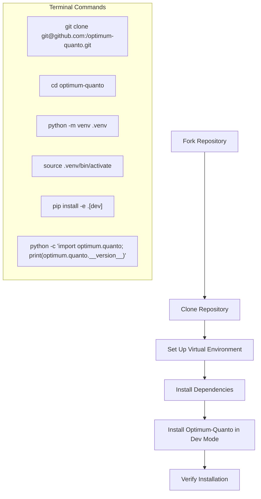
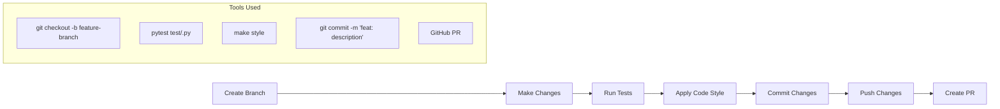
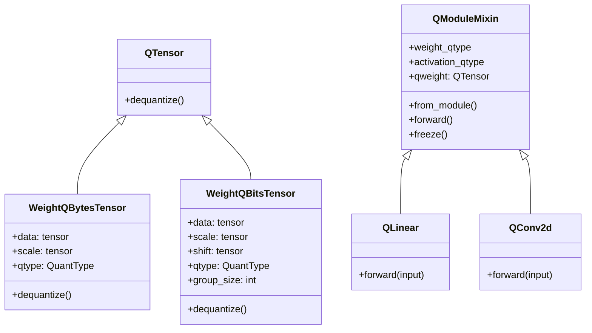
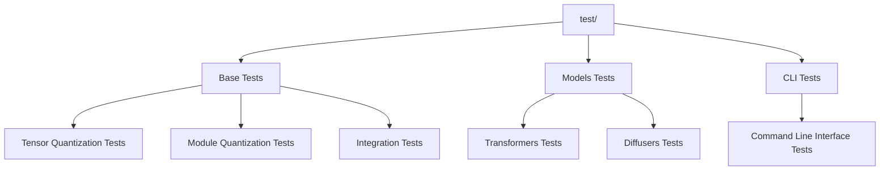
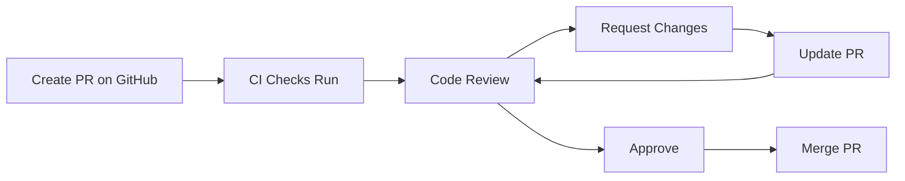

<!-- source: DeepWiki mcp.deepwiki.com · repo huggingface/optimum-quanto · page 10 Contributing · fetched 2026-10-26 -->

# Contributing

<details>
<summary>Relevant source files</summary>

The following files were used as context for generating this wiki page:

- [.github/PULL_REQUEST_TEMPLATE.md](.github/PULL_REQUEST_TEMPLATE.md)
- [.github/workflows/check-commits.yml](.github/workflows/check-commits.yml)
- [.github/workflows/linux-cpu-tests.yml](.github/workflows/linux-cpu-tests.yml)
- [.github/workflows/linux-cuda-tests.yml](.github/workflows/linux-cuda-tests.yml)
- [.github/workflows/linux-examples.yml](.github/workflows/linux-examples.yml)
- [.github/workflows/python-quality.yml](.github/workflows/python-quality.yml)
- [CONTRIBUTING.md](CONTRIBUTING.md)
- [LICENSE](LICENSE)
- [Makefile](Makefile)
- [README.md](README.md)
- [external/awq/test_awq_kernels.py](external/awq/test_awq_kernels.py)
- [external/awq/test_awq_packing.py](external/awq/test_awq_packing.py)
- [external/smoothquant/README.md](external/smoothquant/README.md)
- [external/smoothquant/smoothquant.py](external/smoothquant/smoothquant.py)
- [pyproject.toml](pyproject.toml)
- [setup.sh](setup.sh)

</details>


This page outlines how to contribute to the Optimum-Quanto project. It provides guidelines for setting up a development environment, submitting issues, implementing improvements, and creating pull requests. For information about using Optimum-Quanto in your projects, see [Getting Started](#2).

Optimum-Quanto welcomes contributions from everyone, regardless of their experience level. This document will help you get started with the development process and ensure your contributions meet the project's standards.

Sources: [CONTRIBUTING.md:17-31]()

## Ways to Contribute

There are several ways to contribute to Optimum-Quanto:

1. **Fix outstanding issues** - Identify and fix bugs or improve existing code
2. **Submit issues** - Report bugs or request new features
3. **Implement new kernels** - Add support for new hardware or optimization techniques

All contributions are equally valuable to the project, whether they're code-related or focused on documentation and community support.

Sources: [CONTRIBUTING.md:32-41]()

## Development Environment Setup

To contribute to Optimum-Quanto, you'll need:

- Python 3.9 or above
- Git for version control
- PyTorch 2.6.0 or above

### Setting Up Your Environment



1. **Fork the repository** on GitHub by clicking the "Fork" button.

2. **Clone your fork** to your local machine:
   ```bash
   git clone git@github.com:<your GitHub handle>/optimum-quanto.git
   cd optimum-quanto
   git remote add upstream https://github.com/huggingface/optimum-quanto.git
   ```

3. **Set up a virtual environment**:
   ```bash
   python -m venv .venv
   source .venv/bin/activate  # On Windows: .venv\Scripts\activate
   ```

4. **Install Optimum-Quanto in development mode**:
   ```bash
   pip install -e ".[dev]"
   ```

   For running examples, you may want to install additional dependencies:
   ```bash
   pip install -e ".[examples]"
   ```

Sources: [CONTRIBUTING.md:98-129](), [setup.sh:1-18](), [pyproject.toml:17-40]()

## Contribution Workflow

### Development Process



1. **Create a new branch** for your changes:
   ```bash
   git checkout -b descriptive-branch-name
   ```

2. **Make your changes** to the codebase.

3. **Run tests** to ensure your changes don't break existing functionality:
   ```bash
   pytest test/<specific_test>.py
   # or run all tests
   make test
   ```

4. **Apply code style** fixes:
   ```bash
   make style
   ```

5. **Commit your changes** with a clear and descriptive message. The project encourages using [conventional commits](https://www.conventionalcommits.org):
   ```bash
   git add modified_file.py
   git commit -m "feat: add support for new feature"
   ```

6. **Push your changes** to your fork:
   ```bash
   git push -u origin descriptive-branch-name
   ```

7. **Create a pull request** from your branch to the main repository.

Sources: [CONTRIBUTING.md:130-189](), [Makefile:1-15]()

### Submitting a Bug Report

When submitting a bug report, please include:

- Your OS type and version
- Python and PyTorch versions
- A minimal code snippet that reproduces the bug
- The full traceback if an exception is raised
- Any additional helpful information like screenshots

Before submitting, verify that the bug hasn't already been reported by searching the existing issues.

Sources: [CONTRIBUTING.md:52-66]()

### Requesting a Feature

Feature requests should include:

1. **Motivation** - Why the feature is needed
2. **Detailed description** - What the feature would do
3. **Example usage** - Code snippet demonstrating how it would be used
4. **References** - Links to papers or other implementations if applicable

Sources: [CONTRIBUTING.md:67-79]()

### Implementing a New Kernel

When proposing a new kernel implementation, specify:

- The hardware configuration(s) it will support
- Any novel techniques that will be used in the implementation

Sources: [CONTRIBUTING.md:81-88]()

## Code Structure and Organization

The following diagram shows the main components of Optimum-Quanto that you might interact with when contributing:



Understanding this structure will help you determine where to make changes when implementing features or fixing bugs.

Sources: [README.md:5-16]()

## Testing Guidelines

Optimum-Quanto uses pytest for testing. Tests are located in the `test` directory.

### Running Tests

To run a specific test:
```bash
python -m pytest -sv test/path/to/test_file.py
```

To run all tests:
```bash
make test
```

### Test Structure



When adding new functionality, include appropriate tests that verify your implementation works as expected. The CI workflow includes testing on both CPU and CUDA environments across multiple Python versions.

Sources: [CONTRIBUTING.md:202-216](), [.github/workflows/linux-cpu-tests.yml:23-56](), [.github/workflows/linux-cuda-tests.yml:23-58]()

## Code Quality and Style

Optimum-Quanto follows specific code style guidelines:

1. **Style Guide**: The project follows the [Google Python Style Guide](https://google.github.io/styleguide/pyguide.html) for documentation strings.

2. **Code Formatting**: Code is formatted using `ruff format`.

3. **Linting**: Code is linted using `ruff check`.

You can check your code for style issues with:
```bash
make check
```

And apply automatic fixes with:
```bash
make style
```

Sources: [CONTRIBUTING.md:218-222](), [.github/workflows/python-quality.yml:1-21](), [pyproject.toml:53-69]()

## Pull Request Guidelines

When submitting a pull request, ensure it meets the following requirements:

1. **The PR title should summarize your contribution**
2. **Reference related issues** if applicable
3. **Indicate work in progress** with `[WIP]` prefix
4. **Ensure existing tests pass**
5. **Include tests for new features**
6. **Add docstrings** for all public methods

The pull request template will remind you of these requirements when you create a PR.



Sources: [CONTRIBUTING.md:190-201](), [.github/PULL_REQUEST_TEMPLATE.md:1-31]()

## Continuous Integration

Optimum-Quanto uses GitHub Actions for continuous integration. The following checks run automatically on all pull requests:

| Check | Description |
|-------|-------------|
| Check Commits | Verifies commit message quality |
| Python Quality | Runs code formatting and linting checks |
| Linux CPU Tests | Runs tests on CPU with Python 3.9 and 3.11 |
| Linux CUDA Tests | Runs tests on CUDA 11.8, 12.4, and 12.6 |
| Linux Examples | Verifies that examples run correctly |

Your pull request needs to pass all these checks before it can be merged.

Sources: [.github/workflows/check-commits.yml:1-18](), [.github/workflows/linux-cpu-tests.yml:1-82](), [.github/workflows/linux-cuda-tests.yml:1-59](), [.github/workflows/linux-examples.yml:1-78]()

## License

Optimum-Quanto is licensed under the Apache License 2.0. By contributing to the project, you agree to license your contributions under the same license.

Sources: [LICENSE:1-204](), [CONTRIBUTING.md:132-136]()

---

