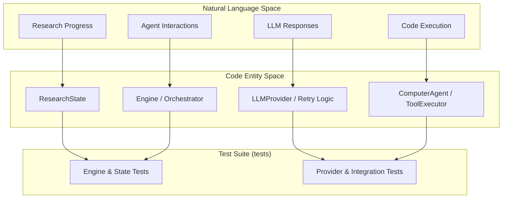

<!-- source: DeepWiki mcp.deepwiki.com · repo huggingface/physics-intern · page 10 Testing Infrastructure · fetched 2026-10-26 -->

# Testing Infrastructure

<details>
<summary>Relevant source files</summary>

The following files were used as context for generating this wiki page:

- [.github/workflows/testing.yml](.github/workflows/testing.yml)
- [.gitignore](.gitignore)
- [.pre-commit-config.yaml](.pre-commit-config.yaml)
- [tests/__init__.py](tests/__init__.py)
- [tests/conftest.py](tests/conftest.py)
- [tests/fixtures/research_state.md](tests/fixtures/research_state.md)

</details>


The `physics-intern` codebase employs a comprehensive testing suite designed to ensure the stability of the multi-agent research loop, the integrity of the `ResearchState`, and the reliability of LLM provider integrations. The infrastructure is built around `pytest` and integrated into a CI/CD pipeline that enforces code quality and coverage.

## Overview of Testing Organization

The testing infrastructure is organized into functional clusters located in the `tests/` directory. It utilizes shared configuration and fixtures to simulate complex research states without requiring live LLM calls in unit tests.

### CI/CD and Quality Control
The project uses GitHub Actions to automate testing across multiple Python versions (3.12, 3.13) [`.github/workflows/testing.yml`:63-69](). The pipeline includes:
*   **Static Analysis**: `ruff` for linting and formatting checks [`.github/workflows/testing.yml`:58-61]().
*   **Test Execution**: `pytest` with coverage reporting via `pytest-cov` [`.github/workflows/testing.yml`:84-89]().
*   **Environment Management**: `uv` for fast dependency synchronization [`.github/workflows/testing.yml`:51-57]().

### Configuration and Fixtures
*   **Global Setup**: `tests/conftest.py` ensures that environment variables are loaded from `.env` before any tests are collected [`tests/conftest.py`:1-6]().
*   **State Fixtures**: The suite uses Markdown-based templates to mock the `ResearchState`. This allows testing the parser and renderer against realistic "snapshots" of a research process [`tests/fixtures/research_state.md`:1-35]().

## System Testing Architecture

The following diagram illustrates how the testing infrastructure bridges the natural language requirements of physics research with the code entities that implement them.

### Mapping Research Concepts to Test Entities

**Sources:** [`.github/workflows/testing.yml`:89-89](), [`tests/conftest.py`:1-6](), [`tests/fixtures/research_state.md`:1-7]()

## Core Test Components

The test suite is divided into two primary areas of focus to balance granular unit testing with high-level integration verification.

### Engine and State Tests
These tests focus on the internal logic of the research loop and the data structures that track progress. They ensure that transitions between Working Hypotheses (WH) and Established Results (ER) follow defined protocols and that the `Engine` correctly handles iteration limits and termination conditions.

For details, see [Engine and State Tests](#10.1).

### Provider and Integration Tests
These tests validate the external boundaries of the system. This includes the `LLMProvider` adapters for different backends (Anthropic, OpenAI, etc.), the tool execution sandbox used by the `ComputerAgent`, and the workspace persistence layer that saves `RESEARCH_GRAPH.json`.

For details, see [Provider and Integration Tests](#10.2).

## Testing Patterns

The codebase follows specific patterns to maintain testability in a non-deterministic LLM environment:

| Pattern | Implementation | Purpose |
| :--- | :--- | :--- |
| **State Mocking** | Loading `research_state.md` fixtures | Decouples logic testing from agent generation. |
| **Coverage Enforcement** | `pytest-cov` in CI | Ensures critical paths in `engine.py` are exercised. |
| **Environment Isolation** | `MPLBACKEND: Agg` | Prevents GUI issues during plotting tests in CI [`.github/workflows/testing.yml`:87-87](). |
| **Multi-Version Testing** | Matrix builds in GitHub Actions | Ensures compatibility with Python 3.12 and 3.13 [`.github/workflows/testing.yml`:68-69](). |

### Test Infrastructure Components
```mermaid
graph LR
    subgraph "Execution"
        "pytest"
        "ruff"
    end

    subgraph "Environment"
        "uv"
        ".env"
        "conftest.py"
    end

    subgraph "Data"
        "fixtures/*.md"
        "coverage.xml"
    end

    "uv" --> "pytest"
    ".env" --> "conftest.py"
    "conftest.py" --> "pytest"
    "fixtures/*.md" --> "pytest"
    "pytest" --> "coverage.xml"
```
**Sources:** [`.github/workflows/testing.yml`:51-61](), [`tests/conftest.py`:3-5](), [`.pre-commit-config.yaml`:1-8]()

**Sources:**
- [`.github/workflows/testing.yml`:1-99]()
- [`tests/conftest.py`:1-6]()
- [`tests/fixtures/research_state.md`:1-35]()
- [`.pre-commit-config.yaml`:1-9]()

---

