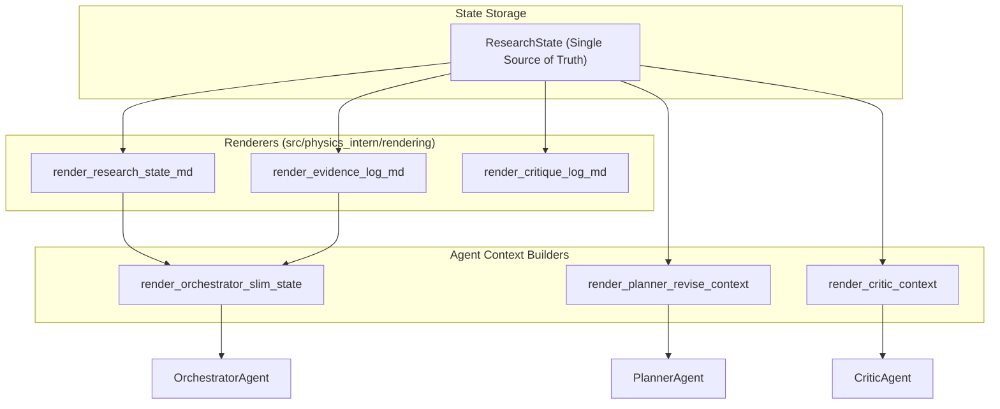
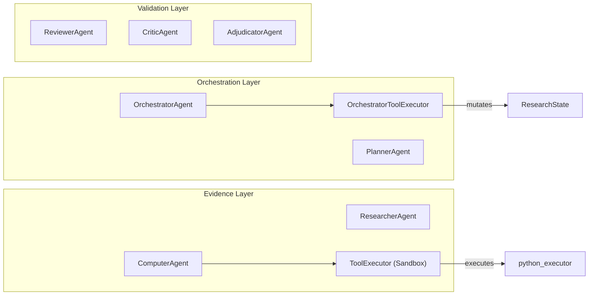

<!-- source: DeepWiki mcp.deepwiki.com · repo huggingface/physics-intern · page 11 Glossary · fetched 2026-10-26 -->

# Glossary

Relevant source files

The following files were used as context for generating this wiki page:

- [CLAUDE.md](CLAUDE.md)
- [DOCUMENTATION.md](DOCUMENTATION.md)
- [README.md](README.md)
- [scripts/run_critpt_common.py](scripts/run_critpt_common.py)
- [scripts/run_critpt_oneshot.py](scripts/run_critpt_oneshot.py)
- [scripts/run_critpt_rsa.py](scripts/run_critpt_rsa.py)
- [serve/drain_backends.py](serve/drain_backends.py)
- [serve/load_balancer.py](serve/load_balancer.py)
- [serve/serve.slurm](serve/serve.slurm)
- [tests/test_config.py](tests/test_config.py)
- [tests/test_engine.py](tests/test_engine.py)
- [tests/test_orchestrator.py](tests/test_orchestrator.py)
- [tests/test_orchestrator_tools.py](tests/test_orchestrator_tools.py)
- [tests/test_renderers.py](tests/test_renderers.py)
- [tests/test_report_recommendations.py](tests/test_report_recommendations.py)
- [tests/test_research_state.py](tests/test_research_state.py)
- [tests/test_scaffold_log.py](tests/test_scaffold_log.py)
- [tests/test_validation.py](tests/test_validation.py)

This page provides definitions for codebase-specific terminology, domain concepts, and architectural components within the PhysicsIntern system. It serves as a technical reference for onboarding engineers to map natural language concepts to specific code entities and implementation logic.

## Core Architectural Concepts

The PhysicsIntern engine operates on a structured research lifecycle where state is mutated by specialized agents through tool calls.

| Term | Definition | Code Pointer |
| :--- | :--- | :--- |
| **ResearchState** | The single source of truth for the entire research session. Contains all hypotheses, evidence, and critiques. | [src/physics_intern/state/research_state.py:7-31]() |
| **Working Hypothesis (WH)** | A tentative physical or mathematical claim currently under investigation. | [src/physics_intern/state/research_state.py:38-42]() |
| **Established Result (ER)** | A hypothesis that has been promoted after passing formal review and satisfying dependencies. | [src/physics_intern/state/research_state.py:63-66]() |
| **LoopState** | Transient scratch space for the current engine iteration, tracking pending verdicts and context banners. | [src/physics_intern/state/loop_state.py:68-72]() |
| **Research Question (RQ)** | A specific sub-problem dispatched by the Orchestrator to Evidence Agents. | [src/physics_intern/state/research_state.py:112-117]() |

### System Data Flow: State to Context
The following diagram illustrates how the `ResearchState` is transformed into specialized Markdown contexts for different agent roles.

**Research State Rendering Pipeline**

Sources: [src/physics_intern/rendering/index.py:6-18](), [src/physics_intern/agents/orchestrator/context.py:17-18](), [src/physics_intern/agents/planner/context.py:18-19](), [src/physics_intern/agents/critic/context.py:12-15](), [CLAUDE.md:32-34]()

---

## Agent Roles and Dispatch

PhysicsIntern utilizes a multi-agent system where roles are defined by their system prompts and available tools.

*   **OrchestratorAgent**: The central dispatcher. Uses `OrchestratorToolExecutor` to manage `WH` and `RQ` lifecycles [src/physics_intern/agents/orchestrator/tools.py:5-17]().
*   **ResearcherAgent**: Performs analytical derivations and literature-style reasoning.
*   **ComputerAgent**: Executes Python code in a sandboxed `ToolExecutor` to verify claims numerically or symbolically [tests/test_report_recommendations.py:21-21]().
*   **ReviewerAgent**: Provides adversarial review (VERIFIED/REFUTED/INCONCLUSIVE) on `WH` targets [tests/test_engine.py:11-12]().
*   **CriticAgent**: Performs strategic audits and files `Critique` objects to flag inconsistencies or logical gaps [tests/test_orchestrator_tools.py:12-14]().
*   **AdjudicatorAgent**: Resolves challenges to `ER` objects; the only agent capable of demoting an Established Result [CLAUDE.md:39-39]().
*   **SurveyorAgent**: Runs once at session start to map the research landscape [README.md:11-11]().
*   **FormatterAgent**: Generates the final `ANSWER.md` from the `ResearchState` [README.md:11-11]().

### Code Entity Mapping: Agent Dispatch
This diagram maps the high-level agent roles to their specific implementation classes and tool executors.

**Agent Implementation Mapping**

Sources: [src/physics_intern/agents/orchestrator/tools.py:5-6](), [src/physics_intern/agents/computer/tools.py:21-21](), [README.md:11-11](), [CLAUDE.md:42-42]()

---

## Technical Terms & Abbreviations

### WH and ER Lifecycle
*   **Auto-promotion**: The process where a `WH` is converted to an `ER`. This is handled by `auto_promote` in `critique_routing.py` and requires a `VERIFIED` status and resolved dependencies [CLAUDE.md:40-40]().
*   **Demotion Safety**: A check performed by `check_er_demotion_safety` to ensure `ER` results are not improperly reverted to `WH` without valid adjudication [tests/test_report_recommendations.py:23-23]().
*   **Phantom Label**: A validation error where an agent refers to a hypothesis ID (e.g., `WH-999`) that does not exist in the `ResearchState` [tests/test_report_recommendations.py:24-25]().

### Execution & Infrastructure
*   **Soft-exit**: A loop termination triggered by cumulative budgets (`max_wall_seconds`, `max_total_output_tokens`, `max_cost_usd`) rather than `max_iterations` [DOCUMENTATION.md:31-33]().
*   **Stall Recompute**: An engine mechanism that forces a re-evaluation of the strategy if the research state hasn't progressed after `stall_recompute_limit` iterations [tests/test_engine.py:128-132]().
*   **vLLM Serve**: The Slurm-based serving infrastructure for hosting local models like DeepSeek or Qwen [serve/serve.slurm:23-34]().
*   **Load Balancer**: A resilient proxy (`load_balancer.py`) that round-robins requests across multiple vLLM backends and handles auto-resubmission of failed Slurm jobs [serve/load_balancer.py:2-12]().

### Verification & Evaluation
*   **Formal Evaluation**: A post-run process using SymPy to compare the agent's `ANSWER.md` against ground-truth mathematical expressions [DOCUMENTATION.md:65-65]().
*   **RSA (Recursive Self-Aggregation)**: A baseline mode that generates $N$ candidates over $T$ rounds to improve answer quality through consensus [DOCUMENTATION.md:14-14]().
*   **One-shot**: A baseline execution mode consisting of a single LLM call with no scaffolding [DOCUMENTATION.md:107-112]().

| Abbreviation | Full Term | Context |
| :--- | :--- | :--- |
| **TP** | Tensor Parallel | Model sharding across GPUs [serve/serve.slurm:50-51]() |
| **PP** | Pipeline Parallel | Model sharding across nodes [serve/serve.slurm:52-53]() |
| **DP** | Data Parallel | Replicating models for throughput [serve/serve.slurm:54-55]() |
| **QOS** | Quality of Service | Slurm job priority levels [README.md:33-33]() |

Sources: [src/physics_intern/state/research_state.py:38-66](), [CLAUDE.md:39-41](), [DOCUMENTATION.md:31-65](), [serve/serve.slurm:50-55](), [tests/test_engine.py:128-132]()